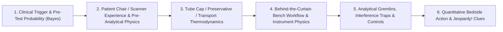

# Basic Medical — *Behind the Curtain* Clinical Diagnostics Master Index & Show Bible

> **Mission**: Demystify **every laboratory blood panel, body-fluid assay, microbiological test, genetic/oncologic profile, critical-care physiological waveform, imaging modality, and surgical biopsy procedure a physician might order**—from newborn heel-stick to ICU shock resuscitation, comprehensive cancer genomics, and living organ transplantation—so any listener or reader walks away with **championship-level (*Jeopardy!* Grandmaster) mastery** of what is done *to* them in the exam room and what scientists and technologists physically do *for* them behind the laboratory curtain.

---

## 1. Why This Archive Exists: The "Behind-the-Curtain" Knowledge Gap

Even patients with deep scientific training routinely sit in a phlebotomy chair, CT scanner, oncology clinic, NICU, or pre-transplant workup room and realize that modern medicine operates behind an opaque curtain:
- Why did the phlebotomist draw **eight different colored Vacutainer caps in a rigid sequence**, refuse to put the pale-yellow `ACD` tubes on ice, yet plunge the lavender `Rasburicase` or `Ammonia` tube straight into an ice-water slurry?
- Why can an emergency-room Core Lab report a terrifyingly low serum sodium of **`121 mEq/L`** that is completely fake (**Indirect `ISE` electrolyte exclusion**), or a "negative" **`hs-Troponin`** during an active heart attack because the patient takes a **`10-mg` Biotin hair vitamin**, or a "negative" **`420 MFI`** transplant antibody screen that explodes to **`23,500 MFI`** once complement **`C1` Prozone** blockade is stripped away with `EDTA`?
- Why does a routine surgical biopsy take **five days** (`10% formalin -> graded ethanol -> xylene clearing -> 60°C paraffin wax -> 4-µm microtome -> H&E + HIER immunohistochemistry`), whereas an intraoperative margin check takes **fifteen minutes** inside a `-22°C` **Cryostat**—and why does dropping a suspected lymphoma node, gout tophus, blistering skin punch, or native kidney biopsy into formalin **destroy the diagnosis forever**?
- How do five **`3.2-mm` paper punches** from a 30-hour-old infant's heel-stick blood spot catch **50+ catastrophic metabolic, immunologic (`TREC = 0` SCID), and neuromuscular (`SMN1` SMA) disorders** in 90 seconds before the baby ever shows a symptom?

---

## 2. The Six-Stage "Behind-the-Curtain" Analytical Framework

Every test, scan, biopsy, and bedside study across **Volumes I–XXII** is unpacked across six rigorous stages:



1. **Clinical Trigger & Bayesian Logic**: Why the physician orders *this* test rather than a look-alike (`BNP` vs `NT-proBNP` on `Entresto`; `UACR` vs `UPCR` vs `SSA` in myeloma; `ctDNA` liquid biopsy vs tissue `RNA-NGS`; `Direct` vs `Indirect` Coombs).
2. **Patient Experience & Pre-Analytical Physics (Where ~70% of Errors Occur)**: Tourniquet hemoconcentration, fist-clenching skeletal-muscle `K+` leak, needle-shear hemolysis, `30-min` supine rest for plasma metanephrines, `6-hr` fasting + insulin hold before `[18F]-FDG PET`, `24–48 hr` neonatal feeding window before `PKU` heel-stick, and split-dose `PEG` + $\text{CO}_2$ colonoscopy prep.
3. **Container Chemistry & Transport Rules**: Exact stoichiometry and biochemistry of every Vacutainer additive (`SPS`, `3.2%` trisodium citrate `9:1`, micronized silica + thixotropic `SST` gel, lithium/sodium heparin, `K2-EDTA`, `NaF`/citrate-oxalate, `ACD Solution A`, `Streck` cell-stabilizing `cfDNA` tubes, `Michel's` immunofluorescence medium, `RPMI` flow medium).
4. **Behind-the-Curtain Bench & Scanner Physics**: Step-by-step walkthrough of what the **Medical Laboratory Scientist (`MLS`)**, **Histotechnologist (`HTL`)**, **Histocompatibility Specialist (`CHS`)**, **Microbiologist**, **Cytogeneticist**, **Radiologic/MRI Technologist**, or **Nuclear Medicine Pharmacist** actually executes—including exact wavelengths (`340 nm` `NADH`, `405 nm` `pNP`, `530 nm` red-plate crystal compensator, `337 nm` `MALDI-TOF` laser, `511 keV` positron annihilation), separation matrices, and equations.
5. **Analytical Saboteurs & Classic False-Positive / False-Negative Gremlins**: Biotin-streptavidin sabotage, one-step sandwich **High-Dose Hook Effect**, complement **`C1` Prozone**, `HAMA`/heterophile phantom `hCG`, `EDTA` pseudothrombocytopenia & `K+/Ca2+/AlkPhos` cross-contamination, `FUT3` Lewis-negative `CA 19-9` blindness, `CHIP` blood mutations masquerading as tumor `ctDNA`, and Confined Placental Mosaicism on prenatal `NIPT`.
6. **Quantitative Action Thresholds & *Jeopardy!* Championship Clues**: Exact clinical cutoffs, delta checks, historical eponyms (*Coombs, Terasaki, Guthrie, Hounsfield, Light, Kleihauer-Betke, Winters, Stewart, Whipple, Ham -> FLAER*), and rapid-recognition diagnostic signatures.

---

## 3. Complete Repository Map (`Basic Medical` NotebookLM Suite)

### Part A — Master Architecture & Encyclopedic Reference Volumes (`Volumes I–XXII`)

| File | Clinical Specialty Scope | Core "Behind-the-Curtain" Technologies Covered |
| :--- | :--- | :--- |
| `00_BASIC_MEDICAL_NOTEBOOK_INDEX_AND_SHOW_BIBLE.md` | Master Charter & Guide | 6-Stage Analytical Framework, Repository Map, NotebookLM Audio Workflow |
| `VOLUME_I_THE_LIVING_KIDNEY_DONOR_GAUNTLET_MGFR_HLA_CROSSMATCH_AND_SPLIT_FUNCTION.md` | Transplant & Renal Clearance | Jaffe vs Enzymatic `Cr`, `Cystatin C`, `Iohexol LC-MS/MS mGFR` (Bröchner-Mortensen), `24-hr Litholink` `EQUIL2`, `99mTc-MAG3` Split ROI, 4-Phase Donor `CTA`, `HLA` `NGS`, `Luminex SAB` `C1` Prozone, `Pronase FCXM`, `Terasaki CDC`, `ABO A2` Lectin, `APOL1`, `NAT` |
| `VOLUME_II_PHLEBOTOMY_VACUTAINER_CHEMISTRY_AND_AUTOMATED_CORE_LAB_ANALYZERS.md` | Phlebotomy, Core Chemistry & Blood Gas | `CLSI` Order of Draw, Thixotropic Gel `RCF`, `EDTA` Contamination, `HIL` Indices, Direct vs Indirect `ISE` Pseudohyponatremia, `340-nm NADH` Coupled Enzymes (`CMP`, `LFTs`, `Lactate Gap`), `ABG` Electrodes & `128-λ` Co-Oximetry |
| `VOLUME_III_COMPLETE_BLOOD_COUNT_FLOW_CYTOMETRY_COAGULATION_AND_BLOOD_BANKING.md` | Hematology, Coagulation & Transfusion | Coulter Impedance, `SLS-Hb`, Laser `FSC/SSC/SFL` Diff, `Ret-He`, `EDTA` Clumping, Smear Emergencies, Optical vs Steel-Ball `PT/aPTT`, `1:1` Mixing, `dRVVT`, `Anti-Xa`, `ABO` Gel Cards, `DAT/IAT` Elution, `Daratumumab DTT` |
| `VOLUME_IV_IMMUNOASSAYS_ENDOCRINE_DYNAMICS_CARDIAC_BIOMARKERS_AND_LC_MS_MS.md` | Immunoassays, Cardiology, Myeloma & `LC-MS/MS` | Ruthenium `ECLIA` Sandwich vs Competitive, **4 Saboteurs** (`Biotin`, `Hook`, `HAMA`, `PEG Macro`), `hs-cTnI/T` `0/1h`, `BNP` vs `NT-proBNP`, `SPEP/IFE/Freelite`, `HbA1c` Methods, Equilibrium Dialysis & Triple-Quad `LC-MS/MS` (`MRM`) |
| `VOLUME_V_MICROBIOLOGY_BLOOD_CULTURES_MALDI_TOF_PCR_CT_VALUES_AND_SEROLOGY.md` | Infectious Disease, Micro & Molecular | `BACTEC` Resin Bottles, Gram/Acid-Fast Chemistry, Selective Agars, `90-sec MALDI-TOF` Ribosomal MS, `MIC` PK/PD & `D-Zone`/`CARBA-5`, `TaqMan RT-qPCR` (`3.32 Ct`), `BioFire` Pouches, `mcfDNA`, `HIV/HBV/Syphilis` Algorithms |
| `VOLUME_VI_URINALYSIS_BODY_FLUID_TAP_MICROSCOPY_AND_AUTOIMMUNE_RHEUMATOLOGY_PANELS.md` | Urinalysis, Sterile Taps & Rheumatology | Dipstick Traps (`Bence Jones`, `β-OHB`, `Vit C`), Cast & Crystal Microscopy, `CSF` Xanthochromia & Oligoclonal Bands, `Light's Criteria`, `SAAG`, `530-nm` Red-Plate Polarized Gout/Pseudogout, `HEp-2 ANA`, *Crithidia* `dsDNA`, `ANCA`, `CH50` |
| `VOLUME_VII_RADIOLOGY_CT_MRI_ULTRASOUND_AND_NUCLEAR_PET_PHYSICS_BEHIND_THE_GLASS.md` | Diagnostic Radiology & Nuclear Physics | `CT` Bremsstrahlung, Hounsfield Math, Dual-Energy Iodine `K-Edge` & Bolus Tracking, Piezoelectric Doppler `<= 60°` & `FibroScan`, `DEXA`, `3T MRI` (`T1, T2, FLAIR, DWI/ADC, SWI`), `SPECT` (`V/Q, HIDA, MIBI`) & `511-keV` `PET` |
| `VOLUME_VIII_ANATOMIC_PATHOLOGY_BIOPSY_FROZEN_SECTION_IHC_NGS_AND_ENDOSCOPIC_CARDIAC_PROCEDURES.md` | Surgical Pathology & Invasive Physiology | Grossing -> Formalin -> Xylene -> `FFPE` -> `4-µm H&E`, `-22°C` Cryostat Frozen Section, `HIER IHC` (`DAB`), `FISH`, `ThinPrep/ROSE`, `12-Lead ECG`, Cath `FFR/iFR`, `Swan-Ganz`, `PFT` Body-Box/`DLCO`, `NBI` Endoscopy, `EMG/NCS`, `PSG` |
| `VOLUME_IX_ONCOLOGY_DIAGNOSTICS_TUMOR_MARKERS_MARROW_FLOW_LIQUID_BIOPSY_AND_MOLECULAR_STAGING.md` | Medical, Hematologic & Surgical Oncology | `PSA/%Free/PI-RADS`, `CA 19-9` Lewis Trap, `AFP/hCG` Half-Lives, `Rasburicase` Ice Rule, Bone Marrow + `10-Color` Leukemia/Lymphoma Flow, `clonoSEQ MRD`, Solid-Tumor `DNA/RNA NGS` (`MSI/TMB/HRD`), `ctDNA` vs `CHIP`, `BI-RADS`, `SLNB`, `177Lu` Theranostics |
| `VOLUME_X_ICU_TRAUMA_AND_EMERGENCY_CRITICAL_CARE_DIAGNOSTIC_ORDERS.md` | ICU, Shock, Trauma & Neurocritical Care | `Winters` + `Delta-Delta` + `Stewart SID`, `SvO2` Fick + `Pv-aCO2` Gap, Tox Gaps & Nomograms, Ventilator `PIP` vs `Pplat`, Driving Pressure & Auto-PEEP, `RSBI`, `TEG/ROTEM`, `eFAST/RUSH/VExUS` `POCUS`, `ICP` Waves, `cEEG`, `SSEP N20`, Brain Death |
| `VOLUME_XI_PEDIATRICS_NEONATAL_HEEL_STICK_PRENATAL_CFDNA_AND_GENOMIC_DIAGNOSTICS.md` | Prenatal/OB, Neonatology, Peds & Genomics | `cfDNA/NIPT` Placental Mosaicism, `Quad`, `MCA` Fetal Anemia Doppler, `Kleihauer-Betke` vs Flow `HbF`, `5-Punch` Guthrie Heel-Stick (`MS/MS`, `TREC SCID`, `SMN1 SMA`), Pilocarpine Sweat `Cl-`, `CCHD` Oximetry, Lead, Bone Age, `SNP CMA` & `48h Trio rWGS` |
| `VOLUME_XII_SPECIALTY_CLINICAL_TESTS_NEURO_GI_DERM_ALLERGY_OPHTHO_AND_JEOPARDY_COMPENDIUM.md` | GI, Neuro, Derm, Allergy, Ophtho & *Jeopardy!* | `13C-Urea` & `H2/CH4` Breath, High-Res Manometry, `MII-pH`, `Calprotectin`, `SFEMG` Jitter, `RT-QuIC` Prions, `Michel's DIF` Skin Biopsy, `ImmunoCAP Ara h 2` vs Skin Prick, `OCT`, Tympanometry, Urodynamics + **Jeopardy! \$2,000 Hall of Fame** |
| `VOLUME_XIII_MASTER_MEDICAL_TESTING_ENCYCLOPEDIA_TUBES_METHODS_TRAPS_AND_JEOPARDY_MATRIX.md` | Cross-Specialty Quick-Lookup Atlas | **165+ Diagnostic Tests** mapped side-by-side: Specimen/Cap, Analytical Physics, #1 Hidden Interference Trap, Critical Action Value, and *Jeopardy!* Signature Clue |
| `VOLUME_XIV_MULTI_VOICE_CASTING_BIBLE_12_EPISODE_SEASON_AND_NOTEBOOKLM_PROMPTS.md` | Multi-Voice Podcast Production Bible | Zero-Overlap 21-Voice `gemini-3.8-flash-tts` & `edge-tts` Studio Roster (`Cast Modes A–G`), 12-Episode Season Blueprints, and Copy-Paste NotebookLM `"Longer"` Steering Prompts |
| `VOLUME_XV_CARDIOPULMONARY_DIAGNOSTICS_ECG_VECTORS_HS_TROPONIN_HEMODYNAMICS_AND_PFT.md` | Cardiopulmonary Diagnostics & Invasive Physiology | 12-Lead ECG Vectors, WCT, Cabrera, Forensic Lead Reversals, QTc Dynamics, Modified Smith-Sgarbossa, hs-cTnI/T ESC 0/1h Algorithms, Immunoassay Saboteurs (HAMA, Biotin, Macrotroponin), Bruce Treadmill METs & DTS, Stress Echo 16-Segment WMSI, SPECT MPI & Regadenoson Steal, Dual-Source CCTA, Agatston CAC, FFR-CT CFD, Invasive FFR/iFR, High-Definition IVUS & 1.3-µm OCT TCFA, Swan-Ganz Waveforms, Thermodilution vs Fick, PVR/TPG/DPG, Spirometry LLN vs Fixed, Boyle's Law Plethysmography Body Box, and Single-Breath Krogh DLCO / Kco Matrix |
| `VOLUME_XVI_GASTROENTEROLOGY_HEPATOLOGY_AND_NUTRITION_DIAGNOSTICS.md` | Gastroenterology, Hepatology & Enteric Breath Physics | R-Factor, Transaminase Compartmentalization (ALT Cytosol vs AST Mitochondria), de Ritis >2.0 in Alcohol (P5P Deficit), Fulminant Wilson Bilirubin:ALP >2.0 & Hypouricemia, ALP Isoenzyme Heat Fractionation, Warburg 340-nm Coupled Optics, Jendrassik-Grof Azobilirubin, FIB-4 & NFS, VCTE FibroScan Young's Modulus & CAP, ARFI/2D-SWE & MRE 60-Hz Acoustic Inversion, SAAG Starling Physics & Ascitic 2.5 g/dL Protein Cutoff, SBP PMN >=250/µL & Bedside Inoculation, Runyon Viscus Perforation Triad, 36-Channel HRM Clouse Topography & Chicago v4.0 (IRP, DCI, DL), Achalasia Types I–III, Lyon 2.0 pH-Impedance & DeMeester, Fecal Calprotectin & FE-1 PEI, Stool Osmotic Gap & 72-hr Van de Kamer Titration, Celiac tTG-IgA & Total IgA Traps, Marsh Histology, 13C-Urea Breath IRMS, and GC H2/CH4 Breath SIBO/IMO Kinetics |
| `VOLUME_XVII_ENDOCRINOLOGY_DYNAMIC_TESTING_MASS_SPECTROMETRY_AND_ADRENAL_VEIN_SAMPLING.md` | Endocrinology, Mass Spec & Interventional AVS | Dynamic Testing Physiology, 1-mg/8-mg DST, Serum Dexamethasone LC-MS/MS, 24-hr UFC, Salivary Cortisol, IPSS Catheterization & Central/Peripheral Ratios, ARR, Saline Infusion, Adrenal Vein Sampling (AVS) Selectivity & Lateralization Indices, High/Low-Dose Cosyntropin, CAH LC-MS/MS Steroid Panel, Supine Metanephrines, Clonidine Suppression, Copeptin DI Protocols, Equilibrium Dialysis FT4, Thyroglobulin Tryptic LC-MS/MS |
| `VOLUME_XVIII_PREVENTABLE_DEATH_LONGEVITY_AND_EVIDENCE_BASED_SCREENING_ARCHITECTURE.md` | Preventive Medicine, Longevity & Screening | Bayes' Theorem & Screening Biases (Lead-Time, Length-Time, Overdiagnosis, Volunteer), NNS/NNT, Agatston CAC Scoring Physics, ApoB Stoichiometry, Lp(a) KIV-2 Repeats & Isoform-Insensitive Mass Spec, hs-CRP, Colonoscopy ADR Benchmarks, BBPS Prep, Cold vs EMR Polypectomy, FIT vs mt-sDNA (Cologuard), cfDNA & MCED Liquid Biopsies, LDCT Lung Cancer (NLST/NELSON/Lung-RADS), 3D Tomosynthesis (DBT) & DCE-MRI, Primary hrHPV & Bethesda, DEXA K-Edge Physics & TBS |

| VOLUME_XIX_NEURODIAGNOSTICS_EMG_NCS_EEG_AND_CSF_BIOMARKERS.md | Neurodiagnostics & CSF Biomarkers | International 10-20 EEG, Phase Reversals, cEEG Burst Suppression, NCS CMRR >100 dB, CMAP/SNAP, F-Waves, H-Reflex, Concentric Needle EMG MUAPs, SFEMG Jitter MCD (28-31 us), VEP P100, SSEP N20 Irreversibility, CSF Xanthochromia 450 nm, IEF Oligoclonal Bands (Pattern 2), Autoimmune Encephalitis (NMDA, LGI1, CASPR2), Prion RT-QuIC |
| VOLUME_XX_INFECTIOUS_DISEASE_SEROLOGY_VIROLOGY_AND_MOLECULAR_DIAGNOSTICS.md | Infectious Disease & Molecular Virology | Blood Culture Poisson Kinetics (40-60 mL), Resin Bottle Clearance, 90-sec MALDI-TOF MS, Syphilis Reverse Algorithm & RPR Prozone, HBV 6-Marker Matrix & Core Window IgM Anti-HBc, Occult HBV DNA, HIV 4th-Gen Combo & Geenius, HIV RNA Viral Load, Lyme MTTT vs Western Blot Band Criteria, Tick Co-infections (Babesia Maltese Cross, Anaplasma Morulae), BioFire Syndromic Multiplex PCR, Ct Kinetics |
| VOLUME_XXI_IMMUNOHEMATOLOGY_BLOOD_BANKING_AND_ADVANCED_HEMOSTASIS.md | Immunohematology & Advanced Hemostasis | Type & Screen vs Crossmatch, Electronic Crossmatch Validation, ABO Discrepancy Resolution (Groups I-IV, Bombay Oh, Acquired B), Weak D vs Partial D Genotyping, Kleihauer-Betke FMH Volume & RhIG Dosing, 11-Cell Rule-Out Panels (3x3 Rule), Ficin/Papain Cleavage, Daratumumab DTT Neutralization (Kell Destruction), DAT Monospecific vs Polyspecific, Acid vs Heat Elution, TRALI vs TACO, aPTT 1:1 Mixing & Rosner Index, ISTH Lupus Anticoagulant 3-Step, VWD Multimer Electrophoresis, HIT 4T & SRA, TEG/ROTEM Viscoelastic Resuscitation |
| VOLUME_XXII_CYTOGENETICS_CHROMOSOMAL_MICROARRAYS_AND_LONG_READ_GENOMICS.md | Cytogenetics, CMA & Long-Read Genomics | Sodium Heparin Living Cultures, Colcemid Metaphase Arrest, Hypotonic 0.075M KCl, Carnoy Fixative, Microclimate Slide Dropping, GTG 550 vs 850 Banding, ISCN 2024 Nomenclature, D-FISH Translocations (BCR-ABL1), Break-Apart Split Probes (ALK), HER2 Amplification, MLPA Stuffer Multiplexing, MS-MLPA Imprinting, aCGH vs SNP Microarrays, Log2 Ratios & BAF Tracks, CN-LOH / ROH Consanguinity, Short-Read SBS ExAmp Chemistry, Phred Q30, ACMG 5-Tier Classification, Oxford Nanopore R10.4.1 Squiggle Physics & Adaptive Sampling, PacBio HiFi SMRT CCS, Pseudogene Homology Resolution (CYP21A2, SMN1/SMN2), Repeat Expansions (C9orf72, DMPK, FXN), Direct 5mC/5hmC Native Epigenomics, Long-Range Structural Haplotype Phasing |

### Part B — Integrated Foundational Archival Treatises (`DOCS_ARCHIVE_01`–`04`)
1. `DOCS_ARCHIVE_01_OSMOLARITY_AND_SOLUTION_CALCULATIONS.md` — Colligative physical chemistry, milliosmoles, tonicity vs osmolarity, freezing-point depression osmometry, and clinical IV fluid / osmolal gap foundations.
2. `DOCS_ARCHIVE_02_HLA_VARIABILITY_AND_AUTOIMMUNITY.md` — Evolutionary MHC polymorphism, peptide-groove anchor physics, disease-risk alleles (`HLA-B*27`, `DQ2/DQ8`, `B*57:01`), and allorecognition.
3. `DOCS_ARCHIVE_03_COMPLEMENT_MEDIATED_IMMUNITY.md` — Classical (`C1qrs`), Lectin (`MBL`), and Alternative (`C3bBb`) amplification cascades, Membrane Attack Complex (`C5b-9`), regulatory decay factors (`CD55/CD59`, `Factor H`), and diagnostic `C3/C4/CH50/AH50` interpretation.
4. `DOCS_ARCHIVE_04_PREVENTABLE_DEATH_SCREENING_AND_LONGEVITY.md` — Evidence-based population screening architecture (`ApoB`, `Lp(a)`, `CAC` Coronary Calcium CT, Colonoscopy, Low-Dose Chest CT, `DEXA`, Cancer & cardiometabolic risk stratification).

### Part C — Unabridged 60-Minute Multi-Voice Marathon Podcast Scripts (`EP801`–`EP808` | ~72,000+ Spoken Words)
Every script is ~8,800–9,500+ spoken words (~60 minutes runtime), strictly 3-voice conversational drama (`Ordering Specialist` + `Scientist/Patient Questioner` + `Behind-the-Curtain Bench Technologist`), containing **zero `$` symbols, zero `\` backslashes, and zero unspoken markdown artifacts**:
- **`EP801`** (`Cast Mode A`: *Dr. Rachel Halpern, Prof. Evan Reid, Carlos Mendez*): *Living Kidney Donor Gauntlet Part I — Measured Iohexol GFR, 24-Hour Litholink Stone Jugs, Nuclear MAG3 Split Scans & Four-Phase Donor CTA*
- **`EP802`** (`Cast Mode A`: *Dr. Rachel Halpern, Prof. Evan Reid, Carlos Mendez*): *Living Kidney Donor Gauntlet Part II — Yellow-Top Living Lymphocytes, 11-Locus HLA NGS, Luminex Single-Antigen Beads, The C1 Prozone Trap & Pronase Crossmatching*
- **`EP803`** (`Cast Mode B`: *Dr. Nathan Sterling, Dr. Maya Lin, Denise Okafor*): *Eight Colored Vacutainers — Needle Shear, Thixotropic Gel Physics, ISE Pseudohyponatremia, Glowing Ruthenium Immunoassays, Biotin Sabotage & Tandem Mass Spec*
- **`EP804`** (`Cast Mode E`: *Dr. Victor Chen, Dr. Elena Rostova, Marcus Bell*): *Behind the Lead Glass & The Cryostat — CT Hounsfield Physics, 3-Tesla MRI Pulse Sequences, 511-keV PET, Formalin-to-Xylene Biopsies, 15-Minute Frozen Sections & Invasive Physiology*
- **`EP805`** (`Cast Mode C`: *Dr. Julian Vance, Dr. Clara Sterling, Tariq Al-Mansoor*): *Decoding the Cancer Order Sheet — Why Blood Tumor Markers Lie, Ten-Color Leukemia Lasers, Solid-Tumor RNA/DNA NGS, Liquid Biopsy ctDNA vs CHIP & Theranostic PET Missiles*
- **`EP806`** (`Cast Mode D`: *Dr. Kendra Brooks, Sam Callahan, Hannah Lindqvist*): *ICU Red-Alert Orders — Stewart Strong Ions, Shock Venous CO2 Gaps, Ventilator Plateau Curves, Trauma TEG Cups, Venous Doppler POCUS & Coma Neuro-Telemetry*
- **`EP807`** (`Cast Mode F`: *Dr. Priya Nair, Leo Vance, Grace Takahashi*): *From Womb to Heel-Stick — Prenatal cfDNA Mosaicism, Five Dried Blood Spots, Tandem Mass Spec, Pilocarpine Sweat Chloride & 48-Hour NICU Trio Genomes*
- **`EP808`** (`Cast Mode G`: *Dr. Arthur Pendelton, Zoe Patel, Matteo Rossi*): *The Jeopardy! Grandmaster Diagnostic Tour — Blood-Culture Resins, 90-Second MALDI-TOF Lasers, Dipstick Lies, Polarized Crystal Physics, Crithidia DNA & Classic Named Tests*

---

## 4. Two Ways to Generate Your Longest-Format Multi-Voice Podcasts

### Workflow 1: Google NotebookLM ("One-Click All-In-One Episode Bundles")
Because NotebookLM's Google Drive Picker only displays native **Google Docs** (hiding raw `.md` files), your synced Google Drive folder (**`Basic Medical - Behind the Curtain Diagnostics Notebook`**) includes two special subfolders:
1. **`One_Click_Episode_Bundles_For_NotebookLM/`**: Contains **`Bundle 01`** through **`Bundle 08`** as native Google Docs. Simply add the Bundle to your **`Basic Medical`** NotebookLM, check **only that single Bundle** in the Sources sidebar, click **Audio Overview -> Customize -> Longer**, and paste the exact steering prompt printed at the very top of the Bundle!
2. **`Google_Docs_For_NotebookLM_Picker/`**: Contains every individual Volume (`Volumes I–XXII`), archival doc, and podcast script as standalone native Google Docs so you can mix-and-match custom cross-specialty deep dives anytime.

### Workflow 2: Unabridged True 60-Minute Multi-Voice Studio Audio (`render_basic_medical_60min_tts.py`)
NotebookLM's built-in Audio Overview caps out around 20–30 minutes with 2 voices. To render the **complete, unabridged 60-minute, 3-voice studio `.m4a` episodes** directly from `EP801`–`EP808` (using either **`gemini-3.8-flash-tts`** or zero-API-key neural **`edge-tts`**):
```powershell
# 1. Offline Dry-Run Audit (verifies word counts, speaker turns, and zero TTS artifacts):
C:\Users\patel\.gemini\antigravity\scratch\Podcast_Automation_Suite\.venv\Scripts\python.exe scripts\render_basic_medical_60min_tts.py --audit-all

# 2. Render an unabridged 60-minute 3-voice episode via Gemini 3.8 Flash TTS:
$env:GEMINI_API_KEY="YOUR_KEY"
C:\Users\patel\.gemini\antigravity\scratch\Podcast_Automation_Suite\.venv\Scripts\python.exe scripts\render_basic_medical_60min_tts.py LONGFORM_60MIN_PODCAST_EP805_THE_ONCOLOGY_WORKUP_TUMOR_MARKERS_LIQUID_BIOPSY_MARROW_FLOW_AND_THERANOSTIC_PET.md --engine gemini

# 3. Or render immediately with zero API keys using neural multi-voice Edge-TTS -> M4A:
C:\Users\patel\.gemini\antigravity\scratch\Podcast_Automation_Suite\.venv\Scripts\python.exe scripts\render_basic_medical_60min_tts.py LONGFORM_60MIN_PODCAST_EP805_THE_ONCOLOGY_WORKUP_TUMOR_MARKERS_LIQUID_BIOPSY_MARROW_FLOW_AND_THERANOSTIC_PET.md --engine edge
```
