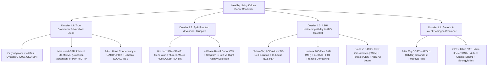
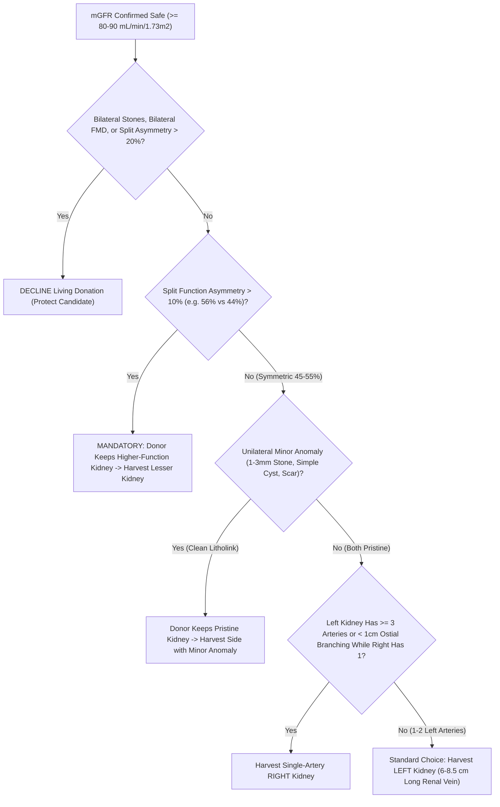
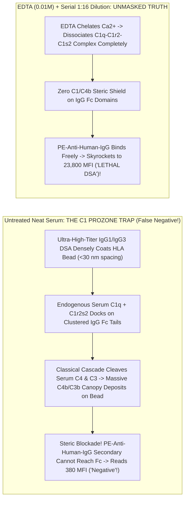

# Bundle 01 — Ep 801: Living Kidney Donor Gauntlet, mGFR, 24h Litholink & Split Scans (All-In-One)

## ZERO-MIXUP SINGLE-SOURCE BUNDLE FOR GOOGLE NOTEBOOKLM

**How to use in NotebookLM (`notebook.google.com`):**

1. Check **ONLY THIS ONE DOCUMENT** in your NotebookLM Sources sidebar (uncheck all others—every reference treatise and script needed for this episode is merged right inside this single file!).
2. Click **Customize** on **Audio Overview**, choose **Longer**, and paste this exact prompt:

```text
Create a deep, longest-format behind-the-curtain medical diagnostics podcast starting from a real dilemma: why even a scientifically trained living kidney donor candidate is mystified by the 45 tests ordered before donating a kidney. Walk step-by-step through WHY serum creatinine and eGFR lie (Jaffe picrate vs enzymatic creatininase, OCT2/MATE1 tubular secretion blocked by trimethoprim, muscle mass vs Cystatin C), and what happens behind the laboratory curtain during Measured GFR (weighing the Iohexol syringe to a milligram, contralateral timed draws at 120/180/240 minutes, LC-MS/MS endo/exo peaks, and the Brochner-Mortensen quadratic correction). Unpack the 24-hour urine jug (why void #1 is discarded, catching under-collection via 20-25 mg/kg/day creatinine, UACR vs UPCR, and Litholink EQUIL2 stone supersaturation), milking the 99Mo/99mTc generator at 5 AM for MAG3 split renal function, 4-phase donor CT angiography (why surgeons prefer the 7-cm left renal vein unless anatomy or split function dictates keeping the better kidney), OGTT, APOL1 G1/G2 alleles, and post-donation adaptive hyperfiltration.
```

---


---

## INCLUDED SOURCE: `VOLUME_I_THE_LIVING_KIDNEY_DONOR_GAUNTLET_MGFR_HLA_CROSSMATCH_AND_SPLIT_FUNCTION.md`

# Basic Medical — Behind the Curtain Clinical Diagnostics Notebook
## Volume I: The Living Kidney Donor Gauntlet — Measured GFR (`mGFR`), Split Renal Scintigraphy, `HLA` Crossmatching, and Occult Clearance Panels

> *"When a sick patient enters the clinic, diagnostic medicine searches for a culprit large enough to explain existing suffering. When a healthy human volunteers to surrender half of their nephron endowment for the next fifty years of life, diagnostic medicine transforms into forensic engineering: every routine screening shortcut becomes suspect, every physiological reserve must be stress-tested to its physical-chemical ground truth, and every invisible immunological landmine must be defused before a scalpel ever touches skin."*

---

### Prologue: Why Even a Biomedical PhD Walks Out of Living Donor Clinic Baffled

Imagine a healthy 34-year-old molecular biologist or biomedical engineer sitting in a transplant center evaluation suite. Their annual primary-care physical three weeks earlier was spotless: serum creatinine $0.92\text{ mg/dL}$, estimated glomerular filtration rate ($\text{eGFR}$) $104\text{ mL/min/1.73 m}^2$, hemoglobin $\text{A}_{1\text{c}}$ $5.4\%$, normal blood pressure, and an unremarkable urinalysis dipstick. Expecting a brief surgical anatomy scan and a blood-type check, they instead walk out carrying:

1. An infusion-center appointment for a **4-hour intravenous Iohexol (`Omnipaque`) disappearance study**—receiving an iodinated X-ray contrast bolus without setting foot near a CT or X-ray machine, while a nurse weighs a plastic syringe on an analytical microbalance to a thousandth of a gram.
2. Two **3-liter opaque plastic collection jugs**—one pre-spiked with corrosive hydrochloric acid or antimicrobial thymol crystals—with stern instructions about flushing Monday's `07:00 AM` urine down the toilet while capturing Tuesday's `07:00 AM` urine to the drop.
3. A Nuclear Medicine requisition for **`99mTc-MAG3` dynamic renal scintigraphy** on top of a **4-phase CT Angiogram and CT Urogram**.
4. A phlebotomy slip calling for **eight yellow-top `ACD-A` tubes**, **four specialized `QuantiFERON` peptide-coated lithium-heparin tubes**, **two lavender `EDTA` tubes**, **three gold `SST` tubes**, and a **2-hour `75-g` Oral Glucose Tolerance Test (`OGTT`)** despite an $\text{HbA}_{1\text{c}}$ of $5.4\%$.

Why does transplant medicine distrust every routine test that internal medicine relies upon daily? Because unilateral donor nephrectomy instantaneously deletes $50\%$ of an individual's ~1.8 to 2.0 million nephrons. Within days of surgery, renal blood flow to the solitary remaining kidney surges by $40\text{–}45\%$, driving single-nephron glomerular hyperfiltration so that whole-body GFR stabilizes at **$65\text{–}70\%$ of pre-donation two-kidney baseline** (not $50\%$). For that solitary kidney to sustain its owner to age 85 or 90 without tipping into end-stage kidney disease (`ESKD`—quantified in seminal cohorts by Muzaale et al., *JAMA* 2014, and Grams et al., *NEJM* 2016), the transplant team must replace population-average *estimates* with direct physical, nuclear, chromatographic, and cellular measurements.

In **Volume I**, we pull back the stainless-steel curtain of the Clinical Chemistry Core Lab, the Mass Spectrometry Suite, the Nuclear Medicine Hot Lab, the Multidetector CT Console, and the `ASHI`-accredited Histocompatibility & Immunogenetics Laboratory to trace every tube, photon, microsphere, and enzyme in the Living Kidney Donor Gauntlet.



---

## Dossier 1.1: Why Serum Creatinine & `eGFR` Are Not Enough — Measured GFR (`mGFR`), Cystatin C, 24-Hour Urine Adequacy & `Litholink` Stone Supersaturation

### 1.1.1 The Three Physiological & Analytical Lies of Serum Creatinine

Creatinine ($\text{C}_4\text{H}_7\text{N}_3\text{O}$, molecular weight $113.12\text{ Da}$) is the cyclic anhydride formed by the spontaneous, non-enzymatic dehydration of skeletal-muscle **creatine** and **phosphocreatine** at a steady fractional turnover rate of roughly $1.1\text{–}2.0\%$ per day. In outpatient primary care, clinicians treat steady-state serum creatinine ($S_{\text{Cr}}$) as an inverse mirror of glomerular filtration rate ($\text{GFR}$): if $\text{GFR}$ halves, $S_{\text{Cr}}$ roughly doubles. Yet inside a living kidney donor evaluation, relying on $S_{\text{Cr}}$ alone can either falsely disqualify an athletic hero or fatally clear a candidate with ocult Stage 2 chronic kidney disease. Serum creatinine tells **three distinct lies**:

#### Lie #1: The Generation & Dietary Confounder ($G_{\text{Cr}} \neq \text{constant}$)
At steady state, urinary creatinine excretion must equal endogenous muscle production plus exogenous dietary absorption:
$$S_{\text{Cr}} = \frac{G_{\text{Cr}}}{\text{GFR} + J_{\text{secretion}}/S_{\text{Cr}}}$$
where $G_{\text{Cr}}$ is the creatinine generation rate ($\text{mg/min}$) and $J_{\text{secretion}}$ is tubular secretory flux. Demographic `eGFR` equations guess $G_{\text{Cr}}$ solely from **age** and **sex**. Consequently:
* **The Muscular Donor Trap**: A 31-year-old CrossFit athlete or former collegiate rower taking oral creatine monohydrate supplements or eating a high-cooked-beef dinner (heat during cooking converts meat creatine directly into absorbable creatinine, spiking postprandial $S_{\text{Cr}}$ by $0.2\text{–}0.5\text{ mg/dL}$ for 4–8 hours!) may present with $S_{\text{Cr}} = 1.32\text{ mg/dL}$ and an alarming `eGFR` of $71\text{ mL/min/1.73 m}^2$, when their true measured GFR is a pristine $118\text{ mL/min/1.73 m}^2$.
* **The Low-Muscle-Mass Donor Trap**: Conversely, a petite 58-year-old vegetarian woman with mild sarcopenia ($46\text{ kg}$) generates so little endogenous creatinine that a "reassuring" $S_{\text{Cr}}$ of $0.78\text{ mg/dL}$ (`eGFR` $86\text{ mL/min/1.73 m}^2$) can conceal a true measured GFR of $64\text{ mL/min/1.73 m}^2$—a level unsafe for unilateral nephrectomy.

#### Lie #2: Proximal Tubular Secretion (`OCT2` / `MATE1` / `MATE2-K`) & Drug-Induced Pseudo-AKI
Inulin and iohexol are filtered exclusively across the glomerular capillary wall and never touched by renal tubular cells. Creatinine is **not** a pure filtration marker. In healthy adults with normal kidney function, **$10\text{–}15\%$ of urinary creatinine** (rising to $35\text{–}50\%$ in advanced CKD) is actively secreted across the S2 segment of the proximal convoluted tubule without ever passing through a glomerulus:
1. **Basolateral Uptake**: Positively charged/zwitterionic creatinine enters proximal tubular epithelial cells from peritubular capillary blood down the inside-negative membrane potential via **Organic Cation Transporter 2 (`OCT2`, encoded by `SLC22A2`)** (with minor contribution from `OAT2` / `SLC22A7`).
2. **Apical Efflux**: Creatinine is pumped out across the brush-border membrane into tubular urine via proton-coupled electroneutral antiporters **Multidrug and Toxin Extrusion protein 1 (`MATE1`, `SLC47A1`)** and kidney-specific **`MATE2-K` (`SLC47A2`)**.

This transporter architecture creates one of clinical medicine's classic diagnostic illusions. Common medications prescribed to healthy donor candidates competitively inhibit `OCT2` and/or `MATE1/2-K`:
* **Trimethoprim** (in `TMP-SMX` / *Bactrim* taken for a simple urinary tract or skin infection)
* **Cimetidine** (over-the-counter `H2`-receptor blocker for heartburn; famotidine has minimal effect)
* **Dolutegravir, Bictegravir, Raltegravir, and Cobicistat** (widely used in `HIV` PrEP/PEP or treatment regimens)
* **Pyrimethamine, Dronedarone, Ranolazine, Olaparib, and CDK4/6 inhibitors**

Within 24 to 48 hours of starting trimethoprim or dolutegravir, blocking `OCT2`/`MATE1` shuts down the $10\text{–}15\%$ secretory escape valve. Serum creatinine rises by **$0.20\text{ to }0.40\text{ mg/dL}$ ($15\text{–}30\%$)**, causing calculated `eGFR` to plummet from $98$ to $74\text{ mL/min/1.73 m}^2$—yet **true glomerular filtration (`mGFR`) and Cystatin C remain $100\%$ unchanged**!

#### Lie #3: Analytical Bench Interference — `Jaffe` Alkaline Picrate vs. Coupled Enzymatic `Trinder` Chemistry
Behind the core-lab curtain, clinical analyzers measure serum creatinine using one of two fundamentally different chemical reactions, both calibrated since the mid-2000s to **Isotope Dilution Mass Spectrometry (`IDMS`, NIST `SRM 967`)**, yet vulnerable to opposite sample interferents (*Tietz Textbook of Laboratory Medicine*, 7th ed.):

* **Method A — The Kinetic Alkaline Picrate (`Jaffe`, 1886) Reaction**:
  Under strongly alkaline conditions ($\text{NaOH}$, $\text{pH } 12.4\text{–}12.8$), creatinine's active methylene group forms a red-orange **Janovsky sigma-complex** with picrate ions ($2,4,6\text{-trinitrophenol}$), monitored kinetically by spectrophotometric absorbance rate ($\Delta A/\Delta t$) at **$505\text{ nm}$** over a narrow 20- to 60-second window:
  $$\text{Creatinine} + \text{Picrate}^- \xrightarrow{\text{OH}^-\text{ (pH } > 12.4\text{)}} \text{Creatinine–Picrate Janovsky Adduct } (\lambda_{\max} \approx 505\text{ nm})$$
  *Why Jaffe Lies*: Up to $15\text{–}20\%$ of the color in normal human plasma comes from **non-creatinine "pseudo-chromogens"**—plasma proteins, **acetoacetate** and **pyruvate** (causing dramatic false $S_{\text{Cr}}$ spikes of $+0.5\text{ to }+2.0\text{ mg/dL}$ during ketogenic diets, prolonged fasting, or diabetic ketoacidosis!), high glucose ($>300\text{ mg/dL}$), ascorbic acid (vitamin C megadosing), fetal hemoglobin, and cephalosporin antibiotics—most notoriously **cefoxitin**—which react directly with alkaline picrate. Conversely, **hyperbilirubinemia (icterus)** causes a *falsely low* Jaffe creatinine because NaOH oxidizes bilirubin ($450\text{ nm}$) to colorless biliverdin, subtracting absorbance during the kinetic read window unless rate-blanking or potassium ferricyanide oxidation is applied. Modern "compensated Jaffe" analyzers automatically subtract a fixed constant ($\sim 0.18\text{–}0.20\text{ mg/dL}$) from every patient's reading assuming average plasma protein levels—which systematically underestimates $S_{\text{Cr}}$ (overestimating GFR!) in cirrhotic or hypoalbuminemic patients.

* **Method B — The 4-Step Coupled Enzymatic (`Trinder`) Creatinine Assay** (Preferred by *KDIGO* for all Living Donor Centers):
  To eliminate Jaffe pseudo-chromogens, high-tier transplant laboratories deploy a specific bacterial enzyme cascade housed in two sequential reagent cuvettes (`R1` and `R2`):
  1. **Reagent `R1` Pre-Incubation (Endogenous Creatine Scavenging)**: Before `Creatininase` is ever added, `R1` introduces **Creatinase**, **Sarcosine Oxidase**, and **Catalase** to destroy all pre-existing endogenous serum creatine and sarcosine into harmless water and oxygen over 3–5 minutes!
  2. **Reagent `R2` Trigger (`Creatininase` + Sodium Azide Catalase Blocker + `Trinder` Chromogen)**:
     $$\text{Creatinine} + \text{H}_2\text{O} \xrightarrow{\text{Creatininase (Creatinine Amidohydrolase)}} \text{Creatine}$$
     $$\text{Creatine} + \text{H}_2\text{O} \xrightarrow{\text{Creatinase (Creatine Amidinohydrolase)}} \text{Sarcosine} + \text{Urea}$$
     $$\text{Sarcosine} + \text{O}_2 + \text{H}_2\text{O} \xrightarrow{\text{Sarcosine Oxidase}} \text{Glycine} + \text{Formaldehyde} + \text{H}_2\text{O}_2$$
     $$2\text{H}_2\text{O}_2 + \text{4-Aminophenazone} + \text{HTIB / TOOS} \xrightarrow{\text{Horseradish Peroxidase (HRP)}} \text{Quinoneimine Dye } (\lambda = 546\text{ nm}) + 4\text{H}_2\text{O}$$
  *Residual Enzymatic Caveats*: While immune to ketones and cefoxitin, the final `HRP`/$\text{H}_2\text{O}_2$ **Trinder coupling step** is vulnerable to strong reducing agents:blood drawn through an IV line infusing **dopamine or dobutamine**, high-dose intravenous **N-acetylcysteine (`NAC`)**, **metamizole (dipyrone)**, or **calcium dobesilate** consumes $\text{H}_2\text{O}_2$ before `HRP` can form the quinoneimine dye, yielding catastrophically **falsely low** enzymatic creatinine values! Furthermore, **5-fluorocytosine (`flucytosine`)** inhibits cytosine-deaminase-based dry-slide enzymatic creatinine systems (Vitros), falsely spiking $S_{\text{Cr}}$.

---

### 1.1.2 Cystatin C (`13.3 kDa`) & The 2021 Race-Free `CKD-EPI Cr-CysC` Equation

When a healthy donor candidate's creatinine-based `eGFR` sits in a gray zone ($75\text{–}95\text{ mL/min/1.73 m}^2$) or muscle mass deviates from population norms, the first blood-based adjudicator is **Serum Cystatin C**.

* **Molecular Physiology**: Encoded by the housekeeping-like `CST3` gene on chromosome `20p11.21`, Cystatin C is a $13,343\text{-Da}$ (120-amino-acid), non-glycosylated, positively charged ($\text{pI} = 9.3$) extracellular **cysteine protease inhibitor** synthesized at a remarkably constant constitutive rate by **every nucleated cell in the human body**—completely independent of skeletal muscle mass, sex, cooked meat intake, or `OCT2`/`MATE1` drugs!
* **Glomerular Filtration & `Megalin`/`Cubilin` Catabolism**: Because of its compact hydrodynamic radius ($\sim 1.8\text{ nm}$) and cationic charge (attracted across the negatively charged heparan-sulfate proteoglycans of the glomerular basement membrane), Cystatin C exhibits a glomerular sieving coefficient $\Theta \approx 0.99$. Once in Bowman's space, **$>99\%$ of filtered Cystatin C is bound by the proximal-tubule brush-border endocytic tandem receptor complex `Megalin` (`LRP2`) and `Cubilin`**, internalized into clathrin-coated pits, and completely degraded into free amino acids inside tubular lysosomes. Virtually zero intact Cystatin C is secreted by tubules or returned to blood—meaning *intact urinary Cystatin C is NOT used to calculate urinary clearance; serum Cystatin C alone reflects GFR!*
* **Behind the Bench (`PENIA` vs. `PETIA`)**: Because Cystatin C circulates at trace concentrations ($0.60\text{–}1.05\text{ mg/L}$, roughly $75\text{ nanomolar}$), spectrophotometric dye chemistry cannot touch it. Instead, core labs run automated homogeneous particle-enhanced immunoassays calibrated to the international certified reference material **`ERM-DA471/IFCC`**:
  * **`PENIA` (Particle-Enhanced Nephelometric Immunoassay, e.g., Siemens BN II / Atellica NEPH)**: $40\text{–}80\text{ nm}$ polystyrene nanoparticles covalently coated with rabbit anti-human Cystatin C antibodies agglutinate upon binding patient Cystatin C; an $840\text{-nm}$ infrared LED illuminates the cuvette while a forward-angle photodetector positioned at **$13^\circ\text{–}24^\circ$** measures increased **Rayleigh-Debye light scattering**.
  * **`PETIA` (Particle-Enhanced Turbidimetric Immunoassay, e.g., Roche Cobas `Tina-quant`)**: Measures the *decrease* in transmitted light intensity ($0^\circ$ optical axis at $546/800\text{ nm}$) caused by immunocomplex turbidity on standard chemistry tracks.
* **Non-GFR Confounders of Cystatin C**: Cystatin C has its own distinct blind spots! Because nucleated cell metabolic turnover regulates `CST3` transcription:
  * **Hyperthyroidism** accelerates cellular synthesis, **raising** serum Cystatin C (falsely lowering `eGFRcys`), whereas **hypothyroidism lowers** Cystatin C (the exact *opposite* direction of thyroid effects on creatinine, where hypothyroidism impairs GFR/water handling and raises $S_{\text{Cr}}$!).
  * **Exogenous high-dose glucocorticoids**, severe systemic inflammation (`CRP`), high adiposity/obesity, active cigarette smoking, and high-turnover hematologic states elevate Cystatin C independent of true GFR.

#### The Evolution of GFR Estimating Equations (`1976` to `2021`)
Understanding why transplant hepatologists, nephrologists, and pharmacists still clash over equations requires inspecting the exact algebra:

1. **Cockcroft-Gault (1976)** — estimates *unindexed Creatinine Clearance* ($\text{mL/min}$, including the $+10\text{–}15\%$ tubular secretion overestimate; still frozen into legacy FDA drug-dosing package inserts, *never* appropriate for donor GFR screening):
   $$\text{CrCl}_{\text{CG}}\text{ (mL/min)} = \frac{(140 - \text{Age}) \times \text{Weight}_{\text{kg}}}{72 \times S_{\text{Cr (mg/dL)}}} \times (0.85 \text{ if female})$$

2. **2021 Race-Free `CKD-EPI` Combined Creatinine–Cystatin C Equation (`eGFRcr-cys`)** (Inker et al., *NEJM* 2021 — recommended by *NKF-ASN* and *KDIGO* as the most accurate endogenous blood-based estimator):
   $$\text{eGFR}_{\text{cr-cys}} = 135 \times \min\!\left(\frac{S_{\text{Cr}}}{\kappa}, 1\right)^{\alpha} \times \max\!\left(\frac{S_{\text{Cr}}}{\kappa}, 1\right)^{-0.544} \times \min\!\left(\frac{S_{\text{CysC}}}{0.8}, 1\right)^{-0.323} \times \max\!\left(\frac{S_{\text{CysC}}}{0.8}, 1\right)^{-0.778} \times 0.9961^{\text{Age}} \times (0.963 \text{ if female})$$
   *(where $\kappa = 0.7\text{ mg/dL}, \alpha = -0.219$ for females; $\kappa = 0.9\text{ mg/dL}, \alpha = -0.144$ for males).*

Why, then, isn't `eGFRcr-cys` the final word in living kidney donation? Because even `eGFRcr-cys` exhibits a $P_{30}$ accuracy of $\sim 91\%$—meaning **$9\%$ of healthy people have a true `mGFR` that differs from `eGFRcr-cys` by more than $\pm 30\%$**, and the $95\%$ prediction interval around an `eGFRcr-cys` of $88\text{ mL/min/1.73 m}^2$ spans roughly **$71\text{ to }108\text{ mL/min/1.73 m}^2$**! When the `OPTN` / center safety threshold sits at **$80\text{ mL/min/1.73 m}^2$** (and $\ge 90\text{ mL/min/1.73 m}^2$ for young donors under age 35–40 who need 55+ years of renal longevity), guessing is unacceptable. Enter **Measured GFR (`mGFR`)**.

---

### 1.1.3 Behind the Curtain of Measured GFR (`mGFR`): Iohexol (`Omnipaque`) Plasma Disappearance vs. `99mTc-DTPA` & `125I-Iothalamate`

Classic renal physiology taught Homer Smith's continuous intravenous **inulin** infusion with bladder catheterization—an ordeal requiring scarce fructose-polymer inulin, constant infusion pumps, and error-prone voided urine collections. Modern transplant centers measure true `mGFR` primarily through **Exogenous Marker Plasma Disappearance**—most cleanly via **non-radioactive Iohexol (`Omnipaque`)**, or via nuclear radiotracers **`99mTc-DTPA`** and **`125I-Iothalamate`**.

#### Step-by-Step Behind the Curtain: The 4-Hour Iohexol (`Omnipaque-300`) `mGFR` Protocol
Iohexol ($N,N'\text{-bis(2,3-dihydroxypropyl)-5-[}N\text{-(2,3-dihydroxypropyl)-acetamido]-2,4,6-triiodoisophthalamide}$, $\text{MW } 821.14\text{ Da}$) is a non-ionic, water-soluble monomeric X-ray contrast agent. Unlike a CT scan that blasts `100–120 mL` intravenously, an Iohexol `mGFR` uses a tiny **$5.0\text{-mL}$ micro-bolus** (`Omnipaque-300`, containing $647\text{ mg iohexol/mL}$, or $3,235\text{ mg}$ total iohexol):
* **Why Iohexol is an Ideal Glomerular Marker**: Plasma protein binding is $< 1.5\%$; extrarenal (biliary/fecal) clearance is $< 0.5\%$; metabolic biotransformation is $0\%$; and renal tubular secretion and reabsorption are $0\%$. Once equilibrated across extracellular fluid, *the only exit door out of the human body for iohexol is glomerular filtration*.

Here is what happens minute-by-minute in the infusion chair and inside the Mass Spectrometry lab:

1. **`T = -30 min` (Pre-Test Conditioning & Dual-Arm Architecture)**:
   The donor arrives avoiding high-protein meat loads (which acutely trigger transient afferent arteriolar vasodilation via tubuloglomerular feedback, artificially inflating GFR by $10\text{–}20\%$!) and NSAIDs (which constrict afferent arterioles by blocking $\text{PGE}_2/\text{PGI}_2$). Oral hydration ($250\text{–}500\text{ mL}$ water) ensures steady urine flow. Two peripheral `IV` angiocatheters are placed—**one in the right arm strictly for Iohexol injection, and one in the CONTRALATERAL left arm strictly for timed blood draws** (drawing blood back through the injection hub, even after 10 saline flushes, desorbs trace microgram iohexol clinging to polyurethane catheter walls and ruins the assay!). A `T = 0` baseline blank blood tube is drawn first.

2. **`T = 0.00 min` (Gravimetric Microbalance Bolus Accounting)**:
   A volumetric syringe marking ("$5.0\text{ mL}$") has a $\pm 3\text{–}5\%$ human meniscus error. Therefore, the infusion nurse or lab technologist weighs the loaded `Omnipaque-300` syringe on a calibrated four-decimal analytical balance **before injection** ($W_{\text{pre}}$, e.g., $15.8421\text{ g}$), injects the $5\text{ mL}$ bolus smoothly over $60\text{–}90\text{ seconds}$ (recording the exact midpoint clock time to the second, e.g., `08:32:15`), flushes the line with $10\text{–}20\text{ mL}$ normal saline, and **re-weighs the empty syringe + needle** ($W_{\text{post}}$, e.g., $9.0971\text{ g}$). Given the exact density of `Omnipaque-300` at $20^\circ\text{C}$ ($\rho = 1.349\text{ g/mL}$) and concentration ($647.1\text{ mg iohexol/mL}$):
   $$\text{Exact Dose } D\text{ (mg)} = \frac{W_{\text{pre}} - W_{\text{post}}}{1.349\text{ g/mL}} \times 647.1\text{ mg/mL} = \frac{6.7450\text{ g}}{1.349} \times 647.1 = 3,235.5\text{ mg}$$

3. **`T = 0 to 120 min` (The Invisible $\alpha$-Distribution Phase)**:
   For the first two hours, plasma iohexol falls steeply via a **bi-exponential** curve: simultaneously diffusing out of capillaries into the $\sim 14\text{-liter}$ interstitial fluid space ($\alpha$-phase) while being filtered by the kidneys. Only after $\sim 120\text{ minutes}$ (in non-edematous subjects with normal GFR) does vascular-interstitial equilibrium lock into a pure log-linear **mono-exponential renal elimination slope ($\beta$-phase)**.

4. **`T = 120, 180, 240 min` (Exact-Minute Contralateral Draws)**:
   Blood is drawn from the contralateral arm into serum or `K2-EDTA` tubes at nominal 2, 3, and 4 hours (plus $300\text{ min}$ if lower GFR is suspected). Crucially, if the 2-hour draw happens at `124 min` instead of `120 min`, *no harm is done provided `124.0 min` is recorded truthfully into the regression equation*!

5. **Behind the Analytical Bench (`LC-MS/MS` vs. `HPLC-UV 254 nm`)**:
   * **`LC-MS/MS` Protocol**: The clinical chemist pipettes $50\text{ }\mu\text{L}$ of donor plasma, spikes in $50\text{ }\mu\text{L}$ of stable-isotope-labeled internal standard **`Iohexol-d5`** ($\text{MW } 826.17\text{ Da}$, which co-elutes identically and corrects for any ionization suppression or pipetting variance), precipitates plasma proteins with cold acetonitrile + $0.1\%$ formic acid, spins at $14,000 \times g$ for $10\text{ min}$, and injects supernatant onto a reverse-phase $\text{C}_{18}$ UHPLC column coupled to a triple-quadrupole tandem mass spectrometer in positive electrospray ionization (`ESI+`) Multiple Reaction Monitoring (`MRM`) mode: tracking precursor-to-product ion transitions **$m/z\text{ }822.1 \to 804.1$** (iohexol loss of $\text{H}_2\text{O}$) against **$m/z\text{ }827.1 \to 809.1$** (`Iohexol-d5`).
   * **`HPLC-UV` Isomer Physics**: Labs running `HPLC` with ultraviolet absorbance detection at **$254\text{ nm}$** (exploiting the aromatic triiodobenzene ring) observe **two distinct chromatographic peaks** for pure iohexol! Because bulky ortho-iodine atoms sterically hinder rotation around the central amide bonds, iohexol exists in aqueous equilibrium as two stable rotational atropisomers/conformers: a minor hydrophilic **endo-isomer ($\sim 15\%$)** eluting first and a major **exo-isomer ($\sim 85\%$)** eluting second. The chemist integrates the exo-isomer peak area (or summed isomer areas) against an internal standard (`iothalamate` or `p-aminobenzoic acid`) and confirms linearity ($R^2 > 0.995$ across the 3–4 timed log-concentration points—if $R^2 < 0.985$, a timing or line-contamination error immediately flags the run!).

6. **The Bröchner-Mortensen Quadratic Correction (`1972`)**:
   Plotting $\ln C(t)$ versus exact elapsed minutes $t$ across $120, 180, \text{ and } 240\text{ min}$ yields slope $-k_2$ and y-intercept $\ln C_0$:
   $$\text{One-Compartment Slow Clearance } Cl_1 = \frac{D}{C_0 / k_2} = \frac{D \cdot k_2}{C_0}$$
   Wait! Because $C_0$ extrapolates ONLY the slow $\beta$-slope back to $t = 0$, it completely misses the "extra triangle" of high plasma concentration during the first 90 minutes before iohexol finished entering interstitial space ($\text{AUC}_{\text{true}} = \text{AUC}_{\alpha} + \text{AUC}_{\beta} > C_0 / k_2$). Using raw $Cl_1$ would **underestimate $\text{AUC}$ and dangerously OVERESTIMATE the donor's GFR by $12\text{–}25\%$**! To capture the missing early $\alpha$-compartment without poking the donor 8 times in the first hour, clinical laboratories apply **Jens Bröchner-Mortensen's (1972) Quadratic Correction**:
   $$\text{mGFR}_{\text{raw}} = Cl_{\text{BM}} = 0.990778 \cdot Cl_1 - 0.001218 \cdot (Cl_1)^2$$
   *(Notice the physics of the $-0.001218 (Cl_1)^2$ quadratic penalty: the faster a healthy donor's kidneys clear iohexol—say $Cl_1 = 130\text{ mL/min}$—the larger the fraction of total clearance that already occurred during the unmeasured first 120 minutes, subtracting $20.6\text{ mL/min}$ to yield true $\text{mGFR}_{\text{raw}} = 108.2\text{ mL/min}$!)*

7. **Body Surface Area (`BSA`) Indexing — And Its Obesity/Petite Nuance**:
   Finally, raw $\text{mGFR}$ ($\text{mL/min}$) is normalized to the canonical $1.73\text{ m}^2$ human surface area using the **Du Bois & Du Bois (1916)** or **Haycock (1978)** formula:
   $$\text{BSA}_{\text{Du Bois}}\text{ (m}^2\text{)} = 0.007184 \times \text{Weight}_{\text{kg}}^{0.425} \times \text{Height}_{\text{cm}}^{0.725}, \qquad \text{mGFR}_{\text{indexed}} = \text{mGFR}_{\text{raw}} \times \frac{1.73}{\text{BSA}}$$
   *Clinical Pearl*: Indexing to $\text{BSA}$ prevents a petite $1.50\text{-m}^2$ woman with a perfectly matched $\text{mGFR}_{\text{raw}}$ of $78\text{ mL/min}$ ($\text{mGFR}_{\text{indexed}} = 90\text{ mL/min/1.73 m}^2$) from being falsely rejected, while preventing a large $2.35\text{-m}^2$ donor with an $\text{mGFR}_{\text{raw}}$ of $95\text{ mL/min}$ ($\text{mGFR}_{\text{indexed}} = 70\text{ mL/min/1.73 m}^2$—insufficient nephron power for their metabolic body mass!) from being mistakenly cleared.

#### Comparing Exogenous `mGFR` Modalities Across Transplant Centers

| Exogenous Marker | Isotope / Detection Physics | Renal Handling | Typical Sampling Protocol | Key Bench Advantages & Pitfalls |
| :--- | :--- | :--- | :--- | :--- |
| **Iohexol (`Omnipaque`)** | Non-radioactive iodine; `LC-MS/MS` (`Iohexol-d5` IS) or `HPLC-UV 254 nm` | Pure glomerular filtration; $<1.5\%$ protein bound; zero tubular transport | `5 mL` IV bolus (gravimetric syringe weigh); `120, 180, 240 min` plasma draws | **Zero radiation**; plasma stable for days at RT/frozen; gold-standard multicenter reproducibility; avoid in severe immediate contrast anaphylaxis |
| **`99mTc-DTPA`** | Gamma emitter ($140.5\text{ keV}$, $t_{1/2} = 6.01\text{ hr}$); NaI(Tl) gamma well-counter (`cpm`) | Glomerular filtration; **$5\text{–}10\%$ reversible plasma protein binding** | IV bolus (`1–5 mCi`); `120, 180, 240 min` plasma counted simultaneously with decay standard | Can combine with gamma-camera imaging (`Gates` camera-only method is **inaccurate**—must use timed blood draws!); slight GFR underestimation from protein binding unless ultrafiltered |
| **`125I-Iothalamate`** | Low-energy gamma/X-ray ($27\text{–}35\text{ keV}$, $t_{1/2} = 59.4\text{ days}$); gamma well-counter | Glomerular filtration + **minor active proximal tubular secretion via `OAT1` ($\sim 5\text{–}8\%$)** | Subcutaneous arm injection (`35 µCi`) + oral potassium iodide (`SSKI` thyroid block) + 4 timed plasma & spontaneous voided urine periods | Classic Mayo Clinic / NIH Crisp renal clearance protocol; requires complete bladder emptying (confirmed by post-void bladder ultrasound!) and radiation licensing |
| **Inulin** | Fructose polymer ($\sim 5,200\text{ Da}$); anthrone/resorcinol or enzymatic assay | Pure glomerular filtration ($100\%$ gold standard) | Priming bolus + continuous IV pump + timed urinary catheterization | Historical physiological benchmark; prohibitively expensive, scarce supply, cumbersome for clinical donor throughput |

---

### 1.1.4 The 24-Hour Urine Jug Behind the Curtain: Adequacy Math, `UACR` vs. `UPCR`, and `Litholink` `EQUIL2` Stone Supersaturation

Why ask a donor who is already undergoing an Iohexol `mGFR` to carry around a 3-liter urine jug for 24 hours? Because blood tests cannot measure **glomerular albumin/protein leak**, **actual dietary sodium and animal-protein intake**, or **thermodynamic urinary crystal supersaturation** that predicts whether a solitary remaining kidney could be obstructed by a ureteral stone!

#### 1. The Bladder-Clock Geometry & Catching Collection Errors ("Jug Fraud / Clock Drift")
Every patient initially asks: *"Why do I throw away my `07:00 AM` urine on Monday morning if my 24-hour collection starts at `07:00 AM`?"*
Because urine sitting inside the urinary bladder at `07:00 AM` Monday was filtered by the glomeruli between `11:00 PM` Sunday night and `07:00 AM` Monday! Including it would turn a 24-hour collection into a **32-hour collection**. Flushing the `07:00 AM` Monday void resets the bladder volume to zero at $t = 0$; thereafter, every drop passed during the day, night, and the final full bladder emptying at exactly `07:00 AM` Tuesday represents precisely $1,440\text{ minutes}$ of nephron output.

When the jug arrives in the core lab, the technologist first weighs the jug on a platform scale (converting mass to exact volume $V_{24}$ via specific gravity) and immediately runs a **24-Hour Total Creatinine Excretion Adequacy Check**. Regardless of how much water the donor drank ($1.2\text{ L}$ vs. $4.5\text{ L}$), daily skeletal-muscle creatinine production is locked to lean body mass:
* **Healthy Adult Males (age 20–50)**: **$20\text{ to }25\text{ mg/kg/day}$** (declining to $15\text{–}20\text{ mg/kg/day}$ over age 60)
* **Healthy Adult Females (age 20–50)**: **$15\text{ to }20\text{ mg/kg/day}$** (declining to $10\text{–}15\text{ mg/kg/day}$ over age 60)

> **Worked Bench Audit**: Suppose an $80\text{-kg}$, 32-year-old male donor turns in a jug containing $V_{24} = 1,400\text{ mL}$ with urine creatinine $U_{\text{Cr}} = 75\text{ mg/dL}$ ($0.75\text{ mg/mL}$) and serum creatinine $S_{\text{Cr}} = 1.00\text{ mg/dL}$.
> * Naive calculated 24-hr Creatinine Clearance: $\text{CrCl} = \frac{U_{\text{Cr}} \times V_{24}}{S_{\text{Cr}} \times 1440} = \frac{75\text{ mg/dL} \times 1400\text{ mL}}{1.00\text{ mg/dL} \times 1440\text{ min}} = \mathbf{72.9\text{ mL/min}}$ — *Panic! Is this young donor ineligible?*
> * **Behind-the-Curtain Adequacy Check**: Total creatinine in the jug $= 0.75\text{ mg/mL} \times 1,400\text{ mL} = \mathbf{1,050\text{ mg/day}}$. Divided by $80\text{ kg}$ body weight $= \mathbf{13.1\text{ mg/kg/day}}$ (expected: $20\text{–}25\text{ mg/kg/day}$, or $1,600\text{–}2,000\text{ mg/day}$!).
> * **Verdict**: The donor missed nearly $40\%$ of his day's urine (forgot to take the jug to the gym or flushed a nighttime void)! His true $\text{CrCl}$ is $\sim 120\text{ mL/min}$. Conversely, if total creatinine had been $2,650\text{ mg/day}$ ($33\text{ mg/kg/day}$), the lab immediately flags **over-collection** (included Day 1's first morning void), preventing a falsely inflated $\text{CrCl}$ from clearing an impaired donor!

#### 2. Dipstick vs. `UACR` (Microalbumin) vs. `UPCR` (Total Protein)
Why run *both* `UACR` and `UPCR` when the urinalysis dipstick already read `"Protein: Negative"`?
* **Urinalysis Dipstick ("Protein Error of Indicators")**: Filter paper impregnated with **tetrabromophenol blue** buffered to $\text{pH } 3.0$ changes from yellow to green-blue only when anionic amino/carboxyl sites of **albumin** accept protons. Its analytical limit of detection is coarse (**$15\text{–}30\text{ mg/dL}$**, or $150\text{–}300\text{ mg/L}$!). In a well-hydrated donor producing $3\text{ L/day}$ of dilute urine, $250\text{ mg/day}$ of pathological glomerular albuminuria dilutes to $8.3\text{ mg/dL}$—reading **completely `"Negative"` on dipstick**! Worse, dipstick pads are virtually blind to positively/neutrally charged **immunoglobulin free light chains (Bence Jones $\kappa/\lambda$)** and tubular low-molecular-weight proteins ($\beta_2\text{-microglobulin}$, retinol-binding protein).
* **Urine Albumin-to-Creatinine Ratio (`UACR`) / 24-Hr Urine Albumin Excretion (`UAE`)**: Measured via **immunoturbidimetry** (anti-human albumin antibodies at $340\text{ nm}$, detecting down to **$2\text{–}3\text{ mg/L}$**!). *KDIGO Living Kidney Donor Guidelines* classify **`UAE < 30 mg/day`** (or `UACR < 30 mg/g`, ideally `< 10 mg/g` in young donors) as mandatory for acceptance, and **`UAE >= 100 mg/day`** as an absolute contraindication—because trace selective albuminuria is the earliest hemodynamic footprint of glomerular endothelial glycocalyx loss and early podocyte effacement years before GFR budges.
* **Urine Protein-to-Creatinine Ratio (`UPCR`) / 24-Hr Total Protein (`< 150 mg/day`)**: Measured chemically via **Pyrogallol Red–Molybdate (`600 nm` blue-purple complex at $\text{pH } 2.5$)** or **alkaline Benzethonium Chloride turbidimetry (`505 nm`)**. This captures *all* urinary proteins: filtered albumin ($\sim 15\text{–}20\text{ mg/day}$ normally), tubular **Tamm-Horsfall mucoprotein / Uromodulin** ($\sim 40\text{–}70\text{ mg/day}$ secreted normally by the thick ascending limb of Henle!), and monoclonal light chains. *(Diagnostic gem: If `UPCR` is elevated at $450\text{ mg/g}$ while `UACR` is tiny at $12\text{ mg/g}$—an **"Albumin-to-Total-Protein Ratio `< 0.40`"**—the protein leak is NOT glomerular; it is either proximal tubular Fanconi/interstitial injury OR occult myeloma light-chain overflow requiring serum/urine immunofixation!)*

#### 3. Behind the Curtain of the 24-Hour `Litholink` Metabolic Stone Panel & `EQUIL2` Supersaturation
If a donor has an incidental $1.5\text{-mm}$ asymptomatic non-obstructing renal calculus on CT or a remote stone episode, a solitary kidney makes future ureteral obstruction a medical emergency (anuric post-renal AKI!). Simply checking serum calcium is useless; stone formation happens in distal nephron urine governed by **solution thermodynamics**.

In the **`Litholink` (Labcorp)** 24-hour stone risk protocol, the donor collects urine with an antimicrobial preservative (preventing *Proteus* or *Klebsiella* bacterial **urease** from hydrolyzing urea $\to 2\text{NH}_3 + \text{CO}_2$ during transit, which would skyrocket $\text{pH} > 8.0$, precipitate struvite/brushite, and destroy citrate via bacterial metabolism!). Back at the reference laboratory, the specimen is split and chemically conditioned before running 14 simultaneous analytes:
* **Acidified Aliquot ($\text{HCl}$ to $\text{pH } < 1.8$, warmed)**: Dissolves any microscopic **calcium oxalate ($\text{CaC}_2\text{O}_4$)** or **calcium phosphate** crystals that nucleated *in vitro* as the urine cooled from $37^\circ\text{C}$ body temperature to $20^\circ\text{C}$ room temperature! Analyzed for $\text{Ca}^{2+}, \text{Mg}^{2+}, \text{PO}_4^{3-}$, and **Oxalate** (measured enzymatically via *Oxalate Oxidase* generating $\text{H}_2\text{O}_2$ at $590\text{ nm}$ or by **Ion Chromatography [`IC`]**; note that high urinary Vitamin C must be stabilized/chelated at low pH because ascorbate spontaneously oxidizes to oxalate at alkaline pH, creating fake hyperoxaluria!).
* **Alkalinized Aliquot ($\text{NaOH}$ / buffer to $\text{pH } > 8.5$)**: Redissolves any precipitated **uric acid** crystals ($\text{p}K_a = 5.35$, insoluble below $\text{pH } 5.5$) prior to **Uricase** measurement!
* **Unacidified Aliquot**: Glass-electrode **`pH`**, **Citrate** (*Citrate Lyase + Malate Dehydrogenase* `NADH` oxidation at $340\text{ nm}$—crucial because trivalent $\text{Citrate}^{3-}$ chelates free $\text{Ca}^{2+}$ into soluble $[\text{CaCit}]^-$ complexes!), $\text{Na}^+, \text{K}^+, \text{Cl}^-$, **Sulfate ($\text{SO}_4^{2-}$)** via `IC` (a direct quantitative biomarker of dietary animal methionine/cysteine acid load, normally $15\text{–}30\text{ mEq/day}$), **Ammonium ($\text{NH}_4^+$)**, and Urea Nitrogen (computing normalized **Protein Catabolic Rate [`PCR`]** in $\text{g/kg/day}$).

Finally, these 14 molar concentrations are fed into **`EQUIL2`** (the iterative thermodynamic speciation algorithm developed by Finlayson and Werness et al., *J. Urol.* 1985). Why can't you simply multiply $[\text{Total Ca}] \times [\text{Total Oxalate}]$? Because over $50\%$ of urinary calcium is tied up in soluble ion pairs ($[\text{CaCit}]^-, [\text{CaHPO}_4]^0, [\text{CaSO}_4]^0$), and high urinary ionic strength $I = \frac{1}{2}\sum c_i z_i^2$ shields electrostatic charges via Debye-Hückel activity coefficients $\gamma_i$! `EQUIL2` iteratively solves 23+ simultaneous mass-action equations at $37^\circ\text{C}$ until free ion activities converge to $< 0.01\%$, outputting **Relative Supersaturation (`RSS`)**:
$$\text{RSS}_{\text{CaOx}} = \frac{\{ \text{Ca}^{2+} \} \cdot \{ \text{C}_2\text{O}_4^{2-} \}}{K_{sp,\text{CaOx}}}, \qquad \text{RSS}_{\text{Brushite}} = \frac{\{ \text{Ca}^{2+} \} \cdot \{ \text{HPO}_4^{2-} \}}{K_{sp,\text{CaHPO}_4 \cdot 2\text{H}_2\text{O}}}$$
where $\text{RSS} < 1.0$ means **undersaturated** (existing stones actually dissolve for uric acid!), $\text{RSS} = 1.0$ is thermodynamic saturation, and elevated **`RSS CaOx > 8–10`**, **`RSS Brushite > 2.0`**, or **`RSS Uric Acid > 2.0`** flags active lithogenic risk requiring either targeted dietary correction (water $> 2.5\text{ L/day}$, sodium $< 100\text{ mEq/day}$ to lower proximal-tubule-coupled calciuria, potassium citrate) with repeat clean testing—or donor exclusion.

---

## Dossier 1.2: Split Renal Scintigraphy (`99mTc-MAG3` / `DMSA`) & Multiphase Renal Donor CT Angiography (`CTA`) — Choosing Which Kidney Stays Behind

Once `mGFR` proves that the donor's *two* kidneys together filter $102\text{ mL/min/1.73 m}^2$, a deceptively simple question arises: **Does the left kidney contribute $51\text{ mL/min}$ and the right kidney $51\text{ mL/min}$—or is one hypertrophied kidney doing $72\text{ mL/min}$ while a congenitally hypoplastic or scarred contralateral kidney quietly contributes only $30\text{ mL/min}$?** Neither serum creatinine, Cystatin C, Iohexol `mGFR`, nor 24-hour urine can tell left from right. Answering that question takes the donor into the Nuclear Medicine Suite and the Multidetector CT Scanner.

### 1.2.1 Inside the Nuclear Medicine Hot Lab: `99Mo/99mTc` Generator Physics, `MAG3` vs. `DMSA` Radiochemistry & Gamma-Camera Split Function

#### 1. Milking the "Moly Cow" (`99Mo/99mTc` Alumina Generator) at `05:30 AM`
Hours before the living donor arrives, a nuclear pharmacist steps behind lead-shielded L-blocks in the radiopharmacy hot lab to elute **Technetium-99m ($^{99\text{m}}\text{Tc}$)**—the workhorse radioisotope of diagnostic medicine because it emits a **pure $140.5\text{-keV}$ gamma photon** (isomeric transition, zero tissue-destroying $\beta^-$ particles!) with a convenient **$6.01\text{-hour}$ physical half-life**. How can a hospital keep a $6\text{-hour}$ isotope in stock all week? Via transient secular equilibrium inside a **`99Mo/99mTc` Chromatographic Generator**:
* Inside a lead-encased glass column packed with acidic **alumina ($\text{Al}_2\text{O}_3$)** sits parent **Molybdenum-99 ($^{99}\text{Mo}$, $t_{1/2} = 66.0\text{ hours}$)** absorbed tightly as the dinegative **molybdate** oxyanion ($^{99}\text{MoO}_4^{2-}$).
* As $^{99}\text{Mo}$ undergoes $\beta^-$ decay ($87.5\%$ branch), it transmutes into metastable daughter $^{99\text{m}}\text{Tc}$ in the $+7$ oxidation state: **singly charged pertechnetate ($^{99\text{m}}\text{TcO}_4^-$)**:
  $$^{99}_{42}\text{MoO}_4^{2-} \xrightarrow{\beta^- \text{ (}t_{1/2}=66.0\text{ hr)}} {}^{99\text{m}}_{43}\text{TcO}_4^- + e^- + \bar{\nu}_e$$
* Because $-1$ pertechnetate binds alumina far more weakly than $-2$ molybdate, spiking an evacuated sterile vial onto the outlet needle pulls **$0.9\%\text{ NaCl}$ isotonic saline** through the column, selectively washing out pure $\text{Na}[^{99\text{m}}\text{TcO}_4]$ while leaving $^{99}\text{MoO}_4^{2-}$ behind to regenerate peak $^{99\text{m}}\text{Tc}$ activity again in $\sim 23\text{ hours}$!
* **Mandatory Hot-Lab Quality Control (`USP <823>`)**: Before a single microcurie touches a healthy donor, the nuclear tech performs two non-negotiable checks:
  1. **`99Mo` Breakthrough Assay**: Placing the eluted vial inside a $6\text{-mm}$ thick lead pig inside the dose calibrator blocks $>99.9\%$ of low-energy $140\text{-keV}$ $^{99\text{m}}\text{Tc}$ photons while letting high-energy $740/778\text{-keV}$ $^{99}\text{Mo}$ gammas penetrate. Limit: **$< 0.15\text{ }\mu\text{Ci } ^{99}\text{Mo per mCi } ^{99\text{m}}\text{Tc}$** at time of administration!
  2. **Aluminum Ion Breakthrough Spot Test**: Dropping eluate onto aurintricarboxylic acid indicator paper ensures $\text{Al}^{3+} < 10\text{ }\mu\text{g/mL}$ (excess $\text{Al}^{3+}$ causes radiocolloid clumping in the liver/lungs).

#### 2. Chelation Chemistry & Renal Transport: `99mTc-MAG3` vs. `99mTc-DMSA`
Free pertechnetate ($^{99\text{m}}\text{TcO}_4^-$) mimics iodide—it would light up the donor's thyroid, salivary glands, and stomach rather than the kidneys! To build a kidney-specific probe, the pharmacist injects $^{99\text{m}}\text{TcO}_4^-$ into a lyophilized sterile kit containing **stannous chloride ($\text{SnCl}_2 \cdot 2\text{H}_2\text{O}$)**: $\text{Sn}^{2+}$ reduces $\text{Tc(VII)}$ down to $\text{Tc(V)}$ or $\text{Tc(III)}$ so it can coordinate organic chelators:

* **`99mTc-MAG3` (`Mercaptoacetyltriglycine` — Dynamic Tubular Extraction + Drainage)**:
  Synthesized by boiling $^{99\text{m}}\text{TcO}_4^- + \text{Sn}^{2+} + S\text{-benzoyl-MAG3}$ for $10\text{ minutes}$ (cleaving the protecting benzoyl group to lock an oxotechnetium $[\text{Tc}^{\text{V}}\text{O}(\text{MAG3})]^-$ square-pyramidal N3S chelate; radiochemical purity verified $\ge 90\%$ via instant thin-layer chromatography!).
  * *Physiology*: `99mTc-MAG3` is $\sim 90\%$ bound to plasma albumin, so $< 10\%$ is filtered at the glomerulus. Instead, as blood courses through peritubular capillaries, **`55–65%` is stripped out in a single pass across the basolateral membrane of proximal convoluted tubular cells via `OAT1` (`SLC22A6`)** (the classic para-aminohippurate `PAH` transporter!) and rapidly secreted via apical `MRP2` into tubular urine. Thus `99mTc-MAG3` delivers crisp, high-target-to-background images reflecting **Effective Renal Plasma Flow (`ERPF`)** plus dynamic ureteral washout!
* **`99mTc-DMSA` (`Dimercaptosuccinic Acid` — Static Cortical Mass & Scar Mapping)**:
  Prepared at room temperature at acidic $\text{pH } 2.5$ (alkaline pH accidentally forms pentavalent $^{99\text{m}}\text{Tc(V)-DMSA}$, a medullary thyroid tumor tracer!). After IV injection of $2\text{–}5\text{ mCi}$, **`40–50%` of the injected `99mTc-DMSA` becomes stably fixed inside proximal convoluted tubular cortical cells** (via peritubular uptake + glomerular filtration/megalin endocytosis) without washing out into the renal pelvis! Imaged **2 to 3 hours post-injection** with high-resolution planar + pinhole/SPECT views, `DMSA` is the undisputed gold standard when evaluating focal cortical scarring (e.g., childhood reflux nephropathy), horseshoe kidney isthmuses, or pelvic ectopic kidneys.

#### 3. Planar Gamma-Camera Physics & The `1.0–2.0 Minute` Split-Function Math
During a `99mTc-MAG3` scan, the hydrated donor lies supine over a **Gamma Camera** (`Anger Scintillation Camera`) equipped with a **Low-Energy High-Resolution (`LEHR`) parallel-hole lead collimator** (thousands of hexagonal lead septa rejecting scattered off-axis photons so only perpendicular gamma rays pass through to strike the **$3/8\text{-inch}$ `NaI(Tl)` thallium-activated sodium iodide crystal**, generating blue scintillation flashes amplified by a hexagonal array of photomultiplier tubes within a $140\text{ keV} \pm 10\%$ pulse-height analyzer window).

Immediately upon rapid antecubital bolus injection ($3\text{–}8\text{ mCi}$ `99mTc-MAG3`), frames are acquired dynamically (`2 sec/frame` for 60 sec vascular perfusion phase $\to$ `15–30 sec/frame` for 25 min parenchymal uptake & excretory washout):
1. **Why the Split-Function Window MUST Be `1.0 to 2.0 Minutes` (`60–120 sec`)**: Between $60$ and $120\text{ seconds}$ post-injection, `MAG3` has been extracted from blood into proximal tubular cells, **but has NOT yet crossed into the calyces or renal pelvis** (cortical transit time is $\sim 2.5\text{–}3.0\text{ min}$). Measuring after $3\text{ minutes}$ would corrupt parenchymal function with variable pelvic drainage pooling!
2. **Perirenal Background Subtraction (`C-Shaped ROI`s)**: Because hepatic, splenic, and retroperitoneal soft-tissue blood pools sit directly over the kidneys, the technologist draws whole-kidney Regions of Interest (`ROI`s) around the Left and Right cortices and paired **2-pixel-wide C-shaped lateral/inferior perirenal background `ROI`s** (avoiding medial hilar vessels!), normalizing background counts by pixel area ($A_{\text{kidney}} / A_{\text{bkg}}$):
   $$N_{\text{Left, net}} = C_{\text{Left }(60\text{–}120\text{s})} - \left( C_{\text{Bkg, L}} \times \frac{\text{Pixels}_{\text{Left}}}{\text{Pixels}_{\text{Bkg, L}}} \right)$$
   $$\text{Split Function}_{\text{Left}} (\%) = \frac{N_{\text{Left, net}}}{N_{\text{Left, net}} + N_{\text{Right, net}}} \times 100\%$$
3. **The Soft-Tissue Attenuation Trap (Geometric Mean Correction)**: In a posterior-only camera view, $140\text{-keV}$ gamma photons have a linear attenuation coefficient in human soft tissue of $\mu \approx 0.153\text{ cm}^{-1}$ (meaning **every $1\text{ cm}$ of extra kidney depth absorbs $\sim 14\%$ of the photons!**). If a thin female donor has mild **right nephroptosis** where the right kidney drops $2.5\text{ cm}$ anteriorly when supine, a posterior-only camera will falsely report **`Left 60% / Right 40%`** even when both kidneys are identical! Dual-head **Anterior + Posterior Simultaneous Acquisition** solves this via the depth-independent **Geometric Mean**:
   $$N_{\text{GeoMean}} = \sqrt{N_{\text{Anterior, net}} \times N_{\text{Posterior, net}}}$$

---

### 1.2.2 The 4-Phase Living Donor CT Angiography (`CTA`) & CT Urogram Surgical Blueprint

While nuclear scintigraphy measures physiological extraction, laparoscopic donor nephrectomy requires sub-millimeter anatomical truth (`0.5–0.625 mm` isotropic multidetector CT slices). A dedicated **4-Phase Renal Donor `CTA`/`CTU`** choreographs X-ray tube firing to four exact physiological moments of contrast transit:

1. **Phase 1 — Unenhanced Low-Dose Stone Scan (`t = 0`, Pre-Contrast)**:
   Essential *before* iodine enters the body—once renal calyces fill with bright $800\text{-HU}$ contrast, a $2\text{-mm}$ stone becomes completely invisible! Measures attenuation in **Hounsfield Units ($\text{HU} = 1000 \times \frac{\mu_{\text{tissue}} - \mu_{\text{water}}}{\mu_{\text{water}}}$)**: pure renal cysts read $0\text{ to }+20\text{ HU}$, angiomyolipoma macroscopic fat reads $<-20\text{ HU}$, uric acid calculi read $300\text{–}450\text{ HU}$, and dense calcium oxalate monohydrate stones read $> 1,000\text{ HU}$.
2. **Phase 2 — Bolus-Tracked Corticomedullary / Arterial Phase (`t ≈ 22–28 sec`)**:
   A power injector drives $100\text{–}120\text{ mL}$ of high-concentration non-ionic contrast ($350\text{–}370\text{ mgI/mL}$) at **$4.5\text{–}5.0\text{ mL/sec}$** through an `18G` antecubital `IV` followed by a $40\text{-mL}$ saline chaser. A real-time `SmartPrep` / `Bolus Tracking` cursor sits inside the abdominal aorta at the celiac axis; the instant aortic density crosses **$150\text{ HU}$**, the scanner fires cranio-caudally during peak arterial opacification!
   * *Critical Surgical Findings*: Maps **accessory/polar renal arteries** (present in **$25\text{–}30\%$** of healthy humans! Ligating a lower-pole accessory artery risks **recipient ureteral necrosis and urinary leak**, because the donor ureter gets its fragile blood supply from branches of the lower-pole renal artery!), measures the exact **distance from the aortic/IVC ostium to the first arterial/venous bifurcation** (if a single renal artery bifurcates $< 1.5\text{ cm}$ from the aorta, the endoscopic `Endo-GIA` vascular stapler—which consumes $5\text{–}7\text{ mm}$ of staple line—will sever the common trunk into **two separate orifices** requiring delicate *ex vivo* ice-slush trouser-graft reconstruction!), screens for **Fibromuscular Dysplasia (`FMD` — classic mid-to-distal arterial `"string-of-beads"` medial fibroplasia)**, and identifies venous anomalies (**retroaortic** or **circumaortic** left renal veins).
3. **Phase 3 — Nephrographic Parenchymal Phase (`t ≈ 75–90 sec`)**:
   Both cortex and medulla enhance homogeneously ($150\text{–}220\text{ HU}$), unmasking tiny $< 8\text{-mm}$ solid neoplasms and enabling **3D Semiautomated CT Parenchymal Volumetry** ($V_{\text{Left}} / [V_{\text{Left}} + V_{\text{Right}}]$). *Modern Practice Shift*: Because 3D CT cortical/parenchymal volumetry correlates at $r = 0.88\text{–}0.94$ with nuclear `MAG3` split function without extra radiation or cost, *KDIGO* and *OPTN* guidelines now endorse CT volumetry as the primary split-function test when kidneys are symmetric ($\le 10\%$ volume difference), reserving `99mTc-MAG3`/`DMSA` for volume asymmetry $> 10\%$, congenital anomalies, or scarring!
4. **Phase 4 — Excretory CT Urogram Phase (`t = 8–10 min`, Low-Dose or Split-Bolus)**:
   Opacifies the pelvicalyceal system and ureters down to the bladder to detect **bifid renal pelvis**, **partial (`Y-shaped`) or complete ureteral duplication**, UPJ obstruction, or urothelial filling defects.

#### The Transplant Surgeon's Decision Matrix: Why Left Wins ~85% of the Time—And the 6 Rules That Flip the Choice to Right

All else being equal, transplant surgeons overwhelmingly harvest the **Left Kidney ($\sim 85\%$ of living donor nephrectomies)** because of **venous embryology**:
* The **Left Renal Vein is $6.0\text{ to }8.5\text{ cm}$ long**, coursing anterior to the abdominal aorta (beneath the superior mesenteric artery) to reach the right-sided inferior vena cava (`IVC`). Although the donor surgeon must clip and divide three left venous tributaries (the **left gonadal vein** inferiorly, the **left adrenal vein** superiorly, and the **posterior ascending lumbar vein**), the recipient surgeon receives a long, thick-walled vein that effortlessly reaches the recipient's deep external iliac vein without tension!
* The **Right Renal Vein is only $2.0\text{ to }2.5\text{ cm}$ long and thin-walled**, draining straight into the `IVC` behind the liver—leaving zero margin for stapler loss and elevating recipient venous thrombosis or caval bleed risk.

**HOWEVER**, the supreme ethical law of living organ donation overrides surgical convenience every single time: **THE DONOR MUST ALWAYS KEEP THE BETTER KIDNEY.**

| Clinical / Anatomical Scenario on `CTA` & Split Scan | Split Function / Anatomy Example | Which Kidney Is Harvested (If Cleared)? | Surgical & Donor-Safety Rationale |
| :--- | :--- | :--- | :--- |
| **Baseline Symmetric Anatomy** | `51% Left / 49% Right`; single artery/vein bilaterally; 0 stones | **Harvest LEFT Kidney** (Donor keeps Right) | $6\text{–}8.5\text{ cm}$ left renal vein ensures safest recipient venous anastomosis and smooth retroperitoneal/laparoscopic mobilization |
| **Significant Split-Function Asymmetry (`> 10%` gap)** | `57% Left / 43% Right` (`mGFR` $100\text{ mL/min} \to 57\text{ vs }43\text{ mL/min}$) | **Harvest RIGHT Kidney** (Donor keeps stronger `57%` Left!) | Taking the `57%` kidney would strand the donor with a solitary $43\text{-mL/min}$ kidney; donor keeps the powerhouse organ |
| **Unilateral Solitary Asymptomatic Tiny Stone (`1–3 mm`)** | `2-mm` lower-pole stone on Right; clean `Litholink` supersaturation | **Harvest RIGHT Kidney** (+ *ex vivo* back-table ureteroscopic basket removal if needed!) | Donor is never left with a stone-bearing solitary kidney; tiny stone sits harmlessly or is extracted on ice before implantation |
| **Complex Left Multi-Vessel Anatomy vs. Simple Right** | Left has **3–4 arteries** or `< 1.0 cm` early branching; Right has **1 artery** | **Harvest RIGHT Kidney** (Donor keeps multi-vessel Left) | Multi-artery bench reconstruction prolongs warm/cold ischemia and raises recipient arterial thrombosis & ureteral stricture risk |
| **Unilateral Mild Focal Fibromuscular Dysplasia (`FMD`)** | Mild distal right `"string-of-beads"` without hypertension; normal Left | **Decline Donation** (usually) OR **Harvest RIGHT** *only* in select older normotensive candidates excising diseased segment | `FMD` progresses bilaterally in up to $25\text{–}30\%$ of young patients; leaving a donor with potential `FMD` in a solitary kidney is hazardous |
| **Unilateral Bosniak I / Simple Benign Cortical Cyst** | $2.5\text{-cm}$ simple `8 HU` cyst on Left; normal Right | **Harvest LEFT Kidney** (marsupialize/unroof cyst on back-table!) | Preserves completely pristine, cyst-free right kidney inside the donor |




---

## Dossier 1.3: The Yellow-Top `ACD` Mystery — `HLA` NGS Typing, Luminex Single-Antigen Beads (`MFI`), The `C1` Prozone Trap, Flow Crossmatch (`Pronase`) & `ABO A2` Subtyping

### 1.3.1 Why 6–8 Yellow-Top `ACD` Tubes? Keeping Donor Lymphocytes Alive Behind the `ASHI` Lab Doors

Nothing mystifies a scientifically trained kidney donor quite like watching the transplant phlebotomist line up **six to eight large $8.5\text{-mL}$ pale-yellow-stoppered glass or plastic tubes (`ACD` Solution A)** alongside two dark-green **Sodium Heparin** tubes—and then deliberately leave them sitting on a room-temperature countertop instead of placing them on ice!

Why can't the Histocompatibility & Immunogenetics Laboratory (accredited by **`ASHI` / `ACHI`**, the American Society for Histocompatibility and Immunogenetics) simply use the standard purple-top `K2-EDTA` tube already drawn for the donor's CBC?
* Because physical transplant crossmatching (**Flow Cytometric Crossmatch [`FCXM`]** and **Complement-Dependent Microcytotoxicity [`CDC`]**) is not a chemical assay on dead plasma—it is a **live miniature organ-transplant rehearsal in a test tube**! The laboratory must harvest millions of **living, metabolically respiring donor `CD3+` T lymphocytes and `CD19+` B lymphocytes** whose plasma membranes remain intact, non-apoptotic, and impermeable to vital dyes for **72 to 96 hours** while tubes travel by courier across states for Kidney Paired Donation (`KPD`) exchanges.
* **`K2-EDTA` is Toxic to Live Functional Crossmatching**: Strong hexadentate `EDTA` strips structural $\text{Ca}^{2+}$ and $\text{Mg}^{2+}$ straight out of lymphocyte integrins and lipid bilayers, triggers rapid membrane blebbing and cell death within $24\text{ hours}$ (ruining `CDC` vital-dye background!), and directly chelates the $\text{Ca}^{2+}/\text{Mg}^{2+}$ required for rabbit complement activation!
* **The Biochemical Genius of `ACD` Solution A (`1.5 mL` liquid additive per `8.5 mL` blood)**:
  1. **Trisodium Citrate ($22.0\text{ g/L}$) + Citric Acid ($8.0\text{ g/L}$)**: Gently and reversibly buffers free $\text{Ca}^{2+}$ just below the clotting threshold while maintaining physiological pericellular $\text{pH}$ ($\sim 7.0\text{–}7.2$ once mixed with blood buffers) and preventing platelet activation.
  2. **Dextrose Monohydrate ($24.5\text{ g/L}$ D-Glucose)**: Feeds continuous glycolytic `ATP` synthesis inside harvested lymphocytes and erythrocytes so $\text{Na}^+/\text{K}^+\text{-ATPase}$ pumps keep running for four days!
* **Why Sodium Heparin (Not Lithium Heparin) Pair Tubes Are Drawn**: Provides calcium-replete whole blood for immediate same-day functional `CDC` or T-cell assays without altering divalent cation-dependent epitopes.
* **Why `4°C` Refrigeration Is Strictly Forbidden**: Chilling `ACD` or heparinized whole blood to $4^\circ\text{C}$ depolymerizes lymphocyte microtubules, activates granulocyte clumping, and causes massive cell death upon rewarming; `ASHI` standards mandate **`20–24°C` ambient insulated transport**.

#### Step-by-Step at the Bench: `Ficoll-Hypaque` (`1.077 g/mL`) vs. Immunomagnetic `EasySep` Isolation
Once the yellow-top `ACD-A` tubes pass through the airlock of the `ASHI` laboratory, the histocompatibility technologist isolates pure Peripheral Blood Mononuclear Cells (`PBMCs`: T cells, B cells, NK cells, monocytes) using one of two precision physical separations:

1. **Boyum's `Ficoll-Hypaque` (`1.077 g/mL`) Isopycnic Density-Gradient Centrifugation**:
   Whole `ACD` blood is diluted $1:1$ with sterile phosphate-buffered saline (`PBS`, lowering plasma viscosity so RBCs don't trap lymphocytes) and gently layered down the angled wall of a $50\text{-mL}$ conical tube atop a cushion of **`Ficoll-Paque`** (high-molecular-weight neutral sucrose-epichlorohydrin copolymer `Ficoll 400` + dense iodinated **sodium diatrizoate**, calibrated to an exact specific gravity of **$1.077 \pm 0.001\text{ g/mL}$** at $20^\circ\text{C}$).
   * The tube spins in a swinging-bucket rotor at **$400 \times g$ for $25\text{–}30\text{ minutes}$ with the centrifuge brake strictly turned `OFF` (`deceleration = 0`)**—because mechanical braking creates Coriolis vortexing that whips the paper-thin lymphocyte band back into the plasma!
   * Polysaccharide `Ficoll` aggregates erythrocytes (`rouleaux`, density $1.095\text{ g/mL}$) and dense polymorphonuclear neutrophils/eosinophils ($1.085\text{–}1.092\text{ g/mL}$), driving them straight to the bottom pellet, while less-dense **mononuclear `PBMCs` ($1.065\text{–}1.075\text{ g/mL}$)** float as a crisp, pearlescent white **buffy-coat ring** right at the plasma–`Ficoll` interface! Platelets remaining in the upper plasma are removed by low-speed $120 \times g$ washes.
2. **Untouched Negative-Selection Immunomagnetic Bead Isolation (`EasySep` / `Dynabeads`)**:
   Modern high-throughput `ASHI` labs bypass `Ficoll` altogether by adding bispecific tetrameric antibody complexes coated onto superparamagnetic dextran-iron nanoparticles (`50–200 nm`) targeting unwanted granulocytes (`CD66b`), RBCs (`Glycophorin A`), platelets (`CD61`), monocytes (`CD14`), and NK cells (`CD56`). Placing the tube inside a rare-earth neodymium magnet pulls every contaminant tightly against the plastic wall in $5\text{ minutes}$, allowing untouched, unactivated **`> 98%` pure donor `CD3+` T cells and `CD19+` B cells** (`> 95%` Trypan Blue / Acridine Orange viability) to be poured directly into the crossmatch!

---

### 1.3.2 11-Locus High-Resolution `HLA` Typing (`NGS`), Structural `Eplets` & `PIRCHE-II`

As established in the companion archival treatise (*[DOCS_ARCHIVE_02_HLA_VARIABILITY_AND_AUTOIMMUNITY.md](file:///C:/Users/patel/.gemini/antigravity/scratch/Basic_Medical_Notebook/DOCS_ARCHIVE_02_HLA_VARIABILITY_AND_AUTOIMMUNITY.md)*), the Major Histocompatibility Complex (`MHC`) spanning $3.6\text{ Mb}$ on chromosome **`6p21.3`** is the single most polymorphic region in the human genome—exceeding **$35,000$ cataloged `IPD-IMGT/HLA` alleles** driven by intense pathogen-mediated balancing selection ($dN/dS > 1$ precisely across the $\alpha_1/\alpha_2$ and $\alpha_1/\beta_1$ Antigen Recognition Site groove codons!). What protects *Homo sapiens* against viral extinction becomes the primary immunological barrier to organ transplantation.

#### Why Transplant Labs Now Type All `11 Classical HLA Loci` (Not Just `"6-Antigen Match"`)
Historically, kidney allocation counted only three loci (`HLA-A`, `HLA-B`, `HLA-DR` $\times 2$ parental haplotypes = "6 antigens"). Today, we know that **chronic antibody-mediated rejection (`cABMR`)**—the #1 immunologic cause of late kidney allograft loss 5 to 15 years post-transplant—is overwhelmingly driven by *de novo* Donor-Specific Antibodies (`dnDSA`) against **`HLA-DQ` (`DQA1/DQB1` heterodimers)**, **`HLA-Cw`**, **`HLA-DP` (`DPA1/DPB1`)**, and the **paralogous `DR51/52/53` loci (`DRB5`, `DRB3`, `DRB4`)**!
* **Cellular Distribution Rule (Essential for Decoding Every Crossmatch)**:
  * **`HLA` Class I (`HLA-A`, `HLA-B`, `HLA-C`)**: Heavy $\alpha$-chain non-covalently paired with invariant chromosome-15 **$\beta_2$-microglobulin ($\beta_2\text{m}$)**. Expressed constitutively on **ALL nucleated cells**—meaning **donor `CD3+` T cells, donor `CD19+` B cells (at $1.5\text{–}2\times$ higher density than T cells!), platelets, AND every glomerular and peritubular capillary endothelial cell inside the kidney graft!**
  * **`HLA` Class II (`HLA-DRB1`, `DRB3/4/5`, `DQA1/DQB1`, `DPA1/DPB1`)**: Polymorphic $\alpha$-chain + polymorphic $\beta$-chain heterodimers (notice why typing `DQB1` without `DQA1` is incomplete: the recipient antibody often binds a composite conformational patch spanning *both* chains!). Expressed constitutively on **Antigen-Presenting Cells (`CD19+` B cells, monocytes, dendritic cells) and human microvascular renal peritubular/glomerular endothelium** (massively upregulated by surgical ischemia-reperfusion and `IFN-γ`!), **but ABSENT (`0%`) on resting `CD3+` T cells**!

#### Why Next-Generation Sequencing (`NGS`) Replaced Serology & `SSO/SSP`
Legacy 1-field serological typing (e.g., `"HLA-A2"`) or short-amplicon Sanger sequencing suffered from **cis/trans phase ambiguity** (unable to tell which exon-2 polymorphism sat on the maternal vs. paternal chromosome alongside an exon-3 polymorphism) and missed **Null (`N`) expression alleles** (e.g., `HLA-A*24:02:01:02L` or splice-site null `B*15:01:01:02N`, where typing only exon 2/3 falsely assumes the protein is expressed!).
* **Behind the `NGS` Bench**: Genomic DNA extracted from donor `EDTA`/`ACD` buffy coat undergoes **Long-Range Multiplex PCR** amplifying full-length $3\text{–}11\text{ kb}$ genes from `5'-UTR` to `3'-UTR`. Library fragments (via **Illumina MiSeq** paired-end $2 \times 250\text{ bp}$ reads or rapid **Oxford Nanopore `MinION` / PacBio HiFi** single-molecule long reads spanning the entire gene in phase!) yield unambiguous **2-field (`HLA-A*02:01`, unique amino acid protein)** to **4-field (`HLA-A*02:01:01:01`)** resolution.
* **Molecular Epitope Risk Scoring (`Eplets` & `PIRCHE-II`)**: Two donors may both be a "1-DR mismatch" to a young recipient, yet carry vastly different immunogenicity! Software like René Duquesnoy's **`HLAMatchmaker`** maps 3D crystallographic `HLA` structures to count mismatched **$3.0\text{–}3.5\text{ Å}$ solvent-exposed polymorphic amino-acid patches (`Eplets`)** accessible to B-cell receptors (`HLA-DR < 7–10` and `HLA-DQ < 9–15` eplet mismatches drastically cut *de novo* `DSA` rates!), while **`PIRCHE-II`** computationally predicts how many donor mismatched `HLA` peptides can be processed and presented inside the **recipient's own `HLA-DRB1` groove** to provide indirect `CD4+` helper T-cell licensing to B cells!

---

### 1.3.3 Luminex Single-Antigen Beads (`SAB`), `MFI` & The Deadly `C1` Complement Prozone Trap

How does the transplant immunologist know *before* physical crossmatching whether the recipient already harbors dangerous antibodies against the living donor's exact `HLA` alleles (from prior pregnancies—where a mother makes lifelong `IgG` against paternal `HLA` on fetal trophoblasts!—blood transfusions, or previous failed transplants)? Through the **Luminex 100-Plex Single-Antigen Bead (`SAB`) Solid-Phase Assay** (*One Lambda LABScreen* or *Immucor LIFECODES*).

#### Inside the Dual-Laser Luminex Microsphere Physics
1. **100 Distinctly Barcoded Polystyrene Beads**: Inside a single tiny reaction well sit $\sim 100$ distinct populations of $5.6\text{-}\mu\text{m}$ carboxylated polystyrene microspheres. During manufacturing, each bead population is internally dyed with a precise ratio of **Red ($658\text{ nm}$ emission)** and **Infrared ($712\text{ nm}$ emission)** fluorochromes, creating a $10 \times 10$ spectral matrix of 100 unique barcodes. Crucially, the outer surface of each bead population is covalently conjugated to **purified recombinant protein of ONE single `HLA` allele** (e.g., Bead #07 carries only `HLA-A*02:01`; Bead #64 carries only `HLA-DQA1*05:01/DQB1*02:01`).
2. **Bench Incubation**: $20\text{ }\mu\text{L}$ of recipient serum is incubated with $5\text{ }\mu\text{L}$ of the 100-bead Class I or Class II suspension for $30\text{ min}$ in a 96-well filter/magnetic plate, washed $3\times$ to remove unbound serum proteins, and incubated for $30\text{ min}$ in the dark with **`R-Phycoerythrin` (`PE`)-conjugated goat anti-human `IgG` secondary antibody** (strictly $\gamma$-heavy-chain specific so it ignores `IgM`).
3. **Dual-Laser Hydrodynamic Interrogation**: Beads stream single-file through a flow cuvette past two lasers:
   * **`635-nm` Red Diode Classification Laser**: Reads the internal red/IR dye ratio to identify *which* `HLA` allele the bead carries.
   * **`532-nm` Green `Nd:YAG` Reporter Laser**: Excites surface-bound `R-PE` ($576\text{ nm}$ orange emission) on ≥ 50–100 individual beads per allele, calculating background-subtracted **Median Fluorescence Intensity (`MFI`)**:
     $$\text{Normalized MFI} = (\text{Sample Bead}_{\text{MFI}} - \text{Sample Negative Control Bead}_{\text{MFI}}) - (\text{Neg Serum Bead}_{\text{MFI}} - \text{Neg Serum NC Bead}_{\text{MFI}})$$

> **Why `MFI` Is Semi-Quantitative (NOT a True Antibody Concentration!)**: Beginners assume `12,000 MFI` always means twice as much antibody as `6,000 MFI`. False! First, if a recipient has an antibody targeting a **public shared epitope** like **`Bw4`** (present on 25 different `HLA-A` and `HLA-B` beads in the same well!), that finite antibody pool spreads thinly across 25 beads (`MFI ~ 1,800` each), whereas an identical concentration targeting a private epitope on 1 bead saturates it at `18,000 MFI`! Second, occasional recombinant Class I beads lose $\beta_2\text{-microglobulin}$ during attachment, exposing **denatured cryptic heavy-chain neoepitopes** that bind harmless natural antibodies (`SAB+`, yet native cell `FCXM` is completely negative; verified with acid-treated beads or native `iBeads`).

#### THE `C1` COMPLEMENT PROZONE ("HOOK") ARTIFACT: How a Lethal `24,000 MFI` Bomb Masks Itself as `"Negative (380 MFI)"`

Here lies the single most dangerous bench pitfall in all of transplant immunology—connecting directly to our Classical Complement Pathway archive (*[DOCS_ARCHIVE_03_COMPLEMENT_MEDIATED_IMMUNITY.md](file:///C:/Users/patel/.gemini/antigravity/scratch/Basic_Medical_Notebook/DOCS_ARCHIVE_03_COMPLEMENT_MEDIATED_IMMUNITY.md)*).

Suppose a multiparous recipient harbors a **massive, ultra-high-titer `IgG1/IgG3` Donor-Specific Antibody** against her husband's `HLA-B*07:02`. If a surgeon transplanted that kidney unchecked, unclamping the renal artery would trigger **Hyperacute Rejection** within 10 minutes on the operating table: recipient `IgG` coats donor endothelial `HLA-B*07:02`, activates `C1q` $\to$ `C4b2a` $\to$ **`C5b-9` Membrane Attack Complex**, strips endothelial heparan sulfate, exposes subendothelial collagen/von Willebrand factor, and turns the pink kidney purple-black and infarcted with microvascular fibrin thrombi right in the surgeon's hands!

Yet when an inexperienced lab runs **neat (untreated, undiluted) recipient serum** on Luminex `SAB`, the `HLA-B*07:02` bead prints out **`MFI = 380` ("NEGATIVE — Safe to Transplant" < `1,000 MFI`)**! How is that physically possible?!



* **The Macromolecular Steric Blockade Mechanism**: Unlike classical precipitation "hook effects" caused by antigen excess, Luminex **Prozone** is caused by **endogenous recipient Classical Complement (`C1` / `C4b` / `C3b`) steric interference** (plus occasional competing `IgM`!). When ultra-dense complement-fixing `IgG1` or `IgG3` molecules pack side-by-side on the microsphere surface, their adjacent `CH2` Fc domains recruit the giant $460\text{-kDa}$ six-headed tulip bouquet of endogenous serum **`C1q` complexed with `C1r2s2`** ($\sim 790\text{ kDa}$ total!), which immediately cleaves serum `C4` and `C3` to covalently plaster bulky **`C4b` and `C3b`** macromolecules all over the `IgG` constant regions! When the secondary **`PE`-goat-anti-human-IgG** antibody arrives in step 2, its Fc target sites are completely buried under a wall of complement proteins—producing near-zero fluorescence!
* **How `ASHI` Labs Defeat Prozone Before Every Transplant**:
  1. **Routine `EDTA` Pre-Treatment (`0.01–0.02 M` `Na2-EDTA` mixed straight into every serum sample)**: The integrity of the **`C1` complex (`C1q` + $\text{Ca}^{2+}$-dependent `C1r2-C1s2` tetramer)** strictly requires free $\text{Ca}^{2+}$! Adding `EDTA` instantly shatters `C1` and halts `C4/C3` activation, causing our hidden `380 MFI` bead to jump instantaneously to **`23,800 MFI`**!
  2. **`DTT` (`5 mM` Dithiothreitol at `37°C`) or Heat Inactivation (`56°C` for `30 min`)**: `DTT` reduces disulfide bonds in pentameric `IgM` and `C1q`; heat denatures heat-labile `C1r/C1s/C2`.
  3. **Serial Serum Titration (`Neat`, `1:4`, `1:16`, `1:64`, `1:256`, `1:1024`)**: Reveals both hidden prozone (a paradoxical *rise* in `MFI` as serum is diluted!) and true **antibody titer** (critical because two sera that both plateau at `18,000 MFI` neat behave totally differently if Serum A drops `< 1,000 MFI` at `1:8` while Serum B stays `> 10,000 MFI` out to `1:512`!).
  4. **`C1qScreen` Assay**: Conversely, if the team *wants* to know whether a known `DSA` fixes complement, heat-inactivated serum is spiked with standardized exogenous purified human `C1q` and detected with **`PE`-anti-human-`C1q`** (`C1q+ DSA` carries a $4\times$ higher hazard of acute antibody-mediated graft loss!).

---

### 1.3.4 Physical Crossmatching: 3-Color `Pronase` Flow Crossmatch (`FCXM`) vs. Paul Terasaki's 1964 `CDC` Microcytotoxicity Assay

Even in the era of Luminex `Virtual Crossmatching`, living donor transplants routinely undergo a **Physical Cellular Crossmatch** mixing actual recipient serum against live isolated donor `CD3+` T and `CD19+` B lymphocytes—catching antibodies against rare donor `HLA` alleles absent from the 100-bead Luminex panel or conformational heterodimers!

#### 1. Behind the Curtain of the 3-Color `Pronase` Flow Cytometric Crossmatch (`FCXM`)
If you mix normal, healthy negative-control human serum with untreated donor B cells, `PE/FITC`-anti-human-IgG lights up the B cells brightly—generating **rampant false-positive B-cell crossmatches in $20\text{–}30\%$ of completely compatible pairs**! Why?
* Because mature human `CD19+` B lymphocytes express two troublemakers on their plasma membrane:
  1. **Intrinsic Cell-Surface Immunoglobulin (`sIg` B-cell receptors)**, though mostly `IgM/IgD`, switching subsets carry endogenous surface **`IgG`**!
  2. High-density **Low-Affinity IgG Fc Receptors (`FcγRIIb` / `CD32`)**, which non-specifically grab monomeric/aggregated non-HLA `IgG` and immune complexes out of recipient serum **by their Fc tails** rather than by true antigen-specific Fab binding!

* **The `Pronase` Proteolytic Shave (`37°C`, `15–20 min`)**:
  To cure false-positive B-cell crossmatches (pioneered by Lobo et al. & Vaidya et al.), the technologist pre-treats $2\text{–}5 \times 10^6$ live donor `PBMCs` in serum-free `PBS` with **`0.5–1.0 mg/mL` `Pronase`** (a calibrated broad-spectrum mixture of endo- and exoproteases from *Streptomyces griseus*) at **$37^\circ\text{C}$ for exactly $15\text{–}20\text{ minutes}$**, immediately quenching digestion with fetal calf serum + `DNase I` (preventing sticky DNA strings from any lysed cells from clumping the remaining live lymphocytes!).
  * *Why doesn't `Pronase` chew up `HLA` too?!* Differential protease sensitivity! Globular, compact, disulfide-locked Class I and Class II `HLA` extracellular domains resist mild `1.0 mg/mL` `Pronase` (in fact, clearing bulky neighboring glycocalyx proteins often *improves* `DSA` access to Class I/II!), whereas exposed **`FcγRIIb` (`CD32`)** and surface immunoglobulin stalks are cleanly shaved off!
  * *Critical Bench Caveats of `Pronase`*: (a) `Pronase` **destroys `CD20`** on B cells—which is why the flow cytometrist MUST gate B cells using **`APC`-anti-`CD19`** (never anti-`CD20`!), and explains why a patient who recently received **Rituximab (chimeric anti-`CD20` IgG1)** causes a massive **false-positive B-cell crossmatch on untreated cells** that is dramatically reduced (though sometimes not $100\%$ abolished) by `Pronase`! (b) Over-digestion (`> 2.0 mg/mL` or wrong lot potency) *can* clip subtle `HLA` epitopes or expose cryptic `HLA` neoepitopes on `CD3+` T cells, so `ASHI` labs validate every `Pronase` lot and often run parallel untreated + `Pronase` tubes!

* **3-Color Staining & `MCS` (Median Channel Shift) Math**:
  `2.5 × 10^5` `Pronase`-treated donor `PBMCs` incubate with $25\text{ }\mu\text{L}$ recipient serum ($30\text{ min}$, RT) $\to$ wash $3\times$ $\to$ stain ($20\text{ min}$, $4^\circ\text{C}$ dark) with a 3-fluorochrome cocktail:
  1. **`FITC`-F(ab')2 Goat Anti-Human IgG** (F(ab')2 fragment lacks an Fc tail so it cannot bind any residual Fc receptors!) — measures recipient `DSA` bound to donor cells.
  2. **`PerCP`-Anti-Human `CD3`** — gates donor **T lymphocytes** (pure `HLA` Class I sensor).
  3. **`APC`-Anti-Human `CD19`** — gates donor **B lymphocytes** (`HLA` Class I + Class II sensor).
  The cytometer converts `FITC` fluorescence on a `1,024-channel` log-linear scale (or standardized **`MESF` calibration beads**) and subtracts the fluorescence of pooled `AB` negative control serum:
  $$\text{MCS}_{\text{T or B}} = \text{Median Channel}_{\text{Recipient Serum}} - \text{Median Channel}_{\text{Negative Control AB Serum}}$$
  Typically, **`T-cell MCS > +40 to +50 channels`** (`> 2.5–3 SD` above negative control) or **`B-cell MCS > +80 to +100 channels`** flags a positive `FCXM`!

#### 2. Paul Terasaki's 1964 `CDC` (Complement-Dependent Microcytotoxicity) Assay & `DTT` IgM Dissection
Before flow cytometry existed, UCLA's **Paul Terasaki and John McClelland (*Nature*, 1964)** revolutionized human organ transplantation by miniaturizing complement lysis down to **$1.0\text{ microliter}$** droplets beneath mineral oil in a **72-well Terasaki tray**—an assay still run today as the ultimate functional arbiter of immediate **hyperacute rejection risk**:
1. **$1\text{ }\mu\text{L}$ Recipient Serum + $1\text{ }\mu\text{L}$ Isolated Live Donor T or B Cells ($\sim 2,000\text{ cells}$)** are dispensed beneath $5\text{ }\mu\text{L}$ liquid paraffin oil (preventing evaporation of a $1\text{-}\mu\text{L}$ drop!) and incubated $30\text{ min}$ at $22^\circ\text{C}$ (plus optional **Anti-Human Globulin [`CDC-AHG`]** wash step adding anti-kappa light chain antibody to amplify C1q clustering $10\times$!).
2. **$5\text{ }\mu\text{L}$ Prescreened Baby Rabbit Complement (`60 min`, $22^\circ\text{C}$)**: *Why baby rabbit serum instead of human complement?* Human lymphocytes express homologous complement-restriction proteins (**`CD59` [protectin] and `CD55` [`DAF`]**) that inhibit *human* `C5b-9` MAC assembly, whereas heterologous **rabbit `C5b-9`** bypasses human `CD59` restriction and punches lethal osmotic transmembrane pores with crisp sensitivity! ("Baby" 3-to-4-week weaned rabbits lack heteroantibodies against human cells that adult rabbits acquire from gut flora!)
3. **Vital Fluorescence Scoring (`Acridine Orange + Ethidium Bromide` + Quench)**:
   * **Acridine Orange (`AO`)** crosses intact membranes of **live cells**, intercalating DNA to glow **bright emerald green**.
   * **Ethidium Bromide (`EB`)** can ONLY enter **complement-lysed dead cells** whose plasma membranes were perforated by `C5b-9` MAC, overwhelming `AO` to glow **fiery orange-red**!
   * **Standard `ASHI` Visual Cytotoxicity Scale**: **`Score 1`** ($0\text{–}10\%$ dead = Negative), **`Score 2`** ($11\text{–}20\%$ dead = Doubtful Negative), **`Score 4`** ($21\text{–}50\%$ dead = Weak Positive), **`Score 6`** ($51\text{–}80\%$ dead = Positive), **`Score 8`** ($81\text{–}100\%$ dead = Strong Positive — **ABSOLUTE CONTRAINDICATION / HYPERACUTE REJECTION!**).
4. **The `DTT` Disulfide Trick (`IgM` vs. `IgG`)**: Autoimmune lupus patients or dialysis patients often harbor harmless cold-reactive pentameric **`IgM` autoantibodies**—and because a single stapled `IgM` pentamer binds `C1q` $1,000\times$ more avidly than a single `IgG`, it triggers a terrifying **`Score 8` `CDC+` crossmatch**! Incubating recipient serum with **`5 mM` Dithiothreitol (`DTT`) at $37^\circ\text{C}$** cleaves inter-subunit J-chain disulfide bonds of pentameric `IgM` into inactive monomers while sparing `IgG`:
   * **`Neat CDC = 8` $\to$ `DTT CDC = 1` (plus negative `SAB` IgG & positive autocrossmatch against recipient's own cells)**: Benign `IgM` autoantibody — **safe to transplant** (avoid cold perfusion!).
   * **`Neat CDC = 8` $\to$ `DTT CDC = 8`**: Lethal complement-fixing `IgG` `DSA` — **DO NOT TRANSPLANT** (without full desensitization or Kidney Paired Donation swap!).

#### Master Histocompatibility Crossmatch Interpretation Matrix

| `T-Cell XM` (`CD3+`) | `B-Cell XM` (`CD19+`) | Luminex `SAB` (`EDTA`-treated) | Immunological Mechanism & Clinical Action |
| :--- | :--- | :--- | :--- |
| **Negative** | **Negative** | **No `DSA` (`< 1,000 MFI`)** | **Immunologically Compatible**: Clean Class I & Class II; green light for standard immunosuppression |
| **Positive** | **Positive (Stronger)** | **Class I `DSA` (`± Class II`)** | **Anti-Class I `DSA`**: Class I sits on BOTH T and B cells (higher density on B!); high risk of acute `ABMR` (`CDC+` = absolute stop!) |
| **Negative** | **Positive** | **Class II `DSA` (`DR/DQ/DP`)** OR **Low-level Class I `DSA`** | **Classic Anti-Class II `DSA`** (absent on T cells!) *OR* **weak Class I `DSA`** caught first on higher-Class-I-density B cells! Stratify by `FCXM` `MCS`, `CDC`, & `DSA` titer |
| **Positive** | **Negative** | **No `DSA`** | **Immunological Impossibility for True `HLA`!** (`HLA` Class I is always higher on B than T!) Signals **non-HLA anti-T-cell antibody** (e.g., recipient recently got `ATG`/Thymoglobulin or `Alemtuzumab` [`anti-CD52`]) or `Pronase` T-cell artifact! |
| **Negative** | **Positive (Untreated -> Neg w/ `Pronase`?)** | **No `DSA`** | Recipient treated with **Rituximab (`anti-CD20`)** or **Daratumumab (`anti-CD38`)**, or Fc-receptor non-specific binding; verify against `SAB` & donor `NGS` typing |

---

### 1.3.5 `ABO` Subtyping (`Dolichos biflorus` Anti-`A1` Lectin) & Crossing the Blood-Group Barrier

Unlike `Rh(D)` (which exists strictly on erythrocyte membranes and is *completely absent* from renal endothelium—so an **`Rh+` donor kidney can be safely transplanted into an `Rh-` recipient** without `Rh` rejection, needing only `RhIg` consideration for residual passenger RBCs in fertile females!), **`ABO` histo-blood group carbohydrate antigens are densely expressed on vascular endothelial cells of renal glomerular and peritubular capillaries**. Transplanting a standard Group `A` kidney into a Group `O` recipient whose plasma teems with preformed anti-A isohemagglutinins triggers catastrophic complement-mediated hyperacute thrombosis—unless one exploits **Group `A2` glycobiology**!

* **Biochemical Difference Between `A1` ($\sim 80\%$) and `A2` ($\sim 20\%$ of Blood Group A)**:
  Both `A1` and `A2` genes encode $\alpha\text{-1,3-}N\text{-acetylgalactosaminyltransferase}$ (adding `GalNAc` onto precursor `H` fucosylated chains). However, the common **`ABO*A2.01`** allele carries a single-base deletion (**`1061delC`**) near the 3' stop codon, causing a frameshift that tacks **21 extra amino acids** onto the enzyme's C-terminus. This clumsy tail slashes catalytic $V_{\max}$ **30- to 50-fold**:
  * **`A1` Renal Endothelium**: Packed with $\sim 1,000,000$ epitopes/RBC equivalent, including branched repetitive Type 3 and Type 4 glycolipid `A` chains that avidly cross-link recipient IgM/IgG!
  * **`A2` (`Non-A1`) Renal Endothelium**: Expresses **`75–80%` fewer surface `A` epitopes** ($\sim 200,000$ simple linear chains) and zero repetitive Type 3/4 `A` structures!
* **Behind the Blood-Bank Bench (`Dolichos biflorus` Lectin Forward Subtyping)**:
  Every Group `A` or `AB` living kidney donor has washed RBCs mixed with an extract from the seeds of the horse-gram plant ***Dolichos biflorus*** (**anti-`A1` phytohemagglutinin lectin**) paired with *Ulex europaeus* (**anti-`H` lectin**):
  * **`A1` Donor**: `4+` macroscopic agglutination with *Dolichos biflorus* (`anti-A1+`), weak/negative with `anti-H`.
  * **`A2` Donor**: **`0` agglutination with *Dolichos biflorus* (`anti-A1 Negative`)**, strong `3+/4+` agglutination with `anti-H` (confirmed twice on independent blood draws per `OPTN` mandate!).
* **Clinical Breakthrough**: When a Group `B` or Group `O` recipient has naturally low baseline anti-A `IgG` titers (**$\le 1:4$ or $\le 1:8$** by `AHG` column/tube titration), an **`A2` (or `A2B`) donor kidney can be transplanted directly across the `ABO` barrier without plasmapheresis or splenectomy**, achieving 5-year graft survival virtually indistinguishable from `ABO`-identical transplants—and for `A1` incompatible or high-`DSA` pairs, national **Kidney Paired Donation (`KPD`, e.g., National Kidney Registry)** algorithms link non-directed altruistic donors into domino chains unlocking 5 to 20 simultaneous compatible living transplants!

---

## Dossier 1.4: Hidden Donor Clearance Panels — `OGTT`, `APOL1` (`G1/G2`), `QuantiFERON-TB` 4-Tube Stimulation & `OPTN` Window-Period `NAT` / Occult `cccDNA` Screens

### 1.4.1 Why `HbA1c = 5.4%` Still Triggers a 2-Hour `75-g` Oral Glucose Tolerance Test (`OGTT`)

Diabetic nephropathy is the #1 cause of kidney failure worldwide; donating a kidney if you are silently marching toward Type 2 diabetes leaves a single hyperfiltering remnant kidney naked to hyperglycemic glomerular hypertension. Why don't transplant centers trust a normal $\text{HbA}_{1\text{c}}$ ($< 5.7\%$) and fasting glucose ($< 100\text{ mg/dL}$) in candidates with BMI $\ge 28\text{–}30\text{ kg/m}^2$, family history of diabetes, gestational diabetes history, or metabolic traits?
1. **Erythrocyte Lifespan Confounding of `HbA1c`**: Non-enzymatic Amadori glycation of hemoglobin $\beta$-chain N-terminal valines accumulates linearly over an RBC's nominal `120-day` lifespan. Common benign traits in healthy donors—**silent `G6PD` deficiency** (especially `rs1050828` `V68M` A- variant shortening RBC survival by ~20 days, lowering `HbA1c` by **$0.7\text{–}0.8\%$** at identical true blood glucose!), **sickle cell trait (`HbAS`)**, mild $\alpha$-thalassemia trait, or recent blood donation reticulocytosis—systematically make `HbA1c` look falsely low (`5.2–5.5%`)!
2. **Isolated Post-Challenge $\beta$-Cell Defect (`IGT`)**: Fasting glucose reflects hepatic gluconeogenesis, whereas drinking **$75\text{ g}$ anhydrous D-glucose in $250\text{ mL}$ water over 5 minutes** after an 8–12 hour fast (preceded by 3 days of $\ge 150\text{ g/day}$ unrestricted carbohydrates so pancreatic `GLUT2`/glucokinase isn't downregulated!) stress-tests **first-phase pancreatic $\beta$-cell insulin exocytosis** and skeletal-muscle **`GLUT4`** disposal. Up to **$30\text{–}35\%$ of donor candidates discovered to have Impaired Glucose Tolerance (`2-hr PG 140–199 mg/dL`) or occult Diabetes (`2-hr PG >= 200 mg/dL`) had completely normal fasting glucose AND `HbA1c < 5.7%`**!

---

### 1.4.2 `APOL1` Renal Risk Variants (`G1` & `G2`): Evolutionary Trypanosome Shield vs. Post-Nephrectomy "Second Hit"

Few discoveries in 21st-century human genetics (Genovese et al., *Science* 2010) carry deeper biological and ethical weight in living kidney donation than **`APOL1`** on chromosome `22q12.3`:
* **The Evolutionary Arms Race**: Wild-type **Apolipoprotein L1 (`G0`)** circulates on dense `HDL3` particles (`Trypanosome Lytic Factor`). When *Trypanosoma brucei brucei* ingests human `HDL`, `APOL1` inserts pH-gated cation/chloride pores into parasite lysosomal and mitochondrial membranes, osmotically bursting the parasite. However, the lethal East/West African sleeping sickness subspecies *Trypanosoma brucei rhodesiense* evolved a virulence factor—**`SRA` (Serum Resistance-Associated protein)**—that binds and neutralizes the C-terminal $\alpha$-helix of wild-type `G0` `APOL1`! Within the past 10,000 years in Sub-Saharan West/Central Africa, intense natural selection swept two `SRA`-evading coding variants to high frequency:
  * **`G1` Allele**: Two missense substitutions in near-complete linkage disequilibrium (**`S342G` [`rs73885319`] + `I384M` [`rs60910145`]**).
  * **`G2` Allele**: An in-frame **6-base-pair deletion (`rs71785313`, `delN388/Y389`)** right inside the `SRA`-binding helix.
* **The Recessive Podocyte Trade-Off & Donor Risk**: Carrying **1 risk allele (`G0/G1` or `G0/G2`)** protects against trypanosomiasis with minimal kidney risk. Carrying **2 risk alleles (`G1/G1`, `G2/G2`, or `G1/G2` compound heterozygosity—present in $\sim 13\%$ of US individuals of African ancestry)** confers a $7\text{- to }29\text{-fold}$ increased risk of focal segmental glomerulosclerosis (`FSGS`), hypertensive nephrosclerosis, and `HIVAN` via toxic gain-of-function cation-channel pore flux across human **glomerular podocytes**!
* **Why `APOL1` Matters Specifically for Living Donors**: Roughly $80\%$ of two-risk-allele carriers *never* develop CKD unless exposed to a **"Second Hit"** (e.g., high-interferon viral surge upregulating `APOL1` transcription `200-fold`, or **hemodynamic hyperfiltration stress across a reduced nephron pool after unilateral donor nephrectomy**!). PCR/sequencing genotyping of `G1` and `G2` (actively studied in the NIH **`APOLLO` Consortium**) allows transparent shared decision-making—generally counseling young two-risk-allele (`2-RV`) candidates away from donation while safely clearing `0-RV` and `1-RV` donors!

---

### 1.4.3 The Mandatory `OPTN` / `PHS` Infectious Transmission Matrix: `NAT` Window Closure, Occult `HBV cccDNA`, `QuantiFERON` 4-Tube Live T-Cell Assay & Tropical Hyperinfection

When a transplant recipient receives rabbit **Anti-Thymocyte Globulin (`rATG`)**, **tacrolimus**, **mycophenolate mofetil**, and **methylprednisolone**, their T-cell and humoral defenses drop near zero. A dormant microbe harmlessly policed inside a healthy donor for thirty years can turn rapidly fatal inside the immunosuppressed recipient. Per **`OPTN` Policy 14**, living donor infectious testing must be repeated **within 28 days prior to surgery** (and many centers repeat **`HIV/HBV/HCV NAT` within 7 days**):

#### 1. Nucleic Acid Testing (`NAT`) vs. Serology: Closing the Diagnostic Window Period
Antibody serology (`ELISA`/`CIA`) waits weeks to months for host B cells to seroconvert—a deadly blind spot if a donor acquired an acute viral exposure two weeks before surgery! Clinical molecular virology closes this gap using automated **Transcription-Mediated Amplification (`TMA`, Grifols *Procleix Ultrio Elite*, isothermally amplifying viral RNA/DNA via reverse transcriptase + T7 RNA polymerase into billions of amplicons in a single tube)** or **Real-Time Multiplex `PCR` (Roche *cobas 6800/8800*)**:

| Bloodborne Pathogen | Serological Screening Assay | Serology Window Period | Direct Viral `NAT` (`TMA` / `RT-PCR`) | `NAT` Window Period | Residual Special Donor Pitfall |
| :--- | :--- | :--- | :--- | :--- | :--- |
| **`HIV-1 / HIV-2`** | 4th-Gen `HIV-1/2 Ab + p24 Ag` Combo CIA | `14–21 days` | `HIV-1/2 RNA` Quantitative/Qual `NAT` | **`5–6 days`** | Donor taking oral/injectable **`HIV PrEP`** (`tenofovir/emtricitabine` or `cabotegravir`) can suppress viral load & delay seroconversion! |
| **Hepatitis C (`HCV`)** | `Anti-HCV` Total IgG CIA | **`56–70 days` (8–10 wk!)** | `HCV RNA` `NAT` | **`3–5 days`** | `Anti-HCV+ / HCV RNA-` = cleared prior infection (negligible transmission risk for kidney, distinct from active `RNA+` viremia) |
| **Hepatitis B (`HBV`)** | `HBsAg` + **`Total Anti-HBc`** + `Anti-HBs` | `32–44 days` (`HBsAg`) | `HBV DNA` `NAT` | **`15–20 days`** | **Isolated `Anti-HBc+`** (`HBsAg-`, `HBV DNA-`): Unmasks lifelong intrahepatic nuclear **`cccDNA`** (`>50%` reactivation transmission in *liver* grafts; `<1%` risk in *kidney* grafts, managed with recipient vaccination/prophylaxis!) |

#### 2. `CMV` & `EBV` IgG Matching (`D+/R-`) & The `Belatacept` `PTLD` Rule
Roughly $50\text{–}60\%$ of healthy adults are **`CMV IgG+`** and $> 90\%$ are **`EBV VCA/EBNA IgG+`**. Positivity does *not* disqualify a donor! Instead, pairing **`Donor+ / Recipient-` (`D+/R-`)** dictates recipient post-op survival strategy:
* **`CMV D+/R-`**: Latent `CMV` rides inside donor intrarenal endothelial and myeloid progenitor cells, reactivating without pre-existing recipient immunity $\to$ mandates 6 months of recipient oral **valganciclovir** prophylaxis!
* **`EBV D+/R-`**: Passenger donor B cells harbor latent `EBV` episomes. Without recipient `EBV`-specific cytotoxic `CD8+` T cells, unchecked `EBV`-driven B-cell proliferation causes **Post-Transplant Lymphoproliferative Disorder (`PTLD` — high-grade B-cell lymphoma)**—and makes the costimulation blocker **Belatacept (`CTLA4-Ig`) strictly contraindicated (FDA Boxed Warning for CNS `PTLD` in `EBV`-seronegative recipients!)**.

#### 3. Inside the 4-Tube `QuantiFERON-TB Gold Plus` (`QFT-Plus`) Interferon-$\gamma$ Release Assay (`IGRA`)
Why doesn't the transplant clinic place a PPD tuberculin skin test (`TST`) on a donor born in India, Mexico, Korea, or Eastern Europe who received childhood **`BCG` (*Mycobacterium bovis* Calmette-Guérin) vaccination**? Because `PPD` contains over 200 crude mycobacterial proteins shared with `BCG`, triggering rampant false-positive skin induration—whereas *Mycobacterium tuberculosis* possesses a specific genomic segment (**Region of Difference 1, `RD1`**) that was **completely deleted from every `BCG` vaccine strain on Earth**!

Here is what happens inside the **four color-coded $1.0\text{-mL}$ `QuantiFERON-TB Gold Plus` lithium-heparin tubes**:
1. **Exact `1.0 mL` Fill + 10 Manual Shakes**: The inner plastic walls are spray-dried with synthetic peptides from `RD1` virulence proteins **`ESAT-6`** and **`CFP-10`**. Underfilling or failing to gently shake all 4 tubes `10 times` fails to coat the blood over the dried peptides; violent shaking hemolyzes cells! Within $16\text{ hours}$ (kept strictly at room temperature $22^\circ\text{C}$!), all 4 tubes enter a **$37^\circ\text{C}$ incubator for $16\text{–}24\text{ hours}$** while live donor T cells interrogate Antigen-Presenting Cells, followed by centrifugation and **ELISA quantification of secreted `IFN-γ` (`IU/mL`)**:
   * **Tube 1 — `Gray Cap` (`Nil` Negative Control)**: Heparin only. Measures background circulating `IFN-γ` (must be $\le 8.0\text{ IU/mL}$).
   * **Tube 2 — `Green Cap` (`TB1` `CD4+` Tube)**: Long 15-to-25-mer `ESAT-6`/`CFP-10` peptides processed into **`MHC` Class II grooves** to stimulate effector/memory **`CD4+` helper T cells**.
   * **Tube 3 — `Yellow Cap` (`TB2` `CD4+` + `CD8+` Tube)**: Contains the `TB1` peptides **PLUS shortened octamer/nonamer peptides** engineered to load directly onto **`MHC` Class I grooves** to trigger **`CD8+` cytotoxic T cells** (increasing sensitivity for recent or higher-burden latent/renal urothelial *M. tuberculosis*!).
   * **Tube 4 — `Purple Cap` (`Mitogen` Positive Control)**: Coated with **Phytohemagglutinin (`PHA`)**, a universal T-cell polyclonal mitogen. Must generate `Mitogen - Nil >= 0.50 IU/mL`! If `Mitogen` fails (`< 0.50 IU/mL`) while `TB1/TB2` are negative, the lab refuses to report `"Negative"`—reporting **`"INDETERMINATE"`**, proving either donor T-cell lymphopenia/immunosuppression OR that a courier accidentally chilled/overheated and killed the T cells in transit! *(Positive cutoff: `TB1 - Nil` or `TB2 - Nil >= 0.35 IU/mL` AND `>= 25%` of `Nil`.)*

#### 4. The Endemic Parasitic & Spirochetal Traps (`Strongyloides`, Chagas & Reverse-Sequence Syphilis)
* **`Strongyloides stercoralis` `IgG` ELISA**: Unlike virtually all other human intestinal helminths, *Strongyloides* has a sinister **internal autoinfective cycle**—rhabditiform larvae mature into filariform larvae inside the colon, penetrate perianal mucosa, and maintain tiny, totally asymptomatic worm populations (often with zero eosinophilia!) **for 30 to 65 years** after an American veteran, traveler, or immigrant walked barefoot on tropical/Appalachian soil! If transplanted untreated (or carried inside a donor kidney), recipient **corticosteroids mimic ecdysteroid molting hormones**, triggering explosive larval multiplication across lungs, gut, and brain carrying enteric *E. coli / Klebsiella* on their cuticles—**Donor-Derived *Strongyloides* Hyperinfection Syndrome (`> 50–70%` mortality!)**. Screening donor `IgG` catches it effortlessly; two oral doses of **ivermectin (`200 µg/kg/day × 2 days`)** eradicate it before donation!
* **`Trypanosoma cruzi` `IgG` (Chagas Disease)** & **Seasonal `West Nile Virus` `NAT`**: Mandatory in donors with Latin American epidemiologic links (`T. cruzi`) or mosquito-season exposure (`WNV NAT`, preventing fatal donor-derived neuroinvasive encephalitis!).
* **Reverse-Sequence Syphilis Algorithm**: Modern high-throughput labs screen first with an automated **Treponemal Chemiluminescent Immunoassay (`T. pallidum` recombinant `Tp15/Tp17/Tp47` IgG/IgM `CIA`)**. If reactive, the lab automatically reflexes to a quantitative **Non-Treponemal `RPR` (Rapid Plasma Reagin cardiolipin-lecithin-cholesterol flocculation titer)**:
  * `CIA+ / RPR+` = Active or recently treated syphilis (treat prior to donation; note syphilis is NOT an absolute contraindication once treated, with recipient penicillin prophylaxis).
  * `CIA+ / RPR-` = Discordant! Reflexes to a second distinct treponemal assay—***Treponema pallidum* Particle Agglutination (`TP-PA`)**: if **`TP-PA-`**, it was a **classic biological false-positive screening `CIA`** in a low-prevalence healthy donor; if **`TP-PA+`**, it confirms remote resolved/late latent syphilis!

---

### Summary Synthesis & Seminal Clinical References (Volume I)

Through four interlocking diagnostic pillars—**exogenous plasma disappearance (`mGFR`) and thermodynamic `EQUIL2` urine chemistry**, **`99mTc` split scintigraphy and 4-phase vascular `CTA`**, **`ASHI` living-lymphocyte `FCXM`/`CDC` and `EDTA`-unmasked Luminex `SAB` histocompatibility**, and **`NAT`/cellular latent pathogen screening**—the Living Kidney Donor Gauntlet transforms a routine healthy volunteer workup into the most rigorous individualized physiological audit in modern medicine.

#### Key Literature & Standards Cited
1. **Lentine KL, Kasiske BL, Levey AS, et al.** *KDIGO Clinical Practice Guideline on the Evaluation and Care of Living Kidney Donors.* **Transplantation**. 2017;101(8S Suppl 1):S1–S109.
2. **Rifai N, Chiu RWK, Young I, Burnham CD, Wittwer CT, eds.** *Tietz Textbook of Laboratory Medicine.* 7th ed. St. Louis, MO: Elsevier; 2023.
3. **Inker LA, Eneanya ND, Coresh J, et al.** New Creatinine- and Cystatin C–Based Equations to Estimate GFR without Race (*2021 CKD-EPI*). **N Engl J Med**. 2021;385(19):1737–1749.
4. **Cockcroft DW, Gault MH.** Prediction of creatinine clearance from serum creatinine. **Nephron**. 1976;16(1):31–41.
5. **Bröchner-Mortensen J.** A simple method for the determination of glomerular filtration rate. **Scand J Clin Lab Invest**. 1972;30(3):271–274.
6. **Delanaye P, Ebert N, Melsom T, et al.** Iohexol plasma clearance for measuring glomerular filtration rate in clinical practice and research: a review. **Clin Kidney J**. 2016;9(5):682–699.
7. **Werness PG, Brown CM, Smith LH, Finlayson B.** `EQUIL2`: a BASIC computer program for the calculation of urinary saturation. **J Urol**. 1985;134(6):1242–1244.
8. **Muzaale AD, Massie AB, Wang MC, et al.** Risk of end-stage renal disease following live kidney donation. **JAMA**. 2014;311(6):579–586.
9. **Terasaki PI, McClelland JD.** Microdroplet assay of human serum cytotoxins. **Nature**. 1964;204:998–1000.
10. **Schnaidt M, Weinstock C, Jurisic M, Schmid-Horch B, Ender A, Wernet D.** HLA antibody specification using single-antigen beads—a technical solution for the prozone effect. **Transplantation**. 2011;92(5):510–515.
11. **Vaidya S, Cooper TY, Avandsalehi J, et al.** Improved flow cytometric crossmatch specificity after pronase treatment of donor cells. **Transplantation**. 2001;71(3):422–428.
12. **American Society for Histocompatibility and Immunogenetics (`ASHI` / `ACHI`).** *Standards for Accredited Laboratories.* 2024–2025 ed.
13. **Bryan CF, Shield CF 3rd, Nelson PW, et al.** Transplantation of `A2` and `A2B` kidneys into `B` and `O` recipients: long-term experience. **Am J Transplant**. 2005–2014 series; & **OPTN Policies** (Policy 14: *Living Donation*).
14. **Genovese G, Friedman DJ, Ross MD, et al.** Association of trypanolytic `ApoL1` variants with kidney disease in African Americans. **Science**. 2010;329(5993):841–845.


---

## INCLUDED SOURCE: `DOCS_ARCHIVE_01_OSMOLARITY_AND_SOLUTION_CALCULATIONS.md`

# **Principles and Calculations for Osmolarity Adjustment in Solutions**

## **I. Introduction to Osmotic Concentration**

The concentration of solutes in a solution profoundly influences its physical properties and biological behavior. Osmotic concentration, quantified by osmolarity and osmolality, is a fundamental concept in chemistry, biology, and medicine, governing fluid movement across membranes and impacting cellular function.  
**A. Defining Osmolarity and Osmolality**  
Osmolarity and osmolality both measure the concentration of solute particles in a solution, but they differ in their reference base:

> * **Osmolarity:** Defined as the number of osmoles (Osm) of solute particles per *liter (L)* of *solution*. It is a volume-based concentration (e.g., Osmol/L or mOsmol/L) and, consequently, is dependent on the temperature and pressure of the solution, as volume can fluctuate with these parameters. Historically, this concept was also termed osmotic concentration.  
> * **Osmolality:** Defined as the number of osmoles (Osm) of solute particles per *kilogram (kg)* of *solvent*. It is a mass-based concentration (e.g., Osmol/kg or mOsmol/kg) and is independent of temperature and pressure, making it a thermodynamically more rigorous measure.

The core unit in both measures is the **osmole (Osm)**. One osmole represents the amount of a substance that dissolves or dissociates to yield Avogadro's number (6.022 x 10²³) of osmotically active particles. These particles contribute to the solution's osmotic pressure. Crucially, osmotic concentration depends solely on the *number* of solute particles, not their size, mass, or charge. For instance, one mole of a non-dissociating substance like glucose yields one osmole of particles, whereas one mole of NaCl, which dissociates into Na⁺ and Cl⁻ ions, ideally yields two osmoles of particles.  
While osmolarity and osmolality are distinct concepts, their numerical values are often very close in dilute aqueous solutions, such as those found in biological systems. This similarity often leads to the terms being used interchangeably in literature, although this is technically imprecise. A key practical difference lies in their determination: osmolality is typically the quantity *measured* experimentally in clinical laboratories using instruments called osmometers, which assess colligative properties like freezing point depression or vapor pressure depression. In contrast, osmolarity is frequently *calculated* based on the known concentrations of the major solutes present in the solution, such as sodium, glucose, and urea in blood plasma. This distinction arises because direct measurement captures the contribution of *all* dissolved particles, whereas calculation provides an estimate based only on the included components. This difference forms the basis of the clinically relevant "osmolal gap," discussed later. Despite osmolality being the measured quantity, osmolarity is often preferred in clinical reporting, likely due to the convenience of volume-based units (liters) in medical contexts.  
**B. Standard Units**  
The standard units for osmotic concentration are:

> * Osmoles per liter (Osmol/L) for osmolarity.  
> * Osmoles per kilogram (Osmol/kg) for osmolality.

In practical applications, particularly in biology and medicine where concentrations are lower, the units milliosmoles per liter (mOsmol/L) or milliosmoles per kilogram (mOsmol/kg) are more common. One milliosmole (mOsm) is equal to one-thousandth of an osmole (1 mOsm \= 10⁻³ Osm).  
**C. Importance in Chemical and Biological Systems**  
Osmotic concentration is a critical determinant of solvent movement, particularly water, across semipermeable membranes—a process known as osmosis. Water naturally flows from a region of lower solute concentration (higher water concentration) to a region of higher solute concentration (lower water concentration) to achieve equilibrium.  
This principle is vital for maintaining fluid homeostasis in biological organisms. Cell membranes are generally permeable to water but selectively permeable to solutes. Therefore, the osmotic concentration difference between the intracellular fluid (ICF) and the extracellular fluid (ECF) dictates water movement and influences cell volume. Plasma osmolality serves as a reliable guide to intracellular osmolality because water moves freely across cell membranes to equalize osmotic pressures.  
Physiologically, osmotic concentration plays numerous roles:

> * **Cell Volume Regulation:** Cells shrink in hypertonic solutions (higher external solute concentration) and swell or even burst (lyse) in hypotonic solutions (lower external solute concentration). Isotonic solutions cause no net change in cell volume.  
> * **Hormonal Control:** Changes in plasma osmolality trigger physiological responses. Increased osmolality stimulates the release of antidiuretic hormone (ADH, or vasopressin), promoting water reabsorption by the kidneys. Conversely, decreased osmolality suppresses ADH release.  
> * **Thirst Mechanism:** A small increase (2-3%) in plasma osmolality triggers a strong desire to drink.  
> * **Renal Function:** The kidneys regulate water balance partly by adjusting urine osmolality in response to the body's hydration status and ADH levels.

In laboratory and clinical settings, osmolarity/osmolality measurements and calculations are indispensable:

> * **Diagnostics:** Used to investigate fluid and electrolyte imbalances (e.g., dehydration, overhydration, hyponatremia, hypernatremia), kidney function disorders (e.g., diabetes insipidus), poisonings (e.g., methanol, ethylene glycol), and certain metabolic conditions.  
> * **Solution Preparation:** Essential for preparing solutions with specific osmotic properties relative to biological fluids (isotonic, hypertonic, hypotonic), such as intravenous (IV) fluids, cell culture media, and laboratory buffers.

## **II. Fundamental Osmolarity Calculations**

Calculating the osmolarity of a solution depends on the nature of the solute(s) dissolved. The simplest cases involve solutions with a single solute.  
**A. Single Non-Electrolyte Solutes (e.g., Glucose, Urea, Sucrose)**  
Non-electrolytes are substances that dissolve in a solvent (typically water in biological contexts) without dissociating into ions. Examples include sugars like glucose and sucrose, and metabolic waste products like urea.

> * **Particle Contribution:** When a non-electrolyte dissolves, each molecule acts as a single particle in the solution. Therefore, one mole of a non-electrolyte solute yields exactly one osmole of particles.  
> * **Van't Hoff Factor:** The van't Hoff factor (discussed in detail below), denoted as 'i' or 'n', represents the number of particles formed per solute formula unit. For non-electrolytes, this factor is always 1\.  
> * **Calculation:** Because each mole of solute produces one osmole of particles, the osmolarity of a non-electrolyte solution is numerically equal to its molarity.  
  * **Formula:** Osmolarity (Osmol/L) \= Molarity (mol/L)  
> * **Example Calculation (Glucose):** Consider a glucose solution with a concentration of 900 mg/L. The molecular weight (MW) of glucose (C₆H₁₂O₆) is approximately 180 g/mol.  
  1. Convert concentration to g/L: 900 mg/L \= 0.9 g/L.  
  2. Calculate Molarity: Molarity \= (Concentration in g/L) / MW \= (0.9 g/L) / (180 g/mol) \= 0.005 mol/L.  
  3. Calculate Osmolarity: Osmolarity \= Molarity \* n \= 0.005 mol/L \* 1 \= 0.005 Osmol/L \= 5 mOsmol/L.  
  * Similarly, for 5% Dextrose (glucose monohydrate, MW ≈ 198 g/mol), the concentration is 50 g/L. Molarity \= (50 g/L) / (198 g/mol) ≈ 0.252 mol/L. Osmolarity \= 0.252 mol/L \* 1 \= 0.252 Osmol/L \= 252 mOsmol/L.

**B. Single Electrolyte Solutes (e.g., NaCl, CaCl₂, MgSO₄)**  
Electrolytes are substances that dissociate into two or more ions when dissolved in a polar solvent like water. This dissociation means that one mole of an electrolyte solute yields *more than one* osmole of particles.

> * **Particle Contribution:** The number of particles (ions) produced depends on the chemical formula and the extent of dissociation.  
  * Sodium Chloride (NaCl): Dissociates into one sodium ion (Na⁺) and one chloride ion (Cl⁻), producing 2 particles per formula unit (n=2).  
  * Calcium Chloride (CaCl₂): Dissociates into one calcium ion (Ca²⁺) and two chloride ions (Cl⁻), producing 3 particles per formula unit (n=3).  
  * Magnesium Chloride (MgCl₂): Dissociates into one magnesium ion (Mg²⁺) and two chloride ions (Cl⁻), producing 3 particles per formula unit (n=3).  
  * Sodium Sulfate (Na₂SO₄): Dissociates into two sodium ions (Na⁺) and one sulfate ion (SO₄²⁻), producing 3 particles per formula unit (n=3).  
  * Magnesium Sulfate (MgSO₄): Dissociates into one magnesium ion (Mg²⁺) and one sulfate ion (SO₄²⁻), producing 2 particles per formula unit (n=2).  
  * Ammonium Phosphate ((NH₄)₃PO₄): Dissociates into three ammonium ions (NH₄⁺) and one phosphate ion (PO₄³⁻), producing 4 particles per formula unit (n=4).

**C. The Role of the Van't Hoff Factor (i or n)**  
The van't Hoff factor, named after Jacobus Henricus van 't Hoff and symbolized by 'i' (or sometimes 'n' when referring to the ideal number of particles), is essential for calculating the osmolarity of electrolyte solutions.

> * **Definition:** It is a dimensionless measure representing the ratio of the actual concentration of particles produced when a substance dissolves to the concentration calculated simply from its formula mass (formal concentration). It quantifies the solute's effect on colligative properties like osmotic pressure, freezing point depression, boiling point elevation, and vapor pressure lowering. Fundamentally, it links molarity (moles of solute per liter) to osmolarity (osmoles of particles per liter).  
> * **Ideal vs. Effective Values:**  
  * For non-electrolytes that do not dissociate or associate, i \= 1\.  
  * For electrolytes, the *ideal* van't Hoff factor (often denoted 'n') assumes complete dissociation and is equal to the total number of ions formed per formula unit (e.g., n=2 for NaCl, n=3 for CaCl₂).  
  * However, in *real* solutions, particularly as concentration increases, electrostatic interactions between ions can lead to incomplete dissociation or the temporary formation of **ion pairs**, where oppositely charged ions act as a single unit. This phenomenon reduces the *effective* number of independent particles contributing to the osmotic pressure.  
  * Consequently, the *measured* or *effective* van't Hoff factor ('i') for electrolytes is often less than the ideal integer value 'n'. For example, while n=2 for NaCl, experimental measurements often yield an effective i ≈ 1.8 or 1.9, especially in physiologically relevant concentrations. For CaCl₂ (n=3), an experimental value might be closer to 2.3. This deviation tends to be more significant for ions with higher charges. Experimental determination can yield such values; for instance, an experiment calculated an effective i of 3.25 for a 0.01 M FeCl₃ solution (ideal n=4) based on its osmotic pressure.  
> * **Association:** Conversely, some solutes, like carboxylic acids (e.g., acetic acid) in nonpolar solvents (e.g., benzene), can associate to form dimers or larger aggregates. In such cases, the number of particles is reduced, leading to i \< 1\.  
> * **Relationship to Dissociation Degree:** The effective van't Hoff factor 'i' is related to the degree of dissociation (α, the fraction of solute molecules that dissociate) and the ideal number of ions (n) by the formula: i \= 1 \+ α(n \- 1).  
> * **Osmolarity Calculation:**  
  * **Ideal/Simplified Formula:** Osmolarity (Osmol/L) ≈ Molarity (mol/L) \* n (ideal integer). This is often sufficient for dilute solutions or introductory calculations.  
  * **More Accurate Formula:** Osmolarity (Osmol/L) \= Molarity (mol/L) \* i (effective/measured van't Hoff factor). This formula provides a more accurate representation of the real solution's osmotic concentration by implicitly accounting for incomplete dissociation and ion pairing.

The distinction between the ideal 'n' and the effective 'i' is critical for accurate osmolarity determination. While using 'n' simplifies calculations, it introduces error, particularly at higher concentrations where interionic interactions and ion pairing become more prevalent. Using the experimentally derived or tabulated effective 'i' value, when available, yields a result closer to the true osmotic behavior of the solution.

## **III. Calculating Osmolarity for Complex Solutions**

Real-world solutions, especially in biological and pharmaceutical contexts, often contain multiple solutes dissolved in a single solvent.  
**A. Solutions with Multiple Solutes**  
The principle for calculating the osmolarity of a mixture is straightforward: the total osmolarity is the sum of the osmolarities contributed by each individual solute present in the solution.

> * **Formula (Ideal/Simplified):** This approach assumes ideal behavior for each solute, using the ideal number of particles (nᵢ) for electrolytes.  
  * Total Osmolarity ≈ Σ (Molarityᵢ \* nᵢ)  
  * The summation (Σ) is performed over all solutes (i) in the solution.  
> * **Formula (Using Effective Factors / Osmotic Coefficients):** A more accurate calculation incorporates the non-ideal behavior of each solute, using either the effective van't Hoff factor (iᵢ) or the osmotic coefficient (φᵢ, discussed in Section VI).  
  * Total Osmolarity \= Σ (Molarityᵢ \* iᵢ) or Total Osmolarity \= Σ (Molarityᵢ \* nᵢ \* φᵢ)  
  * The summation is again over all solutes (i).  
  * *Important Note:* Applying this accurately is complex because the effective 'i' or 'φ' for a given solute can be influenced by the presence and concentration of other solutes in the mixture due to changes in ionic strength and specific interactions. Rigorous calculations require advanced thermodynamic models (e.g., Pitzer equations) that account for these interactions. For many practical purposes, simpler calculations assuming ideal behavior or using standard effective 'i' values (like 1.9 for NaCl) are employed, especially for relatively dilute solutions.  
> * **Example (Estimating Blood Plasma Osmolarity):** Blood plasma contains numerous solutes, but its osmolarity can be estimated by considering the major contributors: sodium ions (and their associated anions, primarily Cl⁻ and HCO₃⁻), glucose, and urea (often measured as Blood Urea Nitrogen, BUN). A commonly used clinical formula is:  
  * Calculated Osmolarity (mOsmol/L) ≈ 2 \* \[Na⁺\] (mmol/L) \+ \[Glucose\] (mg/dL) / 18 \+ (mg/dL) / 2.8.  
  * *Explanation of Terms:*  
    * \[Na⁺\] is multiplied by 2 to account for the accompanying anions (assuming charge balance, effectively treating sodium salts like NaCl, n=2).  
    * The divisor 18 for glucose approximates its molecular weight (\~180 g/mol), converting mg/dL to mmol/L and then to mOsmol/L (since n=1 for glucose).  
    * The divisor 2.8 for BUN accounts for the molecular weight of the nitrogen component in urea (urea molecule MW ≈ 60, contains 2 nitrogen atoms, atomic weight ≈ 14; so BUN represents 28 g/mol of nitrogen). This converts BUN (mg/dL) to mmol/L of urea, which equals mOsmol/L (since n=1 for urea).  
  * *Sample Calculation:* Using typical values : \[Na⁺\] \= 140 mmol/L, \[Glucose\] \= 180 mg/dL, \= 20 mg/dL.  
    * Calculated Osmolarity ≈ 2 \* (140) \+ (180 / 18\) \+ (20 / 2.8)  
    * Calculated Osmolarity ≈ 280 \+ 10 \+ 7.1 ≈ 297 mOsmol/L. This falls within the normal physiological range (275-295 mOsm/kg, noting the slight difference in units).  
> * **Example (IV Admixture Calculation):** Intravenous (IV) admixtures often contain a base solution (like Dextrose 5% or 0.9% NaCl) mixed with various additives (electrolytes, vitamins, medications). Calculating the final osmolarity is crucial for safe administration. One common method involves:  
  1. Determine the volume (mL) and osmolarity contribution (mOsm/mL) for each component (base solution and each additive). Tables often provide mOsm/mL values for common parenteral solutions. Alternatively, the mOsm/mL can be calculated from the component's concentration, MW, and dissociation factor (n or i).  
  2. Calculate the total milliosmoles (mOsm) contributed by each component: mOsm \= Volume (mL) \* mOsm/mL.  
  3. Sum the mOsm contributions from all components to get the Total mOsm in the admixture.  
  4. Sum the volumes of all components to get the Total Volume (mL) of the admixture.  
  5. Calculate the final osmolarity: Osmolarity (mOsm/L) \= (Total mOsm / Total Volume (mL)) \* 1000\.  
  * *Sample Calculation :* An admixture contains 500 mL Sterile Water (0 mOsm/mL), 50 mL 8.4% NaHCO₃ (2.00 mOsm/mL), and 10 mL KCl 2 mEq/mL (4.00 mOsm/mL), plus negligible volumes of other low-osmolarity additives totaling \~2.5 mL and \~2 mOsm.  
    * mOsm from Water \= 500 \* 0 \= 0 mOsm.  
    * mOsm from NaHCO₃ \= 50 \* 2.00 \= 100 mOsm.  
    * mOsm from KCl \= 10 \* 4.00 \= 40 mOsm.  
    * mOsm from others ≈ 2 mOsm.  
    * Total mOsm ≈ 0 \+ 100 \+ 40 \+ 2 \= 142 mOsm.  
    * Total Volume ≈ 500 \+ 50 \+ 10 \+ 2.5 \= 562.5 mL.  
    * Final Osmolarity ≈ (142 mOsm / 562.5 mL) \* 1000 ≈ 252 mOsm/L.

## **IV. Adjusting Solution Osmolarity**

It is often necessary to adjust the osmolarity of a solution to meet specific experimental or clinical requirements, such as preparing an isotonic solution or correcting an existing solution's concentration.  
**A. Increasing Osmolarity: Adding Solute**  
To increase the osmolarity of a solution, a calculated amount of an appropriate solute must be added.

> * **Principle:** Adding more solute particles increases the total number of osmoles in the solution. If the volume change upon adding the solute is negligible, the osmolarity (osmoles/volume) increases.  
> * **Solute Choice:** The solute used for adjustment should be compatible with the solution and its intended use. For physiological solutions, NaCl or KCl might be used if electrolyte addition is acceptable. If adding ions is undesirable (e.g., in certain cell physiology experiments), non-electrolytes like mannitol or sucrose can be used.  
> * **Calculation Steps:**  
  1. **Determine Initial State:** Measure or calculate the initial osmolarity (Osm₁) and know the initial volume (V₁). Calculate the initial total osmoles: Total Osm₁ \= Osm₁ \* V₁.  
  2. **Define Target State:** Specify the desired target osmolarity (Osm₂). Assume the final volume (V₂) remains approximately V₁ (this assumption holds well for adding small amounts of solute but may need correction if large amounts are added, causing significant volume displacement).  
  3. **Calculate Target Osmoles:** Determine the total osmoles needed in the final volume: Total Osm₂ \= Osm₂ \* V₁.  
  4. **Calculate Osmoles Needed:** Find the difference, which represents the osmoles that must be added: Osm\_add \= Total Osm₂ \- Total Osm₁.  
  5. **Convert Osmoles to Mass:** Choose the solute to be added. Find its molecular weight (MW) and its effective particle contribution per mole (either the effective van't Hoff factor 'i' or the product n*φ). Calculate the osmoles generated per gram of this solute: Osm/g \= i / MW (or n*φ / MW).  
  6. **Calculate Mass to Add:** Divide the required osmoles by the osmoles per gram: Mass\_add (g) \= Osm\_add / (Osm/g).  
> * **Alternative Calculation (using Molarity):**  
  1. Calculate the required increase in osmolarity: ΔOsm \= Osm₂ \- Osm₁.  
  2. Convert ΔOsm to the required increase in molarity using the solute's effective factor 'i': ΔM \= ΔOsm / i.  
  3. Calculate the moles of solute to add: Moles\_add \= ΔM \* V₁.  
  4. Calculate the mass of solute to add: Mass\_add \= Moles\_add \* MW.  
> * **Worked Example (Conceptual):** Increase the osmolarity of 500 mL (0.5 L) of a 270 mOsmol/L buffer solution to a target of 290 mOsmol/L using solid NaCl (MW \= 58.44 g/mol, assume effective i \= 1.9).  
  1. Initial Osmoles \= 270 mOsmol/L \* 0.5 L \= 135 mOsmol \= 0.135 Osmol.  
  2. Target Osmoles \= 290 mOsmol/L \* 0.5 L \= 145 mOsmol \= 0.145 Osmol.  
  3. Osmoles to add \= 0.145 Osmol \- 0.135 Osmol \= 0.010 Osmol.  
  4. Osm/g for NaCl \= i / MW \= 1.9 / 58.44 g/mol ≈ 0.0325 Osmol/g.  
  5. Mass NaCl to add \= 0.010 Osmol / 0.0325 Osmol/g ≈ 0.31 g.  
  * Adding 0.31 g of NaCl to the 500 mL buffer should increase its osmolarity to approximately 290 mOsmol/L.

**B. Decreasing Osmolarity: Adding Solvent (Dilution)**  
To decrease the osmolarity of a solution, pure solvent (usually water) is added. This process is known as dilution.

> * **Principle:** Dilution increases the total volume of the solution while the total number of solute particles (osmoles) remains constant. Since osmolarity is osmoles divided by volume, increasing the volume decreases the osmolarity.  
> * **The Dilution Equation:** The relationship between the initial and final states during dilution is described by the conservation of solute amount (moles or osmoles). This leads to the dilution equation, applicable to molarity, osmolarity, or other concentration units where amount \= concentration \* volume:  
  * C₁V₁ \= C₂V₂  
  * Specifically for osmolarity: **Osm₁ \* V₁ \= Osm₂ \* V₂**.  
    * Osm₁ \= Initial Osmolarity  
    * V₁ \= Initial Volume  
    * Osm₂ \= Final (Target) Osmolarity  
    * V₂ \= Final Volume (Total volume after adding solvent)  
> * **Calculation Steps:**  
  1. **Identify Knowns:** Determine the initial osmolarity (Osm₁), initial volume (V₁), and the desired final osmolarity (Osm₂).  
  2. **Calculate Final Volume:** Rearrange the dilution equation to solve for the required final volume: V₂ \= (Osm₁ \* V₁) / Osm₂.  
  3. **Calculate Solvent Volume to Add:** Subtract the initial volume from the final volume: V\_add \= V₂ \- V₁.  
> * **Worked Example :** A researcher has 1 Liter (V₁) of an internal cell solution with a measured osmolarity of 520 mOsmol/L (Osm₁). They need to dilute it to match the external solution osmolarity of 300 mOsmol/L (Osm₂). How much water (solvent) should be added?  
  1. Knowns: Osm₁ \= 520 mOsmol/L, V₁ \= 1 L, Osm₂ \= 300 mOsmol/L.  
  2. Calculate Final Volume (V₂): V₂ \= (520 mOsmol/L \* 1 L) / 300 mOsmol/L \= (520 / 300\) L ≈ 1.73 L.  
  3. Calculate Volume to Add (V\_add): V\_add \= V₂ \- V₁ \= 1.73 L \- 1 L \= 0.73 L.  
  * Therefore, 0.73 Liters (or 730 mL) of water must be added to the initial 1 L solution to achieve the target osmolarity of 300 mOsmol/L. The final volume will be approximately 1.73 L.

## **V. Calculating Osmolarity of Mixed Solutions**

When two or more solutions are mixed together, the osmolarity of the resulting mixture can be calculated based on the properties of the initial solutions.  
**A. Formula for Mixing Two or More Solutions**

> * **Principle:** The calculation relies on the conservation of osmoles. The total number of solute particles (osmoles) in the final mixture is simply the sum of the osmoles contributed by each of the initial solutions. The final volume is the sum of the initial volumes (assuming volumes are additive, which is a reasonable approximation for most aqueous solutions).  
> * **Calculation Steps:**  
  1. For each initial solution 'i', calculate the number of osmoles it contains: Osmolesᵢ \= Osmolarityᵢ \* Volumeᵢ. Ensure consistent units (e.g., Osmol/L and L, or mOsmol/L and L).  
  2. Sum the osmoles from all initial solutions to find the total osmoles in the mixture: Total Osmoles \= Σ Osmolesᵢ.  
  3. Sum the volumes of all initial solutions to find the total volume of the mixture: Total Volume \= Σ Volumeᵢ.  
  4. Calculate the final osmolarity of the mixture: Final Osmolarity \= Total Osmoles / Total Volume.  
> * **Formula for Mixing Two Solutions:** This principle leads directly to a convenient formula for mixing two solutions (1 and 2):  
  * **Final Osmolarity \= (Osm₁V₁ \+ Osm₂V₂) / (V₁ \+ V₂)**  
  * This formula represents a volume-weighted average of the initial osmolarities. The total number of particles from the first solution (Osm₁V₁) plus the total number of particles from the second solution (Osm₂V₂) are now distributed throughout the combined volume (V₁ \+ V₂).

**B. Worked Examples**

> * **Example 1 :** Mix 1 Liter (V₁) of 300 mOsmol/L NaCl solution (Osm₁) with 2 Liters (V₂) of 450 mOsmol/L Glucose solution (Osm₂).  
  1. Osmoles from Solution 1 \= 300 mOsmol/L \* 1 L \= 300 mOsmol.  
  2. Osmoles from Solution 2 \= 450 mOsmol/L \* 2 L \= 900 mOsmol.  
  3. Total Osmoles \= 300 mOsmol \+ 900 mOsmol \= 1200 mOsmol.  
  4. Total Volume \= 1 L \+ 2 L \= 3 L.  
  5. Final Osmolarity \= 1200 mOsmol / 3 L \= 400 mOsmol/L.  
  * Alternatively, using the formula: Final Osmolarity \= ((300 \* 1\) \+ (450 \* 2)) / (1 \+ 2\) \= (300 \+ 900\) / 3 \= 1200 / 3 \= 400 mOsmol/L.  
> * **Example 2 :** Mix 500 µL (V₁ \= 0.5 mL) of a 60 mOsmol/L solution (Osm₁) with 1000 µL (V₂ \= 1.0 mL) of a 6 mOsmol/L solution (Osm₂) of the same solute. (Using mL for volume, ensure osmolarity is consistent, e.g., mOsmol/mL or convert volumes to L). Let's use mL and mOsmol/L.  
  1. Using the formula: Final Osmolarity \= (Osm₁V₁ \+ Osm₂V₂) / (V₁ \+ V₂)  
  2. Final Osmolarity \= ((60 mOsmol/L \* 0.5 mL) \+ (6 mOsmol/L \* 1.0 mL)) / (0.5 mL \+ 1.0 mL)  
  3. Final Osmolarity \= (30 \+ 6\) / 1.5 \= 36 / 1.5 \= 24 mOsmol/L..

## **VI. Accounting for Non-Ideal Solutions: The Osmotic Coefficient**

Simple osmolarity calculations often assume "ideal" solution behavior, where solutes dissociate completely as predicted by stoichiometry, and solute particles do not interact with each other. However, real solutions deviate from this ideal behavior, especially electrolyte solutions at moderate to high concentrations. The osmotic coefficient provides a way to correct for this non-ideality.  
**A. Definition and Significance**

> * The **osmotic coefficient (φ)**, sometimes denoted 'f', is a dimensionless correction factor that quantifies the deviation of a real solution's colligative properties (like osmotic pressure, freezing point depression) from those predicted for an ideal solution of the same molal concentration.  
> * It accounts for inter-particle interactions in the solution, primarily electrostatic forces between ions in electrolyte solutions, which lead to phenomena like ion pairing. These interactions reduce the effective number of independent solute particles, causing the measured osmotic effect to be lower than the ideal prediction.  
> * **Values:**  
  * For an ideal solution, φ \= 1\.  
  * For real electrolyte solutions, φ is typically less than 1 due to interionic attractions, even if dissociation is stoichiometrically complete.  
  * For some non-electrolytes like sucrose, φ can be slightly greater than 1 at certain concentrations, possibly due to solute-solvent interactions or molecular structuring effects.  
  * The value of φ depends on the specific solute, its concentration, the solvent, and the temperature.  
  * Crucially, φ approaches 1 as the solution becomes infinitely dilute, meaning very dilute solutions behave more ideally.

**B. Relationship between True and Predicted Osmolarity/Osmolality**  
The osmotic coefficient directly relates the *true* (experimentally observed) osmotic concentration to the *predicted* (ideal) osmotic concentration:

> * Predicted Osmolarity (ideal) \= Molarity \* n (ideal number of particles per formula unit).  
> * True Osmolarity (real) \= Molarity \* n \* φ.  
> * From these, φ \= True Osmolarity / Predicted Osmolarity.

The osmotic coefficient is also related to the effective van't Hoff factor ('i') discussed earlier. Since True Osmolarity \= Molarity \* i, comparing the formulas reveals that **i \= n \* φ**. The effective van't Hoff factor 'i' thus incorporates the non-ideality correction represented by φ.  
**C. Incorporating the Osmotic Coefficient into Calculations**  
To perform more accurate calculations, especially for non-dilute solutions:

> * **Single Solute:** Osmolarity \= Molarity \* n \* φ. (Or similarly for osmolality using molality).  
> * **Multiple Solutes:** Total Osmolarity \= Σ (Molarityᵢ \* nᵢ \* φᵢ).  
  * *Caveat:* As mentioned previously, using this formula accurately requires knowing the osmotic coefficient φᵢ for each solute *at its specific concentration within the mixture*, which can be difficult as φ values are concentration-dependent and influenced by other ions present (ionic strength effects). Advanced thermodynamic models are needed for high precision in complex mixtures.

**D. Practical Considerations and Sources for Osmotic Coefficient Values**  
While incorporating the osmotic coefficient improves accuracy, its practical application presents challenges. Reliable φ values are concentration- and temperature-dependent and must be obtained from experimental data or sophisticated models.

> * **Sources:**  
  * **Experimental Measurement:** Determined indirectly by measuring colligative properties like freezing point depression or vapor pressure.  
  * **Reference Books:** Chemical engineering and physical chemistry handbooks, such as the CRC Handbook of Chemistry and Physics, contain tabulated thermodynamic data, including activity and osmotic coefficients for various substances.  
  * **Databases and Literature:** Specialized databases like the NIST Standard Reference Database (SRD) series provide critically evaluated osmotic and activity coefficient data for numerous aqueous electrolyte solutions, often including correlating equations. Scientific journals (e.g., Journal of Chemical & Engineering Data, Journal of Physical and Chemical Reference Data) publish experimental data and models.

Given the complexity of finding and applying precise φ values for every situation, simpler approximations are often used in routine laboratory or clinical calculations. This includes assuming ideal behavior (φ=1, i=n) for very dilute solutions or using commonly accepted *effective* van't Hoff factors (like i ≈ 1.9 for NaCl ) which implicitly incorporate an average correction for non-ideality at typical concentrations. The known discrepancy between calculated osmolarity (often assuming ideality or using simplified formulas) and measured osmolality (reflecting reality) underscores the impact of non-ideal behavior.  
**E. Table: Approximate Effective van't Hoff Factors (i) and Osmotic Coefficients (φ) for Common Solutes in Aqueous Solution at 25°C**  
The following table provides approximate values to illustrate the concept of non-ideality. Note that 'i' and 'φ' are concentration-dependent; these are representative values often used or derived for moderately dilute solutions (e.g., \~0.1 M). For precise work, consult specific data sources for the exact concentration and temperature.

| Solute | Formula | Ideal n | Approx. Effective i (\~0.1 M) | Approx. Osmotic Coeff. φ (i/n) | Notes |
| :---- | :---- | :---- | :---- | :---- | :---- |
| Sodium Chloride | NaCl | 2 | 1.8 \- 1.9 | \~0.90 \- 0.95 | Commonly used i ≈ 1.9 |
| Potassium Chloride | KCl | 2 | \~1.85 | \~0.93 | Similar to NaCl |
| Calcium Chloride | CaCl₂ | 3 | \~2.5 | \~0.83 | Deviation increases with ion charge |
| Magnesium Sulfate | MgSO₄ | 2 | \~1.2 \- 1.5 | \~0.6 \- 0.75 | Significant ion pairing (divalent ions) |
| Glucose | C₆H₁₂O₆ | 1 | 1.0 | 1.0 | Non-electrolyte |
| Sucrose | C₁₂H₂₂O₁₁ | 1 | \~1.0+ | \~1.0+ | Non-electrolyte, φ can exceed 1 |
| Urea | CO(NH₂)₂ | 1 | 1.0 | 1.0 | Non-electrolyte |

*Note:* These are illustrative approximations. Actual values vary significantly with concentration. For example, φ for NaCl decreases from \~0.93 at 0.1 m to \~0.92 at 0.5 m and \~0.98 at 2.0 m (derived from data/equations in sources like ).

## **VII. Practical Applications and Worked Examples**

The principles of osmolarity calculation and adjustment are applied in numerous practical scenarios, particularly in biological research and clinical medicine.  
**A. Calculating Osmolarity of Biological Fluids**

> * **Blood Plasma/Serum Osmolality Estimation:** As shown in Section III.A, the osmolarity of plasma can be estimated using formulas based on major solutes (Na⁺, glucose, BUN). This *calculated osmolarity* is a valuable clinical tool.  
> * **The Osmolal Gap:** This is the difference between the *measured* osmolality (determined by an osmometer) and the *calculated* osmolarity.  
  * Osmolal Gap \= Measured Osmolality (mOsm/kg) \- Calculated Osmolarity (mOsm/L)  
  * A normal osmolal gap is typically less than 10-15 mOsm/kg.  
  * **Significance:** An elevated osmolal gap (\> 15-20 mOsm/kg) strongly suggests the presence of significant concentrations of unmeasured, osmotically active substances in the blood. Common causes include toxic alcohols (methanol, ethylene glycol, isopropanol), other alcohols (ethanol, though often included in calculation if measured), glycols (propylene glycol used as a solvent in some IV medications), mannitol, sorbitol, or acetone. It is a critical parameter in emergency medicine and toxicology. The magnitude of the gap can sometimes provide clues to the specific substance involved.  
> * **Urine and Stool Osmolality:** These measurements are used to assess the kidney's ability to concentrate or dilute urine (important in diagnosing diabetes insipidus or SIADH), evaluate hydration status, and investigate causes of chronic diarrhea (e.g., presence of osmotic laxatives).  
> * **Worked Example (Osmolal Gap):** A patient presents with altered mental status. Lab results: Measured Serum Osmolality \= 345 mOsm/kg; Na⁺ \= 140 mmol/L; Glucose \= 90 mg/dL; BUN \= 14 mg/dL.  
  1. Calculate Osmolarity ≈ 2 \* \[Na⁺\] \+ \[Glucose\]/18 \+/2.8 Calculated Osmolarity ≈ 2 \* (140) \+ (90 / 18\) \+ (14 / 2.8) Calculated Osmolarity ≈ 280 \+ 5 \+ 5 \= 290 mOsm/L.  
  2. Calculate Osmolal Gap \= Measured Osmolality \- Calculated Osmolarity Osmolal Gap \= 345 mOsm/kg \- 290 mOsm/L \= 55 mOsm/kg (approx.).  
  3. Interpretation: The osmolal gap of 55 is significantly elevated (\>15-20), strongly suggesting the presence of an unmeasured osmotically active substance, such as a toxic alcohol. Further investigation (e.g., ethanol level, specific toxicology screen) is warranted.

**B. Calculating and Adjusting Osmolarity for Laboratory Solutions**

> * **Intravenous (IV) Fluids and Admixtures:** Ensuring the correct osmolarity (tonicity) of IV solutions is paramount for patient safety.  
  * **Tonicity:** Describes the effect of a solution on cell volume. Isotonic solutions (\~280-310 mOsm/L) cause no net water movement across cell membranes. Hypotonic solutions (\< \~280 mOsm/L) cause cells to swell, and very hypotonic solutions can cause hemolysis (red blood cell rupture). Hypertonic solutions (\> \~310 mOsm/L) cause cells to shrink.  
  * **Administration Route:** Tonicity dictates the appropriate route. Isotonic and mildly hypertonic/hypotonic solutions can often be given via peripheral veins. However, highly hypertonic solutions (often cited \> 600-900 mOsm/L, though limits vary) can damage peripheral veins (phlebitis) and usually require administration through a central venous catheter into a large vein where rapid dilution occurs.  
  * **Calculation:** Osmolarity of admixtures is calculated by summing the contributions of the base solution and all additives, as detailed in Section III.A.  
  * **Worked Example (IV Admixture Osmolarity):** Calculate the osmolarity of a solution prepared by adding 20 mEq of KCl (provided as 10 mL of a 2 mEq/mL solution, which has 4.0 mOsm/mL ) to 1 Liter (1000 mL) of D5W (5% Dextrose in Water, osmolarity ≈ 252 mOsm/L or 0.25 mOsm/mL ).  
    1. mOsm from D5W \= 1000 mL \* 0.25 mOsm/mL \= 250 mOsm.  
    2. mOsm from KCl additive \= 10 mL \* 4.0 mOsm/mL \= 40 mOsm.  
    3. Total mOsm \= 250 \+ 40 \= 290 mOsm.  
    4. Total Volume \= 1000 mL \+ 10 mL \= 1010 mL.  
    5. Final Osmolarity \= (290 mOsm / 1010 mL) \* 1000 ≈ 287 mOsm/L. This solution is approximately isotonic.  
> * **Buffer Preparation:** Many biological experiments require buffers (e.g., Phosphate Buffered Saline \- PBS, Tris buffers, HEPES buffers) that mimic physiological conditions, including pH and osmolarity.  
  * Standard buffer recipes aim for a specific pH. However, the resulting osmolarity should also be considered, especially for cell-based assays or physiological studies.  
  * **Adjustment:** If the calculated or measured osmolarity of a prepared buffer is incorrect, it can be adjusted. Adding a compatible salt (like NaCl or KCl) or a non-electrolyte (like sucrose or mannitol) can increase osmolarity. Adding pure solvent (water) will decrease osmolarity via dilution.  
  * **Interplay with pH:** Adjusting osmolarity by adding salts increases ionic strength, which can slightly shift the pKa of the buffer components and alter the pH. Conversely, adjusting pH by adding strong acid or base introduces counter-ions, directly increasing osmolarity. Therefore, it is best practice to dissolve buffer components, adjust pH, and then bring the solution to the final volume, rechecking pH if significant osmolarity adjustments were made.  
  * **Worked Example (Buffer Adjustment):** A researcher prepares 1 L of a HEPES buffer according to a protocol. Measurement reveals an osmolality of 260 mOsm/kg, but the target is 290 mOsm/kg for isotonicity. They decide to add NaCl (MW=58.44, i≈1.9) to adjust.  
    1. Osmolarity increase needed \= 290 \- 260 \= 30 mOsmol/L.  
    2. Total osmoles to add \= 30 mOsmol/L \* 1 L \= 30 mOsmol \= 0.030 Osmol.  
    3. Osm/g for NaCl ≈ 1.9 / 58.44 ≈ 0.0325 Osmol/g.  
    4. Mass NaCl to add ≈ 0.030 Osmol / 0.0325 Osmol/g ≈ 0.92 g.  
    * Adding 0.92 g NaCl to the 1 L buffer should raise the osmolarity to approximately 290 mOsmol/L. The pH should be re-checked after addition.

**C. Using Online Osmolarity Calculators**  
Numerous online calculators are available to estimate the osmolarity of solutions, particularly IV admixtures, Total Parenteral Nutrition (TPN) formulations, or to calculate the osmolal gap.

> * **Advantages:** Convenience and speed for estimating osmolarity based on common ingredients.  
> * **Caveats:**  
  * **Accuracy Limitations:** Calculators rely on pre-programmed data (e.g., mOsm/mL values for stock solutions, assumed dissociation factors) which might be approximations or specific to certain manufacturers' formulations. They may not use sophisticated osmotic coefficients or account for complex interactions in mixtures.  
  * **Verification:** Users should ideally understand the formulas and assumptions employed by the calculator. Results should be viewed as estimates.  
  * **Measurement Still Gold Standard:** For critical applications requiring precise osmolarity, direct measurement using an osmometer remains the most reliable method.

**D. Table: Typical Osmolarity and Tonicity of Common Intravenous Fluids**  
The following table lists common IV fluids and their approximate measured osmolarities and resulting tonicity relative to human plasma (\~290 mOsm/L).

| Intravenous Fluid | Abbreviation | Composition Highlights | Approx. Osmolarity (mOsm/L) | Tonicity vs. Plasma (\~290 mOsm/L) | Reference(s) |
| :---- | :---- | :---- | :---- | :---- | :---- |
| 0.9% Sodium Chloride | NS | 154 mEq Na⁺, 154 mEq Cl⁻ / L | \~308 | Isotonic |  |
| 0.45% Sodium Chloride | 1/2 NS | 77 mEq Na⁺, 77 mEq Cl⁻ / L | \~154 | Hypotonic |  |
| 5% Dextrose in Water | D5W | 50 g Dextrose / L | \~252 | Isotonic (but physiologically hypotonic\*) |  |
| 10% Dextrose in Water | D10W | 100 g Dextrose / L | \~505 | Hypertonic |  |
| Lactated Ringer's | LR | Na⁺, K⁺, Ca²⁺, Cl⁻, Lactate⁻ | \~273 | Isotonic |  |
| 5% Dextrose in 0.9% NaCl | D5NS | 50 g Dextrose, 154 mEq Na⁺, 154 mEq Cl⁻ / L | \~560 | Hypertonic |  |
| 5% Dextrose in 0.45% NaCl | D5 1/2NS | 50 g Dextrose, 77 mEq Na⁺, 77 mEq Cl⁻ / L | \~406 | Hypertonic |  |
| 5% Dextrose in Lactated Ringer's | D5LR | 50 g Dextrose \+ LR components | \~525 | Hypertonic |  |

*\*Note on D5W:* Although D5W solution itself is iso-osmotic (\~252 mOsm/L, close to isotonic), once infused, the dextrose is rapidly metabolized by cells. This leaves effectively free water, which lowers the ECF osmolality, causing water to move into cells. Therefore, D5W behaves physiologically as a hypotonic solution.

## **VIII. Conclusion and Recommendations**

Understanding and accurately calculating osmolarity is crucial in diverse scientific and medical fields. Osmolarity, along with the closely related concept of osmolality, governs water movement across membranes, impacting everything from cell viability in laboratory cultures to fluid balance in patients.  
**A. Summary of Key Calculation Principles**

> * **Basic Osmolarity:** For a single solute, osmolarity depends on its molar concentration (M) and its effective dissociation or number of particles (i), approximated as Osmolarity \= M \* i. For non-electrolytes, i=1. For electrolytes, 'i' ideally equals the number of ions (n) but is often less in reality due to ion pairing.  
> * **Multiple Solutes:** The total osmolarity is the sum of the contributions from each individual solute: Total Osmolarity \= Σ (Mᵢ \* iᵢ).  
> * **Non-Ideality:** The osmotic coefficient (φ) provides a formal correction for deviations from ideal behavior (i \= n \* φ). Accurate calculations, especially for concentrated solutions, should incorporate φ or effective 'i' values.  
> * **Dilution:** Adding solvent decreases osmolarity according to Osm₁V₁ \= Osm₂V₂.  
> * **Mixing:** Combining solutions results in a final osmolarity that is the volume-weighted average of the initial solutions: Final Osmolarity \= (Osm₁V₁ \+ Osm₂V₂) / (V₁ \+ V₂).  
> * **Osmolarity vs. Osmolality:** Osmolarity (per liter solution) is volume-based and temperature-dependent, often calculated. Osmolality (per kg solvent) is mass-based, temperature-independent, and typically measured. They are numerically similar in dilute aqueous solutions but distinct concepts.

**B. Recommendations for Accurate Osmolarity Adjustment and Calculation**  
Achieving accurate osmolarity requires careful technique and consideration of several factors:

> 1. **Prioritize Measurement:** Whenever feasible and accuracy is critical (e.g., clinical diagnostics, sensitive cell experiments), *measure* the osmolality of the final solution using an osmometer. Calculation provides an estimate, while measurement reflects the true osmotic concentration of all components. Freezing point depression osmometry is generally preferred over vapor pressure methods for biological samples, as volatile substances (like alcohols) can interfere with the latter.  
> 2. **Account for Non-Ideality:** If relying on calculation, use the most accurate available factors for solute dissociation. Employ effective van't Hoff factors ('i') or osmotic coefficients (φ) specific to the solute and its concentration in the solution, rather than relying solely on ideal stoichiometric values ('n'), especially for electrolytes and non-dilute solutions. Consult reliable data sources (handbooks, databases, literature) for these values.  
> 3. **Control Temperature:** Prepare solutions, make adjustments, and perform measurements at the temperature at which the solution will be used. Osmolarity (volume-based) is temperature-dependent. Furthermore, the pKa of buffers and the degree of dissociation can be temperature-sensitive, affecting both pH and osmolarity.  
> 4. **Consider Component Interactions:** In complex mixtures, be aware that the osmotic contribution of one solute can be influenced by others. For routine work, summing individual contributions is often sufficient, but high-precision applications may necessitate models that account for these interactions.  
> 5. **Account for Volume Changes:** When adding substantial amounts of solid solute or mixing concentrated liquids, the assumption of additive volumes or negligible solute volume may not hold. Precise work may require accounting for the partial specific volume of solutes or measuring the final volume accurately.  
> 6. **Maintain Unit Consistency:** Rigorously track and maintain consistent units (e.g., mOsmol/L vs. Osmol/L, mL vs. L, mg/dL vs. mmol/L) throughout all calculations to avoid significant errors.  
> 7. **Verify Formulations:** When using commercial solutions (e.g., IV fluids, drug preparations), rely on the manufacturer's stated osmolarity if available, as calculations based on generic formulas may not match the specific formulation.

By adhering to these principles and recommendations, researchers, clinicians, and technicians can perform more accurate osmolarity calculations and adjustments, ensuring the reliability of experimental results and the safety of therapeutic preparations.

#### **Works cited**

1\. Osmotic concentration \- Wikipedia, https\://en.wikipedia.org/wiki/Osmotic\_concentration 2\. Basic concepts and practical equations on osmolality: Biochemical approach \- PubMed, https\://pubmed.ncbi.nlm.nih.gov/27343561/ 3\. Serum Osmolality \- StatPearls \- NCBI Bookshelf, https\://www\.ncbi.nlm.nih.gov/books/NBK567764/ 4\. Osmolarity, osmolality, tonicity, and the reflection coefficient \| Deranged Physiology, https\://derangedphysiology.com/main/cicm-primary-exam/body-fluids-and-electrolytes/Chapter-012/osmolarity-osmolality-tonicity-and-reflection-coefficient 5\. Osmolality, Osmolarity, and Fluid Homeostasis \- Patient.info, https\://patient.info/doctor/osmolality-osmolarity-and-fluid-homeostasis 6\. Physiology, Plasma Osmolality and Oncotic Pressure \- StatPearls \- NCBI Bookshelf, https\://www\.ncbi.nlm.nih.gov/books/NBK544365/ 7\. Osmolality Testing \- Advanced instruments, https\://www\.aicompanies.com/education-training/knowledge-center/osmolality-testing/ 8\. Osmolarity \- Chemistry \- Socratic, https\://socratic.org/chemistry/solutions-and-their-behavior/osmolarity 9\. Physiology, Osmoregulation and Excretion \- StatPearls \- NCBI Bookshelf, https\://www\.ncbi.nlm.nih.gov/books/NBK541108/ 10\. Osmoles, osmolality and osmotic pressure: clarifying the puzzle of solution concentration, https\://pubmed.ncbi.nlm.nih.gov/18844546/ 11\. Osmolarity vs. Osmolality \- Because You've Probably Forgotten the Difference, https\://www\.tldrpharmacy.com/content/osmolarity-vs-osmolality-because-youve-probably-forgotten-the-difference 12\. OSMOLALITY AND OSMOLARITY \- \- Atlas Biologicals, https\://www\.atlasbio.com/osmolality-and-osmolarity/ 13\. Tonicity \- Wikipedia, https\://en.wikipedia.org/wiki/Tonicity 14\. Chemistry Basics: Osmolarity, Osmolality and Tonicity \- YouTube, https\://www\.youtube.com/watch?v=LeRw4Be5SnU\&pp=0gcJCfcAhR29\_xXO 15\. Calculate your own osmolarity (video) \- Khan Academy, https\://www\.khanacademy.org/science/health-and-medicine/health-care-system-unit/lab-values/v/calculate-your-own-osmolarity 16\. Osmolality Tests: MedlinePlus Medical Test, https\://medlineplus.gov/lab-tests/osmolality-tests/ 17\. Serum osmolality and hyperosmolar states \- PubMed, https\://pubmed.ncbi.nlm.nih.gov/35779183/ 18\. One pathologist reviews more than 70 percent of the hematology slides and makes a report—is this practice common and acceptable? \- CAP TODAY, http\://www\.captodayonline.com/Archives/q\_and\_a/0106qa.html 19\. Osmometer \- StatPearls \- NCBI Bookshelf, https\://www\.ncbi.nlm.nih.gov/books/NBK589659/ 20\. Calculating Osmolarity of an IV Admixture \- RxKinetics, https\://www\.rxkinetics.com/iv\_osmolarity.html 21\. Adjusting pH and osmolarity of infusion solutions \- PICC Resource Associates, https\://www\.piccresource.com/Short%20IV%20Insertion%20Sample/Short%20IV%20Insertion%20Self%20Study/data/downloads/understanding%20ph%20and%20osmolarity%20ins%202008.pdf 22\. Learning (by) osmosis: an approach to teaching osmolarity and tonicity \| Advances in Physiology Education, https\://journals.physiology.org/doi/full/10.1152/advan.00094.2018 23\. Osmolarity and Tonicity: An Inquiry Laboratory Using Plant Material, https\://www\.ableweb.org/volumes/pdf/?volume=32\&art=12 24\. How to prepare Phosphate Buffered Saline (PBS) \- St John's Laboratory, https\://stjohnslabs.com/how-to-prepare-phosphate-buffered-saline-pbs/ 25\. Video: Making Solutions in the Laboratory \- JoVE, https\://www\.jove.com/v/5030/making-solutions-in-the-laboratory 26\. 9.5: Properties of Solutions \- Chemistry LibreTexts, https\://chem.libretexts.org/Courses/UWMilwaukee/CHE\_125%3A\_GOB\_Introductory\_Chemistry/09%3A\_Solutions/9.05%3A\_Properties\_of\_Solutions 27\. Van 't Hoff factor \- Wikipedia, https\://en.wikipedia.org/wiki/Van\_%27t\_Hoff\_factor 28\. ChemTeam: Osmosis Equation \- chemteam.info, https\://www\.chemteam.info/Solutions/Osmosis-Equation.html 29\. abc osmolarity \- more \- UBC Zoology, https\://www\.zoology.ubc.ca/\~biomania/tutorial/solut/pl01i1.BKUP 30\. How to Calculate Osmolarity: Formulas, Examples, & More \- wikiHow, https\://www\.wikihow.com/Calculate-Osmolarity 31\. Sample Osmolarity Calculations \- GlobalRPH, https\://globalrph.com/sample-osmolarity-calculations/ 32\. How is osmolarity related to molarity? \| Socratic, https\://socratic.org/questions/how-is-osmolarity-related-to-molarity 33\. How do you calculate osmolarity of a solution? \| Socratic, https\://socratic.org/questions/how-do-you-calculate-osmolarity-of-a-solution 34\. Osmolarity Questions \- Practice Questions of Osmolarity with Answer & Explanations \- BYJU'S, https\://byjus.com/chemistry/osmolarity-questions/ 35\. 9.4: Properties of Solutions \- Chemistry LibreTexts, https\://chem.libretexts.org/Courses/University\_of\_Illinois\_Springfield/CHE\_124%3A\_General\_Chemistry\_for\_the\_Health\_Professions\_(Morsch\_and\_Andrews)/09%3A\_Solutions/9.4%3A\_Properties\_of\_Solutions 36\. Unit (5) Solutions, https\://www\.vvc.edu/sites/default/files/files/Unit%2005%20Lecture%20Fourth%20Edition%20Colored.pdf 37\. Is osmolarity just molarity multiplied by the van hoff factor?? : r/Mcat \- Reddit, https\://www\.reddit.com/r/Mcat/comments/130nmm0/is\_osmolarity\_just\_molarity\_multiplied\_by\_the\_van/ 38\. CHEM 201: Calculating Actual van't Hoff Factor \- YouTube, https\://www\.youtube.com/watch?v=8x57\_UMCv5I 39\. www\.aatbio.com, https\://www\.aatbio.com/resources/faq-frequently-asked-questions/how-do-i-calculate-the-osmolarity-of-a-solution\#:\~:text=This%20equation%20is%20osmolarity%20%3D%20molarity,the%20solute%20behaves%20in%20solution. 40\. 123 osmolarity \- UBC Zoology, https\://zoology.ubc.ca/\~biomania/tutorial/solut/pl01i.htm 41\. How do I calculate the osmolarity of a solution? \- AAT Bioquest, https\://www\.aatbio.com/resources/faq-frequently-asked-questions/how-do-i-calculate-the-osmolarity-of-a-solution 42\. How to find osmolarity of a solution contatining salt and glucose?, https\://chemistry.stackexchange.com/questions/122668/how-to-find-osmolarity-of-a-solution-contatining-salt-and-glucose 43\. www\.wikihow.com, https\://www\.wikihow.com/Calculate-Osmolarity\#:\~:text=Calculating%20the%20Total%20Osmolarity%20of%20Plasma%20%26%20Other%20Solutions\&text=Once%20each%20value%20is%20in,osmolarity%20of%20the%20entire%20solution.\&text=%5BNa%2B%5D%20osmolarity%20%3D%20(0.320,Osmol%2FL%20%5BNa%2B%5D. 44\. A Model Describing the Osmotic Coefficients and the Activities of Water for Electrolyte Solutions \- Asian Publication Corporation, https\://asianpubs.org/index.php/ajchem/article/download/11157/11139 45\. Activity Coefficients in Electrolyte Solutions \- College of Engineering and Applied Science, https\://www\.eng.uc.edu/\~beaucag/Classes/ChEThermoBeaucage/Books/Kenneth%20Sanborn%20Pitzer%20-%20Activity%20coefficients%20in%20electrolyte%20solutions-CRC%20Press%20(1991).pdf 46\. How to adjust the osmotic pressrue of internal solution in whole cell recording?, https\://www\.researchgate.net/post/How-to-adjust-the-osmotic-pressrue-of-internal-solution-in-whole-cell-recording 47\. 8.5: Dilutions and Concentrations \- Chemistry LibreTexts, https\://chem.libretexts.org/Courses/Rutgers\_University/General\_Chemistry/Chapter\_8.\_Introduction\_to\_Solutions\_and\_Aqueous\_Reactions/8.5%3A\_Dilutions\_and\_Concentrations 48\. Dilution (video) \| Solutions and mixtures \- Khan Academy, https\://www\.khanacademy.org/science/ap-chemistry-beta/x2eef969c74e0d802:intermolecular-forces-and-properties/x2eef969c74e0d802:solutions-and-mixtures/v/dilution 49\. Solution Dilution Calculator \- Sigma-Aldrich, https\://www\.sigmaaldrich.com/US/en/support/calculators-and-apps/solution-dilution-calculator 50\. Dilution Calculator \| Tocris Bioscience, https\://www\.tocris.com/resources/dilution-calculator 51\. Dilutions: Explanations and Examples of Common Methods, https\://www\.quansysbio.com/support/dilutions-explanations-and-examples/ 52\. Question \#41fbf \+ Example, https\://socratic.org/questions/55994dd411ef6b3685041fbf 53\. Solved You mix one liter of 300 mOsM NaCl with two liters \| Chegg.com, https\://www\.chegg.com/homework-help/questions-and-answers/mix-one-liter-300-mosm-nacl-two-liters-450-mosm-glucose--osmolarity-new-solution-b-final-o-q44304444 54\. How to calculate the molarity of a solution if we accidentally mix two aliquots of solution with different molarity ? \| ResearchGate, https\://www\.researchgate.net/post/How-to-calculate-the-molarity-of-a-solution-if-we-accidentally-mix-two-aliquots-of-solution-with-different-molarity 55\. How to calculate the total concentration after mixing two solutions of differing dilutions?, https\://chemistry.stackexchange.com/questions/41781/how-to-calculate-the-total-concentration-after-mixing-two-solutions-of-differing 56\. 1.14.49: Osmotic Coefficient \- Chemistry LibreTexts, https\://chem.libretexts.org/Bookshelves/Physical\_and\_Theoretical\_Chemistry\_Textbook\_Maps/Topics\_in\_Thermodynamics\_of\_Solutions\_and\_Liquid\_Mixtures/01%3A\_Modules/1.24%3A\_Misc/1.14.49%3A\_Osmotic\_Coefficient 57\. CRC Handbook of Chemistry and Physics, https\://ia601308.us.archive.org/27/items/CRC.Press.Handbook.of.Chemistry.and.Physics.85th.ed.eBook-LRN/CRC.Press.Handbook.of.Chemistry.and.Physics.85th.ed.eBook-LRN.pdf 58\. CRC Handbook of Chemistry and Physics \- MathGuy.US, https\://mathguy.us/BySubject/Chemistry/CRC\_Handbook\_of\_Chemistry\_and\_Physics\_97.pdf 59\. CRC Handbook of Chemistry and Physics, 84th Edition, 2003-2004 \- USP, http\://fap.if.usp.br/\~jhsevero/Fisica\_Experimental\_C\_Semestral\_2022/crc.pdf 60\. Full text of "CRC Handbook Of Chemistry And Physics A Ready Reference Book Of Chemical And Physical Data CRC Press ( 2016)" \- Internet Archive, https\://archive.org/stream/crchandbookofchemistryandphysicsareadyreferencebookofchemicalandphysicaldatacrcpress2016/CRC%20handbook%20of%20chemistry%20and%20physics\_%20a%20ready-reference%20book%20of%20chemical%20and%20physical%20data-CRC%20Press%20%282016%29\_djvu.txt 61\. GAMPHI \- a database of activity and osmotic coefficients for aqueous electrolyte solutions \- NIST Technical Series Publications, https\://nvlpubs.nist.gov/nistpubs/Legacy/TN/nbstechnicalnote1206.pdf 62\. Osmotic Coefficients and Mean Activity Coefficients of Uni-univalent \- Standard Reference Data, https\://srd.nist.gov/JPCRD/jpcrd15.pdf 63\. Evaluated Activity and Osmotic Coefficients for Aqueous Solutions \- Standard Reference Data, https\://srd.nist.gov/JPCRD/jpcrd184.pdf 64\. Evaluated Activity and Osmotic Coefficients for \- Aqueous Solutions: The Alkaline Earth Metal Halides, https\://srd.nist.gov/JPCRD/jpcrd111.pdf 65\. Evaluated activity and osmotic coefficients for aqueous solutions: thirty-six uni-bivalent electrolytes \- Standard Reference Data, https\://srd.nist.gov/jpcrdreprint/1.555646.pdf 66\. Evaluated activity and osmotic coefficients for aqueous solutions: Bi-univalent compounds of zinc, cadmium, and ethylene \- Standard Reference Data, https\://srd.nist.gov/jpcrdreprint/1.555639.pdf 67\. Evaluated activity and osmotic coefficients for aqueous solutions: The alkaline earth metal halides \- Standard Reference Data, https\://srd.nist.gov/jpcrdreprint/1.555569.pdf 68\. Isopiestic Investigation of the Osmotic and Activity Coefficients of Aqueous MgSO4 and the Solubility of MgSO4X7H2O(cr) at 298.15K: Thermodynamic Properties of the MgSO4 \+ H2O System \- National Institute of Standards and Technology, https\://www\.nist.gov/publications/isopiestic-investigation-osmotic-and-activity-coefficients-aqueous-mgso4-and-solubility 69\. Osmotic Coefficients and Mean Activity Coefficients of Uni-univalent Electrolytes in Water at 25°C \- Standard Reference Data, https\://srd.nist.gov/jpcrdreprint/1.3253108.pdf 70\. Activity and osmotic coefficients of aqueous alkali metal nitrites \- Standard Reference Data, https\://srd.nist.gov/jpcrdreprint/1.555647.pdf 71\. Osmotic Force Balance Evaluation of Aqueous Electrolyte Osmotic Pressures and Chemical Potentials \| Journal of Chemical Theory and Computation \- ACS Publications, https\://pubs.acs.org/doi/10.1021/acs.jctc.3c00982 72\. Predicted osmotic coefficients for the four aqueous electrolyte solutions at 25 °C and 1 bar. \- ResearchGate, https\://www\.researchgate.net/figure/Predicted-osmotic-coefficients-for-the-four-aqueous-electrolyte-solutions-at-25-C-and-1\_fig4\_263940656 73\. Traceable Values for Activity and Osmotic Coefficients in Aqueous Sodium Chloride Solutions at Temperatures from 273.15 to 373.15 K up to the Saturated Solutions \| Journal of Chemical & Engineering Data \- ACS Publications, https\://pubs.acs.org/doi/10.1021/acs.jced.0c00402 74\. An Equilibrium Model for the Calculation of Activity and Osmotic Coefficients in Aqueous Solutions \- PMC, https\://pmc.ncbi.nlm.nih.gov/articles/PMC6768166/ 75\. Osmolality Gap Calculator \- UI Health Care, https\://www\.healthcare.uiowa.edu/path\_handbook/appendix/calculators/osmogap.html 76\. Laboratory Procedure Manual \- CDC, https\://wwwn.cdc.gov/nchs/data/nhanes/public/2009/labmethods/UCOSMO\_F\_met.pdf 77\. Fundamentals of Pharmacy Calculations \| OER Commons, https\://oercommons.org/courseware/lesson/115797/student/?section=25 78\. preparation of buffer, https\://webstor.srmist.edu.in/web\_assets/srm\_mainsite/files/files/BI501%20Advanced%20Biochemistry%20and%20Immunology.pdf 79\. Buffer Preparation – Solutions, Calculation & Solving Common Problems \- Mettler Toledo, https\://www\.mt.com/in/en/home/applications/Laboratory\_weighing/buffer-preparation.html 80\. 4.1.3. BUFFER SOLUTIONS \- ResearchGate, https\://www\.researchgate.net/profile/Houda-Kawas/post/Looking-for-the-protocol-for-tris-sulfate-buffer-pH-90/attachment/59d63d6779197b807799a352/AS%3A419555148091397%401477041150780/download/4.1.3.+Buffer+solutions.pdf 81\. Buffers for Biochemical Reactions Protocols and Applications Guide \- Promega Corporation, https\://www\.promega.com/\~/media/Files/Resources/PAGuide/Letter/chap15.ashx 82\. Buffer Reference Center \- Sigma-Aldrich, https\://www\.sigmaaldrich.com/US/en/technical-documents/protocol/protein-biology/protein-concentration-and-buffer-exchange/buffer-reference-center 83\. Osmolarity Calculator \- Extremely Powerful Tool For Compounding Solutions \- GlobalRPH, https\://globalrph.com/medcalcs/osmolarity-calculator-extremely-powerful-tool/ 84\. TPN Osmolarity Calculator \- RxKinetics, https\://www\.rxkinetics.com/tpnosmolcalc.html 85\. Manage IV Solution Shortages with Confidence – Try our Osmolarity Calculator Free, https\://www\.mcguff.com/free-osmolarity-calculator 86\. Osmolarity and EDTA Dosage Calculation Software \- McGuff, https\://www\.mcguff.com/osmolarity-edta-dosage-calculation-online-software 87\. Calculators \- \- NephSIM, https\://nephsim.com/calculators/ 88\. Osmolarity Calculator \- Version2 \- GlobalRPH, https\://globalrph.com/medcalcs/osmolarity-calculator-version2/ 89\. Serum Osmolality/Osmolarity \- MDCalc, https\://www\.mdcalc.com/calc/91/serum-osmolality-osmolarity


---

## INCLUDED SOURCE: `LONGFORM_60MIN_PODCAST_EP801_KIDNEY_DONOR_GAUNTLET_MGFR_24HR_URINE_AND_SPLIT_SCANS.md`

# BASIC MEDICAL — BEHIND THE CURTAIN CLINICAL DIAGNOSTICS PODCAST SERIES
## Episode 801: Puzzled in the Donor Chair — Why Healthy Living Kidney Donors Get Forty-Five Tests, Measured Iohexol GFR, Twenty-Four-Hour Litholink Jugs, and Split Nuclear Scans

- **Series**: Basic Medical — Behind the Curtain Clinical Diagnostics Notebook
- **Episode**: 801 (60-Minute Unabridged Marathon Script)
- **Cast Mode A (Three Voices Across All Five Acts)**:
  - **Dr. Rachel Halpern** (`Sulafat` — Warm, razor-sharp Transplant Nephrologist and Living Kidney Donor Medical Director)
  - **Prof. Evan Reid** (`Sadaltager` — Curious, deeply knowledgeable PhD Biophysicist and Prospective Living Kidney Donor)
  - **Carlos Mendez** (`Orus` — Hands-on Lead Renal Special-Chemistry, Nuclear-Clearance, and Histocompatibility Technologist, CHS-ACHI)
- **Spoken Hygiene Standard**: One hundred percent neural-TTS ready; all units, isotopes, equations, and clinical abbreviations spoken naturally aloud.

---

### ACT I: The Scientist's Blind Spot — Why a Normal Creatinine of Zero Point Nine Five Can Hide Twenty-Five Milliliters per Minute of Missing Kidney Function

**Prof. Evan Reid:** <breath> Okay, Rachel, Carlos — I need to start this episode with a confession that is genuinely humbling for someone who teaches membrane biophysics and Fickian transport equations to graduate students every fall. Three months ago, when my older brother learned his polycystic kidneys were heading toward dialysis and I called your transplant center to volunteer as a living kidney donor, I thought I knew exactly how my evaluation would go. I figured I would show up at eight in the morning, roll up my sleeve for an ABO blood group check and a basic metabolic panel, let you confirm that my serum creatinine was zero point nine five milligrams per deciliter and my estimated glomerular filtration rate was ninety-six, sign two consent forms, and pick a Tuesday for surgery. <laugh> Instead, your coordinator handed me a three-page laminated battle plan with forty-five separate diagnostic orders, two opaque orange three-liter jugs, a four-hour intravenous contrast clearance appointment, a nuclear medicine gamma-camera slot, and a four-phase computed tomography angiogram. I stared at that packet in the parking garage thinking, wait a minute — I feel fantastic, I run twenty miles a week, why are they testing me like an astronaut preparing for Mars?

**Dr. Rachel Halpern:** <laugh> You are in very good company, Evan. In fact, physician donors and PhD physiologists are almost always the ones most startled by the living donor gauntlet, precisely because you are used to reading routine screening labs built for sick patients. Think about the ethical inversion happening inside my clinic room every morning. In every other corner of medicine — oncology, cardiology, emergency surgery — a doctor accepts real physiological risk because the patient sitting on the exam table has a disease we are trying to cure or contain. Living organ donation breaks that rule completely. You walked into my clinic with zero disease, zero symptoms, and two healthy kidneys. We are proposing to put you under general anesthesia, remove fifty percent of your functional nephron mass in a three-hour operation, and ask the roughly nine hundred thousand nephrons inside your single remaining kidney to carry you cleanly to age eighty-five or ninety without ever coming close to kidney failure yourself.

**Carlos Mendez:** And from my side of the frosted glass door down in special chemistry and nuclear clearance, Dr. Reid, routine physical-exam labs were never engineered to carry that kind of fifty-year safety guarantee. When your primary care physician looks at a basic metabolic panel and sees a serum creatinine of zero point nine five milligrams per deciliter and an automated estimated GFR — what prints on your patient portal as ninety-six milliliters per minute per one point seven three square meters — that number looks wonderfully exact. Two significant digits! No error bars printed next to it! <short pause> Nobody tells the patient that in healthy adults with preserved kidney function, that estimated number has a ninety percent confidence interval of roughly plus or minus twenty to twenty-five milliliters per minute.

**Prof. Evan Reid:** Hold on. Plus or minus twenty-five milliliters per minute? On a reading of ninety-six? Carlos, if one of my graduate students plotted a calibration curve in a biophysics seminar with a confidence band spanning from seventy-one all the way up to one hundred twenty-one and reported the midpoint to two significant figures without error bars, I would stop them on slide two! How can the single most ordered renal blood test in modern hospitals swing by fifty milliliters per minute across healthy people?

**Dr. Rachel Halpern:** Because an estimated GFR is not a measurement of filtration at all, Evan. It is a statistical shadow cast by an endogenous waste molecule — creatinine — plugged into a population regression equation, specifically the two thousand twenty-one race-free Chronic Kidney Disease Epidemiology Collaboration equation, or CKD-EPI. Those regression curves were largely trained and validated in cohorts enriched for chronic kidney disease, where serum creatinine rises steeply along a hyperbolic curve once GFR drops below sixty. Up above eighty or ninety milliliters per minute, the relationship between true glomerular filtration rate and serum creatinine flattens out dramatically, and biological noise from everything *except* glomerular filtration starts dominating the signal. At seventy-one milliliters per minute, you would be rejected outright as a forty-two-year-old kidney donor. At one hundred ten, you sail right through. Both of those kidneys can produce the exact same zero point nine five creatinine on Tuesday morning.

**Carlos Mendez:** And the surprises start before we even touch the physiology, right inside the automated chemistry track when your mint-green lithium heparin tube or gold-top serum separator tube spins down and hits the analyzer probe. Most people — honestly, plenty of clinicians too — assume a machine just counts creatinine molecules directly. Historically, and still on a huge fraction of high-throughput clinical analyzers worldwide, serum creatinine is measured using a reaction discovered by Max Jaffe back in eighteen eighty-six: the alkaline picrate method.

**Prof. Evan Reid:** Eighteen eighty-six! Wait — picric acid in sodium hydroxide? Trinitrophenol? That is nineteenth-century colorimetric dye chemistry!

**Carlos Mendez:** <laugh> Classic nineteenth-century organic chemistry, dressed up with twenty-first-century robotics and bichromatic optics! Inside the cuvette, creatinine reacts with alkaline picrate ions to form a reddish-orange Janovsky complex, and our spectrophotometer watches the rate of absorbance rise right around five hundred five nanometers. Now, modern analyzers calibrate that reaction back to isotope dilution mass spectrometry — what you see labeled on lab reports as IDMS-traceable — and they use kinetic rate-blanking and mathematical compensation to subtract out background plasma proteins. Even so, Jaffe chemistry has a famous Achilles' heel called non-creatinine chromogens. Acetoacetate ketones, pyruvate, high blood glucose, bilirubin, plasma proteins, and certain cephalosporin antibiotics like cefoxitin can all react with alkaline picrate inside that exact kinetic window.

**Dr. Rachel Halpern:** Let me give you a real living-donor clinic scenario we see twice a month with Jaffe assays. Suppose an enthusiastic prospective donor decides to get into peak shape before their evaluation, starts strict intermittent fasting or a ketogenic diet, and arrives at seven-thirty in the morning after an eighteen-hour fast. Their circulating acetoacetate ketones are mildly elevated. On a kinetic Jaffe platform, acetoacetate reacts briskly with picrate in the early seconds of the read window and can push their reported serum creatinine up by zero point one five or zero point two milligrams per deciliter — instantly knocking fifteen milliliters per minute off their calculated eGFR before they have even met me!

**Carlos Mendez:** Which is why transplant reference labs like ours strongly prefer the coupled enzymatic creatinine assay. Instead of picric acid, we introduce a four-step enzyme cascade right inside the micro-cuvette. First, creatininase hydrolyzes endogenous creatinine into creatine. Wait — before we even add creatininase, a pre-incubation step uses creatinase, sarcosine oxidase, and catalase to chew up and destroy any free endogenous creatine already floating in your blood from muscle turnover or last night's steak dinner! Only after that background creatine is wiped clean do we add creatininase to convert *true* creatinine into creatine, then sarcosine, then glycine, formaldehyde, and hydrogen peroxide. Finally, horseradish peroxidase couples that hydrogen peroxide to a chromogen — a classic Trinder reaction — creating a crisp purple-blue quinoneimine dye we read around five hundred forty-six nanometers.

**Prof. Evan Reid:** Oh, that pre-incubation blanking step is clever. Destroy the background intermediate first, then trigger the upstream hydrolase so stoichiometry is one-to-one with hydrogen peroxide. Though wait — if your final readout depends on hydrogen peroxide and peroxidase, what happens if someone takes a massive gram-dose of vitamin C every morning? Ascorbate is a potent reducing agent!

**Carlos Mendez:** Bingo! Give the biophysicist a gold star! <laugh> High-dose ascorbic acid, or drugs like metamizole, calcium dobesilate, or high intravenous N-acetylcysteine, can scavenge that hydrogen peroxide intermediate inside the Trinder cascade before the dye ever forms, producing a falsely *low* creatinine and making kidney function look artificially rosy! Even high monoclonal immunoglobulin M paraproteins can precipitate in the reaction buffer and scatter light. We add ascorbate oxidase to our reagent R1 specifically to burn off ordinary dietary vitamin C, yet analytical chemistry always has edge cases.

**Dr. Rachel Halpern:** Now layer the human body's own biology on top of Carlos's cuvette. Where does serum creatinine come from in the first place? Every day, roughly one to two percent of the creatine and phosphocreatine stored inside your skeletal muscle sarcomeres undergoes spontaneous, non-enzymatic cyclization — losing a molecule of water to ring-close into creatinine. So your daily creatinine generation rate is directly proportional to your total skeletal muscle mass, plus whatever exogenous cooked meat you ate at dinner last night, because heat in a cast-iron skillet literally converts beef creatine into bioavailable creatinine before you even chew it!

**Prof. Evan Reid:** Ha! Wait — cooking a ribeye steak performs the exact same dehydration ring-closure in the pan that my gastrocnemius muscle performs at thirty-seven degrees Celsius?

**Dr. Rachel Halpern:** Exactly the same reaction! Eat a twelve-ounce grilled steak at eight PM, and your post-absorptive serum creatinine can bump up zero point one to zero point two milligrams per deciliter the next morning purely from gut absorption of dietary creatinine. Conversely, picture a fifty-eight-year-old prospective donor who is five feet one inch tall, weighs forty-eight kilograms, eats a plant-based diet, and has modest skeletal muscle mass. Her serum creatinine comes back a gorgeous-looking zero point six five milligrams per deciliter — and she beams because it sits right at the bottom of the reference range. Yet when we actually measure her filtration directly, her true GFR might only be sixty-eight, because she simply isn't generating enough daily muscle creatinine to push the blood concentration up!

**Prof. Evan Reid:** And on the flip side, a heavily muscled collegiate rower or powerlifter walks in with a creatinine of one point two eight milligrams per deciliter, the computer slaps a scary red asterisk next to an estimated GFR of seventy-two, and their kidneys might actually be filtering a roaring one hundred twenty-five milliliters per minute. Okay, muscle generation makes total sense. What about the kidney's handling of creatinine itself? Back in introductory physiology, we teach students that inulin is purely filtered, whereas creatinine has a small proximal tubular secretion leak. How big is that leak really, and does it mess up healthy donor workups?

**Dr. Rachel Halpern:** It messes them up *constantly*, Evan, and we now know the exact molecular transporters responsible. Creatinine has a molecular mass of one hundred thirteen Daltons, carries no net protein binding, and passes freely across the glomerular fenestrations and podocyte slit diaphragms. If the story stopped there, renal creatinine clearance would equal true glomerular filtration rate. Instead, down along the peritubular capillaries hugging the S2 segment of the proximal convoluted tubule, basolateral membranes are studded with an electrogenic carrier called organic cation transporter two — OCT2. Inside the negative electrical potential of the proximal tubular cell, OCT2 actively pulls positively charged and zwitterionic molecules, including ten to fifteen percent of normal urinary creatinine, out of the blood and into the cytoplasm. Then, right at the luminal brush border, proton-coupled antiporters called multidrug and toxin extrusion proteins — MATE1 and MATE2-K — pump that creatinine out into the urine!

**Prof. Evan Reid:** <short pause> Ten to fifteen percent in a totally normal kidney! And wait — organic cation transporters like OCT2 and MATE1 are classic drug-efflux polyspecific channels. Which means ordinary prescription or over-the-counter medications could competitively plug that secretory bypass without touching the glomerulus at all!

**Dr. Rachel Halpern:** Spot on. Suppose a healthy donor develops an uncomplicated urinary tract or sinus infection ten days before their lab draw and finishes a course of trimethoprim-sulfamethoxazole. Trimethoprim is a potent competitive inhibitor of MATE1 and MATE2-K at the luminal brush border. Or suppose a donor takes cimetidine over the counter for acid reflux, or takes modern integrase-inhibitor HIV pre-exposure or antiretroviral therapy like dolutegravir or bictegravir, or cobicistat, or dronedarone. Overnight, proximal tubular creatinine secretion drops to zero. True glomerular filtration hasn't budged by a single microliter per minute — not one podocyte is injured — yet serum creatinine jumps by zero point two to zero point three five milligrams per deciliter, and the patient gets told they might have acute kidney injury or aren't fit to donate!

**Carlos Mendez:** That exact transporter blind spot is why you saw a second filtration marker ordered on your green-top tube right beside creatinine, Dr. Reid: serum Cystatin C. Instead of relying on muscle breakdown or OCT2-immune secretion quirks, Cystatin C is a small, basic protein — one hundred twenty amino acids, roughly thirteen point three kilodaltons — synthesized by a housekeeping gene inside *every* nucleated cell in the human body at a remarkably steady constitutive rate. Because it is compact and positively charged at physiological pH, it slips cleanly across the negatively charged glomerular basement membrane. Then, once it enters the proximal tubule lumen, brush-border scavenger receptors called megalin and cubilin endocytose virtually one hundred percent of it and break it down completely into amino acids inside lysosomes. Almost zero intact Cystatin C ever returns to the bloodstream, and none is secreted by OCT2 or MATE1!

**Prof. Evan Reid:** Now that sounds much closer to an endogenous biophysicist's ideal marker — constant cellular synthesis across all tissues, free glomerular filtration, complete tubular catabolism, zero muscle-mass confounding, and zero trimethoprim interference. Carlos, how do you measure a thirteen-kilodalton trace protein sitting at less than one milligram per liter on a fast clinical analyzer?

**Carlos Mendez:** We use either particle-enhanced turbidimetric immunoassay — PETIA — or particle-enhanced nephelometric immunoassay — PENIA. Picture millions of uniform polystyrene latex nanoparticles, roughly eighty to one hundred nanometers in diameter, covalently coated with polyclonal or monoclonal antibodies raised against human Cystatin C, calibrated directly to the European certified reference material ERM-DA471. When we mix two microliters of your serum with that milky nanoparticle suspension, each Cystatin C molecule acts like molecular Velcro bridging two antibody-coated beads together. Within minutes, those agglutinating nanoclusters grow big enough to scatter incident light — either blocking forward-transmitted light at five hundred forty-six nanometers in turbidimetry, or scattering a laser beam at an angle into a photodetector in nephelometry.

**Prof. Evan Reid:** Light-scattering off antibody-crosslinked latex nanospheres! That takes me straight back to dynamic light scattering in polymer physics. So why didn't Rachel just combine my enzymatic creatinine and my latex-bead Cystatin C into the two thousand twenty-one combined CKD-EPI equation and call it a day? Why did I still end up sitting in an infusion recliner for four hours getting injected with iohexol?

**Dr. Rachel Halpern:** Because even Cystatin C has non-GFR determinants! Subclinical hyperthyroidism speeds up nucleated-cell housekeeping turnover and raises Cystatin C even when GFR is normal, while hypothyroidism lowers it. Systemic low-grade inflammation elevated with C-reactive protein, current cigarette smoking, high central adiposity, or a short course of glucocorticoids for poison ivy or asthma all push Cystatin C synthesis upward and make GFR look falsely *lower* than reality. When we run both creatinine and Cystatin C together in the two thousand twenty-one race-free combined equation, accuracy improves substantially — roughly ninety percent of estimates land within thirty percent of true GFR, and discordant values immediately alert us that muscle mass or OCT2 blockade is skewing creatinine. <breath> Yet thirty percent of one hundred is still thirty milliliters per minute! When I am deciding whether it is ethical for a surgeon to remove half of your nephrons for the next half-century of your life, statistical estimation stops at the door. We need a direct physical measurement of your glomerular filtration rate — and that brings us straight to the analytical milligram scale and your purple-top iohexol tubes.

---

### ACT II: Weighing the Syringe to the Milligram — Inside Measured Iohexol Clearance, Liquid Chromatography Tandem Mass Spectrometry, and Bröchner-Mortensen Math

**Prof. Evan Reid:** Oh, let us talk about that infusion morning, because as an experimentalist, watching the research nurse prep my injection felt like watching someone set up a National Institute of Standards and Technology metrology experiment! First, she asked me to eat only a light low-protein toast breakfast, skip caffeine, and stay gently hydrated with plain water — no chugging liters, no dehydration. Then she placed two intravenous catheters: one in my left antecubital fossa, and a completely separate saline-locked catheter in my *right* forearm. And then she walked over to a glass-enclosed analytical balance sitting on a granite vibration-damping slab, placed a five-milliliter syringe of iohexol — Omnipaque three hundred — right onto the pan, recorded the weight to four decimal places of a gram, injected it over ninety seconds into my left arm, flushed the tubing vigorously with twenty milliliters of normal saline, and walked *right back* to weigh the empty plastic syringe, needle cap, and butterfly tubing again! Why weigh a plastic syringe down to a tenth of a milligram instead of just pushing to the five-milliliter black line on the barrel?

**Carlos Mendez:** <laugh> Dr. Reid, if you ever test fifty disposable five-milliliter plastic medical syringes in a gravimetric lab by drawing up water to the five-milliliter graduation mark, you will never trust barrel ink markings for quantitative pharmacokinetics again! Molded polypropylene barrels plus the Luer-lok dead space inside the hub and butterfly catheter routinely vary by four to eight percent. In diagnostic radiology, where a CT power injector pushes one hundred milliliters of contrast just to light up blood vessels, four percent volumetric slop means nothing. In plasma disappearance clearance, clearance equals exact injected mass divided by the total area under your plasma concentration-time curve. Any five percent error in the numerator — the dose — translates linearly into a five percent error in your final measured GFR!

**Dr. Rachel Halpern:** Look at how clean the gravimetric physics is when we weigh that syringe before and after injection. Omnipaque three hundred has a precisely certified lot density of roughly one point three four nine grams per cubic centimeter at room temperature, and each milliliter contains exactly six hundred forty-seven milligrams of pure iohexol — which gives three hundred milligrams of organically bound iodine per milliliter, hence the name Omnipaque three hundred. When the nurse subtracts the post-injection empty syringe-and-tubing weight from the pre-injection full weight — say she delivered six point seven four five two grams of solution — Carlos's spreadsheet divides by one point three four nine to get four point nine nine nine milliliters, multiplies by six hundred forty-seven milligrams per milliliter, and knows to within a fraction of a milligram that exactly three thousand two hundred thirty-four milligrams of iohexol entered your systemic circulation at time zero!

**Prof. Evan Reid:** That is gorgeous metrology. Now explain the two-arm quarantine rule! After she pushed those three thousand two hundred thirty-four milligrams into my left arm at eight-fifteen AM, she wrapped coban tape over my left site, took the catheter out, and said under no circumstances could anyone draw blood from my left arm for the rest of the day. Every timed lavender EDTA tube — drawn at one hundred twenty, one hundred eighty, and two hundred forty minutes — had to come out of my contralateral right arm!

**Carlos Mendez:** Do the concentration ratio math in your head, Evan, and you will see why a single microscopic droplet from the injection arm is catastrophic! Inside that syringe, iohexol is sitting at six hundred forty-seven million nanograms per milliliter. Three hours later, after diluting across fifteen liters of your extracellular fluid and getting cleared by two healthy kidneys, your true circulating plasma iohexol concentration down in my mass spec vial is roughly forty to eighty micrograms per milliliter — ten thousand times more dilute! If a tiny micro-depot of concentrated Omnipaque clung to the endothelial glycocalyx of your left cephalic vein, seeped by half a microliter into perivenous tissue, or adsorbed onto a plastic catheter hub, drawing blood from that same arm two hours later leaches trace iohexol right into the collection tube. Suddenly your two-hour point spikes artificially high, the disappearance slope looks weirdly steep or erratic, and your whole four-hour test is ruined!

**Prof. Evan Reid:** Ten-thousand-fold dynamic range between injectate and sample — yes, in trace analytical chemistry, you never sample through your injection port! Wait, before Carlos opens the mass spectrometry door for us, Rachel, why iohexol specifically? Back in Homer Smith's legendary nineteen-thirties renal physiology lab at New York University, the untouchable gold standard for glomerular filtration rate was continuous intravenous **inulin** infusion with timed urinary bladder collections. Why did transplant centers retire inulin in favor of a five-milliliter bolus of CT contrast?

**Dr. Rachel Halpern:** Anyone who has ever tried to run a classic urinary inulin clearance on a healthy volunteer knows why it belongs in physiology textbooks rather than busy donor clinics! Chicory-root inulin is a poorly soluble five-thousand-two-hundred-Dalton fructose polymer that has to be heated into solution, infused continuously by pump for hours to maintain steady-state blood levels, and paired with repeated timed spontaneous voids — or worse, a Foley bladder catheter — where incomplete bladder emptying by just twenty milliliters ruins each thirty-minute clearance period, plus chemical anthrone or enzymatic fructose assays are notoriously finicky. Iohexol, by contrast, is a small, synthetic, non-ionic, monomeric tri-iodinated benzene derivative with a molecular weight of eight hundred twenty-one point one Daltons. Look at its resume as a filtration tracer: plasma protein binding is under one point five percent; it undergoes zero metabolic biotransformation anywhere in the body; it is completely filtered at the glomerulus with zero proximal tubular reabsorption and zero OCT2 or OAT1 tubular secretion; extrarenal biliary excretion is negligible at less than two milliliters per minute; and because we only inject five milliliters — one-twentieth of an angiogram dose — nephrotoxicity is functionally nonexistent and allergic reactions in non-iodine-anaphylactic individuals are exceedingly rare.

**Carlos Mendez:** And unlike radioactive filtration tracers, iohexol is completely non-radioactive, stable in frozen plasma for months, and lets us measure absolute molar concentration with surgical precision using **liquid chromatography tandem mass spectrometry**, or LC-MS/MS. Let me walk you into the mass spec suite right after your three lavender-top tubes — marked with the *exact* clock minute to the second, say one hundred twenty-one minutes, one hundred eighty-two minutes, and two hundred forty-one minutes — arrive at my bench. Notice the nurse didn't force the blood draw onto the exact tick of minute one-twenty and pretend if she was two minutes late! She logged the exact minute elapsed since the midpoint of your ninety-second bolus, because real regression math uses real elapsed time.

**Prof. Evan Reid:** Thank goodness! Nothing hurts an experimentalist's soul more than somebody writing "120 min" on a tube they actually drew at 129 minutes because the phlebotomy cart got stuck in an elevator! Okay, my three spun-down plasma aliquots are on your bench, Carlos. Walk me through what happens to fifty microliters of my plasma.

**Carlos Mendez:** Step one is spiking an isotope-labeled internal standard: **deuterated iohexol**, specifically **iohexol-d5**, where five hydrogen atoms on an N-acyl side chain have been synthetically replaced with heavy stable deuterium atoms, shifting the molecular mass up by five Daltons from eight hundred twenty-one to eight hundred twenty-six. Why is iohexol-d5 magic? Because once I vortex a fixed micro-volume of iohexol-d5 into your fifty microliters of plasma, anything good or bad that happens during sample cleanup happens identically to your endogenous-test iohexol and the heavy d5 standard! Next, I add cold acetonitrile — four parts organic solvent to one part plasma — which instantly denatures and crashes out albumin, immunoglobulins, and lipoproteins into a tight white pellet when we spin at fourteen thousand gravities. Meanwhile, hydrophilic small-molecule iohexol stays cleanly dissolved in the water-acetonitrile supernatant.

**Prof. Evan Reid:** And when you inject a couple of microliters of that clean supernatant onto your reversed-phase C18 liquid chromatography column, wait — iohexol has three gigantic iodine atoms ortho to bulky hydrophilic hydroxyalkyl-amide arms around a benzene ring. Does steric hindrance create rotational isomers at room temperature?

**Carlos Mendez:** <laugh> You *are* a biophysicist! Yes! That catches junior mass-spec fellows off guard every single year! Because those three massive iodine atoms restrict free rotation around the aromatic carbon-nitrogen amide bonds, pharmaceutical Omnipaque actually exists in equilibrium in water as two distinct diastereomeric conformers — a minor early-eluting **endo-iohexol** peak and a major late-eluting **exo-iohexol** peak, roughly in a fifteen-to-eighty-five ratio! On a fast gradient C18 column, you literally watch a little shoulder peak come off right before the tall main peak. Either we adjust our mobile-phase gradient to merge them cleanly, or we chromatographically baseline-resolve them and integrate the dominant exo-isomer ratio against the identical exo-iohexol-d5 peak! Inside the triple-quadrupole mass spectrometer, positive electrospray ionization puts a proton onto iohexol to create a parent ion at mass-to-charge eight hundred twenty-two. Quadrupole one isolates eight hundred twenty-two, the argon collision cell snaps off water and a side chain to yield a signature daughter fragment at mass-to-charge six hundred three — while simultaneously tracking eight hundred twenty-seven down to six hundred eight for iohexol-d5 — giving us linear precision under two percent coefficient of variation!

**Prof. Evan Reid:** Now let us talk about the curve fitting, because while I was sitting in that infusion chair reading papers on my tablet between blood draws, I noticed something fascinating. You drew zero blood samples during the first two hours! My very first draw was at one hundred twenty minutes, then one-eighty, then two-forty. And then your report mentioned applying the **Bröchner-Mortensen quadratic correction** to turn a one-compartment slope into a two-compartment measured GFR. Unpack the two-compartment kinetics for us!

**Dr. Rachel Halpern:** Picture what happens in the first ninety minutes right after those three point two grams of iohexol enter your left arm vein and mix through your heart, Evan. Your central intravascular plasma volume is only about three liters. Surrounding your capillaries is another eleven to twelve liters of interstitial extracellular fluid bathing your muscles, skin, and organs. So during the first ninety to one hundred twenty minutes — what kineticists call the fast **alpha distribution phase** — plasma iohexol concentration plummets for *two* simultaneous reasons: your glomeruli are filtering iohexol out into your urine, AND iohexol is rapidly diffusing across capillary endothelial pores out of plasma into that twelve-liter interstitial space! If you plot the natural logarithm of plasma iohexol against time from minute five to minute two hundred forty, it is not a straight line — it is a steep early ski-jump curve that bends smoothly into a straight shallow line right around minute one hundred twenty, once plasma and interstitial fluid reach dynamic diffusion equilibrium.

**Prof. Evan Reid:** Right! So from minute one hundred twenty out to minute two hundred forty — the **beta elimination phase** — transcapillary redistribution is finished, and the single remaining reason the natural log of plasma iohexol drops linearly is pure renal glomerular clearance draining the entire equilibrated extracellular compartment! Now wait: if you only measure points at 120, 180, and 240 minutes, fit a straight line on a semi-log plot, and extrapolate that straight line backward to time zero to calculate area under the curve — what you'd call a naive one-compartment clearance, C-one — your extrapolated line sits *way below* the real skyrocketing plasma concentrations that existed in the first forty-five minutes!

**Carlos Mendez:** Exactly! Look at what that missing early triangle does to your fraction: clearance equals Dose divided by Area Under the Curve. If your backward-extrapolated straight line misses that huge early vascular concentration spike during the first hour — when your kidneys were filtering super-concentrated plasma before iohexol finished diffusing into the interstitium — then your calculated denominator, the Area Under the Curve, is *too small*. And when the denominator is too small, naive one-compartment clearance C-one **overestimates your true GFR**! Worse yet, the higher a healthy kidney donor's true GFR is, the bigger that early missing alpha-phase area is as a fraction of the total curve — so in a brisk donor filtering one hundred ten milliliters per minute, naive one-compartment math would falsely inflate their GFR by fifteen to twenty percent!

**Dr. Rachel Halpern:** Historically, the only way to measure that early alpha curve directly was to stick the patient eight or ten times — at five, ten, fifteen, thirty, forty-five, sixty, ninety, one-twenty, one-eighty, and two-forty minutes — and fit a bi-exponential curve. Then in nineteen seventy-two, the Danish clinical physiologist Jens Bröchner-Mortensen studied full multi-sample plasma disappearance curves across scores of patients and discovered a tight, predictable mathematical relationship between the naive late one-compartment clearance, C-one, and true full-curve two-compartment GFR. His famous quadratic equation multiplies C-one by zero point nine nine zero seven seven eight and subtracts zero point zero zero one two one eight times C-one squared! Notice that squared second term: when GFR is twenty, C-one squared is tiny so the correction is negligible; when C-one is one hundred twenty in a healthy living donor, subtracting zero point zero zero one two one eight times fourteen thousand four hundred trims roughly eighteen milliliters per minute right off the naive overestimate, landing within two percent of a ten-point curve while saving your veins seven needle sticks!

**Prof. Evan Reid:** Subtracting a quadratic term proportional to C-one squared because the ratio of elimination rate constant to intercompartmental capillary permeability scales with filtration rate! Jens Bröchner-Mortensen deserves a statue outside every transplant clinic. Though let me check one boundary condition: what if a patient has third-space edema, ascites, or lower kidney function around forty-five? Does equilibrium still finish by minute one hundred twenty?

**Dr. Rachel Halpern:** Great catch — no! In edematous patients or chronic kidney disease below forty-five, interstitial equilibration takes longer and the late slope flattens so much that ending at two hundred forty minutes loses precision; there we extend sampling out to three hundred or even three hundred sixty minutes, or add an early sample for a Bayesian or Jacobsson fit. For healthy euvolemic kidney donors, the 120-180-240-minute three-point Bröchner-Mortensen protocol — checked for a log-linear correlation r-squared above zero point nine eight five on Carlos's report before he ever releases the number — is rock solid. And briefly, Evan, if you walk into another transplant center across town, instead of iohexol they might inject trace microcuries of **iodine-125 iothalamate** subcutaneously with timed urine voids, or **technetium-99m DTPA** — diethylenetriaminepentaacetic acid — by plasma sampling. Both work well, though iothalamate undergoes slight proximal tubular organic-anion secretion that overestimates true GFR by about five to eight milliliters per minute compared to iohexol or inulin, while technetium-DTPA has five to ten percent plasma protein binding if radiochemical kit purity slips. Your iohexol result? Linear r-squared of zero point nine nine nine four, body-surface-area indexed measured GFR of **one hundred four milliliters per minute per one point seven three square meters**. Eight points higher than your BMP estimate, with real metrology behind every digit!

---

### ACT III: The Bright Orange Jug in the Fridge — Twenty-Four-Hour Creatinine Adequacy, Albumin Versus Tubular Proteinuria, and Litholink Stone Thermodynamics

**Prof. Evan Reid:** Hearing "one hundred four, r-squared zero point nine nine nine four" felt better than getting a grant funded! <laugh> Which brings me to the comedy portion of my evaluation week: carrying an opaque three-liter bright orange plastic jug inside a Trader Joe's canvas tote bag into my biophysics faculty meeting on Tuesday afternoon. And I have to admit, Carlos, when I read the instruction sheet taped to that orange jug on Monday night, Step One nearly tripped me up until I sketched a timeline on a napkin. In bold capital letters, it said: *"At seven AM Tuesday, wake up, urinate completely into the toilet, and FLUSH IT. Write down 7:00 AM. Collect every single drop after that, and at 7:00 AM Wednesday, wake up and urinate INTO THE JUG to finish."* Why do so many smart patients accidentally pour Tuesday's waking void into the jug?

**Carlos Mendez:** Because human intuition thinks, "Hey, I started my collection day at seven AM Tuesday and my bladder is full right now — why waste good urine?!" <laugh> Until you stop and ask: *when* did your glomeruli actually filter the four hundred milliliters sitting inside your bladder at seven AM Tuesday? Between midnight and six-fifty-nine AM Tuesday while you were asleep! If you pour Tuesday morning's first void into the jug *and* Wednesday morning's first void into the jug, you haven't collected twenty-four hours of renal output — you have collected thirty-one hours! Conversely, if you flush Tuesday morning properly, collect all day, and then forget to do a final forced bladder empty into the jug right at seven AM Wednesday, you shortchange yourself by six or seven hours.

**Dr. Rachel Halpern:** And Carlos has a built-in physiological lie detector on his lab bench that catches overcollections and forgotten afternoon coffee-shop voids within five seconds of opening the report — even when a sweet, anxious donor swears up and down they didn't miss a single drop! Carlos, show listeners how you audit the jug before I even glance at the protein or stone numbers.

**Carlos Mendez:** First, we never trust volume markings molded into the side of a three-liter plastic jug; we weigh the sealed jug on a calibrated top-loading scale, subtract the dry tare weight of the empty jug, and adjust for urine specific gravity to get exact twenty-four-hour total volume — yours was two thousand three hundred forty milliliters, beautifully hydrated. Second, we measure urine creatinine concentration in milligrams per deciliter and multiply by your twenty-four-hour volume to calculate **total twenty-four-hour urinary creatinine excretion**. Remember from Act I: as long as your kidney function is in steady state — meaning your serum creatinine isn't actively rising or crashing that day — every single milligram of creatinine your skeletal muscles generate in twenty-four hours *must* exit in twenty-four hours of urine! In a healthy adult male with normal muscle mass, steady-state daily urinary creatinine excretion lands reliably between **twenty and twenty-five milligrams per kilogram of lean body weight per day** — and in a healthy adult female, between **fifteen and twenty milligrams per kilogram per day**, tapering gently with older age as muscle mass declines.

**Prof. Evan Reid:** Oh, conservation of mass! At steady state, twenty-four-hour urinary mass out equals twenty-four-hour muscle synthesis mass in! Let's check my math: I weigh seventy-eight kilograms, reasonably lean. Twenty to twenty-five milligrams per kilogram times seventy-eight means my jug *had* to contain somewhere between one thousand five hundred sixty and one thousand nine hundred fifty milligrams of total creatinine!

**Carlos Mendez:** And your jug contained exactly **one thousand seven hundred eighty milligrams of creatinine** — twenty-two point eight milligrams per kilogram per day! Dead center! You wouldn't believe what walks through our specimen window every week, though. A muscular eighty-five-kilogram guy turns in a jug containing nine hundred ten milligrams of creatinine — ten point seven milligrams per kilogram — and sheepishly admits when the coordinator calls, "Well, I was stuck at O'Hare Airport for four hours on Tuesday afternoon and didn't have the jug with me, I didn't think one bathroom trip mattered!" Or someone turns in three thousand one hundred milligrams — thirty-six milligrams per kilogram — because they collected Tuesday morning, all of Tuesday, *and* Wednesday morning, or combined two jugs! Without checking milligrams of creatinine per kilogram first, an undercollected jug makes endogenous twenty-four-hour creatinine clearance look dangerously low *and* falsely masks borderline twenty-four-hour proteinuria, while an overcollected jug falsely inflates daily protein and calcium excretion above donor cutoffs!

**Prof. Evan Reid:** That twenty-to-twenty-five-milligrams-per-kilogram check is something every medical student on earth should memorize. Now solve my next lab mystery from that urine order set, Rachel. Looking down my chart, you ordered *two* seemingly redundant protein tests on both my spot morning urine and my twenty-four-hour jug: **Urine Albumin-to-Creatinine Ratio**, or microalbumin, AND **Total Urine Protein-to-Creatinine Ratio**. Wait — serum albumin is our main plasma protein! Why measure urine albumin *and* total urine protein separately? Doesn't total protein automatically cover albumin?

**Dr. Rachel Halpern:** That is one of the best questions in clinical nephrology, Evan, and misunderstanding the difference between those two assays has burned clinicians for decades. Let's start at the glomerular capillary wall. Plasma albumin is a sixty-six-point-five-kilodalton protein carrying a strong net negative charge at blood pH seven point four. Even though sixty-six kilodaltons is right near the physical size cutoff of the glomerular basement membrane meshwork and podocyte slit diaphragms, electrical charge repulsion from negatively charged heparan sulfate proteoglycans in the endothelial glycocalyx and basement membrane normally blocks over ninety-nine point nine percent of albumin from crossing! The tiny trickle that slips through gets scavenged by proximal tubules, leaving a healthy twenty-four-hour urinary albumin excretion well below **ten to fifteen milligrams per day**, with our strict living kidney donor ceiling sitting at **less than thirty milligrams per twenty-four hours**!

**Carlos Mendez:** Now compare how our lab measures those two orders, Dr. Reid. First, think about the routine five-dollar urinalysis dipstick in an urgent care clinic: that little colorimetric pad impregnated with tetrabromophenol blue doesn't even start turning pale green until urine albumin hits **fifteen to thirty milligrams per deciliter** — which in a well-hydrated two-liter donor jug means you could be leaking **three hundred milligrams of albumin a day**, ten times the kidney donor safety limit, and walk out with a "Negative Protein" dipstick! So for **Urine Albumin**, we run a sensitive immunoturbidimetric assay using specific anti-human-albumin antibodies that detects down to two milligrams per liter. Your twenty-four-hour albumin came back **six point four milligrams per day** — pristine glomerular barrier integrity!

**Prof. Evan Reid:** Okay, six point four milligrams of albumin per day. Yet right underneath that line on my portal, my **twenty-four-hour Total Urine Protein** came back **sixty-eight milligrams per day** — completely normal under the one-hundred-fifty-milligram cutoff, sure, yet ten times higher than my albumin! Wait a second: if only six milligrams of my urinary protein is albumin, what on earth are the other sixty-two milligrams of protein floating in a healthy human's urine?!

**Carlos Mendez:** <laugh> Meet the unsung hero of your thick ascending limb of the loop of Henle: **Tamm-Horsfall glycoprotein**, now known as **uromodulin**! Roughly half of all protein excreted in normal human urine — thirty to seventy milligrams every single day — never came out of your bloodstream across the glomerulus at all! Epithelial cells lining your thick ascending limb actively synthesize uromodulin, anchor it briefly to their apical membrane, cleave it into the tubular urine, and let it polymerize into a protective gel matrix that binds fimbriated *Escherichia coli* bacteria so they flush out before causing pyelonephritis, AND inhibits calcium crystal aggregation! Add in small amounts of secretory immunoglobulin A from the urothelium, urinary enzymes, and trace fragments of low-molecular-weight filtered peptides like beta-two microglobulin and retinol-binding protein, measured altogether by a broad chemical dye-binding assay called **pyrogallol red-molybdate** or benzethonium chloride turbidimetry.

**Dr. Rachel Halpern:** And now see why ordering *both* assays simultaneously gives me X-ray vision into two completely different compartments of the nephron — plus the bone marrow! Case A: a prospective donor has a twenty-four-hour total protein of ninety milligrams — seemingly "normal" under one hundred fifty! — yet fifty-five milligrams of that ninety is pure **albumin** on the immunoassay. Total protein alone would have missed early glomerular hyperfiltration injury, incipient diabetic glomerulosclerosis, or thin-basement-membrane podocyte stress! Case B — the exact inverse: a fifty-six-year-old donor has a crystal-clear urine albumin of only eight milligrams per day, so an albumin-only screen looks spotless, yet Carlos's pyrogallol red **Total Urine Protein** comes back **four hundred twenty milligrams per day**! That massive gap between tiny albumin and high total protein — what nephrologists call an "albumin-poor protein gap" — screams one of two things: either a proximal tubular Fanconi-type reabsorption defect spilling beta-two microglobulin and alpha-one microglobulin, OR a silent plasma-cell clone in the bone marrow secreting **monoclonal kappa or lambda free light chains** — Bence Jones proteins — which slip straight through the glomerulus, ignore anti-albumin antibodies completely, and can quietly destroy a kidney via cast nephropathy or monoclonal gammopathy of renal significance!

**Prof. Evan Reid:** <breath> Oh, that is razor sharp. Urine albumin tests the glomerular charge-and-size sieve at single-milligram sensitivity; total protein minus albumin audits proximal tubular endocytosis AND screens against covert free light chains hiding behind a normal albumin number! Which leads directly to the *second* twenty-four-hour urine collection kit I got — the specialized mail-in box from **Litholink** with little preservative vials and dip-paddles. Why does a guy who has never had a whisper of flank pain or a kidney stone in forty-two years of life need a twelve-analyte thermodynamic stone supersaturation profile?

**Dr. Rachel Halpern:** Picture the difference between passing a four-millimeter calcium oxalate stone when you have two kidneys versus passing that exact same stone five years *after* donating a kidney, Evan. If you have two kidneys and a stone lodges tightly at your right ureterovesical junction at two AM on a Saturday, you have terrible renal colic, you go to the emergency department for ketorolac and tamsulosin, and meanwhile your unobstructed left kidney calmly keeps filtering wastes, maintaining potassium balance, and making urine all weekend. If you are a living kidney donor with a **solitary functioning kidney** and a silent four-millimeter stone drops into your *only* ureter and corks it shut, your urine output drops to zero, your potassium and creatinine climb hour by hour, and an obstructing stone with any trace of urinary infection becomes a surgical emergency requiring immediate ureteral stenting or percutaneous nephrostomy to save your life and your lone kidney!

**Carlos Mendez:** And here is the pre-analytical trap that ruins ordinary hospital-lab twenty-four-hour stone chemistries if you don't handle the specimen like Litholink does. Urine is naturally a metastable, supersaturated salt solution kept at thirty-seven degrees Celsius inside your bladder. The moment you void into a plastic container and leave it at twenty degrees room temperature — or worse, stick an unpreserved stone jug in a four-degree refrigerator! — thermodynamic solubility drops. Microscopic **calcium oxalate** and **calcium phosphate** crystals nucleate and stick invisibly to the polyethylene walls of the jug, while in acidic urine below pH five point five, **uric acid** precipitates out into pinkish brick-dust sediment at the bottom! If a lab tech just swirls that cold jug and pipettes off the clear liquid on top, all the precipitated stone-forming minerals stay stuck to the plastic bottle, and the lab falsely reports delightfully "low" urinary calcium, oxalate, and uric acid on the exact patient most prone to crystallizing!

**Prof. Evan Reid:** Wait — cooling the sample literally precipitates the analyte onto the container wall before you assay it! How does the multi-tube Litholink preservation protocol solve conflicting pH solubilities when calcium salts dissolve in acid while uric acid dissolves in base?!

**Carlos Mendez:** You just deduced the exact trick! You *can't* keep one single tube at both pH two and pH nine! So first, you collect the entire twenty-four hours at room temperature — never refrigerated — with a tiny antimicrobial **thymol** or gentamicin preservative packet already inside the jug so stray skin *Proteus* bacteria containing urease can't split urea into ammonia, jack urine pH up to eight, and precipitate struvite! Then, once the full twenty-four hours are thoroughly shaken to resuspend every microscopic crystal, aliquots are split into separate specialized tubes: an **acidified tube** brought below pH two with hydrochloric acid, which aggressively redissolves every trace of calcium oxalate and brushite back into solution so we can measure **calcium** by atomic absorption or arsenazo-III spectrophotometry, **oxalate** by enzymatic oxalate oxidase, **magnesium**, and **phosphate**; and a separate **alkalinized EDTA tube** buffered above pH eight point five with sodium carbonate so every microcrystal of protonated uric acid deprotonates into soluble urate ion before we run enzymatic **uricase**, alongside glass-electrode **pH**, **citrate** via enzymatic citrate lyase, **sodium, potassium, and chloride** by ion-selective electrodes, and **sulfate and ammonium** by ion chromatography!

**Prof. Evan Reid:** Twelve simultaneous ionic and organic species! And then instead of just looking at each analyte one by one, the Litholink graphic report prints three horizontal risk bars called **Relative Supersaturation** for calcium oxalate, calcium phosphate, and uric acid — computed by a program called **EQUIL2**. What is EQUIL2 doing under the hood?

**Dr. Rachel Halpern:** EQUIL2 is classic physical solution chemistry developed by Birdwell Finlayson and colleagues. Think about free ionized calcium two-plus versus total measured urinary calcium. In your urine, calcium doesn't float naked by itself; it competes simultaneously in dozens of reversible ion-pairing equilibria with **citrate three-minus** — nature's premier endogenous stone inhibitor, which wraps calcium into a soluble complex *and* adsorbs directly onto growing calcium oxalate crystal lattices to poison crystal growth! — while **magnesium two-plus** pairs up with oxalate two-minus, and **pH** governs whether phosphate exists as monovalent dihydrogen phosphate or divalent monohydrogen phosphate, which forms brushite, and whether uric acid, with a dissociation pKa of five point three five, sits as insoluble protonated uric acid or soluble sodium urate! EQUIL2 solves twenty-plus simultaneous mass-balance and ionic-strength activity equations using Debye-Hückel coefficients to calculate the exact chemical ion-activity product in your jug divided by the thermodynamic solubility product of each crystal!

**Prof. Evan Reid:** And look how actionable that makes hidden metabolic phenotypes! Suppose a healthy-looking donor eats heavy restaurant salt — two hundred forty milliequivalents of urinary sodium a day — drinks a lot of animal protein generating high urinary sulfate acid load, which tells proximal tubule cells to reabsorb citrate so urinary citrate plummets to two hundred milligrams, and only drinks one point two liters of water. None of those habits shows up on a basic metabolic panel, yet EQUIL2 lights up a screaming calcium oxalate supersaturation of twelve!

**Dr. Rachel Halpern:** Exactly! And even better, it tells me *whether* that risk is modifiable or genetic! If a prospective donor has idiopathic absorptive hypercalciuria dumping three hundred eighty milligrams of calcium a day alongside family stones, or primary hyperoxaluria above forty-five milligrams a day, donating may carry unacceptable lifetime stone risk. Conversely, if a donor has zero stones on non-contrast CT and a mildly elevated calcium oxalate supersaturation of eight driven entirely by one point one liters of daily fluid intake and two hundred twenty milliequivalents of dietary sodium — because high sodium blocks passive proximal-tubule calcium reabsorption and drags calcium into the urine! — we coach them to cut salt, add lemon water, boost volume above two point five liters, repeat the Litholink jug a month later, and watch supersaturation drop into the safe green zone below six! Your jug, Evan? Two point three four liters, citrate a lush six hundred ninety milligrams per day, calcium one hundred sixty milligrams, and calcium oxalate supersaturation a sleepy three point two. Your kidneys were ready for the nuclear pharmacy!

---

### ACT IV: Milking the Molybdenum Cow at Five-Thirty AM — Split Technetium-99m MAG-3 Renal Scintigraphy and the Four-Phase Donor CT Angiogram

**Prof. Evan Reid:** Okay, at this point in my evaluation week, we knew two big facts with total analytical rigor: my combined two-kidney iohexol filtration rate was one hundred four milliliters per minute, and my twenty-four-hour urine was free of albuminuria and crystal supersaturation. Then Thursday morning arrived, and I realized a huge blind spot remained in all our blood and urine math. Blood iohexol clearance integrates the output of *both* kidneys working in parallel! How did you know my right kidney wasn't doing eighty-four milliliters per minute of heavy lifting while a congenitally hypoplastic or scarred left kidney was quietly coasting at twenty?

**Dr. Rachel Halpern:** That exact blind spot is why blood and urine chemistry can never clear a living donor without functional split imaging and high-resolution vascular anatomy. Imagine the catastrophe if a surgeon removed an eighty-four-milliliter-per-minute kidney and accidentally left a healthy forty-two-year-old donor living on a twenty-milliliter-per-minute remnant! To divide that one-hundred-four total GFR cleanly into a Left Percentage and a Right Percentage, we send you down the hall at eight AM to Carlos's nuclear medicine gamma camera — where Carlos has already been awake behind lead bricks since five-thirty in the morning.

**Carlos Mendez:** <laugh> Five-thirty sharp, coffee *outside* the hot lab, thermoluminescent dosimeter ring clipped onto my index finger! Because our radiotracer, metastable **technetium-99m**, decays with a physical half-life of just six point zero one hours, no pharmaceutical factory can ship a shelf-stable bottle of technetium-99m for Friday's schedule. Instead, once a week, a heavy lead-shielded cylinder arrives on our loading dock containing a parent radioisotope: **molybdenum-99**, which has a sixty-six-hour half-life. Nuclear technologists affectionately call that cylinder the **molybdenum cow** — and every morning at dawn, I literally milk the cow!

**Prof. Evan Reid:** Wait — tell me the chromatography physics inside the molybdenum cow! How do you pull pure daughter technetium-99m off a solid column without washing deadly sixty-six-hour molybdenum-99 right into a healthy kidney donor's vein?

**Carlos Mendez:** It is one of the smartest ion-exchange tricks in nuclear chemistry! Inside that lead shield sits a glass column packed with acidic aluminum oxide — alumina. Molybdenum-99 sits bound tightly to the positively charged alumina surface as **molybdate ion**, which carries a **minus-two** electrical charge. Every second, molybdenum-99 atoms undergo beta-minus nuclear decay into excited **technetium-99m**, transforming chemically into **pertechnetate ion** — which carries only a **minus-one** single negative charge! Because a singly negative ion binds alumina far more weakly than a doubly negative ion, when I spike a sterile vial of zero point nine percent normal saline onto the inlet needle and pull vacuum with an evacuated shielded vial on the outlet needle, chloride ions swap places with minus-one pertechnetate and flush crystal-clear sodium pertechnetate straight into my collection vial, while minus-two molybdenum stays locked tight on the alumina column!

**Prof. Evan Reid:** Charge-state separation driven directly by beta decay! Though I hope you test that eluate before injecting me, just in case the alumina bed cracked in transit!

**Carlos Mendez:** Every single morning without exception! First, I run a **molybdenum breakthrough test** in our ionization-chamber dose calibrator. Technetium-99m emits a crisp, low-energy gamma photon at **one hundred forty kiloelectronvolts** — virtually stopped dead by six millimeters of lead. Molybdenum-99 emits screaming high-energy gamma photons at **seven hundred forty and seven hundred seventy-eight kiloelectronvolts** that punch right through thin lead! So I drop my eluted vial inside a calibrated lead-wall canister: any current registering through the lead comes strictly from molybdenum-99 breakthrough, which federal regulations require to stay below zero point one five microcuries of molybdenum per millicurie of technetium. Second, an instant paper-strip spot test checks soluble aluminum breakthrough. Once both pass, I inject pertechnetate into a lyophilized **MAG-3** kit — **mercaptoacetyltriglycine** — where stannous two-plus ions reduce technetium from oxidation state plus-seven down to plus-five so four nitrogen-and-sulfur atoms chelate it into **technetium-99m MAG-3**.

**Dr. Rachel Halpern:** And notice why Carlos builds **technetium-99m MAG-3** for split renal scintigraphy rather than using filtered technetium-DTPA. Unlike DTPA, which has only a twenty percent single-pass glomerular filtration fraction and leaves hazy background counts floating in soft tissues, MAG-3 is ninety percent bound to plasma proteins — yet the **organic anion transporter one**, OAT1, packed along the basolateral membrane of healthy proximal convoluted tubules rips **fifty-five to sixty-five percent** of MAG-3 right off albumin and into the kidney cortex on every single pass of renal blood flow!

**Prof. Evan Reid:** Triple the single-pass extraction fraction means sky-high kidney-to-background signal-to-noise on the planar gamma camera! So when I lay supine on the camera table with the sodium iodide crystal detector and parallel-hole lead collimator right underneath my lower back, how do you turn flashing one-hundred-forty-kiloelectronvolt gamma photons into "Left 51 percent, Right 49 percent"?

**Carlos Mendez:** Timing is everything! The moment I inject three to five millicuries of technetium-99m MAG-3 into your arm vein, the computer acquires dynamic frames second by second. During the first sixty seconds, tracer rushes down your abdominal aorta and perfuses the vascular beds. Between **sixty seconds and one hundred twenty seconds** — minute one to minute two — healthy proximal tubular cells avidly extract MAG-3 and hold it inside the renal parenchyma *before* the very first radioactive drop drains out into the renal pelvis and ureter around minute three! So I draw anatomic Regions of Interest around your left and right kidneys, draw crescent-shaped **perirenal background regions** just lateral and inferior to each kidney to subtract out vascular shine-through from overlying liver, spleen, and muscle, and integrate net background-subtracted counts strictly from sixty to one hundred twenty seconds. Your integral? **Fifty-one percent Left, forty-nine percent Right** — symmetric cortical uptake and brisk washout down both ureters with zero hydronephrosis!

**Dr. Rachel Halpern:** Now ask what happens when that split comes back **fifty-nine percent Right and forty-one percent Left**! Most transplant programs treat anything within fifty-five to forty-five — a ten-point spread — as normal anatomic variation, sometimes nudged a point or two simply because one kidney sits two millimeters deeper from the posterior camera crystal! Once asymmetry exceeds ten percentage points, say fifty-eight to forty-two, two things happen immediately: first, we look closely at the four-phase **CT angiogram** to make sure that forty-two-percent kidney doesn't harbor subtle renal artery fibromuscular dysplasia or cortical scarring; second, if the donor is cleared to proceed, we are ethically bound to leave the donor with the stronger fifty-eight-percent kidney!

**Prof. Evan Reid:** Which brings us right into the **four-phase helical donor CT angiogram and CT urogram**! Rachel, when I lay inside that multidetector CT ring, the motorized table slid me through the X-ray beam four distinct times over ten minutes. Walk us through what each of those four passes sees that the other three cannot!

**Dr. Rachel Halpern:** Every single pass answers a non-negotiable surgical or lifelong safety question. **Pass One is an ultra-low-dose non-contrast scan** before a single drop of iodine touches your vein. Why? Because once bright iodinated contrast floods your renal cortex and calyces at three hundred Hounsfield units, a silent **two-millimeter calcium stone** sitting in a lower-pole minor calyx blends right into the white contrast pool and vanishes! Non-contrast CT catches sub-millimeter stones with near-one-hundred-percent sensitivity. **Pass Two is the bolus-tracked arterial phase**: a dual-head power injector pushes one hundred milliliters of three-hundred-seventy-milligram-per-milliliter iodinated contrast at four to five milliliters per second while the scanner watches a tiny sensor circle inside your upper abdominal aorta; the instant aortic attenuation crosses one hundred fifty Hounsfield units — right around twenty-two seconds — you hold your breath and sub-millimeter detectors map every twig of your arterial tree!

**Prof. Evan Reid:** And I learned from my surgeon consult that textbook anatomy — one single left renal artery and one single right renal artery — actually fails to show up in nearly thirty percent of completely healthy people!

**Dr. Rachel Halpern:** Twenty-five to thirty percent! Because embryonic kidneys climb upward from the pelvis to the upper abdomen during fetal life while handing off successive ladder rungs of aortic blood vessels, healthy donors routinely retain **accessory upper-pole or lower-pole arteries**, OR a single main renal artery that exhibits **early branching within one point five centimeters of the aortic wall** — meaning the moment the transplant surgeon fires a laparoscopic vascular stapler safely flush near the aorta, one trunk turns into two separate tiny arteries on the back table! Most critical of all is a **lower-pole accessory renal artery**: unlike upper-pole twigs, a lower-pole artery frequently gives off the delicate arterial branch feeding the upper **donor ureter**. Unlike a native ureter, a transplanted ureter loses all its distal pelvic collateral vessels when harvested — so accidentally sacrificing an unrecognized two-millimeter lower-pole accessory artery can starve the transplanted ureter of blood and cause a devastating urinary leak five days post-op!

**Carlos Mendez:** Then **Pass Three at sixty seconds — the nephrographic and venous phase** — lights up homogeneous renal cortex to rule out occult three-millimeter solid masses or complex Bosniak cysts, while filling the **renal veins**. And Dr. Reid, this venous map explains the famous transplant surgeon bias: why, when both kidneys are completely equal, surgeons overwhelmingly ask to harvest the **left kidney**!

**Prof. Evan Reid:** Wait — why the left kidney? Is the left kidney easier to reach laparoscopically behind the spleen and descending colon?

**Dr. Rachel Halpern:** Not easier to mobilize — it is all about **vein length** for the recipient! Look at cross-sectional anatomy: the inferior vena cava runs to the *right* of your spine, while the abdominal aorta runs slightly to the left. That means your **right renal vein** is short, thin-walled, and stubby — barely **one point five to two point five centimeters long**! Sewing a stubby two-centimeter vein deep down onto a recipient's external iliac vein without tension or kinking makes surgeons sweat. Your **left renal vein**, on the other hand, has to march all the way across the midline in front of the aorta to reach the vena cava — giving the recipient surgeon a luxurious, thick-walled **six-to-eight-centimeter vein**, even after Pass Three warns the donor surgeon where to clip the left gonadal, left adrenal, and posterior lumbar veins, or flags a rare retroaortic or circumaortic venous collar! Then **Pass Four at eight minutes — the excretory urogram phase** — watches contrast drain down single versus duplicated bifid ureters into the bladder.

**Prof. Evan Reid:** And what if my left kidney had been pristine with one long vein, while my right kidney had two arteries *and* a tiny asymptomatic one-point-five-millimeter stone? Does the surgeon still take the easy left kidney?

**Dr. Rachel Halpern:** **Never.** That is the ironclad ethical covenant of living kidney donation everywhere in the world: surgical convenience always yields to donor safety. If one kidney has a tiny non-obstructing stone, a benign angiomyolipoma, subtle fibromuscular dysplasia, or lower split function, and the donor is still safe to donate, the recipient gets the imperfect kidney — sometimes after the surgeon plucks out that tiny stone with a flexible ureteroscope right on the ice bath! — and **the living donor always keeps the better kidney.** In your scan, Evan? Zero stones bilaterally, single arteries without early branching, single ureters, fifty-one-forty-nine split — so your pristine right kidney stays with you for the next fifty years, and your brother gets that textbook seven-centimeter left renal vein!

---

### ACT V: The Metabolic, Genetic, and Ethical Safety Net — Oral Glucose Tolerance, APOL1 Evolution, Ambulatory Blood Pressure Dipping, the ILDA, and Adaptive Hyperfiltration

**Prof. Evan Reid:** Hearing that rule — *the donor always keeps the better kidney* — honestly made my shoulders drop two inches in the consult room. Let's bring this home in Act V with the final four safeguards that surprised me during the home stretch: glucose tolerance testing despite a normal hemoglobin A1c, genetic APOL1 and collagen panels, twenty-four-hour blood pressure cuffs, and the mysterious person on my schedule called the **Independent Living Donor Advocate**. Let's start with blood sugar: my fasting glucose was eighty-eight milligrams per deciliter and my **hemoglobin A1c** was five point three percent. Why do donors with family history of diabetes or a five point six percent A1c still drink a **seventy-five-gram orange glucose load** for a two-hour **Oral Glucose Tolerance Test**?

**Carlos Mendez:** Because hemoglobin A1c — whether we measure glycated beta-N-terminal valine by ion-exchange high-performance liquid chromatography or boronate affinity — integrates blood sugar across the lifespan of your red blood cells, normally one hundred twenty days! Anything that quietly shortens average red-cell survival even slightly — sickle cell trait, glucose-six-phosphate dehydrogenase deficiency, mild hereditary spherocytosis, heavy endurance-runner foot-strike hemolysis, or recent iron supplementation pouring young reticulocytes into blood — exposes hemoglobin to glucose for fewer weeks and produces a **falsely reassuring low A1c**! Even with normal red cells, fasting glucose and A1c routinely miss isolated **post-challenge impaired glucose tolerance** — where two hours after drinking seventy-five grams of anhydrous dextrose, skeletal muscle insulin resistance lets plasma glucose linger between **one hundred forty and one hundred ninety-nine milligrams per deciliter**, provided we draw it into grey-top sodium fluoride or citrate-buffered tubes that block red-cell enolase from eating five to seven percent of the glucose per hour on the transport cart!

**Dr. Rachel Halpern:** And remember our time horizon, Evan: diabetic nephropathy takes fifteen to twenty-five years of hyperfiltration plus hyperglycemia to scar glomeruli. In a thirty-two-year-old donor whose parents both developed type two diabetes at age fifty, catching impaired two-hour glucose tolerance *today* prevents us from removing half their nephrons right before metabolic syndrome hits in their fifties. That exact multi-decade lens also explains why genetics entered the living donor clinic — led by one of the most extraordinary stories in human evolutionary biology: **APOL1**, the apolipoprotein L1 gene on chromosome twenty-two.

**Prof. Evan Reid:** Tell the sleeping-sickness evolutionary arms race! Because when I read the biophysical mechanism of APOL1, my jaw hit my desk — it is an innate-immunity pore-forming ion channel!

**Dr. Rachel Halpern:** It is breathtaking biology. For tens of thousands of years across sub-Saharan Africa, humans faced lethal African sleeping sickness transmitted by tsetse flies carrying *Trypanosoma brucei* parasites. Wild-type human **APOL1** — called the **G0 allele** — rides in blood on high-density lipoprotein particles; when a trypanosome engulfs that particle into its lysosome, acidic pH triggers APOL1 to punch cation-selective pores into the parasite's membrane, swelling and popping the parasite wide open! Then *Trypanosoma brucei rhodesiense* evolved a counter-weapon: a virulence protein called **SRA** that grabs the C-terminal helix of human G0 APOL1 and neutralizes it. In response, intense natural selection in West and Central Africa favored two coding mutations right inside that SRA-binding C-terminus — **G1**, carrying two amino-acid substitutions, and **G2**, a six-base-pair deletion removing two amino acids. Inheriting just *one* copy of G1 or G2 evades the parasite's SRA shield and protects children from fatal sleeping sickness, carrying virtually zero excess kidney risk — an exact parallel to sickle cell trait against *Plasmodium falciparum* malaria!

**Prof. Evan Reid:** And just like inheriting *two* sickle alleles causes sickle cell disease, what happens when a prospective donor of Recent African, Afro-Caribbean, or Hispanic-American ancestry inherits **two APOL1 risk alleles** — G1/G1, G2/G2, or compound heterozygous G1/G2?

**Dr. Rachel Halpern:** When both copies carry G1 or G2 and a "second hit" triggers high interferon expression — a viral surge, systemic inflammation, or potentially the hemodynamic stress of losing fifty percent of nephron mass — excess APOL1 ion-channel insertion damages the donor's *own* glomerular **podocytes**, sharply elevating lifetime risk of focal segmental glomerulosclerosis and kidney failure, while large transplant registries including the APOLLO consortium investigate how donor two-risk-allele kidneys also experience shorter graft survival in recipients. So with thoughtful, non-stigmatizing genetic counseling, we screen ancestry-at-risk donors for APOL1 alongside targeted next-generation sequencing panels in younger donors with family renal disease — checking **COL4A3, COL4A4, and COL4A5** type-IV collagen genes for Alport thin-basement-membrane spectrum, or **PKD1 and PKD2** in a twenty-five-year-old sibling of a polycystic patient like your brother when CT alone might miss late-onset PKD2 cysts! Since your brother had a documented *de novo* PKD1 truncating variant that Carlos's molecular colleagues confirmed you did *not* inherit, you cleared genetics cleanly!

**Carlos Mendez:** Now let's explain that buzzing twenty-four-hour **Ambulatory Blood Pressure Monitor**, or ABPM, strapped to donors' upper arms! Everybody knows about "white-coat hypertension," where an anxious donor spikes to one forty-six over ninety-two in Dr. Halpern's exam room and cruises at a calm one eighteen over seventy-four all day at home. What scares us *much* more is the invisible mirror image: **masked hypertension** and **nocturnal non-dipping**!

**Prof. Evan Reid:** Masked hypertension — meaning someone looks totally Zen at ten AM on a quiet clinic day at one twenty-two over seventy-eight, yet walks back into university traffic and faculty politics running one forty-eight over ninety-four for fourteen hours straight?!

**Dr. Rachel Halpern:** Ten to fifteen percent of adults with "normal" clinic readings harbor masked daytime hypertension or **nocturnal non-dipping**! During healthy restorative sleep, sympathetic tone withdraws and your asleep average blood pressure *should* drop by ten to twenty percent below your awake average — say from one twenty-two over seventy-six awake down to one zero six over sixty-four asleep, giving your glomerular capillaries eight hours of low-pressure hemodynamic rest every night. If ABPM shows a "non-dipper" whose pressure stays flat all night at one twenty-six over eighty-two, that blunted autonomic dipping is an early predictor of future sustained hypertension, left ventricular hypertrophy, and microalbuminuria — things we must uncover *before* nephrectomy, not ten years afterward!

**Prof. Evan Reid:** Every single piece of this puzzle interlocks. Now tell listeners about the last appointment on my calendar before the Multidisciplinary Donor Selection Committee met — a forty-five-minute closed-door session with my **Independent Living Donor Advocate**, or ILDA, where neither you nor my brother's doctors were allowed in the room!

**Dr. Rachel Halpern:** Federal Organ Procurement and Transplantation Network policy mandates that every living donor center appoint an Independent Living Donor Advocate whose reporting line is completely walled off from the recipient transplant team. Why? Because family dynamics around organ failure are intense, loving, complicated, and occasionally coercive! Maybe a twenty-four-year-old cousin feels unspoken family pressure because everyone at Thanksgiving looked across the table when blood types were mentioned; maybe an employer hinted at subtle obligation; maybe a donor simply woke up terrified of surgery at three AM and feels crushing guilt about letting their sibling down. Your ILDA verifies that you genuinely understand every lifelong surgical, financial, insurability, and psychosocial risk — AND holds a sacred trump card: if at *any* moment, right up until the anesthesiologist reaches for the propofol syringe, you tell your ILDA or me in private, *"I cannot go through with this,"* we immediately issue a confidential determination that **"the donor is medically unsuitable to proceed."** No details ever cross HIPAA walls to your brother or family. Your relationships stay whole, and your bodily autonomy remains absolute.

**Prof. Evan Reid:** <breath> Knowing that exit door was genuinely open without blowing up my family paradoxically made saying "yes" feel completely peaceful and free. Now give me one last sixty-second biophysics gift to close Episode 801, Rachel! Next month, when the surgeon gently lifts out my left kidney and I wake up in recovery with my solitary right kidney — we started at one hundred four milliliters per minute across two kidneys, fifty-two on the right and fifty-two on the left. Do I spend the rest of my life sitting at a GFR of fifty-two?

**Dr. Rachel Halpern:** Prepare to fall in love with renal physiology all over again, Evan! Within *hours* of clamping that left renal artery, systemic nitric oxide, kinins, and tubuloglomerular feedback relax the afferent and efferent arterioles of your remaining right kidney in balanced proportion, boosting its renal plasma flow by thirty-five to forty percent *without* creating destructive glomerular capillary hypertension! Over the next four to eight weeks, healthy benign **adaptive glomerular hypertrophy** gently expands the filtration surface area — what your transport textbooks call the ultrafiltration coefficient, K-sub-f — of your remaining nine hundred thousand nephrons. Instead of staying stuck at fifty percent of your baseline GFR, your single right kidney climbs all the way back to **sixty-five to seventy percent of your original two-kidney filtration rate**!

**Carlos Mendez:** That means four weeks after surgery, Dr. Reid, when your post-op green-top tube rolls down my chemistry track, someone with two kidneys yesterday who started at one hundred four milliliters per minute doesn't land at fifty-two — your solitary right kidney settles right around **seventy to seventy-three milliliters per minute**, carrying you with abundant physiological reserve for the rest of a normal, full-length human lifespan!

**Prof. Evan Reid:** <laugh> Seventy percent of two-kidney function out of one kidney purely through balanced vascular recruitment and benign surface-area hypertrophy! Though hold on, Carlos — don't lock the laboratory door just yet! Because on the very first morning of my evaluation, before iohexol, before the orange Litholink jug, before the molybdenum cow, the phlebotomist pulled out **six giant pale-yellow top tubes of Acid Citrate Dextrose** and two dark-green sodium heparin tubes at seven-thirty AM, refused to put them on ice, and dispatched a courier to walk them warm straight into your **Histocompatibility and Immunogenetics Lab**! How do you test whether my brother's immune system will embrace my left kidney or destroy it on the operating table?

**Dr. Rachel Halpern:** That, my friend, is Episode 802 — where we step behind the curtain of living donor lymphocytes, eleven-locus long-range HLA sequencing, dual-laser Luminex single-antigen beads, the notorious C1 complement prozone trap that hides lethal antibodies in plain sight, and Paul Terasaki's living-cell crossmatch! See you both right across the hall in the HLA lab!

