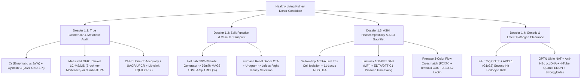
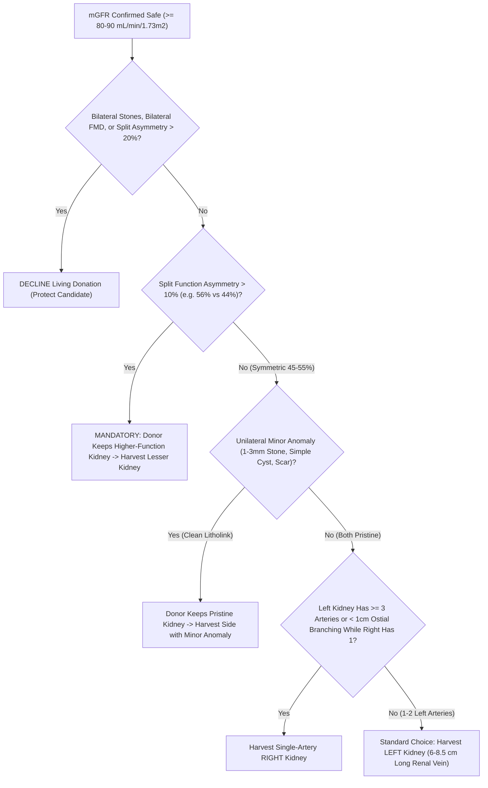
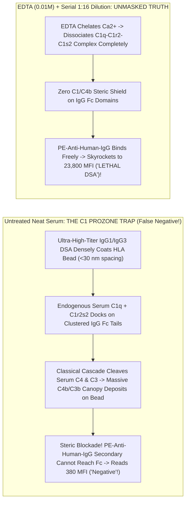

# Bundle 02 — Ep 802: Yellow-Top Living Lymphocytes, HLA NGS, Luminex Prozone & Crossmatch (All-In-One)

## ZERO-MIXUP SINGLE-SOURCE BUNDLE FOR GOOGLE NOTEBOOKLM

**How to use in NotebookLM (`notebook.google.com`):**

1. Check **ONLY THIS ONE DOCUMENT** in your NotebookLM Sources sidebar (uncheck all others—every reference treatise and script needed for this episode is merged right inside this single file!).
2. Click **Customize** on **Audio Overview**, choose **Longer**, and paste this exact prompt:

```text
Create an exhaustive, longest-format behind-the-curtain transplant immunology and laboratory medicine podcast answering why phlebotomy draws 6 room-temperature pale-yellow ACD tubes and green sodium heparin tubes on an organ donor. Follow those living T and B lymphocytes through Ficoll-Hypaque isolation, ABO forward/reverse typing plus Dolichos biflorus lectin A2 subtyping (enabling A2-into-O/B transplants!), and 11-locus long-range NGS HLA typing with eplet and PIRCHE-II epitope matching. Go inside the dual-laser Luminex Single-Antigen Bead analyzer to explain Mean Fluorescence Intensity (MFI) and the life-or-death C1 Complement Prozone artifact—where a lethal 23,000 MFI donor-specific antibody reads a falsely negative 420 MFI until EDTA, DTT, or 1:16 dilution strips away C1q steric blockade! Contrast Paul Terasaki's 1964 rabbit-complement CDC microdroplet tray against 3-color Flow Cytometric Crossmatching (and why 37C Pronase shaving of B-cell CD32 Fc receptors prevents false positives), plus window-period HIV/HBV/HCV NAT, occult HBV cccDNA, and 4-tube QuantiFERON-TB stimulation.
```

---


---

## INCLUDED SOURCE: `VOLUME_I_THE_LIVING_KIDNEY_DONOR_GAUNTLET_MGFR_HLA_CROSSMATCH_AND_SPLIT_FUNCTION.md`

# Basic Medical — Behind the Curtain Clinical Diagnostics Notebook
## Volume I: The Living Kidney Donor Gauntlet — Measured GFR (`mGFR`), Split Renal Scintigraphy, `HLA` Crossmatching, and Occult Clearance Panels

> *"When a sick patient enters the clinic, diagnostic medicine searches for a culprit large enough to explain existing suffering. When a healthy human volunteers to surrender half of their nephron endowment for the next fifty years of life, diagnostic medicine transforms into forensic engineering: every routine screening shortcut becomes suspect, every physiological reserve must be stress-tested to its physical-chemical ground truth, and every invisible immunological landmine must be defused before a scalpel ever touches skin."*

---

### Prologue: Why Even a Biomedical PhD Walks Out of Living Donor Clinic Baffled

Imagine a healthy 34-year-old molecular biologist or biomedical engineer sitting in a transplant center evaluation suite. Their annual primary-care physical three weeks earlier was spotless: serum creatinine $0.92\text{ mg/dL}$, estimated glomerular filtration rate ($\text{eGFR}$) $104\text{ mL/min/1.73 m}^2$, hemoglobin $\text{A}_{1\text{c}}$ $5.4\%$, normal blood pressure, and an unremarkable urinalysis dipstick. Expecting a brief surgical anatomy scan and a blood-type check, they instead walk out carrying:

1. An infusion-center appointment for a **4-hour intravenous Iohexol (`Omnipaque`) disappearance study**—receiving an iodinated X-ray contrast bolus without setting foot near a CT or X-ray machine, while a nurse weighs a plastic syringe on an analytical microbalance to a thousandth of a gram.
2. Two **3-liter opaque plastic collection jugs**—one pre-spiked with corrosive hydrochloric acid or antimicrobial thymol crystals—with stern instructions about flushing Monday's `07:00 AM` urine down the toilet while capturing Tuesday's `07:00 AM` urine to the drop.
3. A Nuclear Medicine requisition for **`99mTc-MAG3` dynamic renal scintigraphy** on top of a **4-phase CT Angiogram and CT Urogram**.
4. A phlebotomy slip calling for **eight yellow-top `ACD-A` tubes**, **four specialized `QuantiFERON` peptide-coated lithium-heparin tubes**, **two lavender `EDTA` tubes**, **three gold `SST` tubes**, and a **2-hour `75-g` Oral Glucose Tolerance Test (`OGTT`)** despite an $\text{HbA}_{1\text{c}}$ of $5.4\%$.

Why does transplant medicine distrust every routine test that internal medicine relies upon daily? Because unilateral donor nephrectomy instantaneously deletes $50\%$ of an individual's ~1.8 to 2.0 million nephrons. Within days of surgery, renal blood flow to the solitary remaining kidney surges by $40\text{–}45\%$, driving single-nephron glomerular hyperfiltration so that whole-body GFR stabilizes at **$65\text{–}70\%$ of pre-donation two-kidney baseline** (not $50\%$). For that solitary kidney to sustain its owner to age 85 or 90 without tipping into end-stage kidney disease (`ESKD`—quantified in seminal cohorts by Muzaale et al., *JAMA* 2014, and Grams et al., *NEJM* 2016), the transplant team must replace population-average *estimates* with direct physical, nuclear, chromatographic, and cellular measurements.

In **Volume I**, we pull back the stainless-steel curtain of the Clinical Chemistry Core Lab, the Mass Spectrometry Suite, the Nuclear Medicine Hot Lab, the Multidetector CT Console, and the `ASHI`-accredited Histocompatibility & Immunogenetics Laboratory to trace every tube, photon, microsphere, and enzyme in the Living Kidney Donor Gauntlet.



---

## Dossier 1.1: Why Serum Creatinine & `eGFR` Are Not Enough — Measured GFR (`mGFR`), Cystatin C, 24-Hour Urine Adequacy & `Litholink` Stone Supersaturation

### 1.1.1 The Three Physiological & Analytical Lies of Serum Creatinine

Creatinine ($\text{C}_4\text{H}_7\text{N}_3\text{O}$, molecular weight $113.12\text{ Da}$) is the cyclic anhydride formed by the spontaneous, non-enzymatic dehydration of skeletal-muscle **creatine** and **phosphocreatine** at a steady fractional turnover rate of roughly $1.1\text{–}2.0\%$ per day. In outpatient primary care, clinicians treat steady-state serum creatinine ($S_{\text{Cr}}$) as an inverse mirror of glomerular filtration rate ($\text{GFR}$): if $\text{GFR}$ halves, $S_{\text{Cr}}$ roughly doubles. Yet inside a living kidney donor evaluation, relying on $S_{\text{Cr}}$ alone can either falsely disqualify an athletic hero or fatally clear a candidate with ocult Stage 2 chronic kidney disease. Serum creatinine tells **three distinct lies**:

#### Lie #1: The Generation & Dietary Confounder ($G_{\text{Cr}} \neq \text{constant}$)
At steady state, urinary creatinine excretion must equal endogenous muscle production plus exogenous dietary absorption:
$$S_{\text{Cr}} = \frac{G_{\text{Cr}}}{\text{GFR} + J_{\text{secretion}}/S_{\text{Cr}}}$$
where $G_{\text{Cr}}$ is the creatinine generation rate ($\text{mg/min}$) and $J_{\text{secretion}}$ is tubular secretory flux. Demographic `eGFR` equations guess $G_{\text{Cr}}$ solely from **age** and **sex**. Consequently:
* **The Muscular Donor Trap**: A 31-year-old CrossFit athlete or former collegiate rower taking oral creatine monohydrate supplements or eating a high-cooked-beef dinner (heat during cooking converts meat creatine directly into absorbable creatinine, spiking postprandial $S_{\text{Cr}}$ by $0.2\text{–}0.5\text{ mg/dL}$ for 4–8 hours!) may present with $S_{\text{Cr}} = 1.32\text{ mg/dL}$ and an alarming `eGFR` of $71\text{ mL/min/1.73 m}^2$, when their true measured GFR is a pristine $118\text{ mL/min/1.73 m}^2$.
* **The Low-Muscle-Mass Donor Trap**: Conversely, a petite 58-year-old vegetarian woman with mild sarcopenia ($46\text{ kg}$) generates so little endogenous creatinine that a "reassuring" $S_{\text{Cr}}$ of $0.78\text{ mg/dL}$ (`eGFR` $86\text{ mL/min/1.73 m}^2$) can conceal a true measured GFR of $64\text{ mL/min/1.73 m}^2$—a level unsafe for unilateral nephrectomy.

#### Lie #2: Proximal Tubular Secretion (`OCT2` / `MATE1` / `MATE2-K`) & Drug-Induced Pseudo-AKI
Inulin and iohexol are filtered exclusively across the glomerular capillary wall and never touched by renal tubular cells. Creatinine is **not** a pure filtration marker. In healthy adults with normal kidney function, **$10\text{–}15\%$ of urinary creatinine** (rising to $35\text{–}50\%$ in advanced CKD) is actively secreted across the S2 segment of the proximal convoluted tubule without ever passing through a glomerulus:
1. **Basolateral Uptake**: Positively charged/zwitterionic creatinine enters proximal tubular epithelial cells from peritubular capillary blood down the inside-negative membrane potential via **Organic Cation Transporter 2 (`OCT2`, encoded by `SLC22A2`)** (with minor contribution from `OAT2` / `SLC22A7`).
2. **Apical Efflux**: Creatinine is pumped out across the brush-border membrane into tubular urine via proton-coupled electroneutral antiporters **Multidrug and Toxin Extrusion protein 1 (`MATE1`, `SLC47A1`)** and kidney-specific **`MATE2-K` (`SLC47A2`)**.

This transporter architecture creates one of clinical medicine's classic diagnostic illusions. Common medications prescribed to healthy donor candidates competitively inhibit `OCT2` and/or `MATE1/2-K`:
* **Trimethoprim** (in `TMP-SMX` / *Bactrim* taken for a simple urinary tract or skin infection)
* **Cimetidine** (over-the-counter `H2`-receptor blocker for heartburn; famotidine has minimal effect)
* **Dolutegravir, Bictegravir, Raltegravir, and Cobicistat** (widely used in `HIV` PrEP/PEP or treatment regimens)
* **Pyrimethamine, Dronedarone, Ranolazine, Olaparib, and CDK4/6 inhibitors**

Within 24 to 48 hours of starting trimethoprim or dolutegravir, blocking `OCT2`/`MATE1` shuts down the $10\text{–}15\%$ secretory escape valve. Serum creatinine rises by **$0.20\text{ to }0.40\text{ mg/dL}$ ($15\text{–}30\%$)**, causing calculated `eGFR` to plummet from $98$ to $74\text{ mL/min/1.73 m}^2$—yet **true glomerular filtration (`mGFR`) and Cystatin C remain $100\%$ unchanged**!

#### Lie #3: Analytical Bench Interference — `Jaffe` Alkaline Picrate vs. Coupled Enzymatic `Trinder` Chemistry
Behind the core-lab curtain, clinical analyzers measure serum creatinine using one of two fundamentally different chemical reactions, both calibrated since the mid-2000s to **Isotope Dilution Mass Spectrometry (`IDMS`, NIST `SRM 967`)**, yet vulnerable to opposite sample interferents (*Tietz Textbook of Laboratory Medicine*, 7th ed.):

* **Method A — The Kinetic Alkaline Picrate (`Jaffe`, 1886) Reaction**:
  Under strongly alkaline conditions ($\text{NaOH}$, $\text{pH } 12.4\text{–}12.8$), creatinine's active methylene group forms a red-orange **Janovsky sigma-complex** with picrate ions ($2,4,6\text{-trinitrophenol}$), monitored kinetically by spectrophotometric absorbance rate ($\Delta A/\Delta t$) at **$505\text{ nm}$** over a narrow 20- to 60-second window:
  $$\text{Creatinine} + \text{Picrate}^- \xrightarrow{\text{OH}^-\text{ (pH } > 12.4\text{)}} \text{Creatinine–Picrate Janovsky Adduct } (\lambda_{\max} \approx 505\text{ nm})$$
  *Why Jaffe Lies*: Up to $15\text{–}20\%$ of the color in normal human plasma comes from **non-creatinine "pseudo-chromogens"**—plasma proteins, **acetoacetate** and **pyruvate** (causing dramatic false $S_{\text{Cr}}$ spikes of $+0.5\text{ to }+2.0\text{ mg/dL}$ during ketogenic diets, prolonged fasting, or diabetic ketoacidosis!), high glucose ($>300\text{ mg/dL}$), ascorbic acid (vitamin C megadosing), fetal hemoglobin, and cephalosporin antibiotics—most notoriously **cefoxitin**—which react directly with alkaline picrate. Conversely, **hyperbilirubinemia (icterus)** causes a *falsely low* Jaffe creatinine because NaOH oxidizes bilirubin ($450\text{ nm}$) to colorless biliverdin, subtracting absorbance during the kinetic read window unless rate-blanking or potassium ferricyanide oxidation is applied. Modern "compensated Jaffe" analyzers automatically subtract a fixed constant ($\sim 0.18\text{–}0.20\text{ mg/dL}$) from every patient's reading assuming average plasma protein levels—which systematically underestimates $S_{\text{Cr}}$ (overestimating GFR!) in cirrhotic or hypoalbuminemic patients.

* **Method B — The 4-Step Coupled Enzymatic (`Trinder`) Creatinine Assay** (Preferred by *KDIGO* for all Living Donor Centers):
  To eliminate Jaffe pseudo-chromogens, high-tier transplant laboratories deploy a specific bacterial enzyme cascade housed in two sequential reagent cuvettes (`R1` and `R2`):
  1. **Reagent `R1` Pre-Incubation (Endogenous Creatine Scavenging)**: Before `Creatininase` is ever added, `R1` introduces **Creatinase**, **Sarcosine Oxidase**, and **Catalase** to destroy all pre-existing endogenous serum creatine and sarcosine into harmless water and oxygen over 3–5 minutes!
  2. **Reagent `R2` Trigger (`Creatininase` + Sodium Azide Catalase Blocker + `Trinder` Chromogen)**:
     $$\text{Creatinine} + \text{H}_2\text{O} \xrightarrow{\text{Creatininase (Creatinine Amidohydrolase)}} \text{Creatine}$$
     $$\text{Creatine} + \text{H}_2\text{O} \xrightarrow{\text{Creatinase (Creatine Amidinohydrolase)}} \text{Sarcosine} + \text{Urea}$$
     $$\text{Sarcosine} + \text{O}_2 + \text{H}_2\text{O} \xrightarrow{\text{Sarcosine Oxidase}} \text{Glycine} + \text{Formaldehyde} + \text{H}_2\text{O}_2$$
     $$2\text{H}_2\text{O}_2 + \text{4-Aminophenazone} + \text{HTIB / TOOS} \xrightarrow{\text{Horseradish Peroxidase (HRP)}} \text{Quinoneimine Dye } (\lambda = 546\text{ nm}) + 4\text{H}_2\text{O}$$
  *Residual Enzymatic Caveats*: While immune to ketones and cefoxitin, the final `HRP`/$\text{H}_2\text{O}_2$ **Trinder coupling step** is vulnerable to strong reducing agents:blood drawn through an IV line infusing **dopamine or dobutamine**, high-dose intravenous **N-acetylcysteine (`NAC`)**, **metamizole (dipyrone)**, or **calcium dobesilate** consumes $\text{H}_2\text{O}_2$ before `HRP` can form the quinoneimine dye, yielding catastrophically **falsely low** enzymatic creatinine values! Furthermore, **5-fluorocytosine (`flucytosine`)** inhibits cytosine-deaminase-based dry-slide enzymatic creatinine systems (Vitros), falsely spiking $S_{\text{Cr}}$.

---

### 1.1.2 Cystatin C (`13.3 kDa`) & The 2021 Race-Free `CKD-EPI Cr-CysC` Equation

When a healthy donor candidate's creatinine-based `eGFR` sits in a gray zone ($75\text{–}95\text{ mL/min/1.73 m}^2$) or muscle mass deviates from population norms, the first blood-based adjudicator is **Serum Cystatin C**.

* **Molecular Physiology**: Encoded by the housekeeping-like `CST3` gene on chromosome `20p11.21`, Cystatin C is a $13,343\text{-Da}$ (120-amino-acid), non-glycosylated, positively charged ($\text{pI} = 9.3$) extracellular **cysteine protease inhibitor** synthesized at a remarkably constant constitutive rate by **every nucleated cell in the human body**—completely independent of skeletal muscle mass, sex, cooked meat intake, or `OCT2`/`MATE1` drugs!
* **Glomerular Filtration & `Megalin`/`Cubilin` Catabolism**: Because of its compact hydrodynamic radius ($\sim 1.8\text{ nm}$) and cationic charge (attracted across the negatively charged heparan-sulfate proteoglycans of the glomerular basement membrane), Cystatin C exhibits a glomerular sieving coefficient $\Theta \approx 0.99$. Once in Bowman's space, **$>99\%$ of filtered Cystatin C is bound by the proximal-tubule brush-border endocytic tandem receptor complex `Megalin` (`LRP2`) and `Cubilin`**, internalized into clathrin-coated pits, and completely degraded into free amino acids inside tubular lysosomes. Virtually zero intact Cystatin C is secreted by tubules or returned to blood—meaning *intact urinary Cystatin C is NOT used to calculate urinary clearance; serum Cystatin C alone reflects GFR!*
* **Behind the Bench (`PENIA` vs. `PETIA`)**: Because Cystatin C circulates at trace concentrations ($0.60\text{–}1.05\text{ mg/L}$, roughly $75\text{ nanomolar}$), spectrophotometric dye chemistry cannot touch it. Instead, core labs run automated homogeneous particle-enhanced immunoassays calibrated to the international certified reference material **`ERM-DA471/IFCC`**:
  * **`PENIA` (Particle-Enhanced Nephelometric Immunoassay, e.g., Siemens BN II / Atellica NEPH)**: $40\text{–}80\text{ nm}$ polystyrene nanoparticles covalently coated with rabbit anti-human Cystatin C antibodies agglutinate upon binding patient Cystatin C; an $840\text{-nm}$ infrared LED illuminates the cuvette while a forward-angle photodetector positioned at **$13^\circ\text{–}24^\circ$** measures increased **Rayleigh-Debye light scattering**.
  * **`PETIA` (Particle-Enhanced Turbidimetric Immunoassay, e.g., Roche Cobas `Tina-quant`)**: Measures the *decrease* in transmitted light intensity ($0^\circ$ optical axis at $546/800\text{ nm}$) caused by immunocomplex turbidity on standard chemistry tracks.
* **Non-GFR Confounders of Cystatin C**: Cystatin C has its own distinct blind spots! Because nucleated cell metabolic turnover regulates `CST3` transcription:
  * **Hyperthyroidism** accelerates cellular synthesis, **raising** serum Cystatin C (falsely lowering `eGFRcys`), whereas **hypothyroidism lowers** Cystatin C (the exact *opposite* direction of thyroid effects on creatinine, where hypothyroidism impairs GFR/water handling and raises $S_{\text{Cr}}$!).
  * **Exogenous high-dose glucocorticoids**, severe systemic inflammation (`CRP`), high adiposity/obesity, active cigarette smoking, and high-turnover hematologic states elevate Cystatin C independent of true GFR.

#### The Evolution of GFR Estimating Equations (`1976` to `2021`)
Understanding why transplant hepatologists, nephrologists, and pharmacists still clash over equations requires inspecting the exact algebra:

1. **Cockcroft-Gault (1976)** — estimates *unindexed Creatinine Clearance* ($\text{mL/min}$, including the $+10\text{–}15\%$ tubular secretion overestimate; still frozen into legacy FDA drug-dosing package inserts, *never* appropriate for donor GFR screening):
   $$\text{CrCl}_{\text{CG}}\text{ (mL/min)} = \frac{(140 - \text{Age}) \times \text{Weight}_{\text{kg}}}{72 \times S_{\text{Cr (mg/dL)}}} \times (0.85 \text{ if female})$$

2. **2021 Race-Free `CKD-EPI` Combined Creatinine–Cystatin C Equation (`eGFRcr-cys`)** (Inker et al., *NEJM* 2021 — recommended by *NKF-ASN* and *KDIGO* as the most accurate endogenous blood-based estimator):
   $$\text{eGFR}_{\text{cr-cys}} = 135 \times \min\!\left(\frac{S_{\text{Cr}}}{\kappa}, 1\right)^{\alpha} \times \max\!\left(\frac{S_{\text{Cr}}}{\kappa}, 1\right)^{-0.544} \times \min\!\left(\frac{S_{\text{CysC}}}{0.8}, 1\right)^{-0.323} \times \max\!\left(\frac{S_{\text{CysC}}}{0.8}, 1\right)^{-0.778} \times 0.9961^{\text{Age}} \times (0.963 \text{ if female})$$
   *(where $\kappa = 0.7\text{ mg/dL}, \alpha = -0.219$ for females; $\kappa = 0.9\text{ mg/dL}, \alpha = -0.144$ for males).*

Why, then, isn't `eGFRcr-cys` the final word in living kidney donation? Because even `eGFRcr-cys` exhibits a $P_{30}$ accuracy of $\sim 91\%$—meaning **$9\%$ of healthy people have a true `mGFR` that differs from `eGFRcr-cys` by more than $\pm 30\%$**, and the $95\%$ prediction interval around an `eGFRcr-cys` of $88\text{ mL/min/1.73 m}^2$ spans roughly **$71\text{ to }108\text{ mL/min/1.73 m}^2$**! When the `OPTN` / center safety threshold sits at **$80\text{ mL/min/1.73 m}^2$** (and $\ge 90\text{ mL/min/1.73 m}^2$ for young donors under age 35–40 who need 55+ years of renal longevity), guessing is unacceptable. Enter **Measured GFR (`mGFR`)**.

---

### 1.1.3 Behind the Curtain of Measured GFR (`mGFR`): Iohexol (`Omnipaque`) Plasma Disappearance vs. `99mTc-DTPA` & `125I-Iothalamate`

Classic renal physiology taught Homer Smith's continuous intravenous **inulin** infusion with bladder catheterization—an ordeal requiring scarce fructose-polymer inulin, constant infusion pumps, and error-prone voided urine collections. Modern transplant centers measure true `mGFR` primarily through **Exogenous Marker Plasma Disappearance**—most cleanly via **non-radioactive Iohexol (`Omnipaque`)**, or via nuclear radiotracers **`99mTc-DTPA`** and **`125I-Iothalamate`**.

#### Step-by-Step Behind the Curtain: The 4-Hour Iohexol (`Omnipaque-300`) `mGFR` Protocol
Iohexol ($N,N'\text{-bis(2,3-dihydroxypropyl)-5-[}N\text{-(2,3-dihydroxypropyl)-acetamido]-2,4,6-triiodoisophthalamide}$, $\text{MW } 821.14\text{ Da}$) is a non-ionic, water-soluble monomeric X-ray contrast agent. Unlike a CT scan that blasts `100–120 mL` intravenously, an Iohexol `mGFR` uses a tiny **$5.0\text{-mL}$ micro-bolus** (`Omnipaque-300`, containing $647\text{ mg iohexol/mL}$, or $3,235\text{ mg}$ total iohexol):
* **Why Iohexol is an Ideal Glomerular Marker**: Plasma protein binding is $< 1.5\%$; extrarenal (biliary/fecal) clearance is $< 0.5\%$; metabolic biotransformation is $0\%$; and renal tubular secretion and reabsorption are $0\%$. Once equilibrated across extracellular fluid, *the only exit door out of the human body for iohexol is glomerular filtration*.

Here is what happens minute-by-minute in the infusion chair and inside the Mass Spectrometry lab:

1. **`T = -30 min` (Pre-Test Conditioning & Dual-Arm Architecture)**:
   The donor arrives avoiding high-protein meat loads (which acutely trigger transient afferent arteriolar vasodilation via tubuloglomerular feedback, artificially inflating GFR by $10\text{–}20\%$!) and NSAIDs (which constrict afferent arterioles by blocking $\text{PGE}_2/\text{PGI}_2$). Oral hydration ($250\text{–}500\text{ mL}$ water) ensures steady urine flow. Two peripheral `IV` angiocatheters are placed—**one in the right arm strictly for Iohexol injection, and one in the CONTRALATERAL left arm strictly for timed blood draws** (drawing blood back through the injection hub, even after 10 saline flushes, desorbs trace microgram iohexol clinging to polyurethane catheter walls and ruins the assay!). A `T = 0` baseline blank blood tube is drawn first.

2. **`T = 0.00 min` (Gravimetric Microbalance Bolus Accounting)**:
   A volumetric syringe marking ("$5.0\text{ mL}$") has a $\pm 3\text{–}5\%$ human meniscus error. Therefore, the infusion nurse or lab technologist weighs the loaded `Omnipaque-300` syringe on a calibrated four-decimal analytical balance **before injection** ($W_{\text{pre}}$, e.g., $15.8421\text{ g}$), injects the $5\text{ mL}$ bolus smoothly over $60\text{–}90\text{ seconds}$ (recording the exact midpoint clock time to the second, e.g., `08:32:15`), flushes the line with $10\text{–}20\text{ mL}$ normal saline, and **re-weighs the empty syringe + needle** ($W_{\text{post}}$, e.g., $9.0971\text{ g}$). Given the exact density of `Omnipaque-300` at $20^\circ\text{C}$ ($\rho = 1.349\text{ g/mL}$) and concentration ($647.1\text{ mg iohexol/mL}$):
   $$\text{Exact Dose } D\text{ (mg)} = \frac{W_{\text{pre}} - W_{\text{post}}}{1.349\text{ g/mL}} \times 647.1\text{ mg/mL} = \frac{6.7450\text{ g}}{1.349} \times 647.1 = 3,235.5\text{ mg}$$

3. **`T = 0 to 120 min` (The Invisible $\alpha$-Distribution Phase)**:
   For the first two hours, plasma iohexol falls steeply via a **bi-exponential** curve: simultaneously diffusing out of capillaries into the $\sim 14\text{-liter}$ interstitial fluid space ($\alpha$-phase) while being filtered by the kidneys. Only after $\sim 120\text{ minutes}$ (in non-edematous subjects with normal GFR) does vascular-interstitial equilibrium lock into a pure log-linear **mono-exponential renal elimination slope ($\beta$-phase)**.

4. **`T = 120, 180, 240 min` (Exact-Minute Contralateral Draws)**:
   Blood is drawn from the contralateral arm into serum or `K2-EDTA` tubes at nominal 2, 3, and 4 hours (plus $300\text{ min}$ if lower GFR is suspected). Crucially, if the 2-hour draw happens at `124 min` instead of `120 min`, *no harm is done provided `124.0 min` is recorded truthfully into the regression equation*!

5. **Behind the Analytical Bench (`LC-MS/MS` vs. `HPLC-UV 254 nm`)**:
   * **`LC-MS/MS` Protocol**: The clinical chemist pipettes $50\text{ }\mu\text{L}$ of donor plasma, spikes in $50\text{ }\mu\text{L}$ of stable-isotope-labeled internal standard **`Iohexol-d5`** ($\text{MW } 826.17\text{ Da}$, which co-elutes identically and corrects for any ionization suppression or pipetting variance), precipitates plasma proteins with cold acetonitrile + $0.1\%$ formic acid, spins at $14,000 \times g$ for $10\text{ min}$, and injects supernatant onto a reverse-phase $\text{C}_{18}$ UHPLC column coupled to a triple-quadrupole tandem mass spectrometer in positive electrospray ionization (`ESI+`) Multiple Reaction Monitoring (`MRM`) mode: tracking precursor-to-product ion transitions **$m/z\text{ }822.1 \to 804.1$** (iohexol loss of $\text{H}_2\text{O}$) against **$m/z\text{ }827.1 \to 809.1$** (`Iohexol-d5`).
   * **`HPLC-UV` Isomer Physics**: Labs running `HPLC` with ultraviolet absorbance detection at **$254\text{ nm}$** (exploiting the aromatic triiodobenzene ring) observe **two distinct chromatographic peaks** for pure iohexol! Because bulky ortho-iodine atoms sterically hinder rotation around the central amide bonds, iohexol exists in aqueous equilibrium as two stable rotational atropisomers/conformers: a minor hydrophilic **endo-isomer ($\sim 15\%$)** eluting first and a major **exo-isomer ($\sim 85\%$)** eluting second. The chemist integrates the exo-isomer peak area (or summed isomer areas) against an internal standard (`iothalamate` or `p-aminobenzoic acid`) and confirms linearity ($R^2 > 0.995$ across the 3–4 timed log-concentration points—if $R^2 < 0.985$, a timing or line-contamination error immediately flags the run!).

6. **The Bröchner-Mortensen Quadratic Correction (`1972`)**:
   Plotting $\ln C(t)$ versus exact elapsed minutes $t$ across $120, 180, \text{ and } 240\text{ min}$ yields slope $-k_2$ and y-intercept $\ln C_0$:
   $$\text{One-Compartment Slow Clearance } Cl_1 = \frac{D}{C_0 / k_2} = \frac{D \cdot k_2}{C_0}$$
   Wait! Because $C_0$ extrapolates ONLY the slow $\beta$-slope back to $t = 0$, it completely misses the "extra triangle" of high plasma concentration during the first 90 minutes before iohexol finished entering interstitial space ($\text{AUC}_{\text{true}} = \text{AUC}_{\alpha} + \text{AUC}_{\beta} > C_0 / k_2$). Using raw $Cl_1$ would **underestimate $\text{AUC}$ and dangerously OVERESTIMATE the donor's GFR by $12\text{–}25\%$**! To capture the missing early $\alpha$-compartment without poking the donor 8 times in the first hour, clinical laboratories apply **Jens Bröchner-Mortensen's (1972) Quadratic Correction**:
   $$\text{mGFR}_{\text{raw}} = Cl_{\text{BM}} = 0.990778 \cdot Cl_1 - 0.001218 \cdot (Cl_1)^2$$
   *(Notice the physics of the $-0.001218 (Cl_1)^2$ quadratic penalty: the faster a healthy donor's kidneys clear iohexol—say $Cl_1 = 130\text{ mL/min}$—the larger the fraction of total clearance that already occurred during the unmeasured first 120 minutes, subtracting $20.6\text{ mL/min}$ to yield true $\text{mGFR}_{\text{raw}} = 108.2\text{ mL/min}$!)*

7. **Body Surface Area (`BSA`) Indexing — And Its Obesity/Petite Nuance**:
   Finally, raw $\text{mGFR}$ ($\text{mL/min}$) is normalized to the canonical $1.73\text{ m}^2$ human surface area using the **Du Bois & Du Bois (1916)** or **Haycock (1978)** formula:
   $$\text{BSA}_{\text{Du Bois}}\text{ (m}^2\text{)} = 0.007184 \times \text{Weight}_{\text{kg}}^{0.425} \times \text{Height}_{\text{cm}}^{0.725}, \qquad \text{mGFR}_{\text{indexed}} = \text{mGFR}_{\text{raw}} \times \frac{1.73}{\text{BSA}}$$
   *Clinical Pearl*: Indexing to $\text{BSA}$ prevents a petite $1.50\text{-m}^2$ woman with a perfectly matched $\text{mGFR}_{\text{raw}}$ of $78\text{ mL/min}$ ($\text{mGFR}_{\text{indexed}} = 90\text{ mL/min/1.73 m}^2$) from being falsely rejected, while preventing a large $2.35\text{-m}^2$ donor with an $\text{mGFR}_{\text{raw}}$ of $95\text{ mL/min}$ ($\text{mGFR}_{\text{indexed}} = 70\text{ mL/min/1.73 m}^2$—insufficient nephron power for their metabolic body mass!) from being mistakenly cleared.

#### Comparing Exogenous `mGFR` Modalities Across Transplant Centers

| Exogenous Marker | Isotope / Detection Physics | Renal Handling | Typical Sampling Protocol | Key Bench Advantages & Pitfalls |
| :--- | :--- | :--- | :--- | :--- |
| **Iohexol (`Omnipaque`)** | Non-radioactive iodine; `LC-MS/MS` (`Iohexol-d5` IS) or `HPLC-UV 254 nm` | Pure glomerular filtration; $<1.5\%$ protein bound; zero tubular transport | `5 mL` IV bolus (gravimetric syringe weigh); `120, 180, 240 min` plasma draws | **Zero radiation**; plasma stable for days at RT/frozen; gold-standard multicenter reproducibility; avoid in severe immediate contrast anaphylaxis |
| **`99mTc-DTPA`** | Gamma emitter ($140.5\text{ keV}$, $t_{1/2} = 6.01\text{ hr}$); NaI(Tl) gamma well-counter (`cpm`) | Glomerular filtration; **$5\text{–}10\%$ reversible plasma protein binding** | IV bolus (`1–5 mCi`); `120, 180, 240 min` plasma counted simultaneously with decay standard | Can combine with gamma-camera imaging (`Gates` camera-only method is **inaccurate**—must use timed blood draws!); slight GFR underestimation from protein binding unless ultrafiltered |
| **`125I-Iothalamate`** | Low-energy gamma/X-ray ($27\text{–}35\text{ keV}$, $t_{1/2} = 59.4\text{ days}$); gamma well-counter | Glomerular filtration + **minor active proximal tubular secretion via `OAT1` ($\sim 5\text{–}8\%$)** | Subcutaneous arm injection (`35 µCi`) + oral potassium iodide (`SSKI` thyroid block) + 4 timed plasma & spontaneous voided urine periods | Classic Mayo Clinic / NIH Crisp renal clearance protocol; requires complete bladder emptying (confirmed by post-void bladder ultrasound!) and radiation licensing |
| **Inulin** | Fructose polymer ($\sim 5,200\text{ Da}$); anthrone/resorcinol or enzymatic assay | Pure glomerular filtration ($100\%$ gold standard) | Priming bolus + continuous IV pump + timed urinary catheterization | Historical physiological benchmark; prohibitively expensive, scarce supply, cumbersome for clinical donor throughput |

---

### 1.1.4 The 24-Hour Urine Jug Behind the Curtain: Adequacy Math, `UACR` vs. `UPCR`, and `Litholink` `EQUIL2` Stone Supersaturation

Why ask a donor who is already undergoing an Iohexol `mGFR` to carry around a 3-liter urine jug for 24 hours? Because blood tests cannot measure **glomerular albumin/protein leak**, **actual dietary sodium and animal-protein intake**, or **thermodynamic urinary crystal supersaturation** that predicts whether a solitary remaining kidney could be obstructed by a ureteral stone!

#### 1. The Bladder-Clock Geometry & Catching Collection Errors ("Jug Fraud / Clock Drift")
Every patient initially asks: *"Why do I throw away my `07:00 AM` urine on Monday morning if my 24-hour collection starts at `07:00 AM`?"*
Because urine sitting inside the urinary bladder at `07:00 AM` Monday was filtered by the glomeruli between `11:00 PM` Sunday night and `07:00 AM` Monday! Including it would turn a 24-hour collection into a **32-hour collection**. Flushing the `07:00 AM` Monday void resets the bladder volume to zero at $t = 0$; thereafter, every drop passed during the day, night, and the final full bladder emptying at exactly `07:00 AM` Tuesday represents precisely $1,440\text{ minutes}$ of nephron output.

When the jug arrives in the core lab, the technologist first weighs the jug on a platform scale (converting mass to exact volume $V_{24}$ via specific gravity) and immediately runs a **24-Hour Total Creatinine Excretion Adequacy Check**. Regardless of how much water the donor drank ($1.2\text{ L}$ vs. $4.5\text{ L}$), daily skeletal-muscle creatinine production is locked to lean body mass:
* **Healthy Adult Males (age 20–50)**: **$20\text{ to }25\text{ mg/kg/day}$** (declining to $15\text{–}20\text{ mg/kg/day}$ over age 60)
* **Healthy Adult Females (age 20–50)**: **$15\text{ to }20\text{ mg/kg/day}$** (declining to $10\text{–}15\text{ mg/kg/day}$ over age 60)

> **Worked Bench Audit**: Suppose an $80\text{-kg}$, 32-year-old male donor turns in a jug containing $V_{24} = 1,400\text{ mL}$ with urine creatinine $U_{\text{Cr}} = 75\text{ mg/dL}$ ($0.75\text{ mg/mL}$) and serum creatinine $S_{\text{Cr}} = 1.00\text{ mg/dL}$.
> * Naive calculated 24-hr Creatinine Clearance: $\text{CrCl} = \frac{U_{\text{Cr}} \times V_{24}}{S_{\text{Cr}} \times 1440} = \frac{75\text{ mg/dL} \times 1400\text{ mL}}{1.00\text{ mg/dL} \times 1440\text{ min}} = \mathbf{72.9\text{ mL/min}}$ — *Panic! Is this young donor ineligible?*
> * **Behind-the-Curtain Adequacy Check**: Total creatinine in the jug $= 0.75\text{ mg/mL} \times 1,400\text{ mL} = \mathbf{1,050\text{ mg/day}}$. Divided by $80\text{ kg}$ body weight $= \mathbf{13.1\text{ mg/kg/day}}$ (expected: $20\text{–}25\text{ mg/kg/day}$, or $1,600\text{–}2,000\text{ mg/day}$!).
> * **Verdict**: The donor missed nearly $40\%$ of his day's urine (forgot to take the jug to the gym or flushed a nighttime void)! His true $\text{CrCl}$ is $\sim 120\text{ mL/min}$. Conversely, if total creatinine had been $2,650\text{ mg/day}$ ($33\text{ mg/kg/day}$), the lab immediately flags **over-collection** (included Day 1's first morning void), preventing a falsely inflated $\text{CrCl}$ from clearing an impaired donor!

#### 2. Dipstick vs. `UACR` (Microalbumin) vs. `UPCR` (Total Protein)
Why run *both* `UACR` and `UPCR` when the urinalysis dipstick already read `"Protein: Negative"`?
* **Urinalysis Dipstick ("Protein Error of Indicators")**: Filter paper impregnated with **tetrabromophenol blue** buffered to $\text{pH } 3.0$ changes from yellow to green-blue only when anionic amino/carboxyl sites of **albumin** accept protons. Its analytical limit of detection is coarse (**$15\text{–}30\text{ mg/dL}$**, or $150\text{–}300\text{ mg/L}$!). In a well-hydrated donor producing $3\text{ L/day}$ of dilute urine, $250\text{ mg/day}$ of pathological glomerular albuminuria dilutes to $8.3\text{ mg/dL}$—reading **completely `"Negative"` on dipstick**! Worse, dipstick pads are virtually blind to positively/neutrally charged **immunoglobulin free light chains (Bence Jones $\kappa/\lambda$)** and tubular low-molecular-weight proteins ($\beta_2\text{-microglobulin}$, retinol-binding protein).
* **Urine Albumin-to-Creatinine Ratio (`UACR`) / 24-Hr Urine Albumin Excretion (`UAE`)**: Measured via **immunoturbidimetry** (anti-human albumin antibodies at $340\text{ nm}$, detecting down to **$2\text{–}3\text{ mg/L}$**!). *KDIGO Living Kidney Donor Guidelines* classify **`UAE < 30 mg/day`** (or `UACR < 30 mg/g`, ideally `< 10 mg/g` in young donors) as mandatory for acceptance, and **`UAE >= 100 mg/day`** as an absolute contraindication—because trace selective albuminuria is the earliest hemodynamic footprint of glomerular endothelial glycocalyx loss and early podocyte effacement years before GFR budges.
* **Urine Protein-to-Creatinine Ratio (`UPCR`) / 24-Hr Total Protein (`< 150 mg/day`)**: Measured chemically via **Pyrogallol Red–Molybdate (`600 nm` blue-purple complex at $\text{pH } 2.5$)** or **alkaline Benzethonium Chloride turbidimetry (`505 nm`)**. This captures *all* urinary proteins: filtered albumin ($\sim 15\text{–}20\text{ mg/day}$ normally), tubular **Tamm-Horsfall mucoprotein / Uromodulin** ($\sim 40\text{–}70\text{ mg/day}$ secreted normally by the thick ascending limb of Henle!), and monoclonal light chains. *(Diagnostic gem: If `UPCR` is elevated at $450\text{ mg/g}$ while `UACR` is tiny at $12\text{ mg/g}$—an **"Albumin-to-Total-Protein Ratio `< 0.40`"**—the protein leak is NOT glomerular; it is either proximal tubular Fanconi/interstitial injury OR occult myeloma light-chain overflow requiring serum/urine immunofixation!)*

#### 3. Behind the Curtain of the 24-Hour `Litholink` Metabolic Stone Panel & `EQUIL2` Supersaturation
If a donor has an incidental $1.5\text{-mm}$ asymptomatic non-obstructing renal calculus on CT or a remote stone episode, a solitary kidney makes future ureteral obstruction a medical emergency (anuric post-renal AKI!). Simply checking serum calcium is useless; stone formation happens in distal nephron urine governed by **solution thermodynamics**.

In the **`Litholink` (Labcorp)** 24-hour stone risk protocol, the donor collects urine with an antimicrobial preservative (preventing *Proteus* or *Klebsiella* bacterial **urease** from hydrolyzing urea $\to 2\text{NH}_3 + \text{CO}_2$ during transit, which would skyrocket $\text{pH} > 8.0$, precipitate struvite/brushite, and destroy citrate via bacterial metabolism!). Back at the reference laboratory, the specimen is split and chemically conditioned before running 14 simultaneous analytes:
* **Acidified Aliquot ($\text{HCl}$ to $\text{pH } < 1.8$, warmed)**: Dissolves any microscopic **calcium oxalate ($\text{CaC}_2\text{O}_4$)** or **calcium phosphate** crystals that nucleated *in vitro* as the urine cooled from $37^\circ\text{C}$ body temperature to $20^\circ\text{C}$ room temperature! Analyzed for $\text{Ca}^{2+}, \text{Mg}^{2+}, \text{PO}_4^{3-}$, and **Oxalate** (measured enzymatically via *Oxalate Oxidase* generating $\text{H}_2\text{O}_2$ at $590\text{ nm}$ or by **Ion Chromatography [`IC`]**; note that high urinary Vitamin C must be stabilized/chelated at low pH because ascorbate spontaneously oxidizes to oxalate at alkaline pH, creating fake hyperoxaluria!).
* **Alkalinized Aliquot ($\text{NaOH}$ / buffer to $\text{pH } > 8.5$)**: Redissolves any precipitated **uric acid** crystals ($\text{p}K_a = 5.35$, insoluble below $\text{pH } 5.5$) prior to **Uricase** measurement!
* **Unacidified Aliquot**: Glass-electrode **`pH`**, **Citrate** (*Citrate Lyase + Malate Dehydrogenase* `NADH` oxidation at $340\text{ nm}$—crucial because trivalent $\text{Citrate}^{3-}$ chelates free $\text{Ca}^{2+}$ into soluble $[\text{CaCit}]^-$ complexes!), $\text{Na}^+, \text{K}^+, \text{Cl}^-$, **Sulfate ($\text{SO}_4^{2-}$)** via `IC` (a direct quantitative biomarker of dietary animal methionine/cysteine acid load, normally $15\text{–}30\text{ mEq/day}$), **Ammonium ($\text{NH}_4^+$)**, and Urea Nitrogen (computing normalized **Protein Catabolic Rate [`PCR`]** in $\text{g/kg/day}$).

Finally, these 14 molar concentrations are fed into **`EQUIL2`** (the iterative thermodynamic speciation algorithm developed by Finlayson and Werness et al., *J. Urol.* 1985). Why can't you simply multiply $[\text{Total Ca}] \times [\text{Total Oxalate}]$? Because over $50\%$ of urinary calcium is tied up in soluble ion pairs ($[\text{CaCit}]^-, [\text{CaHPO}_4]^0, [\text{CaSO}_4]^0$), and high urinary ionic strength $I = \frac{1}{2}\sum c_i z_i^2$ shields electrostatic charges via Debye-Hückel activity coefficients $\gamma_i$! `EQUIL2` iteratively solves 23+ simultaneous mass-action equations at $37^\circ\text{C}$ until free ion activities converge to $< 0.01\%$, outputting **Relative Supersaturation (`RSS`)**:
$$\text{RSS}_{\text{CaOx}} = \frac{\{ \text{Ca}^{2+} \} \cdot \{ \text{C}_2\text{O}_4^{2-} \}}{K_{sp,\text{CaOx}}}, \qquad \text{RSS}_{\text{Brushite}} = \frac{\{ \text{Ca}^{2+} \} \cdot \{ \text{HPO}_4^{2-} \}}{K_{sp,\text{CaHPO}_4 \cdot 2\text{H}_2\text{O}}}$$
where $\text{RSS} < 1.0$ means **undersaturated** (existing stones actually dissolve for uric acid!), $\text{RSS} = 1.0$ is thermodynamic saturation, and elevated **`RSS CaOx > 8–10`**, **`RSS Brushite > 2.0`**, or **`RSS Uric Acid > 2.0`** flags active lithogenic risk requiring either targeted dietary correction (water $> 2.5\text{ L/day}$, sodium $< 100\text{ mEq/day}$ to lower proximal-tubule-coupled calciuria, potassium citrate) with repeat clean testing—or donor exclusion.

---

## Dossier 1.2: Split Renal Scintigraphy (`99mTc-MAG3` / `DMSA`) & Multiphase Renal Donor CT Angiography (`CTA`) — Choosing Which Kidney Stays Behind

Once `mGFR` proves that the donor's *two* kidneys together filter $102\text{ mL/min/1.73 m}^2$, a deceptively simple question arises: **Does the left kidney contribute $51\text{ mL/min}$ and the right kidney $51\text{ mL/min}$—or is one hypertrophied kidney doing $72\text{ mL/min}$ while a congenitally hypoplastic or scarred contralateral kidney quietly contributes only $30\text{ mL/min}$?** Neither serum creatinine, Cystatin C, Iohexol `mGFR`, nor 24-hour urine can tell left from right. Answering that question takes the donor into the Nuclear Medicine Suite and the Multidetector CT Scanner.

### 1.2.1 Inside the Nuclear Medicine Hot Lab: `99Mo/99mTc` Generator Physics, `MAG3` vs. `DMSA` Radiochemistry & Gamma-Camera Split Function

#### 1. Milking the "Moly Cow" (`99Mo/99mTc` Alumina Generator) at `05:30 AM`
Hours before the living donor arrives, a nuclear pharmacist steps behind lead-shielded L-blocks in the radiopharmacy hot lab to elute **Technetium-99m ($^{99\text{m}}\text{Tc}$)**—the workhorse radioisotope of diagnostic medicine because it emits a **pure $140.5\text{-keV}$ gamma photon** (isomeric transition, zero tissue-destroying $\beta^-$ particles!) with a convenient **$6.01\text{-hour}$ physical half-life**. How can a hospital keep a $6\text{-hour}$ isotope in stock all week? Via transient secular equilibrium inside a **`99Mo/99mTc` Chromatographic Generator**:
* Inside a lead-encased glass column packed with acidic **alumina ($\text{Al}_2\text{O}_3$)** sits parent **Molybdenum-99 ($^{99}\text{Mo}$, $t_{1/2} = 66.0\text{ hours}$)** absorbed tightly as the dinegative **molybdate** oxyanion ($^{99}\text{MoO}_4^{2-}$).
* As $^{99}\text{Mo}$ undergoes $\beta^-$ decay ($87.5\%$ branch), it transmutes into metastable daughter $^{99\text{m}}\text{Tc}$ in the $+7$ oxidation state: **singly charged pertechnetate ($^{99\text{m}}\text{TcO}_4^-$)**:
  $$^{99}_{42}\text{MoO}_4^{2-} \xrightarrow{\beta^- \text{ (}t_{1/2}=66.0\text{ hr)}} {}^{99\text{m}}_{43}\text{TcO}_4^- + e^- + \bar{\nu}_e$$
* Because $-1$ pertechnetate binds alumina far more weakly than $-2$ molybdate, spiking an evacuated sterile vial onto the outlet needle pulls **$0.9\%\text{ NaCl}$ isotonic saline** through the column, selectively washing out pure $\text{Na}[^{99\text{m}}\text{TcO}_4]$ while leaving $^{99}\text{MoO}_4^{2-}$ behind to regenerate peak $^{99\text{m}}\text{Tc}$ activity again in $\sim 23\text{ hours}$!
* **Mandatory Hot-Lab Quality Control (`USP <823>`)**: Before a single microcurie touches a healthy donor, the nuclear tech performs two non-negotiable checks:
  1. **`99Mo` Breakthrough Assay**: Placing the eluted vial inside a $6\text{-mm}$ thick lead pig inside the dose calibrator blocks $>99.9\%$ of low-energy $140\text{-keV}$ $^{99\text{m}}\text{Tc}$ photons while letting high-energy $740/778\text{-keV}$ $^{99}\text{Mo}$ gammas penetrate. Limit: **$< 0.15\text{ }\mu\text{Ci } ^{99}\text{Mo per mCi } ^{99\text{m}}\text{Tc}$** at time of administration!
  2. **Aluminum Ion Breakthrough Spot Test**: Dropping eluate onto aurintricarboxylic acid indicator paper ensures $\text{Al}^{3+} < 10\text{ }\mu\text{g/mL}$ (excess $\text{Al}^{3+}$ causes radiocolloid clumping in the liver/lungs).

#### 2. Chelation Chemistry & Renal Transport: `99mTc-MAG3` vs. `99mTc-DMSA`
Free pertechnetate ($^{99\text{m}}\text{TcO}_4^-$) mimics iodide—it would light up the donor's thyroid, salivary glands, and stomach rather than the kidneys! To build a kidney-specific probe, the pharmacist injects $^{99\text{m}}\text{TcO}_4^-$ into a lyophilized sterile kit containing **stannous chloride ($\text{SnCl}_2 \cdot 2\text{H}_2\text{O}$)**: $\text{Sn}^{2+}$ reduces $\text{Tc(VII)}$ down to $\text{Tc(V)}$ or $\text{Tc(III)}$ so it can coordinate organic chelators:

* **`99mTc-MAG3` (`Mercaptoacetyltriglycine` — Dynamic Tubular Extraction + Drainage)**:
  Synthesized by boiling $^{99\text{m}}\text{TcO}_4^- + \text{Sn}^{2+} + S\text{-benzoyl-MAG3}$ for $10\text{ minutes}$ (cleaving the protecting benzoyl group to lock an oxotechnetium $[\text{Tc}^{\text{V}}\text{O}(\text{MAG3})]^-$ square-pyramidal N3S chelate; radiochemical purity verified $\ge 90\%$ via instant thin-layer chromatography!).
  * *Physiology*: `99mTc-MAG3` is $\sim 90\%$ bound to plasma albumin, so $< 10\%$ is filtered at the glomerulus. Instead, as blood courses through peritubular capillaries, **`55–65%` is stripped out in a single pass across the basolateral membrane of proximal convoluted tubular cells via `OAT1` (`SLC22A6`)** (the classic para-aminohippurate `PAH` transporter!) and rapidly secreted via apical `MRP2` into tubular urine. Thus `99mTc-MAG3` delivers crisp, high-target-to-background images reflecting **Effective Renal Plasma Flow (`ERPF`)** plus dynamic ureteral washout!
* **`99mTc-DMSA` (`Dimercaptosuccinic Acid` — Static Cortical Mass & Scar Mapping)**:
  Prepared at room temperature at acidic $\text{pH } 2.5$ (alkaline pH accidentally forms pentavalent $^{99\text{m}}\text{Tc(V)-DMSA}$, a medullary thyroid tumor tracer!). After IV injection of $2\text{–}5\text{ mCi}$, **`40–50%` of the injected `99mTc-DMSA` becomes stably fixed inside proximal convoluted tubular cortical cells** (via peritubular uptake + glomerular filtration/megalin endocytosis) without washing out into the renal pelvis! Imaged **2 to 3 hours post-injection** with high-resolution planar + pinhole/SPECT views, `DMSA` is the undisputed gold standard when evaluating focal cortical scarring (e.g., childhood reflux nephropathy), horseshoe kidney isthmuses, or pelvic ectopic kidneys.

#### 3. Planar Gamma-Camera Physics & The `1.0–2.0 Minute` Split-Function Math
During a `99mTc-MAG3` scan, the hydrated donor lies supine over a **Gamma Camera** (`Anger Scintillation Camera`) equipped with a **Low-Energy High-Resolution (`LEHR`) parallel-hole lead collimator** (thousands of hexagonal lead septa rejecting scattered off-axis photons so only perpendicular gamma rays pass through to strike the **$3/8\text{-inch}$ `NaI(Tl)` thallium-activated sodium iodide crystal**, generating blue scintillation flashes amplified by a hexagonal array of photomultiplier tubes within a $140\text{ keV} \pm 10\%$ pulse-height analyzer window).

Immediately upon rapid antecubital bolus injection ($3\text{–}8\text{ mCi}$ `99mTc-MAG3`), frames are acquired dynamically (`2 sec/frame` for 60 sec vascular perfusion phase $\to$ `15–30 sec/frame` for 25 min parenchymal uptake & excretory washout):
1. **Why the Split-Function Window MUST Be `1.0 to 2.0 Minutes` (`60–120 sec`)**: Between $60$ and $120\text{ seconds}$ post-injection, `MAG3` has been extracted from blood into proximal tubular cells, **but has NOT yet crossed into the calyces or renal pelvis** (cortical transit time is $\sim 2.5\text{–}3.0\text{ min}$). Measuring after $3\text{ minutes}$ would corrupt parenchymal function with variable pelvic drainage pooling!
2. **Perirenal Background Subtraction (`C-Shaped ROI`s)**: Because hepatic, splenic, and retroperitoneal soft-tissue blood pools sit directly over the kidneys, the technologist draws whole-kidney Regions of Interest (`ROI`s) around the Left and Right cortices and paired **2-pixel-wide C-shaped lateral/inferior perirenal background `ROI`s** (avoiding medial hilar vessels!), normalizing background counts by pixel area ($A_{\text{kidney}} / A_{\text{bkg}}$):
   $$N_{\text{Left, net}} = C_{\text{Left }(60\text{–}120\text{s})} - \left( C_{\text{Bkg, L}} \times \frac{\text{Pixels}_{\text{Left}}}{\text{Pixels}_{\text{Bkg, L}}} \right)$$
   $$\text{Split Function}_{\text{Left}} (\%) = \frac{N_{\text{Left, net}}}{N_{\text{Left, net}} + N_{\text{Right, net}}} \times 100\%$$
3. **The Soft-Tissue Attenuation Trap (Geometric Mean Correction)**: In a posterior-only camera view, $140\text{-keV}$ gamma photons have a linear attenuation coefficient in human soft tissue of $\mu \approx 0.153\text{ cm}^{-1}$ (meaning **every $1\text{ cm}$ of extra kidney depth absorbs $\sim 14\%$ of the photons!**). If a thin female donor has mild **right nephroptosis** where the right kidney drops $2.5\text{ cm}$ anteriorly when supine, a posterior-only camera will falsely report **`Left 60% / Right 40%`** even when both kidneys are identical! Dual-head **Anterior + Posterior Simultaneous Acquisition** solves this via the depth-independent **Geometric Mean**:
   $$N_{\text{GeoMean}} = \sqrt{N_{\text{Anterior, net}} \times N_{\text{Posterior, net}}}$$

---

### 1.2.2 The 4-Phase Living Donor CT Angiography (`CTA`) & CT Urogram Surgical Blueprint

While nuclear scintigraphy measures physiological extraction, laparoscopic donor nephrectomy requires sub-millimeter anatomical truth (`0.5–0.625 mm` isotropic multidetector CT slices). A dedicated **4-Phase Renal Donor `CTA`/`CTU`** choreographs X-ray tube firing to four exact physiological moments of contrast transit:

1. **Phase 1 — Unenhanced Low-Dose Stone Scan (`t = 0`, Pre-Contrast)**:
   Essential *before* iodine enters the body—once renal calyces fill with bright $800\text{-HU}$ contrast, a $2\text{-mm}$ stone becomes completely invisible! Measures attenuation in **Hounsfield Units ($\text{HU} = 1000 \times \frac{\mu_{\text{tissue}} - \mu_{\text{water}}}{\mu_{\text{water}}}$)**: pure renal cysts read $0\text{ to }+20\text{ HU}$, angiomyolipoma macroscopic fat reads $<-20\text{ HU}$, uric acid calculi read $300\text{–}450\text{ HU}$, and dense calcium oxalate monohydrate stones read $> 1,000\text{ HU}$.
2. **Phase 2 — Bolus-Tracked Corticomedullary / Arterial Phase (`t ≈ 22–28 sec`)**:
   A power injector drives $100\text{–}120\text{ mL}$ of high-concentration non-ionic contrast ($350\text{–}370\text{ mgI/mL}$) at **$4.5\text{–}5.0\text{ mL/sec}$** through an `18G` antecubital `IV` followed by a $40\text{-mL}$ saline chaser. A real-time `SmartPrep` / `Bolus Tracking` cursor sits inside the abdominal aorta at the celiac axis; the instant aortic density crosses **$150\text{ HU}$**, the scanner fires cranio-caudally during peak arterial opacification!
   * *Critical Surgical Findings*: Maps **accessory/polar renal arteries** (present in **$25\text{–}30\%$** of healthy humans! Ligating a lower-pole accessory artery risks **recipient ureteral necrosis and urinary leak**, because the donor ureter gets its fragile blood supply from branches of the lower-pole renal artery!), measures the exact **distance from the aortic/IVC ostium to the first arterial/venous bifurcation** (if a single renal artery bifurcates $< 1.5\text{ cm}$ from the aorta, the endoscopic `Endo-GIA` vascular stapler—which consumes $5\text{–}7\text{ mm}$ of staple line—will sever the common trunk into **two separate orifices** requiring delicate *ex vivo* ice-slush trouser-graft reconstruction!), screens for **Fibromuscular Dysplasia (`FMD` — classic mid-to-distal arterial `"string-of-beads"` medial fibroplasia)**, and identifies venous anomalies (**retroaortic** or **circumaortic** left renal veins).
3. **Phase 3 — Nephrographic Parenchymal Phase (`t ≈ 75–90 sec`)**:
   Both cortex and medulla enhance homogeneously ($150\text{–}220\text{ HU}$), unmasking tiny $< 8\text{-mm}$ solid neoplasms and enabling **3D Semiautomated CT Parenchymal Volumetry** ($V_{\text{Left}} / [V_{\text{Left}} + V_{\text{Right}}]$). *Modern Practice Shift*: Because 3D CT cortical/parenchymal volumetry correlates at $r = 0.88\text{–}0.94$ with nuclear `MAG3` split function without extra radiation or cost, *KDIGO* and *OPTN* guidelines now endorse CT volumetry as the primary split-function test when kidneys are symmetric ($\le 10\%$ volume difference), reserving `99mTc-MAG3`/`DMSA` for volume asymmetry $> 10\%$, congenital anomalies, or scarring!
4. **Phase 4 — Excretory CT Urogram Phase (`t = 8–10 min`, Low-Dose or Split-Bolus)**:
   Opacifies the pelvicalyceal system and ureters down to the bladder to detect **bifid renal pelvis**, **partial (`Y-shaped`) or complete ureteral duplication**, UPJ obstruction, or urothelial filling defects.

#### The Transplant Surgeon's Decision Matrix: Why Left Wins ~85% of the Time—And the 6 Rules That Flip the Choice to Right

All else being equal, transplant surgeons overwhelmingly harvest the **Left Kidney ($\sim 85\%$ of living donor nephrectomies)** because of **venous embryology**:
* The **Left Renal Vein is $6.0\text{ to }8.5\text{ cm}$ long**, coursing anterior to the abdominal aorta (beneath the superior mesenteric artery) to reach the right-sided inferior vena cava (`IVC`). Although the donor surgeon must clip and divide three left venous tributaries (the **left gonadal vein** inferiorly, the **left adrenal vein** superiorly, and the **posterior ascending lumbar vein**), the recipient surgeon receives a long, thick-walled vein that effortlessly reaches the recipient's deep external iliac vein without tension!
* The **Right Renal Vein is only $2.0\text{ to }2.5\text{ cm}$ long and thin-walled**, draining straight into the `IVC` behind the liver—leaving zero margin for stapler loss and elevating recipient venous thrombosis or caval bleed risk.

**HOWEVER**, the supreme ethical law of living organ donation overrides surgical convenience every single time: **THE DONOR MUST ALWAYS KEEP THE BETTER KIDNEY.**

| Clinical / Anatomical Scenario on `CTA` & Split Scan | Split Function / Anatomy Example | Which Kidney Is Harvested (If Cleared)? | Surgical & Donor-Safety Rationale |
| :--- | :--- | :--- | :--- |
| **Baseline Symmetric Anatomy** | `51% Left / 49% Right`; single artery/vein bilaterally; 0 stones | **Harvest LEFT Kidney** (Donor keeps Right) | $6\text{–}8.5\text{ cm}$ left renal vein ensures safest recipient venous anastomosis and smooth retroperitoneal/laparoscopic mobilization |
| **Significant Split-Function Asymmetry (`> 10%` gap)** | `57% Left / 43% Right` (`mGFR` $100\text{ mL/min} \to 57\text{ vs }43\text{ mL/min}$) | **Harvest RIGHT Kidney** (Donor keeps stronger `57%` Left!) | Taking the `57%` kidney would strand the donor with a solitary $43\text{-mL/min}$ kidney; donor keeps the powerhouse organ |
| **Unilateral Solitary Asymptomatic Tiny Stone (`1–3 mm`)** | `2-mm` lower-pole stone on Right; clean `Litholink` supersaturation | **Harvest RIGHT Kidney** (+ *ex vivo* back-table ureteroscopic basket removal if needed!) | Donor is never left with a stone-bearing solitary kidney; tiny stone sits harmlessly or is extracted on ice before implantation |
| **Complex Left Multi-Vessel Anatomy vs. Simple Right** | Left has **3–4 arteries** or `< 1.0 cm` early branching; Right has **1 artery** | **Harvest RIGHT Kidney** (Donor keeps multi-vessel Left) | Multi-artery bench reconstruction prolongs warm/cold ischemia and raises recipient arterial thrombosis & ureteral stricture risk |
| **Unilateral Mild Focal Fibromuscular Dysplasia (`FMD`)** | Mild distal right `"string-of-beads"` without hypertension; normal Left | **Decline Donation** (usually) OR **Harvest RIGHT** *only* in select older normotensive candidates excising diseased segment | `FMD` progresses bilaterally in up to $25\text{–}30\%$ of young patients; leaving a donor with potential `FMD` in a solitary kidney is hazardous |
| **Unilateral Bosniak I / Simple Benign Cortical Cyst** | $2.5\text{-cm}$ simple `8 HU` cyst on Left; normal Right | **Harvest LEFT Kidney** (marsupialize/unroof cyst on back-table!) | Preserves completely pristine, cyst-free right kidney inside the donor |




---

## Dossier 1.3: The Yellow-Top `ACD` Mystery — `HLA` NGS Typing, Luminex Single-Antigen Beads (`MFI`), The `C1` Prozone Trap, Flow Crossmatch (`Pronase`) & `ABO A2` Subtyping

### 1.3.1 Why 6–8 Yellow-Top `ACD` Tubes? Keeping Donor Lymphocytes Alive Behind the `ASHI` Lab Doors

Nothing mystifies a scientifically trained kidney donor quite like watching the transplant phlebotomist line up **six to eight large $8.5\text{-mL}$ pale-yellow-stoppered glass or plastic tubes (`ACD` Solution A)** alongside two dark-green **Sodium Heparin** tubes—and then deliberately leave them sitting on a room-temperature countertop instead of placing them on ice!

Why can't the Histocompatibility & Immunogenetics Laboratory (accredited by **`ASHI` / `ACHI`**, the American Society for Histocompatibility and Immunogenetics) simply use the standard purple-top `K2-EDTA` tube already drawn for the donor's CBC?
* Because physical transplant crossmatching (**Flow Cytometric Crossmatch [`FCXM`]** and **Complement-Dependent Microcytotoxicity [`CDC`]**) is not a chemical assay on dead plasma—it is a **live miniature organ-transplant rehearsal in a test tube**! The laboratory must harvest millions of **living, metabolically respiring donor `CD3+` T lymphocytes and `CD19+` B lymphocytes** whose plasma membranes remain intact, non-apoptotic, and impermeable to vital dyes for **72 to 96 hours** while tubes travel by courier across states for Kidney Paired Donation (`KPD`) exchanges.
* **`K2-EDTA` is Toxic to Live Functional Crossmatching**: Strong hexadentate `EDTA` strips structural $\text{Ca}^{2+}$ and $\text{Mg}^{2+}$ straight out of lymphocyte integrins and lipid bilayers, triggers rapid membrane blebbing and cell death within $24\text{ hours}$ (ruining `CDC` vital-dye background!), and directly chelates the $\text{Ca}^{2+}/\text{Mg}^{2+}$ required for rabbit complement activation!
* **The Biochemical Genius of `ACD` Solution A (`1.5 mL` liquid additive per `8.5 mL` blood)**:
  1. **Trisodium Citrate ($22.0\text{ g/L}$) + Citric Acid ($8.0\text{ g/L}$)**: Gently and reversibly buffers free $\text{Ca}^{2+}$ just below the clotting threshold while maintaining physiological pericellular $\text{pH}$ ($\sim 7.0\text{–}7.2$ once mixed with blood buffers) and preventing platelet activation.
  2. **Dextrose Monohydrate ($24.5\text{ g/L}$ D-Glucose)**: Feeds continuous glycolytic `ATP` synthesis inside harvested lymphocytes and erythrocytes so $\text{Na}^+/\text{K}^+\text{-ATPase}$ pumps keep running for four days!
* **Why Sodium Heparin (Not Lithium Heparin) Pair Tubes Are Drawn**: Provides calcium-replete whole blood for immediate same-day functional `CDC` or T-cell assays without altering divalent cation-dependent epitopes.
* **Why `4°C` Refrigeration Is Strictly Forbidden**: Chilling `ACD` or heparinized whole blood to $4^\circ\text{C}$ depolymerizes lymphocyte microtubules, activates granulocyte clumping, and causes massive cell death upon rewarming; `ASHI` standards mandate **`20–24°C` ambient insulated transport**.

#### Step-by-Step at the Bench: `Ficoll-Hypaque` (`1.077 g/mL`) vs. Immunomagnetic `EasySep` Isolation
Once the yellow-top `ACD-A` tubes pass through the airlock of the `ASHI` laboratory, the histocompatibility technologist isolates pure Peripheral Blood Mononuclear Cells (`PBMCs`: T cells, B cells, NK cells, monocytes) using one of two precision physical separations:

1. **Boyum's `Ficoll-Hypaque` (`1.077 g/mL`) Isopycnic Density-Gradient Centrifugation**:
   Whole `ACD` blood is diluted $1:1$ with sterile phosphate-buffered saline (`PBS`, lowering plasma viscosity so RBCs don't trap lymphocytes) and gently layered down the angled wall of a $50\text{-mL}$ conical tube atop a cushion of **`Ficoll-Paque`** (high-molecular-weight neutral sucrose-epichlorohydrin copolymer `Ficoll 400` + dense iodinated **sodium diatrizoate**, calibrated to an exact specific gravity of **$1.077 \pm 0.001\text{ g/mL}$** at $20^\circ\text{C}$).
   * The tube spins in a swinging-bucket rotor at **$400 \times g$ for $25\text{–}30\text{ minutes}$ with the centrifuge brake strictly turned `OFF` (`deceleration = 0`)**—because mechanical braking creates Coriolis vortexing that whips the paper-thin lymphocyte band back into the plasma!
   * Polysaccharide `Ficoll` aggregates erythrocytes (`rouleaux`, density $1.095\text{ g/mL}$) and dense polymorphonuclear neutrophils/eosinophils ($1.085\text{–}1.092\text{ g/mL}$), driving them straight to the bottom pellet, while less-dense **mononuclear `PBMCs` ($1.065\text{–}1.075\text{ g/mL}$)** float as a crisp, pearlescent white **buffy-coat ring** right at the plasma–`Ficoll` interface! Platelets remaining in the upper plasma are removed by low-speed $120 \times g$ washes.
2. **Untouched Negative-Selection Immunomagnetic Bead Isolation (`EasySep` / `Dynabeads`)**:
   Modern high-throughput `ASHI` labs bypass `Ficoll` altogether by adding bispecific tetrameric antibody complexes coated onto superparamagnetic dextran-iron nanoparticles (`50–200 nm`) targeting unwanted granulocytes (`CD66b`), RBCs (`Glycophorin A`), platelets (`CD61`), monocytes (`CD14`), and NK cells (`CD56`). Placing the tube inside a rare-earth neodymium magnet pulls every contaminant tightly against the plastic wall in $5\text{ minutes}$, allowing untouched, unactivated **`> 98%` pure donor `CD3+` T cells and `CD19+` B cells** (`> 95%` Trypan Blue / Acridine Orange viability) to be poured directly into the crossmatch!

---

### 1.3.2 11-Locus High-Resolution `HLA` Typing (`NGS`), Structural `Eplets` & `PIRCHE-II`

As established in the companion archival treatise (*[DOCS_ARCHIVE_02_HLA_VARIABILITY_AND_AUTOIMMUNITY.md](file:///C:/Users/patel/.gemini/antigravity/scratch/Basic_Medical_Notebook/DOCS_ARCHIVE_02_HLA_VARIABILITY_AND_AUTOIMMUNITY.md)*), the Major Histocompatibility Complex (`MHC`) spanning $3.6\text{ Mb}$ on chromosome **`6p21.3`** is the single most polymorphic region in the human genome—exceeding **$35,000$ cataloged `IPD-IMGT/HLA` alleles** driven by intense pathogen-mediated balancing selection ($dN/dS > 1$ precisely across the $\alpha_1/\alpha_2$ and $\alpha_1/\beta_1$ Antigen Recognition Site groove codons!). What protects *Homo sapiens* against viral extinction becomes the primary immunological barrier to organ transplantation.

#### Why Transplant Labs Now Type All `11 Classical HLA Loci` (Not Just `"6-Antigen Match"`)
Historically, kidney allocation counted only three loci (`HLA-A`, `HLA-B`, `HLA-DR` $\times 2$ parental haplotypes = "6 antigens"). Today, we know that **chronic antibody-mediated rejection (`cABMR`)**—the #1 immunologic cause of late kidney allograft loss 5 to 15 years post-transplant—is overwhelmingly driven by *de novo* Donor-Specific Antibodies (`dnDSA`) against **`HLA-DQ` (`DQA1/DQB1` heterodimers)**, **`HLA-Cw`**, **`HLA-DP` (`DPA1/DPB1`)**, and the **paralogous `DR51/52/53` loci (`DRB5`, `DRB3`, `DRB4`)**!
* **Cellular Distribution Rule (Essential for Decoding Every Crossmatch)**:
  * **`HLA` Class I (`HLA-A`, `HLA-B`, `HLA-C`)**: Heavy $\alpha$-chain non-covalently paired with invariant chromosome-15 **$\beta_2$-microglobulin ($\beta_2\text{m}$)**. Expressed constitutively on **ALL nucleated cells**—meaning **donor `CD3+` T cells, donor `CD19+` B cells (at $1.5\text{–}2\times$ higher density than T cells!), platelets, AND every glomerular and peritubular capillary endothelial cell inside the kidney graft!**
  * **`HLA` Class II (`HLA-DRB1`, `DRB3/4/5`, `DQA1/DQB1`, `DPA1/DPB1`)**: Polymorphic $\alpha$-chain + polymorphic $\beta$-chain heterodimers (notice why typing `DQB1` without `DQA1` is incomplete: the recipient antibody often binds a composite conformational patch spanning *both* chains!). Expressed constitutively on **Antigen-Presenting Cells (`CD19+` B cells, monocytes, dendritic cells) and human microvascular renal peritubular/glomerular endothelium** (massively upregulated by surgical ischemia-reperfusion and `IFN-γ`!), **but ABSENT (`0%`) on resting `CD3+` T cells**!

#### Why Next-Generation Sequencing (`NGS`) Replaced Serology & `SSO/SSP`
Legacy 1-field serological typing (e.g., `"HLA-A2"`) or short-amplicon Sanger sequencing suffered from **cis/trans phase ambiguity** (unable to tell which exon-2 polymorphism sat on the maternal vs. paternal chromosome alongside an exon-3 polymorphism) and missed **Null (`N`) expression alleles** (e.g., `HLA-A*24:02:01:02L` or splice-site null `B*15:01:01:02N`, where typing only exon 2/3 falsely assumes the protein is expressed!).
* **Behind the `NGS` Bench**: Genomic DNA extracted from donor `EDTA`/`ACD` buffy coat undergoes **Long-Range Multiplex PCR** amplifying full-length $3\text{–}11\text{ kb}$ genes from `5'-UTR` to `3'-UTR`. Library fragments (via **Illumina MiSeq** paired-end $2 \times 250\text{ bp}$ reads or rapid **Oxford Nanopore `MinION` / PacBio HiFi** single-molecule long reads spanning the entire gene in phase!) yield unambiguous **2-field (`HLA-A*02:01`, unique amino acid protein)** to **4-field (`HLA-A*02:01:01:01`)** resolution.
* **Molecular Epitope Risk Scoring (`Eplets` & `PIRCHE-II`)**: Two donors may both be a "1-DR mismatch" to a young recipient, yet carry vastly different immunogenicity! Software like René Duquesnoy's **`HLAMatchmaker`** maps 3D crystallographic `HLA` structures to count mismatched **$3.0\text{–}3.5\text{ Å}$ solvent-exposed polymorphic amino-acid patches (`Eplets`)** accessible to B-cell receptors (`HLA-DR < 7–10` and `HLA-DQ < 9–15` eplet mismatches drastically cut *de novo* `DSA` rates!), while **`PIRCHE-II`** computationally predicts how many donor mismatched `HLA` peptides can be processed and presented inside the **recipient's own `HLA-DRB1` groove** to provide indirect `CD4+` helper T-cell licensing to B cells!

---

### 1.3.3 Luminex Single-Antigen Beads (`SAB`), `MFI` & The Deadly `C1` Complement Prozone Trap

How does the transplant immunologist know *before* physical crossmatching whether the recipient already harbors dangerous antibodies against the living donor's exact `HLA` alleles (from prior pregnancies—where a mother makes lifelong `IgG` against paternal `HLA` on fetal trophoblasts!—blood transfusions, or previous failed transplants)? Through the **Luminex 100-Plex Single-Antigen Bead (`SAB`) Solid-Phase Assay** (*One Lambda LABScreen* or *Immucor LIFECODES*).

#### Inside the Dual-Laser Luminex Microsphere Physics
1. **100 Distinctly Barcoded Polystyrene Beads**: Inside a single tiny reaction well sit $\sim 100$ distinct populations of $5.6\text{-}\mu\text{m}$ carboxylated polystyrene microspheres. During manufacturing, each bead population is internally dyed with a precise ratio of **Red ($658\text{ nm}$ emission)** and **Infrared ($712\text{ nm}$ emission)** fluorochromes, creating a $10 \times 10$ spectral matrix of 100 unique barcodes. Crucially, the outer surface of each bead population is covalently conjugated to **purified recombinant protein of ONE single `HLA` allele** (e.g., Bead #07 carries only `HLA-A*02:01`; Bead #64 carries only `HLA-DQA1*05:01/DQB1*02:01`).
2. **Bench Incubation**: $20\text{ }\mu\text{L}$ of recipient serum is incubated with $5\text{ }\mu\text{L}$ of the 100-bead Class I or Class II suspension for $30\text{ min}$ in a 96-well filter/magnetic plate, washed $3\times$ to remove unbound serum proteins, and incubated for $30\text{ min}$ in the dark with **`R-Phycoerythrin` (`PE`)-conjugated goat anti-human `IgG` secondary antibody** (strictly $\gamma$-heavy-chain specific so it ignores `IgM`).
3. **Dual-Laser Hydrodynamic Interrogation**: Beads stream single-file through a flow cuvette past two lasers:
   * **`635-nm` Red Diode Classification Laser**: Reads the internal red/IR dye ratio to identify *which* `HLA` allele the bead carries.
   * **`532-nm` Green `Nd:YAG` Reporter Laser**: Excites surface-bound `R-PE` ($576\text{ nm}$ orange emission) on ≥ 50–100 individual beads per allele, calculating background-subtracted **Median Fluorescence Intensity (`MFI`)**:
     $$\text{Normalized MFI} = (\text{Sample Bead}_{\text{MFI}} - \text{Sample Negative Control Bead}_{\text{MFI}}) - (\text{Neg Serum Bead}_{\text{MFI}} - \text{Neg Serum NC Bead}_{\text{MFI}})$$

> **Why `MFI` Is Semi-Quantitative (NOT a True Antibody Concentration!)**: Beginners assume `12,000 MFI` always means twice as much antibody as `6,000 MFI`. False! First, if a recipient has an antibody targeting a **public shared epitope** like **`Bw4`** (present on 25 different `HLA-A` and `HLA-B` beads in the same well!), that finite antibody pool spreads thinly across 25 beads (`MFI ~ 1,800` each), whereas an identical concentration targeting a private epitope on 1 bead saturates it at `18,000 MFI`! Second, occasional recombinant Class I beads lose $\beta_2\text{-microglobulin}$ during attachment, exposing **denatured cryptic heavy-chain neoepitopes** that bind harmless natural antibodies (`SAB+`, yet native cell `FCXM` is completely negative; verified with acid-treated beads or native `iBeads`).

#### THE `C1` COMPLEMENT PROZONE ("HOOK") ARTIFACT: How a Lethal `24,000 MFI` Bomb Masks Itself as `"Negative (380 MFI)"`

Here lies the single most dangerous bench pitfall in all of transplant immunology—connecting directly to our Classical Complement Pathway archive (*[DOCS_ARCHIVE_03_COMPLEMENT_MEDIATED_IMMUNITY.md](file:///C:/Users/patel/.gemini/antigravity/scratch/Basic_Medical_Notebook/DOCS_ARCHIVE_03_COMPLEMENT_MEDIATED_IMMUNITY.md)*).

Suppose a multiparous recipient harbors a **massive, ultra-high-titer `IgG1/IgG3` Donor-Specific Antibody** against her husband's `HLA-B*07:02`. If a surgeon transplanted that kidney unchecked, unclamping the renal artery would trigger **Hyperacute Rejection** within 10 minutes on the operating table: recipient `IgG` coats donor endothelial `HLA-B*07:02`, activates `C1q` $\to$ `C4b2a` $\to$ **`C5b-9` Membrane Attack Complex**, strips endothelial heparan sulfate, exposes subendothelial collagen/von Willebrand factor, and turns the pink kidney purple-black and infarcted with microvascular fibrin thrombi right in the surgeon's hands!

Yet when an inexperienced lab runs **neat (untreated, undiluted) recipient serum** on Luminex `SAB`, the `HLA-B*07:02` bead prints out **`MFI = 380` ("NEGATIVE — Safe to Transplant" < `1,000 MFI`)**! How is that physically possible?!



* **The Macromolecular Steric Blockade Mechanism**: Unlike classical precipitation "hook effects" caused by antigen excess, Luminex **Prozone** is caused by **endogenous recipient Classical Complement (`C1` / `C4b` / `C3b`) steric interference** (plus occasional competing `IgM`!). When ultra-dense complement-fixing `IgG1` or `IgG3` molecules pack side-by-side on the microsphere surface, their adjacent `CH2` Fc domains recruit the giant $460\text{-kDa}$ six-headed tulip bouquet of endogenous serum **`C1q` complexed with `C1r2s2`** ($\sim 790\text{ kDa}$ total!), which immediately cleaves serum `C4` and `C3` to covalently plaster bulky **`C4b` and `C3b`** macromolecules all over the `IgG` constant regions! When the secondary **`PE`-goat-anti-human-IgG** antibody arrives in step 2, its Fc target sites are completely buried under a wall of complement proteins—producing near-zero fluorescence!
* **How `ASHI` Labs Defeat Prozone Before Every Transplant**:
  1. **Routine `EDTA` Pre-Treatment (`0.01–0.02 M` `Na2-EDTA` mixed straight into every serum sample)**: The integrity of the **`C1` complex (`C1q` + $\text{Ca}^{2+}$-dependent `C1r2-C1s2` tetramer)** strictly requires free $\text{Ca}^{2+}$! Adding `EDTA` instantly shatters `C1` and halts `C4/C3` activation, causing our hidden `380 MFI` bead to jump instantaneously to **`23,800 MFI`**!
  2. **`DTT` (`5 mM` Dithiothreitol at `37°C`) or Heat Inactivation (`56°C` for `30 min`)**: `DTT` reduces disulfide bonds in pentameric `IgM` and `C1q`; heat denatures heat-labile `C1r/C1s/C2`.
  3. **Serial Serum Titration (`Neat`, `1:4`, `1:16`, `1:64`, `1:256`, `1:1024`)**: Reveals both hidden prozone (a paradoxical *rise* in `MFI` as serum is diluted!) and true **antibody titer** (critical because two sera that both plateau at `18,000 MFI` neat behave totally differently if Serum A drops `< 1,000 MFI` at `1:8` while Serum B stays `> 10,000 MFI` out to `1:512`!).
  4. **`C1qScreen` Assay**: Conversely, if the team *wants* to know whether a known `DSA` fixes complement, heat-inactivated serum is spiked with standardized exogenous purified human `C1q` and detected with **`PE`-anti-human-`C1q`** (`C1q+ DSA` carries a $4\times$ higher hazard of acute antibody-mediated graft loss!).

---

### 1.3.4 Physical Crossmatching: 3-Color `Pronase` Flow Crossmatch (`FCXM`) vs. Paul Terasaki's 1964 `CDC` Microcytotoxicity Assay

Even in the era of Luminex `Virtual Crossmatching`, living donor transplants routinely undergo a **Physical Cellular Crossmatch** mixing actual recipient serum against live isolated donor `CD3+` T and `CD19+` B lymphocytes—catching antibodies against rare donor `HLA` alleles absent from the 100-bead Luminex panel or conformational heterodimers!

#### 1. Behind the Curtain of the 3-Color `Pronase` Flow Cytometric Crossmatch (`FCXM`)
If you mix normal, healthy negative-control human serum with untreated donor B cells, `PE/FITC`-anti-human-IgG lights up the B cells brightly—generating **rampant false-positive B-cell crossmatches in $20\text{–}30\%$ of completely compatible pairs**! Why?
* Because mature human `CD19+` B lymphocytes express two troublemakers on their plasma membrane:
  1. **Intrinsic Cell-Surface Immunoglobulin (`sIg` B-cell receptors)**, though mostly `IgM/IgD`, switching subsets carry endogenous surface **`IgG`**!
  2. High-density **Low-Affinity IgG Fc Receptors (`FcγRIIb` / `CD32`)**, which non-specifically grab monomeric/aggregated non-HLA `IgG` and immune complexes out of recipient serum **by their Fc tails** rather than by true antigen-specific Fab binding!

* **The `Pronase` Proteolytic Shave (`37°C`, `15–20 min`)**:
  To cure false-positive B-cell crossmatches (pioneered by Lobo et al. & Vaidya et al.), the technologist pre-treats $2\text{–}5 \times 10^6$ live donor `PBMCs` in serum-free `PBS` with **`0.5–1.0 mg/mL` `Pronase`** (a calibrated broad-spectrum mixture of endo- and exoproteases from *Streptomyces griseus*) at **$37^\circ\text{C}$ for exactly $15\text{–}20\text{ minutes}$**, immediately quenching digestion with fetal calf serum + `DNase I` (preventing sticky DNA strings from any lysed cells from clumping the remaining live lymphocytes!).
  * *Why doesn't `Pronase` chew up `HLA` too?!* Differential protease sensitivity! Globular, compact, disulfide-locked Class I and Class II `HLA` extracellular domains resist mild `1.0 mg/mL` `Pronase` (in fact, clearing bulky neighboring glycocalyx proteins often *improves* `DSA` access to Class I/II!), whereas exposed **`FcγRIIb` (`CD32`)** and surface immunoglobulin stalks are cleanly shaved off!
  * *Critical Bench Caveats of `Pronase`*: (a) `Pronase` **destroys `CD20`** on B cells—which is why the flow cytometrist MUST gate B cells using **`APC`-anti-`CD19`** (never anti-`CD20`!), and explains why a patient who recently received **Rituximab (chimeric anti-`CD20` IgG1)** causes a massive **false-positive B-cell crossmatch on untreated cells** that is dramatically reduced (though sometimes not $100\%$ abolished) by `Pronase`! (b) Over-digestion (`> 2.0 mg/mL` or wrong lot potency) *can* clip subtle `HLA` epitopes or expose cryptic `HLA` neoepitopes on `CD3+` T cells, so `ASHI` labs validate every `Pronase` lot and often run parallel untreated + `Pronase` tubes!

* **3-Color Staining & `MCS` (Median Channel Shift) Math**:
  `2.5 × 10^5` `Pronase`-treated donor `PBMCs` incubate with $25\text{ }\mu\text{L}$ recipient serum ($30\text{ min}$, RT) $\to$ wash $3\times$ $\to$ stain ($20\text{ min}$, $4^\circ\text{C}$ dark) with a 3-fluorochrome cocktail:
  1. **`FITC`-F(ab')2 Goat Anti-Human IgG** (F(ab')2 fragment lacks an Fc tail so it cannot bind any residual Fc receptors!) — measures recipient `DSA` bound to donor cells.
  2. **`PerCP`-Anti-Human `CD3`** — gates donor **T lymphocytes** (pure `HLA` Class I sensor).
  3. **`APC`-Anti-Human `CD19`** — gates donor **B lymphocytes** (`HLA` Class I + Class II sensor).
  The cytometer converts `FITC` fluorescence on a `1,024-channel` log-linear scale (or standardized **`MESF` calibration beads**) and subtracts the fluorescence of pooled `AB` negative control serum:
  $$\text{MCS}_{\text{T or B}} = \text{Median Channel}_{\text{Recipient Serum}} - \text{Median Channel}_{\text{Negative Control AB Serum}}$$
  Typically, **`T-cell MCS > +40 to +50 channels`** (`> 2.5–3 SD` above negative control) or **`B-cell MCS > +80 to +100 channels`** flags a positive `FCXM`!

#### 2. Paul Terasaki's 1964 `CDC` (Complement-Dependent Microcytotoxicity) Assay & `DTT` IgM Dissection
Before flow cytometry existed, UCLA's **Paul Terasaki and John McClelland (*Nature*, 1964)** revolutionized human organ transplantation by miniaturizing complement lysis down to **$1.0\text{ microliter}$** droplets beneath mineral oil in a **72-well Terasaki tray**—an assay still run today as the ultimate functional arbiter of immediate **hyperacute rejection risk**:
1. **$1\text{ }\mu\text{L}$ Recipient Serum + $1\text{ }\mu\text{L}$ Isolated Live Donor T or B Cells ($\sim 2,000\text{ cells}$)** are dispensed beneath $5\text{ }\mu\text{L}$ liquid paraffin oil (preventing evaporation of a $1\text{-}\mu\text{L}$ drop!) and incubated $30\text{ min}$ at $22^\circ\text{C}$ (plus optional **Anti-Human Globulin [`CDC-AHG`]** wash step adding anti-kappa light chain antibody to amplify C1q clustering $10\times$!).
2. **$5\text{ }\mu\text{L}$ Prescreened Baby Rabbit Complement (`60 min`, $22^\circ\text{C}$)**: *Why baby rabbit serum instead of human complement?* Human lymphocytes express homologous complement-restriction proteins (**`CD59` [protectin] and `CD55` [`DAF`]**) that inhibit *human* `C5b-9` MAC assembly, whereas heterologous **rabbit `C5b-9`** bypasses human `CD59` restriction and punches lethal osmotic transmembrane pores with crisp sensitivity! ("Baby" 3-to-4-week weaned rabbits lack heteroantibodies against human cells that adult rabbits acquire from gut flora!)
3. **Vital Fluorescence Scoring (`Acridine Orange + Ethidium Bromide` + Quench)**:
   * **Acridine Orange (`AO`)** crosses intact membranes of **live cells**, intercalating DNA to glow **bright emerald green**.
   * **Ethidium Bromide (`EB`)** can ONLY enter **complement-lysed dead cells** whose plasma membranes were perforated by `C5b-9` MAC, overwhelming `AO` to glow **fiery orange-red**!
   * **Standard `ASHI` Visual Cytotoxicity Scale**: **`Score 1`** ($0\text{–}10\%$ dead = Negative), **`Score 2`** ($11\text{–}20\%$ dead = Doubtful Negative), **`Score 4`** ($21\text{–}50\%$ dead = Weak Positive), **`Score 6`** ($51\text{–}80\%$ dead = Positive), **`Score 8`** ($81\text{–}100\%$ dead = Strong Positive — **ABSOLUTE CONTRAINDICATION / HYPERACUTE REJECTION!**).
4. **The `DTT` Disulfide Trick (`IgM` vs. `IgG`)**: Autoimmune lupus patients or dialysis patients often harbor harmless cold-reactive pentameric **`IgM` autoantibodies**—and because a single stapled `IgM` pentamer binds `C1q` $1,000\times$ more avidly than a single `IgG`, it triggers a terrifying **`Score 8` `CDC+` crossmatch**! Incubating recipient serum with **`5 mM` Dithiothreitol (`DTT`) at $37^\circ\text{C}$** cleaves inter-subunit J-chain disulfide bonds of pentameric `IgM` into inactive monomers while sparing `IgG`:
   * **`Neat CDC = 8` $\to$ `DTT CDC = 1` (plus negative `SAB` IgG & positive autocrossmatch against recipient's own cells)**: Benign `IgM` autoantibody — **safe to transplant** (avoid cold perfusion!).
   * **`Neat CDC = 8` $\to$ `DTT CDC = 8`**: Lethal complement-fixing `IgG` `DSA` — **DO NOT TRANSPLANT** (without full desensitization or Kidney Paired Donation swap!).

#### Master Histocompatibility Crossmatch Interpretation Matrix

| `T-Cell XM` (`CD3+`) | `B-Cell XM` (`CD19+`) | Luminex `SAB` (`EDTA`-treated) | Immunological Mechanism & Clinical Action |
| :--- | :--- | :--- | :--- |
| **Negative** | **Negative** | **No `DSA` (`< 1,000 MFI`)** | **Immunologically Compatible**: Clean Class I & Class II; green light for standard immunosuppression |
| **Positive** | **Positive (Stronger)** | **Class I `DSA` (`± Class II`)** | **Anti-Class I `DSA`**: Class I sits on BOTH T and B cells (higher density on B!); high risk of acute `ABMR` (`CDC+` = absolute stop!) |
| **Negative** | **Positive** | **Class II `DSA` (`DR/DQ/DP`)** OR **Low-level Class I `DSA`** | **Classic Anti-Class II `DSA`** (absent on T cells!) *OR* **weak Class I `DSA`** caught first on higher-Class-I-density B cells! Stratify by `FCXM` `MCS`, `CDC`, & `DSA` titer |
| **Positive** | **Negative** | **No `DSA`** | **Immunological Impossibility for True `HLA`!** (`HLA` Class I is always higher on B than T!) Signals **non-HLA anti-T-cell antibody** (e.g., recipient recently got `ATG`/Thymoglobulin or `Alemtuzumab` [`anti-CD52`]) or `Pronase` T-cell artifact! |
| **Negative** | **Positive (Untreated -> Neg w/ `Pronase`?)** | **No `DSA`** | Recipient treated with **Rituximab (`anti-CD20`)** or **Daratumumab (`anti-CD38`)**, or Fc-receptor non-specific binding; verify against `SAB` & donor `NGS` typing |

---

### 1.3.5 `ABO` Subtyping (`Dolichos biflorus` Anti-`A1` Lectin) & Crossing the Blood-Group Barrier

Unlike `Rh(D)` (which exists strictly on erythrocyte membranes and is *completely absent* from renal endothelium—so an **`Rh+` donor kidney can be safely transplanted into an `Rh-` recipient** without `Rh` rejection, needing only `RhIg` consideration for residual passenger RBCs in fertile females!), **`ABO` histo-blood group carbohydrate antigens are densely expressed on vascular endothelial cells of renal glomerular and peritubular capillaries**. Transplanting a standard Group `A` kidney into a Group `O` recipient whose plasma teems with preformed anti-A isohemagglutinins triggers catastrophic complement-mediated hyperacute thrombosis—unless one exploits **Group `A2` glycobiology**!

* **Biochemical Difference Between `A1` ($\sim 80\%$) and `A2` ($\sim 20\%$ of Blood Group A)**:
  Both `A1` and `A2` genes encode $\alpha\text{-1,3-}N\text{-acetylgalactosaminyltransferase}$ (adding `GalNAc` onto precursor `H` fucosylated chains). However, the common **`ABO*A2.01`** allele carries a single-base deletion (**`1061delC`**) near the 3' stop codon, causing a frameshift that tacks **21 extra amino acids** onto the enzyme's C-terminus. This clumsy tail slashes catalytic $V_{\max}$ **30- to 50-fold**:
  * **`A1` Renal Endothelium**: Packed with $\sim 1,000,000$ epitopes/RBC equivalent, including branched repetitive Type 3 and Type 4 glycolipid `A` chains that avidly cross-link recipient IgM/IgG!
  * **`A2` (`Non-A1`) Renal Endothelium**: Expresses **`75–80%` fewer surface `A` epitopes** ($\sim 200,000$ simple linear chains) and zero repetitive Type 3/4 `A` structures!
* **Behind the Blood-Bank Bench (`Dolichos biflorus` Lectin Forward Subtyping)**:
  Every Group `A` or `AB` living kidney donor has washed RBCs mixed with an extract from the seeds of the horse-gram plant ***Dolichos biflorus*** (**anti-`A1` phytohemagglutinin lectin**) paired with *Ulex europaeus* (**anti-`H` lectin**):
  * **`A1` Donor**: `4+` macroscopic agglutination with *Dolichos biflorus* (`anti-A1+`), weak/negative with `anti-H`.
  * **`A2` Donor**: **`0` agglutination with *Dolichos biflorus* (`anti-A1 Negative`)**, strong `3+/4+` agglutination with `anti-H` (confirmed twice on independent blood draws per `OPTN` mandate!).
* **Clinical Breakthrough**: When a Group `B` or Group `O` recipient has naturally low baseline anti-A `IgG` titers (**$\le 1:4$ or $\le 1:8$** by `AHG` column/tube titration), an **`A2` (or `A2B`) donor kidney can be transplanted directly across the `ABO` barrier without plasmapheresis or splenectomy**, achieving 5-year graft survival virtually indistinguishable from `ABO`-identical transplants—and for `A1` incompatible or high-`DSA` pairs, national **Kidney Paired Donation (`KPD`, e.g., National Kidney Registry)** algorithms link non-directed altruistic donors into domino chains unlocking 5 to 20 simultaneous compatible living transplants!

---

## Dossier 1.4: Hidden Donor Clearance Panels — `OGTT`, `APOL1` (`G1/G2`), `QuantiFERON-TB` 4-Tube Stimulation & `OPTN` Window-Period `NAT` / Occult `cccDNA` Screens

### 1.4.1 Why `HbA1c = 5.4%` Still Triggers a 2-Hour `75-g` Oral Glucose Tolerance Test (`OGTT`)

Diabetic nephropathy is the #1 cause of kidney failure worldwide; donating a kidney if you are silently marching toward Type 2 diabetes leaves a single hyperfiltering remnant kidney naked to hyperglycemic glomerular hypertension. Why don't transplant centers trust a normal $\text{HbA}_{1\text{c}}$ ($< 5.7\%$) and fasting glucose ($< 100\text{ mg/dL}$) in candidates with BMI $\ge 28\text{–}30\text{ kg/m}^2$, family history of diabetes, gestational diabetes history, or metabolic traits?
1. **Erythrocyte Lifespan Confounding of `HbA1c`**: Non-enzymatic Amadori glycation of hemoglobin $\beta$-chain N-terminal valines accumulates linearly over an RBC's nominal `120-day` lifespan. Common benign traits in healthy donors—**silent `G6PD` deficiency** (especially `rs1050828` `V68M` A- variant shortening RBC survival by ~20 days, lowering `HbA1c` by **$0.7\text{–}0.8\%$** at identical true blood glucose!), **sickle cell trait (`HbAS`)**, mild $\alpha$-thalassemia trait, or recent blood donation reticulocytosis—systematically make `HbA1c` look falsely low (`5.2–5.5%`)!
2. **Isolated Post-Challenge $\beta$-Cell Defect (`IGT`)**: Fasting glucose reflects hepatic gluconeogenesis, whereas drinking **$75\text{ g}$ anhydrous D-glucose in $250\text{ mL}$ water over 5 minutes** after an 8–12 hour fast (preceded by 3 days of $\ge 150\text{ g/day}$ unrestricted carbohydrates so pancreatic `GLUT2`/glucokinase isn't downregulated!) stress-tests **first-phase pancreatic $\beta$-cell insulin exocytosis** and skeletal-muscle **`GLUT4`** disposal. Up to **$30\text{–}35\%$ of donor candidates discovered to have Impaired Glucose Tolerance (`2-hr PG 140–199 mg/dL`) or occult Diabetes (`2-hr PG >= 200 mg/dL`) had completely normal fasting glucose AND `HbA1c < 5.7%`**!

---

### 1.4.2 `APOL1` Renal Risk Variants (`G1` & `G2`): Evolutionary Trypanosome Shield vs. Post-Nephrectomy "Second Hit"

Few discoveries in 21st-century human genetics (Genovese et al., *Science* 2010) carry deeper biological and ethical weight in living kidney donation than **`APOL1`** on chromosome `22q12.3`:
* **The Evolutionary Arms Race**: Wild-type **Apolipoprotein L1 (`G0`)** circulates on dense `HDL3` particles (`Trypanosome Lytic Factor`). When *Trypanosoma brucei brucei* ingests human `HDL`, `APOL1` inserts pH-gated cation/chloride pores into parasite lysosomal and mitochondrial membranes, osmotically bursting the parasite. However, the lethal East/West African sleeping sickness subspecies *Trypanosoma brucei rhodesiense* evolved a virulence factor—**`SRA` (Serum Resistance-Associated protein)**—that binds and neutralizes the C-terminal $\alpha$-helix of wild-type `G0` `APOL1`! Within the past 10,000 years in Sub-Saharan West/Central Africa, intense natural selection swept two `SRA`-evading coding variants to high frequency:
  * **`G1` Allele**: Two missense substitutions in near-complete linkage disequilibrium (**`S342G` [`rs73885319`] + `I384M` [`rs60910145`]**).
  * **`G2` Allele**: An in-frame **6-base-pair deletion (`rs71785313`, `delN388/Y389`)** right inside the `SRA`-binding helix.
* **The Recessive Podocyte Trade-Off & Donor Risk**: Carrying **1 risk allele (`G0/G1` or `G0/G2`)** protects against trypanosomiasis with minimal kidney risk. Carrying **2 risk alleles (`G1/G1`, `G2/G2`, or `G1/G2` compound heterozygosity—present in $\sim 13\%$ of US individuals of African ancestry)** confers a $7\text{- to }29\text{-fold}$ increased risk of focal segmental glomerulosclerosis (`FSGS`), hypertensive nephrosclerosis, and `HIVAN` via toxic gain-of-function cation-channel pore flux across human **glomerular podocytes**!
* **Why `APOL1` Matters Specifically for Living Donors**: Roughly $80\%$ of two-risk-allele carriers *never* develop CKD unless exposed to a **"Second Hit"** (e.g., high-interferon viral surge upregulating `APOL1` transcription `200-fold`, or **hemodynamic hyperfiltration stress across a reduced nephron pool after unilateral donor nephrectomy**!). PCR/sequencing genotyping of `G1` and `G2` (actively studied in the NIH **`APOLLO` Consortium**) allows transparent shared decision-making—generally counseling young two-risk-allele (`2-RV`) candidates away from donation while safely clearing `0-RV` and `1-RV` donors!

---

### 1.4.3 The Mandatory `OPTN` / `PHS` Infectious Transmission Matrix: `NAT` Window Closure, Occult `HBV cccDNA`, `QuantiFERON` 4-Tube Live T-Cell Assay & Tropical Hyperinfection

When a transplant recipient receives rabbit **Anti-Thymocyte Globulin (`rATG`)**, **tacrolimus**, **mycophenolate mofetil**, and **methylprednisolone**, their T-cell and humoral defenses drop near zero. A dormant microbe harmlessly policed inside a healthy donor for thirty years can turn rapidly fatal inside the immunosuppressed recipient. Per **`OPTN` Policy 14**, living donor infectious testing must be repeated **within 28 days prior to surgery** (and many centers repeat **`HIV/HBV/HCV NAT` within 7 days**):

#### 1. Nucleic Acid Testing (`NAT`) vs. Serology: Closing the Diagnostic Window Period
Antibody serology (`ELISA`/`CIA`) waits weeks to months for host B cells to seroconvert—a deadly blind spot if a donor acquired an acute viral exposure two weeks before surgery! Clinical molecular virology closes this gap using automated **Transcription-Mediated Amplification (`TMA`, Grifols *Procleix Ultrio Elite*, isothermally amplifying viral RNA/DNA via reverse transcriptase + T7 RNA polymerase into billions of amplicons in a single tube)** or **Real-Time Multiplex `PCR` (Roche *cobas 6800/8800*)**:

| Bloodborne Pathogen | Serological Screening Assay | Serology Window Period | Direct Viral `NAT` (`TMA` / `RT-PCR`) | `NAT` Window Period | Residual Special Donor Pitfall |
| :--- | :--- | :--- | :--- | :--- | :--- |
| **`HIV-1 / HIV-2`** | 4th-Gen `HIV-1/2 Ab + p24 Ag` Combo CIA | `14–21 days` | `HIV-1/2 RNA` Quantitative/Qual `NAT` | **`5–6 days`** | Donor taking oral/injectable **`HIV PrEP`** (`tenofovir/emtricitabine` or `cabotegravir`) can suppress viral load & delay seroconversion! |
| **Hepatitis C (`HCV`)** | `Anti-HCV` Total IgG CIA | **`56–70 days` (8–10 wk!)** | `HCV RNA` `NAT` | **`3–5 days`** | `Anti-HCV+ / HCV RNA-` = cleared prior infection (negligible transmission risk for kidney, distinct from active `RNA+` viremia) |
| **Hepatitis B (`HBV`)** | `HBsAg` + **`Total Anti-HBc`** + `Anti-HBs` | `32–44 days` (`HBsAg`) | `HBV DNA` `NAT` | **`15–20 days`** | **Isolated `Anti-HBc+`** (`HBsAg-`, `HBV DNA-`): Unmasks lifelong intrahepatic nuclear **`cccDNA`** (`>50%` reactivation transmission in *liver* grafts; `<1%` risk in *kidney* grafts, managed with recipient vaccination/prophylaxis!) |

#### 2. `CMV` & `EBV` IgG Matching (`D+/R-`) & The `Belatacept` `PTLD` Rule
Roughly $50\text{–}60\%$ of healthy adults are **`CMV IgG+`** and $> 90\%$ are **`EBV VCA/EBNA IgG+`**. Positivity does *not* disqualify a donor! Instead, pairing **`Donor+ / Recipient-` (`D+/R-`)** dictates recipient post-op survival strategy:
* **`CMV D+/R-`**: Latent `CMV` rides inside donor intrarenal endothelial and myeloid progenitor cells, reactivating without pre-existing recipient immunity $\to$ mandates 6 months of recipient oral **valganciclovir** prophylaxis!
* **`EBV D+/R-`**: Passenger donor B cells harbor latent `EBV` episomes. Without recipient `EBV`-specific cytotoxic `CD8+` T cells, unchecked `EBV`-driven B-cell proliferation causes **Post-Transplant Lymphoproliferative Disorder (`PTLD` — high-grade B-cell lymphoma)**—and makes the costimulation blocker **Belatacept (`CTLA4-Ig`) strictly contraindicated (FDA Boxed Warning for CNS `PTLD` in `EBV`-seronegative recipients!)**.

#### 3. Inside the 4-Tube `QuantiFERON-TB Gold Plus` (`QFT-Plus`) Interferon-$\gamma$ Release Assay (`IGRA`)
Why doesn't the transplant clinic place a PPD tuberculin skin test (`TST`) on a donor born in India, Mexico, Korea, or Eastern Europe who received childhood **`BCG` (*Mycobacterium bovis* Calmette-Guérin) vaccination**? Because `PPD` contains over 200 crude mycobacterial proteins shared with `BCG`, triggering rampant false-positive skin induration—whereas *Mycobacterium tuberculosis* possesses a specific genomic segment (**Region of Difference 1, `RD1`**) that was **completely deleted from every `BCG` vaccine strain on Earth**!

Here is what happens inside the **four color-coded $1.0\text{-mL}$ `QuantiFERON-TB Gold Plus` lithium-heparin tubes**:
1. **Exact `1.0 mL` Fill + 10 Manual Shakes**: The inner plastic walls are spray-dried with synthetic peptides from `RD1` virulence proteins **`ESAT-6`** and **`CFP-10`**. Underfilling or failing to gently shake all 4 tubes `10 times` fails to coat the blood over the dried peptides; violent shaking hemolyzes cells! Within $16\text{ hours}$ (kept strictly at room temperature $22^\circ\text{C}$!), all 4 tubes enter a **$37^\circ\text{C}$ incubator for $16\text{–}24\text{ hours}$** while live donor T cells interrogate Antigen-Presenting Cells, followed by centrifugation and **ELISA quantification of secreted `IFN-γ` (`IU/mL`)**:
   * **Tube 1 — `Gray Cap` (`Nil` Negative Control)**: Heparin only. Measures background circulating `IFN-γ` (must be $\le 8.0\text{ IU/mL}$).
   * **Tube 2 — `Green Cap` (`TB1` `CD4+` Tube)**: Long 15-to-25-mer `ESAT-6`/`CFP-10` peptides processed into **`MHC` Class II grooves** to stimulate effector/memory **`CD4+` helper T cells**.
   * **Tube 3 — `Yellow Cap` (`TB2` `CD4+` + `CD8+` Tube)**: Contains the `TB1` peptides **PLUS shortened octamer/nonamer peptides** engineered to load directly onto **`MHC` Class I grooves** to trigger **`CD8+` cytotoxic T cells** (increasing sensitivity for recent or higher-burden latent/renal urothelial *M. tuberculosis*!).
   * **Tube 4 — `Purple Cap` (`Mitogen` Positive Control)**: Coated with **Phytohemagglutinin (`PHA`)**, a universal T-cell polyclonal mitogen. Must generate `Mitogen - Nil >= 0.50 IU/mL`! If `Mitogen` fails (`< 0.50 IU/mL`) while `TB1/TB2` are negative, the lab refuses to report `"Negative"`—reporting **`"INDETERMINATE"`**, proving either donor T-cell lymphopenia/immunosuppression OR that a courier accidentally chilled/overheated and killed the T cells in transit! *(Positive cutoff: `TB1 - Nil` or `TB2 - Nil >= 0.35 IU/mL` AND `>= 25%` of `Nil`.)*

#### 4. The Endemic Parasitic & Spirochetal Traps (`Strongyloides`, Chagas & Reverse-Sequence Syphilis)
* **`Strongyloides stercoralis` `IgG` ELISA**: Unlike virtually all other human intestinal helminths, *Strongyloides* has a sinister **internal autoinfective cycle**—rhabditiform larvae mature into filariform larvae inside the colon, penetrate perianal mucosa, and maintain tiny, totally asymptomatic worm populations (often with zero eosinophilia!) **for 30 to 65 years** after an American veteran, traveler, or immigrant walked barefoot on tropical/Appalachian soil! If transplanted untreated (or carried inside a donor kidney), recipient **corticosteroids mimic ecdysteroid molting hormones**, triggering explosive larval multiplication across lungs, gut, and brain carrying enteric *E. coli / Klebsiella* on their cuticles—**Donor-Derived *Strongyloides* Hyperinfection Syndrome (`> 50–70%` mortality!)**. Screening donor `IgG` catches it effortlessly; two oral doses of **ivermectin (`200 µg/kg/day × 2 days`)** eradicate it before donation!
* **`Trypanosoma cruzi` `IgG` (Chagas Disease)** & **Seasonal `West Nile Virus` `NAT`**: Mandatory in donors with Latin American epidemiologic links (`T. cruzi`) or mosquito-season exposure (`WNV NAT`, preventing fatal donor-derived neuroinvasive encephalitis!).
* **Reverse-Sequence Syphilis Algorithm**: Modern high-throughput labs screen first with an automated **Treponemal Chemiluminescent Immunoassay (`T. pallidum` recombinant `Tp15/Tp17/Tp47` IgG/IgM `CIA`)**. If reactive, the lab automatically reflexes to a quantitative **Non-Treponemal `RPR` (Rapid Plasma Reagin cardiolipin-lecithin-cholesterol flocculation titer)**:
  * `CIA+ / RPR+` = Active or recently treated syphilis (treat prior to donation; note syphilis is NOT an absolute contraindication once treated, with recipient penicillin prophylaxis).
  * `CIA+ / RPR-` = Discordant! Reflexes to a second distinct treponemal assay—***Treponema pallidum* Particle Agglutination (`TP-PA`)**: if **`TP-PA-`**, it was a **classic biological false-positive screening `CIA`** in a low-prevalence healthy donor; if **`TP-PA+`**, it confirms remote resolved/late latent syphilis!

---

### Summary Synthesis & Seminal Clinical References (Volume I)

Through four interlocking diagnostic pillars—**exogenous plasma disappearance (`mGFR`) and thermodynamic `EQUIL2` urine chemistry**, **`99mTc` split scintigraphy and 4-phase vascular `CTA`**, **`ASHI` living-lymphocyte `FCXM`/`CDC` and `EDTA`-unmasked Luminex `SAB` histocompatibility**, and **`NAT`/cellular latent pathogen screening**—the Living Kidney Donor Gauntlet transforms a routine healthy volunteer workup into the most rigorous individualized physiological audit in modern medicine.

#### Key Literature & Standards Cited
1. **Lentine KL, Kasiske BL, Levey AS, et al.** *KDIGO Clinical Practice Guideline on the Evaluation and Care of Living Kidney Donors.* **Transplantation**. 2017;101(8S Suppl 1):S1–S109.
2. **Rifai N, Chiu RWK, Young I, Burnham CD, Wittwer CT, eds.** *Tietz Textbook of Laboratory Medicine.* 7th ed. St. Louis, MO: Elsevier; 2023.
3. **Inker LA, Eneanya ND, Coresh J, et al.** New Creatinine- and Cystatin C–Based Equations to Estimate GFR without Race (*2021 CKD-EPI*). **N Engl J Med**. 2021;385(19):1737–1749.
4. **Cockcroft DW, Gault MH.** Prediction of creatinine clearance from serum creatinine. **Nephron**. 1976;16(1):31–41.
5. **Bröchner-Mortensen J.** A simple method for the determination of glomerular filtration rate. **Scand J Clin Lab Invest**. 1972;30(3):271–274.
6. **Delanaye P, Ebert N, Melsom T, et al.** Iohexol plasma clearance for measuring glomerular filtration rate in clinical practice and research: a review. **Clin Kidney J**. 2016;9(5):682–699.
7. **Werness PG, Brown CM, Smith LH, Finlayson B.** `EQUIL2`: a BASIC computer program for the calculation of urinary saturation. **J Urol**. 1985;134(6):1242–1244.
8. **Muzaale AD, Massie AB, Wang MC, et al.** Risk of end-stage renal disease following live kidney donation. **JAMA**. 2014;311(6):579–586.
9. **Terasaki PI, McClelland JD.** Microdroplet assay of human serum cytotoxins. **Nature**. 1964;204:998–1000.
10. **Schnaidt M, Weinstock C, Jurisic M, Schmid-Horch B, Ender A, Wernet D.** HLA antibody specification using single-antigen beads—a technical solution for the prozone effect. **Transplantation**. 2011;92(5):510–515.
11. **Vaidya S, Cooper TY, Avandsalehi J, et al.** Improved flow cytometric crossmatch specificity after pronase treatment of donor cells. **Transplantation**. 2001;71(3):422–428.
12. **American Society for Histocompatibility and Immunogenetics (`ASHI` / `ACHI`).** *Standards for Accredited Laboratories.* 2024–2025 ed.
13. **Bryan CF, Shield CF 3rd, Nelson PW, et al.** Transplantation of `A2` and `A2B` kidneys into `B` and `O` recipients: long-term experience. **Am J Transplant**. 2005–2014 series; & **OPTN Policies** (Policy 14: *Living Donation*).
14. **Genovese G, Friedman DJ, Ross MD, et al.** Association of trypanolytic `ApoL1` variants with kidney disease in African Americans. **Science**. 2010;329(5993):841–845.


---

## INCLUDED SOURCE: `DOCS_ARCHIVE_02_HLA_VARIABILITY_AND_AUTOIMMUNITY.md`


# **The Immunogenetic Duality: Quantifying HLA Hypervariability and the Pathogenic Role of HERV Reactivation in Autoimmunity**

## **Executive Summary: The Dual Role of Genomic Variation in Autoimmunity**

The susceptibility to complex autoimmune diseases is rooted in a critical convergence between specific host genetics and environmental molecular triggers. The Major Histocompatibility Complex (MHC), known as the human leukocyte antigen (HLA) system, defines the highly specific genetic predisposition. The HLA gene cluster is recognized as the most polymorphic region of the entire human genome 1, a degree of variability sustained by evolutionary forces to maximize pathogen defense. This genomic exceptionalism, however, carries an inherent risk. The latent trigger resides in Human Endogenous Retroviruses (HERVs), ancient viral sequences comprising approximately 8% of the human genome 2 that are normally maintained in a silenced state through rigorous epigenetic controls.3 Autoimmunity arises when specific, disease-associated HLA risk alleles mediate pathogenesis by efficiently binding and presenting peptides derived from reactivated HERV proteins, which share sufficient structural homology with self-antigens—a process known as molecular mimicry.4

## **Section I: Genomic Exceptionalism: Quantifying HLA Variability Relative to Non-Immune Sites**

The human leukocyte antigen (HLA) system, located on the short arm of chromosome 6 (6p21.3), represents the pinnacle of genetic polymorphism in *Homo sapiens*.1 The extreme variability of this complex is essential for its primary function: initiating the adaptive immune response by presenting foreign and self-peptides to T lymphocytes.6

### **1.1 Genomic Structure, Polygenicity, and Functional Classification**

The HLA complex is divided into three distinct regions based on the structure and function of their encoded products.1 The Class I region encodes HLA-A, \-B, and \-C molecules, which are responsible for presenting endogenous peptides to CD8+ cytotoxic T cells.1 The non-classical Class I genes (HLA-E, \-F, \-G) are expressed at lower levels and exhibit significantly less polymorphism than the classical genes.7 The Class II region encodes HLA-DR, \-DP, and \-DQ molecules, which primarily process and present exogenous peptides to CD4+ helper T cells. Unlike Class I molecules, Class II molecules have restricted expression patterns.1 Finally, the Class III region encompasses genes that do not function in antigen presentation but encode critical immune regulatory molecules, such as tumor necrosis factor (TNF), heat shock proteins, and complement factors C3, C4, and C5.1

### **1.2 The Magnitude of Allelic Diversity and Nomenclature Standards**

The quantitative scale of HLA polymorphism far surpasses any other gene cluster. The HLA family is unequivocally the most polymorphic gene cluster in the human genome.8 As of early 2022, the international IPD-IMGT/HLA Database cataloged **33,490 distinct HLA alleles**.8 This staggering number reflects molecular variability tracked at high resolution. Class I loci accounted for over 22,000 alleles, with HLA-B (8,849 alleles) and HLA-A (7,452 alleles) exhibiting the highest diversity. Among Class II loci, HLA-DRB (4,018 alleles), HLA-DQB1 (2,230 alleles), and HLA-DPB1 (1,958 alleles) demonstrate similarly extensive allelic diversity.8

The standardization of HLA nomenclature is crucial for tracking this molecular complexity. Alleles are systematically categorized using a multi-field system. The first two digits denote the allele group (allele family), while the second field specifies the unique HLA protein. Further fields resolve polymorphisms based on synonymous nucleotide substitutions (field 3\) or sequence polymorphisms in non-coding regions like introns and untranslated regions (field 4).8 Furthermore, suffixes (e.g., N for null expression, L for low expression) indicate the expression status of the HLA protein product. This granular, sequence-level tracking confirms that HLA variability extends beyond protein structure into the regulatory mechanisms governing expression.8

### **1.3 Comparative Genomics: Selective Pressure and the dN/dS Metric**

The fundamental difference between HLA genes and non-immune genomic sites lies in the intensity and direction of selective pressure, which is quantified by the ratio of nonsynonymous substitution rate (\$dN\$) to synonymous substitution rate (\$dS\$), termed omega (\$\\omega\$).9

For most non-immune sites, such as housekeeping or essential mammalian genes, evolutionary conservation is paramount. These genes are subject to strong negative, or purifying, selection, meaning that non-synonymous mutations that alter protein function are rapidly eliminated from the population. Consequently, these loci exhibit very low \$dN/dS\$ ratios, typically ranging from \$0.01\$ to \$0.10\$.11 This highly constrained evolutionary path ensures the stability and reliable performance of critical cellular processes.12

In stark contrast, the classical Class I HLA loci, particularly HLA-A and HLA-B, show compelling evidence of positive, adaptive selection. Specifically, codons within the Antigen Recognition Site (ARS) exhibit a significant **excess of nonsynonymous substitutions relative to synonymous substitutions** (\$dN/dS \> 1\$).9 This ratio is a definitive molecular signature indicating selection favoring genetic novelty over conservation.9 This positive selection is targeted precisely at the functional sites—the residues involved in binding peptide antigens and interacting with T-cell receptors.10 The high correlation between polymorphism and immunological function is highly significant for HLA-A and \-B, which primarily interact with diverse \$\\alpha\$\$\\beta\$ CD8 T cell receptors.10 This divergence confirms that the human genome operates under divergent selective goals: extreme conservation for cellular survival versus extreme plasticity for immune defense.

The table below summarizes the profound difference in evolutionary constraints between the HLA system and the bulk of the human genome.

Table 1: Comparative Genomic Selection Pressure: HLA Genes vs. Non-Immune Loci

| Gene Class | Example Loci | Typical dN/dS (ω) Ratio | Dominant Selective Pressure | Implication for Nucleotide Variation |
| :---- | :---- | :---- | :---- | :---- |
| \--- | \--- | \--- | \--- | \--- |
| Classical HLA Loci (ARS Codons) | HLA-A, HLA-B, HLA-DRB1 | \$\>\$ 1 (Often significantly high) 9 | Positive/Adaptive Selection (Balancing Selection) | High rate of non-synonymous substitutions, maintaining divergence. |
| Non-Classical HLA Loci | HLA-E, HLA-G | \$\<\$ 1 (Closer to Neutral/Weak Selection) 7 | Purifying Selection (Moderate) | Lower polymorphism, conserved function. |
| Housekeeping Genes | GAPDH, B2M, Most Mammalian Genes | Close to 0 (Typically 0.01 \- 0.10) 11 | Strong Purifying Selection (Negative Selection) | Non-synonymous changes severely penalized; extreme sequence conservation required. |
| Highly Mutagenic Pathogens | HIV-1 Envelope (Example) | High (up to 0.31 or higher) 11 | Mixture of Purifying and Positive Selection | Rapid evolutionary change driven by high mutation rates, demanding HLA plasticity. |

## **Section II: Evolutionary Dynamics Maintaining HLA Hypervariability**

The extreme polymorphism observed in the HLA complex is not merely the product of high mutation rates but is actively maintained by specific evolutionary mechanisms, primarily balancing selection, which leverages recombination and gene conversion to generate rapid diversity.

### **2.1 The Mechanisms of Novel Allele Generation**

The generation of novel HLA alleles relies not only on point mutations but significantly on intergenic and interallelic recombination and gene conversion.13 These processes facilitate the shuffling of large sequence segments between existing alleles, enabling rapid diversification and providing a fast mechanism for introducing functionally significant sequence changes. The observation of heterogeneous mismatch distributions among different HLA loci suggests that the intensity and extent of gene conversion vary across the complex, contributing to unique patterns of sequence divergence at individual loci.15

### **2.2 Balancing Selection Models**

The key force preserving HLA diversity over deep evolutionary time is balancing selection, driven by the need for populations to effectively present a broad spectrum of constantly evolving pathogens.13 This strategy provides a fitness advantage to individuals capable of recognizing a wider array of antigens.13

Molecular evidence strongly supports the model of **asymmetric overdominance**, or the divergent allele advantage model.9 In this model, the highest fitness advantage is conferred upon heterozygotes who possess molecularly distant HLA alleles.14 Populations under this pressure accumulate a high proportion of such divergent alleles.15 A detailed analysis of the \$dN/dS\$ ratio provides further insight into the evolutionary history of this process: the \$\\omega\$ value for ARS codons of Class I HLA genes systematically increases with divergence time.9 This suggests that while strong selection acts continuously, the most intense adaptive pressures responsible for shaping the deep phylogenetic structure of HLA diversity occurred further back in time, indicating that interpreting selective forces requires considering the full evolutionary timescale.9

It is also apparent that selective forces are not uniform across the MHC. The HLA-DPB1 locus, for instance, displays distinctive patterns of sequence divergence that indicate strong selective pressures acted in the distant past, but suggest current neutrality.15 This localized observation demonstrates that the forces of balancing selection may ebb and flow, or vary based on the specific function of the molecule (e.g., whether it interfaces primarily with diverse T-cell receptors or more conserved Natural Killer cell receptors, as seen with HLA-C versus HLA-A/B).10

## **Section III: Human Endogenous Retroviruses (HERVs): Biology, Latency, and Reactivation**

While HLA hypervariability defines the potential for immune recognition, HERVs represent a vast reservoir of endogenous retroviral sequences that, upon reactivation, provide the molecular self-antigens capable of triggering autoimmunity.

### **3.1 HERVs: Genomic Presence and Epigenetic Silencing**

HERV sequences, remnants of ancient viral infections integrated into the germline over millions of years, constitute roughly 8% of the modern human genome.2 For the host to maintain genomic integrity and prevent chronic immune stimulation, the expression of these elements has been strictly regulated over evolutionary time, primarily through extensive epigenetic silencing mechanisms.3

The fundamental tools of host control include DNA methylation, deamination, and heterochromatin silencing induced by specific histone modifications.3 Furthermore, post-transcriptional surveillance mechanisms are employed; HERV mRNA stability is restricted by host modifications, and RNA degradation, mediated by mechanisms like species-specific piRNA pathways, prevents the accumulation of potentially immunogenic transcripts and proteins.3

### **3.2 Mechanisms of HERV Reactivation and Loss of Regulation**

Critically, the epigenetic silencing that maintains HERV latency is reversible.16 Aberrant expression often occurs in abnormal cellular environments, such as tumors, and can be induced by external stressors.16

Reactivation of HERVs is often driven by environmental factors and inflammation.17 Exogenous viral infections are particularly effective triggers for HERV transactivation.2 For example, studies involving Influenza A Virus (IAV) infection show a significant upregulation of differentially expressed HERVs (DEHERVs).2 The cellular response involves inflammatory signaling pathways, including the activation of key transcription factors such as **IRF1** and **NF-\$\\kappa\$B**, and subsequent cytokine production, which collectively lead to the loss of epigenetic control and HERV expression.17

Different pathogens or stressors can trigger specific HERV groups. IAV infection preferentially upregulates loci from the HERVW9 group, and subsequent analysis shows that these upregulated HERVs, along with their chromosomally proximal host genes, are strongly associated with immune response pathways.2 This demonstrates that HERV reactivation is not merely a passive byproduct of inflammation; rather, specific HERV groups have the potential to actively engage and influence host immunological networks. By contributing unique retroviral proteins and nucleic acids, HERVs function as endogenous adjuvants, escalating and specializing the host immune response initiated by the external trigger.

## **Section IV: Molecular Pathogenesis of HERV-Driven Autoimmunity**

The reactivation of HERVs provides the molecular trigger necessary to challenge immune self-tolerance, leading to the clinical manifestations of autoimmune disease. Several overlapping mechanisms explain how HERV-derived elements break tolerance.18

### **4.1 Core Pathogenic Mechanisms**

The most recognized mechanism linking HERVs to autoimmunity is **Molecular Mimicry**.4 This occurs when HERV proteins share structural or sequence homology with self-peptides.18 An immune response activated against the foreign HERV epitope then cross-reacts with the homologous host antigen, leading to chronic inflammation and tissue damage.4

Another critical pathway is **Bystander Activation**. The inflammation caused by the inciting microbe or the HERV reactivation itself creates an intense local inflammatory state.18 This inflammation leads to tissue damage and the release of previously sequestered or cryptic self-antigens. The inflammatory cytokines and activation signals (such as those mediated by Toll-like Receptors, TLRs) provided by this milieu induce antigen-presenting cells to overcome T-cell peripheral tolerance, initiating an autoimmune response even if the T-cell receptor (TCR) is only weakly stimulated.18

Finally, HERV proteins themselves can cause **Immune Dysregulation**. HERV Envelope (Env) proteins, for example, exhibit a complex duality.21 On one hand, they can trigger innate and adaptive immunity, promoting cytotoxic and inflammatory reactions. Conversely, they have also been shown to possess immunosuppressive properties, acting as immune downregulators.21 This paradoxical functional ability may be central to autoimmunity, preventing the efficient clearance of the HERV antigen while simultaneously maintaining a state of chronic immune imbalance that sustains the pathogenic cycle.19

### **4.2 Clinical Evidence and Specific HERV Associations**

Clinical evidence strongly links specific HERV families to certain autoimmune diseases, often mediated by their Env and Gag proteins.4

#### **HERV-W and Multiple Sclerosis (MS)**

HERV-W elements, often termed MSRV (Multiple Sclerosis Retrovirus), are frequently upregulated in MS lesions and the lymphocytes of affected patients.20 The pathogenic role of HERV-W involves the induction of significant cellular stress and inflammatory cascades. This includes the generation of free radicals, endoplasmic reticulum (ER) stress, and subsequent oligodendrocyte death—the hallmark pathology of MS. Furthermore, HERV-W peptides can trigger innate immunity by activating Toll-like Receptor 4 (TLR-4), thereby integrating the innate and adaptive immune responses in pathogenesis.20

#### **HERV-K and Systemic Lupus Erythematosus (SLE) and Rheumatoid Arthritis (RA)**

The HERV-K family, particularly HRES-1 and HERV-K10, have mounting evidence implicating them in the pathogenesis of SLE and RA.4 While genome-wide association studies (GWAS) have identified strong MHC Class II associations in SLE, including \$HLA-DR2\$ and \$HLA-DR3\$ 23, the specific mechanism by which HERV-K members contribute to systemic inflammation remains under focused investigation.24 The presence of HERV sequences from the W, K, and E families has also been reported in psoriatic lesions.22

## **Section V: The Immunogenetic Nexus: HLA Allele Specificity and HERV Presentation**

The link between HLA variability and HERV-driven autoimmunity is forged by the specific peptide-binding preferences of high-risk HLA alleles. The vast polymorphism of HLA means that each individual’s unique set of HLA molecules defines a distinct T-cell-recognized repertoire.

### **5.1 HLA Restriction and the Peptide Binding Repertoire**

The ability of HLA molecules to present peptides is dictated by the precise structural geometry of the peptide-binding groove, which selects peptides based on specific amino acid requirements at anchor positions.6 Because HLA polymorphism generates subtle differences in this groove, marked distinctions exist between HLA variants in the molecular functions of the proteins they preferentially present.6 For example, some HLA variants show a bias toward presenting ribosomal or DNA-binding proteins, while others preferentially present membrane and receptor proteins.6 This intrinsic functional bias means that the presence of a particular HLA allele inherently increases the probability of presenting certain classes of antigens, including potentially pathogenic HERV-derived peptides.

### **5.2 Case Study: HLA-DRB1\*15:01, HERV-W Env, and Multiple Sclerosis (MS)**

The strongest known genetic predisposition to MS is conferred by the \$HLA-DRB1\*15:01\$ haplotype (part of the HLA-DR2 group).5 Individuals carrying this allele consistently show a signature of high HLA Class II gene expression, including \$DRB1\$, \$DRB5\$, and \$DQA1\$.25

The crucial pathogenic connection lies in the molecular mimicry between HERV-W Env and self-antigens. HERV-W Env demonstrates binding to the high-risk HLA-DR2 allele.5 Specific T cell clones reactive to the primary myelin autoantigen, **Myelin Basic Protein (MBP)**, have been shown to cross-recognize HERV-W Env peptides when presented in the context of \$HLA-DRB1\*15:01\$.5 This mechanism is parallel to the cross-recognition observed between EBV DNA polymerase peptides and MBP in the context of the same MS-associated alleles.26 This demonstrates that the \$HLA-DRB1\*15:01\$ allele functions as an immunogenetic filter: it possesses the necessary binding motif to efficiently capture and present HERV-W derived epitopes that happen to mimic essential myelin components, leading to the fatal breach of central nervous system self-tolerance. It is worth noting that this association may be modulated by additional factors, such as sex, as the \$HLA-DRB1\*15:01\$ association with MS has been reported to be strongly female-specific.25

### **5.3 HLA Influence on HERV-K Presentation and Health Outcomes**

The MHC Class II region is similarly implicated in Systemic Lupus Erythematosus (SLE), with alleles like \$HLA-DR2\$ and \$HLA-DR3\$ conferring risk.23 HERV-K elements are strongly associated with SLE pathogenesis.24

Interestingly, the ability of HLA molecules to present HERV antigens is not universally detrimental. Studies investigating longevity have found that specific HLA alleles conferring a **higher predicted binding affinity** for HERV-K and HERV-W antigens occur at a greater frequency in very old individuals (age \$\\geq\$ 90 years) compared to younger cohorts.27 This finding suggests a significant biological dichotomy. Efficient presentation and binding of HERV epitopes may be protective if it enables the immune system to maintain effective surveillance and prevent chronic, non-pathogenic expression. Autoimmunity only emerges when the combination of a specific HLA genotype and a specific HERV sequence leads to the presentation of a peptide that satisfies the criteria for both high-affinity binding and cross-reactivity with a critical self-antigen.

Table 3: Key Human Endogenous Retrovirus (HERV) Associations in Autoimmunity

| HERV Family | Autoimmune Disease Association | Reactivation Trigger Examples | Predominant Pathogenic Mechanism(s) | Associated HLA Alleles (Examples) |
| :---- | :---- | :---- | :---- | :---- |
| \--- | \--- | \--- | \--- | \--- |
| HERV-W (MSRV/ERVWE2) | Multiple Sclerosis (MS) 20 | Exogenous viral infections (IAV, EBV), IRF1/NF-\$\\kappa\$B activation 2 | Molecular Mimicry (MBP), TLR-4 activation, Bystander activation 5 | \$HLA-DRB1\*15:01\$, \$HLA-DRB5\*01:01\$ 5 |
| HERV-K (HML-2, HRES-1) | Systemic Lupus Erythematosus (SLE), Rheumatoid Arthritis (RA) 4 | DNA hypomethylation, viral co-infections 16 | Immune Dysregulation, Autoantibody induction, Viral mimicry 4 | \$HLA-DR2\$, \$HLA-DR3\$ (SLE risk) 23 |
| HERV-E / ERV-9 | Rheumatoid Arthritis (RA), Psoriasis 22 | Inflammatory milieu, tissue stress | Immune cell activation, Superantigen motif (hypothesized) | Under investigation |

## **Section VI: Clinical Implications, Therapeutic Targets, and Future Directions**

The confirmed link between HLA variability and HERV reactivation has significant implications for diagnosis and therapeutic intervention in autoimmune diseases.

### **6.1 Diagnostic and Prognostic Biomarkers**

High-resolution HLA typing provides a valuable tool for refined genetic risk stratification, particularly when analyzing the four fields of the HLA nomenclature system.8 This genetic information, combined with environmental history (e.g., exposure to known viral triggers like EBV), allows for precise risk modeling.17 Furthermore, the molecular activity of HERVs themselves offers potential biomarkers. For instance, the detection of specific HERV RNA expression (such as HERV-W/MSRV RNA) or derived proteins in peripheral blood mononuclear cells (PBMCs) or cerebrospinal fluid (CSF) may serve as a measurable marker for disease activity or prognosis in conditions like MS.20

### **6.2 Therapeutic Strategies Targeting the HERV Axis**

The recognition of HERV products, such as Env proteins, as direct molecular effectors of the autoimmune response opens novel therapeutic windows. One strategy involves targeted antiviral approaches designed to neutralize the HERV product itself.4 Specific neutralizing antibodies against HERV Env proteins are being investigated as treatments for chronic conditions like MS, RA, and SLE.4 An alternative, upstream strategy focuses on preventing HERV reactivation altogether. This involves targeting the inflammatory mediators—such as NF-\$\\kappa\$B and TLR pathways—that lead to the loss of epigenetic silencing.17 Intervening at the level of inflammation could prevent the endogenous retrovirus from providing the necessary autoimmune trigger.

### **6.3 Research Gaps and Future Research Directions**

Despite strong associative evidence, corroborating the precise pathogenic role of HERV involvement requires advanced investigative tools. There is a continuing need for appropriate animal models to definitively confirm the causality of HERV-K and HRES-1/ERV-3 in human diseases like SLE and RA.4 Furthermore, to fully understand the penetrance of this mechanism, large multicenter studies are essential to examine the prevalence of high reactivity to specific HERVs across diverse populations and races.4 Future research efforts must focus on integrating high-resolution HLA typing—which determines the potential peptide binding landscape—with proteomics to map the exact HERV-derived epitopes that drive pathological T-cell cross-reactivity *in vivo*, thereby closing the mechanistic gap between genetic susceptibility and molecular pathogenesis.

## **Conclusion: Synthesizing Genomic Risk and Molecular Trigger**

The genomic analysis of the human immune system reveals a profound duality. The extreme, balancing-selection driven hypervariability of the HLA system is a necessity for survival in a world of diverse and rapidly evolving pathogens. This variability, however, constitutes the inherent genetic susceptibility (the "gun"). Simultaneously, the Human Endogenous Retrovirus system, normally held quiescent by fragile epigenetic barriers, provides the molecular trigger (the "bullet"). Autoimmunity, particularly in diseases like Multiple Sclerosis, is thus defined as a breakdown of self-tolerance mediated by specific HLA risk alleles (\$HLA-DRB1\*15:01\$) that possess the unique binding motif required to efficiently present HERV-W epitopes that molecularly mimic essential self-antigens. The resultant pathology is a disease of misdirected immune surveillance, where the robust, adaptive immune mechanism, optimized for foreign antigen recognition, inadvertently selects and amplifies self-mimicking retroviral components activated by environmental and inflammatory perturbations. The therapeutic frontier now lies in precisely dismantling this immunogenetic nexus, either by neutralizing the reactivated HERV product or stabilizing the epigenetic control mechanisms.

#### **Works cited**

> 1. Major histocompatibility complex: Antigen processing and presentation \- NCBI \- NIH, accessed October 23, 2025, [https\://www\.ncbi.nlm.nih.gov/books/NBK459467/](https://www.ncbi.nlm.nih.gov/books/NBK459467/)  
> 2. Influenza A Virus Infection Reactivates Human Endogenous Retroviruses Associated with Modulation of Antiviral Immunity \- MDPI, accessed October 23, 2025, [https\://www\.mdpi.com/1999-4915/14/7/1591](https://www.mdpi.com/1999-4915/14/7/1591)  
> 3. Human endogenous retroviruses and exogenous viral infections \- Frontiers, accessed October 23, 2025, [https\://www\.frontiersin.org/journals/cellular-and-infection-microbiology/articles/10.3389/fcimb.2024.1439292/full](https://www.frontiersin.org/journals/cellular-and-infection-microbiology/articles/10.3389/fcimb.2024.1439292/full)  
> 4. Human Endogenous Retroviruses (HERVs) and Autoimmune Rheumatic Disease: Is There a Link? \- The Open Rheumatology Journal, accessed October 23, 2025, [https\://openrheumatologyjournal.com/VOLUME/7/PAGE/13/](https://openrheumatologyjournal.com/VOLUME/7/PAGE/13/)  
> 5. Epitope regions shared between ERVWE2 envelope and myelin proteins (MOG... \| Download Scientific Diagram \- ResearchGate, accessed October 23, 2025, [https\://www\.researchgate.net/figure/Epitope-regions-shared-between-ERVWE2-envelope-and-myelin-proteins-MOG-and-MBP-The\_fig3\_242334459](https://www.researchgate.net/figure/Epitope-regions-shared-between-ERVWE2-envelope-and-myelin-proteins-MOG-and-MBP-The_fig3_242334459)  
> 6. HLA variants have different preferences to present proteins with specific molecular functions which are complemented in frequent haplotypes \- Frontiers, accessed October 23, 2025, [https\://www\.frontiersin.org/journals/immunology/articles/10.3389/fimmu.2022.1067463/full](https://www.frontiersin.org/journals/immunology/articles/10.3389/fimmu.2022.1067463/full)  
> 7. Human Leukocyte Antigen Gene Polymorphism and the Histocompatibility Laboratory \- PMC, accessed October 23, 2025, [https\://pmc.ncbi.nlm.nih.gov/articles/PMC1906958/](https://pmc.ncbi.nlm.nih.gov/articles/PMC1906958/)  
> 8. Human Leukocyte Antigen (HLA) System: Genetics and Association with Bacterial and Viral Infections \- PMC \- PubMed Central, accessed October 23, 2025, [https\://pmc.ncbi.nlm.nih.gov/articles/PMC9162874/](https://pmc.ncbi.nlm.nih.gov/articles/PMC9162874/)  
> 9. Heterogeneity of dN/dS ratios at the classical HLA class I genes over divergence time and across the allelic phylogeny \| bioRxiv, accessed October 23, 2025, [https\://www\.biorxiv.org/content/10.1101/008342v5](https://www.biorxiv.org/content/10.1101/008342v5)  
> 10. Distinguishing functional polymorphism from random variation in the sequences of \>10,000 HLA-A, \-B and \-C alleles \- PMC \- NIH, accessed October 23, 2025, [https\://pmc.ncbi.nlm.nih.gov/articles/PMC5507469/](https://pmc.ncbi.nlm.nih.gov/articles/PMC5507469/)  
> 11. Many human RNA viruses show extraordinarily stringent selective constraints on protein evolution \- PNAS, accessed October 23, 2025, [https\://www\.pnas.org/doi/pdf/10.1073/pnas.1907626116](https://www.pnas.org/doi/pdf/10.1073/pnas.1907626116)  
> 12. A comparison of dN/dS between human housekeeping and essential genes.... \| Download Scientific Diagram \- ResearchGate, accessed October 23, 2025, [https\://www\.researchgate.net/figure/A-comparison-of-dN-dS-between-human-housekeeping-and-essential-genes-A-A-bar-plot-of\_fig1\_275410791](https://www.researchgate.net/figure/A-comparison-of-dN-dS-between-human-housekeeping-and-essential-genes-A-A-bar-plot-of_fig1_275410791)  
> 13. A sequence-based approach demonstrates that balancing selection in classical human leukocyte antigen (HLA) loci is asymmetric \- PMC, accessed October 23, 2025, [https\://pmc.ncbi.nlm.nih.gov/articles/PMC3526157/](https://pmc.ncbi.nlm.nih.gov/articles/PMC3526157/)  
> 14. HLA DNA Sequence Variation among Human Populations: Molecular Signatures of Demographic and Selective Events \| PLOS One, accessed October 23, 2025, [https\://journals.plos.org/plosone/article?id=10.1371/journal.pone.0014643](https://journals.plos.org/plosone/article?id=10.1371/journal.pone.0014643)  
> 15. HLA DNA Sequence Variation among Human Populations: Molecular Signatures of Demographic and Selective Events \- PMC, accessed October 23, 2025, [https\://pmc.ncbi.nlm.nih.gov/articles/PMC3051395/](https://pmc.ncbi.nlm.nih.gov/articles/PMC3051395/)  
> 16. Transcription of Endogenous Retroviruses: Broad and Precise Mechanisms of Control, accessed October 23, 2025, [https\://www\.mdpi.com/1999-4915/16/8/1312](https://www.mdpi.com/1999-4915/16/8/1312)  
> 17. The relationship between HERVs and exogenous viral infections: A focus on the value of HERVs in disease prediction and treatment \- PubMed Central, accessed October 23, 2025, [https\://pmc.ncbi.nlm.nih.gov/articles/PMC12218431/](https://pmc.ncbi.nlm.nih.gov/articles/PMC12218431/)  
> 18. Molecular mimicry in autoimmunity and vaccinations \- NCBI \- NIH, accessed October 23, 2025, [https\://www\.ncbi.nlm.nih.gov/books/NBK459460/](https://www.ncbi.nlm.nih.gov/books/NBK459460/)  
> 19. The Roles of Human Endogenous Retroviruses (HERVs) in Inflammation \- Kosin Medical Journal, accessed October 23, 2025, [https\://www\.kosinmedj.org/journal/view.php?doi=10.7180/kmj.2021.36.2.69](https://www.kosinmedj.org/journal/view.php?doi=10.7180/kmj.2021.36.2.69)  
> 20. Human endogenous retroviruses and multiple sclerosis: Innocent bystanders or disease determinants? \- PMC \- PubMed Central, accessed October 23, 2025, [https\://pmc.ncbi.nlm.nih.gov/articles/PMC7172332/](https://pmc.ncbi.nlm.nih.gov/articles/PMC7172332/)  
> 21. accessed October 23, 2025, [https\://pmc.ncbi.nlm.nih.gov/articles/PMC5861771/\#:\~:text=In%20fact%2C%20HERV%20Env%20proteins,and%20acting%20as%20immune%20downregulators.](https://pmc.ncbi.nlm.nih.gov/articles/PMC5861771/#:~:text=In%20fact%2C%20HERV%20Env%20proteins,and%20acting%20as%20immune%20downregulators.)  
> 22. Human Endogenous Retroviruses (HERVs) and Autoimmune Rheumatic Disease: Is There a Link? \- The Open Rheumatology Journal, accessed October 23, 2025, [https\://openrheumatologyjournal.com/VOLUME/7/PAGE/13/PDF/](https://openrheumatologyjournal.com/VOLUME/7/PAGE/13/PDF/)  
> 23. Implications of Endogenous Retroelements in the Etiopathogenesis of Systemic Lupus Erythematosus \- MDPI, accessed October 23, 2025, [https\://www\.mdpi.com/2077-0383/10/4/856](https://www.mdpi.com/2077-0383/10/4/856)  
> 24. Antibodies against human endogenous retrovirus K102 envelope activate neutrophils in systemic lupus erythematosus \| Journal of Experimental Medicine \| Rockefeller University Press, accessed October 23, 2025, [https\://rupress.org/jem/article/218/7/e20191766/212176/Antibodies-against-human-endogenous-retrovirus](https://rupress.org/jem/article/218/7/e20191766/212176/Antibodies-against-human-endogenous-retrovirus)  
> 25. HLA-DRB1\*15:01 and multiple sclerosis: a female association? \- PubMed, accessed October 23, 2025, [https\://pubmed.ncbi.nlm.nih.gov/22127897/](https://pubmed.ncbi.nlm.nih.gov/22127897/)  
> 26. Mimicking the brain: Epstein-Barr virus and foreign agents as drivers of neuroimmune attack in multiple sclerosis \- PubMed Central, accessed October 23, 2025, [https\://pmc.ncbi.nlm.nih.gov/articles/PMC10655090/](https://pmc.ncbi.nlm.nih.gov/articles/PMC10655090/)  
> 27. Immunogenetics of longevity and its association with human endogenous retrovirus K, accessed October 23, 2025, [https\://www\.frontiersin.org/journals/aging/articles/10.3389/fragi.2025.1471202/full](https://www.frontiersin.org/journals/aging/articles/10.3389/fragi.2025.1471202/full)


---

## INCLUDED SOURCE: `DOCS_ARCHIVE_03_COMPLEMENT_MEDIATED_IMMUNITY.md`


# **Systemic Immunotoxicity of Therapeutic Viral Vectors: A Comprehensive Analysis of Complement-Mediated Liver Injury and Comparative Risk Assessment for CNS-Directed Gene Therapy Paradigms**

## **I. Introduction to Vector Immunotoxicity and the Role of Complement**

### **A. AAV Gene Therapy: Efficacy, Dosing, and the Immunological Bottleneck**

Adeno-associated virus (AAV) vectors have emerged as a cornerstone of gene therapy, delivering substantial therapeutic benefit in the treatment of various inherited disorders, including spinal muscular atrophy (SMA) and Duchenne muscular dystrophy (DMD).1 However, successful therapeutic outcomes often necessitate the delivery of sufficient vector genomes (vgs) to the target tissue, a requirement that frequently translates into high systemic dosing regimes, often approaching or exceeding \$10^{14}\$ vg/kg intravenously.1 This unavoidable exposure of the host to large amounts of viral capsid triggers robust innate and adaptive immune responses (IARs), which are distinctly dose-dependent and present the most significant immunological bottleneck to safety.2 These severe immune reactions are implicated in mediating subsequent dose-dependent hepatotoxicity, liver failure, and, in severe cases, fatal outcomes.1

### **B. The Complement System: A Central Mediator of Acute IARs**

The serum complement system constitutes a pivotal component of the host innate immune defense, composed of over thirty fluid-phase and membrane-bound proteins.3 Within the context of gene therapy, the complement system has been explicitly identified as a "chief component" in mediating acute innate immune responses directed against the AAV vector.3 Uncontrolled complement activation poses a profound safety challenge, directly contributing to serious adverse events (SAEs) observed in clinical development, including systemic inflammation, hepatotoxicity, and the microvascular disorder known as thrombotic microangiopathy (TMA).5

### **C. Causal Relationships and Preliminary Evidence**

The link between AAV vectors and severe immunotoxicity is clinically established. Early observations documented unexpected AAV-induced liver toxicity in patients following intrahepatic administration of AAV serotype 2 (AAV2), signaling the potential for vector-induced innate immune responses even with localized delivery.3 Subsequent clinical trials utilizing high-dose systemic delivery across various serotypes (e.g., AAV8, AAV9, and CRISPR-AAV vectors) have unfortunately resulted in confirmed fatalities. These lethal outcomes have been characterized by rapid immune- or toxicology-mediated multi-organ failure, affecting the liver, kidney, heart, and lung.1 The progression to death is frequently associated with systemic inflammatory states involving coagulation dysfunction driven by unchecked complement pathway activation.2 For instance, acute heart failure was documented as a cause of death as early as six days following the dosing of a 16-year-old patient with an AAV9 vector.1

## **II. Pathogenesis of Complement-Mediated Liver Injury (CMLI)**

### **A. Mechanisms of Complement Activation by AAV Capsids**

The initiation of the acute, severe complement response observed in systemic AAV therapy is predominantly driven by the Classical Complement Pathway (CP). Clinical evidence, particularly concerning the etiology of TMA, overwhelmingly confirms that complement activation is antibody-dependent.6 Seropositive patients possess pre-existing anti-capsid Neutralizing Antibodies (NAbs), specifically the IgG1 isotype, which bind to the administered AAV capsids, generating immune complexes.8 These complexes subsequently engage the C1q molecule, initiating the cleavage cascade characteristic of the CP.6 The titer of anti-AAV IgG1 antibodies correlates directly with the level of observed complement activation, underscoring NAb status as the primary determinant for CP initiation.8

A critical aspect of the observed pathology is the involvement of the Alternative Pathway (AP). While the CP is the primary trigger in seropositive patients, the AP contributes significantly to AAV-induced complement activation in both preclinical and clinical settings.5 The AP functions as a powerful, non-antibody-dependent amplification loop.9 Certain viral particles can directly bind to C3b, leading to the subsequent recruitment and cleavage of Complement Factor B by Factor D. This action forms the alternative C3 convertase, which rapidly cleaves additional C3 molecules, driving massive and sustained complement consumption.9 The simultaneous activation of the CP (antibody-triggered initiation) and the AP (vector-driven amplification) forms a **dual-hit mechanism**. This synergistic cascade explains the clinical observation of rapid and overwhelming complement consumption, demanding broad inhibitory strategies that address the intrinsic complement compatibility of the vector, even after neutralizing the initial antibody trigger.5

### **B. Hepatocyte Tropism and the Mechanism of Hepatotoxicity**

The systemic lethal risk of AAV vectors is intimately linked to their pharmacokinetics, specifically the propensity of many clinically relevant serotypes (e.g., AAV9) to exhibit substantial liver tropism.11 This results in a high concentration of the administered vector accumulating in the liver, establishing the hepatic parenchyma as the principal site of complement-mediated injury.

Within the liver, CMLI is characterized by a severe inflammatory response. Complement activation pathways, whether initiated by C1q binding or sustained by Factor D activation in the alternative pathway, induce the local expression of potent pro-inflammatory mediators, including Tumor Necrosis Factor-alpha (TNF-\$\\alpha\$) and Interleukin-6 (IL-6).10 This inflammatory state is governed by the Toll-like receptors (TLRs)/NF-κB signaling pathway and culminates in neutrophil infiltration and hepatocyte apoptosis.10 Clinical manifestations include hepatotoxicity, evidenced by elevated liver enzymes such as alanine aminotransferase (ALT) and aspartate aminotransferase (AST), along with increased bilirubin levels.13

The liver's immunological function transforms CMLI into a systemic catastrophe. Due to its unique role in regulating inflammation via pathways like TLRs/NF-κB, the high vector load causes intense local C3/C5 consumption, leading to a massive inflammatory cytokine burst.10 This release of TNF-\$\\alpha\$ and IL-6 into the circulation confirms the liver as an **immunological amplifier**, translating localized tissue damage into a systemic inflammatory response syndrome (SIRS) that precipitates the multi-organ failure observed in fatal cases.2

## **III. Systemic Sequelae: From CMLI to Multi-Organ Lethality**

### **A. Terminal Pathway Activation and Endothelial Damage**

The convergence of the three complement initiation pathways leads to the cleavage of C5 and the subsequent formation of the Membrane Attack Complex (MAC, C5b-9). MAC formation results in direct cellular damage and widespread endothelial injury.14 Activated complement fragments function as powerful inflammatory signals, attracting neutrophils and, crucially, engaging the coagulation pathways and activating platelets.9

### **B. Thrombotic Microangiopathy (TMA) and Coagulation**

Thrombotic microangiopathy is a severe, acute complication resulting from systemic AAV gene therapy. This syndrome of microvascular damage, consumption of platelets (thrombocytopenia), and end-organ injury is explicitly confirmed to be antibody-dependent and driven by the Classical Complement Pathway.6 The resulting systemic endothelial damage often leads to acute kidney injury, perpetuating the cycle of organ failure.9 Notably, a drop in baseline platelet counts (thrombocytopenia) is frequently observed even without the full clinical picture of TMA, suggesting a pervasive effect on platelet dynamics associated with systemic vector exposure.13

### **C. Acute Systemic Failure and Fatality**

The most compelling evidence of the severity of systemic immunotoxicity is the timeline of fatality. Multiple deaths have occurred following high-dose intravenous AAV administration, involving failure of the heart, kidney, liver, and lung.1 The extremely rapid progression—with death potentially occurring within six days post-dosing—identifies an acute, innate immune crisis as the underlying mechanism.1 This rapidity implicates the innate immune system, specifically massive, uncontrolled complement activation, as the acute lethal trigger.2 Further manifestations of endothelial damage have included acute lung injury, presenting as capillary leak syndrome, observed after systemic administration of an AAV9 vector.13 This clinical picture is consistent with terminal complement activation causing widespread microvascular permeability and failure.

The following data summarizes key clinical outcomes in recorded fatalities:

Table 1: Clinical Outcomes of Fatalities Associated with High-Dose Systemic AAV Gene Therapy

| Serotype Implicated | Disease Context | Administration Route | Peak Dose Magnitude (vg/kg) | Cause of Death (Primary) | Immunotoxicity Link |
| :---- | :---- | :---- | :---- | :---- | :---- |
| AAV8 | XLMTM | Systemic IV | High Dose | Multi-organ failure (Liver, Kidney, Heart, Lung) | Immune/Toxicology mediated, Severe IAR |
| AAV9 | DMD | Systemic IV | \$2 \\times 10^{14}\$ | Heart Failure (Acute) | Innate Immune Response, Rapid onset |
| AAV (CRISPR-AAV) | DMD | Systemic IV | High Dose | Fatal Immune Reaction | Robust Innate/Adaptive Response, Coagulation dysfunction |
| AAV2 | N/A (Trial setting) | Intrahepatic | N/A | Liver Toxicity | Unexpected AAV-induced innate response |

## **IV. Risk Stratification and Mitigation Strategies for Systemic Toxicity**

### **A. Host-Dependent Risk Factors**

Patient risk stratification is centered on the immunological status prior to treatment. The presence of high titers of pre-existing neutralizing antibodies (NAbs), particularly the IgG1 isotype, remains the most significant patient-specific risk factor, as they initiate the lethal CP cascade.2 Patient eligibility criteria must be rigorously refined based on NAb screening to mitigate this risk.12

Furthermore, individual genetic differences in complement regulation may contribute significantly to differential outcomes. Complement activation is normally tightly controlled by regulators such as Factor H and Factor I, which function to inactivate C3b.9 Individuals with deficiencies in these complement regulatory factors may be unable to dampen the vector-induced reaction, rendering them susceptible to an overwhelming and uncontrolled hyper-inflammatory state following vector infusion. Research is needed to fully understand how these patient-specific factors interact with vector-related factors to drive differential complement responses and adverse events.5

### **B. Pharmacological Intervention Strategies**

The acute and lethal nature of complement-mediated immunotoxicity mandates rapid, targeted pharmacological strategies, necessitating a shift toward proactive intervention.

Inhibitors of the terminal pathway, such as the C5 inhibitor Eculizumab, effectively block MAC formation and significantly reduce terminal complement activity.14 This rapid action reduces ongoing endothelial damage and renal injury, even if residual Alternative Pathway activation persists.14 Eculizumab serves as a vital rescue therapy for established systemic complications like TMA.

For prophylaxis, broader approaches target the convergence point at C3. C3 modulator drugs, such as APL-9, prevent the activation of C3, thereby achieving simultaneous blockade of all three complement pathways.4 Crucially, APL-9 has been demonstrated to control complement activation within one hour of administration.4 The ability of these specific pharmacological agents to rapidly stabilize the cascade supports a **prophylaxis shift**, advocating for pre- or peri-dosing complement inhibition (C3 or C5 blockers) rather than relying solely on generalized post-dosing immunosuppression (e.g., corticosteroids), especially considering the compressed timeline of lethal events (days).1

Additionally, strategies targeting the CP trigger include plasmapheresis and the use of IgG-degrading enzymes or B cell-depleting monoclonal antibodies (e.g., rituximab) to reduce the concentration of circulating anti-capsid antibodies prior to dosing, thus mitigating the risk of CP initiation.4

### **C. Vector Engineering and Design Strategies**

To minimize inherent toxicity, next-generation AAV vectors are being engineered to reduce the viral load required for therapeutic effect and to circumvent the immune system.12 Key strategies include:

1. **Reducing Off-Target Tropism:** Engineering novel capsids that minimize uptake by non-target organs is paramount. Directed evolution has identified variants closely related to AAV1 (e.g., AAV-BBB variants) that demonstrate efficient Central Nervous System (CNS) transduction with simultaneous "reduced transduction of both mouse liver and human primary hepatocytes" following systemic administration.11 This strategy directly addresses CMLI by lowering the burden on the liver, the primary site of inflammatory amplification.  
2. **Developing Immune Escape Properties:** Structural modifications aimed at masking NAb recognition sites allow engineered AAV capsids to evade neutralizing antibodies.4 Such designs prevent the antibody-mediated initiation of the Classical Pathway, significantly improving the safety profile for seropositive patients.8

## **V. Comparative Risk Assessment: Systemic vs. CNS-Directed Delivery**

### **A. Rationale for Local CNS Administration Routes**

Treating CNS disorders using systemic IV administration is challenged by the impermeability of the blood-brain barrier (BBB), often requiring high-dose delivery of specialized capsids (e.g., AAV9, rAAVrh.10) to achieve widespread gene transfer.16 Given the lethal systemic risks associated with high IV dosing, localized delivery methods are favored. Intrathecal (IT), intracerebroventricular (ICV), and intraparenchymal (IP) routes allow direct vector delivery into the CNS environment, bypassing the BBB and maximizing local vector concentration while minimizing systemic exposure.16

### **B. Mitigation of Systemic Lethal Risk**

The central question of whether CNS-directed viruses pose the same lethal systemic risk as systemically administered vectors can be addressed through analysis of administration route pharmacokinetics. CNS-directed viruses delivered via local routes **do not** carry the same systemic risk. The underlying reason is the profound reduction in systemic exposure.

Preclinical data comparing IV and IT administration clearly illustrates this difference through the analysis of liver biomarkers. While IV administration resulted in statistically significant adverse changes in AST and bilirubin levels, animals receiving intrathecal injections demonstrated **unchanged** AST and total bilirubin levels.18 This biomarker stability confirms that CMLI is driven by the systemic pharmacokinetic profile—specifically, the high vector load circulating through the liver—rather than the intrinsic tropism of the viral vector used. Local delivery effectively **decouples systemic toxicity from therapeutic efficacy**.

Furthermore, local CNS delivery diminishes the primary immunological trigger for lethal systemic events. The concentration of pre-existing neutralizing antibodies in the cerebrospinal fluid is significantly lower than in the peripheral bloodstream.15 By limiting systemic spillover, local delivery avoids the critical interaction between high viral load and high circulating NAb titers that initiates the lethal Classical Complement Pathway.6

### **C. The New Risk Paradigm: Localized Neurotoxicity**

Mitigating systemic risk via local CNS administration shifts the safety focus toward localized neuroinflammation. Even when systemic toxicity markers remain stable, CNS-targeted delivery, particularly at high local concentrations, has been linked to concerning neuroinflammatory responses.19

Observed local pathology includes mononuclear cell infiltration, particularly in the spinal cord and dorsal root ganglia (DRG).19 In clinical trials involving intracerebral administration, localized inflammation and edema were noted as T2 MRI abnormalities up to 18 months post-injection.20 This localized toxicity is thought to be exacerbated by poor vector diffusion, leading to extremely high dose concentrations at the injection site.20 While localized innate immune responses are inevitable, handled in part by resident cells like microglia 21, robust monitoring via imaging and inflammatory biomarkers is required to manage this localized toxicity.

Table 2: Systemic Safety Comparison: Intravenous (IV) vs. Local CNS Delivery Routes

| Administration Route | Primary CNS Access Method | Systemic Vector Exposure | Systemic Hepatotoxicity Risk (Biomarkers) | Primary Systemic Risk Factor | Primary Local CNS Risk |
| :---- | :---- | :---- | :---- | :---- | :---- |
| Intravenous (IV) | BBB Penetration (high tropism capsids) | High | High (Elevated AST/ALT, Fatal Liver Failure) | Pre-existing NAbs, High Viral Load | Low (acceptable microgliosis in models) |
| Intrathecal (IT) | Direct CSF injection | Low/Minimal | Negligible (AST/Bilirubin levels unchanged) | Local NAb concentration, CNS Distribution | Moderate (DRG/spinal cord pathology, neuroinflammation) |
| Intraparenchymal (IP) | Direct tissue injection | Negligible | Negligible | Surgical/Mechanical trauma | High Localized (T2 abnormalities, inflammation/edema) |

## **VI. Conclusion and Clinical Development Recommendations**

Complement-mediated liver injury and subsequent lethal systemic failure resulting from therapeutic virus administration are critically dependent on the interaction between high systemic viral load, liver tropism, and pre-existing anti-capsid antibodies. The comparison between delivery routes demonstrates that the lethal systemic risk is a function of systemic exposure, not the vector's specific tissue tropism.

Therefore, CNS-directed viruses delivered via localized routes (intrathecal or intraparenchymal) **do not pose the same lethal systemic risk** profile as high-dose intravenous vectors, as local administration minimizes systemic exposure and avoids the antibody-rich circulation that triggers the lethal Classical Complement Pathway.

### **Strategic Recommendations for Gene Therapy Programs**

1. **Optimized Delivery Paradigm:** For diseases requiring high vector doses, local administration (IT/ICV) should be prioritized to minimize systemic exposure and decouple therapeutic efficacy from the risk of CMLI.  
2. **Refined Patient Selection and Screening:** Patient eligibility must include mandatory screening not only for overall neutralizing antibody status but also quantification of specific high-risk isotypes (e.g., IgG1). Furthermore, research into assessing host complement regulatory factor status (Factor H/I) should be pursued to identify individuals susceptible to uncontrolled complement activation.  
3. **Proactive Pharmacological Intervention:** Clinical protocols for high-dose systemic administration must integrate prophylactic strategies utilizing targeted complement inhibitors (C3 or C5 modulators) administered peri-dosing, recognizing the acute timeline of lethal IARs.  
4. **Vector Engineering Focus:** Continued investment is warranted in developing next-generation capsids that exhibit dual safety improvements: reduced off-target liver tropism and enhanced immune evasion properties through neutralizing antibody epitope masking.  
5. **Robust CNS Safety Monitoring:** For all local CNS deliveries, specialized monitoring protocols employing neuroinflammatory biomarkers and advanced imaging (MRI) are required to vigilantly track and manage the risk of localized neurotoxicity, particularly related to DRG pathology and localized inflammation.

#### **Works cited**

> 1. Lethal immunotoxicity in high-dose systemic AAV therapy \- PMC, accessed October 21, 2025, [https\://pmc.ncbi.nlm.nih.gov/articles/PMC10638066/](https://pmc.ncbi.nlm.nih.gov/articles/PMC10638066/)  
> 2. Mini-review: Lethal immunotoxicity in high-dose systemic AAV therapy \- ResearchGate, accessed October 21, 2025, [https\://www\.researchgate.net/publication/374603488\_Mini-review\_Lethal\_immunotoxicity\_in\_high-dose\_systemic\_AAV\_therapy](https://www.researchgate.net/publication/374603488_Mini-review_Lethal_immunotoxicity_in_high-dose_systemic_AAV_therapy)  
> 3. Complement Is an Essential Component of the Immune Response to Adeno-Associated Virus Vectors \- ASM Journals, accessed October 21, 2025, [https\://journals.asm.org/doi/10.1128/jvi.01990-07](https://journals.asm.org/doi/10.1128/jvi.01990-07)  
> 4. Overcoming innate immune barriers that impede AAV gene therapy vectors \- PMC, accessed October 21, 2025, [https\://pmc.ncbi.nlm.nih.gov/articles/PMC7773343/](https://pmc.ncbi.nlm.nih.gov/articles/PMC7773343/)  
> 5. Complement system response to adeno-associated virus (AAV) vector gene therapy \| Request PDF \- ResearchGate, accessed October 21, 2025, [https\://www\.researchgate.net/publication/377597219\_Complement\_system\_response\_to\_adeno-associated\_virus\_AAV\_vector\_gene\_therapy](https://www.researchgate.net/publication/377597219_Complement_system_response_to_adeno-associated_virus_AAV_vector_gene_therapy)  
> 6. Thrombotic microangiopathy following systemic AAV administration is dependent on anti-capsid antibodies \- PMC \- PubMed Central, accessed October 21, 2025, [https\://pmc.ncbi.nlm.nih.gov/articles/PMC10760971/](https://pmc.ncbi.nlm.nih.gov/articles/PMC10760971/)  
> 7. Improving the safety of systemic viral gene therapy \- JCI, accessed October 21, 2025, [https\://www\.jci.org/articles/view/177078](https://www.jci.org/articles/view/177078)  
> 8. Complement Activation by Adeno-Associated Virus-Neutralizing Antibody Complexes \- PMC, accessed October 21, 2025, [https\://pmc.ncbi.nlm.nih.gov/articles/PMC10282828/](https://pmc.ncbi.nlm.nih.gov/articles/PMC10282828/)  
> 9. Immunogenicity and toxicity of AAV gene therapy \- Frontiers, accessed October 21, 2025, [https\://www\.frontiersin.org/journals/immunology/articles/10.3389/fimmu.2022.975803/full](https://www.frontiersin.org/journals/immunology/articles/10.3389/fimmu.2022.975803/full)  
> 10. Research progress on the roles of complement in liver injury \- Baishideng Publishing Group, accessed October 21, 2025, [https\://www\.wjgnet.com/1948-5182/full/v17/i3/103839.htm](https://www.wjgnet.com/1948-5182/full/v17/i3/103839.htm)  
> 11. Development of CNS tropic AAV1-like variants with reduced liver-targeting following systemic administration in mice \| Request PDF \- ResearchGate, accessed October 21, 2025, [https\://www\.researchgate.net/publication/377875019\_Development\_of\_CNS\_tropic\_AAV1-like\_variants\_with\_reduced\_liver-targeting\_following\_systemic\_administration\_in\_mice](https://www.researchgate.net/publication/377875019_Development_of_CNS_tropic_AAV1-like_variants_with_reduced_liver-targeting_following_systemic_administration_in_mice)  
> 12. Next-generation strategies to improve safety and efficacy of adeno-associated virus-based gene therapy for hemophilia \- Haematologica, accessed October 21, 2025, [https\://haematologica.org/article/view/haematol.2023.284622](https://haematologica.org/article/view/haematol.2023.284622)  
> 13. Delivery of Adeno-Associated Virus Vectors to the Central Nervous System for Correction of Single Gene Disorders \- MDPI, accessed October 21, 2025, [https\://www\.mdpi.com/1422-0067/25/2/1050](https://www.mdpi.com/1422-0067/25/2/1050)  
> 14. Eculizumab reduces complement activation, inflammation, endothelial damage, thrombosis, and renal injury markers in aHUS \- PMC \- PubMed Central, accessed October 21, 2025, [https\://pmc.ncbi.nlm.nih.gov/articles/PMC4449039/](https://pmc.ncbi.nlm.nih.gov/articles/PMC4449039/)  
> 15. Clinical and Translational Landscape of Viral Gene Therapies \- MDPI, accessed October 21, 2025, [https\://www\.mdpi.com/2073-4409/13/22/1916](https://www.mdpi.com/2073-4409/13/22/1916)  
> 16. Recombinant Adeno-Associated Virus Vectors for Gene Therapy of the Central Nervous System: Delivery Routes and Clinical Aspects \- MDPI, accessed October 21, 2025, [https\://www\.mdpi.com/2227-9059/12/7/1523](https://www.mdpi.com/2227-9059/12/7/1523)  
> 17. Several rAAV Vectors Efficiently Cross the Blood–brain Barrier and Transduce Neurons and Astrocytes in the Neonatal Mouse Central Nervous System, accessed October 21, 2025, [https\://pmc.ncbi.nlm.nih.gov/articles/PMC3149178/](https://pmc.ncbi.nlm.nih.gov/articles/PMC3149178/)  
> 18. Safety and Efficacy of Intravenous and Intrathecal Delivery of AAV9-Mediated ARSA in Minipigs \- PMC \- PubMed Central, accessed October 21, 2025, [https\://pmc.ncbi.nlm.nih.gov/articles/PMC10253118/](https://pmc.ncbi.nlm.nih.gov/articles/PMC10253118/)  
> 19. Management of Neuroinflammatory Responses to AAV-Mediated Gene Therapies for Neurodegenerative Diseases \- MDPI, accessed October 21, 2025, [https\://www\.mdpi.com/2076-3425/10/2/119](https://www.mdpi.com/2076-3425/10/2/119)  
> 20. Adeno-associated virus vectors and neurotoxicity—lessons from preclinical and human studies \- PMC \- PubMed Central, accessed October 21, 2025, [https\://pmc.ncbi.nlm.nih.gov/articles/PMC11247785/](https://pmc.ncbi.nlm.nih.gov/articles/PMC11247785/)  
> 21. Complement C3-Targeted Gene Therapy Restricts Onset and Progression of Neurodegeneration in Chronic Mouse Glaucoma \- PubMed Central, accessed October 21, 2025, [https\://pmc.ncbi.nlm.nih.gov/articles/PMC6171099/](https://pmc.ncbi.nlm.nih.gov/articles/PMC6171099/)


---

## INCLUDED SOURCE: `LONGFORM_60MIN_PODCAST_EP802_HLA_TYPING_LUMINEX_PROZONE_AND_LIVING_CELL_CROSSMATCH.md`

# BASIC MEDICAL — BEHIND THE CURTAIN CLINICAL DIAGNOSTICS PODCAST SERIES
## Episode 802: Yellow-Top Living Lymphocytes and Virtual Phantoms — Behind the Curtain of HLA Typing, Luminex Single-Antigen Beads, The C1 Prozone Trap, and Transplant Crossmatching

- **Series**: Basic Medical — Behind the Curtain Clinical Diagnostics Notebook
- **Episode**: 802 (60-Minute Unabridged Marathon Script)
- **Cast Mode A (Three Voices Across All Five Acts)**:
  - **Dr. Rachel Halpern** (`Sulafat` — Warm, razor-sharp Transplant Nephrologist and Living Kidney Donor Medical Director)
  - **Prof. Evan Reid** (`Sadaltager` — Curious, deeply knowledgeable PhD Biophysicist and Prospective Living Kidney Donor)
  - **Carlos Mendez** (`Orus` — Hands-on Lead Renal Special-Chemistry, Nuclear-Clearance, and Histocompatibility Technologist, CHS-ACHI)
- **Spoken Hygiene Standard**: One hundred percent neural-TTS ready; all alleles, units, lasers, complements, and clinical abbreviations spoken naturally aloud.

---

### ACT I: Six Warm Yellow-Top Tubes Before Noon — Living Donor Lymphocytes, Why EDTA Kills Complement, Dolichos Lectin, and the A2-to-O Breakthrough

**Prof. Evan Reid:** <breath> Welcome back behind the frosted doors of the hospital diagnostic wing! Last episode, Rachel and Carlos demystified why a healthy living kidney donor gets measured iohexol clearance by tandem mass spectrometry, two twenty-four-hour urine jugs with EQUIL2 stone thermodynamics, a five-thirty AM molybdenum-cow nuclear split scan, and a four-phase CT angiogram. Today we are solving the single weirdest moment of my entire donor workup — which actually happened in the outpatient phlebotomy chair at seven-thirty in the morning on Day One. Before the phlebotomist drew a single routine tube, she opened a special locked drawer and lined up **six giant eight-point-five-milliliter pale-yellow-top glass tubes** labeled **ACD Solution A**, plus **two dark-green-top Sodium Heparin tubes**. After filling them, she gently inverted them eight times, wrapped them in an insulated room-temperature pouch, wrote in thick red marker, *"DO NOT CHILL ON ICE — DO NOT CENTRIFUGE — HAND-DELIVER TO HISTOCOMPATIBILITY BEFORE NOON,"* and handed them directly to a walking courier! Carlos, in my biophysics lab, we put biological samples on wet ice the instant we collect them so proteases slow down. Why was ice strictly forbidden for those six giant yellow tubes?

**Carlos Mendez:** <laugh> Because Dr. Reid, almost every other department in laboratory medicine wants your cells dead, spun down into a waste pellet, or lysed open for DNA and potassium-free serum! Across the hall in my **Histocompatibility and Immunogenetics Laboratory** — what everyone calls the HLA lab — we are doing something radically different. Those six pale-yellow ACD tubes aren't carrying a chemical analyte; they are carrying a **living tissue biopsy of your immune surface**. Inside those tubes are tens of millions of your living, metabolically active T lymphocytes and B lymphocytes, which we are going to keep alive as miniature stand-ins for the endothelial cells of your left kidney so we can introduce them directly to your brother's serum in a physical crossmatch!

**Dr. Rachel Halpern:** Think about what would happen if a well-meaning courier dropped those yellow tubes onto crushed wet ice at four degrees Celsius for three hours, Evan. Lymphocyte plasma membranes are dynamic fluid-mosaic lipid bilayers. Chilling whole blood to four degrees triggers lipid phase transitions, causes human leukocyte antigen Class I heavy chains to shed beta-two microglobulin or cluster abnormally, wakes up harmless cold-reactive immunoglobulin M autoantibodies so they coat cells prematurely, and — worst of all — shocks your neutrophils and granulocytes into degranulating! Once chilled granulocytes burst open and extrude sticky webs of nuclear DNA and elastase, your T and B cells get trapped in microscopic snot-clots, cell viability plummets below eighty percent, and Carlos's physical crossmatch turns into unreadable static!

**Prof. Evan Reid:** Oh, neutrophil extracellular DNA traps and cold lipid-phase shocks! Okay, now tell me what is actually sloshing inside those pale-yellow **ACD Solution A** tubes before my blood ever hits the vacuum — roughly one point five milliliters of clear liquid sitting at the bottom of the tube!

**Carlos Mendez:** ACD stands for **Acid Citrate Dextrose**. Every single word in that name has a job keeping your lymphocytes happy at twenty to twenty-two degrees room temperature for up to forty-eight or seventy-two hours. **Trisodium citrate** gently chelates ionized calcium two-plus just enough to halt prothrombin conversion so the blood stays liquid without poisoning cellular membranes. **Citric acid** holds the extracellular pH right in a physiological sweet spot so glycolysis enzymes don't stall out. And **dextrose** — pure D-glucose — is literally lunch and dinner for your living T and B cells! While that tube sits on our gentle rocker at room temperature, your lymphocytes are actively importing dextrose via GLUT transporters, burning it into adenosine triphosphate, and maintaining the membrane potential required to keep native HLA Class I and Class II glycoproteins standing upright on their cell surface!

**Prof. Evan Reid:** You're packing them a boxed lunch of glucose so their sodium-potassium pumps keep running for two days! Wait — why couldn't phlebotomy just send you eight ordinary purple-top **EDTA** tubes? Every hematology analyzer in the hospital counts white blood cells out of purple EDTA tubes!

**Carlos Mendez:** Purple-top dipotassium EDTA is public enemy number one for living-cell complement assays and functional immunology! First, EDTA is a ferocious hexadentate chelator that rips both **calcium two-plus** and **magnesium two-plus** right off cell-surface integrins and membrane stabilizers; leave lymphocytes sitting in whole-blood EDTA past twenty-four hours and they bleb, shrink, and die. Second — and this comes up again and again today — classical complement activation requires the giant macromolecular **C1 complex**, where one bouquet-shaped C1q recognition head holds two C1r and two C1s serine proteases together *strictly via calcium two-plus bridges*! Let a trace of purple-top EDTA touch a complement-dependent cytotoxicity tray, and C1qrs literally falls apart into inactive pieces — turning a violently positive, organ-destroying crossmatch into a catastrophic **false negative**! And as for those two **dark-green Sodium Heparin** tubes drawn beside ACD: heparin blocks clotting via antithrombin-III without chelating a single atom of calcium or magnesium, giving us pristine viable T cells for functional assays and high-yield lymphocyte isolation!

**Dr. Rachel Halpern:** Before Carlos ever touches chromosome six or a Luminex laser, though, your donor workup has to clear **Gatekeeper Number One**: the **ABO histo-blood group system** — verified by federal Organ Procurement and Transplantation Network policy on *two completely separate blood draws* drawn at two separate times so a mislabeled tube can never cause a fatal ABO never-event in the operating room! Now, Evan, most people hear "ABO blood type" and picture red blood cell transfusions. Wait a second, they say: when the surgeon flushes a living donor kidney on the back table with ice-cold preservation solution until the effluent runs crystal clear, almost zero donor red blood cells enter the recipient! So why does putting a blood-type A kidney into a blood-type O recipient destroy the kidney in ten minutes?

**Prof. Evan Reid:** Wait — let me guess from glycobiology! Are the glycosyltransferase enzymes encoded by the ABO locus expressed outside the bone marrow? Are they decorating the endothelial cells lining the kidney's own blood vessels?!

**Dr. Rachel Halpern:** Bullseye! Immunogeneticists actually hate calling ABO a "red blood cell group" — its true biological name is the **ABH histo-blood group system**, meaning *tissue* blood group! Every glomerular capillary loop, every peritubular capillary, and the main renal artery endothelium of a blood-group A or B donor is carpeted with millions of terminal carbohydrate trisaccharides — N-acetylgalactosamine for blood group A, D-galactose for blood group B, attached onto core H-antigen fucose chains! Worse yet, unlike HLA antibodies — which you only make if you've been pregnant, transfused, or transplanted before — *every* human with blood group O or B starts making high-titer **anti-A and anti-B isohemagglutinins** by six months of age, purely because harmless commensal *Escherichia coli* bacteria colonizing a baby's gut wear cell-wall lipopolysaccharides structurally identical to human A and B sugars!

**Carlos Mendez:** Picture what happens on the operating table if an incompatible A kidney is sewn into a type O recipient's iliac vessels without checking or removing those antibodies, Dr. Reid. The surgeon releases the vascular clamps, warm recipient blood rushes into the donor renal artery, and within three to ten minutes, preformed **pentameric immunoglobulin M** anti-A antibodies slam into endothelial A-sugars across every glomerulus at once. Pentameric IgM is nature's ultimate C1q complement magnet: within seconds, the full C1-through-C9 membrane attack cascade punches holes in the renal endothelium, Von Willebrand factor and tissue factor explode into the lumen, platelets and fibrin clot every capillary solid, and right before the horrified surgeon's eyes, a firm, rosy-pink kidney turns flaccid, swollen, cyanotic purple-black on the table. That is classic **hyperacute rejection** — irreversible within minutes, requiring immediate nephrectomy.

**Prof. Evan Reid:** <sigh> Ten minutes from pink life-saving organ to infarcted black clot, purely from gut-primed anti-carbohydrate IgM. Now Carlos, walk me through one mysterious extra line I noticed right underneath my ABO typing report. My brother and I are both blood group O, so we matched easily — yet on my donor ABO sheet, there was a protocol note explaining **Forward Typing**, **Reverse Typing**, AND **Dolichos biflorus lectin A1 subtyping** for any blood-group A or AB donor! Why would you test human blood with an extract from bean seeds?!

**Carlos Mendez:** <laugh> Never underestimate botanical lectins in blood banking! First, standard ABO testing always demands two mirror-image checks that have to agree one hundred percent — **Landsteiner's Law**. In **Forward Typing**, I mix your washed red cells with monoclonal anti-A and anti-B reagents; since you are group O, neither tube agglutinates. In **Reverse Typing**, I take your *plasma* and mix it with reagent A1 red cells and reagent B red cells — and because you are group O, your plasma strongly agglutinates *both* tubes, confirming your immune system makes anti-A and anti-B! Now suppose our living donor types as **Blood Group A**. Eighty percent of blood-type A humans carry the classic **A1 allele**, whose glycosyltransferase enzyme is a hyper-efficient catalytic machine that packs roughly **one million A-antigen sugar sites** onto every single cell, including dense, branched repetitive type-three and type-four glycolipid chains on kidney endothelium.

**Dr. Rachel Halpern:** Hold onto your chair for the other twenty percent of blood-group A donors, Evan! Roughly one in five type A individuals inherits the **A2 allele** instead of A1. At the DNA level, the A2 gene has a tiny single-base deletion near its three-prime end that causes a frameshift, tacking twenty-one clumsy extra amino acids onto the tail of the glycosyltransferase enzyme! That molecular tail slows catalytic efficiency down more than tenfold. As a result, an **A2 kidney** expresses **four- to five-fold fewer A-antigen molecules** on its vascular endothelium — and almost none of the branched glycolipid targets that recipient antibodies grab tightly!

**Carlos Mendez:** And how do I separate an A1 donor from an A2 donor in five minutes at the bench? With a clear lectin extracted from the seeds of ***Dolichos biflorus*** — the Indian horse gram legume! *Dolichos biflorus* lectin has a remarkably low-affinity binding pocket calibrated by evolution so that it avidly crosslinks and clumps high-density **A1 red blood cells** into a solid four-plus button, while sliding harmlessly off lower-density **A2 red blood cells** with zero clumping! Confirm that negative *Dolichos* reaction on two separate blood draws, verify that our blood-group O or B recipient has a naturally low baseline anti-A immunoglobulin G titer — say one-to-four or one-to-eight or less by serial dilution — and magic happens!

**Dr. Rachel Halpern:** Magic that has saved thousands of lives! Historically, blood-group B and O patients — disproportionately Black, Asian, and Hispanic patients on our national transplant waiting list because blood group B is more common in Asian and African ancestry while white living donors are more often blood group A — waited five to seven years while type A recipients got transplanted in two! Discovering that **non-A1 kidneys — A2 and A2B — behave immunologically almost like universal Group O kidneys** in low-titer recipients let OPTN rewrite national kidney allocation rules and opened direct **A2-to-O and A2-to-B living donation** *without* toxic pre-transplant plasmapheresis or splenectomy! One tiny twenty-one-amino-acid frameshift detected by a bean lectin unlocked an entire organ supply!

---

### ACT II: Decoding Chromosome Six — From Serologic Splits to Eleven-Locus Long-Range NGS HLA Typing, HLA-DQ, and Molecular Eplets

**Prof. Evan Reid:** A frameshift C-terminal tail and a legume seed lectin opening transplants across the ABO barrier — I am never skipping blood-bank Grand Rounds again! Now let us cross from carbohydrate sugars into the most hyper-polymorphic stretch of DNA in the entire human genome: four megabases on the short arm of **chromosome six, band six-p-twenty-one point three**, housing the **Major Histocompatibility Complex**, or **Human Leukocyte Antigen** genes. Last time I checked the international IMGT-HLA sequence database for a structural biology lecture, humanity had passed **thirty-eight thousand distinct named HLA alleles**! Why did evolution turn six-p-twenty-one into a genetic kaleidoscope — and why does that evolutionary triumph become a transplant nephrologist's biggest headache?

**Dr. Rachel Halpern:** Imagine if every human on earth carried the exact same two HLA alleles, Evan. Remember what HLA proteins actually do all day long: inside every nucleated cell in your body, proteasomes chop up samples of every protein being made inside the cytoplasm into nine-amino-acid peptides, load them into the peptide-binding groove of **HLA Class I** molecules, and hoist them onto the cell surface like tiny molecular display cases for patrolling **CD8-positive cytotoxic T cells** to inspect. If a cell is healthy, it displays self-peptides and T cells walk on by; if Epstein-Barr virus or influenza hijacks the cell, viral nine-mers sit in that HLA groove and CD8 T cells execute the infected cell! Now, if all eight billion humans had the identical HLA peptide-binding groove, the very first mutated virus whose peptides failed to fit that single groove would sweep across the planet and drive *Homo sapiens* extinct in one winter! Extreme diversifying balancing selection guarantees that whatever plague arrives, somebody's HLA groove can grab it. Unfortunately, when we move Evan's kidney into his brother's iliac fossa, his brother's T cells and B cells stare at any non-self amino acids decorating Evan's HLA molecules and mistake that life-saving kidney for a massive viral invasion!

**Carlos Mendez:** And notice how dramatically our map of "which HLA genes matter" has expanded since the early days of kidney transplantation! If you watched medical dramas in the nineteen nineties, doctors always shouted, *"He's a six-of-six HLA match!"* Why six? Because every person inherits two copies — one maternal, one paternal — of just *three* loci they used to count: **HLA-A**, **HLA-B**, and **HLA-DR**! Three times two equals six! Today, down in my molecular HLA lab, when your buffy-coat DNA hits our sequencers, we don't type three loci — we perform high-resolution typing across **eleven classical HLA loci**!

**Prof. Evan Reid:** Eleven loci! Walk us through all eleven on chromosome six so listeners have the architecture crystal clear in their heads!

**Carlos Mendez:** Split them into two structural families. First, **HLA Class I** has **three classical polymorphic loci**: **HLA-A**, **HLA-B**, and **HLA-C**. Each Class I protein on the cell surface consists of one heavy polymorphic alpha chain encoded on chromosome six non-covalently snapped onto a tiny invariant light chain called **beta-two microglobulin** encoded on chromosome fifteen. Class I sits on *every* nucleated cell in your body, including platelets — though notably *not* mature red blood cells — and carpets your kidney's vascular endothelium constitutively. Second, **HLA Class II** sits constitutively on professional antigen-presenting cells — B lymphocytes, dendritic cells, macrophages — AND, crucially for kidneys, gets heavily switched ON across glomerular and peritubular capillary endothelial cells whenever surgical ischemia-reperfusion or viral cytokines trigger **interferon-gamma**! Look at the **eight polymorphic Class II genes** we type: **HLA-DRB1**, plus its functional paralogous cousin loci **HLA-DRB3, DRB4, and DRB5** — which encode the famous DR52, DR53, and DR51 antigens present on select haplotypes, paired with a practically invariant DRA alpha chain — PLUS **both** chains of DQ, **HLA-DQA1 and HLA-DQB1**, PLUS **both** chains of DP, **HLA-DPA1 and HLA-DPB1**!

**Prof. Evan Reid:** Hold on — pause right on **DQA1 and DQB1** and **DPA1 and DPB1**! In HLA-DR, only the beta chain is really polymorphic while the alpha chain is conserved. You are saying that in **HLA-DQ** and **HLA-DP**, *both* the alpha chain gene and the beta chain gene are wildly polymorphic?! Wait — do the combinatorial heterodimer math! If a donor is heterozygous at both DQA1 and DQB1, can the maternal alpha chain pair in *trans* with the paternal beta chain inside the endoplasmic reticulum?!

**Dr. Rachel Halpern:** Yes! Four distinct cell-surface DQ heterodimers — two *cis* pairs encoded on the same chromosome and two *trans* hybrid pairs formed across maternal and paternal chromosomes — assuming structurally compatible alpha-beta pairing families! And Evan, here is the bombshell clinical discovery that rewrote transplant immunology over the past fifteen years: remember how nineteen-eighties doctors ignored HLA-DQ completely in "six-antigen" matching? When we biopsy failing kidney transplants five, eight, or twelve years after surgery in patients who developed new antibodies post-transplant — what we call ***de novo* donor-specific antibodies** — **sixty to seventy-five percent of all late graft-destroying antibodies target HLA-DQ**, with **HLA-DP** also emerging as a major culprit! Dense endothelial DQ expression during subtle subclinical inflammation, combined with unique alpha-plus-beta combinatorial epitopes where a recipient antibody simultaneously touches amino acids on *both* the DQA1 helix and the DQB1 helix, makes **HLA-DQ** public enemy number one in chronic antibody-mediated rejection!

**Carlos Mendez:** And that brings us to why old low-resolution "two-digit serologic typing" — just writing "HLA-A2" or "HLA-DR4" on a chart — isn't safe anymore, and why my lab types all eleven loci by **long-range Next-Generation Sequencing**, or NGS. Let's translate how immunogeneticists read a modern high-resolution HLA name aloud without getting tangled in punctuation. Take **HLA-A zero-two-zero-one** — written on your report with an asterisk after A and colons separating fields. **Field One** — the zero-two — names the broad allele family, roughly matching old serologic A2. **Field Two** — the zero-one — pins down the **exact, unique mature amino-acid protein sequence**! **Field Three**, if listed, tracks silent synonymous DNA base changes that don't alter amino acids; and **Field Four** tracks variations out in non-coding introns or untranslated regions!

**Prof. Evan Reid:** Give me a concrete example where two people both look identical on old one-field typing — say both are "HLA-A2" — yet Field Two reveals a dangerous mismatch!

**Dr. Rachel Halpern:** We see this exact trap in clinic! Suppose a kidney recipient of East Asian or Indigenous American heritage carries **HLA-A zero-two-zero-six**, while her prospective donor carries **HLA-A zero-two-zero-one** — the most common A2 allele in European ancestry. On a nineteen-ninety-five tissue-typing printout, both say "A2" — zero mismatch! Yet at amino-acid position nine right on the beta-pleated floor of the peptide-binding groove, zero-two-zero-one has a **phenylalanine** whereas zero-two-zero-six swaps in a **tyrosine** with an extra hydroxyl group! That single oxygen atom alters which peptides sit in the groove and subtly warps the overhead alpha helices enough that an A zero-two-zero-six patient can mount raging, graft-rejecting antibodies straight against an A zero-two-zero-one kidney! Even sneakier are **Null alleles**, marked with a capital **N** at the very end of Field Four — like **HLA-DRB4 zero-one-zero-three-zero-one-zero-two-N** — where a single intronic splice-site mutation destroys messenger RNA splicing so the donor carries the DNA gene in their nucleus yet expresses **zero DR53 protein** on their cells!

**Carlos Mendez:** Which is why exon-only short-read PCR couldn't catch every splice defect or phase every haplotype! At my NGS bench, I extract high-molecular-weight genomic DNA from your white blood cells and run **long-range multiplexed PCR** amplifying the *entire* five-to-ten-kilobase HLA genes end-to-end — from the five-prime promoter straight across all exons *and* introns to the three-prime untranslated tail! Think about the old "phase ambiguity" nightmare we used to fight with short-read sequencing: if Exon Two had two heterozygous variants and Exon Three four hundred base pairs downstream had two heterozygous variants separated by an unsequenced intron, the computer couldn't tell which Exon Two rode on Mom's chromosome with which Exon Three! Using long-read Oxford Nanopore or PacBio single-molecule sequencing — or tiled phased Illumina libraries — one continuous DNA read spans both exons on the *same* physical chromosome, phasing maternal and paternal alleles with zero guesswork!

**Prof. Evan Reid:** And when you phased my eleven loci right alongside my older brother's eleven loci, Mendelian genetics showed up right on the page! Because all eleven loci sit packed within four megabases on chromosome six, parents pass an entire block of eleven alleles down together as a single inherited **haplotype**, right?

**Dr. Rachel Halpern:** Exactly — barring roughly a one-percent meiotic crossover rate! Between any two full biological siblings, simple Punnett-square rules govern chromosome six: there is a **twenty-five percent chance** you inherited both the exact same maternal chromosome six AND the exact same paternal chromosome six — a **two-haplotype HLA-identical sibling**, our gold-medal immunological match! There is a **twenty-five percent chance** you share zero parental chromosome-six blocks, and a **fifty percent chance** — where you and your brother landed, Evan! — that you are a **one-haplotype match**, sharing your entire maternal chromosome-six block identically down to the fourth field across all eleven loci, while differing on your paternal haplotype!

**Prof. Evan Reid:** Now let me ask a structural biophysicist's favorite question about that mismatched paternal haplotype! Even when two HLA proteins have different allele numbers — say HLA-B zero-seven-zero-two versus HLA-B twenty-seven-zero-five — eighty-five percent of their surface amino acids are completely identical! An antibody's complementarity-determining region doesn't read allele barcodes; it physically docks onto a fifteen-angstrom patch of solvent-accessible surface loops! Can you count mismatched *surface amino-acid patches* instead of just counting whole alleles?

**Dr. Rachel Halpern:** Welcome to twenty-first-century **molecular mismatch immunogenetics**! Back at the University of Pittsburgh, Rene Duquesnoy pioneered **HLA Matchmaker**, mapping every three-dimensional crystal structure of Class I and Class II HLA to define **eplets**: tiny polymorphic clusters of one to four solvent-exposed amino acids sitting within a **three- to three-point-five-angstrom radius** right at the center of a potential fifteen-angstrom B-cell antibody footprint! Look at what eplet math reveals: Donor A and Donor B might *both* look like a "one-HLA-DQ allele mismatch" on paper, yet Donor A's DQ allele differs from your brother by **only two surface eplets** — carrying minimal risk of *de novo* antibody formation even on gentle immunosuppression — while Donor B's DQ allele introduces **eighteen foreign surface eplets**, making Donor B an immunological powder keg!

**Carlos Mendez:** And we now pair B-cell surface eplets with a complementary T-cell algorithm called **PIRCHE-II** — *Predicted Indirectly Recognizable HLA Epitopes*! Remember, a naive B cell that touches a foreign surface eplet on your transplanted kidney *cannot* class-switch into making high-affinity, complement-fixing immunoglobulin G unless a **CD4-positive follicular helper T cell** gives it permission! How does that helper T cell wake up? The recipient's own B cell internalizes shed donor HLA protein, chops it up into fifteen-amino-acid linear peptides inside endosomes, and checks whether any of those foreign donor peptides actually *fit* inside the binding groove of the **recipient's own HLA-DR** molecules! PIRCHE-II computationally digests your mismatched paternal HLA proteins and tests every fifteen-mer against your brother's HLA-DR grooves — uniting three-angstrom B-cell surface biophysics with fifteen-mer T-cell peptide presentation!

---

### ACT III: Inside the Dual-Laser Luminex Single-Antigen Bead Analyzer — Mean Fluorescence Intensity, Shared Epitope Dilution, and the Infamous C1 Prozone Deception

**Prof. Evan Reid:** Eplets for the B-cell receptor paratope and PIRCHE-II peptides for cognate CD4 helper T-cell licensing — that is unified structural immunology at its absolute finest. Now, typing *my* eleven loci tells us what targets sit on the kidney I am offering. Turn the spotlight onto **my brother's serum**! Before a living donor kidney ever goes near an operating room, Carlos has to hunt through the recipient's bloodstream to prove there are zero hidden **preformed Donor-Specific Antibodies** — DSAs — waiting in ambush against my paternal haplotype. First, Rachel, if my brother has never received an organ transplant before, how would a kidney patient acquire preformed anti-HLA antibodies in the first place?

**Dr. Rachel Halpern:** Unlike ABO isohemagglutinins triggered by gut bacteria, humans almost never form high-affinity IgG anti-HLA antibodies out of thin air — there are **three classic sensitizing events**, and we grill every transplant candidate about all three! **Number One — and by far the fiercest sensitizer on earth — is pregnancy.** Every fetus expresses fifty percent paternal HLA antigens; during pregnancy, labor, or even an early miscarriage, fetal trophoblast cells and leukocytes cross into maternal circulation, turning mothers into some of the most broadly and durably sensitized transplant candidates we treat — doubly tragic if a woman later needs a kidney from her husband or her biological child, because she was immunized straight against that exact paternal haplotype! **Number Two is prior blood product transfusions** — even leukoreduced packed red cells or platelets carry residual white cells and Class I-bearing platelets! **Number Three is a prior failed organ, tissue, or homograft heart-valve transplant**, with occasional minor cross-reactive false-alarms after severe viral infections or vaccinations.

**Carlos Mendez:** And to search your brother's red-top clotted serum tube for antibodies against every major HLA allele in the human population simultaneously, I walk over to the workhorse instrument of modern transplant immunology: the **dual-laser Luminex Single-Antigen Bead**, or **SAB**, flow analyzer! Dr. Reid, imagine taking one hundred separate ELISA plates — each coated with one pure, recombinant human HLA allele — shrinking each entire plate down onto a **five-point-six-micrometer polystyrene microsphere** smaller than a red blood cell, and tossing **all one hundred allele-specific bead populations into a single five-microliter droplet** inside one well of a ninety-six-well plate!

**Prof. Evan Reid:** One hundred different recombinant HLA alleles swimming together inside a single five-microliter drop?! Wait — every polystyrene bead is five point six micrometers across! When they fly past a detector in suspension, how on earth does the machine know whether Bead Number 4,312 is carrying HLA-A zero-two-zero-one or HLA-B zero-eight-zero-one?!

**Carlos Mendez:** By an ingenious internal spectral barcode! During bead manufacturing, before any protein ever touches the surface, the polystyrene spheres are swollen in organic solvent and infused with **two distinct internal fluorescent dyes — a red fluorophore and a far-red or infrared fluorophore — blended in ten-by-ten precise concentration ratios**, creating **one hundred unique two-dimensional internal color coordinates**! Once sealed back in water, Bead Region Fourteen *always* glows with its exact signature red-to-infrared ratio, and covalently coupled onto the outside of every Bead Fourteen are thousands of purified recombinant molecules of **solely one single HLA heterodimer** — say exclusively HLA-B zero-eight-zero-one! We run two separate wells for every patient: one **Class I Single-Antigen panel** carrying roughly ninety-seven individual A, B, and C alleles, and one **Class II Single-Antigen panel** carrying ninety-five individual DR, DQ, and DP heterodimers!

**Prof. Evan Reid:** Walk me through your hands at the bench, Carlos! Twenty microliters of recipient serum meets five microliters of those barcoded beads in the dark — what happens step by step?

**Carlos Mendez:** First — and remember this detail in five minutes because a patient's life is going to hang on it! — I pre-treat those twenty microliters of recipient serum with **EDTA**, spin it at high speed to pellet any lipid or cryoprecipitate debris, and incubate it with five microliters of Single-Antigen Beads in the dark on an orbital shaker for thirty minutes at room temperature. If your brother has any circulating IgG antibody targeting HLA-B zero-eight-zero-one, those antibodies latch tightly onto Bead Fourteen while ignoring the other ninety-six bead sets! Next, a magnetic plate washer pulls the paramagnetic microspheres down to the bottom while buffer washes away unbound serum proteins three times. Then I add our fluorescent detector: **R-phycoerythrin-conjugated goat anti-human IgG** — a secondary antibody engineered strictly to grab the heavy-chain constant **Fc tail** of human immunoglobulin G! Wash away excess reporter, aspirate the beads into a hydrodynamic-focusing sheath stream that lines them up single-file like cars through a tollbooth, and fire **two lasers** at every single passing bead!

**Prof. Evan Reid:** Laser One reads the address; Laser Two reads the payload! Give me the wavelengths!

**Carlos Mendez:** **Laser One is a six-hundred-thirty-five-nanometer red diode laser**: it excites the internal red and infrared dyes inside the polystyrene core and tells the computer, *"Stop — this bead is Region Fourteen, HLA-B zero-eight-zero-one!"* Simultaneously, **Laser Two — a five-hundred-thirty-two-nanometer green neodymium-YAG laser** — zaps the outside of that exact same bead, making any bound R-phycoerythrin flash bright orange-yellow! After counting at least fifty to one hundred individual beads from *each* of the ninety-seven allele regions and subtracting out a blank negative-control bead to clear non-specific sticky background, the software calculates the trimmed **Mean — or Median — Fluorescence Intensity**, universally called **MFI**, scaling from zero up to roughly twenty-five or thirty thousand!

**Dr. Rachel Halpern:** Now pause right here, Evan, because **MFI** is the single most misunderstood number in all of transplant medicine! Every Tuesday afternoon at selection conference, a surgical fellow or referring nephrologist looks at a Luminex graph, sees **"MFI 2,800"** or **"MFI 16,000,"** and treats MFI as if it were a true quantitative concentration like serum sodium or viral load! In fact, the Food and Drug Administration clears Single-Antigen Bead kits strictly as *qualitative or semi-quantitative* assays — and there are **three massive biophysical reasons why raw MFI is NOT an antibody titer**!

**Prof. Evan Reid:** Let me guess Reason One from surface binding isotherms! A five-point-six-micrometer bead has a fixed, finite number of HLA molecules bolted to its surface. Once every binding site on Bead Fourteen is occupied — Langmuir isotherm saturation! — adding ten times more antibody in the serum cannot make the bead glow one photon brighter!

**Carlos Mendez:** Nailed Reason One! Right around **eighteen thousand to twenty-two thousand MFI**, every recombinant HLA molecule on that bead is completely saturated! Patient A with a modest **one-to-eight** serum titer and Patient B with a volcanic **one-to-two-thousand-forty-eight** serum titer — two hundred fifty times more antibody circulating in their veins, requiring weeks of plasma exchange to touch! — will *both* print **"20,000 MFI"** on undiluted serum! Only serial two-fold dilutions on my bench reveal who is sitting on an iceberg. Now listen to **Reason Two — the Shared Public Epitope Dilution effect**, what we teach fellows as the **Peanut Butter on Bread** problem!

**Dr. Rachel Halpern:** Picture two sensitized patients with the *exact same* total molar amount of dangerous anti-HLA antibody floating in twenty microliters of serum. Patient One made an antibody against a rare **private eplet** found exclusively on **one single bead** out of the ninety-seven beads in Carlos's well — say only HLA-A zero-one-zero-one. All one hundred percent of that antibody piles onto one slice of bread, and that single bead screams at **fifteen thousand MFI**! Now look at Patient Two: she made the exact same dangerous quantity of antibody, except hers targets **Bw4** — a famous **public epitope** shared across **twenty-five different HLA-B and HLA-A beads** swimming inside that exact same well! Inside the Luminex tube, her finite pool of antibody gets spread thinly across twenty-five slices of bread at once — so every individual Bw4 bead only reads a deceptive **one thousand one hundred MFI**, barely whispering above a thousand-MFI cutoff! Yet the moment you transplant a single donor kidney carrying one Bw4 allele into her body, there aren't twenty-four decoy beads in her iliac fossa — all twenty-five slices' worth of antibody converge straight onto that donor kidney's endothelium!

**Prof. Evan Reid:** Oh, mass-action ligand depletion inside the reaction well! Because antigen on twenty-five bead sets is in molar excess relative to antibody in twenty microliters of serum, sharing an epitope across twenty-five beads divides per-bead occupancy by up to an order of magnitude! And what is **Reason Three**?

**Carlos Mendez:** **Denatured cryptic epitopes**! Occasionally during bead manufacturing or storage, a small fraction of Class I heavy chains on a bead lose their beta-two microglobulin partner and partially unfold, exposing buried inner amino acids that healthy, living cells *never* show to the outside world. Some healthy people harbor completely harmless natural antibodies against unfolded HLA debris — making one single Luminex bead blaze at **eight thousand MFI**, while a real physical crossmatch against intact living donor cells is stone-cold negative! <breath> Yet all three of those pale beside the deadliest optical illusion in the history of solid-phase HLA testing — the reason I told you earlier that we *never* run neat serum without **EDTA** anymore: the infamous **C1 Complement Prozone Phenomenon**!

**Dr. Rachel Halpern:** Let me tell you a case that still gives every transplant director chills, Evan — based on real near-misses published across transplant centers before Prozone protocols became mandatory. A forty-five-year-old mother of three children is preparing to receive a living kidney from her husband, who types as **HLA-B zero-eight-zero-one**. Fifteen years earlier, all three of her babies inherited their father's B zero-eight-zero-one allele, immunizing her repeatedly during delivery. A lab runs her *untreated, neat* serum on Luminex Single-Antigen Beads. Everyone holds their breath and opens the chart for HLA-B zero-eight-zero-one... and the MFI reads **four hundred twenty**! Completely negative under the one-thousand-MFI threshold!

**Prof. Evan Reid:** Wait — four hundred twenty MFI?! After three full-term pregnancies carrying B zero-eight-zero-one fetuses?! Where did the antibodies go?!

**Carlos Mendez:** They didn't go anywhere — they were packed *so* densely onto Bead Fourteen that they built an **invisibility cloak** out of the patient's own **complement cascade** right inside my Luminex well! Watch the molecular choreography at nanometer scale when you forget to add EDTA to neat human serum. Inside that mother's serum is a tidal wave of high-affinity, complement-fixing **IgG1 and IgG3** anti-B8 antibodies. Within sixty seconds of touching Bead Fourteen, thousands of IgG molecules pack shoulder-to-shoulder across the bead surface, bringing six neighboring IgG Fc tails into a tight **hexameric ring**. Instantly, floating inside her fresh unchelated serum, massive eight-hundred-kilodalton **endogenous C1q-C1r2-C1s2 bouquets** — six globular heads on collagen stalks! — slam down onto those IgG Fc tails! Activated C1s cleaves **C4 and C2** floating in her serum, firing reactive thioester bonds that covalently weld thousands of bulky **C4b and C3b** protein fragments directly onto the bead surface and right over the IgG heavy chains!

**Prof. Evan Reid:** <short pause> Wait a second! When you wash the beads thirty minutes later and add your **phycoerythrin-tagged goat anti-human-IgG secondary antibody**... the IgG antibodies ARE stuck all over Bead Fourteen by the millions, EXCEPT their Fc tails are buried underneath an impenetrable canopy of eight-hundred-kilodalton C1q umbrellas and covalently welded C4b and C3b boulders!! So the fluorescent secondary antibody bounces right off, the green laser sees almost zero phycoerythrin, and the deadliest, highest-titer, complement-fixing antibody in the entire hospital prints out as **"420 MFI — Negative"**!!

**Carlos Mendez:** Give me goosebumps every time I explain it! Look what happened when we took that *exact same* mother's serum at the bench, added **five millimolar EDTA** to chelate calcium two-plus and snap the C1qrs complex apart before a single C4b molecule could deposit — OR treated with **dithiothreitol, DTT**, or heated to fifty-six degrees for thirty minutes to inactivate C1, AND ran a **one-to-sixteen saline dilution**: on the very next Luminex run thirty minutes later, HLA-B zero-eight-zero-one jumped from **four hundred twenty MFI** straight to **twenty-three thousand five hundred MFI**! Even at a one-to-two-hundred-fifty-six dilution, it was still blazing at nineteen thousand MFI!

**Dr. Rachel Halpern:** Imagine if a center had relied on a "Virtual Crossmatch Only" using untreated neat serum at four hundred twenty MFI and wheeled that husband and wife into adjacent operating rooms. Within five minutes of sewing that B zero-eight-zero-one kidney in and releasing the clamps, the exact same C1 complement cascade that blinded the Luminex bead in plastic would have shredded every glomerular capillary in her new kidney on the table! That is why modern Accredited Histocompatibility Labs treat *every* Single-Antigen serum sample upfront with **EDTA** — sometimes paired with routine one-to-sixteen dilutions or a specialized **C1q-binding Luminex assay** that deliberately uses fluorescent anti-C1q to spot complement-fixing killers! On your brother's EDTA-treated serum, Evan? Across every single paternal allele on your left kidney — A, B, C, DRB1, DRB3, DRB4, DRB5, DQA1 and DQB1, and DPA1 and DPB1 — his highest MFI was **one hundred ten**. Pure baseline silence! And even then, we *still* took your six warm yellow-top ACD tubes to the centrifuge to prove it on your actual living cells!

---

### ACT IV: The Physical Crossmatch Showdown — Paul Terasaki's 1964 Rabbit-Complement Tray Versus Three-Color Pronase Flow Cytometry and Kidney Paired Donation

**Prof. Evan Reid:** Every single time I think we have hit the coolest biophysical twist in transplant diagnostics, you two pull back another curtain! Okay, let us connect the **Virtual Crossmatch** — where Rachel compares my eleven-locus long-range NGS genotype against my brother's EDTA-treated Luminex Single-Antigen Bead profile — to the **Physical Living-Cell Crossmatch**, where those six warm, pale-yellow ACD tubes drawn from my arm at seven-thirty AM finally take center stage! First question: if my brother's Luminex beads already read a quiet one hundred ten MFI across every one of my paternal alleles, why run a physical living-cell crossmatch at all?

**Dr. Rachel Halpern:** Two huge reasons, Evan! First, remember that Luminex panels carry roughly ninety-seven Class I beads and ninety-five Class II beads — extraordinary coverage of common alleles, yes, yet humanity has thirty-eight thousand HLA alleles! What if you carry a rare, private family allele — say an uncommon South Asian, African, or Indigenous HLA variant — that simply *isn't manufactured* on any commercial Luminex bead? A virtual bead test can never detect an antibody against an allele that isn't in the box! Your own living T and B cells, by contrast, express one hundred percent of your exact, native, post-translationally glycosylated HLA repertoire — plus potential allele-specific combinations — right on a living human cell membrane! Second, physical crossmatching is our ultimate final firewall before two related human beings go under general anesthesia simultaneously.

**Carlos Mendez:** Step right up to the biosafety cabinet with me at eleven-thirty AM when the courier hands over your six warm yellow ACD tubes, Dr. Reid! First, how do I pull pure, living T and B lymphocytes out of fifty milliliters of whole blood swimming with two hundred fifty billion red blood cells and sticky granulocytes? By classic **Ficoll-Hypaque density-gradient centrifugation**! I dilute your ACD blood one-to-one with room-temperature calcium-free phosphate-buffered saline, tilt a conical tube to forty-five degrees, and slowly, gently layer your diluted blood right on top of a crystal-clear cushion of Ficoll-Hypaque polymer calibrated to an exact specific gravity of **one point zero seven seven grams per milliliter**.

**Prof. Evan Reid:** And you have to turn the centrifuge mechanical brake completely OFF before spinning at four hundred gravities for twenty minutes, right? Because brake deceleration creates Coriolis eddies that wreck the sharp liquid-liquid interface!

**Carlos Mendez:** <laugh> Spoken like someone who has wrecked a sucrose gradient at least once in grad school! Yes — brake strictly OFF, coasting gently to a stop over five minutes! Look through the clear plastic tube when the rotor finally stops: dense red blood cells at one point zero nine five grams per milliliter and multi-lobed neutrophils plunge straight through the Ficoll to form a dark red pellet at the bottom; golden diluted plasma sits on top; and floating right on that one-point-zero-seven-seven shelf like a glowing pearlescent halo cloud are your pure **peripheral blood mononuclear cells** — living donor T lymphocytes, B lymphocytes, and monocytes at ninety-nine percent viability! I aspirate that white halo ring with a Pasteur pipette, wash away trace platelets, and now we have two historic ways to introduce your living cells to your brother's serum.

**Dr. Rachel Halpern:** Before Carlos walks us through modern three-color flow cytometry, we have to tip our hats to the giant whose invention in nineteen sixty-four at UCLA literally created modern clinical kidney transplantation: **Dr. Paul Terasaki** and the **Complement-Dependent Cytotoxicity microdroplet assay**, universally called the **CDC crossmatch**. Prior to nineteen sixty-four, testing white blood cell agglutination burned whole milliliters of scarce patient serum and gave erratic results. Terasaki engineered tiny sixty-well plastic trays flooded with a thin layer of **mineral oil** so **one single microliter** of recipient serum and **one microliter containing fifteen hundred living donor lymphocytes** could sit together as a microscopic bead without evaporating!

**Carlos Mendez:** And we still keep Terasaki trays and phase-contrast fluorescence microscopes ready in HLA labs today whenever we want to know whether a high-level antibody can physically *kill* donor cells on contact! Here is how a CDC tray works at the bench: first, magnetic beads separate your living cells into pure **donor T cells** and pure **donor B cells**. One microliter of your brother's serum meets fifteen hundred of your cells under mineral oil for thirty minutes. Next, I add five microliters of **baby rabbit complement**!

**Prof. Evan Reid:** Wait — stop right there! Why **baby rabbit** complement instead of human serum complement or guinea pig complement?!

**Carlos Mendez:** Two cool immunology reasons! First, human lymphocytes wear built-in human complement-regulatory shields on their membranes — **CD55 decay-accelerating factor** and **CD59 protectin** — evolved specifically to restrain *human* complement so we don't accidentally lyse our own blood cells! **Rabbit complement** ignores human species-specific brakes and drives the **C5b-through-C9 Membrane Attack Complex** at full throttle whenever complement-fixing antibody coats your cells! Second, why *young* three-to-four-week-old baby rabbits rather than adult rabbits? Because adult rabbits grazing on chow and gut flora develop natural heterophile antibodies against human cell carbohydrates that would kill human lymphocytes non-specifically, whereas baby rabbits give us roaring complement activity with virtually zero background anti-human toxicity! After sixty minutes with rabbit complement — often boosted first with an **anti-human globulin, AHG, bridge antibody** to increase sensitivity — we add a dual vital fluorescent stain of **acridine orange and ethidium bromide**.

**Prof. Evan Reid:** Acridine orange crosses intact living membranes and makes healthy nuclei glow **emerald green**, while ethidium bromide is excluded by living cells and only floods in through C5b-9 complement pores to turn dead lysed nuclei **fiery orange-red**!

**Carlos Mendez:** Exactly! And we score every well visually on Terasaki's classic one-to-eight scale: Score **One** means less than ten percent red dead cells — clean negative! Score **Two** is ten to twenty percent; **Four** is twenty to forty; **Six** is forty to eighty; and Score **Eight** is a sea of glowing red dead donor cells — an absolute red-light contraindication to surgery because hyperacute rejection will happen on the table! Wait — one crucial bench save on the CDC tray: what if every well turns fiery red Score Eight, *including* when we test the recipient's serum against their **own** lymphocytes — an **auto-crossmatch**?! Patients with lupus or years on hemodialysis frequently carry harmless **pentameric IgM autoantibodies** that fix rabbit complement in a dish at room temperature yet *never* hurt a warm thirty-seven-degree kidney! So I treat a parallel tray of serum with **five millimolar DTT — dithiothreitol** — a disulfide-reducing reagent that snips the inter-chain disulfide bonds holding pentameric **IgM** together, collapsing IgM to zero while leaving monomeric **IgG** intact! If Score Eight vanishes to Score One with DTT, it was a harmless IgM false alarm; if Score Eight stays Score Eight with DTT, that is lethal complement-fixing IgG!

**Dr. Rachel Halpern:** Now see why transplant centers added a second, ten-to-fifty-times more sensitive physical crossmatch in the nineteen eighties and nineties: the **Three-Color Flow Cytometric Crossmatch**, or **FCXM**! Suppose a recipient harbors moderate-level IgG donor-specific antibodies — or IgG2 and IgG4 subclasses — that don't punch C5b-9 complement holes fast enough in sixty minutes to turn a Terasaki tray red, yet the moment you transplant the kidney, memory B cells expand within four days and natural killer cells bind those IgG tails via CD16 Fc receptors to unleash fierce **early acute antibody-mediated rejection**! Flow cytometry catches IgG binding directly without needing complement lysis at all — provided Carlos solves a notorious cellular trap called the **false-positive B-cell crossmatch**!

**Prof. Evan Reid:** Tell me about that trap! Because on my final crossmatch worksheet, it specifically said **"Pronase-Treated Three-Color T and B Cell Flow Crossmatch."** Why did you digest *my* healthy living cells with **Pronase** — a broad-spectrum *Streptomyces griseus* protease cocktail — at thirty-seven degrees before adding my brother's serum?! Doesn't protease chew up surface proteins?!

**Carlos Mendez:** Controlled proteolytic shaving is pure laboratory artistry, Dr. Reid! Think about what naturally covers the surface of a healthy resting human **B lymphocyte** besides HLA: thousands upon thousands of high-density **Fc-gamma-RIIb receptors — CD32**! What is the normal biological job of an Fc receptor on a B cell? To grab immunoglobulin G molecules *backwards by their constant Fc tail* — completely independent of the antibody's antigen-binding arms! Before labs introduced Pronase in the late nineteen nineties, random non-specific immune complexes or sticky monomeric IgG floating in a dialysis patient's serum would latch backwards onto donor B-cell CD32 Fc receptors. When we added fluorescent anti-human-IgG, the donor B cells lit up like Christmas trees — generating up to **thirty percent false-positive B-cell crossmatches** that tragically canceled safe living-donor transplants!

**Dr. Rachel Halpern:** And Pronase solves a *second* modern clinical headache simultaneously! Many kidney recipients with autoimmune glomerulonephritis or prior desensitization have received **rituximab** — a therapeutic chimeric IgG1 monoclonal antibody against **CD20**, which lingers in a patient's bloodstream for six full months after infusion! Because every donor B cell expresses high-density CD20 while donor T cells express zero CD20, trace rituximab lingering in the recipient's serum binds straight onto the donor's B cells in Carlos's tube and fakes a roaring positive Class II B-cell crossmatch!

**Carlos Mendez:** Until **Pronase** steps in! When I incubate your washed donor mononuclear cells with a precisely titrated concentration of Pronase at an exact **thirty-seven degrees Celsius water bath for fifteen to twenty minutes**, Pronase acts like a precision lawnmower: it cleanly shaves fragile **CD32 Fc receptors** and **CD20** right off the B-cell surface while leaving compact, tightly folded, peptide-loaded **HLA Class I and HLA Class II heterodimers** standing tall! Of course, we quality-control every single lot of Pronase strictly — leave cells in too much Pronase for thirty minutes and it can start nibbling denatured Class I heavy chains or slightly trimming certain HLA-C or DP epitopes, so time and temperature are timed to the second! Then I incubate your Pronase-shaved cells with your brother's serum, wash, and stain with **three distinct laser colors** at once: **peridinin-chlorophyll-protein anti-CD3** to gate solely on your **T lymphocytes**, **allophycocyanin anti-CD19** to gate solely on your **B lymphocytes**, and **fluorescein-isothiocyanate F-ab-prime-two fragments of goat anti-human IgG**!

**Prof. Evan Reid:** Walk us through the four possible logic combinations when those cells fly through the flow cytometer! Because T cells and B cells carry different combinations of HLA Class I and Class II!

**Carlos Mendez:** Watch how cleanly the biology decodes itself on two histograms! Your resting **CD3-positive T cells** express **HLA Class I ONLY** — A, B, and C — and virtually **zero HLA Class II**! Your **CD19-positive B cells**, by contrast, express **both HLA Class I** — actually at two-to-three-fold *higher* surface density than T cells! — **PLUS high constitutive levels of HLA Class II** — DR, DQ, and DP! We compare the green anti-IgG fluorescence on your cells incubated with your brother's serum against a baseline negative-control pool of unsensitized male AB serum, measuring the **Median Channel Shift**, or **MCS**, on a thousand-channel scale where our positive cutoffs sit at **plus forty-five channels for T cells** and **plus eighty-five channels for B cells**. In **Pattern One — T-cell Negative and B-cell Negative** — which was your actual crossmatch, Dr. Reid! — your T-cell shift was **plus four channels** and your B-cell shift was **plus nine channels**, confirming zero donor-specific IgG anywhere and a bright green light for the operating room! In **Pattern Two — T-cell Positive and B-cell Positive** — we are looking at a classic **HLA Class I donor-specific antibody**, since Class I sits on both T and B cells! In **Pattern Three — T-cell Negative and B-cell Positive** — we have either a **pure HLA Class II antibody** targeting DR, DQ, or DP, which T cells lack, OR a **low-titer HLA Class I antibody** that crosses threshold on B cells first simply because B cells pack twice as many Class I molecules per square micrometer! And in **Pattern Four — T-cell Positive and B-cell Negative** — wait for it, that pattern is immunologically *impossible* for a true HLA antibody, because B cells have *more* Class I than T cells plus Class II! Whenever a tech sees T-positive and B-negative, alarm bells ring for a **non-HLA anti-T-cell autoantibody** or a recent recipient T-cell depleting drug like rabbit anti-thymocyte globulin!

**Prof. Evan Reid:** That four-quadrant cellular truth table is pure diagnostic poetry. Before we leave Act IV, Rachel — what happens to the heartbroken husband or sister sitting in the next exam room over whose crossmatch *does* come back T-positive plus two hundred channels and twenty thousand MFI because of prior pregnancies or a previous transplant? Twenty years ago, did you just send them home in tears?

**Dr. Rachel Halpern:** Twenty years ago, yes — or put the recipient through grueling, high-infection-risk plasmapheresis desensitization. Today, we turn heartbreak into a **Kidney Paired Donation**, or **KPD**, chain! First, we enter every HLA allele above cutoff on the recipient's Luminex panel into the national UNOS population haplotype database to compute their **Calculated Panel Reactive Antibody — cPRA** — telling us instantly whether they are incompatible with fifty percent or ninety-nine point eight percent of US donors. Then we enroll that incompatible donor-recipient pair into a national swap registry like the **National Kidney Registry** or OPTN KPD! Every night, Nobel-prize-winning graph-theory optimization algorithms — pioneered by Alvin Roth and colleagues — scan hundreds of incompatible pairs across dozens of transplant hospitals nationwide, running **ninety-nine-point-eight-percent accurate Virtual Crossmatches** using 11-locus NGS donor genotypes against EDTA-treated Luminex screens!

**Prof. Evan Reid:** And when a **non-directed altruistic living donor** — someone generous enough to walk in off the street to donate a kidney to a complete stranger — kicks off the front of that graph, you don't just swap two pairs, you trigger a coast-to-coast **domino chain**!

**Dr. Rachel Halpern:** Exactly! Altruistic Donor One in Boston donates to sensitized Mom A in Chicago, whose incompatible Husband A donates the next morning to sensitized Patient B in Seattle, whose Sister B donates to Patient C in Houston — sometimes linking ten or twenty transplants in a row! Neither donor nor recipient has to travel; Carlos's courier ships small yellow ACD blood tubes overnight by FedEx so each recipient's local HLA lab performs a final confirmatory physical Pronase flow crossmatch *before* any knife touches skin, and on surgery morning the living donor kidney flies commercially on GPS-monitored ice with cold ischemia under eight to ten hours, working pinks-up immediately on arrival!

---

### ACT V: The Infectious and Latent Pathogen Curtain — OPTN Twenty-Eight-Day Window NAT, Liver cccDNA, CMV and EBV Mismatching, and the Four-Tube QuantiFERON Assay

**Prof. Evan Reid:** Knowing that even an incompatible crossmatch can launch a ten-person coast-to-coast life-saving chain brings tears to your eyes. Let's open our fifth and final curtain on the living donor gauntlet: the **infectious and latent pathogen clearance** — specifically why I got tested *twice*! Back in August when I started my donor workup, I tested completely negative for HIV, Hepatitis B, and Hepatitis C. Then, exactly three weeks before our scheduled Tuesday surgery, your coordinator called me back to phlebotomy and said federal law required repeating **both antibody serology AND Nucleic Acid Testing — NAT — strictly within twenty-eight days of organ recovery**, alongside Cytomegalovirus, Epstein-Barr virus, syphilis, Strongyloides, and four bizarre colorful one-milliliter tubes for **QuantiFERON tuberculosis**! Why repeat viral tests twenty days before surgery using both antibodies *and* nucleic acids?

**Dr. Rachel Halpern:** Because in organ transplantation, an unrecognized acute donor infection doesn't enter a normal immune system — it enters a recipient whose T-cell proliferation and interleukin-two signaling are being deliberately paralyzed on Day Zero with induction antibodies, tacrolimus, mycophenolate, and corticosteroids! Think about the **immunological eclipse and serologic window period** if a completely healthy living donor accidentally encountered **Hepatitis C**, **HIV**, or **Hepatitis B** — say through a new partner, an unsterile tattoo needle, or mucosal exposure — twelve days before surgery. How long does it take naive human B cells to recognize a brand-new virus, build germinal centers, and secrete enough anti-HCV immunoglobulin G for a routine hospital screening immunoassay to turn positive? **Roughly fifty-five to seventy days for Hepatitis C**, three weeks for fourth-generation HIV antigen-antibody tests, and over a month for Hepatitis B surface antigen!

**Carlos Mendez:** During those silent sixty days of the Hepatitis C antibody window, an infected donor feels terrific, liver enzymes are still normal, anti-HCV antibody reads **"Non-Reactive,"** AND ten million infectious Hepatitis C RNA virions are coursing through every milliliter of plasma perfusing that kidney! That tragedy actually happened in rare transplant transmissions back before two thousand fourteen, prompting mandatory **Organ Procurement and Transplantation Network twenty-eight-day pre-recovery NAT rules**. Down in our molecular virology hood, **Nucleic Acid Testing** — run either by isothermal **Transcription-Mediated Amplification, TMA**, using T7 RNA polymerase to generate billions of RNA amplicons inside a single tube, or real-time reverse-transcription **PCR** — detects down to **five to ten international units per milliliter** of viral genome! That collapses the Hepatitis C blind window from **sixty-five days down to three to five days**, HIV down to **five to seven days**, and Hepatitis B down to roughly **two weeks**!

**Prof. Evan Reid:** Shrinking a two-month immunological blind spot down to ninety-six hours! Now explain the three-part **Hepatitis B panel** on my lab portal, Carlos: **Hepatitis B Surface Antigen**, **Hepatitis B Surface Antibody**, and **Total Hepatitis B Core Antibody**. My surface antigen was negative, my surface antibody was nicely positive at four hundred twenty milli-international units per milliliter from my college vaccination series, and my core antibody was negative. What happens when a healthy fifty-year-old donor walks in with negative surface antigen, negative HBV DNA NAT, positive surface antibody, AND a **positive Total Hepatitis B Core Antibody**?

**Carlos Mendez:** That pattern tells a fascinating molecular detective story! Look at what is inside the recombinant Hepatitis B vaccine syringe you got in college: *exclusively* yeast-expressed **Surface Antigen envelope protein** — zero viral nucleocapsid core! So the *only* way a human being ever turns **Total anti-HBc — core antibody — positive** (once we verify it isn't an isolated false-positive assay blip) is if wild-type Hepatitis B virus actually infected their liver at some point earlier in life and their immune system clinically cleared the bloodstream!

**Dr. Rachel Halpern:** Wait — why do we care if they cleared their bloodstream thirty years ago and their blood HBV DNA NAT is zero today?! Because Hepatitis B has a diabolical molecular hideout inside **liver cell nuclei**: **covalently closed circular DNA — cccDNA** — a supercoiled viral minichromosome wrapped in host histones that persists silently inside hepatocytes for life! Watch the dramatic difference between donating a **liver lobe** versus donating a **kidney** from a surface-antigen-negative, core-antibody-positive donor! If you transplant that donor's **liver** into an immunosuppressed recipient without daily entecavir or tenofovir antiviral prophylaxis, fifty to seventy percent of recipients suffer full-blown *de novo* Hepatitis B reactivation straight out of those hepatocyte cccDNA minichromosomes! If that exact same donor donates a **kidney**, however — because cccDNA lives inside *hepatocytes*, not nephrons, and blood NAT is negative — transmission risk to a kidney recipient is **under one percent**, meaning that healthy donor *can* safely save their loved one's life once we vaccinate the recipient, obtain informed consent, and monitor post-op HBV DNA!

**Prof. Evan Reid:** Organ-specific nuclear reservoir biology dictating completely different transplant rules for liver versus kidney! Now what about the two ubiquitous human herpesviruses where *my* IgG results actually came back **Positive**: **Cytomegalovirus IgG Positive** and **Epstein-Barr Virus VCA IgG Positive**! When I opened my patient portal at ten PM and saw two red flags saying **"CMV IgG: POSITIVE"** and **"EBV IgG: POSITIVE,"** my heart skipped a beat for thirty seconds thinking I couldn't donate!

**Dr. Rachel Halpern:** <laugh> I apologize on behalf of electronic health record designers everywhere who paint normal human immunological memory in alarming crimson font! Over **fifty to sixty percent** of healthy adults carry lifelong latent **Cytomegalovirus — CMV** — tucked quietly inside myeloid bone-marrow progenitors and renal endothelial and tubular cells, and **over ninety to ninety-five percent** of adults carry latent **Epstein-Barr Virus — EBV** — sleeping inside memory B lymphocytes after childhood or college mononucleosis! Neither virus *ever* disqualifies a healthy living kidney donor. Instead, matching *your* donor IgG status against *your brother's* recipient IgG status writes his personalized post-transplant shield!

**Carlos Mendez:** Look at the four donor-recipient risk pairings, Dr. Reid: if the recipient is *already* CMV IgG-positive — Recipient-Positive — their own experienced CD8 cytotoxic T cells already know what CMV looks like. The highest-risk pairing in all of transplant infectious disease is **Donor Positive into Recipient Negative — D-plus into R-minus**! Why? Because tiny numbers of latent CMV-carrying passenger cells hitchhike inside your donated left kidney into a brother whose immune system is completely **CMV-naive** *at the exact moment* we give him tacrolimus and mycophenolate! Left unguarded, primary donor-transmitted CMV causes fever, leukopenia, invasive gastrointestinal colitis, hepatitis, pneumonitis, and even triggers indirect allograft rejection!

**Dr. Rachel Halpern:** Because Carlos flagged that you are **CMV Positive** and your brother happens to be **CMV Negative** — a classic CMV Donor-Positive, Recipient-Negative mismatch — nobody cancels surgery! Instead, starting post-op Day One, your brother simply takes one oral tablet of **valganciclovir** daily for six months while his maintenance immunosuppression tapers down to gentle baseline levels! Same exact lifesaving logic for **Epstein-Barr Virus**: in an **EBV Donor-Positive, Recipient-Negative** mismatch — especially in pediatric or young-adult recipients — unchecked EBV can immortalize B cells and drive **Post-Transplant Lymphoproliferative Disorder, or PTLD**, a transplant lymphoma! Knowing EBV Donor-Positive, Recipient-Negative upfront tells me to avoid overly aggressive T-cell depletion and check monthly **quantitative whole-blood EBV DNA PCR** loads for the first year so if EBV ever whispers above threshold, we gently dial back mycophenolate long before a lymphoma can form! Alongside that, if a donor ever lived or traveled barefoot in tropical regions or rural Appalachia, we check ***Strongyloides stercoralis*** IgG — because high-dose transplant steroids can turn two silent parasitic roundworms into lethal disseminated hyperinfection — plus syphilis treponemal arrays, *Toxoplasma* IgG, and seasonal West Nile NAT!

**Prof. Evan Reid:** Every single test either protects the donor for fifty years OR hands the recipient's team an exact preventive blueprint before surgery even begins! Let's close out the lab bench with one final four-tube puzzle from that last visit, Carlos: **QuantiFERON-TB Gold Plus**, our modern blood test for latent *Mycobacterium tuberculosis*. Instead of drawing one serum tube, the phlebotomist drew precisely **one milliliter of whole blood into four tiny color-coded lithium-heparin tubes — Grey, Green, Yellow, and Purple** — shook all four tubes vigorously ten times right in front of me, and rushed them to a thirty-seven-degree incubator! Why four separate tubes, and why is that better than the old forearm tuberculin skin prick?

**Carlos Mendez:** Think first about why the century-old Mantoux **PPD skin test** drives international living-donor clinics crazy! Crude Purified Protein Derivative boiled out of tubercle bacilli contains over two hundred shared mycobacterial proteins — which cross-react heavily with the **Bacille Calmette-Guérin, or BCG, childhood vaccine** given to billions of healthy people born across Asia, Latin America, Africa, and Eastern Europe, as well as harmless environmental water mycobacteria! QuantiFERON — an **Interferon-Gamma Release Assay, or IGRA** — solved that overnight using comparative genomics: every BCG vaccine strain on earth permanently lost a genomic island called **Region of Difference One, RD1**, whereas virulent *Mycobacterium tuberculosis* retains RD1, encoding two signature virulence proteins named **ESAT-6** and **CFP-10**!

**Prof. Evan Reid:** So a donor who got two BCG shots as a baby in Mumbai or Mexico City has *zero* T-cell memory against ESAT-6 and CFP-10 unless they truly harbor *Mycobacterium tuberculosis*! Now decode the four color-coded tubes — **Grey, Green, Yellow, Purple** — and why shaking them ten times mattered!

**Carlos Mendez:** Spray-dried directly onto the inner plastic walls of those tubes are synthetic peptide cocktails — so shaking ten times dissolves those wall peptides evenly into your one milliliter of heparinized whole blood while your T cells are still wide awake, right before we place all four tubes upright into a **thirty-seven-degree Celsius incubator for sixteen to twenty-four hours**! Look at what each tube asks your living T cells. **Tube One, with the Grey Cap, is the Nil Tube**: it contains *zero* peptides, measuring whatever background **interferon-gamma** was already floating in your plasma from a mild cold or baseline inflammation, which we subtract from the other three tubes! **Tube Two, with the Green Cap, is TB1**: it is coated with longer fifteen-to-twenty-five-mer ESAT-6 and CFP-10 peptides engineered to load onto **HLA Class II** grooves and stimulate **CD4-positive helper memory T cells**! **Tube Three, with the Yellow Cap, is TB2**: it contains those exact same CD4 peptides *PLUS* shorter engineered peptides designed to enter **HLA Class I** grooves and wake up **CD8-positive cytotoxic T cells** — raising sensitivity for recent exposure or active mycobacterial burden! And **Tube Four, with the Purple Cap, is the Mitogen Tube**: it is spray-coated with **phytohemagglutinin — PHA** — a universal plant mitogen that forces *every* healthy human T cell to dump massive bursts of interferon-gamma regardless of tuberculosis history!

**Prof. Evan Reid:** Wait — let me admire that **Purple Mitogen positive-control tube**! Suppose a courier van sat in ninety-five-degree summer heat for six hours and cooked all the T cells dead — OR suppose a transplant candidate is severely lymphopenic on high-dose prednisone! Without the Purple Mitogen tube, both TB1 and TB2 would read zero international units per milliliter of interferon-gamma on your next-day ELISA, and you would falsely report **"Negative for Latent TB"** on a dead tube!

**Carlos Mendez:** Spot on! If the Purple Mitogen tube fails to clear at least **zero point five international units per milliliter** above Nil, my analyzer refuses to call the test Negative — it flags **"Indeterminate,"** saving an immunosuppressed patient from reactivating lethal miliary tuberculosis! On your four tubes, Dr. Reid? Grey Nil was zero point zero two; Green TB1 minus Nil was zero point zero zero; Yellow TB2 minus Nil was zero point zero zero; and Purple Mitogen maxed out the ELISA reader above **ten international units per milliliter**! Wide-awake, healthy T cells — and zero latent tuberculosis!

**Dr. Rachel Halpern:** And on Thursday afternoon at four o'clock, Evan, fifteen specialists sat around our **Living Donor Multidisciplinary Selection Committee** table: transplant nephrologists, laparoscopic donor surgeons, Carlos from Histocompatibility and Special Diagnostics, transplant infectious disease, cardiology, pharmacy, social work, nutrition, and your Independent Living Donor Advocate. One by one, every single piece from Episode 801 and Episode 802 clicked onto the big screen: enzymatic creatinine and Cystatin C; gravimetric LC-MS/MS iohexol measured GFR of one hundred four with Bröchner-Mortensen precision; twenty-two point eight milligrams per kilogram twenty-four-hour urine adequacy, six milligrams of albumin, normal total protein, and a sleepy three-point-two EQUIL2 Litholink stone supersaturation; fifty-one-to-forty-nine split technetium-99m MAG-3 renography; single-vessel left renal anatomy with a seven-centimeter vein and zero stones; crisp metabolic, genetic, and nocturnal blood-pressure dipping; two confirmed Group O typings; eleven-locus long-range NGS one-haplotype sibling match; EDTA-treated Luminex Single-Antigen Beads free of prozone and silent at one hundred ten MFI; physical Pronase three-color T-and-B flow crossmatch dead negative; and twenty-eight-day window NAT plus four-tube QuantiFERON completely clear!

**Prof. Evan Reid:** <breath> When your coordinator called my office at five-fifteen PM Thursday and said, *"Professor Reid, the committee voted unanimously — you are cleared to donate your left kidney to your brother on Tuesday morning,"* I sat at my desk looking out at the autumn trees and felt something I had never felt in twenty years of doing academic science. Walking in on Day One, those forty-five tubes, jugs, isotopes, and scans looked like bureaucratic overkill. Walking out today after seeing inside Carlos's mass spectrometer, molybdenum generator, Nanopore sequencer, Luminex lasers, Pronase water bath, and TMA hood, I realize those forty-five tests are actually a **love letter written in analytical chemistry and biophysics** — engineered by generations of scientists like Homer Smith, Jens Bröchner-Mortensen, Birdwell Finlayson, Rene Duquesnoy, and Paul Terasaki — all to make sure one human being can hand half of their nephrons to someone they love, and watch *both* people walk out of the hospital toward forty more healthy years of life.

**Carlos Mendez:** From all of us working quietly behind the "Authorized Personnel Only" lab doors at five-thirty in the morning, Dr. Reid — it is the absolute privilege of our lives to run your tubes. We will have your final pre-op check ready and waiting on Tuesday morning!

**Dr. Rachel Halpern:** Wishing you and your brother a smooth surgery, a pink, briskly diuresing left kidney on the table, and a lifetime of seventy-milliliter-per-minute adaptive physiology on your right! Thank you both for pulling back the curtain on every single tube, laser, and scan of the living kidney donor gauntlet. Until next time on *Behind the Curtain Clinical Diagnostics* — stay curious, and never take a quiet reference range for granted!

