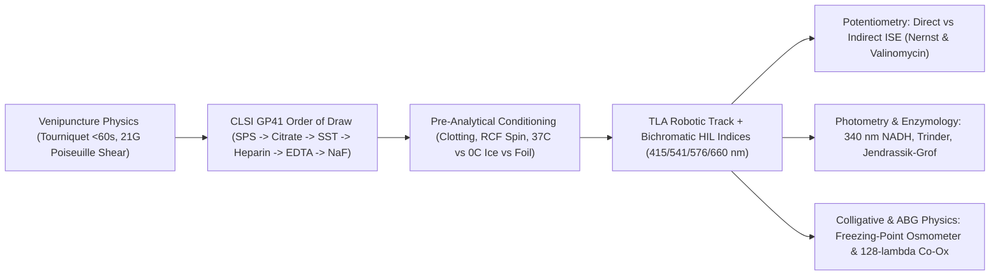
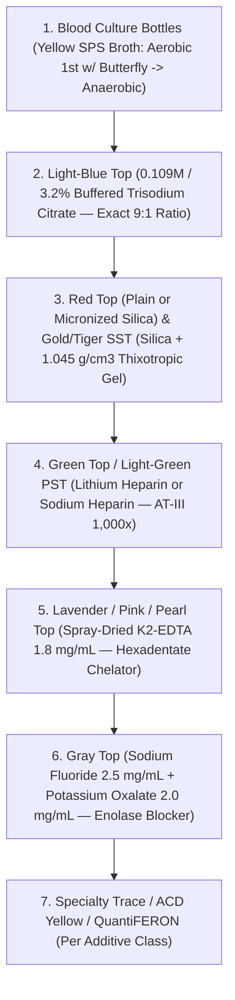
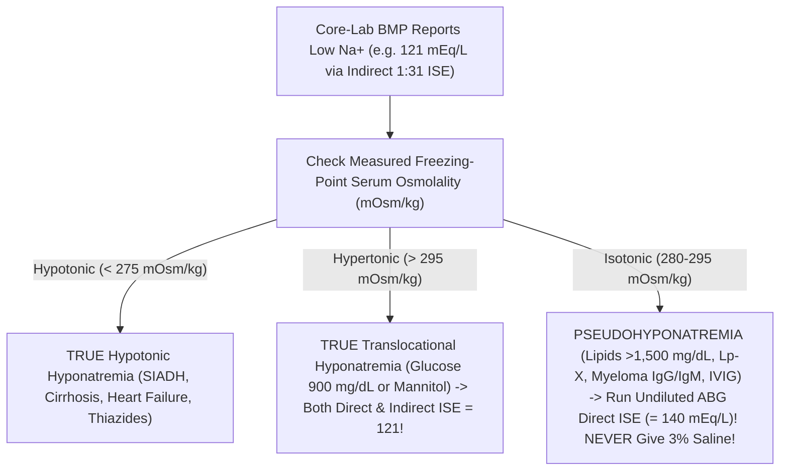
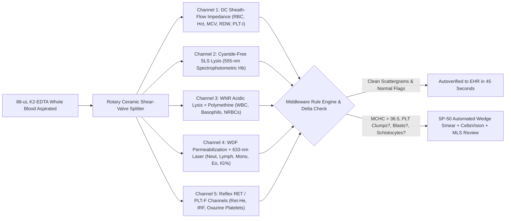
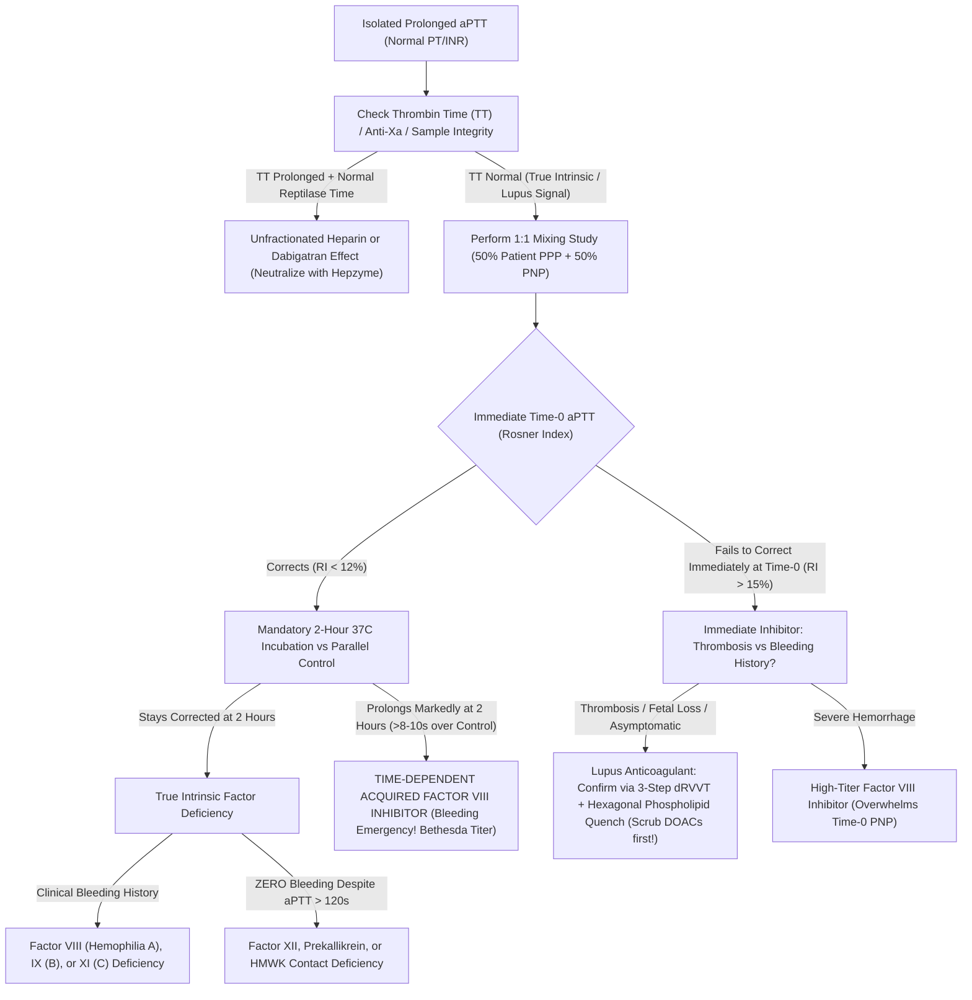
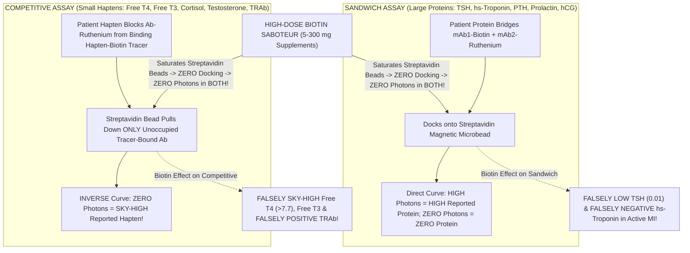

# Bundle 03 — Ep 803: Eight Colored Tubes, Core Chemistry, ISE Traps, Biotin & LC-MS/MS (All-In-One)

## ZERO-MIXUP SINGLE-SOURCE BUNDLE FOR GOOGLE NOTEBOOKLM

**How to use in NotebookLM (`notebook.google.com`):**

1. Check **ONLY THIS ONE DOCUMENT** in your NotebookLM Sources sidebar (uncheck all others—every reference treatise and script needed for this episode is merged right inside this single file!).
2. Click **Customize** on **Audio Overview**, choose **Longer**, and paste this exact prompt:

```text
Create an enthralling, longest-format behind-the-curtain tour of everyday blood draws, Vacutainer cap chemistry, hematology lasers, Ruthenium immunoassays, and clinical LC-MS/MS. Explain tourniquet hemoconcentration, fist-pumping pseudohyperkalemia, and the CLSI Order of Draw: SPS blood culture resins, why underfilling a 9:1 light-blue citrate tube invents a fake bleeding disorder, how Gold SST micronized silica activates Factor XII while thixotropic gel liquefies at 1,500 x g, why K2-EDTA cross-contamination creates K+ of 11, Ca2+ of 3, and zero Alkaline Phosphatase (stripping catalytic zinc!), and EDTA platelet clumping vs cold agglutinins on Coulter/Sysmex counters. Reveal why Core-Lab Indirect ISE reports a fake Na+ of 121 in hypertriglyceridemia/myeloma while undiluted Blood-Gas Direct ISE reads 140, 340-nm NADH coupled enzyme kinetics, the Four Immunoassay Saboteurs (High-Dose Biotin faking Graves' disease and masking heart-attack Troponin, Giant Prolactinoma Hook Effect, Phantom hCG heterophile antibodies, and PEG macroprolactin), BNP vs NT-proBNP on Entresto, HbA1c traps, and why Triple-Quadrupole LC-MS/MS conquered steroids and urine drug screens.
```

---


---

## INCLUDED SOURCE: `VOLUME_II_PHLEBOTOMY_VACUTAINER_CHEMISTRY_AND_AUTOMATED_CORE_LAB_ANALYZERS.md`

# Basic Medical — Behind the Curtain Clinical Diagnostics Notebook
## Volume II: Phlebotomy, Vacutainer Chemistry, and Automated Core-Lab Analyzers — From Butterfly Needle to `128-Wavelength` Co-Oximetry

> *"Seventy percent of all clinical decisions in a modern hospital pivot on laboratory numbers, yet seventy percent of all laboratory errors are committed before the blood tube ever crosses the threshold of the laboratory door. To read a metabolic panel like a master diagnostician, one must follow the blood drop from steel needle bevel through rubber stopper polymers, centrifugal G-forces, valinomycin membranes, and ultraviolet NADH cuvettes."*

---

### Prologue: Plebani's Pre-Analytical Law & The Invisible Life of a Blood Tube

To the patient in an outpatient phlebotomy chair or an intensive care unit bed, a blood draw ends the moment a cotton ball and tape press against the antecubital fossa. Colored plastic tubes vanish into a biohazard bag, drop down a wall-mounted pneumatic chute at twenty-five feet per second, and reappear forty minutes later as crisp black digits on an electronic health record screen: `Na+ 139`, `K+ 4.2`, `Ca2+ 9.4`, `INR 1.0`, `Lactate 1.1`.

When one of those numbers prints in crimson panic font—`K+ = 7.8 mEq/L`, `Na+ = 119 mEq/L`, `INR = 4.6`, `Platelets = 14,000/µL`, or `Lactate = 27.0 mmol/L`—an unprepared clinician treats the number and harms the patient: administering intravenous calcium gluconate and insulin to a normokalemic myeloproliferative patient, infusing `3%` hypertonic saline into a normonatremic hypertriglyceridemic patient, canceling urgent surgery for an underfilled blue-top tube, or missing lethal antifreeze poisoning disguised as septic shock.

Landmark forensic audits of clinical pathology led by Mario Plebani (*Clin Chem*, 1997; *Clin Chem Lab Med*, 2006–2020) proved a sobering truth: modern core-laboratory robotic analyzers have driven purely *analytical* error rates below $0.05\%$ (5-to-6-sigma industrial precision), yet **$62\%\text{ to }75\%$ of all erroneous hospital laboratory results originate in the Pre-Analytical Phase**—venous stasis, fist-pumping, shear cavitation, wrong order of draw, additive stoichiometry violations, temperature drift, and light degradation—while the remaining $15\text{–}25\%$ reflect misinterpreting analytical chemistry interferences (`HIL` indices, Indirect vs. Direct `ISE`, `P5P` cofactors, and enzyme cross-reactivity).

In **Volume II**, we trace every physical, hydrodynamic, stoichiometric, electrochemical, and spectrophotometric law governing clinical blood diagnostics from needle bevel to final verified report.



---

## Dossier 2.1: From Butterfly Needle to Pneumatic Tube — The Pre-Analytical Physics Where 70% of All Lab Errors Happen

### 2.1.1 Venipuncture Hemodynamics: Tourniquet Starling Filtration, Fist-Pumping `K+` Leak & Hagen-Poiseuille Shear Hemolysis

Before a single chemical additive touches the blood, three bedside physical forces can rewrite the patient's biochemistry inside their own arm:

#### 1. The `60-Second` Tourniquet Limit & Starling Ultrafiltration Hemoconcentration
When an elastic tourniquet constricts the upper arm at $\sim 60\text{–}80\text{ mmHg}$ (above venous pressure of $10\text{ mmHg}$ so veins engorge, yet below arterial systolic pressure of $120\text{ mmHg}$ so blood keeps pouring *in* with nowhere to exit), capillary hydrostatic pressure $P_c$ inside the forearm surges from $18\text{ mmHg}$ toward $55\text{ mmHg}$. By **Starling's Microvascular Filtration Equation**:
$$J_v = K_f \left[ (P_c - P_i) - \sigma (\pi_c - \pi_i) \right]$$
protein-free plasma water and freely diffusible small electrolytes ($\text{Na}^+, \text{Cl}^-$, glucose, urea) are forced out through endothelial fenestrations into the forearm interstitium, while cells and **macromolecules larger than $5\text{–}10\text{ kDa}$ are trapped inside the shrinking capillary lumen**!
* **What happens after `3 minutes` of prolonged tourniquet hunting for a difficult vein?**
  * Intravascular plasma volume in that stagnant forearm segment drops by **$10\text{–}15\%$**!
  * Every large protein, cell count, and **protein-bound analyte** concentrates spuriously by **`+8% to +15%`**: **Albumin**, **Total Protein**, **Total Cholesterol & `LDL`** (`+10–15%`), **Hemoglobin/Hematocrit**, **Iron & Transferrin**, **Hepatic Enzymes (`AST`, `ALT`, `GGT`, `ALP`)**, and crucially **Total Serum Calcium**! Because $\sim 45\%$ of serum calcium rides bound to albumin, a 3-minute tourniquet routinely pushes a completely normal Total Calcium of $9.8\text{ mg/dL}$ up to **$10.7\text{ mg/dL}$**—triggering an expensive, unnecessary primary hyperparathyroidism workup! Meanwhile, stagnant tissue hypoxia generates local lactic acid (`↑ Lactate`, `↓ pH`).
  * **Clinical Rule (`CLSI GP41`)**: Tourniquet application must never exceed **`60 seconds`**. If vein location takes longer, release the tourniquet for `2 full minutes` to wash out concentrated capillary blood before re-tying and puncturing!

#### 2. Forearm Fist-Pumping ("Clench-and-Pump") Pseudohyperkalemia
For decades, well-meaning clinicians told patients, *"Pump your fist five or six times so your vein pops up!"* That single sentence is responsible for thousands of false emergency potassium alerts every day:
* **Skeletal-Muscle Electrophysiology**: Resting myocytes hold $98\%$ of total body potassium at an intracellular concentration of **`140–150 mEq/L`** versus **`4.0 mEq/L`** in extracellular plasma ($35:1$ gradient). During repetitive isometric/isotonic forearm fist-pumping under tourniquet ischemia, every sarcolemmal action potential opens voltage-gated delayed-rectifier $\text{K}^+$ channels (`Kv`) and $\text{ATP}$-sensitive $\text{K}_{\text{ATP}}$ channels faster than ischemic $\text{Na}^+/\text{K}^+\text{-ATPase}$ pumps can reclaim $\text{K}^+$.
* **Magnitude of the Artifact**: Forearm venous effluent $\text{K}^+$ leaps acutely by **`+1.0 to +1.8 mEq/L`** (Donague et al.; Seimiya et al.)—turning a physiological **`4.2 mEq/L` into `5.7 mEq/L`** with **zero hemolysis** (`H-index = 0`, crystal-clear yellow plasma, fooling clinicians into thinking the `5.7` is real!). Gently holding tension without rhythmic pumping—or relaxing the hand the instant blood enters the first tube—abolishes the artifact completely.

#### 3. Needle-Gauge Fluid Mechanics (`Hagen-Poiseuille` Shear Stress), `IV`-Catheter Draws & Pneumatic Tube Cavitation
Why do Emergency Department blood samples drawn through newly placed peripheral `IV` catheters hemolyze **`5 to 6 times` more frequently** ($12\text{–}20\%$ hemolysis rate!) than outpatient phlebotomy straight-needle venipunctures ($< 2\%$)? Pure fluid dynamics!

For laminar Newtonian flow of whole blood (dynamic viscosity $\eta \approx 3.5\text{–}4.5\text{ mPa}\cdot\text{s}$) volumetric flow rate $Q$ driven by vacuum pressure drop $\Delta P$ across a needle or catheter of length $L$ and internal radius $r$, **Hagen-Poiseuille's Law** gives the **Wall Shear Stress ($\tau_w$)** experienced by red blood cells scraping past the inner wall:
$$Q = \frac{\pi r^4 \Delta P}{8 \eta L}, \qquad \tau_w = \frac{r \, \Delta P}{2 L} = \frac{4 \eta Q}{\pi r^3}$$
Look closely at $\tau_w \propto \frac{\Delta P \cdot r}{2L}$ and $\tau_w \propto \frac{Q}{r^3}$:
* Human erythrocyte spectrin-ankyrin cytoskeletal membranes deform gracefully up to shear stresses of $\sim 100\text{ Pa}$, **but mechanically rupture (hemolyze) once shear stress crosses $\tau_{\text{crit}} \approx 150\text{–}300\text{ Pa}$ ($1,500\text{–}3,000\text{ dynes/cm}^2$)**—especially at abrupt geometric step-downs (`vena contracta` micro-jets and turbulent eddies)!
* **The Three Hemolysis Traps**:
  1. **`25G` Needle + Hard-Pulled `20-mL` Syringe**: A standard `21G` green-hub phlebotomy needle has a generous internal bore ($2r \approx 0.51\text{ mm}$) paired with calibrated Vacutainer vacuum. A tiny pediatric **`25G` needle ($2r \approx 0.26\text{ mm}$)** cuts radius $r$ in half—raising $1/r^3$ shear **8-fold** at equal flow! Worse, yanking back hard on a large `10-mL` or `20-mL` syringe plunger generates localized negative gauge pressures exceeding **$-400\text{ to }-600\text{ mmHg}$**, causing dissolved $\text{N}_2/\text{CO}_2$ microbubble **cavitation** and jetting RBCs violently against the syringe barrel! (If syringe draw is unavoidable, use a `3–5 mL` syringe with gentle slow pull and a sterile `Vacutainer Blood Transfer Device`—*never* stab a needle through a rubber stopper and squirt under positive thumb pressure!)
  2. **Soft Polyurethane `IV` Angiocatheters**: Unlike rigid siliconized stainless-steel phlebotomy needles, flexible `IV` catheters compress partially against vein valves, collapse slightly under Vacutainer suction (chattering like a reed valve!), and force blood through a $90^\circ$ Luer-lock hub/extension-set step-down that acts as an RBC blender!
  3. **Pneumatic Tube Systems (`PTS`) & Unfilled Air Headspace**: Hospital pneumatic carriers accelerate and corner at **`8 to 15 × g`**. If a blood tube is only half-full (leaving a large air headspace) and unpadded, repetitive high-G sloshing creates **air-liquid interface foaming** that shears RBCs (spiking `LDH` and `K+`) and **shatters fragile malignant lymphocytes in Chronic Lymphocytic Leukemia (`CLL`, `WBC = 180,000/µL`)**—causing dramatic **" Pneumatic-Tube Leukemic Pseudohyperkalemia"** (`K+ = 9.2 mEq/L` via `PTS`, whereas walking a heparinized whole-blood syringe by foot to the lab reads `K+ = 3.9 mEq/L`!).

---

### 2.1.2 The Complete `CLSI GP41` Order of Draw & Chemical Stoichiometry of Every Vacutainer Cap Color

Why does the **Clinical and Laboratory Standards Institute (`CLSI GP41`, 7th Edition)** enforce a rigid, non-negotiable universal **Order of Draw** across every hospital on Earth? Look inside the multi-sample Vacutainer hub: as you pop off Tube #1 and push Tube #2 onto the internal rubber-sheathed posterior needle, **a microscopic $0.2\text{–}1.0\text{ }\mu\text{L}$ droplet of blood mixed with Tube #1's chemical additive clings to the rubber sleeve and needle tip**, washing straight into Tube #2! The Order of Draw is engineered so that early tubes carry either zero additive or benign additives that cannot poison downstream assays, pushing the most chemically destructive chelators and enzyme poisons (`K2-EDTA` and `NaF/K-Oxalate`) to the very end!



#### Stopper #1: Sterile Blood Culture Bottles (`0.025–0.05%` `SPS` Polyanethole Sulfonate)
* **Why Drawn First**: Aseptic sterility! Every subsequent tube stopper that touches the hub increases skin-flora (*Staphylococcus epidermidis*, *Cutibacterium acnes*) needle contamination risk (`< 3%` target contamination rate; skin prepped with `2%` chlorhexidine gluconate in `70%` isopropyl alcohol allowed to air-dry 30 sec, plus stopper septum wiped with `70%` alcohol—never povidone-iodine on rubber!).
* **Aerobic vs. Anaerobic Order (`Butterfly` vs. `Syringe`)**:
  * **With a Winged Butterfly Collection Set**: Always inoculate the **Aerobic bottle FIRST**, then the **Anaerobic bottle**! Why? Because the $12\text{-inch}$ clear flexible butterfly tubing contains **`~0.5 mL` of room air ($21\%\text{ O}_2$)**—routing that air bubble into the Anaerobic bottle would poison obligate anaerobes (*Bacteroides fragilis*, *Clostridium*)!
  * **With a Straight Needle & Syringe** (historically): Anaerobic first (since air rises to the plunger top).
  * **Volume Law of Bacteremia**: Adult bacteremia averages fewer than **$0.1\text{ to }1.0\text{ CFU/mL}$** of blood! Each bottle requires **$8\text{–}10\text{ mL}$** of blood ($2\text{ sets} = 4\text{ bottles} = 40\text{ mL}$ total; each extra milliliter increases true pathogen yield by $\sim 3\%$).
* **The Secret Chemistry of `SPS` (`Sodium Polyanethole Sulfonate`, `0.025–0.05%`)**: Fresh whole human blood does not stop fighting bacteria just because it entered a bottle! Without an immunomodulator, host plasma complement, lysozyme, and live neutrophils inside the bottle would digest low-colony bacteria before they could grow! Polyanionic **`SPS`** is the unsung hero of microbiology: it **precipitates `C3/C4` complement**, **neutralizes bactericidal lysozyme**, **blocks neutrophil/monocyte phagocytosis**, anticoagulates blood, AND **electrostatically binds and inactivates cationic aminoglycoside (`gentamicin/tobramycin`) and polymyxin antibiotics** already circulating in the septic patient's bloodstream (paired with antibiotic-adsorbing polymeric resin beads in *BACTEC Plus / BacT/ALERT FA Plus* bottles)! *(Microbiology Pearl: `SPS` is toxic to four fastidious organisms—`Neisseria meningitidis`, `Neisseria gonorrhoeae`, `Gardnerella vaginalis`, and `Peptostreptococcus anaerobius`—which is why commercial broth includes gelatin to buffer `SPS` toxicity!)*

---

#### Stopper #2: Light-Blue Top (`0.109 M` / `3.2%` Buffered Trisodium Citrate — Strict `9 : 1` Stoichiometry)
Used for all plasma coagulation cascades (**`PT/INR`, `aPTT`, `Fibrinogen`, `D-Dimer`, `Lupus Anticoagulant`, `Factors II–XII`, `anti-Xa`, `Protein C/S`**) and platelet function studies.
* **Reversible Chelation Chemistry**: Liquid **trisodium citrate ($\text{Na}_3\text{C}_6\text{H}_5\text{O}_7 \cdot 2\text{H}_2\text{O}$)** at **$0.109\text{ mol/L}$ ($3.2\text{ g/dL}$)** gently chelates ionized $\text{Ca}^{2+}$ (`Factor IV`) into soluble $[\text{CaCit}]^-$ complexes without denaturing labile **Factor V** or **Factor VIII** (unlike `EDTA`, which irreversibly destroys Factor V/VIII quaternary assembly!). Gently invert **`3 to 4 times`** immediately—never shake! Inside the optical/electromechanical coagulometer (`Sysmex CS-5100` or `Werfen ACL TOP`), after spinning at $1,500 \times g$ for $15\text{ min}$ to obtain **Platelet-Poor Plasma (`PPP`, `< 10,000 platelets/µL`**—crucial because freeze-thawed residual platelets leak **Platelet Factor 4 [`PF4`]** which neutralizes heparin in `aPTT/anti-Xa` assays, and leak anionic phospholipids that mask **Lupus Anticoagulants**!), the robot adds recombinant tissue factor (`PT`) or micronized silica/ellagic acid + cephalin phospholipid (`aPTT`) plus a calibrated stoichiometric excess of **$0.025\text{ M }\text{CaCl}_2$**, snapping free $\text{Ca}^{2+}$ back to physiological $1.2\text{ mmol/L}$ and starting the optical `660 nm` fibrin-turbidity stopwatch!

* **Why Two `9 : 1` Volumetric Errors Falsely Prolong `PT` and `aPTT`**:
  1. **The Butterfly Dead-Space Underfill Trap (`< 90%` Fill Line)**: A $2.7\text{-mL}$ light-blue tube contains $0.30\text{ mL}$ of liquid citrate at the bottom, awaiting exactly $2.70\text{ mL}$ of whole blood ($9:1$). If drawn as the *very first* tube through a winged butterfly needle without a clear/blue **non-additive discard tube** first, $0.5\text{ mL}$ of tubing air fills the tube vacuum instead of blood—delivering only $2.2\text{ mL}$ blood ($7.3:1$)! Leftover **unbound citrate** sits waiting in the plasma; when the analyzer injects its fixed $\text{CaCl}_2$ bolus, the excess citrate steals the reagent's calcium, starving prothrombinase complexes and **falsely prolonging `aPTT` and `PT/INR`**! (`CLSI H21-A5` strictly rejects any blue top filled `< 90%`!)
  2. **The Polycythemia (`Hematocrit > 55%`) Over-Citration Trap**: Citrate ions cannot enter red blood cells; all $0.30\text{ mL}$ of citrate distributes exclusively into the **plasma fraction**!
     * In a normal adult ($\text{Hct} = 45\%$), $2.70\text{ mL}$ blood delivers $2.70 \times (1 - 0.45) = \mathbf{1.485\text{ mL plasma}}$ to dilute $0.30\text{ mL}$ citrate ($\sim 5:1$ plasma-to-citrate).
     * In a patient with Eisenmenger cyanotic heart disease, COPD cor pulmonale, Polycythemia Vera, or a newborn with **$\text{Hct} = 68\%$**, $2.70\text{ mL}$ blood delivers only $2.70 \times (1 - 0.68) = \mathbf{0.864\text{ mL plasma}}$—effectively **nearly doubling the citrate concentration in plasma** and creating a terrifying fake coagulopathy (`INR = 2.9, aPTT = 68 sec`)!
     * **The `CLSI H21-A5` Exact Citrate Adjustment Formula**: Whenever $\text{Hct} > 55\%$, the lab prepares a custom light-blue tube by sterilely aspirating out excess citrate so the remaining citrate volume $C$ ($\text{mL}$) matches the true plasma volume of blood collected $V_{\text{blood}}$ ($\text{mL}$):
       $$C\text{ (mL of }0.109\text{ M Citrate)} = (1.85 \times 10^{-3}) \times (100 - \text{Hct}_{\%}) \times V_{\text{blood (mL)}}$$
       *(Worked Check: For a $5.0\text{-mL}$ total tube in a patient with $\text{Hct} = 70\%$, $C = 0.00185 \times (30) \times 4.73 \approx \mathbf{0.26\text{ mL}}$ citrate instead of $0.50\text{ mL}$—instantly normalizing the bogus `INR` from $2.9$ back to $1.05$! Note: No adjustment is needed for severe *anemia* [$\text{Hct } 15\%$] because extra plasma water still holds ample $\text{Ca}^{2+}$ upon analyzer recalcification.)*

---

#### Stopper #3: Red Top (Plain vs. Plastic Silica) & Gold / Tiger-Top `SST` (Serum Separator Tube)
Wait—why do *clot-activator serum tubes* come **AFTER** Light-Blue coagulation tubes instead of first?! Because plastic `SST` and plastic Red-Top tubes are coated internally with **micronized silica clot activator** (and Orange `RST` tubes contain **thrombin**): if drawn *before* the Light-Blue tube, carrying trace silica/thrombin into the citrate tube initiates premature `Factor XIIa/IIa` generation, **falsely shortening `PT/aPTT`** and triggering microclots!

* **Intrinsic Contact Clotting Chemistry (`5 Inversions` + `15–30 Min` Clotting)**:
  In old borosilicate glass tubes, native negative silanol ($\text{-Si-O}^-$) charges activated clotting naturally. Modern shatterproof polyethylene terephthalate (`PET`) plastic tubes are hydrophobic and inert—blood inside uncoated plastic takes $> 60\text{ minutes}$ to clot! Therefore, plastic Red and Gold `SST` walls are spray-coated with **$1\text{–}5\text{ }\mu\text{m}$ amorphous silica nanoparticles** wrapped in water-soluble polyvinylpyrrolidone (`PVP`). Upon `5` gentle inversions, negatively charged silica binds **Factor XII (Hageman Factor)** alongside **High-Molecular-Weight Kininogen (`HMWK`)** and **Prekallikrein**, driving conformational auto-cleavage to **Factor XIIa $\to$ Kallikrein $\to$ Factor XIa $\to$ IXa $\to$ Xa $\to$ Thrombin (`IIa`) $\to$ Factor XIIIa-crosslinked Fibrin Clot** within `15–30 minutes` upright at room temperature!
  * *What happens if an impatient tech throws a Gold `SST` into the centrifuge at `4 minutes` before clotting finishes (or in a dialysis/ICU patient on heparin)?* Fibrinogen stays in the liquid supernatant during the spin and **finishes clotting AFTER centrifugation**, forming a translucent **"latent fibrin jellyfish clot"** right in the serum cup that plugs the `$500,000` analyzer's $2\text{-}\mu\text{L}$ needle probe or gets sucked into an immunoassay cuvette to create rogue false-positive troponin/hormone spikes!

* **Physics of the Thixotropic Polymer Separator Gel & Centrifuge `RCF` Math**:
  At the bottom of a Gold `SST` (and Light-Green `PST`) sits $0.8\text{–}1.2\text{ g}$ of **thixotropic polyester, polybutene, or acrylic copolymer gel** compounded with hydrophobic fumed silica to a hyper-precise **specific gravity of $1.040\text{ to }1.050\text{ g/cm}^3$**:
  $$\rho_{\text{Cell-Free Serum}} \approx 1.024\text{–}1.028\text{ g/cm}^3 \quad < \quad \mathbf{\rho_{\text{Thixotropic Gel}} = 1.045\text{ g/cm}^3} \quad < \quad \rho_{\text{RBC / Fibrin Clot}} \approx 1.090\text{–}1.095\text{ g/cm}^3$$
  **Thixotropy** is time-dependent non-Newtonian **shear-thinning viscosity**: at rest ($1 \times g$), weak van der Waals and silanol hydrogen bonds lock the polymer into a rigid solid plug. When spun in a swing-bucket centrifuge at **`1,100 to 1,500 × g` for `10 minutes`**—governed NOT by `RPM` alone, which varies wildly by rotor radius $r_{\text{cm}}$, but by **Relative Centrifugal Force (`RCF`)**:
  $$\text{RCF } (\times g) = 1.118 \times 10^{-5} \times r_{\text{cm}} \times (\text{RPM})^2$$
  *(e.g., at radius $r = 15\text{ cm}$, $3,000\text{ RPM}$ delivers $1.118 \times 10^{-5} \times 15 \times 9 \times 10^6 = \mathbf{1,509 \times g}$!)*—hydrostatic buoyant pressure exceeds the gel's yield stress, liquefying it so it flows smoothly up the plastic wall while dense RBCs sink past it. The instant the rotor stops, hydrogen bonds snap back into place, sealing an airtight chemical barrier between living/dying cells below and pristine cell-free serum above!
  * **Two Famous `SST` Gel Failures**:
    1. **Floating Inverted Gel ("Paraprotein / Contrast Buoyancy Reversal")**: If a patient has severe **Multiple Myeloma (`Total Protein = 13.5 g/dL`)** OR had blood drawn **10 minutes after a `370 mgI/mL` CT Angiogram bolus**, serum specific gravity climbs above **`1.055 g/cm^3`**—now *denser* than the `1.045 g/cm^3` gel! After centrifugation, the `SST` gel floats right on **top** of the serum like a cork, breaking analyzer probes!
    2. **Hydrophobic Therapeutic Drug Adsorption (`Why Plain Red No-Gel Tops Still Exist!`)**: Lipophilic small-molecule drugs with high octanol-water partition coefficients ($\log P > 2.5$)—specifically **phenytoin, carbamazepine, phenobarbital, valproic acid, tricyclic antidepressants (`amitriptyline/nortriptyline`), lidocaine, flecainide, and steroid hormones (`progesterone`)**—slowly dissolve straight into the hydrophobic polyester `SST` gel matrix (`-15%` to `-40%` false drop over 6–24 hours!), mandating **Plain No-Gel Red-Top tubes**!

---

#### Stopper #4: Green Top (`Lithium Heparin` vs. `Sodium Heparin`, Light-Green `PST`)
Why have most high-volume Emergency Departments and hospital inpatient floors switched routine `BMP`/`CMP` and `hs-Troponin` panels from Gold `SST` *serum* to Light-Green `PST` **Lithium Heparin *plasma***?
1. **Turnaround-Time (`TAT`) Physics**: Heparin (`12–30 USP IU/mL` spray-dried glycosaminoglycan) binds lysine clusters on endogenous **Antithrombin III (`AT-III`)**, inducing an allosteric conformational shift that accelerates covalent trapping of **Thrombin (`IIa`) and Factor Xa `1,000-fold`**. Because no clotting wait is needed, the tube goes straight from pneumatic chute into the centrifuge—**shaving 20 to 30 minutes off stroke, sepsis, and myocardial infarction turnaround times**!
2. **Eliminating Thrombocytosis Pseudohyperkalemia (`Serum K+` vs. `Plasma K+`)**:
   * In *every* healthy human, **Gold `SST` Serum $\text{K}^+$ runs `0.3 to 0.4 mEq/L` higher than paired Green-Top Plasma $\text{K}^+$** (`ref range: Serum 3.5–5.1` vs `Plasma 3.4–4.8 mEq/L`) because thrombin aggregation during clotting triggers physiological platelet degranulation!
   * Now consider a patient with **Essential Thrombocythemia, Polycythemia Vera, CML, or post-splenectomy reactive thrombocytosis** whose platelet count is **`1,200,000 / µL`** ($+0.15\text{ mEq/L}$ spurious serum $\text{K}^+$ rise per $100,000/\mu\text{L}$ elevation in platelets!). Clotting inside a Gold `SST` squeezes massive cytosolic $\text{K}^+$ out of a trillion platelets, printing **`Serum K+ = 7.4 mEq/L`** while the patient sits cheerfully reading a magazine with a normal T-wave ECG! Drawing a **Green-Top Lithium Heparin Plasma tube** stops clotting cold and reveals the patient's true *in vivo* **`Plasma K+ = 4.1 mEq/L`**!
3. **Why `Lithium` Salt—And Its Fatal Bipolar Psychiatry Trap**: Heparin is a strongly negative polyanion requiring a positive counter-ion: `Sodium Heparin` would add $+1\text{–}3\text{ mEq/L}$ of fake $\text{Na}^+$; `Potassium` is impossible; `Ammonium` wrecks `BUN`/ammonia; so **`Lithium Heparin`** is ideal for `BMP`/`CMP` since endogenous human $\text{Li}^+$ is zero—**EXCEPT when ordering a therapeutic Serum Lithium level on a bipolar disorder patient!** Drawing a Lithium level in a green Lithium Heparin tube adds `~1.0–1.8 mmol/L` of exogenous $\text{Li}^+$, falsely spiking a safe `0.8 mmol/L` level to a "toxic emergency hemodialysis" level of `2.4 mmol/L`! *(Note also: Plasma still contains `0.2–0.4 g/dL` of **intact fibrinogen**, which raises Total Protein slightly vs. serum and shows up on Serum Protein Electrophoresis [`SPEP`] as a sharp $\beta\text{-}\gamma$ bridge band that mimics a **monoclonal M-spike**—so **`SPEP` MUST always be drawn in a Gold/Red Serum tube, NEVER plasma!**)*

---

#### Stopper #5: Lavender & Pink Top (`Spray-Dried K2-EDTA`, `1.8 mg/mL`) — And Its Forensic Cross-Contamination Fingerprint
Used for **Complete Blood Count (`CBC` + Differential)**, **Reticulocytes**, **`HbA1c`**, **Blood Bank `ABO/Rh` & Type-and-Screen (`Pink Top`)**, **`BNP`/`NT-proBNP`**, **`iPTH`**, **`ACTH`**, **`Tacrolimus/Cyclosporine` whole-blood troughs**, and molecular viral/genetic PCR.

* **Why `K2-EDTA` Preserves Cells—And Occasionally Clumps Platelets (`EDTA Pseudothrombocytopenia`)**:
  Spray-dried dipotassium ethylenediaminetetraacetate (`1.5–2.2 mg/mL` blood; `8–10` inversions; favored by `ICSH`/`CLSI` over liquid `K3-EDTA` which osmotically shrinks RBC `MCV` by $2\%$) chelates $\text{Ca}^{2+}$ to prevent platelet GpIIb/IIIa fibrinogen bridging while preserving crisp Romanowsky Wright-Giemsa white-cell nuclear chromatin and RBC morphology.
  * *The Classic Hematology Consult (`Platelets = 12,000/µL` with Zero Petechiae!)*: In $\sim 0.1\text{–}0.2\%$ of hospitalized patients, chelating $\text{Ca}^{2+}$ out of the platelet integrin **`GPIIb/IIIa` (`CD41/CD61`)** heterodimer at room temperature induces a subtle conformational shift exposing neoepitopes bound by harmless, naturally occurring IgG/IgM cold/EDTA-dependent autoantibodies! Platelets agglutinate into giant 20-platelet rosettes (*platelet satellitism* around neutrophils or free clumps on peripheral smear!) that impedance/optical counters misclassify as leukocytes (`false leukocytosis + severe pseudothrombocytopenia`)! **The Instant Bench Fix**: Redraw CBC in a **Light-Blue `3.2%` Sodium Citrate tube** (which leaves $\text{GPIIb/IIIa}$ calcium intact!), verify single un-clumped platelets on smear, and **multiply the analyzer's platelet count by `1.1`** (`10/9` dilution factor correction for the $9:1$ liquid citrate)!

* **THE FORENSIC TRIAD OF `K2-EDTA` CROSS-CONTAMINATION INTO CHEMISTRY TUBES**:
  Every single night in every major medical center, an on-call resident or core-lab clinical chemist gets paged with a bizarre, physiologically impossible STAT chemistry panel:
  > `Na+ 139 mEq/L` | **`K+ 11.4 mEq/L (CRITICAL)`** | `Cl- 103 mEq/L` | `HCO3- 24 mEq/L` | `Cr 0.85 mg/dL` | **`Total Ca2+ < 2.0 mg/dL (CRITICAL)`** | **`Mg2+ 0.2 mg/dL`** | **`Alkaline Phosphatase < 5 U/L`** | `Hemolysis Index: 0 (Clear!)`

  What happened behind the curtain? Either the phlebotomist violated `CLSI GP41` by drawing the **Lavender `K2-EDTA` tube BEFORE the Green/Gold chemistry tube** (transferring $10\text{ }\mu\text{L}$ of concentrated `K2-EDTA` off the rubber needle sleeve!), backward syringe needle transfer contaminated the needle, OR someone uncapped a short Green tube and **poured `0.5 mL` of blood from the Lavender `K2-EDTA` tube into it** so the lab wouldn't cancel for "Quantity Not Sufficient (`QNS`)"! Look at the ironclad three-part chemical signature of **`K2-EDTA` (`C10H14K2N2O8`)**:
  1. **Massive Hyperkalemia (`K+ 7.0 to > 15.0 mEq/L` with `H-Index = 0`)**: Every single molecule of `K2-EDTA` releases **two free $\text{K}^+$ ions** directly into the plasma (`1.8 mg/mL K2-EDTA` = $+8.9\text{ mmol/L}$ of pure exogenous $\text{K}^+$)!
  2. **Profound Hypocalcemia (`Ca2+ < 5.0 mg/dL`) & Hypomagnesemia**: Hexadentate `EDTA` wraps four carboxylate oxygens and two tertiary amine nitrogens around divalent $\text{Ca}^{2+}$ ($\log K_f = 10.7$) and $\text{Mg}^{2+}$ ($\log K_f = 8.7$) like a six-clawed crab, hiding them completely from spectrophotometric `Arsenazo III` / `o-cresolphthalein` dyes and `ISE` membranes!
  3. **Collapsed / Undetectable Alkaline Phosphatase (`ALP < 5–10 U/L`) + Low Serum Zinc**: Human **Alkaline Phosphatase (`ALP`) is an obligate $\text{Zn}^{2+}/\text{Mg}^{2+}$ metalloenzyme** housing two catalytic $\text{Zn}^{2+}$ ions and one $\text{Mg}^{2+}$ ion inside each active monomer! Because `EDTA` binds $\text{Zn}^{2+}$ with ferocious thermodynamic avidity (**$\log K_f = 16.5$—nearly one million times tighter than calcium!**), even trace `K2-EDTA` Carryover—too small to crash calcium below $7.8\text{ mg/dL}$, raising $\text{K}^+$ from $4.2$ to a dangerously believable $5.9\text{ mEq/L}$!—**rips catalytic $\text{Zn}^{2+}$ out of `ALP`'s active site**, causing a sudden unexplained drop in `ALP` (and serum $\text{Zn}^{2+}$) compared to yesterday's labs!

---

#### Stopper #6: Gray Top (`Sodium Fluoride 2.5 mg/mL` + `Potassium Oxalate 2.0 mg/mL`) & Citrate-Acidified Glycolysis Blockade
* **Why Unspun Blood Devours Its Own Glucose**: Mature human erythrocytes lack mitochondria—they survive $100\%$ on anaerobic **Embden-Meyerhof glycolysis**, burning plasma D-glucose into L-lactate at **`5% to 7%` per hour (`~7–10 mg/dL/hr`) at $22^\circ\text{C}$**! In a patient with acute myeloid leukemia (`WBC = 140,000/µL`), thrombocytosis, or severe bacteremia left in an outpatient courier lockbox for 3 hours before spinning, cells devour glucose down to **`18 mg/dL` (`in vitro` pseudohypoglycemia)** while pouring out lactic acid!
* **How Gray-Top Additives Work—And Why `NaF` Alone Has a `90-Minute` Blind Spot**:
  * **Potassium Oxalate (`2.0 mg/mL`)** anticoagulates the tube immediately by precipitating insoluble **calcium oxalate ($\text{CaC}_2\text{O}_4 \downarrow$)**.
  * **Sodium Fluoride (`2.5 mg/mL`)** enters erythrocytes and complexes with $\text{Mg}^{2+}$ and inorganic $\text{PO}_4^{3-}$ inside step 9 of glycolysis—**Enolase (`2-phosphoglycerate dehydratase`)**—forming a dead-end **$[\text{Mg–F}_2\text{–PO}_4]^-$** transition-state mimic!
  * *The Biochemical Catch (*ADA/NACB Guidelines*)*: Blocking step 9 (`Enolase`) does **NOT** stop steps 1 and 3 (**`Hexokinase`** and **`Phosphofructokinase-1 [PFK-1]`**) until upstream glycolytic intermediates pile up and `ATP` depletes—which takes **`60 to 120 minutes`**! Consequently, even inside a standard Gray-Top `NaF` tube, **plasma glucose still drops `6–9 mg/dL` during the first hour** (missing up to $20\%$ of Gestational Diabetes diagnoses on `OGTT`!). True `t = 0` glycolysis arrest requires either **centrifuging a gel tube within `< 15–30 minutes`** OR drawing into a **Citrate-Buffered `NaF-EDTA` Acidified Tube (`pH 5.3–5.9`)**, where protons instantly inhibit allosteric **`PFK-1`**!
  * *Why Gray Comes Last*: `Potassium Oxalate` adds massive $\text{K}^+$ and precipitates $\text{Ca}^{2+}$, while $\text{F}^-$ directly inhibits **`Urease`** (wrecking `Urease`-based `BUN`!) and **`ALP`/`esterases`**, and causes ~10% osmotic RBC shrinkage hemolysis!

---

#### Stopper #7: Specialty Trace-Metal, Thermal (`37°C` vs. `0°C` Ice Slurry) & Photoprotective Foil Protocols

| Vacutainer / Transport Protocol | Additive & Container Physics | Target Clinical Analytes | What Goes Catastrophically Wrong If Violated |
| :--- | :--- | :--- | :--- |
| **Royal-Blue Top (`Trace Element`)** | Acid-washed `PET` + special non-vulcanized bromobutyl stopper (`< 0.1 µg/L` metal leach); `K2-EDTA` or Plain label stripe | **`Zn`, `Cu`, `Se`, `Cr`, `Co`, `As`, `Hg`, `Cd`** via `ICP-MS` (**Tan Top** certified `< 0.01 µg/dL` for **`Lead [Pb]`**) | Standard rubber stoppers contain **zinc oxide & aluminum/magnesium silicates**—leaching massive exogenous $\text{Zn}^{2+}$ into serum (`false hyperzincemia`)! |
| **`37°C` Warm-Bath / Heel-Warmer Transport** | Pre-warmed **$37^\circ\text{C}$ Plain Red No-Gel Tube**; clotted & spun strictly at **$37^\circ\text{C}$** | **Serum `Cryoglobulins` (`Types I, II, III`)** & high-thermal-amplitude **`Cold Agglutinin` titers** (`EDTA` for titer) | Cooling to $22^\circ\text{C}$ hallway air precipitates cryoglobulins *into the cellular clot* before spinning $\to$ thrown in trash = **`100%` False-Negative Cryoglobulin** in active HCV/myeloma vasculitis! |
| **`0–4°C` Ice-Water Slurry + `< 15 min` Cold Spin** | Pre-chilled Lavender `K2-EDTA` or Gray/Green tube plunged straight into crushed ice + water | **Venous `Ammonia` (`NH3`)**, **`Lactate`**, **`ACTH`**, **`Vasoactive Intestinal Peptide`**, **`PTHrP`**, **`Pyruvate`** | At $22^\circ\text{C}$, RBC metabolism + plasma **`GGT` hydrolysis of L-glutamine** generates `20–100%` fake ammonia within `30–60 min` (`pseudo-hyperammonemia` in non-encephalopathic patients)! |
| **Amber Tube / Aluminum Foil Light-Wrap** | Opaque sleeve blocking `380–500 nm` blue/UV hospital fluorescent & LED light | **`Total/Direct Bilirubin`** (esp. neonatal), **Urine/Plasma `Porphyrins` & `PBG`**, **`Vitamin B6 (PLP)`**, **`Vitamin A`**, **`Beta-Carotene`** | Blue light (`450 nm`) photo-isomerizes bilirubin into colorless dipyrroles/lumirubin (`-30%` to `-50%` loss in `2 hr`) and destroys `405 nm` Soret-absorbing porphyrins (`false-negative Acute Intermittent Porphyria`)! |


---

## Dossier 2.2: Inside the Total Laboratory Automation (`TLA`) Track — `HIL` Spectrophotometry, Direct vs. Indirect `ISE`, Coupled `340-nm` `NADH` Enzymology & Blood-Gas Co-Oximetry

### 2.2.1 Behind the Core-Lab Airlock: The Robotic `TLA` Superhighway & Zero-Reagent `HIL` Serum Indices

When the pneumatic carrier thuds into the receiving station of a modern 2,000-bed academic core laboratory (**`Roche cobas pro` / `c8000`**, **`Abbott Alinity ci`**, or **`Beckman Coulter AU5800` / `Power Express`**), human hands rarely uncap a routine tube again:

1. **Machine-Vision Pre-Inspection & Inline Robotic Centrifugation**:
   A high-speed optical camera spins each barcoded tube $360^\circ$ in $0.4\text{ seconds}$—measuring total blood column height, verifying cap color against the LIS test order (catching a Gray top accidentally labeled with a `BMP` sticker before it enters the track!), checking whether a gel barrier is already spun, and routing unspun tubes into a refrigerated robotic swing-out centrifuge (`1,500 × g`, `7–10 min`).
2. **Pneumatic Decapping, Magnetic-Puck Routing & Micro-Probe Clot Physics**:
   A rotary gripper twists off rubber stoppers behind a bioaerosol HEPA shield (avoiding vacuum-pop microdroplet splatter) and snaps each open tube into an individual **RFID-tagged magnetic linear-motor puck** gliding silently at $1.0\text{ m/sec}$ to chemistry and immunoassay modules.
   * **How a Needle Aspirates Exactly `1.6 µL` Without Touching the `SST` Gel or Missing a Micro-Clot**: As the slim titanium/stainless-steel sample probe descends toward the serum meniscus, its tip emits a high-frequency radio-oscillation field (**capacitance liquid-level sensing**): the exact millisecond the tip kisses conductive aqueous serum ($2\text{ mm}$ below the surface to avoid top-floating lipid films!), capacitance spikes and halts descent! Simultaneously, a piezo-resistive **differential pressure transducer** inside the syringe line records real-time suction pressure $P(t)$ across the $150\text{-millisecond}$ aspiration of **$1.5\text{ to }3.0\text{ }\mu\text{L}$**: if a microscopic invisible fibrin thread partially occludes the $0.2\text{-mm}$ nozzle bore, negative pressure deviates from the calibration curve, instantly aborting the draw, back-flushing the probe with NaOH/detergent, and flagging `"Sample Clot Error"` rather than reporting a falsely half-diluted result!

#### Automatic Bichromatic `HIL` (`Hemolysis`, `Icterus`, `Lipemia`) Spectrophotometric Gatekeeping
In the 1980s, technologists held spun serum tubes up to ceiling lights to eyeball whether serum looked "pink" (hemolyzed), "dark amber" (icteric), or "milky" (lipemic)—a subjective guess proven wildly unreliable in dark icteric samples hiding severe hemolysis! Today, *every single chemistry specimen* automatically forfeits $2\text{–}5\text{ }\mu\text{L}$ into a cuvette filled with plain **$0.9\%\text{ NaCl}$ isotonic saline** (`zero chemical reagent cost!`), where a multi-wavelength photodiode array scans absorbance from **`340 nm` to `800 nm`** in four seconds to compute quantitative **`H`, `I`, and `L` Indices** (calibrated roughly to $\text{mg/dL}$ of free hemoglobin, bilirubin, and Intralipid turbidity):

* **`L-Index` (Lipemia — Measured First at `660 nm / 700 nm`)**:
  Neither hemoglobin nor bilirubin absorbs any light above $620\text{ nm}$! Therefore, absorbance at **$660\text{ nm}$ and $700\text{ nm}$** isolates pure light scattering caused by giant triglyceride-rich lipoproteins: **Chylomicrons ($75\text{–}1,200\text{ nm}$ diameter)** and large **`VLDL` ($30\text{–}80\text{ nm}$)** (note that high `LDL` cholesterol particles are tiny—$20\text{ nm}$—so pure familial hypercholesterolemia of $500\text{ mg/dL}$ leaves serum crystal clear!). Because particle diameters match visible wavelengths, **Mie and Rayleigh scattering** ($\propto 1/\lambda^4$ for small particles) blinds UV `340 nm` NADH assays!
  * *The 5-Minute Core-Lab Rescue (`Beckman Airfuge` Ultracentrifugation)*: When a patient with hypertriglyceridemic acute pancreatitis (`Triglycerides = 4,800 mg/dL`, `L-index = 950`) has every chemistry result suppressed by turbidity, the technologist pipettes $180\text{ }\mu\text{L}$ of milky plasma into a miniature compressed-air-driven **Beckman `Airfuge` rotor spinning at `95,000–100,000 × g` for `5 minutes`**! Buoyant chylomicrons pack into a solid white butter-cap at the meniscus (or clear via non-ionic cyclodextrin polymer `LipoClear` for non-lipid analytes), allowing crystal-clear aqueous infranatant to be aspirated underneath!

* **`H-Index` (Hemolysis — Oxyhemoglobin Twin Peaks at `570/600 nm` & Soret `415 nm`)**:
  After subtracting the calculated lipemic scattering baseline, the analyzer measures **free extracellular Oxyhemoglobin** via its unmistakable **$\alpha$-band ($576\text{ nm}$) and $\beta$-band ($541\text{ nm}$) twin peaks** (plus Soret peak at $415\text{ nm}$). Visible pink tinting begins at just **$20\text{–}50\text{ mg/dL}$ free hemoglobin (`~0.2%` RBC lysis!)**, yet intracellular-to-plasma gradients wreak havoc immediately:

| Intracellular Analyte / Enzyme | RBC-to-Plasma Concentration Ratio | Effect of Moderate Hemolysis (`H-Index = 150–200 mg/dL` Free Hb) | Mechanism Behind the Curtain |
| :--- | :--- | :--- | :--- |
| **Lactate Dehydrogenase (`LDH`)** | **`~160 : 1`** | **Massively Falsely Elevated** (`220` $\to$ `950 U/L`!) | Single most sensitive marker of *in vitro* RBC rupture (cancel `LDH` if `H > 15–30`!) |
| **Aspartate Aminotransferase (`AST`)** | **`~40 : 1`** *(vs `ALT` only `~7 : 1`!)* | **Markedly Falsely Elevated** (`25` $\to$ `110 U/L`) | Creates a fake high `AST >> ALT` ratio mimicking alcoholic hepatitis or rhabdomyolysis! |
| **Potassium (`K+`)** | **`~23 : 1`** | **`+0.45 to +0.70 mEq/L`** (`~+0.3 mEq/L` per `100 mg/dL` free Hb) | Middleware rules attach caution flags at `H = 50–100` and **hard-cancel `K+` above `H > 100–150`**! *(Never apply mathematical "K+ correction formulas" clinically—risks masking real hypokalemia in DKA!)* |
| **Inorganic Phosphate (`PO4`) & Folate** | `~7 : 1` (organic esters `100 : 1`) | **Falsely Elevated** | Intracellular `2,3-BPG` & `ATP` hydrolyzed by phosphatases into inorganic $\text{PO}_4^{3-}$; RBC folate `30x` plasma |
| **Plasma Insulin** *(plus `ACTH`, `Glucagon`, `Calcitonin`)* | **Proteolytic Destruction!** | **Catastrophically FALSELY LOW (`-50%` to `-90%`)!** | Ruptured erythrocytes spill cytosolic **Insulysin (`IDE` — Insulin-Degrading $\text{Zn}^{2+}$ Metalloprotease)**, which cleaves insulin's A/B chains in minutes—**masking a hypoglycemic patient's lethal Insulinoma!** |
| **High-Sensitivity Troponin T (`hs-cTnT`)** | Protease / spectral split | **Falsely Decreased** on electrochemiluminescence `cTnT` *(vs `hs-cTnI` mildly ↑ in gross lysis)* | Released RBC cathepsin/proteases clip immunogenic `cTnT` terminal epitopes (`H > 100` rejected!) |

* **`I-Index` (Icterus — Bilirubin at `480/505 nm`)**:
  Subtracting both `L` and `H` contributions at $480\text{ nm}$ quantifies total bilirubin. Beyond obvious `405–505 nm` spectral overlap (`Jaffe` creatinine!), severe icterus (`Bilirubin > 15–25 mg/dL` in cirrhosis/biliary atresia) causes **chemical Trinder Peroxidase Quenching**: bilirubin acts as a sacrificial reducing agent that consumes `HRP` ferryl-oxo intermediates and $\text{H}_2\text{O}_2$ before `4-aminophenazone` dye can form, **falsely depressing enzymatic Creatinine, Cholesterol, Triglycerides, Uric Acid, and Glucose Oxidase** unless diluted or measured by non-Trinder UV (`Hexokinase` / `LC-MS`) chemistry!

---

### 2.2.2 Potentiometry (`Nernst Equation`), `Valinomycin` Ionophores & The Deadly Pseudohyponatremia Trap (`Indirect ISE` vs. `Direct ISE`)

How does an automated analyzer measure $\text{Na}^+, \text{K}^+, \text{Cl}^-$, and $\text{Ionized Ca}^{2+}$ at $1,800\text{ tests/hour}$? Through **zero-current Ion-Selective Electrode (`ISE`) Potentiometry**—a miniature electrochemical half-cell paired with a constant-potential `Ag/AgCl` reference electrode bridged by saturated $3\text{ M KCl}$.

#### 1. The Nernst Equation & Molecular Host–Guest Ionophore Engineering
When an ion-selective membrane separates an internal filling solution of fixed ion activity from the patient's sample at zero current ($I = 0$), mobile target ions partition selectively into the membrane boundary layer until opposing electrostatic potential balances chemical diffusion—obeying Walther Nernst's thermodynamic law:
$$E = E^0 + \frac{2.303 \, RT}{zF} \log_{10}(a_i) = E^0 + \frac{61.54\text{ mV}}{z} \log_{10}(\gamma_i \, m_i) \qquad (\text{at } 37^\circ\text{C})$$
where $z$ is ionic charge ($+1$ for $\text{Na}^+/\text{K}^+$, $+2$ for $\text{Ca}^{2+}$, $-1$ for $\text{Cl}^-$), $F = 96,485\text{ C/mol}$, $\gamma_i$ is the Debye-Hückel activity coefficient ($\sim 0.75$ for monovalent ions at physiological ionic strength $I = 0.16\text{ M}$), and $m_i$ is **molality in plasma water ($\text{mmol/kg H}_2\text{O}$)**!

Look how each electrode achieves near-miraculous ion specificity:
* **Potassium (`K+`) Electrode — The `Valinomycin` Donut**: A plasticized polyvinyl chloride (`PVC`) membrane doped with **Valinomycin**, a natural cyclic dodecadepsipeptide antibiotic synthesized by *Streptomyces fulvissimus*. Valinomycin folds six inward-pointing ester carbonyl oxygens around an octahedral cavity of radius **$1.33\text{ Å}$**—an exact geometric glove for unhydrated $\text{K}^+$ ($1.33\text{ Å}$), whereas smaller $\text{Na}^+$ ($0.95\text{ Å}$) rattles loosely inside and refuses to shed its high-enthalpy hydration shell! Result: **`> 1,000 : 1` selectivity for $\text{K}^+$ over $\text{Na}^+$** (though high quaternary ammonium drugs or `benzalkonium` skin antiseptic contamination can depolarize `PVC` membranes)!
* **Sodium (`Na+`) Electrode**: Either a specialized **lithium-aluminum-silicate ($\text{Li}_2\text{O–Al}_2\text{O}_3\text{–SiO}_2$) glass capillary** or a synthetic **methyl monensin / `bis(12-crown-4)` crown-ether** neutral carrier (`> 300 : 1` over $\text{K}^+$).
* **Ionized Calcium (`iCa2+`) Electrode**: Neutral lipophilic dicarboxamide carrier **`ETH 1001`** in `PVC` ($z = +2 \implies \mathbf{30.77\text{ mV/decade}}$ slope).
* **Chloride (`Cl-`) Electrode — And the Bromide/Thiocyanate "Negative Anion Gap" Trap**: Uses a lipophilic quaternary ammonium anion-exchanger (`tri-n-octylpropylammonium`) in `PVC`. Because lipophilic ion-exchangers obey the **Hofmeister lipophilicity series ($\text{ClO}_4^- > \text{SCN}^- > \text{I}^- > \text{NO}_3^- > \text{Br}^- > \text{Salicylate}^- > \text{Cl}^-$)**, heavier/more-polarizable anions partition into the `Cl-` membrane **far more strongly than chloride itself**! When a dog-medication overdose, herbal sedative, pyridostigmine bromide, nitroprusside infusion (`thiocyanate`), or severe **aspirin (`salicylate`)** toxicity hits the lab, the `Cl-` electrode hallucinates **`Cl- = 139 mEq/L`** alongside `Na+ = 140` and `HCO3- = 14`, producing a shocking **NEGATIVE Anion Gap of `-13 mEq/L`**—an instant diagnostic clue to halide or salicylate poisoning!

#### 2. THE DEADLY PSEUDOHYPONATREMIA TRAP: Why Core-Lab `Indirect ISE` Prints `120 mEq/L` While ICU Blood-Gas `Direct ISE` Prints `140 mEq/L`!

No analytical distinction in hospital medicine carries higher life-or-death stakes than **Electrolyte Exclusion (`Pseudohyponatremia`)**. Let us do the exact volumetric physics!

1. **Normal Human Plasma Composition**:
   In a healthy person, $1.00\text{ L}$ of total plasma consists of **$930\text{ mL}$ ($93\%$) aqueous plasma water** and **$70\text{ mL}$ ($7\%$) anhydrous solid volume** occupied by plasma proteins ($\sim 7\text{ g/dL}$) and lipids ($\sim 0.5\text{ g/dL}$). Hydrophilic $\text{Na}^+$ ions dissolve *exclusively* inside the $93\%$ aqueous phase at a true physiological plasma-water molality of **$150.5\text{ mmol/kg H}_2\text{O}$** ($0\text{ mmol}$ inside lipid droplets!). When reported traditionally per liter of *total* plasma:
   $$[\text{Na}^+]_{\text{total plasma (normal)}} = 150.5\text{ mmol/L H}_2\text{O} \times 0.93 = \mathbf{140.0\text{ mmol/L}}$$

2. **What Happens Inside the Core-Lab Autoanalyzer (`Indirect ISE`)**:
   To aspirate tiny $15\text{-}\mu\text{L}$ volumes and prevent concentrated serum proteins/lipids from coating expensive `ISE` membranes over $50,000$ runs, **every giant core-lab chemistry analyzer (`Cobas`, `Alinity`, `AU5800`, `Atellica`) uses `INDIRECT ISE`**: a precision syringe pipettes $15\text{ }\mu\text{L}$ of *total plasma* into $450\text{ }\mu\text{L}$ of fixed ionic-strength buffer (**`1 : 31` pre-dilution**), measures diluted $\text{Na}^+$, and **multiplies back assuming every human specimen on Earth is `93%` water!**
   * Now admit a patient with **acute hypertriglyceridemic pancreatitis (`Triglycerides = 4,400 mg/dL`)**, **primary biliary cholangitis with obstructive `Lipoprotein-X`** (`Cholesterol = 1,400 mg/dL`, where serum even looks clear because `Lp-X` vesicles are $40\text{–}60\text{ nm}$ flat discs!), **Waldenström Macroglobulinemia / Multiple Myeloma (`Total Protein = 13.8 g/dL`)**, or post-infusion **`IVIG` (`2 g/kg`)**:
   * Non-aqueous lipids or immunoglobulins now occupy **`20%`** of every microliter of plasma, shrinking the aqueous water fraction to **`80%`**!
   * Inside the patient's cerebral capillaries, neurons experience a **100% normal plasma-water $\text{Na}^+$ activity of $150.5\text{ mmol/kg H}_2\text{O}$** (and freezing-point serum osmolality is a completely isotonic **$288\text{ mOsm/kg}$**!).
   * Yet when the core-lab pipette draws $15.0\text{ }\mu\text{L}$ of total plasma, $3.0\text{ }\mu\text{L}$ of that pipette tip is pure anhydrous fat/protein containing zero sodium—delivering only $12.0\text{ }\mu\text{L}$ of water into the `1:31` dilution cup! Multiplying by its hard-coded `0.93` calibration factor, the core lab prints:
     $$[\text{Na}^+]_{\text{Indirect ISE}} = 140.0 \times \frac{0.80}{0.93} = \mathbf{120.4\text{ mEq/L ("CRITICAL HYPONATREMIA!")}}$$
   * **The Iatrogenic Catastrophe**: If an unsuspecting physician infuses `3%` hypertonic saline to "raise" `120` to `135 mEq/L`, they drive true plasma-water sodium to a lethal hyperosmolar **$169\text{ mmol/kg}$ (`~157 mEq/L` equivalent)**, causing pontine myelinolysis, cerebral hemorrhage, and death!

3. **How the ICU Blood-Gas Analyzer (`Direct ISE`) Saves the Patient in 60 Seconds**:
   Point-of-care and arterial blood-gas analyzers (`Radiometer ABL90`, `Werfen GEM 5000`, `Siemens RAPIDPoint`, `Abbott i-STAT`) pump **UNDILUTED whole blood** directly over the `ISE` membrane! Because Nernstian electrode potential responds strictly to **thermodynamic ion activity $a_{\text{Na}^+}$ inside the continuous aqueous phase**—completely blind to how many non-aqueous fat globules or myeloma proteins float alongside!—`Direct ISE` multiplies measured $150.5\text{ mmol/kg H}_2\text{O}$ by standard $0.93$ (`flame-photometry equivalent` convention) and immediately prints **`Direct Na+ = 140 mEq/L`**!

> **Crucial Contrast — Pseudohyponatremia vs. Hyperglycemic Translocational Hyponatremia (`Glucose = 900 mg/dL`)**:
> Students routinely confuse the two! In **Diabetic Ketoacidosis / `HHS` (`Glucose = 900 mg/dL`)**, osmotic glucose stays trapped outside cells in extracellular water, physically sucking *real intracellular water* out of skeletal muscle into the bloodstream! Here, plasma water is genuinely diluted ($a_{\text{Na}^+}$ truly drops to $136\text{ mmol/kg H}_2\text{O}$ while measured Serum Osmolality is **HIGH at `325 mOsm/kg`**!), so **BOTH `Direct ISE` and `Indirect ISE` truthfully read `~126 mEq/L`** (Katz/Hillier rule: true $\text{Na}^+$ drops $1.6\text{ to }2.4\text{ mEq/L}$ per $100\text{ mg/dL}$ glucose above $100$, and rises automatically back to $140$ as insulin drives glucose and water back into cells!).



---

### 2.2.3 Every Assay on the `CMP` / `BMP`, Mineral, Hepatic & Metabolic Panels Unmasked

Behind the analyzer shroud sits a spinning $37.0 \pm 0.1^\circ\text{C}$ water-bath carousel holding hundreds of quartz cuvettes illuminated by a tungsten-halogen/xenon lamp. Over half of all clinical enzymology and substrate chemistry relies on **Otto Warburg's Optical Test (`340 nm` UV Spectrophotometry)**: oxidized nicotinamide cofactors (**`NAD+` and `NADP+`**) absorb **zero** light at $340\text{ nm}$ (absorbing only at $260\text{ nm}$), whereas reduced **`NADH` and `NADPH`** acquire a newly saturated dihydropyridine ring displaying a crisp absorption peak at **$340\text{ nm}$** with an exact molar absorptivity of **$\varepsilon_{340} = 6,220\text{ L}\cdot\text{mol}^{-1}\cdot\text{cm}^{-1}$** via the **Beer-Lambert Law ($A_{340} = \varepsilon_{340} \cdot b \cdot c$)**!

#### 1. Glucose (`Hexokinase / G6PDH` vs. Bedside `Glucose Oxidase` & The Fatal `GDH-PQQ` Maltose Trap)
* **Core-Lab Reference Method (`Hexokinase` + `G6PDH`, `340 nm` Endpoint)**:
  $$\text{D-Glucose} + \text{ATP} \xrightarrow{\text{Hexokinase, Mg}^{2+}} \text{Glucose-6-Phosphate} + \text{ADP}$$
  $$\text{Glucose-6-Phosphate} + \text{NADP}^+ \xrightarrow{\text{G6PDH}} \text{6-Phosphogluconolactone} + \mathbf{\text{NADPH } (\uparrow A_{340\text{ nm}})} + \text{H}^+$$
  Virtually $100\%$ immune to vitamin C, uric acid, or bilirubin!
* **Point-of-Care Fingerstick Strips**:
  * **Glucose Oxidase (`GOx`) Amperometric Strips**: Require dissolved $\text{O}_2$ as electron acceptor ($\text{D-Glucose} + \text{O}_2 \to \text{Gluconolactone} + \text{H}_2\text{O}_2$); severe ICU hyperoxia ($P_{\text{aO}_2} > 200\text{ mmHg}$) steals electrons and falsely *lowers* strip glucose, while profound shock/vasopressor finger vasoconstriction starves capillary beds so fingerstick glucose reads `28 mg/dL` while arterial glucose is normal (or conversely, high-dose IV **Ascorbic Acid [Vitamin C]** in burn/sepsis protocols directly oxidizes on the strip anode, falsely reporting **`Glucose = 380 mg/dL`** during severe hypoglycemia!).
  * **The Historic `GDH-PQQ` Peritoneal Dialysis Disaster**: Legacy bedside strips using **Pyrroloquinoline Quinone–dependent Glucose Dehydrogenase (`GDH-PQQ`)** could not distinguish D-glucose from **maltose**, **galactose**, or **xylose**! Patients on **icodextrin (`Extraneal`) peritoneal dialysis** (whose systemic $\alpha$-amylase hydrolyzes absorbed icodextrin polymer into circulating maltose!) or receiving maltose-stabilized `IVIG` registered **`Fingerstick Glucose = 450 mg/dL`** while true core-lab `Hexokinase` glucose was `50 mg/dL`—causing tragic fatal ICU insulin overdoses until the FDA forced mutant glucose-specific `GDH-FAD`/`GDH-NAD` strips!

#### 2. `BUN` (Blood Urea Nitrogen — Kinetic `Urease / GLDH` & The `2.14` Stoichiometry Relic)
* **Coupled Kinetic `NADH` Disappearance (`340 nm`)**:
  $$\text{Urea } (\text{NH}_2\text{-CO-NH}_2) + \text{H}_2\text{O} + 2\text{H}^+ \xrightarrow{\text{Urease}} 2\text{NH}_4^+ + \text{CO}_2$$
  $$2\text{NH}_4^+ + 2\,\alpha\text{-Ketoglutarate} + \mathbf{2\text{NADH}} \xrightarrow{\text{Glutamate Dehydrogenase (GLDH)}} 2\text{ L-Glutamate} + 2\text{NAD}^+ + 2\text{H}_2\text{O} \quad (\downarrow A_{340\text{ nm}})$$
* **Why Does America Divide Urea by `2.14`?** In Europe, Canada, and Australia, labs report molar **Serum Urea** ($2.5\text{–}7.1\text{ mmol/L}$). Nineteenth-century Kjeldahl nitrogen chemists in the United States measured only the **elemental nitrogen content** of non-protein nitrogenous waste ("Blood Urea Nitrogen"). One mole of Urea ($\text{CH}_4\text{N}_2\text{O}$) weighs **$60.06\text{ g}$**, containing two Nitrogen atoms ($\text{N}_2$) weighing **$28.02\text{ g}$** ($60.06 / 28.02 = \mathbf{2.143}$). Thus **$1\text{ mmol/L Urea} = 6.0\text{ mg/dL Urea} = \mathbf{2.8\text{ mg/dL BUN}}$**—which is the exact physical origin of the denominator **`2.8`** ($28\text{ mg/L per mmol/L} \div 10\text{ dL/L}$) in the serum osmolality equation!

#### 3. Total $\text{CO}_2$ (`PEPC`), Figge Albumin-Corrected Anion Gap & Freezing-Point Osmolal Gap
* **Core-Lab `"CO2"` (`Total CO2` $\approx 95\%\text{ HCO}_3^- + 5\%\text{ dissolved CO}_2$)**:
  Alkalinizing serum to $\text{pH } 8.0$ converts all dissolved $\text{CO}_2/\text{H}_2\text{CO}_3$ into $\text{HCO}_3^-$, which **Phosphoenolpyruvate Carboxylase (`PEPC`)** fixes onto `PEP` to form oxaloacetate, immediately reduced by **`MDH` + `NADH`** ($\downarrow A_{340\text{ nm}}$). *(Pre-Analytical Trap: Underfilled tubes or uncapped pediatric micro-cups sitting exposed to room air [$P_{\text{CO}_2} = 0.3\text{ mmHg}$ vs venous $45\text{ mmHg}$] outgas $\text{CO}_2$ rapidly, **dropping reported `HCO3-` by `4 to 6 mEq/L` per hour** and creating fake metabolic acidosis with an elevated Anion Gap!)*
* **The Figge-Fencl Albumin-Corrected Anion Gap (`1998`)**:
  $$\text{AG}_{\text{raw}} = [\text{Na}^+] - \left([\text{Cl}^-] + [\text{HCO}_3^-]\right) \qquad (\text{Modern ISE Normal: } 8\text{–}12\text{ mEq/L})$$
  Because negatively charged **serum albumin** carries $\sim 75\%$ of the body's normal unmeasured anionic charge ($\approx 2.5\text{ mEq/L}$ per $1.0\text{ g/dL}$ albumin at $\text{pH } 7.4$), hypoalbuminemia masks life-threatening ketoacidosis or lactic acidosis! In a cirrhotic or septic ICU patient with **Albumin $= 1.6\text{ g/dL}$**, a "reassuring" raw $\text{AG}$ of $11\text{ mEq/L}$ hides $+6.0\text{ mEq/L}$ of pathologic organic acid:
  $$\text{AG}_{\text{corrected}} = \text{AG}_{\text{raw}} + 2.5 \times \left(4.0 - \text{Albumin}_{\text{g/dL}}\right) = 11 + 2.5(4.0 - 1.6) = \mathbf{17.0\text{ mEq/L}}$$

* **Freezing-Point Depression Osmometry & Integrating Our Osmolarity Archive**:
  Cross-referencing the companion physical-chemistry treatise (*[DOCS_ARCHIVE_01_OSMOLARITY_AND_SOLUTION_CALCULATIONS.md](file:///C:/Users/patel/.gemini/antigravity/scratch/Basic_Medical_Notebook/DOCS_ARCHIVE_01_OSMOLARITY_AND_SOLUTION_CALCULATIONS.md)*), recall the critical thermodynamic distinction between **Calculated Osmolarity ($\text{mOsmol/L of solution}$)** and **Measured Osmolality ($\text{mOsmol/kg of solvent H}_2\text{O}$)**:
  * **Inside the Freezing-Point Depression Osmometer (*Advanced Instruments*)**: $200\text{ }\mu\text{L}$ of serum is cooled in a Peltier bath smoothly **below $0^\circ\text{C}$ down to $-6^\circ\text{C}$ without freezing (supercooling!)**. Suddenly, a stainless-steel wire vibrates violently for $1\text{ second}$ (**mechanical freeze-seeding**): microscopic ice crystals nucleate instantaneously, releasing exothermic **latent heat of fusion** that warms the slush straight up to a rock-steady **solid-liquid equilibrium plateau temperature $T_f$** ($\approx -0.540^\circ\text{C}$ for normal $290\text{-mOsm/kg}$ plasma!), measured to $\pm 0.0005^\circ\text{C}$ by a Wheatstone-bridge glass bead thermistor:
    $$\text{Measured Osmolality (mOsm/kg H}_2\text{O)} = \frac{|\Delta T_f|}{K_f} = \frac{|\Delta T_f|}{1.858\text{ }^\circ\text{C}\cdot\text{kg/Osm}} \times 1000$$
    *(CRITICAL TOXICOLOGY WARNING: Never use a **Vapor-Pressure [Dew-Point] Osmometer** for suspected toxic alcohol poisoning! Volatile solutes—**ethanol, methanol, isopropanol, diethyl ether**—evaporate into the chamber vapor phase and exert high vapor pressure rather than depressing it, yielding a **100% FALSE-NORMAL osmolality** in fatal methanol poisoning! Only **Freezing-Point Depression** catches volatiles!)*
  * **Why the Classic `2[Na+]` Formula Works Despite Non-Ideal Ion Pairing**: As derived in *[DOCS_ARCHIVE_01](file:///C:/Users/patel/.gemini/antigravity/scratch/Basic_Medical_Notebook/DOCS_ARCHIVE_01_OSMOLARITY_AND_SOLUTION_CALCULATIONS.md)*, ideal $\text{NaCl}$ ($n = 2$) in physiological $0.15\text{ M}$ plasma has an osmotic coefficient $\phi \approx 0.93$ (effective van't Hoff factor $i = 2 \times 0.93 = \mathbf{1.86}$)—yet dividing by the $0.93$ aqueous plasma-water fraction ($1.86 / 0.93 = \mathbf{2.00}$!) magically restores the clean integer **`2`** (plus minor $\text{K}^+/\text{Ca}^{2+}/\text{Mg}^{2+}$ matching non-chloride anions):
    $$\text{Osm}_{\text{calc}} = 2[\text{Na}^+] + \frac{\text{Glucose}_{\text{mg/dL}}}{18} + \frac{\text{BUN}_{\text{mg/dL}}}{2.8}, \qquad \mathbf{\text{Osmolal Gap} = \text{Osm}_{\text{measured}} - \text{Osm}_{\text{calc}}} \quad (\text{Normal: } -5\text{ to }+10)$$
  * Because low-molecular-weight alcohols pack enormous moles into tiny $\text{mg/dL}$ masses (**Methanol $\text{MW } 32$**, **Ethylene Glycol $\text{MW } 62$**, **Ethanol $\text{MW } 46$** [divide $\text{mg/dL}$ by `3.7–4.6` empirically due to non-ideal water structuring at high concentration], **Isopropanol $\text{MW } 60$** [ketosis *without* acidosis!], **Propylene Glycol $\text{MW } 76$** in high-dose IV lorazepam drips), an **Osmolal Gap $> 15\text{ mOsm/kg}$** catches un-metabolized parent poison immediately upon ED arrival—before hepatic Alcohol Dehydrogenase turns it into blindness-inducing formate or renal-destroying oxalate!

#### 4. Calcium (`Arsenazo III` vs. `iCa2+`), Paraprotein Phosphate Artifacts, Liver Transaminases (`P5P`), `Delta-Bilirubin` & The `Lactate Gap`

* **Total Calcium (`Arsenazo III` `650 nm` or Alkaline `o-Cresolphthalein Complexone` `570 nm` + `8-hydroxyquinoline` blocking $\text{Mg}^{2+}$) vs. Ionized Calcium (`iCa2+`)**:
  Roughly $45\%$ of serum calcium is albumin-bound, $10\%$ complexed to citrate/phosphate/bicarbonate, and **$45\text{–}50\%$ free physiologically active $\text{iCa}^{2+}$ ($1.12\text{–}1.32\text{ mmol/L}$)**. Why does Payne's albumin formula ($\text{Ca}_{\text{corr}} = \text{Ca} + 0.8[4.0 - \text{Alb}]$) fail in critical care? Because $\text{H}^+$ and $\text{Ca}^{2+}$ compete directly for negatively charged imidazole/carboxyl sites on albumin! During **acute panic hyperventilation or mechanical over-ventilation ($\text{pH } 7.40 \to 7.60$)**, stripping protons off albumin makes albumin grab free $\text{Ca}^{2+}$ (`-0.05 mmol/L iCa2+` per `+0.10 pH` rise), triggering **acute hypocalcemic tetany, Chvostek/Trousseau spasms, and QT prolongation while Core-Lab Total Calcium still reads a stone-normal `9.5 mg/dL`**! *(Note: `iCa2+` blood tubes MUST remain anaerobically sealed—uncapping lets $\text{CO}_2$ escape, raising sample $\text{pH}$ *in vitro* and creating false low `iCa2+`!)*
* **Inorganic Phosphate (`Ammonium Molybdate` at $\text{pH } < 1.0$, `340 nm` UV) — The Myeloma Turbidity Trap**:
  Phosphate reacts with ammonium heptamolybdate in strong sulfuric acid ($\text{pH } 0.7$) to form unreduced **ammonium phosphomolybdate** read directly at **$340\text{ nm}$**. When serum from a patient with **Multiple Myeloma (`IgG/IgA`) or Waldenström (`IgM`)** hits $\text{pH } 0.7$ sulfuric acid without detergent stabilization, monoclonal immunoglobulins precipitate into dense white micro-clouds that block $340\text{-nm}$ UV light—printing a shocking **pseudohyperphosphatemia (`Phosphate = 15.6 mg/dL`)** in an asymptomatic patient with normal kidney function (`Cr = 0.9`) and normal calcium (`9.4`)! *(Instant confirmation: Deproteinize with sulfosalicylic acid or dilute `1:5` in saline—the fake phosphate vanishes!)*
* **`ALT` & `AST` (`IFCC` `340 nm` Coupled Assays + The `Pyridoxal-5'-Phosphate` [`P5P`] Vitamin B6 Secret)**:
  $$\text{L-Alanine} + \alpha\text{-Ketoglutarate} \xrightarrow{\text{ALT (requires P5P)}} \text{Pyruvate} + \text{L-Glutamate} \xrightarrow{+\text{NADH, LDH}} \text{L-Lactate} + \text{NAD}^+ \quad (\downarrow A_{340\text{ nm}})$$
  $$\text{L-Aspartate} + \alpha\text{-Ketoglutarate} \xrightarrow{\text{AST (requires P5P)}} \text{Oxaloacetate} + \text{L-Glutamate} \xrightarrow{+\text{NADH, MDH}} \text{L-Malate} + \text{NAD}^+ \quad (\downarrow A_{340\text{ nm}})$$
  *Why `P5P` Reagent Choice Changes Clinical Diagnoses*: Both transaminases require **Pyridoxal-5'-Phosphate (`P5P`, active Vitamin $\text{B}_6$)** covalently bound via a Schiff base inside their catalytic pocket—and cytosolic `apo-ALT` loses `P5P` far faster during Vitamin $\text{B}_6$ deficiency than `AST`! Many legacy US labs ran reagents **without exogenous `P5P`** (because `P5P` slowly yellows in liquid storage): in **alcoholic liver disease, chronic hemodialysis/uremia, or isoniazid therapy**, `B6` depletion leaves half of the patient's `ALT` sitting silent as inactive `apo-ALT` in the cuvette, producing **falsely low/normal `ALT`** (and exaggerating the `> 2:1 AST:ALT` alcoholic ratio, alongside mitochondrial `mAST` necrosis release!), whereas `IFCC`-standardized **`P5P`-supplemented reagents** reconstitute $100\%$ holoenzyme truth! *(Note also **Macro-AST**: benign `IgG`-complexed `AST` macromolecule `MW ~ 250 kDa` cleared slowly by Kupffer cells, causing isolated lifelong asymptomatic `AST = 280 U/L` with normal `ALT = 18` and normal `CK`—unmasked by **Polyethylene Glycol [`PEG 6000`] precipitation** or storing refrigerated plasma at $4^\circ\text{C}$ for 5 days where certain Macro-AST complexes dissociate/precipitate!)*
* **`Jendrassik-Gróf` Total, Direct & `Delta-Bilirubin` (`Azobilirubin` Chemistry)**:
  * **Direct (Conjugated + Delta) Bilirubin**: Reacts *directly* in aqueous acid with **diazotized sulfanilic acid** (`sulfanilic acid + NaNO2 + HCl`) to cleave the central tetrapyrrole methylene bridge into two pink-blue **azobilirubin** isomers ($540/600\text{ nm}$).
  * **Total Bilirubin**: Adds **`caffeine–sodium benzoate`** (or `dyphylline`/DMSO surfactant accelerator) to disrupt the six rigid internal intramolecular hydrogen bonds of hydrophobic unconjugated `4Z,15Z-bilirubin` so it diazotizes alongside conjugated bilirubin (`Indirect = Total - Direct`).
  * **Why Doesn't Jaundice Clear Right After `ERCP` Pulls Out the Common-Bile-Duct Stone (`Delta-Bilirubin`)?!** During days/weeks of biliary obstruction, reactive acyl-glucuronides of conjugated bilirubin undergo non-enzymatic nucleophilic attack by the $\varepsilon$-amino group of `Lys-190` on **serum albumin**, forging an irreversible **covalent amide bond (`Delta-Bilirubin` / `Biliprotein`)**! Once the gastroenterologist extracts the stone, free bilirubin diglucuronide clears within hours (`urine bilirubin dipstick immediately turns NEGATIVE` because albumin cannot cross the glomerulus!), yet serum **`Direct Bilirubin` lingers at `3.0–6.0 mg/dL` for 2 to 3 weeks**, decaying sluggishly along **albumin's `19-to-21-day` biological half-life**! (Dry-slide `Vitros BuBc` spectrophotometry measures unconjugated `Bu` and conjugated `Bc` directly at $400/460\text{ nm}$ without diazo reagent, letting `Delta = Total - [Bu + Bc]` be calculated explicitly!)
* **Albumin (`BCG` vs. `BCP`) & Pancreatic Lipase**: **`Bromocresol Purple` (`BCP`, `603 nm`)** binds strictly to human albumin, whereas **`Bromocresol Green` (`BCG`, `628 nm`)** binds acute-phase $\alpha_1/\alpha_2$-globulins after the first few seconds—overestimating albumin by `+0.5–0.8 g/dL` in nephrotic syndrome (risking missed anticoagulation prophylaxis thresholds!). **Lipase** assays incorporate **`colipase` + `bile salts`** (preventing bile-salt micelle inhibition while blocking non-pancreatic lipoprotein/hepatic lipases) against synthetic chromogenic `6'-methylresorufin` diglyceride esters ($580\text{ nm}$).

* **THE LIFE-SAVING TOXICOLOGY MIRACLE OF THE "LACTATE GAP" (`POC Lactate = 28 mmol/L` vs. `Core-Lab Lactate = 1.8 mmol/L`)**:
  Picture a comatose 44-year-old brought to the Emergency Department at `02:00 AM` with Kussmaul respirations, arterial $\text{pH } 7.02$, $\text{HCO}_3^- = 4\text{ mEq/L}$, and Anion Gap $= 34\text{ mEq/L}$.
  1. At `02:04 AM`, the ICU **Point-of-Care Blood-Gas Cartridge (`Radiometer ABL` / `GEM Premier` / `i-STAT`)** prints **`Whole-Blood Lactate = 29.2 mmol/L`**! Everyone assumes fulminant septic shock or mesenteric ischemia.
  2. At `02:26 AM`, the **Core-Lab Chemistry Track (`Roche Cobas` / `Beckman AU` plasma assay)** on the *exact same venipuncture* prints **`Plasma Lactate = 1.9 mmol/L`**!
  * **Why Do Two FDA-Cleared Hospital Analyzers Disagree by `27.3 mmol/L`?!** Look at the active sites of the two enzymes:
    * **Point-of-Care Amperometric Biosensors** immobilize bacterial **`L-Lactate Oxidase`** ($\text{CH}_3\text{-CH(OH)-COO}^- + \text{O}_2 \to \text{Pyruvate} + \text{H}_2\text{O}_2$, oxidized at a platinum electrode). Bacterial `L-Lactate Oxidase` has a permissive active pocket that avidly oxidizes **`Glycolate` (`Glycolic Acid`, $\text{HO-CH}_2\text{-COO}^-$)**—the primary lethal organic acid accumulated during **Ethylene Glycol (automotive antifreeze)** poisoning, differing from L-lactate by only a single missing methyl ($\text{-CH}_3$) group!
    * **Core-Lab Plasma Spectrophotometric Assays** use **`L-Lactate Dehydrogenase (`LDH`) + NAD+`** ($340\text{ nm}$) (or engineered glycolate-blind oxidases), which shows **zero catalytic cross-reactivity with glycolate**!
  * **Clinical Triumph**: Whereas send-out gas-chromatography (`GC-FID`) ethylene glycol blood levels take 12 to 48 hours at reference labs, spotting a **`POC minus Core-Lab Lactate Gap > 10 mmol/L`** diagnoses **Ethylene Glycol poisoning in 22 minutes flat**—triggering immediate intravenous **Fomepizole** ($4\text{-methylpyrazole}$ competitive `Alcohol Dehydrogenase` blockade) and **emergent Hemodialysis** before calcium oxalate monohydrate crystals permanently obliterate the patient's renal tubules!

---

### 2.2.4 Arterial Blood Gas (`ABG`) Electrodes & `128-Wavelength` Co-Oximetry vs. Two-Wavelength Finger Pulse Oximetry

#### 1. Pre-Analytical Physics of the Heparinized `ABG` Syringe (`Room-Air Bubbles` & `Leukocyte Larceny`)
Arterial radial/femoral blood is drawn into a specialized vented plastic syringe pre-coated with **lyophilized ("dry") calcium-balanced Lithium Heparin** (legacy *liquid* sodium heparin solution diluted blood volume if $< 1\text{ mL}$ was drawn, falsely dropping $P_{\text{aCO}_2}$ by $25\%$ and chelating `iCa2+`!). Two rapid pre-analytical physics traps distort `ABG` numbers within minutes:
1. **The Room-Air Bubble Equilibration Law (`Sea-Level Room Air:` $P_{\text{O}_2} \approx 150\text{ mmHg}$, $P_{\text{CO}_2} \approx 0.3\text{ mmHg}$)**:
   If the clinician fails to expel a $0.3\text{-mL}$ air bubble and sends that syringe rattling down a high-G **pneumatic tube** (which whips the bubble into hundreds of high-surface-area micro-bubbles!), Henry's Law gas equilibration rapidly **drives a hypoxic patient's $P_{\text{aO}_2}$ UPWARD from $56\text{ mmHg}$ toward $150\text{ mmHg}$** (falsely reassuring the ICU team at $P_{\text{aO}_2} = 94\text{ mmHg}$—unless the patient is ventilated on $100\%\text{ FiO}_2$ with true $P_{\text{aO}_2} = 420\text{ mmHg}$, in which case a $150\text{-mmHg}$ air bubble drags $P_{\text{aO}_2}$ *downward*!) while **stripping $\text{CO}_2$ (`↓ PaCO2`, `↑ pH`)**!
2. **`"Leukocyte Larceny"` (`Pseudohypoxemia`)**:
   Unlike mature RBCs (zero mitochondria, zero $\text{O}_2$ consumption!), **leukocytes and platelets possess active mitochondria**! In acute leukemia (`WBC = 220,000/µL`) or extreme thrombocytosis (`Platelets > 2,000,000/µL`), metabolically hyperactive blasts inside a room-temperature syringe devour dissolved plasma $\text{O}_2$ within 10 minutes—printing a terrifying **`PaO2 = 34 mmHg`** while the comfortable patient's real-time finger **`SpO2 = 99%`**! (Solved by icing immediately + running within `< 5 minutes`, or continuous bedside `SpO2`.)

#### 2. Inside the `37.0°C` Thermostatted `ABG` Electrode Block (`Sanz`, `Severinghaus` & `Clark`)
1. **`pH` — The Sanz Glass Electrode**: Measures $\text{H}^+$ potential across a hydrated $\text{SiO}_2\text{/Na}_2\text{O/CaO}$ glass membrane ($\Delta E = -61.5\text{ mV/pH}$ at $37^\circ\text{C}$). *(Hypothermia Nuance: Cooling sealed blood in a cardiac-arrest `33°C` TTM patient increases gas solubility [$\downarrow P_{\text{O}_2}, \downarrow P_{\text{CO}_2}$] and increases water/imidazole $\text{p}K_a$ [$\uparrow \text{pH}$ by $+0.015\text{ units per }1^\circ\text{C}$ cooling]; standard **"Alpha-Stat"** management interprets `ABG` warmed to $37^\circ\text{C}$ so histidine ionization $\alpha$ stays constant!)*
2. **`PaCO2` — The Severinghaus Electrode**: Wraps a hydrophobic **silicone/Teflon gas-permeable membrane** (impermeable to charged $\text{H}^+$ and $\text{HCO}_3^-$ ions, permeable *only* to uncharged dissolved $\text{CO}_2$ gas!) over a thin aqueous nylon mesh soaked in $\text{NaHCO}_3/\text{NaCl}$ touching an internal glass `pH` bulb: diffusing $\text{CO}_2 + \text{H}_2\text{O} \rightleftharpoons \text{H}^+ + \text{HCO}_3^-$ lowers internal film $\text{pH}$ linearly with $\log P_{\text{aCO}_2}$! *(Crucial Bench Fact: `HCO3-` on an `ABG` slip is **NOT directly measured**—it is **calculated** from `pH` and `PaCO2` via Henderson-Hasselbalch: $\text{pH} = 6.103 + \log_{10}\frac{[\text{HCO}_3^-]}{0.0307 \cdot P_{\text{aCO}_2}}$!)*
3. **`PaO2` — The Clark Polarographic Amperometric Electrode (or Optical Ruthenium Luminescence Quenching)**: Unlike zero-current potentiometric `pH`/`PCO2`, Leland Clark's electrode applies a constant **`-0.68 Volt` polarizing voltage** to a **Platinum (`Pt`) micro-cathode** vs. an `Ag/AgCl` anode behind a polypropylene $\text{O}_2$-permeable membrane: every $\text{O}_2$ molecule diffusing across is electrochemically reduced ($\text{O}_2 + 2\text{H}_2\text{O} + 4e^- \to 4\text{OH}^-$), generating a **direct nanoampere Faradaic current proportional to $P_{\text{aO}_2}$**! (Newer cartridge systems shine blue LED pulses onto a **ruthenium/platinum-porphyrin fluorophore spot** whose excited triplet-state fluorescence lifetime/intensity is dynamically quenched by $\text{O}_2$ via the **Stern-Volmer equation**—zero $\text{O}_2$ consumption and zero membrane fouling!)

#### 3. Why Finger Pulse Oximeters (`SpO2`) & Calculated `SaO2` Lie Fatally in Carbon Monoxide (`COHb`) & Methemoglobinemia (`MetHb`) — Rescued by `128-Wavelength` Co-Oximetry

Why do emergency physicians demand **"Arterial/Venous Blood Gas WITH Co-Oximetry"** on every house-fire victim and every cyanotic patient whose dark chocolate-brown arterial blood stays brown in room air?

* **Trap #1 — Standard `ABG` "Calculated `SaO2`"**: If a basic `ABG` lacks a Co-Oximeter module, its computer merely plugs measured dissolved plasma **`PaO2` (`e.g., 105 mmHg`—which reflects only alveolar gas diffusion into plasma water, `0.003 mL O2/dL/mmHg`, completely independent of hemoglobin!)** into a textbook sigmoidal Severinghaus oxyhemoglobin curve and prints **`Calculated SaO2 = 98%`**—even if $60\%$ of the patient's hemoglobin is poisoned by Carbon Monoxide or oxidized to ferric Methemoglobin!
* **Trap #2 — Standard Two-Wavelength Finger Pulse Oximetry (`SpO2`: `660 nm` Red & `940 nm` Near-Infrared)**:
  A bedside finger clip shines only **two LEDs** across the nailbed, isolating the cardiac-pulsatile arterial (`AC`) absorbance over static venous/tissue (`DC`) baseline to compute the two-wavelength modulation ratio $R$:
  $$R = \frac{(AC_{660\text{ nm}} / DC_{660\text{ nm}})}{(AC_{940\text{ nm}} / DC_{940\text{ nm}})}$$
  Because a system with **2 equations (2 wavelengths)** can algebraically solve for at most **2 unknowns** (`O2Hb` and `HHb`), the oximeter assumes `COHb = 0%` and `MetHb = 0%`:
  1. **Lethal Carbon Monoxide Poisoning (`COHb` — Affinity for $\text{Fe}^{2+}$ Heme `~210–240×` Higher Than $\text{O}_2$ + Haldane Left-Shift Starving Mitochondria + Complex IV Cytochrome *c* Oxidase Blockade)**:
     Look at the visible absorption spectrum: bright cherry-red **Carboxyhemoglobin (`COHb`) has virtually the EXACT SAME molar extinction coefficient at `660 nm` red light as normal Oxyhemoglobin (`O2Hb`)** (and absorbs almost zero `940 nm` IR light)! Therefore, the pulse oximeter counts **every `COHb` molecule as if it were `O2Hb`**! A winter space-heater victim dying with **`45% COHb`**, **`53% O2Hb`**, and **`2% HHb`** displays a cheerful, glowing **`SpO2 = 98–100%` on the bedside monitor**!
  2. **Acquired / Congenital Methemoglobinemia (`MetHb` — Heme Iron Oxidized from Ferrous $\text{Fe}^{2+}$ to Ferric $\text{Fe}^{3+}$, Unable to Bind $\text{O}_2$, Triggered by Topical `Benzocaine` TEE/Bronchoscopy Spray, `Dapsone`, `Amyl/Sodium Nitrites`, `Rasburicase` in `G6PD` Deficiency, or `Phenazopyridine`)**:
     Ferric **`MetHb` absorbs strongly and NEARLY EQUALLY at both `660 nm` and `940 nm`!** As `MetHb` climbs above $20\text{–}30\%$, it dominates both numerator and denominator of the modulation ratio, **forcing $R \to 1.0$**! On every manufacturer's empirical healthy-volunteer calibration curve, **$R = 1.0$ corresponds mathematically to `SpO2 = 85%`**! Thus a deeply cyanotic patient on $100\%\text{ O}_2$ non-rebreather mask with **`PaO2 = 380 mmHg`**, **chocolate-brown blood**, and a **`SpO2` stubbornly plateaued at `84–86%` ("The Classic `85%` MetHb Lock")** has `35%` or `60%` `MetHb`—curable within 30 minutes by intravenous **`1–2 mg/kg` Methylene Blue** (reduced by `NADPH-Methemoglobin Reductase` using `G6PD`-derived `NADPH` into **leucomethylene blue**, which donates an electron directly to $\text{Fe}^{3+} \to \text{Fe}^{2+}$—*strictly contraindicated in `G6PD` deficiency where methylene blue causes brisk Heinz-body hemolysis, using high-dose Vitamin C instead!*)!

* **The `128-Wavelength` Spectrophotometric Co-Oximeter Solution (`475 nm` to `655 nm`)**:
  Inside a core-lab or ICU `ABG` **Co-Oximeter**, $35\text{ }\mu\text{L}$ of whole blood is ultrasonically hemolyzed at $30\text{ kHz}$ into a crystal-clear optical solution inside a $100\text{-}\mu\text{m}$ quartz microcuvette (eliminating intact RBC Mie scatter!). Polychromatic white light passes through the hemoglobin film onto a **concave holographic diffraction grating and `128-diode` linear spectrophotometer array (`475–655 nm` at `1.5-nm` resolution)**. Solving an overdetermined **least-squares Beer-Lambert matrix** across all 128 wavelengths ($A(\lambda_k) = b \sum_{j=1}^6 \varepsilon_j(\lambda_k) c_j$, where `O2Hb` peaks at $541/577\text{ nm}$, `HHb` single peak at $555\text{ nm}$, `COHb` blue-shifted twin peaks at $538/568\text{ nm}$, `MetHb` sharp diagnostic peak at **$630\text{ nm}$**, and irreversible green **`Sulfhemoglobin` [`SulfHb`]** peak at **$620\text{ nm}$** unquenched by cyanide!) outputs **True Fractional Oxyhemoglobin (`FO2Hb = O2Hb / [O2Hb + HHb + COHb + MetHb + SulfHb]`)** in **30 seconds**:

| Clinical Hypoxic Emergency | Arterial `PaO2` (`Clark`) | Calculated `ABG` `SaO2` | 2-$\lambda$ Finger `SpO2` (`660/940 nm`) | `128-λ` Co-Oximetry Fractional Truth | Immediate Antidote |
| :--- | :--- | :--- | :--- | :--- | :--- |
| **True Hypoxic Pneumonia / ARDS** | **Low** (`52 mmHg`) | Low (`86%`) | **Accurate Low** (`86%`) | `FO2Hb = 85%`, `FHHb = 14%`, `COHb < 1%` | Oxygen / PEEP / Prone ventilation |
| **Severe Carbon Monoxide (`COHb = 42%`)** | **Normal / High** (`110` or `450 mmHg` on $\text{O}_2$) | **Falsely Normal** (`98–100%`) | **Falsely Normal (`99%`!)** | **`FCOHb = 42%`**, **`FO2Hb = 56%`** (`42%` Saturation Gap!) | `100%` Normobaric $\text{O}_2$ ($t_{1/2}\text{ }320 \to 75\text{ min}$) or `2.5–3 atm` **Hyperbaric $\text{O}_2$** ($t_{1/2} \approx 20\text{ min}$) |
| **Severe Methemoglobinemia (`MetHb = 38%`)** | **Normal / High** (`350 mmHg` on $\text{O}_2$) | **Falsely Normal** (`99%`) | **Locked Plateau at `~85%` ($R=1.0$)** | **`FMetHb = 38%`**, **`FO2Hb = 60%`** ($630\text{ nm}$ peak!) | IV **Methylene Blue** `1–2 mg/kg` (verify no `G6PD` deficiency; else Ascorbic Acid / Exchange) |
| **Cyanide Toxicity (`Sodium Nitroprusside` / Smoke)** | **Normal / High** (+ *arterialized high Venous `PvO2 > 60 mmHg`*!) | Normal (`99%`) | Normal (`99%`) | `FO2Hb = 97%` (*cells cannot extract $\text{O}_2$—Complex IV $\text{Fe}^{3+}$ blocked!*); `Lactate > 10 mmol/L` | IV **Hydroxocobalamin (`Cyanokit` `5 g`)** chelating $\text{CN}^- \to$ urinary Cyanocobalamin (`turns urine wine-red`, interfering briefly with Co-Ox!) |

---

### Summary Synthesis & Seminal Clinical References (Volume II)

From the cubed-radius shear physics inside a butterfly needle and the `9:1` calcium stoichiometry of a blue-top citrate tube, to the `K2-EDTA` zinc-stripping of alkaline phosphatase, `Valinomycin` Nernstian potentiometry, the `Indirect vs. Direct ISE` plasma-water trap, the antifreeze `Lactate Gap`, and `128-wavelength` Beer-Lambert Co-Oximetry, mastering the physical chemistry behind the laboratory curtain transforms raw EHR digits into transparent physiological ground truth.

#### Key Literature & Standards Cited
1. **Rifai N, Chiu RWK, Young I, Burnham CD, Wittwer CT, eds.** *Tietz Textbook of Laboratory Medicine.* 7th ed. St. Louis, MO: Elsevier; 2023.
2. **Clinical and Laboratory Standards Institute (`CLSI`).** *GP41: Collection of Diagnostic Venous Blood Specimens.* 7th ed. Wayne, PA: CLSI; 2017.
3. **Clinical and Laboratory Standards Institute (`CLSI`).** *H21-A5: Collection, Transport, and Processing of Blood Specimens for Testing Plasma-Based Coagulation Assays and Molecular Hemostasis Assays.* 5th ed. Wayne, PA: CLSI; 2008.
4. **Plebani M.** Errors in clinical laboratories or errors in laboratory medicine? **Clin Chem Lab Med**. 2006;44(6):750–759; & Carraro P, Plebani M. Errors in a stat laboratory: types and frequencies 10 years later. **Clin Chem**. 2007;53(7):1338–1342.
5. **Donague EA, et al. / Seimiya M, et al.** Effect of forearm exercise ("fist clenching") and prolonged tourniquet stasis on serum potassium and protein-bound analytes. **Clin Chem** / **Ann Clin Biochem**.
6. **Cornes M, van Dongen-Lases E, Grankvist K, et al.** Order of blood draw: Opinion Paper by the European Federation for Clinical Chemistry and Laboratory Medicine (`EFLM`) Working Group for the Preanalytical Phase (`WG-PRE`) — *K-EDTA cross-contamination forensics*. **Clin Chem Lab Med**. 2017;55(1):27–31.
7. **Sacks DB, Arnold M, Bakris GL, et al.** Guidelines and Recommendations for Laboratory Analysis in the Diagnosis and Management of Diabetes Mellitus (*ADA/AACC — NaF vs. Citrate-Acidified Glycolysis Inhibition & GDH-PQQ Maltose Interference*). **Clin Chem**. 2023;69(8):808–868.
8. **Dimeski G, Morgan TJ, Presneill JJ, Venkatesh B.** Disagreement between ion selective electrode direct and indirect sodium measurements: estimation of the problem in a tertiary referral hospital (*Pseudohyponatremia*). **J Crit Care**. 2012;27(3):326.e9–16.
9. **Figge J, Jabor A, Kazda A, Fencl V.** Anion gap and hypoalbuminemia. **Crit Care Med**. 1998;26(11):1807–1810.
10. **Purssell RA, Pudek M, Brubacher J, Abu-Laban RB.** Derivation and validation of a formula to calculate the contribution of ethanol to the osmolal gap. **Ann Emerg Med**. 2001;38(6):653–659 *(paired with [DOCS_ARCHIVE_01_OSMOLARITY_AND_SOLUTION_CALCULATIONS.md](file:///C:/Users/patel/.gemini/antigravity/scratch/Basic_Medical_Notebook/DOCS_ARCHIVE_01_OSMOLARITY_AND_SOLUTION_CALCULATIONS.md))*.
11. **Brindley PG, Butler MS, Cembrowski G, Brindley DN.** Falsely elevated point-of-care lactate measurement after ingestion of ethylene glycol (*The Lactate Gap*). **CMAJ**. 2007;176(8):1097–1099.
12. **Barker SJ, Tremper KK, Hyatt J.** Effects of carboxyhemoglobin and methemoglobin on pulse oximetry and mixed venous oximetry. **Anesthesiology**. 1987–1989 foundational series.


---

## INCLUDED SOURCE: `VOLUME_III_COMPLETE_BLOOD_COUNT_FLOW_CYTOMETRY_COAGULATION_AND_BLOOD_BANKING.md`

# **BASIC MEDICAL — BEHIND THE CURTAIN CLINICAL DIAGNOSTICS NOTEBOOK**
## **VOLUME III: COMPLETE BLOOD COUNT, FLUORESCENCE FLOW CYTOMETRY, COAGULATION KINETICS, AND IMMUNOHEMATOLOGY (BLOOD BANKING)**

> *"Every drop of peripheral blood is a pressurized suspension of twenty-five billion biconcave oxygen ferries, forty million hemostatic time-bombs, seven million nucleated immune sentinels, and a spring-loaded enzymatic cascade capable of turning liquid plasma into a cross-linked polymer gel in eleven seconds flat. To measure that living river outside the body without detonating it—or letting an invisible cold autoantibody, an EDTA calcium-chelation conformational shift, or a myeloma monoclonal antibody masquerade as a fatal catastrophe—requires a triumph of electrical physics, laser optics, viscoelastic mechanics, and molecular serology."*

---

### **Executive Orientation: Crossing the Threshold Behind the Lavender, Light-Blue, and Pink-Top Doors**

When a clinician clicks **"Order: CBC with Differential, PT/INR, aPTT, Type & Screen"** in the electronic health record (`EHR`), the bedside workflow appears deceptively effortless: three vacuum-evacuated plastic tubes fill with venous blood, drop into a pneumatic-tube carrier, and reappear as rows of numbers fifteen to forty-five minutes later. Yet behind the frosted glass of the core hematology, hemostasis, and transfusion-medicine laboratories, those three tubes enter three radically different biophysical worlds:

1. **The `4.0-mL` Lavender-Top (`K2-EDTA`) Hematology Track**, where robotic needles aspirate a mere **`88 µL`** of whole blood, hydrodynamically focus millions of individual cells single-file through **`100-µm` synthetic ruby apertures** and **`633-nm` semiconductor laser beams**, and flag subtle morphologic impostors—from `IgM` cold agglutinins yielding impossible `MCHC` values of `64 g/dL` to *in vitro* `EDTA` platelet clumping that mimics life-threatening thrombocytopenia.
2. **The `2.7-mL` Light-Blue-Top (`3.2%` Sodium Citrate) Coagulation Bench**, where exact **`9:1` calcium-chelation stoichiometry** preserves the coagulation cascade in suspended animation during `2,500 × g` centrifugation to **Platelet-Poor Plasma (`< 10,000 platelets/µL`)**, before photo-optical light-scatter sensors or oscillating electromagnetic steel balls time fibrin polymerization to the tenth of a second—distinguishing benign Factor XII deficiency (`aPTT > 150 s`, zero bleeding) from time-dependent Acquired Factor VIII inhibitors (catastrophic retroperitoneal hemorrhage) and Lupus Anticoagulants (*in vivo* thrombosis).
3. **The Locked Pink-Top (`6.0-mL K2-EDTA`) Immunohematology / Blood Bank Vault**, where **zero clerical or analytical error is survivable**, where `ABO` remains the sole human blood group demanding mandatory forward *and* reverse reciprocal verification, where `Sephadex` dextran-acrylamide microcolumn gel cards act as molecular sieves trapping `IgG`-sensitized erythrocytes, and where Blood Bank Specialists (`SBB`) deploy acid elution, enzyme modification, and **`0.2 M` dithiothreitol (`DTT`)** disulfide cleavage to unmask lethal delayed-hemolysis alloantibodies (`Anti-Jkᵃ`, `Anti-Kell`) beneath pan-agglutinating myeloma immunotherapies.

---

## **DOSSIER 3.1: INSIDE THE `88-µL` LAVENDER TUBE — HOW AUTOMATED HEMATOLOGY ANALYZERS (`SYSMEX XN` / `BECKMAN COULTER DxH`) COUNT, WEIGH & LASER-SORT MILLIONS OF CELLS IN 45 SECONDS**

### **3.1.1 Why the Doctor Orders It & Pre-Analytical Physics of the `K2-EDTA` Lavender Tube**

A Complete Blood Count (`CBC`) with automated differential is ordered across virtually every clinical presentation—acute dyspnea, febrile neutropenia, occult gastrointestinal hemorrhage, unexplained bruising, constitutional weight loss, and routine preoperative clearance—because peripheral blood dynamically integrates bone-marrow erythropoiesis, megakaryocytic thrombopoiesis, innate/adaptive leukocyte trafficking, microvascular shear stress, and splenic reticuloendothelial clearance.

Before a single cell reaches an analyzer, pre-analytical chemistry determines whether the specimen reflects *in vivo* physiology or phlebotomy artifact:

* **Why Spray-Dried Dipotassium `K2-EDTA` (`1.5–2.2 mg/mL` of blood) Replaced Liquid `K3-EDTA`:** Ethylenediaminetetraacetic acid (`EDTA`) is a hexadentate aminopolycarboxylic acid chelator that binds divalent cations—specifically ionized calcium ($\text{Ca}^{2+}$) and magnesium ($\text{Mg}^{2+}$)—with high thermodynamic affinity ($\log K_{\text{Ca}} \approx 10.7$). Stripping free $\text{Ca}^{2+}$ from plasma arrests the coagulation cascade prior to thrombin generation and inhibits calcium-dependent platelet aggregation without distorting cellular morphology for up to `4–6 hours` at room temperature (`24 hours` at `4°C` for stable `RBC`/`Hb` counts). International Council for Standardization in Haematology (`ICSH`) guidelines mandate **spray-dried `K2-EDTA`** coated onto the inner plastic wall rather than liquid tripotassium `K3-EDTA`: liquid `K3-EDTA` is strongly hyperosmolar and introduces a `1–2%` volumetric dilution error, shrinking erythrocytes osmotically and depressing the Mean Corpuscular Volume (`MCV`) by `2–4%`—an error magnified to `8–10%` if a difficult venipuncture underfills the tube!
* **The Phlebotomy Order-of-Draw Catastrophe (`EDTA` Carryover):** Under Clinical and Laboratory Standards Institute (`CLSI GP41`) venipuncture rules, the **Lavender `K2-EDTA` tube MUST be drawn *after* Light-Blue Citrate and Gold/Green Chemistry tubes**. If a phlebotomist draws a Lavender tube *before* a Basic Metabolic Panel (`BMP`) or pours blood from a purple-top tube into a chemistry tube to "top it off," microscopic droplets of `K2-EDTA` contaminate the chemistry plasma:
  1. Direct potassium donation spikes serum **`K+` to `9.5–15.0 mmol/L`** (non-hemolyzed!), mimicking a lethal hyperkalemic cardiac arrest.
  2. Hexadentate chelation strips $\text{Ca}^{2+}$ down to **`< 4.0 mg/dL`** (physiologically incompatible with consciousness) and strips the essential $\text{Zn}^{2+}$ and $\text{Mg}^{2+}$ active-site cofactors out of **Alkaline Phosphatase (`ALP`)**, driving **`ALP` to `< 5 U/L`**.
* **Behind-the-Curtain Robotic Aspiration:** When the lavender tube arrives on the core-lab automation track, an optical camera checks barcode alignment and fill height. A mechanical rocker gently inverts the sealed tube **`8–10 times`** (preventing gravitational erythrocyte settling, which would otherwise cause a bottom-dwelling needle to aspirate packed `RBCs` with a spurious `Hb` of `21 g/dL`!). A dual-lumen cap-piercing needle vents pressure and aspirates exactly **`88 µL`** (`Sysmex XN` series; `~165 µL` on `Beckman Coulter DxH`), immediately splitting that tiny droplet via ceramic rotary shear-valves into five parallel microfluidic reaction chambers.



---

### **3.1.2 Wallace Coulter's Direct-Current (`DC`) Aperture Impedance Principle, Hydrodynamic Sheath-Flow Focusing & The Cold Agglutinin Gremlin**

#### **1. The Physics of the `100-µm` Ruby Orifice**
Prior to 1953, every blood count on Earth required a technologist to suck blood into a glass Thoma pipette, load a ruled Neubauer hemocytometer chamber, and squint through a microscope clicking a hand tally—carrying an analytical coefficient of variation (`CV`) of `±15–20%`. In 1949, electrical engineer **Wallace H. Coulter** (patented 1953, US Patent `2,656,508`) realized that intact mammalian blood cells possess **phospholipid bilayer membranes** that behave as **near-perfect electrical insulators** at low direct-current (`DC`) frequencies, whereas isotonic buffered saline (`Cellpack` diluent, `~0.9% NaCl` equivalent, osmolality `~290 mOsm/kg`) conducts electricity freely.

Inside the `RBC/PLT` impedance chamber, `4 µL` of whole blood is diluted **`1:500` to `1:6,250`** in conductive diluent and drawn across a precision laser-drilled **synthetic ruby or sapphire micro-aperture** (`50–100 µm` in diameter, `~60–75 µm` in path length) separating an internal platinum electrode from an external platinum electrode across which a **constant direct current ($I$)** is maintained:

1. **Ohm's Law & Maxwell's Volume Proportionality:** Whenever a single insulating cell of volume $V_{\text{cell}}$ enters the conductive sensing zone of volume $V_{\text{aperture}}$, it displaces an exactly equal volume of conductive electrolyte ions, momentarily increasing the electrical resistance ($\Delta R$) across the orifice and generating a discrete **voltage spike ($\Delta V$)** governed by Ohm's Law and Maxwell's suspension conductivity relation:

$$\Delta V = I \cdot \Delta R \approx I \cdot R_0 \cdot f_{\text{shape}} \cdot \left( \frac{V_{\text{cell}}}{V_{\text{aperture}}} \right)$$

   where $R_0$ is the baseline aperture resistance and $f_{\text{shape}}$ is the electrical form factor (`~1.05–1.20` for shear-elongated biconcave erythrocytes vs `1.50` for rigid spheres).
2. **Pulse Frequency = Cell Concentration; Pulse Height = Femtoliter (`fL`) Cell Volume:**
   * The **total number of voltage pulses** per calibrated fluid volume directly yields the **`RBC` count** ($\times 10^6/\mu\text{L}$) and impedance **Platelet count (`PLT-I`, $\times 10^3/\mu\text{L}$)**.
   * The **microvolt amplitude (height)** of each individual pulse is directly proportional to that cell's physical volume in **femtoliters (`fL`, $10^{-15}\text{ L}$)**:
     * Pulses between **`2 fL` and `30 fL`** populate the log-normal **Platelet Impedance Histogram (`PLT-I`)** (with dynamic floating discriminators between `2–6 fL` on the left to exclude electronic noise and `12–30 fL` on the right to separate platelets from microcytic `RBCs`).
     * Pulses between **`25 fL` and `250 fL`** populate the Gaussian **Erythrocyte Volume Histogram**, counting `30,000–50,000` individual red cells in seconds (`CV < 0.8%`!).

#### **2. Why Classical Unfocused Apertures Needed Hydrodynamic Sheath-Flow Focusing**
First-generation unfocused Coulter apertures suffered two physical distortions that modern analyzers (`Sysmex XN` **DC Sheath Flow**, `Beckman DxH` **Acoustic/Sweep Flow**) engineered out of existence:

* **Coincidence Passage Error:** At physiological concentrations, two erythrocytes occasionally enter the sensing zone simultaneously, registering as **one giant pulse** rather than two normal pulses—artificially lowering `RBC` count and inflating `MCV`. Analyzers apply a non-linear **Poisson coincidence correction algorithm** ($\text{True Count} = N_{\text{obs}} + \tau N_{\text{obs}}^2$) based on pulse width and dead-time $\tau$.
* **Off-Center Edge Trajectories & Von Behrens Recirculation Eddies:** In an unguided cylindrical orifice, electrical field density and fluid shear stress peak sharply along the sharp ruby rim. Cells grazing the outer wall deform asymmetrically through high-field fringes, producing **bimodal "M-shaped" voltage spikes** that overestimate cell volume, while cells caught in micro-vortices *behind* the aperture tumble back near the exit lip, generating tiny secondary **ghost pulses (`~5–15 fL`)** that masquerade as platelets! **Hydrodynamic Sheath-Flow Focusing** solves both problems simultaneously: a fast outer coaxial jacket of particle-free diluent squeezes the central sample stream into a laminar **`15-µm` core filament** straight down the exact geometric centerline of the ruby orifice, forcing every single cell to transit dead-center in uniform orientation before a rear vacuum catcher whisks it away without recirculation.

#### **3. Direct Measurements vs. Calculated Wintrobe Indices & `RDW-SD` vs. `RDW-CV`**
Understanding which CBC numbers are *physically measured* versus *mathematically derived* is the single sharpest troubleshooting tool in laboratory medicine:

| Parameter | Analytical Derivation (`Sysmex XN` / `Beckman DxH`) | Adult Reference Interval | Primary Analytical Vulnerability |
| :--- | :--- | :--- | :--- |
| **`RBC` Count** | **Direct:** Sheath-flow `DC` voltage pulse count (`25–250 fL` gate) | `4.20–5.80 × 10^6/µL` (sex-dependent) | Falsely **LOW** in Cold Agglutinins (`IgM` clumping); falsely **HIGH** in Giant Cryoglobulinemia (`WBC > 200k` spillover) |
| **`Hb` (Hemoglobin)** | **Direct:** `555-nm` absorbance of `SLS-Methemoglobin` after RBC lysis | `12.0–17.5 g/dL` (sex-dependent) | Falsely **HIGH** in severe hypertriglyceridemia (`TG > 1,000`), `WBC > 100k`, or monoclonal `IgM` turbidity |
| **`MCV` & `Hct`** | **Sysmex:** Cumulative pulse-height summation directly yields **`Hct (%)`**, and $\text{MCV} = \frac{\text{Hct} \times 10}{\text{RBC}}$; **Beckman:** Mean pulse height directly yields **`MCV (fL)`**, and $\text{Hct} = \frac{\text{RBC} \times \text{MCV}}{10}$ | `MCV`: `80.0–100.0 fL`<br>`Hct`: `36.0–51.0%` | Falsely **HIGH `MCV`** in Cold Agglutinins, severe hyperglycemia (`> 600 mg/dL` osmotic swelling *in vitro* inside isotonic diluent!), or marked reticulocytosis |
| **`MCH`** | **Calculated:** $$\text{MCH (pg)} = \frac{\text{Hb (g/dL)} \times 10}{\text{RBC} (\times 10^6/\mu\text{L})}$$ | `27.0–33.0 pg` | Mirrors `MCV` and `MCHC` artifacts |
| **`MCHC`** | **Calculated:** $$\text{MCHC (g/dL)} = \frac{\text{Hb (g/dL)}}{\text{Hct (\%)}} \times 100$$ | `32.0–36.0 g/dL` | **Ultimate Lab Integrity Alarm:** True physiological `MCHC > 37.5 g/dL` occurs *only* in Hereditary Spherocytosis / Xerocytosis; **`MCHC > 38–45+ g/dL` = Analytical Artifact until proven otherwise!** |
| **`RDW-CV` vs. `RDW-SD`** | **`RDW-CV (%)`** $= \frac{1\text{ SD of RBC volume}}{\text{MCV}} \times 100$<br>**`RDW-SD (fL)`** $=$ Arithmetic width of the RBC histogram measured directly at the **`20%` relative height level** | `RDW-CV`: `11.5–14.5%`<br>`RDW-SD`: `39.0–46.0 fL` | Because `MCV` sits in the denominator of `RDW-CV`, severe macrocytosis (`MCV = 125 fL`) can artificially suppress `RDW-CV`, whereas **`RDW-SD` (`fL`) measures pure anisocytosis independent of `MCV`!** |

#### **4. Behind-the-Curtain Case Gremlin #1: Cold Agglutinins (`IgM Anti-I`) & The `37°C` Water-Bath Cure**
Picture a 29-year-old teacher presenting in January with two weeks of dry hacking cough (*Mycoplasma pneumoniae* atypical pneumonia) and acrocyanosis of her fingertips. Her room-temperature lavender tube hits the `Sysmex XN` and triggers a flashing red middleware hold:

* **`Hb`:** `11.2 g/dL`
* **`RBC`:** **`1.35 × 10^6/µL`** *(Critical Low?!)*
* **`MCV`:** **`134.8 fL`** *(Extreme Macrocytosis?!)*
* **`Hct`:** **`18.2%`** *($1.35 \times 134.8 / 10$)*
* **`MCHC`:** **`61.5 g/dL`** *($11.2 / 18.2 \times 100$ — **Physiologically Impossible!**)*

> [!WARNING]
> **Why `MCHC = 61.5 g/dL` Defies Biophysics:** Intracellular human hemoglobin reaches its physical aqueous solubility ceiling around **`36–37 g/dL`**; above `38 g/dL`, tetrameric hemoglobin spontaneously crystallizes inside the erythrocyte. Even in severe **Hereditary Spherocytosis** (ankyrin/band-3 membrane loss) or **Hereditary Xerocytosis** (`PIEZO1` cation-leak dehydration), true `MCHC` sits between **`36.5` and `38.5 g/dL`**. Whenever an analyzer prints **`MCHC > 38.0 g/dL`**, either the **numerator (`Hb`) is falsely inflated** (lipemia, free plasma hemolysis, hyperleukocytosis) or the **denominator (`RBC` / `Hct`) is falsely crushed** (cold agglutination)!

**What Actually Happened Inside the Ruby Aperture & How the MLS Fixes It:**
1. **Pathophysiology in the Vacutainer:** *Mycoplasma pneumoniae* (or Waldenström macroglobulinemia / idiopathic Cold Agglutinin Disease) induces polyclonal or monoclonal **pentameric `IgM` autoantibodies against the erythrocyte `I` carbohydrate antigen** (`Anti-I`; whereas Epstein-Barr virus infectious mononucleosis induces `Anti-i`). While circulating inside the patient's `37°C` core vasculature, this `IgM` has negligible binding affinity. The instant venous blood cools to **`20–22°C`** inside the plastic vacutainer on the pneumatic-tube ride, pentameric `IgM` avidly cross-links erythrocytes into **doublets, triplets, and micro-rosettes**.
2. **Instrument Deception:**
   * Inside the **unlysed `DC` Impedance Chamber**, a triplet of three `90-fL` RBCs squeezes through the `100-µm` ruby orifice together—registering as **one single giant voltage pulse** (collapsing the `RBC` count from `3.70` down to `1.35 × 10^6/µL` and inflating `MCV` to `134.8 fL`; triplets larger than `250 fL` fall off the right edge of the `RBC` gate altogether, crushing calculated `Hct` to `18.2%`!).
   * Meanwhile, inside the **`SLS-Hemoglobin` Chamber**, surfactant completely lyses *every* erythrocyte—clumped or unclumped—releasing 100% of intracellular hemoglobin into solution so **`Hb = 11.2 g/dL` is completely accurate!** Dividing true `Hb` (`11.2`) by spurious `Hct` (`18.2%`) explodes `MCHC` to `61.5 g/dL`.
3. **The `37°C` Bench Protocol:** The Medical Laboratory Scientist (`MLS`) visually tilts the lavender tube against a light source—observing fine "brick-dust" graininess coating the plastic wall that vanishes upon hand-warming—and places the lavender tube into a calibrated **`37°C` dry-block incubator or water bath for `15–30 minutes`**. Thermal agitation dissociates the low-affinity `IgM` pentamers off the `I` antigens. Immediately removing the warm tube, mixing gently, and aspirating in manual stat mode yields the true physiological CBC: **`RBC = 3.74 × 10^6/µL`, `Hb = 11.2 g/dL`, `Hct = 33.3%`, `MCV = 89.0 fL`, and `MCHC = 33.6 g/dL`!** *(If extreme high-titer cold agglutinins in Waldenström macroglobulinemia still partially re-clump inside the analyzer's room-temperature diluent lines, the `MLS` pre-warms isotonic diluent to `37°C` or reports only the thermally invariant **`Hb`** while preparing a pre-warmed `37°C` peripheral smear.)*

---

### **3.1.3 Cyanide-Free `SLS-Hemoglobin` Spectrophotometry (`555 nm`) & Optical Turbidity Saboteurs**

Historically, reference hemoglobinometry relied on **Drabkin's Cyanmethemoglobin Method**: potassium ferricyanide oxidized ferrous heme ($\text{Fe}^{2+}$) to ferric methemoglobin ($\text{Fe}^{3+}$), and **potassium cyanide (`KCN`)** coordinated $\text{Fe}^{3+}$ into hyper-stable cyanmethemoglobin measured at `540 nm`. Disposing of thousands of liters of toxic cyanide waste daily drove modern hematology platforms (`Sysmex XN`) to adopt **Cyanide-Free Sodium Lauryl Sulfate (`SLS`) Spectrophotometry**:

1. **Chemical Reaction Kinetics (`< 10 seconds`):** Whole blood (`1:500` dilution) mixes with **Sodium Lauryl Sulfate (`SLS`, $\text{CH}_3(\text{CH}_2)_{11}\text{OSO}_3^-\text{Na}^+$)**, an anionic amphiphilic surfactant:
   * Hydrophobic dodecyl tails insert into and solubilize erythrocyte and leukocyte lipid membranes.
   * `SLS` induces a rapid conformational unfolding of the globin polypeptide pocket, exposing the heme prosthetic group to dissolved $\text{O}_2$, which spontaneously oxidizes ferrous $\text{Fe}^{2+} \to$ ferric $\text{Fe}^{3+}$.
   * The negatively charged hydrophilic sulfate head group coordinates the sixth axial ligand site of ferric heme, yielding a rock-steady **`SLS-Hemoglobin` chromogen** (converting oxyhemoglobin, deoxyhemoglobin, carboxyhemoglobin, and methemoglobin—excluding only rare irreversible **sulfhemoglobin**) with a sharp absorbance peak at **`555 nm`**, quantified via a light-emitting diode (`LED`) photometer against an internal diluent blank per the **Beer-Lambert Law**:

$$A_{555\text{ nm}} = \log_{10}\left(\frac{I_0}{I}\right) = \varepsilon_{555} \cdot b \cdot c_{\text{Hb}}$$

2. **Optical Scattering Saboteurs & Behind-the-Curtain Plasma-Blank Replacement:**
   Because spectrophotometers measure *attenuation* of transmitted `555-nm` light ($I$), they cannot distinguish true heme photon absorption from **Mie and Tyndall light scattering** caused by suspended particles that survive `SLS` lysis:
   * **Severe Hypertriglyceridemia (`TG > 1,000 mg/dL`, acute hyperlipidemic pancreatitis, diabetic ketoacidosis, or drawing blood while `20% Intralipid` TPN is infusing):** Chylomicron and `VLDL` droplets scatter `555-nm` light, falsely elevating `Hb` by `1.5–4.0 g/dL` and pushing **`MCHC > 37.5 g/dL`**.
   * **Extreme Hyperleukocytosis (`WBC > 100,000–300,000/µL` in chronic myeloid leukemia [`CML`] or acute leukemic blast crisis):** `SLS` strips leukocyte plasma membranes, but dense hundreds of thousands of **unlysed chromatin nuclei** remain suspended in the optical cuvette, scattering `555-nm` photons!
   * **Monoclonal `IgM` / Cryoglobulin Precipitation:** Low-ionic-strength or surfactant-containing lysing reagents occasionally precipitate massive paraproteins into cloudy flocculants.
   * **How the `MLS` Executes Isovolumetric Saline Replacement (or Mathematical Plasma Blank Correction):** When `MCHC > 36.5 g/dL` fails to correct in a `37°C` water bath, the `MLS` spins an aliquot of the lavender tube at `1,500 × g` for `5 minutes`. Inspecting the supernatant instantly reveals milky strawberry-milk lipemia or amber-pink *in vivo* intravascular hemolysis! Using a calibrated micropipette, the `MLS` aspirates the exact volume of turbid plasma, replaces it **drop-for-drop (isovolumetrically)** with clear isotonic `Cellpack` diluent, gently resuspends the packed `RBCs`, and re-runs the tube—yielding the exact, turbidity-free **`Hb`, `MCH`, and `MCHC`**! *(Alternatively, the `MLS` runs the cell-free turbid supernatant directly in the `Hb` channel to obtain $Hb_{\text{plasma blank}}$ and calculates corrected hemoglobin via $Hb_{\text{corrected}} = Hb_{\text{whole blood}} - Hb_{\text{plasma blank}} \times \left[1 - \frac{\text{Hct}}{100}\right]$.)*

---

### **3.1.4 Fluorescence Flow Cytometry (`633-nm` Laser) — The 5-Part & 6-Part `WBC` Differential (`WDF` & `WNR` Channels)**

Pure impedance counters (`3-part differentials`) could only sort leukocytes crudely by nuclear size post-lysis (`small = lymphocytes`, `mid = monocytes/eosinophils/basophils/blasts`, `large = neutrophils`). Modern reference hematology analyzers (`Sysmex XN`) execute **high-throughput clinical fluorescence flow cytometry** on every single `CBC + Diff`, interrogating `10,000+` leukocytes per sample across dedicated **`WDF` (`WBC Differential`)** and **`WNR` (`WBC & Nucleated RBC`)** channels:

#### **1. Selective Membrane Permeabilization & Polymethine Nucleic-Acid Stoichiometry**
Inside the `37°C–41°C` `WDF` reaction chamber, an organic acid/non-ionic surfactant reagent (`Lysercell WDF`) completely lyses non-nucleated `RBCs` while punching controlled **nanopores** into leukocyte plasma membranes without destroying intracellular granules. Simultaneously, a lipophilic **polymethine cyanine fluorescent dye (`Fluorocell WDF`)** diffuses through those nanopores and binds stoichiometrically to **cytoplasmic ribosomal `RNA` (`rRNA` / `mRNA`) and nuclear `DNA`**.

Hydrodynamic sheath flow then rockets the stained cells single-file at `~5 meters/second` across a tightly focused **`633-nm` red semiconductor laser beam** inside a quartz flow cell. Three independent photodetectors capture each cell's optical signature simultaneously:

1. **Forward-Scattered Light (`FSC`, photodiode at `1°–6°` forward angle):** Light diffracted around the cell's outer contour $\propto$ **Physical Cell Cross-Sectional Size / Volume**.
2. **Side-Scattered Light (`SSC`, photodiode/photomultiplier at `90°` orthogonal angle):** Light refracted and reflected off internal refractive-index boundaries $\propto$ **Internal Structural Complexity** (nuclear multilobulation + density and crystallinity of primary azurophilic and secondary specific cytoplasmic granules!).
3. **Side-Fluorescent Light (`SFL`, avalanche photodiode / PMT at `90°` behind a `>650-nm` dichroic long-pass filter):** Emitted fluorescence photons from the excited polymethine dye $\propto$ **Total Intracellular Nucleic Acid (`RNA + DNA`) Concentration**—which scales directly with transcriptional activity, rough endoplasmic reticulum density, and **cellular immaturity**!

#### **2. Decoding the `WDF` (`SSC` vs. `SFL`) & `WNR` (`SFL` vs. `FSC`) 3D Cluster Clouds**
Plotting **`SSC` (Internal Complexity) on the X-axis** against **`SFL` (RNA/DNA Fluorescence) on the Y-axis** resolves a **6-part leukocyte differential** plus pathological warning flags:

* **Lymphocytes (`Low SSC, Moderate SFL`):** Agranular round nuclei yield minimal `90°` side scatter (`left X-axis`) with compact chromatin fluorescence; **Reactive ("Atypical") T-Lymphocytes** in EBV mononucleosis or **Plasma Cells** surge dramatically *upward* on the `SFL` Y-axis (`High-Fluorescence Lymphocyte Count [HFLC]`) because viral activation packs their cytoplasm with immunoglobulin/cytokine `mRNA` and ribosomes!
* **Monocytes (`Moderate SSC, High SFL`):** Kidney-bean folded nuclei, fine azurophilic lysosomal granules, and abundant cytoplasmic `RNA` place monocytes above and to the right of lymphocytes.
* **Mature Neutrophils (`High SSC, Low-to-Moderate SFL`):** Multilobed (`3–5` lobes) nuclei plus abundant myeloperoxidase/lactoferrin granules generate intense `90°` side scatter (`right X-axis`), while mature, transcriptionally quiet cytoplasm keeps `SFL` low—**EXCEPT in Septic Toxic Granulation / Döhle Bodies** (`rough ER` remnants), where neutrophil `SSC` (`NEUT-GI`, granularity index) and `SFL` (`NEUT-RI`, reactivity intensity) shift noticeably upward!
* **Eosinophils (`Extreme Far-Right SSC, Low SFL`):** Bilobed eosinophils contain large refractile **crystalloid granules packed with Major Basic Protein (`MBP`) and Eosinophil Peroxidase**, scattering `633-nm` light at `90°` more intensely than any other cell in human blood!
* **Immature Granulocytes (`IG%` & `IG#` — The Automated `6th` Differential Parameter):** **Metamyelocytes, Myelocytes, and Promyelocytes** pushed out of the bone marrow during bacterial sepsis, G-CSF therapy, or **`CML`** possess both **granulocytic side scatter (`High SSC`)** *and* **abundant immature ribosomal `RNA` (`Sky-High SFL`)**—forming a clean cluster directly *above* mature neutrophils! Unlike subjective manual `100-cell` "band counts" (notorious for `CV > 40%` inter-observer disagreement), automated **`IG% > 0.5–1.0%`** counts thousands of cells reproducibly as a validated early sepsis biomarker.
* **Basophils & Nucleated Red Blood Cells (`NRBCs`) in the `WNR` Channel:** Under the `WNR` channel's low-pH (`~pH 3.0`) surfactant lysis, every leukocyte *except* **Basophils** (whose water-resistant sulfated heparin/histamine glycosaminoglycan granules stabilize the cell) is stripped down to a bare nucleus (`FSC` low), leaving intact **Basophils** towering high on `FSC` and `SFL`. Meanwhile, **Nucleated Red Blood Cells (`NRBCs` — orthochromatic normoblasts)** ejected into peripheral blood during **severe hemolysis (`β-thalassemia major`, sickle crisis), myelophthisis (bone-marrow carcinoma/fibrosis), neonatal hypoxia, or overwhelming ICU sepsis** possess tiny, pyknotic, RNA-depleted nuclei that cluster at **ultra-low `SFL`** cleanly separated *below* mature leukocytes!
  * **Why Automatic `NRBC` Subtraction Saved Clinical Hematology:** On legacy impedance counters, every unlysed `NRBC` nucleus was blindly tallied as a leukocyte (`Total Nucleated Cell [TNC]` count). A thalassemic child with `150 NRBCs per 100 WBCs` and a true `WBC` of `8.0 × 10^3/µL` would print a spurious `WBC = 20.0 × 10^3/µL`, requiring manual smear counting and the classic correction equation:

$$\text{Corrected WBC} = \text{Uncorrected TNC} \times \left( \frac{100}{100 + \text{NRBCs per 100 WBCs}} \right)$$

  * Modern `WNR` fluorescence channels count `NRBC%` and `NRBC#` on *every* CBC automatically and **subtract `NRBCs` from the `WBC` count before reporting**, flagging clinicians immediately because **any circulating `NRBC > 0.00 × 10^3/µL` in a non-pregnant, splenectomized-negative adult ICU patient is an independent predictor of in-hospital mortality!**

---

### **3.1.5 Reticulocyte (`RET%`, `IRF`, `Ret-He`) & Fluorescent Platelet (`PLT-F`) Channels — Defeating `EDTA` Pseudothrombocytopenia**

#### **1. Reticulocytes & `Ret-He`: The Real-Time 48-Hour Bone-Marrow Iron Gauge**
When an orthochromatic normoblast extrudes its nucleus in the bone marrow, the nascent **reticulocyte** retains a residual cytoplasmic meshwork of ribosomal `RNA`, mitochondria, and transferrin receptors (`CD71`) for `24–48 hours` in peripheral blood while synthesizing its final `20%` of hemoglobin before maturing into a smooth erythrocyte. In the `RET` fluorescence channel (`polymethine RNA dye`), laser interrogation delivers three transformative clinical metrics:

1. **Absolute Reticulocyte Count (`ARC`, normal `25,000–100,000/µL`) & Reticulocyte Production Index (`RPI`):** Raw `RET%` (`0.5–2.0%`) is dangerously misleading in severe anemia because the denominator (`total RBCs`) has shrunk! A patient with `Hct = 15%` (normal `45%`) and `RET% = 3.0%` actually has twice-diluted red cells *and* premature marrow ejection of "stress/shift" polychromatophilic macro-reticulocytes that linger in blood for **`2.5 days`** instead of `1.0 day` (`Maturation Factor [MF]` = `1.0` at `Hct 45%`, `1.5` at `Hct 35%`, `2.0` at `Hct 25%`, `2.5` at `Hct 15%`):

$$\text{RPI} = \text{RET (\%)} \times \left( \frac{\text{Patient Hct (\%)}}{45\%} \right) \times \frac{1}{\text{Maturation Factor}}$$

   * **`RPI > 2.0–3.0`** = Vigorous **hyperproliferative** marrow response (hemolysis or acute blood loss).
   * **`RPI < 2.0`** in anemia = **Hypoproliferative** marrow failure (iron/B12/folate deficiency, erythropoietin deficiency in CKD, anemia of chronic inflammation, or aplastic/MDS marrow)! *(In our patient above: $\text{RPI} = 3.0 \times (15/45) / 2.5 = \mathbf{0.40}$ — profound marrow hypoproliferation masked by a "high" `3.0%` percentage!)*
2. **Immature Reticulocyte Fraction (`IRF`):** The proportion of high- and medium-fluorescence (`RNA`-rich) youngest reticulocytes—the **earliest hematologic herald of bone-marrow engraftment** after hematopoietic stem-cell transplantation (`HSCT`), rising **`3–5 days` before** the Absolute Neutrophil Count (`ANC > 500/µL`) recovers!
3. **Reticulocyte Hemoglobin Equivalent (`Ret-He` on Sysmex / `CHr` on Siemens, normal `28.0–35.0 pg`):** Measured directly from the calibrated forward-scatter signal of gated reticulocytes, **`Ret-He` quantifies the exact picograms of hemoglobin synthesized inside the bone marrow over the preceding `48 hours`!**
   * Why is `Ret-He` revolutionary? Mature erythrocytes live **`120 days`**, so conventional `MCV` takes *months* of iron depletion to drop below `80 fL`. Worse, serum **Ferritin is a positive hepatic acute-phase reactant** that skyrockets to `400–900 ng/mL` in hemodialysis, heart failure, cancer, or ICU inflammation even when bone-marrow erythroblasts are starving for iron behind **hepcidin-locked ferroportin gates**! **`Ret-He < 28.0 pg`** exposes **functional iron-restricted erythropoiesis** immediately, and after IV iron infusion, `Ret-He` surges back above `30 pg` within **`48–72 hours`**!

#### **2. Why Three Platelet Counting Methods Exist (`PLT-I`, `PLT-O`, `PLT-F`)**
Standard `DC` impedance (`PLT-I`) blindly classifies *any* cytoplasmic particle between `2` and `30 fL` as a platelet. Two life-threatening clinical scenarios break `PLT-I` completely:

* **False-LOW `PLT-I` (Giant Macrothrombocytes `> 30 fL`):** In **Immune Thrombocytopenia (`ITP`)**, **`MYH9`-related disorders (May-Hegglin anomaly)**, or **Bernard-Soulier Syndrome (`GPIb-IX-V` deficiency)**, giant young platelets reach `35–80 fL`—crossing the `30-fL` threshold into the `RBC` histogram where `PLT-I` ignores them!
* **False-HIGH `PLT-I` (Micro-Erythrocyte / Schistocyte / Leukemic Cytoplasmic Fragment Invasion `< 30 fL`):** In **3rd-degree thermal burns** (heat sphero-fragmentation of `RBCs`), **Thrombotic Thrombocytopenic Purpura (`TTP`)**, severe **`HbH` α-thalassemia (`MCV < 55 fL`)**, or **acute myeloid leukemia (`AML`) chemotherapy lysis** (shedding `10-fL` leukemic cytoplasmic blebs called *hyaline bodies*), millions of non-platelet fragments flood the `2–30 fL` impedance gate! `PLT-I` prints a reassuring **`44,000/µL`** when the patient's true platelet count is **`5,000/µL`** on the verge of spontaneous intracranial hemorrhage!
* **The `PLT-F` (`Oxazine` Dye) Rescue:** When impedance histograms lose their clean return-to-baseline valley above `20 fL`, the `Sysmex XN` automatically reflexes to the **`PLT-F` (`Fluorescent Platelet`)** channel, staining platelet **mitochondrial `DNA` and dense-tubular ribosomal `RNA`** with a platelet-specific **oxazine fluorochrome** (`5×` longer counting volume for extreme precision below `20,000/µL`!). Non-nucleated `RBC` schistocytes and thermal microspherocytes contain **zero mitochondrial `DNA` or `RNA`**, vanishing from the `PLT-F` gate (`SFL = 0`), while `60-fL` giant `ITP` platelets glow intensely with `RNA` (`High FSC + High SFL`), delivering exact truth at transfusion decision thresholds (`10,000/µL`)!

#### **3. Behind-the-Curtain Case Gremlin #2: `EDTA`-Induced Pseudothrombocytopenia (`PTCP`)**
A healthy 54-year-old man arrives for an outpatient knee arthroscopy. His routine preoperative `CBC` triggers a panic page to orthopedic surgery: **`WBC = 7.4 × 10^3/µL`, `Hb = 14.8 g/dL`, `PLT = 12,000/µL`!** Surgery is canceled, a hematology consult is called, and plateletpheresis units plus IVIG are considered—yet the patient has **zero petechiae, zero mucosal wet purpura, and brushed his teeth vigorously that morning without bleeding**.

**Biochemical Mechanism & Bench Resolution:**
1. **Calcium-Dependent Cryptic Epitope Exposure on `GPIIb/IIIa` ($\alpha_{\text{IIb}}\beta_3$):** Present in **`0.07%–0.20%` of all hospitalized patients** (higher after viral infections, autoimmune states, or `abciximab` therapy), naturally occurring IgG/IgM/IgA cold-reactive autoantibodies circulate harmlessly *in vivo* because their target epitope lies buried inside the heterodimeric interface of the platelet fibrinogen receptor **`GPIIb/IIIa` ($\alpha_{\text{IIb}}\beta_3$)**. Inside the `K2-EDTA` purple-top tube, chelation strips structural $\text{Ca}^{2+}$ ions out of `GPIIb`'s calcium-binding EF-hand domains at room temperature, triggering a conformational shift that **unmasks the cryptic neoepitope**!
2. ***In Vitro* Rosetting & Satellitism:** Autoantibodies instantly cross-link `15` to `100` platelets into huge clumps (`60–300 fL`)—or adhere platelets in a halo ring directly around `FcγRIII` (`CD16`) receptors on neutrophils (**platelet satellitism**!). Inside the analyzer, giant platelet clumps exceed the `PLT` upper volume gate (driving `PLT` down to `12,000/µL`) and occasionally spill into the lower `WBC` impedance gate (spuriously nudging `WBC` *upward*!).
3. **How the `MLS` Catches & Defeats It:**
   * Triggered by the analyzer's jagged sawtooth `PLT` tail and **`PLT Clumps?`** Q-flag, the `MLS` pulls the automated **Romanowsky Wright-Giemsa smear** and drives the microscope stage (or `CellaVision DM96` digital scanner) straight to the **feathered edge and lateral margins**—where fluid drag deposits massive purple rafts of `50+` aggregated platelets!
   * The `MLS` cancels the spurious `12,000/µL` number (`"Unable to report PLT due to in vitro EDTA platelet clumping"`) and requests a fresh venipuncture into a **`3.2%` Light-Blue Sodium Citrate tube** (kept warm at `37°C` and run immediately).
   * **Mandatory `1.1×` Citrate Dilution Factor:** Because a blue-top tube contains `1 part` liquid sodium citrate to `9 parts` whole blood (`10%` dilution), the `MLS` **multiplies the citrate `PLT` count (`210,000/µL`) by `1.1` (`10/9`)** to report the corrected whole-blood platelet count: **`231,000/µL`**—saving the patient from canceled surgery, bone-marrow biopsy, corticosteroids, and unnecessary donor platelet transfusion!
   * **What if Citrate *Also* Clumps (`10–15%` of `PTCP` cases)?** Sodium citrate is still a weak calcium chelator! For dual `EDTA/Citrate` clumpers, laboratories draw blood into a **Magnesium Sulfate (`MgSO4` / `ThromboExact`)**, **Heparin**, or **Amikacin-supplemented** tube (or warm `ACD` buffer), where high physiological $\text{Mg}^{2+}$ stabilizes `GPIIb/IIIa` without chelating $\text{Ca}^{2+}$ conformational pockets!

---

### **3.1.6 Peripheral Blood Smear Physics, Morphologic Emergencies & `ESR` vs. `CRP` Biophysical Kinetics**

#### **1. Automated Wedge Smear Fluidics & The Romanowsky Staining Effect**
When a `CBC` fails autoverification, the `Sysmex SP-50` slide-maker reads the sample's exact **`Hct`** before dispensing a `2–4 µL` blood droplet onto a frosted glass slide:
* **Why Hematocrit Dictates Spreader Angle & Velocity:** High-viscosity polycythemic blood (`Hct = 62%`) pushed at a standard `30°` fast stroke creates a thick, short "bullet" smear with zero monolayer; conversely, severely anemic blood (`Hct = 16%`) runs right off the glass! The robotic arm dynamically **lowers the spreader angle (`~20°–25°`) and slows velocity** for high `Hct`, and **steepens the angle (`~35°–40°`) and accelerates** for low `Hct`—guaranteeing a crisp **rainbow feathered edge** preceded by the **counting monolayer** (where adjacent erythrocytes barely touch without overlapping, preserving their central `1/3` biconcave pallor).
* **Methanolic Fixation & Polychromatic Romanowsky Chemistry:** Slides immerse first in **anhydrous (`100%` water-free) absolute methanol** to cross-link proteins *(even `>1–3%` atmospheric water absorption into humid summer methanol punches shiny refractive "water-artifact vacuoles" into every `RBC`, mimicking basophilic stippling or ring trophozoites!)*. Next, buffered (`pH 6.8`) **Wright-Giemsa** stain unleashes the **Romanowsky Effect**: negatively charged acidic **Eosin Y** stains basic hemoglobin coral-pink and eosinophil major basic protein fiery orange-red, while cationic **Methylene Blue** and its oxidative demethylation product **Azure B** bind acidic nucleic acids (`DNA`/`RNA`) and heparin-sulfate basophil granules—forming an insoluble purple-violet **Azure B–Eosinates charge-transfer complex** that gives chromatin, azurophilic Auer rods, and *Plasmodium* malaria parasites their unmistakable magenta hue!

| Morphologic Finding | Underlying Biophysical / Cellular Mechanism | Clinical Emergency / Diagnostic Action |
| :--- | :--- | :--- |
| **Schistocytes (`> 1%` of `RBCs`: helmets, keratocytes, sharp triangles lacking central pallor)** | Mechanical intravascular decapitation of erythrocytes across ultra-large `vWF` strings (`ADAMTS13 < 10%`), microvascular fibrin meshes, or paravalvular prosthetic-valve jets | **Microangiopathic Hemolytic Anemia (`MAHA`):** Check `LDH`, haptoglobin, `PT/aPTT/Fibrinogen` (`DIC` vs **`TTP` [`PLASMIC` score $\to$ emergent plasma exchange + caplacizumab; HOLD platelet transfusions!]**) |
| **Microspherocytes (`dense dark spheres, zero central pallor`)** | Loss of vertical membrane lipid surface area relative to cytoplasmic volume—either congenital (`spectrin/ankyrin/band 3`) or splenic macrophage `FcγR` partial phagocytosis of `IgG`-coated membrane | Order **Direct Antiglobulin Test (`DAT` / Coombs)**: `DAT+` = **Warm Autoimmune Hemolytic Anemia (`wAIHA`)** or `DHTR`; `DAT-` = **Hereditary Spherocytosis** (confirm via **EMA [eosin-5'-maleimide] flow cytometry**!) |
| **Bite Cells (`degmacytes`) & Blister (`hemi-ghost`) Cells** | Acute oxidative stress (`fava beans, dapsone, rasburicase, primaquine, TMP-SMX`) denatures hemoglobin into insoluble membrane-bound **Heinz bodies**, which splenic macrophages literally bite out inside the narrow `2-µm` slits of the cords of Billroth | **Acute `G6PD` Deficiency Crisis** or unstable hemoglobinopathy! *(Note: **Wright-Giemsa CANNOT see Heinz bodies**—requires **supravital New Methylene Blue or Crystal Violet** on unfixed living cells! Also note: acute reticulocytosis carries high `G6PD` activity, potentially yielding a **false-normal `G6PD` enzyme assay** during peak hemolysis!)* |
| **Auer Rods (`pink-purple needle bundles / "faggot cells"` inside promyelocytes)** | Pathologic crystallization and fusion of primary azurophilic (`myeloperoxidase +`) lysosomal granules inside leukemic blasts/promyelocytes | **Acute Myeloid Leukemia (`AML`)**, classically **Acute Promyelocytic Leukemia (`APML`, `PML::RARA` `t(15;17)`)** $\to$ **STAT All-Trans Retinoic Acid (`ATRA`)** + `Cryoprecipitate` to prevent fatal `tPA`/annexin-II cerebral hemorrhage! |
| **Howell-Jolly Bodies (`single crisp dark-purple 1-µm DNA sphere near RBC rim`)** | Residual nuclear `DNA` fragment from orthochromatic normoblast karyorrhexis normally pitted out by a healthy spleen | **Anatomic Splenectomy or Functional Hyposplenism (`HbSS` autosplenectomy, celiac disease)** $\to$ extreme vulnerability to fulminant sepsis from encapsulated bacteria (*S. pneumoniae, N. meningitidis, H. influenzae*)! |
| **Gumprecht Smudge ("Basket") Cells + Mature Soccer-Ball Lymphocytosis** | Chronic Lymphocytic Leukemia (`CLL` `CD5+/CD19+/CD23+`) B-cells express abnormally **low cytoskeletal vimentin**, causing mechanical shear rupture during glass-slide wedge spreading | **Behind-the-Curtain `22% BSA` Stabilization Trick:** Before making a manual differential slide on `CLL` blood, the `MLS` mixes **`4 drops` of whole blood + `1 drop` of `22%` Bovine Serum Albumin (`BSA`)**—osmotically and oncotic-viscously cushioning fragile lymphocyte membranes so smudge cells stay intact for an accurate `100-cell` count! |

#### **2. Westergren `ESR` vs. Hepatic `CRP`: Zeta-Potential Electrokinetics vs. Direct `IL-6` Immunoturbidimetry**
Clinicians routinely order both an **Erythrocyte Sedimentation Rate (`ESR`)** and **C-Reactive Protein (`CRP`)** to track osteomyelitis, giant-cell arteritis (`GCA`), polymyalgia rheumatica, or prosthetic joint infection—yet the two assays diverge wildly in predictable clinical traps because their analytical physics could not be more different:

* **Westergren `ESR` (`mm/hr`) — Indirect Electrokinetic Rouleaux Sedimentation:**
  1. Suspended in normal plasma inside a vertical `200-mm` Westergren column, healthy biconcave erythrocytes carry dense terminal **N-acetylneuraminic acid (sialic acid) carboxylates ($\text{-COO}^-$)** across their glycophorin coat, creating a negative surface electrostatic **Zeta Potential ($\zeta \approx -15\text{ mV}$)** surrounded by a counter-ion Stern/Gouy-Chapman cloud. Like-charged `RBCs` repel each other, falling individually at a glacial `2–15 mm/hr` governed by **Stokes' Law** for gravitational sedimentation through a viscous fluid:

$$v_{\text{sedimentation}} = \frac{2 \cdot r_{\text{eff}}^2 \cdot \left(\rho_{\text{RBC}} - \rho_{\text{plasma}}\right) \cdot g}{9 \cdot \eta_{\text{plasma}}}$$

  2. During systemic inflammation (or monoclonal gammopathy), `IL-6` drives the liver to pour **Fibrinogen** (`340 kDa`, an elongated `45-nm` asymmetric dipole rod) and **Immunoglobulins (`IgG`, `IgM`)** into plasma. These long, positively polarized macromolecules adsorb weakly across adjacent `RBC` membranes, acting as **dielectric bridges that dissipate the negative Zeta Potential**, allowing biconcave discs to snap together face-to-face into tall coin stacks (**Rouleaux**).
  3. Stacking `10` erythrocytes into one rouleaux cylinder dramatically lowers the surface-area-to-mass drag ratio, increasing the effective hydrodynamic radius squared ($r_{\text{eff}}^2$) in Stokes' numerator and causing `RBCs` to plummet **`60–120+ mm/hr`**!
  4. **Why `ESR` Lies (`False-Low` & `False-High` Discordance Traps):**
     * **Shape-Rigid Cells Cannot Stack Coins (`False-Low ESR`):** **Sickle cells (`HbSS`)**, **acanthocytes**, **spherocytes**, and severe **microcytes** lack flat biconcave faces—physically preventing rouleaux even during raging osteomyelitis!
     * **Fibrinogen Consumption (`False-Low ESR`):** In **Macrophage Activation Syndrome / `HLH`** or **`DIC`**, rampant plasmin/thrombin consumes fibrinogen (`< 100 mg/dL`), causing a **sudden paradoxical crash in `ESR`** (`85 mm/hr` dropping to `4 mm/hr`) just as the patient is dying of cytokine storm!
     * **Polycythemia (`Hct > 55%`) & Leukocytosis** crowd upward displaced plasma flow ("hindered settling"), suppressing `ESR`, whereas **Anemia (`Hct < 30%`), Pregnancy, Chronic Kidney Disease, Nephrotic Syndrome, and Monoclonal Myeloma (`IgG`/`IgM`)** drive `ESR > 100 mm/hr` in the *complete absence* of infection!
     * **Lag & Persistence Kinetics:** Because hepatic **Fibrinogen has a `3–5 day` plasma half-life** (and `IgG` has a `21-day` half-life!), `ESR` takes `24–48 hours` to rise after acute infection onset and **remains elevated for `2–4 weeks` *after* antibiotics have completely cured bacterial osteomyelitis!**
* **Quantitative `CRP` (`mg/L` or `mg/dL`) — Direct Latex-Enhanced Immunoturbidimetry:**
  * Synthesized directly by hepatocytes under **`IL-6`** transcriptional control, homopentameric **C-Reactive Protein (`~115 kDa`)** is measured on automated chemistry analyzers by mixing patient serum with **polystyrene latex microbeads coated with monoclonal anti-CRP antibodies**; `CRP` cross-links the beads, scattering `570–800 nm` light proportionally to exact `CRP` mass (`hs-CRP` detects down to `0.1 mg/L` for vascular risk; standard `CRP` spans `1–500 mg/L`).
  * Unaffected by `RBC` shape, anemia, polycythemia, or myeloma paraprotein rouleaux, `CRP` surges within **`4–6 hours`**, peaks at `36–48 hours`, and decays with a crisp, invariant **`19-hour` plasma half-life**—plummeting within `48 hours` of effective source control or antibiotic therapy! *(Classic Clinical Pearl: In **Systemic Lupus Erythematosus [`SLE`]**, active lupus flares with high `Type I Interferon-α` suppress hepatic `CRP` transcription while polyclonal hypergammaglobulinemia drives **`ESR` sky-high (`High ESR + Normal CRP`)**—meaning a sudden **`CRP > 50 mg/L` in an `SLE` patient screams superimposed bacterial sepsis or lupus serositis!**)*

---

## **DOSSIER 3.2: BEHIND THE BLUE-TOP COAGULATION CURTAIN — PHOTO-OPTICAL VS. MECHANICAL CLOT TIMERS, MIXING STUDIES, LUPUS ANTICOAGULANT & VISCOELASTIC `TEG` / `ROTEM`**

### **3.2.1 Pre-Analytical Stoichiometry of the `3.2%` Citrate Tube & Why Platelet-Poor Plasma (`< 10,000/µL`) Is Non-Negotiable**

Unlike the lavender `K2-EDTA` tube—which irreversibly strips conformational calcium from Factor V and Factor VIII—hemostasis testing requires **gentle, stoichiometrically reversible calcium chelation** inside the **Light-Blue-Top Buffered Trisodium Citrate (`3.2%` or `109 mmol/L` $\text{Na}_3\text{C}_6\text{H}_5\text{O}_7$)** tube:

1. **The Sacred `9:1` Blood-to-Citrate Fill Ratio & The Polycythemia (`Hct > 55%`) Trap:**
   Every standard `2.7-mL` blue-top tube arrives from the factory pre-filled with **`0.30 mL` of liquid `3.2%` trisodium citrate**, engineered to mix with **`2.40 mL` of whole blood** (assuming a normal `Hct` of `~40–45%`). Because trisodium citrate remains strictly extracellular inside plasma water and never enters erythrocytes, two pre-analytical disasters shatter the `9:1` ratio and **falsely prolong `PT` and `aPTT`**:
   * **The Underfilled Blue-Top Tube (`< 90%` of the etched meniscus line):** Drawing blood with a dry butterfly tubing dead-space (`~0.5 mL` of air!) without a discard tube leaves `1.8 mL` of blood swimming in `0.30 mL` of citrate. When the coagulation analyzer later injects a fixed aliquot of `25 mmol/L CaCl2` to restart clotting, **excess uncomplexed citrate greedily chelates the analyzer's exogenous calcium**, artificially dragging `aPTT` from `30 s` out to `58 s`!
   * **Severe Erythrocytosis (`Hct > 55%` in Polycythemia Vera, Cyanotic Congenital Heart Disease, COPD, or Neonates):** When `68%` of the tube's volume is packed red cells, the plasma compartment shrinks by half—creating the *exact same* citrate-to-plasma overdose inside a `100%`-filled tube! Under **`CLSI H21-A5`** guidelines, whenever `Hct > 55%`, the coagulation `MLS` prepares a custom-adjusted blue-top tube by aspirating excess citrate out of the tube prior to venipuncture according to the exact stoichiometric formula:

$$C_{\text{citrate}}(\text{mL}) = \left(1.85 \times 10^{-3}\right) \times \left(100 - \text{Hct [\%]}\right) \times V_{\text{blood}}(\text{mL})$$

2. **Spinning at `2,500 × g × 15 Minutes` to Achieve Platelet-Poor Plasma (`PPP`, `< 10,000 Platelets/µL`):**
   Behind the coagulation curtain, blue-top tubes are never spun gently like chemistry serum; they undergo high-speed **swing-out rotor centrifugation (`1,500–2,500 × g` for `15 minutes`—and mandatory *double-centrifugation* before `-70°C` freezing for send-out thrombophilia panels)** to drive residual platelets strictly below **`10,000/µL`**. Why does residual platelet contamination (`> 20,000/µL`) wreck hemostasis assays?
   * **Heparin Neutralization by Platelet Factor 4 (`PF4`):** Stored platelets leak alpha-granule **`PF4`**, a strongly cationic chemokine tetramer that electrostatically binds and neutralizes negatively charged **Unfractionated Heparin (`UFH`)** *in vitro* inside the sitting tube! Delaying centrifugation past **`1 hour`** allows leaked `PF4` to falsely *shorten* the `aPTT` and depress `Anti-Xa` levels—tricking the ICU team into escalating the patient's heparin drip into hemorrhagic overdose!
   * **False-Negative Lupus Anticoagulant (`LA`) upon Freezing:** If plasma containing `35,000 platelets/µL` is frozen at `-70°C` and thawed for a send-out `Lupus Anticoagulant` panel, ice crystals shatter the residual platelets into thousands of **anionic phosphatidylserine-rich platelet microparticles**. Those endogenous phospholipid shards mop up and **quench the patient's Lupus Anticoagulant antibodies *before* the assay even starts**, producing a **false-negative `dRVVT`** in a patient with catastrophic antiphospholipid syndrome!

---

### **3.2.2 `PT` / `INR` vs. `aPTT` Chemistry & Photo-Optical vs. Electromagnetic Steel-Ball Coagulometers**

#### **1. Prothrombin Time (`PT`) & Why the WHO Invented the `INR`**
To fire the **Extrinsic and Common Pathways** ($\text{Factor VIIa} \to \text{Factor X} \to \text{Factor Xa/Va Prothrombinase} \to \text{Factor II [Thrombin]} \to \text{Fibrinogen [Factor I]}$), the analyzer warms `50 µL` of patient `PPP` to `37.0°C` and injects `100 µL` of **Thromboplastin Reagent** containing:
1. **Recombinant Human Tissue Factor (`TF`)** (or purified rabbit-brain thromboplastin) relipidated into synthetic phosphatidylserine/phosphatidylcholine vesicles.
2. **Excess Calcium Chloride (`25 mmol/L CaCl2`)** to overwhelm citrate and bridge $\gamma$-carboxyglutamic acid (`Gla`) domains of Factors `II, VII, IX, X` onto anionic phospholipid surfaces.
3. **Heparin Neutralizer (`Polybrene` [hexadimethrine bromide] or heparinase)** capable of neutralizing up to **`1.0–2.0 U/mL` of Unfractionated Heparin**—so a routine inpatient heparin infusion does *not* prolong the `PT` during warfarin bridging!

Clotting completes briskly in **`10.0–13.0 seconds`**. Because **Factor VII possesses the shortest biological half-life of all procoagulants (`4–6 hours`, vs. `60–72 hours` for Prothrombin [Factor II])**, the `PT` is the very first test to prolong in acute acetaminophen hepatotoxicity, early Vitamin K deficiency, or day-2 warfarin initiation *(even though true antithrombotic protection on warfarin requires `5 days` for Factor II to decay!)*.

**Why Raw `PT` Seconds Failed Across Hospitals:** Crude rabbit-brain thromboplastins contain variable trace amounts of Factor V/fibrinogen and react sluggishly to warfarin-induced des-$\gamma$-carboxy **`PIVKA`** proteins, whereas modern recombinant human `TF` reacts exquisitely—meaning the exact same warfarinized plasma could read `16.5 s` in Chicago and `29.0 s` in London! The World Health Organization (`WHO`) calibrated every commercial thromboplastin lot on a log-log plot against an international reference human brain thromboplastin (`ISI = 1.00`) to assign each reagent lot an **International Sensitivity Index (`ISI`, ideally `0.92–1.08`)** and compute the **International Normalized Ratio (`INR`)**:

$$\text{INR} = \left( \frac{\text{PT}_{\text{patient}}(\text{s})}{\text{MNPT}(\text{s})} \right)^{\text{ISI}}$$

where $\text{MNPT}$ is the **Mean Normal Prothrombin Time** (the geometric mean `PT` of $\ge 20$ healthy local adult donors run on that exact analyzer and reagent lot!).

> [!IMPORTANT]
> **Clinical Caveat on `INR` Misuse:** Mathematically, `ISI` slope calibration was derived *exclusively* using plasma from stable **Vitamin K antagonist (warfarin)** patients. In **cirrhosis (`MELD` scoring)**, **`DIC`**, or **Direct Oral Anticoagulant (`DOAC` — rivaroxaban/apixaban/dabigatran)** exposure, inter-reagent `INR` harmonization breaks down (`rivaroxaban` may spike `PT/INR` to `2.4` on Neoplastin CI+ while `apixaban` at peak therapeutic concentration leaves `INR` at `1.08`!). Never rely on a normal `PT/INR` to rule out `apixaban` or `dabigatran` prior to thrombolysis or lumbar puncture!

#### **2. Activated Partial Thromboplastin Time (`aPTT`) & The Contact-Factor Paradox**
Named **"Partial" Thromboplastin** because its reagent contains **cephalin** (phospholipid platelet-membrane substitute) *without* Tissue Factor (so hemophilic plasma lacking Factor VIII *cannot* bypass the intrinsic tenase loop as it did in `PT`!), the `aPTT` runs in **two timed stages** at `37.0°C`:

* **Stage 1 (`Contact Activation, 3–5 minutes` without $\text{Ca}^{2+}$):** `50 µL` of citrated `PPP` incubates with cephalin plus a **negatively charged particulate or soluble surface activator**—**micronized silica, kaolin, celite, or ellagic acid** (mimicking exposed subendothelial collagen / polyphosphates). On this negative surface, **Factor XII (Hageman factor)** undergoes conformational autoactivation to `FXIIa`, engaging in a reciprocal amplification loop with **Prekallikrein (`PK`, Fletcher factor)** and cofactor **High-Molecular-Weight Kininogen (`HMWK`, Fitzgerald factor)** to cleave **Factor XI $\to$ Factor XIa**. *Crucially, the cascade halts right at `Factor XIa` because cleavage of `Factor IX` requires ionized $\text{Ca}^{2+}$!*
* **Stage 2 (`Recalcification Stopwatch`):** The analyzer injects pre-warmed **`25 mmol/L CaCl2`** and starts the timer, firing $\text{XIa} \to \text{IXa/VIIIa (Intrinsic Tenase)} \to \text{Xa/Va (Prothrombinase)} \to \text{Thrombin} \to \text{Fibrin}$ in **`25.0–35.0 seconds`**.

**The Contact-Factor Paradox (`aPTT > 120–180 s` + Zero Surgical Bleeding):** When a preoperative patient returns a normal `PT` (`11.5 s`) alongside a terrifying, unclottable **`aPTT > 150 seconds`** with **zero personal or family history of bleeding** despite prior tonsillectomy and molar extractions, experienced hematologists immediately suspect congenital deficiency of **Factor XII, Prekallikrein (`PK` — which uniquely *shortens/normalizes* if Stage 1 silica contact pre-incubation is extended from `3 min` to `10–15 min`!), or `HMWK`**. Why don't these patients bleed a drop? Because inside a living human blood vessel, there is **no micronized silica**! Physiological hemostasis initiates at **subendothelial Tissue Factor (`VIIa/TF`)**, generating an initial burst of **Thrombin (`Factor IIa`)** on activated platelet surfaces that **directly feedback-activates Factor XI $\to$ XIa**, completely bypassing `Factor XII`, `PK`, and `HMWK`!

#### **3. Photo-Optical Turbidity (`Sysmex CS` / `ACL TOP`) vs. Electromagnetic Steel-Ball Viscosity (`Stago STA-R`)**
How does an automated coagulometer "see" liquid plasma transform into a translucent fibrin mesh? Two rival engineering schools dominate clinical laboratories—and knowing which instrument sits behind your hospital's curtain explains why icteric or lipemic ICU samples fail on one analyzer and succeed effortlessly on the other:

1. **Photo-Optical Turbidimetric / Nephelometric Clot Detection (`405 nm` & `671 nm`):** As thrombin cleaves fibrinopeptides A and B (`FpA`, `FpB`) off soluble fibrinogen (`340 kDa`), nascent fibrin monomers polymerize end-to-end and laterally into insoluble protofibrils that **scatter transmitted light**, decreasing transmitted light intensity (or increasing `90°` scattered light) in a sigmoid curve. Optical analyzers (`Sysmex CS-5100`, `Werfen ACL TOP`) compute the **mathematical first derivative ($dA/dt$, peak clotting velocity)** or **second derivative ($d^2A/dt^2$, maximum acceleration)** and automatically shift from `405 nm` up to **`671 nm` or `800 nm` near-infrared wavelengths** when free hemoglobin (`415 nm` Soret peak) or bilirubin (`450 nm` peak) muddies the sample. Even so, **gross chylomicronemia (`TG > 1,500 mg/dL`) or opaque `Intralipid` infusion** renders plasma optically impenetrable, triggering `"No Coagulation / Optical Interference"` flags unless ultracentrifuged!
2. **Electromagnetic Mechanical Steel-Ball Oscillation (`Diagnostica Stago STA-R Max`):** Inside a curved-bottom disposable cuvette, a tiny **precision stainless-steel ball** rolls back and forth along a curved track driven at a constant pendulum frequency by alternating electromagnetic coils positioned on either side of the cuvette, tracked continuously by an infrared/magnetic amplitude sensor. So long as plasma remains liquid—**even if it is opaque black from massive intravascular hemolysis, neon-orange from `bilirubin = 42 mg/dL`, or milky-white from `triglycerides = 4,000 mg/dL`**—plasma viscosity stays low and the steel ball swings freely at `100%` amplitude! The exact millisecond nascent fibrin strands cross-link around the ball, mechanical viscosity surges, physically **dampening the ball's swing amplitude below `50%`** and tripping the timer with zero optical bias!

---

### **3.2.3 The `1:1` Immediate & `2-Hour 37°C` Incubated Mixing Study, Lupus Anticoagulant (`dRVVT`), `HIT` (`ELISA` / `14C-SRA`) & Viscoelastic `TEG` / `ROTEM`**

#### **1. The `1:1` Mixing Study: Differentiating Factor Deficiency, Lupus Anticoagulant & Lethal Acquired Factor VIII Autoantibodies**
When an unexplained prolonged `aPTT` (after ruling out heparin contamination via a normal **Thrombin Time [`TT`]** or `Hepzyme` neutralization) confronts the lab, the `MLS` performs a **`1:1` Mixing Study** by combining **`50%` volume of Patient `PPP` + `50%` volume of commercial Pooled Normal Plasma (`PNP`, calibrated to `~100%` [`1.00 IU/mL`] activity of every clotting factor)**:

* **Why `50%` Factor Activity Completely Normalizes the `aPTT`:** Clotting times follow an exponential hyperbolic curve against factor levels—the `aPTT` remains **100% normal (`25–35 s`) all the way down to `30–40%` activity** of Factors `VIII`, `IX`, `XI`, or `XII`! Even if a severe Hemophilia A patient has **`0%` endogenous Factor VIII**, mixing `1:1` with `100%` `PNP` yields $(0\% + 100\%)/2 = \mathbf{50\%\text{ Factor VIII}}$—snapping the `1:1` mix `aPTT` right back into the normal reference interval! Quantitatively, laboratories compute the **Rosner Index (`RI`)**:

$$\text{Rosner Index (\%)} = \left( \frac{\text{aPTT}_{\text{1:1 Mix}} - \text{aPTT}_{\text{PNP}}}{\text{aPTT}_{\text{Patient}}} \right) \times 100$$

  * **`RI < 11–12%` (Correction):** True **Factor Deficiency** $\to$ run one-stage intrinsic factor assays (`FVIII, FIX, FXI, FXII`).
  * **`RI > 15%` (Non-Correction):** Circulating **Inhibitor** present!
* **Why Skipping the `2-Hour 37°C` Incubation Can Kill Your Patient (`Acquired Hemophilia A`):**
  Suppose an 74-year-old woman (or a postpartum mother) presents with expanding flank ecchymosis and `aPTT = 68 s`. At **Time 0 (Immediate `1:1` Mix)**, her `aPTT` **corrects completely to `32.5 s`!** If the lab stops there and calls it a mild factor deficiency, the patient may bleed to death overnight!
  * **Type II Slow Kinetics of Autoanti-Factor VIII (`IgG4`):** Unlike congenital hemophiliacs' alloantibodies (`Type I` linear kinetics), **Acquired Factor VIII Autoantibodies** are **time- and temperature-dependent**: they require `60–120 minutes` at physiological **`37.0°C`** to bind the `A2`/`C2` domains of exogenous Factor VIII donated by `PNP`!
  * **Proper Behind-the-Curtain `2-Hour 37°C` Protocol:** The `MLS` incubates **Tube A (`1:1` Patient + `PNP` pre-mixed)** alongside **Tube B (Patient `PPP` alone)** and **Tube C (`PNP` alone)** in a `37°C` water bath for `2 hours`, then mixes Tube B + Tube C `1:1` immediately at the `2-hour` mark as a **heat-lability control** (because heat-labile Factors V and VIII naturally lose `10–15%` activity sitting at `37°C`, nudging the control up by `2–3 s`!). In **Acquired Factor VIII Inhibitor**, Tube A (`pre-mixed incubated`) rockets out to **`76.0 seconds`** while the Tube B+C control sits at `36.0 s`—triggering an emergency hematology call, **Bethesda Inhibitor Assay** (`1 Bethesda Unit [BU]` neutralizes `50%` of `FVIII` after `2 hr` at `37°C`), and life-saving bypassing hemostasis (**recombinant porcine `FVIII` [`susoctocog alfa`], `rFVIIa`, `aPCC` [`FEIBA`], or `emicizumab`**) plus immunosuppressive eradication!
* **Lupus Anticoagulant (`LA`) & The `3-Step dRVVT` Phospholipid Quench:**
  Conversely, **Lupus Anticoagulants**—autoantibodies directed not against bare phospholipids, but against phospholipid-binding plasma cofactors **`β2-Glycoprotein I` (`β2GPI`) and Prothrombin**—inhibit `aPTT` **immediately at Time 0** (`non-correcting RI > 15%`) by blanketing the limited synthetic cephalin micelles in the test tube. Paradoxically, *inside the patient's vasculature*, these same antibodies cross-link `β2GPI` on monocytes, endothelial cells, and platelets (`upregulating Tissue Factor` and inhibiting activated `Protein C`), causing **unprovoked DVT/PE, stroke, and recurrent 2nd/3rd-trimester fetal loss**!
  * **Confirming `LA` via `Dilute Russell's Viper Venom Time` (`dRVVT`):** Metalloprotease venom from *Daboia russelii* **directly cleaves Factor X $\to$ Factor Xa**, bypassing Factors `VII`, `XII`, `XI`, `IX`, and `VIII` entirely (so `FVIII` inhibitors and contact deficiencies rarely interfere!).
    1. **`dRVVT` Screen (Limiting Ultra-Dilute Phospholipid):** `LA` antibodies steal the scarce phospholipid vesicles $\to$ **prolonged ratio (`> 1.20`)**.
    2. **`dRVVT 1:1` Mix:** Fails to normalize (`confirms inhibitor`).
    3. **`dRVVT` Confirm (Flooding with Excess Bilayer or Hexagonal-Phase Phosphatidylethanolamine):** High-concentration phospholipid acts as a **decoy sponge**, adsorbing all `LA` autoantibodies out of solution and **snapping the `dRVVT` clotting ratio sharply back down to normal (`Screen / Confirm Normalized Ratio > 1.20 = Positive LA`)**! *(Critical `MLS` Alert: **Factor Xa `DOACs` [`rivaroxaban`, `apixaban`, `edoxaban`]** directly inhibit the `Factor Xa` generated by viper venom and notoriously produce **false-positive `dRVVT` Lupus Anticoagulant results**—solved behind the curtain by vortexing plasma with **`DOAC-Stop` / `DOAC-Remove` activated-charcoal minitablets** prior to testing!)*



#### **2. Specialized Hemostasis Bench Assays: `Clauss Fibrinogen`, `D-Dimer`, `Chromogenic Anti-Xa`, `HIT` (`ELISA` + `14C-SRA`) & Viscoelastic `TEG` / `ROTEM`**

| Assay | Exact Analytical Chemistry Behind the Curtain | Crucial Clinical Interpretation & Interference Traps |
| :--- | :--- | :--- |
| **`Clauss` Functional Fibrinogen (`200–400 mg/dL`)** | `PPP` is diluted **`1:10`** in Owren's veronal buffer (diluting out heparin/`FDPs`) and spiked with **massive excess bovine Thrombin (`50–100 NIH U/mL`)**. At saturating thrombin, $\log(\text{clotting time})$ is **inversely linear to functional `[Fibrinogen]`**! | Superior to optical `PT-derived fibrinogen` (which overestimates fibrinogen in `DIC`!). Unmasks congenital/cirrhotic **Dysfibrinogenemia** (`normal antigenic fibrinogen mass = 310 mg/dL`, `functional Clauss = 65 mg/dL`). Target `> 150–200 mg/dL` in obstetric hemorrhage / `APML`. |
| **Quantitative `D-Dimer` (`< 500 ng/mL FEU` or `< 250 ng/mL DDU`)** | Latex immunoturbidimetry or `ELFA` using mAbs targeting *exclusively* the covalent **Factor XIIIa $\gamma$-chain isopeptide bond bridging two adjacent `D` domains (`D-D` neoepitope)** exposed *only* after **Plasmin** degrades cross-linked insoluble fibrin! | Never cross-reacts with intact fibrinogen or primary fibrinogenolysis (`uncrosslinked FDPs`). **Attention Unit Trap:** **`1 DDU` (`D-Dimer Unit`, `195 kDa`) $\approx$ `2 FEU` (`Fibrinogen Equivalent Unit`, `340 kDa`)**! Above age `50`, apply **Age-Adjusted `FEU` Cutoff = `Age × 10 ng/mL`** (`97–99%` NPV for low/intermediate pretest `Wells` PE/DVT!). |
| **Chromogenic `Anti-Xa` (`UFH: 0.30–0.70 IU/mL`; `LMWH peak: 0.5–1.0 IU/mL`)** | Patient `PPP` (relying on endogenous **Antithrombin [`AT`]**!) + fixed excess exogenous **bovine Factor Xa** + synthetic chromogenic tripeptide **`S-2765` (`Z-D-Arg-Gly-Arg-pNA`)**. Residual uninhibited `FXa` cleaves off yellow **`p-nitroaniline` (`pNA`) at `405 nm`** **inversely proportional** to `[Heparin]` or `[Xa-DOAC]`. | **Gold standard for `UFH` titration** when baseline `aPTT` is corrupted by **Lupus Anticoagulant**, `Factor XII` deficiency, or ICU hyperfibrinogenemia/high `FVIII` ("apparent heparin resistance"). **Trap 1:** Severe `AT` deficiency (`cirrhosis/nephrotic/ECMO`) yields falsely low `Anti-Xa` unless `AT`-supplemented reagent is avoided (`AT-free` kits reflect true *in vivo* anticoagulation!). **Trap 2:** Free **`Hb > 200 mg/dL` or `Bilirubin > 15 mg/dL`** absorbs at `405 nm`, falsifying `Anti-Xa`! |
| **`HIT` Two-Tier Cascade (`PF4-Polyanion IgG ELISA` $\to$ `14C-SRA`)** | **Tier 1 (`Immunoassay`):** Microtiter plate coated with `PF4–polyvinyl sulfonate` captures patient `IgG` (`Optical Density [OD]` at `405 nm`).<br>**Tier 2 (`Functional Gold Standard SRA`):** Washed reactive donor platelets pre-loaded with radiolabeled **`14C-Serotonin`** are incubated with heat-inactivated (`56°C`, complement-killed) patient serum at **low therapeutic heparin (`0.1 & 0.3 U/mL`)** vs **supratherapeutic heparin (`100 U/mL`)**. | Combine **`4Ts` Pretest Score** (`thrombocytopenia >50% drop, days 5–10, thrombosis, no other cause`) with **`IgG-specific ELISA OD`**:<br>• `OD < 0.40`: Rules out `HIT` (`>99%` NPV).<br>• `OD 0.40–1.99`: Indeterminate (`~50%` of post-cardiopulmonary bypass patients carry **non-pathogenic anti-PF4 antibodies**!) $\to$ **Confirm via `SRA`!**<br>• **Classic Biphasic `14C-SRA` Proof:** **`> 20%` serotonin release at `0.1–0.3 U/mL` heparin** (equimolar `PF4:heparin` ultra-large complexes cross-link platelet **`FcγRIIA`**!), **ABOLISHED (`< 20%` release / `> 50%` inhibition) at `100 U/mL` heparin** (excess heparin dissolves `PF4` lattices!). Switch immediately to **Argatroban** (prolongs `INR`!) or **Bivalirudin**! |

#### **3. Whole-Blood Viscoelastic Clot Kinetics (`TEG` & `ROTEM`): Watching the Living Clot Form, Contract & Dissolve**
Conventional `PPP` clot timers (`PT`, `aPTT`) discard `100%` of erythrocytes and platelets before testing and **shut their stopwatch off the instant `~5%` of total thrombin has generated the first wispy strands of fibrin**—completely blind to peak clot tensile strength (`80%` platelet `GPIIb/IIIa` contractile actomyosin!) and subsequent `tPA` hyperfibrinolytic collapse!

In massive trauma resuscitation, liver transplantation, postpartum hemorrhage, and cardiac surgery, **Thromboelastography (`TEG 5000` / microfluidic resonance `TEG 6s`)** and **Rotational Thromboelastometry (`ROTEM delta/sigma`)** test **`300–360 µL` of `37°C` whole blood**: in classical `TEG`, a cylindrical cup oscillates through a `4°45'` arc every `10 seconds` around a torsion-wire pin (`in ROTEM, the cup stays fixed while a ball-bearing pin oscillates, tracked by an LED optical mirror`). As fibrin-platelet bridges tether the cup to the pin, torque plots a symmetric **"wine-glass" viscoelastic waveform** guiding precision goal-directed blood-component therapy in real time:

* **`R-Time` (`TEG` Reaction Time, `4–8 min` kaolin) / `CT` (`ROTEM` Clotting Time):** Latency from start to initial `2-mm` trace divergence = **Enzymatic Coagulation Factor Activity**.
  * *Prolonged `R` / `CT`* $\to$ Transfuse **Fresh Frozen Plasma (`FFP`)** or **`4-Factor PCC`** *(or **IV Protamine** if `ROTEM INTEM CT` is prolonged while heparinase-treated `HEPTEM CT` snaps back to normal!)*.
* **`K-Time` (`1–3 min`) & `α-Angle` (`55°–78°`):** Slope from `2 mm` to `20 mm` divergence = **Fibrinogen Cleavage & Cross-Linking Kinetics**.
  * *Depressed `α-Angle` (or `ROTEM FIBTEM`—which blocks platelets with **cytochalasin D**—showing `MCF < 8–10 mm`)* $\to$ Transfuse **Cryoprecipitate** or **Fibrinogen Concentrate**!
* **`MA` (`TEG` Maximum Amplitude, `50–70 mm`) / `MCF` (`ROTEM` Maximum Clot Firmness):** Peak vertical width of the wine glass = **Ultimate Mechanical Clot Strength (`~80%` Platelets via `GPIIb/IIIa` + `~20%` Fibrin)**.
  * *Low `MA` (`< 50 mm`) despite normal `FIBTEM`* $\to$ Transfuse **Platelets** (or administer **`DDAVP` [`0.3 µg/kg`]** in uremic/aspirin qualitative platelet dysfunction).
* **`LY30` (`%` Amplitude Lost `30 min` After `MA`, normal `< 3%`) / `ROTEM ML` (`< 15%`):** When tissue hypoxia/shock floods the bloodstream with endothelial **`tPA`**, the wine glass collapses into a **tapered "tadpole / teardrop" tail (`LY30 > 3%–15%+`)** = **Fulminant Primary Hyperfibrinolysis** $\to$ Administer **IV Tranexamic Acid (`TXA`, `1 g` bolus)**! *(Conversely, if `LY30 < 0.8%` in severe trauma—**acute fibrinolysis shutdown** driven by massive `PAI-1` surge—giving empiric `TXA` increases fatal microvascular organ thrombosis and mortality!)*

---

## **DOSSIER 3.3: BEHIND THE LOCKED BLOOD-BANK DOORS — FORWARD/REVERSE `ABO`, `RhD`, GEL-CARD COLUMN AGGLUTINATION, COOMBS (`DAT` / `IAT`), COLD/WARM ELUTION & CROSSMATCHING**

### **3.3.1 Landsteiner's Law, Erythrocyte Zeta-Potential Physics & Resolving `ABO` Forward/Reverse Discrepancies**

Behind the badge-locked doors of the Transfusion Medicine Service (`AABB` & `FDA` regulated as a biological pharmaceutical manufacturer!), **transfusion of an `ABO`-incompatible red-cell unit remains the single fastest iatrogenic cause of complement-mediated intravascular hemolysis, `DIC`, renal cortical necrosis, and shock**. Why is `ABO` unique among all `45+` human blood group systems recognized by the International Society of Blood Transfusion (`ISBT`)?

1. **Biochemical Glycosyltransferases & Landsteiner's Reciprocal Law (1900):**
   * On chromosome `19`, the **`FUT1` (`H`) gene** encodes an $\alpha$-1,2-fucosyltransferase that attaches **L-fucose** onto precursor paragloboside chains on `RBC` glycoproteins/glycolipids, creating the foundational **`H` antigen** (`Group O` adds nothing further, expressing the *highest* density of unmodified `H` antigen!).
   * On chromosome `9q34`, the **`A` allele** encodes *N*-acetylgalactosaminyltransferase (adding **`GalNAc`** onto `H`), the **`B` allele** encodes D-galactosyltransferase (adding **`D-galactose`** onto `H`), and **`O`** is a frameshift null allele. *(Rare **Bombay Phenotype [`Oh`, `hh` null]** individuals lack `FUT1`, cannot synthesize `H`, `A`, or `B` antigens, forward-type identically to `Group O`, yet harbor lethal complement-fixing **`Anti-H` IgM** in plasma that explosively hemolyzes `100%` of `Group O` donor units—detected ONLY on the antibody screen / `O`-cell crossmatch and rescued exclusively via rare frozen autologous or sibling **`Oh` donor blood**!)*
   * **Landsteiner's Law:** Starting at **`4–6 months` of infancy**, dietary and commensal gut-microbiome cell-wall lipopolysaccharides structurally mimic `A` and `B` glycans, immunizing every immunocompetent human to manufacture high-titer **naturally occurring pentameric `IgM` (and `IgG`, especially high-titer `IgG Anti-A,B` in `Group O` plasma!)** against whichever `A` or `B` antigen their own erythrocytes lack! Because a single **pentameric `IgM` molecule (`900 kDa`, `10` antigen-binding Fab sites)** binds **complement `C1q` with a single `IgM` hit**, firing the entire classical complement cascade all the way through the **`C5b-9` Membrane Attack Complex (`MAC`)**, an `ABO` mismatch punches literal `10-nm` transmembrane holes straight through donor erythrocytes inside the bloodstream within seconds (`free plasma pink hemoglobinemia` + `hemoglobinuria`)!
2. **The `300-Å` Zeta-Potential Gap (`IgM` Complete Agglutinins vs. `IgG` Incomplete Antibodies):**
   Suspended in `0.9% NaCl`, negative sialic-acid charges (`Zeta Potential`) prevent adjacent `RBC` lipid bilayers from approaching closer than **`~250–300 Å` (`25–30 nm`)**:
   * **Pentameric `IgM` (`Anti-A`, `Anti-B`) spans `~300–350 Å`** from Fab tip to Fab tip—effortlessly bridging two erythrocytes across the Zeta-potential gap at `20–22°C` room temperature (`Immediate Spin`) without needing any secondary reagent!
   * **Monomeric `IgG` (`Anti-D`, `Anti-Kell`, `Anti-Fyᵃ`, `Anti-Jkᵃ`) spans only `~120–140 Å`** (`12–14 nm`)—even with flexible hinge opening, a `120-Å` monomer attached to Cell #1 physically *cannot reach* across the `250-Å` electrostatic canyon to grab Cell #2! Thus `IgG`-coated red cells look completely smooth (`0` agglutination) in saline until bridged by **Coombs Anti-Human Globulin (`Anti-IgG`)**!
3. **Mandatory Dual Verification (`Forward Cell Typing` + `Reverse Serum Typing`) & Classic `ABO` Discrepancies:**
   Blood banks **refuse to assign a patient's `ABO` type** unless **Forward Typing** (`Patient RBCs` + monoclonal `IgM Anti-A` and `Anti-B`) and **Reverse Typing** (`Patient Plasma` + reagent `A1` and `B` red cells) agree `100%` (`4+` reactions opposing `0` reactions). When Forward and Reverse clash, the Blood Bank Specialist (`SBB`) holds non-type-specific blood (`issuing uncrossmatched Group O RBCs` ONLY in life-threatening bleeding!) and resolves four classic discrepancy classes:

| `ABO` Discrepancy Scenario | Forward Type (`Patient RBCs`) | Reverse Type (`Patient Plasma`) | Biophysical Etiology & Behind-the-Curtain `SBB` Resolution |
| :--- | :---: | :---: | :--- |
| **Multiple Myeloma `IgG/IgM` Rouleaux (`Group III`)** | `Anti-A: 4+`<br>`Anti-B: 4+` | `A1 cells: 2+`<br>`B cells: 2+` | Hyperproteinemia stacks *all* cells (`Autocontrol: 2+`). **Saline Replacement:** Spin, decant myeloma plasma, replace with `2 drops` `0.9% NaCl`, resuspend $\to$ **rouleaux disperses instantly (`0`), leaving true `ABO` reactions crisp (`4+`)!** |
| **Hypogammaglobulinemia / Rituximab / Neonate `< 4 mo` (`Group I`)** | `Anti-A: 0`<br>`Anti-B: 0` | `A1 cells: 0`<br>`B cells: 0` | True `Group O` lacking expected reverse `Anti-A`/`Anti-B`. Incubate plasma + `A1/B/O/Auto` cells at **`16°C` or `4°C` for `15–30 min`** to amplify weak `IgM`! |
| **Colon Carcinoma / *Clostridium tertium* Sepsis **"Acquired B"** (`Group IV`)** | `Anti-A: 4+`<br>**`Anti-B: 2+`** | `A1 cells: 0`<br>**`B cells: 4+`** | Bacterial **deacetylase** strips the acetyl group off `Group A`'s `GalNAc` ($\text{-NHCOCH}_3 \to \text{-NH}_2$, **galactosamine**), mimicking `D-galactose` (`B`) to `ES4` monoclonal `Anti-B`, while patient's own `Anti-B` ignores it (`Autocontrol = 0`)! Confirmed by **acidifying `Anti-B` to `pH 6.0`** (protonates $-\text{NH}_2 \to -\text{NH}_3^+$, abolishing false `B` reaction!). Transfuse **`Group A` RBCs**! |
| **Recent `Group O` Trauma Transfusion or Chimeric `O -> A` Marrow Transplant (`Group II`)** | `Anti-A: 2+ mf` *(mixed-field!)*<br>`Anti-B: 0` | `A1 cells: 0`<br>`B cells: 4+` | Two distinct circulating `RBC` populations (`donor O` + `recipient A`). In microcolumn gel cards, a **`4+` red band sits at the top while a clean `0` red button sits at the bottom**! Verify transfusion/HSCT history. |

---

### **3.3.2 How `Bio-Rad` / `Ortho` Microcolumn Gel Cards Sieve Agglutinates Without Washing Errors**

For seventy years, classic glass-tube serology suffered two human-factor Achilles' heels: **(1)** shaking a glass tube too hard broke fragile `1+` `Anti-Jkᵃ` agglutinates apart, and **(2)** during the `3×` manual saline washes required before adding Coombs `Anti-IgG`, leaving behind just **`1 µL` (`1:4,000` trace)** of unbound human plasma `IgG` **completely neutralized the Coombs `Anti-IgG` reagent in solution**, causing a **false-negative antibody screen**!

Modern automated immunohematology platforms (`Ortho Vision`, `Bio-Rad IH-1000`, `Grifols Erytra`) utilize **Column Agglutination Technology (`CAT` Microcolumn Gel Cards)**: each palm-sized plastic card houses **six clear vertical microtubes** consisting of a wide **upper reaction/incubation chamber** sitting atop a `15-mm` column packed with **cross-linked dextran-acrylamide (`Sephadex`) microscopic gel beads** (`~20–50 µm` interstitial pore channels) pre-suspended in either neutral buffer (`ABO/Rh` typing) or **Anti-Human Globulin (`Anti-IgG` Coombs reagent)**:

1. **No-Wash Density-Barrier Physics (`IAT` Gel Card):** `50 µL` of `0.8%` reagent `RBCs` suspended in `LISS` and `25 µL` of patient plasma incubate together at **`37.0°C` for `15 minutes`** inside the wide upper reaction chamber—held safely *above* the gel surface by surface tension! Next, the card spins at a calibrated **`85 × g` for `10 minutes`**:
   * High-density **erythrocytes (`ρ ≈ 1.095 g/mL`)** plunge downward out of the plasma meniscus and enter the `Anti-IgG`-impregnated gel column, while **low-density bulk plasma proteins (`ρ ≈ 1.026 g/mL`, including `1,200 mg/dL` of unbound free `IgG`!) remain trapped upstairs in the reaction chamber**—eliminating `100%` of manual saline washing and false-negative Coombs neutralization!
2. **Objective Molecular-Sieve Grading (`4+` to `0`):**
   * **`4+` Reaction:** `Anti-IgG` cross-links sensitized `RBCs` into large grape-cluster lattices **too bulky to squeeze between the `Sephadex` microspheres**, arresting them as a **razor-sharp, solid crimson band right at the top meniscus of the gel**!
   * **`3+` / `2+` / `1+` Reactions:** Progressively smaller micro-agglutinates arrest in the upper half (`3+`), disperse evenly throughout the column (`2+`), or cluster in the lower third (`1+`).
   * **`0` (Negative) Reaction:** Unsensitized single `8-µm` deformable biconcave erythrocytes slip smoothly through the `Sephadex` bead pores all the way to the conical floor, forming a **crisp, smooth red pellet at the very bottom**! *(And because gel cards remain photostable for `24–48 hours`, automated digital CCD cameras archive high-resolution images of every column for permanent peer review!)*

---

### **3.3.3 Direct (`DAT`) vs. Indirect (`IAT`) Coombs, Acid/Heat Elution & Solving the `11-Cell` Antigram Puzzle**

#### **1. Direct Antiglobulin Test (`DAT` / Direct Coombs) & Behind-the-Curtain Acid Elution**
**Crucial Distinction:**
* **`DAT` (`Direct` Coombs)** asks: ***"Are the PATIENT'S OWN circulating red blood cells ALREADY coated with `IgG` or complement `C3d` IN VIVO inside their body right now?"*** *(Zero `37°C` *in vitro* incubation! Just wash patient `EDTA` `RBCs` + add Polyspecific `AHG` [`Anti-IgG + Anti-C3d`], then reflex positives to **Monospecific `Anti-IgG`** and **Monospecific `Anti-C3d`**! Why use `EDTA` lavender/pink blood instead of a red-top clot tube? Because inside a refrigerating red-top clot tube, benign normal cold autoantibodies activate *in vitro* complement `C3`, causing false-positive `C3d` `DATs`—whereas **`EDTA` chelates $\text{Ca}^{2+}/\text{Mg}^{2+}$, blocking `C1qrs` *in vitro* complement activation completely** so any `C3d` detected on `EDTA` cells truly happened *in vivo*!)*
* **`IAT` (`Indirect` Coombs / Antibody Screen)** asks: ***"Does the PATIENT'S PLASMA contain unbound soluble `IgG` antibodies capable of sensitizing DONOR or FETAL red blood cells?"*** *(Requires `37°C` *in vitro* incubation of patient plasma + reagent Group O `RBCs` in `LISS`/`PEG` followed by `Anti-IgG`!)*

**Decoding `DAT` Patterns & Stripping Antibodies via `pH 2.0` Glycine-Acid Elution:**
* **`IgG+` (with or without `C3d+`):** Classic **Warm Autoimmune Hemolytic Anemia (`wAIHA`)**, **Hemolytic Disease of the Fetus and Newborn (`HDFN` — neonatal `RBCs` coated by transplacental maternal `IgG Anti-D`, `Anti-c`, or `Anti-Kell`!)**, **Delayed Hemolytic Transfusion Reaction (`DHTR` — mixed-field `DAT`!)**, or **Drug-Induced Immune Hemolytic Anemia**:
  1. *Drug Adsorption (Hapten) Mechanism (**High-Dose IV Penicillin / Cefotetan**):* Drug binds covalently to `RBC` membrane proteins; patient `IgG` binds penicillin (`IgG+ DAT`, extravascular splenic hemolysis; **eluate fails to react with normal reagent panel `RBCs` *unless* those reagent `RBCs` are pre-coated with penicillin in the lab!**).
  2. *Drug-Independent True Autoantibody Induction (**α-Methyldopa, Fludarabine, Checkpoint Inhibitors [`nivolumab`]**):* Drug dysregulates T-reg tolerance, inducing genuine anti-`Rh` `IgG` (`IgG+ DAT`, **pan-reactive eluate** identical to `wAIHA`!).
  3. *Drug-Dependent ("Immune-Complex / Ternary") Mechanism (**Ceftriaxone, Piperacillin, Quinidine**):* Drug + anti-drug `IgM/IgG` bind membrane glycoproteins transiently, detonating **fulminant complement `C3d+` intravascular hemolysis**!
* **Isolated `C3d+` ONLY (`IgG-`):** Pathognomonic of **Cold Agglutinin Disease (`CAD`)**! Pentameric `IgM Anti-I` binds `RBCs` transiently inside cool **`28°C–30°C` finger/nose/ear capillaries**, stamps covalent **`C3b` $\to$ `C3d`** onto the `RBC` membrane, and then **`IgM` falls right off when the cell returns to `37°C` core visceral blood**—leaving **`C3d`** behind as its permanent forensic fingerprint!
* **How Acid Elution Catches an Early Transfusion Reaction:** Suppose a patient transfused `6 days` ago drops `Hb` by `2.0 g/dL` with a new `1+ IgG+ DAT`, yet their plasma **Antibody Screen (`IAT`) is `0` (negative)** because `100%` of their emerging memory alloantibody has been **sponged onto the circulating transfused donor `RBCs`!** The `SBB` washes the patient's `RBCs` `6×` (saving the final wash supernatant as a `0` negative control to prove no free plasma antibody contaminated the prep!) and mixes the packed cells with **`pH 2.0` Glycine-HCl Acid Elution Buffer** for `60 seconds`. Extreme low `pH` protonates amino-acid side chains inside the `Fab` cleft, snapping electrostatic and hydrogen bonds to **release the bound `IgG` off the red cells into the fluid supernatant (`the Eluate`)**, which is immediately neutralized back to `pH 7.0` with `Tris-BSA` buffer. Running that **Eluate** against an `11-cell` panel unmasks a razor-sharp **`Anti-Jkᵃ`** (`reacting ONLY with Jkᵃ+ cells!`) days before free `Anti-Jkᵃ` ever spills into plasma!

#### **2. The Indirect Antiglobulin Test (`IAT`), `LISS` / `PEG` Potentiators & The `11-Cell` Antigram Rule-Out Matrix**
To screen patient plasma for clinically significant `37°C`-reactive `IgG` alloantibodies prior to transfusion or during prenatal care:

1. **Why Screening Cells Must Carry Homozygous "Double-Dose" Antigens (`The Dosage Effect`):**
   An individual whose genotype is **`Jkᵃ/Jkᵃ` (homozygous)** expresses **twice as many `Jkᵃ` glycoprotein molecules per erythrocyte** as a **`Jkᵃ/Jkᵇ` heterozygote**! Notorious blood groups exhibiting strong **Dosage**—**Kidd (`Jkᵃ, Jkᵇ`), Duffy (`Fyᵃ, Fyᵇ`), Rh (`C, c, E, e`), and `MNS` (`M, N, S, s`)**—frequently yield **`0` (false-negative) reactions against heterozygous cells** when an antibody is weak or early! Therefore, `FDA`-licensed `2-` or `3-cell` Group O screening sets are meticulously donor-selected so at least one vial is **homozygous** for `R1R1` (`CDe/CDe`), `R2R2` (`cDE/cDE`), `rr` (`cde/cde`), `K+`, `Fy(a+b-)`, `Fy(a-b+)`, `Jk(a+b-)`, `Jk(a-b+)`, `M+N-`, and `S+s-`.
2. **Potentiator Physics (`LISS` vs. `PEG`):**
   * **Low-Ionic-Strength Saline (`LISS`, `0.03 M NaCl` + isotonic glycine):** Cutting sodium/chloride ion density by `80%` thins out the shielding counter-ion cloud surrounding the erythrocyte's negative `COO-` surface and the `IgG` `Fab` positive charges—accelerating `IgG` association rate **`4-fold`** (`cutting 37°C incubation from 60 min down to 10–15 min`!).
   * **Polyethylene Glycol (`20% PEG 3350`):** Long hydrophilic polymer coils **sterically exclude bulk water molecules** out of the peri-cellular space, concentrating patient `IgG` directly against `RBC` epitopes—delivering the **highest sensitivity in immunohematology** for subtle warm `IgG` antibodies (`Anti-Jkᵃ`!), though `PEG` tubes are read *exclusively* at `Monospecific Anti-IgG` (`never centrifuged at 37°C`, and avoided in myeloma where `PEG` precipitates paraproteins!).
3. **SBB `11-Cell` Panel Rule-Out Logic, Proteolytic Enzymes (`Ficin` / `Papain`) & The `Anti-Jkᵃ` Delayed-Hemolysis Trap:**
   When a screening cell turns positive (`2+`), the `SBB` tests patient plasma across an **11-vial Panel Antigram** using two unbreakable rules:
   * **Homozygous Cross-Out Rule:** An antibody (`e.g., Anti-Jkᵃ`) can ONLY be ruled out on a non-reactive (`0`) panel cell if that cell is **homozygous positive (`Jk(a+b-)`)**—never cross out on a heterozygote (`Jk(a+b+)`) lest a dosage-dependent antibody slip through!
   * **Harris / Fisher's Exact Probability `"Rule of Three"` ($p < 0.05$):** To prove an antibody's identity with `95%` statistical certainty (`preventing random chance matching`), the patient's plasma MUST react with **at least `3` antigen-positive panel cells** AND fail to react with **at least `3` antigen-negative panel cells**:

$$P_{\text{random coincidence}} = \frac{3! \times 3!}{6!} = \frac{6 \times 6}{720} = \frac{1}{20} = 0.05$$

   * **Proteolytic Enzyme Forensics (`Ficin` or `Papain` Treatment):** When multiple alloantibodies overlap (`e.g., Anti-Fyᵃ hiding behind Anti-E`), treating the `11-cell` panel with **ficin** (fig protease) or **papain** (papaya protease) cleaves extracellular glycophorin sialoglycoproteins—**completely DESTROYING `Duffy` (`Fyᵃ, Fyᵇ`) and `M, N, S` antigens (`reactivity drops to 0!`)**, while shaving off negatively charged sialic acids to **dramatically ENHANCE `Rh` (`D, C, c, E, e`), `Kidd` (`Jkᵃ, Jkᵇ`), and `Lewis` (`reactivity jumps from 1+ to 4+!`)**, leaving **`Kell` unchanged**!
   * **Why `Anti-Jkᵃ` (`Kidd` Urea Transporter) Is the Deadliest Chameleon in Transfusion Medicine:** Over **`50%` of `Anti-Jkᵃ` antibodies undergo rapid *in vivo* evanescence**, plummeting below detectable `IAT` titers within `3–6 months` of sensitization! A patient immunized at Hospital A two years ago walks into Hospital B with a **completely negative (`0`) fresh Antibody Screen**, receives an `IS/electronic`-crossmatched `Jk(a+)` unit, and **`5 to 10 days` later** suffers a massive anamnestic memory B-cell explosion of **complement-fixing `IgG1/IgG3 Anti-Jkᵃ`**—destroying `100%` of the transfused unit (`dark tea-colored hemoglobinuria`, `jaundice`, `rising LDH`, `acute kidney injury`, **`Delayed Hemolytic Transfusion Reaction [DHTR]`**)! **Lesson:** Once a clinically significant alloantibody is identified *anywhere, ever*, the patient wears a lifelong antibody wallet alert and MUST receive **antigen-negative (`Jk(a-)`) full `AHG`-crossmatched blood for life**, even when today's antibody screen is `0`!

---

### **3.3.4 Electronic vs. Immediate-Spin vs. Full `AHG` Crossmatch & The Daratumumab (`Anti-CD38`) + `0.2 M DTT` Countermeasure**

#### **1. The Three Legal Tiers of Pre-Transfusion Crossmatching (`AABB` Standards)**
1. **Electronic ("Computer") Crossmatch (`Turnaround: < 2 minutes`):** Zero physical mixing of patient plasma and donor `RBCs`! Validated Blood Bank software verifies `ABO/Rh` compatibility electronically—permitted **ONLY** if **(a)** current Antibody Screen (`IAT`) is `0` negative, **(b)** **zero historical clinically significant antibodies** exist in the database, and **(c)** the patient's `ABO/Rh` has been verified on **two independent phlebotomy determinations** (`the "Check-Type" tube rule`—preventing Wrong-Blood-In-Tube [`WBIT`] bedside mislabeling disasters!).
2. **Immediate-Spin (`IS`) Serologic Crossmatch (`Turnaround: 5 minutes`):** Mixing `2 drops` patient plasma + `1 drop` donor segment `RBCs` at room temperature (`15-second` spin)—solely a final physical firewall against lethal `ABO` incompatibility when `Check-Type` or software rules preclude electronic crossmatch (requires negative current *and* historical antibody screens).
3. **Full Anti-Human Globulin (`AHG` / `IAT`) Serologic Crossmatch (`Turnaround: 45–60+ minutes`):** Mandatory whenever the current **OR any historical** antibody screen contains a clinically significant warm `IgG` antibody! The `SBB` pulls donor bags off the refrigerator shelf, phenotypes donor segments with licensed commercial antisera (`e.g., confirming two K-negative units`), and incubates **Patient Plasma + Donor `RBCs`** through `37°C` `LISS/PEG` + `Anti-IgG` Coombs phase.

#### **2. Behind-the-Curtain Boss Fight: Daratumumab (`Anti-CD38`) Pan-Agglutination & The `0.2 M DTT` Kell-Destruction Trap**
Picture a 66-year-old Multiple Myeloma patient on **`Daratumumab` (`Darzalex`)** or **`Isatuximab`**—humanized **`IgG1κ` monoclonal antibodies targeting `CD38`**—who arrives in the emergency department with `Hb = 6.2 g/dL` needing `2 units` of `PRBCs`. When the `SBB` runs the Type & Screen, **every single cell on the `3-cell` screen, all `11` cells on the identification panel, and every donor unit in the refrigerator pan-agglutinates `1+` to `2+` at `AHG`** *(yet the patient's `DAT` / `Autocontrol` is often **`0` negative** because `Daratumumab` stripped `CD38` off the patient's surviving autologous `RBCs` via macrophage trogocytosis!)*—and this pan-reactivity persists for **`4 to 6 months` after a single infusion**!

> [!CAUTION]
> **Why You Can NEVER "Just Transfuse Least-Incompatible Blood" Through Daratumumab:** Beneath that uniform `2+` `Anti-CD38` veil, a multiply transfused myeloma patient may harbor a lethal **`Anti-Jkᵃ`, `Anti-Fyᵃ`, or `Anti-E`**! Blindly releasing `2+` incompatible units risks an acute or delayed fatal hemolytic reaction.

**How the `SBB` Neutralizes `CD38` with `0.2 M DTT`—And Why Every Daratumumab Patient Must Receive `Kell-Negative` (`K-`) Blood:**
1. **Disulfide-Bond Reduction of `CD38`:** Behind the blood-bank curtain, the `SBB` incubates reagent screening and `11-cell` panel erythrocytes with **`0.2 mol/L` Dithiothreitol (`DTT`, Cleland's thiol reducing agent)** at `37°C` for `30 minutes` (`washing alongside `K+` and `E+` QC control cells!`). The extracellular domain of human **`CD38` relies on five structural disulfide (`-S-S-`) bridges** to maintain its conformational fold; `0.2 M DTT` reduces `-S-S-` $\to$ `-SH HS-`, **denaturing `CD38` completely** so `Daratumumab` can no longer bind (`screen drops cleanly to 0`—unless a genuine underlying alloantibody like `Anti-E`, `Anti-c`, `Anti-Fyᵃ`, or `Anti-Jkᵃ` is present, which pops right out!).
2. **The Critical `Kell` System Collateral Casualty:** The **`Kell` glycoprotein (`CD238`)** is tethered to erythrocyte `XK` protein and folded via **multiple extracellular disulfide bonds** that are **simultaneously destroyed by `0.2 M DTT`** *(along with rare `Lutheran`, `Yt` [`Cartwright`], `Dombrock`, and `LW` antigens)*! Because `DTT`-treated screening cells have **zero intact `Kell` antigen left on their surface**, a `DTT` antibody screen is **100% BLIND to `Anti-K`** (one of the most immunogenic and hemolytic antibodies in medicine)!
3. **Mandatory Safe Transfusion Protocol:**
   * **Before** a myeloma patient receives their *very first* dose of `Daratumumab` or `Isatuximab`, oncology should send a **baseline Blood Bank Type, Screen & Extended `RBC` Phenotype / `DNA` Genotype** (`Rh C/c/E/e, K, Fyᵃ/Fyᵇ, Jkᵃ/Jkᵇ, S/s`) so the blood bank permanently archives their native antigens!
   * Whenever `0.2 M DTT`-treated screening is used to clear a `Daratumumab` patient (`and no underlying non-Kell antibodies are found`), the blood bank **MUST issue `ABO/Rh`-compatible, prophylactically `Kell-negative` (`K-`) `PRBC` units** *(unless baseline pre-Daratumumab typing proved the patient is themselves `K+`, in which case they cannot form allo-`Anti-K`!)*.

---

### **Landmark References & Primary Technical Authorities (Volume III)**

1. **Coulter WH.** *Means for Counting Particles Suspended in a Fluid.* United States Patent `2,656,508` (Filed Aug 27, 1949; Issued Oct 20, 1953); and *High Speed Automatic Blood Cell Counter and Cell Size Analyzer*, *Proc Natl Electron Conf.* 1956;12:1034–1042.
2. **McPherson RA, Pincus MR, eds.** *Henry's Clinical Diagnosis and Management by Laboratory Methods.* 24th ed. Philadelphia, PA: Elsevier; 2022 (Part IV: Hematology, Coagulation, and Transfusion Medicine).
3. **Rifai N, Chiu RWK, Young I, Burnham CAD, Wittwer CT, eds.** *Tietz Textbook of Laboratory Medicine.* 7th ed. St. Louis, MO: Elsevier; 2023.
4. **Cohn CS, Delaney M, Johnson ST, Katz LM, eds.** *AABB Technical Manual.* 21st ed. Bethesda, MD: Association for the Advancement of Blood & Biotherapies (`AABB`); 2023 (ABO/Rh Discrepancies, Column Agglutination, Elution, and `0.2 M DTT` Anti-CD38 Mitigation).
5. **Clinical and Laboratory Standards Institute (`CLSI`).** *Collection, Transport, and Processing of Blood Specimens for Testing Plasma-Based Coagulation Assays (`H21-A5`)*, 5th ed.; and *Validation, Verification, and Quality Assurance of Automated Hematology Analyzers (`H26-A2`)*.
6. **Chapin JC, Hajjar KA; International Society on Thrombosis and Haemostasis (`ISTH`).** *Update of the Guidelines for Lupus Anticoagulant Detection (`Devreese KMJ et al., J Thromb Haemost. 2020;18:2828–2839`)*; and **Palmer L et al.** *ICSH Recommendations for the Standardization of Nomenclature and Grading of Peripheral Blood Cell Morphological Features.* *Int J Lab Hematol.* 2015;37(3):287–303.


---

## INCLUDED SOURCE: `VOLUME_IV_IMMUNOASSAYS_ENDOCRINE_DYNAMICS_CARDIAC_BIOMARKERS_AND_LC_MS_MS.md`

# **BASIC MEDICAL — BEHIND THE CURTAIN CLINICAL DIAGNOSTICS NOTEBOOK**
## **VOLUME IV: CLINICAL IMMUNOASSAYS, CARDIAC BIOMARKERS, PROTEIN ELECTROPHORESIS, ENDOCRINE DYNAMICS, AND TANDEM MASS SPECTROMETRY (`LC-MS/MS`)**

> *"Routine spectrophotometric chemistry swims in an ocean of millimolar solutes—glucose, urea, sodium, albumin—where molecules outnumber hormones by a billion to one. Detecting twelve nanograms per liter of cardiac troponin leaking from a dying left anterior descending territory, or ten picograms per milliliter of free thyroxine governing cellular basal metabolism, is the analytical equivalent of finding three specific grains of table salt dissolved inside an Olympic swimming pool filled with chicken soup. Humanity solved that problem twice: first with Rosalyn Yalow's exquisitely specific antibodies wired to electrochemiluminescent Ruthenium beacons, and second by hurling ionized molecules through triple-quadrupole vacuum collision chambers at ten thousand meters per second."*

---

### **Executive Orientation: Crossing into Special Chemistry, Immunodiagnostics & Clinical Mass Spectrometry**

When a Gold-Top Serum Separator Tube (`SST`), Mint-Green Lithium Heparin Tube (`PST`), or chilled Lavender `K2-EDTA` Tube exits the core spectrophotometric chemistry track and routes into the **Immunochemistry and Special Chemistry Division**, the analytical paradigm shifts fundamentally:

1. **In Dossier 4.1 (Electrochemiluminescent & Chemiluminescent Immunoassays [`ECLIA` / `CMIA`])**, automated analyzers (`Roche Cobas e801`, `Abbott Alinity i`, `Siemens Atellica IM`) deploy engineered monoclonal antibodies (`mAbs`), **Streptavidin-coated superparamagnetic microbeads**, and **`620-nm` Ruthenium(II) tris(bipyridyl)** photon emitters to quantify proteins and small haptens down to femtomolar (`10^-15 mol/L`) concentrations in `9 to 18 minutes`. Yet because immunoassays never directly touch or weigh the target molecule—measuring only *whether an antibody bridge formed*—they are vulnerable to **Four Great Analytical Saboteurs** (**Exogenous Biotin**, the **High-Dose Hook Effect**, **Heterophile / `HAMA` Antibodies**, and **Macro-Analyte Complexes**) capable of fabricating fake Graves' storm, masking giant prolactinomas, triggering needless hysterectomies for "phantom `hCG`," or hiding an active myocardial infarction!
2. **In Dossier 4.2 (Cardiac Biomarkers, Capillary Protein Electrophoresis & `HbA1c` Separation Physics)**, rapid `0/1-hour` high-sensitivity troponin (`hs-cTnI` vs. `hs-cTnT`) delta algorithms dissect acute coronary plaque rupture from regenerating skeletal myopathy (`fetal TNNT2 re-expression`), `NT-proBNP` untangles true ventricular wall-stress relief from `Sacubitril/Valsartan` (`Entresto`) neprilysin blockade, `pH 9.8` capillary zone electrophoresis (`SPEP`/`IFE`/`Freelite`/`MALDI-TOF MASS-FIX`) exposes razor-sharp myeloma M-spikes, and four rival `HbA1c` chemistries confront hemolytic erythrocyte-lifespan distortions.
3. **In Dossier 4.3 (`37°C` Equilibrium Dialysis & Triple-Quadrupole `LC-MS/MS`)**, when binding-protein upheavals (`ICU non-thyroidal illness, pregnancy, ESRD`), steroid structural isomers (`prednisolone` masquerading as `cortisol`), intracellular erythrocyte drug sequestration (`Tacrolimus` bound to `FKBP12`), dynamic adrenal provocation/suppression tests, and cross-reactive urine drug screens defeat antibodies altogether, the Medical Laboratory Scientist (`MLS`) turns to **Isotope-Dilution Liquid Chromatography–Tandem Mass Spectrometry (`LC-MS/MS`)**—weighing precursor ions in `Q1`, shattering their covalent backbones in an argon `Q2` collision cell, and counting forensic fragment transitions in `Q3` with near-absolute molecular certainty.

---

## **DOSSIER 4.1: FROM ROSALYN YALOW'S RADIOACTIVE INSULIN TO GLOWING RUTHENIUM MICROBEADS — NON-COMPETITIVE SANDWICH VS. COMPETITIVE IMMUNOASSAYS & THEIR FOUR GREAT SABOTEURS**

### **4.1.1 Historical Origin & Pre-Analytical Tube Selection Behind the Immunochemistry Curtain**

In the 1950s, endocrinology was trapped in the dark ages of crude animal bioassays—measuring human `hCG` by injecting a woman's urine into female *Xenopus* frogs or rabbits to inspect their ovaries days later, while peptide hormones like insulin, `TSH`, `ACTH`, and `PTH` were completely unmeasurable in human plasma. In 1959, medical physicist **Rosalyn Sussman Yalow** and physician **Solomon Berson** working at the Bronx Veterans Administration Hospital published their landmark *Journal of Clinical Investigation* discovery: patients treated with beef/pork insulin developed circulating **anti-insulin `IgG` globulins**, and by allowing unlabeled human plasma insulin to **compete** against trace amounts of radioiodinated **`131I-Insulin`** for a tiny fixed amount of antibody, hormone concentrations down to **`10^-12 mol/L` (`picograms/mL`)** could be read off a competitive displacement curve! Yalow and Berson refused to patent **Radioimmunoassay (`RIA`)**, gifting clinical diagnostics its modern foundation (1977 Nobel Prize).

Over subsequent decades, hazardous gamma-emitting `125I` radioisotopes (`60-day` half-life) and slow colorimetric `ELISA` microtiter plates gave way to high-speed random-access **Chemiluminescent Microparticle Immunoassays (`CMIA`, Abbott)** and **Electrochemiluminescent Immunoassays (`ECLIA`, Roche)**. Behind the curtain, specimen tube choice dictates whether those analyzers report truth or artifact:

* **Gold-Top `SST` (Serum) vs. Mint-Green `PST` (Lithium Heparin Plasma) & The "Latent Fibrin Flier" Trap:**
  * Gold-top `SST` tubes contain micronized silica particles that require a **mandatory `20–30 minute` upright room-temperature clotting wait** before centrifugation. If an emergency-department (`ED`) tech rushes a gold-top tube from a heparinized or coagulopathic chest-pain patient straight into the centrifuge after `4 minutes`, liquid fibrinogen passes into the supernatant above the thixotropic gel barrier and **continues polymerizing into sticky, invisible micro-fibrin threads right inside the analyzer sample cup**! Those sticky fibrin micro-clots physically trap Ruthenium- or Acridinium-labeled antibodies onto magnetic beads, generating a **spurious, non-reproducible false-positive `hs-Troponin` "flier" (`e.g., 145 ng/L`, repeating as `< 3 ng/L` after re-centrifugation!)**.
  * For **`0/1-hour` STAT `ED` `hs-Troponin` protocols**, laboratories strongly prefer **Mint-Green Lithium Heparin `PST` plasma** (`zero clotting wait`, cutting turnaround time by `25 minutes`!)—*with one strict rule*: because heparinized plasma and serum exhibit subtle `5–10%` matrix offsets on certain `cTnI` assays, **serial `0-hour` and `1-hour` delta draws MUST use the exact same tube type**!
* **Why `K2-EDTA` Lavender Plasma Wrecks `ALP`-Labeled Immunoassays—Yet Saves `ACTH`, `PTH`, and `BNP`:**
  * Platforms that employ **Alkaline Phosphatase (`ALP`)** as their chemiluminescent reporter enzyme (`e.g., Beckman Access dioxetane phosphate substrate`) suffer catastrophic **false-zero / false-high signal collapse** if `K2-EDTA` plasma is accidentally poured into a sample cup, because `EDTA` chelates the catalytic **$\text{Zn}^{2+}$ and $\text{Mg}^{2+}$ cofactors** right out of the analyzer's `ALP` enzyme conjugate!
  * Conversely, on non-metalloenzyme **`ECLIA` (`Ruthenium`) / `CMIA` (`Acridinium`)** platforms, **`K2-EDTA` chilled (`ice-slurry`) plasma is MANDATORY** for ultra-labile peptide hormones—specifically **Adrenocorticotropic Hormone (`ACTH`)**, **Parathyroid Hormone-Related Peptide (`PTHrP`)**, **Renin / Plasma Metanephrines**, and **`32-aa` active `BNP`** (which adheres to glass and is chewed apart within minutes at room temperature by calcium-dependent serum metalloproteases and kallikreins that `EDTA` arrests!).

---

### **4.1.2 Non-Competitive Two-Site ("Sandwich") vs. One-Site Competitive `ECLIA` / `CMIA` Physics**

Why can't every analyte in medicine be measured with the exact same antibody geometry? The answer is pure **molecular size and steric hindrance**: an `IgG` antibody (`150,000 Da`) has an antigen-binding `Fab` footprint roughly **`15–20 Å` (`1.5–2.0 nm`) wide**.

#### **1. Two-Site Non-Competitive Immunometric ("Sandwich") Architecture (`Large Analytes > 3,000–5,000 Da`)**
Polypeptide and glycoprotein hormones, tumor markers, and structural cardiac proteins (**`TSH`, `LH`, `FSH`, `β-hCG`, `Prolactin`, `GH`, `Intact PTH (1–84)`, `ACTH`, `Insulin`, `C-Peptide`, `hs-cTnI`, `hs-cTnT`, `BNP`, `NT-proBNP`, `Ferritin`, `PSA`, `CA-125`, `Thyroglobulin`**) are large enough (`3.5 kDa` to `660 kDa`) to present **two spatially distinct surface epitopes** simultaneously without the two antibodies bumping into each other:

1. **Liquid-Phase Ternary Sandwich Assembly (`37°C`, `4.5–9 minutes`):** Patient sample mixes with **vast molar excess** of two soluble monoclonal antibodies:
   * **Capture `mAb-1` conjugated to Biotin** (binding Epitope `A`—for instance, the `α/β` interface or C-terminus of `Intact PTH`).
   * **Detection `mAb-2` conjugated to a Ruthenium(II) tris(bipyridyl) chelate, $\text{[Ru(bpy)}_3\text{]}^{2+}$** (`Roche ECLIA`) or an **Acridinium Ester** (`Abbott CMIA`) (binding Epitope `B`—for instance, amino acids `1–34` at the biologically active N-terminus of `Intact PTH`, ensuring inactive `7–84` C-terminal uremic fragments cannot complete the bridge!).
2. **Streptavidin Superparamagnetic Capture & Magnetic Wash:** Micron-sized **paramagnetic iron-oxide microbeads coated with tetrameric Streptavidin** enter the cuvette. Biotin snaps into Streptavidin's deep $\beta$-barrel pocket with $K_d \approx 4 \times 10^{-14}\text{ to } 10^{-15}\text{ mol/L}$—the strongest non-covalent biological interaction known! Inside the flow-through measuring cell, an **electromagnet engages beneath a polished platinum working electrode**, pulling `100%` of the Streptavidin beads flat onto the electrode while `ProCell` buffer flushes unbound serum proteins, bilirubin, hemoglobin, and excess unbridged $\text{mAb-2–[Ru(bpy)}_3\text{]}^{2+}$ out to waste.
3. **Anodic Tripropylamine (`TPA`) Electrochemiluminescence (`620 nm`):** With the cuvette filled solely with **`Tripropylamine` (`TPA`)** co-reactant buffer, a precise **`+1.2-Volt` electrical potential** steps across the platinum electrode, triggering a rapid redox-radical cascade strictly within `~200 nm` of the electrode surface:

$$\text{[Ru(bpy)}_3\text{]}^{2+} \xrightarrow{-e^-\text{ (Pt anode)}} \text{[Ru(bpy)}_3\text{]}^{3+}$$

$$\text{TPA} \xrightarrow{-e^-\text{ (Pt anode)}} \text{TPA}^{\bullet+} \xrightarrow{-\text{H}^+} \text{TPA}^\bullet \text{ (potent reducing radical)}$$

$$\text{[Ru(bpy)}_3\text{]}^{3+} + \text{TPA}^\bullet \longrightarrow \text{[Ru(bpy)}_3\text{]}^{2+*} \text{ (excited triplet state)} + \text{Products}$$

$$\text{[Ru(bpy)}_3\text{]}^{2+*} \longrightarrow \text{[Ru(bpy)}_3\text{]}^{2+} + h\nu \text{ (}\mathbf{620\text{ nm}}\text{ photon!)}$$

   Notice the brilliance of this cycle: ground-state $\text{[Ru(bpy)}_3\text{]}^{2+}$ is **regenerated intact** after emitting its `620-nm` photon, allowing a *single* captured troponin or `TSH` molecule to fire **dozens of `620-nm` photons** into the photomultiplier tube (`PMT`) during a `100-millisecond` voltage pulse! *(On `Abbott CMIA` platforms, paramagnetic capture is followed instead by injection of alkaline hydrogen peroxide [$\text{H}_2\text{O}_2 + \text{NaOH}$], cleaving the acridinium ester ring into excited N-methylacridone for a sharp `430-nm` flash.)*
4. **Mathematical Signal Law (`Sandwich`):** **DIRECTLY PROPORTIONAL**—more patient analyte builds more `Biotin–Analyte–Ru2+` bridges on the magnetic beads:

$$\uparrow [\text{Patient Analyte}] \implies \uparrow \text{Captured } \text{[Ru(bpy)}_3\text{]}^{2+} \implies \uparrow \mathbf{620\text{-nm Photons (RLU)}}$$

#### **2. One-Site Competitive Immunoassay Architecture (`Small Haptens & Steroids < 1,000 Da`)**
Tiny non-peptide hormones, secosteroids, and therapeutic drugs (**`Free T4` [`777 Da`], `Free T3` [`651 Da`], `Cortisol` [`362 Da`], `Aldosterone` [`360 Da`], `Testosterone` [`288 Da`], `Estradiol` [`272 Da`], `Progesterone` [`314 Da`], `25-OH-Vitamin D` [`400 Da`], `Digoxin` [`781 Da`], `Folates`, `Vitamin B12`**—plus competitive receptor autoantibody assays such as **`TRAb` [`Thyrotropin Receptor Antibody`]** and **`Anti-TPO` / `Anti-Tg`** on select designs) are **physically smaller than a single antibody binding cleft**; once one `mAb` swallows `Testosterone` or `Free T4`, zero surface remains exposed for a second antibody!

1. **Competitive Scarcity Design:** Patient serum incubates with a **strictly limiting, sub-saturating quantity of `Ruthenium`-labeled anti-hormone monoclonal antibody** (`or biotinylated anti-hormone mAb`), followed by addition of a **Biotinylated exogenous hormone analog (`Hormone–Biotin tracer`)** and **Streptavidin magnetic microparticles**:
   * If the patient has **ZERO endogenous hormone** (`e.g., severe hypothyroidism, Free T4 ≈ 0`), `100%` of the Ruthenium-labeled antibodies remain empty and grab the `Hormone–Biotin` tracer, docking onto the Streptavidin beads $\to$ **MAXIMUM `620-nm` photon flash (`RLU`)**!
   * If the patient has **SKY-HIGH endogenous hormone** (`e.g., thyroid storm, Free T4 = 6.5 ng/dL`), native patient `T4` fills nearly `100%` of the Ruthenium-antibody binding pockets first, blocking them from grabbing the `Hormone–Biotin` tracer; when the magnet pulls down the Streptavidin beads, the occupied `Ru2+–Antibody–Patient T4` complexes wash right down the drain $\to$ **NEAR-ZERO `620-nm` photon flash (`RLU`)**!
2. **Mathematical Signal Law (`Competitive`):** **INVERSELY PROPORTIONAL**—the analyzer software inverts the sigmoidal `4-parameter logistic (4PL)` master calibration curve so **fewer photons translate to a higher reported hormone concentration**:

$$\uparrow [\text{Patient Hapten}] \implies \downarrow \text{Tracer Bound to Beads} \implies \downarrow \mathbf{620\text{-nm Photons (RLU)}} \implies \uparrow \text{Reported Concentration!}$$



---

### **4.1.3 The Four Great Immunoassay Saboteurs Every Clinician & Laboratory Scientist Must Master**

Whenever an endocrine or cardiac lab value violently contradicts the human being sitting on the exam table, **never treat the number before interrogating the four biochemical gremlins of immunodiagnostics**:

#### **1. Saboteur #1: High-Dose Exogenous Biotin (`Vitamin B7`) — The Counterfeit Graves' Storm & Silent Myocardial Infarction Killer**
* **Why Biotin Suddenly Broke Clinical Medicine:** Normal dietary Vitamin B7 intake (`30–70 µg/day`) produces trace serum biotin levels (`< 0.5 ng/mL`) completely invisible to `Streptavidin–Biotin` immunoassays. Over the past decade, social media popularized **"Hair, Skin & Nails" beauty gummies containing `5,000 µg` (`5 mg`) to `10,000 µg` (`10 mg`) of Biotin** (`300×` the daily requirement!), while high-dose progressive **Multiple Sclerosis (`MS`) regimens** and pediatric inherited metabolic protocols (`biotinidase / holocarboxylase synthetase deficiency`) prescribe **`100 mg` to `300 mg/day`**—pushing peak serum free biotin to **`100–1,200 ng/mL`**!
* **Dual-Direction Analytical Sabotage:** When free patient biotin floods a vulnerable one-step `Streptavidin–Biotin` reaction cup *before* the Streptavidin beads have pre-bound the assay's biotinylated reagent, free biotin saturates every Streptavidin pocket on the magnetic beads. Everything washes down the drain, **crushing `620-nm` photon emission (`RLU`) toward zero in *both* assay formats**—with diametrically opposite mathematical consequences:
  1. **Sandwich Assays Crash FALSELY LOW (`RLU ≈ 0` $\implies$ `Concentration ≈ 0`):**
     * **`TSH`** plummets to **`< 0.01 mIU/L`**, intact **`PTH`** drops to `< 4 pg/mL`, **`LH/FSH`** read undetectable, and **`NT-proBNP`** & **`β-hCG`** read falsely low.
     * **Lethal FDA Safety Alert (`hs-Troponin`):** In documented emergency-department fatalities that prompted urgent **FDA Safety Communications (2017 & 2019)**, patients taking high-dose biotin presented with acute crushing substernal chest pain (`NSTEMI`), yet their `Streptavidin–Biotin` **cardiac troponin printed `< 3 ng/L` (completely negative!)**, resulting in premature ED discharge and fatal arrhythmia!
  2. **Competitive Assays Explode FALSELY HIGH (`RLU ≈ 0` $\implies$ `Concentration = Above Upper Limit!`):**
     * **`Free T4` (`> 7.7 ng/dL`)**, **`Free T3` (`> 20 pg/mL`)**, **`Total T4/T3`**, **`Cortisol`**, **`Testosterone`**, **`Estradiol`**, and **`25-OH-Vitamin D`** print at thyrotoxic / Cushingoid / toxic extremes!
     * Worse still, the standard automated **`TRAb` (`TSH Receptor Antibody / TBII`)** assay is a *competitive* assay measuring inhibition of labeled `M22` monoclonal antibody binding to immobilized `TSH` receptors immobilized via `Streptavidin–Biotin`—so biotin makes **`TRAb` read STRONGLY POSITIVE (`> 40 IU/L`)**!
  3. **The Perfect Crime ("Fake Biochemical Graves' Disease"):** Look at the panel sitting in the endocrinologist's inbox: **`TSH < 0.01 mIU/L` + `Free T4 = 7.2 ng/dL` + `Free T3 = 22 pg/mL` + `Strongly Positive TRAb = 38 IU/L`!** Dozens of completely euthyroid patients (`resting pulse 64 bpm, warm dry skin, normal thyroid ultrasound vascularity`) were placed on **methimazole** or scheduled for irreversible **`131I` radioactive iodine thyroid ablation** before an astute clinician asked *"Do you take a hair-and-nails vitamin?"*
* **Behind-the-Curtain Detection & Mitigation:**
  * **Manufacturer Re-Engineering:** Manufacturers (`Roche Cobas Generation II/III` troponin & `TSH`) urgently reformulated vulnerable kits either by **pre-forming the `Streptavidin-Bead–Biotin-mAb` complex inside the factory bottle** prior to patient serum contact (since $K_d = 10^{-15}\text{ M}$, patient biotin cannot displace pre-bound biotin during a `9-minute` run!) or adding monoclonal biotin-scavenging antibodies (raising biotin tolerance to `> 1,200 ng/mL`). Platforms using covalent non-biotin capture (`Abbott Alinity CMIA`) are inherently immune!
  * **Bench & Bedside Washout Rules:** If biotin interference is suspected behind the curtain, the `MLS` either mixes `400 µL` of patient serum with washed **Streptavidin-agarose beads** for `30 minutes`, spins out the biotin-saturated beads, and re-runs the supernatant (`TSH` instantly jumps from `0.01` to `2.4 mIU/L`!), OR instructs the patient to hold biotin:
    * Hold **`5–10 mg/day` OTC Biotin** for **`48 hours`** prior to phlebotomy.
    * Hold **`100–300 mg/day` High-Dose Biotin** for **`72 hours` to `7 days`** *(and double washout times in **`CKD Stage 4–5 / Dialysis`**, because biotin is `100%` renally cleared!)*.

#### **2. Saboteur #2: The High-Dose "Hook" Effect (Antigen-Excess Prozone of One-Step Sandwich Assays)**
Picture a 38-year-old man presenting with bitemporal hemianopsia (`optic chiasm compression`), severe headaches, erectile dysfunction, and an MRI revealing a massive **`5.4-cm` invasive sellar/suprasellar pituitary mass** encasing both cavernous internal carotid arteries. Neurosurgery orders a STAT serum **Prolactin** to rule out a giant prolactinoma (`which melts away non-surgically on oral Cabergoline!`). The analyzer returns **`Prolactin = 39 ng/mL`** (`normal < 18 ng/mL`). Neurosurgeons conclude *"A `5.4-cm` true prolactinoma always has a prolactin `> 1,000–10,000 ng/mL`; `39 ng/mL` is classic mild **pituitary stalk compression ('stalk effect')** blocking hypothalamic dopamine from a non-functioning pituitary macroadenoma!"*—and book an unnecessary, high-morbidity craniotomy!

* **Physical Chemistry of the One-Step Sandwich Hook (`Heidelberger-Kendall Equivalence Curve`):**
  In fast **one-step homogeneous sandwich immunoassays**, patient serum, soluble `mAb-1–Biotin`, and soluble `mAb-2–Ruthenium` enter the reaction vessel **simultaneously**. Across physiological and moderately elevated ranges (`0.1` to `2,000 ng/mL`), antibodies remain in vast molar excess over prolactin (`Ascending Linear Arm`). However, when a `5.4-cm` giant prolactinoma pours **`38,000 ng/mL` (`1.6 million pmol/L`!)** of prolactin into plasma, antigen molecules outnumber antibody molecules **`50-to-1`**:
  * Prolactin Molecule #1 grabs `mAb-1–Biotin`, while Prolactin Molecule #2 grabs `mAb-2–Ruthenium` **separately**!
  * Virtually **zero** single prolactin molecule manages to bridge *both* antibodies simultaneously! When Streptavidin beads pull down `mAb-1–Biotin`, `99.9%` of captured prolactin lacks a `mAb-2–Ruthenium` partner—causing the photon curve to **hook violently downward (`Descending Post-Zone Arm`)**, falsely printing **`39 ng/mL`**! *(Note: **Two-Step Sequential Wash Sandwich Assays** eliminate hooking by immobilizing `mAb-1` first, capturing antigen, **washing away excess unbound ocean of antigen**, and *only then* adding `mAb-2–Ruthenium`!)*
* **Classic High-Dose Hook Clinical Scenarios & The `1:100` Dilution Rescue:**
  1. **Giant Macroprolactinomas (`> 3 cm`):** Mandatory rule—**EVERY pituitary macroadenoma `> 2–3 cm` with a prolactin `< 200 ng/mL` MUST undergo a `1:100` serial dilution behind the curtain before surgery!** In our patient, diluting serum `1:100` drops cuvette prolactin from `38,000` into the sweet spot of `380 ng/mL` $\to$ multiplied by `100` = **`38,000 ng/mL` (`Cabergoline` started; surgery canceled!)**.
  2. **Complete Hydatidiform Mole / Choriocarcinoma (`β-hCG > 1,000,000–3,000,000 mIU/mL`):** Point-of-care lateral-flow **urine pregnancy cassettes** are unwashed one-step sandwich strips! In molar pregnancy (`snowstorm pelvic ultrasound`), extreme intact `hCG` *plus* high-concentration urinary **`hCG β-core fragment`** independently saturate the mobile gold-conjugated antibody and fixed test-line antibody, producing a **false-negative urine pregnancy test** (`cured instantly by diluting the urine 1:10 in saline or ordering diluted quantitative serum β-hCG!`).
  3. **Extreme Hyperferritinemia in `HLH` / Adult-Onset Still's Disease (`Ferritin > 100,000 ng/mL`), Metastatic Prostate Cancer (`PSA > 50,000 ng/mL`), Hepatoblastoma/HCC (`AFP > 200,000 ng/mL`), and Myeloma Free Light Chains (`Freelite κ/λ`).**

#### **3. Saboteur #3: Heterophile Antibodies, `HAMA` (Human Anti-Mouse Antibodies) & Rheumatoid Factor (`RF`)**
* **Mechanism (`Bridging Without Antigen`):** Nearly all diagnostic monoclonal antibodies are harvested from **mouse (`murine IgG1`), rat, rabbit, or goat** hybridomas/B-cells. Roughly **`0.5%–3.0%` of patients** harbor circulating endogenous human antibodies capable of binding animal immunoglobulin `Fc` or `Fab` framework regions:
  * **Specific `HAMA` (`Human Anti-Mouse Antibodies`):** Induced by occupational rodent/veterinary exposure, pet mice, or therapeutic chimeric/murine monoclonal biologics.
  * **Polyspecific Heterophile Antibodies & IgM Rheumatoid Factor (`RF`):** Weak, multi-reactive autoantibodies (`common in rheumatoid arthritis, SLE, post-viral states, or idiopathic healthy donors`) that recognize conserved `Fc` domains across species.
  * Inside a two-site **Sandwich Assay**, a bivalent `HAMA` or pentameric `IgM RF` grabs the `Fc` tail of **`mAb-1–Biotin`** with one arm and the `Fc` tail of **`mAb-2–Ruthenium`** with its other arm—**building a rock-solid glowing antibody bridge when the patient's true hormone or troponin concentration is `0.00`!**
* **Clinical Hallmarks ("Phantom `hCG`" & "Phantom `hs-Troponin`"):**
  * **Flat, Non-Physiological Kinetics:** Unlike true acute myocardial infarction (`where hs-Troponin rises and falls dynamically across 0/1/3 hours`) or viable pregnancy/trophoblastic tumor (`where β-hCG doubles or responds to therapy`), heterophile elevation sits **eerily flat (`e.g., hs-cTnI = 185 ng/L, 182 ng/L, 188 ng/L` every month for a year!)**.
  * **The `Urine β-hCG = 0` Smoking Gun:** In suspected **"Phantom `hCG`"** (`persistent serum β-hCG = 85 mIU/mL` in a non-pregnant woman), ordering a simultaneous **Urine `β-hCG`** settles the diagnosis instantly: **`150-kDa` `IgG` / `900-kDa` `IgM` heterophile antibodies are blocked by the renal glomerular size-selectivity barrier (`< 60 kDa`)**, so **`Serum β-hCG (+)` + `Simultaneous Urine β-hCG (0)` = Heterophile Antibody (`DO NOT give methotrexate or operate!`)**!
* **Three Behind-the-Curtain Laboratory Confirmatory Tests:**
  1. **Alternate-Species Platform Check:** Re-running the sample on a rival analyzer (`e.g., sending a Roche murine-mAb sample to an Abbott/Siemens platform using chimeric human-Fc, Fab'-only fragments lacking Fc tails, or sheep/goat antibodies`) drops a `185 ng/L` false troponin straight to **`< 2 ng/L`**!
  2. **Non-Linear Serial Dilution:** True antigen dilutes linearly (`100 -> 50 -> 25 -> 12.5`), whereas low-affinity heterophile antibodies dissociate disproportionately (`100 -> 18 -> 2`, failing `80–120%` linearity recovery!).
  3. **Heterophile Blocking Tube (`HBT`) Neutralization:** Pipetting `500 µL` of patient serum into a lyophilized **`HBT` tube** saturated with non-immune mouse/animal `IgG` sponges up the offending `HAMA` before re-assaying.

#### **4. Saboteur #4: Macro-Analyte `IgG` Complexes (`Macro-Prolactin`, `Macro-TSH`, `Macro-Troponin`, `Macro-AST`)**
* **Pathophysiology:** Occasionally, a healthy patient develops a benign endogenous `IgG` autoantibody that binds their *own* native hormone or enzyme (`monomeric 23-kDa Prolactin`, `28-kDa TSH`, `cTnI`, `Amylase`, or `AST`), creating a **`170–200 kDa` high-molecular-weight `IgG–Analyte` complex**:
  * **Biologically Inactive *In Vivo*:** Trapped inside the intravascular space because a `170-kDa` complex cannot cross capillary endothelium to engage target-organ receptors (`so a woman with Prolactin = 165 ng/mL from Macroprolactin has regular ovulatory cycles, normal estradiol, and zero galactorrhea; a child with AST = 420 U/L and ALT = 18 U/L from Macro-AST has a 100% normal liver!`).
  * **Renally Cleared at `1/20th` Normal Speed:** Monomeric `23-kDa` prolactin clears rapidly via glomerular filtration ($t_{1/2} \approx 25\text{–}50\text{ min}$), whereas `IgG`-bound **Macroprolactin** adopts the **`21-day` FcRn-recycled half-life of `IgG`**, piling up in serum to alarming concentrations that still bind sandwich `mAbs`!
* **Behind-the-Curtain `25% PEG 6000` Precipitation Protocol:** The `MLS` mixes `200 µL` of patient serum `1:1` with **`25%` (`w/v`) Polyethylene Glycol (`PEG 6000`)** in `pH 7.4` phosphate-buffered saline, vortexes for `10 seconds`, and centrifuges at `3,000 × g` for `15 minutes`. Neutral `PEG` polymer chains sterically exclude water of hydration around bulky `> 150-kDa` `IgG` complexes, **precipitating `100%` of Macroprolactin (`or Macro-Troponin / Macro-TSH / Macro-AST`) into a tight white pellet at the bottom** while leaving small `23-kDa` bioactive monomeric prolactin dissolved in the supernatant!

$$\text{Monomeric Recovery (\%)} = \left( \frac{2 \times [\text{Prolactin}]_{\text{Post-PEG Supernatant}}}{[\text{Prolactin}]_{\text{Unprecipitated Neat Serum}}} \right) \times 100$$

  * **`Recovery < 40%` (plus normalized post-PEG monomeric reference value):** Diagnostic of **Benign Macroprolactinemia** (`no pituitary MRI, no Cabergoline needed!`).
  * **`Recovery > 60%`:** Confirms true bioactive **Monomeric Hyperprolactinemia** (`proceed to TSH check, medication review, and pituitary MRI`).

| Immunoassay Saboteur | Sandwich Effect (`TSH, hs-cTn, Prolactin, hCG`) | Competitive Effect (`Free T4/T3, Cortisol, Testosterone, TRAb`) | Definitive Behind-the-Curtain Unmasking Test |
| :--- | :--- | :--- | :--- |
| **1. Exogenous Biotin (`5–300 mg/day`)** | **Falsely LOW** (`TSH = 0.01`, **false-negative `hs-Troponin` in MI!**) | **Falsely SKY-HIGH** (`FT4 > 7.7`, **false-positive `TRAb`** = *Fake Graves' Storm!*) | Hold biotin `48–72+ hr`, Streptavidin-agarose bead pre-depletion, or run on non-biotin `CMIA` (`Abbott`) |
| **2. High-Dose Hook Effect (`Antigen Excess`)** | **Falsely LOW / Mild** (`38,000 ng/mL` giant prolactinoma reads `39 ng/mL`!) | *Immune* (extreme antigen only drives competitive `RLU` closer to `0` = true `> ULN`!) | **`1:10` and `1:100` Serial Dilution** (`value rockets upward 100-fold!`) or 2-step wash assay |
| **3. Heterophile / `HAMA` / `RF` Cross-Linking** | **Falsely HIGH** (*Phantom `hCG`*, flat *Phantom `hs-Troponin`*; occasionally blocks = low) | Rare variable interference | **Urine `β-hCG` (`= 0!`)**, **Heterophile Blocking Tube (`HBT`)**, non-linear dilution, or alternate-platform assay |
| **4. Macro-Complexes (`Macro-PRL / TSH / cTn / AST`)** | **Clinically Misleading HIGH** (biologically inactive `IgG-hormone` trapped in plasma) | Minimal (measures free unbound fraction if equilibrium respected) | **`25% PEG 6000` Precipitation** (`< 40%` post-PEG supernatant recovery proves macro-complex!) |

---

## **DOSSIER 4.2: CARDIAC BIOMARKERS (`hs-cTnI` VS. `hs-cTnT`, `0/1-HOUR` ALGORITHMS & `BNP` VS. `NT-proBNP`) & ELECTROPHORETIC PROTEIN SEPARATION (`SPEP`, `IFE`, `FREELITE` & `HbA1c`)**

### **4.2.1 High-Sensitivity Cardiac Troponin (`hs-cTnI` vs. `hs-cTnT`): Biphasic Release Kinetics, `0/1-Hour` Algorithms & The Regenerating Skeletal Muscle Trap**

#### **1. Sarcomeric Compartmentalization & What Legally Defines a "High-Sensitivity" (`hs`) Assay**
Inside ventricular cardiomyocytes, the heterotrimeric troponin complex sits every `38.5 nm` along actin thin filaments: **Troponin C (`cTnC`, calcium sensor — shared identically `100%` with slow-twitch skeletal muscle, hence useless diagnostically!)**, **Cardiac Troponin T (`cTnT`, `37 kDa`, encoded by `TNNT2`, tethering the complex to tropomyosin)**, and **Cardiac Troponin I (`cTnI`, `24 kDa`, encoded by `TNNI3`, blocking actomyosin ATPase cross-bridging during diastole)**.

Crucially, cardiomyocytes house troponin in **two kinetically distinct intracellular pools**:
1. **The Early-Release Cytosolic / Loosely Bound Pool (`~5–8%` of total `cTnT` and `~3–5%` of `cTnI`):** Dissolved freely in sarcoplasm (or shed inside reversible ischemic membrane blebs?), this pool crosses injured sarcolemma into cardiac lymphatics and coronary venous blood within **`30 to 90 minutes`** of acute coronary occlusion!
2. **The Myofibrillar Structural Pool (`~92–95%`):** Covalently/tightly locked into insoluble sarcomeric filaments, requiring macrophage/proteolytic dismantling of necrotic myocardium—generating the classic prolonged **`5-to-14 day` elevation tail** (`longer for cTnT [10–14 days] than cTnI [5–10 days]`) that replaced `CK-MB`!

Under **International Federation of Clinical Chemistry (`IFCC`)** and **Fourth Universal Definition of Myocardial Infarction** criteria, an immunoassay earns the **"High-Sensitivity" (`hs-cTn`)** designation ONLY if it meets two strict analytical benchmarks—and **MUST be reported in whole-number nanograms per liter (`ng/L`, equivalent to `pg/mL`)** rather than legacy three-decimal `0.014 ng/mL` units (eliminating catastrophic decimal-point misreads at `2:00 AM`!):

* **Benchmark 1 (Precision):** Analytical Coefficient of Variation (**`CV <= 10%`**) at the **sex-specific 99th percentile Upper Reference Limit (`URL`)** of a healthy population.
* **Benchmark 2 (Sensitivity):** Quantifiable concentrations above the Limit of Detection (`LoD`) in **`>= 50%` of completely healthy adult men AND women**! *(Why sex-specific cutoffs matter: healthy women possess `~25–30%` smaller left-ventricular myocardial mass than men—so on `Abbott Alinity hs-cTnI`, the 99th percentile `URL` is **`16 ng/L` in women vs. `34 ng/L` in men** [`Roche Elecsys hs-cTnT`: **`9 ng/L` women vs. `16 ng/L` men`**]. Applying a unisex `26–34 ng/L` cutoff systematically underdiagnoses female `NSTEMIs`!)*

#### **2. `ESC` / `AHA` `0/1-Hour` Rapid Rule-Out & Rule-In Delta Algorithms**
Because high-sensitivity `ECLIA`/`CMIA` platforms exhibit an intra-assay analytical `CV` of **`< 2–4%`** (`±1 ng/L` precision!) at low concentrations, emergency departments no longer hold chest-pain patients for `6 to 12 hours`. Assay-specific **`0/1-Hour` (or `0/2-Hour`) Algorithms** separate acute plaque instability from chronic structural elevation in `60 minutes`:

* **Immediate `0-Hour` Single-Draw Rule-Out (`NPV > 99.5%`):** If symptom onset was **`> 3 hours` prior** AND `0-hour hs-cTn` sits below the Limit of Blank/Detection (`e.g., < 5 ng/L` on `Roche hs-cTnT` or `< 4 ng/L` on `Abbott hs-cTnI`) with a non-ischemic `ECG`.
* **Serial `0/1-Hour` Delta Rule-Out:** Low `0-hour` baseline (`e.g., < 12 ng/L` on `hs-cTnT`) **AND** `1-hour` absolute change **`|Δ 0–1h| < 3 ng/L`**.
* **Serial `0/1-Hour` Delta Rule-In (`PPV ~75–80%` for Acute Myocardial Injury):** Markedly elevated `0-hour` (`e.g., >= 52 ng/L` on `hs-cTnT` or `>= 64 ng/L` on `Abbott hs-cTnI`) **OR** `1-hour` dynamic surge **`Δ 0–1h >= 5 ng/L` (`hs-cTnT`) / `>= 6 ng/L` (`hs-cTnI`)**!
* **Acute vs. Chronic Injury & Type 1 vs. Type 2 MI:** Any value `> 99th percentile URL` defines **Myocardial Injury**. A **dynamic rise and/or fall (`> 20%` delta when baseline exceeds `URL`)** defines **Acute Myocardial Injury**—which becomes **Acute Myocardial Infarction (`Type 1` atherothrombotic plaque rupture vs. `Type 2` oxygen supply-demand mismatch in septic shock, tachyarrhythmia, or GI bleed)** *only* when paired with clinical, `ECG`, angiographic, or imaging evidence of **acute myocardial ischemia** (`whereas myocarditis, pulmonary embolism, or Takotsubo cardiomyopathy cause acute non-ischemic injury, and CKD/LVH causes flat < 20% chronic injury!`).

#### **3. Critical Discordance Behind the Curtain: Why Skeletal Myopathies Elevate `hs-cTnT` While `hs-cTnI` Stays Dead Normal!**
Suppose a 58-year-old woman with **idiopathic inflammatory myopathy (`polymyositis` / `dermatomyositis`), inclusion-body myositis, muscular dystrophy, or severe statin myopathy** (`CK = 3,800 U/L`, proximal leg weakness, zero chest pain, normal `ECG` and echocardiogram) has a routine `Roche hs-cTnT` drawn—and it returns **`hs-cTnT = 148 ng/L` (`16×` the female `URL`!)**, triggering unnecessary heparinization and invasive coronary angiography!

* **The Embryonic `TNNT2` Re-Expression Phenomenon:** During human fetal embryogenesis, immature skeletal muscle transiently expresses the cardiac **`TNNT2` (`cTnT`)** gene before switching postnatally to skeletal troponin T isoforms (`TNNT1`/`TNNT3`). Whenever adult skeletal muscle undergoes **chronic injury and satellite-cell myoblast regeneration**, regenerating skeletal myofibers **transcriptionally re-activate fetal `TNNT2` mRNA and translate authentic immunoreactive `cTnT` protein** that leaks into blood and triggers the `Roche hs-cTnT` sandwich assay!
* **Why `hs-cTnI` Solves It Instantly:** Unlike `TNNT2`, the cardiac **`TNNI3` (`cTnI`) gene is NEVER expressed in fetal, neonatal, healthy, or regenerating skeletal muscle at any point in human biology**! Sending that exact same serum tube behind the curtain to an **`hs-cTnI` platform (`Abbott`, `Siemens`, `Beckman`)** returns **`hs-cTnI = < 2 ng/L` (completely normal!)**, proving `100%` skeletal-muscle origin without a cardiac catheterization!
* **Opposite Pre-Analytical Hemolysis Trap:** Gross *in vitro* hemolysis (`free Hb > 100–200 mg/dL` from traumatic ED butterfly draws) releases intra-erythrocytic proteases (`cathepsin E` / `insulin-degrading enzyme`) that **proteolytically clip `cTnT` epitopes**, causing a **false-LOWERING of `Roche hs-cTnT`** (`potentially dropping a borderline 18 ng/L NSTEMI into the falsely reassuring rule-out zone!`), whereas hemolysis tends to leave `cTnI` unchanged or mildly *elevated*—which is why automated serum-indices spectrophotometry checks **Hemolysis Index (`H-index`)** on every troponin tube before releasing a `0/1-hour` delta!

---

### **4.2.2 Natriuretic Peptides (`BNP` vs. `NT-proBNP`): The `Sacubitril/Valsartan` (`Entresto`) Paradox & The Obesity Natriuretic Handicap**

When elevated left-ventricular end-diastolic pressure (`P`) and chamber radius (`r`) stretch ventricular cardiomyocytes per **Laplace's Law** ($\text{Wall Stress } \sigma = \frac{P \cdot r}{2h}$), transcription of the `NPPB` gene yields **`108-amino-acid proBNP(1–108)`**, which transmembrane serine protease **Corin** (and intracellular **Furin**) cleaves in an exact **`1:1` equimolar ratio** into two radically different circulating molecules:

| Feature | Active **`BNP` (`1–32`, `3.5 kDa` disulfide ring)** | Inactive **`NT-proBNP` (`1–76`, `8.5 kDa` linear N-terminus)** |
| :--- | :--- | :--- |
| **Biological Activity** | **Bioactive Hormone:** Binds `NPR-A` guanylyl cyclase $\to$ intracellular `cGMP` $\to$ natriuresis, vasodilation, RAAS/sympathetic inhibition | **Biologically Inert** cleavage byproduct |
| **Plasma Half-Life ($t_{1/2}$)** | **`~18–22 minutes`** (`lower circulating molar concentration`) | **`~90–120 minutes`** (`4–6× higher circulating plasma concentration!`) |
| **Clearance Pathways** | **1.** **`NPR-C`** natriuretic clearance receptor endocytosis (`adipose/vascular`)<br>**2.** **Neprilysin (`CD10` neutral endopeptidase)** enzymatic cleavage (`> 70%` non-renal!) | **Almost `100%` Passive Renal Glomerular Filtration** (`rises steeply as eGFR falls below 60 mL/min!`) |
| ***In Vitro* Tube & Stability** | **Lavender `K2-EDTA` Plastic Tube ONLY** (adheres to glass; degrades within `4 hours` at room temp via kallikrein/proteases!) | **Serum (`SST`) or Heparin Plasma**; rock-stable for **`72 hours`** at room temperature! |
| **Acute Heart Failure Cutoffs (`ICON` / `PRIDE`)** | Rule-out: **`< 100 pg/mL`** (`> 400 pg/mL` high probability) | Rule-out (all ages): **`< 300 pg/mL`**<br>**Age-Adjusted Rule-In:** `< 50 yr`: **`> 450`**; `50–75 yr`: **`> 900`**; `> 75 yr`: **`> 1,800 pg/mL`** |
| **Effect of `Sacubitril/Valsartan` (`Entresto` `ARNI`)** | **PHARMACOLOGICALLY ELEVATED!** `Sacubitrilat` blocks **Neprilysin**, inhibiting `BNP` breakdown (plus assays cross-react with glycosylated `proBNP`) $\to$ **`BNP` RISES even as the heart improves!** | **UNAFFECTED BY NEPRILYSIN!** Reflects true myocardial stretch $\to$ **`NT-proBNP` DROPS (`30–50%`) within days/weeks of successful `Entresto` unloading!** |

> [!TIP]
> **The Obesity Natriuretic Handicap (`BMI >= 35 kg/m^2`):** In severe obesity—especially **Obese `HFpEF`**, where thick epicardial fat pads and chest-wall mass drive pulmonary capillary wedge pressures `> 28 mmHg` during exertion—**`BNP` and `NT-proBNP` are `40%–60%` LOWER than expected** (`often BNP = 35–80 pg/mL` during frank pulmonary edema!). Adipocytes express high densities of **`NPR-C` clearance receptors**, heightened androgenic/hyperinsulinemic signaling suppresses cardiomyocyte `NPPB` transcription, and external pericardial restraint blunts transmural stretch ($\Delta P_{\text{transmural}}$). Clinicians must **halve the `BNP` rule-out cutoff to `< 50 pg/mL`** in patients with `BMI >= 35 kg/m^2`!

---

### **4.2.3 Serum Protein Electrophoresis (`SPEP`), Immunofixation (`IFE`), `Freelite` Free Light Chains & `MALDI-TOF MASS-FIX`**

#### **1. Capillary Zone Electrophoresis (`CZE` at `pH 9.8`) & Why Plasma Ruins `SPEP`**
Ordered to investigate unexplained anemia, hypercalcemia, renal insufficiency, lytic bone lesions (`CRAB` criteria), peripheral neuropathy, nephrotic proteinuria, or an elevated **Total Protein–Albumin ("Globulin") Gap (`> 4.0 g/dL`)**, **Serum Protein Electrophoresis (`SPEP`)** MUST be performed on **clotted Serum (`Gold/Red-top`), NEVER Plasma (`Green/Blue/Lavender`)**! Why? Plasma retains **`300–400 mg/dL` of intact Fibrinogen**, which migrates as a **crisp, narrow discrete band right at the `β2–γ` junction**—perfectly mimicking a **Monoclonal Myeloma `M-Spike`**! *(Behind the curtain, if a suspected fibrinogen band appears in an anticoagulated dialysis patient, the `MLS` treats an aliquot with bovine thrombin or runs `IFE` with anti-fibrinogen vs. anti-`IgG/A/M/κ/λ` antisera to expose the impostor!)*

Modern high-throughput special-chemistry labs (`Sebia Capillarys 3`) have largely replaced manual agarose-gel Coomassie/Amido-Black dye staining with **Liquid-Flow Capillary Zone Electrophoresis (`CZE`)**:
* Diluted serum injects at the anode (`+`) end of `8` parallel hair-thin **`25-µm` fused-silica capillaries** filled with **`pH 9.8–10.0` alkaline borate buffer**.
* At `pH 9.8`, virtually all human serum proteins sit above their isoelectric point (`pI`) and carry a **net negative charge** (`Albumin pI = 4.7` carries the strongest negative charge; `γ-globulins pI ≈ 7.3–8.5` carry minimal negative charge). Left alone, negative proteins would migrate *backward* toward the anode (`+`). However, at `pH 9.8`, ionized silanol ($\text{Si-O}^-$) groups lining the glass capillary wall generate a massive **Electroendosmotic Flow (`EOF`)** of hydrated $\text{Na}^+$ ions surging rapidly toward the **cathode (`-`)**—sweeping *every* protein past a **`200-nm` direct peptide-bond UV detector** in exact inverse order of negative charge (`γ-globulins` exit *first*, followed by `β2`, `β1`, `α2`, `α1`, and strongly retarded negative `Albumin` *last*, flipped electronically by software into the familiar left-to-right `Albumin -> γ` densitometric trace!).

| `SPEP` Zone | Dominant Physiologic Proteins | Classic Diagnostic Curve Signatures |
| :--- | :--- | :--- |
| **1. `Albumin` (`3.5–5.0 g/dL`)** | Serum Albumin (`66 kDa`, oncotic/transport carrier; negative acute-phase reactant) | **Severely depressed** in nephrotic syndrome, cirrhosis, malnutrition, or `IL-6` sepsis. **Twin symmetric peaks = Benign hereditary `Bisalbuminemia`** (or high-dose β-lactam binding!). |
| **2. `α1-Globulin` (`0.1–0.3 g/dL`)** | **`α1-Antitrypsin` (`AAT`, `~90%` of band!)**, `α1-Acid Glycoprotein` | **Flat / Absent `α1` Peak = Pathognomonic for `Pi*ZZ` `α1-Antitrypsin` Deficiency** (`panacinar basilar emphysema + PAS-positive hepatocyte globule cirrhosis`!). Surges in acute inflammation/pregnancy. |
| **3. `α2-Globulin` (`0.6–1.0 g/dL`)** | **`α2-Macroglobulin` (`725 kDa` giant!)**, **`Haptoglobin`**, `Ceruloplasmin` | **Classic Nephrotic Syndrome Pattern (`Low Albumin + Sky-High α2 Spike`):** Damaged glomeruli dump `66-kDa` albumin into urine, stimulating compensatory hepatic protein synthesis—retaining `725-kDa` `α2-Macroglobulin` inside plasma! **Collapsed `α2` band** = *in vivo* intravascular hemolysis depleting `Haptoglobin`! |
| **4. `β1-Globulin` (`0.5–0.8 g/dL`)** | **`Transferrin`**, `Hemopexin`, `β-Lipoprotein (LDL)` | **Sharp Benign `β1` Elevation = Severe Iron Deficiency Anemia** (hepatic upregulation of apo-transferrin!). *(Note: Free `Hb` bound to haptoglobin migrates between `α2` and `β1` in hemolyzed tubes!)* |
| **5. `β2-Globulin` (`0.2–0.5 g/dL`)** | **Complement `C3`**, `β2-Microglobulin`, and **Polymeric/Monoclonal `IgA`** | **Absent `β2` band** = old unrefrigerated serum (`C3 -> C3c` degradation) or lupus complement consumption. **CRITICAL:** **`40–50%` of `IgA` Multiple Myeloma `M-Spikes` hide inside the `β2` zone** rather than the `γ` zone! |
| **6. `γ-Globulin` (`0.7–1.6 g/dL`)** | **`IgG` (`dominant`), `IgM`, `IgA`, `IgD`, `IgE`** *(plus **`CRP`** mini-band in severe sepsis!)* | • **Broad Rounded Dome:** Benign **Polyclonal Hypergammaglobulinemia** (`chronic infection, SLE, Sjögren's, autoimmune hepatitis`).<br>• **`β–γ` Bridging (Loss of valley between `β` & `γ`):** Classic **Hepatic Cirrhosis** (`shunted portal gut antigens drive polyclonal polymeric IgA synthesis spanning β2 into γ!`).<br>• **Tall, Narrow Church-Steeple Spike:** **Monoclonal Gammopathy (`MGUS`, Smoldering/Symptomatic Multiple Myeloma, Waldenström `IgM` Macroglobulinemia, `AL` Amyloidosis)**!<br>• **Flat Hypogammaglobulinemia (`< 0.4 g/dL`):** `CVID`, anti-`CD20` (`rituximab`), **`CLL`**, OR **`Light-Chain-Only` (`Bence Jones`) Multiple Myeloma (`15–20%` of all myelomas!)**! |

#### **2. Immunofixation (`IFE`), `Freelite` Serum Free Light Chains (`κ/λ`) & `MALDI-TOF MASS-FIX`**
Because `SPEP` alone cannot identify immunoglobulin isotype and **misses small monoclonal spikes `< 100–200 mg/dL`** (`including 100% of Light-Chain Myelomas and most AL Amyloidosis cases!`), complete plasma-cell dyscrasia screening requires the **`IMWG` Triad (`SPEP` + Serum `IFE` + Serum Free Light Chains [`sFLC`])**:

1. **Immunofixation Electrophoresis (`IFE` / Capillary Immunotyping):** Patient serum runs simultaneously down `6` parallel lanes; Lane 1 receives general protein fixative (`ELP`), while Lanes `2–6` are overlaid with monospecific **`Anti-γ (IgG)`, `Anti-α (IgA)`, `Anti-μ (IgM)`, `Anti-κ (Kappa)`, and `Anti-λ (Lambda)`** antisera (`plus Anti-δ [IgD] and Anti-ε [IgE] if a crisp κ or λ band lacks heavy-chain match!`), washing away unprecipitated proteins and staining the insoluble immune complexes (`detection limit ~10–15 mg/dL`).
2. **Nephelometric/Turbidimetric Serum Free Light Chains (`Freelite` Assay):** Healthy plasma cells synthesize a `~40%` molar excess of `22.5-kDa` monomeric **Kappa (`κ`)** and `45-kDa` dimeric **Lambda (`λ`)** light chains that spill unbound into blood and are rapidly filtered and catabolized by renal proximal-tubule `megalin/cubilin` receptors (`normal κ/λ ratio = 0.26–1.65`). Polyclonal antibodies raised specifically against **cryptic constant/variable-domain interface epitopes (`buried out of sight whenever light chains are disulfide-bonded to heavy chains, exposed ONLY on unbound free light chains!`)** detect aberrant clonal excess (`involved/uninvolved FLC ratio >= 100` with involved `FLC >= 100 mg/L` is a myeloma-defining `SLiM-CRAB` biomarker!). *(Renal Pearl: In **Stage 4–5 `CKD` / Dialysis**, glomerular clearance stalls, forcing slow reticuloendothelial pinocytosis to clear both chains equally—eliminating `κ`'s faster monomeric renal clearance advantage and shifting the **normal renal `κ/λ` reference interval upward to `0.37–3.10`**!)*
3. **Why Therapeutic `Daratumumab` Fakes Persistent Myeloma on `IFE`—Solved by `MASS-FIX` (`MALDI-TOF-MS`):** Because **`Daratumumab` (`Isatuximab`, `Elotuzamab`)** is itself a humanized **`IgG1κ` monoclonal antibody** infused at gram doses (`serum levels ~50–100 mg/dL`), an `IgGκ` myeloma patient in **complete bone-marrow remission** still prints a stubborn **`IgGκ` band on `IFE`**! Reference centers (`Mayo Clinic MASS-FIX`) immunoenrich `IgG/A/M/κ/λ` onto nanobody beads and fire a **Matrix-Assisted Laser Desorption/Ionization Time-of-Flight (`MALDI-TOF`)** laser, weighing light chains to **`±1 Dalton`** accuracy—cleanly separating `Daratumumab`'s known exact light-chain molecular mass (`m/z 23,382 Da` doubly charged `11,691`) from the patient's unique somatic-hypermutated myeloma clone!

---

### **4.2.4 Hemoglobin `A1c` (`HbA1c`) Behind the Curtain: Amadori Chemistry, Four Rival Separation Methods & Erythrocyte-Lifespan Traps**

#### **1. Non-Enzymatic Two-Step Amadori Rearrangement**
Inside circulating erythrocytes (`which express insulin-independent GLUT1 transporters, keeping intracellular [glucose] equilibrated with plasma [glucose]`), open-chain aldehyde glucose reacts spontaneously with the nucleophilic $\alpha$-amino group of the **N-terminal Valine (`Val-1`) of one or both $\beta$-globin chains** of adult **`HbA` ($\alpha_2\beta_2$)**:

$$\text{D-Glucose (Aldehyde)} + \text{H}_2\text{N-Val}_1\text{-}\beta\text{-Globin} \underset{\text{Fast, Reversible (Hours)}}{\overset{-\text{H}_2\text{O}}{\rightleftharpoons}} \underbrace{\text{Schiff Base (Labile Aldimine, Pre-A1c)}}_{\text{Fluctuates wildly with acute meal spike!}} \xrightarrow[\text{Slow, Irreversible}]{\text{Amadori Rearrangement}} \underbrace{\mathbf{\text{HbA}_{1\text{c}}\text{ (Stable Ketoamine: 1-Deoxyfructosyl-Valine)}}}_{\text{Locked permanently until RBC dies at Day 120!}}$$

Because erythrocytes survive `~120 days` (`with continuous birth and splenic clearance`), `HbA1c` integrates `8–12 weeks` of ambient glycemia—**exponentially weighted so `~50%` of today's `HbA1c` reflects the most recent `30 days`**, `~25%` days `30–60`, and `~25%` days `60–120`! Validated by the `ADAG` study (`Nathan et al., Diabetes Care 2008`), `NGSP` percentage converts linearly to **Estimated Average Glucose (`eAG`)**:

$$\text{eAG (mg/dL)} = \left(28.7 \times \text{HbA}_{1\text{c}}\text{ [\%]}\right) - 46.7 \qquad \left[\text{IFCC (mmol/mol)} = 10.93 \times \text{NGSP (\%)} - 23.5\right]$$

#### **2. Four Analytical `HbA1c` Methods & When `HbA1c` Lies Catastrophically**

| Analytical Method | Physical / Chemical Separation Principle | Variant & Chemical Vulnerabilities |
| :--- | :--- | :--- |
| **1. Cation-Exchange `HPLC` (`Bio-Rad Variant II / Tosoh G8`)** | Attaching glucose to `β-Val1` neutralizes `1` positive charge, lowering `HbA1c`'s `pI` so **`HbA1c` elutes EARLIER** off a negatively charged sulfonate resin column (`415 nm` absorbance) than native `HbA0`! | **Advantage:** Displays visual peaks for `HbF, HbS, HbC`! **Fails completely** in **homozygous/compound variants lacking `HbA` (`HbSS, HbCC, HbSC, HbEE`)**, **`HbF > 15–25%` (`HPFH`)**, or rare variants co-eluting with `HbA1c` (`Hb Raleigh` [acetylated Val1 $\to$ fake `HbA1c = 45%`!], `Hb Wayne`). |
| **2. Capillary Electrophoresis (`Sebia Capillarys HbA1c`)** | High-voltage migration in alkaline buffer separates `HbA1c` with wide baseline valleys away from `HbA0`, labile `pre-A1c`, carbamylated `Hb`, and structural variants! | Immune to heterozygous `HbAS, HbAC, HbAD, HbAE` and uremic carbamylation; still **cannot report `HbA1c` in `HbSS` / `HbSC`** (because zero `βA` chains exist!). |
| **3. Boronate Affinity (`Trinity Premier` / POC)** | Immobilized ***m*-aminophenylboronic acid** forms reversible covalent tetrahedral esters exclusively with **`1,2-cis-diol` hydroxyls** on ketoamine glucose attached to *any* globin chain (`415 nm` ratio)! | Measures total glycated `Hb` across `HbAS, HbAC, HbAE` cleanly—**DANGEROUS TRAP:** In **`HbSS` / `HbSC`**, boronate affinity *prints a number* (`e.g., 4.6%`), tricking clinicians who forget that `20-day` sickle hemolysis renders that number **100% falsely low**! |
| **4. Enzymatic (`Abbott Alinity` / `Roche` Immunoassay)** | Protease cleaves N-terminal glycated dipeptide $\to$ **Fructosyl-Peptide Oxidase (`FPOX`)** generates $\text{H}_2\text{O}_2$ (`or mAb binds N-terminal 4–8 glycated β-globin residues`). | Interfered if a variant mutates amino acids `1–6` of $\beta$-globin (`HbS [Glu6Val]` and `HbC [Glu6Lys]` are validated on modern enzymatic kits, but **hemolytic lifespan reduction still breaks all `HbA1c` assays**!). |

> [!IMPORTANT]
> **Universal `RBC`-Lifespan Rule (Applies to ALL Four `HbA1c` Methods!):** Even on the world's finest analyzer, `HbA1c` is mathematically `Glycation Rate × Mean Erythrocyte Age`!
> * **Falsely LOW `HbA1c` (`Shortened RBC Lifespan / Young Reticulocytosis`):** **Any hemolytic anemia (`HbSS`, `HbSC`, `G6PD` deficiency, hereditary spherocytosis, autoimmune hemolysis), **`Dapsone`** (`hydroxylamine oxidative hemolysis + methemoglobinemia — classic dermatology/PCP prophylaxis trap driving HbA1c down to 3.8%!`), `Ribavirin`, acute blood loss, phlebotomy, `EPO` therapy, cirrhosis hypersplenism, or 2nd/3rd-trimester pregnancy**! **Alternative Test:** Order **Serum `Fructosamine` or `% Glycated Albumin`** (`integrates 2–3 weeks of glycemia via albumin's 20-day half-life, completely independent of RBCs`—provided serum albumin is normal!) or **14-day Continuous Glucose Monitoring (`CGM` Time-in-Range)**.
> * **Falsely HIGH `HbA1c` (`Prolonged Senescent RBC Survival`):** **Untreated Iron Deficiency Anemia, Vitamin B12/Folate Deficiency, Aplastic Anemia, or Post-Splenectomy** (`aged erythrocytes circulate longer, accumulating extra glycation so a euglycemic woman with ferritin = 4 ng/mL prints a fake "prediabetic" HbA1c = 6.3% that normalizes upon iron repletion!`).

---

## **DOSSIER 4.3: WHY CLINICAL MASS SPECTROMETRY (`LC-MS/MS` TRIPLE-QUADRUPOLE & `EQUILIBRIUM DIALYSIS`) CONQUERED ENDOCRINOLOGY, THERAPEUTIC DRUG MONITORING & PAIN/TRANSPLANT CLINICS**

### **4.3.1 When Direct Analog Immunoassays Collapse: `Free T4` Binding-Protein Chaos & Low-Range `Testosterone`**

#### **1. The `99.97%` Bound Thyroxine (`T4`) Equilibrium Problem & `37°C` Equilibrium Dialysis**
In healthy plasma, **`99.97%` of Total `T4`** circulates reversibly bound to three hepatic carrier proteins—high-affinity **Thyroxine-Binding Globulin (`TBG`, `~70%`)**, **Transthyretin (`TTR` / prealbumin, `~20%`)**, and low-affinity high-capacity **Albumin (`~10%`)**—leaving a microscopic **`0.03%` (`~0.8–1.8 ng/dL` or `10–23 pmol/L`) unbound as biologically active `Free T4`** governed by the Law of Mass Action:

$$[\text{Free T}_4] = \frac{[\text{Bound T}_4]}{K_{\text{TBG}}[\text{Unoccupied TBG}] + K_{\text{TTR}}[\text{Unoccupied TTR}] + K_{\text{Alb}}[\text{Unoccupied Alb}]}$$

Routine automated `1-step` **"Direct Analog" `Free T4` Immunoassays** never physically separate bound `T4` from free `T4`; instead, they calibrate a labeled `T4` analog assuming *normal* `TBG` and *normal* `Albumin`. Four clinical scenarios shatter that assumption completely:
1. **Critical `ICU` Non-Thyroidal Illness ("Sick Euthyroid") & Severe Hypoalbuminemia / Nephrotic Syndrome:** Plummeting albumin (`< 2.0 g/dL`), inflammatory cytokines, and circulating fatty-acid binding inhibitors distort analog binding, printing **falsely subnormal `Free T4`** despite true euthyroidism!
2. **Pregnancy (`2nd/3rd Trimester`) & Oral Estrogens:** Estrogen inhibits hepatic `TBG` sialic-acid clearance, **doubling or tripling `TBG`** (`Total T4 rises physiologically to 15–18 µg/dL`), while analog `Free T4` immunoassays artificially drift downward!
3. **Intravenous Heparin (`UFH` / `LMWH`) *In Vitro* `NEFA` Artifact:** Heparin releases endothelial **Lipoprotein Lipase (`LPL`)** into the patient's bloodstream; *inside the drawn blood tube sitting on the bench*, `LPL` continuously cleaves serum triglycerides into **Non-Esterified Free Fatty Acids (`NEFAs`)**, which competitively kick `T4` off `TBG` and **falsely spike `Free T4` into the thyrotoxic zone**!
4. **Familial Dysalbuminemic Hyperthyroxinemia (`FDH`, autosomal dominant `ALB` `R218H` variant):** Mutant albumin binds native `T4` with `10×` affinity *and* avidly grabs the analyzer's `T4`-biotin analog tracer—producing **falsely elevated `Free T4` + normal non-suppressed `TSH`**, famously misdiagnosed as a rare **TSH-secreting pituitary adenoma (`TSHoma`)** or **Thyroid Hormone Resistance (`THRB`)**!

**Behind-the-Curtain Reference Gold Standard (`37°C` Equilibrium Dialysis + `LC-MS/MS`):** To obtain absolute thermodynamic truth, `200 µL` of undiluted patient serum is loaded into the upper chamber of a dual-compartment micro-dialysis cell separated from protein-free physiological `pH 7.4` HEPES buffer (`ionic composition matched identically to human plasma ultrafiltrate!`) by a **`5-to-10 kDa` molecular-weight-cutoff (`MWCO`) regenerated-cellulose membrane** and incubated at **`37.0°C ± 0.1°C`** (`crucial because cooling from 37°C to 25°C drops Free T4 by 40%!`). Large `54-kDa TBG` and `66-kDa Albumin` are `100%` retained upstairs while `777-Da` unbound `Free T4` equilibrates freely into the bottom dialysate—which is then injected directly into an **Isotope-Dilution `LC-MS/MS`** (`revealing completely normal Free T4 in FDH, pregnancy, and ICU hypoalbuminemia!`).

#### **2. Why Female, Pediatric & Castrate-Prostate `Testosterone` Demands `LC-MS/MS`**
In adult eugonadal men (`Total Testosterone = 300–900 ng/dL`), automated competitive immunoassays perform adequately. Below **`100 ng/dL`**—the entire physiological and diagnostic universe of **women (`normal 8–45 ng/dL`; `PCOS` `45–90 ng/dL`; androgen-secreting ovarian/adrenal tumors `> 150 ng/dL`), prepubertal children (`precocious puberty` workups `< 10 ng/dL`), hypogonadal men, and prostate cancer patients on androgen deprivation (`castrate target < 20 ng/dL`)**—direct steroid immunoassays cross-react heavily with abundant **`DHEA-S` (`present at 10,000× higher concentration!`)**, androstenedione, and phase-II steroid glucuronides/sulfates (`producing 30–200% positive bias and CVs > 30%`). Endocrine Society and CDC (`HoSt` standardization) guidelines mandate **extraction `LC-MS/MS`** (`coupled with Equilibrium Dialysis + SHBG for Free Testosterone`) for all female and pediatric androgen testing!

---

### **4.3.2 Inside the Triple-Quadrupole (`QqQ`) `LC-MS/MS` Bench Workflow: `SIL-IS`, `UHPLC` Isomer Separation & `Q1–q2–Q3` `MRM` Physics**

Step inside the ventilated, nitrogen-fed clinical mass-spectrometry room (`Sciex Triple Quad 6500+` / `Waters Xevo TQ-XS` / `Agilent 6495`) to watch what the Mass-Spec `MLS` physically executes on a batch of patient specimens:

```mermaid
flowchart LR
    A["Step 1: Patient Sample + Exact Spike of Stable-Isotope Internal Standard (e.g., Cortisol-d4)"] --> B["Step 2: ZnSO4/Acetonitrile Crash + Solid-Phase Extraction (SPE)"]
    B --> C["Step 3: UHPLC C18 Column Separates Isobars by Retention Time (e.g., 3-epi-VitD3 vs 25-OH-D3)"]
    C --> D["Step 4: Electrospray Ionization (ESI) Generates Gas-Phase [M+H]+ Ions"]
    D --> E["Q1 Quadrupole Filters ONLY Precursor Mass m/z (e.g., 363.2)"]
    E --> F["q2 Argon Collision Cell (CID) Shatters Covalent Backbone"]
    F --> G["Q3 Quadrupole Counts Quantifier (121.1) + Qualifier (97.1) Fragments"]
    G --> H["Analyte / Deuterated-IS Ratio = 100% Matrix-Corrected Concentration!"]
```



1. **Step 1 — Spiking the Stable-Isotope-Labeled Internal Standard (`SIL-IS`) Before Touching the Sample:**
   Before extracting anything, a robotic liquid handler spikes every patient tube, calibrator, and QC with an exact picomolar aliquot of a synthetic **Deuterated (`2H` / `d`) or Carbon-13 (`13C`) twin** of the target analyte—such as **`[13C3]-Testosterone` (`MW = 291.2 Da` vs. native `Testosterone` `288.2 Da`)** or **`Cortisol-d4` (`MW = 366.2 Da` vs. native `Cortisol` `362.2 Da`)**. Because `[13C3]-Testosterone` possesses the *exact same* physicochemical hydrophobicity, extraction recovery, `UHPLC` retention time, and **Electrospray Ionization (`ESI`) matrix suppression** (caused by residual co-eluting serum lysophosphatidylcholines stealing droplet surface charge!) as the patient's endogenous testosterone, yet weighs **`+3.01 Daltons` heavier**, computing the **Internal-Standard Peak-Area Ratio** cancels `100%` of sample-to-sample recovery loss and ionization drift:

$$[\text{Patient Analyte}] = \left( \frac{\text{Peak Area}_{\text{Native Analyte MRM}}}{\text{Peak Area}_{\text{SIL-IS MRM}}} \right) \times \text{Calibration Slope}$$

2. **Step 2 — Protein Precipitation & Solid-Phase Extraction (`SPE`):** Organic solvent (`acetonitrile` or `methanol` + `ZnSO4`) precipitates serum binding proteins (`releasing 100% of bound steroid/drug!`), followed by 96-well polymeric **`SPE`** (`or phospholipid-removal plates`) to strip inorganic salts ($\text{Na}^+, \text{Cl}^-$) and phospholipids.
3. **Step 3 — `UHPLC` (`C18` Reverse-Phase) Separation of Identical-Mass Isobars & Epimers:**
   A mass spectrometer weighs mass-to-charge ($m/z$)—so if two isomers share the **exact same chemical formula (`C27H44O2 = 400.33 Da`)** and enter the mass spectrometer simultaneously, even a billion-dollar analyzer cannot tell them apart! Pumping the extract at `800 bar` across a **`1.7-µm` octadecylsilane (`C18`) `UHPLC` column** separates structural twins across **time (`Retention Time, RT`)** *before* ionization:
   * **`25-OH-Vitamin D3` (`400.3 Da`, `RT = 3.1 min`) vs. `25-OH-Vitamin D2` (`ergocalciferol`, `412.3 Da`) vs. Biologically Inactive `3-Epi-25-OH-Vitamin D3` (`400.3 Da`, `RT = 3.5 min`, resolved on a pentafluorophenyl [`PFP`] column!):** Up to **`15–45%` of circulating Vitamin D in neonates and infants `< 1 year`** is the inactive **`C3-epimer`** (`which falsely inflates immunoassays and unseparated C18 runs into fake Vitamin D toxicity!`).
   * **Steroid Cross-Reactants:** Cleanly separating **`Cortisol` (`RT = 2.8 min`)** from exogenous **`Prednisolone` (`MW 360.2 Da`—whose natural `13C2` heavy-isotope peak at `362.2 Da` overlaps Cortisol `100%` unless chromatographically separated, and which cross-reacts `30–50%` in Cortisol immunoassays!)**, and separating **`11-Deoxycortisol` (`346.2 Da`)** from isobaric **`Corticosterone` (`346.2 Da`)** and **`21-Deoxycortisol` (`346.2 Da`)** in Congenital Adrenal Hyperplasia (`CAH`) panels!
4. **Step 4 — Electrospray Ionization (`ESI`) & Triple-Quadrupole (`Q1 -> q2 -> Q3`) Multiple Reaction Monitoring (`MRM`):**
   Liquid eluent sprays out of a `3.5-kV` stainless-steel capillary needle into heated nitrogen desolvation gas; shrinking charged microdroplets undergo **Coulombic explosion**, ejecting soft, unfragmented protonated gas-phase ions (**`[M+H]+`**) across a sampling cone into deep vacuum (`10^-5 Torr`):
   * **`Q1` (`Precursor Mass Filter`):** Four hyperbolic molybdenum rods oscillating with coupled `DC` and radiofrequency (`RF`) potentials (`Mathieu stability equations`) allow *only* ions of exact **`Precursor m/z`** (`e.g., Cortisol [M+H]+ = 363.2`) to corkscrew stably down the tunnel; every ion of `362` or `364` crashes into the rods and vanishes!
   * **`q2` (`Collision-Induced Dissociation [CID] Cell`):** Surviving `363.2` ions accelerate across a `15–35 eV` voltage drop into neutral **Argon gas**, shattering reproducible covalent bonds in the steroid A/B rings!
   * **`Q3` (`Product-Ion Mass Filter`) & Forensic `Ion-Ratio` Verification:** `Q3` alternates every `5 milliseconds` between **two structural fragments** of Cortisol: the **`Quantifier Ion` (`363.2 -> 121.1`)** and the **`Qualifier Ion` (`363.2 -> 97.1`)**. In pure human cortisol, the `Qualifier / Quantifier` peak ratio is an invariant physical fingerprint (`e.g., 0.42 ± 20%`). If an exotic ICU drug metabolite happens to have mass `363.2`, elute at `2.8 min`, and produce a `121.1` fragment, its **`Ion Ratio` fails (`0.04` instead of `0.42`)**, alerting the `MLS` before a bogus result ever reaches the chart!

---

### **4.3.3 Four High-Stakes Clinical Triumphs of `LC-MS/MS` & Dynamic Endocrine Provocation/Suppression Protocols**

#### **1. Transplant Immunosuppressants (`Tacrolimus`, `Cyclosporine`, `Sirolimus`, `Everolimus`) — Why Whole-Blood `EDTA` Lysis Is Mandatory**
In kidney, liver, heart, and lung transplant recipients, calcineurin inhibitors (**`Tacrolimus` [`FK506`], `Cyclosporine A`**) and `mTOR` inhibitors (**`Sirolimus`, `Everolimus`**) exhibit razor-thin therapeutic windows (`Tacrolimus trough C0 typically 5.0–12.0 ng/mL`: `< 4 ng/mL` risks acute T-cell rejection; `> 15 ng/mL` causes afferent arteriolar nephrotoxicity, `PRES` neurotoxicity, and tremors!).
* **Why Serum or Plasma Destroys Tacrolimus Accuracy:** Inside human blood, **`85% to 95%` of `Tacrolimus` and `Sirolimus` is sequestered *inside* erythrocytes**, bound with nanomolar affinity to abundant intra-erythrocytic **`FKBP12` (`FK506-Binding Protein 12` immunophilin)** (`while Cyclosporine binds intra-erythrocytic Cyclophilin`)! Worse, drug partitioning between `RBCs` and plasma shifts dramatically as a blood tube cools from `37°C` to `20°C`! Therefore, transplant therapeutic drug monitoring (`TDM`) **MUST be drawn (`12-hour C0 trough, 30 min prior to morning dose, never through the IV infusion lumen!`) in a Lavender `K2-EDTA` WHOLE-BLOOD tube**, gently inverted `8–10×`, and **NEVER centrifuged**! Behind the curtain, the `MLS` vortexes whole blood with **`0.1 M ZnSO4` + methanol** containing `[13C,D2]-Tacrolimus` to **lyse `100%` of erythrocytes and strip `Tacrolimus` off `FKBP12`**, quantifying pure parent drug by `LC-MS/MS` (`avoiding the 15–30% positive bias of older immunoassays that cross-reacted with inactive hepatic CYP3A4 13-O-demethylated metabolites accumulating during cholestasis!`).

#### **2. Supine Plasma Free Metanephrines (`Normetanephrine` & `Metanephrine`) for Pheochromocytoma / Paraganglioma**
Why did Endocrine Society guidelines crown **Plasma Free Metanephrines (`or 24-hr Urinary Fractionated Metanephrines`) by `LC-MS/MS`** (`sensitivity 97–99%`) over legacy plasma/urine catecholamines (`epinephrine/norepinephrine`) and `VMA`?
* **Continuous `COMT` Leakage Inside Chromaffin Tumors:** Adrenal medullary pheochromocytomas and sympathetic paragangliomas express high levels of membrane-bound **Catechol-*O*-Methyltransferase (`COMT`)**, which **continuously converts norepinephrine $\to$ `Normetanephrine` and epinephrine $\to$ `Metanephrine`** inside tumor vesicles and leaks them steadily into venous blood `24 hours a day`—even between paroxysmal blood-pressure spikes when plasma catecholamines drop back to normal!
* **The Seated Outpatient Sympathetic Surge Trap:** Walking into a phlebotomy clinic and sitting upright in a draw chair activates baroreceptor sympathetic nerves, elevating **`Plasma Normetanephrine` by `30–50%`** (`yielding a 15–25% false-positive rate between 1.0× and 2.5× ULN!`). While a normal seated draw (`Normetanephrine < 0.90 nmol/L`, `Metanephrine < 0.50 nmol/L`) rules out pheochromocytoma with `>99%` certainty, any borderline **`1–3× ULN`** result (`after holding tricyclic antidepressants, SNRIs [venlafaxine/duloxetine], phenoxybenzamine, amphetamines, and levodopa`) requires repeat collection after **`>= 30 minutes` of quiet SUPINE rest through a pre-placed indwelling butterfly catheter** into chilled `K2-EDTA` plasma! *(Whereas **`> 3–4× ULN`** elevation of Normetanephrine or **`> 2–3× ULN`** elevation of both markers is virtually `100%` diagnostic of chromaffin neoplasia!)*

#### **3. Dynamic Endocrine Suppression & Stimulation Protocols Behind the Curtain**

| Dynamic Protocol | Exact Bedside Timing & Drug Dose | Analytical Gold Standard & Behind-the-Curtain Pitfall Fixes |
| :--- | :--- | :--- |
| **`1-mg` Overnight Dexamethasone Suppression (`Cushing's Screen`)** | Patient swallows **`1.0 mg` Dexamethasone** between **`11:00 PM` & `12:00 AM`** $\to$ Fasting **`8:00–9:00 AM` Serum Cortisol + Simultaneous Serum Dexamethasone** (`LC-MS/MS`)! | • **Normal Suppression:** `8 AM` Cortisol **`< 1.8 µg/dL` (`< 50 nmol/L`)**.<br>• **Why Simultaneous `LC-MS/MS` Serum Dexamethasone (`target > 140–220 ng/dL`) Is Game-Changing:** `CYP3A4` inducers (`phenytoin, carbamazepine, rifampin, topiramate`), malabsorption, or forgotten pills drop serum dexamethasone `< 140 ng/dL`, causing **false-positive non-suppression**!<br>• **Oral Estrogen (`OCP`) `CBG` Trap:** Oral estrogens double hepatic **Cortisol-Binding Globulin (`CBG`)**, elevating *total* `8 AM` serum cortisol to `4–8 µg/dL` even when free cortisol suppressed (`50%` false-positive rate!) $\to$ Hold `OCPs` `6 weeks` OR screen via **Late-Night (`11 PM`) Salivary Free Cortisol by `LC-MS/MS`** (`or 24-hr Urinary Free Cortisol`)! |
| **Standard `250-µg` `Cosyntropin` (`ACTH 1–24`) Stimulation (`Adrenal Insufficiency`)** | Draw baseline `Cortisol` + chilled-`EDTA` `ACTH` $\to$ Inject **`250 µg` Cosyntropin IV/IM** $\to$ Draw **`30-min` & `60-min` Serum Cortisol** (`plus 60-min 17-OHP by LC-MS/MS if CAH suspected!`). | • **Modern Assay Cutoff Revolution:** Legacy `>= 18.0 µg/dL` cutoff came from polyclonal 1980s `RIAs` that cross-reacted `20–30%` with other steroids! On modern **monoclonal `Roche Cortisol II ECLIA` and `LC-MS/MS`**, normal adrenal reserve peaks at **`>= 14.0–15.0 µg/dL`** at `30` or `60 min`!<br>• **Pituitary Acute Trap:** Within the **first `4–6 weeks` after pituitary apoplexy or transsphenoidal surgery**, unstimulated adrenal zona fasciculata has *not yet atrophied*—so **`250-µg` Cosyntropin will PASS FALSELY NORMAL**! Use `8 AM` Cortisol (`< 3 µg/dL` = AI) or insulin-hypoglycemia / metyrapone testing! |
| **Seated Morning `Aldosterone-to-Renin Ratio` (`ARR`, Primary Aldosteronism)** | `8:00–10:00 AM` after `2 hr` upright posture & `5–15 min` seated (`replete K+ >= 4.0 mmol/L first; hold spironolactone/eplerenone 4 weeks!`). | • **Positive Screen:** **`ARR > 20–30` (`ng/dL` per `ng/mL/hr` `PRA`)** with suppressed Renin (`PRA < 1.0 ng/mL/hr` or `DRC < 8–10 pg/mL`) and **`LC-MS/MS` Aldosterone `>= 10 ng/dL`** *(note `LC-MS/MS` aldosterone reads `~25–30%` lower and cleaner than immunoassays in CKD!)*.<br>• **Confirm** via **Seated `2-L` `0.9%` IV Saline Infusion (`4 hr`)** (`post-saline LC-MS/MS Aldosterone > 6–10 ng/dL` = autonomous Conn's) $\to$ **Cosyntropin-stimulated Adrenal Vein Sampling (`AVS`)** verifying bilateral catheter placement via `Adrenal/IVC Cortisol Selectivity Index >= 3–5:1` (`Lateralization Index >= 4:1` = curable unilateral adenoma!). |

#### **4. Definitive Urine Drug Testing (`UDT`): Why Immunoassay Screens Lie & How `β-Glucuronidase LC-MS/MS` Catches "Cup Spiking"**
In emergency toxicology, transplant candidacy, obstetrics, and chronic pain management, clinicians routinely confuse **Presumptive Homogeneous Enzyme Immunoassays (`EMIT` / `CEDIA` / `KIMS`)** with **Definitive Quantitative `LC-MS/MS`**—a mistake that has wrongfully stripped compliant pain patients of analgesia while letting synthetic opioid overdoses walk out undetected:

1. **The Two Fatal Flaws of Presumptive Urine Immunoassays:**
   * **Rampant Structural Cross-Reactivity (`False Positives`):**
     * **`Amphetamine / Methamphetamine` Screen (+):** Triggered falsely by **`Bupropion` (`Wellbutrin` — the #1 false-positive amphetamine in outpatient medicine!)**, **`Trazodone` (`mCPP` metabolite)**, **`Labetalol`**, **`Ranitidine`**, **`Pseudoephedrine`**, and **`Levomethamphetamine`** (`Vicks` nasal inhaler—resolved on chiral `LC-MS/MS` separating OTC `L-isomer` from illicit `D-methamphetamine`!).
     * **`Phencyclidine (PCP)` Screen (+):** Triggered falsely by **`Dextromethorphan` (`Robitussin`)**, **`Venlafaxine` (`Effexor`)**, **`Diphenhydramine` (`Benadryl`)**, **`Tramadol`**, **`Ketamine`**, and **`Ibuprofen`**.
     * **`Opiate` Screen (+):** Triggered falsely by **`Fluoroquinolone` antibiotics (`levofloxacin`, `ofloxacin`)**, **`Rifampin`**, **`Dextromethorphan`**, or **dietary poppy seeds** (`which genuinely contain trace morphine/codeine!`).
     * **`Benzodiazepine` Screen (+):** Triggered falsely by **`Sertraline` (`Zoloft`)** and **`Oxaprozin` (`Daypro`)**.
     * **`Cannabinoid (THC-COOH)` Screen (+):** Triggered falsely by **`Pantoprazole` (`Protonix`)** and **`Efavirenz`**.
   * **Dangerous Structural Blindness (`False Negatives`):**
     * A standard `"Opiate"` immunoassay antibody recognizes ONLY the natural **morphine/codeine phenanthrene ring**: it has **poor sensitivity for semisynthetic `Oxycodone` / `Oxymorphone` / `Hydrocodone` / `Hydromorphone`** (`requiring dedicated keto-opioid immunoassays!`) and **`0.0%` cross-reactivity (`100%` FALSE NEGATIVE!) for wholly synthetic opioids—`Fentanyl` (`and illicit carfentanil/xylazine`), `Methadone`, `Buprenorphine`, and `Tramadol`!**
     * Similarly, standard `"Benzodiazepine"` screens calibrated against `oxazepam/nordiazepam` routinely **MISS `Clonazepam` (`excreted as 7-aminoclonazepam`) and `Lorazepam` (`excreted as bulky lorazepam-glucuronide` unless cleaved first with `β-glucuronidase`!)**!
2. **How Definitive `LC-MS/MS` Exposes Pill Diversion ("Shaving / Cup Spiking") & Proves True Hepatic Metabolism:**
   Behind the toxicology curtain, urine first undergoes automated **Specimen Validity Testing (`SVT`)**: **`Urine Creatinine` (`normal > 20 mg/dL`; `< 20 mg/dL` + `Specific Gravity < 1.003` = intentional water-loading or toilet-water dilution; `< 2 mg/dL` = non-human water/apple juice substitution!)**, **`pH` (`4.5–8.0`)**, and **Oxidant screen (`bleach, nitrite ["Klear"], pyridinium chlorochromate, glutaraldehyde` added to destroy `THC` immunoassays!)**. Next, recombinant **`β-Glucuronidase`** cleaves Phase-II hepatic glucuronide conjugates back into free analytes before **`SIL-IS` `LC-MS/MS`** quantifies `40–80` parent drugs *and* their mandatory **hepatic `CYP450` metabolites** simultaneously:

| Clinical Drug Scenario | Parent Drug (`Urine LC-MS/MS`) | Mandatory Hepatic / Unique Metabolite (`LC-MS/MS`) | Forensic Clinical Interpretation |
| :--- | :--- | :--- | :--- |
| **Compliant `Suboxone` (`Buprenorphine`) Therapy** | `Buprenorphine`: `80 ng/mL` | **`Norbuprenorphine`** (`CYP3A4`): **`340 ng/mL`** (`Metabolite > Parent!`) | **True Ingestion:** Oral/sublingual absorption underwent first-pass hepatic `CYP3A4` N-dealkylation! |
| **Diverted `Suboxone` ("Cup Spiking / Pill Shaving")** | `Buprenorphine`: **`4,800 ng/mL`** | **`Norbuprenorphine`**: **`0 ng/mL`** *(plus high `Naloxone` > `500 ng/mL`!)* | **Simulated Compliance (`Diversion`):** Patient dissolved a sliver of their `Suboxone` film directly into drug-free urine inside the restroom! |
| **True `Methadone` vs. Spiked `Methadone`** | `Methadone`: `450 ng/mL` | **`EDDP`** (`2-ethylidene-1,5-dimethyl-3,3-diphenylpyrrolidine`): **`620 ng/mL`** | **`EDDP (+)`** proves hepatic `CYP2B6/3A4` metabolism (`spiked cup has Methadone > 2,000 + EDDP = 0!`). |
| **True `Fentanyl` Exposure** | `Fentanyl`: `18 ng/mL` | **`Norfentanyl`**: **`145 ng/mL`** | Confirms systemic `Fentanyl` metabolism (`even after rapid parent Fentanyl clears below 2 ng/mL!`). |
| **Illicit `Heroin` vs. Poppy Seeds / Rx `Morphine`** | `Morphine`: `1,200 ng/mL`<br>*(+ trace `Codeine` from opium acetylcodeine)* | **`6-Monoacetylmorphine` (`6-MAM`):** **`45 ng/mL`** | **`6-MAM > 10 ng/mL` is `100%` PATHOGNOMONIC of Illicit Heroin (`diacetylmorphine`) use within the prior `8–24 hours`**—never formed from poppy seeds, codeine, or pharmaceutical morphine! *(Also note: high-dose Rx `Morphine` can undergo minor keto-oxidation (<1%) into trace **`Hydromorphone`**, and Rx `Codeine` undergoes `CYP2D6` O-demethylation into **`Morphine`** + minor **`Hydrocodone`**—expected metabolic pathways, NOT unprescribed drug abuse!)* |

---

### **Landmark References & Primary Technical Authorities (Volume IV)**

1. **Yalow RS, Berson SA.** *Immunoassay of endogenous plasma insulin in man.* *J Clin Invest.* 1960;39(7):1157–1175 (`and 1959 Nature 184:1648–1649`).
2. **Rifai N, Chiu RWK, Young I, Burnham CAD, Wittwer CT, eds.** *Tietz Textbook of Laboratory Medicine.* 7th ed. St. Louis, MO: Elsevier; 2023 (Immunoassay Design & Interferences, Mass Spectrometry, Cardiac Biomarkers, Protein Electrophoresis, Endocrinology, and Clinical Toxicology).
3. **McPherson RA, Pincus MR, eds.** *Henry's Clinical Diagnosis and Management by Laboratory Methods.* 24th ed. Philadelphia, PA: Elsevier; 2022.
4. **Thygesen K, Alpert JS, Jaffe AS, et al.** *Fourth Universal Definition of Myocardial Infarction (2018).* *Circulation.* 2018;138(20):e618–e651; and **Byrne RA et al.** *2023 ESC Guidelines for the management of acute coronary syndromes (`0/1-h and 0/2-h hs-cTn algorithms`).* *Eur Heart J.* 2023;44(38):3720–3826.
5. **U.S. Food and Drug Administration (`FDA`).** *The FDA Warns that Biotin May Interfere with Lab Tests: FDA Safety Communication* (Nov 2017; Updated Nov 2019); and **Piketty ML et al.** *High-dose biotin therapy leading to false biochemical endocrine profiles: validation of a simple method to overcome biotin interference.* *Clin Chem Lab Med.* 2017;55(6):817–825.
6. **Lenders JWM, Duh QY, Eisenhofer G, et al.** *Pheochromocytoma and Paraganglioma: An Endocrine Society Clinical Practice Guideline.* *J Clin Endocrinol Metab.* 2014;99(6):1915–1942; **Fleseriu M et al.** *Consensus on diagnosis and management of Cushing's disease: a guideline update.* *Lancet Diabetes Endocrinol.* 2021;9(12):847–875; and **Jannetto PJ, Bratanow NC, et al.** *Executive Summary: American Association for Clinical Chemistry (`AACC` / `ADLM`) Laboratory Medicine Practice Guideline—Using Clinical Laboratory Tests to Monitor Drug Therapy in Pain Management Patients.* *J Appl Lab Med.* 2018;2(4):489–526.


---

## INCLUDED SOURCE: `LONGFORM_60MIN_PODCAST_EP803_EIGHT_COLORED_TUBES_CORE_CHEMISTRY_AND_IMMUNOASSAY_TRAPS.md`

# Basic Medical — Behind the Curtain Clinical Diagnostics Notebook
## Episode 803: Why Eight Colored Tubes in Strict Order? — Needle Shear, Thixotropic Gel Physics, Potassium EDTA Lies, Glowing Ruthenium Immunoassays, Biotin Sabotage and Tandem Mass Spec

**Series:** Behind the Curtain — Everyday Clinical Diagnostics Unmasked
**Runtime Target:** 60 Minutes (Unabridged Marathon Deep-Dive)
**Cast Mode B (Three Voices):**
- **Dr. Nathan Sterling** (Charon) — Director of Clinical Chemistry, Toxicology and Core Laboratory Medicine
- **Dr. Maya Lin** (Zephyr) — Internal Medicine Diagnostician and Patient Advocate
- **Denise Okafor** (Autonoe) — Lead Medical Laboratory Scientist, Core Automation, Hematology, Immunoassay and Tandem Mass Spectrometry

---

### ACT I: The Phlebotomy Chair and the Strict Order of Draw

**Dr. Maya Lin:** Almost every single listener tuning in right now has sat in that vinyl phlebotomy chair with one padded armrest flipped down across their lap. You roll up your sleeve, a rubber band snaps tight above your elbow, you stare nervously at the wall poster while someone clicks five, six, sometimes eight bright rainbow-colored tubes onto the back of a butterfly needle — yellow, light blue, gold, green, lavender, gray — and three hours later, forty numbers pop up on your smartphone patient portal with little green and red range bars. <short pause> And here is the illusion almost everyone, honestly including plenty of young doctors, walks around with: we imagine blood is just uniform red liquid, and once it goes down the hallway chute, one magical black box reads the truth. Nathan, Denise, pull back that curtain right at the chair. Before a tube ever leaves my patient's arm, how much of laboratory medicine has already been won or lost?

**Dr. Nathan Sterling:** <breath> Maya, here is the number that shocks every first-year medical student who rotates through my core lab: between sixty-five and seventy percent of all laboratory errors in modern hospital medicine happen *before* the specimen ever crosses the threshold of the laboratory door. Not inside a million-dollar analyzer, not in a computer algorithm, right there between the tourniquet, the needle bevel, the plastic additive sprayed invisibly onto the wall of the Vacutainer tube, and the courier bag. Every one of those colored rubber stoppers represents a completely different miniature chemical reactor. Pick the wrong color, fill it halfway, draw them in the wrong sequence, or leave that rubber tourniquet tied too long, and the most accurate mass spectrometer or laser cytometer on earth will faithfully measure an artifact we manufactured at the bedside.

**Denise Okafor:** And from my side of the pass-through window, I can often reconstruct exactly what happened in that phlebotomy chair just by looking at the serum color and the electrolyte pattern on my verification screen! <laugh> Let us start with the simplest habit patients think is *helping* us: pumping their fist while the tourniquet is tight. Maya, when a patient has hard-to-find veins, someone ties that flat elastomer band snug around the upper arm, hunts around with a gloved fingertip for three full minutes, and says, "Go ahead and squeeze and open your hand ten times for me so that vein pops up." Watch what physics just did inside that forearm.

**Dr. Maya Lin:** Wait — I see people told to pump their fist almost every morning on the inpatient wards! Walk us through what is actually happening inside the vein during those three minutes.

**Dr. Nathan Sterling:** Think about Starling forces in a dammed river. A venous tourniquet compresses the low-pressure superficial veins while high-pressure arterial blood keeps pumping into the forearm. Within sixty seconds of venous stasis, capillary hydrostatic pressure rises sharply, squeezing protein-free water and small diffusible electrolytes right through endothelial pores out into the interstitial tissue of the forearm. Large macromolecules — albumin, immunoglobulins, lipoproteins, clotting factors, and cellular elements — are too bulky to cross the capillary wall, so they stay trapped and concentrate inside the stagnant vein. Leave a tourniquet tight for three minutes and total protein, albumin, cholesterol, and total protein-bound calcium artificially climb by eight to fifteen percent. We call it tourniquet-induced pseudohypercalcemia: we have worked up healthy outpatients for parathyroid tumors simply because a tight tourniquet concentrated their albumin!

**Denise Okafor:** Now add the fist-pumping on top of that dammed vein! When forearm skeletal muscles repeatedly contract and relax against restricted venous outflow, local oxygen drops, lactic acid rises, the interstitial p-H dips, and muscle cell membranes depolarize and leak intracellular potassium straight into the stagnant venous blood. Remember the concentration gradient we guard every minute in the lab: plasma potassium outside your cells sits around four millimoles per liter, while potassium *inside* your muscle and red blood cells sits around one hundred forty millimoles per liter — a thirty-five-to-one cliff! Fist-pumping under a tight tourniquet routinely bumps plasma potassium up by one point zero to nearly two full millimoles per liter. Your patient with a true potassium of four point two suddenly flags at five point eight, and someone in clinic tells them to rush to the emergency department for an electrocardiogram!

**Dr. Maya Lin:** <sigh> That is wild — a patient dutifully squeezing a stress ball to be polite just invented their own hyperkalemia emergency. And what if the nurse draws blood through a tiny butterfly needle or yanks hard on a twenty-milliliter syringe plunger through a sluggish intravenous catheter in the emergency room?

**Denise Okafor:** Oh, that intravenous-catheter syringe pull is the number-one reason emergency room nurses hate hearing my voice on the phone! <laugh> Red blood cells are extraordinary deformable biconcave discs built from a spectrin-and-ankyrin cytoskeletal mesh so they can fold cleanly through three-micrometer capillaries at physiological pressures. But when you yank back hard on a large twenty-milliliter syringe barrel attached to a narrow twenty-four-gauge catheter or a partially collapsed vein, you create intense Bernoulli negative-pressure cavitation, micro-bubbles, and violent turbulent wall shear stress right at the needle bevel. Millions of red cells literally shred open in transit — *in vitro* mechanical hemolysis. Even half a percent of red cells lysing releases a flood of hemoglobin, intracellular potassium, lactate dehydrogenase, magnesium, and aspartate aminotransferase. That is why a gentle twenty-one-gauge straight needle with less than sixty seconds of tourniquet time and zero fist-clenching is worth its weight in gold.

**Dr. Maya Lin:** Okay, now the needle is cleanly inside the median cubital vein, the tourniquet is popped loose as soon as blood flashes, and there is a rack of eight colored tubes sitting beside the chair. Why can the phlebotomist *not* just grab whichever tube is closest to their thumb? Why is there an internationally standardized Clinical and Laboratory Standards Institute — C-L-S-I — Order of Draw?

**Dr. Nathan Sterling:** Picture the back end of a Vacutainer needle hub — the half hidden inside the plastic barrel holder that the patient rarely notices. That rear needle tip is wrapped in a retractable gray rubber sleeve. Every time you push a vacuum tube onto that rear needle, the steel bevel pierces the tube's colored rubber stopper, negative vacuum sucks blood in, and as the blood swirls and splashes inside the tube, it dissolves whatever potent chemical coating was sprayed onto the plastic wall. When you pull that tube off, a microscopic droplet of additive-laced blood clings to the back needle and rubber sleeve — ready to be washed directly into the *very next tube* you push onto the hub! So the entire C-L-S-I Order of Draw is choreographed from least contaminating, sterile tubes all the way down to the most biochemically aggressive chelators and metabolic poisons at the very end.

**Denise Okafor:** Let us run down that exact lineup from Tube One to Tube Eight so every listener knows what each cap color is doing! First up, always number one: **Blood Culture Bottles** — usually an aerobic bottle and an anaerobic bottle, scrubbed first with chlorhexidine and alcohol. Obviously we draw them first so the needle stays sterile and does not carry skin flora from non-sterile rubber caps into the broth. But inside those bottles is a fascinating chemical hero called **sodium polyanethole sulfonate**, or **S-P-S**, rather than normal blood-tube anticoagulants. Why not use citrate or E-D-T-A in a blood culture bottle, Nathan?

**Dr. Nathan Sterling:** Because standard anticoagulants like E-D-T-A and citrate are actually toxic to bacteria, while heparin inhibits viral and molecular assays! If your patient has early sepsis, there may be literally *one or two living bacteria per milliliter* of adult blood, swimming alongside millions of furious white blood cells, complement proteins, lysozyme, and often a dose of intravenous antibiotics given ten minutes earlier. If you just drew plain blood, the patient's own neutrophils and complement membrane-attack complexes would keep eating those last three bacteria inside the bottle on the way to the incubator! **S-P-S** is a polyanionic molecule that simultaneously blocks coagulation *and* paralyzes complement activation, neutralizes lysozyme, stops neutrophil phagocytosis, and even inactivates aminoglycoside and polymyxin antibiotics. Better yet, modern bottles contain porous polymeric resin beads engineered to sponge up circulating vancomycin and beta-lactam antibiotics so the surviving bacteria can breathe, divide, release carbon dioxide, change the p-H of a fluorescent sensor disc glued to the bottom of the bottle, and ring Denise's alarm at two in the morning!

**Dr. Maya Lin:** I never stopped to appreciate that your own immune cells keep hunting bacteria *inside the glass bottle* unless S-P-S calls a truce! Okay, Tube Number Two in the rack: the **Light-Blue Top Tube**, the one we order before surgery or for patients on heparin and warfarin to check prothrombin time, I-N-R, and activated partial thromboplastin time. Denise, why are you guys absolutely ruthless about rejecting a light-blue tube if the blood stops even three millimeters below that little frosted white line etched near the top?

**Denise Okafor:** <laugh> Every surgical resident thinks we reject short light-blue tubes just to torture them! Here is the non-negotiable math behind that frosted line. The light-blue tube contains a precise pre-measured liquid cushion of **three point two percent buffered trisodium citrate**. Citrate works by gently and *reversibly* binding free ionized calcium — which is Factor Four of the coagulation cascade. Without ionized calcium bridging negatively charged gamma-carboxyglutamic acid residues on Factors Two, Seven, Nine, and Ten onto phospholipid surfaces, the clotting cascade pauses gently without destroying fragile Factor Five or Factor Eight. And that tube is calibrated for a strict **nine-to-one volumetric ratio**: nine parts whole blood to one part liquid citrate.

**Dr. Maya Lin:** And what goes wrong when a tough stick only fills that blue tube sixty percent full?

**Denise Okafor:** Do the stoichiometry! If only half as much blood enters the tube, the fixed puddle of liquid sodium citrate at the bottom now massively outnumbers the patient's calcium. When I spin that tube down to platelet-poor plasma, huge amounts of *unbound excess citrate* stay floating in the plasma. Ten minutes later, my coagulation analyzer pipettes fifty microliters of that plasma into a warmed cuvette and adds a standardized reagent dose of **calcium chloride** plus thromboplastin to restart the stopwatch and time how many seconds it takes to form a fibrin clot. Except all that leftover free citrate from the underfilled tube immediately ambushes and chelates my analyzer's reagent calcium! Starved of calcium, the sample takes forty-eight seconds to clot instead of twenty-eight seconds — inventing a terrifying, completely fake coagulopathy that could delay an urgent appendectomy or trigger an unnecessary fresh-frozen plasma transfusion!

**Dr. Nathan Sterling:** And notice the sneaky physiologic twin of an underfilled blue tube, Maya: severe **polycythemia**! Suppose a patient with congenital cyanotic heart disease or polycythemia vera fills the light-blue tube *all the way to the frosted line*, one hundred percent full — yet their hematocrit is sixty-four percent red cells instead of forty-five percent. Citrate cannot enter red blood cells; it stays entirely in the liquid plasma fraction. Because that patient has barely half the normal volume of plasma inside a full tube, their plasma is *still* swimming in excess citrate and spits out a falsely sky-high I-N-R and partial thromboplastin time! Whenever hematocrit climbs above fifty-five percent, Denise has to prepare a custom tube with mathematically reduced liquid citrate so the nine-to-one biology holds true.

**Dr. Maya Lin:** That is such a clean physical explanation — same fill line, totally skewed plasma water volume! Alright, Tube Number Three: the classic **Gold-Top or Tiger-Top Serum Separator Tube — the S-S-T** — versus Tube Number Four, the **Mint or Dark Green Lithium Heparin Tube**. Patients hear "serum" and "plasma" used almost interchangeably in movies. Why do we carry both, and what on earth is that thick waxy yellow putty sitting at the bottom of the gold tube?

**Dr. Nathan Sterling:** Let us draw the sharpest line in clinical chemistry right here: **Plasma** is the cell-free liquid part of blood when clotting has been *prevented*, meaning all the soluble fibrinogen and clotting factors are still floating intact inside it. **Serum** is the liquid left over *after* blood has completely clotted and consumed every molecule of fibrinogen and prothrombin into a solid mesh. Back when blood moved into shatterproof plastic tubes instead of bare soda-lime glass, blood stopped clotting spontaneously because plastic lacks negatively charged silanol groups! So inside a **Gold S-S-T**, the manufacturer sprays an invisible mist of **micronized silica particles** onto the inner plastic wall. The instant blood touches that negatively charged silica, **Hageman Factor — Factor Twelve** — undergoes conformational auto-activation into Factor Twelve-a, igniting the intrinsic cascade down to thrombin, which cleaves soluble fibrinogen into an insoluble fibrin net within twenty to thirty minutes upright on the bench.

**Denise Okafor:** And sitting underneath that clotting blood at the bottom of the gold tube is one of the coolest pieces of materials engineering in all of medicine: **thixotropic polyester or acrylic copolymer gel**! "Thixotropic" is the exact same non-Newtonian shear-thinning physics that makes ketchup sit stubbornly inside a bottle until you shake it, at which point weak internal hydrogen bonds snap and it flows like liquid. Chemists formulate that separator gel to an astonishingly tight **specific gravity of exactly one point zero four** grams per cubic centimeter. Why one point zero four? Because liquid cell-free serum has a specific gravity around **one point zero two six**, while packed red blood cells and fibrin clot sit down around **one point zero nine two**!

**Dr. Maya Lin:** Wait — so when you load that gold tube into the centrifuge and spin it up, the gel actually liquefies and swims to the exact middle density layer?!

**Denise Okafor:** Precisely! When our swing-bucket centrifuge ramps up to **one thousand five hundred times gravity** for ten minutes, centrifugal shear stress liquefies the polymer gel. Because it is heavier than serum and lighter than cells, it crawls right up the inner wall of the tube, squeezes cleanly between the sinking red-cell clot and the rising golden serum, and the *second* the centrifuge rotor coasts to a stop, shear stress drops to zero and the gel instantly re-solidifies into a watertight plastic barrier! Now those red blood cells trapped underneath cannot keep eating glucose out of the serum and cannot leak intracellular potassium upward into our chemistry sample during transport. <short pause> *Unless* someone gets impatient and spins a gold tube five minutes after drawing it before Factor Twelve finished clotting — then leftover fibrinogen finishes clotting *above* the gel barrier, forming a clear jelly-like latent fibrin blob in the serum that clogs my robotic needle probes!

**Dr. Nathan Sterling:** Which brings us directly to Tube Number Four — the **Green-Top Lithium Heparin Tube** — and why emergency departments live on green tops! When a patient rolls in with crushing chest pain or septic shock, we cannot wait thirty minutes on a counter for micronized silica to finish clotting a gold tube before we even start a ten-minute centrifuge spin. Inside a green top, spray-dried **lithium heparin** binds plasma **Antithrombin Three**, flipping a molecular switch that accelerates thrombin and Factor Ten-a neutralization roughly a thousand-fold on contact. Denise can spin that green tube the *second* it lands in the lab! Notice we use *lithium* heparin rather than *sodium* heparin so we don't dump extra sodium into the electrolyte panel — though if a psychiatrist ever orders a therapeutic **lithium level** for bipolar disorder and someone draws it in a green lithium-heparin tube instead of a plain red or gold tube, we get a fake toxic lithium reading overnight!

**Dr. Maya Lin:** And Nathan, isn't there also a famous potassium difference between Gold serum and Green plasma that catches hematology and surgical patients off guard?

**Dr. Nathan Sterling:** Yes! **Clotting-induced pseudohyperkalemia**. Even in healthy people, serum potassium runs about zero point two to zero point four millimoles per liter higher than plasma potassium because platelets release small granules of potassium when they activate and contract inside a gold-tube clot. Now imagine a patient post-splenectomy or with essential thrombocythemia whose **platelet count is one point four million per microliter**. Draw them in a Gold S-S-T and a million-plus platelets degranulate simultaneously inside the tube, spiking *serum* potassium to six point four millimoles per liter while the patient sits smiling, eating lunch with a normal electrocardiogram! Draw a simultaneous **Green Lithium Heparin** tube where platelets never clot, walk it gently to the lab without pneumatic-tube shaking, and true *plasma* potassium is a serene four point one!

**Denise Okafor:** Now brace yourself for Tube Number Five — the **Lavender or Purple Top Tube** coated with spray-dried **dipotassium E-D-T-A**, or **potassium-two E-D-T-A** — because this is responsible for my single favorite midnight emergency-room mystery! <breath> Lavender E-D-T-A is a hexadentate chemical claw: one molecule wraps six coordinate bonds around divalent metal cations — calcium, magnesium, zinc, iron — locking them away *irreversibly* while preserving red cell shapes and white cell nuclear detail beautifully for hematology counts. That is why lavender comes *after* gold and green in the Order of Draw. Tell Maya what happens on my chemistry screen at two in the morning when an overwhelmed phlebotomist accidentally draws the **purple dipotassium E-D-T-A tube BEFORE the green chemistry tube**, or worse, tries to "top off" a short green chemistry tube by pouring two drops out of the purple tube!

**Dr. Maya Lin:** Oh no — dipotassium E-D-T-A! Every single molecule of that chelator carries *two potassium ions* riding on its back, AND an empty claw hungry for calcium!

**Denise Okafor:** Bingo! <laugh> Even a single tiny droplet of purple-top carryover clinging to the back needle sleeve — or a two-drop pour-over — creates the most dramatic triple horror show on a Basic Metabolic and Hepatic Panel you will ever see. First, my screen flashes triple-red critical panic alerts: **Potassium comes back ten point two millimoles per liter** — a number where the human myocardium stops beating in asystole! Second, **Total Calcium comes back three point one milligrams per deciliter** — a number where the patient should be in full laryngospasm and carpopedal tetany! Meanwhile I call the emergency nurse, bracing myself, and ask, "Is the patient coding right now?" And the nurse says, "Coding?! He's sitting up scrolling on his phone asking for ginger ale!"

**Dr. Nathan Sterling:** And then Denise looks down two lines further on the liver panel and spots the biochemical smoking gun that proves beyond a shadow of a doubt it was E-D-T-A contamination: **Alkaline Phosphatase has dropped to less than five units per liter — essentially zero!** Why would a liver and bone enzyme vanish into thin air? Because human **Alkaline Phosphatase is a metalloenzyme** whose catalytic active pocket requires coordinated **zinc two-plus** and **magnesium two-plus** ions to hydrolyze phosphate esters! Dipotassium E-D-T-A ripped the zinc and magnesium atoms straight out of the enzyme's active center, killing its catalytic activity cold while dumping potassium into the tube and swallowing all the detectable calcium. High potassium, impossible hypocalcemia, undetectable Alkaline Phosphatase — case closed without sticking the patient with calcium gluconate or insulin!

**Dr. Maya Lin:** High potassium, rock-bottom calcium, and zero Alkaline Phosphatase because zinc got ripped out of the enzyme pocket — once you hear that triad, you will never forget the Order of Draw for the rest of your life! Let's close out the rack quickly with the last two colors at the end of the line: **Royal Blue** and **Slate Gray**.

**Dr. Nathan Sterling:** **Royal Blue** is specially acid-washed ultra-pure trace-element plastic or glass engineered with essentially zero background zinc, copper, lead, arsenic, or mercury leaching from rubber stoppers — crucial because normal rubber stoppers are vulcanized with zinc oxide and would ruin a trace-metal test! And **Tube Number Eight, the Gray Top**, contains **potassium oxalate** as the anticoagulant paired with **sodium fluoride** as a metabolic poison. Remember, mature red blood cells have no nuclei and no mitochondria; they stay alive exclusively by burning plasma glucose through anaerobic glycolysis at five to seven percent per hour at room temperature. Leave an unspun tube in a warm clinic courier lockbox for four hours, and red cells will eat twenty-five percent of your patient's glucose and invent fake hypoglycemia — especially if the patient has high white-cell leukocytosis! **Sodium fluoride** complexes with magnesium and inorganic phosphate inside red cells to block **enolase**, the ninth step of glycolysis converting two-phosphoglycerate to phosphoenolpyruvate, slamming the brakes on glucose consumption and lactate production during transit — though modern trauma centers even prefer chilled heparin tubes spun fast or acidified citrate-fluoride tubes that block Step One, hexokinase, instantly!

---

### ACT II: Onto the Robotic Track — H-I-L Spectrophotometry, Direct versus Indirect I-S-E Pseudohyponatremia, and Coupled Three-Hundred-Forty-Nanometer Chemistry

**Dr. Maya Lin:** Alright, our eight colored tubes were drawn cleanly in strict order, inverted gently eight times without shaking, labeled at the bedside with a two-dimensional barcode, and sent whizzing through the hospital's pneumatic tube highway at twenty feet per second down into the basement core laboratory. Denise, the pod thuds into your cushioned landing bin. Walk us onto your **Total Laboratory Automation — T-L-A — robotic track**. What happens to that gold or green chemistry tube when no human hand even opens the cap?

**Denise Okafor:** Welcome to my favorite sound in the hospital, Maya — a steady, quiet mechanical hum processing four thousand tubes an hour! <breath> I pull the tubes out of the padded carrier — and quick side note, if an oncologist ever suspects fragile **chronic lymphocytic leukemia** with a white count of three hundred thousand or we are checking platelet aggregation function, we make a human courier *walk* that tube downstairs because high-G deceleration bends in pneumatic pipes can burst fragile lymphocytes or pre-activate platelets! For routine chemistry, I load the barcoded tube into the input rack. Optical laser scanners read the patient's test menu in milliseconds, snap the tube into an individual **radio-frequency-chipped magnetic puck** gliding over electromagnetic coils, route it straight into an automated robotic centrifuge spinning at one thousand five hundred times gravity, pull the cap off cleanly behind an aerosol shield so nobody breathes blood mist, and glide that open tube up to the high-speed clinical chemistry module.

**Dr. Maya Lin:** How does a blind steel robot probe dip into thousands of different tubes an hour without either hitting the gel at the bottom or sucking air off the top of a short pediatric draw?

**Denise Okafor:** Two brilliant pieces of real-time physics built right into the sampling needle! First is **capacitance liquid-level sensing**. The stainless-steel aspiration probe carries a tiny high-frequency oscillating electrical field — it is literally acting as one plate of a capacitor against the grounded analyzer frame. Air is an electrical dielectric insulator; salty human plasma is an electrolyte conductor. As the stepper motor lowers that needle downward at high speed, the exact millisecond the probe tip kisses the top meniscus of the plasma, electrical capacitance spikes instantaneously and halts the motor just two millimeters beneath the surface! That way only the very tip gets wet, eliminating sample carryover on the outside shaft. Second, inside the aspiration tubing sits a microsecond **piezoelectric pressure transducer**. As the precision syringe pump draws up exactly two point five microliters of serum — smaller than a teardrop! — the computer watches the vacuum pressure waveform curve. If an invisible strand of fibrin jelly or a microscopic bubble plugs the needle orifice for even twenty milliseconds, the vacuum pressure curve spikes out of envelope, flags a **clot-detection error**, flushes the probe with ultrasonic detergent, and refuses to report a falsely low half-aspirated number!

**Dr. Nathan Sterling:** And watch what the chemistry analyzer does *first* with that tiny microliter droplet before spending a single penny on enzyme reagents: it runs an automatic, zero-cost optical quality check called the **H-I-L Index — Hemolysis, Icterus, and Lipemia**. It dilutes a tiny aliquot in isotonic saline inside an optical cuvette and shines polychromatic light across twelve wavelengths simultaneously. Let's decode those three classic spectral signatures because every clinician sees "Hemolyzed" or "Lipemic" stamped on lab comments!

**Denise Okafor:** First, **Hemolysis** — free hemoglobin spilled out of broken red cells — has an enormous porphyrin ring Soret absorption peak right around **four hundred fifteen nanometers**, plus secondary oxyhemoglobin twin peaks at five hundred forty and five hundred seventy-six nanometers, turning pale straw-colored serum pink to cherry red. Second, **Icterus** — elevated bilirubin in liver failure or biliary obstruction — absorbs strongly around **four hundred fifty to four hundred eighty nanometers**, turning serum deep amber-orange or dark olive green when oxidized to biliverdin. Third, **Lipemia** — milky white turbidity from giant triglyceride-rich chylomicrons and very-low-density lipoproteins after a fatty meal, uncontrolled diabetes, propofol infusion, or acute hypertriglyceridemic pancreatitis — scatters light across *every* wavelength, which we isolate cleanly out in the far red around **six hundred sixty to seven hundred nanometers**, where neither hemoglobin nor bilirubin absorbs at all!

**Dr. Maya Lin:** Why do bilirubin and milky lipids mess up other chemistry tests besides just coloring the serum?

**Dr. Nathan Sterling:** Two completely different traps! High **bilirubin** is not only optically dark around four hundred fifty nanometers — it is also a potent chemical *reducing agent*. Many classic colorimetric chemistry tests — enzymatic creatinine, uric acid, cholesterol, triglycerides — rely on generating hydrogen peroxide that reacts with a dye via horseradish peroxidase, known as the **Trinder reaction**. High bilirubin chemically scavenges that hydrogen peroxide intermediate and bleaches the color, causing *falsely low* enzymatic creatinine right when your jaundiced hepatorenal patient is actually going into kidney failure! Meanwhile, **milky lipemia** scatters light so wildly that optical beams cannot see through the cuvette *and* introduces a massive volume-displacement error we are about to expose. Denise, tell Maya how you rescue a sample that looks like thick strawberry milkshake!

**Denise Okafor:** Oh, when a pancreatitis sample rolls off the centrifuge looking like melted vanilla ice cream with triglycerides of five thousand milligrams per deciliter, we pull out a palm-sized turbine powerhouse called an **Airfuge ultracentrifuge**! Compressed air spins a miniature titanium rotor up to **one hundred thousand times gravity** in seconds. Ten minutes at one hundred thousand G's drives every low-density chylomicron and V-L-D-L particle straight to the top as a solid creamy butter plug, leaving crystal-clear aqueous infranatant serum underneath that we pipette cleanly for accurate transaminases, bilirubin, and electrolytes!

**Dr. Maya Lin:** One hundred thousand times gravity — separating blood cream like a miniature dairy centrifuge! Now Nathan, you just teased "volume displacement" in milky or high-protein blood, and this brings us to one of the single highest-stakes board-exam *and* real-life intensive-care traps in medicine: **Pseudohyponatremia**, and why the big core-lab chemistry machine says Sodium is **one hundred nineteen** while the small blood-gas machine down the hall says Sodium is **one hundred forty**. First, how do we measure sodium and potassium electrically, and why do the two machines disagree by twenty-one points on the exact same syringe of blood?

**Dr. Nathan Sterling:** Let us first tip our hats to the exquisite supramolecular chemistry inside an **Ion-Selective Electrode — an I-S-E**. For sodium, we use specialized lithium-aluminum-silicate glass or crown-ether polymer membranes; and for **potassium**, we embed a natural cyclic depsipeptide antibiotic isolated from *Streptomyces* bacteria called **valinomycin** inside a polyvinyl chloride membrane. Valinomycin folds like a microscopic tennis-ball seam lined on the inside with six inward-pointing carbonyl oxygen atoms whose ring cavity matches the *exact* unhydrated ionic radius of a potassium ion — one point three three angstroms! A sodium ion at zero point ninety-five angstroms is literally too small to coordinate all six oxygens efficiently and refuses to shed its water hydration shell. As a result, valinomycin is **ten thousand times more selective for potassium over sodium**! As potassium ions hop into that membrane, they generate an electrical voltage across the barrier governed by the **Nernst equation** — roughly fifty-nine millivolts per tenfold change in ion activity at body temperature.

**Denise Okafor:** Wait — if both the big core-lab chemistry analyzer *and* the small bedside blood-gas analyzer use those exact same Nernstian ion-selective electrodes, how could one read **one hundred nineteen** and the other read **one hundred forty**?! Here is the secret: **Indirect I-S-E versus Direct I-S-E**! On my high-throughput core-lab track running thousands of samples an hour, we want tiny sample volumes and long electrode lifespans without sticky plasma proteins fouling the valinomycin membrane. So my core-lab analyzer uses **Indirect I-S-E**: a precision robotic syringe aspirates a fixed total volume — say ten microliters of patient plasma — and dilutes it **one-to-thirty-one** in buffer *before* touching the electrode. Then the computer multiplies the diluted reading back up, **assuming that human plasma is always ninety-three percent water and seven percent non-aqueous solid lipid and protein**!

**Dr. Nathan Sterling:** Read that assumption again slowly, because lives turn on it! In normal health, one liter of plasma contains nine hundred thirty milliliters of water and seventy milliliters of solid protein and lipid space. Sodium and potassium *only* live dissolved in the water phase — true physiological sodium in pure plasma water is actually around **one hundred fifty millimoles per liter of water**, which equals one hundred forty millimoles per liter of *whole plasma* when water is ninety-three percent (one hundred fifty times zero point nine three equals one hundred forty). Now bring in a patient with hypertriglyceridemic pancreatitis whose triglycerides are six thousand milligrams per deciliter, OR a patient with **Waldenström macroglobulinemia** or **IgG multiple myeloma** or high-dose intravenous immunoglobulin therapy whose total protein is fifteen grams per deciliter! Suddenly lipids or paraproteins occupy **twenty-two percent of the plasma volume**, leaving only **seventy-eight percent water**!

**Dr. Maya Lin:** Wait — follow the pipette! When Denise's Indirect I-S-E aspirates ten microliters of that thick plasma, only seven point eight microliters of it was actual salty water — the other two point two microliters was pure salt-free fat or myeloma protein!

**Dr. Nathan Sterling:** Exactly! Once diluted thirty-one-fold in buffer, that twenty-two-percent water deficit dilutes out proportionally, and the core-lab computer blindly multiplies by its hardcoded ninety-three-percent assumption — reporting a terrifying **Sodium of one hundred nineteen millimoles per liter**! Even though inside the patient's brain and blood vessels, the *actual* sodium concentration in their plasma water is completely normal! If a panicked clinician treats that fake "one hundred nineteen" with **three percent hypertonic saline**, they drive the patient's true brain water osmolality sky-high into seizures and cerebral dehydration! Walk two drops of that exact same blood over to an intensive-care **blood-gas analyzer**, which uses **Direct I-S-E** — zero pre-dilution, flowing pure undiluted whole blood directly across the electrode membrane — and Direct I-S-E cares *only* about ionic activity in the water phase, immediately proving true **Sodium is one hundred thirty-nine millimoles per liter**!

**Dr. Maya Lin:** And let us quickly contrast that with **severe hyperglycemia** — say a patient in hyperosmolar crisis with a blood glucose of nine hundred milligrams per deciliter whose sodium reads **one hundred twenty-six** on *both* the core-lab Indirect I-S-E and the blood-gas Direct I-S-E! Why do *both* machines agree there?

**Denise Okafor:** Because hyperglycemic hyponatremia is *not* a laboratory dilution artifact — it is a real *in vivo* water shift! Glucose trapped outside insulin-starved cells acts as an effective osmole, pulling real intracellular water out of muscle and brain cells into the bloodstream and genuinely diluting the sodium concentration in plasma water by roughly one point six to two point four millimoles per liter for every one hundred milligrams per deciliter of glucose above one hundred. Direct I-S-E and Indirect I-S-E both read one hundred twenty-six because the plasma water truly *is* diluted!

**Dr. Maya Lin:** That distinction — Pseudohyponatremia where Direct I-S-E is normal versus Translocational Hyperglycemic Hyponatremia where Direct I-S-E is genuinely low — saves so much bedside confusion. Now let us look inside the spectrophotometric reaction carousel right next to the electrodes, where glucose, liver enzymes, and kidney tests run. Denise, why does almost every enzymatic reaction on your chemistry bench seem obsessed with a single ultraviolet wavelength: **three hundred forty nanometers**?

**Denise Okafor:** <laugh> Three hundred forty nanometers is the Swiss Army knife of clinical enzymology, Maya, thanks to Otto Warburg's discovery of nicotinamide coenzymes! Oxidized **N-A-D-plus** and **N-A-D-P-plus** do not absorb ultraviolet light at three hundred forty nanometers at all — only down around two hundred sixty nanometers. The exact instant an enzyme reduces that nicotinamide ring by adding a hydride ion to form **N-A-D-H** or **N-A-D-P-H**, a sharp, clean, textbook **Beer-Lambert Law** absorbance peak springs up right at **three hundred forty nanometers**! Even if the substrate we care about — glucose, lactate, urea, alanine aminotransferase — is completely colorless, we simply couple its reaction to a dehydrogenase step that creates or consumes N-A-D-H and watch three hundred forty nanometers rise or fall!

**Dr. Nathan Sterling:** Look at **reference plasma glucose** as the classic example. Cheap home fingerstick meters often use glucose oxidase or pyrroloquinoline-quinone dehydrogenases that can be fooled by extreme hematocrit, severe hypoxia, icodextrin peritoneal dialysis fluid, or high-dose intravenous **vitamin C — ascorbic acid**, which scavenges peroxide! On Denise's core-lab track, we run the gold-standard coupled **Hexokinase and Glucose-Six-Phosphate Dehydrogenase** method: Step One, **hexokinase** transfers phosphate from A-T-P onto glucose to make glucose-six-phosphate; Step Two, **G-six-P-D-H** oxidizes glucose-six-phosphate while reducing **N-A-D-P-plus into N-A-D-P-H**, giving an ultra-clean absorbance climb at three hundred forty nanometers strictly proportional to every molecule of glucose!

**Denise Okafor:** And for liver enzymes like **A-L-T — alanine aminotransferase** — and **A-S-T — aspartate aminotransferase**, we cannot run an endpoint test because we are measuring *catalytic enzyme activity*, not mass! So we flood the cuvette with excess alanine and alpha-ketoglutarate; the patient's A-L-T produces pyruvate; a coupled helper enzyme, lactate dehydrogenase, immediately turns that pyruvate into lactate while oxidizing **N-A-D-H back to N-A-D-plus**; and my spectrophotometer takes dozens of readings over three minutes to measure the exact *downward slope* — delta-absorbance per minute — at three hundred forty nanometers! <short pause> Oh, and Nathan, tell Maya about the **Vitamin B-six — pyridoxal-five-prime-phosphate** trap in alcoholic liver disease and dialysis patients!

**Dr. Nathan Sterling:** This is a quiet clinical blindspot that still catches hospitals whose reagent packs skip exogenous **pyridoxal-five-prime-phosphate — P-five-P**, the active coenzyme form of Vitamin B-six! Both A-S-T and A-L-T *require* P-five-P bound in their active site to shuttle amino groups, with A-L-T even more vulnerable to B-six depletion than A-S-T. Take a severely malnourished patient with chronic alcohol use disorder, cirrhosis, or end-stage renal disease on hemodialysis who is profoundly Vitamin B-six deficient: their dying hepatocytes spill massive amounts of *apo-transaminase* protein into the blood — intact enzyme protein missing its B-six cofactor! If the lab's reagent omits P-five-P supplementation, those apo-enzymes sit silent in the cuvette, underestimating true liver injury and exaggerating the A-S-T-to-A-L-T ratio, whereas International Federation of Clinical Chemistry P-five-P-activated reagents reconstitute full enzyme activity right inside the cuvette!

**Dr. Maya Lin:** Now before we leave chemistry for hematology, let us hit two life-or-death emergency room toxicological puzzles that live right on this bench: first, the **Ethylene Glycol "Lactate Gap"**, and second, why a bright pink **one hundred percent** finger pulse oximeter can belong to a patient dying of **carbon monoxide** or **methemoglobinemia**!

**Dr. Nathan Sterling:** Picture an unresponsive, tachypneic forty-five-year-old brought in at midnight with an arterial p-H of seven point zero eight, bicarbonate of five, an **Anion Gap** of thirty-two, and an **Osmolal Gap** — measured freezing-point-depression osmolality minus calculated osmolality from sodium, glucose, and blood urea nitrogen — starting to close because the parent alcohol has already been metabolized into toxic organic acids! Someone runs a rapid bedside blood-gas cartridge, and the **point-of-care Lactate screams twenty-nine millimoles per liter**! Everyone assumes septic shock or post-seizure lactic acidosis. Fifteen minutes later, Denise's core-lab chemistry track reports plasma **Lactate on the exact same draw is only two point three millimoles per liter**! Why is there a twenty-seven-point **Lactate Gap** between the two machines?

**Denise Okafor:** Look at the molecular shape of **glycolic acid** — the deadly acid metabolite created when liver alcohol dehydrogenase turns automotive antifreeze, **ethylene glycol**, into glycoaldehyde and glycolate! Glycolic acid is two carbons with a hydroxyl and a carboxyl group; **L-lactic acid** is identical except for *one tiny extra methyl group*! Many bedside amperometric blood-gas cartridges immobilize bacterial **L-lactate oxidase** on a platinum peroxide electrode whose active pocket happily oxidizes glycolate right alongside lactate, firing a giant fake "lactate" spike! Meanwhile, core-lab spectrophotometric assays using high-specificity lactate dehydrogenase or sterically tighter oxidases ignore glycolate completely. Whenever emergency doctors see a sky-high blood-gas lactate paired with a near-normal core-lab lactate, they have diagnosed **ethylene glycol antifreeze poisoning** on the spot — hours before reference gas chromatography returns — letting them administer **fomepizole** to block alcohol dehydrogenase and start emergent hemodialysis before calcium oxalate monohydrate crystals permanently destroy the kidneys!

**Dr. Maya Lin:** That twenty-seven-point Lactate Gap is genuine bedside magic once you know the chemistry. And what about the finger clip pulse oximeter versus your blood-gas **Co-Oximeter**?

**Dr. Nathan Sterling:** A standard bedside finger pulse oximeter only shines *two* light-emitting diodes through your fingernail bed: **red light at six hundred sixty nanometers** (absorbed heavily by dark purple deoxyhemoglobin) and **near-infrared light at nine hundred forty nanometers** (absorbed more by bright red oxyhemoglobin). It calculates an absorbance ratio — the R-ratio — assuming *only* oxyhemoglobin and deoxyhemoglobin exist in human blood! Now pull a family out of a winter furnace leak with **carbon monoxide poisoning**: carbon monoxide binds hemoglobin iron over two hundred times tighter than oxygen, forming cherry-red **carboxyhemoglobin**, which absorbs **six hundred sixty nanometer red light almost identically to normal oxyhemoglobin**! So the two-wavelength finger clip smiles and displays **ninety-nine or one hundred percent oxygen saturation** while thirty-five percent of the patient's hemoglobin is locked up and starving their brain and heart!

**Denise Okafor:** And **methemoglobinemia** — say after topical benzocaine throat spray before a transesophageal echocardiogram, or dapsone therapy — oxidizes heme iron from ferrous two-plus to ferric **iron three-plus**, turning arterial blood dark chocolate brown! Methemoglobin absorbs six hundred sixty nanometer red light and nine hundred forty nanometer infrared light *equally* — locking that pulse-oximeter R-ratio right near **one point zero**, which corresponds on every manufacturer's lookup curve to a stubborn **eighty-five percent saturation**! Even if true oxyhemoglobin plunges to fifty percent, the finger clip stays glued near eighty-five percent and refuses to budge with supplemental oxygen! Drop two drops of heparinized blood into my blood-gas **Co-Oximeter**, which fires **one hundred twenty-eight discrete wavelengths** across a photodiode array, and within thirty seconds it mathematically separates oxyhemoglobin, deoxyhemoglobin, carboxyhemoglobin, methemoglobin, and sulfhemoglobin — prompting immediate high-flow oxygen for carbon monoxide or intravenous **methylene blue** (provided the patient does not have G-six-P-D deficiency!) to reduce ferric methemoglobin right back to working hemoglobin!

---

### ACT III: Forty-Five Seconds Inside the Hematology and Coagulation Bench

**Dr. Maya Lin:** Let us follow our fifth tube — that **Lavender Dipotassium E-D-T-A** tube — down the track to the hematology bench. Every internist orders a "C-B-C with differential" practically like breathing, and forty-five seconds later thirty numbers appear: red cell count, hemoglobin, hematocrit, M-C-V, M-C-H-C, R-D-W, platelets, reticulocytes, neutrophils, lymphocytes, monocytes, eosinophils, basophils, immature granulocytes! Denise, my lavender tube was gently inverted ten times by a robotic mixer so red cells did not settle, and a needle just aspirated **eighty-eight microliters** of whole blood into your **Sysmex** analyzer. Take us inside those forty-five seconds!

**Denise Okafor:** Hold onto your hat, Maya, because inside that cabinet, electrical engineering from the nineteen-fifties and semiconductor laser flow cytometry are dancing together at ten thousand cells per second! <breath> First, let us honor **Wallace Coulter's** timeless invention: **Direct-Current Electrical Impedance** paired with **hydrodynamic sheath-flow focusing**. We dilute a tiny stream of red blood cells and platelets in isotonic conductive saline and inject them inside the center of a fast-moving outer sleeve of cell-free sheath fluid — like squeezing a thin ribbon of toothpaste right down the dead center of a garden hose so cells *have* to march single-file, dead-center, without tumbling sideways or passing two-by-two through a microscopic **synthetic ruby aperture** only fifty micrometers wide!

**Dr. Nathan Sterling:** Across that tiny ruby doorway sits a constant direct-current electrical circuit between two platinum electrodes. Conductive salt water carries electricity easily; an intact red cell or platelet wrapped in a lipid bilayer membrane is a microscopic **electrical insulator**. Every single time one red blood cell shoots through that ruby pinhole, it momentarily displaces its exact volume of salty water, causing a sharp microsecond spike in electrical resistance — a voltage pulse! Count the number of pulses per second and you have the **Red Blood Cell count** and **Platelet count**. Measure the exact **amplitude height of each individual voltage pulse** in femtoliters — trillionths of a liter! — average fifty thousand of them, and you have the **Mean Corpuscular Volume — M-C-V** (say eighty-eight femtoliters, low in iron deficiency or thalassemia, high above one hundred in B-twelve or folate deficiency, myelodysplasia, or reticulocytosis). Measure the statistical bell-curve spread — coefficient of variation — of those pulse heights and you get **R-D-W**, catching early mixed nutritional deficiencies before the average M-C-V even moves!

**Dr. Maya Lin:** Wait — so the machine does not actually centrifuge a capillary tube to measure **Hematocrit** anymore?!

**Denise Okafor:** Nope! On modern automated counters, **Hematocrit is mathematically calculated** by multiplying the Red Cell count times the Mean Corpuscular Volume (R-B-C times M-C-V), while **Hemoglobin** is measured directly in a parallel chamber where a cyanide-free surfactant called **sodium lauryl sulfate — S-L-S** — pops every red cell open, oxidizes heme iron, and reads optical absorbance cleanly at **five hundred fifty-five nanometers**! And then the computer divides Hemoglobin by Hematocrit to calculate my absolute favorite built-in truth detector on the entire C-B-C: **M-C-H-C — Mean Corpuscular Hemoglobin Concentration**!

**Dr. Maya Lin:** Oh, tell us why M-C-H-C is your truth detector! Usually clinicians barely glance at M-C-H-C unless they suspect hereditary spherocytosis!

**Denise Okafor:** In the core lab, an **M-C-H-C jumping above thirty-seven — say forty-two or forty-five grams per deciliter** — stops us dead in our tracks before we ever release the report! Why? Because biophysically, a human red blood cell simply *cannot* stuff forty-four grams per deciliter of hemoglobin inside its cytoplasm without hemoglobin crystallizing into solid bricks! So when my screen displays a bizarrely low Red Cell count of one point three million, a cartoonishly giant **M-C-V of one hundred thirty-eight femtoliters**, a weird calculated Hematocrit of eighteen percent, paired with a normal Hemoglobin of twelve and an **impossible M-C-H-C of sixty-six**, I already know what is swimming in that room-temperature purple tube: **Cold Agglutinins**!

**Dr. Nathan Sterling:** Picture pentameric **I-g-M autoantibodies** — classic two weeks after a *Mycoplasma pneumoniae* chest infection, infectious mononucleosis, or in Waldenström B-cell lymphoproliferative disease — that ignore red blood cells at thirty-seven degrees Celsius inside the patient's warm body, *until* the purple tube cools down below thirty degrees Celsius on the phlebotomy cart! Inside the cool tube, one five-armed I-g-M bridges four or five red blood cells into tight clumps. When a triplet of stuck red cells squeezes through Wallace Coulter's ruby aperture together, the impedance counter registers *one* gigantic monster pulse instead of three normal cells — slashing the apparent R-B-C count, ballooning the apparent M-C-V, crashing the calculated Hematocrit, while the lysed Hemoglobin chamber pops all the cells open anyway and reads the true twelve grams per deciliter!

**Denise Okafor:** And the rescue is pure old-school bench satisfaction: I pull that purple tube off the rack, tuck it into a **thirty-seven degree Celsius warm water bath** for twenty minutes so thermal energy shakes the I-g-M antibodies right off the red cell I-antigens, walk it straight from the warm bath into the analyzer, and *boom* — R-B-C jumps from one point three million back to four point one million, M-C-V drops from one hundred thirty-eight to eighty-nine femtoliters, and M-C-H-C lands right at thirty-four! Zero scary bone-marrow workup needed for fake macrocytosis!

**Dr. Maya Lin:** That is brilliant — physics catching immunology red-handed! Now while one channel counts red cells and hemoglobin, how does the parallel laser chamber tell apart five kinds of white blood cells, early sepsis band forms, leukemic blasts, and young reticulocytes in seconds?

**Denise Okafor:** Enter **six-hundred-thirty-three-nanometer red semiconductor laser flow cytometry**! Inside the white-cell differential reaction chamber, a gentle acidic surfactant lyses all the outnumbered red blood cells and punches tiny controlled nanopores in the white blood cell membranes just wide enough for a **polymethine nucleic-acid fluorescent dye** to slip inside and bind cytoplasmic ribosomal R-N-A and nuclear D-N-A. Then each white cell flies single-file across the focused laser beam while three optical detectors watch simultaneously: **Forward-Scattered Light** measures overall cell size; **Ninety-Degree Side-Scattered Light** measures internal structural complexity — how multilobed the nucleus is and how packed the cytoplasm is with refractile granules, so hypergranular eosinophils and neutrophils shoot far to the right while smooth agranular lymphocytes sit far to the left; and **Side Fluorescence** measures exact R-N-A and D-N-A content!

**Dr. Nathan Sterling:** And that third axis — **Side Fluorescence** — transformed early cancer and sepsis detection. Mature resting lymphocytes and neutrophils have condensed chromatin and very little cytoplasmic R-N-A, so they sit low on the fluorescence y-axis. Reactive viral-activated lymphocytes (think Epstein-Barr mononucleosis), left-shifted **Immature Granulocytes** (metamyelocytes and myelocytes mobilized out of the marrow during early bacterial sepsis), and especially transcriptionally hyperactive **acute leukemic blasts** glow high up in the upper-fluorescence cloud! The instant that upper blast gate or abnormal promyelocyte scatter cloud trips an electronic suspect flag, our robotic track automatically diverts the purple tube to an **automated slide-maker and Wright-Giemsa stainer**, prints a glass peripheral blood smear, images two hundred cells under high-resolution digital oil-immersion optics, and alerts Denise to sit at the microscope!

**Denise Okafor:** And let me tell you, there is no prouder moment for a medical laboratory scientist than spotting a **faggot cell stuffed with needle-like azurophilic Auer rods** on a flagged midnight smear from a twenty-six-year-old who walked into urgent care for gum bruising — picking up the phone within twenty minutes of draw to call a critical alert for **Acute Promyelocytic Leukemia** so hematology can administer oral **all-trans retinoic acid** right in the emergency department before disseminated intravascular coagulation causes a fatal brain bleed! <short pause> Oh, and in that exact same fluorescent laser channel, staining red cells for residual ribosomal R-N-A gives us both the **Reticulocyte count** *and* **Reticulocyte Hemoglobin Equivalent — Ret-H-e** — showing us within forty-eight hours of intravenous iron whether the bone marrow's brand-new baby red cells actually received enough iron to pack hemoglobin, weeks before the whole-blood hemoglobin moves!

**Dr. Maya Lin:** Before we leave the purple tube for the blue coagulation bench, Denise, we *have* to hit the panic call every internist and surgeon gets twice a month: a healthy outpatient walks in feeling totally fine, zero petechiae, zero nosebleeds, and the C-B-C flashes **Platelets eleven thousand per microliter**! Walk us through **E-D-T-A Pseudothrombocytopenia** before someone orders emergency platelet transfusions or high-dose prednisone!

**Denise Okafor:** Rule Number One of critical low platelets with zero bleeding: **never transfuse or treat an unexpected first-time thrombocytopenia until someone looks at the blood smear!** Roughly one in a thousand completely healthy people carry harmless, naturally occurring IgG or IgM antibodies in their blood that do absolutely nothing *inside their body*. Why? Because inside your body, ionized calcium holds the platelet surface integrin **glycoprotein Two-b Three-a** locked in its normal folded conformation. The second that patient's blood hits a **Lavender E-D-T-A tube**, E-D-T-A rips the structural calcium ion right out of glycoprotein Two-b Three-a, unfolding the receptor slightly and exposing a hidden *crypto-epitope*! Immediately inside the plastic tube, those benign antibodies grab onto the exposed epitope and glue twenty to fifty platelets together into giant rafts — or glue a daisy-wheel ring of platelets right around the perimeter of neutrophils, a gorgeous smear artifact called **platelet satellitism**!

**Dr. Nathan Sterling:** And when a raft of thirty clumped platelets floats toward Wallace Coulter's impedance aperture, it is fifteen femtoliters times thirty — way too huge for the two-to-thirty-femtoliter platelet counting window! So the impedance counter ignores the clumps or miscounts them as small white cells, reporting fake platelets of eleven thousand while flashing a telltale sawtooth platelet-clump flag! Denise slides a stained smear under the scope, confirms giant purple platelet rafts, asks phlebotomy to redraw a fresh **Light-Blue Sodium Citrate tube** — because gentler citrate leaves glycoprotein Two-b Three-a folded naturally in eighty-five to ninety percent of cases (or a heparin or magnesium-sulfate tube for the rare double-clumper!) — multiplies the blue-top platelet count by **one point one** to correct for that nine-to-one liquid citrate dilution, and calls Maya back: "Cancel the hematology consult, true platelets are two hundred thirty-five thousand!"

**Dr. Maya Lin:** Multiplying by one point one for the blue-top liquid citrate dilution — such a critical detail so people don't forget the ten-percent volume factor! Now since we already have a properly filled **Light-Blue Sodium Citrate** tube spun down to platelet-poor plasma, let us spend our last four minutes of Act Three on the **Coagulation Bench**: how your analyzer actually sees a clot form in cloudy plasma, how a **One-to-One Mixing Study** works, and the mind-bending riddle of why **Lupus Anticoagulant** makes blood take *longer* to clot in Denise's test tube while causing life-threatening *blood clots* inside the patient!

**Denise Okafor:** First, how we time the clot! Many high-speed optical coagulometers shine **six-hundred-seventy-one-nanometer red light** (or four-hundred-five-nanometer light for chromogenic factor assays) through clear citrated plasma: the instant thrombin cleaves soluble fibrinogen into insoluble polymerized fibrin fibrils, the clear liquid turns cloudy, scattering light and stopping the timer! But what if our trauma or sepsis patient has milky lipemic plasma from propofol or deep jaundice? Then we switch to **electromagnetic mechanical viscosity clot detection**: each tiny plastic cuvette sits on an angled oscillating track holding a microscopic **stainless-steel ball bearing** held centered between two electromagnets while an electromagnetic sensor tracks the steel ball's swing amplitude. As long as plasma is liquid, the steel ball stays stationary against the rocking cup; the instant true physical fibrin strands entangle the bead, viscosity spikes, the bead gets dragged off-center, and the stopwatch stops — completely blind to color, hemolysis, or milky lipids!

**Dr. Maya Lin:** Now suppose a fifty-year-old woman comes in with an unprovoked deep vein thrombosis in her leg, and *before* we have given a single drop of heparin or apixaban, her baseline **activated partial thromboplastin time — a-P-T-T — comes back weirdly prolonged at sixty-eight seconds** (normal thirty seconds), with a normal prothrombin time! Why do you run a **One-to-One Mixing Study**, and how does this turn out to be a *clotting* syndrome rather than hemophilia?

**Dr. Nathan Sterling:** Here is the elegant fifty-percent rule of human hemostasis, Maya: nature built massive reserve into our clotting cascade! You only need roughly **thirty to fifty percent** of normal Factor Eight, Nine, Eleven, or Twelve activity to generate a completely normal thirty-second a-P-T-T in the test tube. So Denise takes **one part patient plasma** (say zero percent Factor Eight in severe hemophilia) and mixes it **one-to-one with one part pooled normal donor plasma** (which carries one hundred percent of every clotting factor). One hundred percent plus zero percent divided by two equals **fifty percent**! If the patient simply *lacks* a clotting factor, that fifty-fifty mix snaps the a-P-T-T right back down into the normal thirty-second range — **correction proves factor deficiency**!

**Denise Okafor:** Ah, *unless* the patient's plasma contains a circulating **inhibitor**! When I mix fifty percent of your D-V-T patient's plasma with fifty percent pooled normal plasma — both immediately and after incubating at thirty-seven degrees Celsius for one to two hours (because acquired Factor Eight autoantibodies are sneaky time-and-temperature-dependent killers that cause massive bleeding!) — her mixed a-P-T-T stays stubbornly prolonged at sixty-two seconds! Yet she has *clotting*, not bleeding! Why? Welcome to the **Lupus Anticoagulant** — hands down the single worst-named antibody in medical history because most patients do *not* have systemic lupus, and inside the human body it is a ferocious **pro-coagulant**!

**Dr. Nathan Sterling:** Look at why the test tube and the living vein do the exact opposite thing. Inside Denise's plastic cuvette, the a-P-T-T reagent supplies a tiny, strictly limited micro-concentration of negatively charged **phospholipid vesicles** to mimic activated platelet membranes where Tenase and Prothrombinase assemble. Antiphospholipid antibodies — actually directed against phospholipid-binding proteins like **beta-two-glycoprotein-one** and prothrombin — swarm over those scarce test-tube phospholipid droplets, physically blocking Factors Eight, Nine, Ten, and Five from docking onto the lipid surface and **artificially prolonging the stopwatch time in vitro**! We prove it by running a **Dilute Russell's Viper Venom Time — d-R-V-V-T** (using pit-viper venom that activates Factor Ten directly): first with ultra-low phospholipid where the antibody prolongs clotting, and second after dumping in an excess flood of **hexagonal-phase or platelet phospholipids**, which sponges up the antibody and snaps the clotting time right back to normal! Meanwhile, inside the living patient's bloodstream, cell membranes are virtually infinite — and when those exact same antibodies crosslink beta-two-glycoprotein-one on living endothelial cells, monocytes, and platelets, they trigger tissue-factor expression, complement activation, and catastrophic venous and arterial blood clots!

---

### ACT IV: Glowing Ruthenium Sandwich Immunoassays and the Four Great Impostors — Biotin, the Hook Effect, Heterophile Antibodies, and Macro-Hormones

**Dr. Maya Lin:** Everything we measured in Acts Two and Three — sodium at one hundred forty millimoles per liter, glucose in millimolar range, millions of red cells per microliter — lives on a relatively crowded molecular highway. Now let us pivot to the endocrine and cardiac bench: thyroid-stimulating hormone, free thyroxine, cortisol, prolactin, pregnancy beta H-C-G, and high-sensitivity cardiac troponin! Nathan, how much sparser are these molecules in human blood compared to glucose or potassium?

**Dr. Nathan Sterling:** Picture stepping from a packed stadium onto deep interstellar space, Maya. Plasma glucose circulates around five millimoles per liter — five times ten to the minus third molar. **High-sensitivity cardiac troponin T or I**, or **free thyroxine**, or **parathyroid hormone** circulates down in the **picomolar to femtomolar range** — ten to the minus twelfth down to ten to the minus fifteenth molar! That is literally **one billion to one trillion times less concentrated** than glucose or sodium, swimming inside a thick soup of seventy grams per liter of background albumin and immunoglobulins! No ordinary ultraviolet spectrophotometer could ever spot five picograms per milliliter of leaked heart-muscle troponin directly. To find one specific needle inside a billion-needle haystack in nine minutes flat, we unleash monoclonal antibodies wired to quantum electrochemistry: **Electrochemiluminescence Immunoassay — E-C-L-I-A**.

**Denise Okafor:** Come look inside my immunoassay module, Maya, because the choreography inside this dark little flow cell is pure sci-fi elegance! <breath> Almost every automated immunoassay on earth runs on one of two architectural blueprints: **Sandwich** for big proteins, or **Competitive** for tiny molecules. Let us build a **Two-Site Non-Competitive Sandwich Assay** first — this is how we measure large multi-epitope proteins like **T-S-H**, **high-sensitivity cardiac troponin**, **prolactin**, **beta H-C-G**, **ferritin**, and **intact parathyroid hormone**. My analyzer pipettes patient serum into a reaction cup with *two* engineered monoclonal antibodies that recognize two completely different docking sites on opposite sides of, say, a T-S-H molecule. Antibody One carries a **biotin** tag tethered to its tail. Antibody Two carries a light-emitting metal complex tag: **tris-bipyridyl ruthenium-two**!

**Dr. Maya Lin:** Okay, so if T-S-H is present in my patient's blood, Antibody One and Antibody Two clamp onto opposite ears of the T-S-H molecule like two slices of bread around sandwich filling! How do you separate that tiny sandwich from everything else in the serum?

**Denise Okafor:** Next, we inject millions of microscopic **paramagnetic microbeads coated with streptavidin** — a tetrameric bacterial protein from *Streptomyces avidinii*. Streptavidin and biotin form **the strongest non-covalent biological interaction known in nature** — a dissociation constant around ten to the minus fifteenth molar, essentially molecular superglue! Instantly, the biotin tail on Antibody One snaps onto the streptavidin magnetic bead, anchoring the entire bead — biotin-antibody — patient T-S-H — ruthenium-antibody sandwich! Now the mixture flows over a platinum electrode sitting right above an electromagnet. *Click* — the magnet pulls every magnetic bead tight against the platinum floor while wash buffer flushes away ninety-nine point nine nine percent of unbound serum proteins and spare antibodies! Finally, we flood the cell with **tripropylamine — T-P-A** — and apply a precise electrical voltage across the platinum floor. Tripropylamine loses an electron, forms a high-energy radical, transfers that energy to the **ruthenium-two** tag on Antibody Two, and as excited ruthenium relaxes back to ground state, it fires a brilliant orange-red photon flash right at **six hundred twenty nanometers** into a photomultiplier tube above!

**Dr. Nathan Sterling:** Hold onto that golden rule for **Sandwich Assays**: **More patient hormone equals more completed sandwiches, which equals MORE six-hundred-twenty-nanometer light!** Now contrast that immediately with the second blueprint: **Competitive Immunoassays**, which we *must* use for tiny steroid and thyroid molecules like **Free T-four**, **Free T-three**, **cortisol**, **estradiol**, and **twenty-five-hydroxyvitamin D**. Why can't we build a two-antibody sandwich around Free T-four? Because thyroxine has a molecular weight under eight hundred Daltons — it is physically so tiny that once *one* giant one-hundred-fifty-thousand-Dalton IgG antibody grabs it, steric hindrance leaves zero room for a second antibody to fit! So instead, the patient's unlabeled Free T-four **competes head-to-head** against a fixed reagent dose of **labeled thyroxine tracer** for a limited number of antibody binding sites anchored via biotin-streptavidin to those magnetic beads.

**Dr. Maya Lin:** Wait — follow the light direction in a **Competitive Assay**! If my patient has raging hyperthyroidism with tons of real Free T-four in their blood, their real Free T-four crowds out the labeled tracer, leaving *fewer* glowing tags on the bead — so **MORE patient hormone produces LESS light**!

**Denise Okafor:** Give the doctor a gold star! <laugh> Sandwich assays have a *direct* calibration curve (more light means higher result), whereas Competitive assays have an *inverse* calibration curve (less light means higher result). And that exact opposite light direction sets up **Great Immunoassay Impostor Number One**: the **Five-Thousand-to-Ten-Thousand-Microgram Hair, Skin, and Nails Biotin Supplement Catastrophe**! Maya, how much Vitamin B-seven — biotin — does an adult human actually need per day in a normal diet?

**Dr. Maya Lin:** Only about **thirty micrograms** a day! Yet when my patients show me those pink "Luscious Hair, Glowing Skin, Strong Nails" gummy bottles from the pharmacy aisle, a single capsule has **five thousand or ten thousand micrograms** — three hundred times the daily requirement!

**Dr. Nathan Sterling:** Now drop ten thousand micrograms of swallowed free biotin into Denise's streptavidin-biotin immunoassay cup and watch the carnage! The patient's serum is swimming in a tidal wave of free dietary biotin molecules. The instant we add **streptavidin-coated magnetic microbeads**, all that free vitamin biotin from the patient's bloodstream swarms every streptavidin pocket on the beads first — completely locking out our assay's biotinylated antibodies! So when the magnet turns on and the wash buffer flushes the chamber, *everything washes down the drain* and **light output plunges toward zero in BOTH assays simultaneously**!

**Denise Okafor:** Now watch what zero light simultaneously reports on the patient's thyroid panel! First, on the **Sandwich T-S-H assay**, plunging light reads as **undetectable T-S-H — less than zero point zero one milli-international units per liter**! Second, on the **Competitive Free T-four and Free T-three assays**, plunging light down an *inverse* curve reads as **sky-high Free T-four above seven point seven nanograms per deciliter** and **sky-high Free T-three**! Even worse, competitive **thyroid-stimulating hormone receptor antibody — T-R-A-b** — assays *also* use biotin-streptavidin and turn falsely positive! In ten minutes, one bottle of hair gummies manufactures **textbook biochemical Graves' disease thyroid storm** in a completely euthyroid fifty-two-year-old woman sitting comfortably with a resting heart rate of sixty-four beats per minute!

**Dr. Maya Lin:** <sigh> I personally caught one of those in clinic two years ago — an endocrinologist outside our system had already scheduled her for **radioactive iodine thyroid ablation** before somebody noticed her pulse was sixty-two and asked what supplements she took! That is terrifying enough when biotin fakes hyperthyroidism — what happens when that exact same patient walks into the emergency department clutching her chest during a *real* heart attack?

**Dr. Nathan Sterling:** That is why the Food and Drug Administration issued national safety warnings! **High-sensitivity cardiac troponin T and I** are *sandwich* assays. If a sixty-year-old man taking ten milligrams of daily biotin (or a progressive multiple sclerosis patient taking one hundred to three hundred milligrams of high-dose pharmaceutical biotin) suffers an acute plaque-rupture myocardial infarction, free biotin blocks the troponin sandwich from capturing onto the streptavidin magnetic beads — **blinding the assay and producing a falsely low or normal cardiac troponin**! People actually died after being discharged home with missed non-S-T-elevation heart attacks! Today, major manufacturers have re-engineered critical cardiac assays so streptavidin and biotin come *pre-coupled* during factory manufacturing before patient blood ever touches the bead, and in Denise's lab, whenever a clinical picture clashes with thyroid or hormone labs, we either hold biotin for forty-eight to seventy-two hours (longer in kidney disease because biotin clears renally!) or pre-incubate the serum with naked streptavidin-agarose beads to sponge out excess biotin right on the bench!

**Dr. Maya Lin:** Unbelievable — one over-the-counter vitamin simultaneously inventing fake hyperthyroidism and hiding real heart attacks just because of direct versus inverse photon math! Alright, introduce us to **Great Impostor Number Two: The High-Dose Hook Effect**, also called the **Prozone Phenomenon**, because this one nearly sends neurosurgeons into the cavernous sinus with a scalpel!

**Denise Okafor:** Oh, every laboratory scientist keeps this story taped over their workstation! A thirty-eight-year-old man comes in with progressive headaches, erectile dysfunction, bitemporal peripheral vision loss from optic chiasm compression, and a brain M-R-I showing a **massive four-point-five-centimeter invasive pituitary tumor** wrapping around both internal carotid arteries and eroding the skull base. Now clinically, Maya, there are two totally different treatment roads here: if that giant mass is a **non-functioning pituitary macroadenoma**, the patient needs complex transsphenoidal neurosurgery; if it is a **giant lactotroph prolactinoma**, two tiny oral **cabergoline** dopamine-agonist pills a week will shrink that tumor like snow in July without a single surgical incision!

**Dr. Maya Lin:** Right! And if a tumor is four-point-five centimeters of pure prolactin-secreting cells, serum **prolactin** shouldn't be fifty or one hundred — it should be five thousand, ten thousand, thirty thousand nanograms per milliliter! Whereas if a non-functioning tumor merely pinches the pituitary stalk and blocks inhibitory dopamine from reaching normal lactotrophs — **stalk effect** — prolactin gently drifts up to forty or eighty.

**Denise Okafor:** Exactly! Now imagine the neurosurgeon opens the chart and sees **Serum Prolactin: thirty-nine nanograms per milliliter**! The surgical team says, "Aha, thirty-nine is classic mild pituitary stalk compression — definitely a non-functioning adenoma, book the operating room for Monday morning!" Except a sharp endocrinologist picks up the phone, calls me in the core lab, and says, "Denise, please dilute that man's serum **one-to-one-hundred** and run prolactin again." I dilute one microliter of his serum into ninety-nine microliters of zero-diluent, run the exact same sandwich assay, multiply by one hundred, and my eyes nearly pop out of my glasses: **his true Serum Prolactin is twenty-eight thousand four hundred nanograms per milliliter!**

**Dr. Maya Lin:** Wait — walk every listener through the physical geometry! How on earth can **twenty-eight thousand** look like **thirty-nine** inside a sandwich immunoassay?!

**Dr. Nathan Sterling:** Picture a one-step simultaneous sandwich assay where patient serum, biotinylated capture antibody, and ruthenium-tagged signal antibody all mix together in the cup at the exact same moment. Up to about five hundred or one thousand nanograms per milliliter, prolactin builds neat bridges linking Capture Antibody to Signal Antibody, and the calibration curve climbs skyward. Beyond a massive threshold — ten thousand, thirty thousand, or in **choriocarcinoma and molar pregnancy where beta H-C-G exceeds one million international units per liter** — there is such an overwhelming ocean of free hormone molecules that **every single Capture Antibody gets saturated by its own separate prolactin molecule, AND every single Ruthenium Signal Antibody gets saturated independently by a different prolactin molecule**! Almost *nobody* shares the same molecule anymore to form a two-antibody bridge! When the wash buffer rinses the magnetic beads, millions of half-sandwiches lack the ruthenium signal half, the photon count crashes — **hooking sharply downward** on the dose-response curve — and twenty-eight thousand masquerades as thirty-nine! One simple **one-to-one-hundred serial dilution** brings antigen concentration right back into the sweet spot of antibody excess, unmasks the giant prolactinoma, and saves that man from needless skull-base surgery!

**Dr. Maya Lin:** That visual of everyone grabbing their own separate sandwich half so nobody holds hands in the middle makes the Hook Effect unforgettable! Now what about the exact reverse disaster — **Great Impostor Number Three: Heterophile Antibodies and H-A-M-A — Human Anti-Mouse Antibodies** — where a patient has *zero* hormone or tumor in their body, yet the sandwich assay lights up positive month after month?

**Dr. Nathan Sterling:** Look back at the engineering of almost all monoclonal sandwich antibodies: historically they are chimeric or murine **mouse IgG immunoglobulins**. Roughly one to three percent of people — veterinary workers, vivarium handlers, pet-mouse owners, patients with high-titer autoimmune **rheumatoid factor**, or patients who received therapeutic monoclonal antibodies — carry circulating **heterophile antibodies** or **Human Anti-Mouse Antibodies** in their serum that recognize constant Fc stem regions on mouse antibodies! Walk into Denise's sandwich cup: the patient has **zero beta H-C-G** (not pregnant, zero tumor), yet their heterophile antibody reaches out with one Fab arm to grab the **Mouse Capture Antibody** and reaches out with its other Fab arm to grab the **Mouse Ruthenium Signal Antibody** — stapling the two assay antibodies directly together across empty space!

**Denise Okafor:** And historically, before clinicians understood **Phantom H-C-G**, young women with persistently positive serum beta H-C-G around one hundred twenty or two hundred international units per liter — with empty uterine ultrasounds and negative chest C-T scans — were misdiagnosed with occult **gestational trophoblastic neoplasia or choriocarcinoma**, subjected to rounds of toxic **methotrexate chemotherapy**, and in documented tragedy cases even underwent **unnecessary hysterectomies** — after which their serum beta H-C-G *still* came back one hundred eighty the day after surgery because it was an antibody in their blood the entire time!

**Dr. Maya Lin:** <breath> And Denise, what is the five-dollar, ten-minute bedside test that unmasks Phantom H-C-G before anyone ever orders chemotherapy?

**Denise Okafor:** **Run a simultaneous Urine Pregnancy Test!** Real human chorionic gonadotropin is a compact **thirty-seven-kilodalton glycoprotein** — small enough to filter freely across kidney glomeruli into urine, so any real serum beta H-C-G of one hundred eighty will light up a sensitive urine beta H-C-G test brightly positive! By contrast, a human **IgG or IgM heterophile antibody weighs one hundred fifty thousand to nine hundred thousand Daltons** — way too gigantic to pass through healthy glomerular podocyte slits! So **Positive Serum Beta H-C-G paired with a Dead-Negative Urine Beta H-C-G** immediately screams heterophile interference! Then in the lab I prove it two more ways: serial dilutions fail to dilute linearly, and pre-treating the serum inside a **Heterophile-Blocking Tube** packed with decoy mouse immunoglobulins drops the fake serum beta H-C-G straight to zero!

**Dr. Maya Lin:** Positive serum plus negative urine equals a macromolecule stuck behind the kidney filter — which bridges right into **Great Impostor Number Four: Macro-Hormones**, especially **Macroprolactin**, **Macro-T-S-H**, and even **Macro-Troponin**! Tell us how a totally healthy young woman gets labeled with a pituitary tumor because of "big-big" prolactin!

**Dr. Nathan Sterling:** Normal biologically active **monomeric prolactin** is a nimble **twenty-three-kilodalton** single-chain polypeptide that slips easily out of capillaries to bind breast and hypothalamic receptors and gets cleared rapidly by the kidneys. In roughly fifteen to twenty percent of all asymptomatic hyperprolactinemia cases, however, the patient makes a completely harmless endogenous **anti-prolactin IgG autoantibody** that latches onto their own prolactin in the bloodstream, creating a heavy **one-hundred-fifty-to-one-hundred-seventy-kilodalton complex called Macroprolactin**! Because it is shackled to a giant IgG antibody, Macroprolactin is trapped inside blood vessels: it *cannot* cross capillary walls to cause milky breast discharge or shut down ovulation (so her menstrual cycles are twenty-eight days like clockwork!), *and* it cannot filter through the kidneys, so its half-life stretches from twenty minutes to weeks — piling up in serum to two hundred nanograms per milliliter while still exposing enough surface prolactin for Denise's sandwich immunoassay to light right up!

**Denise Okafor:** And here is how we catch Macroprolactin in thirty minutes on the bench: **Polyethylene Glycol — P-E-G six thousand — precipitation**! Polyethylene glycol is an inert water-sponging polymer that crowds heavy, bulky immunoglobulin complexes out of solution by steric exclusion while leaving nimble twenty-three-kilodalton monomeric prolactin happily dissolved. I mix equal parts patient serum and **twenty-five percent P-E-G**, vortex, centrifuge down the white immunoglobulin pellet, and re-measure prolactin in the clear supernatant. If monomeric prolactin recovery after P-E-G is **less than forty percent** of the original reading — and falls cleanly inside our post-P-E-G monomeric reference interval — we report **Macroprolactinemia**, sparing that young woman years of unnecessary brain M-R-Is and dopamine pills! (And by the way, we use that exact same P-E-G precipitation trick when an elderly patient has a weirdly persistent, flat, unchanging "elevated cardiac troponin" for six months with pristine coronary arteries — unmasking benign IgG-bound Macro-Troponin!)

**Dr. Maya Lin:** Before we step into your mass spectrometry room for Act Five, Nathan, give us rapid-fire clarity on two everyday core-lab tests clinicians misread constantly: first, **B-N-P versus N-T-pro-B-N-P** when a heart-failure patient starts **sacubitril-valsartan (Entresto)**, and second, **when Hemoglobin A-one-c flat-out lies**!

**Dr. Nathan Sterling:** First, heart failure: when stretched ventricular cardiomyocytes feel pressure or volume overload, they cleave a prohormone one-to-one into active thirty-two-amino-acid **B-N-P** (which dilates vessels and dumps sodium) and biologically inactive seventy-six-amino-acid **N-T-pro-B-N-P**. Now start that patient on **sacubitril-valsartan**: sacubitril specifically inhibits the enzyme **neprilysin** so active B-N-P *stays alive longer* to protect the failing heart! Because neprilysin degrades B-N-P, blocking neprilysin causes measured **B-N-P levels to artificially RISE in the first weeks of therapy even as the patient's lungs dry out and their heart improves**! By contrast, neprilysin does *not* touch **N-T-pro-B-N-P** at all — so **N-T-pro-B-N-P drops faithfully** as wall stress falls! Rule of thumb: on sacubitril-valsartan, always follow **N-T-pro-B-N-P**, never B-N-P!

**Denise Okafor:** And second, **Hemoglobin A-one-c**! Every patient knows A-one-c is their "three-month blood sugar average" — because glucose slowly, non-enzymatically attaches via an Amadori ketoamine linkage onto the N-terminal valine of hemoglobin beta chains across a normal **one-hundred-twenty-day red blood cell lifespan**. Notice the giant hidden assumption: *your red blood cells actually live one hundred twenty days!* If your patient has **hemolytic anemia, G-six-P-D deficiency, sickle-cell disease, hereditary spherocytosis, recent blood loss, transfusion, dapsone therapy, or high-dose erythropoietin**, their average red cell is only thirty or forty days old — never living long enough to accumulate sugar! We see diabetic patients walking around with daily blood sugars of two hundred sixty milligrams per deciliter whose **A-one-c reads a falsely "perfect" five point one percent**! Conversely, **untreated iron-deficiency anemia or prior splenectomy** slows red-cell turnover so older cells linger longer and **falsely inflate A-one-c**! Whenever red cell lifespan is altered, ditch A-one-c and order **serum fructosamine or glycated albumin**, which tracks protein glycation over a crisp **two-to-three-week window** completely independent of red blood cells!

---

### ACT V: Tandem Quadrupole Mass Spectrometry, Urine Dipstick Blindspots, and Ninety-Second M-A-L-D-I-T-O-F Microbiology

**Dr. Maya Lin:** After seeing biotin, hook effects, mouse antibodies, and macro-complexes ambush immunoassays in Act Four, every listener is probably asking: *Is there an ultimate referee in the hospital laboratory that does not rely on antibodies or glowing tags at all — a machine that actually weighs molecules atom by atom?* Denise, unlock the heavy door to the quietest, coolest room in the core lab: the **Liquid Chromatography Tandem Mass Spectrometry — L-C-M-S-M-S — suite**!

**Denise Okafor:** <breath> Welcome to the court of supreme analytical truth, Maya! You can hear the turbo-molecular vacuum pumps humming softly in here. Why did clinical chemistry have to bring **Triple-Quadrupole Tandem Mass Spectrometry** out of research physics into everyday patient care? Because antibodies are fundamentally shape-recognition molecules — and small steroid hormones, vitamin D metabolites, catecholamine metabolites, immunosuppressant drugs, and pain-management opioids look practically like identical twins! Try asking an immunoassay antibody to measure **testosterone in a woman or a six-year-old child** (where levels sit ten-to-twenty-fold lower than adult men, surrounded by structurally similar D-H-E-A-sulfate and androstenedione), or measure endogenous **cortisol** in a patient taking oral **prednisolone** (which differs from cortisol by one single carbon-carbon double bond and cross-reacts massively in cortisol immunoassays!), or measure **free thyroxine and free testosterone** when pregnancy, oral estrogen, cirrhosis, or nephrotic syndrome warps binding proteins like **thyroxine-binding globulin** and **sex-hormone-binding globulin**! Antibodies guess by shape; mass spectrometry weighs exact atomic mass and shatters the molecule to verify its internal skeleton!

**Dr. Maya Lin:** Walk us right down the flight path! Suppose we need a gold-standard **Free Thyroxine** or **Pediatric Testosterone** or **Twenty-Five-Hydroxyvitamin D-two and D-three**. What happens from the patient's serum tube all the way to the detector?

**Dr. Nathan Sterling:** First, if we want *truly free* unbound hormone in a pregnant patient or an intensive-care patient with severe hypoalbuminemia where routine "analog" free T-four immunoassays notoriously fail, Denise starts with **Equilibrium Dialysis**: patient serum sits at thirty-seven degrees Celsius opposite protein-free buffer across a semipermeable cellulose membrane with five-kilodalton pores. Giant binding proteins (thyroxine-binding globulin, albumin, sex-hormone-binding globulin) stay trapped on Side A, while tiny unbound free hormone molecules equilibrate naturally across to Side B without disturbing physiological equilibrium! Next comes the secret weapon of quantitative mass spec: **Isotope-Dilution Internal Standardization**. At Step Zero, Denise spikes a known micro-amount of an artificial twin molecule — say **testosterone engineered with three heavy deuterium or carbon-thirteen atoms** so it weighs **three Daltons heavier** than natural human testosterone while behaving *one hundred percent identically* through every extraction tube and chromatography column!

**Denise Okafor:** Think how bulletproof that internal standard makes the math! Even if ten percent of the sample sticks to a plastic pipette tip or gets partially suppressed during ionization, *ten percent of my heavy deuterated twin gets lost at the exact same rate*, keeping the ratio of natural hormone to heavy internal standard rock-solid! Next, we inject the extract onto a high-pressure **C-eighteen reverse-phase Liquid Chromatography column**, which separates molecules over three to five minutes by hydrophobicity so isomers don't arrive at the nose cone together. As liquid exits the column through a charged needle — **Electrospray Ionization** — a warm nitrogen curtain evaporates the solvent into microscopic charged gas-phase ions flying straight into the high-vacuum heart of our **Triple Quadrupole — Q-one, Q-two, and Q-three**!

**Dr. Maya Lin:** Tell us what each of those three quadrupoles — Q-one, Q-two, and Q-three — actually does to the flying ion!

**Denise Okafor:** Each quadrupole is four parallel precision hyperbolic metal rods carrying oscillating radio-frequency and direct-current voltages that create an electromagnetic corkscrew tunnel. **Quadrupole One — Q-one** — acts as an ultra-strict bouncer at the front door: we tune its electromagnetic field so *only* ions with the exact parent mass-to-charge ratio we want (say two hundred eighty-nine point two Daltons for protonated testosterone) fly smoothly down the center; every heavier or lighter molecule spirals into the rods and vanishes! Immediately, that surviving parent ion enters **Quadrupole Two — Q-two, the Collision Cell** — filled with neutral **argon or nitrogen gas atoms**. Crash! At controlled kinetic energy, our parent molecule collides with argon — **Collision-Induced Dissociation** — and snaps along its weakest chemical bonds into unique, reproducible **product fragment ions**! Finally, **Quadrupole Three — Q-three** — locks onto two exact fragment masses (say ninety-seven and one hundred nine Daltons — a primary quantifier ion and a secondary qualifier ion whose ratio must match pure authentic testosterone to the percent!). Zero biotin effect, zero hook effect, zero mouse-antibody phantom, and total immunity to prednisolone or Vitamin D-two cross-reactivity!

**Dr. Nathan Sterling:** Let us highlight **three lifesaving clinical arenas** where Denise's L-C-M-S-M-S room protects patients every single day! Arena One: ruling out a catecholamine-secreting adrenal tumor — **Pheochromocytoma or Paraganglioma** — with **Plasma Free Metanephrines (metanephrine and normetanephrine)**. Why do we measure O-methylated *metanephrines* instead of raw adrenaline and noradrenaline? Because raw adrenaline only spikes episodically for ten minutes during a blood-pressure attack, whereas chromaffin tumor cells contain constitutive **catechol-O-methyltransferase** enzyme that leaks free metanephrines into the bloodstream *twenty-four hours a day*! <short pause> *Except* watch the pre-analytical phlebotomy trap: if you draw plasma free metanephrines while a rushed, stressed patient sits upright in a cold outpatient chair right after hunting for hospital parking, normal sympathetic nerve spillover bumps **normetanephrine** into the borderline false-positive zone in up to twenty percent of healthy people! Gold-standard confirmation requires **twenty to thirty minutes lying quietly supine** before blood draw, measured on L-C-M-S-M-S (and avoiding tricyclic antidepressants, phenoxybenzamine, or levodopa or acetaminophen interferences on older liquid-chromatography methods)!

**Denise Okafor:** Arena Two: **Organ Transplant Immunosuppressant Monitoring** — **tacrolimus**, **sirolimus**, **everolimus**, and **cyclosporine** keeping kidney, liver, heart, and lung grafts alive within razor-thin therapeutic windows (too low and the patient rejects their new kidney; too high and tacrolimus causes calcineurin-inhibitor nephrotoxicity and neurotoxic tremors!). Maya, remember back in Act One when almost every drug level — vancomycin, digoxin, phenytoin — went into a spun serum or plasma tube? Why do I **immediately reject** a spun serum tube for **tacrolimus** and insist on **unspun Lavender E-D-T-A Whole Blood**?

**Dr. Maya Lin:** Wait — why *whole blood* for tacrolimus instead of serum or plasma?!

**Denise Okafor:** Because **ninety-five to ninety-eight percent of circulating tacrolimus does NOT float in plasma** — it slips *inside red blood cells* and binds tightly to an abundant intracellular immunophilin protein called **F-K-B-P-twelve — F-K-five-zero-six binding protein twelve**! If you spun down a tube and only measured the cell-free serum on top, you would miss ninety-seven percent of the drug and vary wildly with temperature! Instead, I take mixed **E-D-T-A whole blood** drawn cleanly as a **twelve-hour pre-dose trough**, lyse every red cell wide open with **zinc sulfate and methanol** to release all the F-K-B-P-twelve-bound tacrolimus alongside a deuterated tacrolimus internal standard, and quantitate true parent drug on L-C-M-S-M-S without getting fooled by inactive liver metabolites that used to inflate old tacrolimus immunoassays by twenty to thirty percent!

**Dr. Nathan Sterling:** And Arena Three: **Urine Drug Testing — Presumptive Antibody Screen versus Definitive L-C-M-S-M-S Confirmation**! Every single week, primary-care pain clinics, obstetric wards, and emergency departments misinterpret a rapid five-minute **urine immunoassay drug screen** with devastating human consequences — firing chronic pain patients for "not taking their prescribed oxycodone or clonazepam" or falsely accusing someone taking cold medicine or antidepressants of illicit drug abuse! Let us lay down the iron law of clinical toxicology right here: **A rapid urine immunoassay is only a presumptive antibody class screen — NEVER a definitive molecular identification!**

**Denise Okafor:** Look at the two directions rapid urine screens fail! First, **False Negatives that ruin trust with honest patients**: a classic "Opiate" immunoassay antibody was raised against **morphine and codeine's** phenanthrene ring. Semi-synthetic opioids like **oxycodone and oxymorphone** react poorly on plain morphine opiate strips (requiring a separate dedicated oxycodone antibody), while fully synthetic opioids like **fentanyl, methadone, tramadol, and buprenorphine** share **zero structural resemblance to morphine** and read **one hundred percent NEGATIVE** on a standard opiate screen! Same exact trap in **benzodiazepines**: standard screens target **oxazepam**, so patients dutifully taking prescribed **lorazepam** (excreted as bulky lorazepam-glucuronide) or **clonazepam** (excreted as seven-aminoclonazepam) routinely test **falsely negative** until my L-C-M-S-M-S bench hydrolyzes the urine with **beta-glucuronidase** enzyme and sees the exact prescribed metabolite!

**Dr. Nathan Sterling:** And second, **False Positives from everyday prescriptions**: **bupropion**, **labetalol**, **trazodone**, or **pseudoephedrine** cross-reacting on presumptive **amphetamine** screens; over-the-counter cough suppressant **dextromethorphan** or antidepressant **venlafaxine** triggering false-positive **phencyclidine — P-C-P**; **sertraline** (Zoloft) triggering false-positive **benzodiazepines**; or **proton-pump inhibitors like pantoprazole** cross-reacting on older **tetrahydrocannabinol** screens! One four-minute run on Denise's L-C-M-S-M-S looks past every cross-reacting prescription and identifies eighty individual parent drugs and metabolites down to nanograms per milliliter — protecting both patient safety and human dignity!

**Dr. Maya Lin:** Every clinician and patient needs that toxicology rule tattooed onto memory! Now while we are looking at a yellow cup of urine, Nathan and Denise, before we finish with microbiology, expose **the two classic Urine Dipstick Blindspots** that sit on every clinic counter in America — where a sixty-second color-changing strip misses ten grams of myeloma protein *and* misses life-threatening ketoacidosis!

**Dr. Nathan Sterling:** Blindspot Number One: the **Urine Dipstick Protein Pad**! That little pale-green square impregnated with **tetrabromophenol blue** buffered at p-H three works by the "protein error of p-H indicators" — amino groups accept protons and shift the dye from yellow-green toward blue-teal. Here is the catch: tetrabromophenol blue is overwhelmingly selective for **negatively charged albumin**, and virtually **blind to positively or neutrally charged immunoglobulin light chains, tubular globulins, and hemoglobin**! Picture a sixty-eight-year-old man with back pain, mild kidney injury, and **kappa light-chain multiple myeloma** spilling **eight grams per liter of monoclonal Bence Jones free light chains** into his urine (clogging his renal tubules into cast nephropathy). Dip a standard clinic urine strip into that cup, and the **Protein Pad stays completely Negative or Trace**! To catch non-albumin myeloma proteinuria, you *must* order a quantitative **total urine protein-to-creatinine ratio** (using benzethonium chloride or pyrogallol red-molybdate, which precipitates all proteins), along with **serum free kappa and lambda light chains** and **urine protein electrophoresis with immunofixation**!

**Denise Okafor:** And Blindspot Number Two: the **Urine Dipstick Ketone Pad**! That square uses the **Legal nitroprusside (sodium nitroferricyanide) reaction**, turning lavender-purple *strictly* when it reacts with **acetoacetate** (plus a tiny whisper with acetone) — and has **ZERO chemical reaction whatsoever with beta-hydroxybutyrate**! Normally your liver makes equal parts acetoacetate and beta-hydroxybutyrate. *Except* in severe early **Diabetic Ketoacidosis** — and especially in **Alcoholic Ketoacidosis** or concurrent lactic hypoxia — the mitochondrial matrix is flooded with reduced **N-A-D-H**, driving beta-hydroxybutyrate dehydrogenase overwhelmingly toward **beta-hydroxybutyrate** at an **eight-to-one or ten-to-one ratio**! So at two in the morning when the patient is acidotic at p-H seven point zero five, their urine nitroprusside ketone dipstick can look weirdly **Trace or Weak** — and then *twelve hours later*, when insulin and fluids are working beautifully and mitochondrial N-A-D-H clears, stored beta-hydroxybutyrate oxidizes *back* into acetoacetate and turns the urine dipstick **dark purple**, fooling an inexperienced team into thinking ketoacidosis is getting *worse* when it is actually resolving! Skip the nitroprusside guessing game and measure **direct blood beta-hydroxybutyrate**!

**Dr. Maya Lin:** That paradoxical darkening of urine ketones *during recovery* confuses interns every single month in the intensive-care unit — now everyone hears why! Alright, Denise, bring us all the way back full circle to **Tube Number One from Act One**: that sterile **S-P-S Blood Culture Bottle** we drew first in the phlebotomy chair! Twelve hours after our septic patient arrived in shock on broad-spectrum empiric antibiotics, the fluorescent carbon-dioxide sensor on the bottom of that blood culture bottle rings an alarm! Twenty years ago, after Gram staining "Gram-negative rods," clinicians had to wait **thirty-six to forty-eight agonizing hours** for bacteria to grow on agar plates and ferment little colored sugar wells before knowing whether it was harmless *Escherichia coli* or multidrug-resistant *Pseudomonas aeruginosa* or *Acinetobacter*! How did **M-A-L-D-I-T-O-F Mass Spectrometry** compress two days into **ninety seconds**?

**Denise Okafor:** Honestly, Maya, **M-A-L-D-I-T-O-F — Matrix-Assisted Laser Desorption Ionization Time-of-Flight** — is one of the greatest quiet revolutions in modern hospital survival! <breath> Look at why we couldn't shoot whole bacteria into our electrospray triple-quadrupole earlier: whole proteins would fragment or tangle into unreadably complex charge envelopes. Instead, the moment a blood-culture subculture colony (or a rapid spun bacterial pellet right out of the positive blood bottle!) is ready, a microbiologist touches a sterile toothpick to a pinpoint smudge of bacteria, smears it onto a stainless-steel target spot the size of a pinhead, and overlays one microliter of an aromatic organic acid solution — **alpha-cyano-four-hydroxycinnamic acid matrix** — which co-crystallizes around the microbes as it dries. We slide that steel plate into a high-vacuum flight chamber and fire nanosecond pulses of a gentle **ultraviolet laser**!

**Dr. Nathan Sterling:** Watch the physics of why Karl Tanaka and John Fenn shared the Nobel Prize for soft biological ionization! Instead of burning the delicate bacterial proteins to ash, the **organic matrix crystals absorb ninety-nine percent of the ultraviolet laser blast**, vaporizing instantly into a protective supersonic plume that lifts intact, singly charged **bacterial ribosomal proteins** (weighing two thousand to twenty thousand Daltons — evolutionarily conserved housekeeping proteins abundant in every living microbe regardless of how fast it grows or what sugars it eats!) gently into the gas phase! An electrostatic grid gives every ion the *exact same kinetic energy kick* down a meter-long field-free vacuum runway — the **Time-of-Flight tube**!

**Denise Okafor:** And since kinetic energy equals one-half mass times velocity squared, **lightweight proteins sprint down that vacuum tube like Olympic track stars in ten microseconds, while heavy twenty-thousand-Dalton proteins lumber behind in forty microseconds**! The detector records exact microsecond arrival times, builds a razor-sharp forest of fifty to one hundred ribosomal protein peaks — an unmistakable evolutionary barcode — matches it against tens of thousands of reference clinical isolates, and in **ninety seconds flat**, at a reagent cost under fifty cents, flashes: ***Pseudomonas aeruginosa*, ninety-nine point nine percent confidence**, or ***Candida auris***, or ***Staphylococcus lugdunensis*** (paired today with rapid multiplex P-C-R resistance panels spotting mec-A, K-P-C, N-D-M, or O-X-A carbapenemase genes in under an hour!) — letting the antimicrobial stewardship team call your intensive-care unit *a full day and a half earlier* to switch to lifesaving targeted therapy!

**Dr. Maya Lin:** <breath> Think about the arc we just traveled together over this hour, starting from a nervous patient sitting in a vinyl phlebotomy chair staring at eight colored rubber caps. Behind that pass-through window, every single detail had a physical reason: why you don't pump your fist under a tight tourniquet; why S-P-S calls off your own neutrophils inside a blood culture bottle; why underfilling a nine-to-one blue citrate tube invents fake bleeding; how thixotropic gel at one point zero four specific gravity melts under one thousand five hundred G's to build a wall between cells and serum; how one microscopic drop of purple dipotassium E-D-T-A spikes potassium past ten, crashes calcium to three, and steals zinc right out of Alkaline Phosphatase; why Indirect I-S-E gets fooled by milky lipids while Direct I-S-E stays true; how ethylene glycol creates a twenty-seven-point Lactate Gap; how warming cold agglutinins to thirty-seven degrees fixes impossible M-C-H-Cs; how hair-and-nail biotin simultaneously fakes Graves' disease and blinds heart-attack troponins; how a one-to-one-hundred dilution rescues a giant prolactinoma from brain surgery; and how tandem mass spec and laser Time-of-Flight guard the ultimate molecular truth. Denise, Nathan — what is the one single takeaway you wish every patient and clinician carried to their very next blood draw?

**Denise Okafor:** For every patient listening: **tell your phlebotomist and your doctor if you take high-dose biotin hair-and-nail supplements** (pausing them two to three days before non-urgent thyroid or hormone draws saves enormous anxiety!), relax your hand instead of pumping your fist, and know that behind that quiet laboratory door, real human scientists are checking clot curves, warming cold tubes, scanning stained blood smears at midnight, and diluting suspiciously weird numbers so a machine artifact never harms you!

**Dr. Nathan Sterling:** And for every clinician and curious mind: **never treat a shocking laboratory number in isolation when it contradicts the human being breathing right in front of you.** Pick up the phone and call Denise and me in the core laboratory! Tell us what doesn't fit clinically — because nine times out of ten, between Direct I-S-E, a blue-top platelet redraw, a warm water bath, a urine beta H-C-G check, P-E-G precipitation, a serial one-to-one-hundred dilution, or tandem mass spectrometry, we can unmask the impostor in minutes and turn behind-the-curtain physics into lifesaving clarity.

