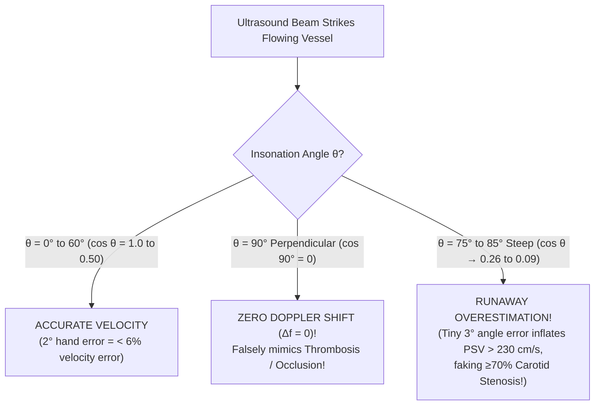
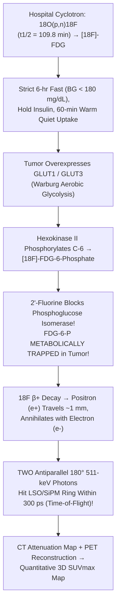
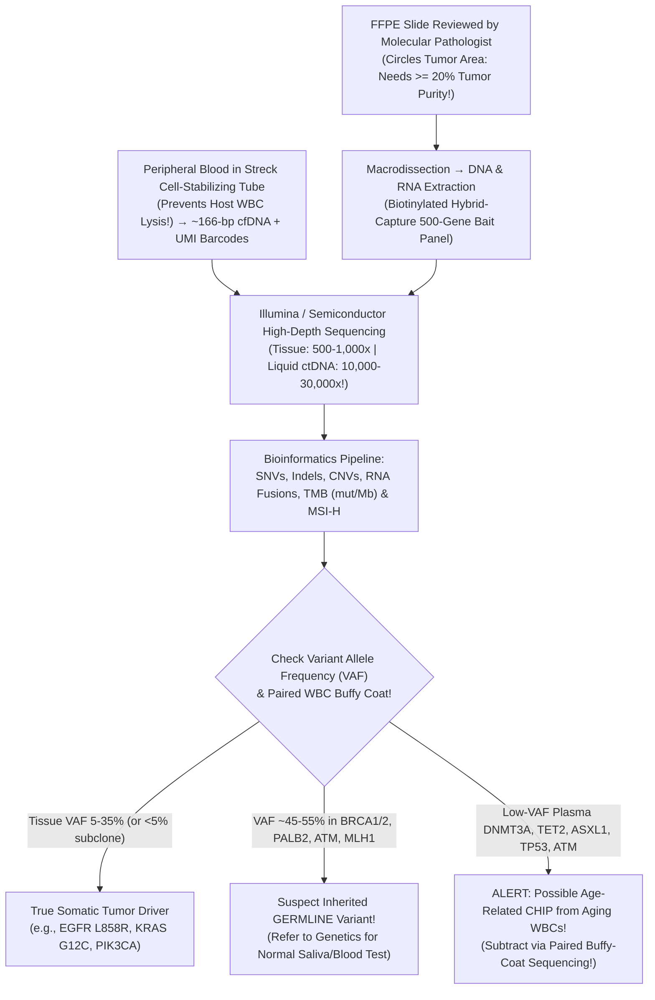
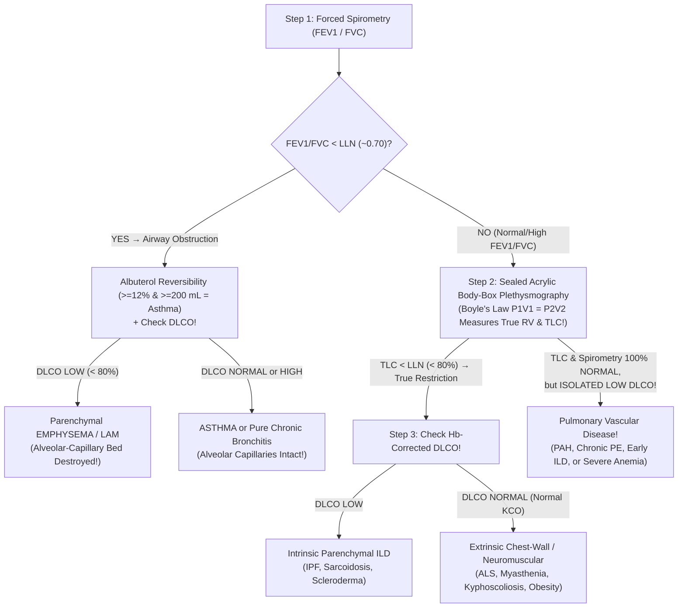

# Bundle 04 — Ep 804: Behind the Lead Glass & The Cryostat (All-In-One)

## ZERO-MIXUP SINGLE-SOURCE BUNDLE FOR GOOGLE NOTEBOOKLM

**How to use in NotebookLM (`notebook.google.com`):**

1. Check **ONLY THIS ONE DOCUMENT** in your NotebookLM Sources sidebar (uncheck all others — every reference treatise and script needed for this episode is merged right inside this single file!).
2. Click **Customize** on **Audio Overview**, choose **Longer**, and paste this exact prompt:

```text
Go behind the lead glass and into the pathology lab: CT Hounsfield physics, 3T MRI superconducting gradient coils, 511-keV coincidence PET detectors, 20-minute OR cryostat frozen sections vs 5-day FFPE tissue processing.
```

---


---

## INCLUDED SOURCE: `VOLUME_VII_RADIOLOGY_CT_MRI_ULTRASOUND_AND_NUCLEAR_PET_PHYSICS_BEHIND_THE_GLASS.md`

# Basic Medical — Behind the Curtain Clinical Diagnostics Notebook
## Volume VII: Radiology, `CT`, `MRI`, Ultrasound & Nuclear `PET/CT` Physics Behind the Glass

> *"When the emergency physician clicks 'Order CTA Chest — Rule Out Pulmonary Embolism' or 'MRI Brain Without Contrast — Stroke Code,' the patient experiences twenty minutes on a motorized carbon-fiber table listening to whirring gantries or thunderous metallic knocking. Behind the leaded barium-glass window and inside the copper-lined Faraday vault, however, an extraordinary symphony of relativistic electron braking, $33.2\text{-keV}$ K-shell photoelectric absorption, piezoelectric crystal resonance, $4.2\text{-Kelvin}$ superconducting quantum spin precession, and $511\text{-keV}$ antimatter positron-electron annihilation converts invisible human pathophysiology into millimeter-scale grayscale truth."*

---

## Architectural Orientation: The Four Physical Regimes of Diagnostic Imaging

Every clinical imaging modality interrogates living tissue through a fundamentally distinct physical carrier wave or subatomic particle, trading spatial resolution, temporal resolution, soft-tissue contrast, and ionizing radiation against one another (*Bushberg et al., The Essential Physics of Medical Imaging*, 4th ed.):

| Imaging Modality | Physical Probe & Energy Regime | Primary Tissue Property Measured | Typical Spatial Resolution | Ionizing Radiation (`mSv`) | Signature Clinical Superpower |
| :--- | :--- | :--- | :--- | :--- | :--- |
| **Multi-Detector / Photon-Counting `CT`** | Polyenergetic X-ray photons (`80–140 kVp`; mean `45–70 keV`) | Linear attenuation coefficient $\mu(x,y,z)$ ($Z_{\text{eff}}$ & electron density $\rho_e$) | `0.2–0.6 mm` isotropic (`< 5 sec` whole-body scan) | `1.5–2 mSv` (Head/Low-Dose Chest) to `7–12 mSv` (Abdomen/Pelvis) | Trauma, acute hemorrhage, cortical bone, lung parenchyma, coronary/pulmonary/aortic `CTA`, nephrolithiasis |
| **Diagnostic Ultrasound & Spectral Doppler** | High-frequency mechanical longitudinal sound waves (`2–18 MHz`) | Acoustic impedance mismatch ($\Delta Z = \Delta[\rho c]$) & RBC Doppler shift ($\Delta f$) | `0.15–1.0 mm` (depth-dependent) | **`0 mSv`** (purely mechanical pressure waves) | Real-time bedside `POCUS`, biliary/renal calculi, cysts vs solids, vascular stenosis/DVT, obstetrics, `FibroScan` stiffness |
| **`DEXA` (`DXA`) Absorptiometry** | Dual-energy low-flux X-ray beams (`~40 keV` & `~75 keV`) | Areal hydroxyapatite Bone Mineral Density (`BMD`, $\text{g/cm}^2$) after soft-tissue subtraction | `~1 mm` planar projection | `< 0.005 mSv` (`< 1 day` background radiation) | Gold-standard diagnosis & treatment monitoring of osteoporosis (`T-score` & `Z-score`) |
| **`1.5T` / `3.0T` Superconducting `MRI`** | Static $\mathbf{B}_0$ magnetic field + `64/128 MHz` RF pulses (non-ionizing radio waves) | $^1\text{H}$ proton density, $T_1$ longitudinal recovery, $T_2$ transverse decay, Brownian water diffusion (`ADC`) | `0.5–1.5 mm` (`3–5 min` per pulse sequence) | **`0 mSv`** (ferromagnetic & `SAR` thermal hazards instead) | Hyperacute ischemic stroke (`6 min`), white-matter demyelination, spinal cord, ligaments/menisci, multiphasic liver/prostate |
| **Nuclear `SPECT` & Positron `PET/CT`** | Radiopharmaceutical-emitted $\gamma$-rays (`140 keV` $^{99\text{m}}\text{Tc}$ or dual `511 keV` $\beta^+$ annihilation) | Picomolar-to-nanomolar metabolic flux (`GLUT1`/Hexokinase), perfusion, biliary excretion, receptor density | `4–8 mm` (`PET`) / `7–12 mm` (`SPECT`) fused with `CT` | `2–4 mSv` (`V/Q`, `HIDA`) to `10–18 mSv` (`FDG PET/CT`) | Oncologic staging (`SUVmax`), acute cholecystitis (`HIDA`), inducible myocardial ischemia, `SSTR2`/`PSMA` theranostics |

---

## Dossier 7.1: Spinning Tungsten Anodes, Hounsfield Units, K-Edge Iodine & Dual-Energy `CT` — What Happens Behind the Lead Glass

### 1. From Clinical Order to the Motorized Table: Pre-Scan Choreography

When an emergency physician, internist, or surgeon orders a contrast-enhanced Computed Tomography (`CT`) scan, a hidden safety and hemodynamic checklist unfolds before the patient ever enters the gantry room:

1. **Venous Access Engineering for Power Injection**: Rapid arterial-phase CT Angiography (`CTA`) requires a mechanical dual-syringe **power injector** driving viscous iodinated contrast at **`4.0–6.0 mL/sec`** (generating line pressures up to **`250–300 psi`**), immediately chased by a `30–40 mL` `0.9%` saline flush to compact the contrast bolus into a tight central venous column. Behind the curtain, the CT technologist inspects the intravenous catheter personally: an **`18-gauge` or `20-gauge` peripheral IV** seated cleanly in an **antecubital or large forearm vein** (or an explicitly purple-labeled `CT-power-injectable PICC/Port` rated to `300 psi` at `5 mL/s`) is mandatory. Attempting a `5 mL/s` `CTA` through a fragile `24-gauge` dorsal hand or wrist vein risks catheter blowout and **compartment-threatening contrast extravasation** into tight fascial planes—or smears the bolus so slowly that the pulmonary arteries never reach diagnostic opacification (`> 250 HU`).
2. **Isocenter Positioning & the Scout Topogram**: The technologist centers the patient precisely at the gantry **isocenter** using laser crosshairs (positioning a patient just `4 cm` off-center degrades bowtie-filter compensation and inflates surface radiation dose by `20–30%`!) and elevates both arms overhead during chest/abdomen scans so humeral cortical bone does not cast dense **beam-hardening streaks** across the liver and spleen. A low-dose `1–2 sec` planar **Scout Topogram** (`AP` and `Lateral` digital radiographs with the tube locked stationary) is acquired first. Modern **Automatic Exposure Control (`AEC` / `CareDose` / `Auto-mA`)** reads the patient's water-equivalent diameter slice-by-slice from this scout—automatically dialing tube current (`mA`) *down* across air-filled lungs (low attenuation) and dialing `mA` *up* across dense bony shoulders and the pelvis so quantum image noise remains constant at the lowest achievable radiation dose (**ALARA**: *As Low As Reasonably Achievable*).

---

### 2. X-Ray Generation, Matter Interactions & Anti-Scatter Physics

#### A. Inside the Evacuated Glass-Metal X-Ray Tube: `99%` Heat, `1%` Photons
Mounted inside the rotating CT gantry is a heavy oil-cooled vacuum housing containing two electrodes separated by a high-voltage dielectric gap:

* **The Cathode Filament (`mA` Controls Photon Quantity)**: A coiled thoriated-tungsten wire (`~2 mm` wide) is heated by a `4–10 Amp` filament current past `2,200°C`, boiling off a dense cloud of free electrons via **thermionic emission** inside a negatively charged molybdenum focusing cup. The **tube current (`mA`, milliamperes)** multiplied by exposure time (`s`) equals **`mAs`**, which linearly dictates the **total number of electrons** striking the target—and therefore the **total photon flux**. Doubling `mAs` doubles radiation dose and cuts quantum mottle (grainy noise, $\sigma \propto 1/\sqrt{N}$) by $\sqrt{2}$.
* **The `10,000-RPM` Rotating Tungsten Anode (`kVp` Controls Photon Energy & Penetrability)**: Across the vacuum gap, a high-voltage generator applies **`80, 100, 120, or 140 kVp` (kilovoltage peak)**, accelerating the electron cloud to **half the speed of light** (`~0.5c` at `80 kVp` to `~0.62c` at `140 kVp`) before slamming it into a beveled focal track (`0.5–1.2 mm` effective focal spot) of **Tungsten-Rhenium alloy** (`90% W / 10% Re`). Tungsten is chosen for three physical reasons: high atomic number (**$Z = 74$**, maximizing radiative braking efficiency $\propto Z$), extreme melting point (**`3,422°C`**), and rapid thermal conductivity. Even so, **`~99%` of the kinetic energy of colliding electrons degrades directly into intense heat** via outer-shell vibrational excitations! If the electron beam struck a stationary spot, the tungsten face would vaporize in milliseconds; therefore, a frictionless vacuum induction motor spins the anode disc at **`8,000–10,000 RPM`**, spreading the multi-megawatt thermal load over a `360°` annular track.
* **The `1%` Radiative Yield — Bremsstrahlung vs. Characteristic K-Shell X-Rays**:
  1. **Bremsstrahlung ("Braking Radiation" — ~`80–85%` of diagnostic output)**: When a relativistic projectile electron passes microscopically close to a positively charged $+74$ tungsten nucleus, intense Coulombic attraction violently deflects and decelerates the electron. By conservation of energy, the lost kinetic energy radiates away immediately as an X-ray photon of continuous energy anywhere from near `0 keV` up to the exact peak voltage (`E_max = kVp`, e.g., `120 keV` at `120 kVp`). Low-energy ("soft") X-rays (`< 25 keV`) that would only burn the patient's skin without ever exiting the body are stripped out by `2.5–7 mm` aluminum/copper flat filters and a contoured Teflon **bowtie filter**, shifting the **mean effective beam energy to roughly `1/3` to `1/2` of `kVp`** (e.g., a `120 kVp` CT beam has a mean photon energy of **`~55–65 keV`**).
  2. **Characteristic X-Rays (~`15–20%` discrete spikes)**: Whenever `kVp` exceeds Tungsten's innermost **`K`-shell electron binding energy (`69.5 keV`)**, a projectile electron can knock a `K`-shell electron completely out of the tungsten atom. An outer `L`-shell (`~10.2 keV` binding energy) or `M`-shell electron cascades down into the `K`-shell vacancy, emitting sharp monochromatic X-ray spikes at exact energy differences (**$K_\alpha \approx 59.3\text{ keV}$** and **$K_\beta \approx 67.2\text{ keV}$**).

#### B. Inside the Patient: Photoelectric Sharpness ($\propto Z^3/E^3$) vs. Compton Scatter Fog
Once the filtered X-ray beam enters human tissue, individual `30–140 keV` photons undergo three fates: **unattenuated transmission** straight into the detector, **Photoelectric Absorption**, or **Compton Incoherent Scatter** (*Bushberg*, Ch. 3):

1. **The Photoelectric Effect — The Engine of Crisp Anatomic & Contrast Shadowing**:
   An incident X-ray photon of energy $E$ collides with a tightly bound inner **`K`-shell electron** of a tissue atom (provided $E \ge E_K$, the `K`-edge binding energy) and **vanishes completely**, transferring all its energy to eject a short-range photoelectron ($E_{e^-} = E - E_K$). The mass attenuation probability ($\tau/\rho$) obeys a dramatic cubic power law:
   $$\frac{\tau}{\rho} \propto \frac{Z^3}{E^3}$$
   Look at what $Z^3$ accomplishes clinically! Soft tissue, water, muscle, and fat consist predominantly of Hydrogen ($Z=1$), Carbon ($Z=6$), Nitrogen ($Z=7$), and Oxygen ($Z=8$), yielding an effective atomic number **$Z_{\text{eff}} \approx 7.4$** ($7.4^3 \approx 405$). Cortical bone contains Calcium (**$Z = 20$**, $Z_{\text{eff}} \approx 13.8$, $13.8^3 \approx 2,628$ — a **`6.5×` jump** per gram, further multiplied by bone's `1.85 g/cm³` physical density!). Injected **Iodine ($Z = 53$)** boasts $53^3 = 148,877$ — over **`360×` greater photoelectric appetite per gram** than soft tissue! Simultaneously, the $1/E^3$ denominator explains why dropping CT voltage from `120 kVp` down to **`80 kVp`** in a lean patient or pediatric `CTPA` causes iodinated vessels to blaze twice as bright!
2. **Compton Incoherent Scatter — The Enemy of Abdominal Contrast & Staff Radiation Safety**:
   At higher diagnostic energies (`> 40–50 keV`) inside low-$Z$ soft tissue, an X-ray photon collides elastically-inelastically with a loosely bound **outer-shell valence electron**, knocking out a recoil Compton electron and deflecting at an angle $\theta$ as a lower-energy **scattered photon** ($E'$):
   $$E' = \frac{E}{1 + \frac{E}{511\text{ keV}}(1 - \cos\theta)}$$
   Crucially, Compton probability depends strictly on **electron density ($\rho_e$, electrons per $\text{cm}^3$)** and is **virtually independent of atomic number $Z$**. In a large or obese abdomen (`> 35 cm` AP thickness), vast tissue volume generates a blizzard of random-angle Compton-scattered photons. If those deflected photons strike the detector far from their true geometric ray path, they blanket the image in **gray contrast-destroying fog** (plummeting Contrast-to-Noise Ratio, `CNR`) while also spraying out of the gantry bore as the primary source of occupational radiation exposure to clinicians standing in the room!
   * **How Engineers Defeat Scatter**: Directly in front of the detector elements sits a precision-aligned **Anti-Scatter Grid** (thin **lead or tungsten septa** angled dynamically toward the X-ray focal spot). Primary photons traveling in straight geometric lines from the focal spot pass cleanly between the septa; off-axis Compton-scattered photons crash obliquely into the lead walls and are absorbed!

---

### 3. Helical Multi-Detector `CT`, Photon-Counting `CT` & Godfrey Hounsfield's Exact Math

#### A. Slip-Ring Helical Geometry, Pitch & Detector Evolution
Early 1970s scanners had to unwind high-voltage cables after every single slice ("step-and-shoot"). Modern **64-to-320-row Multi-Detector CT (`MDCT`)** scanners transmit kilovolt power and multi-gigabit optical data across brushless **slip rings**, allowing a `1,500-pound` gantry assembly to spin continuously at **`0.25–0.28 seconds per revolution`** (experiencing **`> 30 G`** of centrifugal acceleration—faster than a fighter jet centrifuge!) while the motorized table glides smoothly through the bore, tracing a continuous **helix**.

* **Helical Pitch ($P$)**:
  $$P = \frac{\text{Table Feed per } 360^\circ \text{ Gantry Rotation (mm)}}{\text{Total Nominal X-Ray Beam Collimation Width (mm)}}$$
  * **$P < 1.0$ (e.g., `0.2–0.6` Overlapping Helix)**: High spatial oversampling and retrospective ECG-gated coronary `CTA` fidelity, at higher radiation dose.
  * **$P = 1.0$**: Contiguous non-overlapping helical ribbons.
  * **$P > 1.0$ (e.g., `1.2–1.5`, up to `3.2` on Dual-Source Flash `CT`)**: Stretched fast helix—scanning an entire trauma chest-abdomen-pelvis or uncooperative dyspneic patient in **`1.5–3 seconds`**, slashing motion blur and radiation dose!
* **Conventional Energy-Integrating (`EID`) vs. Next-Generation Photon-Counting (`PCD-CT`) Detectors**:
  Traditional `MDCT` uses solid-state ceramic **scintillators** (such as Gadolinium Oxysulfide, $\text{Gd}_2\text{O}_2\text{S}$) separated by reflective septa: an X-ray creates a flash of visible light, which a silicon photodiode converts into an analog electrical current proportional to *total integrated energy* deposited during that reading interval (mixing low-energy high-contrast iodine photons with noisy electronic dark current). **Photon-Counting Detector CT (`PCD-CT`, FDA-cleared 2021)** replaces scintillators completely with direct-conversion **Cadmium Telluride (`CdTe` / `CZT`)** semiconductors: every single incident X-ray photon generates a discrete nanosecond charge cloud counted individually against `2–4` programmable kilovolt energy thresholds! Electronic dark noise drops to zero, reflective septa vanish (shrinking pixels to **`0.15–0.2 mm`** to visualize coronary stents and inner-ear ossicles cleanly), and **every single scan is natively multi-energy spectral**!
* **Reconstruction Math**: Each slice's 360° angular projection profiles (a **sinogram** via the **Radon Transform**) were classically solved via **Filtered Back-Projection (`FBP`)**, which works fast at normal doses but explodes with grainy streak noise at ultra-low doses. Modern scanners employ **Statistical Iterative Reconstruction** and **Deep-Learning Image Reconstruction (`DLIR`)**, modeling exact focal-spot geometry and Poisson photon statistics to cut radiation doses by **`50–80%`** (enabling **`1.0 mSv` Low-Dose Lung Cancer Screening `CT`** and **`< 1.5 mSv` renal stone `CT`**!).

#### B. Godfrey Hounsfield's Linear Attenuation Equation & The Universal Clinical `HU` Scale
As an X-ray pencil beam traverses heterogeneous voxels of width $\Delta x$, total transmission obeys the exponential **Beer-Lambert Law**:
$$I = I_0 \exp\!\left(-\sum_{i} \mu_i \,\Delta x\right)$$
Solving millions of intersecting ray sums reconstructs the exact linear attenuation coefficient $\mu(x,y,z)$ (in $\text{cm}^{-1}$) inside every `0.5 × 0.5 × 0.5 mm` voxel. Because raw $\mu$ shifts slightly with scanner `kVp` filtration, Sir **Godfrey Hounsfield** (1971 first clinical brain CT at Atkinson Morley Hospital; 1979 Nobel Prize in Physiology or Medicine with Allan Cormack) standardized every voxel on earth relative to pure distilled **Water ($\text{HU} = 0$)** and **Air ($\text{HU} = -1000$, where $\mu_{\text{air}} \approx 0$)**:

$$\text{HU} = 1000 \times \frac{\mu_{\text{tissue}} - \mu_{\text{water}}}{\mu_{\text{water}} - \mu_{\text{air}}} \approx 1000 \times \frac{\mu_{\text{tissue}} - \mu_{\text{water}}}{\mu_{\text{water}}}$$

Every `1 HU` step equals a **`0.1%` change** in X-ray linear attenuation relative to water! Placing an electronic circular **Region of Interest (`ROI`) cursor** on a PACS workstation turns pixel brightness into a quantitative bedside biopsy:

| Tissue, Fluid, Pathology or Material | Exact Hounsfield Unit (`HU`) Range | Underlying Biophysical Basis & Decisive Diagnostic Pearl |
| :--- | :--- | :--- |
| **Room Air / Pneumothorax / Free Peritoneal Gas** | **`-1000 HU`** | Virtually zero atomic mass/electron density ($\mu_{\text{air}} \approx 0$). Subcutaneous emphysema or pneumoperitoneum stands out pitch-black. |
| **Normal Aerated Lung Parenchyma** | **`-850 to -700 HU`** | `~80%` alveolar air + `20%` capillary/septal tissue; drops below `-950 HU` in panlobular emphysema; rises toward `-300 HU` in ground-glass (`GGO`) COVID/edema. |
| **Adipose Tissue / Lipoma / Chylothorax / Dermoid Fat** | **`-100 to -50 HU`** | Hydrocarbon `-CH2-` chains pack lower physical density (`0.92 g/cm³`) and lower $Z_{\text{eff}}$ (`~6.3`) than $\text{H}_2\text{O}$ (`1.00 g/cm³`, $Z_{\text{eff}} = 7.42$). Macroscopic fat in a renal mass proves benign **Angiomyolipoma (`AML`)**! |
| **Benign Lipid-Rich Adrenal Adenoma (Unenhanced)** | **`<= +10 HU`** (often `-15 to +8 HU`) | Abundant intracytoplasmic cholesterol/steroid lipid droplets pull voxel attenuation below `+10 HU` (**`98%` specificity for benignity** — sparing the patient biopsy or surgery!). |
| **Pure Water / Simple Renal or Hepatic Cyst / `CSF`** | **`0 HU`** (`-10 to +15 HU`) | Calibration reference ($\mu = \mu_{\text{water}}$). Homogeneous `< 20 HU` non-enhancing renal cyst = **Bosniak I** (`0%` malignancy). |
| **Transudative vs. Exudative Effusion / Ascites** | **`+2 to +15 HU`** (Transudate) vs **`+20 to +45 HU`** (Exudate / Hemothorax / Empyema) | Dissolved plasma proteins, neutrophils, fibrin, and cellular debris raise electron density linearly above pure water. |
| **Brain White Matter vs. Cortical Gray Matter** | **`+28 to +32 HU`** (White) vs **`+36 to +42 HU`** (Gray) | Myelin sheaths in white matter are **`~70%` lipid**, pulling white matter `~8 HU` *darker* than lipid-poor, capillary-rich neuronal gray matter! |
| **Skeletal Muscle / Unenhanced Kidney / Spleen** | **`+35 to +50 HU`** | Hydrated intracellular actin/myosin and parenchymal protein matrices. |
| **Normal Unenhanced Liver vs. Hepatic Steatosis** | **`+55 to +65 HU`** (Normal) vs **`< +40 HU`** (Moderate–Severe Fatty Liver) | Glycogen + iron keep normal liver `~8–10 HU` *brighter* than spleen. Intracellular triglycerides drag liver `> 10 HU` *darker* than spleen (making portal veins look artificially "bright" even without IV contrast!). |
| **Liquid Flowing Whole Blood (Aorta / Dural Sinus)** | **`+35 to +45 HU`** | Linearly proportional to **Hematocrit (`Hct`)**! Severe anemia (`Hct < 21%`) drops lumen blood to `+20 HU` (making the uncalcified aortic wall look falsely hyperdense); polycythemia (`Hct > 55%`) raises sinuses to `+60 HU` (mimicking dural venous sinus thrombosis!). |
| **Acute Retracted Clot / Acute Subdural / Hyperdense `MCA` Sign** | **`+60 to +85 HU`** | **Why fresh clots glow white without calcium**: Platelet-fibrin retraction squeezes watery serum (`0 HU`) out of the thrombus, concentrating dense **globin protein** (`Hct` inside clot reaches `~90%`!). Note: *not* iron—iron contributes `< 2 HU`! Over `1–3 weeks`, fibrinolysis liquefies the subdural clot through an **isodense phase (`+30–38 HU` — easy to miss!)** into a dark **chronic hygroma (`+10–20 HU`)**. |
| **Pure Uric Acid Renal Calculus** | **`+300 to +450 HU`** | Composed strictly of low-$Z$ `C, H, N, O` ($Z_{\text{eff}} \approx 6.9$): completely **radiolucent (invisible) on plain abdominal X-ray (`KUB`)**, yet unmistakably bright white (`+400 HU`) on non-contrast `CT`! Dissolves medically with oral potassium citrate! |
| **Calcium Oxalate Monohydrate / Brushite Stone** | **`+800 to +1,500+ HU`** | Calcium ($Z = 20$) surges photoelectric absorption; stones `> 1,000 HU` are rock-hard and resist extracorporeal shockwave lithotripsy (`ESWL`), steering urologists straight to laser ureteroscopy! |
| **Dense Cortical Bone** | **`+1,000 to +1,800 HU`** | Hydroxyapatite $\text{Ca}_{10}(\text{PO}_4)_6(\text{OH})_2$ crystal lattice (`~1.85 g/cm³`). |
| **Surgical Titanium / Cobalt-Chrome Hip / Dental Amalgam / Coils** | **`+3,000 to +30,000 HU`** (Extended `16-bit` scale) | Complete **photon starvation** + polychromatic **beam hardening** creates alternating dark bands and starburst white streaks across adjacent pelvic organs or oral pharynx (mitigated by Dual-Energy virtual monoenergetic `130-keV` reconstruction & Metal Artifact Reduction [`MAR`] algorithms). |

#### C. Window Width (`WW`) & Window Level (`WL`): Why One Scan Hides or Reveals an Acute Stroke
A standard `12-bit` CT matrix stores **`4,096` distinct Hounsfield shades** (`-1024` to `+3071 HU`), whereas the human retina and diagnostic monitor distinguish only **`~32 to 64` shades of gray** simultaneously! If a workstation mapped `-1000 HU` to pure black and `+3000 HU` to pure white (`WW = 4000`), every `65 HU` span would compress into a single indistinguishable gray shade—turning the entire brain (`+30` to `+40 HU`), muscle, liver, and acute stroke into one featureless gray blob!

Radiologists dynamically adjust two parameters on the mouse scroll wheel without ever re-scanning the patient:
* **Window Level (`WL`, or Center `C`)**: The exact `HU` value assigned to **50% mid-gray**—chosen to match the target organ's attenuation.
* **Window Width (`WW`)**: The total `HU` span stretched from pure black (`WL - WW/2`) to pure white (`WL + WW/2`). Any tissue below `WL - WW/2` clips to solid black; any tissue above `WL + WW/2` saturates at solid white:
  $$\text{Display Intensity (0–255)} = 255 \times \text{clamp}\!\left(\frac{\text{HU} - (\text{WL} - \text{WW}/2)}{\text{WW}},\, 0,\, 1\right)$$

> [!TIP]
> **The `4-HU` Hyperacute Stroke Window Trick Behind the Curtain**:
> Every **1% increase in brain tissue water** from early cytotoxic edema lowers parenchymal attenuation by **`~2.0 to 2.5 HU`**. Two hours into a right Middle Cerebral Artery (`MCA`) occlusion, the dying insular cortex or caudate/putamen drops from `+38 HU` to `+34 HU`—just a **`4-HU` delta**!
> * On a **Bone Window (`WW 2500 / WL 500`)**: Only `-750` to `+1750 HU` spans gray; `+38` vs `+34 HU` differs by `0.16%` brightness—**100% invisible** (used strictly for skull fractures and mastoid air cells).
> * On a **Routine Brain Window (`WW 80 / WL 40`)**: `0 HU` is black and `+80 HU` is white; `+38` vs `+34 HU` spans `5%` contrast—subtle loss of gray-white differentiation.
> * On a **Narrow "Stroke Window" (`WW 35 / WL 35` or `WW 40 / WL 40`)**: `+17.5 HU` is pure black and `+52.5 HU` is pure white! That exact same `4-HU` drop now explodes across **`> 11%` of the entire luminance range**, making insular ribbon effacement and basal ganglia hypodensity leap off the monitor in seconds! (Standard Chest/Abdomen windows: **Soft Tissue `WW 400 / WL 50`**, **Lung `WW 1500 / WL -600`**, **Liver `WW 150 / WL 70`**).

---

### 4. Intravenous Iodinated Contrast, K-Edge Dual-Energy `CT` & Bolus-Tracking Timing

#### A. Non-Ionic Tri-Iodinated Monomers & The Magic `33.2-keV` Iodine K-Edge
Modern intravenous CT contrast agents—such as **Iohexol (`Omnipaque`)**, **Iopamidol (`Isovue`)**, and **Iomeprol** (low-osmolality non-ionic monomers, **`~600–850 mOsm/kg H2O`**) or **Iodixanol (`Visipaque`)** (an iso-osmolar non-ionic dimer formulated at **`290 mOsm/kg`**, identical to human plasma)—built a pharmacology revolution upon `1950s` ionic high-osmolality salts (`Diatrizoate`, `> 1,500–2,000 mOsm/kg`, which caused violent endothelial pain, flushing, vomiting, and frequent anaphylactoid mast-cell degranulation). Each monomer attaches **three covalent iodine atoms (`2,4,6-triiodobenzene`)** to hydrophilic hydroxyl side chains that shield the hydrophobic core without dissociating into charged ions in blood!

Why did nature make **Iodine ($Z = 53$)** the undisputed champion of X-ray angiography? Because of its **`K`-Shell Binding Energy (`K-Edge` = `33.2 keV`)**!
* Photons at `32.9 keV` barely have enough energy to eject outer `L`-shell electrons of iodine.
* Photons at **`33.3 keV`** cross the `33.2 keV` `K`-shell threshold—causing iodine's photoelectric mass attenuation coefficient ($\mu/\rho$) to **vault upward `6-fold` instantaneously** (from `~6 cm²/g` to `~36 cm²/g`) right inside the sweet spot (`35–65 keV`) where `80–100 kVp` diagnostic X-ray tubes emit their peak photon flux! (Oral/rectal **Barium Sulfate**, $\text{BaSO}_4$, $Z = 56$, sits right beside Iodine with a **`37.4 keV` `K`-edge**—insoluble chalk suspension safe for intact bowel lumens, though **strictly contraindicated if esophageal or colonic perforation is suspected** because barium spilled into the mediastinum or peritoneum triggers lethal granulomatous mediastinitis/peritonitis; water-soluble iodinated `Gastrografin` / `Omnipaque` is used instead!).

#### B. Dual-Energy `CT` (`DECT`): Material Decomposition via `80 kVp` vs. `140 kVp`
On a single-energy `120 kVp` scan, a voxel measuring `+350 HU` is mathematically ambiguous: is it **dilute iodine contrast** (`Z = 53`), a **uric acid stone** (`Z_eff ≈ 6.9`), **clotted hemorrhage**, or **diffuse calcium** (`Z = 20`)? **Dual-Energy CT (`DECT`)**—acquired via dual orthogonal X-ray tubes (`80 kVp` + tin-filtered `Sn140 kVp`), ultra-fast kilovolt switching (`80 <-> 140 kVp` every `0.25 ms`), dual-layer sandwich detectors, or `PCD-CT`—measures every voxel at **two distinct photon energy spectra simultaneously**:
* High-$Z$ **Iodine (`Z=53`, `K`-edge `33.2 keV`)** nearly **doubles** its `HU` attenuation when shifting from `140 kVp` down to `80 kVp` (`DEI` ratio `~2.0`)!
* Medium-$Z$ **Calcium (`Z=20`, `K`-edge `4.0 keV`)** rises moderately (`ratio ~1.4–1.5`).
* Low-$Z$ **Uric Acid (`C5H4N4O3`, `Z_eff ≈ 6.9`)** exhibits virtually **flat attenuation (`ratio ~1.0`)** across `80` and `140 kVp`!
* **Clinical Payoffs**:
  1. **Non-Invasive Renal Stone Chemistry**: Color-codes pure uric acid calculi red vs. calcium calculi blue—allowing nephrologists/urologists to dissolve uric acid stones home-medically with oral **potassium citrate** (`target urine pH 6.5–7.0`) and cancel surgery!
  2. **Virtual Non-Contrast (`VNC`) & Iodine Maps**: Digitally subtracts all iodine from a single portal-venous scan to synthesize an unenhanced image (saving `50%` radiation!), proves whether a hyperdense renal lesion truly enhanced or was merely a hemorrhagic cyst, maps **pulmonary parenchymal perfusion defects** distal to subsegmental `PE`s, and identifies **monosodium urate gout crystals** in joints without arthrocentesis!

#### C. Bolus-Tracking Choreography: Why Seconds Decide Diagnosis (and How a Deep Breath Fakes a `PE`!)
Injected into an antecubital vein, an iodinated contrast bolus journeys sequentially through distinct vascular beds. Mistiming the helical sweep by even `6 seconds` can completely hide a life-threatening diagnosis:

```mermaid
flowchart LR
    IV["Antecubital 18G IV<br/>(4-5 mL/s Power Injector)"] --> RA["Right Heart & Pulmonary Trunk<br/>(12-15 s: CTPA for PE)"]
    RA --> AO["Left Heart & Systemic Aorta<br/>(18-25 s: CTA Stroke / Dissection)"]
    AO --> LA["Late Arterial Parenchymal<br/>(35-40 s: Hypervascular HCC / Pancreas)"]
    LA --> PV["Portal Venous Phase<br/>(65-75 s: Routine Liver / GI / Sepsis)"]
    PV --> NP["Nephrographic Phase<br/>(90-100 s: Renal Corticomedullary Mass)"]
    NP --> EX["Excretory / Washout Phase<br/>(10-15 min: CT Urogram & Adrenal Washout)"]
```



Behind the lead glass, because a young hyperdynamic trauma patient (`CO = 9 L/min`) circulates blood three times faster than an elderly patient in cardiogenic shock (`EF = 15%`), fixed timer delays fail. Instead, the CT technologist runs **Automated Bolus Tracking (`SmartPrep` / `CARE Bolus`)**:
1. The tech draws a small circular **`ROI` sensor** inside the target vessel on a single stationary axial slice and starts `4–5 mL/s` injection.
2. Every `1.0–1.5 seconds`, the scanner fires a tiny ultra-low-dose monitoring pulse, plotting real-time `HU` inside that circle on the console screen.
3. The instant lumen attenuation crosses **`100–150 HU`**, the table automatically snaps to the start position, plays the breath-hold audio prompt, and fires the full helical sweep:
   * **`12–15 sec` — `CT` Pulmonary Angiography (`CTPA`)**: `ROI` placed on the **Main Pulmonary Trunk**. Goal: bright white pulmonary arteries (`> 250–350 HU`) before contrast floods left-sided pulmonary veins, silhouetting dark intraluminal saddle or lobar **Pulmonary Emboli (`PE`, "polo-mint" or "railway-track" filling defects)**.
   * **`18–25 sec` — Systemic Arterial `CTA`**: `ROI` placed on the **Ascending or Descending Thoracic Aorta**. Captures intimal flaps in **Stanford Type A/B Aortic Dissection**, active `GI` or pelvic arterial **contrast blush/extravasation**, intracranial **Circle of Willis `LVO` thrombi / Berry aneurysms**, and **Late Arterial (`35–40 s`)** hepatic-artery-fed **Hepatocellular Carcinoma (`HCC`, LI-RADS arterial-phase hyperenhancement)** or pancreatic adenocarcinoma (hypodense tumor against briskly enhancing normal pancreas).
   * **`65–75 sec` — Portal Venous Phase (`PVP`)**: Blood has circulated through the splenic and mesenteric capillaries into the **Portal Vein** (which supplies **`75–80%` of normal hepatic blood flow**). Normal liver parenchyma reaches peak brightness (`+110–130 HU`), unmasking hypovascular colorectal/breast metastases, hepatic abscesses, appendicitis, diverticulitis, and mesenteric venous thrombosis.
   * **`10–15 min` — Delayed Excretory / Adrenal Washout Phase**: Opacifies renal calyces, ureters, and bladder for urothelial carcinoma (`CT Urogram`), detects **late portal/delayed washout + capsular appearance in `HCC`**, shows progressive fibrotic pooling in **cholangiocarcinoma**, and proves whether an indeterminate lipid-poor adrenal nodule (`> +10 HU` unenhanced) is a benign capillary-leaky **lipid-poor adenoma** (**Absolute Percentage Washout `APW >= 60%`**: $\text{APW} = 100 \times \frac{\text{HU}_{\text{portal}} - \text{HU}_{15\text{m}}}{\text{HU}_{\text{portal}} - \text{HU}_{\text{unenh}}}$) versus slow-washout metastasis, adrenocortical carcinoma, or pheochromocytoma!

> [!WARNING]
> **The Classic `CTPA` Trap — How a Deep Inspiratory Gasp Creates a Fake Pulmonary Embolism ("Transient Interruption of Contrast")**:
> During a `12-second` `CTPA`, contrast enters strictly via the upper-extremity **Superior Vena Cava (`SVC`)**, while blood returning from the legs/kidneys via the **Inferior Vena Cava (`IVC`) is `100%` unopacified (`+40 HU` dark blood)**. If the patient hears *"Take a deep breath in and hold it!"* and sucks in a **violent inspiratory gasp** followed by a **Valsalva glottic strain**:
> 1. Sudden negative intrathoracic pressure (`-25 cmH2O`) acts like a giant vacuum pump, sucking a torrent of **dark unopacified `IVC` blood** straight into the right atrium while the tense diaphragm and subsequent positive-pressure Valsalva pinch off `SVC` contrast inflow!
> 2. A bolus of dark `IVC` blood washes straight through the right ventricle into the lower-lobe pulmonary arteries—creating an abrupt **dark intraluminal drop (`< 100 HU`) or swirling mixing artifact** that mimics an acute pulmonary embolism (recognizable because the main pulmonary trunk is unexpectedly dim while the `SVC` and aorta are bright!).
> * **Behind-the-Glass Fix**: Skilled CT technologists coach patients *before* injection: **"When the machine speaks, take only a tiny, gentle breath—just stop breathing where you are, and do NOT bear down!"**

---

### 5. Contrast Nephropathy Myth vs. Reality (`ACR–NKF` Consensus), `Metformin` & Thyroid Safety

For forty years, fear of **"Contrast-Induced Nephropathy (`CIN`)"** caused well-meaning clinicians to cancel or delay urgent contrast `CT` scans in septic, hypotensive, or stroke patients—costing lives from missed mesenteric ischemia, aortic dissection, and abscesses. Landmark propensity-matched propensity studies of `> 100,000` hospitalized patients (McDonald et al., Davenport et al.) culminating in the **2020 Joint American College of Radiology (`ACR`) and National Kidney Foundation (`NKF`) Consensus Statement** revolutionized clinical practice:

1. **Contrast-Associated `AKI` (`CA-AKI`) vs. True Contrast-Induced `AKI` (`CI-AKI`)**:
   * **`CA-AKI` (Post-Contrast `AKI`)** is a purely *correlational* rise in serum creatinine within `48–72 hours` after a scan—overwhelmingly driven by the **confounding acute illness** that prompted the `CT` in the first place (septic shock, hypovolemia, nephrotoxic antibiotics, heart failure, or cholesterol atheroemboli from arterial catheters!).
   * **True `CI-AKI`** (direct causal renal medullary vasoconstriction + tubular viscosity injury caused by IV low/iso-osmolar iodinated contrast) has an incidence **indistinguishable from `0%` in patients with stable `eGFR >= 30 mL/min/1.73 m²`**!
   * **The `ACR–NKF` Clinical Action Thresholds**:
     * **`eGFR >= 30 mL/min/1.73 m²`**: **Zero prophylaxis required; proceed directly with IV contrast.** (`eGFR 30–44` carries at most `0–2%` borderline risk; prophylaxis is unnecessary for `eGFR >= 30` unless multiple acute nephrotoxic hits coexist).
     * **`eGFR < 30 mL/min/1.73 m²` (non-dialysis) OR Active Acute Kidney Injury (`AKI`)**: True `CI-AKI` risk exists (`~5–10%`). First ask: *Can non-contrast CT, Ultrasound, or non-contrast MRI answer the question?* **If life- or limb-saving diagnosis requires IV contrast (`CTA` stroke, `PE`, trauma, dissection, occult sepsis), NEVER withhold contrast regardless of `eGFR`!** In non-emergent `eGFR < 30` patients without decompensated volume overload, infuse **isotonic `0.9%` Normal Saline** (`100 mL/hr` or `1–1.5 mL/kg/hr` starting `1 hour` pre-scan through `3–12 hours` post-scan) to dilute intratubular contrast viscosity. (**Oral `N`-acetylcysteine [`NAC`]** and **sodium bicarbonate** showed zero benefit over normal saline in the landmark **`PRESERVE` Trial** [*NEJM* 2018] and are obsolete!).
     * **Anuric End-Stage Renal Disease (`ESRD`) on Chronic Dialysis**: Zero remaining nephrons exist to protect, and low-osmolality contrast (`100 mL`) does *not* require urgent post-scan emergent hemodialysis!
2. **Why `Metformin` Does NOT Injure Kidneys (The `MALA` Clearance Mechanism)**:
   One of medicine's most persistent boards/ward myths is that *"Metformin + CT dye is nephrotoxic."* **Metformin causes zero glomerular or tubular injury!** Rather, metformin is cleared **`100%` unchanged by renal tubular secretion** (`OCT2` / `MATE1`). If—and *only* if—a patient already has severe renal impairment or suffers concurrent `AKI`, unexcreted metformin accumulates in plasma, inhibiting hepatic mitochondrial Complex I and cytosolic glycerophosphate dehydrogenase, halting gluconeogenesis from lactate and precipitating **Metformin-Associated Lactic Acidosis (`MALA`, `pH < 7.1`, `lactate > 10 mmol/L`, `~30–50%` mortality)**.
   * **`ACR` & `FDA` Protocol**:
     * **`eGFR >= 30` with no `AKI` and no intra-arterial renal catheterization**: **Do NOT even hold Metformin!**
     * **`eGFR < 30`, active `AKI`, or intra-arterial catheter study with renal emboli risk**: Hold Metformin at the time of contrast injection for **`48 hours`**, recheck renal function at `48h`, and resume once `eGFR` is stable/restored.
3. **Prior Contrast Reactions & Thyroid (`Jod-Basedow`) Precautions**:
   * **"Shellfish Allergy" Is a Total Myth**: Shellfish anaphylaxis is an `IgE` reaction to **tropomyosin muscle protein**, *not* elemental iodine (iodine is an essential endogenous atom inside every human's `T4` hormone!). A shellfish or topical povidone-iodine rash does **not** require premedication! Only a documented prior moderate/severe **acute anaphylactoid reaction to iodinated contrast** warrants switching contrast agent class + **`13-hour` oral steroid/antihistamine premedication** (`Prednisone 50 mg PO` at `13h`, `7h`, and `1h` prior + `Diphenhydramine 50 mg` at `1h`; note steroids take `>= 4–6 hours` of nuclear transcription to work!).
   * **The `30,000-µg` Free Iodide Surge**: A single `100 mL` dose of `350 mgI/mL` contrast contains `35,000,000 µg` of bound iodine and delivers **`~3,000–13,500 µg` of bioavailable free inorganic iodide (`I-`)**—nearly **`100×` the `150 µg` daily requirement**! Normal thyroids shut down organification transiently (**Wolff-Chaikoff effect**), but patients with **untreated Graves' disease or autonomous multinodular toxic goiter** lack autoregulation and can erupt into life-threatening **Jod-Basedow Hyperthyroid Storm** (`3–6 weeks` post-scan)! Furthermore, iodinated contrast saturates thyroid `NIS` symporters for **`4–8 weeks`**, blinding diagnostic thyroid uptake scans or **`131I` radioactive iodine ablation** for differentiated thyroid cancer!

---

## Dossier 7.2: Piezoelectric Echoes, Acoustic Shadowing & Spectral Doppler Ultrasound — Plus `DEXA` Absorptiometry (`T-Score` vs `Z-Score`)

### 1. Lead Zirconate Titanate (`PZT`) Piezoelectric Physics & Probe Selection

Diagnostic ultrasound uses **zero ionizing radiation**: instead, an array of `128–256` microscopic **Lead Zirconate Titanate (`PZT`, $\text{Pb}[\text{Zr}_x\text{Ti}_{1-x}]\text{O}_3$)** ceramic crystals exploits the reversible **Piezoelectric Effect** (discovered by Pierre and Jacques Curie, 1880):
1. **Transmit (`~0.1–1%` of each cycle)**: A `100-Volt` electrical spike physically expands and contracts the non-centrosymmetric `PZT` crystal lattice, launching a `2–3` wavelength longitudinal mechanical pressure pulse (`2–18 MHz` — `100×` to `900×` above the `20 kHz` ceiling of human hearing!) into tissue.
2. **Listen (`~99%` of each cycle!)**: While silent, the exact same `PZT` crystals feel tiny returning mechanical pressure echoes squeeze their crystal faces, instantly generating microvolt-to-millivolt electrical signals! Because ultrasound travels through average human soft tissue at a remarkably uniform speed of **`c = 1,540 m/s`** (`1.54 mm/µs`), the scanner computes reflector depth $d$ strictly from round-trip stopwatch arrival time $t$:
   $$d = \frac{c \cdot t}{2} \quad \Longrightarrow \quad \text{Exactly } 13\,\mu\text{s round-trip per } 1\text{ cm of tissue depth!}$$
3. **Time-Gain Compensation (`TGC`) & The Fundamental Frequency–Penetration Trade-Off**:
   As sound waves travel deeper, tissue frictional absorption (`viscoelastic heat`) attenuates acoustic intensity exponentially at **`~0.5 dB / cm / MHz`**. Behind the curtain, the sonographer sweeps the **8 horizontal `TGC` sliders** progressively to the right (higher gain for deeper echoes) so liver at `14 cm` looks just as bright as liver at `3 cm`. Notice that attenuation scales *linearly with frequency* ($\text{MHz}$), whereas **Axial Spatial Resolution** equals half the spatial pulse length ($\text{SPL}/2 \propto \lambda = c/f$):
   * **High-Frequency Linear Array (`7–15 MHz`, up to `22 MHz`)**: Short wavelength (`~0.1 mm`) yields **microscopic `0.15 mm` resolution**—visualizing a `2 mm` thyroid microcalcification, internal jugular vein valve during `IJ` central line cannulation, femoral/popliteal `DVT`, or testicular spermatic cord torsion—but dies out completely beyond **`4–6 cm` depth**!
   * **Low-Frequency Curvilinear (`2–5 MHz`) & Cardiac Phased-Array (`1–5 MHz`)**: Longer wavelength (`~0.4–0.8 mm`) sacrifices sub-millimeter detail in exchange for **deep `15–25 cm` penetration** to reach the retroperitoneal kidneys, abdominal aorta, cirrhotic liver, fetus, or subxiphoid pericardium (with the tiny `2 cm` square phased-array footprint slipping neatly *between* acoustic-shadowing ribs!).

---

### 2. Acoustic Impedance ($Z = \rho c$), Why Sonic Gel Exists & Lung `POCUS` (`A-Lines` vs `B-Lines`)

Why doesn't an ultrasound image simply show absolute tissue density like `CT`? Because echoes arise *only* at interfaces where **Acoustic Impedance ($Z$, in $\text{Rayls} = \text{kg}/[\text{m}^2\cdot\text{s}]$)** changes! Acoustic impedance is the product of tissue density $\rho$ and propagation speed $c$:
$$Z = \rho \cdot c$$
At a perpendicular tissue boundary between Medium 1 ($Z_1$) and Medium 2 ($Z_2$), the fraction of acoustic intensity **reflected back** toward the probe ($R$) obeys the **Fresnel Acoustic Reflection Equation**:
$$R = \left(\frac{Z_2 - Z_1}{Z_2 + Z_1}\right)^2 \qquad (\text{Transmitted fraction } T = 1 - R)$$

Plug in the real physiological numbers to witness why bedside ultrasound behaves the way it does:
* **Liver ($Z_1 = 1.65\text{ MRayls}$) to Kidney Cortex ($Z_2 = 1.62\text{ MRayls}$)**:
  $$R = \left(\frac{1.62 - 1.65}{1.62 + 1.65}\right)^2 \approx 0.00008 \quad (\mathbf{0.008\%}\text{ reflected; }\mathbf{99.99\%}\text{ continues deeper!})$$
  Tiny `0.01–1%` reflections let a single pulse paint 15 centimeters of stacked organ boundaries in one trip!
* **Soft Tissue ($Z_1 = 1.63 \times 10^6\text{ Rayls}$) to Air ($Z_2 \approx 429\text{ Rayls}$, `c = 330 m/s`)**:
  $$R = \left(\frac{429 - 1,630,000}{429 + 1,630,000}\right)^2 \approx \mathbf{0.9990} \quad (\mathbf{99.9\%\text{ TOTAL REFLECTION!}})$$
  Even a `10-micrometer` invisible film of trapped room air between a dry probe face and skin reflects `99.9%` of the sound wave right at the plastic lens, turning the entire monitor black! Warmed **water-based polyacrylic coupling gel** ($Z_{\text{gel}} \approx 1.50\text{ MRayls}$) displaces all air so `> 99.8%` of acoustic energy enters the skin! (Soft tissue to **Cortical Bone**, $Z_2 \approx 7.8\text{ MRayls}$, reflects `~43%` and absorbs the rest—which is why ribs cast dark acoustic shadows).

#### How Emergency Physicians Turn "Un-Imageable" Lung Air Artifacts into `30-Second` Diagnostics (`BLUE` Protocol)
For decades, textbooks claimed *"ultrasound cannot image the lung because air reflects `99.9%` of the beam."* Pioneer intensivist **Daniel Lichtenstein** realized that *how* the pleural interface generates artifacts immediately differentiates acute dyspnea causes at the bedside (`> 90–95%` accuracy, faster and more sensitive than supine portable chest X-ray!):
* **Normal Aerated Lung (`Lung Sliding` + `A-Lines`)**: Visceral pleura glides smoothly against parietal pleura with every breath ("shimmering ants on a string"; **M-mode "Seashore Sign"** = flat chest-wall waves over granular sandy lung motion). Because `99.9%` of the beam bounces off alveolar air back to the probe lens, reflects *off the probe lens again*, and returns a second and third time at $2\times d_{\text{pleura}}$ and $3\times d_{\text{pleura}}$, the machine draws crisp **horizontal equidistant reverberation lines (`A-lines`)**—proving dry, air-filled subpleural alveoli (seen in normal lungs, asthma, `COPD`, or `PE`).
* **Cardiogenic Pulmonary Edema / `ARDS` (`B-Lines` / "Lung Rockets")**: When left atrial pressure rises (`PCWP > 18 mmHg`), fluid engorges subpleural interlobular septa surrounded by alveolar air. Ultrasound enters these microscopic fluid-air acoustic traps and reverberates internally thousands of times, spraying a continuous stream of echoes back to the probe that the computer plots as **vertical, laser-like hyperechoic beams arising straight from the pleural line, erasing `A-lines`, moving with lung sliding, and shooting unattenuated to the bottom of the screen (`B-lines`)**! Three or more `B-lines` per rib space bilaterally diagnoses interstitial/alveolar pulmonary edema in `60 seconds`!
* **Pneumothorax (`Absent Lung Sliding` + `Barcode Sign` + `Lung Point`)**: Free pleural air separates visceral pleura from the chest wall: shimmering lung sliding vanishes (`M-mode` turns into uniform horizontal stripes top-to-bottom = **"Stratosphere / Barcode Sign"**), `B-lines` become physically impossible (`100%` negative predictive value: seeing even one `B-line` rules *out* pneumothorax at that interspace!), and sliding the probe laterally locates the exact millimeter where collapsing lung intermittently touches the chest wall (**"Lung Point" = `100%` specific for pneumothorax**!).

---

### 3. Posterior Acoustic Shadowing vs. Enhancement & Sacred `<= 60°` Spectral Doppler Math

#### A. Two Opposite Artifacts That Differentiate Stones, Cysts, and Solid Tumors
1. **Clean Posterior Acoustic Shadowing (Gallstones & Renal Calculi)**: When the beam strikes a cholesterol/pigment gallstone or renal pelvic stone, virtually `100%` of acoustic energy is reflected and absorbed at the anterior stone surface. Zero sound reaches deeper liver or retroperitoneum—casting a razor-sharp **jet-black anechoic corridor ("clean shadow")** trailing behind a bright echogenic arc! Combined with gallbladder wall edema (`> 3 mm`), pericholecystic fluid, and a **positive Sonographic Murphy's Sign** (maximal tenderness elicited when the sonographer presses the probe *directly over the visualized gallbladder fundus*), ultrasound outperforms `CT` (`~20%` of cholesterol gallstones are isodense to bile and **invisible on `CT`**!).
2. **Posterior Acoustic Enhancement ("Through-Transmission" Behind Benign Cysts)**: The machine's `TGC` amplifier *assumes* every centimeter of tissue attenuates sound at `0.5 dB/cm/MHz` and automatically boosts deeper pixels accordingly. When a beam passes through a `3 cm` **simple fluid cyst** (virtually `0 dB` attenuation!), it arrives at the tissue *behind* the cyst carrying far more energy than adjacent beams that traveled through solid parenchyma—making the tissue directly deep to the cyst **glow brightly ("posterior enhancement")**! That bright tail proves a dark black circle is benign liquid rather than a dangerous hypoechoic solid tumor (such as lymphoma or breast carcinoma, which attenuates sound and casts dark edges!).

#### B. The Doppler Equation & Why Insonation Angle $\theta \le 60^\circ$ Is Sacred
When an ultrasound pulse of transmitted frequency $f_0$ strikes red blood cells flowing at velocity $v$ at an **insonation angle $\theta$** relative to the ultrasound beam axis, returning echoes shift in frequency by the **Doppler Shift ($\Delta f = f_{\text{received}} - f_0$)**:

$$\Delta f = \frac{2 \, f_0 \, v \, \cos\theta}{c} \quad \Longleftrightarrow \quad v = \frac{\Delta f \cdot c}{2 \, f_0 \, \cos\theta}$$

* **Why the Factor of `2`?**: Moving erythrocytes experience a *double* Doppler shift—first acting as moving *receivers* intercepting incoming wave crests faster (or slower), and instantaneously acting as moving *transmitters* compressing (or stretching) reflected wave crests back toward the stationary probe!
* **Color Doppler Convention (`BART`)**: By default, positive $\Delta f$ displays **Red (flow *Toward* the probe)** and negative $\Delta f$ displays **Blue (flow *Away* from the probe)**—**`BART`: Blue Away, Red Toward** (tilting the probe `20°` the opposite way turns the exact same artery from red to blue! Never assume red = artery and blue = vein!). If blood jet velocity exceeds the **Nyquist Limit** ($\Delta f_{\max} = \text{PRF}/2$, half the Pulse Repetition Frequency), phase wraps around (`aliasing`), painting turbulent mosaic yellow-cyan swirls right at a stenosis or regurgitant heart valve!
* **Why $\theta \le 60^\circ$ Prevents Catastrophic Misdiagnosis Behind the Curtain**:
  Notice $\cos\theta$ sitting in the **denominator** of the velocity equation $v = \frac{\Delta f \cdot c}{2 f_0 \cos\theta}$! During a Carotid Duplex or Renal Transplant Doppler exam, the vascular sonographer manually rotates an electronic **angle-correction cursor bar** parallel to the vessel lumen wall while electronically steering the beam so **$\theta$ stays strictly between `45°` and `60°`**:



  * **The `90°` Perpendicular Blind Spot**: Most superficial vessels (carotid, femoral, radial, dialysis fistula) run parallel to the skin—meaning a probe held flat on the skin shoots sound at **$\theta = 90^\circ$**! Because **$\cos 90^\circ = 0$**, $\Delta f = 0$ even in a roaring `150 cm/s` artery, leaving the lumen completely black on Color Doppler (**faking carotid occlusion or `DVT`**; remember **compression non-collapsibility** with `B-mode` pressure, *not* Doppler alone, is the gold standard for diagnosing lower-extremity `DVT`!). The sonographer must rock ("heel-toe") the probe and electronically steer the Doppler box `15–20°` off-vertical.
  * **The `> 60°` Runaway Denominator Trap**: Because the slope of $\cos\theta$ plunges precipitously past `60°`, at $\theta = 80^\circ$ ($\cos 80^\circ = 0.174$), a `3°` misalignment of the angle cursor inflates calculated **Peak Systolic Velocity (`PSV`)** by **`> 35–50%`**—falsely pushing a mild `125 cm/s` carotid plaque past the **`>= 230 cm/s` NASCET surgical threshold** for `70–99%` Internal Carotid Artery stenosis!
* **Angle-Independent Pourcelot Resistive Index (`RI`)**:
  Because $\cos\theta$ cancels out cleanly when taking a ratio of Peak Systolic Velocity (`PSV`) and End-Diastolic Velocity (`EDV`), sonographers evaluate parenchymal organ microvascular resistance using the **Resistive Index (`RI`)**:
  $$\text{RI} = \frac{\text{PSV} - \text{EDV}}{\text{PSV}}$$
  Vital low-resistance beds (Internal Carotid Artery feeding the brain; normal native or **transplanted renal interlobar arteries**) demand continuous forward flow throughout diastole (**normal renal `RI = 0.55–0.70`**). In a fresh kidney transplant with rising creatinine, **`RI > 0.80`** (or absent/reversed diastolic flow, `RI >= 1.0`!) signals high downstream parenchymal compression from **acute tubular necrosis (`ATN`), acute transplant rejection, perinephric hematoma/urinoma Page kidney, hydronephrosis, or catastrophic renal vein thrombosis**!

---

### 4. Transient Elastography (`FibroScan`) & `DEXA` Bone Densitometry (`T-Score` vs `Z-Score`)

#### A. Non-Invasive Liver Staging via Shear-Wave Speed: `FibroScan` ($E = 3\rho v_s^2$)
Historically, staging hepatic fibrosis in `MASLD` (fatty liver), chronic Hepatitis B/C, or alcohol-associated liver disease required an invasive percutaneous `16G` liver core biopsy (`1:1,000` major hemorrhage risk + `1/50,000th` of liver sampling error). **Vibration-Controlled Transient Elastography (`VCTE` / `FibroScan`)** places a specialized right-intercostal probe (`Segment VII/VIII`, fasted `>= 3 hours`!) containing a **`50-Hz` mechanical piston thumper** coaxial with an ultra-fast `3.5-MHz` (`M` probe) or `2.5-MHz` (`XL` probe for obesity) ultrasound tracker:
1. The piston taps the intercostal skin gently, launching a low-frequency **transverse shear wave** into the liver.
2. Just as sound travels faster through rigid steel than soft Jell-O, transverse shear waves propagate **slowly (`~1.0 m/s`) through healthy elastic liver** and **rapidly (`> 2.2–4.0 m/s`) through stiff collagen-scarred cirrhotic liver**! Ultra-fast ultrasound (`> 5,000 frames/sec`) tracks exact shear-wave speed $v_s$ (`m/s`) across `2.5–6.5 cm` depth (`>= 10` valid shots with Interquartile Range/Median **`IQR/M <= 30%`** quality control) and converts $v_s$ into **Young's Elastic Modulus $E$ (in kilopascals, `kPa`)**:
   $$E = 3 \, \rho \, v_s^2 \qquad (\rho \approx 1,000\text{ kg/m}^3)$$
   * **Normal / Mild (`F0–F1`)**: **`2.5 – 7.0 kPa`**
   * **Significant / Advanced Bridging Fibrosis (`F2–F3`)**: **`7.5 – 11.5 kPa`**
   * **Compensated Cirrhosis (`F4`)**: **`>= 12.5 – 14.0 kPa`**; **`>= 20–25 kPa`** (+ platelets `< 150k`, **Baveno VII criteria**) diagnoses **Clinically Significant Portal Hypertension (`CSPH`)**, prompting non-selective $\beta$-blocker (`carvedilol`) therapy without even needing screening endoscopy!
   * **Simultaneous `CAP` Score (`dB/m`)**: Measures ultrasonic attenuation of the `3.5-MHz` wave by intracellular lipid droplets (`< 248 dB/m` normal `S0`; `> 280–300 dB/m` severe `> 66%` macrovesicular steatosis `S3`).
   * **False-Elevation Traps**: Eating lunch within `2 hours` (splanchnic portal blood engorgement), **acute hepatitis flare (`ALT > 5× ULN` necroinflammatory swelling)**, **extrahepatic cholestasis**, **right-sided decompensated `CHF` (`nutmeg` venous congestion)**, or hepatic **amyloidosis** stretch Glisson's capsule and **falsely spike liver stiffness `> 15–30 kPa` without actual collagen cirrhosis**!

#### B. `DEXA` (`DXA`) Dual-Energy X-Ray Absorptiometry: Why Two Energies & `T-Score` vs `Z-Score`
Why can't a single X-ray energy measure bone density? Because a thick muscular abdomen attenuates just as many X-rays as dense spine bone! **Dual-Energy X-Ray Absorptiometry (`DEXA` / `DXA`)** sweeps an ultra-low-dose fan beam alternating between **two low X-ray energies (`~40 keV` and `~70–80 keV`)** across two standardized sites—the **Posterior-Anterior `L1–L4` Lumbar Spine** (patient's calves elevated on a foam cube to flatten lumbar lordosis and open intervertebral disc spaces!) and the **Proximal Hip (`Femoral Neck` & `Total Hip`, internally rotated `15–20°` on a foot-positioner triangle so the femoral neck lies flat parallel to the table!)**, adding the **Non-Dominant `1/3` (`33%`) Distal Radius** in primary hyperparathyroidism (parathyroid hormone preferentially resorbs *cortical* forearm bone!), severe obesity exceeding table weight limits, or bilateral hip replacements + lumbar hardware.

Using two simultaneous Beer-Lambert equations (one at `40 keV` where calcium's photoelectric $Z^3/E^3$ dominates, one at `75 keV` where soft-tissue Compton dominates), the computer algebraically cancels out overlying fat/muscle thickness and calculates **Areal Bone Mineral Density (`BMD`, in $\text{g/cm}^2$)**—reporting two distinct standard-deviation metrics (**WHO 1994 & ISCD Official Positions**):

$$\text{T-Score} = \frac{\text{BMD}_{\text{patient}} - \text{BMD}_{\text{Young-Adult Reference Mean (20–29 yo Caucasian Female NHANES III)}}}{\text{SD}_{\text{Young-Adult}}}$$

$$\text{Z-Score} = \frac{\text{BMD}_{\text{patient}} - \text{BMD}_{\text{Age-, Sex-, and Race/Ethnicity-Matched Peer Mean}} }{\text{SD}_{\text{Peer-Matched}}}$$

| Population Group | Score Used | Diagnostic Thresholds & Clinical Interpretation |
| :--- | :--- | :--- |
| **Postmenopausal Women & Men `>= 50` Years Old** | **`T-Score`** (lowest of Lumbar `L1–L4` mean, Femoral Neck, Total Hip, or `1/3` Radius) | • **`>= -1.0`**: Normal Bone Density<br/>• **`-1.0` to `-2.4`**: Low Bone Mass (**Osteopenia** — calculate `10-year` **`FRAX`** fracture probability: treat if `10-yr` hip fracture `>= 3%` or major osteoporotic fracture `>= 20%`!)<br/>• **`<= -2.5`**: **Osteoporosis** (every `1.0 SD` drop roughly **doubles** fracture risk! Note: a fragility hip or vertebral fracture diagnoses clinical osteoporosis *even if `T-score > -2.5`*!) |
| **Premenopausal Women, Men `< 50` Years Old & Children** | **`Z-Score`** (*Never* diagnose osteoporosis by `T-score` alone in young adults!) | • **`> -2.0`**: *"Within the expected range for age"*<br/>• **`<= -2.0`**: ***"Below the expected range for age"*** — also suspect secondary causes in *any* older patient with `Z-score <= -2.0`! Prompts workup for **celiac disease, vitamin D deficiency, primary hyperparathyroidism, hypogonadism, hyperthyroidism, Cushing's/glucocorticoids, mastocytosis, or multiple myeloma**! |

> [!CAUTION]
> **The Classic `DEXA` False-Reassurance Trap — Degenerative Lumbar Osteophytes & Compression Fractures**:
> Because `DEXA` is a **2D planar projection** ($\text{g}/\text{cm}^2$, not true 3D volumetric $\text{g}/\text{cm}^3$), *any* calcium sitting in the beam path between the X-ray tube and detector gets counted as "healthy trabecular spine"! In a 76-year-old patient, **degenerative lumbar osteophytes (`spondylosis`), facet joint osteoarthritis, heavily calcified abdominal aorta**, or an **existing `L2` vertebral compression fracture** (which crushes the same grams of mineral into half the vertical $\text{cm}^2$ area!) **artificially inflate lumbar `T-scores` to `+0.5` ("super-normal")** while the **Femoral Neck reveals `-2.9` severe osteoporosis**! Certified `DXA` technologists and radiologists inspect every vertebra visually and **exclude any individual `L1–L4` level with focal structural change or a `> 1.0 T-score` jump** from its immediate neighbors (requiring at least two clean vertebrae to report a valid spine `BMD`).


---

## Dossier 7.3: Inside the `3-Tesla` Superconducting Vault & The `511-keV` Annihilation Ring — `MRI` Pulse Sequences (`T1, T2, FLAIR, DWI/ADC, SWI`) & Nuclear `PET/CT`

### 1. Behind the Zone IV Ferromagnetic Door: `4.2-Kelvin` Liquid Helium & Why the Magnet Never Sleeps

Walk down a hospital radiology corridor toward Magnetic Resonance Imaging (`MRI`) and you cross four strictly policed **American College of Radiology (`ACR`) Safety Zones**:
* **Zone I**: General public hallway outside the MRI environment.
* **Zone II**: Patient reception, gowning, and the **two-stage ferromagnetic screening interview**. Every hairpin, pocket coin, belt buckle, transdermal metallic foil patch (which can induce severe cutaneous `RF` burns!), credit card, and hearing aid is removed. The MRI technologist personally vets surgical history: **ferromagnetic intracranial cerebral aneurysm clips**, **cochlear implants**, **older non-conditional pacemakers/ICDs** (modern **`MR-Conditional`** cardiac devices require pre-scan cardiology interrogation to verify lead impedance and switch the pacemaker to asynchronous `DOO`/`VOO` mode and disable `ICD` tachy-therapies so pulsing `RF`/gradients aren't misread as ventricular fibrillation!), **deep brain or spinal cord stimulators**, and **occupational sheet-metal/welding history** (machinists and grinders undergo a quick screening **orbital plain X-ray** first, lest a forgotten microscopic iron sliver inside the vitreous torque at `3.0T` and blind the eye!).
* **Zone III**: The locked, badge-restricted MRI Tech Control Console room directly outside the vault—the deadliest threshold if unscreened hospital code-team personnel rush across it carrying steel gear.
* **Zone IV**: Behind a heavy brass-and-copper **Faraday-shielded RF door** sits the **Magnet Room itself**, guarded at the doorway by real-time ferromagnetic pillar detectors.

#### Why `1.5-Tesla` & `3.0-Tesla` Magnets Are NEVER Turned Off — And What "Quenching" Means
Hospital visitors routinely assume that when the green "Scan Complete" light turns off, the magnet is switched off like an X-ray tube. **Nothing could be more lethal.** Inside the cylindrical stainless-steel cryostat vacuum vessel, **miles of Niobium-Titanium (`NbTi`) alloy wire** sit submerged inside **`1,500 to 2,000 liters` of liquid Helium cooled to `4.2 Kelvin` (`-268.95°C` / `-452.1°F`)**—just four degrees above absolute zero! Below `NbTi`'s critical superconducting temperature (`9.2 K`), electrical resistance drops to **literally `0.000000 Ohms`**. Years earlier during installation, field engineers hooked up an external power supply, ramped **`400 to 800 Amperes`** into the coil, closed a superconducting persistence switch, and *unplugged the power cord*: that massive electrical current circulates frictionlessly **forever**—24 hours a day, 365 days a year, even during a total hospital power blackout!
* **`1.5 Tesla` (`15,000 Gauss`)** equals **`~30,000×` Earth's natural magnetic field** (`~0.5 Gauss`); **`3.0 Tesla` (`30,000 Gauss`)** equals **`~60,000×` Earth's field**.
* **The Spatial Gradient Missile Hazard ($\mathbf{F}_{\text{trans}} \propto \mathbf{B}_0 \cdot \nabla \mathbf{B}_0$)**: Translational pull on ferromagnetic steel depends not merely on $\mathbf{B}_0$, but on how steeply the fringe field *changes per centimeter* right at the bore opening! A wheelchair, crash-cart defibrillator, floor buffer, or steel `E`-cylinder oxygen tank rolled within `6 feet` of the bore feels minimal tug at `8 feet`—and one step closer gets wrenched out of human hands and accelerated to **`40–50 mph` straight into the bore isocenter**, crushing anyone on the table!
* **The Red Guarded "Emergency Quench" Button**: Pressed **only if a human being is pinned/injured inside the bore by a ferromagnetic object or during a room fire**, the Quench button fires a tiny resistive heater against the coil, warming a few centimeters of `NbTi` above `9.2 K`. Electrical resistance returns instantly; `800 Amps` convert stored megajoules of magnetic energy into heat within seconds, **flash-boiling `1,500 liters` of `4.2-K` liquid helium (`1:757` liquid-to-gas expansion ratio!) into `> 1,100,000 liters` of roaring `-260°C` white helium gas**, blasted skyward through a dedicated stainless-steel **quench vent stack** on the hospital roof (costing `\$30,000–\$60,000` and days of downtime to re-cool and re-energize—and posing an acute **asphyxiation + room-pressurization hazard** if the vent pipe ever bursts!).

---

### 2. Larmor Precession, Resonant `RF` Tipping, `k-Space` Fourier Math & Why `MRI` Sounds Like a Jackhammer

1. **Quantum Spin & Net Longitudinal Magnetization ($\mathbf{M}_0$)**:
   Human tissue is `~60–80%` water ($\text{H}_2\text{O}$) and triglycerides (`-CH2-`), packing roughly $6 \times 10^{22}$ **Hydrogen nuclei ($^1\text{H}$, single protons)** into every cubic centimeter. Because $^1\text{H}$ has an odd mass number (nuclear spin $I = 1/2$), each spinning positively charged proton behaves like a microscopic bar magnet. Outside the scanner, thermal chaos orients proton dipoles randomly (net magnetization = `0`). Inside the `1.5T` or `3.0T` main field $\mathbf{B}_0$ (defined along the head-to-toe $+z$ axis), protons split into two Zeeman energy states: **parallel ("spin-up," slightly lower energy)** and **antiparallel ("spin-down," slightly higher energy)**, governed by Boltzmann thermal statistics ($\Delta N / N \approx \hbar \gamma B_0 / 2 k_B T$). At body temperature (`310 K`), only a tiny excess—**`~5 protons per million` at `1.5T` and `~10 protons per million` at `3.0T`** (explaining why `3.0T` yields double the baseline Signal-to-Noise Ratio [`SNR`] of `1.5T`!)—aligns parallel to $+z$, summing into a macroscopic **Net Magnetization Vector $\mathbf{M}_0$**.
2. **The Larmor Equation ($\omega_0 = \gamma B_0$)**:
   Just like a spinning gyroscope tilted in Earth's gravity, individual proton magnetic moments do not sit rigidly still—they **wobble (precess)** around the $\mathbf{B}_0$ axis at an exact resonant frequency discovered by Sir Joseph Larmor:
   $$\omega_0 = \gamma B_0 \quad \Longleftrightarrow \quad f_0 = \frac{\gamma}{2\pi} B_0 \qquad \left(\text{Gyromagnetic ratio }\frac{\gamma}{2\pi} = \mathbf{42.58\text{ MHz/Tesla}}\text{ for }^1\text{H}\right)$$
   * At **`1.5 Tesla`**: $f_0 = 42.58 \times 1.5 = \mathbf{63.87\text{ MHz}}$ (VHF/FM radio band!).
   * At **`3.0 Tesla`**: $f_0 = 42.58 \times 3.0 = \mathbf{127.74\text{ MHz}}$ (Aviation/FM radio band—which is why the Zone IV room *must* be sealed inside a solid **copper Faraday cage**; an ajar MRI door lets local `100-MHz` FM music broadcasts leak in and paint vertical zipper artifacts right across the brain!).
3. **Resonant `RF` Excitation (`90°` Flip) & Faraday Signal Reception**:
   Because $\mathbf{M}_0$ points motionless along the giant $+z$ main field, no receiver coil can detect it directly. Transmit coils therefore fire a microsecond burst of **non-ionizing Radiofrequency (`RF`) electromagnetic wave** ($\mathbf{B}_1$) tuned *to the exact Larmor frequency* (`127.74 MHz` at `3.0T` — if off by even `0.5%`, zero energy transfers!). Two things happen simultaneously:
   * **Flip**: Absorbed `RF` energy tips $\mathbf{M}_0$ by **`90°`** away from $+z$ down into the transverse $xy$-plane ($\mathbf{M}_{xy}$). (Note: deposited `RF` energy warms tissue mildly—quantified as **Specific Absorption Rate [`SAR`, in `W/kg`]**—which quadruples with $B_0^2$ from `1.5T` to `3.0T` and is hardware-capped so core body temperature never rises `> 0.5–1.0°C`).
   * **Phase Coherence**: Protons begin precessing *in lockstep phase together* like synchronized swimmers. As this rotating transverse magnetic vector $\mathbf{M}_{xy}$ sweeps at `127.74 million times per second` past the tight-fitting **phased-array receiver coil** strapped around the patient's head, knee, or abdomen, **Faraday's Law of Electromagnetic Induction** ($V = -d\Phi_B/dt$) induces an oscillating microvolt alternating current—the **MR Echo Signal**!
4. **Spatial Encoding (`G_z, G_y, G_x`), `k-Space` & Why `dB/dt` Gradient Coils Roar at `115 dB`**:
   If every proton in the body experienced the exact same `3.0000T` field, every voxel from forehead to occiput would broadcast at `127.7400 MHz`—making spatial localization impossible! **Paul Lauterbur** and **Sir Peter Mansfield** (2003 Nobel Prize) solved this by adding three orthogonal copper **Gradient Coils ($G_x, G_y, G_z$)** inside the bore wall that add and subtract small linear millitesla slopes (`20–80 mT/m`) onto $\mathbf{B}_0$:
   * **Slice-Select Gradient ($G_z$)**: Makes the patient's vertex experience `3.005T` (`127.95 MHz`) and chin experience `2.995T` (`127.53 MHz`)—so transmitting a narrowband `127.74 MHz` `RF` pulse excites *only* a `3-mm` axial brain slice at $z = 0$!
   * **Phase-Encoding ($G_y$, rows) & Frequency-Encoding Readout ($G_x$, columns)**: Briefly pulsing $G_y$ imprints position-dependent phase offsets vertically across the slice, while holding $G_x$ on during echo readout makes left-to-right columns sing at slightly higher and lower musical pitches! Each repetition (`TR`) fills one horizontal line of a raw spatial-frequency matrix called **`k-Space`**, which a **2D/3D Fast Fourier Transform (`FFT`)** converts instantly into anatomical pixels! (**Behind-the-Curtain `k-Space` Rule**: Low spatial frequencies at the **bullseye center of `k-space`** dictate overall **image contrast and brightness**, whereas high spatial frequencies at the **outer rim of `k-space`** draw **sharp anatomical borders**—and because frequency encoding takes `2 milliseconds` while `256` phase-encoding steps take `3 minutes`, **patient coughing, swallowing, or arterial pulsation smears ghosting artifacts strictly along the Phase-Encoding direction**!).
   * **The `110–120 dB` Acoustic Thunder — Lorentz Force ($\mathbf{F} = I \mathbf{L} \times \mathbf{B}_0$)**: Why does an MRI hammer, chirp, and buzz like a construction jackhammer? There are **zero moving mechanical parts** in an MRI! Rather, pulsing `300–600 Amperes` ($I$) on and off every millisecond through copper gradient wires ($\mathbf{L}$) immersed inside a `3.0-Tesla` static magnetic field ($\mathbf{B}_0$) unleashes ferocious **Lorentz Forces**:
     $$\mathbf{F} = I \, (\mathbf{L} \times \mathbf{B}_0)$$
     Epoxy-potted copper cylinders physically flex and slap like giant loudspeaker cones at `110–120 dB` (rock-concert/jet-engine volume—requiring mandatory `29-dB` foam earplugs + earmuffs on every patient, while hardware limits $dB/dt$ slew rates to prevent harmless **peripheral nerve stimulation** muscle twitches!).

---

### 3. How Doctors & Radiologists Read the Five Core `MRI` Sequences Side-by-Side

Unlike `CT` (which has only one physical contrast mechanism: X-ray electron density), `MRI` lets the technologist dial **Repetition Time (`TR`, milliseconds between successive `90°` excitation pulses)** and **Echo Time (`TE`, milliseconds between the `90°` pulse and echo readout)** to highlight completely different molecular behaviors across five side-by-side series:

| MRI Sequence | Timing Parameters | `CSF` / Simple Fluid | Cortical Gray vs. White Matter | Fat / Marrow | Signature Bright ("Hyperintense") or Dark Clues & Primary Clinical Use |
| :--- | :--- | :--- | :--- | :--- | :--- |
| **`T1`-Weighted** (`Pre` & `+Gd Post`) | **Short `TR`** (`400–650 ms`), **Short `TE`** (`10–20 ms`) | **Jet-Black** (`Long T1`) | Gray is *darker* than White (`Myelin lipid = bright` — true anatomic look!) | **Bright White** | **The `6` Classic `T1`-Bright Substances**: Fat, Subacute Blood (`Methemoglobin`), Melanin (`Melanoma`), Proteinaceous/Mucinous cyst, **IV Gadolinium (`BBB` breakdown!)**, Laminar Calcium/Mn. (**"Anatomy & Post-Contrast Map"**). |
| **`T2`-Weighted** (`FSE / TSE`) | **Long `TR`** (`3,000–5,000 ms`), **Long `TE`** (`80–120 ms`) | **Blazing White** (`Long T2`) | Gray is *brighter* than Myelinated White | Intermediate–Bright (Dark on `T2 Fat-Sat`!) | **Pathology Fluid Beacon**: Vasogenic/cytotoxic edema, cysts, joint effusions, spinal cord myelomalacia, disc hydration, liver hemangioma ("lightbulb"). |
| **`T2-FLAIR`** (`TI ≈ 2,200–2,500 ms`) | Inversion `180°` pulse nulls pure free water (`CSF`) + Long `TE` | **Jet-Black** (Free `CSF` nulled!) | Same as `T2` (`Gray > White`), **Abnormal Edema stays Blazing White!** | Intermediate | **Gold-Standard Brain Pathology Screen**: Periventricular **`MS` "Dawson's fingers"**, `HSV` temporal encephalitis, glioma edema, **sulcal Subarachnoid Hemorrhage (`SAH`)**! |
| **`DWI` (`b=1000`) + `ADC` Map** | Stejskal-Tanner diffusion-sensitizing bipolar gradients | Dark on `DWI`, **Bright on `ADC`** (unrestricted!) | Isointense | Suppressed (`EPI` fat-sat) | **True Restricted Diffusion (`DWI` Bright + `ADC` Pitch-Dark!)**: **Acute Ischemic Stroke (`6 min` onset!)**, **Pyogenic Brain Abscess pus**, **Hypercellular `CNS` Lymphoma**, **Epidermoid Cyst**, `CJD`. |
| **`SWI` / `T2*` (`GRE`)** | Unrefocused gradient echo (`no 180° pulse`) + phase mask | Dark / Intermediate | Venules visible | Intermediate | **Paramagnetic "Blooming" Dark Dots**: **Cerebral Amyloid Angiopathy** (lobar microbleeds), **Hypertensive** (deep basal ganglia/pons microbleeds), **Diffuse Axonal Injury (`DAI`)**, cavernous malformation, calcium (distinguished on filtered phase!). |

#### Deep-Dive Physics Behind Each Sequence:
1. **`T1` Relaxation (Spin-Lattice Longitudinal Recovery, $M_z(t) = M_0[1 - e^{-t/T_1}]$)**:
   After `RF` switches off, protons shed absorbed thermal energy back into the surrounding molecular "lattice" to regrow $\mathbf{M}_z$ (`T1` = time to recover `63%` of $\mathbf{M}_0$). Energy transfer works best when neighboring molecules tumble near the Larmor frequency (`64–128 MHz`): **medium-sized cholesterol/triglyceride lipid chains** tumble right at the Larmor sweet spot (`Short T1 ~ 250 ms` -> recovers `90%` between short `500 ms` `TR` pulses -> **glows bright!**), whereas tiny free $\text{H}_2\text{O}$ molecules in **`CSF`** tumble far too fast (`> 10,000 MHz`, `Long T1 ~ 4,000 ms` -> barely recovers at `500 ms` -> **stays jet-black!**).
   * **Bonus `T1` Trick — Chemical Shift In-Phase vs. Opposed-Phase (`Out-of-Phase`)**: Because electron clouds shield lipid `-CH2-` protons slightly differently from $\text{H}_2\text{O}$ protons, fat precesses **`3.5 ppm` slower** (`~220 Hz` slower at `1.5T`) than water! Acquiring gradient echoes at `TE = 4.4 ms` (**In-Phase**: fat + water add constructively) and `TE = 2.2 ms` (**Opposed-Phase**: fat and water point `180°` opposite and **annihilate each other inside any voxel containing *both* microscopic lipid and water!**) causes a **benign lipid-rich adrenal adenoma** or **steatotic liver** to **drop dramatically dark on Out-of-Phase `T1`**!
2. **`T2` Relaxation (Spin-Spin Transverse Decay, $M_{xy}(t) = M_{xy}(0)e^{-t/T_2}$) & `T2-FLAIR` Nulling**:
   Immediately after a `90°` flip, static field inhomogeneities plus random magnetic interactions with neighboring protons cause synchronized spins to fan out and lose phase coherence (`T2*` decay; a **`180°` Spin-Echo refocusing pulse** flips the runners around like horses turning back toward the starting line to cancel *fixed* magnet inhomogeneities and isolate pure molecular **`T2`**!). Locked macromolecular tissues dephase rapidly (`Short T2` -> dark at `TE = 100 ms`), whereas rapidly tumbling **free water (`CSF`, cysts, inflammatory edema)** averages out local dipole fields (`Long T2` -> stays bright!). Because blazing-white ventricular `CSF` blinds radiologists to white `MS` plaques hugging the lateral ventricles, **`FLAIR` (Fluid-Attenuated Inversion Recovery)** opens with a **`180°` inversion pulse** (flipping magnetization to $-M_0$) and waits the exact **Inversion Time $TI = T_{1,\text{CSF}} \ln 2 \approx 2,400\text{ ms}$**—the exact millisecond when bulk free `CSF` crosses **`0` magnetization**—before snapping the `90°` readout! Pure `CSF` vanishes jet-black, while protein-bound edematous lesions (`shorter T1`, already positive!) blaze like beacons!
3. **`DWI` & `ADC`: Catching Acute Stroke in `6 Minutes` via Micrometer Brownian Motion**:
   How does `DWI` detect an ischemic stroke `6 to 10 minutes` after a clot plugs the `MCA`—hours before non-contrast `CT` or `FLAIR` turns abnormal? The **Stejskal-Tanner sequence** fires two identical, powerful diffusion-sensitizing gradient pulses of opposite polarity ($+G$ then $-G$, quantified by the **`b-value`**, typically `b = 1,000 s/mm²` in brain):
   $$S(b) = S_0 \cdot e^{-b \cdot \text{ADC}}$$
   * **Healthy Tissue / Free Extracellular Water**: Between the first gradient pulse and the second (`~40 ms` later), thermal Brownian motion jiggles water molecules `10–20 micrometers` into a new magnetic-gradient neighborhood—so the second pulse *cannot* undo the phase twist imparted by the first! Signal attenuates heavily (`Dark on DWI`, **`Bright` high diffusivity on the calculated `ADC` map**).
   * **Hyperacute Cytotoxic Edema (`6 min` into Stroke)**: Oxygen/glucose cutoff crashes neuronal `ATP`, paralyzing membrane **$\text{Na}^+/\text{K}^+$-ATPase** pumps. Extracellular $\text{Na}^+$, $\text{Cl}^-$, and obligate osmotic $\text{H}_2\text{O}$ rush *inside* dying neurons and glia, swelling cells and squeezing tortuous extracellular clefts shut (**zero net brain water added yet—so `CT` `HU` and `FLAIR` are still normal!**). Trapped inside organelle-packed cytoplasm, water molecules barely budge during the `40 ms` window -> the second gradient pulse *perfectly rephases* them -> **blazing white hyperintensity on `DWI` (`b=1000`) PAIRED WITH pitch-black hypointensity on the `ADC` map**!
   * **Why You MUST Check `ADC` Every Single Time (`T2 Shine-Through`)**: Because `DWI` is inherently built atop a `T2`-weighted backbone ($S_0$), a chronic `6-month-old` stroke cavity or subacute vasogenic edema with extreme `T2` brightness can "bleed through" and look bright on `DWI` even though diffusion is wide open! Checking the pure mathematical **`ADC` map** (`calculated from b=0 and b=1000`, `100%` stripped of `T2` effects) settles it instantly: **Acute restricted diffusion is `ADC-DARK`; `T2 shine-through` is `ADC-BRIGHT`!** (Bonus pearls: **Viscous purulent pus inside a bacterial brain abscess** restricts diffusion [`DWI-bright / ADC-dark` center], cleanly distinguishing it from a **necrotic glioblastoma** [`facilitated liquid necrotic center = DWI-dark / ADC-bright` with enhancing rim]!).
4. **Paramagnetic Gadolinium (`Gd3+`) & Eradicating Nephrogenic Systemic Fibrosis (`NSF`)**:
   Wait—if Gadolinium ($Z = 64$) is injected for `MRI`, are we imaging the Gadolinium atoms themselves? **No!** `MRI` listens strictly to $^1\text{H}$ water protons! The lanthanide ion $\text{Gd}^{3+}$ possesses **seven unpaired `4f` outer-shell electrons**—the maximum paramagnetic dipole moment in the periodic table! Wherever an intact **Blood-Brain Barrier (`BBB`)** breaks down (glioblastoma neovascularity, metastases, active `MS` demyelination, meningitis/abscess) or hypervascular tumors concentrate contrast, tumbling $\text{Gd}^{3+}$ complexes create intense fluctuating local magnetic fields that **dramatically shorten the `T1` relaxation time of millions of surrounding water molecules**, making enhancing tissue glow brilliant white on **Post-Contrast `T1`**!
   * **Why Chelation Geometry Matters (`NSF` History)**: Free unchelated $\text{Gd}^{3+}$ has virtually the exact ionic radius of $\text{Ca}^{2+}$ (`~0.99 Å`)—making free $\text{Gd}^{3+}$ violently toxic (blocking voltage-gated calcium channels and precipitating insoluble $\text{GdPO}_4$ in skin, joints, heart, and diaphragm!). Between `1997` and `2007`, patients with `ESRD` / severe `AKI` (`eGFR < 30`) whose kidneys held contrast in circulation for days instead of `90 minutes` suffered devastating wooden skin/organ hardening called **Nephrogenic Systemic Fibrosis (`NSF`)** after receiving unstable **ACR Group I Linear Chelates** (`gadodiamide [Omniscan]`, `gadopentetate [Magnevist]`—open-chain ligands that allowed endogenous $\text{Zn}^{2+}$/$\text{Cu}^{2+}$ transmetallation to pry $\text{Gd}^{3+}$ loose!). Switching worldwide to **ACR Group II Macrocyclic Chelates (`Gadobutrol [Gadavist]`, `Gadoterate meglumine [Dotarem]`, `Gadoteridol [ProHance]`)**—which lock $\text{Gd}^{3+}$ inside a rigid, closed `12-membered` polyaza `DOTA` molecular cage with kinetic dissociation half-lives exceeding `> 1,000 years` at `pH 7.4`—dropped `NSF` risk to **`< 0.07%` (near zero)**, so per the **2021/2024 `ACR` Contrast Manual**, **routine pre-scan `eGFR` screening is no longer even mandatory before standard-dose Group II macrocyclic Gadolinium**!

---

### 4. Nuclear Medicine Scintigraphy (`SPECT`) & The `511-keV` Antimatter Ring (`[18F]-FDG` & Receptor `PET/CT`)

Every modality covered thus far (`CT`, `DEXA`, Ultrasound, `MRI`) transmits energy *into* the patient from outside and maps **anatomy or water physics**. **Nuclear Medicine inverts the entire paradigm**: the nuclear medicine technologist injects, inhales, or feeds trace **picomolar-to-nanomolar** quantities of a radioisotope chemically hitched to a biological targeting molecule (**radiopharmaceutical**)—so tiny it exerts **zero pharmacologic effect and zero osmotic kidney toxicity**—turning the **patient's own living biochemical pathways into the gamma-ray lighthouse**!

#### A. Single-Photon Planar Scintigraphy & `SPECT` (`99mTc` — The `140-keV` Workhorse)
Over `80%` of general nuclear medicine relies on metastable **Technetium-99m ($^{99\text{m}}\text{Tc}$)**, eluted fresh every morning in the hospital "hot lab" by pouring sterile saline over an alumina column holding parent Molybdenum-99 ($^{99}\text{Mo} \to \,^{99\text{m}}\text{Tc}$, a **`"Moly Cow"` generator**). $^{99\text{m}}\text{Tc}$ is physically ideal: its **`6.01-hour` physical half-life** keeps patient radiation low (`2–6 mSv`), it emits **zero tissue-burning $\beta^-$ particles** (pure isomeric transition), and its monochromatic **`140-keV` gamma ray** passes cleanly out of the torso to be stopped efficiently by a **`3/8-inch` Thallium-doped Sodium Iodide (`NaI[Tl]`) scintillation crystal** behind a **parallel-hole lead collimator** (which rejects off-angle photons; rotating `1–3` gamma camera heads `360°` around the patient reconstructs 3D **Single-Photon Emission Computed Tomography [`SPECT`]**):

1. **Lung Ventilation/Perfusion (`V/Q`) Scan (Diagnosing `PE` Without Iodine)**: Ideal in pregnancy (lower maternal breast radiation than `CTPA`!), severe anaphylactic iodinated contrast allergy, or chronic thromboembolic pulmonary hypertension (`CTEPH` — where `V/Q` actually *beats* `CTPA` sensitivity!). First, the patient inhales radiolabeled **`99mTc-DTPA` submicron aerosol** (or `133Xe` gas) to map open airways (**`V`**). Second, the tech injects `200,000–400,000` biodegradable particles (`10–90 µm` diameter) of **`99mTc-MAA` (Macroaggregated Albumin)**—which harmlessly wedge inside `~0.1%` of pulmonary precapillary arterioles proportional to regional blood flow (**`Q`**). **Two or more wedge-shaped pleural-based Perfusion (`Q`) defects with completely normal Ventilation (`V`) = High-Probability `"V/Q Mismatch"` = Pulmonary Embolism!** (Whereas pneumonia or `COPD` bullae block *both* air and blood = `"Matched V/Q Defect"`).
2. **Hepatobiliary Cholescintigraphy (`HIDA` Scan — `99mTc-Mebrofenin`)**: When RUQ ultrasound is equivocal for **Acute Cholecystitis**, `99mTc-iminodiacetic acid` is injected IV (patient fasted `4–24 hours`; if fasted `> 24 hours` on `TPN`, pre-treat gently with **`Sincalide` [synthetic `CCK-8`]** first to empty thick sludge from a chronically distended gallbladder so you don't get a false positive!). Healthy hepatocytes extract `Mebrofenin` rapidly (`5 min`), excreting it via canalicular `MRP2` down the common hepatic duct into a patent **cystic duct -> gallbladder** AND through the **common bile duct (`CBD`) -> duodenum** within **`60 minutes`**.
   * **Gallbladder fills within `60 min`**: Cystic duct is **100% patent** — acute calculous cholecystitis is **ruled OUT**!
   * **Liver & duodenum light up, but NO Gallbladder at `60 min`**: Instead of making the patient lie on the table for `4 hours` of delayed imaging, the nuclear physician gives **`IV Morphine Sulfate (0.04 mg/kg, typically 2–3 mg)`**—which **contracts the Sphincter of Oddi**, raising intraductal biliary back-pressure to force radioactive bile into the gallbladder if the cystic duct is merely sluggish! Persistent **non-visualization of the gallbladder `30 minutes` post-morphine (or at `4 hours`) = Cystic Duct Obstruction = Acute Cholecystitis (`> 95%` accuracy)**! (Bonus: free radioactive fluid pooling in the peritoneal cavity after laparoscopic cholecystectomy proves an active **post-op bile leak [biloma]**!).
3. **Myocardial Perfusion `SPECT` (`99mTc-Sestamibi` / `Tetrofosmin` + `Regadenoson` Stress)**: Lipophilic positively charged `Sestamibi` crosses capillary and sarcolemmal membranes passively and gets **electrostatically trapped inside negatively charged (`-180 mV`) viable cardiomyocyte mitochondria** strictly proportional to coronary blood flow at the moment of injection! Comparing **Rest** images against **Exercise Treadmill (`>= 85%` max predicted heart rate)** or pharmacologic **`Regadenoson` (`Lexiscan`, `0.4 mg` rapid IV bolus selective `A2A` adenosine receptor agonist**—dilating healthy coronary arterioles **`4-fold`**, whereas epicardial arteries with **`>= 70%` atherosclerotic stenosis** have *already* maximally dilated their downstream arterioles at rest just to survive, creating a `4:1` relative flow deficit / **"coronary flow reserve steal"**; reversed instantly by IV `aminophylline` / `caffeine`!):
   * **Photopenic ("cold") defect on Stress that FILLS IN normally at Rest ("Reversible Defect")** = **Viable Inducible Myocardial Ischemia** (benefits from revascularization/medical therapy!).
   * **Photopenic defect unchanged on BOTH Stress and Rest ("Fixed Defect")** = **Prior Transmural Myocardial Infarction / Scar**!

#### B. `[18F]-FDG PET/CT`: Cyclotron Antimatter Physics, Hexokinase Metabolic Trapping & Receptor Theranostics
**Positron Emission Tomography fused with Computed Tomography (`PET/CT`)** is the undisputed crown jewel of clinical molecular oncology, neurology, and infectious/inflammatory imaging:



1. **Why Pre-Scan Preparation Makes or Breaks an `FDG PET/CT` Behind the Curtain**:
    Fluorine-18 ($^{18}\text{F}$, **$t_{1/2} = 109.8\text{ minutes}$**) decays so rapidly that regional radiopharmacy **cyclotrons** manufacture **2-deoxy-2-$[^{18}\text{F}]$fluoro-D-glucose (`FDG`)** before dawn and courier lead-"pig" syringes timed to the minute of each patient's appointment! Before injecting a single megabecquerel, the nuclear technologist enforces four non-negotiable rules:
   * **`6-Hour` Strict Caloric Fast & Capillary Glucose `< 180–200 mg/dL`**: Unlabeled plasma D-glucose directly competes with `[18F]-FDG` for `GLUT` saturable carriers, diluting tumor uptake.
   * **NEVER Inject Rapid-Acting Insulin Right Before `FDG`!**: Why? Tumor cells use **insulin-independent `GLUT1`/`GLUT3`**, whereas vast **skeletal muscle and myocardium express insulin-sensitive `GLUT4`**! Giving insulin (or eating a donut `1 hour` pre-scan, triggering endogenous pancreatic insulin!) translocates millions of `GLUT4` channels onto biceps, thighs, diaphragm, and heart—sucking `85%` of all `[18F]-FDG` straight into healthy muscle (**an unreadable `"superscan of skeletal muscle"`** that leaves lethal cancer metastases completely invisible!).
   * **`60-Minute` Silent, Motionless Rest in a Warm (`24°C`) Dim Uptake Bay**: Chewing gum lights up bilateral masseters (`faking parotid/tonsillar tumors!`); scrolling a phone or shivering in a chilly room activates sympathetic $\beta_3$-receptors on **supraclavicular/paraspinal Brown Adipose Tissue (`UCP1` thermogenesis)**—painting symmetric blazing hotspots across the neck and mediastinum that mimic **Hodgkin lymphoma** (`silenced by warm blankets or 20 mg oral propranolol pre-scan`!); talking on the phone lights up the intrinsic laryngeal vocalis muscles!
2. **Otto Warburg's Glycolytic Switch & The `2'-Fluorine` Dead-End Trap**:
   Even in abundant oxygen, invasive cancer cells shift metabolism toward rapid aerobic glycolysis (**the Warburg Effect**), upregulating surface **`GLUT1`/`GLUT3`** transporters `10-to-20-fold` and amplifying **Hexokinase II**. Once `[18F]-FDG` enters the cancer cell, Hexokinase II transfers `ATP`'s terminal phosphate onto carbon-6, forming **`[18F]-FDG-6-Phosphate`**. In normal glycolysis, the very next enzyme—**Phosphoglucose Isomerase (`PGI`)**—requires the hydroxyl (`-OH`) group on **Carbon-2** to isomerize the pyranose glucose ring into a furanose fructose-6-phosphate ring. Because `[18F]-FDG` carries an electronegative **`18F` fluorine atom at Carbon-2 instead of `-OH`**, `PGI` hits a brick wall! Simultaneously, adding the negatively charged `-PO4^{2-}` group locks the molecule inside the lipid bilayer (and malignant cells downregulate glucose-6-phosphatase)—so **`[18F]-FDG-6-P` accumulates relentlessly inside tumor cells for the entire `60-minute` uptake hour** while clearing out of background blood via the kidneys (`FDG` lacks the `2'-OH` required by renal `SGLT2` cotransporters, so kidneys *excrete* `FDG` into urine—which is why patients void right before climbing onto the scanner!).
3. **Antimatter Positron Annihilation ($E = 2 m_e c^2 = 2 \times 511\text{ keV}$) & `300-Picosecond` Time-of-Flight (`TOF`)**:
   Inside the trapped tumor cell, a proton-rich $^{18}\text{F}$ nucleus converts a proton into a neutron ($^{18}\text{F} \to \,^{18}\text{O} + e^+ + \nu_e$), ejecting an **antimatter positron ($\beta^+$ / $e^+$)**. Traveling just **`0.5 to 1.5 mm`** through water, the slowing positron collides with an ordinary tissue **electron ($e^-$)**. Matter and antimatter **annihilate `100%` of their rest mass** ($m_e = 9.11 \times 10^{-31}\text{ kg} \equiv 511\text{ keV}/c^2$ each), conserving energy and zero net momentum by firing **two monochromatic `511-keV` gamma photons in exactly opposite directions (`180° ± 0.25°`)** at the speed of light!
   * **"Electronic Collimation" & Time-of-Flight (`TOF`)**: Surrounding the patient is a stationary `360°` solid-state ring of **Lutetium Oxyorthosilicate (`LSO` / `LYSO`)** crystals coupled to **Silicon Photomultipliers (`SiPM`)**—requiring *zero* sensitivity-wasting lead collimators! Whenever two opposing detectors register `511-keV` hits within a **`4-nanosecond` coincidence window**, the computer knows an annihilation occurred along the straight **Line of Response (`LOR`)** connecting those two crystals. Better yet, modern digital `SiPM` `TOF-PET` clocks the exact arrival-time difference $\Delta t$ between Photon A and Photon B down to **`200–350 picoseconds`** ($10^{-12}\text{ s}$!), localizing the tumor along that chord within $\Delta x = \frac{c \cdot \Delta t}{2} \approx \mathbf{3\text{–}5\text{ cm}}$ *before* iterative reconstruction even begins! A `10-second` low-dose helical **`CT`** acquired on the same table supplies both millimeter anatomic fusion and the **`511-keV` linear attenuation correction map (`µ-map`)** so deep mediastinal nodes aren't artificially dimmed compared to superficial skin lesions.
4. **Quantitative `SUVmax`, Classic `FDG` Traps & Next-Generation Receptor `PET` (`DOTATATE` & `PSMA`)**:
   Radiologists and nuclear physicians quantify hypermetabolism via the unitless **Standardized Uptake Value (`SUV`)**—if tracer distributed completely evenly across the whole body, every organ would read `SUV = 1.0` (normal mediastinal blood pool `SUV ≈ 1.5–2.0`; normal liver `SUV ≈ 2.0–3.0` — the universal reference bars of the **Lugano Deauville `1–5` Scale** used worldwide to confirm Complete Metabolic Remission in Hodgkin/DLBCL lymphoma!):
   $$\text{SUV} = \frac{\text{Decay-Corrected Tissue Activity Concentration }(\text{kBq/mL})}{\text{Injected Dose }(\text{MBq}) \,/\, \text{Patient Body Weight }(\text{kg})}$$
   * **Classic `FDG` Blind Spots & Mimics Every Clinician Must Know**:
     * **Normal `FDG`-Blazing Organs**: **Cerebral gray matter** runs `100%` on obligate glucose (`SUV 8–15`), turning the normal cortex into a blinding white lightbulb—which is why **`FDG PET/CT` CANNOT rule out brain metastases; contrast-enhanced Brain `MRI` is mandatory!** Similarly, urinary renal pelvis/bladder excretion hides primary renal cell and bladder urothelial tumors.
     * **Inflammatory False Positives (`Activated Macrophages Love Glucose Too!`)**: Granulomatous **sarcoidosis**, active **tuberculosis**, endemic **histoplasmosis/coccidioidomycosis**, post-surgical foreign-body granulomas, biopsy tracts (`wait >= 2–4 weeks` post-surgery and `>= 8–12 weeks` post-radiation!), and large-vessel **giant-cell/Takayasu vasculitis** regularly hit **`SUVmax 8–20`**, mimicking metastatic carcinoma (`always biopsy an unexpected stage-changing FDG hotspot!`).
     * **Indolent / Low-`GLUT1` False Negatives**: Sub-centimeter nodules `< 7–8 mm` (partial-volume averaging dims `SUV`), **mucinous / signet-ring GI/ovarian adenocarcinomas** (sparse cancer cells floating in acellular mucin lakes), **lepidic/minimally invasive lung adenocarcinoma**, well-differentiated **hepatocellular carcinoma** (high glucose-6-phosphatase strips the phosphate off `FDG-6-P` so it leaks back out!), **well-differentiated Neuroendocrine Tumors (`NETs`)**, and **Prostate Adenocarcinoma** (`driven by lipid/citrate metabolism rather than Warburg glycolysis`!).
   * **Solving `FDG`-Blind Cancers — Precision Receptor `PET` & Theranostic Twins**:
     * **`68Ga-DOTATATE` / `64Cu-DOTATATE` (`Netspot` / `Detectnet`)**: Binds overexpressed **Somatostatin Receptor Subtype 2 (`SSTR2`)** on well-differentiated gastroenteropancreatic **Neuroendocrine Tumors (`GEP-NETs`)**, paragangliomas, pheochromocytomas, and meningiomas with dazzling target-to-background contrast—and serves as the direct diagnostic "see what you treat" gatekeeper for **`177Lu-DOTATATE` (`Lutathera`)** $\beta^-$-emitting targeted radioligand therapy!
     * **`68Ga-PSMA-11` / `18F-DCFPyL` (`Pylarify`)**: Locks onto **Prostate-Specific Membrane Antigen (`PSMA`, glutamate carboxypeptidase II)**—detecting `3-mm` pelvic lymph node or osseous prostate cancer metastases when serum `PSA` is just **`0.2 ng/mL`** post-prostatectomy (when conventional `CT` and bone scans are `100%` negative!), directly selecting patients for life-extending **`177Lu-PSMA-617` (`Pluvicto`)** radioligand therapy!

---

## Master Clinical Decision Matrix: Ordering the Right First Study Without Falling Into Classic Traps

| Clinical Presentation | First-Line Modality & Exact Protocol | Why This Physics Wins (and What Alternative Fails) |
| :--- | :--- | :--- |
| **Sudden Focal Neurologic Deficit (`< 4.5–24 hr` Stroke Code)** | **1st**: Non-Contrast Head `CT` (`Stroke Window WW 40/WL 40`) + Head/Neck **`CTA`** (`+ CT Perfusion`)<br/>**2nd / Gold Standard**: Brain **`MRI` `DWI/ADC`** | `CT` in `90 seconds` excludes acute hemorrhage (`+65–80 HU` clot) so `tPA/TNK` can run immediately, while `CTA` locates `LVO` thrombi for thrombectomy; `MRI DWI/ADC` catches `2-mm` brainstem/lacunar strokes within `6 minutes`! |
| **Thunderclap "Worst Headache of Life" (`SAH`)** | Non-Contrast Head `CT` within `6 hours` (`~99%` sensitive); if `> 6 hr` & negative -> `LP` (`xanthochromia`) or `MRI FLAIR/SWI` | Fresh subarachnoid blood (`+65 HU`) fills basal cisterns brightly on `CT` before `CSF` dilutes it; `FLAIR` nulls `CSF` so sulcal blood glows white days later. |
| **Acute Right Upper Quadrant Pain + Fever (`Cholecystitis`)** | **1st**: **RUQ Abdominal Ultrasound**<br/>**2nd (if equivocal)**: **`99mTc-HIDA` Scan** (`+ IV Morphine`) | `US` catches `> 95%` of gallstones (`clean posterior shadow` + Sonographic Murphy's, whereas `20%` of cholesterol stones are invisible on `CT`!); `HIDA` directly proves functional cystic-duct occlusion. |
| **Flank Pain Radiating to Groin (`Nephrolithiasis`)** | **Low-Dose Non-Contrast `CT` Abdomen/Pelvis** (`or Dual-Energy CT`); **Renal `US` first** in pregnancy / recurrent young stone-formers | Every renal stone (`including plain-film-invisible +400 HU uric acid!`) shines white without IV contrast (`IV contrast fills ureters white and *hides* stones!`; only HIV `indinavir/atazanavir` protease-inhibitor crystals are CT-lucent). |
| **Suspected Pulmonary Embolism (`Wells > 4` or `+ D-Dimer`)** | **`CTPA`** (`12–15 s` pulmonary trunk bolus tracking, gentle breath-hold!); **`V/Q` Scan** if anaphylactic iodine allergy or pregnancy with normal CXR | `0.5-mm` `CTPA` resolves down to subsegmental `PE` + diagnoses alternate pneumonia/dissection in `3 seconds` (coach against deep Valsalva gasp!). |
| **Incidental `2.2-cm` Adrenal Nodule ("Incidentaloma")** | **1st**: Unenhanced `CT` `HU` check (`<= +10 HU` = Benign Adenoma, done!)<br/>**2nd (if `> +10 HU`)**: **Chemical-Shift `MRI`** (`In/Out-of-Phase T1`) or **`15-min` Washout `CT`** (`APW >= 60%`) | Microscopic intracellular steroid lipid drops `CT` `< +10 HU`, cancels water signal on `Out-of-Phase MRI`, and washes contrast out briskly (`never needle-biopsy an adrenal mass before ruling out Pheochromocytoma with plasma free metanephrines!`). |
| **Staging `NSCLC` Lung Cancer, Hodgkin/DLBCL Lymphoma, or Solitary `1.5-cm` Lung Nodule** | Whole-Body **`[18F]-FDG PET/CT`** (`Skull Base to Mid-Thigh`) **PLUS Contrast-Enhanced Brain `MRI`** | `FDG PET/CT` exposes occult `8-mm` metabolically hyperactive lymph nodes and marrow metastases missed by `CT` size criteria, while Brain `MRI` covers the cortex where normal brain glucose uptake blinds `FDG-PET`! |

---

## Landmark Literature & Foundational References (Volume VII)

1. **Bushberg JT, Seibert JA, Leidholdt EM, Boone JM.** *The Essential Physics of Medical Imaging*. 4th ed. Wolters Kluwer; 2020. *(Definitive mathematical and engineering reference across X-ray, CT, Ultrasound, DEXA, MRI, SPECT, and TOF-PET physics).*
2. **Hounsfield GN.** Computerized transverse axial scanning (tomography): Part 1. Description of system. *Br J Radiol.* 1973;46(552):1016–1022. *(1979 Nobel Prize paper establishing linear attenuation reconstruction and the universal Hounsfield scale).*
3. **American College of Radiology (`ACR`) Committee on Drugs and Contrast Media.** *ACR Manual on Contrast Media* (2024 ed.) & **Davenport MS, Perazella MA, Yee J, et al.** Use of Intravenous Iodinated Contrast Media in Patients with Kidney Disease: Consensus Statements from the `ACR` and the National Kidney Foundation (`NKF`). *Radiology.* 2020;294(3):660–668. *(Landmark consensus separating `CA-AKI` from `CI-AKI`, establishing `eGFR >= 30` safety, `Metformin` clearance rules, and Group II macrocyclic Gadolinium `NSF` elimination).*
4. **Lauterbur PC.** Image formation by induced local interactions: examples employing nuclear magnetic resonance. *Nature.* 1973;242:190–191; & **Mansfield P.** Multi-planar image formation using NMR spin echoes. *J Phys C.* 1977;10:L55–L58. *(2003 Nobel Prize foundations of spatial gradient encoding and echo-planar `k-space` imaging).*
5. **Lichtenstein DA, Mezière GA.** Relevance of lung ultrasound in the diagnosis of acute respiratory failure: the `BLUE` protocol. *Chest.* 2008;134(1):117–125. *(Transforming pleural `A-line` reverberations, `B-line` lung rockets, and lung-point physics into rapid critical-care bedside diagnostics).*
6. **Moseley ME, Cohen Y, Mintorovitch J, et al.** Early detection of regional cerebral ischemia in cats: comparison of diffusion- and T2-weighted MRI and spectroscopy. *Magn Reson Med.* 1990;14(2):330–346. *(Discovery that hyperacute cytotoxic edema restricts water Brownian diffusion within minutes of stroke).*
7. **Boellaard R, Delgado-Bolton R, Oyen WJG, et al.** `FDG PET/CT`: EANM procedure guidelines for tumour imaging: version 2.0. *Eur J Nucl Med Mol Imaging.* 2015;42(2):328–354. *(Standardizing `6-hour` fasting, insulin/glucose mechanics, `SUV` normalization, and metabolic response pitfalls).*


---

## INCLUDED SOURCE: `VOLUME_VIII_ANATOMIC_PATHOLOGY_BIOPSY_FROZEN_SECTION_IHC_NGS_AND_ENDOSCOPIC_CARDIAC_PROCEDURES.md`

# Basic Medical — Behind the Curtain Clinical Diagnostics Notebook
## Volume VIII: Anatomic Pathology, Biopsy, Frozen Section, `IHC`, Tumor `NGS`, Liquid Biopsy & Bedside/Invasive Physiological Procedures

> *"Radiology reveals the shadow of a mass; Anatomic Pathology names its soul, its lineage, its molecular engine, and its exact vulnerability to therapy—while physiological laboratories wire living myocardium, alveoli, gastrointestinal mucosa, peripheral nerves, and cerebral cortex directly to Maxwell's, Einthoven's, Poiseuille's, and Boyle's equations."*

---

## Architectural Orientation: Tissue-to-Diagnosis & Bedside Physiological Pipelines

| Diagnostic Domain | Primary Specimen or Physiological Signal | Core Laboratory / Procedural Engine | Typical Turnaround Time (`TAT`) | Decisive Clinical Output |
| :--- | :--- | :--- | :--- | :--- |
| **Routine Surgical Pathology (`FFPE` + `H&E`)** | Core needle biopsy, endoscopic pinch, or surgical organ resection | `10%` Formalin cross-linking -> Ethanol/Xylene/Paraffin processor -> `4-µm` microtome -> Hemalum/Eosin | **`2–5` Business Days** (`+1–2 d` if `EDTA` bone decalcification) | Definitive benign vs. malignant architecture, histologic grade, lymphovascular invasion, inked surgical margin clearance (`R0` vs `R1`) |
| **Intraoperative Frozen Section (`Cryostat`)** | Fresh unfixed surgical margin, sentinel node, or unknown mass | `-24°C` `OCT` ice embedding -> `5-µm` cryosection -> `60-sec` rapid `H&E` | **`15–20 Minutes`** (patient asleep in OR!) | Immediate intraoperative surgical guidance (re-excise positive margin vs. close incision) |
| **Immunohistochemistry (`IHC`) & `FISH`** | Unstained `4-µm` charged slides cut from `FFPE` block | `97°C` `HIER` epitope unmasking -> Monoclonal `Ab` -> Polymer-`HRP/DAB` brown precipitate or fluorescent `DNA` probes | **`+24–48 Hours`** after initial `H&E` | Lineage of unknown primary (`TTF-1, PAX8, CDX2, GATA3`), `ER/PR/HER2`, `PD-L1`, `MMR`, `ALK/BCL2` rearrangements |
| **Tumor `NGS` & Plasma `ctDNA` Liquid Biopsy** | `FFPE` tumor curls (`>= 20%` purity) or `Streck`-tube peripheral plasma | Hybrid-capture `DNA/RNA` bait sequencing + `UMI` molecular barcoding (`0.05% VAF`) | **`7–14` Calendar Days** (`5–7 d` for plasma `ctDNA`) | Actionable driver mutations (`EGFR, KRAS G12C, BRAF`), RNA fusions, `TMB`, `MSI-H`, resistance clones (`ESR1`), `CHIP` subtraction |
| **Cardiopulmonary, `GI` & Neuro Physiology** | Millivolt biopotentials, coronary pressures (`Pd/Pa`), lung volumes (`DLCO`), mucosal `NBI` optics | `12-Lead ECG`, Cath-lab `FFR/iFR`, `Boyle's Law` body box, `CO2` videoendoscopy, `NCS/EMG`, `10–20 EEG/PSG` | **Real-Time (`Seconds to Hours`)** | `STEMI` culprit artery, hemodynamic ischemia (`FFR <= 0.80`), emphysema vs. asthma, precancerous adenoma resection, demyelination vs. axonopathy |

---

## Dossier 8.1: Why Does My Biopsy Take Five Days? — Inside the Surgical Pathology Grossing Bench, Overnight Xylene Processor, `4-µm` Microtome, `H&E` Chemistry & 15-Minute OR Frozen Sections

Every single day in clinics around the world, anxious patients ask the exact same question: *"A blood test comes back in one hour and a CT scan takes five minutes—why do I have to wait four or five agonizing days to find out if my breast core biopsy or colon polyp is cancer?"*

Behind the badge-locked double doors of the **Anatomic Pathology Laboratory**, tissue cannot simply be placed under a microscope: raw human flesh is opaque, soft as warm gelatin (impossible to slice to single-cell transparency), and begins digesting itself via ruptured lysosomal hydrolases (**autolysis**) within minutes of losing its arterial blood supply. Converting a `3-cm` surgical mass into a jewel-like, **`4-micrometer`-thin** stained glass slide requires an unforgiving, multi-day physicochemical marathon (*Bancroft's Theory and Practice of Histological Techniques*, 8th ed.; *Robbins & Cotran Pathologic Basis of Disease*, 10th ed.):


---

### 1. Day 1, Hours `0–2`: Accessioning, Surgical Margin Inking & The `3-mm` Grossing Rule

1. **Zero-Tolerance Two-Identifier Chain of Custody**: Unlike a peripheral blood draw—which can always be repeated if a tube breaks—a `4-mm` vocal cord biopsy or excised melanoma is **irreplaceable**. Accessioning clerks match two patient identifiers + exact anatomic site laterally against the electronic surgical pathology requisition and laser-etch a permanent `2D` barcode directly onto chemical-resistant **Acetal Polymer Histology Cassettes** (standard xylene/alcohol dissolves ordinary ink markers instantly!).
2. **The Pathologists' Assistant (`PA`) & `6`-Color Surgical Margin Inking**: At the ventilated downdraft **Grossing Bench**, the surgeon has placed orienting silk sutures on the excised breast lumpectomy (`"Short stitch = Superior, Long stitch = Lateral"`). Before a scalpel ever touches the specimen, the Pathologists' Assistant blots the outer surface dry, paints all **six anatomic surgical surfaces with distinct insoluble colored inks** (`Black = Deep/Posterior`, `Blue = Superior`, `Green = Anterior`, `Yellow = Inferior`, `Red = Medial`, `Orange = Lateral`), and mists the specimen with **5% Acetic Acid or Bouin's mordant**—locking each pigment chemically onto external collagen so colors never bleed into adjacent faces! Why? Four days later under the `400×` microscope, if invasive ductal carcinoma cells physically kiss the **green ink**, the pathologist tells the breast surgeon not merely *"margin positive,"* but **"re-excise ONLY the Anterior cavity wall (`0 mm` to green ink); the other five walls are clear (`> 5 mm`)!"**
3. **"Bread-Loafing" to `<= 3 mm` Thickness**: Because chemical fixatives and molten wax penetrate tissue purely by slow passive diffusion, the `PA` serially sections organs into `2–3 mm` slices (`the thickness of a nickel`) and places selected cross-sections of tumor, tumor-to-normal border, inked margins, and every dissected regional lymph node into perforated cassettes (`never stuffing > 50% of cassette volume`, or fluid circulation chokes and the center turns necrotic!).

---

### 2. Day 1, Hours `2–14`: `10%` Neutral Buffered Formalin Chemistry — And The Three Specimens Formalin Ruins Forever!

#### A. Why "`10%` Formalin" Is Actually `3.7–4.0%` Formaldehyde + Fick's Law Diffusion
Pure formaldehyde ($\text{H}_2\text{C=O}$) is a pungent gas that saturates in water at **`37–40%` weight/volume** (sold commercially as `100%` stock *"Formalin"*). Diluting that saturated stock **`1:10`** in `pH 7.0–7.4` sodium phosphate buffer yields universal **`10%` Neutral Buffered Formalin (`NBF`)** = **`3.7–4.0%` dissolved formaldehyde** (buffered precisely at neutral `pH` because unbuffered acidic formalin oxidizes into formic acid, which reacts with red-cell hemoglobin to precipitate ugly black-brown **"formalin pigment" [acid hematin]** granules mimicking malaria or melanin!).

* **Diffusion Penetration vs. Covalent Cross-Linking Time**:
  Formalin penetrates tissue via **Fick's Law** ($d = k\sqrt{t}$, averaging **`~1.0 mm per hour`** from each cut face—so a `3-mm` biopsy core is physically soaked in `1.5–2 hours`, whereas an uncut `8-cm` uterus dropped whole into a bucket overnight stays raw, autolyzed pink mush inside!). Even *after* methylene glycol reaches the center, the two-step **protein cross-linking reaction** requires **`6 to 24+ hours`** to reach chemical equilibrium:
  $$\text{Protein-Lys-NH}_2 + \text{H}_2\text{C=O} \;\xrightleftharpoons{\text{fast (min)}}\; \text{Protein-Lys-NH-CH}_2\text{OH} \;\xrightarrow{+\,\text{H}_2\text{N-R' (slow, 6–24 hr)}}\; \text{Protein-Lys-NH}-\mathbf{CH_2}-\text{NH-R'} + \text{H}_2\text{O}$$
  > [!IMPORTANT]
  > **The `ASCO/CAP` Breast Biomarker Fixation Window (`Cold Ischemia <= 1 Hour`, `10% NBF` for `6–72 Hours`)**:
  > Every operating room records two mandatory timestamps on breast biopsies and mastectomies: (1) **Devitalization / Excision Time** and (2) **Time Placed in Formalin**. Leaving a breast tumor sitting unfixed on an OR back-table for `> 1 hour` (**prolonged Cold Ischemia**), *under-fixing* `< 6 hours`, or *over-fixing* `> 72 hours` degrades Estrogen Receptor (`ER`), Progesterone Receptor (`PR`), and `HER2` epitopes—risking a **catastrophic false-negative `"Triple-Negative"` misdiagnosis** that denies a curable patient life-saving endocrine or anti-`HER2` therapy!

#### B. NEVER Drop in Formalin! The Critical Specimen Triage Exceptions
In the operating room, clinic, or radiology procedure suite, reflexively dropping *every* biopsy into a pre-filled formalin jar is one of clinical medicine's costliest irreversible errors:

| Clinical Scenario & Biopsy Type | Why `10%` Formalin Destroys the Diagnosis | Mandatory Transport & Fixation Protocol Behind the Curtain |
| :--- | :--- | :--- |
| **1. Excisional Lymph Node Biopsy (`Rule Out Lymphoma`)** | Formalin kills `100%` of cells instantly and welds membrane proteins together—making single-cell laser **Flow Cytometry (`kappa/lambda` light-chain clonality, `CD5/CD10/CD19/CD20/CD23`)** and metaphase **Cytogenetic Karyotyping** physically impossible! | Send **FRESH UNFIXED** immediately on saline-dampened sterile gauze (never floating in water, which lyses cells osmotically!) or in pink **`RPMI-1640` Nutrient Media** so pathology can divide into `RPMI` (`Flow/Cytogenetics`) + `10% NBF` (`H&E/IHC`) + snap-frozen! |
| **2. Medical Native or Transplant Renal Core Biopsy (`Glomerulonephritis`)** | Formalin cross-links hide native glomerular immunoglobulin & complement epitopes (`ruining Direct Immunofluorescence`) and causes ultrastructural shrinkage insufficient for `100,000×` electron beams! | Split immediately under bedside dissecting scope into **3 vials**:<br/>• **`10% NBF`** -> Light Microscopy (`H&E, PAS, Jones Silver, Trichrome`)<br/>• **`Zeus` / `Michel's` Medium (or fresh `OCT` freeze)** -> **Direct `IF`** (`IgG, IgA, IgM, C3, C1q, PLA2R, κ/λ`)<br/>• **`2.5%` Buffered Glutaraldehyde** -> **Electron Microscopy (`EM` podocyte foot processes & `GBM` deposits)**! |
| **3. Excised Joint Tophus / Synovium (`Rule Out Gout`)** | `10% NBF` is **`90%` water**—and **Monosodium Urate (`MSU`) gout crystals dissolve completely in water** overnight, leaving empty clefts that cannot exhibit negative birefringence! | Place tissue directly into **`100%` Absolute Ethanol** (`anhydrous alcohol preserves water-soluble urate crystals intact for polarized microscopy!`). |
| **4. Deep Tissue Biopsy for Infection (`Fungal / Mycobacterial / Bacterial Culture`)** | Formaldehyde sterilizes every living microbe on contact! (`Only low-sensitivity tissue stains or 16S/ITS PCR remain`). | Divide with sterile instruments *before* touching formalin: send half in a **sterile dry/saline cup to Microbiology**, half in `10% NBF` to Surgical Pathology! |
| **5. Calcified Bone Marrow Core or Bone Metastasis (`Needs Molecular NGS!`)** | Cortical/trabecular bone shatters microtome blades unless decalcified—but fast **`10% HCl` / nitric mineral acid** strips purine bases (**depurination**), shredding `DNA` & `RNA` into `< 50-bp` fragments that **fail `NGS` and `FISH` `100%` of the time**! | Fix in `10% NBF`, then decalcify gently in **neutral `10–14% EDTA` (`pH 7.2` calcium chelator)** (`adds 24–48 hours to TAT, but preserves pristine intact DNA/RNA for myeloid/tumor NGS!`). |

---

### 3. Night 1, Hours `14–26`: The Overnight Vacuum Tissue Processor — Bridging Water to Molten Wax via Xylene

At `5:00 PM`, fixed cassettes are loaded into a sealed stainless-steel retort inside an **Automated Vacuum-Pressure Tissue Processor**. Why does this take all night (`10–12 hours`)? Because **fixed human tissue is `70%` water, whereas solidifying slicing paraffin wax (`mp 58°C`) is `100%` hydrophobic hydrocarbon**—drop wet tissue straight into molten wax and zero wax enters! The machine executes a **three-stage solvent bridge** under gentle heat (`40–60°C`) and alternating vacuum/pressure cycles:

1. **Stage 1 — Graded Ethanol Dehydration (`70% -> 80% -> 95% -> 100% Absolute Ethanol × 3 baths`)**: Stepping concentration upward gradually draws every molecule of free water out of cells without violent osmotic crinkling.
2. **Stage 2 — Clearing in `Xylene` (`Dimethylbenzene × 3 baths`)**: Even `100%` anhydrous ethanol refuses to mix with molten paraffin wax! **Xylene** is an aromatic hydrocarbon uniquely miscible with **both `100%` ethanol AND molten paraffin**. As xylene replaces ethanol, two remarkable visual transformations occur:
   * Because xylene's refractive index ($n \approx 1.497$) closely matches dehydrated tissue collagen/protein ($n \approx 1.53$), light stops scattering off internal interfaces and the opaque tan biopsy suddenly turns **amber-translucent ("cleared")**!
   * Because xylene is a potent nonpolar organic fat solvent, **all unfixed neutral triglycerides dissolve out into the xylene bath overnight**! That is why subcutaneous **adipocytes**, **bone marrow fat spaces**, **lipoblasts**, and **macrovesicular fatty liver (`steatosis`) vacuoles** appear as **crisp, optically empty white circles ("signet-ring holes")** on every routine `H&E` slide! (If a pathologist needs to *prove* an empty vacuole contained lipid rather than glycogen or water—e.g., fat embolism syndrome or sebaceous carcinoma—fresh frozen tissue skipping xylene must be stained with lipophilic **`Oil Red O`** or **`Sudan Black B`**!).
3. **Stage 3 — Molten Paraffin Infiltration & `6:00 AM` `FFPE` Block Embedding**: Vacuum suction boils out residual xylene while **`58–60°C` molten purified paraffin wax** (blended with plastic polymers for ribbon elasticity) permeates every microscopic organelle space. At dawn on Day 2, a skilled Histotechnologist (`HTL`) lifts each warm tissue piece with heated forceps, **orients it precisely** inside a stainless-steel base mold (e.g., standing a `1-mm` skin shave or colon mucosal strip strictly **on edge** so epidermis-to-dermis depth or crypt-to-muscularis mucosae architecture shows vertically rather than tangentially!), snaps the barcoded cassette backing on top, fills with wax, and freezes it solid on a `-5°C` cold plate into an immortal **`FFPE` (Formalin-Fixed, Paraffin-Embedded) Block**!

---

### 4. Day 2, Hours `26–36`: The `4-µm` Rotary Microtome & Exact `H&E` Acid-Base Coordination Chemistry

#### A. Slicing Thinner Than a Single Red Blood Cell (`4 µm`)
Why **`4 micrometers` (`0.004 mm`)**? A human hepatocyte or carcinoma cell is `15–25 µm` wide, and an erythrocyte is `7.5 µm` wide. If you sliced tissue `25 µm` thick, three to four layers of nuclei would stack atop one another like marbles in a jar, blocking transmitted light and obscuring chromatin detail! Clamping the chilled `FFPE` block into a precision **Rotary Microtome**, each `360°` turn of the flywheel advances the block **exactly `4 µm`** (`2–3 µm` for delicate renal glomeruli and lymph nodes!) down across a razor-sharp disposable tungsten-carbide/steel blade, peeling off a continuous gossamer **paraffin ribbon**.

The histotech floats that delicate ribbon onto a **`42–45°C` warm distilled water bath**—surface tension + gentle warmth (`~12°C` below wax's melting point) instantly flattens every microscopic accordion fold! Dipping a **positively charged (`+` aminoalkylsilane-coated) glass slide** underneath lifts the section cleanly; baking at `60°C` melts wax into glass pores while electrostatic attraction locks negatively charged tissue glycoproteins onto the `+` glass. Next, an automated stainer runs the **exact reverse of overnight processing** (**`Xylene` strips out all hydrophobic wax -> `100% -> 95% -> 70% Ethanol` -> `Distilled Water`**) so water-soluble `H&E` dyes can enter the rehydrated tissue!

#### B. How Two Dyes Paint Every Organ on Earth: Hematoxylin (`Hemalum` Mordant) & Eosin Y
Almost every medical student learns *"Hematoxylin is a basic dye that stains acidic DNA blue, and Eosin is an acidic dye that stains basic proteins pink"*—yet chemically, **pure hematoxylin is neither basic nor even a dye!** Here is what actually happens inside the stainer (*Bancroft*, Ch. 9):

1. **Hematoxylin -> Hematein -> Cationic Metal-Mordant `"Hemalum"` (`Blue-Purple Nuclei`)**:
   * **Natural Extraction & Ripening**: Extracted from heartwood of the Central American logwood tree (*Haematoxylon campechianum*), native **Hematoxylin** is colorless and unreactive until oxidized (chemically via **sodium iodate, $\text{NaIO}_3$**, in Harris/Mayer formulas) by removing two hydrogens into **Hematein**. Even oxidized hematein carries a weak *negative* charge and washes right off nuclei!
   * **The Trivalent Metal Mordant Bridge ($\text{Al}^{3+}$ or $\text{Fe}^{3+}$)**: Mixing hematein with excess **Potassium Aluminum Sulfate ("Alum", $\text{Al}^{3+}$)** chelates the dye into a bulky, strongly **positively charged cationic metal-dye coordination complex called `Hemalum` (`[Hematein–Al]^{2+}`)**! Cationic Hemalum forms tenacious coordinate-covalent bonds with **anionic (`-PO4-`) phosphodiester groups along nuclear `DNA`**, staining condensed **heterochromatin**, **mitotic figures**, **nucleoli (`rRNA`)**, ribosome-packed **rough endoplasmic reticulum** (`giving immunoglobulin-factory Plasma Cells their classic deep purple "amphophilic" cytoplasm!`), **apoptotic karyorrhectic debris**, **bacterial colonies**, **hyaline cartilage matrix (`-SO4^{2-}` glycosaminoglycans)**, and **dystrophic calcium deposits**!
   * **Acid Differentiation & Alkaline `"Bluing"`**: In regressive Harris staining, a `5-second` dip in **`0.5%` HCl Acid-Alcohol** strips loosely bound dye off background collagen, leaving nuclear Hemalum in its protonated **soluble reddish-maroon state**; plunging the slide into **`pH 8.0` Scott's Tap Water Substitute (`MgSO4 + NaHCO3`)** deprotonates the aluminum chelate into an **insoluble crisp royal-blue/violet lake**!
2. **Eosin Y (`Anionic Brominated Fluorescein` -> `3` Diagnostic Shades of Pink/Coral)**:
   * **Eosin Y (`Yellowish`, tetrabromofluorescein)** carries negatively charged **`-COO-` and `-O-` groups**. In weak acetic acid (`pH 4.6–5.0`), intracellular and stromal **lysine, arginine, and histidine** amino groups become maximally protonated (**`-NH3+`**), attracting anionic Eosin electrostatically!
   * **Quality-Control Check on Every Slide**: A properly balanced `H&E` MUST display **three distinct pink-orange tonalities** side-by-side: (1) **vivid coral-orange** intact red blood cells and eosinophil granules (`major basic protein`, rich in arginine!), (2) **rich rose-pink** smooth/skeletal/cardiac muscle sarcoplasm and hepatocyte mitochondria (`packed in Oncocytomas!`), and (3) **soft pale pastel pink** extracellular dermal/stromal collagen! Cover-slipped under synthetic resin (`n = 1.52`, matching glass so light exits cleanly without refraction), the slide finally reaches the pathologist's desk!

---

### 5. The `15-Minute` Intraoperative Frozen Section (`Cryostat` & `Mohs` Surgery): How Pathology Races Anesthesia

What if a neurosurgeon has a craniotomy open over a ring-enhancing frontal lobe lesion (`glioblastoma` vs `metastasis` vs `lymphoma`—remember **you do NOT resect primary `CNS` lymphoma**, whereas you maximally debulk glioblastoma!), or a hepatobiliary surgeon needs to know whether the `2-mm` pancreatic neck transection margin of a Whipple procedure is clear of adenocarcinoma *right now* while the patient lies intubated under sevoflurane? Waiting `48 hours` for xylene and paraffin is out of the question!

#### Minute-by-Minute Inside the Frozen Section Suite (`TAT Benchmark: <= 20 Minutes`!):
1. **Minute `0–3` (`Zero Formalin!` -> `OCT` Chuck Mounting)**: A circulating OR nurse hands the **fresh, completely unfixed** specimen directly through the sub-sterile window (if someone accidentally dropped it in formalin, water cross-linking ruins rapid cryosectioning!). The pathologist/resident inks the true surgical margin, places a `3-mm` slice flat onto a grooved metal cryostat chuck flooded with viscous clear **`OCT` Compound (`Optimal Cutting Temperature`: water-soluble polyvinyl alcohol + polyethylene glycol)**, and sets a heavy `-26°C` stainless-steel heat-extractor bar on top inside the **`-22°C` to `-28°C` Cryostat Chamber**.
2. **Minute `3–7` (Ice Replaces Paraffin!)**: Within `60 seconds`, `OCT` turns snow-white opaque and **cellular water freezes rock-hard—acting as its own internal mechanical support matrix in place of paraffin wax**! Turning the external cryostat handwheel slices **`5-µm` frozen ribbons**, which instantly melt-adhere when touched with a **room-temperature (`+22°C`) `+`-charged glass slide**!
3. **Minute `7–11` (`60-Second` Rapid `H&E`)**: Plunged immediately (`within 1 second` before air-drying bloats cells!) into `95%` ethanol fixative (`15 sec`) -> water -> concentrated Hematoxylin (`30 sec`) -> bluing (`10 sec`) -> Eosin (`15 sec`) -> ethanols -> xylene -> coverslip!
4. **Minute `11–18` (Microscope to OR Speakerphone)**: Two pathologists verify patient identity aloud from the surgical whiteboard into the **intercom speakerphone inside the operating room**: *"Frozen Section `FS-1` on Jane Doe, MRN `...`, Pancreatic Neck Margin: **Negative for carcinoma; benign pancreatic ducts and acini present.**"*

> [!WARNING]
> **Why Frozen Sections Carry Known Artifacts — And Which Two Tissues Defy the Cryostat**:
> 1. **Ice-Crystal `"Freeze Artifact"`**: Water expands `9%` on freezing, forming microscopic ice crystals that punch tiny Swiss-cheese vacuoles into stroma and **optically clear out nuclei**—making normal follicular thyroid cells mimic *"Orphan Annie eye"* papillary thyroid carcinoma nuclei (`which is why follicular thyroid neoplasms and melanocytic dysplastic nevi/melanoma sentinel nodes are NOT diagnosed definitively on frozen section!`). Once the frozen call is made, the remaining `OCT` tissue is thawed in warm formalin and processed into a permanent `FFPE` control slide (`"Frozen Section Control"`) the next morning to confirm concordance!
> 2. **Pure Adipose Tissue (`Fatty Breast Margins` & Lipomas)**: Triglyceride fat does not freeze solid until **`-35°C` to `-50°C`**—a temperature at which adjacent aqueous glands turn brittle and shatter like glass! At `-24°C`, fatty breast tissue smears like soft butter over the microtome knife, leaving gaping holes (`touch-imprint cytology / gross distance is often superior for fatty breast margins`).
> 3. **Calcified Cortical Bone & Tooth Enamel**: Cannot be cut un-decalcified on a steel cryostat blade (`scrape/imprint cytology of soft marrow between bony trabeculae is used instead!`).

---

## Dossier 8.2: Molecular & Special Anatomic Diagnostics — Histochemistry, `IHC`, `FISH`, Cytopathology (`Pap` / `ROSE`), Tumor `NGS` & Liquid Biopsy `ctDNA`

### 1. Classic Special Histochemical Stains: Chemical Reactions Before Antibodies Existed

When `H&E` shows suspicious pink amorphous material, granulomatous necrosis, or cryptogenic cirrhosis, pathologists order targeted **Special Chemical Stains** (`ready in 4–24 hours`):

| Special Stain | Chemical Mechanism | Visual Color Readout | Signature Pathologies Diagnosed |
| :--- | :--- | :--- | :--- |
| **`PAS` (`Periodic Acid–Schiff` $\pm$ Diastase `PAS-D`)** | $\text{HIO}_4$ oxidizes `1,2-vicinal` sugar diols into dialdehydes (`-CHO`) -> colorless **Schiff leukofuchsin** turns **vivid magenta** (`Diastase` $\alpha$-amylase digests glycogen away to prove specificity!) | **Brilliant Magenta** | Fungal walls (*Candida, Aspergillus, Mucor*), glomerular basement membranes, **Whipple disease** foamy macrophages, **`PAS-D`-resistant $\alpha_1$-antitrypsin globules** in liver! |
| **`GMS` (`Gomori Methenamine Silver`)** | Chromic acid oxidizes fungal cell-wall polysaccharides -> reduces `[Ag(NH3)2]+` to **metallic black `Ag0`** | **Jet-Black Organism Outlines** on green background | Gold standard for ***Pneumocystis jirovecii*** (`crushed ping-pong balls` with dark central dots in `BAL`), *Histoplasma*, *Coccidioides*, *Aspergillus* (`45°` septate branches). |
| **`Ziehl-Neelsen` (`AFB`) & `Fite` Stain** | Heat/phenol drives **Carbolfuchsin** through waxy **mycolic acid** envelopes; resists `3%` HCl-alcohol stripping! (`Fite` uses peanut/mineral oil to protect delicate *M. leprae* coats) | **Bright Red Beaded Rods** on methylene-blue background | ***Mycobacterium tuberculosis***, *M. avium* complex (`MAC`), *M. leprae*, and *Nocardia* (`weakly/partially acid-fast` on modified `Fite`!). |
| **`Congo Red` (`+ Polarized Light`)** | Linear planar diazo dye aligns parallel inside cross-$\beta$-pleated sheet (`8–10 nm` non-branching) fibrils | Salmon-pink (`brightfield`) -> **Apple-Green Birefringence** (`crossed polarizers`!) | Systemic & localized **Amyloidosis** (`AL` light-chain, `ATTR` cardiac transthyretin, `AA` inflammatory, `Aβ` cerebral, medullary thyroid `calcitonin` amyloid; subtyped definitively via **Laser Microdissection Mass Spectrometry [`LC-MS/MS`]**!). |
| **`Perls' Prussian Blue`** | Acidified potassium ferrocyanide ($\text{K}_4[\text{Fe(CN)}_6]$) reacts with stored ferric **$\text{Fe}^{3+}$ hemosiderin** (`ferritin aggregates`) | **Deep Prussian Blue Granules** | **Hereditary Hemochromatosis** (`HFE` periportal hepatocyte iron), **`MDS` Ringed Sideroblasts** (`>= 5` mitochondrial iron granules ringing erythroblast nucleus on marrow aspirate!), alveolar hemorrhage macrophages. |
| **`Masson's Trichrome` & `Reticulin`** | Differential pore-size dye exclusion (`Aniline Blue` binds Type I collagen) & Ammoniacal Silver (`Type III` reticulin) | **Blue Collagen** vs. **Red Hepatocytes/Muscle**; **Black Reticulin Net** | Stages **Liver Fibrosis (`Metavir F0–F4` bridging cirrhosis)** & renal interstitial scarring; **Reticulin loss/widening (`> 3 cells thick`)** distinguishes malignant **Hepatocellular Carcinoma** from benign regenerative nodules, while marrow reticulin grades **Myelofibrosis (`MF 0–3`)**! |

---

### 2. Immunohistochemistry (`IHC`): Unmasking Formalin Bridges with Heat & Painting Epitopes Brown (`HRP-DAB`)

Two poorly differentiated tumors—a metastatic lung adenocarcinoma, a bladder carcinoma, an amelanotic melanoma, and a diffuse large B-cell lymphoma—can look **100% identical** (`sheets of large pleomorphic pink-and-blue cells`) on routine `H&E`! **Immunohistochemistry (`IHC`)** turns monoclonal antibodies into molecular GPS beacons directly on `4-µm` `FFPE` slides:

1. **Why `IHC` Failed on `FFPE` Until 1991 — Heat-Induced Epitope Retrieval (`HIER`)**:
   Remember those covalent methylene bridges (`-CH2-`) formalin built across lysine side chains? They fold neighbor proteins right over antigenic `3D` epitopes like a locked cage! In 1991, Shan-Rong Shi discovered that immersing deparaffinized slides in **`95–98°C` buffered Citrate (`pH 6.0`) or `Tris-EDTA` (`pH 9.0`)** hydrolyzes formalin cross-links *without* detaching tissue from `+`-charged slides—popping native protein epitopes wide open!
2. **The Polymer-`HRP` + `DAB` Chromogen Cascade**:
   After blocking endogenous tissue peroxidases with $\text{H}_2\text{O}_2$, an automated immunostainer incubates a **clone-specific Primary Monoclonal Antibody** (`e.g., Mouse anti-TTF-1 [clone 8G7G3/1]`), washes unbound antibody away, adds a **Dextran Polymer Spine carrying Secondary Antibodies + dozens of Horseradish Peroxidase (`HRP`) enzymes**, and floods the slide with colorless **`DAB` (`3,3'-diaminobenzidine`) + $\text{H}_2\text{O}_2$**. Everywhere `HRP` sits, enzymatic oxidation polymerizes `DAB` into a **razor-sharp, permanent, dark mahogany-brown precipitate** locked within `0.2 µm` of the target protein (**Nuclear** for transcription factors `TTF-1, PAX8, CDX2, GATA3, ER, Ki-67`; **Crisp Chicken-Wire Membranous** for `HER2, CD20, PD-L1`; **Cytoplasmic** for `Cytokeratins, Synaptophysin, HepPar-1`)! *(In heavily pigmented melanomas where brown melanin mimics brown `DAB`, pathologists switch to **Alkaline Phosphatase + Fast Red chromogen**, painting positive tumor cells vivid crimson red!)*

#### A. How Pathologists Solve a Liver or Bone "Carcinoma of Unknown Primary (`CUP`)"
First, broad lineage screen separates **Pan-Cytokeratin (`AE1/AE3`)+ Carcinoma** from **`CD45`+ Lymphoma**, **`SOX10 / S100 / Melan-A`+ Melanoma**, and **`Vimentin / Desmin / SMA / CD34 / ERG`** Sarcomas. Next, pairing **Cytokeratin 7 (`CK7`, simple ductal epithelia above the diaphragm/Mullerian)** and **Cytokeratin 20 (`CK20`, lower GI intestinal & urothelial/Merkel)** with nuclear **Lineage-Defining Transcription Factors** pinpoints the exact primary organ in `> 90%` of cases:

| `CK7 / CK20` Coordinate Quadrant | Top Candidate Primary Cancers | Decisive Confirmatory Nuclear / Cytoplasmic `IHC` Panel |
| :--- | :--- | :--- |
| **`CK7+ / CK20-`** | • **Lung Adenocarcinoma**<br/>• **Breast Carcinoma**<br/>• **Mullerian (Ovary / Endometrium)**<br/>• **Thyroid Carcinoma**<br/>• **Pancreaticobiliary / Gastric** | • **`TTF-1+` & `Napsin A+`** (Lung Adenocarcinoma)<br/>• **`GATA3+`, `ER/PR+`, `Mammaglobin / GCDFP-15+`** (Breast)<br/>• **`PAX8+`, `WT1+` (serous), `ER+`** (Mullerian)<br/>• **`TTF-1+` AND `PAX8+` AND `Thyroglobulin+`** (Follicular/Papillary Thyroid; `+ Calcitonin` = Medullary!)<br/>• **`SMAD4 (DPC4)` loss (`~55%`), `CA19-9+`, `MUC5AC+`** (Pancreaticobiliary) |
| **`CK7- / CK20+`** | • **Colorectal Adenocarcinoma**<br/>• **Merkel Cell Skin Carcinoma** | • **`CDX2+` & `SATB2+`** (Colorectal; `SATB2` distinguishes colon from upper GI mucinous!)<br/>• **Perinuclear `"Dot-Like"` `CK20+` + `Synaptophysin+` + `MCPyV`** (Merkel Cell) |
| **`CK7+ / CK20+`** | • **Urothelial (Bladder / Ureter) Carcinoma**<br/>• **Mucinous Ovarian / Pancreatic / Gastric** | • **`GATA3+`, `p63/p40+`, `Uroplakin II+`** (Urothelial Carcinoma) |
| **`CK7- / CK20-`** | • **Prostate Adenocarcinoma**<br/>• **Hepatocellular Carcinoma (`HCC`)**<br/>• **Clear-Cell Renal Cell Carcinoma (`ccRCC`)**<br/>• **Squamous Cell Carcinoma (`SCC`)**<br/>• **Neuroendocrine Tumor (`NET / SCLC`)** | • **`NKX3.1+` (`>98%` sensitive even in bone mets!), `PSA+`, `AMACR+`** (Prostate)<br/>• **`Arginase-1+`, `HepPar-1+`, canalicular `pCEA+`, `Glypican-3+`** (`HCC`)<br/>• **`PAX8+`, box-like membranous `CAIX+`, `RCC+`, `CD10+`** (`ccRCC`)<br/>• **`p40+` (`ΔNp63`, far more specific than `p63`!) & `CK5/6+`** (Squamous)<br/>• **`INSM1+` (nuclear), `Synaptophysin+`, `Chromogranin A+`** (Neuroendocrine) |

#### B. Therapeutic & Predictive Biomarker `IHC` Every Oncologist Reads Verbatim
* **Breast `ER / PR` (`>= 1%` nuclear positivity = Endocrine-sensitive; `1–10%` = `ER-Low`) & `HER2` (`0, 1+, 2+, 3+`)**:
  * **`HER2 3+`**: Uniform intense complete circumferential membrane staining in `> 10%` of tumor cells -> **Directly `HER2`-Positive** (`Trastuzumab + Pertuzumab`).
  * **`HER2 2+` (Equivocal)**: Weak-to-moderate complete membrane staining in `> 10%` -> **Mandatory Reflex `HER2/CEP17` Dual-Probe `FISH`**!
  * **`HER2-Low` (`IHC 1+` or `IHC 2+ / FISH-Negative`)**: Historically lumped as `"HER2-Negative"` and ignored—until the landmark **`DESTINY-Breast04` Trial** proved that the bystander-payload antibody-drug conjugate **`Trastuzumab deruxtecan` (`T-DXd`)** doubles progression-free survival in `HER2-Low` metastatic breast cancer! Pathologists must now distinguish `IHC 0` (`faint/absent`) from `IHC 1+` with microscopic precision!
* **Mismatch Repair (`MMR`: `MLH1`, `PMS2`, `MSH2`, `MSH6`) — Universal Lynch Syndrome & Immunotherapy Gatekeeper**:
  Because `MMR` proteins function as obligate **heterodimers** (`MLH1` stabilizes `PMS2`; `MSH2` stabilizes `MSH6`), healthy stromal lymphocytes and normal crypts **MUST stain `100%` brown nuclear positive (`internal positive control`)**! Complete **LOSS of nuclear staining inside tumor nuclei** (`e.g., MLH1- / PMS2- lost` -> check `BRAF V600E` / `MLH1` promoter hypermethylation to separate sporadic colorectal/endometrial cancer from germline **Lynch Syndrome**; `MSH2- / MSH6- lost` -> almost always **Lynch Syndrome**!) diagnoses **Mismatch Repair Deficiency (`dMMR` / `MSI-H`)**—predicting dramatic durable responses to **`PD-1` Checkpoint Blockade (`Pembrolizumab / Dostarlimab`)** while warning oncologists that single-agent `5-FU` adjuvant chemotherapy is ineffective in Stage II colon cancer!
* **`PD-L1` (`22C3` / `SP263`)**: Scored as **Tumor Proportion Score (`TPS` = `%` viable tumor cells showing partial/complete membrane staining — used in `NSCLC`: `TPS >= 50%` unlocks single-agent `Pembrolizumab`!)** versus **Combined Positive Score (`CPS` = `[PD-L1+ tumor cells + lymphocytes + macrophages] / total viable tumor cells × 100` — used in gastric, esophageal, cervical, head & neck, and triple-negative breast cancers!)**.

---

### 3. `FISH`, Liquid-Based Cytopathology (`Pap` + `ROSE`) & Hybrid-Capture Tumor `NGS` vs. Liquid Biopsy `ctDNA`

#### A. Fluorescence *In Situ* Hybridization (`FISH`): Counting Chromosomal Breaks in Interphase `FFPE` Nuclei
Unlike conventional karyotyping (which requires living dividing metaphase cells), **`FISH`** anneals fluorescently labeled `100–500 kb` `DNA` probes directly onto formalin-fixed interphase nuclei viewed under darkfield epifluorescence filters:
* **Dual-Color Dual-Fusion Probes (`e.g., BCR` [Green `22q11`] + `ABL1` [Red `9q34`] in `CML`)**: Normal cell shows `2 Red + 2 Green` separate dots; `t(9;22)` fuses them into **`Yellow` overlapping signals**!
* **Break-Apart Probes (`e.g., ALK, ROS1, RET` in lung; `MYC, BCL2, BCL6` in `"Double-Hit"` High-Grade B-Cell Lymphoma; `EWSR1` in Ewing Sarcoma)**: Red and Green probes flank the `5'` and `3'` sides of *one* promiscuous oncogene. Intact normal alleles glow **fused `Yellow`**; *any* chromosomal translocation splits `5'` from `3'`, separating **`1 Red + 1 Green` dot far apart**—catching rearrangements even when the fusion partner gene is completely novel!
* **Gene Amplification Ratio (`HER2` [Red] / Chromosome 17 Centromere `CEP17` [Green])**: Distinguishes true `HER2` oncogene amplification (`HER2/CEP17 >= 2.0` with `>= 4.0` `HER2` signals/cell) from benign whole-chromosome `polysomy 17`!

#### B. Cytopathology: `ThinPrep` Cervical `Pap` + `HPV` Co-Testing & `EBUS/EUS` `ROSE`
Instead of waiting days for tissue architecture, **Cytopathology** evaluates individual exfoliated or needle-aspirated cells (`Papanicolaou` alcohol-fixed polychrome stain gives crystal-clear nuclear chromatin crispness; air-dried `Diff-Quik` Romanowsky stain highlights cytoplasmic mucin, neuroendocrine granules, and thyroid colloid):
* **Liquid-Based Cervical Screening (`ThinPrep` / `SurePath` + High-Risk `HPV`)**: Sampling the **Cervical Transformation Zone (`Squamocolumnar Junction`)** with a broom/cytobrush rinsed into methanol preservative allows automated filtration onto a clean monolayer **AND** simultaneous molecular testing from the exact same vial for **High-Risk Oncogenic `HPV` (`Types 16, 18` + `12` others whose `E6` degrades `p53` and `E7` inactivates `Rb`!)**. Under the **Bethesda System**, `LSIL` shows classic **koilocytes** (brick-sharp perinuclear cytoplasmic cavitation halo + enlarged `"raisinoid"` crinkled hyperchromatic nucleus), whereas **`HSIL`** shows high nuclear-to-cytoplasmic (`N:C`) ratio basaloid dysplasia prompting colposcopic biopsy / `LEEP`.
* **`ROSE` (`Rapid On-Site Evaluation`) Inside the Bronchoscopy & Endoscopy Suite**: During **Endobronchial Ultrasound (`EBUS-TBNA`)** of mediastinal nodes or **Endoscopic Ultrasound (`EUS-FNA`)** of a deep pancreatic head mass, a cytopathologist wheels a microscope right beside the proceduralist! Within `90 seconds` of each `22G` needle pass, an air-dried `Diff-Quik` smear confirms whether the needle actually hit viable carcinoma (`vs acellular fibrotic pancreatitis or bronchial cartilage!`)—immediately directing extra dedicated needle passes into formalin to build a paraffin **Cell Block** so full `IHC`, `PD-L1`, and `350-gene` `NGS` succeed on the very first procedure without ever calling the patient back!

#### C. Tissue Hybrid-Capture `NGS` vs. Cell-Free Plasma `ctDNA` Liquid Biopsy (And the `CHIP` Trap!)



Behind the molecular pathology report sit four critical quantitative rules every ordering clinician must master:
1. **Why `"Insufficient Tumor Purity (< 15–20%)"` Happens**: If a scirrhous pancreatic adenocarcinoma or post-neoadjuvant breast biopsy contains `5%` cancer cells swimming in `95%` benign desmoplastic fibroblasts and lymphocytes (`each normal diploid cell contributing 2 wild-type alleles!`), a heterozygous mutation lives on only **`2.5%` of extracted `DNA` strands**—dropping copy-number deletion, `TMB`, and `MSI` calls below analytic sensitivity! Pathologists physically **circle and scalpel-macrodissect** the richest tumor cluster off unstained slides to boost purity!
2. **Why `DNA + RNA` Co-Sequencing Beats `DNA`-Only Panels**: Oncogenic gene fusions (`ALK, ROS1, RET, NTRK1/2/3, FGFR2/3, MET exon 14 skipping`) break inside sprawling `50,000-bp` repetitive **introns** that choke short-read `DNA` capture—whereas inside transcribed **`mRNA`**, introns are already cleanly spliced out, placing Exon A directly beside Exon B for `100%`-clear fusion detection!
3. **Reading `VAF` (`Variant Allele Frequency` = Mutant Reads $\div$ Total Depth)**:
   * **`VAF` Is NOT `"Percent of Tumor Cells"`**: In a sample with `40%` tumor purity, a clonal heterozygous driver present in *every single cancer cell* (`1` mutant allele out of `2` alleles in `40%` of cells) yields **`VAF ≈ 20%`**!
   * **The `~50%` Germline Clue**: Whenever a tumor-only `NGS` report flags a pathogenic variant in **`BRCA1, BRCA2, PALB2, ATM, CHEK2, TP53, MLH1, MSH2, VHL`, or `RET`** sitting right near **`VAF 45–55%`** (or `70–90%` due to loss of heterozygosity of the wild-type allele!), it may sit in **every normal cell of the patient's body**—mandating formal genetic counseling and germline confirmation (`unlocking PARP inhibitors like Olaparib plus life-saving cascade screening for the patient's children and siblings!`).
4. **Cell-Free `ctDNA` Liquid Biopsy — `Streck` Tubes, `UMIs` & The Notorious `CHIP` False-Positive Trap**:
   Dying cells shed **`~166-base-pair` fragments of cell-free `DNA` (`cfDNA`)**—the exact length wrapped `1.7` turns around a single histone octamer nucleosome—into circulating plasma (`clearance half-life = just 15 to 120 minutes`, making `ctDNA` a real-time dynamic tumor monitor!).
   * **Why Standard Purple-Top `EDTA` Ruins Liquid Biopsies After `2 Hours`**: One `10-mL` tube of blood holds `~50,000,000` fragile maternal/host leukocytes (`WBCs`). If `WBCs` lyse during courier transit, `100,000,000` normal genomic `DNA` copies flood the plasma and **drown a `0.2%` tumor `ctDNA` signal to `0.0001%`**! Specialized **`Streck` Cell-Free `DNA` `BCT` tubes** chemically cross-link `WBC` membranes without harming plasma `cfDNA`, keeping blood stable at room temperature for **`7–14 days`**!
   * **Unique Molecular Identifiers (`UMIs`)**: Standard `NGS` polymerases make random base-call errors on `~0.1–0.5%` of reads. Ligating unique `8–12 bp` random **molecular barcodes (`UMIs`)** onto every single native `166-bp` `cfDNA` molecule *before* `PCR` amplification lets bioinformaticians group `20` duplicate copies of the exact same parent strand together and erase `99.99%` of polymerase artifacts—pushing true detection down to **`0.02–0.05% VAF`** (`catching acquired EGFR C797S or breast ESR1 mutations months before CT progression, or post-colectomy Minimal Residual Disease [MRD]`)!
   * **The `CHIP` (`Clonal Hematopoiesis of Indeterminate Potential`) Trap**: More than **`80%` of normal plasma `cfDNA` comes from aging hematopoietic bone-marrow cells**, *not* solid organs! By age `70`, **`10–20%` of completely cancer-free adults** harbor benign age-acquired somatic clones in blood stem cells—most famously **`DNMT3A`, `TET2`, and `ASXL1`**, *plus* DNA-damage-response genes **`TP53`, `ATM`, `CHEK2`, `PPM1D`, and `JAK2`**! On a plasma-only liquid biopsy, an aging patient's marrow **`ATM` or `CHEK2` `CHIP` clone (`VAF 0.8%`)** can be **misinterpreted as a prostate or pancreatic tumor `HRR` mutation**, leading to futile `PARP`-inhibitor therapy—unless the lab sequences the patient's **paired `WBC` buffy coat** simultaneously to prove the mutation came from white blood cells rather than the tumor!


---

## Dossier 8.3: Behind the Curtain of Bedside & Invasive Physiological Studies — `12-Lead ECG`, Cath-Lab `FFR/iFR`, `PFTs` (`DLCO`), Endoscopy/Colonoscopy, `EMG/NCS` & `EEG/PSG`

### 1. The `12-Lead` Electrocardiogram (`ECG`), Stress Echo & Invasive Cath-Lab Hemodynamics (`FFR / iFR / Swan-Ganz`)

#### A. Behind the `10` Stickers of a `12-Lead ECG`: Einthoven, Goldberger, Wilson & Classic Wire-Swap Traps
When a nurse or ECG technician snaps **10 adhesive silver/silver-chloride (`Ag/AgCl`) hydrogel electrodes** onto a chest-pain patient in under `60 seconds` (shaving chest hair and briskly wiping oily stratum corneum so skin-electrode impedance drops below `< 5,000 Ω`, preventing `60-Hz` AC wall-current fuzz and respiratory baseline wander), notice a mathematical riddle: **How do `10` physical wires record `12` distinct leads?** (Notice first that the **Right Leg [`RL`] electrode is a pure electrical ground / reference drive**—it contributes *zero* cardiac vector!). The remaining **9 active electrodes** (`RA, LA, LL` + `V1–V6`) are algebraically combined by differential operational amplifiers onto standardized **`25 mm/sec` horizontal (`1 small 1-mm box = 40 ms`; `1 large 5-mm box = 200 ms`)** and **`10 mm/mV` vertical (`1 small box = 0.1 mV`)** grid paper:

1. **The `6` Frontal-Plane ("Coronal Wheel") Leads**:
   * **Einthoven's `3` Bipolar Limb Leads (`1924 Nobel Prize`)**: Measure potential differences directly between pairs of limbs, forming an equilateral triangle around the heart (**Einthoven's Law**: at every millisecond, $\text{Lead I} + \text{Lead III} = \text{Lead II}$!):
     * **`Lead I`** $= \Phi_{LA} - \Phi_{RA}$ (`0°` leftward lateral view)
     * **`Lead II`** $= \Phi_{LL} - \Phi_{RA}$ (`+60°` aligned right down the normal sinus `SA -> AV -> Apex` depolarization axis!)
     * **`Lead III`** $= \Phi_{LL} - \Phi_{LA}$ (`+120°` rightward inferior view — stares directly down the **Right Coronary Artery [`RCA`]**!)
   * **Goldberger's `3` Augmented Unipolar Limb Leads (`aVR`, `aVL`, `aVF`)**: Compare one limb against the average of the *other two* limbs (boosting amplitude by `50%`, hence *"augmented"*), filling the `30°` gaps of the `360°` hexaxial wheel (`Inferior wall = II, III, aVF`; `High Lateral wall = I, aVL`).
2. **The `6` Transverse-Plane ("Horizontal Cross-Section") Precordial Leads (`V1–V6`)**:
   By tying `RA + LA + LL` together through equal `5,000-Ω` resistors, Frank Wilson created an electrical zero-potential bullseye right at the center of the thorax (**Wilson's Central Terminal**, $V_W = \frac{1}{3}[\Phi_{RA} + \Phi_{LA} + \Phi_{LL}] \approx 0$). Each chest sticker acts as a positive camera lens looking straight out from the AV groove:
   * **`V1–V2`** (`4th` intercostal space right & left sternal borders): Anteroseptal (`proximal LAD`).
   * **`V3–V4`** (`5th` ICS midclavicular): Anterior apex (`mid/distal LAD`).
   * **`V5–V6`** (`5th` ICS anterior & midaxillary): Low lateral left ventricle (`LCx` / diagonal).
   * **Hidden Territory Tricks**: Standard `12-lead` has *zero* stickers over the right ventricle or posterior back! Whenever **`Inferior STEMI` (`II, III, aVF`)** appears (`especially III > II`), the tech immediately moves `V4` to the *right* midclavicular `5th` ICS (**`V4R`**) to catch **`RV` Infarction** (`where sublingual nitroglycerin crashes preload into lethal hypotension!`); whenever `V1–V3` show tall `R` waves + horizontal `ST` depression, placing **`V7–V9`** beneath the left scapula unmasks an **Isolated Posterior `STEMI` (`LCx` occlusion)**!

> [!WARNING]
> **The `2-Second` Detective Test for Accidental `RA / LA` Limb-Lead Reversal (`Fake Dextrocardia / Fake Lateral MI`)**:
> In a hectic emergency bay, clipping the **Right Arm (`White`)** wire onto the **Left Arm** and **`Black`** onto the **Right Arm** inverts the `0°` horizontal dipole: **Lead `I` flips completely upside-down (`negative P wave, negative QRS, inverted T wave` — mimicking extreme right-axis deviation, lateral `Q`-wave `MI`, or congenital `Dextrocardia`!)**, `aVR` turns upright, and Leads `II` and `III` trade places!
> * **How to prove it is a wire swap without waking the cardiologist**: Look immediately at **`V1` through `V6`**! In true anatomical **Dextrocardia** (heart sitting in the right hemithorax), precordial `R` waves peak in `V1` and **die down to tiny flat lines in `V5–V6`**. In **`RA/LA` Limb-Lead Reversal**, the chest stickers haven't moved—so **`V1 -> V6` shows `100%` normal tall left-sided `R`-wave progression**! *(Second classic tech placement trap: sticking `V1–V2` too high in the `2nd` intercostal space instead of the `4th` ICS records negative high-atrial vectors, creating false `P`-wave inversion and a **pseudo-Brugada / incomplete `RBBB` `rSr'` pattern**!)*

*(For paroxysmal palpitations or cryptogenic syncope that vanish before a `10-second` `12-lead` prints: `24–48 hr` **`Holter`** catches daily arrhythmias; a single-lead `14-day` adhesive **`Zio` Patch** catches weekly runs of occult atrial fibrillation; and a `3-year` subcutaneous **Implantable Loop Recorder [`ILR`]** injected beside the sternum catches twice-yearly syncopal sinus pauses!)*

#### B. Coronary Angiography, Intracoronary Pressure-Wire `FFR / iFR` & `Swan-Ganz` Right Heart Catheterization
When noninvasive **Exercise or Dobutamine Stress Echocardiography** (`graded IV β1-agonist dobutamine 5 -> 40 µg/kg/min` driving myocardial $\text{O}_2$ demand until a segment fed by a stenotic artery transitions from hyperdynamic contraction to **new regional hypokinesis/akinesis**) or high-sensitivity Troponin points to unstable coronary disease, the patient enters the **Cardiac Catheterization Lab**:

1. **Why Visual Angiographic `"% Stenosis"` Can Lie — And How `FFR` (`<= 0.80`) & `iFR` (`<= 0.89`) Measure True Physiology**:
   Advancing a `2-mm` (`6-French`) catheter from the **right radial artery** into the left and right coronary ostia, the interventional cardiologist injects iodinated contrast under `15-fps` X-ray fluoroscopy. Yet X-ray angiography is merely a **2D silhouette of the dye lumen ("luminogram")**: an eccentric crescent-shaped atherosclerotic plaque can look `40%` narrowed in one camera angle while choking `80%` of cross-sectional area (`and remember Poiseuille's Law: vascular resistance explodes with the FOURTH power of radius`, $R \propto 1/r^4$!), whereas a smooth concentric `70%` lesion feeding a tiny scarred territory may cause **zero ischemia**—and stenting non-ischemic lesions *increases* stent thrombosis/MI without benefit!
   * **Fractional Flow Reserve (`FFR`, Pijls & De Bruyne; Landmark `FAME 1` & `FAME 2` Trials)**: The cardiologist threads an ultra-thin **`0.014-inch` solid-state pressure-sensor guidewire** across the intermediate (`40–70%`) stenosis and infuses **IV Adenosine (`140 µg/kg/min`)** to maximally dilate downstream arterioles (**maximal hyperemia**, eliminating variable microvascular resistance so pressure becomes strictly linear with blood flow!). Dividing mean distal coronary pressure ($P_d$) by simultaneous aortic root catheter pressure ($P_a$) yields the exact fraction of normal maximal blood flow that survives the stenosis:
     $$\text{FFR} = \frac{P_d}{P_a}\bigg|_{\text{max adenosine hyperemia}}$$
     * **`FFR <= 0.80`** (at least a `20%` drop in maximal flow): **Hemodynamically Significant Ischemia -> Deploy Drug-Eluting Stent (`PCI`)** (guided by **Intravascular Ultrasound [`IVUS`]** or `10-µm` infrared **Optical Coherence Tomography [`OCT`]** to size vessel media-to-media diameter and prevent stent under-expansion!).
     * **`FFR > 0.80`**: **Hemodynamically Benign -> Safely Defer Stenting** and treat with optimal medical therapy (`statin + antiplatelet`)!
   * **Instantaneous Wave-Free Ratio (`iFR`, `DEFINE-FLAIR` Trial)**: Samples $P_d/P_a$ strictly during the mid-to-late diastolic **"wave-free period"** when myocardial contraction ceases and microvascular resistance is naturally minimal—requiring **zero adenosine** (`saving time, cost, flushing, bronchospasm, and transient AV block`): **`iFR <= 0.89` = Stent; `iFR > 0.89` = Defer**!
2. **Right Heart Catheterization (`Swan-Ganz` Balloon Catheter): Separating Lung Vascular Disease from Left Heart Failure**:
   Passed via the right internal jugular vein through `RA -> RV -> Pulmonary Artery`, inflating the `1.5-mL` latex tip balloon floats the catheter with venous blood until it gently **wedges** inside a `3-mm` pulmonary arterial branch—shutting off `RV` pulsatile pressure behind it so the open distal tip looks straight through a static fluid column of pulmonary capillaries and veins into the **Left Atrium (`Pulmonary Capillary Wedge Pressure [PCWP]`, normal `6–12 mmHg`)**! Paired with **Fick (`CO = VO2 / [CaO2 - CvO2]`)** or **Thermodilution Cardiac Output**, `PCWP` is the definitive arbiter of **Pulmonary Hypertension (`mPAP > 20 mmHg`)**:
   * **Pre-Capillary Pulmonary Hypertension (`Group 1 PAH`, `Group 3 Lung`, `Group 4 CTEPH`)**: `mPAP > 20 mmHg` + **`PCWP <= 15 mmHg`** + **Pulmonary Vascular Resistance `PVR = (mPAP - PCWP)/CO > 2.0 Wood Units`** (obstruction sits *upstream* in pulmonary arterioles—giving `PAH` vasodilators here helps!).
   * **Post-Capillary Pulmonary Hypertension (`Group 2 Left Heart Failure / Mitral Stenosis`)**: `mPAP > 20 mmHg` + **`PCWP > 15 mmHg`** (passive hydrostatic backup from high left atrial pressure—giving pulmonary arterial vasodilators here floods the lungs into **flash pulmonary edema**!).

---

### 2. Pulmonary Function Testing (`PFTs`): Forced Spirometry, `Boyle's Law` Body-Box Plethysmography & `DLCO`

When a dyspneic patient walks into the Pulmonary Physiology Lab, three distinct physical maneuvers dissect airways, chest-wall/parenchymal volumes, and alveolar-capillary gas diffusion (`ATS/ERS 2021 Technical Standards`):



1. **Forced Spirometry & The `3` Classic Upper-Airway Flow-Volume Loop Signatures**:
   Wearing nose clips, the patient inhales maximally to Total Lung Capacity (`TLC`) and blasts air out as hard and fast as possible for `>= 6 seconds` (`repeating >= 3 times within 150 mL reproducibility`).
   * **Lower-Airway Obstruction (`Asthma`, `COPD`)**: Dynamic airway compression drops `FEV1` disproportionately more than `FVC` (**`FEV1/FVC < Lower Limit of Normal [LLN]` or `< 0.70`**), carving a classic **"scooped-out / concave" expiratory curve**.
   * **Reading Upper-Airway Tracheal Stenosis on the Flow-Volume Loop (`Expiratory = Top Half; Inspiratory = Bottom Half`)**:
     * **Fixed Obstruction (`circumferential post-intubation subglottic stenosis` or `ring goiter`)**: Rigid pipe limits peak flow equally both ways -> **flat `"Box / Pancake"` plateau chopping off BOTH top and bottom loops**!
     * **Variable Extrathoracic Obstruction (`bilateral vocal cord paralysis`, `laryngeal tumor`)**: During inspiration, negative intratracheal pressure (`-15 cmH2O`) relative to atmospheric neck pressure sucks floppy cords together -> **flattens ONLY the bottom (`Inspiratory`) half**!
     * **Variable Intrathoracic Obstruction (`tracheomalacia`, `mainstem tumor`)**: During forced exhalation, positive pleural pressure (`+30 cmH2O`) crushes the weakened intrathoracic trachea -> **flattens ONLY the top (`Expiratory`) half**!
2. **Why Spirometry Can NEVER Diagnose Restriction Alone — `Boyle's Law` Inside the Sealed Body Box**:
   A spirometer measures *only* air that moves past the lips (`FVC`); it is `100%` blind to the **Residual Volume (`RV`)** trapped inside the chest after maximal exhalation (`TLC = FVC + RV`)! In severe `COPD`, massive air-trapping balloons `RV` from `1.5 L` to `4.5 L`, encroaching upward and shrinking `FVC` (**"pseudorestriction"**)—only measuring **`TLC`** separates air-trapping (`High TLC > 120%`) from true **Restriction (`Low TLC < LLN / < 80%`)**!
   * **How the Acrylic "Telephone Booth" Works (`Boyle's Law`: $P_1 V_1 = P_2 V_2$ at constant body temperature)**: Sitting inside an airtight `800-liter` transparent booth at relaxed Functional Residual Capacity (`FRC`), a solenoid shutter abruptly **closes the mouthpiece for `2 seconds`** while the patient gently pants (`1 Hz`) against the closed valve with hands bracing both cheeks. With zero airflow, mouth pressure change $\Delta P_{\text{mouth}}$ equals alveolar pressure change $\Delta P_{\text{alv}}$, while tiny `20-mL` chest expansions compress the surrounding booth air ($\Delta V_{\text{lung}} = -\Delta V_{\text{box}}$):
     $$V_{\text{TGV (FRC)}} = \left(P_{\text{barometric}} - P_{\text{H}_2\text{O}\;(47\text{ mmHg})}\right) \times \frac{\Delta V_{\text{box}}}{\Delta P_{\text{mouth}}}$$
   * **Why Body-Box Plethysmography Beats Helium Dilution**: In `Helium Dilution`, the patient rebreathes inert `10% He` gas—which equilibrates *only* with open, ventilated airways, completely **missing non-communicating emphysematous bullae (`underestimating true TLC by up to 2–3 liters!`)**. Inside the sealed Body Box, Boyle's Law compresses **every pocket of gas inside the ribcage—communicating or completely trapped**! (The difference `TLC_pleth - TLC_He` directly quantifies **trapped bullous lung volume**!).
3. **`DLCO` (`10-Second` `0.3%` Carbon Monoxide Breath-Hold)**:
   Inhaling a single vital-capacity breath of **`0.3%` `CO` + `10%` `CH4`/`He`**, holding at `TLC` for **`10.0 seconds`**, and exhaling alveolar gas measures how fast `CO` crosses the **`0.3-µm` Type-I pneumocyte + fused basement membrane + capillary endothelium** into erythrocyte hemoglobin (`corrected mandatory for patient Hemoglobin`!). Because `CO` binds `Hb` `210×` tighter than $\text{O}_2$, plasma capillary $P_{\text{CO}}$ stays `~0`, making transfer `100%` **diffusion-limited**—cleanly splitting **Emphysema (`low DLCO`)** from **Asthma (`normal/high DLCO`)**, **Intrinsic `ILD` (`low DLCO`)** from **Neuromuscular weakness (`normal DLCO`)**, and catching **Alveolar Hemorrhage (`DLCO > 120–140%` from free blood sitting in alveoli!)**!

---

### 3. Gastrointestinal Videoendoscopy (`EGD` & Screening Colonoscopy): Split-Dose `PEG`, `CO2` Physics, `NBI` `415/540-nm` Optics & Cold-Snare Engineering

Screening colonoscopy doesn't merely *detect* cancer like mammography—by finding and physically excising precancerous **adenomatous and sessile serrated polyps (`10–15 year` `APC -> KRAS -> TP53` or `BRAF + CpG` methylation sequence)** during the exam, it **prevents colorectal carcinoma outright (`68–80%` mortality reduction)**! Behind the endoscopy suite curtain, four engineering breakthroughs transformed quality and patient comfort:

1. **Why `"Split-Dose"` `PEG-3350` Prep & The `Boston Bowel Preparation Scale` (`BBPS >= 6`) Save Right-Colon Lives**:
   Even if a patient drank `4 liters` of polyethylene glycol (`PEG`) at `6:00 PM` the night before, overnight small-intestinal bile and mucus continuously trickle through the ileocecal valve and **varnish the cecum and ascending colon in sticky yellow-green chyme**—camouflaging flat, pale, mucus-capped **Sessile Serrated Lesions (`SSLs`, `BRAF`-mutated precursors of `~25%` of interval right-sided colon cancers!)**. Drinking the **second half of the purge `4 to 5 hours` prior to sedation (`finished >= 2 hours` before anesthesia per `ASA` fasting rules!)** washes the right colon crystal-clean! After washing/suctioning during withdrawal (`minimum >= 6–8 minute mucosal inspection withdrawal time` -> `Adenoma Detection Rate [ADR] >= 25–35%` quality benchmark!), the endoscopist scores **Right, Transverse, and Left colon from `0` to `3` (`BBPS` total `0–9`)**: *any* segment scoring `< 2` is **inadequate** and legally mandates repeating the colonoscopy within **`1 year`**!
2. **`CO2` Insufflation vs. Room Air (`150×` Faster Absorption = Zero Post-Procedure Agony)**:
   Collapsed colonic folds hide polyps unless distended with gas. Historically, scopes pumped **room air (`78%` poorly soluble $\text{N}_2$)** into the colon, leaving patients doubled over with painful bowel distension for hours afterward. Modern endoscopy towers insufflate medical **Carbon Dioxide (`CO2`)**—which diffuses passively across colonic epithelium into splanchnic blood (`converted via carbonic anhydrase`) and is **exhaled out the alveoli `150 times faster` than nitrogen**, deflating the colon before the patient even reaches the recovery stretcher!
3. **Optical Biopsy at the Push of a Button — Narrow-Band Imaging (`NBI`: `415 nm` + `540 nm`)**:
   White light penetrates deep into submucosa, washing out tiny dysplastic surface capillaries. Clicking the scope's **`NBI` filter button** narrows illumination strictly to **`415 nm` violet-blue** (the exact Soret absorption peak of oxy/deoxyhemoglobin in superficial mucosal capillaries!) and **`540 nm` green** (secondary hemoglobin peak reaching deeper collecting venules). Blood vessels absorb the light and jump out **jet-brown/black** against pale pits (**`NICE` Classification**):
   * **`NICE Type 1` (Lacy/pale, no dark vessels)**: Benign distal diminutive hyperplastic polyp (`or right-sided cloud-like SSL` -> resect!).
   * **`NICE Type 2` (Thick dark-brown pericryptal capillary rings hugging white tubular/branched pits)**: **Tubular / Tubulovillous Adenoma** -> complete endoscopic resection!
   * **`NICE Type 3` (Shattered amorphous surface with avascular white patches & corkscrew vessels)**: **Deep Submucosal (`>= sm2/T1b`) Invasive Adenocarcinoma** -> **DO NOT snare piecemeal!** Biopsy, inject **`3` circumferential submucosal spots of sterile permanent Carbon Black Tattoo `2–3 cm` *distal* to the tumor** (so the laparoscopic surgeon can spot the black serosal stain immediately inside the abdomen!), and stage for oncologic colectomy!
4. **Why `< 10 mm` Polyps Are Guillotined with `Cold Snare` (`Zero Electricity!`) + `EGD` Rapid `CLO` Urease**:
   For decades, endoscopists burned small `4–9 mm` polyps off with **electrocautery `"Hot Snare"`**—unwittingly cooking a hidden deep zone of thermal coagulation necrosis into submucosal arterioles that sloughed `5 to 10 days` later as **life-threatening delayed post-polypectomy GI bleeding or micro-perforation**! Randomized trials proved that mechanical **`Cold Snare Polypectomy`** (`cinching a thin braided wire tightly around the polyp + a 1–2 mm rim of normal mucosa without electrical current`) leaves superficial mucosal capillaries to clot naturally in `60 seconds` with **near-zero delayed bleeding (`< 0.1%`) and zero thermal perforation**! (For flat `>= 15–20 mm` polyps, **Endoscopic Mucosal Resection [`EMR`]** first injects viscous blue-dyed saline into the submucosa to lift the adenoma safely away from the `2-mm`-thin muscularis propria—if a polyp **refuses to lift [`"Non-Lifting Sign"`]**, invasive cancer or prior biopsy scar has tethered mucosa to muscle!). Meanwhile, on Upper **`EGD`**, pinching antral/incisura/corpus biopsies (`Sydney Protocol`) for histology or a **`CLO` Rapid Urease Gel** (`where *H. pylori* urease splits urea -> alkaline $\text{NH}_3$, flipping phenol red indicator from yellow to magenta!`; note **patients MUST hold `PPIs` for `2 weeks` and antibiotics/bismuth for `4 weeks`** prior or suppressed bacterial load causes false-negative `H. pylori` tests!) diagnoses peptic ulcers, celiac villous blunting (`Marsh 3`), and **Barrett's intestinal metaplasia (`Seattle Protocol` `4-quadrant` biopsies every `1–2 cm`)**.

---

### 4. Clinical Neurodiagnostics: Nerve Conduction Studies (`NCS`) + Needle `EMG` & `21-Channel` `EEG` / Polysomnography (`PSG`)

#### A. Electrodiagnostic Medicine (`NCS + Needle EMG`): Mapping Peripheral Myelin, Axons, Neuromuscular Junctions & Muscle
Think of `NCS/EMG` as an extension of the bedside reflex hammer wired to an oscilloscope:

| Pathophysiologic Lesion Site | Surface Nerve Conduction (`NCS`: `CMAP` & `SNAP`) | Concentric Needle `EMG` (Rest & Voluntary `MUAP` Recruitment) | Classic Clinical Prototypes |
| :--- | :--- | :--- | :--- |
| **1. Primary Demyelination** (`Nodes of Ranvier / Schwann Myelin`) | **Markedly Slowed Conduction Velocity (`< 35 m/s` arm, `< 30 m/s` leg)**, prolonged Distal Latency & `F-waves`, **Conduction Block** & Temporal Dispersion (`amplitudes preserved early!`) | **Quiet at rest** (`zero fibs` unless secondary axonal loss ensues); normal `MUAP` morphology firing with **reduced recruitment** across blocked fibers | **Guillain-Barré (`AIDP`)**, **`CIDP`**, **`CMT1A` (`PMP22`)**, focal **Carpal Tunnel** median compression across wrist |
| **2. Primary Axonal Neuropathy** (`Wallerian / Dying-Back`) | **Low `SNAP` & `CMAP` Amplitudes** (`proportional to lost axons!`), while surviving healthy axons keep **Conduction Velocity near-normal (`> 40 m/s`)**! | **Active Denervation at Rest** (`Fibrillations + Positive Sharp Waves` after `2–3 wk`) + **Chronic Reinnervation (`Giant, Broad, Polyphasic MUAPs` + Reduced Recruitment)** | **Diabetic distal symmetric polyneuropathy**, `B12` deficiency, `Vincristine/Cisplatin`, vasculitic mononeuritis |
| **3. Preganglionic Nerve Root (`Radiculopathy`, e.g., `L5` Disc)** | **`100%` NORMAL Sensory `SNAP`!** *(Because the Dorsal Root Ganglion [`DRG`] cell body sits **distal** to the compressed spinal root inside the neural foramen, peripheral sensory axons stay alive despite severe dermatomal numbness!)* | `Fibs/PSWs` + neurogenic `MUAPs` strictly restricted to **`>= 2` muscles sharing `L5` root via *different* peripheral nerves** (`e.g., Tibialis Anterior [deep peroneal] + Tensor Fasciae Latae [superior gluteal] + Lumbar Paraspinals!`) | Herniated `L4–L5` / `C6–C7` intervertebral disc, foraminal spondylosis |
| **4. Anterior Horn Motor Neuron Disease (`ALS`)** | **`100%` NORMAL Sensory `SNAPs`** alongside progressively falling Motor **`CMAP` amplitudes** (`no conduction block!`, distinguishing `ALS` from treatable **Multifocal Motor Neuropathy [`MMN`]**!) | **Diffuse Fasciculations + Active `Fibs/PSWs` + Giant Reinnervation `MUAPs`** across `Bulbar, Cervical, Thoracic & Lumbosacral` segments | **Amyotrophic Lateral Sclerosis (`ALS`)**, Spinal Muscular Atrophy (`SMA`), Poliomyelitis |
| **5. Neuromuscular Junction (`NMJ`: Post- vs. Pre-Synaptic)** | Baseline `NCS` normal -> **Repetitive Nerve Stimulation (`RNS`)**:<br/>• **`2–3 Hz` Slow `RNS` `> 10%` Decrement** = **Myasthenia Gravis**<br/>• **`20–50 Hz` Fast `RNS` (or `10-sec` Max Exercise) `> 60–100%` Facilitation Increment** (`Ca2+` buildup!) = **Lambert-Eaton (`LEMS`)** / Botulism | Unstable fluctuating `MUAP` amplitude; **Single-Fiber `EMG` (`SFEMG`) increased `"Jitter"`** is **`> 95%` sensitive** even in pure ocular Myasthenia! | **Myasthenia Gravis (`AChR / MuSK`)** vs. paraneoplastic `SCLC` **Lambert-Eaton (`P/Q-type VGCC`)** |
| **6. Primary Myopathy** (`Inflammatory vs. Non-Inflammatory`) | Normal `SNAPs` & normal `CMAP` velocities (`distal CMAP amplitude drops only in severe end-stage muscle wasting`) | **Tiny Low-Amplitude, Short-Duration `"Brief-Small-Polyphasic" MUAPs`** with **Early ("Full") Recruitment** (`+ irritable Fibs/PSWs in necrotizing Polymyositis/Dermatomyositis/Statin HMGCR myopathy; quiet in steroid Type-II atrophy!`) | **Dermatomyositis / Immune-Mediated Necrotizing Myopathy**, Duchenne/Becker, Inclusion Body Myositis |

#### B. The `10–20` Scalp `EEG` (`Microvolt Cortical Dipoles`) & Overnight Attended Polysomnography (`PSG`)
1. **What `21` Scalp Electrodes Actually Hear (`International 10–20 System`)**:
   Positioned at `10%` and `20%` fractional landmarks from `Nasion` to `Inion` (**Odd numbers = Left hemisphere [`Fp1, F3, C3, P3, O1, T3`]; Even numbers = Right [`Fp2, F4, C4...`]; `z` = Midline**), scalp `EEG` cannot hear fast `1-ms` single-axon action potentials through `7 mm` of resistive skull bone! Instead, an `EEG` spike only appears on screen when **`>= 6 cm²` (`millions` of parallel Layer V cortical pyramidal neurons)** fire synchronous **`15–200 ms` Excitatory and Inhibitory Post-Synaptic Potentials (`EPSPs / IPSPs`)** together!
   * **Important Clinical Reality**: A single routine `30-minute` interictal `EEG` is **completely normal in `~50%` of genuine epilepsy patients** (`a normal EEG NEVER rules out epilepsy!`; sleep-deprived `EEG` or multi-day inpatient **Continuous Video-`EEG` Monitoring** boosts yield past `85–90%` and definitively distinguishes epileptic seizures from **Psychogenic Non-Epileptic Spells [`PNES`]**—where violent bilateral thrashing occurs alongside a preserved awake **`8–12 Hz` Posterior Dominant Alpha rhythm** once muscle artifact clears!).
   * **Five High-Yield `EEG` Patterns**:
     1. **`3-Hz` Generalized Synchronous Spike-and-Wave**: Pathognomonic of **Childhood Absence Epilepsy** (provoked live in clinic by `3 minutes` of vigorous **hyperventilation** hypocapnic cerebral vasoconstriction -> treated specifically with **`Ethosuximide`** via thalamic `T-type` $\text{Ca}^{2+}$ channels!).
     2. **`15–20 Hz` Photic-Induced `4–6 Hz` Polyspike-and-Wave**: **Juvenile Myoclonic Epilepsy (`JME`)** (`avoid Carbamazepine/Phenytoin, which worsen generalized myoclonus!`).
     3. **Lateralized Periodic Discharges (`LPDs`, formerly `PLEDs`) over Temporal Lobe (`1–2 Hz`)**: Classic emergency red flag for **`HSV-1` Necrotizing Temporal Encephalitis** (or acute cortical stroke/tumor).
     4. **Generalized Periodic Triphasic Waves (`1.5–2.5 Hz` anterior-to-posterior lag)**: Metabolic **Hepatic, Uremic, or Cefepime/Baclofen Toxic Encephalopathy** (`distinguished from Non-Convulsive Status Epilepticus [NCSE]—responsible for unexplained coma in ~15–20% of ICU patients!`).
     5. **`1–2 Hz` Generalized Periodic Sharp-Wave Complexes**: Sporadic **Creutzfeldt-Jakob Prion Disease (`sCJD`)**; **Hypsarrhythmia** (`chaotic high-voltage mountain-range slowing + multifocal spikes`) = **Infantile Spasms (`West Syndrome` -> `ACTH / Vigabatrin`)**!
2. **Overnight Polysomnography (`PSG`) — Separating Obstructive vs. Central Sleep Apnea (`AHI`)**:
   In the sleep laboratory, simultaneous **`EEG + EOG (eye movements) + Submental Chin EMG`** stages sleep epochs (`30 sec` each: `N1` light theta, `N2` **12–14 Hz Sleep Spindles & K-Complexes** [`~50%` of adult night], `N3` restorative `< 2 Hz` slow-wave delta, and **`REM`**—paradoxical awake-looking sawtooth `EEG` + rapid eye darts + **complete brainstem glycinergic/GABAergic skeletal muscle paralysis**; **loss of `REM` muscle atonia** causing patients to physically punch/kick out vivid dreams diagnoses **`REM` Sleep Behavior Disorder [`RBD`]**—an **`> 80%` `12-year` prodromal harbinger of $\alpha$-synucleinopathies: Parkinson's Disease, Lewy Body Dementia, or Multiple System Atrophy**!).
   Meanwhile, **nasal-oral pressure/thermistor sensors**, **finger oximetry**, and **thoracic + abdominal respiratory inductance belts** tally the **Apnea-Hypopnea Index (`AHI` = `[Apneas + Hypopneas] / Hours of Sleep`; Normal `< 5`, Mild `5–14`, Moderate `15–29`, Severe `>= 30/hr`)**:
   * **Obstructive Apnea (`OSA`)**: Pharyngeal soft palate/tongue collapses during `REM`/supine hypotonia -> **nasal airflow flatlines `>= 10 seconds` WHILE thoracic and abdominal belts heave wildly in opposite directions (`paradoxical effort straining against a sealed upper airway`)**, ending in a cortical micro-arousal and sympathetic blood-pressure spike (`treated first-line with pneumatic **CPAP** splint!`).
   * **Central Apnea (`CSA` / `Cheyne-Stokes` Crescendo-Decrescendo Breathing in `HFrEF`, Brainstem Stroke, or Chronic Opioids)**: Medullary respiratory pacemaker pauses when $P_a\text{CO}_2$ dips below the apneic threshold -> **nasal airflow AND chest/abdominal belts go `100%` motionless simultaneously (`zero respiratory effort`)** for `>= 10 seconds`!

---

## Landmark Literature & Foundational References (Volume VIII)

1. **Suvarna SK, Layton C, Bancroft JD.** *Bancroft's Theory and Practice of Histological Techniques*. 8th ed. Elsevier; 2019. *(Definitive reference for `10% NBF` methylene cross-linking kinetics, ethanol/xylene/paraffin processing, microtomy, Hemalum/Eosin Y coordination chemistry, special stains, and `HIER` immunohistochemistry).*
2. **Kumar V, Abbas AK, Aster JC.** *Robbins & Cotran Pathologic Basis of Disease*. 10th ed. Elsevier; 2020. *(Gold-standard clinicopathologic integration of gross, histologic, ultrastructural, immunohistochemical, and molecular pathology).*
3. **Wolff AC, Somerfield MR, Dowsett M, et al.** Human Epidermal Growth Factor Receptor 2 Testing in Breast Cancer: `ASCO–CAP` Guideline Update. *J Clin Oncol.* 2023;41(22):3867–3872; & **Allison KH, et al.** Estrogen and Progesterone Receptor Testing in Breast Cancer: `ASCO/CAP` Guideline Update. *J Clin Oncol.* 2020;38(12):1346–1366. *(Establishing strict `<= 1 hr` cold ischemia, `6–72 hr` `10% NBF` fixation, `HER2` `IHC/FISH` scoring, and `HER2-Low` therapeutic context).*
4. **Razavi P, Li BT, Brown DN, et al.** High-intensity sequencing reveals the sources of plasma circulating cell-free `DNA` variants. *Nat Med.* 2019;25(12):1928–1937. *(Landmark memorial Sloan Kettering study proving widespread Clonal Hematopoiesis [`CHIP`] in plasma `cfDNA` and the necessity of paired `WBC` sequencing to prevent false-positive tumor calls).*
5. **Tonino PAL, De Bruyne B, Pijls NHJ, et al. (`FAME` Study Investigators).** Fractional flow reserve versus angiography for guiding percutaneous coronary intervention. *N Engl J Med.* 2009;360(3):213–224; & **Davies JE, et al. (`DEFINE-FLAIR`).** Use of the instantaneous wave-free ratio or fractional flow reserve in PCI. *N Engl J Med.* 2017;376(19):1824–1834. *(Establishing `FFR <= 0.80` and `iFR <= 0.89` physiological coronary revascularization thresholds).*
6. **Stanojevic S, Kaminsky DA, Miller MR, et al.** `ERS/ATS` technical standard on interpretive strategies for routine lung function tests. *Eur Respir J.* 2022;60(1):2101499. *(Global standard for forced spirometry `LLN`, bronchodilator responsiveness, `Boyle's Law` body-box `TLC`, and `Hb`-corrected `DLCO` differential diagnosis).*
7. **Kaltenbach T, Anderson JC, Burke CA, et al.** Endoscopic Removal of Colorectal Lesions—Recommendations by the `US` Multi-Society Task Force on Colorectal Cancer. *Gastroenterology.* 2020;158(4):1095–1129. *(Establishing `Cold Snare Polypectomy` as universal standard for `< 10 mm` polyps, `NBI` `NICE` optical classification, split-dose prep, and `EMR` / tattooing rules).*
8. **Preston DC, Shapiro BE.** *Electromyography and Neuromuscular Disorders: Clinical-Electrophysiologic-Ultrasound Correlations*. 4th ed. Elsevier; 2020; & **Berry RB, et al.** *The `AASM` Manual for the Scoring of Sleep and Associated Events*. American Academy of Sleep Medicine; 2023. *(Definitive physiology of `NCS/EMG` myelin vs. axon localization, `DRG` sensory sparing in radiculopathy, `10–20` `EEG`, and `PSG` obstructive vs. central `AHI` scoring).*


---

## INCLUDED SOURCE: `LONGFORM_60MIN_PODCAST_EP804_BEHIND_THE_LEAD_GLASS_AND_THE_FROZEN_SECTION_CRYOSTAT.md`

# Basic Medical — Behind the Curtain Clinical Diagnostics Notebook
## Episode 804: Behind the Lead Glass and the Minus-Twenty Cryostat — What Really Happens Inside CT, Doppler Ultrasound, Three-Tesla MRI, FDG-PET, Five-Day Tissue Biopsies, Frozen Sections and Invasive Suites

**Series:** Behind the Curtain — Everyday Clinical Diagnostics Unmasked
**Runtime Target:** 60 Minutes (Unabridged Marathon Deep-Dive)
**Cast Mode E (Three Voices):**
- **Dr. Victor Chen** (Iapetus) — Diagnostic Radiologist and Nuclear Medicine Theranostics Physician
- **Dr. Elena Rostova** (Erinome) — Surgical Pathologist, Molecular Tumor N-G-S Director and Cardiopulmonary Diagnostician
- **Marcus Bell** (Fenrir) — Chief C-T and M-R-I Technologist and Frozen-Section Histotechnologist, H-T-L A-S-C-P

---

### ACT I: Spinning Tungsten, Godfrey Hounsfield's Math, and Timing the Iodine Bolus in C-T and Dual-Energy C-T

**Dr. Victor Chen:** Almost everyone listening to us has walked down that chilly hospital corridor in a snap-shoulder cotton gown, lain flat on a narrow padded carbon-fiber table, watched a glowing red laser crosshair line up across their chest, and stared through a thick leaded-glass window while the technologist steps behind a bank of glowing monitors. A calm automated voice says, *Breathe in and hold your breath*, a sudden wave of intense warmth rushes from the back of your throat straight down into your groin, the table glides effortlessly through a sleek white plastic doughnut, and eight seconds later Marcus walks back in smiling and says, "All done, let's get your intravenous line out!" <short pause> Marcus, pull off that smooth white fiberglass cover on the C-T scanner for a second — because if patients could actually see what is spinning two inches above their nose with the cover off, nobody would ever climb onto that table without seatbelts!

**Marcus Bell:** <laugh> Oh, every time our biomedical engineers pop the front cowling off a modern multi-detector C-T gantry for preventive maintenance, even seasoned trauma surgeons stop in the doorway with their jaws on the floor! Behind that quiet, friendly plastic shell sits an **eighteen-hundred-pound solid metal ring** packed with a high-voltage X-ray tube on one side, sixty-four to three hundred twenty rows of solid-state ceramic scintillator detectors directly opposite, cooling radiators, and high-speed optical data transmitters — and that entire nearly one-ton metal ring spins continuously on frictionless slip-rings at **three to four full revolutions every single second**! At zero point two five seconds per rotation, that ring is pulling **over thirty times Earth's gravitational force** inches away from your chest in eerie whisper-quiet balance!

**Dr. Elena Rostova:** Thirty G's of centrifugal force spinning an X-ray cannon around a human body three times a second! Marcus, take us right inside that X-ray tube first. When you press the exposure button behind the lead glass, how are you generating millions of X-ray photons without melting the metal target into liquid lava?

**Marcus Bell:** Honestly, Elena, heat dissipation is the single brutal engineering war of computed tomography! Inside a high-vacuum glass or metal housing, we boil a cloud of electrons off a glowing cathode filament and slam them across an **eighty-to-one-hundred-forty-kilovolt** electrical cliff straight into a beveled metal target — the anode. Here is the wild inefficiency of physics: **ninety-nine percent of that massive electron beam energy turns directly into blistering waste heat**, and barely **one percent** converts into useful **Bremsstrahlung braking X-rays** and characteristic X-ray photons as electrons swerve around heavy atomic nuclei! If that electron beam hit a stationary spot of metal, it would vaporize a hole through it in milliseconds. So we forge the anode disc out of **tungsten-rhenium alloy** — tungsten has an atomic number of seventy-four and the highest melting point of any pure metal on earth at **three thousand four hundred twenty-two degrees Celsius** — and spin that glowing red-hot disc on liquid-metal bearings at **ten thousand revolutions per minute** so the focal track constantly spreads the thermal blow!

**Dr. Victor Chen:** Now follow that fan-shaped beam of X-rays through the patient's body into the detector arc across the ring. Every listener knows a plain chest X-ray flattens a three-dimensional chest onto a single two-dimensional shadowgram — heart, spine, ribs, and lung nodules all stacked on top of one another like shadows on a bedroom wall. In nineteen seventy-one, electrical engineer **Sir Godfrey Hounsfield** and physicist **Allan Cormack** solved the inverse mathematical puzzle: fire X-ray beams through a slice of the body from **more than a thousand angles around a full three-hundred-sixty-degree circle**, measure exact photon attenuation at every angle, and use Radon transforms — evolved today into iterative and deep-learning image reconstruction — to solve the exact X-ray stopping power of every tiny half-millimeter cube of tissue, called a **voxel**!

**Dr. Elena Rostova:** And Victor, this is where radiologists speak a secret numerical language that patients see sprinkled across their C-T portal reports: **Hounsfield Units — H-U**! Explain how Godfrey Hounsfield anchored that scale to everyday physics, and how a single negative number on your screen spares my pathology bench an unnecessary needle biopsy!

**Dr. Victor Chen:** Hounsfield made the scale brilliantly intuitive by anchoring two universal physical benchmarks: **pure liquid water at standard temperature is defined as exactly zero Hounsfield Units**, and **pure air is defined as minus one thousand Hounsfield Units**! Everything denser than water climbs into positive numbers; everything less dense than water drops into negative numbers. Dense **cortical bone** packed with calcium hydroxyapatite sits up around **plus one thousand Hounsfield Units** (and metal hip replacements or dental fillings shoot past plus three thousand). Soft-tissue organs — liver, kidney, spleen, muscle — sit right between **plus thirty and plus sixty Hounsfield Units**. And here is the diagnostic goldmine: **pure triglyceride fat is lighter than water**, sitting consistently down between **minus fifty and minus one hundred Hounsfield Units**!

**Marcus Bell:** Watch how that fat number saves a patient's afternoon! Suppose a fifty-four-year-old woman comes in for a kidney-stone non-contrast C-T scan, and we incidentally spot a two-point-two-centimeter round mass sitting on her left **adrenal gland** — an "adrenal incidentaloma." Naturally she is terrified it could be an occult metastasis or adrenal cancer. Victor draws a small circular region-of-interest measurement cursor right over the center of that adrenal nodule on the non-contrast scan, clicks once, and the screen reads: **minus eight Hounsfield Units**!

**Dr. Victor Chen:** And the instant I see **minus eight** — in fact, *anything* at **plus ten Hounsfield Units or lower** on an unenhanced C-T — I can put down the biopsy needle and tell that patient with **greater than ninety-eight percent specificity** that her mass is a harmless, benign **lipid-rich adrenal cortical adenoma**! Why? Because benign steroid-producing adrenal cortical cells store abundant microscopic **intracellular cholesterol and lipid droplets** in their cytoplasm, dragging the voxel average below ten, whereas malignant metastases or pheochromocytomas are lipid-poor cellular bricks measuring twenty-five to forty Hounsfield Units!

**Dr. Elena Rostova:** And flip to the opposite emergency extreme, Victor: a seventy-year-old arrives in the emergency room ten minutes after their right arm went limp and speech stopped — a **Code Stroke**. Why does *every* stroke team wheel that patient straight into Marcus's **non-contrast Head C-T** for an eight-second spin *before* giving clot-busting intravenous tenecteplase or alteplase?

**Dr. Victor Chen:** Because an ischemic clot stroke and an acute ruptured brain bleed look **one hundred percent identical at the bedside**, yet giving thrombolytic clot-buster to a brain bleed is fatal! On a non-contrast Head C-T, normal gray and white brain parenchyma sit around plus thirty to thirty-eight Hounsfield Units, and normal flowing liquid blood sits around plus forty. The *minute* a cerebral artery ruptures and blood clots inside brain tissue or the subarachnoid space, platelet retraction squeezes watery serum out of the clot and packs **dense globin protein molecules** tightly together — jumping attenuation right up to **plus sixty-five to plus eighty Hounsfield Units**! (And fun physics myth-buster for medical students: people always assume acute blood glows white on C-T because of hemoglobin *iron*! Actually, iron makes up such a tiny mass fraction that even total iron contributes less than one single Hounsfield Unit — it is ninety-nine percent concentrated **globin protein density** glowing snow-white against gray brain!) Eight seconds in Marcus's scanner: zero white blood means green light for clot-busting therapy!

**Dr. Elena Rostova:** Concentrating globin protein, not iron — I love when physics busts old medical folklore! Now Marcus, let us talk about that famous warm rush when your power-injector pushes one hundred milliliters of clear **non-ionic iodinated contrast** into an antecubital vein at four milliliters per second. Why **iodine** specifically, why do patients swear they just wet the table, and how do you time a moving target traveling through sixty thousand miles of blood vessels?

**Marcus Bell:** First, always warn your patient *before* the injector fires: *"In ten seconds you're going to get a metallic taste on your tongue and a sudden hot flash right down through your pelvis that feels eighty-percent like you peed your pants — I promise you didn't, keep holding your breath!"* <laugh> That flash is just a harmless, twenty-second transient wave of cutaneous and pelvic **endothelial vasodilation** triggered by contrast osmolality releasing local nitric oxide! Second, why **iodine** (atomic number fifty-three)? Because iodine's innermost **K-shell electrons** have a binding energy right at **thirty-three point two kiloelectron-volts** — sitting bullseye in the middle of our diagnostic X-ray energy spectrum! Whenever an incoming thirty-five-to-fifty-kiloelectron-volt X-ray photon strikes an iodine atom, the **photoelectric effect** absorbs that photon completely, turning contrast-filled arteries and hypervascular tumors brilliant snow-white!

**Dr. Victor Chen:** And timing that flowing bolus of iodine is pure vascular choreography! A single C-T scan today is so blazingly fast — covering chest, abdomen, and pelvis in four seconds — that you can literally **outrun the blood** if you press scan too early! So Marcus uses **automated real-time Bolus Tracking**: he parks a tiny low-dose monitoring cursor inside a target blood vessel and watches Hounsfield Units tick upward every second after injection until contrast hits a trigger threshold — say one hundred fifty Hounsfield Units — and fires the diagnostic sweep! Trigger at **fifteen seconds** over the main pulmonary artery for a **pulmonary embolism**; trigger at **twenty-five seconds (late arterial phase)** in the aorta to catch an **aortic dissection** or a hypervascular **hepatocellular carcinoma** (which drinks purely from the hepatic artery while normal liver waits for portal blood!); scan at **seventy seconds (portal venous phase)** when contrast returns from the spleen and bowel through the portal vein to light up normal liver parenchyma and outline dark **colon cancer metastases**; or wait **ten minutes (excretory urographic phase)** to watch kidneys excrete contrast down the ureters!

**Marcus Bell:** Oh, and Victor, tell Elena about the single sneakiest breath-hold trap I fight every shift on **C-T Pulmonary Angiography** when we hunt for blood clots in the lungs: how holding your breath *too hard* literally manufactures a **fake saddle pulmonary embolism**!

**Dr. Elena Rostova:** Wait — breathing in too hard creates a fake blood clot on a chest C-T?! How?!

**Marcus Bell:** Watch what an anxious, breathless thirty-year-old patient instinctively does when the automated voice says *"Take a deep breath in and hold it!"* They suck in a massive maximal gasp, clamp their vocal cords shut, and tighten their abdominal muscles — an accidental **Valsalva maneuver**! Instantly, intrathoracic pressure skyrockets. That high chest pressure squeezes down on the contrast-filled **superior vena cava** coming from the arm I-V, *while* negative abdominal-thoracic pressure differentials during deep inspiration suck a giant surge of **unopacified, contrast-free blood straight up the inferior vena cava from the legs** right into the right atrium and main pulmonary artery! For four critical seconds, clear unstained leg blood swirls inside bright white arm blood, painting a dark gray filling defect right in the main pulmonary arteries — **transient interruption of contrast** — that looks terrifyingly like an acute pulmonary embolism! That is why good C-T technologists turn off the robotic recording and coach softly over the mic: *"Just stop breathing gently right where you are — keep your throat relaxed!"*

**Dr. Victor Chen:** Now upgrade that scanner one notch further to **Dual-Energy Spectral C-T**, where Marcus scans simultaneously at **eighty kilovolts** and **one hundred forty kilovolts** (or uses dual-layer photon-counting detectors)! On an ordinary single-energy C-T, a **pure uric-acid kidney stone** and a hard **calcium oxalate kidney stone** can both glow bright white at five hundred Hounsfield Units. Why does telling them apart non-invasively change that patient's week? Because uric acid is built exclusively from lightweight **carbon, nitrogen, oxygen, and hydrogen** (low atomic numbers), whereas calcium oxalate contains heavy **calcium (atomic number twenty)**! At eighty kilovolts versus one hundred forty kilovolts, calcium's photoelectric attenuation jumps steeply while uric acid barely budges! Dual-Energy color-codes that stone instantly: if it is **uric acid**, urology cancels shockwave lithotripsy and ureteroscopy altogether — the patient simply drinks **oral potassium citrate** to alkalinize their urine p-H to six point five, and the stone **dissolves completely at home like sugar in warm tea**! (We use that exact same Dual-Energy material decomposition to light up hidden **monosodium urate gout crystals** around deep ankle or spine joints, and even subtract iodine mathematically to create virtual non-contrast scans at half the radiation!)

**Dr. Elena Rostova:** Dissolving a kidney stone with potassium citrate instead of an operating room scope just by comparing eighty versus one hundred forty kilovolts! Before we walk down the hall to M-R-I, Victor, let us bust **the two biggest hospital myths surrounding C-T contrast** that still delay urgent care every single day: **Contrast-Induced Acute Kidney Injury** and **Metformin**!

**Dr. Victor Chen:** Thank you for bringing this up, Elena, because outdated nineties teaching here has genuinely cost lives! For decades, clinicians believed intravenous iodinated C-T contrast commonly caused acute tubular kidney failure, leading doctors to withhold contrast C-T scans from septic or abdominal-catastrophe patients whenever serum creatinine crept up to one point six! Look at why older studies were fooled: they studied sick hospitalized patients *without a non-contrast control group* (blaming C-T contrast for kidney fluctuations actually caused by sepsis, hypotension, and diuretics), or extrapolated from high-dose *intra-arterial* cardiac catheterization dye showering atheroemboli directly into renal arteries! When massive propensity-matched hospital studies finally compared tens of thousands of matched patients getting **intravenous low-osmolar C-T contrast** versus identical patients getting **non-contrast C-T**, the **American College of Radiology and National Kidney Foundation joint consensus** dropped a bombshell: above an **estimated glomerular filtration rate of thirty**, true *contrast-induced* kidney injury from intravenous C-T dye is **virtually indistinguishable from zero**! Even below thirty, if contrast is needed to diagnose life-threatening mesenteric ischemia, aortic rupture, or hidden sepsis, you hydrate gently if appropriate and **get the lifesaving scan**!

**Marcus Bell:** And myth number two right alongside it: patients think **"Metformin plus C-T contrast damages my kidneys!"** Nope! **Metformin has zero nephrotoxicity whatsoever** — it never hurts a single nephron! The *only* connection is that metformin is cleared unchanged through the kidneys. If a patient *already* has severe renal impairment (estimated G-F-R under thirty), acute kidney injury, or is getting intra-arterial catheter embolization, impaired kidney clearance can cause metformin to pile up in plasma and trigger rare **metformin-associated lactic acidosis**. If your patient's estimated G-F-R is **thirty or higher** with stable kidneys, modern guidelines say **you do NOT even need to stop metformin** for a routine intravenous contrast C-T; only when G-F-R sits below thirty or during acute kidney injury do we pause metformin at the scan and recheck kidney function forty-eight hours later!

---

### ACT II: Never-Off Three-Tesla Superconducting Magnets, One-Hundred-Ten-Decibel Lorentz Bangs, Five Core M-R-I Sequences, Doppler Cosine Physics, and Five-Hundred-Eleven-Kiloelectron-Volt Positron Annihilation

**Dr. Elena Rostova:** Let us step out of the C-T control room, empty every single pocket — badge clips, bobby pins, pens, stethoscopes, credit cards — walk past the ferromagnetic portal detectors across **Zone Three** and **Zone Four**, and enter the **Three-Tesla Magnetic Resonance Imaging — M-R-I — suite**. Marcus, tell every listener the single scariest physical fact about that quiet white M-R-I cylinder sitting in an empty room at three o'clock on Sunday morning when the lights are dimmed and nobody appears to be scanning!

**Marcus Bell:** <breath> Tattoo this rule across every hospital badge from housekeeping and firefighters to surgeons: **THE M-R-I MAGNET IS ALWAYS ON — TWENTY-FOUR HOURS A DAY, THREE HUNDRED SIXTY-FIVE DAYS A YEAR!** People see a quiet, dark M-R-I room with blank computer screens and assume the magnet powered off when the last patient went home. Inside that cylindrical cryostat, miles of **niobium-titanium superconducting wire** sit submerged inside fifteen hundred liters of **liquid helium at four point two Kelvin — minus two hundred sixty-nine degrees Celsius**, just four degrees above absolute zero! At four point two Kelvin, electrical resistance drops to **exact zero**. Years ago, engineers ramped six hundred amperes of current into that closed superconducting loop and pulled the power cord out: that electrical current circulates *perpetually without friction*, generating a massive **Three-Tesla magnetic field — sixty thousand times stronger than Earth's magnetic field** — even during a total citywide blackout!

**Dr. Victor Chen:** And because magnetic pull scales steeply with the *spatial gradient* right near the opening of the bore, a steel floor buffer, a folding wheelchair, or a ferromagnetic **steel hospital oxygen cylinder** feels just a gentle tug six feet away, and one step closer gets ripped out of human hands and accelerated into the center of the magnet bore at **forty miles per hour like an artillery shell**! And you cannot simply "flip a switch" to release it: pressing the red emergency **Quench Button** fires an electrical heater inside the coil that breaks superconductivity, flash-boiling fifteen hundred liters of liquid helium into **over one million liters of freezing gas** blasting out the roof vent pipe with a jet-engine roar (destroying tens of thousands of dollars of scarce helium and taking the scanner offline for days) — reserved *strictly* when a human being is physically pinned and in immediate danger inside the bore!

**Dr. Elena Rostova:** Zero electrical resistance at four degrees above absolute zero running perpetually without a wall plug — that is pure condensed-matter physics right down the hall from the gift shop! Now Marcus, once our screened patient lies safely inside the bore wearing foam earplugs AND over-ear headphones, zero heavy gantry rings spin in M-R-I — so **what on earth makes that deafening one-hundred-ten-decibel jackhammer clanging, chirping, and thumping**?

**Marcus Bell:** Pure **Lorentz Force** — the exact same physics inside a rock-concert subwoofer turned up to eleven! Remember high-school electromagnetism: whenever you push an electrical current through a copper wire sitting perpendicular to a magnetic field, that wire experiences a powerful sideways mechanical shove (force equals current crossed with the magnetic field). Wrapped inside the fiberglass tunnel around the patient sit three heavy copper **X, Y, and Z spatial gradient coils**. To map exactly *where* in three-dimensional space each radio signal comes from, our amplifiers slam **hundreds of amperes of electricity back and forth through those copper gradient coils thousands of times per second** — right inside a sixty-thousand-gauss static Three-Tesla field! Those solid epoxy-potted copper bars literally **violently flex, twist, and strain against their fiberglass mounts** at acoustic frequencies, turning the entire M-R-I tunnel into a giant hundred-decibel loudspeaker!

**Dr. Victor Chen:** And notice how radically different M-R-I is from C-T: **zero ionizing radiation**! Instead of shooting X-rays at electron shells, M-R-I talks directly to **hydrogen nuclei — single spinning protons — inside your body's water and fat molecules**. Inside Marcus's Three-Tesla field, millions of tiny proton bar magnets align and precess like tilted spinning tops at a precise **Larmor radiofrequency** (around one hundred twenty-eight megahertz at Three Tesla — right near F-M radio!). We broadcast a harmless microsecond **radiofrequency pulse** tuned to that exact frequency, tipping those spinning protons ninety degrees sideways in unison; then we turn off the transmitter and listen with delicate receiver coils as the protons wobble back home along **two completely independent relaxation clocks — T-one and T-two**!

**Dr. Elena Rostova:** Victor, every medical trainee and curious patient sees **T-one**, **T-two**, **F-L-A-I-R**, and **D-W-I with A-D-C** side-by-side on a brain M-R-I report. Give us your crystal-clear radiologist's mental decoder ring for reading those four sequences together!

**Dr. Victor Chen:** Here is the three-minute key that unlocks every brain M-R-I for life! First glance straight at the fluid-filled lateral ventricles in the center of the brain: on **T-one-Weighted images** (measuring longitudinal spin-lattice recovery), **pure cerebrospinal water is jet-black**, myelinated white matter looks light gray, and outer cortical gray matter looks darker gray — just like real anatomical brain slices on Elena's pathology table! Almost every brain pathology (edema, tumor, stroke, demyelination) adds water and looks *dark* on pre-contrast T-one, while only **five classic things glow bright white on unenhanced T-one**: **fat**, **subacute methemoglobin blood clot**, **melanin** (like metastatic melanoma!), **thick proteinaceous fluid**, and **paramagnetic gadolinium intravenous contrast** — which stays trapped inside normal intact cerebral vessels unless a **glioblastoma, metastasis, abscess, or active multiple sclerosis plaque** punches holes in the **blood-brain barrier**, lighting the leaky rim snow-white!

**Marcus Bell:** Second, flip right next door to **T-two-Weighted images** (measuring transverse spin-spin dephasing): now **pure ventricular cerebrospinal fluid glows brilliant snow-white**, and *almost all brain pathology* — vasogenic tumor edema, gliosis, inflammation, cysts — also glows bright white! <short pause> *Except* spot the visual headache right away: if a patient has tiny **multiple sclerosis demyelinating plaques** hugging the edges of the ventricles, or subtle subarachnoid meningitis along the sulci, how can Victor spot a **white plaque touching blazing white cerebrospinal fluid**? It is like hunting a polar bear in a blizzard!

**Dr. Victor Chen:** Enter Sequence Number Three: **F-L-A-I-R — Fluid-Attenuated Inversion Recovery**! Marcus fires a preliminary **one-hundred-eighty-degree inversion radiofrequency pulse** that flips all longitudinal magnetization upside-down, waits roughly **two thousand five hundred milliseconds** until *pure, free, unbound ventricular water* crosses its exact mathematical **zero-magnetization null point**, and snaps the T-two image right at that microsecond! Presto: normal free cerebrospinal fluid turns **pitch-black**, while **water bound inside tissue edema, multiple sclerosis plaques, gliomas, and cortical strokes stays blazing snow-white** against a dark background!

**Dr. Elena Rostova:** And now the crown jewel of emergency neuroimaging — Sequence Number Four: **D-W-I — Diffusion-Weighted Imaging — paired with its A-D-C — Apparent Diffusion Coefficient — map**! Victor, remember our stroke patient from Act One whose eight-second Head C-T looked totally normal (ruling out hemorrhage), yet how early can **D-W-I and A-D-C** actually *see* dying ischemic neurons?

**Dr. Victor Chen:** Within **six minutes** of an artery clotting off — hours before C-T or even T-two and F-L-A-I-R show a whisper of change! Watch the cellular physiology: inside healthy brain tissue, extracellular water molecules jitter and bounce freely in every direction by **random thermal Brownian motion**, which causes phase dispersion and keeps normal brain dim on **D-W-I**. The instant a blood clot cuts off oxygen and glucose, neuronal mitochondria run out of **A-T-P** within minutes. Starved of A-T-P, membrane **sodium-potassium A-T-Pase pumps grind to a halt**! Sodium ions flood inside the neuron, dragging osmotic extracellular water right behind them — **cytotoxic edema**. Suddenly water is *trapped inside swollen, tightly packed cells* with nowhere to diffuse! On **D-W-I**, restricted water blazes **lightbulb-white** in the exact vascular territory of the stroke — and we *always* verify it side-by-side against the mathematical **A-D-C map**, where true acute restricted diffusion must look **pitch-black** (proving it isn't just an old chronic stroke shining passively through from T-two — called "T-two shine-through")!

**Dr. Elena Rostova:** Six minutes from A-T-P pump failure to a glowing lightbulb on D-W-I and pitch-black on A-D-C — that is cellular physiology rendered directly on glass! Now before we leave radiology for my pathology laboratory, let us hit two more everyday workhorses patients experience constantly: **Carotid and Deep-Vein Doppler Ultrasound** (and why a sixty-degree angle decides whether someone gets vascular surgery!), and **Fluorine-Eighteen F-D-G P-E-T C-T** (where actual antimatter annihilates inside your body!). Marcus, start us with the ultrasound probe!

**Marcus Bell:** Inside the rubber face of an ultrasound transducer sit rows of **piezoelectric lead-zirconate-titanate crystals**: hit them with an electrical pulse and they physically ring at two to fifteen megahertz, launching high-frequency sound waves into tissue; switch immediately to listen mode and returning echoes squeeze those exact same crystals to generate electrical voltages (zero radiation, realtime sixty frames per second!). Now turn on **Color and Spectral Doppler** over the internal carotid artery in the neck to grade atherosclerotic narrowing by measuring how fast red blood cells jet through the stenosis! **Christian Doppler's equation** says the frequency shift bouncing off moving red cells equals blood velocity multiplied by the **cosine of angle theta** — the angle between the sound beam and the direction of blood flow!

**Dr. Victor Chen:** And look at what a trigonometry trap **cosine theta** creates at the bedside! First, what is the cosine of **ninety degrees** — holding the ultrasound probe straight perpendicular to a blood vessel? **Cosine of ninety degrees equals ZERO!** Even if blood is roaring through a healthy carotid artery or portal vein, a ninety-degree perpendicular beam registers **zero Doppler shift** and can falsely mimic a thrombosed, occluded vessel! Second, what happens if an inexperienced sonographer lets the Doppler cursor angle creep up to **seventy-five or eighty degrees**? Between sixty and ninety degrees, the cosine curve plummets steeply toward zero (tiny five-degree hand tremors double the velocity math error!), **artificially inflating calculated Peak Systolic Velocity** from a mild one hundred ten centimeters per second to a scary two hundred eighty centimeters per second — nearly sending a patient to unnecessary carotid endarterectomy! That is why vascular labs enforce an iron law: **keep your Doppler angle strictly at sixty degrees or less!**

**Dr. Elena Rostova:** Cosine physics keeping surgeons out of healthy necks! And finally, Victor — our oncology patient drinks water, fasts for six hours, gets injected with a tiny syringe of **fluorine-eighteen F-D-G — fluorodeoxyglucose** — rests quietly in a warm dark recliner for sixty minutes so brown fat and vocal cords stay quiet, and slides into the **P-E-T C-T** scanner. How do metabolic sugar biochemistry and **Einstein's antimatter annihilation** team up here?

**Dr. Victor Chen:** Step One is **Otto Warburg's metabolic trap**: aggressive cancer cells (lung, lymphoma, melanoma, colorectal, head-and-neck) rewire metabolism toward ferocious **aerobic glycolysis**, plastering their membranes with **G-L-U-T-one glucose transporters** and cranking up **hexokinase-two**. Medical cyclotrons bombard oxygen-eighteen water to forge **fluorine-eighteen** (a polite one-hundred-ten-minute half-life) and swap fluorine onto carbon-two of glucose in place of its normal hydroxyl oxygen — creating **two-deoxy-two-fluoro-D-glucose**. Cancer cells greedily slurp F-D-G inside, and hexokinase-two slaps a phosphate onto carbon-six, locking negatively charged **F-D-G-six-phosphate** inside the cell. Then — *dead end*! The very next glycolytic enzyme, phosphoglucose isomerase, requires that missing carbon-two hydroxyl oxygen to rearrange the sugar ring! F-D-G-six-phosphate cannot burn forward and cannot leave the cell — it piles up higher and higher for sixty minutes! (With two vital clinical caveats: first, activated **macrophages and neutrophils** in **sarcoidosis, tuberculosis, fungal granulomas, or post-surgical infection** *also* gorge on F-D-G and mimic cancer, which is why we still need Elena's biopsy! Second, if a diabetic patient has blood sugar of two hundred eighty or just injected rapid **insulin** right before F-D-G, insulin drives G-L-U-T-four transporters wide open across *every skeletal and heart muscle in the body*, sucking all the F-D-G into normal muscle and blinding the tumor scan!)

**Marcus Bell:** And Step Two is pure **Einstein E equals m c squared** happening inside your body! When a **fluorine-eighteen** nucleus decays, it emits a **positron** — the literal **antimatter twin of an electron**! That positron zips barely one millimeter through tissue, bumps into an ordinary electron, and **matter plus antimatter annihilate completely into pure energy**: firing **two simultaneous five-hundred-eleven-kiloelectron-volt gamma photons** in **exact one-hundred-eighty-degree opposite directions**! Surrounding the patient sits a solid ring of lutetium-oxyorthosilicate scintillation crystals wired to picosecond timers. Whenever two crystals on opposite sides of the ring flash within **four nanoseconds of each other (coincidence detection)** — sharpened today by **Time-of-Flight** timing the exact hundred-picosecond arrival difference between Photon A and Photon B — the computer draws a straight line right back to the glowing three-millimeter lymph node metastasis and fuses it onto a low-dose C-T anatomical map! (And in modern **Theranostics**, we go one step further: use **Gallium-sixty-eight P-S-M-A** or **D-O-T-A-T-A-T-E** P-E-T to light up metastatic prostate or neuroendocrine tumors, then swap the imaging tag on that exact same homing ligand for beta-emitting **Lutetium-one-seventy-seven** so the patient's own glowing spots become targeted internal radiation therapy!)

---

### ACT III: "Why Does My Biopsy Take Five Days?!" — Surgical Pathology Grossing, Ten-Percent Formalin, Overnight Xylene Wax, and H-and-E Chemistry versus the Fifteen-Minute Minus-Twenty-Two Cryostat Frozen Section

**Dr. Victor Chen:** Alright, Elena and Marcus — my F-D-G P-E-T C-T or diagnostic ultrasound guided a core needle into a suspicious breast mass, or a gastroenterologist snipped a sessile ulcerated lesion in the colon, or a thoracic surgeon resected a lung lobe on Monday morning. Now comes the single most stressful question patients and families ask every doctor in America by Tuesday noon: *"My forty blood tests came back in an hour and my C-T scan came back in twenty minutes — why am I sitting by the phone in agony until Thursday or Friday waiting for my pathology biopsy report?! Did someone lose my specimen on a shelf?!"* Elena, pull back the heavy doors of Anatomic and Surgical Pathology and show us every single hour of that five-day clock!

**Dr. Elena Rostova:** <breath> Victor, if every anxious patient could watch the extraordinary physical and chemical metamorphosis their tiny sliver of tissue undergoes just to become one razor-sharp four-micrometer glass slide — before I even order a single molecular stain! — that five-day wait would suddenly make complete sense. Remember what raw, fresh human tissue looks like the moment it leaves the body: it is seventy percent water, soft as warm custard, opaque, and packed with dying lysosomes ready to release digestive enzymes (**autolysis**) that turn cellular architecture into unreadable mush within hours! You cannot slice warm custard four micrometers thin — that is **one-two-hundred-fiftieth of a millimeter**, thinner than a single red blood cell! To shave a single layer of cells flat onto glass without squashing a single nucleus, we first have to chemically **arrest time**, swap out **every molecule of water**, and turn soft living flesh into **solid, carveable wax**!

**Marcus Bell:** Let us start the clock at **Hour Zero on Day One** when the specimen jar lands at our **Grossing Bench**! After double-verifying two patient identifiers (because a mislabeled biopsy cup means the wrong human gets a mastectomy or colectomy!), a pathologist or pathologists' assistant examines, weighs, measures in three dimensions, and — on any cancer lumpectomy or organ resection — paints the outer surgical cut surfaces with **six distinct colors of insoluble tissue marking ink** (say black posterior, blue superior, green inferior, yellow anterior, orange medial, red lateral), fixed instantaneously onto the tissue collagen with a splash of **acetic acid vinegar mordant**! Why six colors? Because three days later under Elena's microscope, if invasive breast carcinoma cells touch **green ink** by zero point one millimeters while sitting a full centimeter away from blue, yellow, and black, the breast surgeon doesn't have to re-excise the entire cavity — they go straight back only to the **inferior margin**!

**Dr. Elena Rostova:** Immediately comes **Fixation** — immersing the tissue in **ten-percent neutral buffered formalin** (which is actually a four-percent aqueous solution of formaldehyde gas buffered to physiological p-H seven point two). Here is the non-negotiable physical speed limit nobody can rush: **formalin diffuses into solid tissue at roughly ONE MILLIMETER PER HOUR**, and then needs **six to twenty-four hours** (up to seventy-two hours maximum on breast cancer specimens so hormone receptors stay crisp!) to convert initial hydration reactions into stable covalent **methylene cross-bridges** linking neighboring lysine amino groups across proteins! Think what happens if an eager surgeon drops an uncut ten-centimeter colon tumor or mastectomy specimen into a bucket of formalin on Friday afternoon without calling us: formalin fixes the outer three-millimeter crust by midnight, while the deep center of the tumor **rots by autolysis all weekend** — ruining H-E-R-two and estrogen receptor testing! That is why we immediately slice large specimens like a loaf of bread every three to five millimeters so formalin bathes the core!

**Dr. Victor Chen:** Wait, Elena — before Marcus loads those formalin cassettes into the overnight processor, stop every resident and operating-room nurse right here! Aren't there **three famous biopsies where dropping the tissue into formalin is an irreversible diagnostic catastrophe**?!

**Dr. Elena Rostova:** Oh, put flashing red sirens around **The Three Deadly Formalin Sins**, Victor! **Sin Number One: Suspected Lymphoma Excisional Lymph Node Biopsy!** To classify forty subtypes of B-cell and T-cell lymphoma rapidly, we need live, intact single cells suspended in liquid to fly past ten-color lasers in **Flow Cytometry** (checking surface kappa versus lambda light-chain clonality, C-D-five, C-D-ten, C-D-nineteen, C-D-twenty, C-D-twenty-three). Drop the entire lymph node into formalin, and formaldehyde crosslinks every cell into a solid brick — **killing flow cytometry dead**! Always send suspected lymphoma **fresh in pink R-P-M-I nutrient media or saline-moistened gauze** so we divide it ourselves!

**Marcus Bell:** **Sin Number Two: Native Medical Kidney Biopsy** (say for lupus nephritis, IgA nephropathy, membranous nephropathy, or Goodpasture anti-G-B-M disease, plus blistering autoimmune skin diseases like pemphigus)! Medical renal pathology is a mandatory **three-way split** under a dissecting microscope: one core into **formalin** for light microscopy; one tiny millimeter cube into **glutaraldehyde** for **transmission electron microscopy** (seeing hundred-nanometer podocyte foot-process effacement and subepithelial electron-dense humps); and one core into **Zeus or Michel's ammonium-sulfate transport medium** (or snap-frozen fresh) for **Direct Immunofluorescence**, because formalin methylene bridges mask delicate glomerular immunoglobulin and complement deposits!

**Dr. Elena Rostova:** And **Sin Number Three: Suspected Gouty Tophus or Synovial Tissue**! Remember what ten-percent formalin is made of: **ninety-six percent water**! **Monosodium urate gout crystals are water-soluble!** Drop a chalky white gouty nodule into formalin overnight, and by morning *every single needle crystal has dissolved completely into the liquid formalin*, leaving only empty feather-shaped ghost clefts surrounded by giant cells! Whenever gout is on the differential, place tissue in **one-hundred-percent absolute alcohol (ethanol)**, where urate crystals stay sharp and birefringent forever! (Oh, and fourth bonus sin: microbiological **tissue cultures** — formalin sterilizes bacteria and fungi dead on contact, so always split sterile tissue into a sterile saline cup in the operating room first!)

**Dr. Victor Chen:** Lymphoma fresh for flow, native kidney three-way split, gout in pure alcohol, bugs in sterile saline — four rules that save patients repeat surgeries! Now Marcus, it is six P-M on Day One; our formalin-fixed tissue slices sit locked inside barcoded plastic cassettes. What happens inside your **twelve-hour overnight vacuum tissue processor** between six P-M and six A-M on Day Two?

**Marcus Bell:** Here is the central chemistry problem of histology: to slice tissue four micrometers thin, every cell must be filled inside and out with solid **paraffin wax** — yet **molten wax is hydrophobic oil, and tissue is seventy percent water**! Oil and water refuse to mix! So from six P-M until dawn, our sealed computerized vacuum-and-pressure retort pumps the cassettes through three sequential chemical baths: First, **Dehydration**: stepping gradually through **seventy percent, eighty-five percent, ninety-five percent, and three changes of one-hundred-percent anhydrous ethanol** (stepping gradually so osmotic shock doesn't shrivel cells like raisins!) until *zero water* remains. Second, **Clearing**: ethanol *also* won't mix with paraffin wax! So we flush out the alcohol with **xylene** — an aromatic hydrocarbon uniquely miscible with *both* pure ethanol and molten paraffin (which also changes the refractive index of collagen so the tissue turns strangely translucent, hence the name "clearing" — and incidentally dissolves pure lipid droplets clean out of fat cells and adrenal adenomas, leaving crisp empty clear signet bubbles on the slide!). Third, **Infiltration**: under gentle vacuum at **sixty degrees Celsius**, molten purified **paraffin wax** displaces the xylene and permeates every microscopic nook of every nucleus and organelle!

**Dr. Elena Rostova:** And notice one critical detour right here if the specimen was a **bone-marrow core trephine biopsy** or a **calcified jaw or orthopedic bone tumor**: if Marcus tried slicing calcified calcium-hydroxyapatite bone against a steel microtome blade, it would shred the tissue and chip the blade like hitting granite with a razor! So bone specimens must soak an **extra one to five days** in **decalcification solution** (gentle **E-D-T-A chelation** whenever we need downstream D-N-A or R-N-A molecular sequencing — because rapid strong hydrochloric acid decalcifiers depurinate and shatter nucleic acids into unreadable confetti!).

**Dr. Victor Chen:** Okay, six A-M on Day Two! Marcus pulls the wax-infiltrated cassettes out, orients each tissue piece flat inside a stainless-steel mold filled with molten paraffin on a cold plate (**embedding**), and clamps that solid wax block into a **precision rotary microtome**. Marcus, walk us through the manual artistry of cutting a **four-micrometer** ribbon!

**Marcus Bell:** Honestly, Victor, rotary microtomy is half micrometer engineering and half violin-maker touch! Every full crank of my right hand advances the wax block forward by **exactly four micrometers** — about **one-twentieth the thickness of a sheet of printer paper** — across a razor-sharp disposable tungsten-coated blade. Why four micrometers? Because a human lymphocyte nucleus is about seven micrometers wide: cut at fifteen micrometers and cells stack three-deep like cobblestones so Elena can't see chromatin detail; cut at four micrometers and light shines cleanly through a **single optical monolayer of cells**! As sequential wax slices come off the blade edge-to-edge, they stick together into a delicate translucent **wax ribbon** that I lift gently with a camel-hair brush and float onto a **forty-two-degree-Celsius warm water bath**. Surface tension instantly stretches out every microscopic wrinkle like a warm steam iron on silk! I scoop that flawless ribbon up onto a positively charged glass microscope slide, bake it briefly so the tissue bonds permanently to glass, strip the wax back out through xylene and graded alcohols down to water, and send it into the **Hematoxylin and Eosin — H-and-E — stainer**!

**Dr. Elena Rostova:** Pause for ten seconds to admire why **Hematoxylin and Eosin** has remained the undisputed visual language of human disease for a hundred and fifty years — it is pure **acid-base electrostatic attraction**! Untreated four-micrometer cells on glass are **completely invisible** (transparent ghosts!). Dye Number One, **Hematoxylin**, comes from the heartwood of the Central American logwood tree (*Haematoxylum campechianum*): we oxidize it into **hematein** and chelate it with positively charged **aluminum ions (alum mordant)** to form **hematein-alum**, a **positively charged cationic basic complex**. Where do positive charges sprint inside a cell? Straight to the **dense negatively charged phosphate backbones of nuclear D-N-A and rough-endoplasmic-reticulum ribosomal R-N-A**, staining nuclei, nucleoli, mitotic chromosomes, and plasma-cell R-N-A a breathtaking, crisp **indigo-violet blue**! Dye Number Two, **Eosin Y**, is a **negatively charged acidic xanthene dye**: it binds **positively charged protonated amino side chains (lysine and arginine) on cytoplasmic proteins, smooth and skeletal muscle filaments, red blood cells, and extracellular collagen**, painting them three distinct shades of **rose, coral, and salmon pink**! Blue nucleic acids, pink proteins — every tumor architecture on earth leaps into focus!

**Dr. Victor Chen:** Now contrast that meticulous twenty-four-to-forty-eight-hour formalin-ethanol-xylene-paraffin marathon with the highest-adrenaline twenty minutes in hospital diagnostics: **The Intraoperative Minus-Twenty-Two-Degree Cryostat Frozen Section**! Elena, Marcus — the red wall phone rings in Frozen Section; the hepatobiliary surgeon is standing over an open abdomen in Operating Room Six with the patient asleep under general anesthesia on a ventilator, holding the cut neck margin of a pancreatic Whipple resection! Your twenty-minute College of American Pathologists turnaround clock just started ticking — *go*!

**Marcus Bell:** Zero time for formalin, zero ethanol, zero xylene, zero paraffin! <breath> How do we make warm, soft human pancreas hard enough to slice at five micrometers in **ninety seconds flat**? *We turn the tissue's own seventy-percent intracellular water into solid ice!* Elena inks and selects the exact true surgical margin face at the gross table; I lay that three-millimeter fresh slice flat onto a grooved aluminum chuck, surround it with a clear viscous water-soluble gel called **O-C-T — Optimal Cutting Temperature compound** (polyvinyl alcohol and polyethylene glycol that freezes with the exact cutting consistency of firm soap without cracking!), and plunge it onto a **minus-twenty-two-to-minus-twenty-five-degree-Celsius** rapid-freeze Peltier bar inside my refrigerated **Cryostat microtome cabinet**! Within forty-five seconds, the O-C-T turns snowy white and rock-firm. Reaching through heated window ports into that minus-twenty-two freezer, I shave a five-micrometer frozen ribbon, touch a warm room-temperature glass slide right onto the cold ribbon (instant electrostatic thermal transfer!), dip it sixty seconds straight through alcohol fixative, rapid hematoxylin, bluing, eosin, alcohol, and xylene, drop a glass coverslip on wet, and slide it under Elena's microscope with **nine minutes to spare on the twenty-minute clock**!

**Dr. Elena Rostova:** And right here, every listener asks the million-dollar question: *"Wait a minute — if Marcus and Elena can freeze, cut, stain, and read a biopsy in **fifteen minutes**, why don't you just do a Frozen Section on **EVERY** outpatient colon polyp, breast needle core, and skin mole so nobody ever waits five days?!"* <laugh> Oh, if you saw a frozen section side-by-side next to a permanent formalin-paraffin slide, you would understand in one heartbeat! Freezing fresh water forms **microscopic ice crystals** inside nuclei and stroma that bloat cells to twice normal size, wash out delicate nuclear chromatin texture (erasing the diagnostic ground-glass "Orphan Annie" nuclei of papillary thyroid carcinoma!), punch Swiss-cheese shatter holes through delicate epithelium, and **pure yellow adipose fat (like breast lumpectomy margins or fatty sentinel lymph nodes) doesn't even freeze solid at minus twenty-two degrees** — it smears across the blade like cold butter! Worse yet, shaving a tiny two-millimeter needle core in the cryostat can waste precious tissue needed for definitive molecular sequencing!

**Marcus Bell:** That is the golden rule of intraoperative consultation: **we ONLY perform a fifteen-minute Frozen Section when the answer will immediately change what the surgeon does *inside the operating room before waking the patient up*!** *"Is this unexpected liver nodule metastatic pancreatic cancer (if yes, abort the Whipple resection and spare the patient futile major surgery!)?"* *"Are invasive cancer cells still creeping along the bronchial, ureteral, or bile-duct cut margin (if yes, resect five more millimeters right now!)?"* *"Did the parathyroid surgeon actually remove hypercellular parathyroid tissue rather than a tiny thyroid nodule or lymph node?"* Elena keys the operating-room intercom speakerphone, announces clearly with two patient identifiers: *"Operating Room Six, pancreatic neck margin is negative for carcinoma on frozen section,"* the surgeon begins reconstruction immediately — and then we thaw that exact remaining frozen block into formalin overnight to confirm every cell on permanent paraffin glass tomorrow!

---

### ACT IV: Chestnut-Brown D-A-B Immunohistochemistry, Tumor N-G-S, Liquid-Biopsy C-H-I-P Traps, and the Four Classic Sterile Fluid Taps

**Dr. Victor Chen:** Okay, Elena — we are now at Noon on Day Two of our outpatient's five-day biopsy wait! Marcus just handed you a tray of crisp four-micrometer pink-and-blue H-and-E glass slides from that liver core needle biopsy we took yesterday for a newly discovered metastatic liver mass. You slide it under your microscope objective, zoom to forty-power, and say, *"Aha, this is definitely high-grade poorly differentiated adenocarcinoma — not normal liver!"* Why doesn't the report go out to the patient's phone right then at twelve-fifteen on Tuesday? What happens on **Day Three, Day Four, and Day Five**?

**Dr. Elena Rostova:** Because in modern precision oncology, calling a tumor "poorly differentiated adenocarcinoma" is barely Chapter One — the medical oncologist cannot pick a treatment regimen until I answer **two life-or-death molecular questions**: First, *where in the body did this metastasis originate* (lung, pancreas, colon, breast, ovary, kidney, stomach)? Under plain H-and-E, five different poorly differentiated adenocarcinomas can look like identical angry purple sheets! Second, *what actionable protein targets or genetic driver mutations carry this tumor's off-switch*? To answer Question One by Wednesday morning, Marcus cuts ten fresh unstained four-micrometer paraffin ribbons for **Immunohistochemistry — I-H-C**!

**Marcus Bell:** Let us take listeners inside our automated **Immunohistochemistry stainer**, because remember what formalin did back in Act Three: it locked all the tissue proteins inside a cage of covalent **methylene cross-bridges**, masking the exact three-dimensional epitopes our diagnostic antibodies need to recognize! First, we run **Heat-Induced Epitope Retrieval**: heating the unstained glass slides up to **ninety-seven degrees Celsius** in precisely buffered **citrate (p-H six) or Tris-E-D-T-A (p-H nine)** — essentially a controlled molecular pressure-cooker that gently pops open formalin's methylene bridges and refolds hidden protein epitopes without detaching our four-micrometer tissue ribbon from the glass!

**Dr. Elena Rostova:** Next, we apply engineered **monoclonal primary antibodies** one slide per target, followed by a secondary polymer backbone loaded with clusters of **Horseradish Peroxidase — H-R-P — enzyme**, and flood the slide with hydrogen peroxide plus a colorless chromogen called **three-three-prime-diaminobenzidine — D-A-B**. Wherever Horseradish Peroxidase sits docked onto our target protein, it oxidizes soluble D-A-B into an **insoluble, razor-sharp chestnut-brown precipitate** counterstained lightly with pale blue hematoxylin! Even better, I don't just check *whether* a slide turned brown — I check *which exact microscopic compartment* turned brown: transcription factors must stain crisp **nuclear brown**; intermediate filaments like cytokeratins stain **cytoplasmic brown**; and growth-factor receptors like H-E-R-two must draw a complete crisp **chicken-wire cell-membrane brown outline**!

**Dr. Victor Chen:** Walk us through your detective matrix when a patient arrives with a **Carcinoma of Unknown Primary** in the liver or bone! How do four or five brown stains pinpoint the hidden mother tumor?

**Dr. Elena Rostova:** On Round One, if the cells are completely undifferentiated sheets, I verify broad lineage: **pan-cytokeratin** proves epithelial **carcinoma**; **S-one-hundred and S-O-X-ten** unmask the great mimicker, **amelanotic melanoma**; **C-D-forty-five** catches **high-grade lymphoma**! Once pan-cytokeratin confirms carcinoma, I sort the **Cytokeratin Seven versus Cytokeratin Twenty** four-box grid and immediately lock down organ origin with lineage-restricted **nuclear transcription factors**: If nuclei blaze brown for **T-T-F-one** (thyroid transcription factor one) plus cytoplasmic **Napsin-A**, that liver mass came from a **primary lung adenocarcinoma**! If it is Cytokeratin-Seven negative, Cytokeratin-Twenty positive, and nuclei blaze brown for **C-D-X-two and S-A-T-B-two**, look straight at the **colon or rectum**! If nuclei light up for **P-A-X-eight**, check **ovarian or endometrial Mullerian tract, renal cell carcinoma, or thyroid**! If nuclei light up for **G-A-T-A-three**, think **breast carcinoma or urothelial bladder cancer**! And if a bone metastasis in an older man lights up nuclear **N-K-X-three-point-one**, it is **metastatic prostate adenocarcinoma** even when P-S-A expression has faded!

**Marcus Bell:** And right alongside lineage stains on Day Three, we run **predictive companion diagnostic stains** that directly unlock billion-dollar targeted therapies! Look at three everyday examples on my I-H-C bench: First, **H-E-R-two** in breast, gastric, and gastroesophageal cancers: zero is negative; three-plus intense complete chicken-wire membrane brown is positive; and an equivocal **two-plus weak ring** automatically reflexes down the hall to **dual-probe Fluorescence In Situ Hybridization — F-I-S-H**, where glowing red fluorescent DNA probes count exact **H-E-R-two gene copies** against green chromosome-seventeen centromere probes (while today even one-plus and non-amplified two-plus "H-E-R-two-low" tumors qualify for revolutionary antibody-drug conjugates like trastuzumab deruxtecan!). Second, **P-D-L-one** (scored as Tumor Proportion Score in lung cancer or Combined Positive Score including immune cells in gastric, cervical, and triple-negative breast cancer) predicting response to P-D-one checkpoint inhibitors! And third, universal four-protein **Mismatch Repair — M-L-H-one, P-M-S-two, M-S-H-two, and M-S-H-six** — nuclear staining on *every* new colorectal and endometrial carcinoma: if all cancer nuclei lose brown staining for, say, M-S-H-two and M-S-H-six while normal background lymphocytes right next door stain bright brown as an internal positive control, we have simultaneously flagged **Lynch syndrome** for the patient's entire family *and* unlocked dramatic immunotherapy responses!

**Dr. Victor Chen:** That internal positive control of normal lymphocytes staining brown right next to blank tumor nuclei is such rigorous built-in quality assurance! Now take us into **Days Four to Ten**: **Hybrid-Capture Tumor Next-Generation Sequencing — N-G-S** — and **Plasma Cell-Free Circulating Tumor D-N-A — c-t-D-N-A — Liquid Biopsies**, including a trap that fools oncologists every week called **C-H-I-P**!

**Dr. Elena Rostova:** First, on solid tissue, I circle the richest cluster of viable cancer cells on the H-and-E slide with a marker (making sure tumor cellularity exceeds twenty percent — because if a mucinous or fibrotic biopsy is ninety-seven percent normal inflammatory cells and only three percent cancer cells, normal wild-type D-N-A can dilute out a real somatic mutation and cause a false negative!). Marcus scrapes those exact unstained paraffin sections into a microtube, extracts both **D-N-A and R-N-A**, and runs **five-hundred-gene hybrid-capture D-N-A sequencing** (catching E-G-F-R exon nineteen deletions, K-R-A-S G-twelve-C, B-R-A-F V-six-hundred-E, B-R-C-A, microsatellite instability, and Tumor Mutational Burden) **paired with anchored multiplex R-N-A fusion sequencing**! Why add R-N-A when we already sequenced D-N-A? Because curative kinase fusions — **A-L-K, R-O-S-one, R-E-T, N-T-R-K, F-G-F-R-two** — break inside gigantic, repetitive **introns** that D-N-A panels easily miss, whereas the cell's own spliceosome neatly stitches fusion Exon A directly onto kinase Exon B in **messenger R-N-A**, making fusions pop out with crystal clarity!

**Dr. Victor Chen:** And what when my lung nodule sits dangerously wedged behind the pulmonary artery where a biopsy needle risks fatal hemorrhage — or a breast or lung cancer patient stops responding to therapy after two years and we order a blood tube **Liquid Biopsy for circulating tumor D-N-A (c-t-D-N-A)**?

**Dr. Elena Rostova:** Dying cells throughout your body constantly chop their chromatin around histone cores and shed tiny **one-hundred-sixty-six-base-pair cell-free D-N-A fragments** into plasma (drawn in specialized **Streck cell-stabilizing tubes** so normal white blood cells don't burst in transit and swamp the tiny zero-point-five-percent tumor fraction!). Liquid biopsy is magical when it catches an acquired **E-G-F-R resistance mutation** in lung cancer or an **E-S-R-one estrogen-receptor mutation** in metastatic breast cancer months before Victor's C-T scan grows! **HOWEVER**, guard against **two massive Liquid-Biopsy Traps**: First, **low-shedding tumors** (small lung cancers, mucinous tumors, or isolated brain metastases behind the blood-brain barrier) frequently shed *zero* detectable c-t-D-N-A — so **a negative liquid biopsy NEVER rules out an actionable mutation; reflex to tissue**! Second, beware **C-H-I-P — Clonal Hematopoiesis of Indeterminate Potential**! Over eighty-five percent of all cell-free D-N-A floating in human plasma actually comes from **normal turning-over bone-marrow white blood cells**! By age sixty-five or seventy, ten to twenty percent of completely healthy adults carry benign age-acquired somatic clones in their marrow stem cells — most famously **D-N-M-T-three-A, T-E-T-two, A-S-X-L-one, J-A-K-two**, *and* critically **T-P-fifty-three, A-T-M, and C-H-E-K-two**! If a commercial plasma-only liquid biopsy reports an **A-T-M** mutation in a seventy-two-year-old man with prostate cancer without sequencing his normal white blood cell buffy coat alongside it, an unsuspecting doctor might prescribe a **P-A-R-P inhibitor** targeting an aging white-blood-cell C-H-I-P clone that isn't even inside his prostate tumor!

**Dr. Victor Chen:** Sequencing a patient's aging white blood cells by mistake and thinking it is prostate cancer — every clinician ordering liquid biopsies needs C-H-I-P circled in red ink! Now before Act Four wraps up, Elena and Marcus, millions of hospitalized patients undergo one of **four classic bedside sterile needle fluid taps**: a **Lumbar Puncture** (spinal tap), a **Thoracentesis** (pleural chest tap), a **Paracentesis** (abdominal ascites tap), or an **Arthrocentesis** (swollen joint tap). Give us the behind-the-curtain diagnostic secret inside each of those four clear plastic tubes!

**Marcus Bell:** Tap Number One: **Lumbar Puncture — Cerebrospinal Fluid — Tubes One, Two, Three, and Four**! A patient screams with a sudden "thunderclap worst headache of my life," arriving eighteen hours after onset so Victor's non-contrast Head C-T sensitivity for **subarachnoid hemorrhage** has started dipping below one hundred percent. The emergency physician slides a spinal needle between L-three and L-four, and pink-tinged fluid drips into Tube One! Panic question: *Did the patient suffer a ruptured cerebral aneurysm, OR did the spinal needle simply nick a tiny epidural vein on the way in — a harmless **Traumatic Tap**?* Here is how the lab settles it in ten minutes: First, count red blood cells in **Tube One versus Tube Four**: in a **traumatic tap**, blood washes out as fluid drips, plunging dramatically (say nine thousand red cells in Tube One down to two hundred in Tube Four), whereas in a true **subarachnoid hemorrhage**, all cerebrospinal fluid is uniformly bloody so **Tube One and Tube Four stay virtually identical**! Second — even better — **spin the tube down immediately** and examine the cell-free supernatant for **Xanthochromia** ("yellow color", ideally measured objectively by **four-hundred-fifteen and four-hundred-fifty-nanometer spectrophotometry** rather than squinting under hospital fluorescent lights!). In a fresh traumatic tap spun within thirty minutes, red cells haven't lysed or metabolized, so supernatant is **water-clear**; in a real subarachnoid bleed older than six to twelve hours, living arachnoid macrophages have converted spilled hemoglobin *in vivo* into yellow **bilirubin**, tinting the spun fluid unmistakably amber-yellow!

**Dr. Elena Rostova:** Tap Number Two: **Thoracentesis — Pleural Chest Fluid**! When Victor sees two liters of fluid compressing a lung on chest ultrasound, you tap fifty milliliters and ask one foundational question: *Did passive pressure push watery filtrate across intact capillaries (**a Transudate** — heart failure, cirrhosis, nephrotic syndrome), OR are inflamed, leaky local pleural capillaries weeping protein and cells (**an Exudate** — bacterial parapneumonic empyema, lung cancer, tuberculosis, pulmonary embolism)?* For fifty years **Richard Light's Criteria** has ruled: it is an **Exudate** if *any one* of three holds — **pleural-to-serum total protein ratio above zero point five**, **pleural-to-serum lactate dehydrogenase (L-D-H) ratio above zero point six**, or **pleural L-D-H above two-thirds the upper limit of normal serum L-D-H**! <short pause> *Except* watch the classic cardiology ward trap: give an elderly congestive-heart-failure patient three days of aggressive intravenous **furosemide diuretics** before tapping their chest, and water reabsorbs out of the pleural space faster than protein, concentrating a benign heart-failure transudate *just barely* across Light's exudate line (**a pseudo-exudate**)! Rescue math: subtract Pleural Albumin from Serum Albumin — if that **Serum-minus-Pleural Albumin Gradient exceeds one point two grams per deciliter** (or pleural N-T-pro-B-N-P exceeds fifteen hundred), it was heart failure all along — put down the chest-biopsy needle!

**Dr. Victor Chen:** And Tap Number Three right below the diaphragm: **Diagnostic Paracentesis in Abdominal Ascites**! Notice that in ascites we *dropped* the protein exudate ratio decades ago and switched exclusively to **subtraction**: the **Serum-Ascites Albumin Gradient — S-A-A-G** (Serum Albumin minus Ascites Albumin drawn the same day)! What is the magic cutoff, Elena?

**Dr. Elena Rostova:** **One point one grams per deciliter!** Because oncotic albumin gradient directly counterbalances Starling hydrostatic portal pressure: A **S-A-A-G of one point one grams per deciliter or higher** proves **Portal Hypertension** with **ninety-seven percent accuracy**! (Then peek at total ascites protein to split the two main causes: low ascitic total protein **under two point five** means scarred **cirrhotic liver sinusoids** that blocked protein leakage, while high ascitic total protein **two point five or above** means **right-sided heart failure, constrictive pericarditis, or acute Budd-Chiari hepatic vein thrombosis** where healthy leaky liver sinusoids weep rich protein!) Conversely, a **low S-A-A-G below one point one** means portal pressure is normal — hunt immediately for **peritoneal carcinomatosis (send cytology spun into a paraffin cell-block for my I-H-C stains!), tuberculous peritonitis, pancreatic ascites, or nephrotic syndrome**! And on *every* cirrhotic tap, count absolute **polymorphonuclear neutrophils**: **two hundred fifty neutrophils per microliter or higher** diagnoses deadly **Spontaneous Bacterial Peritonitis** on the spot, demanding immediate third-generation cephalosporin plus intravenous albumin before cultures even turn positive!

**Marcus Bell:** And Tap Number Four: **Arthrocentesis — The Hot, Red, Swollen Knee or Big Toe**! Alongside urgent cell count and Gram stain to rule out cartilage-destroying **septic arthritis**, I place one fresh drop of synovial fluid under a **Compensated Polarized Light Microscope** fitted with a **First-Order Red Retardation Plate** (whose slow optical vibration axis is marked with an arrow right on the housing!): If neutrophils have speared sharp, slender **needle-shaped crystals** that glow intense **canary YELLOW when lying parallel** to the red compensator arrow and switch to bright **blue when rotated ninety degrees perpendicular** — **strong negative birefringence** — diagnosis is **Monosodium Urate: Acute Gout**! If cells hold shorter, blunt **rhomboid or brick-shaped crystals** that glow **pale sky BLUE when parallel** to the compensator arrow and yellow when perpendicular — **weak positive birefringence** — diagnosis is **Calcium Pyrophosphate Dihydrate: Pseudogout**! Ten seconds of crystal optics, zero guesswork!

---

### ACT V: Invasive and Bedside Physiology Suites — Twelve-Lead E-C-G Traps, Coronary F-F-R Pressure Wires, Sealed Glass Body-Box P-F-Ts with D-L-C-O, Carbon-Dioxide Narrow-Band Colonoscopy, and E-M-G Nerve Conduction Studies

**Dr. Victor Chen:** In our final act, let us walk out of the basement imaging bays and pathology labs up to the **five live clinical physiology and procedure suites** almost every adult encounters at least once in life: the **Twelve-Lead E-C-G cart**, the **Cardiac Catheterization Lab**, the **Pulmonary Function glass Body Box**, the **Colonoscopy Endoscopy suite**, and the **Electromyography and Nerve Conduction room**! Elena, you read cardiopulmonary diagnostics every day — let us start with those ten sticky gel electrodes slapped onto a patient's chest and ankles in thirty seconds for a **Twelve-Lead Electrocardiogram (E-C-G)**. How can swapping two plastic clips turn a completely healthy forty-year-old's E-C-G into a terrifying heart-attack alert?

**Dr. Elena Rostova:** <laugh> Honestly, **Limb-Lead Reversal** and **High Precordial Lead Placement** manufacture more fake heart attacks in outpatient clinics than any other human error! Remember Willem Einthoven's simple physics: **Lead One** measures voltage from the **Right Arm (negative pole)** toward the **Left Arm (positive pole)**. Since normal human sinus depolarization sweeps downward and to the *left*, Lead One's P-wave, Q-R-S complex, and T-wave should all point cheerfully **upward**! Now watch a distracted technician accidentally clip the **Right-Arm wire onto the Left Wrist** and the **Left-Arm wire onto the Right Wrist**: instantly **Lead One flips completely upside-down** (negative P, negative Q-R-S, inverted T), **a-V-R and a-V-L trade places** (putting deep fake Q-waves into lateral lead a-V-L!), and the computer prints *"EXTREME RIGHT AXIS DEVIATION — CONSIDER LATERAL INFARCT OR DEXTROCARDIA"*!

**Marcus Bell:** And tell everyone the two-second eyeball trick that proves whether the patient truly has rare mirror-image **dextrocardia** (one in twelve thousand births!) versus a simple **left-right wrist-wire swap**!

**Dr. Elena Rostova:** Glance straight down at the six chest leads — **V-one through V-six** — pasted across the left ribcage! If the patient's heart truly sat backwards in their right chest (**dextrocardia**), electrical voltage would march *away* from V-one through V-six, so R-waves would shrivel into tiny flat lines out at V-five and V-six! In an **arm-lead swap**, the chest stickers weren't touched, so **normal R-wave progression grows tall and proud from V-one out to V-five** — proving instantly someone crossed the wrist wires! (And watch out for sticker error number two: slapping **V-one and V-two two rib spaces too high** up in the **second intercostal space** near the collarbones instead of the fourth intercostal space! Looking *down* from above the atria creates negative P-waves, wipes out normal septal R-waves to **mimic an old anterior-septal myocardial infarction**, or even creates a scary fake **Type-Two Brugada sudden-death saddleback**!)

**Dr. Victor Chen:** Now wheel a real chest-pain patient into the **Invasive Cardiac Catheterization Suite**! Under live X-ray fluoroscopy, an interventional cardiologist threads a catheter up the radial artery at the wrist into the ostium of the left coronary artery and squirts iodinated dye. Every patient assumes if the cardiologist sees a **"sixty-five-percent blockage"** on the X-ray screen, it obviously needs a metal stent! Elena, why did **Fractional Flow Reserve — F-F-R** (and resting **instantaneous wave-free ratio — i-F-R**) overthrow pure eyeball stenting?

**Dr. Elena Rostova:** Because X-ray coronary angiography is merely a two-dimensional shadow of the inside channel — interventionalists literally call it **"luminology"**! Atherosclerotic plaques grow eccentrically inside the arterial wall (Glagov outward remodeling), so a crescent-shaped slit or a long diffuse lesion that looks like "sixty percent" from one camera angle may lose zero pressure, whereas a short tight eccentric lesion that looks "fifty-five percent" can starve the entire anterior wall during exercise! When landmark clinical trials (the F-A-M-E trials) tested intermediate **fifty-to-seventy-percent stenoses**, visual angiographic guessing disagreed with true physiological ischemia **nearly one-third of the time**!

**Dr. Victor Chen:** Enter the **zero-point-zero-one-four-inch intracoronary Pressure Wire** — thinner than a guitar string, carrying a microscopic piezoelectric or fiber-optic pressure sensor right near its tip! The cardiologist glides that wire past the sixty-five-percent narrowing, administers short-acting **adenosine** (which dilates downstream coronary arterioles maximally to simulate peak treadmill exercise), and divides **Distal Coronary Pressure past the plaque by Aortic Root Pressure before the plaque**: that simple fraction is **Fractional Flow Reserve — F-F-R** (or measures resting diastolic wave-free pressure without adenosine — **i-F-R**, cutoff **zero point eight nine or less**). If **F-F-R is above zero point eight zero** — say zero point eight six — that plaque reduces maximal blood flow by only fourteen percent: **putting a metal stent in that artery actually yields WORSE outcomes than optimal statin and medical therapy alone**! If **F-F-R drops to zero point eight zero or lower**, true flow-limiting ischemia is proven on the spot, and deploying a drug-eluting stent relieves angina and prevents urgent heart attacks!

**Marcus Bell:** Physics saving healthy arteries from unnecessary metal! Now walk across the hall with Elena into the **Pulmonary Function Testing — P-F-T — Lab**, where patients sit inside what looks like a transparent **nineteen-sixties glass telephone booth**: the **Body Plethysmograph**, or **"Body Box"**! Elena, why isn't blowing hard into a simple handheld clinic **spirometer** enough to diagnose every lung disease, and why do you lock patients inside an airtight clear glass box and ask them to pant softly against a closed shutter?

**Dr. Elena Rostova:** Simple **spirometry** measures how fast and how much air *leaves your mouth*: blow out as hard and fast as you can after a maximal breath in, and if the ratio of **Forced Expiratory Volume in One Second (F-E-V-one) to Forced Vital Capacity (F-V-C)** drops below the lower limit of normal, you have **airflow obstruction** (reversible by twelve percent and two hundred milliliters after albuterol bronchodilator in classic **asthma**, or fixed in **C-O-P-D**). **Here is spirometry's fatal blindspot**: no matter how hard any human squeezes their ribs to blow out *everything*, **one point five to two liters of air stays permanently left behind inside your lungs** so alveoli don't collapse — the **Residual Volume (R-V)**! Because Residual Volume *never exits your mouth*, a simple spirometer is **one hundred percent blind** to Residual Volume and **Total Lung Capacity (T-L-C)**!

**Dr. Victor Chen:** Wait — so if a patient blows a **low Forced Vital Capacity**, spirometry alone cannot tell whether their lungs are genuinely shrunken by **interstitial pulmonary fibrosis**, OR whether severe **emphysema air-trapping** ballooned their hidden Residual Volume so huge from premature small-airway collapse that they had no room left to inhale?!

**Dr. Elena Rostova:** Spot on — we call that C-O-P-D trap **pseudorestriction**! Step inside our sealed, airtight **Body Box** and summon **Robert Boyle's sixteen-sixty-two Gas Law**: *at constant temperature, pressure times volume of a trapped gas is constant*! A pneumatic shutter clicks shut at the mouthpiece for three gentle seconds while the patient makes tiny soft panting efforts (cheeks supported). No air enters or leaves the lungs — instead, chest muscles slightly expand the trapped gas inside the thorax (lowering mouth alveolar pressure slightly) while simultaneously compressing the fixed air inside the sealed glass booth around them (raising box pressure slightly by exact inverse proportion)! Two sensitive pressure transducers plug straight into **Boyle's Law**, instantly unveiling exact **Total Lung Capacity** and **Residual Volume**: **true interstitial fibrosis** shows **shrunken Total Lung Capacity**, whereas **emphysema air-trapping** reveals a **ballooned Residual Volume and huge hyperinflated Total Lung Capacity**!

**Marcus Bell:** And then immediately after the Body Box opens, the patient takes one deep ten-second breath-hold of a completely harmless trace gas mix containing **zero-point-three-percent Carbon Monoxide** plus an inert tracer gas (helium or methane) to measure **D-L-C-O — Diffusing Capacity of the Lung for Carbon Monoxide**! Why zero-point-three-percent carbon monoxide, Elena?

**Dr. Elena Rostova:** Because carbon monoxide binds hemoglobin so avidly inside pulmonary capillary red blood cells that capillary back-pressure stays essentially zero — meaning the disappearance of carbon monoxide over ten seconds measures **pure alveolar-capillary surface area and microvascular blood volume**! Look how cleanly **D-L-C-O** separates identical wheezing patients: In **Emphysema**, cigarette elastases have dissolved millions of alveolar walls and capillary beds — so **D-L-C-O crashes downward**! In **Asthma**, airways constrict reversibly while alveolar capillary beds remain completely intact (or even over-perfused at the apices) — so **D-L-C-O stays completely normal or slightly HIGH**! And my favorite cardiopulmonary pearl of all: if a patient with shortness of breath (especially with **systemic sclerosis or scleroderma** or unexplained dyspnea) has **completely normal spirometry AND normal Total Lung Capacity, yet an isolated plummeting D-L-C-O at forty-five percent**, look straight at the pulmonary blood vessels for **Pulmonary Arterial Hypertension** or **chronic thromboembolic disease**!

**Dr. Victor Chen:** Isolated low D-L-C-O as the canary in the coal mine for pulmonary vascular disease — pure gold! Next door, let us peek behind the curtain of the **Gastrointestinal Endoscopy Suite** during a screening **Colonoscopy** — a procedure every listener forty-five and older meets! Three quiet engineering upgrades transformed colonoscopy over the past decade: **Carbon Dioxide insufflation**, **Narrow-Band Imaging (N-B-I)**, and **Cold Snare Polypectomy**. Walk listeners through why waking up from a colonoscopy today feels radically better and catches sneakier polyps than twenty years ago!

**Marcus Bell:** Upgrade Number One solves what patients used to dread almost as much as bowel prep: waking up in recovery doubled over with painful abdominal gas cramps! To see around collapsed colonic folds, endoscopists must inflate the colon gently with gas. Historically, scopes pumped **ordinary room air** — which is **seventy-eight percent nitrogen gas**! Human intestinal mucosa has virtually zero transport mechanism for nitrogen, so two liters of trapped nitrogen stayed ballooning the colon for hours until you passed it! Modern endoscopy suites pump **medical Carbon Dioxide (C-O-two)**: carbon dioxide diffuses across colonic epithelium into mesenteric capillary blood **one hundred fifty times faster than nitrogen**, rides straight to the lungs, and **you silently breathe out the entire colonic inflation gas within fifteen minutes** — waking up with a completely flat, comfortable abdomen!

**Dr. Elena Rostova:** Upgrade Number Two helps gastroenterologists find the sneakiest precancerous lesions that my pathology bench used to see missed on interval cancers: **flat, pale, mucus-capped Sessile Serrated Lesions** hiding camouflaged in the right ascending colon! With one thumb click on the colonoscope handle, white xenon light switches to **Narrow-Band Imaging — N-B-I** — sliding an optical filter in front of the light source that transmits *only* two narrow wavelengths matched to **hemoglobin's exact optical absorption peaks**: **four-hundred-fifteen-nanometer blue light** (absorbed sharply by tiny superficial mucosal capillaries, turning them crisp dark brown) and **five-hundred-forty-nanometer green light** (penetrating slightly deeper to outline submucosal veins in cyan-green)! Instantly, flat serrated polyps and early adenomatous capillary loops pop out like ink drawings against pale mucosa — *and* reading that real-time capillary architecture (the N-I-C-E classification) warns the endoscopist immediately if disrupted, chaotic vessels signal **deep submucosal invasive cancer** that should be tattooed with sterile carbon ink for surgery rather than piecemeal-snared!

**Dr. Victor Chen:** And Upgrade Number Three once a five-to-nine-millimeter precancerous polyp is spotted: **Cold Snare Polypectomy**! Twenty years ago, endoscopists routinely ran high-frequency **electrocautery ("hot snare")** current through the wire loop to burn and cut small polyps off. Ironically, while electrocautery looked bloodless at noon on procedure day, deep invisible thermal burn necrosis slowly chewed downward into larger **submucosal arteries**, causing sudden terrifying **delayed arterial colonic bleeding five to ten days later** at home! Randomized trials proved that **guillotining polyps under ten millimeters cleanly with a thin braided wire Cold Snare — ZERO electricity, ZERO thermal burn** — leaves a tiny superficial mucosal ooze that clots naturally in sixty seconds and **slashed delayed post-polypectomy bleeding dramatically** while handing Elena pristine, uncharred tissue margins to read under the microscope!

**Dr. Elena Rostova:** Oh, from the pathologist's chair, **cold snare** is heaven — no black cautery-fried nuclei ruining my assessment of dysplasia at the cut base! Finally, let us close our five-act tour in one last room patients often enter with nervous curiosity when they develop hand numbness, foot drop, or mysterious muscle weakness: the **Electrodiagnostic Suite — Nerve Conduction Studies (N-C-S) and Needle Electromyography (E-M-G)**. Victor, demystify what those tiny wrist shocks and that hair-thin microphone needle actually distinguish!

**Dr. Victor Chen:** Think of every peripheral nerve in your arm or leg exactly like an insulated copper coaxial cable: the central copper wire carrying the signal is the **axon**, and the thick rubber insulation wrapped in segments (Schwann cells) enabling rapid saltatory node-to-node jumping at fifty to sixty meters per second is **myelin**! In Part One — **Nerve Conduction Studies** — surface stickers deliver brief millisecond electrical pulses over, say, the median nerve at the wrist and elbow while recording over the thumb muscle: If a disease strips **myelin insulation** — locally where the transverse carpal ligament pinches the median nerve in **Carpal Tunnel Syndrome**, or systemically in autoimmune **Guillain-Barré syndrome (A-I-D-P)** — saltatory jumping fails, **distal latency stretches out, and conduction velocity plunges dramatically** (say from fifty-five down to twenty-four meters per second, often with conduction block)! Conversely, if a disease kills whole **axons** — like **diabetic length-dependent peripheral neuropathy** or chemotherapy neuropathy — half the copper wires are gone so **signal voltage amplitude drops sharply**, while the surviving myelinated axons still conduct at near-normal speed!

**Marcus Bell:** And Part Two — **Concentric Needle E-M-G** — injects *zero* electricity (a relief to every nervous patient!); that ultra-fine Teflon-coated needle is purely a **microscopic intramuscular audio-and-voltage microphone** listening to muscle fibers talk! Healthy muscle completely relaxed at rest is **dead silent** on the speaker. If motor axons were recently severed or dying (radiculopathy, motor neuron disease), orphaned muscle fibers become hypersensitive and fire spontaneous rhythmic ticking raindrops at rest — **fibrillation potentials and positive sharp waves**; months later, surviving neighbor nerves sprout rescue branches to adopt orphaned muscle fibers, firing **towering, wide neurogenic giant motor-unit potentials**! By contrast, in a primary **inflammatory muscle disease** like **polymyositis** or **statin necrotizing myopathy**, nerves are intact while individual muscle fibers are weak and dying — so even lifting one finger recruits a crackling thunderstorm of **tiny, low-amplitude, short-duration polyphasic myopathic units** all firing early together!

**Dr. Elena Rostova:** <breath> Step back and look behind every curtain we opened together over this hour: behind the quiet white C-T doughnut, an eighteen-hundred-pound ring pulling thirty G's and spinning tungsten at ten thousand R-P-M so Godfrey Hounsfield's scale can tell benign minus-eight adrenal fat from plus-seventy acute brain blood; behind the M-R-I door, a never-off four-point-two-Kelvin superconducting magnet whose Lorentz-flexing copper gradients spot A-T-P-starved stroke water on D-W-I and A-D-C in six minutes flat; inside P-E-T, trapped fluorodeoxyglucose meeting antimatter annihilation at five hundred eleven kiloelectron-volts; inside my pathology lab, why formalin fixes at one millimeter per hour through ethanol, xylene, and four-micrometer paraffin ribbons for acid-base blue-and-pink H-and-E, chestnut-brown D-A-B immunohistochemistry, R-N-A fusion sequencing, and C-H-I-P-guarded liquid biopsies — while Marcus's minus-twenty-two-degree O-C-T cryostat answers urgent operating-room margin calls in fifteen minutes; and upstairs, fluid gradients, intracoronary F-F-R pressure wires, Boyle's-Law glass Body Boxes, carbon-dioxide Narrow-Band cold-snare colonoscopies, and nerve-muscle microphones turning invisible human physiology into crystal-clear decisions!

**Marcus Bell:** And if there is one reassuring truth I hope every patient carries the next time they slip on a chilly hospital gown — whether you are holding a gentle relaxed breath on my C-T table so you don't Valsalva, squeezing the rubber call-bulb inside a noisy Three-Tesla magnet, or waiting four days at home while your biopsy moves carefully through formalin, alcohol, xylene, and wax — **nobody forgot your sample on a counter, and nothing happening behind that lead glass is arbitrary**. Every single delay, breath coach, fasting rule, and stain is built on rock-solid physics and chemistry designed to get your diagnosis right the very first time.

**Dr. Victor Chen:** Couldn't have said it better, Marcus. Medicine looks mysterious only while the curtain stays closed — the moment you understand the tungsten, the protons, the antimatter photons, the four-micrometer wax ribbons, and the pressure wires working quietly behind the glass, fear turns into understanding, and patients and clinicians become true partners in care. Thank you both for an unforgettable tour behind the curtain!

