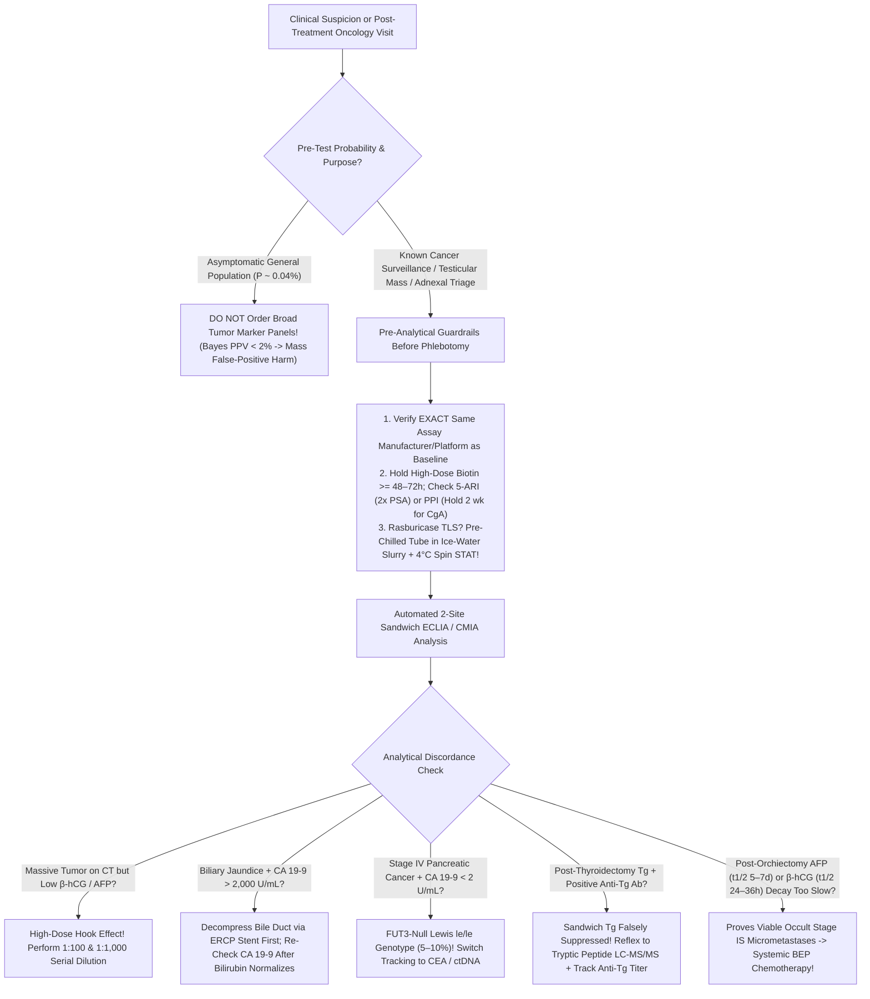
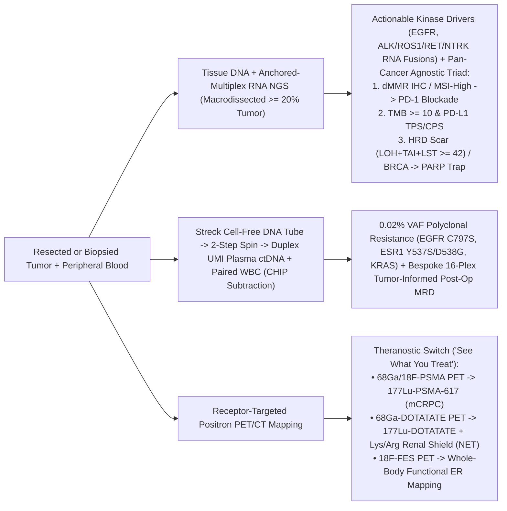

# Bundle 05 — Ep 805: The Cancer Order Sheet — Tumor Markers, Marrow Flow, NGS, ctDNA & Theranostic PET (All-In-One)

## ZERO-MIXUP SINGLE-SOURCE BUNDLE FOR GOOGLE NOTEBOOKLM

**How to use in NotebookLM (`notebook.google.com`):**

1. Check **ONLY THIS ONE DOCUMENT** in your NotebookLM Sources sidebar (uncheck all others—every reference treatise and script needed for this episode is merged right inside this single file!).
2. Click **Customize** on **Audio Overview**, choose **Longer**, and paste this exact prompt:

```text
Create an authoritative, longest-format behind-the-curtain podcast covering every diagnostic test ordered in modern oncology and hematology. Explain why serum tumor markers rarely work for population screening yet guide cancer kinetics—unpacking Total vs %Free PSA (finasteride halving rule + PI-RADS fusion biopsy), why 7% of humans are genetically Lewis-negative (FUT3) and read zero CA 19-9 even with metastatic pancreatic cancer while gallstones spike it to 5,000, AFP/hCG post-orchiectomy half-life clocks, anti-thyroglobulin interference solved by LC-MS/MS, and why Rasburicase tumor-lysis blood must travel on ice. Walk through posterior iliac crest Bone Marrow Aspirate + Core ('dry tap' myelofibrosis), 10-color flow cytometry (2-hour APL Auer-rod emergency & kappa/lambda B-cell clonality), FISH, and 10^-6 clonoSEQ MRD. Then go inside solid-tumor DNA + anchored-multiplex RNA fusion NGS (MSI-High, TMB, HRD scars, VAF ~50% germline clues), Streck-tube UMI Liquid Biopsy ctDNA (and the aging-blood CHIP impostor!), stereotactic BI-RADS mammography, dual-tracer sentinel nodes, and Ga-68/Lu-177 PSMA & DOTATATE theranostics.
```

---


---

## INCLUDED SOURCE: `VOLUME_IX_ONCOLOGY_DIAGNOSTICS_TUMOR_MARKERS_MARROW_FLOW_LIQUID_BIOPSY_AND_MOLECULAR_STAGING.md`

# Basic Medical — Behind the Curtain Clinical Diagnostics Notebook
## Volume IX: Oncology Diagnostics — Serum Tumor Markers, Bone Marrow & `10`-Color Flow Cytometry, Liquid Biopsy `ctDNA`, Molecular `NGS` & Theranostic Staging

> *"To the patient sitting in an oncology infusion suite, cancer monitoring looks deceptively quiet: two gold-top and lavender-top Vacutainers drawn from a mediport, a fifteen-minute posterior iliac crest marrow aspiration, or an outpatient `PET/CT` injection. Behind the laboratory double doors, however, paramagnetic streptavidin beads capture picogram mucin glycoforms via ruthenium electrochemiluminescence, four-laser hydrodynamic flow cytometers interrogate five million living marrow cells at ten thousand events per second to unmask a single `CD45-dim` leukemic blast among a million normal leukocytes, duplex molecular barcodes sequence `145-base-pair` apoptotic circulating tumor DNA fragments down to `0.02%` allele frequency, and `511-keV` positron-emitting `PSMA` ligands map the exact coordinates where `177-Lutetium` beta-electrons will obliterate metastatic castration-resistant prostate cancer."*

---

## Architectural Orientation: The Six Diagnostic Pillars of Modern Precision Oncology

Modern oncology never relies on a single diagnostic lens. Every malignancy is interrogated across an integrated hierarchy of biochemical, cellular, cytogenetic, genomic, cell-free, and molecular-imaging platforms (*DeVita, Hellman, and Rosenberg's Cancer: Principles & Practice of Oncology*, 12th ed.; *NCCN Clinical Practice Guidelines in Oncology*):

| Oncology Diagnostic Platform | Primary Specimen & Pre-Analytical Requirement | Physical / Analytical Detection Engine | Analytical Sensitivity / Resolution | Turnaround Time (`TAT`) | Signature Clinical Superpower & Fatal Blindspot |
| :--- | :--- | :--- | :--- | :--- | :--- |
| **Serum Tumor Marker Immunoassays (`PSA, CEA, CA 19-9, CA-125, AFP, β-hCG, Tg`)** | Serum (`SST` gold-top) or `Li-Heparin`; strict **same-manufacturer serial tracking**; ice-slurry for `Rasburicase` `TLS` | Two-site monoclonal `ECLIA` / `CMIA` sandwich (`620 nm` ruthenium or acridinium flash) or tryptic `LC-MS/MS` (`Tg`) | Picogram-to-nanogram/mL (`10^-12` to `10^-9 g/mL`); reflects whole-body secretory burden | `45–90 min` (`STAT` `TLS` `< 30 min`; `LC-MS/MS Tg` `3–5 days`) | **Post-resection recurrence kinetics & germ-cell staging**; dismal `PPV` for general screening; **hook effect**, `FUT3` `le/le` blindspot, `Anti-Tg` & biotin traps |
| **Bone Marrow Aspirate, Trephine Core & `10–12`-Color Flow Cytometry** | Liquid aspirate (`EDTA` + **preservative-free `Na-Heparin`**) + `>= 1.5–2.0 cm` trephine core (`EDTA` decalcification, *never* `HCl`!) | `4–5` solid-state lasers (`405/488/561/640 nm`), `FSC/SSC`, `CD45` blast gating + tandem fluorochrome spillover matrices | `10^-4` to `10^-5` (`0.01%–0.001%` `MRD` across `1–5 × 10^6` events) | Smear/Flow: **`2–6 hours`** (`APL` emergency `< 2 hr`); Core IHC: `48–72 hr` | Instant lineage (`AML` vs `B-ALL` vs `T-ALL`), `κ:λ` B-cell clonality, and `APL` `DIC` rescue; **"Dry Tap"** in reticulin fibrosis (`PMF`, Hairy Cell) requires core touch-prep |
| **Metaphase `G`-Banding Karyotype, Interphase `FISH` & `IS` `RT-qPCR` / `clonoSEQ`** | Living dividing cells in `Na-Heparin` (`Karyotype`); `FFPE`/smears (`FISH`); `EDTA` RNA/DNA (`RT-qPCR` / `NGS MRD`) | Mitogen + `Colcemid` `20`-cell chromosomal banding; fluorescent `100–200 kb` DNA probes; `V(D)J` deep `NGS` | Karyotype: `5–10 Mb`; `FISH`: `100 kb` (`10^-2`); `RT-qPCR` / `clonoSEQ`: **`10^-6`** (`1` in `1,000,000` cells!) | `STAT PML::RARA FISH`: `4–12 hr`; Routine `FISH`: `24–48 hr`; Karyotype: `5–10 days` | Whole-genome balanced translocations, `CD138`-sorted myeloma `del(17p)`, `CML` `0.1% IS MMR`, and ultra-deep `MRD`-adapted therapy escalation/de-escalation |
| **Comprehensive Tissue `DNA + Anchored-Multiplex RNA` `NGS` (`300–500` Genes)** | `FFPE` tissue block (`>= 20%` macrodissected tumor nuclei; `10%` neutral buffered formalin) + `PD-L1` / `MMR` `IHC` | Hybrid-capture `DNA` sequencing + spliced-transcript `RNA-seq` fusion capture (`Illumina` short-read + bioinformatics) | `2%–5%` somatic Variant Allele Frequency (`VAF`); single-base `SNVs`, `Indels`, `CNVs`, `MSI`, `TMB`, `HRD` | `7–14 days` (Rapid `EGFR/ALK/BRAF` `PCR` cartridge: `2–4 hours`) | Unmasks cryptic intronic `ALK/ROS1/RET/NTRK` fusions missed by `DNA-NGS` + pan-cancer agnostic biomarkers (`MSI-H`, `TMB >= 10`, `HRD >= 42`, `PD-L1 CPS/TPS`) |
| **Liquid Biopsy Cell-Free `ctDNA` (`UMI` Duplex `NGS` & Tumor-Informed `MRD`)** | `2 × 10 mL` whole blood in **`Streck Cell-Free DNA BCT`** (prevents `WBC` genomic `DNA` lysis flood; double-spun plasma) | Duplex **Unique Molecular Identifiers (`UMIs`)** sequencing `~134–166 bp` apoptotic nucleosomal `cfDNA` fragments | **`0.01%–0.05% VAF`** (`1` mutant molecule per `2,000–10,000` wild-type molecules) | `5–10 days` (`Signatera` bespoke design `2–3 wk` initial, `7 d` serial) | Catches polyclonal acquired resistance (`EGFR C797S`, `ESR1`, `KRAS`) & post-op molecular relapse months before `CT`; vulnerable to **`CHIP`** (`DNMT3A/TET2/TP53`) & low-shedding `CNS`/mucinous tumors |
| **Targeted Diagnostic Staging & Molecular Theranostics (`DBT`, `SLNB`, `PSMA` / `DOTATATE` `PET`)** | Breast `3D` tomosynthesis + stereotactic core; `99mTc` + `ICG` dual nodal mapping; `68Ga`/`18F` -> `177Lu` radioligands | `511-keV` coincidence `PET` localization paired directly to `0.498-MeV` (`0.7–2 mm` range) $\beta^-$ particle radiotherapy | Millimeter receptor-avid metastases (`PSA 0.2 ng/mL` sensitivity on `PSMA PET`) | `60–90 min` uptake + `20 min` scan | **"See What You Treat, Treat What You See"** whole-body receptor mapping (`PSMA`, `SSTR2`, `18F-FES ER`) eliminating spatial biopsy heterogeneity |

---

## Dossier 9.1: Serum Tumor Markers Unmasked — Why Doctors Rarely Screen With Them, How Analyzers Measure Them, and Their Classic Analytical Saboteurs

### 1. The Bayesian Screening Paradox & The Sacred Law of Manufacturer Non-Interchangeability

#### A. Why a "98% Specific" Blood Cancer Test Fails Catastrophically as a General Screening Tool
Patients routinely ask a completely logical question during annual physicals: *"Doctor, why don't you just check every cancer blood marker—`CEA`, `CA-125`, `CA 19-9`, `CA 15-3`—on my yearly routine panel so we catch anything early?"*

The answer is pure mathematical probability governed by **Bayes' Theorem**. The clinical usefulness of a positive screening test is not its laboratory specificity, but its **Positive Predictive Value (`PPV`)**—the probability that an asymptomatic person with a flagged abnormal result actually harbors an occult malignancy, given disease prevalence $P$ in that population:

$$\text{PPV} = \frac{\text{Sensitivity} \times P}{(\text{Sensitivity} \times P) + (1 - \text{Specificity}) \times (1 - P)}$$

Watch what happens behind the curtain when we run a seemingly impressive tumor marker—say **`CA-125`** with an optimistic **`85%` sensitivity** and **`98.0%` specificity** (`2%` false-positive rate)—across **100,000 asymptomatic postmenopausal women**, where the true point prevalence of undiagnosed ovarian carcinoma is roughly **`1 in 2,500` ($P = 0.0004$, or `40` true cancers among `100,000` women)**:

* **True Positives (`TP`)**: $0.85 \times 40 = \mathbf{34}$ women with true ovarian cancer correctly flagged.
* **False Negatives (`FN`)**: $40 - 34 = \mathbf{6}$ early-stage Stage I cancers missed anyway (because `~20–50%` of Stage I epithelial ovarian cancers do not yet elevate serum `CA-125` above `35 U/mL`!).
* **False Positives (`FP`)**: $(1 - 0.98) \times 99,960 = \mathbf{1,999}$ completely cancer-free women flagged as "ABNORMAL CANCER MARKER"!

$$\text{PPV} = \frac{34}{34 + 1,999} = \frac{34}{2,033} \approx \mathbf{1.67\%}$$

Read that number twice: **`98.3%` of every positive screening result is a false alarm!** Nearly **two thousand healthy women** per `100,000` screened are subjected to months of existential terror, transvaginal ultrasounds, pelvic `MRIs`, and diagnostic laparoscopies or oophorectomies carrying real surgical complications—which is precisely why the `UKCTOCS` (`202,638` women) and `PLCO` (`78,216` women) randomized trials proved that general-population `CA-125` + ultrasound screening **fails to reduce ovarian cancer mortality** (*USPSTF Grade D recommendation against screening*).

Now flip the pre-test probability $P$ into the **three scenarios where serum tumor markers become clinical gold**:
1. **Post-Resection Recurrence Kinetics (`R0` Curative Surgery)**: A patient had a `CEA`-producing Stage III colon adenocarcinoma resected, and post-op `CEA` dropped from `42.0 ng/mL` to `1.1 ng/mL`. Eighteen months later, serial `CEA` climbs from `1.1 -> 3.8 -> 9.4 -> 19.2 ng/mL`. Here pre-test probability of recurrence is high, the patient serves as their *own biological baseline*, and exponentially rising kinetics trigger a liver `MRI` + `PET/CT` that catches a solitary resectable hepatic metastasis!
2. **Metastatic Systemic Treatment Monitoring**: In inoperable metastatic pancreatic, colorectal, ovarian, or `PSA`-secreting prostate cancer, serial marker velocity tracks whole-body clonogenic tumor kill (`>= 50%` drop) weeks before anatomic shrinkage crosses `RECIST 1.1` (`>= 30%` diameter decrease) on `CT`, sparing patients ineffective toxic chemotherapy.
3. **High-Probability Diagnostic Triage & TNM Staging**: In a 26-year-old man presenting with a rock-hard intratesticular mass ($P > 80\%$) or a cirrhotic patient with an arterial-enhancing `LI-RADS` liver nodule, `AFP` and `β-hCG` yield **`> 95% PPV`**—and in testicular cancer alone, post-orchiectomy `AFP`, `β-hCG`, and `LDH` are formally built directly into **`AJCC` `TNMS` Stage Grouping (`S0–S3`)**!

---

#### B. Behind the Curtain of the Automated Immunoassay Analyzer — And Why Switching Labs Breaks Longitudinal Curves
When a gold-top Serum Separator Tube (`SST`) arrives on the automated core-laboratory track for `CEA`, `CA-125`, `CA 19-9`, `PSA`, or `AFP`, no human pipettes the sample. Inside a high-throughput immunochemistry module (such as a **Roche cobas e801** using Electrochemiluminescence Immunoassay [`ECLIA`] or an **Abbott Alinity i** using Chemiluminescent Microparticle Immunoassay [`CMIA`]), a robotic probe aspirates `10–50 µL` of spun serum into a `37°C` reaction cuvette for an **18-minute two-site non-competitive ("sandwich") immunometric reaction**:

1. **Dual Monoclonal Epitope Capture (`9 min` Incubation)**: The analyzer dispenses two distinct murine or chimeric monoclonal antibodies engineered against *non-overlapping steric epitopes* on the target tumor glycoprotein:
   * **Capture Antibody (`Ab1`)**: Covalently conjugated to **Biotin** (on Roche/Siemens platforms) or directly coated onto paramagnetic microparticles (on Abbott).
   * **Tracer/Signal Antibody (`Ab2`)**: Covalently labeled with a Tris(2,2'-bipyridyl)ruthenium(II) complex (**$[\text{Ru(bpy)}_3]^{2+}$**) for `ECLIA`, or an **Acridinium Ester** for `CMIA`.
   If tumor antigen (`Ag`) is present, a trimolecular soluble complex forms: **`Biotin-Ab1 — [Tumor Antigen] — Ab2-Ru2+`**.
2. **Paramagnetic Bead Capture & Unbound Wash (`9 min` Incubation)**: **Streptavidin-coated superparamagnetic iron-oxide microparticles** are injected. Because the **Streptavidin–Biotin non-covalent bond** ($K_d \approx 10^{-15}\text{ M}$) is the strongest biological interaction in nature, every sandwich locks instantaneously onto the magnetic beads. An electromagnet pulls the beads tightly against a platinum working electrode while wash buffer flushes away `99.999%` of unbound serum proteins, bilirubin, and excess free `Ab2-Ru2+` tracer.
3. **Photon Counting**: Tripropylamine (`TPA`) buffer floods the electrode, and a precise electrical voltage (`~1.2 V`) oxidizes both `TPA` and $[\text{Ru(bpy)}_3]^{2+}$. Electron transfer creates an excited $[\text{Ru(bpy)}_3]^{2+*}$ state that relaxes back to ground state by emitting an orange-red **`620 nm` photon** counted by a photomultiplier tube (`PMT`). In non-competitive sandwich format, **light intensity (`RLU`) is directly proportional to tumor marker concentration** across `4–5` orders of magnitude.

> [!WARNING]
> **The Four Analytical Traps Every Oncologist and Clinical Chemist Must Guard Against**:
> 1. **Sacred Rule of Assay Manufacturer Non-Interchangeability**: Unlike `Sodium` or `Glucose` (which are small, chemically identical molecules traceable to `NIST` isotope-dilution mass spectrometry), mucin glycoproteins like `CA-125`, `CA 19-9`, `CA 15-3`, and `CEA` exist in patient serum as **heterogeneous post-translationally glycosylated isoforms**. Manufacturer A's monoclonal antibody pair recognizes sialylated epitope cluster X, whereas Manufacturer B's pair binds peptide backbone Y! Sending a patient's Cycle 1–3 blood to Hospital Lab A (Roche `ECLIA`: `CA-125 = 68 U/mL`) and Cycle 4 blood to Outpatient Quest/Labcorp Lab B (Siemens/Beckman: `CA-125 = 104 U/mL`) creates a **spurious `+53%` jump** with **zero change in actual tumor burden**! Every lab report is mandated by `CAP` to print the exact assay manufacturer and methodology; if a lab changes analyzers, both methods must be run **in parallel on the same specimen** to establish a **new baseline**.
> 2. **The High-Dose "Hook Effect" (Prozone Phenomenon)**: Suppose a 24-year-old presents with cannonball lung metastases from **choriocarcinoma** (`β-hCG = 2,400,000 mIU/mL`) or a child presents with giant **hepatoblastoma** (`AFP = 900,000 ng/mL`) in a **one-step simultaneous** sandwich assay. Millions of excess free antigen molecules independently saturate `100%` of `Biotin-Ab1` *and* `100%` of `Ab2-Ru2+` separately, sterically preventing a single `Ab1–Ag–Ab2` bridge from forming! After the wash step, free `Ag–Ab2-Ru2+` washes down the drain, and the analyzer paradoxically prints **`β-hCG = 42 mIU/mL`**! Whenever clinical imaging screams massive trophoblastic/hepatocellular tumor burden yet the marker looks bizarrely modest, call the chemistry lab immediately for **`1:100` and `1:1,000` serial dilutions**—the diluted value will suddenly rocket upward to `2,400,000 mIU/mL`!
> 3. **Mega-Dose Over-the-Counter Biotin (`Vitamin B7`, `5,000–10,000 µg/day` "Hair, Skin & Nails")**: In streptavidin-biotin `ECLIA` sandwiches, massive free serum biotin floods all binding pockets on the streptavidin magnetic beads, blocking the `Biotin-Ab1–Ag–Ab2` tumor-marker sandwich from attaching! Result: **catastrophic false-LOW / false-negative `PSA`, `Thyroglobulin`, `CA-125`, `CEA`, and `CA 19-9`**—hiding a real cancer relapse! (Hold high-dose biotin for **`48–72 hours`** prior to phlebotomy, or `>= 5 days` in `ESRD`).
> 4. **Heterophile / Human Anti-Mouse Antibodies (`HAMA`)**: Patients exposed to mouse antigens, therapeutic chimeric antibodies, or rheumatoid factor possess endogenous IgG/IgM that directly cross-link murine `Ab1` directly to murine `Ab2` *even with zero tumor antigen in the blood*! Classic clinical signature: a surgically cured Stage I testicular or gestational trophoblastic patient has persistent **`"phantom β-hCG" = 35–120 mIU/mL`** receiving unnecessary chemotherapy—unmasked in 10 minutes because **heterophile `IgG` (`150 kDa`) cannot cross the glomerulus (`urine β-hCG = ZERO`!)** and fails to dilute linearly after heterophile-blocking-tube (`HBT`) incubation!

---

### 2. `PSA` Biophysics, Free-to-Total Partitioning, `PHI`/`4Kscore` & the `PI-RADS` MRI-TRUS Fusion Pathway

#### A. Why Malignant Prostate Acini Produce *LOW* `% Free PSA` While Benign `BPH` Produces *HIGH* `% Free PSA`
**Prostate-Specific Antigen (`PSA`, human kallikrein-3 / `KLK3`)** is *organ-specific, not cancer-specific*. Synthesized by normal, hyperplastic, and malignant prostatic luminal epithelial cells under androgen-receptor (`DHT`) transcriptional control, `PSA` is a `30–33 kDa` chymotrypsin-like serine protease secreted into prostatic ducts at massive concentrations (**`0.5 to 2.0 mg/mL`—one million times higher than normal serum `< 4.0 ng/mL`!**) to cleave **semenogelin I & II** and liquefy the seminal coagulum after ejaculation.

In a healthy young prostate, an architectural fortress—an intact inner **basal cell layer** (`p63+`, high-molecular-weight cytokeratin `34βE12+`), tight intercellular junctions, an intact basement membrane, and intervening fibromuscular stroma—prevents luminal `PSA` from escaping into capillary blood. Why, then, does **percent Free `PSA` (`%fPSA = [Free PSA / Total PSA] × 100`)** separate prostate cancer from Benign Prostatic Hyperplasia (`BPH`) inside the notorious **`Total PSA = 4.0–10.0 ng/mL` diagnostic gray zone** (where routine biopsy finds cancer only `~25%` of the time)?

* **In Benign Prostatic Hyperplasia (`BPH` — High `% Free PSA > 25%`)**: Transitional-zone glandular hyperplasia retains its intact basal layer and ductal polarity. `PSA` first enters hyperplastic glandular lumens, where prolonged stagnation subjects `PSA` zymogens to internal endoproteolytic "nicking" (creating catalytically *inactive* isoforms like `BPSA` and nicked `iPSA`) before slowly diffusing across stretched lymphatics into systemic veins. Because these internally nicked `PSA` molecules have a **dead catalytic pocket**, circulating hepatic protease inhibitors **cannot bind them**—so they float freely in plasma as unbound **Free `PSA` (`%fPSA > 25%` -> `< 8%` probability of prostate cancer!)**.
* **In Prostate Adenocarcinoma (`PCa` — Low `% Free PSA < 10%`)**: Malignant acinar proliferation is histologically defined by **complete loss of the basal cell layer** and invasion directly through the basement membrane onto periacinar capillaries! Catalytically *intact, active* `PSA` (alongside truncated leader-peptide **`[-2]proPSA`**) is secreted directly across endothelial walls into blood without ever seeing luminal proteases. The instant enzymatically active `PSA` hits plasma, `1,000-fold` molar excess hepatic serpins—chiefly **`α1-Antichymotrypsin (ACT)` (`~70–85%` of total serum `PSA`)** and **`α2-Macroglobulin (A2M)`** (which completely cages `PSA` inside a "venus-flytrap" shell, hiding it even from immunoassays!)—attack `PSA`'s active serine site and lock it covalently into **`90-kDa` Complexed `PSA (PSA-ACT)`**! Consequently, unbound Free `PSA` plummets: **`%fPSA < 10%` carries a `> 50–56%` probability of adenocarcinoma on biopsy!**

#### B. Next-Generation Kallikrein Math, `PSA` Density, Pharmacologic Doubling & `PI-RADS` Targeted Biopsy
To prevent millions of men from undergoing blind transrectal biopsies that find clinically harmless **Gleason `3+3=6` (`ISUP` Grade Group 1)** microfoci while missing anterior apex lethal cancers, modern urologic oncology layers precision math onto multiparametric `MRI` (*NCCN Prostate Cancer Early Detection Guidelines*):

1. **The `5α`-Reductase Inhibitor (`5-ARI`) `2×` Doubling Rule**:
   Men taking **Finasteride** (`Proscar` `5 mg` for `BPH` or `Propecia` `1 mg` for androgenetic alopecia!) or **Dutasteride** (`Avodart`) block steroid $5\alpha\text{-reductase}$, halting intracellular conversion of Testosterone into potent **Dihydrotestosterone (`DHT`)**. After **`>= 6–12 months`** of continuous therapy, glandular atrophy slashes total serum `PSA` by **`~50%`**.
   * **Bedside Correction**: You **MUST multiply the lab-reported `PSA` by `2.0`** (a `PSA` of `2.6 ng/mL` on dutasteride is biologically **`5.2 ng/mL`**!). Even more critically, if `PSA` rises by **`>= 0.3 ng/mL` above its on-treatment nadir** while adherent to a `5-ARI`, benign `BPH` has already been suppressed—elevating suspicion specifically for **high-grade (`Grade Group >= 3`) prostate cancer**!
2. **Pre-Analytical Physiologic Elevations to Exclude Before Ordering `MRI`/Biopsy**:
   * **Acute Bacterial Prostatitis / `UTI`**: Neutrophilic disruption of acinar barriers spikes `PSA` to `15–50+ ng/mL`; repeat `PSA` **`6–8 weeks` after completing antibiotics** (do *not* give empiric antibiotics to asymptomatic men just to "see if `PSA` drops"!).
   * **Ejaculation (`+0.8 ng/mL` transient rise)** & **Vigorous Bicycle Riding / Saddle Pressure**: Enforce **`48–72 hours` abstinence** from ejaculation and cycling before redrawing a borderline `PSA`.
   * **Acute Urinary Retention, Traumatic Foley Catheterization, Cystoscopy, or Prostate Biopsy**: Wait **`3–6 weeks`** post-biopsy/instrumentation before measuring baseline `PSA`. *(Note: A routine outpatient **Digital Rectal Exam [`DRE`]** raises `PSA` by only `0.1–0.2 ng/mL`—clinically negligible unless sitting right on a `3.9 ng/mL` cutoff).*
3. **Second-Tier Reflex Biomarkers (`PSAD`, `PHI`, `4Kscore`)**:
   * **`PSA` Density (`PSAD`)**: Divides serum Total `PSA` by `MRI`-planimetered prostate volume ($\text{cm}^3$, approximated via prolate ellipsoid $\text{Length} \times \text{Width} \times \text{Height} \times 0.52$):
     $$\text{PSAD} = \frac{\text{Total Serum PSA (ng/mL)}}{\text{Prostate Volume (cm}^3\text{)}}$$
     A `PSA` of `6.5 ng/mL` inside a massive `90 cm³` `BPH` gland gives `PSAD = 0.072 ng/mL/cm³` (reassuringly benign **`< 0.15`**), whereas `6.5 ng/mL` inside a small `25 cm³` gland yields **`PSAD = 0.26 ng/mL/cm³`** (high cancer suspicion!).
   * **Prostate Health Index (`PHI`)**: Combines tumor-enriched **`[-2]proPSA`** (`p2PSA`, cleaved poorly in malignant cells lacking luminal processing), `Free PSA`, and `Total PSA` into one `FDA`-approved formula:
     $$\text{PHI} = \left(\frac{\text{[-2]proPSA (pg/mL)}}{\text{Free PSA (ng/mL)}}\right) \times \sqrt{\text{Total PSA (ng/mL)}}$$
     (`PHI >= 36–55` strongly enriches for clinically significant **Grade Group `>= 2` [`Gleason >= 3+4=7`]** cancer; similarly, the **`4Kscore`** combines `tPSA, fPSA, intact PSA,` and **`human kallikrein-2 [hK2]`** with age/DRE/prior biopsy to report an exact `%` risk of Grade Group `>= 2` cancer).
4. **Multiparametric `3.0-Tesla` Prostate `MRI` (`mpMRI`, `PI-RADS v2.1`) -> `MRI-TRUS` Targeted Fusion Biopsy**:
   Before sticking a needle into the prostate (`PROMIS` and `PRECISION` NEJM landmark trials), an `mpMRI` evaluates the **Peripheral Zone** (`75%` of cancers — scored primarily on **Diffusion-Weighted Imaging [`DWI`] / `ADC` map** showing dark restricted Brownian water motion inside hypercellular malignant acini!) and the **Transition Zone** (`20–25%` of cancers — scored primarily on high-resolution **`T2`-weighted** "erased charcoal" lenticular margins). Lesions scored **`PI-RADS 4` (high probability) or `PI-RADS 5` (`>= 1.5 cm` or extraprostatic extension, very high probability)** have their `3D` `MRI` contours digitally co-registered in real time onto live transrectal or transperineal ultrasound (**`MRI-TRUS` Fusion Biopsy**), guiding spring-loaded `18-gauge` biopsy needles directly into the millimeter core of aggressive tumors!
5. **Post-Treatment Ultrasensitive `PSA` Kinetics**:
   * **After Radical Prostatectomy**: Because every benign and malignant prostate cell was surgically excised and `tPSA` half-life is `~2.2–3.2 days`, serum `PSA` **must plummet to undetectable (`< 0.01–0.02 ng/mL`) within `4–6 weeks`**. Two consecutive rises reaching **`>= 0.2 ng/mL`** define **Biochemical Recurrence (`BCR`)** (`AUA` criteria; though salvage pelvic radiation + `PSMA PET` now routinely trigger as early as `0.1–0.2 ng/mL`!).
   * **After Definitive Radiation Therapy (`EBRT` / Brachytherapy)**: Benign radiated prostate stroma remains in situ and slowly fibroses over `18–36 months` (`PSA` bounce at `12–18 mo` is benign!). Therefore, radiation recurrence uses the **Phoenix Definition**: **`Post-RT PSA Nadir + 2.0 ng/mL`**.

---

### 3. Mucin & Oncofetal Workhorses: The `CA 19-9` `FUT3` Genetic Blindspot, `CEA`, and `CA-125` / `HE4` (`ROMA`)

#### A. `CA 19-9` (`Sialyl-Lewis^a`): The `5–10%` `FUT3` Null-Phenotype Trap vs. Benign Stone Spikes to `10,000 U/mL`
Ordered to track resectability, neoadjuvant `FOLFIRINOX` response, and post-Whipple recurrence in **Pancreatic Ductal Adenocarcinoma (`PDAC`)** and **Cholangiocarcinoma**, **`CA 19-9`** is *not a protein*—it is a tetrasaccharide carbohydrate blood-group antigen (**$\text{Sialyl-Lewis}^a$**: $\text{Neu5Ac}\alpha 2\text{-}3\text{Gal}\beta 1\text{-}3[\text{Fuc}\alpha 1\text{-}4]\text{GlcNAc}$) attached onto circulating high-molecular-weight mucins.

Two diametrically opposite traps ambush clinicians who treat `CA 19-9` (`normal < 37 U/mL`) as a simple linear cancer meter:

1. **THE CLASSIC GENETIC FALSE-NEGATIVE TRAP — Lewis-Negative (`le/le`, `FUT3`-Null) Patients**:
   Look closely at the final enzymatic step required to synthesize `CA 19-9`: adding an $\alpha\text{-}1,4\text{-fucose}$ sugar onto the sialylated Type-1 precursor chain (`DUPAN-2`) requires the enzyme **$\alpha(1,3/1,4)\text{-fucosyltransferase}$**, encoded by the **Lewis blood-group gene (`FUT3`)** on chromosome `19p13.3`.
   * **`5% to 10%` of Caucasian/Asian individuals and up to `20–22%` of African-ancestry individuals** inherit homozygous loss-of-function alleles (**`le/le` genotype -> red blood cell phenotype $\text{Le}(a-b-)$**)!
   * These patients **physically lack the enzyme required to manufacture `CA 19-9` anywhere in their body**! Even when a `FUT3`-null patient presents with a `6-cm` pancreatic head cancer and twenty hepatic metastases, their automated `CA 19-9` assay prints **`< 2.0 U/mL` (or `< 1 U/mL`)**!
   * *Behind-the-Curtain Solution*: Whenever a biopsy-proven pancreaticobiliary cancer reads `CA 19-9 < 2 U/mL`, `CA 19-9` is permanently useless for monitoring that patient (confirmable via `RBC` Lewis $\text{Le}(a-b-)$ phenotyping); pivot longitudinal tracking immediately to **`CEA`**, **`CA-125`**, or cell-free **`KRAS` `ctDNA`**!
2. **THE BENIGN OBSTRUCTIVE BILIARY SPIKE TRAP**:
   Normal biliary epithelial cells (cholangiocytes) constitutively secrete `CA 19-9` into bile (`> 10,000 U/mL` inside the bile duct lumen!). When a **benign common bile duct gallstone (`choledocholithiasis`)**, ascending **cholangitis**, or benign inflammatory stricture corks the ampulla of Vater, intrabiliary hydrostatic pressure surges:
   * Stretched, inflamed cholangiocytes upregulate mucin synthesis `10-fold`, tight junctions burst open, and bile regurgitates directly into hepatic sinusoids—while hepatic Kupffer-cell clearance of circulating sialomucins simultaneously stalls!
   * Result: A completely **cancer-free gallstone patient routinely presents with `CA 19-9 = 2,500 to 25,000 U/mL`**!
   * **Mandatory Clinical Rule**: **NEVER interpret `CA 19-9` to declare pancreatic cancer unresectable while Total Bilirubin exceeds `2–3 mg/dL`!** Decompress the biliary tree via `ERCP` plastic/metal stenting first, wait **`2–3 weeks`** for bilirubin to normalize, and *re-measure `CA 19-9`*: a benign stone drops precipitously back toward `< 37 U/mL`, whereas persistent elevation (`> 500–1,000 U/mL`) in an unjaundiced `FUT3`-competent patient genuinely signals high occult metastatic risk (`NCCN Pancreatic Adenocarcinoma Guidelines`).

#### B. `CEA` (`CEACAM5`), `CA-125` (`MUC16`) + `HE4` (`ROMA`), and `CA 15-3` / `CA 27.29`
* **Carcinoembryonic Antigen (`CEA`)**: A `180–200 kDa` glycophosphatidylinositol (`GPI`)-anchored cell-adhesion glycoprotein normally expressed exclusively in fetal gut endoderm, reactivated in `~70–80%` of colorectal, gastric, pancreatic, lung (`NSCLC`), breast, and medullary thyroid carcinomas.
  * *Primary Role*: Post-resection Stage II/III **Colorectal Cancer surveillance** (`q3–6 months` for `5 years` per `NCCN`/`ASCO`) to detect curable oligometastatic hepatic or pulmonary relapse.
  * *Classic Confounders*: **Active cigarette smoking** irritates bronchial/gastrointestinal mucosa, raising the upper reference limit from **`< 2.5–3.0 ng/mL` (non-smokers)** up to **`5.0–10.0 ng/mL` (heavy smokers)**! Benign elevations (`3–10 ng/mL`) also occur in ulcerative colitis flare, alcoholic cirrhosis (impaired hepatic asialoglycoprotein-receptor clearance!), peptic ulcer disease, chronic bronchitis, and overt hypothyroidism. Furthermore, **`4–8 weeks` after starting effective `FOLFOX` chemotherapy**, massive apoptosis of liver metastases dumps stored intracellular `CEA` into blood—causing a transient **`15–30%` "Chemotherapy Surge/Flare"** that precedes radiographic tumor shrinkage!
* **`CA-125` (`MUC16`) & Human Epididymis Protein 4 (`HE4` / `WFDC2`) — The `ROMA` Score**:
  `CA-125` is a giant (`> 2,000 kDa`) transmembrane mucin expressed not by normal ovarian surface epithelium, but by **all embryonic coelomic mesothelium** (pleura, pericardium, peritoneum) and Müllerian duct derivatives (endocervix, endometrium, fallopian tube).
  * *Why `CA-125` Lies Constantly in Premenopausal Women and Cirrhotics*: Any physical stretch or inflammation of the peritoneal or pleural mesothelium pours `CA-125` into blood! Normal **menses (`CA-125 = 50–120 U/mL`)**, first-trimester **pregnancy**, **endometriosis / endometrioma (`100–500 U/mL`)**, uterine **leiomyomas**, pelvic inflammatory disease (`PID`), congestive heart failure pleural effusions, peritoneal tuberculosis, and **decompensated liver cirrhosis with ascites** (where biological males with zero ovarian tissue routinely post **`CA-125 = 400–1,800 U/mL`**!) all cause dramatic false positives.
  * *The `HE4` Rescue*: **`HE4`** (`25 kDa` whey acidic four-disulfide core protein overexpressed in serous/endometrioid ovarian carcinoma) is **NOT elevated by benign endometriosis or menstruation** (note: `HE4` *is* renally cleared, so **`CKD` / elevated creatinine falsely elevates `HE4`**!). Combining `CA-125` + `HE4` + menopausal status inside the logarithmic **Risk of Ovarian Malignancy Algorithm (`ROMA`)** accurately triages complex pelvic adnexal masses to a specialized Gynecologic Oncologist before surgery.
* **`CA 15-3` & `CA 27.29` (`MUC1` Tandem-Repeat Epitopes)**: Measure overlapping soluble epitopes of polymorphic epithelial mucin (`MUC1`) in **Metastatic (`Stage IV`) Breast Cancer** (`ER+/HER2-` bone-predominant disease where `RECIST` bone scans cannot measure millimeter shrinkage). Per **`ASCO` Choosing Wisely**, ordering `CA 15-3` or `CA 27.29` in asymptomatic post-mastectomy Stage I–III breast cancer survivors is **strictly discouraged**—randomized trials proved lead-time anxiety and false positives with *zero improvement in overall survival*.

---

### 4. The Germ-Cell & Hepatobiliary Triad (`AFP`, `β-hCG`, `LDH`): First-Order Decay Kinetics That Dictate Chemotherapy

In **Testicular Germ Cell Tumors (`GCTs`)**, serum tumor markers achieve their pinnacle of diagnostic precision—drawn **BEFORE radical inguinal orchiectomy** (never transscrotal biopsy, which seeds inguinal lymphatics!) and then tracked serially **AFTER orchiectomy** to prove whether invisible retroperitoneal or pulmonary micrometastases exist (*AJCC 8th Edition Staging*):

$$C(t) = C_{\text{pre-op}} \cdot \left(\frac{1}{2}\right)^{\!\frac{t}{t_{1/2}}} \implies t_{1/2\text{, observed}} = \frac{\Delta t \cdot \ln(2)}{\ln(C_1 / C_2)}$$

1. **Alpha-Fetoprotein (`AFP`, `70 kDa` Fetal Albumin Homolog — Exact $t_{1/2} = \mathbf{5\text{ to }7\text{ Days}}$)**:
   * Synthesized normally by fetal yolk sac and fetal liver (`peaks at 13–16 weeks gestation`, falling to adult `< 8–10 ng/mL` by age `12 months`).
   * **Germ-Cell Lineage Rule**: Secreted robustly by **Yolk Sac Tumor (Endodermal Sinus Tumor)** and **Embryonal Carcinoma** (and immature teratoma). **PURE SEMINOMA AND PURE CHORIOCARCINOMA NEVER SYNTHESIZE `AFP` (`0%`)!**
   * *Life-Saving Pathology Override*: Suppose histopathology of an excised testis reports *"100% Pure Classic Seminoma,"* yet pre-op serum `AFP` is **`94 ng/mL`**. Because pure seminoma is transcriptionally incapable of expressing the `AFP` gene, an unsampled microscopic focus of yolk-sac/embryonal carcinoma was missed in tissue sectioning—and the oncologist **MUST classify and treat the patient as a Non-Seminomatous Germ Cell Tumor (`NSGCT`)**! *(Rare benign confounders to exclude before giving `BEP` chemo when `AFP` stays stably `15–40 ng/mL` without rising: **Hereditary Persistence of `AFP`** [autosomal dominant `HNF1` promoter variant], active viral hepatitis/cirrhotic hepatocyte regeneration, and **Ataxia-Telangiectasia [`ATM`]**).*
   * **Hepatocellular Carcinoma (`HCC`) & the `GALAD` Score**: In cirrhotic `HCC` `q6-month` ultrasound surveillance, `30–40%` of early `< 2 cm` `HCCs` have normal total `AFP`. Labs therefore fractionate **`AFP-L3%`** (the *Lens culinaris* agglutinin-reactive $\alpha 1\text{-}6$ core-fucosylated glycoform produced specifically by malignant hepatocytes via `FUT8`; **`AFP-L3% >= 10%`** flags `HCC`!) alongside **`DCP` (`Des-gamma-carboxy prothrombin` / `PIVKA-II`)**, an abnormal prothrombin lacking vitamin-K-dependent $\gamma$-carboxylation of glutamic acid residues (`GALAD` = Gender, Age, `AFP-L3%`, `AFP`, `DCP`).
2. **Human Chorionic Gonadotropin (`β-hCG`, `36.7 kDa` Heterodimer — Exact $t_{1/2} = \mathbf{24\text{ to }36\text{ Hours}}$)**:
   * Shares an identical `92-amino-acid` **$\alpha$-subunit** with pituitary `LH`, `FSH`, and `TSH`, while its unique `145-amino-acid` **$\beta$-subunit** confers biologic specificity (oncology assays *must* measure **Total `β-hCG` [intact dimer + free $\beta$-subunit]**, because aggressive germ-cell and bladder/trophoblastic tumors often hypersecrete uncoupled **free $\beta$-subunits** that pregnancy-only intact-dimer kits miss!).
   * **Lineage Rule**: Driven to stratospheric levels (**`50,000 to > 1,000,000 mIU/mL`**) by **Choriocarcinoma** (malignant syncytiotrophoblasts + cytotrophoblasts; at `> 100,000 mIU/mL`, cross-activation of thyroid `TSH` receptors triggers **paraneoplastic thyrotoxicosis** and diffuse alveolar hemorrhage!). Pure **Seminoma** *can* contain scattered syncytiotrophoblastic giant cells in `15–20%` of cases, producing modest `β-hCG` elevations (typically `< 500–1,000 mIU/mL`).
   * *Post-Orchiectomy Pituitary Trap*: Bilateral orchiectomy + chemotherapy induces primary hypogonadism -> pituitary `LH` surges -> `1–2%` pituitary co-secretion of sulfated `hCG` or `LH` assay cross-reactivity produces a mild `β-hCG = 4–12 mIU/mL`. Giving `1` intramuscular injection of **Testosterone (`200 mg`)** suppresses pituitary `LH/hCG` to `< 1 mIU/mL` within `7–14 days` if benign, sparing the cured patient salvage chemotherapy!
3. **Kinetic Proof of Occult Metastasis**:
   Suppose pre-orchiectomy `AFP` is **`640 ng/mL`** and `CT` Chest/Abdomen/Pelvis shows **zero enlarged lymph nodes (`cN0M0`)**. After clean orchiectomy on Day 0, if `100%` of tumor lived inside the excised testis, `AFP` ($t_{1/2} \le 7\text{ days}$) *must* decay along: Day 7 $\le 320$, Day 14 $\le 160$, Day 21 $\le 80$, Day 28 $\le 40\text{ ng/mL}$. If Day 21 `AFP` reads **`240 ng/mL`** (observed $t_{1/2} = 14.8\text{ days}$) or rebounds to `290 ng/mL`, **living retroperitoneal/lung micrometastases are actively manufacturing new `AFP` (`Stage IS`)**, mandating full systemic `BEP` (`Bleomycin, Etoposide, Cisplatin`) chemotherapy immediately!
4. **Lactate Dehydrogenase (`LDH`)**: Reflects rapid cellular turnover and `12p` (`LDHB` gene on isochromosome `i(12p)`!) amplification across seminomas, `NSGCTs`, and aggressive **Burkitt / Diffuse Large B-Cell Lymphomas** (`IPI` Prognostic Index). *(Pre-analytical trap: `RBCs` contain **`150×` more `LDH` than serum**—even mild traumatic phlebotomy hemolysis ruins `LDH`!)*

---

### 5. Endocrine/Neuroendocrine Traps & The `Rasburicase` Ice-Slurry Emergency (`TLS`)

#### A. Thyroid Oncology: `Calcitonin` (`MTC`) & Why `Anti-Tg` Forces Mass-Spectrometry `Thyroglobulin`
* **Medullary Thyroid Carcinoma (`MTC` — Neuroendocrine Parafollicular `C`-Cells, `RET` Proto-Oncogene)**: Secretes **`Calcitonin`** (drawn fasting into a chilled tube; `Calcitonin > 100 pg/mL` is virtually diagnostic of `MTC`, and **`> 500 pg/mL`** mandates staging liver `MRI` + neck/chest `CT` for distant metastases before neck dissection!) alongside **`CEA`**. Post-thyroidectomy **Calcitonin & `CEA` Doubling Times (`< 6 months` vs `> 24 months`)** are the single strongest predictors of `MTC` survival; if `CEA` rises rapidly while `Calcitonin` plateaus, the `MTC` clone is **dedifferentiating** into an aggressive poorly differentiated neuroendocrine phenotype!
* **Differentiated Papillary & Follicular Thyroid Cancer (`DTC` — Follicular Cells): The `Thyroglobulin` + `Anti-Tg` Rule**:
  After total thyroidectomy + `131I` radioactive iodine ablation, `0` normal thyroid tissue remains—so **Serum Thyroglobulin (`Tg`, `660 kDa` iodinated prohormone scaffold)** should read **`< 0.1–0.2 ng/mL`** (under `TSH` suppression or rhTSH `Thyrogen` stimulation).
  * **THE `25%` AUTOANTIBODY BLINDSPOT**: Roughly **`20% to 25%` of papillary thyroid cancer patients** (often with coexisting Hashimoto lymphocytic thyroiditis) harbor circulating endogenous **Anti-Thyroglobulin Autoantibodies (`Anti-Tg Ab`)**!
  * Inside an automated **immunometric sandwich `Tg` assay**, patient `Anti-Tg` IgG binds directly onto circulating tumor `Tg` and **sterically blocks** the analyzer's `Biotin-Ab1` and `Ab2-Ru2+` antibodies from forming a sandwich—producing a **catastrophic FALSE-LOW / UNDETECTABLE `Tg < 0.1 ng/mL` while pulmonary metastases are actively growing!** *(Conversely, in older competitive radioimmunoassays [`RIA`], `Anti-Tg` sequesters radiolabeled tracer and causes false-highs).*
  * **Behind the Mass-Spectrometry Bench (`LC-MS/MS` Tryptic Peptide Rescue)**: Every single `Tg` order **automatically co-runs a quantitative `Anti-Tg Ab` immunoassay** before releasing `Tg`. If `Anti-Tg` is positive (`even 1 IU/mL` above cutoff):
    1. First, serial `Anti-Tg` antibody titers themselves act as a surrogate tumor marker (falling `Anti-Tg` = remission; rising `Anti-Tg` = persistent/recurrent antigen stimulation!).
    2. Second, the lab reflexes serum to **Liquid Chromatography–Tandem Mass Spectrometry (`LC-MS/MS`) Thyroglobulin**: the technologist adds **trypsin protease**, which indiscriminately chops *both* `660-kDa` `Tg` *and* all interfering `150-kDa` `Anti-Tg` antibodies into tiny `8–15` amino-acid peptides, completely destroying the antibody blockade! Anti-peptide beads then enrich a unique signature `Tg` peptide (`VIFDANAPVAVR`, spiked with a $^{13}\text{C}/^{15}\text{N}$ heavy-isotope internal standard) for triple-quadrupole quantification free of `Anti-Tg` interference!

#### B. Neuroendocrine `Chromogranin A` (`PPI` Trap) & `24-Hour Urine 5-HIAA` (Banana/Walnut Trap)
* **Serum `Chromogranin A (CgA)`**: Co-stored inside dense-core neurosecretory granules of gastro-entero-pancreatic Neuroendocrine Tumors (`GEP-NETs`). **Number-One False-Positive Trap (`80%+` of outpatient false alarms!)**: **Proton Pump Inhibitors (`Omeprazole, Pantoprazole, Esomeprazole`)**! Shutting off parietal-cell $\text{H}^+/\text{K}^+\text{-ATPase}$ eliminates gastric acid -> antral `G`-cells pour out **Gastrin** -> trophic hypergastrinemia drives diffuse **Gastric Enterochromaffin-Like (`ECL`) Cell Hyperplasia**, skyrocketing serum `CgA` **`3-fold to 15-fold`**! Patients **MUST discontinue `PPIs` for at least `14 days`** (switching temporarily to an $\text{H}_2$-blocker if needed, and holding `H2RAs` `24–48h` before draw) prior to testing; `CKD` (`eGFR < 45`) and atrophic gastritis (`pernicious anemia`) also chronically elevate `CgA`.
* **`24-Hour Urine 5-Hydroxyindoleacetic Acid (5-HIAA)`**: Serotonin (`5-HT`) secreted by metastatic midgut (ileal/jejunal) **Well-Differentiated Carcinoid Tumors** (causing flushing, secretory diarrhea, and right-sided tricuspid/pulmonic carcinoid heart fibrosis once hepatic metastases bypass portal `MAO` first-pass metabolism!) is oxidized by monoamine oxidase + aldehyde dehydrogenase into **`5-HIAA`** (`normal < 6–8 mg/24h`; carcinoid syndrome often `25–500+ mg/24h`).
  * *Behind-the-Curtain Pre-Analytical Protocol*: Collected in an **amber light-protected jug pre-charged with `10–25 mL` of `6N HCl` or `50%` Acetic Acid (`pH 2–4`)** refrigerated throughout collection so `5-HIAA` does not oxidize. For **`48 to 72 hours` prior to and during all `24 hours` of collection**, the patient **MUST strictly avoid dietary tryptophan/serotonin bombs**: **bananas, plantains, walnuts, pecans, hickory nuts, avocados, pineapple, kiwi, plums, eggplants, and tomatoes**, as well as interfering medications (**acetaminophen, guaifenesin cough syrups, naproxen, caffeine, `SSRIs` [falsely lower], and `MAOIs` [falsely lower]**)! Modern `LC-MS/MS` plasma/urine `5-HIAA` eliminates acetaminophen colorimetric cross-reactivity, *but dietary walnuts or bananas actually put real exogenous serotonin into the human bloodstream*, so no analyzer on earth can distinguish a walnut smoothie from an ileal carcinoid!

#### C. Tumor Lysis Syndrome (`TLS`) Cairo-Bishop Chemistry & The `Rasburicase` Pre-Chilled Ice-Slurry Trap
Within `12–72 hours` of initiating cytotoxic chemotherapy, steroids, `Venetoclax`, or `CAR-T` cells in high-proliferation malignancies (**Burkitt Lymphoma**, `ALL`, hyperleukocytic `AML` `WBC > 100,000/µL`), billions of malignant cells rupture simultaneously, dumping their concentrated intracellular contents into extracellular fluid (**Cairo-Bishop Laboratory `TLS` = `>= 2` abnormalities within `3 days` before to `7 days` after therapy; Clinical `TLS` = Lab `TLS` + `AKI` [`Cr >= 1.5× ULN`], cardiac arrhythmia/sudden death, or seizure**):

1. **Hyperkalemia (`K+ >= 6.0 mEq/L` or `+25%` jump)**: Earliest lethal killer (`peaked T-waves -> sine-wave VF/asystole`). *(Beware **Pseudohyperkalemia** in `WBC > 150,000/µL` `CLL/AML`: fragile leukemic blasts lysed by pneumatic-tube agitation + clotting inside `SST` tubes leak `K+` *in vitro*! Confirm immediately via **walked whole-blood arterial/venous blood gas syringe**!)*
2. **Hyperphosphatemia (`PO4 >= 4.5 mg/dL` in adults; `>= 6.5 mg/dL` in children)**: Malignant lymphoblasts contain **`4×` more organic/inorganic phosphate** than normal mature lymphocytes!
3. **Secondary Hypocalcemia (`Corrected Ca <= 7.0 mg/dL` or `Ionized Ca <= 1.12 mmol/L`)**: Driven directly by surging serum phosphate exceeding the **Calcium–Phosphate Solubility Product ($\text{Ca} \times \text{PO}_4 > 55\text{–}60\text{ mg}^2/\text{dL}^2$)**, precipitating microcrystalline **calcium phosphate ($\text{Ca}_3(\text{PO}_4)_2$)** directly inside renal tubules and cardiac conduction tissue! **CRITICAL ICU RULE**: **NEVER administer intravenous Calcium Gluconate for asymptomatic hypocalcemia in hyperphosphatemic `TLS`**—pouring IV calcium into a `PO4 = 9.2 mg/dL` bloodstream calcifies the kidneys solid (`nephrocalcinosis`)! Reserve IV calcium *strictly* for life-threatening tetany, laryngospasm, seizures, or `QRS/QT` arrhythmia while aggressively clearing phosphate (`hydration + phosphate binders + CRRT/hemodialysis`).
4. **Hyperuricemia (`Uric Acid >= 8.0 mg/dL`) & The `Rasburicase` Vacutainer Saboteur**:
   Catabolism of released nuclear purines (`Adenine` & `Guanine` $\to$ `Hypoxanthine` $\to$ `Xanthine` $\xrightarrow{\text{Xanthine Oxidase}}$ **`Uric Acid`**) floods acidic distal renal tubules (`pH ~5.0`, where uric acid $\text{p}K_a = 5.4$ protonates into insoluble crystals!). While **Allopurinol** and **Febuxostat** block *new* uric acid formation (leaving existing `16 mg/dL` uric acid untouched!), **`Rasburicase`** (recombinant *Aspergillus* **urate oxidase**, an enzyme humans evolutionarily lost via pseudogene mutation!) directly oxidizes existing insoluble uric acid into **`5–10×` more water-soluble Allantoin** + $\text{CO}_2$ + **$\text{H}_2\text{O}_2$ (Hydrogen Peroxide)**:
   $$\text{Uric Acid} + \text{O}_2 + \text{H}_2\text{O} \xrightarrow{\text{Rasburicase}} \text{Allantoin} + \text{CO}_2 + \text{H}_2\text{O}_2$$

> [!CAUTION]
> **Two Life-or-Death `Rasburicase` Rules Behind the Curtain**:
> 1. **Mandatory `G6PD` Contraindication**: Because every molecule of uric acid degraded by `Rasburicase` generates a molecule of oxidative **$\text{H}_2\text{O}_2$**, red blood cells depend entirely on **Glucose-6-Phosphate Dehydrogenase (`G6PD`)** to regenerate `NADPH` and glutathione peroxidase. Giving `Rasburicase` to a `G6PD`-deficient patient triggers **catastrophic intravascular oxidative hemolysis ("bite/blister cells") + severe Methemoglobinemia (`SpO2` locks at `85%`, chocolate-brown blood — do NOT give Methylene Blue, which also requires `G6PD` `NADPH` and worsens hemolysis!)**!
> 2. **The Room-Temperature Vacutainer Destruction Artifact**: Suppose a patient's true *in vivo* uric acid `4 hours` after `Rasburicase` is still dangerously high at **`9.8 mg/dL`**, and the nurse draws a routine room-temperature green/gold tube and sends it to the core lab (`30 minutes` transit + spin). **Circulating `Rasburicase` enzyme drawn into that Vacutainer keeps digesting uric acid at room temperature *inside the test tube* all the way to the analyzer!** The computer prints a reassuring **`Uric Acid = 0.1 mg/dL`** while the patient is still suffering acute urate nephropathy!
>    * **Exact Laboratory Protocol**: Every post-`Rasburicase` uric acid specimen **MUST be drawn into a pre-chilled heparinized tube**, submerged **immediately (`< 10 seconds`) into a crushed ice-water slurry (`0–4°C`)**, hand-delivered STAT, centrifuged inside a **`4°C` refrigerated centrifuge**, and assayed immediately upon separation!

---

### 6. Master Reference Table: Clinical & Analytical Atlas of Major Serum Tumor Markers

| Marker | Biochemical Structure & Source | Primary Clinical Indications (`Never General Screen!`) | Exact Half-Life ($t_{1/2}$) & Cutoff | Classic Benign False-Positive Saboteurs | Classic False-Negative / Analytical Trap |
| :--- | :--- | :--- | :--- | :--- | :--- |
| **`PSA` (`tPSA` & `%fPSA`)** | `30–33 kDa` kallikrein-3 (`KLK3`) serine protease (`PSA-ACT` complex vs nicked `fPSA`) | Post-RP (`< 0.01 ng/mL`) / Post-RT (`Nadir + 2`) recurrence; shared-decision `mpMRI` triage (`PHI` / `4Kscore`) | `tPSA`: `2.2–3.2 days`; `fPSA`: `2–4 hours` (`%fPSA < 10%` = high PCa risk) | `BPH` (`high %fPSA > 25%`), acute bacterial prostatitis, urinary retention, ejaculation (`48h`), cycling, recent biopsy (`6 wk`) | **`5α`-reductase inhibitors (`finasteride/dutasteride`) cut `PSA` by `50%` (must double!)**; high-dose biotin; neuroendocrine small-cell prostate (`PSA-neg`!) |
| **`CA 19-9`** | $\text{Sialyl-Lewis}^a$ carbohydrate tetrasaccharide on mucins | Pancreatic ductal (`PDAC`) & cholangiocarcinoma resectability, chemo response & surveillance | `~1–3 days` (`Normal < 37 U/mL`) | **Benign biliary obstruction / choledocholithiasis (`> 5,000–20,000 U/mL` until stented!)**, pancreatitis, cirrhosis, bronchiectasis | **`5–10%` `FUT3`-null (`le/le`, $\text{Le}(a-b-)$) humans physically CANNOT synthesize `CA 19-9` (`reads < 2 U/mL` in Stage IV PDAC!)** |
| **`CEA` (`CEACAM5`)** | `180–200 kDa` `GPI`-anchored fetal gut cell-adhesion glycoprotein | Stage II/III post-op Colorectal surveillance (`q3–6 mo`); metastatic CRC/breast/lung; `MTC` | `~3–7 days` (`< 2.5–3.0 ng/mL` non-smoker; `< 5–10` smoker) | **Cigarette smoking**, `IBD` flare, alcoholic cirrhosis, pancreatitis, hypothyroidism, **`4–6 wk` chemo tumor-lysis flare** | Poorly differentiated/mucinous or `MSI-H` colon cancers (`20–30%` non-secretors); assay vendor switch (`30%` shift); biotin |
| **`CA-125` (`MUC16`) + `HE4`** | `> 2,000 kDa` coelomic mucin (`CA-125`) + `25 kDa` `WFDC2` (`HE4`, `ROMA`) | Epithelial ovarian/tubal/peritoneal chemo response (`GCIG` criteria), recurrence & pelvic mass `ROMA` triage | `~5–6 days` (`CA-125 < 35 U/mL`; `HE4` age/menopause-stratified) | **Menses, pregnancy, endometriosis, fibroids, `PID`, cirrhosis ascites (`> 1,000 U/mL`!), `CHF` pleural effusion** (`CKD` raises `HE4`!) | Misses **`20–50%` of Stage I** early ovarian cancers (`PPV < 2%` in population screening); mucinous ovarian subtype (`use CEA/CA 19-9`) |
| **`AFP` & `AFP-L3%`** | `70 kDa` fetal yolk-sac/hepatic glycoprotein (`L3%` = `FUT8` fucosylated) | Testicular `NSGCT` `AJCC` staging/decay; cirrhotic `HCC` `q6m` surveillance (`+ US + DCP`) | **`5 to 7 days`** (`Adult < 8–10 ng/mL`; `AFP-L3% >= 10%`) | Pregnancy, viral hepatitis flare, regenerating cirrhotic nodules, hereditary persistence of `AFP`, ataxia-telangiectasia | **Pure Seminoma & Pure Choriocarcinoma NEVER make `AFP`** (if `AFP+`, treat as `NSGCT`!); high-dose hook effect in hepatoblastoma |
| **`Total β-hCG`** | `36.7 kDa` syncytiotrophoblast glycoprotein (`α` + unique `β` + free `β`) | Testicular `GCT` staging/decay; Gestational Trophoblastic Neoplasia (`GTN` / molar / choriocarcinoma) | **`24 to 36 hours`** (`Non-pregnant < 2–5 mIU/mL`) | Pregnancy, hypogonadal pituitary `LH/hCG` post-orchiectomy, **`HAMA` heterophile "phantom hCG" (`urine hCG = 0`!)**, marijuana | **High-dose Hook Effect at `> 1,000,000 mIU/mL`** in choriocarcinoma (`dilute 1:1,000`!); pregnancy-only kits missing free `β`-subunit |
| **`Thyroglobulin (Tg)`** | `660 kDa` follicular thyroid iodoglycoprotein (post-total thyroidectomy) | Differentiated Papillary & Follicular Thyroid Cancer post-ablation recurrence tracking | `~25–65 hours` (`Athyreotic < 0.1–0.2 ng/mL`) | Residual normal thyroid remnant lobe, thyroiditis, recent thyroid `FNA` biopsy (`wait >= 2–4 wk`), Graves' disease | **`Anti-Tg` autoantibodies (`25%` of DTC patients) cause FALSE-NEGATIVE sandwich `Tg`!** -> Reflex to **Tryptic `LC-MS/MS` `Tg`** |
| **`Chromogranin A` & `24h 5-HIAA`** | Neurosecretory granule `CgA` (`49 kDa`); urinary serotonin metabolite (`5-HIAA`) | Well-differentiated `GEP-NET` surveillance & metastatic midgut Carcinoid Syndrome | `CgA`: `< 20 min` (`CKD` prolongs); `5-HIAA`: `< 6–8 mg/24h` | **`PPIs` (`omeprazole` raises `CgA` `3–15×` via `ECL` hyperplasia — hold `>= 2 wk`!)**, `CKD`; **bananas, walnuts, avocado, pineapple, acetaminophen (`5-HIAA`)** | Non-functioning hindgut/rectal `NETs` & poorly differentiated small-cell `NEC` (`lose CgA/5-HIAA -> use Neuron-Specific Enolase / FDG PET`) |



---

## Dossier 9.2: Hematologic Malignancy Workup — Posterior Iliac Crest Bone Marrow Aspirate & Trephine Core, `10`-Color Flow Cytometry, Karyotyping, `FISH` & `clonoSEQ` Minimal Residual Disease (`MRD`)

### 1. Behind the Bedside Jamshidi & Aspirate Procedure: Why Hematopathology Demands *Both* Tubes and Bone

When a patient arrives on the inpatient leukemia service with `WBC = 64,000/µL`, `Hemoglobin = 6.8 g/dL`, `Platelets = 19,000/µL`, and circulating blasts—or presents to clinic with unexplained pancytopenia, `IgG-κ` monoclonal spike, or B-symptoms—peripheral blood alone is only a partial window into the factory. Definitive diagnosis under the **WHO Classification of Haematolymphoid Tumours (5th Ed.)** and **International Consensus Classification (`ICC`)** requires interrogating the medullary hematopoietic niche directly at the **Posterior Superior Iliac Spine (`PSIS`)**:

1. **Anatomic & Neurophysiologic Bedside Reality**:
   Positioned in lateral decubitus (knees tucked) or prone, the clinician palpates the prominent bony prominence of the `PSIS` (far away from gluteal neurovascular bundles; note that sternal aspiration is virtually abandoned in adults and *strictly forbidden* for core biopsy because the sternum is `< 1 cm` thick directly in front of the ascending aorta and right ventricle!). After sterile `2%` chlorhexidine prep, `1%` buffered lidocaine infiltrates the skin, subcutaneous fat, and—most critically—in a `2-cm` four-quadrant fan directly into the **periosteum**.
   * *Why Patients Still Feel a `2-Second` Deep Pelvic Cramp*: Somatic nociceptors live exclusively in the skin and **outer cortical periosteum** (so twisting the needle through cortical bone feels like painless dull pressure once properly numbed). However, the **inner medullary marrow sinusoids** are innervated by unmyelinated autonomic visceral fibers sensitive to **acute negative hydrostatic pressure**! Warning the patient `3 seconds` before pulling the `10-mL` aspirate syringe plunger (*"You will feel a sharp two-second cramp shooting down the back of your hip right... now"*) transforms panic into calm cooperation.
   * *Wait—Is Thrombocytopenia (`Platelets = 12,000/µL`) a Contraindication?* **NO!** Unlike lumbar puncture or liver biopsy, the `PSIS` sits `1–2 cm` beneath skin against a rigid bony cortex where direct external manual thumb pressure + supine body-weight tamponade achieves `100%` mechanical hemostasis even in severe leukemic thrombocytopenia (`< 10,000/µL`).

2. **Why Hematopathology Needs BOTH a Liquid Marrow Aspirate AND a `2.0-cm` Trephine Core Biopsy**:
   * **Specimen 1 — The Liquid Bone Marrow Aspirate (`Cytology, Flow, Cytogenetics & Molecular`)**:
     The *very first* `0.5 to 1.0 mL` brisk syringe pull is the crown jewel: pulling `10 mL` into one giant syringe sucks peripheral sinusoidal venous blood into the marrow cavity (**hemodilution**), dropping apparent blast percentage from `28%` (`AML`!) down to `9%` (`MDS` misdiagnosis!). Immediately at the bedside, the hematology technologist expels `2` drops onto a tilted **glass watch glass**, hunting with the naked eye for **glistening, golden-tan `0.5–1 mm` marrow spicules** (fat-and-stroma particles that prove true medullary sampling) and makes `8–10` feather-edge **push/crush smears** on the spot for **Wright-Giemsa `500-cell` cytomorphology** (nuclear chromatin, nucleoli, **Auer rods**, dysplastic Pelger-Huët neutrophils) and **Prussian Blue (`Perls`) iron stain** (assessing macrophage storage iron and counting **`>= 15%` Ringed Sideroblasts** [`>= 5%` if **`SF3B1`**-mutated!]). Subsequent redirected `2–3 mL` syringe pulls are partitioned strictly by tube anticoagulant:
     * **Lavender-Top `K2-EDTA` Tube**: Preserves crisp cellular surface antigens and inhibits `DNase/RNase` nucleases -> routed to **`10–12`-Color Flow Cytometry**, **`DNA` `NGS` Myeloid Panel**, and **`RNA` `RT-qPCR` / Fusion `NGS`**.
     * **Green-Top *Preservative-Free* `Sodium Heparin` Tube**: Routed *exclusively* to **Metaphase Karyotyping (`G-Banding`) and `FISH`**. **CRITICAL BENCH LAW**: Never send `EDTA` for conventional karyotyping (`EDTA` chelates $\text{Ca}^{2+}/\text{Mg}^{2+}$, killing living cells before they can enter mitosis!), and never substitute routine chemistry **`Lithium Heparin`** (`Li+` ions are cytotoxic to dividing bone marrow progenitors!).
   * **Specimen 2 — The Solid `1.5–2.0 cm` Jamshidi Trephine Core Biopsy (`Architecture, Fibrosis & Focal Infiltrates`)**:
     Advancing an `11-gauge` hollow beveled **Jamshidi needle** `2 cm` into trabecular bone (redirected `1–2 cm` away from the aspiration tract to avoid aspirate-induced hemorrhage artifact!) extracts an intact cylinder of bony trabeculae and undisturbed marrow stroma.
     * **Step Zero Before Formalin — Touch Imprints ("Roll Preps")**: Before dropping the raw bone cylinder into `10%` neutral buffered formalin, the technologist gently rolls/touches the fresh core across `3` clean glass slides. Why? Because when aspiration yields **zero fluid ("Dry Tap")**, those touch imprints instantly provide single-cell Wright-Giemsa cytology and unfixed interphase `FISH` targets `48 hours` before the calcified core can even be sectioned!
     * **Why a "Dry Tap" (`Punctio Sicca`) Occurs — A Diagnostic Clue in Itself!**: Failing to aspirate marrow despite confirmed intramedullary needle placement is *rarely* operator error; `> 85%` of true dry taps unveil dense **reticulin (Type III collagen, highlighted black on `Gomori Silver Stain`)** or **collagen (`Masson Trichrome` blue) marrow fibrosis**, or hypercellular "packed marrow":
       1. **Primary Myelofibrosis (`PMF`, driven by `JAK2 V617F` [`60%`], `CALR` exon 9 indels [`25%`], or `MPL W515L/K` [`8%`])**: Clonal megakaryocytes blast **`TGF-β` and `PDGF`**, cementing the marrow in dense `MF-2/MF-3` reticulin/osteosclerosis and forcing extramedullary hematopoiesis into a massive spleen (`teardrop dacrocytes` + leukoerythroblastic nucleated `RBCs` on peripheral smear!).
       2. **Hairy Cell Leukemia (`HCL`, `> 95%` harboring **`BRAF V600E`**)**: Monotonous mature B-cells with circumferential "hairy" cytoplasmic projections synthesize fibronectin and weave a tight pericellular **reticulin spiderweb** that locks every cell inside the core (`"fried-egg"` clear perinuclear halos on `H&E` core biopsy + **monocytopenia**!).
       3. **Packed Acute Lymphoblastic Leukemia (`ALL`)** or **Metastatic Desmoplastic Solid Carcinoma** (`breast, prostate, gastric`).
     * **Gentle `EDTA` vs. Destructive `HCl` Core Decalcification**: Cortical bone trabeculae will shatter a steel microtome blade unless calcium hydroxyapatite is removed first. Old pathology labs soaked cores in strong mineral acid (**Hydrochloric Acid [`HCl`]** or nitric acid) for `2 hours`—which **acid-hydrolyzes purine bases (`depurination`) and shreds `DNA` and `RNA` into `< 50 bp` unsequenceable rubble!** Modern hematopathology labs decalcify bone cores gently in buffered **`10–14% EDTA` (`pH 7.2`) with ultrasonic agitation** (or weak formic acid protocols), completely preserving intact `DNA/RNA` for downstream `NGS`!
     * **What Only the Core Biopsy Can Reveal**: Overall **Marrow Cellularity** (estimated against the classic aging benchmark: **$\text{Expected Normal Cellularity (\%)} \approx 100 - \text{Patient Age in Years}$**, so `25%` cellularity is normal at age `78` yet severely hypocultural/aplastic at age `22`!), focal **paratrabecular lymphoid aggregates** (classic for **Follicular Lymphoma** hugging bone surfaces, vs benign intertrabecular reactive nodules), patchy **Hodgkin Reed-Sternberg (`CD15+, CD30+, PAX5-dim`)** granulomatous infiltrates, systemic **mastocytosis (`CD117+, Tryptase+, CD25+, KIT D816V`)** spindle clusters, and true **`CD138+` Plasma Cell percentage**!

---

### 2. Behind the `10–12`-Color Multiparameter Flow Cytometer: Lasers, Spillover Math & The `CD45` Blast Gate

#### A. How `5,000,000` Living Cells Fly Single-File Past Four Lasers in Five Minutes
Once the lavender `EDTA` marrow or peripheral blood tube enters the Flow Cytometry laboratory, technologists execute a choreographed `90-minute` wet-bench protocol:
1. **Cell Counting, `NH4Cl` Erythrocyte Lysis & Monoclonal Cocktail Staining**: Because mature red blood cells outnumber white cells `1,000 : 1`, isotonic **Ammonium Chloride (`NH4Cl`)** buffer selectively lyses anucleate `RBCs` while leaving nucleated leukocytes viable. If assessing surface immunoglobulin light chains (**`κ` and `λ`**), cells are **pre-washed `3×` in warm `PBS`** first—otherwise free polyclonal `IgG` floating in patient plasma saturates the `anti-κ` and `anti-λ` reagent antibodies in solution and causes a **false "surface-Ig negative" readout**! Cells are then incubated in the dark with pre-titrated `10-to-12-color` monoclonal antibody cocktails conjugated to distinct fluorochromes (`FITC`, `PE`, `PerCP-Cy5.5`, `PE-Cy7`, `APC`, `APC-H7`, `Brilliant Violet 421 [BV421]`, `BV510`, `BV605`, `BV786`). To reach nuclear **`TdT`** or intracytoplasmic **`MPO` (myeloperoxidase)**, **`cCD3`**, **`cCD79a`**, or **`cytoplasmic κ/λ`**, a second tube fixes cell membranes with paraformaldehyde and punches reversible nanoscale pores using **saponin detergent**!
2. **Hydrodynamic Focusing & Scatter Physics**: Inside the cytometer (e.g., `BD FACSLyric` or `Beckman Navios`), pressurized isotonic **sheath fluid** squeezes the cell suspension down to a `10-µm` laminar core stream, forcing **`5,000 to 20,000` cells per second** to march strictly **single-file** through focused `405 nm` (violet), `488 nm` (blue), `561 nm` (yellow-green), and `640 nm` (red) laser beams (`100,000` events acquired for routine diagnosis; **`1,000,000 to 5,000,000` events** for Minimal Residual Disease [`MRD`]!).
   * **Forward Scatter (`FSC` — photodiode at `0.5°–5°` directly in front of laser)**: Light diffraction proportional to **cell cross-sectional diameter / size**. Also used first on a **`FSC-Area` vs. `FSC-Height` plot** to digitally exclude **cell doublets** (two cells stuck together that would falsely look "co-positive" for both T-cell and B-cell markers!).
   * **Side Scatter (`SSC` — lens at `90°` orthogonal to laser)**: Internal light refraction/reflection proportional to **cytoplasmic granularity and nuclear lobulation** (agranular lymphocytes have rock-bottom `SSC`; Auer-rod-stuffed promyelocytes and mature neutrophils skyrocket to the top of the `SSC` axis!).
3. **Spectral Spillover & Compensation Matrix Math**: Fluorochrome emission spectra have long red-shifted tails—for instance, `FITC` (`peaks at 519 nm`) leaks `~15–20%` of its photons across optical dichroic mirrors into the adjacent `PE` (`578 nm`) detector! Before running patient tubes, single-stained bead controls calculate an exact $N \times N$ linear algebra **Spillover Matrix ($S$)** and apply $C = S^{-1}$ event-by-event so true `FITC+/PE-` populations align orthogonally without phantom diagonal streaks.
4. **The Master Hematopathology Map — `CD45` Intensity vs. Side Scatter (`SSC`)**:
   Every normal leukocyte expresses **`CD45` (Leukocyte Common Antigen)** at a lineage-specific density. Plotting **`CD45` (`X-axis`, log scale)** against **`SSC` (`Y-axis`)** automatically separates normal bone marrow into discrete continents—leaving an unmistakable **"empty" central valley where leukemic blasts live**:
   * **Mature Lymphocytes (`T, B, NK`)**: **Brightest `CD45` (`CD45+++`)** + **Lowest `SSC`** (tight cluster in bottom-right corner).
   * **Mature Monocytes**: **Bright `CD45` (`CD45+++`)** + **Moderate `SSC`** (just above lymphocytes; bright `CD14+, CD64+`).
   * **Maturing Granulocytes (`Promyelocytes -> Myelocytes -> Neutrophils`)**: **Moderate `CD45`** + **Very High `SSC`** (towering cloud at top center).
   * **Nucleated Erythroid Precursors & Plasma Cells**: **`CD45-Negative`** + **Low `SSC`** (bottom-left corner).
   * **THE `CD45-DIM` BLAST GATE ("Bermuda Triangle")**: Immature myeloid and lymphoid **blasts (`CD34+` progenitors)** express **dim-to-intermediate `CD45`** with **low `SSC`**! In healthy marrow, `< 1–3%` of regenerating hematogones/myeloblasts sit here; in Acute Leukemia, a massive clonal `40–90%` population floods this `CD45-dim` gate!

---

### 3. Decoding Flow Cytometry Signatures & The `2-Hour` `APL` Coagulopathy Emergency

Once gated on the `CD45-dim` blast population or mature lymphoid cluster, immunophenotypic fingerprints establish exact `WHO` lineage within **`2 to 4 hours`** of marrow collection:

| Hematologic Neoplasm | Defining Multiparameter Immunophenotype (`Positives` & **Crucial `Negatives`!**) | Decisive Molecular / Cytogenetic Partner & Clinical Imperative |
| :--- | :--- | :--- |
| **Acute Myeloid Leukemia (`AML`, Non-`APL`)** | **`CD34+, CD117+ (c-KIT), HLA-DR+`**, cytoplasmic **`MPO+`** (myeloid lineage-defining!), **`CD13+, CD33+`** (`CD14+/CD64+/NSE+` if monocytic `FAB M4/M5`) | Run immediate **`FLT3-ITD/TKD`, `NPM1` (`CD34-`!), `IDH1/2`, `TP53`, `CBF` [`t(8;21)`, `inv(16)`], `KMT2A`** for targeted `Midostaurin/Gilteritinib`, `Ivosidenib`, or `Gemtuzumab` |
| **Acute Promyelocytic Leukemia (`APL`, `FAB M3`) — `2-HR` EMERGENCY!** | **High `SSC`** (hypergranular) or bilobed microgranular; **`HLA-DR NEGATIVE` + `CD34 NEGATIVE`** + **Homogeneous Bright `CD33+++`, `CD117+`, Strong `MPO+++`**, aberrant `CD2+` in microgranular! | **`t(15;17)(q24;q21)` `PML::RARA`** (`> 98%`). **DO NOT WAIT FOR `FISH`!** Start **`ATRA` (`All-Trans Retinoic Acid`) IMMEDIATELY** on clinical/smear/flow suspicion + keep **`Fibrinogen > 150 mg/dL` & `Platelets > 30–50k`**! |
| **`B`-Lymphoblastic Leukemia (`B-ALL`)** | `CD45-dim/neg`, **`CD19+`, cytoplasmic `CD79a+`, `CD22+`, nuclear `TdT+`**, `CD34+/-`, **`CD10+` (`CALLA`, common `B-ALL`)** (`CD10-` suggests infant **`KMT2A/MLL` `11q23`**!); `MPO-` | Check **`BCR::ABL1 t(9;22)` (`Ph+ ALL` -> add `Ponatinib/Dasatinib` + `Blinatumomab [CD19 BiTE]`!)**, `Ph-like` (`CRLF2/JAK2`), `ETV6::RUNX1`, hyperdiploidy; **mandatory `LP` + intrathecal `CNS` prophylaxis!** |
| **`T`-Lymphoblastic Leukemia (`T-ALL`)** | **Cytoplasmic `CD3+`** (`T-lineage-defining! Surface CD3` often negative!), **nuclear `TdT+`**, `CD7+` (bright), `CD2+, CD5+`, cortical thymic **`CD1a+`** with **`CD4+/CD8+` double-positivity** | Classic teen/young adult presenting with **`12-cm` Anterior Mediastinal Thymic Mass + `SVC` syndrome / pleural effusion**; beware **`ETP-ALL`** (`CD1a-, CD8-, CD5-weak` + myeloid `CD13/CD33/CD34+`!) |
| **Chronic Lymphocytic Leukemia (`CLL` / `SLL`)** | Mature **`CD19+, CD5+` (aberrant T-marker on B-cells!)**, **`CD23+`, `CD200+` (bright)**, **characteristically `DIM CD20`, `DIM CD79b`, and `DIM` monoclonal surface `κ` or `λ`** ("smudge/basket cells" on smear) | **`FISH` (`del(17p)/TP53`, `del(11q) ATM`, `del(13q)` favorable, `+12`) + `IGHV` somatic hypermutation status**; targeted **`BTK` inhibitors (`Zanubrutinib/Acalabrutinib`)** & **`BCL2` inhibitor (`Venetoclax`)** |
| **Mantle Cell Lymphoma (`MCL`) — The `CD5+` `CLL` Mimic!** | Mature **`CD19+, CD5+`**, **`CD23 NEGATIVE`, `CD200 NEGATIVE`**, **`BRIGHT CD20`, `BRIGHT` monoclonal surface `κ` or `λ`**, `FMC7+`; **IHC `Cyclin D1+` & `SOX11+`** | **`t(11;14)(q13;q32)` `IGH::CCND1`**! Far more aggressive GI (`lymphomatous polyposis`) & marrow behavior than `CLL`—missing `CD23-/CD200-` misclassifies `MCL` as indolent `CLL`! |
| **Follicular (`FL`) vs. Hairy Cell (`HCL`)** | **`FL`**: `CD19+, CD20+,` **Germinal-Center `CD10+, BCL6+`, `BCL2+`** (`kappa/lambda` restricted). **`HCL`**: **Very bright `CD20+++`, `CD11c+`, `CD25+`, `CD103+`, `CD123+`** (`Annexin A1+` IHC) | **`FL`**: **`t(14;18)(q32;q21)` `IGH::BCL2`** blocking germinal-center apoptosis. **`HCL`**: **`BRAF V600E`** (`> 95%`), splenomegaly + monocytopenia + dry tap -> `90%` complete remission with `Cladribine`! |
| **Plasma Cell Myeloma (`Multiple Myeloma`)** | `CD45-neg/dim`, **Ultra-Bright `CD38+++`, `CD138+` (`Syndecan-1`)**, **Cytoplasmic `κ` or `λ` light-chain restriction**, aberrant **`CD56+` (`75%`), `CD19 NEGATIVE`, `CD27-`, `CD81-`** (normal plasma cells are `CD19+/CD56-`!) | *Pre-analytical trap*: `CD138` sheds rapidly off dying plasma cells if marrow sits `> 24h`, and fragile lipid-rich myeloma cells lyse during aspiration -> **always trust Core Biopsy `CD138` IHC `%` (`>= 10%` or `>= 60%` `SLiM-CRAB`) over lower Flow `%` for diagnostic tumor burden!** *(Note: Therapeutic **`Daratumumab` [anti-`CD38`]** masks `CD38` on follow-up flow—use multi-epitope `CD38` or `BCMA`/`VS38c`/`CD269` gating!)* |

> [!CAUTION]
> **Why Acute Promyelocytic Leukemia (`APL`, `PML::RARA`) Is Medicine's True `2-Hour` Oncologic Emergency**:
> Promyelocytic blasts packed with crystalline bundles of azurophilic **Auer rods ("Faggot Cells")** express massive cell-surface **Tissue Factor** (activating extrinsic `Factor VIIa` coagulation -> relentless thrombin consumption of platelets and fibrinogen!) *simultaneously* with cell-surface **Annexin II** (which binds `tPA` and plasminogen `100-fold` more efficiently, triggering explosive **primary hyperfibrinolysis**!).
> * **Before `ATRA` existed, `15%–30%` of young `APL` patients died of catastrophic spontaneous intracerebral or pulmonary hemorrhage within the first `48–72 hours` of hospital admission**—yet if they survive week one on **`ATRA` + `Arsenic Trioxide (`ATO`)`** (chemotherapy-free differentiation therapy that unlocks the `PML::RARA` transcriptional block and degrades the fusion oncoprotein, maturing leukemic promyelocytes into harmless terminally differentiated neutrophils!), **cure rates exceed `90%–95%`!**
> * **Behind-the-Curtain Rule**: The moment peripheral smear shows bilobed promyelocytes/faggot cells OR flow cytometry flashes **`HLA-DR(-) / CD34(-) / Bright CD33(+) / MPO(+)`**, the hematopathologist picks up the red phone. Oral **`ATRA` (`45 mg/m²/day`) is swallowed AT ONCE**—giving `1` dose of `ATRA` to a patient whose `STAT` `PML::RARA` `FISH` (`4–6h`) later comes back negative causes **zero harm**, whereas waiting `12 hours` for `FISH` confirmation before starting `ATRA` + cryoprecipitate (`Fibrinogen >= 150 mg/dL`) + platelets (`>= 30,000–50,000/µL`) costs young lives! *(Once on `ATRA + ATO`, watch closely for **Differentiation Syndrome**: fever, hypoxia, pulmonary infiltrates, weight gain as `WBC` surges -> treat immediately with **`Dexamethasone 10 mg IV q12h`**!)*

#### B. Surface `κ` vs. `λ` Light-Chain Restriction: How Flow Cytometry Proves B-Cell Cancer in `90 Minutes`
During bone marrow B-cell development, every naive B lymphocyte rearranges its heavy chain (`IGH`) first, then attempts **Kappa (`κ`, chromosome `2p11`)** light-chain rearrangement; only if both `κ` alleles fail does it rearrange **Lambda (`λ`, chromosome `22q11`)** (**allelic & isotypic exclusion**—one B cell expresses *either* `κ` *or* `λ`, never both!).
* In **benign reactive viral or autoimmune lymphocytosis** (e.g., EBV mononucleosis with `WBC = 28,000/µL`), thousands of independent B-cell clones proliferate together, maintaining nature's **polyclonal `κ : λ` ratio of `~60% κ : 40% λ` (`1.5 : 1`, normal range `0.5 : 1` to `3.0 : 1`)**.
* In **B-Cell Lymphoma or `CLL`**, every malignant cell descended from a single transformed mother B-cell locked into one light chain! Flow cytometry plots `Surface κ` (`X-axis`) vs `Surface λ` (`Y-axis`) gated on `CD19+/CD20+` B cells and reveals **`99.2% κ : 0.8% λ` (`κ:λ = 124:1`)** or **`1.5% κ : 98.5% λ` (`κ:λ = 0.015`)**—instantaneous, unequivocal proof of **monoclonal B-cell malignancy** without waiting `5 days` for molecular `PCR`! *(What about mature **T-Cell Lymphomas**? T cells do not express `κ` or `λ`, so flow detects T-cell clonality via loss of pan-T antigens [`CD7-` or `CD5-`] plus single-antibody **`TRBC1` [T-Cell Receptor Beta Constant 1]** restriction—normal polyclonal T cells are `~35–50% TRBC1+`, whereas a clonal T-cell lymphoma is either `> 85%` or `< 15% TRBC1+`!)*

---

### 4. Cytogenetics (`G-Banding` vs. Interphase `FISH`) & `10^-6` Minimal Residual Disease (`MRD`)

Why do hematopathologists still order *three* overlapping genetic tests—**Metaphase Karyotype**, **Targeted `FISH`**, and **`RT-qPCR` / `clonoSEQ` `NGS`**—on the same marrow? Because each sees a fundamentally different spatial scale and sensitivity floor:

1. **Conventional Metaphase `G-Banding` Karyotype (`Whole-Genome Discovery`, `~5–10 Mb` Resolution)**:
   * **Bench Protocol**: Living cells from the `Sodium Heparin` tube are cultured at `37°C` for `24–48 hours` (unstimulated for rapidly dividing `AML/ALL` blasts—stimulating an `AML` culture with T-cell mitogen **`Phytohemagglutinin [PHA]`** is a catastrophic lab error because `PHA` selectively grows *normal polyclonal T cells*, yielding a fake `46,XY [20]` normal karyotype! Conversely, indolent non-dividing **`CLL`** cells *require* **`CpG-oligonucleotide + IL-2` B-cell mitogens** to coax them into mitosis!). **`Colcemid`** depolymerizes spindle microtubules to freeze `20` cells precisely at condensed **metaphase**; hypotonic **`0.075 M KCl`** swells cells so chromosomes separate cleanly when dropped onto glass slides; **trypsin + Giemsa (`GTG`)** produces `400–550` alternating dark AT-rich and light GC-rich bands read by a cytogeneticist.
   * **Superpower**: Unbiased **whole-genome view**—instantly detects **Complex Karyotype (`>= 3` unrelated chromosomal aberrations)** or **Monosomal Karyotype** in `AML/MDS` (adverse `ELN` risk requiring allogeneic stem-cell transplant!), balanced inversions like `inv(16)(p13.1q22) CBFB::MYH11`, and clonal evolution (`[14]` abnormal metaphases alongside `[6]` normal metaphases).
   * **Blindspots**: Fails completely on `FFPE` tissue or non-dividing cells, and misses **cryptic submicroscopic translocations** (`< 5 Mb`, such as pediatric `t(12;21) ETV6::RUNX1`, where swapped telomeric tips have identical pale G-band shading!).
2. **Fluorescence In Situ Hybridization (`Interphase FISH`, `100–200 kb` Resolution in `4–24 Hours`)**:
   * Hybridizes fluorescently labeled `DNA` probes directly onto `200` **non-dividing interphase nuclei** (works on dry-tap touch preps, peripheral blood, and `FFPE` lymphoma blocks!).
   * **Two Classic Probe Geometries**:
     * **Dual-Color, Dual-Fusion (`D-FISH`) Probes** (e.g., **`BCR` [`22q11.2`, Green] + `ABL1` [`9q34`, Red]** for `t(9;22)` Philadelphia Chromosome in `CML` / `Ph+ ALL`, or `PML::RARA t(15;17)`): A normal cell shows **`2 Red + 2 Green` (`2R2G`)** separate dots. Reciprocal translocation splits both probes and fuses them on both derivative chromosomes (`der(9)` and `der(22)`), glowing as **`1 Red + 1 Green + 2 Yellow Fusions` (`1R1G2F`)**!
     * **Dual-Color Break-Apart Probes** (mandatory for promiscuous oncogenes with *dozens* of possible translocation partners, such as **`MYC` [`8q24`], `KMT2A/MLL` [`11q23`], `BCL2` [`18q21`], `BCL6` [`3q27`], or `ALK` [`2p23`]**): `5'` Red and `3'` Green probes flank opposite sides of the `MYC` gene. Intact `MYC` overlaps as **`2 Yellow` (`2F`)** dots; *any* translocation splits one yellow signal apart into **`1 Yellow + 1 Separate Red + 1 Separate Green` (`1F1R1G`)**—identifying lethal **High-Grade B-Cell Lymphoma with `MYC` and `BCL2` Rearrangements ("Double-Hit Lymphoma")**, which fails standard `R-CHOP` and requires intensive `DA-EPOCH-R`!
   * **CRITICAL MYELOMA `FISH` BENCH RULE — Mandatory `CD138+` Magnetic-Bead Plasma Cell Enrichment!**: Suppose a newly diagnosed Multiple Myeloma marrow aspirate contains `8%` malignant plasma cells diluted in `92%` normal neutrophils/erythroid precursors, and an inferior lab runs `FISH` on *unsorted* whole marrow. Even if `100%` of the myeloma cells harbor lethal **`del(17p) TP53`**, `92%` of the `200` interphase nuclei scored by the technologist are normal neutrophils—dropping `del(17p)` near the `5–8%` background cutoff and **reporting a FALSE-NEGATIVE "Standard Risk" `FISH`!** Accredited reference labs **MUST first isolate pure `CD138+` plasma cells using anti-`CD138` immunomagnetic microbeads** before hybridizing probes for `del(17p)`, `t(4;14) FGFR3::IGH`, `t(14;16) MAF`, `t(11;14)` (`Venetoclax`-sensitive!), and `gain/amp(1q21)`!
3. **The `10^-6` Measurable / Minimal Residual Disease (`MRD`) Revolution**:
   A newly diagnosed acute leukemia patient carries roughly **$10^{12}$ (`1 trillion`) malignant blasts**. When induction chemotherapy achieves **"Complete Morphologic Remission (`CR`)"** (`< 5%` blasts on a `500`-cell microscope count with recovered counts), the patient can STILL harbor up to **$10^{10}$ (`10 billion`) viable leukemic cells**—virtually guaranteeing fatal relapse if therapy stopped!
   * **`BCR::ABL1` Quantitative `RT-qPCR` on the International Scale (`% IS`) in `CML`**: Reverse-transcribes peripheral blood `EDTA` leukocyte `mRNA` (`p210` `e13a2/e14a2` transcripts in `CML`; note that `Ph+ B-ALL` often uses the shorter **`p190` `e1a2`** primers—ordering a `p210`-only `PCR` on a `p190` `Ph+ ALL` patient yields a **catastrophic `0.000%` false negative**!) normalized against a housekeeping control gene (`ABL1` or `BCR` `>= 32,000–100,000` copies to prove `MR4.5` RNA quality!) multiplied by a `WHO`-calibrated conversion factor:
     * **`100% IS`**: Standardized diagnostic baseline.
     * **`<= 10% IS` at `3 months`**: Early Molecular Response (`1-log` reduction).
     * **`<= 0.1% IS` at `12 months`**: **Major Molecular Response (`MMR` / `MR3.0` — `3-log` [`1,000-fold`] reduction)** — the "safe haven" where progression to blast crisis approaches `0%`! (Rising `> 1-log` or losing `MMR` triggers **`ABL1` Kinase Domain Sequencing** to catch the **`T315I` "gatekeeper" mutation**, which sterically blocks `Imatinib, Dasatinib, Nilotinib, and Bosutinib`, mandating switch to **`Ponatinib` or allosteric myristoyl-pocket `Asciminib`**!).
     * **`<= 0.0032% IS` (`MR4.5` — `4.5-log` reduction)** sustained `>= 2 years`: Qualifies selected `CML` patients to safely stop `TKI` pills altogether (**Treatment-Free Remission**)!
   * **`clonoSEQ` Deep Immunosequencing `NGS` (`10^-6` Sensitivity in `ALL`, `CLL` & Myeloma)**: Every B-cell or T-cell malignancy carries a unique DNA "fingerprint" forged during somatic **`V(D)J` recombination** (`IGH`, `IGK/IGL`, `TRB/TRG`) with random `TdT`-inserted N-nucleotides across `CDR3`. Baseline diagnostic marrow `NGS` identifies the patient's exact malignant clonotype sequence; post-therapy marrow `NGS` sequences **millions of leukocyte genomes**, detecting **`1` residual leukemic or myeloma cell hidden among `1,000,000` normal marrow cells (`10^-6`)**—guiding whether a pediatric/adult `B-ALL` patient receives **`Blinatumomab`** (`CD19×CD3` bispecific engager) or proceeds to allogeneic stem-cell transplantation!

---

## Dossier 9.3: Precision Solid-Tumor Genomics, Liquid Biopsy `ctDNA`, Breast/SLNB Surgical Staging & Molecular Theranostic `PET` Scans

### 1. Tissue `DNA + Anchored-Multiplex RNA` `NGS` & Why `DNA`-Only Panels Miss `15–20%` of Kinase Fusions

When an interventional radiologist or pulmonologist delivers `3` `18-gauge` lung adenocarcinoma or cholangiocarcinoma cores to Surgical Pathology, **Tissue Stewardship** begins immediately (`CAP/IASLC/AMP` Guidelines: preserve block material—do not exhaust a tiny `2-mm` endobronchial biopsy on `15` redundant `IHC` stains when `TTF-1` + `p40` suffice, leaving `10–15` unstained `5-µm` `FFPE` curls for comprehensive `NGS`!).

1. **Pathologist `H&E` Macrodissection & The `20%` Tumor Cellularity Floor**:
   Before extracting nucleic acids, a molecular pathologist circles the tumor-rich region on a guide `H&E` slide with a diamond pen so technologists scrape *only* tumor-enriched paraffin (`macrodissection`), excluding necrotic debris (`DNase` wasteland) and benign lung/liver parenchyma. Why? Suppose a tumor sample has only **`4%` neoplastic cells** swimming inside `96%` benign desmoplastic stroma and inflammatory lymphocytes (classic in scirrhous pancreatic cancer or post-neoadjuvant biopsies). Because every diploid cell contributes `2` alleles, a heterozygous driver mutation (`KRAS G12C` or `EGFR L858R` on `1` of `2` tumor alleles) sits at a true **Variant Allele Frequency (`VAF`) of only `2.0%`**—right on the `FFPE` cytosine-deamination (`C>T` formalin artifact, mitigated enzymatically with **Uracil-DNA Glycosylase [`UDG`]**) noise floor, risking a **false-negative tissue `NGS`**!
2. **Why Modern Reference Oncology Labs Pair Hybrid-Capture `DNA-NGS` WITH `RNA-NGS` Fusion Capture**:
   * **`DNA` Hybrid-Capture (`300–500` Genes)**: Biotinylated `120-bp` synthetic `DNA` "baits" pull down all coding exons of oncogenes (`EGFR, KRAS, BRAF, PIK3CA, ERBB2, MET`) and every single exon of tumor suppressors (`TP53, RB1, BRCA1/2, APC, STK11, KEAP1`), calling point mutations (`SNVs`), small insertions/deletions (`EGFR` exon 19 deletions), amplifications (`ERBB2/HER2`, `MET`), `MSI`, `TMB`, and `HRD`.
   * **THE INTRONIC BLINDSPOT OF `DNA-ONLY` `NGS`**: Why do `DNA`-only panels miss **`15%–20%` of targetable `NTRK1/2/3`, `ROS1`, `RET`, `ALK`, `NRG1`, and `FGFR2` fusions** as well as cryptic **`MET` Exon 14 Skipping** variants (`Memorial Sloan Kettering` landmark `MSK-IMPACT` -> `MSK-Fusion` validation study)? Because chromosomal translocation breakpoints almost *never* snap cleanly inside short `150-bp` exons—they shatter deep inside **cavernous `50,000` to `300,000-base-pair` introns** (`NTRK3` intron 14 spans `> 100 kb`!) carpeted with repetitive `Alu/LINE` retrotransposons where `150-bp` short-read `DNA` sequencing baits cannot tile or align uniquely!
   * **How Anchored Multiplex `PCR` (`AMP`) / Hybrid-Capture `RNA-Seq` Solves It Instantly**: Inside the living cancer cell, the spliceosome *already spliced out `100%` of those giant repetitive introns*! Mature tumor `mRNA` stitches `Exon 13` of `EML4` directly side-by-side onto `Exon 20` of `ALK` (or splices `MET Exon 13` directly onto `Exon 15`, skipping `Exon 14`'s `c-Cbl` ubiquitin degradation site!). By anchoring `1` gene-specific primer onto `ALK/ROS1/RET/NTRK` kinase exons and ligating a universal adapter onto the opposite end of `cDNA`, **Anchored Multiplex `RNA-NGS`** captures *any* fusion partner—even a brand-new partner never before seen in medical literature—while simultaneously proving the fusion is **actively transcribed at high levels**!

---

### 2. Unpacking the Three Pan-Cancer Tumor-Agnostic Biomarkers on Every Modern `NGS` Report

#### Biomarker 1: Deficient Mismatch Repair (`dMMR` `IHC`) & Microsatellite Instability-High (`MSI-H` `PCR/NGS`)
During normal `DNA` replication, DNA polymerases frequently "slip" across repetitive `1–6 bp` nucleotide stutters (**microsatellites**, such as `AAAAAAAA` homopolymers like `BAT-25` and `BAT-26`). Four nuclear **Mismatch Repair (`MMR`)** proteins patrol newly synthesized strands in **two obligate heterodimer pairs**:
* **MutLα Pair: `MLH1` (dominant scaffold) + `PMS2` (dependent partner)**
* **MutSα Pair: `MSH2` (dominant scaffold) + `MSH6` (dependent partner)**

Understand the **Proteolytic Heterodimer Stability Law** behind the immunohistochemistry (`IHC`) microscope, and you will never misread an `MMR` pathology report again (*Note: `IHC` stains for **INTACT NUCLEAR PROTEIN**—so "Intact/Retained (`+`)" is NORMAL [`pMMR`], whereas **COMPLETE LOSS (`-`) inside tumor nuclei** [with retained positive staining inside adjacent benign lymphocytes/stromal fibroblasts as a mandatory internal control!] proves **`dMMR`**!*):

1. **Loss of BOTH `MLH1 (-)` AND `PMS2 (-)` (`~75–80%` of all `dMMR` Colorectal/Endometrial Cancers)**:
   Because `PMS2` degrades rapidly in the cytoplasm whenever its `MLH1` partner is missing, dual `MLH1/PMS2` loss means the primary defect is in **`MLH1`**. Is it hereditary **Lynch Syndrome** (`germline MLH1`) or **sporadic epigenetic silencing**?
   * **Reflex Test**: In Colorectal Cancer, test **`BRAF V600E`** and/or **`MLH1` Promoter CpG Hypermethylation** (`MLH1` methylation alone in Endometrial Cancer, which lacks `BRAF` mutations!). Presence of **`BRAF V600E` or `MLH1` promoter hypermethylation confirms SPORADIC `dMMR`** (elderly right-sided colon cancer); if *both* are negative, refer urgently for **Germline Lynch Syndrome Genetic Testing**!
2. **Isolated Loss of `PMS2 (-)` Alone (`MLH1` Intact `+`)**: `MLH1` remains stable by pairing with minor `PMS1/MLH3` backups -> points straight to **Germline `PMS2` Lynch Syndrome**!
3. **Loss of BOTH `MSH2 (-)` AND `MSH6 (-)`**: `MSH6` degrades without `MSH2` -> high-probability **Germline `MSH2` Lynch Syndrome** (or **`EPCAM` `3'` deletion**, which read-through hypermethylates the immediately downstream `MSH2` promoter!).
4. **Isolated Loss of `MSH6 (-)` Alone (`MSH2` Intact `+`)**: `MSH2` stays stable by pairing with `MSH3` -> points to **Germline `MSH6` Lynch Syndrome**! *(Analytical pearl: Because `MSH2/MSH3` still repairs dinucleotide repeats, `MSH6`-deficient tumors sometimes read falsely `MSS / MSI-Low` on older `PCR` panels while showing clear `MSH6` loss on `IHC`; conversely, rare catalytically dead *missense* mutations in `MLH1` keep antigenically intact protein in the nucleus [`false-normal IHC`] while reading unmistakably **`MSI-High` on `NGS/PCR`**—proving why co-testing `MMR IHC` + `NGS MSI` catches `99.5%+` of cases!)*
* **Therapeutic Payoff**: `MSI-H / dMMR` tumors accumulate **`1,000+` out-of-frame insertion/deletion neoantigens**, turning immunologically "cold" tumors into blazing beacons for cytotoxic `CD8+` T cells! `FDA` granted history's first **tissue-agnostic approval** to **`Pembrolizumab` (anti-`PD-1`)** for *any* unresectable `MSI-H/dMMR` solid tumor—and in locally advanced `dMMR` rectal cancer, neoadjuvant **`Dostarlimab`** achieved **`100%` clinical complete responses** without radiation or permanent colostomy (*Cercek et al., NEJM 2022*)!

#### Biomarker 2: Tumor Mutational Burden (`TMB`) & `PD-L1` IHC (`TPS` vs. `CPS` Exact Math)
* **Tumor Mutational Burden (`TMB`, `mutations / Megabase`)**: Counts somatic coding mutations across `>= 0.8–1.2 Mb` of sequenced panel territory (`FDA` tissue-agnostic Pembrolizumab cutoff: **`TMB >= 10 mut/Mb`**). Driven highest (`30–200+ mut/Mb`) by `UV` pyrimidine dimers (melanoma/cutaneous SCC), tobacco carcinogens (`NSCLC`/bladder), `MSI-H`, and **ultra-mutated `POLE` / `POLD1` exonuclease proofreading-domain mutations** (`> 100 mut/Mb` despite completely intact `MMR`!).
* **`PD-L1` Immunohistochemistry (`22C3` PharmDx, `28-8`, `SP263`, `SP142` Companion Clones)**: Pathologists score partial or complete linear **membrane** `PD-L1` staining (ignoring pure cytoplasmic blush!) across a minimum of **`100` viable tumor cells** using two distinct formulas that clinicians must never confuse:
  1. **Tumor Proportion Score (`TPS`, expressed as `%` — used in `NSCLC`)**:
     $$\text{TPS (\%)} = \frac{\text{Number of PD-L1}^+ \text{ Viable Tumor Cells}}{\text{Total Number of Viable Tumor Cells}} \times 100\%$$
     *(In metastatic `EGFR/ALK`-wild-type `NSCLC`: `TPS >= 50%` qualifies for chemo-free single-agent anti-`PD-1` [`Pembrolizumab / Cemiplimab`]; `TPS 1–49%` or `< 1%` typically receives chemo + immunotherapy).*
  2. **Combined Positive Score (`CPS`, expressed as a *unitless number* `0–100` — used in Gastric/GEJ, Esophageal, Cervical, Head & Neck `HNSCC`, Urothelial, and Triple-Negative Breast Cancer `TNBC`)**:
     $$\text{CPS} = \frac{\text{PD-L1}^+ \text{ Tumor Cells} + \text{PD-L1}^+ \text{ Tumor-Associated Lymphocytes \& Macrophages}}{\text{Total Number of Viable Tumor Cells}} \times 100 \quad (\text{capped at } 100)$$
     *(Why `CPS` has no `%` sign: because numerator includes immune cells while denominator counts only tumor cells, raw ratio can mathematically exceed `100`, so `CPS` is reported as a dimensionless score [`e.g., CPS = 10` activates Pembrolizumab + chemo in metastatic `TNBC`!] capped at `100`).*

#### Biomarker 3: Homologous Recombination Deficiency (`HRD` Genomic Scar Score) & `PARP` Synthetic Lethality
Healthy cells repair lethal double-strand `DNA` breaks (`DSBs`) error-free during `S/G2` phase via **Homologous Recombination Repair (`HRR`)** orchestrated by **`BRCA1, BRCA2, PALB2, RAD51C, and RAD51D`**. When an ovarian, breast, prostate, or pancreatic carcinoma loses both alleles of `BRCA1/2` (or epigenetically methylates `BRCA1`), it survives only by patching `DSBs` with sloppy, error-prone **Non-Homologous End Joining (`NHEJ`)** and microhomology-mediated end joining (`Polθ`).
* **Measuring the Permanent Chromosomal "Genomic Scar" (`GIS >= 42`)**: Even when `BRCA1/2` coding sequences look wild-type, hybrid-capture `SNP` backbones (`Myriad myChoice CDx` / `FoundationOne`) sum three permanent genome-wide structural scars:
  $$\text{Genomic Instability Score (GIS)} = \text{LOH} + \text{TAI} + \text{LST}$$
  * **`LOH` (Loss of Heterozygosity)**: Regions `> 15 Mb` (smaller than a whole chromosome) where one parental allele vanished.
  * **`TAI` (Telomeric Allelic Imbalance)**: Asymmetric allele copy ratios extending right to subtelomeric chromosome tips.
  * **`LST` (Large-Scale State Transitions)**: Chromosomal breaks `>= 10 Mb` apart generating adjacent copy-number steps.
* **Synthetic Lethality**: Oral **`PARP` Inhibitors (`Olaparib, Niraparib, Rucaparib, Talazoparib`)** catalytically block `PARP1` *and physically trap `PARP1` protein jaws onto single-strand `DNA` nicks* (`PARP trapping`). Colliding replication forks shatter into double-strand breaks: normal patient marrow/gut cells (`BRCA+/-` heterozygous!) repair the break cleanly via `HRR` and live, whereas **`HRD-Positive` (`BRCA`-mutated or `GIS >= 42`)** tumor cells suffer catastrophic chromosomal pulverization (`mitotic catastrophe`) and die!

---

### 3. Cell-Free Circulating Tumor `DNA` (`ctDNA` Liquid Biopsy): `166-bp` Nucleosomal Physics, `Streck` Tubes, Duplex `UMIs` & The `CHIP` Trap

#### A. Fragmentomics Physics (`166 bp` vs. `145 bp`) & Why Routine `EDTA` Tubes Ruin Liquid Biopsies After `4 Hours`
Every day, billions of senescent myeloid and lymphoid cells undergo orderly apoptosis, during which caspase-activated **`DNase1L3` and `DFFB`** slice chromosomal `DNA` specifically inside exposed linker regions *between* protective histone cores.
* **Normal Cell-Free `DNA` (`cfDNA`, `~3–15 ng/mL` of plasma; exact $t_{1/2} = \mathbf{16\text{ Minutes to }2\text{ Hours}}$!)**: Exhibits a razor-sharp modal size peak at **`166–167 base pairs`**—representing **`146–147 bp` wrapped `1.65` left-handed superhelical turns around the `H2A/H2B/H3/H4` histone octamer** plus **`~20 bp` protected by `H1` linker histone**!
* **Tumor-Derived `ctDNA` Fragmentomics**: Malignant cells possess looser, more transcriptionally open chromatin and altered nuclease cleavage, shifting **`ctDNA` systematically shorter to `~134–145 bp`** with jagged `10-bp` oscillatory sub-peaks! Because `ctDNA` half-life (`< 2 hours`) is **`50×` shorter than protein markers like `CEA` (`5 days`) or `CA-125` (`6 days`)**, `ctDNA` functions as a real-time molecular snapshot of living tumor turnover *today*.

**Behind the Phlebotomy & Plasma-Processing Bench**:
Suppose `10 mL` of blood contains `10 ng` of plasma `cfDNA` (`~3,000` haploid genome equivalents), of which only `0.2%` (`6` mutant molecules!) came from an occult lung metastasis—swimming alongside **`70,000,000` intact normal white blood cells (`450,000 ng` of wild-type leukocyte genomic `DNA`!)**.
* If drawn into a routine **purple `EDTA` tube** and shipped overnight at ambient temperature, fragile neutrophils apoptose and rupture *in vitro*, dumping **`100-fold` excess high-molecular-weight (`> 10,000 bp`) wild-type `WBC` `gDNA`** into the plasma and **diluting that `0.2%` tumor `VAF` down to `0.002%` (completely undetectable!)** (`EDTA` must be spun within **`2–4 hours`** max!).
* **The `Streck Cell-Free DNA BCT` Solution**: Dedicated camouflage-striped **`Streck` tubes** contain `K3-EDTA` plus a proprietary non-crosslinking cell-membrane stabilization reagent that prevents leukocyte lysis and nuclease degradation at **room temperature (`6°C–37°C`) for `7 to 14 days`** during courier transit to reference sequencing centers (`Guardant360`, `FoundationOne Liquid`, `Natera`)! *(Bedside phlebotomy rule: Use a **`21G` needle**, fill completely to `10 mL`, invert gently `8–10×` without shaking, **NEVER freeze or refrigerate whole blood** [hemolysis + `WBC` rupture!], and process via a **two-step spin**: low-speed `1,600 × g` for `10 min` to pellet cells cleanly without crushing `WBCs`, aspirate upper plasma leaving `2 mm` above the buffy coat, then high-speed **`16,000 × g` for `10 min`** to pellet residual apoptotic cellular debris!)*

#### B. Duplex Unique Molecular Identifiers (`UMIs`), Acquired Resistance & Tumor-Informed `MRD`
Standard next-generation sequencing (`Illumina` polymerase + cluster generation) introduces random single-base substitution errors in **`~0.1% to 0.5%`** of reads—making raw `NGS` blind below `0.5% VAF`. Liquid biopsy engineers defeated this physics barrier with **Duplex Unique Molecular Identifiers (`Duplex UMIs`)**:
* *Before* a single cycle of `PCR` amplification occurs, unique double-stranded molecular barcodes are ligated onto *both* the **top (`Watson`) strand** and **bottom (`Crick`) strand** of every native `145-bp` `cfDNA` fragment. After `PCR` generates `20` copies of each strand, bioinformatic algorithms collapse each `UMI` family and accept a mutation as real **ONLY if `100%` of Watson copies AND `100%` of complementary Crick copies carry the exact same mutation**! Random `PCR`/sequencer artifacts on one strand vanish, dropping the theoretical false-positive error rate below **$10^{-7}$** and unlocking clinical **`0.01%–0.05% VAF`** detection!

**Four Transformative Clinical Roles of `ctDNA`—And Its Two Great Traps**:
1. **Tissue-Insufficient Rapid Genotyping ("Plasma-First" in Metastatic `NSCLC`)**: When a frail patient's lung mass is perilous to re-biopsy or bone decalcification ruined `FFPE` `DNA`, liquid `ctDNA` identifies `EGFR exon 19 del / L858R`, `ALK` fusions, `KRAS G12C`, `BRAF V600E`, `MET ex14`, or `RET` in **`5–7 days`** (`> 98%` Positive Predictive Value—if actionable driver is **FOUND** in blood, start targeted `TKI` immediately!).
2. **Unmasking Spatial & Polyclonal Acquired Drug Resistance**: Tissue needle biopsy samples *one `2-mm` needle track* inside *one* liver lesion, missing distinct resistance clones evolving inside bone and lung metastases! Plasma `ctDNA` pools shed `DNA` from *every metastatic deposit in the body simultaneously*, catching:
   * **`EGFR T790M`** (`gatekeeper` resistance to 1st/2nd-gen `TKIs`) and **`EGFR C797S` (`cis` vs `trans`) + `MET` amplification** evolving on **`Osimertinib`** in `NSCLC`.
   * **`ESR1` Ligand-Binding Domain Mutations (`Y537S`, `D538G`)** emerging in **`30–40%` of `ER+/HER2-` metastatic breast cancers** treated with **Aromatase Inhibitors (`Letrozole/Anastrozole`)**: `ESR1` locks constitutively active *without estrogen*, rendering aromatase inhibitors useless while unlocking oral selective estrogen receptor degrader **`Elacestrant` (`EMERALD` trial)**!
   * **Emergent `KRAS / NRAS / BRAF / EGFR` ectodomain clones** driving resistance to anti-`EGFR` (`Cetuximab / Panitumumab`) in metastatic colorectal cancer—and tracking *exponential decay* of those `RAS` clones (`t1/2 ~4 months`) after stopping `Cetuximab` to guide **`anti-EGFR` rechallenge**!
   * **Somatic `BRCA1/2` Reading-Frame Reversion Deletions** restoring homologous recombination and causing clinical `PARP`-inhibitor resistance!
3. **Tumor-Informed Personalized `ctDNA MRD` (`e.g., Signatera`) After Curative Surgery**:
   After Stage II/III colon resection (`DYNAMIC` NEJM trial), muscle-invasive bladder cystectomy (`IMvigor010/011`), or `NSCLC` lobectomy, whole-exome sequencing (`WES`) is performed on the patient's excised tumor + matched normal `WBCs` to design a **patient-bespoke `16-plex` `PCR-NGS` assay** targeting `16` clonal truncal mutations unique to *that human's cancer*. Detecting **`>= 2` mutant targets (`0.005%` sensitivity, measured in mean tumor molecules per mL [`MTM/mL`])** `4–6 weeks` post-op identifies micrometastatic residual disease with a **`> 95%` relapse rate if untreated**—identifying Stage II colon patients who genuinely need adjuvant oxaliplatin while sparing `ctDNA-negative` patients permanent chemotherapy neuropathy!
4. **THE TWO GREAT `ctDNA` TRAPS**:
   * **Trap A — Low-Shedding Tumors ("Negative Plasma != Wild-Type Tumor"!)**: Primary brain gliomas and isolated **leptomeningeal / `CNS` metastases** (blocked by the **Blood-Brain Barrier** -> test **`CSF` `ctDNA`** via lumbar puncture instead!), low-volume lung-only nodules (`< 1 cm`), peritoneal mucinous carcinomatosis, and well-differentiated renal/neuroendocrine tumors shed almost *zero* `ctDNA` into peripheral blood. **CRITICAL RULE**: If a liquid biopsy comes back **"No Mutations Detected"** with **`Max Somatic VAF = 0%` (indeterminate tumor shedding)**, it is an **uninformative ("non-shedder") result, NOT true wild-type**—you **MUST reflex immediately to a tissue biopsy `NGS`** so you do not miss an `ALK` or `EGFR` cure!
   * **Trap B — Clonal Hematopoiesis of Indeterminate Potential (`CHIP`)**: By age `70`, **`10% to 20%` of completely cancer-free adults** carry benign age-acquired somatic mutations inside a hematopoietic stem-cell clone in their bone marrow! Because `> 85%` of plasma `cfDNA` comes from normal dying white blood cells, `CHIP` mutations pour straight into plasma `cfDNA` at `0.1%–15% VAF`!
     * **Classic `CHIP` Impostor Genes**: Epigenetic regulators **`DNMT3A`, `TET2`, `ASXL1`**, **`JAK2 V617F`**, **`PPM1D`** (post-chemotherapy/radiation), and—**most dangerously for solid-tumor clinicians!**—DNA-damage-response genes **`TP53`, `ATM`, and `CHEK2`**!
     * *Clinical Disaster Prevented*: A 74-year-old man with metastatic prostate cancer runs a *plasma-only* `ctDNA` panel that reports **`ATM` pathogenic frameshift (`VAF 2.4%`)**, tempting the oncologist to prescribe `Olaparib` (`PARP` inhibitor)—when `100%` of that `ATM` mutation actually came from benign aging white blood cells (`CHIP`), not his prostate cancer (*Jensen et al., JAMA Oncology*)! Sequencing **paired buffy-coat `WBC` `gDNA`** alongside plasma `cfDNA` instantly subtracts `CHIP` with `100%` certainty!

---

### 4. Specialized Oncology Imaging, Stereotactic Breast Staging & Molecular Theranostics ("See What You Treat, Treat What You See")

#### A. Digital Breast Tomosynthesis (`DBT`), `BI-RADS 0–6` & Stereotactic Vacuum-Assisted Clip Verification
Conventional `2D` planar mammography compresses the breast (`~10–15 daN` paddle force, essential to spread overlapping parenchyma, immobilize `0.1-mm` calcifications against motion blur, and slash glandular X-ray dose!) using low-kilovoltage **`25–32 kVp` Molybdenum/Rhodium/Tungsten (`17.5–22 keV` characteristic X-rays)** tuned to maximize photoelectric contrast ($\propto 1/E^3$) between fibrous cancer (`Z_eff ~7.5`) and adipose fat (`Z_eff ~6.3`). Yet in `40–50%` of women with **Heterogeneously Dense (`Category C`) or Extremely Dense (`Category D`)** fibroglandular breasts, `3D` tissue projected onto a `2D` flat sheet creates both **masking** (hiding spiculated cancers) and **summation shadows** (`10%` recall false-positives).
* **Digital Breast Tomosynthesis (`DBT` / "`3D` Mammography")**: The X-ray tube sweeps across a `15°–50°` arc acquiring `9–25` ultra-low-dose projections reconstructed into **`1-mm` crisp tomosynthesis planes**, peeling away overlying dense breast tissue so radiating **spiculated margins** (`invasive ductal carcinoma`) and **`0.1–0.3 mm` pleomorphic / fine-linear branching intraductal microcalcifications** (`comedo necrosis` inside **Ductal Carcinoma In Situ [`DCIS`]**!) stand out starkly.

| `ACR BI-RADS` Category | Exact Meaning & Malignancy Likelihood (`PPV`) | Mandatory Clinical & Behind-the-Curtain Radiology Action |
| :--- | :--- | :--- |
| **`BI-RADS 0`** | **Incomplete — Needs Additional Imaging** (`NOT` "zero cancer"!) | **Recall from screening** for diagnostic **spot-compression magnification mammography** (zooming microcalcifications with a `0.1-mm` microfocal spot!) and **targeted `12–18 MHz` Breast Ultrasound** |
| **`BI-RADS 1` / `2`** | **`1`: Negative** (`0%`) / **`2`: Benign** (`0%` — calcified fibroadenoma, simple cyst, intramammary lymph node, vascular/popcorn calcifications) | Routine annual/biennial screening mammography |
| **`BI-RADS 3`** | **Probably Benign (`> 0%` to `<= 2%` malignancy risk)** (e.g., circumscribed non-palpable oval mass) | Short-interval **`6-month` diagnostic follow-up** (`6, 12, and 24 months` stability check — avoids unnecessary biopsy) |
| **`BI-RADS 4` (`4A / 4B / 4C`)** | **Suspicious (`> 2%` to `< 95%` risk)**: `4A` (`2–10%`), `4B` (`10–50%`), `4C` (`50–95%`, amorphous/coarse heterogeneous or fine pleomorphic calcifications) | **Image-Guided Core Needle Biopsy Mandatory!** (Ultrasound-guided `14G` core for masses; **Stereotactic / Tomosynthesis-Guided `9G` Vacuum-Assisted Biopsy [`VAB`]** for microcalcifications invisible on ultrasound!) |
| **`BI-RADS 5`** | **Highly Suggestive of Malignancy (`>= 95%` risk)** (classic spiculated irregular high-density mass or segmental fine-linear branching `DCIS` casts) | **Image-Guided Core Needle Biopsy** (`ER, PR, HER2 IHC/FISH, Ki-67`); **Radiology–Pathology Concordance Check**: if biopsy of a `BI-RADS 5` spiculated mass returns *"benign fibroadipose tissue,"* it is **DISCORDANT (missed target!)** -> repeat biopsy or surgical excision! |
| **`BI-RADS 6`** | **Known Biopsy-Proven Malignancy** | Pre-operative MRI staging or monitoring response during neoadjuvant chemotherapy (`AC-T / Keynote-522 / TCHP`) prior to lumpectomy |

* **Behind the Stereotactic Vacuum-Assisted Biopsy (`VAB`) Curtain**: Because `0.15-mm` `DCIS` microcalcifications have no ultrasound echo, stereo X-ray angles (`+15°` and `-15°` parallax trigonometry) guide a **`9-gauge` vacuum-assisted rotating cutter** into exact $(x, y, z)$ coordinates, extracting `6–12` contiguous tissue cylinders. Before the patient leaves the table, the technologist shoots an **immediate magnified Specimen Radiograph** of the biopsy cores sitting inside a plastic grid—proving visually that the bright white calcium specks are physically inside the pathology cores! Finally, because vacuum suction often removes `100%` of a `4-mm` calcification cluster (and neoadjuvant chemo can melt a `2-cm` `TNBC` mass completely!), a **`2-mm` MRI-safe ribbon/coil Titanium Tissue Marker Clip** is deployed at the biopsy cavity so the breast surgeon can later localize the exact tumor bed via radar (`Savi Scout`), magnetic seed (`Magseed`), or radioactive seed!

#### B. Dual-Tracer Sentinel Lymph Node Biopsy (`SLNB`) & The Intraoperative Pulse-Oximeter Dye Scare
To stage clinically node-negative (`cN0`) breast cancer and melanoma (`>= 0.8–1.0 mm` Breslow depth) without subjecting patients to lifelong lymphedema from full axillary/inguinal dissection, surgeons map the **very first ("Sentinel") draining lymph node(s)** along tumor afferent lymphatics using **Dual-Tracer Mapping** (`< 5%` false-negative rate vs `10–13%` single-tracer):
1. **Radiocolloid Tracer (`99mTc-Tilmanocept [Lymphoseek]` — engineered mannose-dextran binding `CD206` macrophage receptors — or `0.22-µm` filtered `99mTc-Sulfur Colloid`, `140 keV` $\gamma$-emitter, $t_{1/2} = 6.0\text{ hr}$)**: Injected intradermally/peritumorally `1–24 hours` pre-op (`Lymphoscintigraphy / SPECT-CT` for melanoma to reveal unexpected contralateral or epitrochlear basins!). Intraoperatively, a sterile handheld **Cadmium-Zinc-Telluride (`CZT`) Gamma Probe (`Neoprobe`)** converts `140 keV` photons into rising audio pitch + counts-per-second (`cps`). Surgeons harvest the hottest node, *check ex vivo counts*, and follow the **"10% Rule"**: remove any remaining axillary nodes still emitting **`>= 10%` of the hottest sentinel node's *ex vivo* count**!
2. **Optical Visual Tracer (`Indocyanine Green [ICG]` `800-nm` Near-Infrared Fluorescence OR `1% Isosulfan Blue [Lymphazurin]` / `Methylene Blue`)**: Injected `5–10 minutes` before incision so afferent lymphatic channels visibly glow bright green on `NIR` camera or stain vivid royal blue under direct vision.
   * **Classic Operating-Room Anesthesia Trap**: `5–15 minutes` after subareolar injection of **Isosulfan Blue** or **Methylene Blue**, systemic venous absorption carries blue chromophore past the fingertip **`SpO2` pulse oximeter**, which measures **red light absorbance at `660 nm`** (identical to the `646–668 nm` absorption peak of blue dyes!). The monitor alarms wildly as **`SpO2` plunges artificially to `82%–88%`**, even though an arterial blood gas confirms **`PaO2 = 320 mmHg` and `SaO2 = 99.8%`**! *(Also recall: Isosulfan Blue causes true `IgE`-mediated anaphylaxis in **`~1%`** of patients, and blue dyes turn urine harmlessly **emerald green** for `24–48 hours` post-op!)*

#### C. Receptor-Targeted Molecular Theranostics: Pairing `PET` Positrons Directly to `177Lu` $\beta^-$ Radiotherapy
Standard **`18F-FDG PET/CT`** tracks `GLUT1` glucose avidity—superb for `DLBCL`, `Hodgkin` (`Deauville 1–5` scale), `NSCLC`, melanoma, and `HNSCC`, yet **notoriously blind (`false-negative`)** in **low-glycolytic prostate adenocarcinoma** (obscured further by hot urinary bladder `FDG` excretion!), **well-differentiated `G1/G2` neuroendocrine tumors**, and **invasive lobular breast carcinoma** (`CDH1` E-cadherin loss!). Modern **Theranostics** swaps the generic sugar molecule for a **high-affinity peptide or small-molecule ligand** conjugated to a `DOTA` chelator cage that holds *either* a **Diagnostic Positron Emitter (`68Ga` or `18F` / `64Cu`)** for `511-keV` `PET/CT` imaging *or* a **Therapeutic Beta/Alpha Particle Emitter (`177Lu` or `225Ac`)** for targeted systemic cellular ablation:

1. **Prostate Cancer — `68Ga-PSMA-11` / `18F-DCFPyL` (`Pylarify`) `PET` $\longrightarrow$ `177Lu-PSMA-617` (`Pluvicto`)**:
   * **Target**: **Prostate-Specific Membrane Antigen (`PSMA` / `FOLH1`)**, a transmembrane glutamate carboxypeptidase overexpressed `100-to-1,000-fold` on prostate cancer cell membranes (`internalized via clathrin endocytosis` the moment the urea-based ligand binds!).
   * **Diagnostic Leap**: Detects `3-mm` pelvic lymph node or osseous biochemical recurrence when conventional `CT` + `99mTc-MDP` bone scans are `100%` blind—localizing recurrent disease in **`~40–50%` of men at `PSA = 0.2–0.49 ng/mL`** and **`> 85%` at `PSA >= 1.0 ng/mL`**!
   * **Theranostic Strike (`VISION` & `PSMAfore` Trials)**: In `PSMA-PET`-positive (`uptake > liver`) metastatic castration-resistant prostate cancer (`mCRPC`), intravenous **`177Lu-PSMA-617`** delivers **Lutetium-177** ($t_{1/2} = 6.65\text{ days}$) straight inside every metastatic focus across the skeleton and viscera. `177Lu` emits short-range **`0.498 MeV` $\beta^-$ electrons** that travel **`0.7 to 2.0 mm` (`~20–80` cell diameters — creating a lethal "cross-fire effect" across adjacent tumor cells while sparing surrounding normal bone marrow!)**, *plus* low-abundance `113 keV` & `208 keV` $\gamma$-photons that let nuclear medicine acquire post-infusion `SPECT/CT` dosimetry scans! *(Selection pearl: Physiological `PSMA` expression in **lacrimal and salivary glands** causes dose-limiting xerostomia; furthermore, aggressive neuroendocrine-dedifferentiated clones that flip **`FDG-PET Positive` yet `PSMA-PET Negative` ["Mismatch Lesions"]** will completely escape `177Lu-PSMA` radiation and must be excluded on dual-tracer `TheraP` screening!)*
2. **Gastroenteropancreatic Neuroendocrine Tumors (`GEP-NETs`) — `68Ga-DOTATATE` `PET` $\longrightarrow$ `177Lu-DOTATATE` (`Lutathera`)**:
   * **Target**: Cell-surface **Somatostatin Receptor Subtype 2 (`SSTR2`)**. Well-differentiated `G1` (`Ki-67 < 3%`) and `G2` (`Ki-67 3–20%`) `NETs` blaze fiercely on **`68Ga-DOTATATE` / `64Cu-DOTATATE` `PET/CT`** (`Krenning Score 3–4`, brighter than normal liver/spleen!) while sleeping cold on `18F-FDG PET`; conversely, when a `NET` mutates into a high-grade poorly differentiated **`G3` Neuroendocrine Carcinoma (`Ki-67 > 20–55%`)**, it loses `SSTR2` (`DOTATATE-cold`) and ignites brightly on **`18F-FDG PET`** (**The "Flip-Flop Phenomenon"**)!
   * **Peptide Receptor Radionuclide Therapy (`PRRT`, `NETTER-1` & `NETTER-2` Trials)**: Infusing **`177Lu-DOTATATE`** (`q8 weeks × 4 cycles`) slashes `SSTR2+` midgut/pancreatic `NET` progression by **`~79%`**. **Behind-the-Curtain Renal Shielding Protocol**: Because small radiolabeled peptides filter freely through glomeruli and get actively endocytosed into proximal convoluted tubule cells via cationic **megalin/cubilin** scavengers (risking delayed radiation nephropathy!), nurses **MUST start an intravenous co-infusion of positively charged `2.5% L-Lysine + 2.5% L-Arginine` amino acid solution `30 minutes` BEFORE `Lutathera` and continue for `4 hours`**—competitively saturating proximal tubular megalin receptors and cutting renal radiation absorbed dose by **`~47%`**! *(Hold long-acting `Octreotide LAR / Lanreotide` for `4 weeks` prior so cold somatostatin analogs don't competitively block tumor `SSTR2` receptors!)*
3. **Metastatic `ER+` Breast Cancer — `18F-Fluoroestradiol` (`18F-FES` / `Cerianna`) Whole-Body Estrogen Receptor `PET`**:
   * A single bone metastasis biopsy can miss receptor heterogeneity (`ER+` primary breast tumor evolving `ER-negative` visceral clones under endocrine pressure) or suffer decalcification `IHC` false-negatives. Injecting **`18F-Fluoroestradiol`** maps functional ligand-binding **Estrogen Receptor-$\alpha$ (`ERα`)** across *every bone, lung, and nodal lesion in the entire body in `20 minutes`*! *(Pre-scan rule: Because **`Tamoxifen` and `Fulvestrant` (`SERDs`)** physically occupy the `ER` ligand-binding pocket for weeks, they **MUST be washed out for `6–8 weeks` [`Tamoxifen`] or `28 weeks` [`Fulvestrant`]** before `18F-FES PET`—whereas **Aromatase Inhibitors [`Letrozole`]** only lower endogenous estradiol without blocking the receptor pocket and **do NOT need to be held**!)*



---

## Landmark Literature & Guideline References (Volume IX)

1. **DeVita VT, Lawrence TS, Rosenberg SA**, eds. *DeVita, Hellman, and Rosenberg's Cancer: Principles & Practice of Oncology*. 12th ed. Wolters Kluwer; 2023. *(Foundational tumor marker kinetics, `AJCC` germ-cell `S`-staging, and surgical oncology).*
2. **Alaggio R, Amador C, Anagnostopoulos I, et al.** The 5th edition of the World Health Organization Classification of Haematolymphoid Tumours: Lymphoid and Myeloid Neoplasms. *Leukemia*. 2022;36(7):1720–1776; alongside **Arber DA, et al.** International Consensus Classification (`ICC`). *Blood*. 2022;140(11):1200–1228.
3. **Cairo MS, Bishop M.** Tumour lysis syndrome: new therapeutic strategies and classification (`Cairo-Bishop Criteria` & `Rasburicase` handling). *Br J Haematol*. 2004;127(1):3–11.
4. **Sanz MA, Fenaux P, Tallman MS, et al.** Management of acute promyelocytic leukemia: updated recommendations from an expert panel of the European LeukemiaNet (`ATRA + ATO` emergency `DIC` protocol). *Blood*. 2019;133(15):1630–1643.
5. **Benayed R, Offin M, Mullaney K, et al.** High yield of `RNA` sequencing for targetable kinase fusions in lung adenocarcinomas with no mitogenic driver alteration detected by `DNA` sequencing (`MSK-IMPACT` + `AMP RNA-seq`). *Clin Cancer Res*. 2019;25(15):4712–4722.
6. **Cercek A, Lumish M, Sinopoli J, et al.** `PD-1` blockade in mismatch repair–deficient, locally advanced rectal cancer (`100%` clinical response with `Dostarlimab`). *N Engl J Med*. 2022;386(25):2363–2376.
7. **Tie J, Cohen JD, Lahouel K, et al.** Circulating tumor `DNA` analysis guiding adjuvant therapy in stage II colon cancer (`DYNAMIC` Trial). *N Engl J Med*. 2022;386(24):2261–2272; and **Razavi P, et al.** High-intensity sequencing reveals the sources of plasma circulating cell-free `DNA` variants (`CHIP` biological noise). *Nat Med*. 2019;25(12):1928–1937.
8. **Sartor O, de Bono J, Chi KN, et al.** Lutetium-177–`PSMA`-617 for metastatic castration-resistant prostate cancer (`VISION` Trial). *N Engl J Med*. 2021;385(12):1091–1103; and **Strosberg J, El-Haddad G, Wolin E, et al.** Phase 3 trial of $^{177}\text{Lu}$-Dotatate for midgut neuroendocrine tumors (`NETTER-1`). *N Engl J Med*. 2017;376(2):125–135.
9. **National Comprehensive Cancer Network (`NCCN`)**. *Clinical Practice Guidelines in Oncology*: Prostate Cancer Early Detection, Pancreatic Adenocarcinoma (`CA 19-9` `FUT3` & biliary decompression), Testicular Cancer, Thyroid Carcinoma (`Tg` `LC-MS/MS`), Acute Myeloid Leukemia, and Multiple Myeloma (`2025–2026`).


---

## INCLUDED SOURCE: `DOCS_ARCHIVE_04_PREVENTABLE_DEATH_SCREENING_AND_LONGEVITY.md`


# **The Paradox of Longevity: Aligning Medical Innovation, Prevention Strategy, and Patient Compliance to Mitigate Avoidable Mortality**

## **I. The Economic and Human Scale of Avoidable Mortality**

### **I.A. Defining Preventable and Treatable Mortality in Public Health Contexts**

To address the challenge of premature death, policy analysis must first distinguish between two critical public health categories: preventable and treatable mortality. This distinction, typically applied to deaths occurring before the age of 75 years 1, highlights different required intervention strategies.

A death is defined as **treatable** (or amenable to treatment) if it could have been avoided through optimal quality health care utilizing existing medical knowledge and technology at the time of death.2 Failures in this category often point toward deficiencies in clinical access, quality of care, or, significantly, patient utilization and adherence.

In contrast, a death is considered **preventable** if it could have been avoided through broad public health interventions focused on wider determinants of health, such as behavior, lifestyle factors, socioeconomic status, and environmental conditions.2 The primary drivers of Noncommunicable Diseases (NCDs), which account for the vast majority of chronic morbidity and mortality, stem from these behavioral risk factors: tobacco use, insufficient physical activity, harmful use of alcohol, and unhealthy diets.3 These behaviors contribute to metabolic risk factors—raised blood pressure, elevated blood lipids, and obesity—that ultimately lead to cardiovascular disease and other chronic conditions.3 Both preventable and treatable disease categories are central to the structural inefficiency observed in modern healthcare systems.

### **I.B. The Global and National Burden of Noncommunicable Diseases (NCDs)**

Noncommunicable diseases—including cardiovascular diseases, cancers, chronic respiratory diseases, and diabetes—are the pervasive chronic conditions that drive the global mortality crisis.3 The burden is globally immense and fundamentally unevenly distributed. Low- and middle-income countries (LMICs) bear the disproportionate majority, accounting for nearly three-quarters of global NCD deaths (32 million).3

Crucially, NCDs are responsible for a significant crisis of premature mortality. Globally, approximately 18 million NCD deaths occur before the age of 70, surpassing all other causes of death combined within that age group.3 Of these premature deaths, 82% are estimated to occur in LMICs, illustrating the severe inequality embedded within the global health landscape.3

In the domestic context, chronic conditions overwhelmingly dominate mortality statistics. In the United States, the leading causes of death are Heart Disease (680,981 deaths) and Cancer (613,352 deaths), followed by accidents (unintentional injuries), stroke (cerebrovascular diseases), and chronic lower respiratory diseases.4 The sheer volume of deaths attributable to these chronic, preventable, and treatable conditions confirms that the greatest human loss arises from conditions amenable to systematic intervention.

### **I.C. Quantifying the Lost Economic Welfare: Output vs. Value of Healthy Life**

The human cost of avoidable death translates directly into massive economic loss, particularly in developing economies. A comprehensive analysis indicated that approximately 8 million deaths worldwide in 2015 were "amenable" to treatment if globally standardized, high-quality care were universally available.5

To quantify the cost of this lost potential, analysts use two metrics. The direct loss of economic output measures the workforce's contribution to a country’s Gross Domestic Product (GDP). Researchers estimate that the loss of productivity from deaths amenable to treatment resulted in a cumulative loss of **\$11.2 trillion in low- and middle-income countries between 2015 and 2030**.5 For some of the most vulnerable nations, such as the Central African Republic and Lesotho, this loss was predicted to exceed 5.3 percent of national GDP by 2030\.5

This profound loss of productive potential acts as a structural constraint on global economic development. When NCDs disproportionately kill people prematurely (under 70\) in LMICs 3, the resulting cumulative loss of output 5 starves the very economies that need to invest in advanced medical systems and public health infrastructure, thereby perpetuating the cycle of early mortality and underdevelopment. The failure to mitigate NCDs is, therefore, a fundamental impediment to achieving global economic parity.

Beyond GDP, the broader measure of **Lost Economic Welfare** captures the inherent value that individuals place on their own good health.5 This loss was estimated at \$6 trillion in 2015 for LMICs alone.5

In the United States, the total scale of expenditure—\$4.9 trillion in 2023 6—yet the continued dominance of chronic, preventable diseases in mortality statistics 4, reveals a profound structural inefficiency. Ninety percent of the nation's annual health care expenditures are dedicated to managing people with chronic and mental health conditions.8 This enormous financial commitment demonstrates that the system is structurally designed to treat the costly **consequences** of preventable diseases rather than investing efficiently to reduce their **incidence**. This misallocation highlights a fundamental failure in systemic prioritization.

Table 1: The Global and National Economic Burden of Avoidable Mortality

| Metric | Scope/Region | Value (Source Year) | Significance to Policy |
| :---- | :---- | :---- | :---- |
| Amenable Deaths Annually | Worldwide | \~8 million (2015) 5 | Highlights massive human potential loss globally, especially in LMICs.3 |
| Lost Economic Welfare | Low/Middle-Income Countries | \$6 Trillion (2015) 5 | Captures the broader societal value of health beyond GDP metrics. |
| Cumulative Lost Output (2015-2030) | Low/Middle-Income Countries | \$11.2 Trillion 5 | Demonstrates long-term macroeconomic drag on developing nations. |
| US Annual Healthcare Spending | United States | \$4.9 Trillion (2023) 6 | Defines the scale of the financial commitment in the US system. |
| Share of Spending on Chronic Conditions | United States | 90% of annual expenditures 8 | Isolates chronic diseases as the primary financial policy challenge. |

## **II. The Dynamics of Escalating Medical Costs and Innovation**

### **II.A. Analyzing Cost Drivers: Technology, Utilization, and Systemic Waste**

Healthcare expenditure in the United States continues to accelerate at an unsustainable rate, reaching \$4.9 trillion in 2023\.6 This represents a 7.5% increase over the previous year, significantly outpacing the nation’s GDP growth of 6.6%.7 This rapid escalation is driven by a combination of rising prices and increased utilization of goods and services.6

Structural and input costs contribute heavily to this acceleration. For instance, labor costs remain the largest single category of hospital spending, accounting for 56% of total expenses.9 Amid ongoing workforce shortages, hospitals face persistent cost growth, with advertised salaries for registered nurses growing 26.6% faster than the rate of inflation over the past four years.9 This creates enormous financial pressure, particularly as Medicare and Medicaid reimbursements often fail to keep pace with inflation.9

Furthermore, systemic complexity contributes significantly to waste and high unit prices, which are substantially higher in the United States compared to peer nations.6 The complexity of the system involves administrative waste, and unit prices for services such as doctor and hospital visits remain elevated.6 Hospital consolidation also reduces competition, allowing providers to increase prices.6 Government interference, often through federal and state-based coverage mandates, can increase the cost of basic health insurance anywhere from slightly less than 10% to over 50%.10

### **II.B. The Value Proposition of Advanced Medical Technologies in Life Extension**

Medical technology innovations, encompassing new diagnostics, devices, procedures, and pharmaceuticals, have been instrumental in improving life expectancy and quality of life following diagnosis.11 Global average life expectancy has increased by almost 23 years over the past 60 years, a success story largely attributable to improvements in overall health conditions, better understanding of risk factors, and access to healthcare.12

In acute care, the impact is quantifiable: improvements in medical technology and trauma care were responsible for one-third of the drop in road traffic deaths in England over two decades, saving hundreds of lives annually.13 This evidence demonstrates the profound value of innovation in sustaining life and overcoming previously fatal conditions.

However, the pursuit of marginal gains comes at a significant cost. Necessary life-extending treatments carry a high price tag per unit of life gained. For instance, receiving revascularization is associated with an additional 1.1 years of life expectancy, at a cost of \$38,000 for that gain.14

### **II.C. The Complicated Economic Impact of Innovation**

Medical innovation presents a complex fiscal trade-off. Some advances, such as improved anesthetic agents and practices, can reduce costs per patient by reducing the burden of surgery, leading to faster recoveries and shorter hospital stays.15 These innovations achieve health improvements while reducing the cost of a specific intervention.

Yet, a substantial portion of high-value technology increases overall systemic costs. This occurs because successful innovations often extend treatment to previously untreatable populations or expand existing treatments to new conditions, thereby increasing overall utilization across the entire system.15 Moreover, technologies that successfully extend life inherently increase the patient's lifetime utilization of healthcare services, particularly the longitudinal management required by an older, sicker population with chronic conditions.9

This acceleration creates a systemic paradox: the success of innovation in prolonging life (Section II.B) transforms into an unsustainable financial burden (Section II.A) because the healthcare system is inefficient and focused on high-cost treatments. The \$4.9 trillion expenditure is largely a result of successfully extending life; however, since the infrastructure is strained by factors like high labor costs and lagging reimbursement 9, the very triumph of medical technology generates pressure that the financial architecture cannot absorb.

The central economic challenge has shifted from funding critical, acute, life-saving breakthroughs to efficiently managing the chronic aftermath. Since 90% of US health expenditure targets chronic care 8, pricing controls or policy strategies aimed solely at new, high-tech cures will miss the primary cost driver: the massive, complex, and longitudinal management required by the population that technology has saved. The cost crisis is fundamentally a chronic disease management crisis, not merely an R\&D pricing issue.

## **III. Patient Compliance: The Critical Choke Point in Preventing Death**

### **III.A. The Pervasiveness of Non-Adherence and its Clinical Consequences**

Adherence to therapy—the extent to which a patient follows prescribed therapeutic recommendations—is the single most pivotal factor in the effective management of chronic conditions such as diabetes, hypertension, and cardiovascular diseases.16 Despite its critical importance, medication non-adherence remains a staggering challenge: approximately half of patients in the United States stop taking their prescribed chronic medications within one year.17

The clinical outcomes of this failure are devastating. Non-adherence leads directly to disease progression, worse clinical outcomes, higher rates of hospital readmissions, and increased cardiovascular mortality.16 Conversely, the impact of improved adherence is profound: hospitals with high medication adherence rates demonstrate significantly lower 2-year major adverse cardiovascular event risk (27.5% versus 35.3%) and lower adjusted rates of death or readmission.18 Even modest improvements in compliance have been shown to reduce the risk of atherosclerosis progression and improve long-term survival rates in cardiovascular patients.16

### **III.B. Multifaceted Barriers to Adherence: Financial, Logistical, and Cognitive Factors**

The reasons for medication non-adherence are varied and stem from barriers related to the patient, the treatment regimen, the illness, or the therapeutic environment.19 Logistical and financial barriers are frequently cited, including the sheer cost of medication (affordability) and the complexity of managing multiple prescriptions.17

However, the barriers extend beyond mere cost. Patients often lack the fundamental information or knowledge required to properly understand their medication regimen.20 Crucially, non-adherence is often fueled by a lack of motivation or an inability to integrate medications into daily life.20 A good understanding of how the medication promotes the patient's quality of life is essential for adherence.20

The patient’s environment and socioeconomic factors (Social Determinants of Health, or SDOH) are inextricably linked to compliance. Factors such as a patient's self-efficacy, support from family and friends, and the ability to secure necessities like housing and transportation all influence the probability of adherence.20

### **III.C. The Direct Economic Cost of Non-Compliance**

Patient non-adherence acts as the primary threat multiplier to the massive investment poured into the healthcare system (Section II). If the \$4.9 trillion expenditure is reliant on patient participation, yet 50% of the patient population fails to comply 17, the return on investment is severely compromised. Non-adherence converts managed chronic conditions into acute, high-cost crises.16 Non-adherent patients with chronic illnesses experience increased hospital admission rates by up to **69 percent**.17

This failure to maintain compliance generates substantial direct economic costs associated with increased use of healthcare services, including hospitalizations, emergency room visits, and additional intensive treatments to manage preventable complications.16 This profound failure to leverage existing treatment effectively wastes resources and actively fuels the acceleration of healthcare costs.

Table 2: The Costs and Consequences of Patient Non-Adherence

| Adherence Status | Clinical Outcome Metric | Impact (Quantified) | Economic Implication |
| :---- | :---- | :---- | :---- |
| Non-Adherent Patients | Increase in Hospital Admission Rates (Chronic Illness) | Up to 69% increase 17 | Substantial direct costs via hospitalizations/ER visits.16 |
| Non-Adherent Patients | Major Adverse Cardiovascular Event (2-Year Risk) | Risk up to 35.3% (vs. 27.5% for High-Adherence) 18 | Higher incidence of acute, high-cost interventions (e.g., revascularization).14 |
| Adherent Patients | Risk of Disease Progression/Complications | Reduced significantly 16 | Improved long-term survival rates and reduced indirect economic costs.16 |
| High Adherence Interventions | Medication Synchronization (Med Sync) | Improved adherence, fewer hospitalizations 16 | Proven cost savings through reduced complexity and fewer acute events.16 |

### **III.D. Strategic Interventions for Improving Adherence**

Effective strategies for improving adherence require a personalized, comprehensive, and patient-centric approach.16 Simple interventions focusing on regimen complexity have proven highly effective, such as reducing the number of daily doses by prescribing once-daily medications.16 The role of healthcare professionals is fundamental; they must build patient trust, provide continuous support, and ensure effective communication regarding the treatment plan.16

Pharmacist-led interventions offer significant returns on investment. Medication Synchronization (Med Sync) programs, which ensure all of a patient's multiple prescriptions are refilled on the same day each month, reduce logistical complexity.16 Studies confirm that patients enrolled in Med Sync programs are more likely to adhere to their medications and experience fewer hospitalizations and emergency room visits, translating directly into overall cost savings.16 Other promising tools include telemedicine, structured intervention programs utilizing multidisciplinary teams, and targeted financial incentives.16

Furthermore, since many barriers to adherence are rooted in logistical and socioeconomic instability 20, structural interventions targeting the Social Determinants of Health are required. Providing cost-effective measures like non-emergency medical transportation or stable housing for individuals with chronic conditions 21 are not simply social welfare programs; they are highly effective clinical interventions because they stabilize the environment necessary for continuous compliance and disease management.

## **IV. The Ethical and Economic Trade-Off: Prevention vs. Treatment Resource Allocation**

### **IV.A. Principles of Health Resource Allocation: Cost-Effectiveness Analysis (CEA)**

The allocation of finite healthcare resources must be guided by ethical and economic principles. Resource allocation should satisfy the ethical criterion of cost-effectiveness, aiming to maximize health benefits for the population served.22 Cost-Effectiveness Analysis (CEA) serves as the primary tool, measuring the cost and benefits of alternative health interventions to determine their relative efficiency, often by ranking interventions based on their cost-to-effectiveness ratio (e.g., cost per quality-adjusted life year, or QALY).22

This decision-making process concerning priorities in public health versus medical care must be deliberative, emphasizing transparency, stakeholder participation, and clear, relevant reasoning.23 While CEA provides a robust economic framework, it is noted that the quality component of the QALY is often derived from utility surveys, which introduces an element of ethical complexity concerning the societal valuation of different health states.24

### **IV.B. The Policy Debate: Prioritizing Upstream Prevention vs. Downstream Advanced Treatment**

The prevailing political economy often favors funding advanced, downstream treatment over upstream prevention. Advanced medical treatment, such as revascularization (\$38,000 for 1.1 years of life gain) 14, offers immediate, identifiable, and concentrated benefits for a specific patient. In contrast, the return on investment (ROI) for public health prevention strategies is dispersed across a large population and realized only over a long duration—years or decades—by reducing the overall incidence of NCDs.25

It is important to challenge the simplistic adage that prevention always saves money in the clinical setting. Research shows that targeted clinical prevention, such as screening healthy people, can sometimes cost more than treating the few individuals who eventually develop the disease.25 The economic justification for prevention must therefore pivot from immediate cost savings to the long-term societal imperative of achieving population-wide risk reduction and mitigating the *future incidence* of costly chronic disease.25

Policy analysis suggests that when CEA is applied broadly to encompass all social conditions and programs that influence health, it often supports allocating resources to affect the Social Determinants of Health (SDOH) — which largely influence the incidence of disease and premature mortality — rather than strictly funding clinical health care to treat established disease.22

This prioritization gap represents a core political challenge: policymakers often prioritize short-term, visible wins (funding high-cost treatment) over the sustained, long-term societal solvency achieved through public health investment, despite the CEA evidence that the latter maximizes population health.22

### **IV.C. Evidence for Cost-Effective Prevention Measures**

Targeted prevention is demonstrably cost-effective. One area of high efficiency is **tertiary prevention**, which focuses on high-risk patients who already have one or more chronic conditions. These individuals account for approximately \$1.5 trillion in healthcare spending per year.26 Interventions focused on this population offer high savings and cost-effectiveness margins because the likelihood of avoiding an imminent, high-cost acute event (e.g., hospitalization or stroke) is significantly greater than in the general population.26

Furthermore, investment in SDOH is highly cost-effective public health policy. Evidence shows that efforts to improve food access and nutrition standards, or interventions that enhance the built environment to encourage physical activity (such as public transit infrastructure) 21, reduce the likelihood of costly chronic disease development. Providing non-emergency medical transportation is a particularly cost-effective measure as it increases the utilization of preventative and outpatient care, subsequently decreasing reliance on more expensive emergency and inpatient services.21 Investment in prevention, by reducing the pool of individuals who develop NCDs 3, acts as the necessary economic countermeasure to slow the inevitable cost acceleration driven by high-tech medical innovation and chronic care management.15

Table 3: Comparative Economic Strategy: Resource Allocation Trade-offs

| Intervention Type | Target Population | Primary Policy Goal | Economic Justification (CEA/ROI) | Citation |
| :---- | :---- | :---- | :---- | :---- |
| Advanced Treatment (Cure) | Acute/High-Risk Individual Patients | Life Extension/Crisis Management | High cost per QALY gain (e.g., \$38,000/1.1 yr gain) | 14 |
| Tertiary Prevention | Individuals with Chronic Conditions | Disease Management/Complication Reduction | High savings due to high probability of avoiding imminent, high-cost events. | 26 |
| Primary Prevention (SDOH) | Population/Socioeconomic Vulnerable Groups | Incidence Reduction/Behavioral Determinants | High population health benefit; cost-effective when measured broadly against societal metrics. | 21 |

## **V. Integrating Longevity Aspirations with Preventative Health Policy**

### **V.A. The Psychology of Longevity: Purpose, Social Connection, and Behavioral Motivation**

The human desire to live a long life is a powerful intrinsic motivator that public health policy must strategically harness. Longevity is not purely a function of clinical intervention; healthspan is significantly influenced by non-clinical factors. A strong sense of purpose, often cited as the one critical contributor to health- and lifespan that cannot be purchased, provides a powerful drive for self-care and sustained adherence.27 Similarly, maintaining good mental health, securing restorative sleep 28, and fostering strong social connections have been identified as essential components of a long and healthy life.29

Public health strategy can leverage this drive by adopting an aspirational approach, similar to the multi-billion-dollar longevity industry.27 Instead of relying on fear of illness, campaigns should link preventative actions (e.g., exercise, diet) directly to achieving a purposeful, connected, and long life. Furthermore, cultural engagement is shown to serve as an effective non-pharmacological health tool. Systematic review shows a positive association between cultural participation and better mental health outcomes, including reduced cognitive decline and frailty, and enhanced social well-being in middle-aged and older adults.30

### **V.B. Policy Instruments for Behavioral Change: Shifting from Treatment Dependence to Healthspan Focus**

Policymakers must reframe adherence and preventative action not as burdensome mandates, but as essential investments in achieving a high-quality, long life.20 This shift in perspective is supported by scientific understanding. Research indicates that aging phenotypes can be partially and temporarily reversed by interventions—including dietary changes and exercise—that restore a more youthful epigenome in stem cells throughout the body.29 This biological mechanism provides strong justification for the long-term efficacy of adherence to healthy lifestyles.

The necessity of supporting behavioral change extends beyond the patient level to the core structure of healthcare accountability. While non-adherence by patients is a major driver of preventable death (Section III), another critical category of preventable death is medical error, which experts estimate costs the system between \$20 billion and \$45 billion annually.31 Reducing preventable death requires system integrity built on transparency. Currently, a reluctance among healthcare professionals to report errors due to fear of punishment hinders the ability to perform root cause analysis and identify patterns.31 Systemic cultural revisions must be implemented so that error reporting leads to constructive system and process improvement, ensuring accountability alongside non-punitive learning.31

### **V.C. Addressing Social Determinants of Health (SDOH) to Improve Compliance and Outcomes**

Socioeconomic factors and environmental conditions—the SDOH—exert a disproportionate influence on health outcomes. Studies estimate that socioeconomic factors account for as much as 50% of the county-level variation in health outcomes, far outweighing the estimated 20% impact of clinical care.21

Integrating effective SDOH interventions into healthcare planning is crucial for achieving compliance and mitigating preventable death. Evidence-based strategies include:

1. **Housing Stability:** "Housing first" interventions, which provide supportive housing to individuals with chronic conditions, lead to improved health outcomes and, in some cases, reduced overall healthcare costs.21  
2. **Transportation Access:** Non-emergency medical transportation is demonstrably cost-effective by ensuring that patients, particularly those with chronic diseases, can reliably access preventative and outpatient care, which is vital for sustained compliance.21  
3. **Food Security:** Efforts to improve food environments and nutrition standards, often supported through public benefit programs, have been shown to lower healthcare costs and improve outcomes.21

By stabilizing the underlying social and logistical foundations of a patient’s life, these interventions function as powerful compliance enablers, proving that investment in SDOH is the most leveraged form of primary and tertiary prevention.

## **VI. Strategic Recommendations for a Sustainable Healthspan Model**

Based on the analysis of avoidable mortality, financial acceleration, and the patient adherence crisis, the following strategic recommendations are proposed to align medical innovation, policy, and behavioral aspiration into a sustainable healthspan model.

### **VI.A. Policy Recommendations for Value-Based Care and Cost Containment**

1. **Mandate Value-Based Reimbursement Tied to Adherence:** The healthcare system must aggressively shift away from fee-for-service models toward value-based reimbursement (VBR). VBR models must incorporate metrics that reward successful long-term chronic disease management, incentivize the effective implementation of preventative services, and impose financial penalties on providers for non-adherence-related acute complications and readmissions.16  
2. **Implement Regulatory Action on Unit Costs and Consolidation:** To manage the rapid acceleration of costs outpacing GDP growth 7, policies must be implemented to address the systemic complexity, administrative waste, and high unit prices observed in the US system.6 This includes leveraging anti-trust measures to prevent hospital consolidation and mitigate the market power that drives up healthcare prices.  
3. **Invest in System Safety and Cultural Transparency:** To eliminate preventable deaths caused by medical errors (costing up to \$45 billion annually) 31, public health mandates must fund system and cultural revisions. This requires implementing non-punitive error reporting protocols and root cause analysis mechanisms, ensuring that healthcare professionals can report institutional deficiencies without fear of legal consequence, thereby leading to necessary system and process changes.31

### **VI.B. Mandates for Integrated Behavioral and Pharmacological Adherence Programs**

1. **Standardize Adherence Support and Education:** All treatment plans for chronic diseases must be legally required to include a standardized, multidisciplinary adherence component. This component must encompass comprehensive patient education regarding the illness, the mechanism of medication action, and how the regimen enhances long-term quality of life.20  
2. **Universalize Medication Synchronization and Simplified Regimens:** Policy must incentivize or require insurance plans and pharmacy benefit managers (PBMs) to cover and actively promote pharmacist-led medication synchronization (Med Sync) programs.16 Furthermore, prescribing standards should be reviewed to promote simplified, once-daily regimens wherever clinically appropriate, leveraging the proven cost-saving benefits derived from reduced logistical complexity and fewer acute events.16  
3. **Integrate Financial Incentive Alignment:** Policy should design targeted financial incentives within coverage plans that reward sustained patient compliance (e.g., lower copayments for compliant periods) and actively utilize digital health tools and telemedicine to facilitate motivational support and continuous monitoring.16

### **VI.C. Recommendations for Increased Investment in Foundational Public Health Infrastructure**

1. **Strategic SDOH Allocation:** Federal and state budgeting must formally recognize and fund SDOH interventions (e.g., housing support, food security, non-emergency transportation) as essential, highly cost-effective public health tools.21 This ensures that resource allocation adheres to the broad findings of CEA, which often supports social condition intervention over purely clinical, downstream treatment.22  
2. **Prioritize Tertiary Prevention ROI:** Policymakers must focus on prioritizing investment in programs that target the management of chronic conditions in high-risk patient populations. Given that these individuals account for \$1.5 trillion in annual spending 26, tertiary prevention offers the most immediate and substantial financial savings by significantly reducing the probability of high-cost acute events.26  
3. **Adopt Comprehensive Public Health Resilience Planning:** Agencies must adopt and consistently update comprehensive adaptation plans, such as the CDC’s BRACE framework 32, to proactively assess vulnerability to public health determinants and implement environmental and policy interventions—such as developing built environment infrastructure (sidewalks, transit) that encourages physical activity—to drive long-term, population-level health improvements.21

#### **Works cited**

> 1. accessed October 21, 2025, [https\://ec.europa.eu/eurostat/statistics-explained/index.php/Preventable\_and\_treatable\_mortality\_statistics\#:\~:text=The%20concept%20of%20treatable%20and,aged%20less%20than%2075%20years.](https://ec.europa.eu/eurostat/statistics-explained/index.php/Preventable_and_treatable_mortality_statistics#:~:text=The%20concept%20of%20treatable%20and,aged%20less%20than%2075%20years.)  
> 2. Preventable and treatable mortality statistics \- Statistics Explained \- Eurostat, accessed October 21, 2025, [https\://ec.europa.eu/eurostat/statistics-explained/index.php/Preventable\_and\_treatable\_mortality\_statistics](https://ec.europa.eu/eurostat/statistics-explained/index.php/Preventable_and_treatable_mortality_statistics)  
> 3. Noncommunicable diseases \- World Health Organization (WHO), accessed October 21, 2025, [https\://www\.who.int/news-room/fact-sheets/detail/noncommunicable-diseases](https://www.who.int/news-room/fact-sheets/detail/noncommunicable-diseases)  
> 4. Leading Causes of Death \- FastStats \- CDC, accessed October 21, 2025, [https\://www\.cdc.gov/nchs/fastats/leading-causes-of-death.htm](https://www.cdc.gov/nchs/fastats/leading-causes-of-death.htm)  
> 5. The High Cost of Preventable Deaths \| Harvard Medical School, accessed October 21, 2025, [https\://hms.harvard.edu/news/high-cost-preventable-deaths](https://hms.harvard.edu/news/high-cost-preventable-deaths)  
> 6. Why Are Americans Paying More for Healthcare?, accessed October 21, 2025, [https\://www\.pgpf.org/article/why-are-americans-paying-more-for-healthcare/](https://www.pgpf.org/article/why-are-americans-paying-more-for-healthcare/)  
> 7. Trends in health care spending \| Healthcare costs in the US \| AMA, accessed October 21, 2025, [https\://www\.ama-assn.org/about/ama-research/trends-health-care-spending](https://www.ama-assn.org/about/ama-research/trends-health-care-spending)  
> 8. Fast Facts: Health and Economic Costs of Chronic Conditions \- CDC, accessed October 21, 2025, [https\://www\.cdc.gov/chronic-disease/data-research/facts-stats/index.html](https://www.cdc.gov/chronic-disease/data-research/facts-stats/index.html)  
> 9. Costs of Caring \| AHA \- American Hospital Association, accessed October 21, 2025, [https\://www\.aha.org/costsofcaring](https://www.aha.org/costsofcaring)  
> 10. Drivers of Health Care Costs: A Physicians Foundation white Paper \- Second of a Three-Part Series \- PMC, accessed October 21, 2025, [https\://pmc.ncbi.nlm.nih.gov/articles/PMC6179664/](https://pmc.ncbi.nlm.nih.gov/articles/PMC6179664/)  
> 11. The Effect of Medical Technology Innovations on Patient Outcomes, 1990-2015: Results of a Physician Survey \- PMC, accessed October 21, 2025, [https\://pmc.ncbi.nlm.nih.gov/articles/PMC10398270/](https://pmc.ncbi.nlm.nih.gov/articles/PMC10398270/)  
> 12. Longer lives – impact of medical advances on life expectancy \| Swiss Re, accessed October 21, 2025, [https\://www\.swissre.com/institute/research/sonar/sonar2023/medical-advances-life-expectancy.html](https://www.swissre.com/institute/research/sonar/sonar2023/medical-advances-life-expectancy.html)  
> 13. Advances in medical technology account for a third of the reduction in road traffic deaths, accessed October 21, 2025, [https\://pmc.ncbi.nlm.nih.gov/articles/PMC1169360/](https://pmc.ncbi.nlm.nih.gov/articles/PMC1169360/)  
> 14. The Lifetime Costs and Benefits of Medical Technology \| NBER, accessed October 21, 2025, [https\://www\.nber.org/bah/fall07/lifetime-costs-and-benefits-medical-technology](https://www.nber.org/bah/fall07/lifetime-costs-and-benefits-medical-technology)  
> 15. Snapshots: How Changes in Medical Technology Affect Health Care Costs \- KFF, accessed October 21, 2025, [https\://www\.kff.org/health-costs/snapshots-how-changes-in-medical-technology-affect/](https://www.kff.org/health-costs/snapshots-how-changes-in-medical-technology-affect/)  
> 16. Enhancing Therapy Adherence: Impact on Clinical Outcomes, Healthcare Costs, and Patient Quality of Life \- PMC, accessed October 21, 2025, [https\://pmc.ncbi.nlm.nih.gov/articles/PMC11766829/](https://pmc.ncbi.nlm.nih.gov/articles/PMC11766829/)  
> 17. Overcoming Barriers to Medication Adherence for Chronic Diseases \- YouTube, accessed October 21, 2025, [https\://www\.youtube.com/watch?v=sEMCR7LchcA](https://www.youtube.com/watch?v=sEMCR7LchcA)  
> 18. Hospital Variation in Adherence Rates to Secondary Prevention Medications and the Implications on Quality \| Circulation \- American Heart Association Journals, accessed October 21, 2025, [https\://www\.ahajournals.org/doi/10.1161/circulationaha.117.029160](https://www.ahajournals.org/doi/10.1161/circulationaha.117.029160)  
> 19. 13.3 Factors that influence adherence \- MSF Medical Guidelines, accessed October 21, 2025, [https\://medicalguidelines.msf.org/en/viewport/TUB/english/13-3-factors-that-influence-adherence-20322728.html](https://medicalguidelines.msf.org/en/viewport/TUB/english/13-3-factors-that-influence-adherence-20322728.html)  
> 20. Factors Contributing to Medication Adherence in Patients with a Chronic Condition: A Scoping Review of Qualitative Research \- MDPI, accessed October 21, 2025, [https\://www\.mdpi.com/1999-4923/13/7/1100](https://www.mdpi.com/1999-4923/13/7/1100)  
> 21. Addressing Social Determinants of Health: Examples of Successful Evidence-Based Strategies and Current Federal Efforts \- https: // aspe . hhs . gov., accessed October 21, 2025, [https\://aspe.hhs.gov/sites/default/files/documents/e2b650cd64cf84aae8ff0fae7474af82/SDOH-Evidence-Review.pdf](https://aspe.hhs.gov/sites/default/files/documents/e2b650cd64cf84aae8ff0fae7474af82/SDOH-Evidence-Review.pdf)  
> 22. Ethical Issues in Resource Allocation, Research, and New Product Development \- NCBI, accessed October 21, 2025, [https\://www\.ncbi.nlm.nih.gov/books/NBK11739/](https://www.ncbi.nlm.nih.gov/books/NBK11739/)  
> 23. Resource Allocation and Priority Setting \- Public Health Ethics: Cases Spanning the Globe, accessed October 21, 2025, [https\://www\.ncbi.nlm.nih.gov/books/NBK435786/](https://www.ncbi.nlm.nih.gov/books/NBK435786/)  
> 24. Hidden Costs: the ethics of cost-effectiveness analyses for health interventions in resource-limited settings \- PMC, accessed October 21, 2025, [https\://pmc.ncbi.nlm.nih.gov/articles/PMC5303190/](https://pmc.ncbi.nlm.nih.gov/articles/PMC5303190/)  
> 25. Do Prevention Or Treatment Services Save Money? The Wrong Debate \- Health Affairs, accessed October 21, 2025, [https\://www\.healthaffairs.org/doi/10.1377/hlthaff.28.1.37](https://www.healthaffairs.org/doi/10.1377/hlthaff.28.1.37)  
> 26. Missed Prevention Opportunities \- The Healthcare Imperative \- NCBI Bookshelf, accessed October 21, 2025, [https\://www\.ncbi.nlm.nih.gov/books/NBK53914/](https://www.ncbi.nlm.nih.gov/books/NBK53914/)  
> 27. The Hidden Power of Purpose for Longevity \- Psychology Today, accessed October 21, 2025, [https\://www\.psychologytoday.com/us/blog/beyond-longevity/202503/the-hidden-power-of-purpose-for-longevity-0](https://www.psychologytoday.com/us/blog/beyond-longevity/202503/the-hidden-power-of-purpose-for-longevity-0)  
> 28. How to Live a Long, Healthy Life \| Psychology Today, accessed October 21, 2025, [https\://www\.psychologytoday.com/us/blog/the-resilient-brain/202308/how-to-live-a-long-healthy-life](https://www.psychologytoday.com/us/blog/the-resilient-brain/202308/how-to-live-a-long-healthy-life)  
> 29. Culture and Longevity \- IBSA Foundation, accessed October 21, 2025, [https\://www\.ibsafoundation.org/en/activities/forum/culture-and-longevity](https://www.ibsafoundation.org/en/activities/forum/culture-and-longevity)  
> 30. The effects of cultural engagement on health and well-being: a systematic review, accessed October 21, 2025, [https\://www\.researchgate.net/publication/382494081\_The\_effects\_of\_cultural\_engagement\_on\_health\_and\_well-being\_a\_systematic\_review](https://www.researchgate.net/publication/382494081_The_effects_of_cultural_engagement_on_health_and_well-being_a_systematic_review)  
> 31. Medical Error Reduction and Prevention \- StatPearls \- NCBI Bookshelf, accessed October 21, 2025, [https\://www\.ncbi.nlm.nih.gov/books/NBK499956/](https://www.ncbi.nlm.nih.gov/books/NBK499956/)  
> 32. Public Health Resiliency Strategies \| US EPA, accessed October 21, 2025, [https\://www\.epa.gov/arc-x/public-health-resiliency-strategies](https://www.epa.gov/arc-x/public-health-resiliency-strategies)


---

## INCLUDED SOURCE: `LONGFORM_60MIN_PODCAST_EP805_THE_ONCOLOGY_WORKUP_TUMOR_MARKERS_LIQUID_BIOPSY_MARROW_FLOW_AND_THERANOSTIC_PET.md`

# BASIC MEDICAL — BEHIND THE CURTAIN CLINICAL DIAGNOSTICS PODCAST SERIES
## Episode 805: Decoding the Cancer Order Sheet — Why Blood Tumor Markers Lie, Ten-Color Leukemia Lasers, Comprehensive Tumor NGS, Liquid Biopsy ctDNA, and Theranostic PET Missiles

- **Series**: Basic Medical — Behind the Curtain Clinical Diagnostics Notebook
- **Episode**: 805 (60-Minute Unabridged Marathon Script)
- **Cast Mode C (Three Voices Across All Five Acts)**:
  - **Dr. Julian Vance** (Rasalgethi — Authoritative, warm Medical Oncologist and Precision Cancer Genomics Director)
  - **Dr. Clara Sterling** (Aoede — Quick-witted Cancer Biologist and Patient-Advocate Questioner challenging every textbook cliche)
  - **Tariq Al-Mansoor** (Algenib — Lead Hematopathology Ten-Color Flow-Cytometry, Tumor Next-Generation Sequencing and FISH, and Nuclear Theranostics Technologist)
- **Spoken Hygiene Standard**: One hundred percent neural-TTS ready; all chromosome translocations, isotopes, chemical formulas, units, and clinical abbreviations spoken naturally aloud.

---

### ACT I: Why You Cannot Just Order a Cancer Blood Panel on Healthy People — Serum Tumor Markers, Immunoassay Traps, Genetic Blind Spots, and the Ice-Bath Emergency

**Dr. Clara Sterling:** <breath> Julian, Tariq — I want to open our sixty minutes together with the exact question someone asks me at almost every dinner party once they find out I work in cancer biology. A friend pulls out their phone, shows me an advertisement from a luxury executive wellness clinic offering a two-thousand-dollar comprehensive cancer blood panel, and says, Clara, why doesn't my regular primary care doctor just check every serum tumor marker once a year? Throw carcinoembryonic antigen, CA one twenty-five, CA nineteen-nine, alpha-fetoprotein, and prostate-specific antigen onto one gold-top tube at my annual physical! If a number is zero or low, I sleep like a baby; if a number ticks up, we catch a silent tumor at stage one. Honestly, on the surface, why is that instinct wrong?

**Dr. Julian Vance:** <laugh> Clara, if serum glycoprotein tumor markers actually worked like smoke detectors that only chirp when malignant cells are burning, every medical oncologist on earth would champion that annual panel tomorrow morning. The heartbreaking reality is that almost none of our classic serum tumor markers are cancer-specific molecules. They are completely normal fetal, mucinous, or epithelial proteins that healthy adult organs synthesize in small amounts every single day — and dump into the bloodstream in *huge* amounts whenever tissue is inflamed, irritated, obstructed, or regenerating. The moment you unleash an imperfectly specific blood test onto a healthy asymptomatic population where the true prevalence of any one cancer right now is tiny, Thomas Bayes' eighteenth-century probability math turns your peaceful annual physical into an iatrogenic nightmare.

**Tariq Al-Mansoor:** Let us actually run the numbers out loud on CA one twenty-five, because I see those executive wellness send-outs hit our automated immunoassay track every week, and they break your heart. Suppose a healthy forty-five-year-old premenopausal woman has no pelvic symptoms and no inherited BRCA mutation, and somebody orders a screening CA one twenty-five. In that general population, the point prevalence of occult ovarian cancer at any single moment is roughly one in two thousand five hundred women — four hundredths of one percent. Now let us be ultra-generous to the assay and pretend CA one twenty-five had eighty-five percent sensitivity and ninety-eight percent specificity. Test one hundred thousand healthy women. Forty of them truly harbor an occult ovarian tumor, and thirty-four of those forty will test positive. Sounds great so far, right? <short pause> Now look at the other ninety-nine thousand nine hundred sixty healthy women who do *not* have cancer. A ninety-eight percent specificity still means a two percent false-positive rate. Two percent of ninety-nine thousand nine hundred sixty is roughly two thousand false-positive women!

**Dr. Clara Sterling:** Wait — hold that ratio in the air for a second. Thirty-four true cancers, sitting inside a pile of two thousand thirty-four positive lab reports with scary red exclamation marks! That means her positive predictive value — the actual probability that she has ovarian cancer when her portal pings at six PM on a Friday — is thirty-four divided by two thousand thirty-four. Less than two percent! Ninety-eight out of every one hundred women flagged by that blood test do not have ovarian cancer at all!

**Dr. Julian Vance:** And think about what causes those two thousand benign elevations, Clara. CA one twenty-five is an enormous mucin glycoprotein encoded by the MUC16 gene that lines normal coelomic epithelium — the pleura, the pericardium, the peritoneum, and the Mullerian tract. Normal menstruation alone can double or triple CA one twenty-five. Benign endometriosis, uterine adenomyosis, benign fibroids, a functional hemorrhagic ovarian cyst, pelvic inflammatory disease, early first-trimester pregnancy, liver cirrhosis with trace ascites, or even mild right-sided heart failure stretching the pleural and peritoneal serosa will send CA one twenty-five soaring into the hundreds! In giant randomized screening trials like PLCO, healthy women screened with CA one twenty-five and transvaginal ultrasound suffered thousands of unnecessary diagnostic laparoscopies and oophorectomies — with real surgical bowel injuries, pulmonary emboli, and premature surgical menopause — without saving ovarian cancer lives compared with usual care.

**Tariq Al-Mansoor:** Even when Dr. Vance uses CA one twenty-five or carcinoembryonic antigen — CEA — for their *legitimate* clinical job, which is tracking treatment response or surveillance in a patient who already has biopsy-proven ovarian or colorectal cancer, there is a hidden laboratory trap that trips up clinicians whenever a patient travels or switches insurance networks. Suppose Mrs. Alvarez is getting chemotherapy for stage three ovarian cancer at our academic hospital, and her CA one twenty-five drops steadily from six hundred down to forty-two units per milliliter on our Roche electrochemiluminescence platform. Then she spends January visiting her daughter in Florida and gets her blood drawn at a commercial reference lab running an Abbott or Beckman chemiluminescent analyzer, and the number jumps from forty-two to sixty-eight! Panic ensues — everyone thinks her tumor just became platinum-resistant!

**Dr. Clara Sterling:** Wait — why wouldn't forty-two units per milliliter in Boston equal forty-two units per milliliter in Miami? Isn't a unit standardized across clinical chemistry?

**Tariq Al-Mansoor:** Not for giant, heterogeneously glycosylated mucins! Unlike sodium or glucose, where every molecule in the universe has the exact same atomic structure, CEA and CA one twenty-five circulate in blood as messy families of isoforms decorated with wildly different branching sugar chains secreted by individual tumors. Two-site sandwich immunoassays rely on pairs of mouse monoclonal capture and detection antibodies — say, clones OC125 and M11 for CA one twenty-five — that grab specific three-dimensional protein-carbohydrate epitopes. Manufacturer A's antibody pair binds Mrs. Alvarez's particular tumor glycoform twenty-five percent more avidly than Manufacturer B's pair! On top of that, if a patient has circulating human anti-mouse heterophilic antibodies — maybe she worked around rodents, received a murine monoclonal therapy years ago, or carries rheumatoid factor — those endogenous antibodies can cross-link the mouse capture and detection reagents in the cuvette with *zero* tumor antigen present, creating a phantom sky-high CEA! Or if she takes a ten-milligram over-the-counter hair-and-nails **biotin** megavitamin two hours before phlebotomy, free biotin floods our streptavidin-coated magnetic microparticles, blocks the biotinylated capture antibody from docking, and produces a **falsely low** tumor marker reading! That is why every single tumor marker report carries fine print at the bottom: *values obtained with different assay methods cannot be used interchangeably*, and when you must switch labs, we literally re-baseline both assays side-by-side on the exact same serum aliquot.

**Dr. Julian Vance:** And while we are on CEA, never forget the classic lifestyle confounder on colon cancer surveillance: cigarette smoking. In healthy non-smokers, normal serum CEA sits below three nanograms per milliliter. Chronic tobacco smoke irritates bronchial respiratory epithelium and upregulates benign CEA shedding up to five, six, or even seven nanograms per milliliter, just as ulcerative colitis, pancreatitis, or hypothyroidism can nudge CEA upward without a single malignant colonocyte left in the body. <short pause> Now let us pivot to the one serum tumor marker that *did* enter routine primary care discussions, and generated thirty years of fierce controversy before modern imaging rescued it: **Prostate-Specific Antigen**, or PSA.

**Dr. Clara Sterling:** Oh, let us dissect PSA properly, Julian, because most people don't even realize PSA has an actual physiological day job! What is PSA doing inside a healthy prostate, and why does measuring **Percent Free PSA** suddenly clarify that maddening gray zone between four and ten nanograms per milliliter?

**Dr. Julian Vance:** PSA is actually **human kallikrein-three** — a chymotrypsin-like serine protease secreted exclusively by prostatic ductal and acinar epithelial cells into seminal fluid at huge concentrations, millions of times higher than in blood! Its biological job in reproduction is to enzymatically cleave semenogelin proteins right after ejaculation so the seminal coagulum liquefies and sperm can swim freely. In a healthy prostate, tight junctions and an intact basal cell layer plus basement membrane keep almost all of that protease locked inside the prostatic ducts, so less than four nanograms per milliliter ever leaks back into systemic capillaries. Notice what that physiology implies: PSA is marvelously **organ-specific** to the prostate, yet terrible at being **cancer-specific**! Acute bacterial prostatitis, benign prostatic hyperplasia, acute urinary retention, recent vigorous cycling pressing on the perineum, cystoscopy, or recent ejaculation within forty-eight hours can all disrupt luminal barriers and bump Total PSA into the sixes, eights, or twenties without any cancer at all.

**Tariq Al-Mansoor:** Here is how our lab separates benign hyperplasia leakage from adenocarcinoma leakage inside that Total PSA gray zone of four to ten nanograms per milliliter. When PSA is synthesized inside benign hyperplastic transition-zone glands, it sits in the prostatic lumen long enough for local enzymes to make tiny internal proteolytic nicks that render the PSA molecule **enzymatically inactive** before a small fraction diffuses into the bloodstream. Because its catalytic pocket is already nicked shut, liver-derived serum protease inhibitors ignore it, so it floats around naked in plasma as **Free PSA**! Now contrast that with invasive prostate adenocarcinoma. Malignant glands lose their basal cell layer and dump **intact, proteolytically active PSA** straight across the disordered stroma into interstitial capillaries without ever passing through the glandular lumen! The instant enzymatically active PSA hits human blood, circulating protease inhibitors — primarily **alpha-one-antichymotrypsin** and alpha-two-macroglobulin — snap onto its active site like a mousetrap, forming covalently bound **Complexed PSA**!

**Dr. Clara Sterling:** <breath> Wait — that biochemical mechanism is backwards from what most trainees guess! People hear "Free PSA" and assume high free hormone means worse disease, like free thyroxine in hyperthyroidism! Here it is the exact inverse: adenocarcinoma leaks catalytically *active* protease that gets handcuffed to alpha-one-antichymotrypsin, which **drives Percent Free PSA down**!

**Tariq Al-Mansoor:** Spot on, Dr. Sterling! When Total PSA sits between four and ten nanograms per milliliter and **Percent Free PSA is above twenty-five percent**, the probability of clinically significant cancer drops below eight percent — you are almost certainly looking at benign prostatic hyperplasia. When **Percent Free PSA plunges below ten percent**, more than half of those men harbor prostate adenocarcinoma on biopsy! You can push that kallikrein biology even sharper with tests like the Prostate Health Index or four-kallikrein panels that incorporate minus-two proPSA, an unclipped precursor isoform preferentially leaked by peripheral-zone cancers.

**Dr. Julian Vance:** And before we leave PSA, let me flag a medication trap that fools primary care clinics every single week, plus the imaging revolution that transformed how we act on an elevated PSA. Millions of older men take **five-alpha-reductase inhibitors** — **finasteride** for benign prostatic hyperplasia or male-pattern hair loss, or **dutasteride** — which block the conversion of testosterone into potent dihydrotestosterone inside prostate cells. After six to twelve months on finasteride or dutasteride, benign prostate tissue shrinks and serum Total PSA drops by roughly **fifty percent**! So if a sixty-four-year-old man has been taking finasteride for two years and his lab report prints a green, normal-looking PSA of **two point six nanograms per milliliter**, you MUST mentally multiply that number by two — his biologically equivalent PSA is **five point two**! Even more important, if his PSA on steady finasteride climbs from one point eight last year to two point six this year without ever crossing the laboratory's printed upper cutoff of four point zero, that rising trajectory on androgen suppression is a major red flag for high-grade prostate cancer! Today, instead of immediately firing twelve blind transrectal biopsy needles through the rectal wall into the dark and overdiagnosing tiny, harmless Gleason grade group one microfoci, we send that patient for a **multiparametric prostate MRI** scored via **PI-RADS** — combining high-resolution T2 anatomy, water-diffusion apparent diffusion coefficient maps that light up tightly packed cancer cells, and dynamic gadolinium wash-in — and fuse that three-dimensional MRI target directly onto live transperineal ultrasound so we biopsy only suspicious PI-RADS four and five lesions!

**Dr. Clara Sterling:** Multiplying PSA by two on finasteride is pure clinical gold. Now take me to pancreatic and biliary cancer, Julian, and specifically **CA nineteen-nine**, because you mentioned two opposite disasters in the blueprint — one genetic blind spot where metastatic cancer reads zero, and one benign gallstone trap where CA nineteen-nine reads five thousand! How does one blood test manage to fail in both directions so spectacularly?

**Tariq Al-Mansoor:** <laugh> Because CA nineteen-nine isn't a protein epitope at all, Clara — it is a tetrasaccharide blood-group sugar called **sialyl-Lewis-A**! To synthesize sialyl-Lewis-A on the surface of pancreaticobiliary mucins, human cells require an enzyme called alpha-one-four-fucosyltransferase, encoded by the **FUT3** gene — better known in blood banking as the **Lewis blood group gene**. Now here is the population genetics kicker: roughly **seven to ten percent of Caucasians, and up to twenty percent of individuals of African ancestry**, inherit two inactive alleles of FUT3. Phenotypically, their red cells are **Lewis-a-negative, Lewis-b-negative**. They completely lack the fucosyltransferase enzyme needed to attach that terminal fucose sugar!

**Dr. Julian Vance:** Let that sink in for a clinician sitting across from a patient with painless jaundice or new-onset diabetes and back pain. If your patient happens to be among that seven to ten percent of humanity who are genetically Lewis-negative, they can have bulky, stage four pancreatic ductal adenocarcinoma filling half their liver, and their serum CA nineteen-nine will come back **less than one unit per milliliter — literally undetectable** — today, next month, and forever! A normal CA nineteen-nine *never* rules out pancreatic cancer. Now flip the coin to the exact opposite emergency room scenario. A sixty-eight-year-old woman comes in with right upper quadrant pain, fever, a bilirubin of six milligrams per deciliter, and a common bile duct stone impacted at the ampulla of Vater. Somebody impatiently orders a stat CA nineteen-nine while she is still jaundiced, and forty-eight hours later it flashes back at **four thousand eight hundred units per milliliter** — more than a hundred times normal! Half the team starts whispering about unresectable cholangiocarcinoma!

**Dr. Clara Sterling:** Four thousand eight hundred from a benign gallstone?! Why would simple mechanical bile duct obstruction launch CA nineteen-nine into the stratosphere?

**Dr. Julian Vance:** Normal biliary epithelial cells constitutively secrete sialyl-Lewis-A mucins into bile. When a stone corks the common bile duct shut and triggers acute cholangitis, intrabiliary hydrostatic pressure climbs above hepatic sinusoidal pressure, biliary epithelial cells become inflamed and hypersecretory, tight junctions blow open, and concentrated biliary mucins reflux straight into hepatic veins while hepatic clearance stalls! If you perform an endoscopic retrograde cholangiopancreatography, pull out that benign cholesterol stone, let her bilirubin normalize back below one point zero, and *recheck* CA nineteen-nine three weeks later, that scary four thousand eight hundred drops all the way back to **twenty-two units per milliliter**! Rule of thumb tattooed on every GI oncologist's brain: never interpret CA nineteen-nine in the middle of biliary obstruction or acute cholangitis; decompress the bile duct first, then draw the tube.

**Dr. Clara Sterling:** Okay, we have dismantled mucin markers and tamed PSA. Give me an example where serum tumor markers are genuinely heroic, quantitative, and mathematically precise down to the hour — testicular germ cell tumors with **alpha-fetoprotein** and **beta-human chorionic gonadotropin**!

**Dr. Julian Vance:** Testicular cancer is the crown jewel of serum marker kinetics, Clara, provided you know two ironclad rules. First, histologic veto power: **pure classic seminoma never secretes alpha-fetoprotein** — AFP! Syncytiotrophoblast giant cells scattered inside fifteen percent of pure seminomas *can* secrete modest amounts of **beta-hCG**, and high tumor bulk raises **lactate dehydrogenase**, yet seminoma cells cannot make fetal yolk-sac AFP. So if a twenty-four-year-old man undergoes a radical inguinal orchiectomy, the pathology slide appears to show one hundred percent pure seminoma, yet his pre-operative serum AFP was eighty-five nanograms per milliliter — excluding rare hereditary persistence of AFP or chronic liver regeneration — **we overrule the microscope and treat him clinically as having a non-seminomatous germ cell tumor**, because occult yolk-sac or embryonal carcinoma foci were hiding in an unsampled slice of that testis! Second, after the urologist clamps the spermatic cord and removes the primary testicular tumor on Monday morning, we don't just wait to see if AFP and beta-hCG drift downward; we time them with a stopwatch against first-order clearance half-lives! **Serum AFP has a physiological half-life of five to seven days. Intact plus free beta-hCG clears far faster, with a half-life of twenty-four to thirty-six hours!** If pre-op AFP is eight hundred nanograms per milliliter on Monday, it should be roughly four hundred next Monday, two hundred the week after, and one hundred by week three. If instead it goes eight hundred, six hundred, five hundred twenty — even though it is technically "falling" and his chest and abdominal CT scans show zero enlarged retroperitoneal nodes — that sluggish decay curve mathematically proves viable metastatic germ cell clones are hiding outside the scrotum and actively manufacturing new AFP, shifting his staging to **Stage IS** and triggering systemic curative cisplatin-etoposide-bleomycin chemotherapy!

**Tariq Al-Mansoor:** Before we leave Act I and head down to the bone marrow room, Dr. Vance, I have to share two rapid-fire laboratory rescues that save lives in endocrine oncology and hematologic emergencies. First: **post-thyroidectomy serum thyroglobulin** in differentiated papillary or follicular thyroid cancer. Once a patient's thyroid has been surgically removed and ablated with iodine-one-thirty-one, thyroglobulin should drop below zero point one nanograms per milliliter — any rise signals cancer recurrence. Except **twenty to twenty-five percent of thyroid cancer patients carry endogenous anti-thyroglobulin autoantibodies**! In a standard two-site immunometric sandwich assay, the patient's own autoantibodies blanket the circulating thyroglobulin molecule, hiding it from our reagent antibodies and reporting a **falsely reassuring zero** while lung or lymph node metastases grow! Conversely, in competitive radioimmunoassays, those same autoantibodies can cause false positives. That is why every single thyroglobulin order automatically triggers a paired **anti-thyroglobulin antibody screen** on the exact same tube. And if antibodies are present, we send the serum to **tryptic-peptide liquid chromatography tandem mass spectrometry**! We add the protease **trypsin** to chop *every* protein in the sample — both the thyroglobulin AND the offending human autoantibodies — into tiny peptide bricks, spike in heavy-isotope-labeled internal standard thyroglobulin peptides, immunocapture the target peptide, and count exact mass-to-charge fragment ions inside a triple-quadrupole mass spectrometer. With the blocking antibodies digested to smithereens, hidden thyroglobulin suddenly steps right out into the light!

**Dr. Clara Sterling:** Digesting the interfering autoantibody right off the antigen with trypsin before mass spectrometry — that is diabolically smart analytical chemistry, Tariq! And what is your second pre-analytical emergency? Something involving **rasburicase** and an ice-water bath?

**Tariq Al-Mansoor:** Oh, every oncology nurse, resident, and phlebotomist needs this burned into muscle memory! Picture a thirty-year-old patient arriving at midnight with Burkitt lymphoma or acute leukemia and a white count of one hundred eighty thousand. Cells are bursting spontaneously — **Tumor Lysis Syndrome** — dumping intracellular potassium, phosphate, and purine nucleic acids that xanthine oxidase converts into **uric acid** at fourteen milligrams per deciliter, threatening to choke both kidneys with urate crystals by dawn. Dr. Vance administers intravenous **rasburicase** — recombinant *Aspergillus* urate oxidase — which rapidly oxidizes poorly soluble uric acid into five-to-ten-times more soluble allantoin. Four hours later, somebody draws a follow-up lithium-heparin blood tube at normal room temperature, drops it in the pneumatic tube station, and fifteen minutes later our analyzer prints **uric acid less than zero point two milligrams per deciliter**! Everyone cheers and holds further therapy — except that zero point two is an **ex vivo mirage**! Rasburicase is so fiercely active at twenty-two degrees Celsius that while that tube is riding through the hospital ceiling pipes, the drug inside the plasma keeps chewing up uric acid *inside the plastic tube*! Meanwhile, inside the patient's actual kidneys, intravascular uric acid could still be nine milligrams per deciliter! Whenever a patient has received rasburicase, you MUST draw the blood into a **pre-chilled heparin tube**, plunge it **instantly into an ice-water slurry right at the bedside**, spin it down inside a refrigerated four-degree centrifuge, and assay the cold plasma immediately so enzymatic degradation freezes dead in its tracks!

---

### ACT II: Behind the Bone Marrow Aspirate, the Dry Tap, Ten-Color Laser Flow Cytometry, Karyotype Versus FISH, and Hunting One Leukemia Cell in a Million

**Dr. Clara Sterling:** <breath> From that ice-water tube in Tumor Lysis Syndrome, let us walk straight down the hall to the procedure room where Julian has a bone marrow tray laid out. Patients hear the words *bone marrow biopsy* and immediately brace for medieval torture, while medical students often blur the **bone marrow aspirate** and the **core trephine biopsy** together as if they were one specimen. Julian, walk us through what actually happens at the posterior superior iliac crest, why you pull two completely different physical forms of marrow, and what goes wrong when you pull back on the syringe and get nothing at all — the infamous **dry tap**!

**Dr. Julian Vance:** First, let us demystify the sensation honestly for any patient or family member listening. We have the patient lie comfortably on their side or stomach and palpate that broad, safe shelf of pelvic bone right below the dimples of Venus — the **posterior superior iliac spine** — where there are zero vital organs or major arteries underneath. After generous skin numbing with buffered one percent lidocaine, we walk the fine anesthetic needle all the way down onto the **periosteum**, the nerve-rich fibrous skin wrapping the bone, and raise a wide subperiosteal bleb over five full minutes. When periosteal anesthesia is done patiently, advancing the sturdy **Jamshidi-style needle** through the outer cortical bone feels like firm mechanical pressure and crunching, *not* sharp cutting pain! The one sensation local lidocaine cannot numb is the two-to-three-second negative-pressure vacuum when we attach a syringe and aspirate liquid marrow out of the intramedullary venous sinusoids — that creates a brief, deep visceral cramp shooting down the hip or gluteal region for three seconds, and preparing the patient to exhale slowly right before we pull makes all the difference in the world.

**Tariq Al-Mansoor:** And right there in those three seconds of suction is a pre-analytical detail that makes or breaks hematopathology! I actually stand right beside Dr. Vance in the room with warm glass slides and EDTA plus sodium-heparin tubes whenever we have a suspected acute leukemia. Why? Because the **very first crisp zero point five to one milliliter pull** of liquid bone marrow aspirate is packed with authentic hematopoietic spicules — tiny glistening fat-and-marrow crumbs! If a clinician attaches a giant twenty-milliliter syringe and pulls ten milliliters all in one greedy yank, everything after the first milliliter or two is pure peripheral sinusoidal blood rushing in to fill the vacuum — **hemodilution**! Suddenly a marrow that truly has twenty-four percent acute myeloid leukemia blasts gets diluted down to nine percent blasts on flow cytometry and smears! So Dr. Vance pulls half a milliliter first for Wright-Giemsa aspirate smears and Differential count, then repositions the needle bevel slightly for dedicated **heparinized tubes** going to karyotyping and **EDTA tubes** going to ten-color flow cytometry and molecular NGS, and *then* advances a fresh cutting needle two centimeters to capture a solid **one point five to two centimeter cylindrical core trephine biopsy** of intact trabecular bone!

**Dr. Clara Sterling:** Why isn't the liquid aspirate enough by itself? What can the solid bone cylinder show you that liquid smears miss completely?

**Dr. Julian Vance:** Think of the liquid aspirate as pulling single bricks up close so you can inspect every delicate nuclear nucleolus, cytoplasmic granule, and Auer rod under a one-hundred-power oil-immersion lens, while the solid core trephine biopsy steps back and photographs the **entire architectural building**! Only the intact core biopsy tells us true **marrow cellularity** relative to fat — using the classic rough benchmark of one hundred minus the patient's age in percent — whether focal lymphoma aggregates are hugging the bony paratrabecular surface, whether metastatic breast or prostate carcinoma nests have invaded the marrow, whether severe **aplastic anemia** has left an empty fatty desert, or why we just hit a **dry tap**! <short pause> Imagine pulling back full vacuum on that aspirate syringe at two different angles and getting *zero* liquid marrow — just an empty dry barrel! An inexperienced operator blames their needle placement. A hematologist immediately thinks of two classic diagnoses that physically glue marrow cells inside a fibrous cage: **Primary Myelofibrosis** and **Hairy Cell Leukemia**!

**Tariq Al-Mansoor:** In **Primary Myelofibrosis** — driven by clonal *JAK2* V617F, *CALR*, or *MPL* mutations — neoplastic megakaryocytes pump out transforming growth factor beta and platelet-derived growth factor, stimulating benign marrow fibroblasts to spin thick cables of **reticulin and collagen fibers** that stain jet-black on a Gomori silver stain and literally squeeze red cells into teardrop dacryocytes as they try to escape into the spleen! And in **Hairy Cell Leukemia** — that indolent B-cell neoplasm almost universally driven by **BRAF V600E** that causes splenomegaly and **profound monocytopenia** — the hairy leukemia cells synthesize their own sticky fibronectin and reticulin meshwork around themselves! So when Dr. Vance hits a dry tap and hands me that precious solid core cylinder, BEFORE we drop that core into formalin or zinc fixative — which kills living cells for flow cytometry and cytogenetics — I gently **roll and touch that fresh, unfixed bone cylinder along three clean glass slides** to make **touch imprint preparations**, AND if needed, Dr. Vance takes a second tiny unfixed core cylinder straight into sterile **RPMI nutrient media** so back in my lab I can gently mince and disaggregate trapped leukemic cells out of the fibrous web with collagenase or fine needles and still run full ten-color flow cytometry and FISH!

**Dr. Clara Sterling:** Touch preps and unfixed RPMI core disaggregation rescuing a dry tap — otherwise the patient leaves the table with zero flow cytometry and zero genetics! Okay, Tariq, walk me right through the security badge door into your **ten-color clinical flow cytometry suite**. You have that fresh marrow or peripheral blood sample in your hand; a twenty-nine-year-old patient just came into the emergency department with spontaneous gum bleeding, petechiae, a platelet count of sixteen thousand, and a fibrinogen of sixty-five milligrams per deciliter. Julian calls down and says, *Tariq, rule out Acute Promyelocytic Leukemia in the next ninety minutes or this patient could suffer a fatal intracranial hemorrhage tonight.* What happens inside that laser instrument?

**Tariq Al-Mansoor:** <breath> My adrenaline spikes just hearing that phone call, Clara, because **Acute Promyelocytic Leukemia** — **APL** — is the single most time-critical diagnostic emergency in all of oncology. Untreated in the first twenty-four to forty-eight hours, APL has a terrifying early death rate from cerebral or pulmonary hemorrhage because those malignant promyelocytes are packed with primary azurophilic granules and stacked crystalline needles called **Auer rods** — what hematopathologists call **faggot cells**, after the old word for a bundle of sticks — that dump **tissue factor** creating disseminated intravascular coagulation *and* overexpress surface **annexin-two**, which turbocharges tissue plasminogen activator into runaway **primary hyperfibrinolysis** chewing up every fibrin clot in the brain! Yet if we recognize it Tonight, APL is the *most curable* subtype of adult acute myeloid leukemia on earth — over ninety percent cure rates — often using **chemotherapy-free differentiation therapy** with oral **all-trans retinoic acid** plus intravenous **arsenic trioxide**!

**Dr. Julian Vance:** Here is how Tariq's Smear and Ten-Color Flow Cytometer give me the green light in under two hours. First, while red cells are lysing in ammonium chloride for flow, Tariq stains a stat Wright-Giemsa smear and spots either hypergranular bilobed promyelocytes stuffed with bundles of Auer rods, OR the treacherous **microgranular hypogranular variant of APL**, where granules are sub-microscopic, the white count is roaring high, and bilobed folded nuclei mimic benign monocytes to an untrained eye! Next, Tariq incubates living marrow cells for fifteen minutes in the dark with cocktails of ten monoclonal antibodies, each chemically tagged with a distinct fluorescent dye excited by violet, blue, yellow-green, and red lasers. Inside the flow chamber, **hydrodynamic focusing** injects a fast sheath fluid stream around the cells so fifty thousand single cells march **one by one, single file**, past the laser beams in seconds! Two physical light detectors need zero antibodies at all: **Forward Scatter** measures cell size by light diffraction, and **Side Scatter** at ninety degrees measures internal cytoplasmic complexity and granularity! Then ten photomultiplier tubes catch ten simultaneous wavelengths of antibody fluorescence on *every single cell*!

**Tariq Al-Mansoor:** Watch how clean our **CD45 versus Side-Scatter map** makes human hematopoiesis look on my dual monitors! Normal mature lymphocytes blaze bright for pan-leukocyte **CD45** and sit down at the bottom with almost zero side-scatter granules. Normal maturing neutrophils climb high up the side-scatter axis. Right in the middle-bottom sits a quiet, sparse valley we call the **CD45-dim blast gate** — that is where immature acute myeloid or lymphoblastic blasts pile up! Now look at classic **APL**: those malignant promyelocytes surge upward into high side scatter, blaze brightly positive for myeloid **CD33**, **CD13**, and cytoplasmic **myeloperoxidase**, and — here is the classic three-part lock — they are **completely negative for stem-cell CD34 and completely negative for HLA-DR**! Even in the tricky microgranular variant where side scatter drops lower and small amounts of CD34 or aberrant CD2 appear, the combination of folded nuclei, intense myeloperoxidase, bright homogeneous CD33, and absent HLA-DR makes me pick up the red phone to Dr. Vance within sixty minutes!

**Dr. Clara Sterling:** And Julian, the second Tariq gives you that smear and flow call, you don't even wait for the genetic confirmation before giving the first dose of **all-trans retinoic acid**, right? Why is giving ATRA immediately so safe even before FISH comes back?

**Dr. Julian Vance:** Because ATRA is a vitamin-A derivative ligand, *not* a cytotoxic chemotherapy poison that lyses blasts! In APL, **translocation fifteen seventeen** fuses the **PML** gene on chromosome fifteen to the **retinoic acid receptor alpha** gene — **RARA** — on chromosome seventeen. That rogue PML-RARA fusion protein recruits corepressor complexes onto DNA and locks myeloid maturation frozen at the promyelocyte stage. Flooding the cell with pharmacological **all-trans retinoic acid** uncouples those corepressors and forces the malignant promyelocytes to **mature into terminally differentiated neutrophils**, shutting off annexin-two and tissue factor expression within hours and halting the life-threatening bleeding! If Tariq's stat three-hour **interphase PML-RARA FISH** confirms translocation fifteen seventeen, we add arsenic trioxide — which binds the PML moiety and triggers proteasome degradation of the whole fusion oncoprotein — while aggressively transfusing cryoprecipitate to keep fibrinogen above one hundred fifty milligrams per deciliter and platelets above thirty to fifty thousand, and watching like hawks for **APL Differentiation Syndrome** fever and pulmonary capillary leak! And on the rare occasion FISH comes back negative because it was an HLA-DR-negative *NPM1*-mutated AML mimic instead, two doses of oral vitamin-A acid caused zero harm!

**Dr. Clara Sterling:** That ninety-minute relay from faggot cells and HLA-DR-negative flow straight to ATRA differentiation therapy gives me goosebumps every time. Before we jump from flow cytometry to cytogenetics, Tariq, show us the other forty-five-minute miracle of ten-color flow: **kappa-to-lambda surface light-chain restriction**! How does a laser tell Julian whether a patient with a white count of thirty-five thousand lymphocytes has a harmless Epstein-Barr or pertussis viral reaction versus **Chronic Lymphocytic Leukemia** or **Mantle Cell Lymphoma**?

**Tariq Al-Mansoor:** <laugh> Oh, B-cell clonality is nature's gift to flow cytometrists! During normal B-cell development in the bone marrow, every individual B lymphocyte rearranges its heavy chain and then makes an irreversible, lifelong genetic choice: it rearranges **either** its **kappa** immunoglobulin light-chain locus on chromosome two **or** its **lambda** locus on chromosome twenty-two — *never both*! Across millions of diverse polyclonal B cells fighting off a virus in a healthy human, roughly **sixty to sixty-five percent wear surface kappa light chains and thirty-five to forty percent wear surface lambda** — a tidy physiological **kappa-to-lambda ratio right around one point five or two to one**. Now gate specifically on **CD19-positive, CD20-positive B cells** in a sixty-eight-year-old's blood tube. Suppose ninety-nine percent of those B cells co-express aberrant T-cell marker **CD5**, plus **CD23** and **CD200** with characteristically *dim* surface CD20, AND **ninety-eight percent of them stain exclusively for dim kappa while zero point five percent stain for lambda** — a kappa-to-lambda ratio of nearly **two hundred to one**! That lopsided ratio mathematically proves every one of those thirty thousand lymphocytes descended from a **single mutated mother B cell**! Add CD23 and CD200 and you have **Chronic Lymphocytic Leukemia**; flip CD23 and CD200 *negative* with bright CD20 and **FMC7** positivity, confirm **translocation eleven fourteen cyclin D1** by FISH, and you just caught **Mantle Cell Lymphoma** before noon!

**Dr. Clara Sterling:** Now untangle the three genetic workhorses that follow your flow report on every leukemia and myeloma marrow, because clinicians constantly mix up what each test can and cannot see: **conventional Giemsa-banded metaphase karyotyping**, **interphase Fluorescence In Situ Hybridization — FISH**, and **Minimal Residual Disease next-generation sequencing**! Why do we still pay skilled cytogeneticists to photograph whole chromosomes under a microscope in twenty twenty-six when we have FISH and sequencing?

**Tariq Al-Mansoor:** Because each of those three tools operates at a completely different zoom lens! Start at the thirty-thousand-foot bird's-eye view: **conventional G-banded karyotyping**. We grow living marrow cells in liquid culture for twenty-four to seventy-two hours, add **colcemid** to depolymerize mitotic spindles and freeze dividing cells right at **metaphase** when chromosomes condense into tight X-shaped rods, swell them in hypotonic potassium chloride, digest briefly with trypsin, and stain with Giemsa to reveal each chromosome's characteristic light-and-dark band barcode across twenty metaphases. Nothing beats a karyotype for **unbiased, genome-wide discovery**: in one snapshot, you spot an unexpected three-way translocation, loss of whole **chromosome five or seven**, or a **complex monosomal karyotype** with four simultaneous structural rearrangements that instantly moves an acute myeloid leukemia patient into adverse-risk territory requiring an allogeneic stem cell transplant! <short pause> What is karyotyping's fatal blind spot? **Cells HAVE to divide in the dish!** Indolent clones like CLL or **Multiple Myeloma plasma cells** have an agonizingly slow mitotic index outside the human body — so the only cells dividing in the culture flask are the patient's *normal background T lymphocytes*! Five days later, the karyotype comes back a pristine **forty-six, X-Y normal**, even when the marrow is forty percent high-risk myeloma! Plus, sub-microscopic rearrangements smaller than five to ten megabases — like cryptic **ETV6-RUNX1 translocation twelve twenty-one** in pediatric B-cell ALL — are completely invisible to G-banding!

**Dr. Julian Vance:** Enter zoom lens number two: **interphase FISH**! FISH doesn't need a single cell to divide. Fluorescently labeled single-stranded DNA probes hybridize directly onto denatured target chromosomes inside **non-dividing interphase nuclei** overnight! Even better, in Multiple Myeloma — where plasma cells may only make up six or eight percent of all nucleated marrow cells — Tariq's lab runs **immunomagnetic CD138 bead enrichment** *before* dropping the FISH probes! Without sorting out pure CD138-positive myeloma cells first, ninety-two percent normal marrow cells drown out the signal and miss lethal **deletion seventeen-p TP53** or **translocation four fourteen** more than half the time! And notice the two clever probe geometries Tariq uses: when two invariant partner genes always fuse together — like **BCR** on chromosome twenty-two and **ABL1** on chromosome nine creating the **Philadelphia chromosome** in Chronic Myeloid Leukemia — he uses **dual-color, dual-fusion probes** (red on ABL1, green on BCR; when they fuse, red overlaps green to make two unmistakable **yellow fusion dots**!). Conversely, when a promiscuous oncogene like **MYC**, **BCL2**, or **BCL6** in **high-grade double-hit B-cell lymphoma** or **KMT2A** in leukemia can rearrange with *thirty different partner chromosomes*, a fusion probe would miss twenty-nine partners — so Tariq uses a **break-apart probe**, flanking the *MYC* gene with red on the five-prime end and green on the three-prime end! An intact normal *MYC* allele glows yellow; the instant *MYC* snaps apart to join *any* chromosome in the nucleus, red and green physically separate across the cell!

**Dr. Clara Sterling:** Dual-fusion when both partners are fixed, break-apart when one gene plays the field — crystal clear! Now bring us to zoom lens number three, Julian: **Minimal Residual Disease**, or **Measurable Residual Disease — MRD**. For fifty years, when a leukemia patient finished induction chemotherapy and a pathologist counted under **five percent blasts** under the microscope with recovered blood counts, everyone popped champagne and wrote **Morphologic Complete Remission** in the chart. Why was five percent blasts such a treacherous illusion?

**Dr. Julian Vance:** <sigh> Because a human adult carries roughly **one trillion hematopoietic cells** distributed across the pelvis, spine, ribs, and sternum! Calling "complete remission" when blasts drop below five percent — one cell in twenty under Tariq's microscope — means a patient walking out of the hospital in "complete remission" can still harbor **up to ten billion surviving leukemia cells** quietly waiting to relapse six months later! Today, morphologic remission is just the starting line; **MRD negativity** is the true predictor of cure. Using ten-color flow cytometry searching for leukemia-associated aberrant immunophenotypes, or quantitative reverse-transcription PCR tracking **BCR-ABL1** on the International Scale or mutated **NPM1** transcripts, we push detection down to **one cell in ten thousand to one in one hundred thousand**. And in lymphoid malignancies — **B-cell and T-cell Acute Lymphoblastic Leukemia, Multiple Myeloma, and CLL** — **immunosequencing next-generation sequencing**, such as **clonoSEQ**, pushes sensitivity all the way down to **one single surviving malignant cell among one million normal bone marrow leukocytes**!

**Tariq Al-Mansoor:** Think about the biology that makes one-in-a-million clonoSEQ possible without knowing any driver oncogene! On day one at baseline diagnosis, every lymphoid tumor carries its own one-of-a-kind **rearranged V-D-J immunoglobulin heavy/light chain or T-cell receptor DNA junction**, complete with random non-templated nucleotides stitched in by terminal deoxynucleotidyl transferase during lymphocyte birth — literally a fingerprint more unique than a social security number! We sequence that baseline diagnostic bone marrow, lock the tumor's exact clonotypic DNA sequence into the patient's molecular file, and then after induction or consolidation therapy, we extract genomic DNA from millions of post-treatment marrow cells and run ultra-deep PCR-NGS across the immune repertoire to ask: out of one million normal regenerating B cells, did we spot even *two copies* of our enemy's exact V-D-J barcode? If an adult B-ALL patient looks pristine under the microscope at two percent blasts, yet clonoSEQ lights up at eighty cells per million, Dr. Vance doesn't wait around for frank hematologic relapse — he deploys **blinatumomab**, a bispecific CD19-CD3 T-cell engager antibody specifically approved to eradicate MRD-positive B-ALL, turning an almost-certain relapse back into long-term cure!

---

### ACT III: Inside the Solid-Tumor Molecular NGS Lab — Acid-Ruined Bone Biopsies, Slide Macrodissection, RNA Fusion Capture, VAF Germline Clues, and Pan-Cancer Immunotherapy Scars

**Dr. Clara Sterling:** <breath> Now let us walk across the pathology corridor from liquid marrows into **solid-tumor precision genomics** — non-small-cell lung cancer, colorectal, breast, ovarian, cholangiocarcinoma, melanoma. Julian, patients see television commercials promising personalized genomic medicine for every solid tumor, yet behind the scenes in thoracic tumor boards, doctors still groan when a two-week-old biopsy report comes back stamped **Quantity Not Sufficient** or **DNA Degraded — Assay Failed**. Tariq, pull back the curtain on **formalin-fixed, paraffin-embedded tissue** — **FFPE** — and tell us why bone metastases in particular fail sequencing when nobody warns radiology and histology in advance!

**Tariq Al-Mansoor:** Oh, if this podcast saves even ten metastatic lung or prostate cancer patients from getting stuck with a second invasive bone biopsy, our whole hour was worth it! Picture a sixty-two-year-old never-smoker presenting with back pain, a lung mass that would carry high pneumothorax risk to needle, and a large sclerotic metastasis in her right iliac crest. Interventional radiology cleanly drills a cortical bone core — gorgeous cellular tumor under the microscope! Now, before a histotechnologist can slice a rock-hard calcified bone core at four micrometers on a steel microtome blade without shattering the tissue and nicking the blade, they have to **decalcify** the calcium hydroxyapatite out of the bone. In routine orthopedic or rapid surgical pathology, labs love **strong mineral acids** — hydrochloric acid or nitric acid — because strong acid dissolves bone calcium in two or three hours so the H-and-E slide lands on the pathologist's desk fast. <short pause> There is just one catastrophic catch: **hydrochloric acid depurinates DNA and hydrolyzes phosphodiester backbones**, shredding every strand of tumor DNA and RNA into **unsequenceable thirty-base-pair rubble**! Two weeks later, when oncology orders a five-hundred-gene NGS panel on that paraffin block, DNA quality control flatlines at zero, and Dr. Vance has to call that patient and tell her we have zero molecular biomarkers and need to biopsy her all over again!

**Dr. Julian Vance:** Whereas when the ordering clinician or interventional radiologist checks one tiny box on the requisition — **Molecular Oncology Protocol / EDTA Decalcification Only** — Tariq's histology team places that bone core into neutral-pH **ethylenediaminetetraacetic acid — EDTA**, a gentle calcium chelator! Yes, EDTA takes twenty-four to seventy-two hours longer to soften dense bone than hydrochloric acid, so everybody has to breathe for two extra days, yet when that block reaches molecular pathology, both high-molecular-weight DNA and fragile messenger RNA come out intact and pristine!

**Tariq Al-Mansoor:** Even once we avoid acid and avoid leaving tissue soaking in buffered formalin past seventy-two hours — because prolonged formalin cross-links proteins to nucleic acids and chemically deaminates cytosine bases into uracil, creating fake cytosine-to-thymine transition mutations that we scrub out enzymatically with **uracil-DNA glycosylase** — we hit challenge number two: **tumor cellularity and slide macrodissection**! Suppose a surgeon or endoscopist sends us a pancreatic adenocarcinoma or diffuse gastric cancer biopsy. On the H-and-E stained glass slide, eighty-eight percent of the cells are benign reactive stromal fibroblasts, smooth muscle, and infiltrating lymphocytes, while actual malignant adenocarcinoma nuclei make up only **twelve percent** of all nuclei on the slide! If a lazy lab simply drops three whole paraffin curls straight into a xylene deparaffinization tube, eighty-eight percent normal diploid DNA dilutes the tumor genome so severely that gene copy-number amplifications like *HER2* or *MET* vanish into flat noise, microsatellite instability calls lose sensitivity, and subclonal mutations drop below our analytical cutoff! Instead, our molecular pathologist sits at the microscope with a diamond-tipped pen and circles *only* the concentrated four-millimeter island where tumor nuclei represent **fifty percent** of the cells. Then I lay ten unstained five-micron paraffin sections directly over that circled template slide on a lightbox, take a sterile scalpel blade, and **physically scrape only the circled tumor-rich island** into our Proteinase K digestion tube while leaving the benign eighty-eight percent stroma behind on the glass!

**Dr. Clara Sterling:** Scraping a four-millimeter island off five-micron wax ribbons by hand so tumor cellularity jumps from twelve percent above the twenty-to-thirty percent threshold — patients never imagine that craftsmanship! Now explain why, once you extract nucleic acids from that scraped lung cancer or cholangiocarcinoma tissue, Julian refuses to accept a **DNA-only** sequencing panel and insists on **simultaneous DNA plus RNA next-generation sequencing**! Wait — DNA is the master blueprint in the nucleus; if a chromosomal translocation created an **ALK**, **ROS1**, **RET**, **NTRK1/2/3**, **FGFR2**, or **MET exon fourteen skipping** alteration, shouldn't a big five-hundred-gene hybrid-capture DNA panel catch it automatically?

**Dr. Julian Vance:** You would think so, Clara — until a forty-one-year-old mother of two with stage four lung adenocarcinoma gets a DNA-only panel back showing "No Actionable Mutations," starts toxic chemo-immunotherapy, and six months later an **RNA fusion panel** reveals an occult **ROS1** or **NTRK3** gene fusion that would have melted eighty percent of her tumors away on a well-tolerated daily oral kinase inhibitor pill! Here is the molecular reason DNA panels stumble on certain gene fusions: **intron geometry**!

**Tariq Al-Mansoor:** Think about how genes are built across human chromosomes. Protein-coding **exons** are tiny, crisp islands — usually one hundred fifty to two hundred base pairs wide — separated by **gigantic non-coding introns** stretching twenty thousand, one hundred thousand, even three hundred thousand base pairs wide, stuffed wall-to-wall with repetitive **Alu** elements and low-complexity junk sequences! When two chromosomes snap and fuse together to create an oncogenic kinase fusion — say joining an upstream promoter partner to the kinase domain of **NTRK3**, **ROS1**, **NRG1**, or **RET** — chromosomes almost *never* break politely inside a tidy exon! They snap somewhere randomly out in the middle of a **two-hundred-kilobase repetitive intron**! If you try to tile short hybrid-capture DNA baits across hundreds of kilobases of repetitive introns for fifty fusion genes, your probes cross-hybridize all over the genome, coverage drops into blind valleys, and novel fusion partners vanish completely! <breath> Now look at what the living tumor cell kindly does for us every millisecond inside its own nucleus: **RNA splicing**! Transcription reads across that messy hundred-kilobase intronic breakpoint, and the cell's spliceosome snips out the entire giant intron and **stitches upstream partner exon directly flush against downstream kinase exon** into a short, clean messenger RNA molecule! Using **anchored multiplex PCR RNA sequencing**, we place just *one* specific primer right on the conserved kinase exons of *ALK*, *ROS1*, *RET*, *NTRK1*, *NTRK2*, *NTRK3*, or *FGFR2*, ligate universal adapters onto the cDNA ends, and sequence straight across the clean exon-exon splice junction — catching **known partners, brand-new never-before-seen fusion partners, AND MET exon fourteen splice-site skipping** in a single stroke!

**Dr. Clara Sterling:** Letting the tumor cell's own spliceosome edit out two hundred kilobases of repetitive intronic haystacks so you only sequence the needle! Now, Julian, let us look at the printed somatic NGS report that lands in your inbox twelve days later. Right next to every detected mutation sits a percentage column labeled **VAF — Variant Allele Frequency**! Most clinicians glance right past VAF and only ask "Is there an FDA-approved drug for this gene?" Teach us how a precision genomics director reads that VAF number like Sherlock Holmes — especially when one number sits at fourteen percent and another sits right near **fifty percent**!

**Dr. Julian Vance:** Reading **Variant Allele Frequency** alongside the pathologist's estimated **percent tumor cellularity** unlocks two huge clinical truths: clonal hierarchy AND hidden inherited cancer syndromes! Let us do the simple allele math out loud so anyone can do it on a napkin. Every diploid human cell carries *two* copies — two alleles — of autosomal genes. Suppose Tariq scraped our patient's lung or colon tumor to **thirty percent tumor cellularity**, meaning thirty out of one hundred cells in the tube are cancer cells and seventy out of one hundred are normal benign stromal and white blood cells. That tube holds two hundred total alleles per gene (sixty alleles from cancer cells, one hundred forty alleles from normal cells). If the founding trunk mutation that started that cancer — say **KRAS G12C** — is heterozygous (one mutant copy and one wild-type copy inside every single cancer cell) with no copy-number gain, thirty mutant alleles divided by two hundred total alleles gives an expected **Variant Allele Frequency right around fifteen percent**! If you also see a tiny **PIK3CA** mutation down at **one point five percent VAF** in that same thirty-percent-cellularity biopsy, you know immediately that *PIK3CA* is only sitting inside a minor **subclone** — ten percent of the cancer cells — so targeting a minor subclone alone won't shrink the whole tumor!

**Dr. Clara Sterling:** Okay — fifteen percent VAF matches a clonal heterozygous somatic driver in a thirty-percent tumor sample. Now what does your eye do when three lines lower on that exact same thirty-percent-cellularity tumor report, you see **BRCA2 pathogenic frameshift mutation — Variant Allele Frequency forty-nine percent**, or **MSH2 nonsense mutation — Variant Allele Frequency fifty-two percent**?!

**Dr. Julian Vance:** Alarm bells ring immediately for an **inherited germline mutation**! Ask yourself: how could roughly *half* of all two hundred alleles in the tube carry a *BRCA2* or *MSH2* mutation when seventy percent of the cells in that tube aren't even cancer cells?! Because **every benign fibroblast, endothelial cell, and lymphocyte in that patient's body was born carrying one inherited mutant allele from mom or dad**! And if the tumor cells additionally deleted their remaining healthy wild-type allele — classic Knudsen two-hit **loss of heterozygosity** — the tumor VAF actually climbs from fifty percent up toward **sixty-five or seventy-five percent**! Two critical rules follow from this: first, whenever you spot a pathogenic variant in high-penetrance hereditary genes like *BRCA1*, *BRCA2*, *PALB2*, *ATM*, Lynch syndrome genes (*MLH1, MSH2, MSH6, PMS2*), *TP53*, or *RET* sitting near forty to eighty percent VAF on a tumor-only NGS test — or frankly in *any* patient meeting clinical hereditary criteria regardless of VAF, since tumor copy-number deletions can occasionally obscure germline alleles! — you refer urgently for genetic counseling and **dedicated peripheral blood or saliva germline testing**, which can save the lives of that patient's children, brothers, and sisters through cascade screening! Second, top academic centers like ours increasingly run **matched tumor-normal sequencing** — sequencing a blood sample alongside the tumor block up front — which cleanly subtracts benign private germline polymorphisms while flagging true hereditary cancer drivers with patient consent!

**Tariq Al-Mansoor:** Before we wrap Act III and jump into liquid biopsies, let us decode the **three pan-cancer genomic signatures** printed right at the top banner of every modern comprehensive solid-tumor report, because these three biomarkers completely rewrote oncology across *every* organ boundary: **Mismatch Repair / Microsatellite Instability**, **Tumor Mutational Burden plus PD-L1**, and **Homologous Recombination Deficiency**!

**Dr. Clara Sterling:** Take them in order, Julian and Tariq! First: **dMMR** by immunohistochemistry versus **MSI-High** by NGS — why did the FDA grant its very first tissue-agnostic cancer drug approval in history based on that signature, regardless of whether the tumor grew in the colon, uterus, stomach, bile duct, or pancreas?

**Dr. Julian Vance:** Imagine copying three billion letters of human DNA every cell division, especially across slippery repetitive stutters like *A-A-A-A-A-A-A-A* — what geneticists call **microsatellites**. DNA polymerase inevitably slips and adds or drops an A! Healthy cells fix those typos instantly using a four-protein proofreading crew: **MLH1** paired with **PMS2**, and **MSH2** paired with **MSH6**. Notice those obligate heterodimer partnerships! On routine four-antibody **Mismatch Repair Immunohistochemistry**, healthy tumor nuclei stain crisp brown for all four proteins. If **MLH1** is lost — either from an inherited **Lynch syndrome** mutation or, much more commonly in older right-sided colon or endometrial cancers, sporadic **MLH1 promoter hypermethylation** often accompanied by **BRAF V600E** — its obligate partner **PMS2 degrades and vanishes with it**! Conversely, if *MLH1* stays intact and *only* **PMS2** vanishes, look straight at germline *PMS2*! Same duet on the other side: **MSH2** loss drags **MSH6** down with it, whereas isolated **MSH6** loss points straight at *MSH6* (or occasionally an *EPCAM* deletion upstream of *MSH2*)!

**Tariq Al-Mansoor:** And on the DNA side inside our NGS pipeline, when that proofreading crew breaks down, thousands of microsatellite repeat tracts across the tumor genome expand and contract wildly — **Microsatellite Instability-High**, or **MSI-High**! Every time a microsatellite shifts inside a coding exon, it throws the translational reading frame off-kilter and forces the cancer cell to manufacture bizarre, completely foreign C-terminal peptide tails — **frameshift neoantigens** — that look just like alien viral proteins to cytotoxic CD8 T lymphocytes! Why hasn't the patient's immune system destroyed that tumor already? Only because the tumor threw up an emergency **PD-L1 immune checkpoint shield** exhausting those T cells! Give an **MSI-High / dMMR** patient anti-PD-1 immunotherapy like pembrolizumab or dostarlimab — sometimes adding CTLA-4 blockade — and those pre-primed T cells wake up and melt away metastatic tumors across *any* organ, and in locally advanced dMMR rectal cancer trials, have even erased one hundred percent of tumors without surgery, radiation, or chemotherapy!

**Dr. Clara Sterling:** Now contrast MSI-High with **Tumor Mutational Burden — TMB** and **PD-L1 immunohistochemistry (TPS versus CPS)**, plus **Homologous Recombination Deficiency (HRD)**!

**Dr. Julian Vance:** **Tumor Mutational Burden** counts non-synonymous somatic coding mutations **per megabase** of sequenced DNA. All MSI-High tumors have skyrocketing TMB (often thirty to eighty mutations per megabase), yet a tumor can be completely **microsatellite-stable** and *still* have high TMB above **ten mutations per megabase** — classic examples are ultraviolet-damaged cutaneous melanoma, heavy-tobacco lung cancers coated in guanine-to-thymine transversions, or **ultramutated POLE exonuclease-domain** endometrial and colon cancers that rack up **two hundred mutations per megabase** without touching microsatellites! Pair that neoantigen supply check with **PD-L1 immunohistochemistry**, paying razor-sharp attention to *which* scoring clone and formula applies to your organ: in non-small-cell lung cancer, pathologists report **Tumor Proportion Score — TPS** (viable tumor cells showing membrane PD-L1 staining divided by all viable tumor cells; fifty percent or higher often lets us treat metastatic lung cancer with single-agent anti-PD-1 without chemotherapy!). By contrast, in gastric, gastroesophageal, cervical, head-and-neck, and triple-negative breast cancers, immune cells matter too, so pathologists calculate **Combined Positive Score — CPS**: PD-L1-positive tumor cells *plus* infiltrating lymphocytes and macrophages, divided by total viable tumor cells, multiplied by one hundred! <breath> Finally, **Homologous Recombination Deficiency — HRD**: even if a high-grade serous ovarian or breast cancer has wild-type *BRCA1* and *BRCA2* genes, epigenetic silencing of *BRCA1* or *RAD51C* can still cripple high-fidelity double-strand DNA repair, forcing the tumor to patch broken chromosomes together with duct tape — leaving three permanent genomic instability scars across its chromosomes: **Loss of Heterozygosity**, **Telomeric Allelic Imbalance**, and **Large-Scale State Transitions**! When Tariq's NGS algorithm calculates a positive composite **HRD Genomic Instability Score** (for instance, forty-two or higher on validated ovarian assays), we unleash **PARP inhibitors** like olaparib or niraparib — **synthetic lethality** trapping PARP enzymes onto single-strand DNA nicks until replicating chromosomes shatter exclusively inside the HRD-crippled cancer cells!

---

### ACT IV: Liquid Biopsy and Circulating Tumor DNA — Catching One-Hundred-Forty-Five-Base-Pair Fragments in Blood and Defeating the Clonal Hematopoiesis Impostor

**Dr. Clara Sterling:** <breath> Okay, Julian and Tariq — suppose our stage four lung adenocarcinoma patient has a deep central hilar mass wrapped tightly around the pulmonary artery, she is on therapeutic anticoagulation for a pulmonary embolism, and interventional radiology says sticking an eighteen-gauge core needle into her chest carries a thirty percent risk of massive hemoptysis or tension pneumothorax. Ten years ago, we were stuck. Today, Julian orders two specialized mottled-tan blood tubes at eight AM — a **circulating tumor DNA liquid biopsy**. Wait: how do dying solid tumor cells inside a lung or liver end up leaving readable DNA footprints inside an ordinary arm vein?

**Dr. Julian Vance:** Every living and dying cell in the human body constantly turns over and sheds tiny snippets of naked double-stranded **cell-free DNA** into the bloodstream. When normal cells undergo programmed apoptosis, caspase-activated endonucleases snip chromosomal DNA right in the exposed linker regions between **nucleosome spools**. One wrap of DNA around a histone octamer core plus its linker measures almost exactly **one hundred sixty-six base pairs**! Intriguingly, when malignant tumor cells undergo necrosis and apoptosis in chaotic tumor microenvironments, nuclease digestion trims those ends slightly closer to the histone core — so genuine **circulating tumor DNA**, or **ctDNA**, peaks shorter, right around **one hundred forty-three to one hundred forty-five base pairs**!

**Tariq Al-Mansoor:** That twenty-base-pair fragmentomic size shift is so reproducible that modern liquid biopsy algorithms actually use fragment length enrichment to boost tumor signal! And look at the pharmacokinetics in plasma, Clara: unlike archived paraffin blocks sitting in a basement drawer from a surgery three years ago, circulating cell-free DNA has a clearance **half-life in human blood of thirty minutes to two hours**, swept out rapidly by hepatic Kupffer macrophages, splenic sinusoids, and glomerular filtration! That means a tube of plasma drawn at nine o'clock this morning is a **real-time molecular broadcast** from every metastatic lesion shedding anywhere in the patient's body *right now* — capturing spatial tumor heterogeneity across five different liver and bone metastases that a single needle biopsy into one lesion could never sample!

**Dr. Clara Sterling:** Hold on, Tariq. In a patient with moderate metastatic disease — or even tinier microscopic disease — what fraction of all the cell-free DNA floating in plasma actually comes from the tumor, versus normal white blood cells turning over in the bone marrow?

**Tariq Al-Mansoor:** Often **less than one percent** — frequently down at **zero point one percent**, meaning one single mutant tumor DNA fragment swimming inside a sea of nine hundred ninety-nine normal leukocyte fragments! Which immediately explains why you **cannot** draw a liquid biopsy into a routine lavender-top EDTA tube and toss it in a courier van for six hours!

**Dr. Clara Sterling:** Wait — why does an ordinary EDTA blood tube ruin a zero-point-one-percent liquid biopsy? EDTA chelates magnesium so DNases can't chew up the DNA!

**Tariq Al-Mansoor:** EDTA stops plasma nucleases, sure — yet **fragile normal white blood cells inside a room-temperature EDTA tube start swelling and bursting after just two to four hours**! Each single ruptured neutrophil dumps **six picograms — three billion base pairs — of intact wild-type genomic DNA** straight into the plasma! Let ten thousand neutrophils pop inside that lavender tube during shipping, and you just flooded the tiny one-hundred-forty-five-base-pair tumor signal under a tsunami of normal white-blood-cell DNA, diluting a zero point two percent *EGFR* mutation down to zero point zero zero one percent invisibility! That is why liquid biopsies require specialized **cell-stabilizing blood collection tubes**, like **Streck Cell-Free DNA BCT tubes**. Inside those tubes sits a non-formaldehyde membrane-stabilizing preservative that toughens leukocyte outer membranes like armor so zero normal white cells burst for up to seven to fourteen days at ambient shipping temperature — followed in my lab by a strict **two-step centrifugation**: a gentle spin first to pellet intact cells without crushing them, then a high-speed sixteen-thousand-G spin of the separated plasma to clear every last cellular crumb!

**Dr. Clara Sterling:** Once you extract those precious few nanograms of cell-free plasma DNA, Tariq, I have a sequencing math objection for you! Standard next-generation sequencing polymerases and optical base-callers make a random typo on roughly **one base in every one thousand bases — zero point one percent**! How on earth can you claim with a straight face that a **zero point zero five percent** mutation — one copy in two thousand — is a real *EGFR* or *ALK* resistance mutation and *not* just a PCR polymerase typo?!

**Tariq Al-Mansoor:** <laugh> If we ran ordinary PCR amplification, we couldn't — every patient on earth would look like they had fifty fake mutations! We defeat polymerase noise using **Unique Molecular Identifiers — UMIs** paired with **duplex molecular barcoding**! Before a single cycle of PCR ever touches your plasma DNA, we chemically ligate unique random oligonucleotide molecular barcodes onto **both the top Watson strand and the bottom complementary Crick strand** of every individual native one-hundred-forty-five-base-pair DNA molecule in the tube! Then we amplify and sequence deeply — thirty thousand to fifty thousand raw reads over every target base. Next, our bioinformatics software groups every read carrying the **exact same molecular barcode** back into its single original parent family! If one out of twenty PCR daughter copies has an A-to-T change, that was a late PCR typo — throw it in the trash! Even better, **duplex consensus calling** demands that the exact same mutation appear independently on *both* the barcoded top Watson strand *and* the barcoded bottom Crick strand of that original double-helix molecule! Mathematically, if single-strand error is ten to the minus three, requiring independent matching alterations on both original strands crushes background sequencing error down toward **one false call in ten million bases**!

**Dr. Julian Vance:** And watch how that duplex sensitivity transforms bedside cancer care in three distinct ways — provided you respect liquid biopsy's cardinal rule! First, the **cardinal warning**: **not every tumor sheds ctDNA into blood!** Mucinous peritoneal tumors, indolent renal cell carcinomas, low-volume intrathoracic-only lung nodules, and especially **isolated brain or leptomeningeal metastases** walled off behind the tight blood-brain barrier frequently shed **zero detectable ctDNA** into peripheral blood — though testing cerebrospinal fluid from a lumbar puncture lights them right up! So our golden axiom is: **a positive validated liquid biopsy is immediately actionable; a negative liquid biopsy with zero detected tumor fraction never rules out an actionable driver and mandates tissue confirmation!**

**Dr. Clara Sterling:** That distinction between "negative test" and "non-shedding tumor" saves lives. Now give us the three clinical arenas where positive ctDNA changes treatment right in your clinic!

**Dr. Julian Vance:** Arena one: **rapid upfront genotyping**! Our fragile lung cancer patient gets her Streck tube drawn Monday; seven days later — a full week before tissue NGS could finish — plasma catches an **EGFR exon nineteen deletion** or **ALK fusion**, and she starts osimertinib or lorlatinib pills by next Tuesday! Arena two: **catching acquired drug resistance clones dynamically**! Suppose a patient with *EGFR*-mutant lung cancer responds beautifully to first-generation therapy or third-generation osimertinib for two years, and then one tiny liver spot starts growing by four millimeters. Instead of biopsying her liver, plasma ctDNA reveals whether the tumor evolved the classic gatekeeper **EGFR T790M** mutation, the tertiary cysteine-site **EGFR C797S** mutation that blocks covalent osimertinib binding, off-target **MET amplification**, or histologic lineage plasticity! Or take metastatic **estrogen-receptor-positive breast cancer** progressing after eighteen months on an aromatase inhibitor: tissue from three years ago never had an **ESR1** mutation, because primary untreated breast cancers rarely carry *ESR1* mutations — under five percent! Under the Darwinian pressure of estrogen starvation, thirty to forty percent of resistant metastases evolve activating **ESR1 ligand-binding-domain mutations** that lock the estrogen receptor permanently switched on without estrogen — and spotting *ESR1* on a dynamic blood liquid biopsy immediately unlocks targeted oral selective estrogen receptor degraders like **elacestrant**!

**Dr. Clara Sterling:** What about arena three — moving liquid biopsy *earlier*, right after curative-intent surgery in **Stage II colon cancer**, to answer the agonizing question of who actually needs post-operative chemotherapy?

**Dr. Julian Vance:** That is **tumor-informed ctDNA Minimal Residual Disease**, pioneered by landmark randomized studies like the **DYNAMIC** trial! Think about resected Stage II colon cancer: surgery alone already cures roughly eighty percent of patients! Historically, we treated stacks of patients with three to six months of fluoropyrimidine and oxaliplatin chemotherapy — leaving many with permanent cold-induced peripheral neuropathy in their fingers and feet — just to rescue the hidden minority harboring micrometastases! Now, Tariq sequences the patient's resected surgical colon tumor first, identifies **sixteen patient-specific clonal somatic trunk mutations** unique to *that* tumor, and builds a **bespoke personalized sixteen-plex PCR plasma assay**. Four to six weeks after surgery — once surgical trauma DNA clears — we test a single tube of plasma. Because normal ctDNA half-life is under two hours, **not one molecule of tumor DNA has any business floating in your bloodstream four weeks after your surgeon supposedly removed every bit of cancer!** If post-op tumor-informed ctDNA is **positive**, relapse risk without chemotherapy skyrockets past eighty percent — those patients urgently need adjuvant chemotherapy, and we can actually watch ctDNA clear to zero! Conversely, in clinical-risk-stratified Stage II colon cancer when post-op ctDNA stays cleanly **negative**, chemotherapy utilization drops nearly in half with non-inferior recurrence-free survival!

**Dr. Clara Sterling:** <short pause> Okay, time to spring the biggest diagnostic booby trap in all of liquid biopsy — the **CHIP impostor**! Tell us what happened to that seventy-four-year-old prostate cancer patient referred to your second-opinion clinic last month after an outside plasma-only liquid biopsy reported an **ATM** mutation at one point four percent and a **TP53** mutation at two point one percent!

**Dr. Julian Vance:** <sigh> His local team saw **ATM** — a DNA damage repair gene — on a plasma-only commercial ctDNA report and nearly started him on a **PARP inhibitor**, which carries substantial anemia and myelodysplastic toxicity and has low activity when *ATM* isn't even inside the prostate cancer! Remember what Tariq told us five minutes ago: **eighty-five to ninety-five percent of all cell-free DNA in human plasma comes from normal hematopoietic white blood cells!** As human beings age past sixty, seventy, and eighty — and especially if they ever smoked or received prior chemotherapy or radiation — normal bone marrow stem cells quietly accumulate somatic mutations that give one blood stem cell a subtle Darwinian growth advantage without causing leukemia or abnormal blood counts. Hematologists call that **Clonal Hematopoiesis of Indeterminate Potential — CHIP**!

**Tariq Al-Mansoor:** Look at the top genes mutated in benign aging **CHIP**: number one, **DNMT3A**; number two, **TET2**; number three, **ASXL1**; right alongside **JAK2** — and here come the solid-tumor impostors — **TP53**, **PPM1D**, **CHEK2**, and **ATM**! Ten to twenty percent of healthy seventy-year-olds walking around the grocery store carry a *CHIP* clone in their white blood cells! When those aging neutrophils undergo normal daily apoptosis in the bloodstream, they shed *TP53*-mutated and *ATM*-mutated 166-base-pair DNA straight into the plasma! A **plasma-only** liquid biopsy sees *ATM* at one point four percent VAF and prints it right on the oncology report as if it came from the prostate or pancreatic tumor!

**Dr. Clara Sterling:** Whoa — aging bone marrow stem cells masquerading as metastatic solid-tumor DNA repair defects! Tariq, how do we catch the *CHIP* impostor red-handed?

**Tariq Al-Mansoor:** Elegantly and definitively: **paired white-blood-cell buffy-coat sequencing**! Remember when we spun that Streck blood tube and pulled off the clear yellow plasma on top? Sitting right below the plasma in a thin white layer is the **buffy coat** — pure host peripheral blood leukocytes! Whenever our academic liquid biopsy platform sequences plasma cell-free DNA, we **simultaneously sequence genomic DNA from that patient's own buffy-coat white blood cells**! In Dr. Vance's seventy-four-year-old prostate cancer patient, that exact *ATM* variant at one point four percent and *TP53* variant at two point one percent were sitting at the **exact same allele frequencies inside his normal buffy-coat white blood cells**, while zero *ATM* mutation existed in his actual prostate biopsy tissue! Bioinformatically subtracting out the buffy-coat *CHIP* clone erased both false alarms instantly and saved him from months of futile, toxic therapy!

---

### ACT V: Precision Interventional Staging, Dual-Tracer Sentinel Node Mapping, and Molecular Theranostics — Turning Diagnostic PET Tracers into Targeted Radiation Warheads

**Dr. Clara Sterling:** <breath> We have arrived at Act V — bringing molecular diagnostics right into the imaging suite, the operating room, and the nuclear theranostics vault! Let us trace a breast cancer patient's journey first, Julian, because patients read their **3D Tomosynthesis mammogram** portal report, see **BI-RADS Category Four-B: Clustered Fine Pleomorphic Microcalcifications**, and then get scheduled for a **stereotactic vacuum-assisted core biopsy with specimen radiography and titanium clip placement**. Walk us through the physics and pathology of every piece of that sentence!

**Dr. Julian Vance:** Start with why **Digital Breast Tomosynthesis — 3D mammography** — outperforms flat two-dimensional mammograms, especially in women with radiographically dense fibroglandular breasts. On a traditional 2D mammogram, the entire compressed thickness of breast tissue gets squashed onto one flat shadowgram, so overlapping normal fibrous strands can either hide a real invasive cancer OR overlap visually to mimic a fake spiculated mass! In **3D tomosynthesis**, the X-ray tube sweeps across a gentle fifteen-to-fifty-degree arc taking low-dose projection views that reconstruct into crisp **one-millimeter slices**, letting the breast radiologist scroll page-by-page straight through overlapping tissue! Every mammogram ends with a standardized **BI-RADS** score from zero to six: **Zero** means incomplete, needs spot-compression views or ultrasound; **One** is negative; **Two** is definitively benign (like coarse popcorn calcifications in an involuting fibroadenoma); **Three** is probably benign (under two percent malignancy risk, six-month short-interval follow-up); **Four** (subdivided into 4A low, 4B moderate, and 4C high suspicion) and **Five** (ninety-five-plus percent classic malignancy) **mandate tissue core biopsy**; and **Six** is already biopsy-proven cancer being imaged pre-operatively.

**Dr. Clara Sterling:** And why do tiny **pleomorphic or fine linear-branching microcalcifications** signal early **Ductal Carcinoma In Situ — DCIS** — when there isn't even a palpable lump yet?

**Tariq Al-Mansoor:** Pure ductal biology! Inside high-grade **DCIS**, malignant epithelial cells proliferate rapidly inside the milk duct lumen without invading across the basement membrane yet. As the duct swells past the oxygen diffusion limit of outer stromal capillaries — roughly one hundred fifty micrometers — cells right down the center of the duct starve, die by **central comedo necrosis**, and precipitate microscopic specks of **calcium hydroxyapatite** shaped like casts of the branching milk ducts! Contrast that with harmless benign calcium oxalate crystals or smooth "teacup" milk-of-calcium cysts. Now here is the interventional catch: ultrasound sound waves bounce terribly off sub-millimeter calcium specks with no mass, so you cannot biopsy pure microcalcifications cleanly under ultrasound alone! Instead, breast radiology uses **stereotactic or tomosynthesis X-ray-guided vacuum-assisted biopsy**, calculating exact X, Y, and Z coordinates to a millimeter!

**Dr. Clara Sterling:** Wait — why take a **specimen X-ray of the little worm-like biopsy cores** right inside the mammography room before letting the patient get off the table, AND why leave a tiny **titanium metal clip** behind inside her breast?

**Dr. Julian Vance:** Two non-negotiable safety checks! First, the **immediate specimen radiograph** X-rays the harvested tissue cores sitting in a plastic grid right on the counter: if the radiologist does *not* see the bright white microcalcifications physically inside those harvested cores, the needle missed the target by two millimeters and they take two more passes right then — AND in histology, Tariq's team cuts deeper levels until calcium crystals appear on the slide to ensure concordant diagnosis! Second, why drop a **two-millimeter non-ferromagnetic MRI-safe titanium marker clip** right at the biopsy site? Two reasons: if the biopsy removed *all* visible calcifications and pathology comes back DCIS or invasive cancer, the breast surgeon needs a permanent bullseye showing where the lesion lived! Even more dramatically, in **HER2-positive** or **triple-negative breast cancer**, we frequently give **neoadjuvant systemic chemo-immunotherapy or dual anti-HER2 therapy BEFORE surgery**, and fifty to seventy percent of the time, the tumor achieves a **pathologic complete response** — melting completely off mammogram, ultrasound, and MRI! Without that tiny titanium clip anchored at ground zero on day one, the breast surgeon walks into the operating room five months later with *nowhere left to aim* to confirm microscopic cure!

**Dr. Clara Sterling:** And while that breast surgeon — or a melanoma surgeon — is in the operating room, let us celebrate one of the greatest quality-of-life triumphs in surgical oncology: **Dual-Tracer Sentinel Lymph Node Biopsy**! Thirty years ago, staging the armpit meant stripping out twenty or thirty axillary lymph nodes, leaving up to a quarter of survivors with painful, lifelong **arm lymphedema**. How do **technetium-99m** and **indocyanine green** team up in the operating room today?

**Tariq Al-Mansoor:** Think of lymphatics not as chaotic sponges, but as orderly one-way highways! Tumor cells escaping a breast or cutaneous melanoma lesion drain down a specific afferent lymphatic vessel into the **very first anatomical gatekeeper lymph node** — the **sentinel node** (usually one to three nodes). If that gatekeeper sentinel node is completely free of cancer cells, the probability that downstream second-echelon nodes contain cancer is vanishingly low! Down in nuclear medicine two hours before surgery, we inject microcuries of **filtered technetium-99m sulfur colloid** — or receptor-targeted **technetium-99m tilmanocept**, engineered with mannose units that lock onto **CD206 mannose receptors** on sentinel-node macrophages so tracer doesn't wash past into downstream nodes! — intradermally or subareolarly. Then in the operating room, the surgeon adds a second optical tracer — blue dye or **near-infrared indocyanine green (ICG)**!

**Dr. Julian Vance:** Inside the darkened operating room, dual-mapping is pure surgical poetry. Switch on the **eight-hundred-nanometer near-infrared camera**, and **ICG** illuminates bright glowing emerald-green lymphatic channels snaking subcutaneously straight toward the axilla in real time! Simultaneously, the surgeon sweeps a sterile **handheld scintillation gamma probe** over the skin: when one-hundred-forty-kiloelectron-volt gamma photons from **technetium-99m** strike the crystal inside the probe tip, an audio synthesizer translates photon counts per second into a rising acoustic pitch! The surgeon makes a tiny two-centimeter incision right over the highest audio pitch, extracts the hot glowing sentinel node, checks its *ex vivo* ten-second radioactive count on the back table, and applies the **ten-percent rule** — removing any neighboring node still emitting at least ten percent of the hottest sentinel node's count rate until the surgical bed falls silent! Eighty-plus percent of node-negative women walk out keeping their healthy axillary lymphatics intact for life!

**Dr. Clara Sterling:** From one-hundred-forty-kiloelectron-volt gamma probes in the OR, take us home to the pinnacle of nuclear oncology, Julian and Tariq: **Positron Emission Tomography** and **Molecular Theranostics**! First, clear up a misconception I hear every week: people call a standard **fluorine-18 FDG PET/CT** scan a "cancer scan," as if anything glowing orange on PET is guaranteed cancer and anything dark is benign!

**Dr. Julian Vance:** Classic trap! Standard **fluorine-18 fluorodeoxyglucose — FDG** — is simply a radioactive sugar analog exploiting Otto Warburg's observation that aggressive cancer cells crank up **GLUT1 glucose transporters** and **hexokinase-two**, phosphorylating FDG into FDG-6-phosphate, which lacks the two-prime hydroxyl group needed for glycolysis and gets metabolically trapped inside the cell! Radiologists quantify that glow using **Standardized Uptake Value — SUV**. Yet **activated macrophages and neutrophils inside sarcoidosis granulomas, tuberculosis, fungal lung nodules, post-radiation pneumonitis, recent surgical scars, or metabolically active brown fat in a chilly patient** gobble up FDG at roaring SUVs of ten or fifteen with zero cancer present! Conversely, **indolent, well-differentiated tumors that don't burn much glucose** — classic invasive lobular breast cancer, mucinous adenocarcinomas, bronchoalveolar-pattern lung adenocarcinomas, **well-differentiated neuroendocrine tumors**, and **most localized or biochemical-recurrence prostate cancers** — sit almost **completely dark and invisible on standard FDG-PET**!

**Tariq Al-Mansoor:** And that exact metabolic blind spot birthed the **Theranostic Revolution** — fusing *thera*peutics and diag*nostics* into a single lock-and-key pair! Instead of feeding tumors generic sugar, we design a precision small-molecule or peptide **ligand key** tethered to a **macrocyclic DOTA chelator cage** on its tail! Look at the two blockbuster pathways changing lives in our nuclear suite every day:
First, **well-differentiated gastroenteropancreatic neuroendocrine tumors**: sleepily FDG-negative, yet carpeted wall-to-wall with **somatostatin receptor subtype two — SSTR2**! Put **gallium-68** (or copper-64) inside the DOTA cage of an octreotide peptide called **DOTATATE**, inject it intravenously, and **gallium-68** emits positrons that travel less than two millimeters, annihilate with an electron, and fire **two simultaneous five-hundred-eleven-kiloelectron-volt gamma photons exactly one hundred eighty degrees apart** into our PET detector ring — lighting up three-millimeter mesenteric and hepatic neuroendocrine metastases brighter than normal liver and spleen!
Second, **prostate cancer**: ninety-plus percent of prostate adenocarcinoma cells massively overexpress a transmembrane carboxypeptidase enzyme called **Prostate-Specific Membrane Antigen — PSMA**! Inject **gallium-68 PSMA-11** or **fluorine-18 piflufolastat**, and suddenly in a post-prostatectomy man whose PSA just ticked up to **zero point two nanograms per milliliter** — where conventional CT and technetium bone scans are one hundred percent blank! — PSMA-PET pinpoints a single four-millimeter presacral lymph node or rib deposit!

**Dr. Clara Sterling:** <breath> And now comes the theranostic magic trick — *we see what we treat, and we treat what we see*! Once that gallium-68 DOTATATE or PSMA PET scan lights up every metastasis across the patient's body like constellations in the night sky, how do you turn that harmless diagnostic camera flash into a **targeted molecular radiation missile**?

**Dr. Julian Vance:** Keep the **exact same molecular homing key** — DOTATATE for neuroendocrine tumors, or the PSMA-617 small-molecule urea ligand for metastatic castration-resistant prostate cancer — open that DOTA metal-chelator cage on the back end, take out diagnostic positron-emitting **gallium-68**, and snap in therapeutic beta-emitting **lutetium-one-seventy-seven** — creating **lutetium-177 dotatate (Lutathera)** and **lutetium-177 vipivotide tetraxetan (Pluvicto)**!

**Tariq Al-Mansoor:** Think about the sub-millimeter nuclear physics happening inside the patient's body after a ten-minute intravenous infusion in our shielded theranostics suite! The ligand docks tightly onto PSMA or SSTR2 on the cancer cell surface, and **receptor-mediated endocytosis pulls the entire lutetium-177 complex straight inside the tumor cytoplasm** right next to the nucleus! With a **six-point-six-day physical half-life**, lutetium-177 sits inside that metastasis firing **medium-energy beta-minus electrons** averaging half a megaelectron-volt whose **mean penetration path in human tissue is under zero point seven millimeters — maximum one point seven millimeters**, roughly thirty to fifty cell diameters! That delivers lethal double-strand DNA crossfire across a micro-cluster of prostate or neuroendocrine tumor cells while sparing healthy bone marrow stem cells and normal nephrons sitting just two millimeters away! And as a bonus gift from nuclear physics, lutetium-177 *also* emits a low-abundance **two-hundred-eight-kiloelectron-volt gamma photon**, allowing our SPECT/CT gamma camera to photograph the actual therapeutic warhead inside every tumor lesion twenty-four hours after infusion to perform personalized organ dosimetry!

**Dr. Clara Sterling:** <laugh> Look at the arc we just traveled across sixty minutes, Julian and Tariq! We started with why a careless screening CA one twenty-five on a healthy woman fails Bayes' theorem ninety-eight percent of the time and why a rasburicase uric acid tube has to ride in an ice-water slurry, marched through dry-tap bone marrows, ninety-minute ten-color APL laser flow gates, and one-in-a-million clonoSEQ barcodes, scraped five-micron paraffin islands for anchored-multiplex RNA fusions while spotting germline *BRCA* inside somatic VAFs, unmasked aging bone-marrow *CHIP* impostors inside one-hundred-forty-five-base-pair duplex liquid biopsies, and finished by swapping gallium-68 for lutetium-177 to turn a PET scan into a sub-millimeter cellular scalpel!

**Tariq Al-Mansoor:** Behind every single line on an oncology order sheet sits a living chain of biophysics, pre-analytical stewardship, and human hands — from the phlebotomist icing the rasburicase tube and the radiologist checking EDTA decalcification on a bone core, to the molecular bench subtracting buffy-coat *CHIP* so the right patient gets the right drug on the very first shot.

**Dr. Julian Vance:** And for every clinician, trainee, patient, and family member listening: precision cancer medicine is never about ordering the biggest pile of tests in the catalog. It is about asking the exact biological question your patient's life depends on today — knowing when a falling marker lies, when a normal karyotype is blind, when a negative liquid biopsy simply didn't shed, and how a single RNA splice junction or PSMA receptor can turn fear into years of vibrant life. Thank you both for opening every door behind the oncology curtain!

