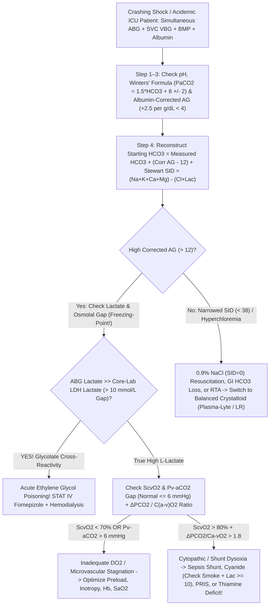
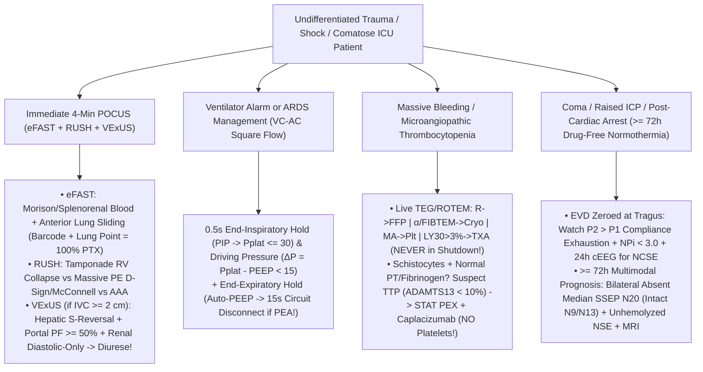

# Bundle 06 — Ep 806: ICU Red-Alert Orders, Shock Gaps, Ventilator Curves & TEG (All-In-One)

## ZERO-MIXUP SINGLE-SOURCE BUNDLE FOR GOOGLE NOTEBOOKLM

**How to use in NotebookLM (`notebook.google.com`):**

1. Check **ONLY THIS ONE DOCUMENT** in your NotebookLM Sources sidebar (uncheck all others — every reference treatise and script needed for this episode is merged right inside this single file!).
2. Click **Customize** on **Audio Overview**, choose **Longer**, and paste this exact prompt:

```text
ICU red-alert diagnostic orders: Stewart strong ion difference, mixed venous oxygen and venoarterial pCO2 gap in shock, mechanical ventilator flow-volume curves, rotational thromboelastography (TEG), VExUS ultrasound, and continuous coma EEG.
```

---


---

## INCLUDED SOURCE: `VOLUME_X_ICU_TRAUMA_AND_EMERGENCY_CRITICAL_CARE_DIAGNOSTIC_ORDERS.md`

# Basic Medical — Behind the Curtain Clinical Diagnostics Notebook
## Volume X: `ICU`, Trauma & Emergency Critical Care Diagnostic Orders — Acid-Base Physics, Shock Oximetry, Ventilator Waveforms, `TEG/ROTEM`, `POCUS` (`eFAST`, `RUSH`, `VExUS`) & Coma Neuro-Monitoring

> *"At 02:14 AM inside a Trauma-Surgical and Medical Intensive Care Unit, there is no luxury of waiting forty-eight hours for a reference laboratory send-out. Survival turns on ten-minute physics: decoding a deceptively 'normal' `pH = 7.40` arterial blood gas hiding three simultaneous lethal metabolic and respiratory catastrophes, spotting a `16 mmol/L` blood-gas versus core-lab 'lactate gap' that unmasks ethylene glycol antifreeze poisoning on the spot, executing a `0.5-second` ventilator end-inspiratory hold to prove whether a crashing `ARDS` patient has a mucus-plugged endotracheal tube or a tension pneumothorax, reading acoustic thromboelastography amplitude to choose cryoprecipitate over tranexamic acid, Doppler-pulsing the intrarenal interlobar veins (`VExUS`) to reverse cardiorenal congestion, and watching the `P2` intracranial pressure tidal wave overtake `P1` minutes before uncal herniation."*

---

## Architectural Orientation: The Six Real-Time Diagnostic Engines of Critical Care & Resuscitation

Every critical-care diagnostic order interrogates a distinct physiological determinant of cellular oxygen delivery ($\dot{D}\text{O}_2$), electrochemical homeostasis, alveolar mechanics, microvascular hemostasis, or cortical viability (*Marino's The ICU Book*, 5th ed.; *Surviving Sepsis Campaign*; *ATLS* 10th ed.):

| Critical Care Modality | Primary Bedside Specimen / Signal | Underlying Biophysical / Analytical Principle | Turnaround Time (`TAT`) | Critical Decision Thresholds | Classic ICU Saboteur / Pitfall |
| :--- | :--- | :--- | :--- | :--- | :--- |
| **Arterial & Central Venous Blood Gas + `Stewart` Electrolytes** | Heparinized arterial (`ABG`) + `SVC`/`PA` venous (`VBG`) whole blood | `Sanz` $\text{pH}$, `Severinghaus` $\text{PCO}_2$, optical $\text{PO}_2$, co-oximetry + `Albumin-AG`, $\Delta/\Delta$, & **Strong Ion Difference (`SID`)** | **`90–180 sec`** (`POC` cartridge / ICU analyzer) | `Winters'` $P_a\text{CO}_2$; `Corr AG > 12`; `SID ~ 40 mEq/L`; `SvO2 65–75%`; **`Pv-aCO2 > 6 mmHg`** | Uncorrected hypoalbuminemia hides high-`AG` acidosis; `0.9% NaCl` (`SID = 0`) causes hyperchloremic acidosis; "normal" `ScvO2` in septic shunt; air bubbles & `D`-lactate blindspot |
| **Emergency Toxicology STAT Chemistry** | Serum (`Osmolality` by **freezing-point depression**), `ABG` vs Core `Lactate`, `APAP`, `Salicylate` | Colligative freezing-point depression; **`L`-Lactate Oxidase vs `LDH` glycolate gap**; `4-hr` Rumack-Matthew kinetics | `15–45 min` (`Lactate Gap` `< 5 min`!) | `Osm Gap > 10–15`; `4h APAP >= 150 µg/mL`; `Salicylate > 30–100 mg/dL` | Vapor-pressure osmometers miss `100%` of toxic alcohols; late presentation has *normal* osmolal gap; `RSI` apnea kills salicylate patients; **`Hydroxocobalamin` magenta optical interference** |
| **Mechanical Ventilator Scalars & Hold Maneuvers** | Continuous proximal airway Pressure, Flow, Volume + `EtCO2` (`+ Esophageal Balloon`) | Equation of Motion: **`0.5s` End-Inspiratory Hold (`PIP -> Pplat`)** & **End-Expiratory Hold (`Auto-PEEP`)** | **Instantaneous (`0.5 sec` at bedside)** | **`Pplat <= 30 cm H2O`**; **Driving Pressure $\Delta P < 15\text{ cm H}_2\text{O}$**; `RSBI < 105`; `NIF <= -30` | Passive patient mandatory during holds; severe obesity/ascites raises `Pplat` via chest wall (`check P_L`); occult `Auto-PEEP` triggers post-intubation `PEA` arrest |
| **Viscoelastic Hemostasis (`TEG 6s` / `ROTEM`) & `DIC` vs `TTP`** | Citrated `3.2%` whole blood (`37°C` resonance acoustics or rotating pin; `ADAMTS13` pre-`PEX`) | Whole-blood clot initiation (`R/CT`), fibrin cross-linking (`α/FIBTEM`), platelet pull (`MA/MCF`), lysis (`LY30`) | **`5–15 min`** actionable live tracing | `R > 10 min -> FFP`; `α < 53° -> Cryo`; `MA < 50 mm -> Plt`; **`LY30 > 3% -> TXA`** | **`TXA` in fibrinolysis-shutdown (`LY30 < 0.8%`) sepsis causes fatal thrombosis**; platelet transfusion in `TTP` (`ADAMTS13 < 10%`, normal `PT/Fib`) causes microvascular death |
| **Critical Care `POCUS` (`eFAST`, `RUSH`, `VExUS`)** | Phased-array (`1–5 MHz`), curvilinear (`2–5 MHz`), & linear (`6–13 MHz`) ultrasound + `PW` Doppler | Acoustic pleural sliding (`M-mode`), cardiac chamber tamponade/strain, & **organ-venous retrograde Doppler** | **`3–7 min`** at bedside | **Lung Point (`100%` PTX)**; `McConnell/D-sign`; **Portal Pulsatility `>= 50%`** & **Hepatic `S`-reversal** | `IVC` diameter alone lies on positive-pressure ventilation; `VExUS` hepatic Doppler misread without simultaneous `ECG` lead; subcutaneous emphysema blocks ultrasound |
| **Multimodal Neuro-ICU Monitoring (`EVD/ICP`, `NPi`, `cEEG`, `SSEP`)** | Intraventricular `EVD` catheter (`tragus` zero), `IR` pupillometer, `21`-lead `cEEG`, median-nerve **`N20`**, `BD/DNC` | Monro-Kellie elastance (`P1/P2/P3`), automated `NPi`, non-convulsive seizure grids, cortical `N20` evoked potentials | Continuous (`ICP`, `cEEG`); **`>= 72h`** post-arrest `SSEP` | **`P2 > P1` = exhausted compliance**; `NPi < 3.0`; **Bilateral absent `N20` (`> 99.5%` specificity)**; `Apnea PaCO2 >= 60 & +20` | Clamped vs open `EVD` errors; **tiny `RBC` hemolysis spikes `NSE` falsely**; premature `< 72h` or sedative-confounded prognostication; cervical lesion invalidates `N20` without intact `N9/N13` |

---

## Dossier 10.1: Red-Alert Resuscitation Chemistry — Acid-Base Physics (`Boston` vs. `Stewart` Strong Ion Difference), Shock Oximetry (`SvO2`, `ScvO2`, `Pv-aCO2` Gap) & Emergency Toxicology Gaps

### 1. Inside the Blood Gas Cartridge — And Stepwise Decoding of Hidden Triple Acid-Base Catastrophes

#### A. Behind the Heparinized Arterial Blood Gas (`ABG`) Syringe: Electrodes, Co-Oximetry & Pre-Analytical Traps
When an ICU respiratory therapist or resident punctures the radial artery (or aspirates `2 mL` after clearing `5 mL` of dead-space flush from an indwelling arterial line) into a **dry-lyophilized lithium-heparin blood-gas syringe**, the sample enters a miniature `37.0°C` electrochemical chamber containing three direct sensors plus a multi-wavelength spectrophotometer:
1. **The `Sanz` $\text{pH}$ Electrode (`Potentiometric`)**: Hydrogen ions ($\text{H}^+$) diffuse into a microscopic hydrated $\text{H}^+$-selective glass membrane, generating a Nernstian voltage ($\sim 61.5\text{ mV}$ per `1.0 pH` unit at `37°C`) against a silver/silver-chloride (`Ag/AgCl`) reference electrode.
2. **The `Severinghaus` $P\text{CO}_2$ Electrode (`Modified pH Potentiometric`)**: Dissolved $\text{CO}_2$ gas diffuses across a hydrophobic silicone/Teflon membrane into a thin film of sodium bicarbonate ($\text{CO}_2 + \text{H}_2\text{O} \rightleftharpoons \text{H}_2\text{CO}_3 \rightleftharpoons \text{H}^+ + \text{HCO}_3^-$); the resulting drop in internal film $\text{pH}$ measures $P_a\text{CO}_2$ directly! **Crucial Hidden Fact**: **The blood-gas analyzer does NOT physically measure Bicarbonate ($[\text{HCO}_3^-]$)!** It *calculates* $[\text{HCO}_3^-]$ mathematically from measured $\text{pH}$ and $P_a\text{CO}_2$ via the Henderson-Hasselbalch equation ($\text{pH} = 6.10 + \log_{10}\!\frac{[\text{HCO}_3^-]}{0.03 \times P_a\text{CO}_2}$), which is why small timing/temperature differences exist against the core-lab venous `BMP` enzymatic **Total $\text{CO}_2$** (`which measures HCO3- + dissolved CO2 + H2CO3`, normally `1–2 mEq/L` higher than calculated `ABG HCO3-`)!
3. **The `Clark` Polarographic / Optical Fluorescence $P\text{O}_2$ Sensor & `128-Wavelength` Co-Oximeter**: Measures physically *dissolved* oxygen tension ($P_a\text{O}_2$), while ultrasonic hemolysis + `128-wavelength` optical **Co-Oximetry** directly separates **Oxyhemoglobin ($\text{O}_2\text{Hb}$)**, **Deoxyhemoglobin ($\text{HHb}$)**, **Carboxyhemoglobin ($\text{COHb}$ — house fires/exhaust, where `2-wavelength` fingertip `SpO2` falsely reads **`99%`** because `COHb` absorbs `660 nm` red light identically to $\text{O}_2\text{Hb}$!)**, and **Methemoglobin ($\text{MetHb}$ — `dapsone`, `benzocaine`, `inhaled NO`, `rasburicase`, clamping fingertip `SpO2` toward **`85%`**!)**.
   * **Three Classic `ABG` Syringe Artifacts**:
     * **Room-Air Bubble Left in the Syringe (`PATM O2 = 150 mmHg, CO2 = 0.3 mmHg`)**: Shaking an un-vented syringe in a pneumatic tube equilibrates blood with the air bubble—driving **`PaO2` falsely toward `150 mmHg`** (lowering `PaO2` if true `PaO2` was `250`, or *raising* `PaO2` if true hypoxic `PaO2` was `48`!) while stripping **`PaCO2` falsely downward** and raising $\text{pH}$!
     * **Excess *Liquid* Sodium Heparin Flush**: Dilutes plasma dissolved $\text{CO}_2$ (`lowers PaCO2` & `HCO3-` falsely) and floods `Na+` while binding **`Ionized Calcium` ($\text{iCa}^{2+}$) falsely downward**!
     * **"Leukocyte Larceny" (`Pseudohypoxemia`)**: In hyperleukocytic acute leukemia (`WBC > 100,000/µL`) or extreme thrombocytosis (`Platelets > 1,500,000/µL`), metabolically voracious blasts sitting inside a warm syringe devour dissolved $\text{O}_2$ in `10 minutes`, printing **`PaO2 = 34 mmHg`** while the patient sits comfortably pink with **`SpO2 = 98%`**!

---

#### B. The Five-Step `Boston` Acid-Base Algorithm — Unmasking a Deadly Triple Disorder Behind `pH = 7.40`
Never stop reading an `ABG` just because $\text{pH}$ sits inside `7.35–7.45`! While one primary disorder **never overcompensates** past `7.40`, *two or three simultaneous opposing primary disorders routinely cancel each other's $\text{H}^+$ shift right onto `7.40`*:

1. **Step 1 — Check Internal Consistency (`Kassirer-Bleich Equation`) & Overall $\text{pH}$ Direction**:
   $$[\text{H}^+]\text{ (nmol/L)} = 24 \times \frac{P_a\text{CO}_2}{[\text{HCO}_3^-]} \qquad (\text{at pH } 7.40,\, [\text{H}^+] = 40\text{ nmol/L};\; \pm 0.10\text{ pH} \approx \times 0.8 \text{ or } \times 1.25)$$
2. **Step 2 — Apply Exact Compensation Equations to the Primary Disturbance**:
   * **Metabolic Acidosis (`Winters' Formula`, 1967)**:
     $$\text{Expected } P_a\text{CO}_2 = 1.5 \times [\text{HCO}_3^-] + 8 \pm 2\text{ mmHg}$$
     *(If actual $P_a\text{CO}_2$ is **higher** than Winters' ceiling $\implies$ concomitant **Primary Respiratory Acidosis** — in `DKA` or severe sepsis, this warns of **impending diaphragmatic exhaustion**! If actual $P_a\text{CO}_2$ is **lower** than Winters' floor $\implies$ concomitant **Primary Respiratory Alkalosis**, classic for **gram-negative sepsis, salicylate toxicity, pulmonary embolism, or cirrhosis**!)*
   * **Metabolic Alkalosis**: $\text{Expected } P_a\text{CO}_2 = 0.7 \times ([\text{HCO}_3^-] - 24) + 40 \pm 2\text{ mmHg}$ *(rarely exceeds `55 mmHg` before hypoxemia overrides hypoventilation)*.
   * **Respiratory Acidosis (`PaCO2 > 40`) — The `1`-and-`4` Rule**:
     * *Acute (`minutes–hours`, hemoglobin buffering only)*: $[\text{HCO}_3^-]$ rises **`+1 mEq/L` per `+10 mmHg` $P_a\text{CO}_2$** (`pH` drops `0.08` per `+10 mmHg`).
     * *Chronic (`>= 3–5 days`, renal proximal $\text{NH}_4^+$ synthesis)*: $[\text{HCO}_3^-]$ rises **`+3.5 to +4.0 mEq/L` per `+10 mmHg` $P_a\text{CO}_2$** (`pH` drops `0.03` per `+10 mmHg`). *(ICU Ventilator Pearl: If you intubate a chronic `COPD` retainer whose baseline is `PaCO2 = 70 / HCO3- = 36` and hyperventilate them straight down to `PaCO2 = 38`, the kidneys still hold `36 mEq/L` of bicarbonate—producing **`pH = 7.60` Post-Hypercapnic Metabolic Alkalosis** with seizures and cardiac arrhythmias!)*
   * **Respiratory Alkalosis (`PaCO2 < 40`) — The `2`-and-`5` Rule**:
     * *Acute*: $[\text{HCO}_3^-]$ drops **`-2 mEq/L` per `-10 mmHg` $P_a\text{CO}_2$**.
     * *Chronic*: $[\text{HCO}_3^-]$ drops **`-4 to -5 mEq/L` per `-10 mmHg` $P_a\text{CO}_2$**.
3. **Step 3 — Calculate the *Albumin-Corrected* Anion Gap (`Figge–Fencl Equation` — NEVER Skip in the ICU!)**:
   $$\text{Raw Anion Gap (AG)} = [\text{Na}^+] - ([\text{Cl}^-] + [\text{HCO}_3^-]) \qquad (\text{Normal} \approx 8\text{–}12\text{ mEq/L at Albumin } 4.0\text{ g/dL})$$
   Why is normal `AG` equal to `12 mEq/L` instead of `0`? Because **`~75–80%` (`~10–11 mEq/L`) of "unmeasured anions" in healthy human plasma are negatively charged histidine/carboxylate side chains on Serum Albumin (`~2.5 mEq` negative charge per `1.0 g/dL` of Albumin)**!
   * In a critically ill septic cirrhotic patient with **`Serum Albumin = 1.4 g/dL`**, their *true physiological baseline* Anion Gap is only $12 - 2.5(4.0 - 1.4) = \mathbf{5.5\text{ mEq/L}}$! If their raw lab `AG` prints **`12 mEq/L`**, an intern sees `"AG 12 = Normal"` and walks away—missing **`+6.5 mEq/L` of occult high-anion-gap lactic/ketoacidosis**! Always apply:
     $$\text{Albumin-Corrected AG} = \text{Measured AG} + 2.5 \times (4.0 - \text{Measured Albumin [g/dL]})$$
4. **Step 4 — Apply the Delta-Delta ($\Delta\text{AG}$ vs. $\Delta\text{HCO}_3^-$, or "Reconstructed Starting $[\text{HCO}_3^-]$")**:
   In a pure `1:1` High-Anion-Gap Metabolic Acidosis (`GOLD MARK`: **G**lycols, **O**xoproline [chronic acetaminophen + malnutrition!], **L**-lactate, **D**-lactate, **M**ethanol, **A**spirin, **R**enal failure/uremia, **K**etoacidosis [`DKA`/alcoholic/starvation]), every `1 mEq/L` of unmeasured acid anion ($\Delta\text{AG} = \text{AG}_{\text{corr}} - 12$) consumes roughly `1 mEq/L` of bicarbonate *(note: lactic acidosis averages `~1.6:1` because lactate stays largely extracellular while $\text{H}^+$ buffers intracellularly; `DKA` with preserved GFR excretes ketoacid anions into urine, sliding toward non-AG acidosis during fluid resuscitation!)*. Adding $\Delta\text{AG}$ back onto measured $[\text{HCO}_3^-]$ reconstructs the **Pre-Acidosis ("Starting") $[\text{HCO}_3^-]$**:
   $$\text{Starting } [\text{HCO}_3^-] = \text{Measured } [\text{HCO}_3^-] + (\text{Corrected AG} - 12)$$
   * **Starting $[\text{HCO}_3^-] = 22\text{–}26\text{ mEq/L}$** ($\Delta\text{AG} / \Delta\text{HCO}_3^- \approx 1\text{–}2$): **Pure High-Anion-Gap Metabolic Acidosis**.
   * **Starting $[\text{HCO}_3^-] > \mathbf{28\text{–}30\text{ mEq/L}}$** ($\Delta\text{AG} / \Delta\text{HCO}_3^- > 2$): **Concomitant Hidden Metabolic Alkalosis** (`vomiting`, `NG suction`, `loop diuretics`, or baseline chronic `COPD` compensation)!
   * **Starting $[\text{HCO}_3^-] < \mathbf{20\text{ mEq/L}}$** ($\Delta\text{AG} / \Delta\text{HCO}_3^- < 0.8\text{–}1.0$): **Concomitant Hidden Non-Anion-Gap (Hyperchloremic) Metabolic Acidosis** (`diarrhea`, `RTA`, or `4 L` of `0.9% Saline` resuscitation)!

> [!IMPORTANT]
> **Worked Trauma/ICU Masterclass — Unmasking `3` Simultaneous Disorders When `pH = 7.40`**:
> A 29-year-old with Type 1 Diabetes arrives febrile (`39.2°C`), tachycardic (`132 bpm`), and vomiting violently for `2 days`:
> * **Labs**: **`pH = 7.40`** | **`PaCO2 = 24 mmHg`** | **`HCO3- = 15 mEq/L`** | **`Na+ = 140`** | **`Cl- = 93`** | **`Albumin = 4.0 g/dL`**
> * **Glance Trap**: `"pH is 7.40—acid-base is completely compensated!"` **WRONG—three independent crises are colliding**:
>   1. **Corrected Anion Gap**: $140 - (93 + 15) = \mathbf{32\text{ mEq/L}}$ ($\Delta\text{AG} = 32 - 12 = \mathbf{+20}$) $\implies$ Severe **High-Anion-Gap Metabolic Acidosis (`DKA` + Sepsis Lactic Acidosis)**!
>   2. **Reconstructed Starting $[\text{HCO}_3^-]$**: $15 + 20 = \mathbf{35\text{ mEq/L}}$ ($\gg 26$!) $\implies$ Before ketoacidosis titrated bicarbonate down to `15`, intractable emesis of gastric $\text{HCl}$ had pushed $[\text{HCO}_3^-]$ to `35`: **Superimposed Severe Metabolic Alkalosis**!
>   3. **Winters' Formula**: $1.5(15) + 8 \pm 2 = \mathbf{30.5 \pm 2\text{ mmHg}}$ (`28.5–32.5`). Actual $P_a\text{CO}_2$ is **`24 mmHg`** (`< 28.5`!) $\implies$ Endotoxin/urosepsis is driving hyperventilation *beyond* metabolic compensation: **Superimposed Primary Respiratory Alkalosis**!

---

#### C. Peter Stewart's Quantitative Physicochemical Model (`1983`): Why `"Normal" 0.9% Saline` Inevitably Acidifies Human Blood
Traditional `Boston` rules describe *empirical correlations* around bicarbonate, yet struggle to explain *why* infusing `4 liters` of neutral `0.9%` sodium chloride drops arterial $\text{pH}$ to `7.18` when neither acid nor $\text{CO}_2$ was infused! Canadian physiologist **Peter A. Stewart** applied strict physical chemistry—simultaneous **conservation of mass**, **water auto-ionization ($[\text{H}^+][\text{OH}^-] = K'_w$)**, weak-acid dissociation, and **Macroscopic Law of Electroneutrality ($\sum\text{Cations} = \sum\text{Anions}$)**—proving that inside aqueous human plasma, **`pH` ($[\text{H}^+]$) and $[\text{HCO}_3^-]$ cannot change on their own; they are slave *dependent* variables dictated mathematically by THREE *independent* variables**:

1. **$P_a\text{CO}_2$** (regulated independently by alveolar ventilation).
2. **$A_{\text{tot}}$ (Total Concentration of Non-Volatile Weak Acids — `Albumin` + `Inorganic Phosphate`)**:
   * **Instant ICU Insight**: Lowering $A_{\text{tot}}$ (**hypoalbuminemia** in sepsis/cirrhosis) directly reduces weak-acid anion $[A^-]$, forcing water/$\text{CO}_2$ equilibria to generate extra $[\text{HCO}_3^-]$ and *consume* $[\text{H}^+]$—meaning **Hypoalbuminemia itself is a primary *alkalinizing* force (`Hypoalbuminemic Metabolic Alkalosis`)**!
3. **The Apparent Strong Ion Difference ($\text{SID}_a$)**:
   "Strong ions" ($\text{Na}^+, \text{K}^+, \text{Ca}^{2+}, \text{Mg}^{2+}, \text{Cl}^-$, and $\text{Lactate}^-$ with $\text{p}K_a = 3.86$) are **`100%` dissociated** at physiological $\text{pH} \approx 7.4$. In healthy plasma (`Na+ 140 + K+ 4 + Ca2+ 2.5 + Mg2+ 1.5 = 148 mEq/L` minus `Cl- 104 + Lactate- 1 = 105 mEq/L`), strong cations exceed strong anions by **`~40 to 42 mEq/L`**:
   $$\text{SID}_a = ([\text{Na}^+] + [\text{K}^+] + [\text{Ca}^{2+}] + [\text{Mg}^{2+}]) - ([\text{Cl}^-] + [\text{Lactate}^-] + [\text{Other Strong Organic Anions}^-]) \approx \mathbf{+40\text{ to }+42\text{ mEq/L}}$$
   By strict electroneutrality, that positive `+40 mEq/L` electrical space (`Effective SID`, $\text{SID}_e$) **must be filled strictly by weak-acid buffer anions ($[\text{HCO}_3^-] + [\text{Albumin}^-] + [\text{Phosphate}^-]$)**:
   * **Any process that NARROWS $\text{SID}$ toward `0`** (either raising $[\text{Cl}^-]$ / $[\text{Lactate}^-]$ or diluting $[\text{Na}^+]$ with free water!) squeezes out buffer space, physically forcing water ($\text{H}_2\text{O} \rightleftharpoons \text{H}^+ + \text{OH}^-$) to dissociate more free **$[\text{H}^+]$ $\longrightarrow$ Strong-Ion Metabolic Acidosis**!
   * **Any process that WIDENS $\text{SID}$ above `+42 mEq/L`** (vomiting gastric $\text{Cl}^-$, furosemide chloruresis, or hypernatremic sodium bicarbonate infusion!) expands buffer space, consuming $[\text{H}^+]$ $\longrightarrow$ **Strong-Ion Metabolic Alkalosis**!

Now examine intravenous resuscitation bags through **Stewart's Lens**:
* **"Normal" `0.9%` Sodium Chloride (`154 mEq/L Na+` and `154 mEq/L Cl-`)**: Inside the plastic bag, $\text{SID} = 154 - 154 = 0\text{ mEq/L}$, *and after infusion into the human body*, neither $\text{Na}^+$ nor $\text{Cl}^-$ is metabolized $\implies$ **In-Vivo Effective $\text{SID} = \mathbf{0\text{ mEq/L}}$**! Pouring `4–6 liters` of a `SID = 0` solution into a `SID = +40` bloodstream raises $[\text{Cl}^-]$ proportionally far more than $[\text{Na}^+]$ (`104 -> 118 mEq/L` vs `140 -> 143 mEq/L`), narrowing plasma $\text{SID}$ from `40` down to **`27 mEq/L`** and **mechanistically guaranteeing Hyperchloremic (`SID-Narrowing`) Metabolic Acidosis**—which simultaneously triggers macula densa tubuloglomerular feedback, **constricting renal afferent arterioles and increasing `MAKE30` renal injury (`SMART` & `SALT-ED` NEJM Trials)**!
* **Balanced Crystalloids (`Lactated Ringer's` & `Plasma-Lyte 148`)**: Inside the plastic bag, `Plasma-Lyte` (`140 Na+ + 5 K+ + 3 Mg2+ = 148` vs `98 Cl- + 27 Acetate- + 23 Gluconate- = 148`) also has an *in-bag* `SID = 0` (`electrically neutral`). **The Magic Happens Inside Liver & Muscle Mitochondria**: within minutes of infusion, `Acetate-` and `Lactate-` are oxidized completely into neutral $\text{CO}_2 + \text{H}_2\text{O}$ and vanish as anions, leaving behind **`In-Vivo Effective SID = +28 mEq/L` (`Lactated Ringer's`)** and **`+50 mEq/L` (`Plasma-Lyte`)**—protecting plasma `SID` and preventing iatrogenic acidosis! *(Exception: in **Traumatic Brain Injury [`TBI`]**, `Lactated Ringer's` is slightly hypotonic [`273 mOsm/L` vs plasma `290`], worsening cerebral edema—so neuro-ICUs use `0.9% Saline` [`308 mOsm/L`] or isotonic `Plasma-Lyte` [`294 mOsm/L`]!)*

---

### 2. Bedside Shock Resuscitation Numbers Unmasked: `Lactate` Myths, `SvO2`/`ScvO2` Fick Physics & The `Pv-aCO2` Microcirculatory Gap

#### A. `L`-Lactate Kinetics, Epinephrine $\beta_2$ Glycolysis, `PRIS` & The `D`-Lactate Blindspot
Cytosolic **Lactate Dehydrogenase (`LDH`)** catalyzes a reversible mass-action equilibrium between pyruvate and `L`-lactate (`normal arterial/peripheral venous lactate = 0.5–1.8 mmol/L`; peripheral venous runs only `~0.2–0.4 mmol/L` higher than arterial):
$$[\text{L-Lactate}] = K_{\text{eq}} \cdot [\text{Pyruvate}] \cdot \frac{[\text{NADH}][\text{H}^+]}{[\text{NAD}^+]}$$
Notice the two independent levers that raise serum lactate: **either** mitochondrial $\text{O}_2$ starvation stalls Complex IV so cytosolic **$[\text{NADH}]/[\text{NAD}^+]$ skyrockets (`Type A Tissue Hypoperfusion / Dysoxia`)**, **OR** accelerated aerobic glycolysis / blocked pyruvate clearance piles up **$[\text{Pyruvate}]$ even inside well-oxygenated cells (`Type B Non-Hypoxic Hyperlactatemia`)**:

* **Five Essential Type B & Mixed Lactate Traps in the ICU**:
  1. **Catecholamine $\beta_2$-Adrenergic Surge (`IV Epinephrine` Drip or Continuous High-Dose Nebulized `Albuterol` in Status Asthmaticus!)**: Epinephrine and albuterol stimulate skeletal-muscle membrane **$\beta_2$-receptors $\to$ `cAMP` $\to$ $\text{Na}^+/\text{K}^+\text{-ATPase}$**, generating `ADP` that turbocharges **Phosphofructokinase-1 (`PFK-1`) aerobic glycolysis** faster than normal Pyruvate Dehydrogenase (`PDH`) can feed the Krebs cycle! Result: `Lactate` climbs from `2.5` to `7.8 mmol/L` on an epinephrine infusion or continuous albuterol **even while cardiac output, extremities, urine output, and `Pv-aCO2` gap are completely warm and normal**—pouring `4` extra liters of fluid into that asthma/post-cardiotomy patient causes flash pulmonary edema!
  2. **Fulminant Shoshin Beriberi (`Thiamine / Vitamin B1` Deficiency)**: **Thiamine Pyrophosphate (`TPP`)** is the obligate prosthetic cofactor of **Pyruvate Dehydrogenase (`PDH`)**—the single doorway from pyruvate into Acetyl-CoA! Malnourished, alcoholic, bariatric, or un-supplemented `TPN` patients given `D5W` dextrose lock `100%` of pyruvate out of mitochondria (`Lactate = 12–22 mmol/L` refractory shock), reversing dramatically within hours of **`IV Thiamine 500 mg`**!
  3. **Propofol Infusion Syndrome (`PRIS`)**: Prolonged high-dose propofol sedation (**`> 4–5 mg/kg/hr` for `> 48 hours`**, accelerated by catecholamines + steroids) uncouples oxidative phosphorylation and blocks mitochondrial **Carnitine Palmitoyltransferase I (`CPT-1`)** long-chain fatty-acid entry $\longrightarrow$ sudden unexplained **High-AG Lactic Acidosis + Milky Lipemia (`Triglycerides > 500–1,000 mg/dL`) + Rhabdomyolysis (`CK > 10,000 U/L` & hyperkalemia) + Hepatomegaly + Right-Precordial `V1–V3` Brugada-like Coved `ST`-Elevation $\to$ Refractory Bradycardic Asystole**! Stop propofol *immediately* (`switch to Dexmedetomidine/Midazolam`) and start `CRRT`/`VA-ECMO`!
  4. **Acute / Decompensated Liver Failure**: The healthy liver clears **`~70%` of whole-body daily lactate** (`1,500 mmol/day`) back into glucose via the **Cori Cycle** (`kidneys clear ~20–30%`).
  5. **THE STEREOISOMER BLINDSPOT — `D`-Lactic Acidosis**: Patients with **Short-Bowel Syndrome** or **Jejunoileal / Roux-en-Y Bypass** who eat a large carbohydrate load deliver undigested sugars straight into the colon, where overgrowth of *Lactobacillus* bacteria ferments glucose into the mirror-image optical isomer **`D`-Lactate**! Absorbed `D`-lactate crosses the blood-brain barrier (causing acute **cerebellar ataxia, slurred speech, nystagmus, and confusion** mimicking acute ethanol intoxication, with `Anion Gap = 26` and `negative ethanol`!)—yet **every routine hospital `ABG` and core-lab `L`-Lactate analyzer uses stereospecific `L-LDH` or `L-Lactate Oxidase` that is `100%` BLIND to `D`-Lactate (`prints Lactate = 0.8 mmol/L`!)**. You *must* order a specific **`D`-Lactate send-out assay**!

---

#### B. Mixed Venous (`SvO2`) & Central Venous (`ScvO2`) Oxygen Saturation: Rearranging Adolph Fick's Master Equation
By conservation of oxygen mass across the systemic circulation, systemic Oxygen Consumption ($\dot{V}\text{O}_2$, normal `~250 mL/min`) equals Cardiac Output ($\text{CO}$, `L/min`) multiplied by the arteriovenous oxygen content difference ($C_a\text{O}_2 - C_v\text{O}_2$, where ignoring tiny `0.003 × PO2` dissolved oxygen, $C\text{O}_2 \approx 1.34 \times \text{Hb} \times S\text{O}_2 \times 10\text{ dL/L}$). Rearranging algebraically solves directly for **Mixed Venous Oxygen Saturation ($S_v\text{O}_2$, aspirated from the distal Pulmonary Artery port of a Swan-Ganz `PAC` where `SVC + IVC + Coronary Sinus` blood have completely mixed; normal = `65% to 75%`)**:

$$S_v\text{O}_2 = S_a\text{O}_2 - \frac{\dot{V}\text{O}_2}{1.34 \times \text{Hb} \times \text{CO} \times 10} \iff 1 - \text{O}_2\text{ER} \approx \frac{\dot{D}\text{O}_2 - \dot{V}\text{O}_2}{\dot{D}\text{O}_2}$$

Look at the four clinical levers inside that single fraction: **`SvO2` (`or ScvO2`, sampled from a central line tip at the `SVC–RA` junction; normal `>= 70%`) drops below `65–70%` ONLY when `SaO2` falls (hypoxemia), `Hemoglobin` falls (hemorrhage/anemia), `Cardiac Output` falls (cardiogenic/hypovolemic/obstructive shock), OR `VO2` surges (fever, rigor shivering, seizures, agitation/work of breathing — which is why intubating and paralyzing a struggling shock patient instantly jumps `SvO2` by `+15%` by abolishing diaphragmatic `VO2`!)**.

* **Why `ScvO2` (`SVC`) and `SvO2` (`PA`) Flip Positions Between Health and Shock**:
  * *In Health (`ScvO2 < SvO2` by `2–5%`)*: Kidneys receive `20%` of cardiac output solely for glomerular filtration while extracting almost no oxygen (`Renal Vein SO2 ~85%`!), making `IVC` blood brighter than `SVC` cerebral-drained blood (`~70%`).
  * *In Circulatory Shock (`ScvO2 > SvO2` by `5–10%`!)*: Sympathetic vasoconstriction clamps down fiercely on **mesenteric/splanchnic and renal arteries** (`IVC SO2` plunges to `45%`!) while autoregulation preserves **cerebral blood flow** (`SVC ScvO2` stays higher at `68%`), plus maximally desaturated **coronary sinus blood (`SO2 ~30%`!)** empties *downstream* of the `SVC` catheter tip right into the right atrium!
* **Decoding Pathologic `SvO2` Extremes**:
  * **Dangerously LOW `SvO2 = 35%–50%`**: Tissues are starving for flow (`DO2` collapsed) and compensatively extracting `60%` of every oxygen molecule passing by $\longrightarrow$ **Cardiogenic Shock, Hemorrhagic/Hypovolemic Shock, or Cardiac Tamponade / Massive `PE`**!
  * **Dangerously HIGH `SvO2 = 82%–94%` in a Hypotensive Lactate-Rising Patient ("Venous Hyperoxia")**: Oxygen is bypassing or failing to enter mitochondria (`O2ER < 10%`) $\longrightarrow$
    1. **Distributive Septic Shock Microvascular Shunting** (nitric-oxide-paralyzed thoroughfare channels shunt arterialized blood straight into venules past ischemic capillary beds!).
    2. **Cyanide Toxicity (`Complex IV` Cytochrome $c$ Oxidase Blockade)** — venous blood drawn into the syringe looks **cherry-bright arterial red (`SvO2 > 90%`)** alongside `Lactate = 18 mmol/L`!
    3. **Decompensated Cirrhosis** (`arteriovenous shunts`), **Therapeutic Hypothermia** (`slashed VO2`), or **Wedged `PAC` Tip Error** (pulling oxygenated pulmonary-capillary blood backwards past an inflated balloon!).

---

#### C. The Venous-to-Arterial $\text{CO}_2$ Gap ($\Delta P\text{CO}_2 > 6\text{ mmHg}$) & The Bedside Anaerobic `RQ` Ratio
Suppose a septic shock patient on norepinephrine has `MAP = 68 mmHg` and a reassuring **`ScvO2 = 75%`**, yet lactate stays stuck at `4.6 mmol/L` and mottled knees persist. Should you give an inotrope/fluid challenge, or is flow already adequate? **`ScvO2` is blind here because microvascular shunting masks low flow!**

Enter the **Central Venous-to-Arterial Carbon Dioxide Tension Difference ("The `PCO2` Gap")**, calculated in `60 seconds` by sending simultaneous `ABG` + central-line `VBG`:
$$\Delta P\text{CO}_2 = P_{cv}\text{CO}_2 - P_a\text{CO}_2 \qquad (\text{Normal} = \mathbf{2\text{ to }6\text{ mmHg}})$$

* **Biophysical Genius (`Fick Equation Applied to CO2`)**: Because $\text{CO}_2$ is **`~20×` more diffusible in tissue water than $\text{O}_2$**, $\text{CO}_2$ diffuses freely out of ischemic stagnant venules into passing perfused capillaries even across microcirculatory shunts! By Fick's law ($\Delta C\text{CO}_2 = \dot{V}\text{CO}_2 / \text{CO}$), **$\Delta P\text{CO}_2$ is inversely proportional to Cardiac Output and Microvascular Capillary Flow** ("the venous stagnation marker"):
  * **`ScvO2 >= 70%` + `ΔPCO2 <= 6 mmHg`**: Systemic and microvascular flow are genuinely adequate (persistent lactate is either slow washout or cytopathic/Type B!).
  * **`ScvO2 >= 70%` + `ΔPCO2 > 6 mmHg` (`e.g., PvCO2 51 - PaCO2 40 = 11 mmHg`)**: **Occult Low Flow / Microvascular Stagnation** is failing to wash $\text{CO}_2$ out of tissues—the patient needs flow optimization (`dobutamine` if depressed `EF`, or preload responsiveness check)!
* **The Anaerobic Respiratory Quotient Surrogate ($\Delta P\text{CO}_2 / C_{(a-v)}\text{O}_2 > 1.4\text{–}1.8\text{ mmHg/mL}$)**:
  Under pure aerobic metabolism, the Respiratory Quotient ($\text{RQ} = \dot{V}\text{CO}_2 / \dot{V}\text{O}_2$) sits between `0.7` (lipids) and `1.0` (glucose). The exact instant cells cross their critical anaerobic threshold, ATP hydrolysis + glycolysis generate excess protons ($\text{H}^+$) buffered immediately by intracellular $\text{HCO}_3^- \longrightarrow \text{H}_2\text{CO}_3 \longrightarrow$ **anaerobic non-oxidative $\text{CO}_2$ explosion**, while $\dot{V}\text{O}_2$ simultaneously falls! Canceling Cardiac Output ($\text{CO}$) from the numerator and denominator yields a pure bedside `ABG + VBG` ratio:
  $$\frac{\Delta P\text{CO}_2}{C_a\text{O}_2 - C_{cv}\text{O}_2} = \frac{P_{cv}\text{CO}_2 - P_a\text{CO}_2}{1.34 \times \text{Hb} \times (S_a\text{O}_2 - S_{cv}\text{O}_2) + 0.003(P_a\text{O}_2 - P_{cv}\text{O}_2)} > \mathbf{1.4\text{ to }1.8\text{ mmHg}\cdot\text{dL/mL O}_2}$$
  A ratio **`> 1.4–1.8`** proves **ongoing cellular anaerobic dysoxia right now** with far faster kinetics than sluggish hepatic lactate clearance (*Ospina-Tascón, Monnet & Teboul, Intensive Care Med*)!

---

### 3. Emergency Toxicology STAT Panels: The `Glycolate Lactate Gap`, `APAP` Nomogram, `Salicylates` & `Hydroxocobalamin` Optical Chaos

#### A. Toxic Alcohols (`Methanol` vs. `Ethylene Glycol` vs. `Isopropanol`) & The `5-Minute` Bedside `Lactate Gap`
Definitive gas-chromatography (`GC-FID`) blood levels for **Methanol** (windshield washer fluid, moonshine) and **Ethylene Glycol** (automotive radiator antifreeze) are send-out tests at `90%` of hospitals (`12–48h TAT`)—yet waiting `12 hours` leaves the patient permanently blind (**formic acid** optic neuropathy/basal ganglia necrosis) or anuric (**oxalic/glycolic acid** acute tubular necrosis)! Intensivists diagnose toxic alcohols in `20 minutes` using **two kinetic chemical windows**:

1. **Window 1 — Early Presentation (`1–6 Hours Post-Ingestion`): High Osmolal Gap, Normal Anion Gap**:
   Unmetabolized parent alcohols are tiny uncharged molecules (`MW = 32 g/mol` Methanol; `62 g/mol` Ethylene Glycol; `60 g/mol` Isopropanol) that contribute `1 mOsm/kg` for every `3.2` or `6.2 mg/dL` in serum!
   $$\text{Calculated Osmolality} = 2[\text{Na}^+] + \frac{\text{Glucose (mg/dL)}}{18} + \frac{\text{BUN (mg/dL)}}{2.8} + \frac{\text{Ethanol (mg/dL)}}{3.7\text{ to }4.6}$$
   $$\text{Osmolal Gap} = \text{Measured Osmolality (Freezing-Point Depression!)} - \text{Calculated Osmolality}$$
   * **BENCH HARDWARE TRAP**: Measured osmolality **MUST be run on a Freezing-Point Depression Osmometer**! Older **Vapor-Pressure (Dew-Point) Osmometers** assume water is the only volatile solvent—volatile **Methanol, Ethanol, and Isopropanol evaporate into the headspace and read `Osmolal Gap = 0` (`100%` false-negative!)**.
   * **TEMPORAL TRAP — Why a Normal Osmolal Gap NEVER Rules Out Late Toxic Alcohol Poisoning**: Over `12–24 hours`, hepatic **Alcohol Dehydrogenase (`ADH`)** + Aldehyde Dehydrogenase convert `1` uncharged parent Ethylene Glycol molecule (`1 mOsm`) into ionized **`Glycolate-` + `H+`** (neutralized by `HCO3- -> CO2` blown off by lungs: net change in osmolality = `0` as parent osmoles disappear, while **Anion Gap surges to `38 mEq/L` and `pH` plunges to `6.88`**!). *(Also remember mild Osmolal Gaps of `10–20` occur in severe septic shock, renal failure, `DKA` acetone, or `IV Lorazepam / Diazepam` **`Propylene Glycol`** diluent toxicity!)*
2. **Window 2 — THE BEDSIDE `ETHLYENE GLYCOL LACTATE GAP` MIRACLE**:
   Look at the chemical structure of **`L`-Lactate** ($\text{CH}_3\text{-CH(OH)-COO}^-$) versus Ethylene Glycol's primary lethal metabolite, **Glycolate** ($\text{H-CH(OH)-COO}^-$, differing by a single methyl group!):
   * **Point-of-Care ICU `ABG` Analyzers (`Radiometer ABL`, `i-STAT`, `GEM`)** measure lactate amperometrically using bacterial **`L`-Lactate Oxidase (`LOX`)**: `Glycolate` slips straight into the `LOX` enzyme pocket, generating massive $\text{H}_2\text{O}_2$ current and printing a jaw-dropping **`ABG Lactate = 24.5 mmol/L`**!
   * **Core-Laboratory Automated Chemistry Analyzers (`Roche`, `Beckman`, `Ortho`)** measure lactate spectrophotometrically (`340 nm` NADH) using **`Lactate Dehydrogenase (LDH)`** (or glycolate-shielded `LOX` formulas) that **completely ignore `Glycolate`**, printing **`Core-Lab Venous Lactate = 1.9 mmol/L`** on blood drawn at the *exact same minute*!
   * **Diagnostic Bullseye**: **`[ABG Lactate] - [Core-Lab LDH Lactate] > 10 mmol/L` ("Positive Lactate Gap")** is virtually **pathognomonic for acute Ethylene Glycol poisoning in `5 minutes`**, prompting immediate **`IV Fomepizole` (`15 mg/kg` loading dose — competitively blocks `ADH` with `8,000×` affinity; note co-ingested `Ethanol > 100 mg/dL` also temporarily protects the patient by saturating `ADH`!)** + Pyridoxine/Thiamine cofactors + urgent **Hemodialysis**!

| Toxic Alcohol | Molecular Weight (`mg/dL per 1 mOsm`) | Hepatic `ADH` Metabolite | Acid-Base & Osmolal Signature | Signature End-Organ / Bedside Clue |
| :--- | :--- | :--- | :--- | :--- |
| **Methanol** (`Windshield fluid, Sterno, moonshine`) | `32 g/mol` (`3.2 mg/dL` per `mOsm`) | Formaldehyde $\to$ **Formic Acid (`Formate`)** | Early: High Osm Gap; Late: **Severe High-AG Acidosis (`pH < 7.0`)** (`NO` lactate gap!) | **Optic disc hyperemia, "walking in a snowstorm" blindness**, bilateral **putaminal necrosis** on `CT/MRI` (`+ Folinic Acid / Leucovorin` cofactor!) |
| **Ethylene Glycol** (`Radiator antifreeze`) | `62 g/mol` (`6.2 mg/dL` per `mOsm`) | **Glycolic Acid** $\to$ Glyoxylic $\to$ **Oxalic Acid** | Early: High Osm Gap; Late: **Severe High-AG Acidosis + Massive `ABG vs Core Lactate Gap`!** | **`AKI` + Hypocalcemia (`Ca-Oxalate` chelation)** + **Envelope (dihydrate) / Needle-Dumbbell (monohydrate) urinary crystals** + Wood's `UV` lamp urine glow |
| **Isopropanol** (`70%` Rubbing alcohol, hand sanitizer) | `60 g/mol` (`6.0 mg/dL` per `mOsm`) | **Acetone** *(ketone—cannot oxidize further to an acid!)* | **High Osmolal Gap + NORMAL `pH` & NORMAL Anion Gap!** | Fruity acetone breath, hemorrhagic gastritis, **strongly positive serum/urine Nitroprusside Ketones (`Acetest`) WITHOUT ketoacidosis** (*Supportive care only—NEVER give Fomepizole, which prolongs coma!*) |

#### B. Acetaminophen (`Rumack-Matthew` Kinetics), Salicylate Intubation Trap & `Hydroxocobalamin` (`Cyanokit`) Interference
* **Acetaminophen (`APAP`) & The `4-Hour` Rumack-Matthew Semilog Nomogram**: At therapeutic doses, `~90%` of `APAP` undergoes harmless Phase II hepatic glucuronidation and sulfation, while `< 5–10%` is oxidized by **`CYP2E1`** into the hepatotoxic electrophile **`NAPQI` (*N*-acetyl-*p*-benzoquinone imine)**, immediately detoxified by **hepatic Glutathione (`GSH`)**. Overdose (`> 7.5–10 g` or `> 150 mg/kg`) saturates sulfation/glucuronidation; once **`> 70%` of hepatic `GSH` is depleted**, unbound `NAPQI` covalently arylates mitochondrial cysteine proteins, triggering **centrilobular (`Zone 3`, highest `CYP2E1` & lowest $\text{O}_2$) hepatic necrosis (`AST/ALT > 5,000–15,000 U/L`, `INR > 3–6`, hypoglycemia, cerebral edema)** `24–72 hours` after an initially asymptomatic `Stage I` patient!
  * *Exact Nomogram Rules*: Plot a serum `[APAP]` drawn **strictly between `4 hours` (after complete GI absorption—a `2-hour` level cannot be plotted!) and `24 hours`** after a **single acute known-time ingestion**. Any point at or above the **`150 µg/mL` at `4 hours` (`37.5 µg/mL` at `16h`, `t1/2 = 4h` line)** mandates **`IV N-Acetylcysteine (NAC)`** (replenishing cysteine/`GSH` + enhancing sulfation + scavenging free radicals in fulminant liver failure). **CRITICAL RULE**: The Rumack-Matthew nomogram is **COMPLETELY INVALID** for **staggered/supratherapeutic repeated ingestions**, unknown ingestion time, or delayed presentation `> 24h`—in those scenarios, start empiric `NAC` immediately if `[APAP]` is detectable (`> 10 µg/mL`) OR `AST/ALT` is elevated! *(King's College Liver Transplant Emergency Criteria in `APAP` failure: **Arterial `pH < 7.30` after fluid resuscitation** [single strongest standalone criterion!], OR all three of **`INR > 6.5` [`PT > 100s`] + `Creatinine > 3.4 mg/dL` + `Grade III/IV` Hepatic Encephalopathy**).*
* **Salicylate (`Aspirin`) Toxicity — Dual Acid-Base Signature & Why Routine `RSI` Apnea Kills in `90 Seconds`**:
  Salicylate directly stimulates the **medullary respiratory center** (`Kussmaul/tachypneic` `RR 32/min`, `PaCO2 = 16 mmHg` $\to$ **Primary Respiratory Alkalosis**) while simultaneously **uncoupling mitochondrial inner-membrane proton gradients** (heat/diaphoresis + lactic/ketoacid accumulation $\to$ **High-Anion-Gap Metabolic Acidosis**).
  * **THE LETHAL INTUBATION TRAP**: Salicylic acid is a weak acid ($\text{p}K_a = 3.0$). At `pH = 7.45`, `> 99.99%` sits ionized as charged $\text{Salicylate}^-$, trapped safely inside blood outside the brain. If you paralyze the patient with rocuronium for endotracheal intubation (`60s` apnea) and set a "normal" ventilator rate of `14/min`, **`PaCO2` jumps from `16` to `48 mmHg` and `pH` crashes from `7.45` to `7.05`**, shifting non-ionized lipophilic salicylic acid **`4-to-10-fold` straight across the Blood-Brain Barrier into neurons** $\longrightarrow$ immediate **seizures, cerebral edema, and refractory cardiac arrest**! Avoid intubation unless truly failing; if mandatory, pre-bolus **`IV Sodium Bicarbonate (1–2 mEq/kg)`** and immediately bag/ventilate at `RR 28–32/min` to defend `pH 7.50–7.55` while initiating **Bicarbonate Urinary Alkalinization (`urine pH >= 7.5` + aggressive `K+` repletion, because hypokalemia forces distal $\text{H}^+/\text{K}^+$ exchange to dump $\text{H}^+$ and *prevents* alkaline urine!)** and **Hemodialysis** (`if Salicylate > 90–100 mg/dL`, cerebral edema/confusion, pulmonary edema, or renal failure!).
* **Cyanide (`House Fire Smoke Inhalation / Nitroprusside`) & The `Hydroxocobalamin` (`Cyanokit`) Core-Lab Saboteur**:
  Any house-fire victim rescued from enclosed burning plastics/wool/polyurethane foam with **coma/hypotension + soot + `Lactate >= 8–10 mmol/L`** (`>= 10 mmol/L` has `90%` sensitivity/`85%` specificity for cyanide poisoning in smoke inhalation!) receives empiric **`5 g IV Hydroxocobalamin` (`Cyanokit`)**, whose cobalt core binds $\text{CN}^-$ `1:1` into non-toxic urinary **Cyanocobalamin (`Vitamin B12`)** (*unlike amyl/sodium nitrite kits, which deliberately induce `25%` Methemoglobinemia—lethal in a fire victim who already has `30%` Carboxyhemoglobin!*).
  * **Behind the Core-Lab Optical Chaos**: `5 grams` of `Hydroxocobalamin` stains serum, tears, skin, and urine **deep wine-magenta** (`intense optical absorption at 352 nm and 525 nm`) for up to `1–2 weeks`! Always **draw baseline labs *BEFORE* starting the `Cyanokit` drip**, because post-infusion magenta plasma **falsely elevates spectrophotometric `Total Bilirubin`, `Hemoglobin`, `COHb/MetHb` co-oximetry, and `Jaffe Creatinine`, severely suppresses enzymatic `Creatinine` and `AST/ALT`**, and trips **optical "blood-leak" photo-detectors inside hemodialysis/`CRRT` machines**, shutting down continuous dialysis unless switched to compatible cartridges!



---

## Dossier 10.2: Mechanical Ventilator Scalar Waveforms, Lung Mechanics (`Pplat`, Driving Pressure $\Delta P$, Auto-PEEP), `ROX` Index & Weaning (`RSBI`)

### 1. Treating the Mechanical Ventilator as a Real-Time Bedside Physiological Analyzer

Most clinicians view a mechanical ventilator solely as a therapeutic bellows pushing air into failing lungs. To an intensivist or respiratory physiologist, however, a modern microprocessor-controlled ICU ventilator (`Hamilton`, `Puritan Bennett`, `Servo-u`, `Dräger`) is a **continuous, `200-Hz` pneumotachograph and manometric laboratory** solving the **Equation of Motion of the Passive Respiratory System** on every single breath:

$$P_{\text{aw}}(t) = \underbrace{\dot{V}(t) \times R_{\text{aw}}}_{\text{Frictional Airway Resistance}} + \underbrace{\frac{V(t)}{C_{\text{rs}}}}_{\text{Alveolar + Chest-Wall Elastic Recoil ($\Delta P$)}} + \text{PEEP}_{\text{total}}$$

where $P_{\text{aw}}(t)$ is proximal endotracheal-tube pressure ($\text{cm H}_2\text{O}$), $\dot{V}(t)$ is instantaneous gas flow ($\text{L/sec}$), $R_{\text{aw}}$ is conducting airway + endotracheal-tube resistance ($\text{cm H}_2\text{O}\cdot\text{sec/L}$, governed by Poiseuille's Law $\propto 1/r^4$!), $V(t)$ is delivered tidal volume ($\text{L}$), $C_{\text{rs}}$ is static respiratory-system compliance ($\text{mL/cm H}_2\text{O}$, normal intubated adult **`60–100 mL/cm H2O`**), and $\text{PEEP}_{\text{total}} = \text{PEEP}_{\text{set}} + \text{Auto-PEEP}$.

---

#### A. The `0.5-Second` End-Inspiratory Hold Maneuver: Separating Conducting Tubes (`PIP`) From Fragile Alveoli (`Pplat`)
At 03:00 AM, the high-pressure alarm shrieks on a sedated patient ventilated in **Volume-Control Assist-Control (`VC-AC`) with a constant ("square-wave") inspiratory flow (`60 L/min = 1.0 L/sec`)**: **Peak Inspiratory Pressure (`PIP`) has surged to `48 cm H2O`!** Is the patient biting down on a mucus-corked endotracheal tube, or did they just blow a lethal tension pneumothorax?

Walk to the ventilator screen and press and hold one button for **`0.5 to 1.0 seconds`**: **`INSPIRATORY HOLD` (`End-Inspiratory Pause`)** *(Requirement: the patient must be **passive**—not actively inspiring or coughing during the `0.5s` pause!)*.
* **What Physically Happens Inside the Circuit**: At the exact millisecond the `420 mL` tidal volume finishes entering the lungs, the ventilator slams *both* the inspiratory valve and the expiratory valve shut simultaneously for `0.5 seconds`.
* **What Happens to the Equation of Motion**: Instantaneously, gas flow drops to **zero ($\dot{V} = 0\text{ L/sec}$)**! Look at the first term of the Equation of Motion ($\dot{V} \times R_{\text{aw}}$): **when flow equals zero, `100%` of endotracheal-tube and bronchial airway resistance vanishes mathematically!** Pressure across the bronchial tree equilibrates with the microscopic alveoli, and the pressure-time waveform drops down a vertical cliff from **`PIP`** onto a flat horizontal shelf: **Static Plateau Pressure (`Pplat`, lung-protective ceiling `<= 30 cm H2O`, `ARDSNet` *NEJM 2000*)**!

$$\text{Resistive Transairway Pressure} = \text{PIP} - P_{\text{plat}} = \dot{V} \times R_{\text{aw}} \qquad (\text{Normal at } 60\text{ L/min flow} \le \mathbf{5\text{ to }10\text{ cm H}_2\text{O}})$$
$$\text{Static Respiratory Compliance } (C_{\text{rs}}) = \frac{V_T}{P_{\text{plat}} - \text{PEEP}_{\text{total}}}$$

Two completely opposite bedside crises separate before your eyes in half a second:
1. **Scenario A — High `PIP` (`48 cm H2O`) + Normal `Pplat` (`20 cm H2O`) $\implies$ `PIP - Pplat = 28 cm H2O` (`Pure Resistive Airway Crisis!`)**:
   Alveolar pressure is a safe `20 cm H2O` (`zero` risk of alveolar rupture—high `PIP` wasted itself across the conducting tube and never reached the alveoli!). Check immediately in anatomic order from ventilator to bronchioles:
   * **Circuit / `HME` Filter**: Waterlogged heat-moisture exchanger filter!
   * **Endotracheal Tube (`ETT`)**: Patient waking up and **biting the `ETT`**, kinked oral tube, narrow `6.0–6.5 mm` `ETT` ($1/r^4$!), or **inspissated blood/mucus plug** (`pass inline suction catheter immediately`!).
   * **Bronchial Tree**: **Status Asthmaticus**, severe **`COPD` exacerbation**, anaphylactic bronchospasm, or tracheal stenosis.
2. **Scenario B — High `PIP` (`44 cm H2O`) + High `Pplat` (`38 cm H2O`) $\implies$ `PIP - Pplat = 6 cm H2O` (`Pure Stiff Compliance / Elastance Crisis!`)**:
   Conducting airways are wide open (`6 cm H2O` drop), yet `C_rs` has collapsed to `420 / (38 - 10) = 15 mL/cm H2O`—and **`38 cm H2O` is actively overdistending and tearing alveolar walls right now!** Immediately divide into:
   * **Unilateral Sudden Crisis (`Asymmetric Breath Sounds / POCUS`)**: **Tension Pneumothorax** (absent lung sliding -> immediate needle/finger thoracostomy!), **Right Mainstem Bronchial `ETT` Migration** (delivering `100%` of tidal volume into one lung doubles `Pplat`! Pull `ETT` back to `21–23 cm` at teeth!), massive **lobar mucus plug atelectasis**, or large **pleural effusion/hemothorax**.
   * **Bilateral Parenchymal / Chest-Wall Crisis**: Worsening **`ARDS`**, flash **cardiogenic pulmonary edema**, **circumferential thoracic burn eschar** (`needs bedside escharotomy!`), or **Abdominal Compartment Syndrome** (`bladder pressure > 20 mmHg` pushing the diaphragm into the chest!).

---

#### B. Marcelo Amato's Driving Pressure ($\Delta P < 15\text{ cm H}_2\text{O}$) & Esophageal Balloon Transpulmonary Pressure ($P_L$)
1. **Why Driving Pressure ($\Delta P = P_{\text{plat}} - \text{PEEP}_{\text{total}}$) Predicts `ARDS` Survival Better Than `6 mL/kg PBW` Alone**:
   `ARDSNet` taught us never to size tidal volume to actual obese weight—always calculate **Predicted Body Weight (`PBW`) from standing height and biological sex** (`6 mL/kg PBW`, because a `5'6"` adult has identical bony ribcage/lung dimensions at `60 kg` or `160 kg`!). Yet in severe `ARDS`, Luciano Gattinoni's `CT` studies proved that `70%` of dependent dorsal alveoli are flooded/consolidated—leaving only `30%` aerated ventral alveoli (**"The Baby Lung"**)! Even `6 mL/kg PBW` (`420 mL`) forced into a tiny `300-mL` Baby Lung causes lethal cyclic strain (**volutrauma/atelectrauma**).
   * In a landmark *NEJM* (`2015`) individual-patient meta-analysis of `3,562` `ARDS` patients across `9` randomized trials, **Marcelo Amato** proved that the true mediator of ventilator-induced lung injury (`VILI`) is **Driving Pressure ($\Delta P$)**:
     $$\Delta P = P_{\text{plat}} - \text{PEEP}_{\text{total}} = \frac{V_T}{C_{\text{rs}}}$$
   * Look at the fraction $V_T / C_{\text{rs}}$: because static compliance $C_{\text{rs}}$ shrinks in direct proportion to the surviving volume of aerated alveoli, **$\Delta P$ automatically normalizes Tidal Volume to the patient's true functional "Baby Lung" size**! Keeping **$\Delta P < \mathbf{14\text{ to }15\text{ cm H}_2\text{O}}$** (even if it requires dropping $V_T$ to `4.0–5.0 mL/kg PBW` and tolerating **Permissive Hypercapnia** down to `pH 7.20–7.25` [contraindicated in raised `ICP` / severe RV failure!]) is modern lung protection's North Star. *(Bedside `PEEP` titration pearl: If raising `PEEP` from `10` to `14 cm H2O` recruits collapsed dorsal alveoli, $C_{\text{rs}}$ improves and `Pplat` rises by *less* than `+4` [`e.g., 26 -> 28`, so **$\Delta P$ drops from `16` to `14` = Lung Recruitment!**]; if `Pplat` jumps from `26` to `32` [**$\Delta P$ widens from `16` to `18`**], extra `PEEP` is merely overdistending already-open alveoli—dial `PEEP` back down!)*
2. **Esophageal Balloon Manometry ($P_L = P_{\text{alv}} - P_{\text{es}}$) in Morbid Obesity & Tense Ascites**:
   What when a `BMI = 62 kg/m²` septic patient has `Pplat = 36 cm H2O` on `PEEP = 12`? Is the lung overstretched to breaking, or is `80 kg` of heavy chest-wall/abdominal pannus pressing *inward* against the pleura? Passing a thin air-filled **esophageal balloon catheter** into the lower third of the esophagus measures surrogate **Pleural Pressure ($P_{\text{es}}$)** directly (`Talmor et al., EPVent NEJM`):
   $$\text{Transpulmonary Distending Pressure } (P_L) = P_{\text{alv}} - P_{\text{es}}$$
   If end-inspiratory `Pplat` is `36 cm H2O` while pleural $P_{\text{es}}$ is `25 cm H2O`, the actual stress stretching the alveolar wall is only **$P_L = 36 - 25 = \mathbf{+11\text{ cm H}_2\text{O}}$** (completely safe; normal ceiling `< 20–25 cm H2O`!), and if end-expiratory $P_{\text{es}}$ is `18 cm H2O` on `PEEP = 12`, end-expiratory $P_L = 12 - 18 = \mathbf{-6\text{ cm H}_2\text{O}}$—proving the lungs are actually **crushed into cyclic expiratory collapse** and paradoxically need **`PEEP = 18–20 cm H2O`** to keep $P_{L,\text{exp}} \ge 0\text{ cm H}_2\text{O}$!

---

### 2. Flow-Time Scalar, Occult Auto-PEEP (`PEA` Rescue), Waveform Capnography & Neuromuscular/Weaning Indices

#### A. Spotting Auto-PEEP (`Intrinsic PEEP`) on the Flow-Time Scalar — And the `15-Second` Disconnect Miracle
In intubated **Status Asthmaticus** or severe **Emphysematous `COPD`**, inflamed/floppy bronchioles narrow violently during expiration (`prolonged expiratory time constant` $\tau = R_{\text{aw}} \times C_{\text{rs}}$). Watch the middle waveform on every ventilator monitor—the **Flow vs. Time Scalar**:
* In normal lungs, negative expiratory flow curves smoothly back up to touch the **`0 L/min` horizontal baseline** *before* the next inspiratory breath begins.
* **In Dynamic Hyperinflation (`Air Trapping / Auto-PEEP`)**: The negative expiratory flow trace **gets chopped off vertically (`still flowing at -25 L/min`!) and snaps straight into the next positive inspiration without ever reaching `0 L/min`!** Breath after breath stacks trapped air inside the chest, yet the ventilator's `PEEP` display deceptively reads **`PEEP = 5 cm H2O`** while the expiratory valve is open!
* **Quantifying Total PEEP via the `End-Expiratory Hold` Button**: Press **`EXPIRATORY HOLD`** for `1.0–2.0 seconds` just before the next breath. Closing both valves lets trapped distal alveolar pressure rush forward to the transducer—jumping the pressure trace from `Set PEEP = 5` straight up to **`Total PEEP = 21 cm H2O` (`Auto-PEEP = 21 - 5 = 16 cm H2O`)**!
* **THE CLASSIC POST-INTUBATION `PEA` ARREST RESCUE**: Three minutes after emergency intubation and rapid manual bagging (`24 breaths/min`!) of a severe asthmatic or `COPD` patient, blood pressure crashes to **`42/20` $\to$ Pulseless Electrical Activity (`PEA` Cardiac Arrest)**! Trapped `+25 cm H2O` intrathoracic pressure has **tamponaded the superior/inferior vena cava and right atrium (`venous return = ZERO`)**! **Before pushing rounds of futile epinephrine, IMMEDIATELY DISCONNECT THE ENDOTRACHEAL TUBE FROM THE VENTILATOR/AMBU BAG FOR `15–20 SECONDS`** (allowing a long audible *whoosh* of trapped air to decompress the chest, assisted gently by lateral ribcage compression if severe status asthmaticus!), watch arterial blood pressure rebound spontaneously within `20 seconds`, and reconnect on an **"Obstructive Lung Strategy"**: **`RR = 8–10 breaths/min`**, **`VT = 6 mL/kg`**, **high inspiratory flow (`70–90 L/min`)** to shorten inspiratory time (`Ti ~0.6s`) and maximize **Expiratory Time (`I:E = 1:4 to 1:6`)**!

---

#### B. Waveform Capnography (`EtCO2` Phases I–III), Oxygenation Equations (`A-a`, `P/F`, `ROX`) & Weaning (`RSBI`, `NIF`)

1. **Continuous Sidestream/Mainstream Infrared Capnography (`4.26 µm` $\text{CO}_2$ Absorption)**:
   * **Normal Rectangular Capnogram**: **Phase I** (`baseline = 0 mmHg`, pure anatomic dead space trachea/bronchi) $\to$ **Phase II** (steep `S`-shaped upstroke mixing dead space + fast alveoli) $\to$ **Phase III** (nearly flat **Alveolar Plateau**, whose peak right at end-exhalation is **`EtCO2`**, normally `35–45 mmHg` and `2–5 mmHg` *lower* than arterial `PaCO2`) $\to$ **Phase 0** (vertical drop back to `0` on inspiration; if Phase 0 fails to touch `0`, the patient is **rebreathing $\text{CO}_2$** from an exhausted soda-lime absorber or faulty valve!).
   * **Four Life-Saving ICU Capnograph Signatures**:
     1. **Gold-Standard Confirmation of Tracheal Intubation**: `>= 6` sustained rectangular `EtCO2` waveforms (`esophageal intubation` produces `0` flatline, or `1–2` tiny decaying burps if carbonated soda was in the stomach!).
     2. **"Shark-Fin" Sloped Phase III (Loss of Plateau)**: Slow-emptying hypercarbic bronchospastic units empty late in exhalation $\longrightarrow$ classic real-time gauge of **bronchospasm (`Asthma / COPD`)** or partial `ETT` obstruction (flattens back into a rectangle as bronchodilators work!).
     3. **Sudden Precipitous Drop of `EtCO2` (`38 -> 8 mmHg`) With Unchanged Minute Ventilation**: Ventilation is still pumping, *but pulmonary capillary blood stopped bringing $\text{CO}_2$ to the alveoli!* Differential: **Massive Saddle Pulmonary Embolism**, hemorrhagic/cardiogenic shock collapse, or **Cardiac Arrest**! *(Notice simultaneous `ABG`: in massive `PE`, **`PaCO2` rises to `52` while `EtCO2` plunges to `14`**—widening the **`PaCO2 - EtCO2` Alveolar Dead-Space Gradient to `38 mmHg`!**)*
     4. **`CPR` Compression Quality & Instantaneous `ROSC` Detection (`AHA ACLS`)**: During chest compressions under fixed ventilation, `EtCO2` tracks **coronary perfusion pressure / forward cardiac output** (`target >= 15–20 mmHg`; **`EtCO2 < 10 mmHg` after `20 minutes` of `ACLS` predicts `< 1%` survival**). A **sudden jump of `EtCO2` from `14` straight up to `38–45 mmHg` mid-cycle** announces **Return of Spontaneous Circulation (`ROSC`)** `30 seconds` before the next pulse check!

2. **Bedside Oxygenation Math (`A-a Gradient`, `Berlin P/F`, & `ROX Index`)**:
   * **The Alveolar Gas Equation & `A-a` $\text{O}_2$ Gradient** (distinguishing pure hypoventilation [`opioid overdose`, normal `A-a`!] from parenchymal/vascular `V/Q` mismatch & shunt [elevated `A-a`!]):
     $$P_A\text{O}_2 = F_i\text{O}_2 \times (P_{\text{atm}} - P_{\text{H}_2\text{O}}) - \frac{P_a\text{CO}_2}{\text{RQ}} \approx F_i\text{O}_2 \times (760 - 47) - \frac{P_a\text{CO}_2}{0.8}$$
     $$\text{A-a Gradient} = P_A\text{O}_2 - P_a\text{O}_2 \qquad \left(\text{Expected Normal on Room Air} \le \frac{\text{Age}}{4} + 4\text{ mmHg}\right)$$
   * **Berlin `ARDS` `PaO2 / FiO2` (`P/F`) Ratio** (measured on `PEEP >= 5 cm H2O` with bilateral opacities `< 7 days` not fully explained by left atrial hypertension): **`201–300` = Mild**, **`101–200` = Moderate**, **`<= 100` = Severe** (**`P/F < 150 mmHg` on `FiO2 >= 0.6` activates `PROSEVA`-protocol `>= 16 hours/day` Prone Positioning**, homogenizing pleural pressure gradients and slashing `28-day` mortality from `32.8%` down to `16.0%`!).
   * **The `ROX` Index on Heated High-Flow Nasal Cannula (`HFNC`, *Roca et al., 2019*)**: Prevents the deadly mistake of leaving a tiring hypoxemic pneumonia patient on `60 L/min HFNC` for `36 hours` until hypoxic arrest:
     $$\text{ROX Index} = \frac{S_p\text{O}_2 / F_i\text{O}_2}{\text{Respiratory Rate (breaths/min)}}$$
     Measured at `2, 6, and 12 hours` after `HFNC` initiation: **`ROX >= 4.88`** strongly predicts `HFNC` success, whereas **`ROX < 2.85` (`at 2h`), `< 3.47` (`at 6h`), or `< 3.85` (`at 12h`)** signals high risk of `HFNC` failure—proceed to controlled early intubation!

3. **Ventilator Liberation (`Yang & Tobin's RSBI`) vs. Neuromuscular Crisis ("`20–30–40` Rule")**:
   * **Rapid Shallow Breathing Index (`RSBI`, *Yang & Tobin, NEJM 1991*)**: Measured `1–2 minutes` into an unassisted Spontaneous Breathing Trial (`SBT` on `T-piece` or minimal `PSV 5/0` after passing daily sedation-awakening + oxygenation screen):
     $$\text{RSBI} = \frac{\text{Respiratory Frequency } (f,\text{ breaths/min})}{\text{Tidal Volume } (V_T,\text{ Liters})}$$
     *(Example: `RR = 20 / min` pulling `VT = 0.50 L` $\implies \text{RSBI} = \mathbf{40}$ — calm, deep breathing ready for extubation [provided alert mental status, strong cough, minimal secretions, and a positive **Cuff-Leak Test `>= 110 mL` or `> 10–15%` of `VT`** in patients with difficult airway/prolonged intubation at risk for post-extubation laryngeal stridor!]; conversely, `RR = 34 / min` panting `VT = 0.25 L` $\implies \text{RSBI} = \mathbf{136}$ [`>= 105` threshold] predicts `> 80–95%` extubation failure!)*
   * **Acute Neuromuscular Respiratory Failure (`Guillain-Barré Syndrome [AIDP]` & `Myasthenic Crisis`) — NEVER Wait for `ABG` Hypercapnia or Desaturation!**:
     Unlike `COPD` patients whose `PaCO2` creeps up over days, a Myasthenia Gravis or Guillain-Barré patient maintains **`SpO2 = 99%` and `PaCO2 = 36 mmHg` right up until the exact minute their diaphragm completely gives out and arrests**! Instead, respiratory therapists serially measure bedside handheld spirometry (**"The `20–30–40` Intubation Rule"**):
     1. **Forced Vital Capacity (`FVC`) `< 20 mL/kg` (or `>= 30%` rapid drop)** (`normal 60–70 mL/kg`; quick bedside screen: **Single-Breath Count `< 20`** on one maximal inhalation estimates `FVC < 1.5 L`!).
     2. **Maximal Inspiratory Pressure (`MIP` / Negative Inspiratory Force [`NIF`]) *weaker* (less negative) than `-30 cm H2O`** (`e.g., NIF = -22 or -15 cm H2O`; normal adult pulls `-80 to -120 cm H2O`!).
     3. **Maximal Expiratory Pressure (`MEP`) `< +40 cm H2O`** (loss of cough clearance $\to$ aspiration!).
     Crossing `20 / -30 / +40` (or bulbar dysphagia/neck-flexor weakness) mandates **elective, calm airway protection** (*never* use **`Succinylcholine`** in subacute `> 48–72h` Guillain-Barré/denervation—upregulated extrajunctional nicotinic acetylcholine receptors dump massive potassium, causing **instant hyperkalemic ventricular fibrillation**; use **`Rocuronium`**!).

---

## Dossier 10.3: Trauma Massive Transfusion Viscoelasticity (`TEG/ROTEM`), Critical-Care `POCUS` (`eFAST`, `RUSH`, `VExUS`) & Coma Neuro-Monitoring (`ICP` Lundberg Waves, Continuous `cEEG` & Post-Arrest `SSEP N20`)

### 1. Trauma-Bay Viscoelastic Hemostasis (`TEG 6s` / `ROTEM`) & Separating `DIC` From `TTP` (`ADAMTS13`)

#### A. Why `INR` Lies in Trauma Hemorrhage — And Reading the Live `TEG / ROTEM` Wineglass
During a Level-1 Massive Transfusion Protocol (`MTP`, balanced `1:1:1` `pRBC : Plasma : Platelets` per `PROPPR` trial + Calcium Gluconate/Chloride to reverse **citrate blood-bank hypocalcemia** keeping `Ionized Ca2+ >= 1.15–1.20 mmol/L`!), conventional `PT/INR` and `aPTT` fail clinically: spinning platelet-poor plasma takes `45 minutes`, warms cold `34.2°C` hypothermic blood back up to `37.0°C` inside the analyzer (hiding hypothermia-induced enzyme paralysis!), and terminates the optical timer the instant the *first `5%` wisps of fibrin* appear—completely blind to **platelet-fibrin clot strength** and **fulminant trauma hyperfibrinolysis**!

**Thromboelastography (`TEG 5000` torsion-pin / `TEG 6s` microfluidic piezoelectric resonance acoustics)** and **Rotational Thromboelastometry (`ROTEM` optical rotating pin)** interrogate **whole citrated blood** in real time (`5–15 minutes`), plotting mechanical clot firmness (`mm`) from liquid blood through maximal platelet-fibrin retraction to plasmin dissolution:

| `TEG` Parameter (`ROTEM` Equivalent) | Normal Value & Hemostatic Phase Measured | Abnormal Pathologic Signature | Exact Goal-Directed Blood-Product / Drug Prescription |
| :--- | :--- | :--- | :--- |
| **`R-Time` (`Reaction Time`)** / `ROTEM` **`CT` (`Clotting Time`)** | `TEG R`: `5–10 min` (`Rapid-TEG ACT < 110–128s`) — Soluble enzymatic **Coagulation Factor cascade (`II, VII, IX, X, XI, XII`)** to initial `2-mm` fibrin strand | **Prolonged `R-time > 10 min`** (long flat horizontal stem before wineglass opens) | **Transfuse `FFP` (`Plasma`, `15 mL/kg`)** or **`4-Factor PCC`** (if warfarin/`FXa` inhibitor!). *Check `Heparinase` channel*: if `Heparinase R` normalizes while native `R` is `40 min`, give **`IV Protamine`** (`heparin` or endogenous endothelial glycocalyx auto-heparinization!) |
| **`K-Time` & `α-Angle`** / `ROTEM` **`CFT` & `FIBTEM A5/A10`** | `K`: `1–3 min`; **`α-Angle`: `53°–72°`** (`FIBTEM` uses `Cytochalasin D` to paralyze platelets, isolating pure **Fibrinogen**!) — **Thrombin-burst fibrin cross-linking kinetics** | **Prolonged `K > 3 min` / Low `α-Angle < 53°` (`FIBTEM A5 < 9–10 mm`)** (sluggish shallow slope) | **Transfuse `Cryoprecipitate` (`1–2 pools = 10–20 units`, rich in `Fibrinogen, Factor VIII, vWF, Factor XIII`)** or **Fibrinogen Concentrate (`2–4 g`)**! *(First factor to crash `< 150–200 mg/dL` in trauma & postpartum hemorrhage!)* |
| **`MA` (`Maximum Amplitude`)** / `ROTEM` **`EXTEM MCF`** | **`MA`: `50–70 mm`** — Peak viscoelastic clot strength (**`~80%` driven by Platelet `GPIIb/IIIa` contractile pull + `~20%` Fibrin**!) | **Narrow `MA < 50 mm`** *with normal `FIBTEM`* (skinny wineglass bowl) | **Transfuse `1–2 Apheresis Platelet Units`** +/– **`DDAVP` (`Desmopressin 0.3 µg/kg IV`)** to release endothelial `vWF` multimers if uremic or aspirin-exposed! |
| **`LY30` (`Lysis at 30 Min`)** / `ROTEM` **`ML` (`Maximum Lysis`)** | **`LY30 <= 3.0%`** (`0.8%–3.0%` physiologic) — `tPA`/plasmin fibrinolytic clot breakdown `30 min` after `MA` | **Elevated `LY30 > 3%` ("Teardrop / Cigar / Diamond" collapsing trace)** = **Primary Trauma Hyperfibrinolysis** | **`IV Tranexamic Acid (TXA, 1 g over 10 min + 1 g over 8h)`** (`CRASH-2` / `CRASH-3`: **MUST be given within `<= 3 hours` of trauma/TBI**; giving `TXA > 3 hours` post-injury *increases* mortality!) |

> [!WARNING]
> **Why `TXA` Saves Lives in Trauma Hyperfibrinolysis (`LY30 > 3%`) Yet Kills Patients in Sepsis `Fibrinolysis Shutdown` (`LY30 < 0.8%`)**:
> Hemorrhagic shock endothelia dump massive tissue plasminogen activator (`tPA`), melting fresh hemostatic plugs (`LY30 = 25%`)—where `TXA` (`lysine analog` blocking plasminogen binding to fibrin) is life-saving. Conversely, **Septic `DIC` (`PAI-1` surge)** and **`~50%` of subacute ICU trauma patients** enter **Fibrinolysis Shutdown (`LY30 < 0.8%`)**, where microvascular thrombin clots are *already* clogging renal glomeruli, hepatic sinusoids, and pulmonary capillaries! Administering blind empiric `TXA` to a patient in fibrinolysis shutdown cements disseminated microthrombi irreversibly, precipitating **cortical renal necrosis and multi-organ failure** (*Moore et al., Trauma-Induced Coagulopathy*)!

#### B. Separating `ISTH` Disseminated Intravascular Coagulation (`DIC`) From `TTP` (`ADAMTS13 < 10%`) in `10 Minutes`
Both conditions present in the ICU with **severe thrombocytopenia (`Platelets = 14,000/µL`) + microangiopathic hemolytic anemia (`LDH = 1,400 U/L`, undetectable `Haptoglobin < 10 mg/dL`, indirect hyperbilirubinemia, and `>= 2%` helmet/triangle `Schistocytes` on peripheral blood smear!)**. Mixing up their treatments is fatal:

* **Overt Consumptive `DIC` (`Sepsis, Trauma, Abruptio Placentae, APL`) — `ISTH` Score `>= 5`**: Driven by systemic **Tissue Factor $\to$ Thrombin Explosion** consuming *both* platelets *and* all soluble coagulation factors!
  * **Coagulation Signature**: **Markedly prolonged `PT/INR` and `aPTT`, plummeting `Fibrinogen` (`< 100–150 mg/dL` — note fibrinogen is an acute-phase reactant normally `400–600` in sepsis, so a "normal" `190 mg/dL` falling from `480` is already consumptive!), and sky-high `D-Dimer`**. *(Treat underlying sepsis/obstetric source + replace `Cryo / FFP / Platelets` as needed for bleeding).*
* **Thrombotic Thrombocytopenic Purpura (`TTP`, Autoimmune `Anti-ADAMTS13` IgG) — `PLASMIC` Score `6–7` $\to$ `ADAMTS13 < 10%`**:
  * **Pathophysiology**: Deficiency of the metalloprotease **`ADAMTS13`** leaves giant endothelial **Ultra-Large von Willebrand Factor (`UL-vWF`) multimers** un-cleaved inside high-shear cerebral, cardiac, and renal arterioles. Those sticky `UL-vWF` strings snag **`100%` of circulating platelets WITHOUT activating the soluble coagulation cascade**!
  * **THE DECISIVE `10-MINUTE` LAB DISTINCTION**: In pure `TTP`, **`PT / INR`, `aPTT`, and `Fibrinogen` are COMPLETELY NORMAL!** (`PLASMIC` Score awards points for: `Platelets < 30,000/µL`, hemolysis, no active cancer, no transplant, `MCV < 90 fL`, **`INR < 1.5`**, and `Creatinine < 2.0 mg/dL`!).
  * **LIFE-SAVING BEDSIDE IMPERATIVES**:
    1. **NEVER transfuse prophylactic platelets into suspected `TTP` (`"pouring gasoline onto a microvascular fire"`)**—infused platelets instantly agglutinate on `UL-vWF` strings, triggering **sudden fatal stroke or myocardial infarction on the needle**!
    2. **Draw the citrated `ADAMTS13` tube *BEFORE* starting Therapeutic Plasma Exchange (`PEX` / `FFP`)** (donor plasma replenishes normal `ADAMTS13` and masks the diagnosis!), then launch **emergent `1.0–1.5×` plasma-volume `PEX` + High-Dose Corticosteroids + `Caplacizumab` (anti-`vWF A1`-domain nanobody that halts platelet capture within hours!) + `Rituximab` *immediately* without waiting `24–48h` for `ADAMTS13` results!**
    3. *Behind the `FRETS-VWF73` Bench*: Reference labs quantify `ADAMTS13` activity by incubating patient plasma with a synthetic `73-amino-acid` `vWF A2`-domain peptide carrying a fluorophore + internal quencher; intact `ADAMTS13` cleaves the `Tyr1605–Met1606` bond, unleashing fluorescence (**`< 10%` activity confirms `TTP`**; watch for **severe icteric bilirubin `> 10–15 mg/dL` or free hemoglobin**, which optically quenches `FRET` fluorescence and can create a **false-low `ADAMTS13` artifact** in `HELLP`/sepsis unless chromogenic/ELISA confirmation is used!).

---

### 2. Critical-Care Point-of-Care Ultrasound (`POCUS`): `eFAST`, `RUSH` & The `VExUS` Organ-Congestion Revolution

#### A. Trauma `eFAST` & The `M-Mode` "Lung Point" (`100%` Specific for Pneumothorax)
Within `3 minutes` of primary trauma survey (`ATLS`), a `2–5 MHz` phased-array/curvilinear probe sweeps four dependent peritoneal/pericardial pockets for jet-black **anechoic free blood** (`>= 200 mL` sensitivity; hypotensive **`eFAST+` goes straight to exploratory laparotomy**, never the `CT` doughnut of death!):
1. **Right Upper Quadrant (`RUQ` — Most Sensitive View in Supine Blunt Trauma!)**: Hepatorenal interface (**`Morison's Pouch`**), **caudal liver tip** (earliest `50–100 mL` blood pool!), and supradiaphragmatic right hemothorax (`loss of spine-shadow "Mirror Artifact" = "Spine Sign"`!).
2. **Left Upper Quadrant (`LUQ`)**: Because the splenorenal ligament sits more posterior/superior, rest your **probe-hand knuckles flat against the stretcher mattress** along the posterior axillary line (`8th–10th` rib) to visualize the **subphrenic space** (`most common LUQ blood site!`) and splenorenal recess.
3. **Subxiphoid / Parasternal Pericardial** (`penetrating cardiac box!`) & **Suprapubic Pelvic** (`Rectovesical Pouch` in males / `Pouch of Douglas` posterior to uterus in females — scan *before* Foley decompression empties the acoustic bladder window!).
4. **Extended Anterior Thoracic `Lung Ultrasound` (`2nd–4th` Intercostal Space Mid-Clavicular Line in Supine Patient — Where Free Pleural Air Rises!)**:
   * **Normal Aerated Pleura**: Visceral and parietal pleura shimmer back and forth against each other ("marching ants" **`Lung Sliding`**) + vertical comet-tail **`B-Lines`** shooting to the bottom of the screen. Pressing **`M-Mode` (`Motion-Mode` over time)** paints motionless chest wall muscles as horizontal lines ("waves") above a grainy, sparkling below-pleura texture (**`"Seashore Sign"`**). *(Note: Seeing **even ONE `B-line` or `"Lung Pulse"`** at that interspace **rules out pneumothorax at that spot with `100%` Negative Predictive Value**!)*
   * **Pneumothorax**: Air trapped between parietal and visceral pleura reflects `100%` of ultrasound waves—lung sliding and `B`-lines vanish, and **`M-Mode` turns into continuous horizontal parallel lines from top to bottom (`"Barcode / Stratosphere Sign"`)**!
   * **Why Barcode Alone Is `~90%` Specific (False Positives: Right Mainstem Intubation [silent immobile left lung!], Apnea, `ARDS` Pleural Adhesions, Blebs) — Whereas `"The Lung Point"` Is `100%` Specific**: Slide the linear probe laterally down the chest wall (`mid-clavicular -> anterior axillary -> mid-axillary`) until you catch the **exact anatomical boundary where the partially collapsed visceral lung intermittently re-contacts the parietal chest wall on inspiration**—flashing `Seashore` $\leftrightarrow$ `Barcode` side-by-side on the *same* `M-Mode` sweep (**`100%` specificity for Pneumothorax**; *caveat*: a gigantic `100%`-collapsed tension pneumothorax has *no* lung touching the wall anywhere, so an unstable hypotensive patient with absent sliding + tracheal shift gets immediate decompression without hunting for a lung point!).

#### B. The `RUSH` Undifferentiated Shock Exam (`"The Pump, The Tank, The Pipes"`)
When a patient crashes to `BP = 64/38` with unknown etiology, a `4-minute` **`RUSH` (`Rapid Ultrasound in Shock and Hypotension`)** exam classifies all four shock states visually:
* **Cardiogenic**: Globally dilated, barely twitching left ventricle (`E-point septal separation [EPSS] > 7–10 mm`, `LVOT VTI < 14 cm`!) + bilateral diffuse lung **`B-lines`** + distended `IVC`.
* **Obstructive — Tamponade vs. Massive `PE`**:
  * *Cardiac Tamponade*: Circumferential pericardial effusion + **Right Atrial systolic/late-diastolic inversion** + **Right Ventricular early-diastolic free-wall collapse** (when `RV` chamber pressure hits its `0–4 mmHg` nadir!).
  * *Massive Saddle Pulmonary Embolism*: Acute RV dilation (`RV basal diameter > LV` on apical 4-chamber), parasternal short-axis **systolic/diastolic interventricular septal flattening turning the round `LV` into a `"D-Sign"`**, and **`McConnell's Sign`** (severe akinesia of the mid-RV free wall with striking hyperkinesia of the RV apex tethered to the hyperdynamic `LV`!).
* **Hypovolemic vs. Distributive Septic**: Hyperdynamic `LV` with **end-systolic papillary-muscle `"kissing"`** (`LVOT VTI > 22 cm` in early warm sepsis!) — separated by `Tank` & `Pipes`: flat `100%`-collapsing `IVC` + free peritoneal blood / **`> 5.0 cm` ruptured Abdominal Aortic Aneurysm (`AAA` — note `AAA` ruptures retroperitoneally `85%` of the time, where `FAST` peritoneal fluid is *negative* and direct aortic caliper measurement from renal arteries to iliac bifurcation is life-saving!)** vs `2-point` common femoral/popliteal **non-compressible `DVT`**.

#### C. `VExUS` (`Venous Excess Ultrasound Score`): Why `IVC` Lies on Ventilators & How Organ Doppler Directs Diuresis
Generations of trainees were taught *"Big `IVC > 2.1 cm` = Fluid Overloaded; Small `IVC` = Give Saline."* On positive-pressure mechanical ventilation (`PEEP = 12`), or in chronic pulmonary hypertension, `COPD` cor pulmonale, tricuspid regurgitation, and endurance athletes, **`IVC` diameter is chronically `> 2.2 cm` even when the patient is volume-depleted**—and conversely, pouring `5 liters` of fluid into sepsis until **Central Venous Pressure (`CVP`) hits `18 mmHg`** drops **Renal Perfusion Pressure ($\text{RPP} = \text{MAP} - \text{CVP}$)** and triggers **Congestive Cardiorenal Acute Kidney Injury (`AKI`)**!

Developed by **William Beaubien-Souligny, Philippe Rola, André Denault et al. (`2020`)**, **`VExUS`** asks a far smarter question whenever **`IVC >= 2.0 cm`**: *Is backward right-atrial pressure waves actually hammering backwards into encapsulated solid organs?* Using **Pulsed-Wave (`PW`) Spectral Doppler** across **three venous beds** (*always attach `3-lead ECG` directly onto the ultrasound machine for Hepatic Vein timing!*):

| Venous Doppler Bed | **Normal (`0` Congestion)** | **Mild Abnormality (`1`)** | **Severe Venous Congestion (`2`)** |
| :--- | :--- | :--- | :--- |
| **1. Hepatic Vein (`PW` Doppler, `ECG`-Gated!)** | **`S > D` Wave**: Systolic downward wave (`S`, during `RV` tricuspid descent after `QRS`) is *deeper* than Diastolic wave (`D`, after `T`-wave) | **`S < D` (Blunted `S`-Wave)**: Elevated `RA` pressure blunts systolic filling so `S` shrinks smaller than `D` (still below baseline) | **Systolic `S`-Wave Reversal *Above* Baseline!** Blood literally shoots *backwards into the liver* during every ventricular systole! |
| **2. Main Portal Vein (`PW` Doppler)** | **Continuous Hepatopetal Flow (`Pulsatility Fraction < 30%`)** — healthy hepatic sinusoids completely buffer cardiac pulsations! | **Moderate Pulsatility (`PF = 30% to 49%`)**, where $\text{PF} = \frac{V_{\max} - V_{\min}}{V_{\max}} \times 100\%$ | **Severe Pulsatility (`PF >= 50%` or To-and-Fro Reversal!)** — backward `RA` waves punch straight across engorged sinusoids into the splanchnic portal vein! |
| **3. Intrarenal Interlobar Veins (`Color + PW` at Corticomedullary Junction)** | **Continuous Monophasic Venous Hum** below baseline (`arterial systolic/diastolic peaks sit simultaneously above baseline`) | **Discontinuous Biphasic Venous Flow** (`distinct S and D venous packets` interrupted by zero-flow pauses) | **Discontinuous Monophasic *Diastolic-Only* Flow!** Encapsulated kidney is so swollen ("**Renal Tamponade**") that zero venous blood can exit during systole! |

* **`VExUS` Scoring & Action (`Grade 0` [`IVC < 2 cm`] to `Grade 3` [`IVC >= 2 cm` + `>= 2` Severe Organ Patterns])**: Finding **`VExUS Grade 3`** in an oliguric `Creatinine = 2.9 mg/dL` ICU patient proves **venous congestive nephropathy**: *every additional mL of IV fluid worsens `AKI`*, whereas **aggressive `IV Furosemide + Metolazone` diuresis or `CRRT` ultrafiltration** visibly converts Intrarenal Doppler from `Diastolic-Only -> Biphasic -> Continuous` as urine pours out and creatinine *falls*! *(Caveat: Severe cirrhotic portal hypertension stiffens liver sinusoids [`falsely normalizes flat Portal Vein`] while baseline severe structural tricuspid regurgitation reverses `Hepatic S` chronically—proving why `VExUS` requires **`>= 2` concordant venous beds**, with **Intrarenal Venous Doppler** serving as the truest tiebreaker!)*

---

### 3. Neurocritical Care & Post-Cardiac Arrest Multimodal Prognostication (`EVD/ICP`, `NPi`, `cEEG`, `SSEP N20` & `BD/DNC`)

#### A. External Ventricular Drain (`EVD`) Physics, `P1–P2–P3` Compliance Waves & Automated Pupillometry (`NPi`)
Inside the rigid adult skull (**Monro–Kellie Doctrine**: $\text{Volume}_{\text{Brain (80\%)}} + \text{Volume}_{\text{CSF (10\%)}} + \text{Volume}_{\text{Blood (10\%)}} = \text{Constant}$), early mass lesions (`subdural hematoma, malignant MCA edema, hydrocephalus`) squeeze `CSF` and venous blood down the foramen magnum, keeping **Intracranial Pressure (`ICP`, normal `5–15 mmHg`; `TBI` treatment threshold `> 22 mmHg`, target Cerebral Perfusion Pressure $\text{CPP} = \text{MAP} - \text{ICP} = \mathbf{60\text{–}70\text{ mmHg}}$)** deceptively flat—until compensatory reserve hits zero and `ICP` rockets exponentially up the vertical wall of the pressure-volume curve!

1. **Behind the Bedside `EVD` Transducer (`Leveling & Clamping Rules`)**:
   * **Exact Laser Zeroing Landmark**: Both the **`EVD` laser-level `0` mark** AND the **arterial-line `MAP` transducer** (in neuro-ICU patients with `30°` head-of-bed elevation!) **MUST be leveled at the External Auditory Meatus (`Tragus` of the ear = surface projection of the `Foramen of Monro`)**! *(If nurses leave the arterial-line transducer down at the `4th` intercostal phlebostatic heart axis while the head is elevated `30°` [`15 cm` higher], hydrostatic gravity makes brain `MAP` read **`11 mmHg` falsely HIGH**, masking lethal cerebral hypoperfusion [`true CPP = 49` while monitor says `60`]!)*
   * **Open-to-Drain vs. Clamped-to-Transduce**: Standard fluid-coupled `EVD` stopcocks **cannot drain `CSF` and measure accurate parenchymal `ICP` simultaneously** (when open to the drip chamber, the transducer merely reads the resistance of the plastic drainage tubing!). Nurses clamp the drain line to the transducer for `2–5 minutes` hourly to record true `ICP` and inspect the **Single-Beat `ICP` Pulse Waveform (`P1, P2, P3`)**:
     * **`P1` (`Percussion Wave`)**: Sharp systolic arterial pulse transmitted through choroid plexus.
     * **`P2` (`Tidal Wave`)**: Rebound wave reflecting **brain parenchymal elastance / compliance**.
     * **`P3` (`Dicrotic Wave`)**: Aortic dicrotic valve closure.
     * **Normal Compliant Brain**: **`P1 > P2 > P3`** ("descending staircase").
     * **RED ALERT — Exhausted Intracranial Compliance (`P2 > P1` "Rounded Pyramid/Dome"!)**: Even when the digital monitor still displays a reassuring **`Mean ICP = 16 mmHg`**, watching **`P2` climb taller than `P1`** proves the brain is sitting right at the vertical knee of the Monro–Kellie curve! One endotracheal suction pass or `3 mmHg` jump in `PaCO2` will trigger **Lundberg `"A"` Plateau Waves** (`sustained terrifying spikes of ICP to 50–90 mmHg lasting 5–20 minutes`, caused by cerebral arteriolar vasodilation in response to falling `CPP`!) and **uncal herniation**—prompting preemptive `23.4%` or `3%` **Hypertonic Saline** / **Mannitol (`0.5–1 g/kg`, check Osmolal Gap `< 20` rather than raw serum osmolality `320` to detect un-cleared mannitol AKI risk!)**, sedation deepening, and neurosurgical CT!
2. **Automated Quantitative Infrared Pupillometry (`Neurological Pupil Index [NPi]`, `0` to `5.0`)**:
   Naked-eye penlight checks suffer **`> 30%` inter-observer disagreement** in dim ICUs. Handheld infrared pupillometers (`NeurOptics`) flash a calibrated light pulse and record `30 frames/sec` micron dynamics—integrating baseline size, `%` constriction, constriction velocity (`mm/sec`), dilation velocity, and latency into an objective **`NPi` (`3.0–4.9` = Normal/"Brisk"; `< 3.0` = Abnormal/"Sluggish"; `0` = Non-Reactive; left-right `ΔNPi >= 0.7` = Pathologic Anisocoria)**. `NPi` drops below `3.0` **hours before human eyes spot a "blown" `CN III` pupil**, and unlike raw pupil millimeter diameter (which fentanyl shrinks to `1.8 mm` pinpoint!), **the `NPi` algorithm remains normal (`> 3.0`) under therapeutic opioid/propofol sedation**!

---

#### B. Continuous ICU `cEEG` (`NCSE` Unmasked) & Post-Cardiac Arrest Multimodal Prognostication (`>= 72 Hours`)
1. **Why `15%–30%` of Comatose Neuro-ICU Patients Require Continuous `21`-Lead Video-`EEG` (`cEEG`, `24–48h`)**:
   After convulsive status epilepticus seemingly "stops" post-lorazepam, or after subarachnoid hemorrhage, `TBI`, sepsis, or anoxic injury, **`15%–30%` of persistently comatose patients are actively seizing electrically with ZERO visible limb jerking** (**Non-Convulsive Status Epilepticus [`NCSE`] / Electromechanical Dissociation**, silently burning cortical neurons via glutamate excitotoxicity!). A `20-minute` routine "spot `EEG`" misses **`~50%` of `NCSE`**, necessitating `24–48h` `cEEG` classified under **`ACNS` Standardized Critical Care Terminology**:
   * **Electrographic Seizures / `NCSE`**: Epileptiform discharges averaging **`> 2.5 Hz` for `>= 10 seconds`**, OR slower `1–2.5 Hz` discharges demonstrating clear **spatiotemporal evolution** in frequency, morphology, or location (or clinical + `EEG` improvement after IV antiseizure trial).
   * **The `Ictal–Interictal Continuum` (`0.5–2.5 Hz`)**: **Lateralized Periodic Discharges (`LPDs`**, formerly `PLEDS` — classic in **Herpes Simplex [`HSV-1`] temporal-lobe encephalitis** or acute cortical stroke, carrying `40–60%` seizure risk!) and **Generalized Periodic Discharges (`GPDs`**, seen in hepatic/uremic metabolic `"triphasic waves"` or anoxic myoclonus).
2. **Post-Cardiac Arrest Coma Prognostication (`AHA` & `ERC–ESICM` Guidelines — Mandatory `>= 72-Hour` Rule!)**:
   Declaring a post-cardiac arrest survivor "hopeless" and withdrawing life-sustaining therapy (`WLST`) prematurely is a **self-fulfilling prophecy**. Guidelines mandate waiting **at least `>= 72 hours` after Return of Spontaneous Circulation (`ROSC`) AND after full return to normothermia (`>= 36.5°C`) with complete washout of fentanyl/midazolam/propofol/paralytics**, requiring **`>= 2` concordant high-specificity predictors** alongside clinical motor score `M <= 3`:
   * **Predictor 1 — Median Nerve Somatosensory Evoked Potentials (`SSEP` — Bilateral Absent Cortical `N20` Wave, `False-Positive Rate < 0.5%`!)**:
     * *Behind the Neurophysiology Bench*: Surface stimulators at both wrists fire `3–5 Hz` square-wave pulses (`producing visible thumb twitch`) `500–1,000` times while signal averaging cancels ICU electrical `60-Hz` noise across **three ascending checkpoints**:
       1. **`N9` (`Erb's Point` over brachial plexus at `9 ms`)**: Proves peripheral nerve stimulation succeeded.
       2. **`N13` (`Cervical C5` dorsal horn/cuneate nucleus at `13 ms`)**: Proves signal entered the spinal cord cleanly (*if a trauma arrest fractured `C4` or severe neuropathy abolished `N9/N13`, cortical `N20` CANNOT be interpreted!*).
       3. **`N20` (`Contralateral Primary Somatosensory Cortex C3'/C4'` negative peak at `20 ms`)**: **Bilateral complete absence of `N20` waves (with preserved `N9` and `N13` and `< 0.25 µV` noise floor!) at `>= 72h` post-arrest carries `> 99.5%` specificity for irreversible hypoxic-ischemic cortical necrosis!** *(Crucial asymmetry pearl: **Presence of `N20` does NOT guarantee awakening**—`SSEP` has only `~45–50%` sensitivity because subcortical basal ganglia/thalamic devastation can leave a thin strip of somatosensory cortex electrically alive!)*
   * **Predictor 2 — Automated Pupillometry `NPi = 0` + Absent Corneal Reflexes at `>= 72h`** (`< 1%` FPR).
   * **Predictor 3 — Highly Malignant `cEEG` (`Suppressed Background < 10 µV` with or without Periodic Discharges, or `Burst-Suppression` at `> 24–72h`)** + **`status myoclonus <= 72h`**.
   * **Predictor 4 — Diffuse Anoxic Brain Injury on `CT` (Gray-White Matter Attenuation Ratio `GWR < 1.10–1.15` at Basal Ganglia) or `Brain MRI` (`3–5 days` post-arrest widespread cortical + deep-gray `DWI` bright / `ADC < 650 × 10^-6 mm²/s` cytotoxic edema)**.
   * **Predictor 5 — Serial Serum Neuron-Specific Enolase (`NSE > 60 ng/mL` rising across `24 -> 48 -> 72h`) — THE HEMOLYSIS TRAP**:
     Cytoplasmic $\gamma\gamma$-enolase leaks out of dying cortical neurons into CSF and blood. **CRITICAL CORE-LAB SABOTEUR**: **Normal human Red Blood Cells and Platelets contain abundant $\alpha\gamma$ and $\gamma\gamma$ enolase!** Even **mild, naked-eye-invisible *in vitro* phlebotomy hemolysis**—or *in vivo* mechanical shear from **`VA-ECMO`, `Impella` microaxial pumps, intra-aortic balloon pumps, or `CRRT` rollers**—dumps erythrocytic enolase into serum, spiking **`NSE` falsely to `75–140 ng/mL`** in a patient with a completely recoverable brain! Labs **MUST check the automated `Hemolysis Index` on every `NSE` tube and cancel any hemolyzed sample** (*Neurofilament Light Chain [`NfL`]* is rapidly emerging because `RBCs` contain zero `NfL`!).

---

#### C. Formal Determination of Brain Death / Death by Neurologic Criteria (`BD/DNC`, `2023 AAN / AAP / CNS / SCCM` Consensus Guideline)
Brain death is the **complete and permanent loss of all function of the entire brain, including the brainstem** (`legally and medically equivalent to cardiopulmonary death`):

1. **Step 1 — Absolute Prerequisites (Exclude Every Reversible Confounder *Before* Lifting an Eyelid!)**:
   * **Neuroimaging Proof of Catastrophic, Irreversible Brain Injury** explaining coma (`never` diagnose `BD/DNC` on a completely normal Head `CT`—suspect baclofen overdose, autoimmune Bickerstaff brainstem encephalitis, Guillain-Barré locked-in/pan-denervation, or toxin!).
   * **Normothermia (`Core Temp >= 36.0°C`)** & **Hemodynamic Stability (`SBP >= 100 mmHg` AND `MAP >= 65 mmHg` in adults)**.
   * **Complete Pharmacologic & Metabolic Clearance**: Wait **`>= 5` elimination half-lives** after stopping all sedatives, opioids, barbiturates (`pentobarbital` $t_{1/2} = 15\text{–}50\text{ hours}$—must confirm quantitative serum level `< 5–10 µg/mL`!), and neuromuscular blockers (**confirm `4/4` twitches on peripheral nerve `Train-of-Four` stimulator!**), with `24–48h` observation after hypoxic-ischemic arrest; exclude severe `Na+ < 115 or > 160`, hypoglycemia, severe acidosis, myxedema coma, or hepatic/uremic crisis.
2. **Step 2 — Bedside Clinical Cranial-Nerve & Coma Examination**:
   * **Complete Unresponsiveness (`Coma`)**: Zero eye opening or cerebral motor grimace to noxious supraorbital/temporomandibular pressure and nailbed pressure *(Note: purely **spinal-cord mediated reflexes**—such as triple flexion of the legs, plantar Babinski-like toe movements, or dramatic **"Lazarus Sign"` arm elevation**—originate below the foramen magnum and are **COMPATIBLE** with brain death!)*.
   * **Complete Absence of All `6` Brainstem Reflex Pairs**:
     1. **Pupillary Light Reflex (`CN II -> III`)**: Fixed `4–9 mm` mid-position/dilated (`NPi = 0` bilaterally).
     2. **Corneal Reflex (`CN V1 -> VII`)**: Firm sterile cotton swab right on corneal limbus (`not` sclera!).
     3. **Oculocephalic ("Doll's Eyes", `CN VIII -> III/VI`)**: *Perform ONLY if cervical spine fracture is cleared!* Eyes stay locked straight forward relative to orbits when head turns briskly left/right.
     4. **Oculovestibular ("Cold Calorics", `CN VIII -> III/VI`)**: Inspect tympanic membranes with otoscope first (`clear cerumen wax!`); elevate head `30°`; irrigate each ear canal (`5 min` apart) with **`50 mL` of ice water** while holding eyelids open for `60 seconds` $\longrightarrow$ **zero slow tonic deviation toward cold ear**!
     5. **Pharyngeal (`Gag`, `CN IX -> X`)** posterior pharynx stimulation bilaterally.
     6. **Tracheal (`Cough`, `CN X -> X`)** passing deep inline suction catheter right down to the **bronchial carina** (`not` just shallow `ETT`!).
3. **Step 3 — The Formal Apnea Test (`Testing Medullary Chemoreceptor Drive`)**:
   * **Pre-Oxygenate** on `100% FiO2` for `>= 10 minutes` (`target PaO2 >= 200 mmHg`) and adjust ventilator to **eucapnic baseline `PaCO2 = 35–45 mmHg`** (`or patient's known higher chronic COPD baseline!`).
   * **Disconnect the Ventilator** completely (`leaving connected on CPAP flow-by risks cardiac heartbeat oscillations falsely auto-triggering machine breaths!`), thread a soft tracheal $\text{O}_2$ catheter above the carina delivering **`4–6 L/min` passive `100% O2` apneic oxygenation** (`or T-piece/CPAP valve`), and strip bedsheets completely off the chest and abdomen to watch closely for `8–10 minutes` *(abort immediately and draw `STAT ABG` before reconnecting if `SBP < 100`, `MAP < 65`, `SpO2 < 85%` for `> 30s`, or arrhythmia!)*.
   * **Positive Apnea Test Criterion (`2023 AAN`)**: **Zero spontaneous respiratory movements** despite arterial **`PaCO2 >= 60 mmHg` AND `>= 20 mmHg` above pre-test baseline, WITH arterial `pH < 7.30`**!
4. **Step 4 — Ancillary Cerebral Blood-Flow Testing (Required *ONLY* When Apnea Test Cannot Be Safely Completed, Severe Facial/Orbital Trauma Prevents Eye Exam, or Unclear Metabolic/Drug Confounders Persist)**:
   Proves complete **intracranial circulatory arrest** (`ICP > MAP`, so zero blood enters the cranial vault above the skull base):
   * **Gold Standards (`2023 AAN` Accepted Modalities)**: **Four-Vessel Conventional Catheter Cerebral Angiography** (contrast halts at skull-base internal carotid petrous/cavernous segments & vertebral dural entry), **Planar + `SPECT` Radionuclide Cerebral Perfusion Scintigraphy (`99mTc-HMPAO` or `99mTc-ECD` — classic `"Hollow-Skull"` / `"Empty-Lightbulb"` Sign** with preserved external-carotid nasal `"Hot-Nose Sign"`!), or `2`-exam **Transcranial Doppler (`TCD`)** showing reverberating to-and-fro oscillating flow or tiny `< 50 cm/s` systolic spikes. *(Crucial `2023 AAN` Warning: **Do NOT rely on `CT Angiography` [`CTA`], `MRA`, or routine `EEG` alone** as standalone ancillary proof—`CTA` suffers stasis contrast filling false-negatives, and isolated flat `EEG` measures only superficial `3-mm` neocortex while completely missing a living brainstem or pentobarbital coma!)*



---

## Landmark Literature & Guideline References (Volume X)

1. **Marino PL.** *Marino's The ICU Book*. 5th ed. Wolters Kluwer; 2025. *(Foundational Fick `SvO2` oximetry, acid-base step-rules, ventilator waveforms, and resuscitation physiology).*
2. **Stewart PA.** Modern quantitative acid-base chemistry (`Strong Ion Difference [SID]`, $A_{\text{tot}}$, and crystalloid acid-base physics). *Can J Physiol Pharmacol*. 1983;61(12):1444–1461; alongside **Semler MW, Self WH, Wanderer JP, et al.** Balanced crystalloids versus saline in critically ill adults (`SMART` Trial). *N Engl J Med*. 2018;378(9):829–839.
3. **Evans L, Rhodes A, Alhazzani W, et al.** Surviving Sepsis Campaign: International Guidelines for Management of Sepsis and Septic Shock. *Intensive Care Med*. 2021;47(11):1181–1247; and **Ospina-Tascón GA, Umaña M, Bermúdez W, et al.** Combination of arterial lactate levels and venous-arterial $\text{CO}_2$ to arterial-venous $\text{O}_2$ content difference ratio ($\Delta P\text{CO}_2 / C_{(a-v)}\text{O}_2$) as markers of resuscitation. *Intensive Care Med*. 2015;41(5):796–805.
4. **Amato MBP, Meade MO, Slutsky AS, et al.** Driving pressure ($\Delta P = P_{\text{plat}} - \text{PEEP}$) and survival in the acute respiratory distress syndrome. *N Engl J Med*. 2015;372(8):747–755; and **Acute Respiratory Distress Syndrome Network (`ARDSNet`)**. Ventilation with lower tidal volumes (`6 mL/kg PBW`, `Pplat <= 30 cm H2O`). *N Engl J Med*. 2000;342(18):1301–1308.
5. **Yang KL, Tobin MJ.** A prospective study of indexes predicting the outcome of trials of weaning from mechanical ventilation (`RSBI = f / VT < 105`). *N Engl J Med*. 1991;324(21):1445–1450; and **Roca O, Caralt B, Messika J, et al.** An index combining respiratory rate and oxygenation to predict outcome of nasal high-flow therapy (`ROX Index`). *Am J Respir Crit Care Med*. 2019;199(11):1368–1376.
6. **Moore EE, Moore HB, Kornblith LZ, et al.** Trauma-induced coagulopathy (`TEG/ROTEM` goal-directed resuscitation & hyperfibrinolysis vs fibrinolysis shutdown). *Nat Rev Dis Primers*. 2021;7(1):30; and **CRASH-2 Trial Collaborators**. Effects of tranexamic acid (`<= 3 hours`) in bleeding trauma patients. *Lancet*. 2010;376(9734):23–32.
7. **Beaubien-Souligny W, Rola P, Haycock K, et al.** Quantifying systemic congestion with Point-Of-Care ultrasound: development of the venous excess ultrasound grading system (`VExUS`). *Ultrasound J*. 2020;12(1):16.
8. **Nolan JP, Sandroni C, Böttiger BW, et al.** European Resuscitation Council and European Society of Intensive Care Medicine guidelines 2021: post-resuscitation care (`>= 72h` multimodal neuroprognostication, `SSEP N20`, `NPi`, and `NSE` hemolysis interference). *Intensive Care Med*. 2021;47(4):369–421.
9. **Greer DM, Kirschen MP, Lewis A, et al.** Pediatric and Adult Brain Death/Death by Neurologic Criteria Consensus Guideline (`BD/DNC` — `AAN / AAP / CNS / SCCM`). *Neurology*. 2023;101(24):1112–1132.


---

## INCLUDED SOURCE: `LONGFORM_60MIN_PODCAST_EP806_ICU_RED_ALERT_ORDERS_SHOCK_GAPS_VENTILATOR_CURVES_TEG_POCUS_AND_COMA_EEG.md`

# BASIC MEDICAL — BEHIND THE CURTAIN CLINICAL DIAGNOSTICS PODCAST SERIES
## Episode 806: ICU Red-Alert Orders — Decoding Shock Venous Gaps, Stewart Strong Ions, Ventilator Plateau Curves, Trauma TEG Cups, Venous Doppler POCUS, and Coma Neuro-Telemetry

- **Series**: Basic Medical — Behind the Curtain Clinical Diagnostics Notebook
- **Episode**: 806 (60-Minute Unabridged Marathon Script)
- **Cast Mode D (Three Voices Across All Five Acts)**:
  - **Dr. Kendra Brooks** (Kore — Commanding, razor-sharp Pulmonary and Critical Care and Shock-Trauma Intensivist)
  - **Sam Callahan** (Achird — Grounded, quantitative Emergency Medicine Physician and Devil's Advocate)
  - **Hannah Lindqvist** (Vindemiatrix — Lead STAT Critical-Care Blood-Gas, Viscoelastic TEG and ROTEM Coagulation, and ICU Neuro-Telemetry Technologist)
- **Spoken Hygiene Standard**: One hundred percent neural-TTS ready; all pressures, equations, ions, venous gaps, coagulation kinetics, and waveforms spoken naturally aloud.

---

### ACT I: Three in the Morning in the Shock-Trauma ICU — Arterial Blood Gases, Triple Acid-Base Puzzles, Stewart Strong Ions, and the Antifreeze Lactate Gap

**Sam Callahan:** <breath> Kendra, Hannah — picture Resuscitation Bay One at three-fifteen in the morning. Paramedics roll in a fifty-four-year-old man with type one diabetes and chronic pancreatitis who has been vomiting nonstop for three days, skipped his basal insulin, and now looks tachypneic, flushed, and confused with a fever of thirty-nine point two degrees Celsius. My junior resident sticks the radial artery, hands the heparinized syringe to Hannah at the STAT critical-care window, and ninety seconds later waves the printout in the air with a huge sigh of relief: *Hey Sam, relax — his arterial pH is seven point four zero! Dead-center normal!* <laugh> Kendra, tell everyone listening why a "normal" pH of seven point four zero in a sick emergency or ICU patient makes the hair on the back of an intensivist's neck stand straight up!

**Dr. Kendra Brooks:** Because human physiology almost *never* compensates a severe primary acid-base disaster all the way back to a pristine seven point four zero, Sam! Whenever a critically ill patient looks toxic, breathes twenty-eight times a minute, and hands you an arterial pH of exactly seven point four zero, you are not looking at health — you are watching a violent **head-on collision between opposing acidifying and alkalinizing emergencies** canceling each other out on the pH meter! Before we unmask all three emergencies hiding inside your patient's blood, though, let Hannah open the front door of her STAT blood-gas analyzer, because half the doctors ordering arterial blood gases every night don't realize which numbers on that slip are physically measured and which ones are mathematical guesses!

**Hannah Lindqvist:** Thank you, Dr. Brooks — let us pull the cartridge right out! When Sam's resident hands me two milliliters of bright red radial arterial blood in a **dry, lyophilized, balanced lithium-heparin syringe**, first I check for two pre-analytical saboteurs: **room-air bubbles** and **old-school liquid heparin**. Leave a big room-air bubble bouncing inside that syringe on the walk over — room air has a partial pressure of oxygen near one hundred fifty millimeters of mercury and essentially *zero* carbon dioxide — and carbon dioxide leaks out of the blood into the bubble while oxygen equilibrates, artificially lowering partial pressure of arterial carbon dioxide and skewing arterial oxygen! Now, inside the thirty-seven-degree measuring chamber, only *three* classic blood-gas electrodes touch your blood directly: a **Sanz glass pH electrode** measuring hydrogen-ion activity; a **Severinghaus carbon dioxide electrode**, where dissolved carbon dioxide gas diffuses across a silicone-Teflon membrane into an internal bicarbonate buffer and shifts a dedicated internal pH sensor; and an optical luminescence or **Clark polarographic oxygen electrode** measuring dissolved arterial oxygen tension — **PaO2**!

**Sam Callahan:** Wait — hold on, Hannah. What about **serum bicarbonate** printed right there on line four of the arterial blood gas strip? Doesn't an electrode measure bicarbonate directly?

**Hannah Lindqvist:** Nope! On a blood-gas analyzer, **bicarbonate is purely calculated** — the computer plugs measured pH and measured PaCO2 into the **Henderson-Hasselbalch equation** and solves algebraically for bicarbonate! That is why we *always* cross-check blood-gas bicarbonate against the enzymatic total carbon dioxide measured directly on your basic metabolic chemistry panel. Meanwhile, right next door inside that same STAT cassette sits a genuine lifesaver that every ICU gas must include: **multi-wavelength spectrophotometric co-oximetry**! Remember that a clip-on finger pulse oximeter only shines *two* light wavelengths — red at six hundred sixty nanometers and infrared at nine hundred forty nanometers. Pull a victim out of a winter house fire or running garage with **carbon monoxide poisoning**, and **carboxyhemoglobin** absorbs six-hundred-sixty-nanometer red light almost identically to normal oxyhemoglobin — so the finger pulse oximeter cheerfully reads **ninety-nine percent saturation** while thirty-five percent of the patient's hemoglobin is locked up and starving their brain! Or give topical benzocaine spray for a transesophageal echocardiogram and induce **methemoglobinemia** — ferric iron three-plus hemoglobin absorbs red and infrared equally, locking the finger pulse ox near **eighty-five percent** no matter how much oxygen you crank up! My internal co-oximeter bursts the red cells ultrasonically and shines *dozens* of wavelengths across the hemolysate, separating oxyhemoglobin, deoxyhemoglobin, carboxyhemoglobin, and methemoglobin to a tenth of a percent in sixty seconds!

**Sam Callahan:** Co-oximetry versus two-wavelength finger pulse ox is one of those physics distinctions you never forget once you get burned once! All right, Kendra, let me read you the exact numbers off our three-fifteen AM patient's arterial blood gas and simultaneous STAT metabolic panel so listeners can solve this detective puzzle right alongside us: **arterial pH seven point four zero; partial pressure of arterial carbon dioxide twenty-four millimeters of mercury; bicarbonate fifteen milliequivalents per liter; sodium one hundred thirty-eight; chloride eighty-eight; and serum albumin one point eight grams per deciliter**. Walk us through your three-step bedside algorithm!

**Dr. Kendra Brooks:** Step one: look at the **PaCO2 of twenty-four** and the **bicarbonate of fifteen** sitting behind pH seven point four zero. Both moved steeply downward, so we clearly have metabolic acidosis paired with respiratory alkalosis — yet is that low carbon dioxide *just* normal Kussmaul respiratory compensation for a bicarbonate of fifteen, or is something else driving his brainstem to hyperventilate? Pull out **Winters' formula**: in pure metabolic acidosis, expected compensatory PaCO2 equals **one point five times serum bicarbonate, plus eight, give or take two**! Let us do the mental arithmetic: one point five times fifteen is twenty-two point five; add eight and you get **thirty point five millimeters of mercury**! Even at the bottom edge of minus two, compensatory PaCO2 should sit no lower than twenty-eight point five. Our patient's actual PaCO2 is **twenty-four** — four and a half millimeters lower than pure compensation — proving **Emergency Number One: a primary Respiratory Alkalosis**, which in a febrile pancreatitis patient makes me hunt immediately for **early Gram-negative bacteremia and sepsis** stimulating central medullary chemoreceptors!

**Sam Callahan:** Boom — Emergency One caught by Winters' formula! Now step two: calculate his **Anion Gap**, and show why skipping **albumin correction** blinds doctors in chronic ICU patients!

**Dr. Kendra Brooks:** Raw **Anion Gap** equals sodium minus the sum of chloride and bicarbonate: one hundred thirty-eight minus eighty-eight plus fifteen — one hundred thirty-eight minus one hundred three — equals **thirty-five milliequivalents per liter**! Huge already, right? Yet look at his **serum albumin of one point eight grams per deciliter** from chronic malnutrition and capillary leak! In healthy human blood at pH seven point four, negatively charged **albumin molecules account for roughly seventy-five percent of the entire normal twelve-milliequivalent anion gap**! Under the **Figge-Fencl albumin correction rule**, for **every one gram per deciliter drop in serum albumin below four point zero, you MUST add two point five milliequivalents per liter to the raw anion gap**! Our patient's albumin dropped by two point two grams per deciliter — two point two times two point five adds **five point five** — pushing his **true Albumin-Corrected Anion Gap to forty point five milliequivalents per liter**! Think how crucial that is in a septic cirrhosis patient whose raw anion gap looks completely "normal" at eleven, yet whose albumin is one point four: add six point five and you uncover a hidden corrected anion gap of seventeen point five from occult lactic acidosis! Here, forty point five screams **Emergency Number Two: fulminant Diabetic Ketoacidosis plus Lactic Acidosis**!

**Hannah Lindqvist:** And wait until you run step three, Sam — the **Delta-Delta**, or **Delta Gap** — because look closely at that corrected anion gap of forty point five! Subtract a normal baseline anion gap of twelve from forty point five: **twenty-eight point five milliequivalents per liter of unmeasured ketoacids and lactate** just dumped free hydrogen ions into this man's bloodstream!

**Sam Callahan:** Hold everything! In simple one-to-one proton buffering, if twenty-eight point five milliequivalents per liter of ketoacids titrated a normal starting serum bicarbonate of twenty-four, twenty-four minus twenty-eight point five would equal *negative four point five* — which is chemically impossible! Yet his measured bicarbonate today is still sitting at **fifteen**! How could he absorb twenty-eight point five units of strong organic acid and only drop his bicarbonate to fifteen?!

**Dr. Kendra Brooks:** Because before the ketoacidosis hit, his serum bicarbonate didn't start at twenty-four — **it started up past forty-three milliequivalents per liter**! Remember his history: **three straight days of relentless vomiting**, losing liters of gastric hydrochloric acid and dropping his serum **chloride down to eighty-eight**! Add those twenty-eight point five excess anions back onto his measured bicarbonate of fifteen — or note that his **Delta Anion Gap divided by Delta Bicarbonate** is twenty-eight point five divided by nine, well above **two point zero** — and you unmask **Emergency Number Three: a massive, hidden Hypochloremic Contraction Metabolic Alkalosis**! Look at that "normal" pH of seven point four zero now: Gram-negative sepsis respiratory alkalosis plus severe vomiting metabolic alkalosis plus roaring diabetic ketoacidosis, all disguised behind one innocent number!

**Sam Callahan:** That three-layer peel-back is why acid-base physiology feels like a superpower. Now let me play emergency-department devil's advocate on what happens *next* to that patient! Down in the trauma and sepsis bays, somebody hangs **four rapid one-liter bags of zero point nine percent sodium chloride** — good old "Normal Saline" — wide open on pressure bags! Two hours later, his ketoacidosis is actually improving, yet his arterial pH *plummets* from seven point four zero down to **seven point one eight**! Kendra, why on earth do we still call zero point nine percent sodium chloride "normal" when there is nothing physiologically normal about it?!

**Dr. Kendra Brooks:** <sigh> Calling zero point nine percent saline "normal" is a nineteenth-century laboratory blunder that stuck in hospital slang for a hundred forty years, Sam! To understand *why* four liters of zero point nine percent saline chemically acidifies human blood, step out of traditional Henderson-Hasselbalch thinking for sixty seconds and look through Canadian physiologist **Peter Stewart's physicochemical Strong Ion Difference — SID**! In healthy human plasma, strong ions — ions that stay one hundred percent dissociated at physiological pH — are *not* balanced equally! Strong positively charged cations — predominantly **sodium at one hundred forty** plus potassium, calcium, and magnesium, totaling roughly **one hundred forty-four milliequivalents per liter** — outnumber strong negatively charged anions — predominantly **chloride at one hundred two** plus normal lactate, totaling roughly **one hundred four** — leaving a net positive **Strong Ion Difference of roughly plus forty milliequivalents per liter**! By strict macroscopic electrical neutrality, human plasma *must* fill that plus-forty positive charge space with weak buffer anions — namely negatively charged **bicarbonate** and negatively charged **albumin**!

**Hannah Lindqvist:** Now read the fine print printed right on the plastic intravenous bag of **zero point nine percent sodium chloride**: **Sodium: one hundred fifty-four milliequivalents per liter. Chloride: one hundred fifty-four milliequivalents per liter!** Sam, subtract strong anions from strong cations inside that IV bag: one hundred fifty-four minus one hundred fifty-four equals **a Strong Ion Difference of ZERO**!

**Sam Callahan:** <short pause> Zero! Every liter of "Normal" Saline has fifty percent *more* chloride than human blood — one hundred fifty-four versus one hundred two — and a Strong Ion Difference of dead zero! So when we slam four liters of zero-SID fluid into plus-forty-SID human blood...

**Dr. Kendra Brooks:** Plasma chloride rockets from eighty-eight or one hundred two up to one hundred eighteen, collapsing the patient's plasma **Strong Ion Difference** from plus forty down toward **plus twenty-six**! As that positive charge gap shrinks, bicarbonate gets squeezed out and water molecules physically dissociate to maintain electrical neutrality and ionic product equilibrium — instantly generating **iatrogenic hyperchloremic non-anion-gap metabolic acidosis**! Worse yet, flooding the renal macula densa with supraphysiologic chloride triggers **tubuloglomerular feedback**, constricting the afferent glomerular arteriole, cutting renal cortical perfusion, and raising acute kidney injury risk — proven across huge pragmatic trials like SMART! Compare that with **balanced crystalloids** like **Lactated Ringer's** or **Plasma-Lyte**: chloride sits near ninety-eight to one hundred nine, while the remaining negative charges in the bag are **lactate, acetate, or gluconate**. Inside the bag on the IV pole, SID is still zero for electrical neutrality — yet the moment those organic anions hit a functioning liver and muscle bed, cells metabolize them away into carbon dioxide and water within minutes, leaving behind an **effective in vivo Strong Ion Difference of twenty-eight to fifty milliequivalents per liter** that preserves plasma pH! (Save zero point nine percent saline specifically for hypochloremic vomiting alkalosis or traumatic brain injury where hypotonic Lactated Ringer's could worsen cerebral edema!)

**Sam Callahan:** Before we leave Act I, Hannah, show us your ten-minute toxicology magic trick for the *other* three AM mystery patient: a thirty-eight-year-old man found unresponsive on a concrete garage floor next to unlabeled plastic jugs, arterial pH **six point nine eight**, anion gap **thirty-four**, and gas chromatography for **ethylene glycol antifreeze** is a send-out test to a reference lab sixty miles away that won't come back until tomorrow! How do the **Osmolal Gap** and your **Lactate Gap** catch antifreeze poisoning in ten minutes flat?

**Hannah Lindqvist:** Two fast steps! First, right when the metabolic panel finishes, compare **Calculated Serum Osmolality** — **two times sodium, plus glucose divided by eighteen, plus blood urea nitrogen divided by two point eight** (say it calculates out to two hundred ninety-two milliosmoles per kilogram) — against **Measured Serum Osmolality** on my **freezing-point depression osmometer**, which physically supercools the serum and measures every dissolved uncharged particle! Suppose Measured Osmolality comes back **three hundred forty-two** — an **Osmolal Gap of fifty milliosmoles per kilogram** (normal is under ten)! After subtracting ethanol if present (dividing serum ethanol in milligrams per deciliter by roughly four point six), a wide osmolal gap screams uncharged parent toxic alcohol — methanol, ethylene glycol, or isopropyl alcohol! Note one crucial timing caveat: *late* in ethylene glycol poisoning, once alcohol dehydrogenase has already converted all parent ethylene glycol into charged **glycolate and oxalate** anions, the Osmolal Gap disappears while the Anion Gap explodes!

**Dr. Kendra Brooks:** And that is right where Hannah's **Lactate Gap** steals the show! Look at the two lactate printouts sitting side by side on our desk drawn from the *exact same radial arterial stick*: Hannah's **point-of-care ICU blood-gas cassette** prints **Blood Lactate: thirty-one millimoles per liter**! Twelve minutes later, the **central core-laboratory chemistry analyzer** prints **Plasma Lactate: two point one millimoles per liter**! Why did one machine read thirty-one and the other read two?!

**Hannah Lindqvist:** <laugh> Molecular mimicry at the enzyme active site! Ethylene glycol gets oxidized by hepatic alcohol and aldehyde dehydrogenase into **glycolic acid — glycolate**, which is two-hydroxyacetate, differing structurally from L-lactate (two-hydroxypropionate) by just **one single methyl group**! Most point-of-care blood-gas cassettes measure lactate amperometrically using bacterial **L-lactate oxidase**, which mistakes **glycolate** for lactate and generates a massive hydrogen-peroxide current — screaming thirty-one! Meanwhile, core-lab plasma platforms running **lactate dehydrogenase** with nicotinamide adenine dinucleotide ignore glycolate completely and report the patient's true endogenous L-lactate of two point one! Spot an **anion-gap acidosis plus a twenty-nine-millimole Lactate Gap between point-of-care blood gas and core lab** — especially with envelope-shaped or needle-shaped calcium oxalate crystals glowing under polarized urine microscopy — and Dr. Brooks slams in intravenous **fomepizole** to block alcohol dehydrogenase and calls nephrology for emergent hemodialysis *twenty-three hours before* gas chromatography ever arrives!

---

### ACT II: Listening to Starving Capillaries — Lactate Myths, Mixed Venous Oxygen Saturation, and the Veno-Arterial Carbon Dioxide Gap

**Sam Callahan:** <breath> That glycolate Lactate Gap segues straight into Act II, Kendra, because if there is one laboratory number in emergency and critical care medicine that causes more kneejerk reflexes than any other, it is **serum L-lactate**. Hospital sepsis dashboards flash red whenever lactate crosses two or four millimoles per liter, and half the time somebody reflexively orders another two liters of crystalloid! Challenge that dogma for us: when does a climbing lactate in the ICU have **zero** to do with tissue hypoxia or under-resuscitation?

**Dr. Kendra Brooks:** Every resident rotating through my shock-trauma unit learns on day one: **lactate is NOT an oxygen sensor — it is the dynamic equilibrium balance sheet of pyruvate metabolism!** Yes, in classic **Type A hyperlactatemia** — hemorrhagic shock, cardiogenic shock, mesenteric ischemia, early unresuscitated septic shock — tissue oxygen delivery drops below critical mitochondrial demand, oxidative phosphorylation stalls, cytosolic NADH piles up, and lactate dehydrogenase converts pyruvate into L-lactate just to regenerate NAD-plus and squeeze two desperate ATP molecules out of anaerobic glycolysis. *There*, watching serial lactate clear by at least ten to twenty percent every two hours is genuinely reassuring! <short pause> Now picture **Type B hyperlactatemia**, which fools ICU teams every single night! Take a twenty-two-year-old woman in **status asthmaticus** getting continuous high-dose nebulized **albuterol**, OR a resolved septic shock patient whose blood pressure, capillary refill, and urine output look gorgeous while running on an intravenous **epinephrine drip** — and her serum lactate climbs from two point two up to **seven point eight millimoles per liter**!

**Sam Callahan:** Wait — warm fingers, making eighty milliliters an hour of clear urine, mean arterial pressure seventy-five, and lactate rockets to seven point eight! If an intern panics and boluses three liters of fluid into her because "her sepsis lactate is rising," they push her straight into pulmonary edema! What is epinephrine doing inside her muscle cells?

**Dr. Kendra Brooks:** Pure **beta-two adrenergic receptor stimulation**! Epinephrine and high-dose albuterol bind skeletal-muscle beta-two receptors, raise intracellular cyclic AMP, stimulate glycogenolysis, and **turbocharge membrane sodium-potassium-ATPase pumps**! That ATPase pump burns ATP into ADP so fast that **aerobic glycolysis** shifts into sixth gear, cranking out cytosolic pyruvate faster than the mitochondrial **pyruvate dehydrogenase** gatekeeper complex can shuttle it into the Krebs cycle! Excess pyruvate spills straight over into lactate — **one hundred percent aerobically, inside richly oxygenated tissue!** Turn down the epinephrine or space out the albuterol, and lactate melts right back to one point two!

**Hannah Lindqvist:** And let us rattle off four *other* classic non-hypoxic ICU lactate traps that show up at my window so nobody misses them:
First, **acute thiamine — vitamin B1 — deficiency** in malnourished, oncology, or alcohol-use-disorder patients: thiamine pyrophosphate is the mandatory cofactor for **pyruvate dehydrogenase**; without thiamine, pyruvate is locked out of the mitochondria even at normal oxygen levels — give two hundred milligrams of intravenous thiamine and watch refractory lactic acidosis vanish in six hours!
Second, **fulminant hepatic failure or decompensated cirrhosis**: the healthy liver clears seventy percent of daily body lactate via the **Cori cycle**; when hepatocytes fail, lactate lingers!
Third, **Propofol Infusion Syndrome**: high-dose propofol infusions above four to five milligrams per kilogram per hour past forty-eight hours directly uncouple **mitochondrial electron transport and carnitine palmitoyltransferase fatty-acid beta-oxidation**, triggering unexplained lactic acidosis, lipemic strawberry-milk plasma, rhabdomyolysis with creatine kinase above twenty thousand, hyperkalemia, and lethal **Brugada-like coved ST elevations**!
And fourth — my personal biochemical favorite — **D-lactic acidosis** in patients with **short-bowel syndrome or Roux-en-Y bypass** after eating a big carbohydrate meal! Overgrown colonic *Lactobacillus* bacteria ferment undigested sugars into the right-handed stereoisomer **D-lactate**, causing ataxia, slurred speech, confusion, and a wide anion gap — yet my routine blood-gas and core-lab **L-lactate assays read completely normal at one point zero**, because enzymatic L-lactate oxidase is **stereospecific** and blind to D-lactate unless you explicitly order a **special D-lactate assay**!

**Sam Callahan:** Stereospecific enzyme blindness hiding drunken short-bowel encephalopathy — brilliant! Okay, Kendra, if lactate can rise without hypoxia, take us inside invasive hemodynamic oxygen monitoring: **Mixed Venous Oxygen Saturation — SvO2** drawn from the distal pulmonary artery port of a Swan-Ganz catheter, and **Central Venous Oxygen Saturation — ScvO2** drawn from an internal jugular or subclavian central line tip sitting at the cavoatrial junction! First, why aren't SvO2 and ScvO2 identical numbers, and second, why did you tell your fellows yesterday that an **SvO2 of eighty-six percent** in shock terrifies you *more* than forty-five percent?!

**Dr. Kendra Brooks:** Let **Adolf Fick's conservation-of-mass equation** do the talking! Systemic oxygen delivery equals **cardiac output multiplied by arterial oxygen content** (driven overwhelmingly by hemoglobin concentration times arterial oxygen saturation). Under resting health, human organs extract roughly **twenty-five to thirty percent** of the oxygen flowing past them, returning venous blood to the heart still **sixty-five to seventy-five percent saturated**! True **Mixed Venous SvO2** in the pulmonary artery blends blood from the *entire* body — upper body superior vena cava, lower body plus gut and kidneys via the inferior vena cava, AND the heart's own hyper-extracting **coronary sinus** (which emerges only thirty percent saturated!). By contrast, a standard **Central Venous ScvO2** catheter in the superior vena cava only samples the brain and upper extremities! In normal health, renal blood flow barely extracts oxygen, so inferior vena cava saturation is higher and ScvO2 runs two to three points *lower* than SvO2; in **circulatory shock**, sympathetic vasoconstriction clamps down gut and splanchnic blood flow so mesenteric capillaries extract furiously — flipping the relationship so **ScvO2 reads five to eight percentage points higher than true Mixed Venous SvO2**!

**Sam Callahan:** Now walk us through the two extremes: **SvO2 of forty-two percent** versus **SvO2 of eighty-six percent**!

**Dr. Kendra Brooks:** When **SvO2 plunges to forty-two percent**, Fick's diagnosis is crystal clear and actionable: global oxygen delivery fell way behind tissue oxygen consumption, forcing starving capillaries to strip nearly sixty percent of the oxygen off hemoglobin! Only *four* variables in the universe can cause that: **low cardiac output** (cardiogenic failure or tamponade or hypovolemia), **severe anemia** (bleeding down to hemoglobin five), **arterial hypoxemia**, or **runaway oxygen demand** (violent rigors, status epilepticus, thyroid storm). Fix the broken variable — transfuse red cells, start dobutamine, sedate the seizures — and watch SvO2 climb back into the sixties! <breath> Now look at the patient in Bed Four: mottled purple knees, norepinephrine cranked to zero point five micrograms per kilogram per minute, oliguric, arterial lactate climbing to ten — and Hannah calls over with a **bright cherry-red central venous sample reading ScvO2 eighty-six percent**! Why is venous blood coming back out of shock tissues still *packed* with unused oxygen?!

**Hannah Lindqvist:** Two horrifying possibilities! Either **septic microvascular shunting** — nitric-oxide-paralyzed thoroughfare channels shunting oxygenated arterial blood straight into venules past microthrombus-plugged, hypoxic capillary beds that never saw a single red cell — OR **cytopathic mitochondrial dysoxia**, where oxygen arrives right inside the cell, yet poisoned mitochondria **cannot accept electrons**! Classic emergency example: pull that house-fire victim out of thick burning polyurethane plastics smoke with coma, hypotension, lactate above ten, and venous blood looking bright arterial red with **ScvO2 eighty-eight percent** — that is **acute cyanide poisoning** locking ferric **cytochrome c oxidase (Complex IV)** shut! Give five grams of intravenous **hydroxocobalamin** immediately to chelate cyanide into harmless urinary cyanocobalamin!

**Sam Callahan:** Wait — let me ask the million-dollar follow-up question in septic shock resuscitation! Suppose our septic shock patient has a seemingly decent mean arterial pressure of sixty-eight and an **ScvO2 of seventy-four percent** — looks "resuscitated" on paper, right? — yet their knees are still cool and lactate refuses to budge! If microvascular shunting can mask low flow behind a normal ScvO2 of seventy-four, how do you unmask hidden stagnant capillary perfusion right at the bedside?

**Dr. Kendra Brooks:** You order **paired simultaneous Arterial and Central Venous Blood Gases** and subtract arterial carbon dioxide from central venous carbon dioxide — the **veno-arterial carbon dioxide tension gap**, or **Pv-aCO2 gap**! Think about the gas-diffusion biophysics difference between oxygen and carbon dioxide: **carbon dioxide is roughly twenty times more soluble in water and tissue than oxygen**! Even across edematous septic interstitium or partially shunted microvessels, carbon dioxide diffuses effortlessly out of working cells into whatever trickle of blood passes by. By applying Fick's principle to carbon dioxide production, **the veno-arterial CO2 gap is inversely proportional to cardiac output and microvascular blood flow**!

**Hannah Lindqvist:** Let us put hard bedside numbers on that **Pv-aCO2 gap**! When cardiac output and capillary density flow briskly through tissues, venous blood washes cellular carbon dioxide exhaust away cleanly, so **central venous PCO2 sits only two to five millimeters of mercury higher than arterial PaCO2** — say, arterial PaCO2 thirty-six, central venous PvCO2 forty: a crisp four-millimeter gap! Now let cardiac output or functional capillary flow stagnate: carbon dioxide exhaust piles up in those sluggish venules like cars in a tunnel traffic jam! Arterial PaCO2 is still thirty-six, yet central venous PvCO2 jumps to **forty-six millimeters of mercury** — a **Pv-aCO2 gap of ten millimeters of mercury**! Anytime that **CO2 gap exceeds six millimeters of mercury** despite a reassuring-looking ScvO2 above seventy percent, you just proved **persistent macro- or microcirculatory hypoperfusion** — telling Kendra she still has a *flow* problem rather than pure mitochondrial shutdown! Even sharper: divide that **Pv-aCO2 gap by the arterial-to-venous oxygen content difference** — if that respiratory-quotient surrogate ratio exceeds **one point four to one point eight**, cells are actively generating anaerobic carbon dioxide from proton buffering of lactic acid right now!

---

### ACT III: The Mechanical Ventilator as a Diagnostic Biophysics Instrument — Inspiratory Holds, Driving Pressure, Auto-PEEP, Capnography, and Extubation Physics

**Sam Callahan:** <breath> From blood-gas physics, let us spin one hundred eighty degrees to the machine standing at the head of the bed in Act III: **the mechanical ventilator**! Most trainees view a ventilator strictly as a therapeutic bellows pushing oxygen in and pulling carbon dioxide out. Kendra, at three-forty-five AM the red alarm bar on Bed Six starts shrieking — **HIGH PEAK INSPIRATORY PRESSURE: FORTY-NINE CENTIMETERS OF WATER** — and pulse oximetry drops from ninety-six to eighty-six percent! Before anyone orders a portable chest X-ray or uncaps a fourteen-gauge decompression needle, you walk up, touch **one button on the glass screen for half a second**, and diagnose the exact anatomical level of the crisis! Teach us the physics of the **End-Inspiratory Hold maneuver**!

**Dr. Kendra Brooks:** A modern ICU microprocessor ventilator is the single best real-time **pulmonary biophysics laboratory** ever built, Sam! Look at the **Equation of Motion** governing volume-controlled mechanical ventilation: while the ventilator piston is actively pushing airflow down the endotracheal tube into the patient's chest, the **Peak Inspiratory Pressure — PIP** measured at the Y-piece is the sum of *two completely distinct physical forces*:
Force one is **resistive airway pressure** — flow rate multiplied by the frictional **resistance** of the endotracheal tube, trachea, and conducting bronchi!
Force two is **static elastic alveolar recoil pressure** — delivered **tidal volume divided by respiratory system compliance**, stacked on top of total positive end-expiratory pressure!
When Peak Inspiratory Pressure suddenly rockets to **forty-nine centimeters of water**, you don't yet know whether a mucus plug is choking the plastic tube OR a tension pneumothorax is crushing the lung! So I reach up and press **End-Inspiratory Hold** for **zero point five seconds** right at the peak of inhalation!

**Hannah Lindqvist:** Watch what happens mechanically inside the ventilator block during those five hundred milliseconds: both the inspiratory valve and the expiratory valve **snap completely shut** while the breath stays held inside the lungs! Airflow instantly drops to **zero liters per second**! And in physics, zero flow multiplied by *any* airway resistance equals **zero resistive pressure**! Within half a second on the pressure-time waveform scalar, airway pressure drops off its sharp peak onto a flat horizontal shelf — the **Plateau Pressure (Pplat)** — reflecting the **true static distending pressure sitting inside the microscopic alveoli**!

**Sam Callahan:** Walk us through the two dramatic fork-in-the-road waveforms right there on the screen!

**Dr. Kendra Brooks:** **Fork A**: Peak Inspiratory Pressure shrieks at **forty-nine centimeters of water**; I hold end-inspiration for half a second, and **Plateau Pressure drops all the way down to eighteen centimeters of water**! Normally, the resistive gap between Peak and Plateau pressure is under **five centimeters of water**. Here, forty-nine minus eighteen gives a **thirty-one-centimeter resistive pressure cliff** while alveolar compliance is completely soft and safe! Diagnosis in two seconds: **pure conducting airway obstruction**! Check if the waking patient is biting down on the endotracheal tube, pass a suction catheter to clear an inspissated mucus plug or blood clot corking the tube tip, unkink water-logged circuit tubing, or listen for silent chest **status asthmaticus bronchospasm**!
Now **Fork B**: Peak Inspiratory Pressure is **forty-nine centimeters of water**; I press End-Inspiratory Hold, and **Plateau Pressure barely moves — sitting up at forty-five centimeters of water**! Now the resistive gap is only four — the endotracheal tube and bronchi are wide open! All forty-five centimeters of pressure are squeezing stiff, low-compliance alveoli or chest wall: **acute respiratory distress syndrome (ARDS) flooding, acute cardiogenic pulmonary edema, right-mainstem endotracheal tube migration** stuffing the entire tidal volume into one lung, **abdominal compartment syndrome** shoving the diaphragm into the thorax, or a life-threatening **tension pneumothorax**! Grab the ultrasound probe, confirm absent lung sliding, and decompress — zero wasted minutes!

**Sam Callahan:** And stay right on that **Plateau Pressure** inside **Acute Respiratory Distress Syndrome — ARDS**, Kendra, because for twenty years after the landmark ARDSNet trial, everyone memorized **six milliliters per kilogram of predicted body weight** based on height and sex, plus keeping **Plateau Pressure below thirty centimeters of water**. Then Brazilian intensivist Marcelo Amato and colleagues shook up pulmonary medicine with one subtraction: **Driving Pressure**! Why is **Driving Pressure** smarter than predicted body weight alone?

**Dr. Kendra Brooks:** Think about Luciano Gattinoni's famous CT discovery of the **ARDS "Baby Lung"**! Two six-foot-tall men both have ideal predicted body weights of seventy-five kilograms, so six milliliters per kilogram gives *both* men a four-hundred-fifty-milliliter tidal volume. Yet Man A has mild patchy ARDS where **sixty percent** of his lung remains open and aerated, whereas Man B has dense dependent consolidation leaving only a tiny anterior **twenty percent "baby lung"** open to receive gas! Pushing four hundred fifty milliliters into Man B's twenty-percent baby lung violently over-distends and tears those remaining healthy alveoli — **volutrauma and biotrauma** releasing inflammatory cytokines into the bloodstream! How do we measure the *actual functional size* of Man B's baby lung at the bedside without rolling him to CT? **Static respiratory compliance** — tidal volume divided by **(Plateau Pressure minus PEEP)**! Flip that algebra upside down: **Plateau Pressure minus PEEP — Driving Pressure (Delta P)** — literally equals tidal volume normalized to the patient's *true functional aerated lung compliance*! Across thousands of ARDS patients, **Driving Pressure was the single strongest ventilator predictor of survival**: every time we titrate tidal volume and PEEP to keep **Driving Pressure strictly below fifteen centimeters of water** (ideally twelve or lower!), cyclic alveolar strain drops and survival climbs!

**Sam Callahan:** *Plateau minus PEEP under fifteen* — two numbers every ICU nurse, respiratory therapist, and physician can check on morning rounds in three seconds! Now hit the *other* hold button on the ventilator screen, Kendra: **End-Expiratory Hold**, and show us how **occult Auto-PEEP** nearly killed an intubated COPD patient in your unit last winter!

**Dr. Kendra Brooks:** Picture a sixty-eight-year-old emphysema patient intubated for pneumonia. Somebody sets the ventilator respiratory rate too fast at **twenty-four breaths per minute** with a one-to-one-point-five inspiratory-to-expiratory ratio and a **set PEEP of five centimeters of water**. Twenty minutes later, his radial arterial line crashes from one hundred thirty over seventy down to **forty-eight over twenty-eight**, neck veins bulge to his jaw, and the team reaches for code-cart epinephrine thinking septic or cardiogenic arrest! Glance up at the green **Flow-Time curve** on the ventilator: because emphysematous airways collapse dynamically during exhalation, his slow expiratory flow curve **never makes it back to the zero-flow line before the ventilator slams the next mechanical breath in on top of it** — **dynamic hyperinflation, or breath-stacking**! Press **End-Expiratory Hold** for two seconds right before the next breath: set PEEP on the dial says five, yet the pressure manometer leaps up to **twenty-four centimeters of water** — **nineteen centimeters of trapped Intrinsic Auto-PEEP** turning his thorax into a positive-pressure tourniquet that crushes his vena cava flat and drops right ventricular preload to zero!

**Hannah Lindqvist:** And what is the fastest, most dramatic zero-drug resuscitation maneuver in all of critical care medicine right in that terrifying moment, Dr. Brooks?

**Dr. Kendra Brooks:** **Pop the ventilator tubing right off the endotracheal tube!** <laugh> Literally disconnect the patient to open atmospheric pressure for ten to fifteen seconds! You hear a long *whoosh* of trapped gas escaping his chest, intrathoracic pressure plummets back to zero, venous blood rushes back into the right atrium, and within fifteen heartbeats on the arterial monitor his blood pressure rockets from **forty-eight over twenty-eight straight back to one hundred twenty over seventy** without a single milligram of vasopressor! Then reconnect at **ten to twelve breaths per minute** with high inspiratory flow so he gets four full seconds of exhalation between breaths!

**Hannah Lindqvist:** Before we leave Act III, let us read **Continuous Waveform Capnography — End-Tidal CO2 (EtCO2)** and our **extubation weaning metrics**! Every intubated patient in our ICU displays a continuous capnogram tracing exhaled carbon dioxide breath by breath: a crisp rectangular box in normal lungs, turning into an upward-sloping **"shark-fin" ramp** whenever bronchospasm slows uneven alveolar emptying! During **cardiopulmonary resuscitation**, when lung ventilation is held steady, exhaled **EtCO2 becomes a live non-invasive cardiac-output meter** measuring how well chest compressions push venous blood through pulmonary capillaries: if EtCO2 sits at seven millimeters of mercury during CPR, swap out the tired compressor immediately; and when **EtCO2 suddenly leaps vertically from fourteen to thirty-eight millimeters of mercury mid-cycle**, your patient just achieved **Return of Spontaneous Circulation — ROSC** — even before you pause to palpate a carotid pulse! Conversely, if cardiac output suddenly drops *while* alveolar ventilation continues — say a massive saddle **pulmonary embolism** blocks blood flow to half the lungs — alveolar dead space balloons, **EtCO2 plunges**, and the **arterial-to-end-tidal CO2 gradient (PaCO2 minus EtCO2)**, normally just two to five millimeters of mercury, yawns open to fifteen or twenty!

**Sam Callahan:** And four days later when pneumonia resolves, sedation is paused, and we want to pull that endotracheal tube out safely on the first try — because failed extubation and emergent re-intubation carries up to thirty percent ICU mortality! — give us **Yang and Tobin's Rapid Shallow Breathing Index** plus **Negative Inspiratory Force**!

**Dr. Kendra Brooks:** During a thirty-minute minimal-support **spontaneous breathing trial**, watch *how* the patient breathes before looking at their blood gas! **Karl Yang and Martin Tobin** proved that a tiring diaphragm instinctively adopts fast, tiny breaths to minimize elastic work per breath — quantified by the **Rapid Shallow Breathing Index (RSBI): respiratory frequency in breaths per minute divided by average tidal volume in liters**! Breathe calmly at eighteen breaths per minute with zero point four five liter tidal volumes: eighteen divided by zero point four five equals an **RSBI of forty** — eighty-five-plus percent extubation success! Pant anxiously at thirty-four breaths per minute pulling only zero point two five liters: thirty-four divided by zero point two five equals **one hundred thirty-six — well above the classic failure threshold of one hundred five**! Pair RSBI with two mechanical checks: in neuromuscular weakness like **myasthenia gravis crisis, Guillain-Barré syndrome, or ICU-acquired diaphragmatic paresis**, temporarily occlude the airway and measure **Negative Inspiratory Force — NIF** (also called Maximal Inspiratory Pressure; pulling stronger than **minus twenty-five to minus thirty centimeters of water** alongside a **forced vital capacity above fifteen to twenty milliliters per kilogram** proves respiratory muscle reserve!). And in any patient intubated past four days or after traumatic airway instrumentation, deflate the endotracheal balloon cuff for a **quantitative Cuff-Leak Test**: if less than **one hundred ten milliliters** (or under ten to fifteen percent of delivered volume) leaks audibly around the deflated tube, subglottic **laryngeal edema** is hugging that plastic shaft tight — give scheduled intravenous **methylprednisolone** for twelve to twenty-four hours *before* extubating so you don't walk straight into post-extubation stridor and a surgical airway!

---

### ACT IV: Trauma-Bay Viscoelastic TEG and ROTEM Coagulation, Crashing ICU Platelets, and Bedside Critical-Care Ultrasound from eFAST to VExUS Doppler

**Sam Callahan:** <breath> Kendra, Hannah — sirens outside Bay Two! High-speed motorcycle collision, pelvic ring open-book fracture, retroperitoneal hemorrhage, blood pressure seventy-two over forty, heart rate one hundred thirty-eight, launching our Massive Transfusion Protocol! Let me start Act IV by picking a fight with two sacred cows on every standard hospital order set: **Prothrombin Time / INR** and **Activated Partial Thromboplastin Time — aPTT**. Why are traditional plasma clotting times practically useless in the middle of a massive trauma, liver transplant, or postpartum hemorrhage?

**Hannah Lindqvist:** Oh, Sam, don't get me started on ordering a routine INR to guide a bleeding trauma patient! First, look at the clock: when you draw a light-blue sodium-citrate tube, send it to core lab, and spin it at high speed for fifteen minutes to make **platelet-poor plasma**, forty to fifty minutes vanish before a number hits the screen — in trauma, that is three lifetimes! Second, look at what spinning out platelet-poor plasma just threw in the biohazard trash: **one hundred percent of the patient's platelets, red blood cells, and tissue-factor-bearing leukocytes**! Standard PT and aPTT were engineered in the nineteen-fifties to monitor warfarin and heparin or screen for hemophilia; they stop the stopwatch the instant the **very first five percent of flimsy fibrin strands** appear in a cell-free liquid plasma puddle! They have **zero idea** how strong the final platelet-fibrin clot actually is, and they are **completely blind** if runaway fibrinolysis dissolves that clot back into soup ten minutes later!

**Dr. Kendra Brooks:** Which is why modern trauma bays, cardiac operating rooms, and shock ICUs run on Hannah's **whole-blood viscoelastic hemostatic assays** — **Thromboelastography (TEG)** and **Rotational Thromboelastometry (ROTEM)**! Hannah, put listeners right inside that thirty-seven-degree cup-and-pin chamber — or the modern microfluidic acoustic cartridge — so they can visualize the live **wine-glass curve** drawing itself across our trauma bay monitor in real time!

**Hannah Lindqvist:** Picture three hundred sixty microliters of warm, unspun **citrated whole blood** — red cells, platelets, fibrinogen, clotting factors, and plasminogen all intact together — recalcified with kaolin or tissue factor inside a tiny heated cup! In classic **TEG**, the cup gently oscillates back and forth through a four-degree-forty-five-minute arc every ten seconds around a stationary pin suspended from a delicate torsion wire (while in **ROTEM**, the cup sits still and an optical light-beam pin oscillates, and in cartridge **TEG 6s**, sound waves vibrate a blood meniscus optically!). At minute zero, liquid blood sloshes freely past the pin with **zero torque** — a flat single baseline straight down the middle of the screen! The instant enzymatic coagulation sparks fibrin strands that physically tether the cup wall to the pin via activated platelets, the pin starts twisting in sync with the cup, splitting the tracing symmetrically upward and downward into that unmistakable **flared wine-glass profile** within ten minutes!

**Sam Callahan:** Walk us chronologically from left to right across the four segments of that TEG or ROTEM tracing — because each segment points directly to **one specific blood bank product** instead of blindly dumping random bags of plasma into a patient who doesn't need them!

**Dr. Kendra Brooks:** Segment one — the flat stem at the far left before the tracing splits two millimeters wide: **Reaction Time (R-time on TEG)**, or **Clotting Time (CT on ROTEM)**, normally roughly five to ten minutes on kaolin TEG. That measures pure **soluble enzymatic coagulation factor cascade initiation**! If **R-time stretches out long**, the patient is starving for clotting factors — transfuse **Fresh Frozen Plasma** or **Four-Factor Prothrombin Complex Concentrate**! (Bonus cardiac-ICU trick: run a parallel **heparinase cup** right next to the plain cup; if R-time is forty minutes in the plain cup and normalizes to six minutes in the heparinase cup, residual unreversed **heparin** is circulating — give **protamine**, not plasma!)

**Hannah Lindqvist:** Segment two — the initial steepness of the opening flare as the clot builds from two millimeters to twenty millimeters wide: **K-time** and the **Alpha-Angle** (plus the cytochalasin-D platelet-blocked **FIBTEM** channel on ROTEM)! That slope measures the **rate of fibrin cross-linking and polymerization**! When the **Alpha-Angle flattens out below fifty degrees** (or FIBTEM collapses below eight to ten millimeters), your bleeding patient has critically burned through **fibrinogen** — rush **Cryoprecipitate** or **purified Fibrinogen Concentrate** to the bedside immediately!

**Dr. Kendra Brooks:** Segment three — the widest vertical belly of the wine glass: **Maximum Amplitude (MA on TEG)**, or **Maximum Clot Firmness (MCF on ROTEM)**, normally fifty to seventy millimeters wide! Roughly **eighty percent of Maximum Amplitude comes from living platelets grabbing fibrin strands via glycoprotein IIb/IIIa receptors and contracting their actin-myosin cytoskeletons**, with twenty percent from fibrin! If R-time and Alpha-Angle look fine yet **Maximum Amplitude stays skinny below fifty millimeters**, you have either severe **thrombocytopenia** or qualitative **platelet dysfunction** — transfuse **Platelets** (or add **desmopressin — DDAVP** if uremia or antiplatelet drugs stunned von Willebrand platelet tethering)!

**Sam Callahan:** And now segment four — the terrifying shape every trauma physician dreads at three-fifty AM — when that wide wine glass suddenly tapers right back down to a flat needle point within twenty minutes, looking like a sideways **teardrop or Hershey's kiss**: **LY30 above three percent**!

**Dr. Kendra Brooks:** **Fulminant Trauma-Induced Hyperfibrinolysis!** Massive tissue hypoperfusion triggers endothelial release of tissue plasminogen activator and activated protein C, unleashing **plasmin** to shred every single fibrin clot across the pelvis faster than the surgeon can pack gauze! Spot **LY30 climbing past three percent** (or Maximum Lysis past fifteen percent on ROTEM) inside that critical **first three hours from injury** validated by the landmark **CRASH-2** trial, and administer **one gram intravenous Tranexamic Acid (TXA)** over ten minutes — a lysine analog that competitively blocks plasminogen from docking onto fibrin! Equally critical, Sam: viscoelastic testing *also* protects patients at the opposite extreme — **"fibrinolysis shutdown"** (LY30 locked at zero point zero percent), where trauma patients already shut down endogenous plasminogen cleavage and blindly pouring extra TXA past three hours promotes microvascular organ thrombosis and mortality!

**Sam Callahan:** Precision hemostasis in ten minutes instead of guessing blind! Before we pick up your ultrasound probe, Kendra, pause for ninety seconds on a high-stakes non-trauma ICU diagnostic trap: at five AM morning labs come back on three separate non-bleeding ICU patients showing **platelets crashing from one hundred ninety thousand down to twenty-two thousand**! Walk us through how labs instantly separate **Disseminated Intravascular Coagulation (DIC)** from **Thrombotic Thrombocytopenic Purpura (TTP)** and **Heparin-Induced Thrombocytopenia (HIT)** — because transfusing platelets into two of those three patients can literally kill them!

**Hannah Lindqvist:** Check the **coagulation screen and peripheral smear** first! In septic or obstetrical **DIC**, runaway thrombin generation consumes *everything* — platelets crash, **PT and aPTT prolong, fibrinogen plummets**, D-dimer skyrockets, and helmet-cell **schistocytes** appear as red cells slice across fibrin strands. Now look at Patient Two: fever or fluctuating confusion, acute kidney injury, lactate dehydrogenase of one thousand four hundred, haptoglobin undetectable, smear *loaded* with **schistocytes**, platelets twelve thousand — YET **PT, INR, aPTT, and fibrinogen are one hundred percent stone-cold NORMAL**!

**Dr. Kendra Brooks:** Microangiopathic hemolytic anemia plus profound thrombocytopenia plus **completely normal PT and fibrinogen** screams **Thrombotic Thrombocytopenic Purpura — TTP** until proven otherwise! In TTP, autoantibodies wipe out **ADAMTS13** (activity dropping **below ten percent**), the plasma metalloprotease enzyme whose job is to snip giant, sticky **ultra-large von Willebrand factor strings** unfurling off endothelial surfaces! Without ADAMTS13 scissors, ultra-large von Willebrand strings snag every passing platelet into microvascular brain, heart, and kidney thrombi without touching the soluble fibrin cascade! We calculate the bedside **PLASMIC score** in sixty seconds — if intermediate or high risk, we draw the send-out **ADAMTS13** tube *before* plasma touches the vein and immediately launch lifesaving **therapeutic plasma exchange, high-dose steroids, and caplacizumab** (an anti-von Willebrand nanobody), **strictly forbidding prophylactic platelet transfusions**, which act like pouring dry kindling onto microvascular platelet arterial strokes!

**Sam Callahan:** And Patient Three? Post-op day seven on subcutaneous heparin prophylaxis, platelets dropped from two hundred forty thousand to eighty-five thousand — a sixty-five percent drop — no schistocytes, normal fibrinogen, and suddenly develops a cold pulseless leg or new deep vein thrombosis!

**Hannah Lindqvist:** **Heparin-Induced Thrombocytopenia — HIT!** Pathogenic immunoglobulin G antibodies recognize neoepitopes on **Platelet Factor Four (PF4) complexed to heparin**, cross-link platelet **Fc-gamma-RIIa receptors**, and trigger explosive intravascular **platelet activation and procoagulant microparticle storms** — causing paradoxical arterial and venous **clotting**, not bleeding! Score the clinical **4Ts probability** first (low 4Ts safely rules HIT out without even testing!). If intermediate or high 4Ts, stop *every* drop of heparin immediately — including heparin-flushed arterial lines! — start a direct thrombin inhibitor like **argatroban** or **bivalirudin**, and look closely at the **numerical Optical Density (OD)** on my rapid **PF4-heparin ELISA**! An OD below zero point four essentially rules HIT out; a weak positive OD of zero point five in a cardiac-surgery ICU patient is frequently harmless non-activating antibody noise; an **OD above two point zero** carries a ninety percent probability of true HIT, which we confirm definitively on the gold-standard functional **Carbon-14 Serotonin Release Assay**, testing whether patient serum physically forces donor platelets to degranulate!

**Sam Callahan:** Reading the numerical PF4 Optical Density instead of just reading "Positive/Negative" saves half the ICU from unnecessary argatroban bleeds! Now, Kendra, roll the ultrasound machine up to the bedside — **Critical-Care Point-of-Care Ultrasound (POCUS)**! Walk us from the sixty-second **eFAST** and **RUSH** shock protocols straight into the game-changing **VExUS venous congestion Doppler** exam!

**Dr. Kendra Brooks:** When a patient crashes into undifferentiated hypotension, physical exam stethoscope auscultation in a noisy ICU has coin-flip accuracy; my ultrasound probe puts living physiology on screen in ninety seconds via the **RUSH protocol — Pump, Tank, and Pipes** (incorporating **eFAST**)!
First, **Lung Sliding on eFAST**: lay a high-frequency linear probe longitudinally across the anterior second intercostal space in a supine patient — where free pleural air rises first! Normal visceral pleura gliding against parietal pleura shimmers like ants marching along a bright white line (giving a sandy **"seashore sign"** on M-mode). If air enters the pleural space — **pneumothorax** — ultrasound beams reflect completely off air: lung sliding vanishes, M-mode turns into horizontal parallel lines (**"barcode or stratosphere sign"**), and sliding the probe laterally catches the pathognomonic **Lung Point** where aerated lung intermittently touches the chest wall — one hundred percent specific for pneumothorax and far more sensitive than a flat supine portable chest X-ray!

**Sam Callahan:** Next, drop the phased-array cardiac probe onto the chest for **The Pump**! How do you separate **pericardial tamponade** from a **massive saddle pulmonary embolism** in ten seconds when both patients have distended neck veins and shock?

**Dr. Kendra Brooks:** Both have a fat, non-collapsing inferior vena cava ("full tank"), yet their cardiac chambers tell opposite stories! In **cardiac tamponade**, a black circumferential pericardial fluid halo surrounds the heart under pressure exceeding right-heart filling, causing **chamber inversion — right atrial systolic collapse and right ventricular early-diastolic collapse**! In **massive pulmonary embolism**, the pericardium is dry, yet the **right ventricle balloons larger than the left ventricle**, shoving the interventricular septum flat into a parasternal short-axis **"D-sign,"** often displaying **McConnell's sign** — severe akinesis of the mid-right-ventricular free wall with spared, hypercontractile motion right at the right ventricular apex! Meanwhile, if the left ventricle is tiny and hyperdynamically kissing its own papillary muscles at end-systole, you have distributive septic or hypovolemic shock; if the left ventricle is dilated and barely squeezing at fifteen percent ejection fraction, reach for inotropes, not fluid boluses!

**Sam Callahan:** And now teach us **VExUS — the Venous Excess Ultrasound Score** — because for twenty years intensivists stared at inferior vena cava respiratory variation alone, saw a big IVC or a septic patient with rising creatinine, and debated endlessly whether the kidneys were "pre-renal dry" needing *more* fluid or **"congested wet"** drowning in venous back-pressure!

**Dr. Kendra Brooks:** Remember kidney perfusion pressure math, Sam: organs don't perfuse off Mean Arterial Pressure minus zero — **renal perfusion equals Mean Arterial Pressure minus Renal Venous Outflow Pressure**! And the human kidney is wrapped inside a tight, non-stretchable **fibrous capsule**! Once right atrial central venous pressure climbs from volume overload, right ventricular failure, or pulmonary hypertension and dilates the **inferior vena cava past two centimeters**, back-pressure transmits straight backwards without a single valve into three organ beds that we interrogate with **pulsed-wave Doppler**:
One: **Hepatic Vein Doppler** — normally blood flows *forward* into the heart in two brisk downward waves (systolic S larger than diastolic D); as severe venous congestion mounts, tricuspid regurgitation and stiff right atrial filling shrink the S-wave and finally **flip systolic hepatic flow completely backward into the liver**!
Two: **Portal Vein Doppler** — insulated by hepatic sinusoids, normal portal vein blood hums smoothly forward with **under thirty percent pulsatility**; in severe congestion, retrograde sinusoidal pressure hammers the portal vein into **over fifty percent to one hundred percent pulsatile oscillations**!
Three: **Intrarenal Interlobar Venous Doppler** — inside a healthy kidney, venous outflow hums continuously across the entire cardiac cycle; in **Grade Three VExUS renal tamponade**, capsular edema squeezes intrarenal veins shut during systole so venous blood can *only* trickle out in brief **discontinuous diastolic blips**! Spot Grade Three VExUS in a fluid-overloaded septic or cardiorenal patient with rising creatinine, **stop every fluid bolus, give intravenous loop diuretics or ultrafiltration**, watch portal and renal Doppler smooth back out into continuous flow, and watch urine output surge and creatinine *fall*!

---

### ACT V: Inside the Comatose Brain — EVD Intracranial Compliance Waveforms, Quantitative Pupillometry, Continuous cEEG, Post-Arrest SSEP N20 Potentials, and Brain Death Physiology

**Sam Callahan:** <breath> From rescuing congested kidneys with venous Doppler, let us dim the overhead lights and step into the **Neuro-Critical Care Suite** for our final Act: **decoding the comatose human brain** when physical neurological exam hits a wall! Kendra, Hannah — Bed Twelve has a forty-six-year-old woman with a ruptured anterior communicating artery aneurysm, subarachnoid hemorrhage, and acute hydrocephalus. Neurosurgery just placed an **External Ventricular Drain — EVD** into the frontal horn of her lateral ventricle, leveled the strain-gauge transducer precisely at her **external auditory canal tragus** (marking the **foramen of Monro**), and the bedside monitor displays a reassuring **Mean Intracranial Pressure (ICP) of thirteen millimeters of mercury** (normal is under fifteen to twenty, keeping **Cerebral Perfusion Pressure — Mean Arterial Pressure minus ICP — cleanly between sixty and seventy**). Yet Hannah walks past the monitor, glances at the **zoomed-in single-beat ICP waveform**, and urgently calls Kendra into the room! What did Hannah spot inside a "normal" ICP of thirteen?

**Hannah Lindqvist:** Never read just the digital mean ICP integer without reading the **triple-peaked intracranial pulse waveform**! Every time the heart beats and sends an arterial pressure pulse into the rigid adult skull — governed by the **Monro-Kellie doctrine**, where brain parenchyma, cerebrospinal fluid, and intracranial blood share a fixed bony box — every single ICP heartbeat traces **three miniature sub-waves**:
**P1 — the Percussion Wave**: sharp arterial pulsation transmitted off the choroid plexus and large basal cerebral arteries.
**P2 — the Tidal Wave**: the rebound wave reflecting **brain parenchymal elastance and intracranial compliance**!
**P3 — the Dicrotic Wave**: aortic valve closure at the dicrotic notch.
In a compliant brain with plenty of cerebrospinal fluid reserve space left to buffer incoming blood pulses, those three peaks step neatly downward like stairs: **P1 tallest, P2 middle, P3 lowest**! <short pause> On Bed Twelve's screen, even though her average ICP still read thirteen, **P2 had towered high above P1**, turning the crisp staircase into a rounded dome!

**Dr. Kendra Brooks:** And **P2 exceeding P1** is our earliest biophysical early-warning siren that **intracranial compliance is completely exhausted**! She has slid all the way to the flat-to-vertical elbow of the exponential Monro-Kellie pressure-volume curve — meaning *one* endotracheal suction pass, *one* fever spike, *one* five-millimeter rise in arterial carbon dioxide dilating cerebral arterioles, or laying the head of her bed flat for a CT scan will launch her ICP from thirteen straight to **fifty-five millimeters of mercury** and drive her medial temporal uncus across the tentorium onto her third cranial nerve! Pair that P2 waveform warning with **Automated Quantitative Infrared Pupillometry** — which fires a calibrated light flash, films pupil constriction speed to the hundredth of a millimeter per second, and computes a **Neurological Pupil Index (NPi) from zero to five** — and we routinely catch **NPi dipping below three point zero** and administer hypertonic **twenty-three point four percent or three percent saline** or drain five milliliters of ventricular CSF *hours before* a human flashlight exam could ever detect a sluggish blown pupil!

**Sam Callahan:** P2 towering over P1 plus quantitative NPi catching brain herniation hours before it happens — pure neuro-ICU wizardry! Now walk next door to Bed Fourteen: a sixty-one-year-old man recovering from septic shock and transient renal failure. Sedation has been completely off for eighteen hours, his head CT is clean, his metabolic labs normalized, and he lies completely motionless in coma — **not a single twitch of an eyebrow, finger, or thumb**. Why does Hannah spend forty minutes gluing twenty-one collodion-or-conductive-paste silver electrodes across his scalp in the International Ten-Twenty montage for **Continuous Video Electroencephalography — cEEG**?

**Dr. Kendra Brooks:** Because landmark continuous ICU EEG studies revealed one of the most humbling blind spots in modern hospital medicine: **twenty to thirty percent of unexplained comatose or subtly obtunded ICU patients — across sepsis, hepatic encephalopathy, post-cardiac arrest, traumatic brain injury, and subarachnoid hemorrhage — are actively seizing with ZERO visible motor movement!** We call it **Non-Convulsive Seizures** and **Non-Convulsive Status Epilepticus — NCSE**, or electromechanical dissociation of the cortex! While muscles lie limp and exhausted, relentless rhythmic two-to-three-hertz spike-and-wave discharges race across frontal and temporal lobes, spiking cerebral metabolic demand three-hundred percent, pouring excitotoxic glutamate into synapses, elevating intracranial pressure, and killing cortical neurons hour after silent hour!

**Hannah Lindqvist:** And here is why a traditional **twenty-minute routine spot EEG** misses up to **half** of all ICU non-convulsive seizures, Sam: critically ill brains frequently cycle in and out of fifteen-minute electrical seizures once every three or four hours! You need **twenty-four to forty-eight hours of continuous cEEG**! Even better, on our neuro-telemetry central station, we transform twenty-one squiggly raw voltage lines into multi-hour **Quantitative EEG Color-Density Spectral Array spectrograms** — fast Fourier transforms plotting frequency on the vertical axis and power intensity as bright flames of red and yellow across twelve-hour horizontal ribbons! At a glance from across the nurses' station, a sudden repeating red vertical "flame" jump alerts me to a cyclic non-convulsive seizure, while in our aneurysmal subarachnoid hemorrhage patient back in Bed Twelve, a gradual drop in her **alpha-to-delta power ratio** over the right middle cerebral artery territory warns Dr. Brooks of **cerebral vasospasm and delayed cerebral ischemia** twelve hours before her arm weakens or a permanent stroke sets in!

**Sam Callahan:** <breath> Now take us to one of the heaviest, highest-stakes responsibilities in all of medicine: **multimodal neuroprognostication at seventy-two-plus hours after resuscitation from out-of-hospital cardiac arrest**. Families sit at the bedside praying for a miracle while dreading catastrophic vegetative injury, and premature pessimism kills recoverable patients via self-fulfilling withdrawal of life support. First, Hannah, expose the pre-analytical laboratory trap hiding inside **serum Neuron-Specific Enolase — NSE**, and then show us how **Somatosensory Evoked Potentials — the bilateral N20 wave** — achieve near-one-hundred-percent specificity!

**Hannah Lindqvist:** Let every intensivist underline this **Neuron-Specific Enolase** warning in bright red ink: despite its name, **NSE is NOT exclusively inside brain neurons!** **Red blood cells and platelets contain massive amounts of intracellular NSE** — roughly equal to a huge multiple of normal serum levels! Yes, when widespread hypoxic-ischemic cortical necrosis occurs after cardiac arrest, dying brain neurons leak NSE across the disrupted blood-brain barrier, so a serially rising serum NSE above sixty nanograms per milliliter at forty-eight and seventy-two hours strongly supports severe brain injury. *However*, if our post-cardiac-arrest patient is running on **veno-arterial ECMO, an Impella micro-axial heart pump, continuous renal replacement therapy**, or simply had a difficult traumatic blood draw that lysed **less than one percent of red blood cells** — hemolysis totally invisible to the naked eye in yellow serum! — ruptured erythrocytes spike serum NSE to seventy-five nanograms per milliliter in a patient whose brain cortex is **completely intact and ready to wake up**! In my lab, we measure a strict **spectrophotometric free-hemoglobin index** on every single NSE specimen and **cancel the test outright** if even trace hemolysis is detected — plus remember rare neuroendocrine or small-cell lung tumors also secrete NSE natively!

**Dr. Kendra Brooks:** Which is why post-cardiac arrest guidelines **forbid relying on any single test in isolation** and mandate waiting **at least seventy-two hours after return of spontaneous circulation and return to normothermia** after every trace of sedative and neuromuscular blocker clears! Inside that strict **multimodal bundle** — pairing quantitative pupillometry and corneal reflexes, malignant suppressed cEEG background without reactivity, brain MRI diffusion-weighted cortical ribbon restriction, and hemolysis-free NSE — sits our most rock-solid electrophysiological anchor: **Bilateral Median-Nerve Somatosensory Evoked Potentials (SSEPs)**!

**Hannah Lindqvist:** Watch how clean and self-verifying the neurophysiology of an **SSEP** is at the bedside! I place small electrical stimulators over the **median nerve at the left wrist and then the right wrist**, delivering gentle repetitive square-wave pulses that make the thumb twitch slightly, while averaging five hundred ascending nerve signals to cancel out ICU electrical noise. Critically, we don't *just* record over the scalp — we place checkpoint electrodes all the way up the anatomical highway!
Checkpoint one at **Erb's point** above the collarbone proves the peripheral brachial plexus fired!
Checkpoint two over the posterior neck — the **cervical N13 wave** — proves the ascending dorsal-column sensory volley crossed cleanly through the **cervical spinal cord and lower brainstem** (ruling out an unrecognized traumatic neck fracture from collapsing during arrest!).
And Checkpoint three sits over the contralateral **primary somatosensory parietal cortex**, where a healthy thalamocortical relay produces a crisp upward-deflecting negative cortical peak right at **twenty milliseconds — the N20 wave**! Because peripheral nerves and brainstem tracts resist hypoxia far better than fragile six-layered neocortex, when Erb's point and cervical N13 fire crisply on both sides while **cortical N20 waves are bilaterally flat and absent on both left and right hemispheres** at seventy-two-plus hours (with hypothermia and barbiturate coma excluded), the **false-positive rate for poor neurological recovery approaches zero — over ninety-nine point five percent specificity**! Conversely — crucial nuance! — having an *intact* N20 wave does *not* guarantee awakening (roughly fifty percent sensitivity), only that primary thalamocortical wiring survived!

**Sam Callahan:** Checking Erb's point and cervical N13 before calling cortical N20 absent — that built-in internal control explains why neurologists trust SSEP so deeply. Finally, Kendra, close Act V with the solemn, meticulous physiology of the **Brain Death — Death by Neurologic Criteria (BD/DNC) — Examination**, specifically the **Apnea Chemoreceptor Challenge** and when we turn to **Cerebral Perfusion Imaging**. Few moments in hospital medicine carry deeper ethical, legal, and human weight for grieving families and organ donation teams.

**Dr. Kendra Brooks:** <sigh> Every single step of a **Death by Neurologic Criteria** determination is designed so that **a false-positive diagnosis is humanly and physically impossible**. Step zero — before a physician ever shines a light in an eye — is **Ironclad Prerequisites**: neuroimaging must demonstrate an **irreversible, catastrophic structural or anoxic brain injury** anatomically capable of causing total brain and brainstem destruction; **core body temperature must be above thirty-six degrees Celsius** (because severe accidental hypothermia mimics brain death!); **systolic blood pressure must be at least one hundred millimeters of mercury and mean arterial pressure at least seventy-five**; **five-plus half-lives of every CNS sedative, opioid, barbiturate, or intoxicant** must have cleared (verified by plasma levels if any doubt exists) with normal train-of-four twitch confirming zero residual neuromuscular paralysis; and severe acid-base, electrolyte, or endocrine coma mimics like profound myxedema or hyperammonemia must be corrected!

**Sam Callahan:** Once every confounder is excluded and two trained clinicians confirm profound unresponsiveness plus total absence of **every brainstem cranial-nerve reflex** — fixed pupils, absent corneal touch, absent oculocephalic and fifty-milliliter ice-water oculovestibular caloric eye movement, absent pharyngeal gag, and absent deep carinal suction cough — walk us through the exact biophysics of the **Apnea Test**!

**Dr. Kendra Brooks:** The **Apnea Test** directly challenges the **most ancient, resilient survival neurons in the entire lower medulla oblongata**: the **retrotrapezoid and ventral medullary central chemoreceptors**, which sense hydrogen ions generated whenever arterial carbon dioxide crosses the blood-brain barrier! First, we pre-oxygenate with **one hundred percent inspired oxygen for ten full minutes** to wash nitrogen completely out of the functional residual capacity of the lungs, and draw a baseline arterial blood gas confirming normocapnia (**PaCO2 thirty-five to forty-five millimeters of mercury**). Next, we **disconnect the mechanical ventilator entirely** — so ventilator flow-trigger auto-cycling can never fake a patient breath! — and thread a passive oxygen insufflation catheter down near the carina delivering **six liters per minute of pure oxygen** by **apneic mass-transfer oxygenation**, keeping arterial oxygen saturation above ninety-five percent even without chest movement!

**Hannah Lindqvist:** Meanwhile, we expose the patient's bare chest and abdomen under bright light and watch continuously for eight to ten minutes while endogenous cellular metabolism generates carbon dioxide at **roughly three millimeters of mercury per minute**, driving **cerebrospinal fluid pH steeply acidic**! At eight to ten minutes, I run the STAT arterial blood gas right at the door: if **zero spontaneous respiratory excursions or gasps occurred** despite **PaCO2 climbing to at least sixty millimeters of mercury AND rising at least twenty millimeters of mercury above the known baseline** (or twenty above chronic elevated baseline in known CO2 retainers, driving arterial pH below seven point three zero), the medullary respiratory center has demonstrated **complete, irreversible physiological silence**, and we immediately reconnect the ventilator!

**Sam Callahan:** And what happens if four minutes into that apnea test in a trauma patient with severe bilateral pulmonary contusions or neurogenic myocardial stun, oxygen saturation drops below eighty-five percent or blood pressure plunges — forcing you to abort the apnea test immediately — OR the patient suffered a concomitant C1 high cervical cord injury or devastating facial trauma blocking cranial-nerve testing?

**Dr. Kendra Brooks:** We abort apnea testing instantly to protect somatic organ perfusion, reconnect the ventilator, and turn to **Ancillary Cerebral Blood Flow Testing** to prove **complete intracranial circulatory arrest**! Remember Monro-Kellie physics one final time: when catastrophic global brain edema drives **Intracranial Pressure equal to or higher than Mean Arterial Pressure**, **Cerebral Perfusion Pressure drops to ZERO** — arterial blood physically hits a brick wall at the skull base and cannot enter the cranium! Whether via **four-vessel catheter cerebral angiography** showing contrast halting dead at the internal carotid siphon and vertebral entries, **radionuclide cerebral perfusion SPECT** with lipid-soluble **technetium-99m HMPAO** displaying complete absence of intracerebral tracer uptake — the unmistakable **"hollow skull" or "empty light-bulb sign"** — or validated **transcranial Doppler** showing systolic spikes followed by complete diastolic flow reversal (**oscillating reverberating to-and-fro flow** with zero net forward perfusion), biophysics provides families absolute, unshakable certainty in life's hardest hour.

**Sam Callahan:** <breath> Kendra, Hannah — step back and look at what sixty minutes behind the ICU red-alert curtain really revealed. From unmasking three simultaneous emergencies hiding behind a "normal" pH of seven point four zero and catching ethylene glycol antifreeze in ten minutes off Hannah's glycolate Lactate Gap, to pairing arterial and central venous blood gases so a ten-millimeter carbon dioxide gap exposes stagnant capillaries behind a cherry-red ScvO2...

**Hannah Lindqvist:** ...to pressing a half-second inspiratory hold on the ventilator, reading live ten-minute TEG wine glasses instead of forty-five-minute plasma INRs, checking quantitative PF4 optical densities and hemolysis-free NSE indices, and watching P2 climb over P1 before a pupil ever dilates!

**Dr. Kendra Brooks:** Every monitor waveform, blood-gas electrode, viscoelastic cup, Doppler pulse, and twenty-one-channel EEG ribbon in the intensive care unit is just human physiology speaking out loud in real time. When emergency physicians, intensivists, bedside nurses, respiratory therapists, and critical-care laboratory technologists speak that biophysical language fluently together at three o'clock in the morning, chaos turns into clarity — and critically ill patients walk home to their families. Thank you both for walking every step of the ICU gauntlet with me tonight!

