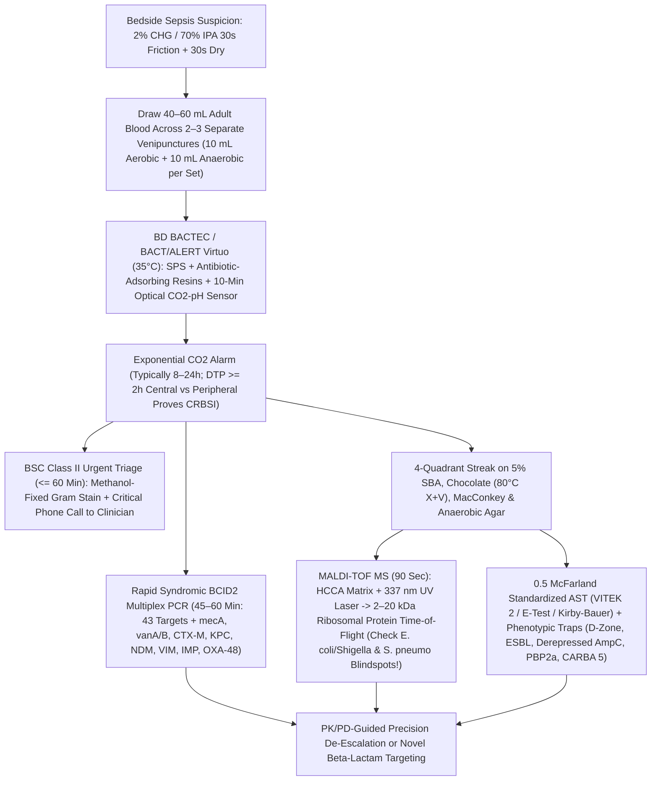
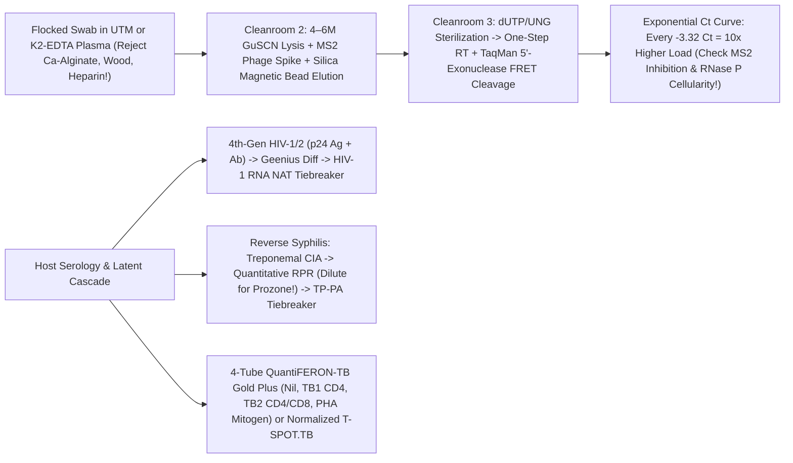
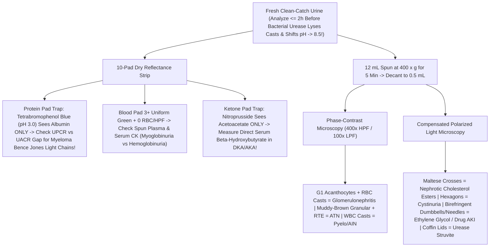
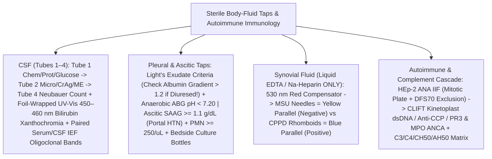
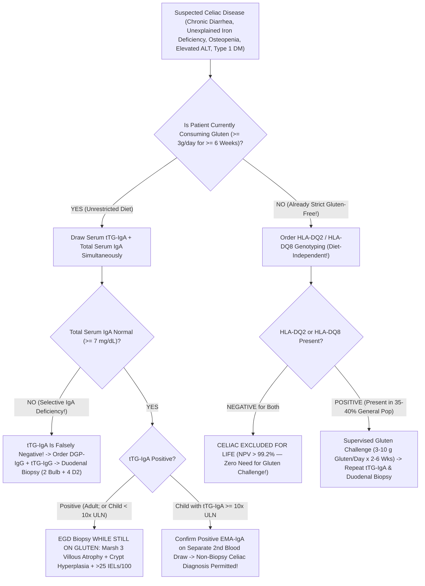
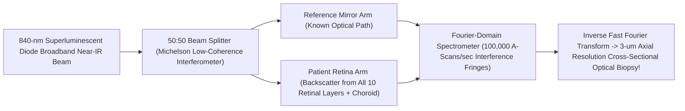

# Bundle 08 — Ep 808: The Jeopardy! Grandmaster Diagnostic Tour (All-In-One)

## ZERO-MIXUP SINGLE-SOURCE BUNDLE FOR GOOGLE NOTEBOOKLM

**How to use in NotebookLM (`notebook.google.com`):**

1. Check **ONLY THIS ONE DOCUMENT** in your NotebookLM Sources sidebar (uncheck all others — every reference treatise and script needed for this episode is merged right inside this single file!).
2. Click **Customize** on **Audio Overview**, choose **Longer**, and paste this exact prompt:

```text
The ultimate Jeopardy! grandmaster clinical diagnostic tour: 90-second MALDI-TOF mass spec, continuous blood culture optical monitoring, urine dipstick falsehoods, polarized crystal microscopy for gout vs pseudogout, Crithidia luciliae immunofluorescence, and classic named tests.
```

---


---

## INCLUDED SOURCE: `VOLUME_V_MICROBIOLOGY_BLOOD_CULTURES_MALDI_TOF_PCR_CT_VALUES_AND_SEROLOGY.md`

# **BASIC MEDICAL — BEHIND THE CURTAIN CLINICAL DIAGNOSTICS NOTEBOOK**
## **VOLUME V: CLINICAL MICROBIOLOGY, BLOOD CULTURES, `MALDI-TOF` PROTEOMICS, QUANTITATIVE `RT-qPCR` ($C_t$) PHYSICS, METAGENOMICS & INFECTIOUS SEROLOGY**

> [!IMPORTANT]
> **How to Read This Volume:** Every time an emergency physician orders *"Blood Cultures × 2, Respiratory Viral Panel, HIV/Syphilis Screen, and Procalcitonin,"* a silent, high-stakes choreography ignites behind locked biosecurity doors. Unlike automated chemistry analyzers—where potassium or creatinine reaches photonic equilibrium in four minutes—clinical microbiology hunts living, evolving, often microscopic fugitives hiding at concentrations as sparse as **one bacterial cell per ten milliliters of human blood**. This volume pulls back the curtain on the exact physical chemistry, optical sensors, selective media biochemistry, laser time-of-flight mass spectrometry, Förster resonance energy transfer (`FRET`) amplification curves, and immunochemical capture architectures that transform a bedside swab or venipuncture into life-saving antimicrobial precision.

---

# **DOSSIER 5.1: FROM BEDSIDE `CHLORAPREP` SCRUB TO A 90-SECOND UV LASER VAPORIZATION — BLOOD CULTURES, GRAM STAINING, SELECTIVE AGARS & `MALDI-TOF` MASS SPECTROMETRY**

## **5.1.1 The Poisson Mathematics of Sepsis & Pre-Analytical Blood Culture Architecture**

### **A. Why Blood Volume (`40–60 mL`) Is the Single Greatest Determinant of Sepsis Detection**

A pervasive clinical myth imagines septic shock as a bloodstream teeming with millions of bacteria per drop. Quantitative lysis-centrifugation studies collected across five decades (*Manual of Clinical Microbiology*, 13th Ed., Carroll & Pfaller; Cockerill et al., *Clin Infect Dis* 2004) prove the startling opposite: while pediatric meningitis bacteremia may exceed $100\text{–}1,000\text{ CFU/mL}$, **adult bacteremia and candidemia routinely circulate at an extraordinarily sparse density of just `0.1 to 1.0 Colony-Forming Units per milliliter (CFU/mL)`**—and frequently `< 0.1 CFU/mL` in subacute infective endocarditis or partially treated endovascular sepsis.

Because viable bacteria are randomly and sparsely dispersed throughout the intravascular compartment, capturing at least one viable organism inside a blood culture syringe obeys **Poisson rare-event sampling statistics**. If the true bloodstream bacterial density is $\lambda$ ($\text{CFU/mL}$) and the clinician draws total blood volume $V$ ($\text{mL}$), the expected number of captured organisms is $\mu = \lambda V$, and the probability of drawing a **false-negative sterile sample** ($k = 0$ organisms captured) is $e^{-\lambda V}$. Therefore, the analytical sampling sensitivity—the probability of capturing **at least one viable CFU**—is governed by:

$$P(\text{Capture} \ge 1\text{ CFU}) = 1 - e^{-\lambda V}$$

Examine what happens to a hypotensive adult in early Gram-negative urosepsis whose true bloodstream burden is $\lambda = 0.20\text{ CFU/mL}$ (**one bacterium per `5 mL` of blood**):

* **Underfilled "Difficult Stick" Draw (`V = 2 mL` total):**
  $$P(\ge 1\text{ CFU}) = 1 - e^{-(0.20)(2)} = 1 - e^{-0.40} \approx 32.9\% \quad (\mathbf{67.1\%\text{ Missed Sepsis!}})$$
* **Single Standard Bottle (`V = 10 mL` total):**
  $$P(\ge 1\text{ CFU}) = 1 - e^{-(0.20)(10)} = 1 - e^{-2.0} \approx 86.5\%$$
* **Two Complete Adult Blood Culture Sets (`V = 40 mL` total: 2 separate venipunctures × `[10 mL Aerobic + 10 mL Anaerobic]`):**
  $$P(\ge 1\text{ CFU}) = 1 - e^{-(0.20)(40)} = 1 - e^{-8.0} \approx 99.97\%$$
* **Three Complete Adult Sets (`V = 60 mL` total — Mandatory for Suspected Infective Endocarditis):** Even if bacterial density plunges to an ultra-sparse $\lambda = 0.08\text{ CFU/mL}$, `60 mL` achieves $1 - e^{-4.8} = \mathbf{99.2\%}$ capture probability!

Empirical clinical trials confirm that **every additional milliliter of blood cultured between `2 mL` and `40 mL` increases microbial yield by `~3% to 4%`**. Conversely, overfilling a single bottle (`> 12–15 mL` into a `10 mL`-calibrated broth bottle) backfires: excess patient leukocytes, complement, lysozyme, and erythrocyte metabolic $\text{CO}_2$ exhaust broth nutrients and trigger false-positive background $\text{CO}_2$ alarms (**pseudobacteremia of overfilling**). Thus, *CLSI M47* mandates **2 to 3 separate peripheral venipuncture sets (`20 mL` per set = `40–60 mL` total adult blood)** drawn **prior** to initiating empiric intravenous antimicrobials whenever clinically feasible without delaying resuscitation beyond 45 minutes.

### **B. Bedside Antisepsis Physics: Defeating the Hair-Follicle Sebaceous Plug**

Why must those `40–60 mL` come from **two or three anatomically separate venipunctures** (e.g., left antecubital + right antecubital) rather than a single `40 mL` draw through an existing emergency-room IV catheter? Human epidermis is not a flat plastic sheet; while surface stratum corneum cleans up easily, **pilosebaceous units (hair follicles) and sweat ducts harbor `10^3 to 10^5 CFU/cm²` of resident microaerophilic and facultative flora**—principally coagulase-negative staphylococci (*Staphylococcus epidermidis*, *S. hominis*, *S. capitis*), *Cutibacterium acnes*, *Corynebacterium* spp. (diphtheroids), *Micrococcus luteus*, and environmental *Bacillus* spores—embedded inside hydrophobic lipid-keratin plugs.

When a hollow-bore bevel needle pierces poorly prepped skin, it acts as a microscopic biopsy punch, coring out a tiny **dermal-epidermal skin plug** directly into the first syringe barrel. Rigorous skin preparation defeats this via dual-phase chemistry:

1. **Rubber Septum Disinfection First:** Blood culture bottle tops beneath flip-off plastic caps are clean *but not guaranteed sterile* (`Bacillus` spores occasionally survive manufacturing packaging). Scrubbing each bottle septum with **`70% Isopropyl Alcohol`** and allowing evaporation prevents pushing rubber-surface spores into the broth.
2. **`2% Chlorhexidine Gluconate (CHG)` in `70% Isopropyl Alcohol` (`ChloraPrep`):** Superior in randomized trials to aqueous `10% povidone-iodine` (which requires `1.5–2.0 minutes` of wet contact time to release free molecular iodine $\text{I}_2$ and is neutralized on contact by blood proteins). In `ChloraPrep`, **`70%` isopropyl alcohol** dissolves follicular sebum lipids and denatures outer microbial membrane proteins within seconds (note why `70%` alcohol beats `100%` absolute alcohol: `100%` alcohol instantaneously coagulates surface cell-wall proteins into an impermeable crust that shields deeper cytoplasmic enzymes, whereas `30%` water acts as a osmotic catalyst carrying alcohol across the membrane!). Simultaneously, cationic **chlorhexidine biguanide** binds negatively charged bacterial cell-wall phospholipids, rupturing osmotic integrity and leaving a residual substantivity film for `> 6 hours`.
3. **Mechanical `30-Second` Back-and-Forth Friction + `30-Second` Complete Dry Time:** Friction cracks keratinized desmosomes to drive alcohol-CHG into follicular infundibula; waiting the full `30 seconds` to dry completes bactericidal kill and prevents aspirating liquid alcohol into the needle (which would kill true sparse bloodstream pathogens!). Never re-palpate the venipuncture site with an unsterile gloved finger after scrubbing.

When **only 1 out of 4 bottles** (`1 of 2 sets`) grows *Staphylococcus epidermidis* at `32 hours`, two-site independent venipuncture allows the infectious diseases team to recognize a **`97%` probability of skin-plug contamination**, sparing the patient weeks of nephrotoxic vancomycin, PICC lines, and hospital length-of-stay. Conversely, if **both independent venipuncture sets (`4 of 4 bottles`)** grow identical *S. epidermidis* in a patient with a prosthetic aortic valve or orthopedic hardware, true endovascular biofilm infection is proven.

### **C. Inside `BD BACTEC` & `bioMérieux BACT/ALERT Virtuo` Bottles: Resins, `SPS` & Optical $\text{CO}_2$ Sensors**

Once blood enters the culture vials and arrives via pneumatic tube at the clinical microbiology laboratory, technologists load the barcoded bottles onto robotic continuous-monitoring incubators (`BD BACTEC FX` or `bioMérieux BACT/ALERT Virtuo`, which automates loading, optical scanning, and unloading at a constant **`35.0°C ± 1.0°C`** with gentle agitation). Inside each seemingly simple glass or polycarbonate bottle lies a four-part biochemical masterpiece:

1. **Nutrient-Rich Enriched Soybean-Casein Digest Broth (`30–40 mL`):** Tryptic soy / brain-heart infusion peptones, yeast extract, hemin, menadione (vitamin K for *Prevotella* and *Porphyromonas*), pyridoxal HCl (vitamin $\text{B}_6$ for nutritionally variant streptococci like *Abiotrophia defectiva* and *Granulicatella adiacens*), and sodium bicarbonate under tailored headspace atmospheres ($\text{O}_2 + \text{CO}_2$ in aerobic bottles; $\text{N}_2 + \text{CO}_2 + \text{H}_2$ strictly $\text{O}_2$-free with reducing L-cysteine/thiols—and **saponin erythrocyte-lysing detergent** in `BACTEC Lytic/10 Anaerobic/F` bottles to liberate intracellular phagocytosed bacteria and accelerate hemolysin nutrition!).
2. **`0.025%–0.05%` Sodium Polyanethol Sulfonate (`SPS`):** Whole human blood does not stop fighting microbes once drawn into a bottle! Without neutralizers, viable patient neutrophils, serum complement (`C3b`/`C5b-9` MAC), and lysozyme would phagocytose and kill sparse `0.2 CFU/mL` bacteria inside the bottle before they could divide. **`SPS`** is a polyanionic anticoagulant that simultaneously:
   * Chelates $\text{Ca}^{2+}$ to prevent fibrin clot trapping of bacteria;
   * Inactivates classical and alternative serum complement cascades;
   * Paralyzes polymorphonuclear leukocyte phagocytosis and neutralizes lysozyme; and
   * Electro-neutralizes polycationic aminoglycoside antibiotics (gentamicin, tobramycin, amikacin) and polymyxins circulating in patient plasma.
   * *Analytical Caveat:* **`SPS` is intrinsically toxic to *Neisseria meningitidis*, *Neisseria gonorrhoeae*, *Gardnerella vaginalis*, *Streptobacillus moniliformis* (rat-bite fever), and *Peptostreptococcus anaerobius*!** Commercial resin media incorporate gelatin or specific adsorbents to blunt `SPS` toxicity against meningococci, though `SPS`-impregnated paper disks are paradoxically exploited on anaerobic bench plates to *identify* *P. anaerobius* via its `>= 12 mm` zone of `SPS` inhibition!
3. **Polymeric Antibiotic-Adsorbing Resins (`BACTEC Plus` / `BACT/ALERT FA/FN Plus`):** In real-world ICU practice, second-set or repeat blood cultures are often drawn while `4.5 g` piperacillin-tazobactam, `2 g` cefepime, or `1.5 g` vancomycin is actively infusing. Floating inside modern `Plus` bottles is a slurry of **microporous hydrophobic/ion-exchange polystyrene-divinylbenzene polymeric beads**. As the incubator rocks the bottle, non-polar aromatic side chains and charged pockets on these beads **physically adsorb and sequester free $\beta$-lactams, glycopeptides, fluoroquinolones, and daptomycin out of the liquid phase**, dropping free broth antibiotic concentrations below the pathogen's Minimum Inhibitory Concentration (`MIC`) so surviving persister bacteria can resume logarithmic division!
4. **Non-Invasive Bottom-of-Bottle Colorimetric / Fluorometric $\text{CO}_2$-pH Sensor (`LES` / Fluorescence Disk):** Historic blood cultures required blind daily needle subculturing, risking laboratory-acquired bacteremia and delaying detection by days. Modern bottles mold a gas-permeable **silicone elastomer membrane** at the internal base, isolating the blood-broth mixture from a chemical sensor pad containing water, bicarbonate buffer, and either a **pH-sensitive fluorophore** (`BD BACTEC`, excited by an external LED so protonation boosts fluorescence emission) or a **pH-sensitive colorimetric indicator** (`bioMérieux BACT/ALERT`, shifting irreversibly from dark blue-green to bright yellow). As multiplying bacteria or yeast catabolize carbohydrates and amino acids, dissolved $\text{CO}_2$ diffuses across the silicone barrier into the isolated sensor water:

$$\text{CO}_2\text{ (microbial)} + \text{H}_2\text{O} \rightleftharpoons \text{H}_2\text{CO}_3 \rightleftharpoons \text{H}^+ + \text{HCO}_3^-$$

   Every **10 minutes** (`144 readings/day`), an optical photodiode beneath each bottle cell measures reflectance or fluorescence intensity, plotting a continuous metabolic curve:
   * **Baseline lag phase** (flat baseline reflecting static leukocyte respiration);
   * **Inflection / exponential acceleration ($\frac{d^2F}{dt^2} > \text{threshold}$)**; or
   * **Sustained high linear slope / absolute saturation threshold** (crucial if a bottle carrying `10^7 CFU/mL` sat delayed on a ward counter before loading and entered stationary phase prior to scan #1!).

> [!TIP]
> **Clinical Diagnostic Gem — Differential Time-to-Positivity (`DTP`) for Central-Line Infections (`CRBSI`):** Because automated cabinets interrogate every bottle at 10-minute resolution, **`Time-to-Positivity (TTP)`** serves as a quantitative proxy for initial bacterial inoculum ($\Delta\text{TTP}$ inversely tracks $\log_{10}[\text{CFU}_0]$). If a febrile oncology patient has an indwelling tunneled central venous catheter (port/Hickman) that cannot be casually removed, draw **simultaneous, identical-volume (`10 mL` vs `10 mL`) blood cultures—one hub-aspirated through the central catheter and one via peripheral venipuncture—within 10–15 minutes of each other**, labeling exact draw times. If the **central-line bottle flags positive `>= 120 minutes` (`>= 2 hours`) earlier** than the peripheral venipuncture bottle for the exact same organism (Blot et al., *Lancet* 1999; IDSA `CRBSI` Guidelines), the catheter lumen harbors a `>= 5-to-10-fold` higher biofilm bacterial load, confirming **Catheter-Related Bloodstream Infection (`CRBSI`)** with `~85–91%` sensitivity and `~90%` specificity without pulling the line blindly! *(Conversely, virulent pathogens like *S. aureus*, *Pseudomonas*, and *Candida* usually flag within `8–18 hours`; slow-growing *Cutibacterium* or `HACEK` organisms [*Haemophilus*, *Aggregatibacter*, *Cardiobacterium*, *Eikenella*, *Kingella*] typically flag within standard 5-day modern incubation without needing historic 21-day holds!)*

---

## **5.1.2 Behind the Biosafety Cabinet (`BSC Class II`) — Positive Bottle Triage, Gram Stain Chemistry & Special Stains**

### **A. The 60-Minute Critical-Value Sprint**

The instant a bottle crosses its exponential $\text{CO}_2$ threshold—typically once microbial density inside the broth reaches **`10^7 to 10^8 CFU/mL`**—an audible and visual red alert triggers on the microbiology bench. Under *CAP (College of American Pathologists)* and *CLSI* accreditation standards, a positive blood culture is a **Life-Threatening Critical Value**: from the moment the cabinet alarms, the technologist has **`<= 60 minutes`** to aspirate the bottle, perform and read a microscopic Gram stain, and telephone the bedside physician directly with the morphology—because studies prove that **clinician-directed antimicrobial escalation at the time of Gram-stain phone call saves more lives from septic shock than final day-3 species identification!**

Working inside a negative-pressure laminar-flow **Class II Biosafety Cabinet (`BSC-II`)** to contain infectious aerosols (especially *Neisseria meningitidis*, *Brucella*, or *Mycobacterium*), the microbiologist swabs the septum with `70%` alcohol, inserts a safety venting/transfer needle, expresses **one drop onto a clean glass microscope slide** (spreading it into a thin feather-edged monolayer so erythrocytes do not stack into opaque dark clumps), and subcultures drops onto pre-warmed agar plates (5% Sheep Blood, Chocolate, MacConkey, and—if the anaerobic bottle flagged—Brucella Anaerobic Blood Agar inside an anaerobic jar/chamber) plus a rapid molecular Blood Culture Identification (`BCID2`) pouch.

Rather than passing the wet blood-broth slide through an open Bunsen flame (which boils erythrocytes into circular artifacts mimicking cocci and overheats leukocytes!), modern benches fix blood-culture smears for **`1 minute in absolute (95–100%) Methanol`**. Methanol fixes proteins cleanly while lysing background erythrocytes gently and preserving pristine polymorphonuclear leukocyte nuclei and crisp bacterial walls.

### **B. Molecular Cell-Wall Physics of the Four-Step Gram Stain**

Invented serendipitously by Danish physician Hans Christian Gram in 1884 while studying pneumococcal lung tissue in Berlin, the Gram stain is not an antibody reaction—it is a **kinetic solvent-permeability and hydrogel-dehydration experiment** differentiating two ancient evolutionary bacterial envelope architectures:

1. **Step 1 — Primary Stain (`Crystal Violet`, `30–60 sec`):** Aqueous hexamethylpararosaniline chloride dissociates into intensely purple triphenylmethane cations ($\text{CV}^+$), diffusing freely across the porous cell envelopes of *both* Gram-positive and Gram-negative bacteria to stain every cell deep violet.
2. **Step 2 — Mordant (`Gram's Iodine`: $\text{I}_2 + \text{KI} \to \text{I}_3^-$, `30–60 sec`):** Triiodide anions ($\text{I}_3^-$) diffuse inward and react stoichiometrically with $\text{CV}^+$ inside the peptidoglycan meshwork and cytoplasm to precipitate **large, hydrophobic, water-insoluble Crystal Violet–Iodine ($\text{CV}^+\text{–I}_3^-$) supramolecular complexes**. At this stage, *all* bacteria remain dark purple-black.
3. **Step 3 — Differential Decolorization (`95% Ethanol` or `1:1 Acetone-Alcohol`, `3–10 sec` drop-by-drop until runoff clears):** This 5-second step is the entire analytical fulcrum:
   * **Gram-Positive Envelope (`Staphylococcus`, `Streptococcus`, `Enterococcus`, `Listeria`, `Clostridium`, `Bacillus`):** Lacks an outer lipid membrane; instead, it wears an armor-plated **`20 to 80 nm` thick, 40-layer peptidoglycan hydrogel** (alternating *N*-acetylglucosamine [`NAG`] and *N*-acetylmuramic acid [`NAM`] glycans tightly cross-linked by transpeptidase `PBP` peptide bridges and interwoven with negatively charged **teichoic and lipoteichoic acids**). When anhydrous ethanol/acetone hits this thick hydrophilic polymer, **rapid dehydration collapses the peptidoglycan pores**, shrinking intermolecular channels below the hydrodynamic radius of the bulky $\text{CV}^+\text{–I}_3^-$ complex and **locking purple stain permanently inside**!
   * **Gram-Negative Envelope (`Enterobacterales`, `Pseudomonas`, `Neisseria`, `Haemophilus`, `Bacteroides`):** Surrounded by an asymmetric **Outer Membrane** composed of inner phospholipids and outer **Lipopolysaccharide (`LPS` / Endotoxin — Lipid A + core polysaccharide + O-antigen)** anchored over a razor-thin **`2 to 7 nm` (1–3 layer) periplasmic peptidoglycan sheet**. Organic acetone-alcohol instantaneously **dissolves the lipid-rich outer `LPS` bilayer**, punching gaping holes straight down to the flimsy `2 nm` peptidoglycan monolayer, which cannot shrink enough to retain $\text{CV}^+\text{–I}_3^-$. Within 3 seconds, the purple complex washes completely out, leaving Gram-negative bacteria **optically colorless**!
4. **Step 4 — Counterstain (`Safranin O` or `0.1% Basic Carbolfuchsin`, `30–60 sec`):** The cationic pink-red dye enters all cells; Gram-positives remain royal purple (masking pale pink), while decolorized Gram-negatives glow crisp **salmon-pink to magenta**! *(Bench secret: strictly anaerobic *Fusobacterium*, microaerophilic curved *Campylobacter*, *Helicobacter*, and intracellular *Legionella* stain ghost-pale with standard Safranin—substituting **`0.1%` basic fuchsin / carbolfuchsin** makes these thin Gram-negative rods pop vividly!)*

> [!WARNING]
> **Three Classic Gram-Stain Analytical Traps Every Clinician Must Know:**
> 1. **Over-Decolorization & Antibiotic/Senescent Cell-Wall Damage ("Gram-Variable Traps"):** Leaving acetone-alcohol on the slide for 25 seconds strips $\text{CV}^+\text{–I}_3^-$ even out of true Gram-positives. More subtly, **large Gram-positive rods—notably *Bacillus* spp. and *Clostridium* spp. (e.g., *C. perfringens* "boxcar" rods in necrotizing myonecrosis)—plus $\beta$-lactam-exposed *Streptococcus pneumoniae*** rapidly lose peptidoglycan integrity via autolysins and frequently stain **falsely Gram-negative (pink)** in blood bottles! Experienced technologists judge *shape, snapping/palisading V-angles, and boxcar width* alongside color before calling a Gram-negative rod!
> 2. **Acellular / Wall-Less & Ultrathin Stealth Pathogens:** *Mycoplasma pneumoniae* and *Ureaplasma* lack peptidoglycan entirely (sterol-stabilized trilaminar membrane only -> completely invisible on Gram stain); *Treponema pallidum* and *Leptospira* (`0.1–0.15 µm` diameter) fall below the brightfield Abbe diffraction resolution limit ($\approx 0.2\text{ µm}$), requiring darkfield microscopy, silver stain, or NAAT/serology; obligate intracellular *Chlamydia* and *Rickettsia* hide inside host cells.
> 3. **Host Leukocyte Nuclei Must Always Stain Pink!** How does a microbiologist verify on every single slide that they did not under-decolorize? **Human polymorphonuclear neutrophil (`PMN`) nuclei lack peptidoglycan and MUST decolorize to pink-red!** If background `PMN` nuclei look dark purple, the smear is under-decolorized and any "Gram-positive" call on a thick mucoid clump is untrustworthy.

| Morphological Call Phoned from `BSC-II` | Classic Architectural Clues on `1000×` Oil Immersion | Top Suspect Pathogens | Immediate Bedside Empiric Pivot (Pending Rapid ID) |
| :--- | :--- | :--- | :--- |
| **Gram-Positive Cocci in Grape-Like Clusters** | Spherical `~1 µm` cocci dividing in 3 orthogonal planes (`catalase +`) | ***Staphylococcus aureus*** (`MSSA` vs `MRSA`) vs Coagulase-Negative *Staphylococcus* (`CoNS`) | Ensure active **Vancomycin** (or Daptomycin); never dismiss single-bottle *S. aureus* as a contaminant! |
| **Gram-Positive Cocci in Pairs & Chains** | Divide along 1 axis: lancet-shaped diplococci vs long chains | ***Streptococcus pneumoniae***, $\beta$-hemolytic *Streptococcus*, Viridans group, ***Enterococcus faecalis / faecium*** | Ceftriaxone + Vancomycin (if meningitis or *E. faecium* `VRE` risk -> Linezolid / Daptomycin) |
| **Small Tumbling / Palisading Gram-Positive Rods** | Short coccobacilli ("Chinese-letter" V-palisades vs smooth short rods) | ***Listeria monocytogenes*** (CSF/neonates/elderly/immunosuppressed) vs *Corynebacterium* (`C. striatum` / `C. jeikeium`) | **Cephalosporins have ZERO activity against *Listeria* (`PBP3` mismatch)!** Add **IV Ampicillin** (`+ Gentamicin`) immediately! |
| **Beaded Branching Filamentous Gram-Positive Rods** | Thin `0.5–1 µm` right-angle hyphae breaking into coccoid beads | ***Nocardia* spp.** (aerobic, modified acid-fast +) vs ***Actinomyces*** (anaerobic, acid-fast −) | High-dose **TMP-SMX** + Imipenem/Linezolid (check brain MRI for silent *Nocardia* abscesses!) |
| **Plump Enteric Gram-Negative Bacilli** | Straight rods (`1 × 3 µm`), rounded ends | ***Escherichia coli*, *Klebsiella pneumoniae*, *Enterobacter*, *Proteus*, *Salmonella*** | Cefepime or Piperacillin-Tazobactam; escalate to **Meropenem** if prior `ESBL` colonization or septic shock! |
| **Slender / Curved Non-Fermenting Gram-Negative Rods** | Thin slightly curved rods (`Pseudomonas`), gull-wing (`Campylobacter`), plump diplobacilli (`Acinetobacter`, mimicking *Neisseria*!) | ***Pseudomonas aeruginosa*, *Acinetobacter baumannii*, *Stenotrophomonas maltophilia*** | Anti-pseudomonal $\beta$-lactam (Cefepime/Meropenem/Ceftolozane-Tazobactam); note ***Stenotrophomonas* carries intrinsic `L1` metallo-carbapenemase** (Meropenem-resistant -> **TMP-SMX** or Cefiderocol)! |
| **Kidney-Bean Gram-Negative Diplococci** | Flattened adjacent coffee-bean faces (often intracellular in PMNs) | ***Neisseria meningitidis***, *Neisseria gonorrhoeae*, *Moraxella catarrhalis* | **IV Ceftriaxone `2 g q12h`** + Droplet Isolation + Public-Health Chemoprophylaxis (Rifampin/Ciprofloxacin) for close contacts! |
| **Budding Oval Yeast / Pseudohyphae (`3–8 µm`)** | Stain intensely **Gram-positive (deep purple)**, `5×` larger than staphylococci! | ***Candida albicans*, *Nakaseomyces glabratus* (*C. glabrata*), *Candida auris*, *Cryptococcus*** | Start **IV Echinocandin (`Micafungin` / `Caspofungin`)** first-line (covers azole-resistant *C. glabrata* & *C. auris*; switch to Liposomal Amphotericin B + Flucytosine if *Cryptococcus* / CNS!) |

### **C. Special Cell-Wall Stains: Acid-Fast Mycolic Acids, Chitin `Calcofluor` & `India Ink`**

When waxy lipids or fungal polysaccharides defeat Gram reagents, three targeted optical stains step in:

1. **Acid-Fast Stains (`Ziehl-Neelsen`, `Kinyoun`, and `Auramine-Rhodamine` Fluorochrome):** *Mycobacterium tuberculosis* complex and non-tuberculous mycobacteria (`NTM`) encase their peptidoglycan inside an arabinogalactan core esterified to **ultra-long-chain ($\text{C}_{60}\text{–C}_{90}$) $\alpha$-branched, $\beta$-hydroxy fatty acids called Mycolic Acids**, creating a hydrophobic wax coat impervious to aqueous Crystal Violet.
   * In **Ziehl-Neelsen (`ZN`)** staining, concentrated **Carbolfuchsin** (`basic fuchsin dissolved in 5% phenol`) is driven through melted mycolic wax by gentle **steaming heat** (`Kinyoun` "cold" staining substitutes higher phenol + Tergitol surfactant instead of heat). Once cooled, the wax re-solidifies, resisting stripping even by fierce **`3% Hydrochloric Acid in 95% Ethanol` (`Acid-Alcohol`)**! Non-acid-fast tissue and bacteria turn **Methylene Blue**, leaving slender beaded magenta mycobacterial rods standing out sharply.
   * For high-throughput sputum screening, **Auramine-Rhodamine Fluorochrome** binds mycolic acids and fluoresces bright **golden-yellow/orange against a potassium-permanganate-quenched pitch-black background at `250×–400×`**—allowing a technologist to scan **`10×` more slide area per minute** than `1000×` oil-immersion `ZN`, boosting smear sensitivity (`~10^4 AFB/mL` detection limit, though still `100×` less sensitive than `Xpert MTB/RIF` PCR at `~10–100 CFU/mL`!).
   * **Modified Acid-Fast (`1% Aqueous` $\text{H}_2\text{SO}_4$):** *Nocardia*, *Rhodococcus equi*, and intestinal coccidian oocysts (*Cryptosporidium*, *Cystoisospora*, *Cyclospora*) synthesize shorter-chain ($\text{C}_{40}\text{–C}_{60}$) mycolic/waxy walls stripped by harsh `3% HCl-ethanol` yet retained against gentler **`1%` sulfuric acid**, cleanly separating **Modified Acid-Fast Positive aerobic *Nocardia*** from **Acid-Fast Negative anaerobic *Actinomyces***.
2. **`Calcofluor White` (`CFW`) + `10% KOH` Fluorescence:** Mixing skin scrapings, bronchoalveolar lavage (`BAL`), or corneal ulcers with **`10% Potassium Hydroxide`** dissolves host keratin and mucin while leaving alkali-resistant fungal walls intact; **Calcofluor White**, a textile whitening stilbene fluorophore, chelates $\beta\text{-(1}\to\text{4)}$-linked polysaccharides (**chitin and cellulose**), lighting up **septate `45°` *Aspergillus* hyphae**, **broad ribbon-like pauciseptate `90°` *Mucorales* hyphae**, ***Pneumocystis jirovecii* cysts**, and **microsporidian spores** in brilliant chalky **blue-white or apple-green** under `365 nm` UV excitation.
3. **`India Ink` Negative Capsule Stain:** Colloidal carbon particles (`nigrosin`) suspended in CSF cannot penetrate the massive (`5–30 µm`), negatively charged **glucuronoxylomannan (`GXM`) polysaccharide capsule** of *Cryptococcus neoformans / gattii*, silhouetting narrow-necked budding yeast inside a dramatic **clear luminous halo** against a smoky black background. *(Crucial clinical caveat: `India Ink` sensitivity is only `~60–80%` in HIV meningitis and `< 50%` in non-HIV transplant patients—a negative `India Ink` NEVER rules out cryptococcal meningitis; lateral-flow **`CrAg`** [`> 99%` sensitive] is mandatory!)*

---

## **5.1.3 Four-Quadrant Streak-for-Isolation & the Biochemical Cleverness of Selective/Differential Agars**

### **A. Logarithmic Dilution on Solid Agar: The Four-Quadrant Streak**

Whether plating a positive blood culture, a purulent wound swab, or clean-catch sputum, mixed flora stacked atop one another cannot be identified by `MALDI-TOF` or tested for accurate antibiotic `MIC`s (where a hidden `1%` resistant subpopulation or contaminating commensal ruins broth microdilution!). To isolate pure monoclonal colonies without serial liquid test-tube dilutions, microbiologists execute a geometric **Four-Quadrant Streak** across a `100 mm` `1.5%` agarose Petri dish:

1. **Quadrant 1 (`Heavy Pool`):** A single drop or swab rolls across `~25%` of the agar rim (`~10^6–10^7` cells deposited).
2. **Flame/Swap Loop -> Quadrant 2:** Sterilizing the nichrome loop red-hot (and cooling on sterile edge agar so it doesn't sizzle bacteria dead!) or taking a fresh sterile plastic loop, the technologist drags **through the edge of Quadrant 1 just 3 to 4 times**, sweeping back-and-forth into clean Quadrant 2 (diluting density `~100-fold`).
3. **Flame/Swap -> Quadrant 3 -> Flame/Swap -> Quadrant 4 (`Fishtail Sweep`):** Repeating the 3-overlap drag from Q2 into Q3 and finally Q3 into Q4 spreads individual single bacterial cells **`2 to 5 mm` apart**. Over `16–24 hours` at `35°C`, one microscopic cell (`10^-12 g`) undergoes `~25–30` binary fissions ($2^{25} \approx 3.3 \times 10^7$ genetically identical daughter cells), piling up into a visible **`1–3 mm` clonal colony**—while simultaneously semi-quantifying specimen burden (`1+` growth confined to Q1 vs `4+` heavy growth extending into Q4!).

### **B. Biochemical Engineering of Core Clinical Agars**

Clinical microbiology plates act as living biochemical Turing machines, simultaneously **selecting** (poisoning unwanted commensals) and **differentiating** (forcing survivors to reveal their enzymatic identity via chromogenic or hemolytic footprints):

| Agar Medium | Key Selective Inhibitors (What Gets Killed) | Differential Chemistry & Essential Growth Factors | Classic Diagnostic Colony Phenotypes |
| :--- | :--- | :--- | :--- |
| **5% Sheep Blood Agar (`SBA` on Tryptic Soy Base)** | **Non-selective** enriched general medium (grows almost all non-fastidious aerobes/facultatives) | Intact **5% defibrinated sheep erythrocytes** (*note: contains active sheep erythrocyte **`NADase`**, destroying free $\text{NAD}^+$ so *Haemophilus influenzae* CANNOT grow alone!*) | **$\alpha$-Hemolysis (Olive-Green):** bacterial $\text{H}_2\text{O}_2$ oxidizes $\text{Hb-Fe}^{2+} \to \text{MetHb-Fe}^{3+}$ (*S. pneumoniae* [umbilicated "draughtsman" center from `LytA` autolysin] & viridans strep).<br>**$\beta$-Hemolysis (Crystal-Clear):** complete RBC lysis via **Streptolysin O/S** (*S. pyogenes* wide zone; *S. agalactiae*, *Listeria*, *S. aureus* narrow golden-yellow `staphyloxanthin` colonies).<br>**$\gamma$-Hemolysis (None):** *Enterococcus*, *S. epidermidis*. |
| **Chocolate Agar (`CHOC`, `80°C` Lysed Blood)** | **Non-selective** fastidious medium (incubated in **`5%` $\text{CO}_2$** capnophilic atmosphere) | Heating sheep/horse blood to **`80°C`** turns it rich cocoa-brown, **rupturing RBCs to liberate intracellular `Factor X` (`Hemin`) + `Factor V` ($\text{NAD}^+$)** AND **heat-denaturing sheep `NADase`!** | Grows ***Haemophilus influenzae*** (requires **both `X` and `V`**; dewdrop colonies smelling "mousy/bleach-like" from indole) & ***Neisseria meningitidis / gonorrhoeae*** (unlike `SBA`, where *N. gonorrhoeae* dies from trace agar fatty acids!). |
| **MacConkey Agar (`MAC`)** | **Bile Salts + Crystal Violet** disrupt Gram-positive peptidoglycan/membranes (inhibiting *Staphylococcus* & *Streptococcus*) | **`1%` Lactose + Peptones + Neutral Red pH Indicator** (`pKa 6.8`: turns magenta-pink at `pH < 6.8`, colorless/amber above `pH 6.8`) | **Lactose Fermenters (`lacZ` $\beta$-galactosidase + `lacY` permease -> Hot Pink):** ***E. coli*** (flat dry pink with precipitated bile-acid halo), ***Klebsiella*** (large dome-shaped slimy mucoid pink), ***Enterobacter/Citrobacter*** (late/slow pink).<br>**Non-Lactose Fermenters (Colorless/Translucent):** ***Salmonella*, *Shigella*, *Proteus*** (non-swarming due to modified bile!), ***Pseudomonas aeruginosa*** (grape/corn-tortilla `2-aminoacetophenone` odor + metallic sheen + blue-green `pyocyanin`), ***Acinetobacter***. |
| **Modified Thayer-Martin (`MTM` / `VPN` / `VCN` Chocolate)** | **V**ancomycin (Gram+), **C**olistin/**P**olymyxin (Gram− rods), **N**ystatin/Anisomycin (yeast), **T**rimethoprim (blocks *Proteus* swarming!) | Chocolate base (`Factors X + V` + cornstarch to detoxify gonococcal-toxic free fatty acids) | Isolates pure ***Neisseria gonorrhoeae*** and ***Neisseria meningitidis*** directly from heavily contaminated endocervical, rectal, or pharyngeal swabs! |
| **Hektoen Enteric (`HE`) / Xylose-Lysine-Deoxycholate (`XLD`)** | High **Bile Salts** suppress coliforms & kill Gram-positives (stool pathogen workup) | Lactose/Sucrose/Salicin (or Xylose + Lysine decarboxylase) + **Ferric Ammonium Citrate + Sodium Thiosulfate** ($\text{H}_2\text{S} + \text{Fe}^{3+} \to \text{FeS}\downarrow$ jet-black precipitate!) | ***Shigella*:** translucent blue-green (`HE`) or bright red (`XLD`), lactose−, **$\text{H}_2\text{S}-$**.<br>***Salmonella*:** blue-green (`HE`) or red (`XLD` via lysine decarboxylation reverting xylose acid!) **with jet-black $\text{H}_2\text{S}$ centers!**<br>*Coliforms:* bright salmon-orange (`HE`) or yellow (`XLD`). |
| **Buffered Charcoal Yeast Extract (`BCYE`)** | Polymyxin + Cefamandole/Vancomycin + Anisomycin (in selective `BMPA` variant for sputum) | Activated charcoal detoxifies reactive oxygen peroxides; ACES buffer (`pH 6.90`) + **mandatory `L-Cysteine` + Ferric Pyrophosphate** | ***Legionella pneumophila***: ground-glass opalescent blue-gray colonies appearing days 3–5 (**fails to grow on standard `SBA` or `L-cysteine`-free `BCYE`**, confirming ID!). |
| **Sorbitol-MacConkey (`SMAC`)** | Bile salts + Crystal Violet | Substitutes **`1%` D-Sorbitol** in place of lactose | Commensal *E. coli* ferment sorbitol (pink); enterohemorrhagic ***E. coli* `O157:H7` (`STEC` / Shiga-toxin HUS)** lacks sorbitol fermentation -> **colorless colonies**! *(Alert: non-O157 `STEC` ferment sorbitol, so modern labs pair `SMAC` with Shiga-toxin `Stx1/Stx2` EIA/PCR!)* |
| **Regan-Lowe / Bordet-Gengou** | Cephalexin (suppresses nasopharyngeal flora) | Charcoal + `10%` horse blood (`Regan-Lowe`) or potato-glycerol-blood (`Bordet-Gengou`) absorbing toxic unsaturated fatty acids | ***Bordetella pertussis***: tiny glistening **"mercury-droplet" / bisected-pearl** colonies after 3–7 days. |
| **Sabouraud Dextrose (`SDA`) & `CHROMagar Candida`** | Acidic **`pH 5.6`** + Chloramphenicol/Gentamicin suppress bacteria *(Cycloheximide added to dermatophyte `Mycosel` agar inhibits saprophytic molds—**never use cycloheximide for systemic fungi because it inhibits Cryptococcus, Aspergillus, and Mucor!**)* | High `2–4%` dextrose (`SDA`); species-specific hexosaminidase/phosphatase chromogenic substrates (`CHROMagar`) | Rapidly distinguishes polymicrobial yeast colonies on sight: ***C. albicans*** (emerald green), ***C. tropicalis*** (metallic blue), ***Pichia kudriavzevii* (*C. krusei*)** (fuzzy dry rose-pink, intrinsically fluconazole-resistant!), ***Candida auris*** (specialized high-salt/dulcitol chromogenic media). |

---

## **5.1.4 The `MALDI-TOF MS` (`Bruker Biotyper` / `bioMérieux VITEK MS`) Revolution — 90-Second Ribosomal Proteomics**

For more than a century, once a colony grew on agar, clinical microbiology faced a painfully slow 24-to-48-hour bottleneck: inoculating biochemical sugar-fermentation strips (`API 20E`), citrate/urease slants, or automated metabolic cards (`VITEK 2` ID) and waiting *another full day* for slow enzymes to change indicator colors—while metabolically inert organisms (*Acinetobacter*, *Stenotrophomonas*, anaerobes, Corynebacteria, NTM, and molds) routinely misidentified.

Over the past fifteen years, **Matrix-Assisted Laser Desorption/Ionization Time-of-Flight Mass Spectrometry (`MALDI-TOF MS`)** (`Bruker MALDI Biotyper sirius` and `bioMérieux VITEK MS PRIME`) shattered that bottleneck, compressing species identification from **36 hours to `90 seconds`** at a reagent cost under one dollar per isolate—and reducing mortality and hospital length-of-stay when paired with antimicrobial stewardship!

### **A. Step-by-Step Behind the Curtain: Colony Spotting, Formic Acid Cracking & `HCCA` Co-Crystallization**

1. **Direct Colony Transfer ("Smear"):** With a sterile wooden toothpick or plastic loop, the technologist touches a single pinpoint (`0.5–1 mm`) 18-hour colony—or even a concentrated bacterial pellet spun directly out of a newly positive blood culture bottle (`Sepsityper` rapid protocol, saving an entire overnight subculture day!)—and smears an ultra-thin film onto a `2 mm` circular well on a reusable 48- or 96-spot **polished stainless-steel conductive target plate**.
2. **Optional On-Plate `70% Formic Acid` Extraction (`1 µL`):** Gram-negative rods and staphylococci burst effortlessly under laser energy. However, **yeasts (*Candida*, *Cryptococcus*)**, **coryneform Gram-positive rods**, and **actinomycetes** possess thick mannoprotein-glucan or mycolic-peptidoglycan walls. Dropping **`1 µL` of `70% Formic Acid`** directly onto the dried smear cracks the cell wall *in situ* without requiring tube centrifugation! *(Filamentous molds and inactivated Mycobacteria undergo off-plate ethanol + `70%` formic acid + acetonitrile + silica-bead mechanical disruption first to ensure 100% biosafety inactivation before leaving the `BSC`!)*
3. **Organic Matrix Overlay (`HCCA`):** Once dry, the technologist overlays **`1 µL` of saturated `α-cyano-4-hydroxycinnamic acid (HCCA)`** dissolved in `50% acetonitrile + 47.5% water + 2.5% trifluoroacetic acid (TFA)`. Acetonitrile extracts soluble intracellular proteins out of the ruptured microbes; as the droplet evaporates over 60 seconds, microbial proteins **co-crystallize homogeneously inside a protective cage of golden microscopic `HCCA` organic acid crystals**.

### **B. `337 nm` Pulsed UV Laser Soft Ionization & Time-of-Flight ($t \propto \sqrt{m/z}$) Physics**

The steel plate slides through a vacuum airlock into an ultra-high-vacuum chamber ($10^{-6}\text{ to }10^{-7}\text{ mbar}$, eliminating air-molecule collisions that would scatter flying proteins). A computer-steered **`337 nm` pulsed Nitrogen ($\text{N}_2$) UV laser** (or `355 nm` solid-state `Nd:YAG` laser firing `200 Hz` nanosecond bursts) strikes the crystal spot:

* **Why Naked Proteins Would Burn Without Matrix ("Soft Ionization"):** Firing a UV laser directly at naked bacterial proteins shatters peptide backbones into unreadable carbon char. Instead, the aromatic **`HCCA` matrix contains conjugated $\pi$-rings tuned to absorb `337 nm` UV photons greedily**, instantaneously sublimating into an expanding supersonic gas plume while shielding intact bacterial proteins from thermal destruction. Inside that dense plume, acidic `HCCA` and `TFA` transfer **a single proton ($\text{H}^+$)** onto basic lysine/arginine residues of each intact protein (**Koichi Tanaka & John Fenn's Nobel Prize-winning "Soft Ionization"**), generating predominantly **singly charged intact molecular ions ($[\text{M}+\text{H}]^+$, where $z = +1$)**!
* **What Proteins Are Actually Measured?** `MALDI-TOF` tunes its mass window exclusively to **`2,000 to 20,000 Daltons` (`2–20 kDa`)**. Across all bacteria and fungi, `60–70%` of the peaks inside this `2–20 kDa` window belong to **30S and 50S Ribosomal Subunit Proteins (`L` and `S` proteins)** alongside cold-shock and DNA-binding (`HU`) housekeeping proteins! Ribosomal proteins are nature's dream taxonomic barcode: (1) they are present in tens of thousands of copies per cell, (2) they are positively charged (ionizing brilliantly as $[\text{M}+\text{H}]^+$), (3) their expression barely changes regardless of whether the bug grew on Blood Agar, MacConkey Agar, or Chocolate Agar, and (4) subtle single-amino-acid evolutionary substitutions shift their molecular masses by exact `14–50 Da` increments between closely related species!
* **Electrostatic Acceleration & Field-Free Drift Tube Kinematics:** An electrostatic grid applies a high positive voltage $V$ ($\approx +20,000\text{ V}$) across the target plate, repelling every positively charged ion into a `~1-meter` **field-free linear flight tube**. Because every ion of charge $q = z e$ acquires identical kinetic energy $E_k = z e V$:

$$z e V = \frac{1}{2} m v^2 \implies v = \sqrt{\frac{2 z e V}{m}}$$

  Lighter ribosomal proteins (`e.g., 4,365 Da`) rocket up the tube at higher velocity, striking the microchannel-plate (`MCP`) ion detector at the top in ~`15 microseconds`, whereas heavier proteins (`e.g., 15,820 Da`) lag behind at ~`30 microseconds`. Over flight length $L$, the exact **Time-of-Flight ($t$)** obeys:

$$t = \frac{L}{v} = L \sqrt{\frac{1}{2 e V}} \cdot \sqrt{\frac{m}{z}}$$

  Squaring $t$ maps every microsecond arrival into a razor-sharp mass-to-charge ($m/z$) peak spectrum (`50 to 150 peaks` per organism), which cross-correlates in milliseconds against FDA-cleared reference libraries spanning **> 4,000 bacterial, mycobacterial, yeast, and mold species** (`Bruker Log(Score) >= 2.00` = high-confidence species ID; `1.70–1.99` = genus-level ID).

> [!CAUTION]
> **Critical `MALDI-TOF MS` Taxonomic Blindspots & Biosafety Traps:**
> Even `MALDI-TOF` cannot bend evolutionary genomics when two clinically distinct pathogens share `> 99.5%` identical ribosomal protein sequences! Every bench microbiologist memorizes three mandatory `MALDI` blindspots:
> 1. ***Escherichia coli* vs. *Shigella* spp. (*S. dysenteriae, S. flexneri, S. boydii, S. sonnei*):** Taxonomically, *Shigella* IS a specialized pathovar evolved *inside* the *E. coli* species clade; their `2–20 kDa` ribosomal spectra are virtually indistinguishable! `MALDI-TOF` reports *"Escherichia coli / Shigella species"*—forcing the technologist to check **MacConkey lactose fermentation, motility, spot indole, lysine decarboxylase, and *Shigella* polyvalent `O`-antisera agglutination** (`E. coli`: typically lactose+, motile+, indole+; *Shigella*: strictly non-motile, lactose−, $\text{H}_2\text{S}-$, indole/gas negative)!
> 2. ***Streptococcus pneumoniae* vs. *Streptococcus mitis / oralis / pseudopneumoniae*:** Commensal oral viridans streptococci (*S. mitis/oralis*) share nearly identical ribosomal peaks with lethal pneumococcus. Before reporting *S. pneumoniae* from blood or sputum, benches verify **`Optochin` (`ethylhydrocupreine` `P`-disk inhibition zone `>= 14 mm`)** and/or **`10% Sodium Deoxycholate Bile Solubility`** (bile salts trigger pneumococcal `LytA` *N*-acetylmuramoyl-L-alanine amidase to dissolve the colony completely within 15 minutes, whereas *S. mitis* stays turbid!).
> 3. **Select-Agent / `BSL-3` Aerosol Trigger Organisms (*Brucella*, *Francisella tularensis*, *Burkholderia pseudomallei*, *Yersinia pestis*, *Bacillus anthracis* [indistinguishable on standard libraries from *Bacillus cereus*!], and *Coccidioides immitis/posadasii*):** Standard `MALDI` libraries omit or flag Tier-1 biothreat agents, and spotting live *Brucella* (faint tiny Gram-negative coccobacilli growing at 48–72h, `oxidase+`, `urease+`) on an open-bench `MALDI` plate causes **laboratory-acquired brucellosis**! Any slow-growing pinpoint Gram-negative coccobacillus or white cottony arthroconidial mold triggers immediate **"Rule-Out Select Agent" `BSC-II` lockdown** prior to `MALDI` spotting.

---

## **5.1.5 Antimicrobial Susceptibility Testing (`AST`), Busting the "#1 `MIC` Fallacy," & Phenotypic Resistance Traps**

Standard `MALDI-TOF` identifies *who* the culprit is in 90 seconds, because structural ribosomal proteins do not change whether an *E. coli* carries a plasmid-encoded `CTX-M-15` ESBL or `NDM-1` carbapenemase. Determining *which antibiotic kills it* requires challenging living bacteria against serial drug concentrations via **Antimicrobial Susceptibility Testing (`AST`)**, calibrated globally by **`CLSI M100`** (Clinical and Laboratory Standards Institute) and **`EUCAST`** standards.

### **A. How `MIC`s Are Measured at the Bench (`0.5 McFarland` Standardization)**

Why must every `AST` assay start by adjusting a pure bacterial suspension in `0.85%` saline via nephelometer to an exact **`0.5 McFarland` turbidity standard (`~1.5 × 10^8 CFU/mL`)**? Because of the **`Inoculum Effect`**: if a technologist accidentally loads `10^9 CFU/mL` of $\beta$-lactamase-producing *S. aureus* or *Enterobacterales*, collective periplasmic enzyme activity hydrolyzes piperacillin or cefazolin in the test well, producing a **false-resistant `MIC`**, whereas loading `10^3 CFU/mL` misses heteroresistant subpopulations (`hVISA`, `AmpC`) and produces a **deadly false-susceptible `MIC`**!

1. **Automated Broth Microdilution (`VITEK 2`, `BD Phoenix`, `MicroScan WalkAway`):** Dilutes the `0.5 McFarland` suspension to **`5 × 10^5 CFU/mL`** inside miniaturized plastic cards/trays containing freeze-dried two-fold serial antibiotic dilutions (`0.125, 0.25, 0.5, 1, 2, 4, 8, 16, 32, 64 µg/mL`) in cation-adjusted Mueller-Hinton broth (`CA-MHB` — strictly controlled at `20–25 mg/L` $\text{Ca}^{2+}$ and `10–12.5 mg/L` $\text{Mg}^{2+}$, because **excess $\text{Ca}^{2+}/\text{Mg}^{2+}$ falsely raises *Pseudomonas* aminoglycoside `MIC`s via LPS outer-membrane bridging, whereas deficient $\text{Ca}^{2+}$ [`< 50 mg/L`] falsely ruins Daptomycin's $\text{Ca}^{2+}$-dependent membrane depolarization!**). Optical sensors scan turbidity and redox indicators every 15 minutes, reporting the **`Minimum Inhibitory Concentration (MIC)`**—the lowest concentration (`µg/mL`) that completely inhibits visible bacterial growth—within `6 to 12 hours`.
2. **Kirby-Bauer Disk Diffusion (`4 mm` Mueller-Hinton Agar):** Lawns `0.5 McFarland` across a `4 mm`-deep agar plate (thinner agar lets antibiotic diffuse wider -> false-large susceptible zone; thicker agar -> false-small resistant zone!), stamps filter-paper disks impregnated with fixed drug masses, incubates `16–18h` (`24h` for Vancomycin/Cefoxitin), and measures the **inhibition zone diameter (`mm`)** with calipers (inversely proportional to $\log_2[\text{MIC}]$).
3. **Epsilometer Gradient Strip (`E-test` / `MIC Test Strip`):** A plastic strip coated with a continuous exponential antibiotic gradient (`0.002` to `32` or `256 µg/mL`) laid onto an inoculated agar lawn. Overnight growth carves a symmetrical **teardrop inhibition ellipse**; the exact tick mark where the ellipse intersects the strip scale gives a high-precision on-scale `MIC` (essential for **penicillin/ceftriaxone `MIC`s in *Streptococcus pneumoniae* meningitis** [where blood-brain barrier penetration slashes the ceftriaxone susceptible breakpoint from `<= 1 µg/mL` non-meningitis down to `<= 0.5 µg/mL` meningitis!], **daptomycin**, and **vancomycin `MIC` checks**).

### **B. Busting the Clinician's "#1 `MIC` Fallacy" — Never Compare Raw `MIC` Numbers Across Different Drugs!**

Here is the single most dangerous bedside misinterpretation of a microbiology report in all of internal medicine:

> **The Scenario:** A patient has methicillin-susceptible *Staphylococcus aureus* (`MSSA`) bacteremia—or `MRSA` bacteremia—and the `VITEK 2` susceptibility table displays:
> * **Drug A (`Vancomycin`):** `MIC = 1.0 µg/mL` — **`S` (Susceptible)** (`CLSI` Susceptible Breakpoint `<= 2.0 µg/mL`)
> * **Drug B (`Trimethoprim-Sulfamethoxazole`):** `MIC = 0.5 µg/mL` — **`S`** (`CLSI` Breakpoint `<= 2.0 µg/mL`)
> * **Drug C (`Rifampin` or `Levofloxacin`):** `MIC = 0.25 µg/mL` — **`S`** (`CLSI` Levofloxacin Breakpoint `<= 1.0 µg/mL`; Rifampin `<= 1.0 µg/mL`)
> * **Or in *Pseudomonas aeruginosa* pneumonia:** `Piperacillin-Tazobactam MIC = 8.0 µg/mL (S)` vs `Ciprofloxacin MIC = 0.25 µg/mL (S)`.
>
> **The Fallacy:** An untrained clinician points at `0.25 µg/mL` vs `8.0 µg/mL` and declares, *"Ciprofloxacin has a 32-fold lower MIC than Zosyn, so Ciprofloxacin is 32 times more potent against this Pseudomonas!"* **THIS IS COMPLETELY FALSE—AND POTENTIALLY FATAL.**

**Why Raw `MIC`s Are Apples-and-Oranges Across Drug Classes:** `1 µg/mL` of Piperacillin and `1 µg/mL` of Ciprofloxacin have wildly different molecular weights, protein-binding fractions, toxicity ceilings, and achievable human tissue concentrations! Under standard `4.5 g IV q6h` extended-infusion dosing, free unbound **piperacillin** effortlessly reaches **`40–100+ µg/mL`** in plasma and epithelial lining fluid (`CLSI` *Pseudomonas* susceptible breakpoint **`<= 16 µg/mL`**), whereas **ciprofloxacin** `400 mg IV q8h` peaks at only **`~3–4 µg/mL`** before triggering QT prolongation, tendinopathy, and neurotoxicity (`CLSI` *Pseudomonas* susceptible breakpoint **`<= 0.5 µg/mL`**)!

To evaluate how comfortably an isolate sits *below* resistance, infectious-disease pharmacists examine how many **two-fold dilutions below its own `CLSI` Susceptible Breakpoint** each drug lies (the **Breakpoint-to-`MIC` Ratio**), integrated with the drug's governing **Pharmacokinetic/Pharmacodynamic (`PK/PD`) Index** and **Anatomic Site Penetration**:

$$\text{Therapeutic Margin Ratio} = \frac{\text{CLSI Susceptible Breakpoint } (\mu\text{g/mL})}{\text{Isolate MIC } (\mu\text{g/mL})}$$

* In our *Pseudomonas* example:
  * `Piperacillin-Tazobactam`: Breakpoint `16 µg/mL` $\div$ Isolate `MIC 8 µg/mL` = **`2×` (`1` dilution below breakpoint)**; governed by **Time-Dependent killing ($fT_{>\text{MIC}} \ge 50\%\text{–}100\%$ of dosing interval)** -> optimize via **`4-hour` extended IV infusion**!
  * `Ciprofloxacin`: Breakpoint `0.5 µg/mL` $\div$ Isolate `MIC 0.25 µg/mL` = **also just `2×` (`1` dilution below breakpoint—borderline!)**; governed by **Concentration/Exposure killing ($\text{AUC}_{24}/\text{MIC} \ge 125$ and $C_{\max}/\text{MIC} \ge 8\text{–}10$)**!
* **Understanding `S`, `SDD`, `I`, and `R` (`CLSI M100` Definitions):**
  * **`S` (Susceptible):** High likelihood of cure using standard dosing regimens.
  * **`SDD` (Susceptible-Dose Dependent — Critical Modern `CLSI` Category!):** Used prominently for **Cefepime against *Enterobacterales* (`MIC = 4 or 8 µg/mL`)** and **Fluconazole against *Candida glabrata***. An `SDD` call tells the clinician: *"Standard low-dose Cefepime (`1 g q12h`) WILL FAIL, because $fT_{>\text{MIC}}$ drops too low; however, maximal high-exposure dosing (**`Cefepime 2 g IV every 8 hours`**, ideally over 3 hours) reliably achieves target `PK/PD` cure without burning a carbapenem!"*
  * **`I` (Intermediate; or `EUCAST` "Susceptible, Increased Exposure"):** Uncertain systemic efficacy unless the drug physiologically concentrates 50-to-100-fold at the infection site (e.g., $\beta$-lactams/fluoroquinolones in uncomplicated lower UTI) or maximum safe dosing is employed.
  * **`R` (Resistant):** Clinically achievable systemic exposures fail to meet `PK/PD` targets, or a specific resistance mechanism (`ESBL`, `mecA`, `KPC`) predicts clinical failure regardless of apparent *in vitro* `MIC`.
* **Site-of-Infection Overrides:** Even a blazingly low `MIC` is useless if host physiology neutralizes or excludes the molecule: **Daptomycin** (`MIC = 0.25 µg/mL`) is **bound and completely inactivated by pulmonary surfactant phospholipids**, making it **100% ineffective for MRSA pneumonia** (while outstanding for MRSA bacteremia/endocarditis!); **Nitrofurantoin** and **Oral Fosfomycin** achieve bactericidal levels *solely inside bladder urine* and NEVER treat pyelonephritis or urosepsis; **Tigecycline** distributes massively into tissues ($V_d > 500\text{ L}$), leaving serum levels (`< 0.6 µg/mL`) dangerously low for bloodstream infections!

### **C. Five Behind-the-Curtain Phenotypic Resistance Traps (`D-Zone`, `ESBL`, `AmpC`, `MRSA`, `CARBA 5`)**

Raw automated `MIC` panels can be fooled by inducible or slow-hydrolyzing resistance genes unless clinical microbiologists deploy targeted phenotypic traps and suppression rules:

1. **Inducible `MLS_B` Clindamycin Resistance — The `D-Zone` Test (*S. aureus* & $\beta$-Hemolytic *Streptococcus*):**
   * *The Trap:* An `MRSA` cellulitis/osteomyelitis isolate tests **`Erythromycin = Resistant` (`MIC >= 8 µg/mL`)** and **`Clindamycin = Susceptible` (`MIC <= 0.25 µg/mL`)** in separate broth wells. Why? If the isolate carries an `msrA` macrolide-only efflux pump, clindamycin truly works. **HOWEVER**, if it carries an inducible **`erm` (`ermA` or `ermC`) erythromycin ribosomal methylase** gene, `erm` methylates the `23S rRNA` (`A2058`) shared binding pocket of macrolides, lincosamides (clindamycin), and streptogramin B (`MLS_B`). Normally, a hairpin leader-peptide attenuator keeps `erm` mRNA folded and silent unless **erythromycin** binds the ribosome and stalls the leader peptide—meaning **clindamycin alone fails to induce `erm` in a 16-hour broth well (looking falsely `Susceptible`!), yet in a patient's deep abscess (`10^9` cocci), spontaneous single-point attenuator mutations (`~1 in 10^6–10^7` cells) lock `erm` constitutively ON, causing catastrophic mid-treatment clindamycin relapse!**
   * *The Bench Solution:* Place a **`15 µg` Erythromycin disk `15–26 mm` edge-to-edge next to a `2 µg` Clindamycin disk** (`VITEK 2` also includes a combined `Erythromycin + Clindamycin` induction well!). Diffusing erythromycin induces `erm` on the facing side of the clindamycin circle, **flattening the circular inhibition zone into a crisp capital letter `"D"` (`D-Test Positive`)** -> Microbiology overrides Clindamycin to **`RESISTANT`**!
2. **Extended-Spectrum $\beta$-Lactamases (`ESBL`: `CTX-M-15`, `TEM`, `SHV` — Ambler Class A Serine Enzymes):**
   * Hydrolyze penicillins, **all cephalosporins (`ceftriaxone`, `ceftazidime`, `cefepime`)**, and `aztreonam`, while sparing **cephamycins (`cefoxitin`)** and **carbapenems (`meropenem`, `ertapenem`)**. Confirmed phenotypically when adding **Clavulanic Acid** to ceftazidime or cefotaxime restores susceptibility (`>= 5 mm` disk zone expansion or `>= 3` two-fold `MIC` drops). Even if `Piperacillin-Tazobactam` tests `Susceptible` *in vitro*, the landmark randomized **MERINO Trial** (*Harris et al., JAMA 2018*) proved `12.3%` 30-day mortality with Pip-Tazo vs `3.7%` with **Meropenem** in `ESBL` *E. coli / K. pneumoniae* bacteremia due to the $\beta$-lactamase inoculum effect—making **carbapenems** definitive therapy for invasive `ESBL` infections (`ertapenem` once-daily for stable non-*Pseudomonas* outpatient step-down!).
3. **Inducible / Derepressed Chromosomal `AmpC` $\beta$-Lactamases (`HEC-K-Yes` / `SPACE` Organisms):**
   * Moderate-to-high risk inducible chromosomal `AmpC` (Ambler Class C cephalosporinase) resides in ***Enterobacter cloacae* complex, *Klebsiella aerogenes* (formerly *Enterobacter aerogenes*), and *Citrobacter freundii*** (memorized cleanly as **`HEC`**; lower risk in *Serratia marcescens*, *Morganella morganii*, *Providencia*).
   * *The Day-4 Relapse Trap:* On Day 1 blood culture `AST`, wild-type *Enterobacter cloacae* frequently tests **`Ceftriaxone = Susceptible (MIC <= 1 µg/mL)`** because basal `AmpC` transcription is repressed by `AmpR`. When the clinician treats bacteremia with **Ceftriaxone** (a weak `AmpC` inducer *but* highly labile `AmpC` substrate!), ceftriaxone kills `99.999%` of wild-type cells while **selecting pre-existing spontaneous `ampD` peptidoglycan-recycling loss-of-function mutants (`~1 in 10^5–10^7` bacilli)**. Without `AmpD`, accumulating `1,6-anhydromuropeptides` displace `UDP-MurNAc-pentapeptide` from `AmpR`, **derepressing `AmpC` production `1,000-fold`** (`8–20%` clinical failure rate mid-therapy!). Worse, **Clavulanate and Tazobactam do NOT reliably inhibit Class C `AmpC`**!
   * *The Clinical Rescue:* **Cefepime** (`2 g IV q8h`) is a dipolar **zwitterion** that shoots rapidly through Gram-negative `OmpF/OmpC` porins, resists `AmpC` hydrolysis, and avoids `ampD` selection (`IDSA` first-line when `Cefepime MIC <= 2 µg/mL`; use **Meropenem/Ertapenem** if `Cefepime MIC >= 4 µg/mL` due to co-harbored `ESBL`, or oral **TMP-SMX / Fluoroquinolone** step-down!).
4. **`MRSA` (`mecA` / `mecC` Encoding Low-Affinity `PBP2a`):**
   * Wild-type *S. aureus* transpeptidases (`PBP1–4`) are acylated by anti-staphylococcal $\beta$-lactams (`nafcillin`, `oxacillin`, `cefazolin`—note **`Cefazolin` or `Nafcillin` kills `MSSA` bacteremia FAR faster with `~50%` lower mortality than slow bacteriostatic Vancomycin!**). Acquisition of the `SCCmec` cassette carrying **`mecA`** (or divergent **`mecC`**) encodes **`PBP2a` (`PBP2'`)**, whose closed active-site cleft sterically blocks all $\beta$-lactams except **5th-generation `Ceftaroline`** (which binds an allosteric site on `PBP2a` to spring open its catalytic cleft!). On the bench, **`Cefoxitin` (`30 µg` disk / broth screen)** outperforms oxacillin because cefoxitin powerfully induces `mecI/mecR1` transcription of `mecA` (`mecC` included!), paired with a **5-minute monoclonal `PBP2a` lateral-flow/latex agglutination assay** from a single colony.
5. **Carbapenemase-Producing *Enterobacterales* (`CPE`) — `Carba NP` & `NG-Test CARBA 5`:**
   * Not all carbapenem resistance is equal: *Enterobacter* with hyperproduced `AmpC` + `OmpC/F` porin loss (`Non-CP-CRE`) isn't spreading plasmid carbapenemases across the ICU, whereas plasmid **`CPE`** demands strict contact isolation and enzyme-matched novel $\beta$-lactam/$\beta$-lactamase inhibitors! Benches confirm carbapenemase activity in `< 2 hours` via **`Carba NP`** (bacterial lysate hydrolyzes imipenem's $\beta$-lactam ring into a carboxylic acid, flipping phenol red from **red to bright yellow**) or **`mCIM/eCIM`** (EDTA chelates $\text{Zn}^{2+}$ to unmask metallo-enzymes), and pinpoint the exact family in **15 minutes** via the **`NG-Test CARBA 5` Multiplex Lateral-Flow Immunoassay**:
     * **Ambler Class A Serine (`KPC` — *Klebsiella pneumoniae* carbapenemase):** Inhibited by diazabicyclooctanes/boronates -> **`Ceftazidime-Avibactam`**, **`Meropenem-Vaborbactam`**, or **`Imipenem-Relebactam`**.
     * **Ambler Class D Oxacillinase (`OXA-48-like`):** Weakly hydrolyzes carbapenems while sparing ceftazidime -> **`Ceftazidime-Avibactam`** (`vaborbactam` and `relebactam` fail against `OXA-48`!).
     * **Ambler Class B $\text{Zn}^{2+}$-Dependent Metallo-$\beta$-Lactamases (`NDM`, `VIM`, `IMP`):** Use catalytic **Zinc ($\text{Zn}^{2+}$) ions** rather than an active-site serine, so **Avibactam, Vaborbactam, and Relebactam alone are 100% INEFFECTIVE!** However, `MBL`s **cannot hydrolyze monobactams (`Aztreonam`)**, while co-carried `ESBL`/`AmpC`/`CTX-M` plasmids destroy naked aztreonam—leading to the brilliant bedside synergy pairing **`Ceftazidime-Avibactam + Aztreonam`** (where **Avibactam shields Aztreonam** from serine `ESBL`/`AmpC`/`KPC` while **Aztreonam bypasses `NDM`** to kill the cell via `PBP3`!) alongside siderophore **"Trojan Horse" `Cefiderocol`** (`Fe3+`-chelating catechol cephalosporin smuggled across outer-membrane iron transporters!).



---

# **DOSSIER 5.2: INSIDE THE MOLECULAR DIAGNOSTICS CLEANROOM — `RT-qPCR` (`TAQMAN` $C_t$ PHYSICS), SYNDROMIC MULTIPLEX POUCHES (`BIOFIRE`), CELL-FREE METAGENOMICS & INFECTIOUS SEROLOGY**

## **5.2.1 Behind Unidirectional Cleanroom Doors: Swab Inhibitors, Chaotropic Magnetic-Bead Extraction & Dual Internal Controls**

### **A. Architectural Paranoia: One-Way Airflow & `dUTP/UNG` Carryover Sterilization**

Walk out of the agar-scented bacteriology room and badge through interlocked airlocks into the **Clinical Molecular Diagnostics Cleanroom**. Here, enemy #1 is not an external contaminate—it is *yesterday's positive PCR reaction*. A single `50 µL` reaction tube at cycle 40 contains roughly **`10^11` to `10^12` copies of amplified target DNA ("amplicons")**. If a technologist popped open a post-PCR cap and a microscopic `0.001 µL` aerosol droplet drifted into the reagent preparation hood, it would seed a million false-positive molecules across tomorrow's patient plates!

Clinical molecular laboratories neutralize carryover contamination through **two independent barriers**:

1. **Strict Unidirectional Physical Workflow (`Room 1 -> Room 2 -> Room 3`):**
   * **Room 1 — Reagent Master-Mix Cleanroom (`Positive Air Pressure`, DNA-Free):** Houses pristine primers, `TaqMan` probes, polymerases, and nucleotides; zero patient specimens or amplified tubes ever enter.
   * **Room 2 — Specimen Processing & Nucleic Acid Extraction (`Neutral/Slightly Negative Pressure` + `BSC-II`):** Clinical swabs, `EDTA` plasma, and `CSF` are lysed and extracted onto magnetic beads.
   * **Room 3 — Amplification & Post-PCR Detection (`Strict Negative Air Pressure`, Dedicated Lab Coats/Gloves):** Sealed 96-well plates or closed cartridges undergo thermal cycling; nothing—not a pipette, rack, pen, or lab coat—ever travels backward from Room 3 to Room 1!
2. **Biochemical Amplicon Suicide (`dUTP` + Uracil-N-Glycosylase [`UNG` / `UDG`]):** Instead of loading standard deoxythymidine triphosphate (`dTTP`) into PCR master mixes, clinical kits substitute **deoxyuridine triphosphate (`dUTP`)**, forcing *every synthetic PCR amplicon ever generated in the lab* to incorporate **Uracil (`U`)** into its DNA backbone—whereas genuine patient genomic/viral DNA contains natural **Thymine (`T`)**! Before thermal cycling begins, every fresh master mix undergoes a **`50°C × 2-minute` pre-incubation with heat-labile Uracil-N-Glycosylase (`UNG`)**: `UNG` locates and shreds any stray uracil-containing carryover amplicons from prior runs, then self-destructs permanently when the block heats to `95°C` so newly synthesized genuine patient amplicons accumulate unhindered!

### **B. Pre-Analytical Swab & Tube Traps: Why Calcium Alginate, Wood & Heparin Poison `Taq` Polymerase**

Even the most sophisticated `RT-qPCR` laser optics go completely blind if bedside collection destroys target RNA or smuggles an enzymatic poison into the reaction well:

* **Approved Collection Architecture:** Nasopharyngeal, pharyngeal, or lesion swabs must use **synthetic Nylon Flocked Swabs** (perpendicular electrostatically sprayed nylon fibers act like a soft velvet brush, capturing `3×` more epithelial cells and releasing `> 90%` of virions into liquid medium, unlike tightly wound cotton/dacron mattresses that trap `70%` of DNA inside their core!) snapped on **flexible molded plastic or aluminum shafts** into **`1–3 mL` Universal Viral Transport Medium (`UTM`)** (buffered Hank's balanced salts, bovine serum albumin stabilizer, sucrose cryoprotectant, phenol red pH check, plus **vancomycin + amphotericin B + colistin** to suppress overgrowth of respiratory bacteria/fungi while keeping enveloped RNA viruses intact!).
* **Three Classic Bedside PCR Poisons (Immediate Lab Rejection Criteria):**
  1. **Calcium Alginate Swabs:** Historically stocked for *Bordetella* culture, calcium alginate releases free **$\text{Ca}^{2+}$ ions and polyuronate alginate chains** that **competitively displace catalytic $\text{Mg}^{2+}$ from the active site of *Taq* DNA polymerase** while directly inactivating enveloped herpesviruses and respiratory viruses -> **False-Negative PCR**!
  2. **Wooden-Shaft Swabs:** Autoclaved birchwood leaches **polyphenols, tannins, resins, and trace formaldehyde**, cross-linking viral capsids and irreversibly poisoning both reverse transcriptase and *Taq* polymerase!
  3. **Green-Top Lithium/Sodium Heparin Blood Tubes (Instead of Lavender-Top `K2-EDTA` or Pearl-Top `PPT` Plasma Preparation Tubes):** Polyanionic **heparin** mimics the negatively charged phosphodiester backbone of DNA, binding *Taq* polymerase with nanomolar affinity and completely flatlining plasma viral load PCR! *(Note why `EDTA` works even though `EDTA` chelates $\text{Mg}^{2+}$ in whole blood: silica-bead extraction washes `EDTA` completely away into waste before elution—whereas heparin co-purifies right alongside nucleic acids on silica!)* Endogenous **hemoglobin/heme** (grossly hemolyzed blood or bloody CSF), **lactoferrin**, **immunoglobulin G**, and **fecal bile salts / complex plant polysaccharides** are likewise fierce *Taq* inhibitors eliminated only by rigorous chaotropic extraction.

### **C. Boom Chemistry (`GuSCN` + Paramagnetic Silica Beads) & Dual Internal Controls**

Inside automated robotic extractors (`Roche cobas 6800/8800`, `Abbott Alinity m`, `bioMérieux easyMAG`), `200–500 µL` of patient specimen mixes with **`4–6 M Guanidinium Thiocyanate (GuSCN)`** (**Boom Chemistry**, *Boom et al., J Clin Microbiol 1990*):

1. **Chaotropic Lysis & `RNase` Annihilation:** Ubiquitous human skin/mucus **ribonucleases (`RNases`)** are notoriously indestructible disulfide-bonded enzymes that chew naked viral single-stranded RNA (`SARS-CoV-2`, `HIV-1`, `HCV`, `Influenza`, `Enterovirus` in CSF) to dust within seconds. Concentrated **`GuSCN`** disrupts hydrogen-bonding water networks ("chaos-making"), instantaneously unfolding viral lipid/protein capsids *and* denaturing `RNases` faster than they can cleave a single phosphodiester bond!
2. **Salt-Bridge Binding to Paramagnetic Silica (`Fe3O4@SiO2`) Beads:** Both nucleic acids (phosphate backbone) and hydrated silica surfaces ($\text{-SiO}^-$) carry negative charges that normally repel each other in pure water. However, high-molarity **`GuSCN` + Isopropanol** strips away hydration shells, allowing positively charged cations ($\text{Gu}^+ / \text{Na}^+$) to form **electrostatic salt bridges** fastening RNA and DNA tightly onto micron-sized silica-coated iron-oxide beads—while proteins, heme, heparin, mucus, and lipids stay dissolved in the supernatant!
3. **Magnetic Capture, Ethanol Wash & Low-Salt Elution:** Magnetized rods or side-wall magnets pin the bead pellet while automated tips aspirate chaotropic waste, wash twice with `70–80% Ethanol` (removing residual salts and PCR inhibitors while keeping nucleic acids precipitated on silica), air-dry ethanol completely, and finally add **`50 µL` of low-ionic-strength, mildly alkaline `10 mM Tris-EDTA (pH 8.0–8.5)`**. The instant high salt disappears, electrostatic repulsion between $\text{-SiO}^-$ and DNA/RNA phosphates snaps back on, **popping ultra-pure nucleic acids cleanly off the beads into solution**!

How does the molecular director prove that a `"Not Detected"` result is a true negative rather than (a) mucus/heme inhibiting *Taq*, (b) failed magnetic-bead elution, or (c) a nervous clinician barely tickling the anterior nares air without touching respiratory mucosa? By running **Two Mandatory Internal Controls inside the patient's own reaction**:

* **Exogenous Extraction & Inhibition Control (`MS2` Bacteriophage or `Armored RNA`):** A calibrated dose of harmless single-stranded RNA coliphage (`MS2`) or coat-protein-encapsidated synthetic RNA is spiked directly into the raw patient specimen *prior* to `GuSCN` lysis. If the patient target is negative *and* `MS2` amplifies cleanly within its expected $C_t$ window (`e.g., Ct 27–31`), both extraction and enzymatic amplification succeeded! If `MS2` fails to amplify (or shifts delayed by `> 3` cycles), the computer blocks a false `"Negative"` call and reports **`INVALID — SPECIMEN INHIBITION / EXTRACTION FAILURE`**, triggering dilution/re-extraction.
* **Endogenous Human Cellularity Control (`RNase P` or `β-Globin`):** Targets a single-copy human housekeeping gene present inside shed ciliated respiratory or endocervical epithelial cells. An `MS2 = Pass` + `SARS-CoV-2 = Negative` + **`Human RNase P = Undetected`** unmasks an **acellular "air swab"** (or pure saline!), prompting recollection rather than false reassurance.

---

## **5.2.2 Quantitative Real-Time `RT-qPCR`, `TaqMan` `FRET` Physics & `Cycle Threshold` ($C_t$) Exponential Math**

### **A. One-Step Reverse Transcription & `TaqMan` 5'-Exonuclease `FRET` Cleavage**

Inside a sealed optical plate well (`20–50 µL`), RNA viruses (`HIV-1`, `HCV`, `SARS-CoV-2`, `Influenza A/B`, `RSV`) cannot be copied directly by DNA-dependent *Taq* polymerase. Modern clinical assays run **One-Step `RT-qPCR`** inside a single closed tube:

1. **Reverse Transcription (`50°C–55°C × 5–15 min`):** Engineered thermostable Moloney Murine Leukemia Virus (`M-MLV`) reverse transcriptase uses sequence-specific reverse primers to transcribe viral single-stranded RNA into complementary **`cDNA`** (`55°C` melts stubborn viral RNA secondary hairpins!).
2. **Hot-Start Activation (`95°C × 2 min`):** Permanently denatures reverse transcriptase while melting off a blocking monoclonal antibody or chemical aptamer clamping *Thermus aquaticus* (`Taq`) DNA polymerase—preventing sloppy room-temperature mispriming ("primer-dimers")!
3. **40–45 Two-Step Thermal Cycles (`95°C × 5–15 sec` Denaturation $\rightleftharpoons$ `60°C × 30 sec` Combined Annealing & Extension):** Unlike crude research `SYBR Green` intercalating dyes (which light up *any* double-stranded DNA, including nonspecific primer-dimers!), clinical diagnostics rely on **Sequence-Specific `TaqMan` Dual-Labeled Hydrolysis Probes** (*Holland et al., PNAS 1991*):
   * Between the forward primer and reverse primer (`amplicon length 70–150 bp` for peak efficiency), a `20–28 nucleotide` internal oligonucleotide probe anneals specifically to the target pathogen template (`Tm` designed **`8–10°C` higher** than the primers—around `68–70°C`, frequently boosted by a `3' Minor Groove Binder [MGB]` or `Locked Nucleic Acid [LNA]`—ensuring 100% of target strands carry a bound probe *before* `Taq` arrives!).
   * Covalently tethered to the probe's **5'-end** is a **Reporter Fluorophore** (`FAM` [`520 nm` green], `VIC/HEX` [`555 nm` yellow], `ROX/Texas Red` [`610 nm` orange], or `Cy5/Quasar 670` [`670 nm` far-red]—enabling **4- to 6-target single-well optical multiplexing!**). Tethered to its **3'-end** (which is chemically phosphorylated/blocked so the probe cannot act as a primer) is a **Non-Fluorescent Dark Quencher (`BHQ-1`, `BHQ-2`, or `NFQ`)**.
   * **Intact Probe State (`Silent`): Förster Resonance Energy Transfer (`FRET`):** While intact (`20 nt` $\approx 60\text{–}70\text{ Å}$ end-to-end), when the instrument's excitation LED strikes the 5'-Reporter, dipole-dipole non-radiative energy transfer siphons photon energy straight across space into the 3'-Dark Quencher (dissipated silently as heat), governed by **sixth-power inverse distance**:

$$E_{\text{FRET}} = \frac{1}{1 + \left(\frac{R}{R_0}\right)^6}$$

   where $R$ is the reporter–quencher separation and $R_0$ (`~50–60 Å`, the Förster radius) is the distance of `50%` quenching. Because $R \approx R_0$ (or coils even closer in free solution), baseline fluorescence stays dark.
   * **Extension & `5' -> 3'` Exonuclease Cleavage (`Signal Unleashed!`):** As *Taq* polymerase synthesizes new DNA `5' -> 3'` from the upstream forward primer, it collides with the hybridized `TaqMan` probe. Utilizing its intrinsic **`5' -> 3'` exonuclease domain**, *Taq* **hydrolyzes and clips off the 5'-Reporter nucleotide into free bulk solution** ($R \to \infty \implies (R/R_0)^6 \to \infty \implies E_{\text{FRET}} = 0$)! Forever divorced from its dark quencher, the liberated reporter fluorophore emits a bright photon at the end of every cycle—meaning **cumulative fluorescence ($\Delta R_n$) increases in strict `1:1` stoichiometric lockstep with every target amplicon synthesized!**

### **B. Exact `Cycle Threshold` ($C_t$ / $C_q$) Exponential Mathematics**

Plotting normalized reporter fluorescence ($\Delta R_n$, divided by a passive background dye like `ROX` to cancel well-to-well pipetting/meniscus variance) across 45 cycles produces a classic **S-shaped sigmoidal curve** with three phases:
1. **Baseline Cycles (`Cycles 1–15`):** Amplicons are doubling invisibly beneath the photodetector's background electronic noise floor.
2. **Exponential Geometric Phase (`Linear on Semi-Log Plot`):** Abundant primers, dNTPs, and fresh *Taq* yield constant per-cycle amplification efficiency $E$ ($0 \le E \le 1$, where $E = 1.00 = 100\%$ perfect doubling per cycle). The horizontal **Fluorescence Threshold Line** is set **`10 standard deviations` above baseline noise** right inside this pure exponential window; the fractional cycle number where a specimen's curve crosses that threshold is its **`Cycle Threshold` ($C_t$, standardized in MIQE guidelines as Quantification Cycle $C_q$)**!
3. **Late Linear & Plateau Phase (`Cycles 35–45`):** Primers deplete, pyrophosphate accumulates, abundant complementary product strands re-anneal to each other faster than probes bind, and *Taq* fatigues—making **end-point cycle-45 fluorescence height completely useless for quantification**!

Starting from $N_0$ initial target copies inside the reaction well, copy number $N_c$ after $c$ cycles obeys:

$$N_c = N_0 \cdot (1 + E)^c$$

Because *every* specimen crosses the fixed fluorescence threshold line at the **exact same threshold copy number $N_{\text{thresh}}$**:

$$N_{\text{thresh}} = N_0 \cdot (1 + E)^{C_t} \implies \log_{10}(N_{\text{thresh}}) = \log_{10}(N_0) + C_t \cdot \log_{10}(1 + E)$$

Rearranging for $C_t$ yields the linear standard-curve equation plotted by every clinical viral-load analyzer:

$$C_t = -\frac{1}{\log_{10}(1 + E)} \cdot \log_{10}(N_0) + \frac{\log_{10}(N_{\text{thresh}})}{\log_{10}(1 + E)}$$

Under ideal **`100%` PCR efficiency ($E = 1.00 \implies 1 + E = 2$)**:

$$\text{Slope } m = -\frac{1}{\log_{10}(2)} = -\frac{1}{0.30103} = \mathbf{-3.3219\text{ cycles per }\log_{10}\text{ unit!}}$$

> [!IMPORTANT]
> **The Golden `3.32-Cycle` Rule of Molecular Medicine:**
> * **Every decrease of `3.32` $C_t$ cycles represents a `10-fold` (`1.0 log10`) HIGHER starting pathogen concentration!**
> * **Every decrease of `1.0` $C_t$ cycle represents a `2-fold` (`2×`) doubling**; **`10.0` $C_t$ cycles = $2^{10} = \mathbf{1,024\text{-fold}}$ (`~3 log10`)**; **`20.0` $C_t$ cycles = $2^{20} \approx \mathbf{1,048,576\text{-fold}}$ (`~6 log10`)**!
> * Thus, Patient A with a nasopharyngeal Influenza A $C_t = \mathbf{16.0}$ carries **$2^{(36 - 16)} = 2^{20} \approx \mathbf{1\text{ million times more viral RNA}}$** in that reaction tube than Patient B with $C_t = \mathbf{36.0}$!
> * During CAP/CLIA assay validation using serial 10-fold calibrators, clinical molecular directors demand a standard-curve slope between **`-3.58` and `-3.10`** ($E = \mathbf{90\%\text{ to }110\%}$) with linearity $R^2 \ge 0.99$.

### **C. Why Swab $C_t$ Values Are Semi-Quantitative Traps vs. Calibrated `EDTA`-Plasma `IU/mL` Viral Loads**

Why do IDSA and AMP guidelines strongly caution clinicians *against* making rigid isolation or treatment cutoffs from raw respiratory swab $C_t$ numbers, while simultaneously using plasma `RT-qPCR` viral loads as precision scalpels in HIV, Hepatitis C, and organ transplantation?

* **The Uncontrolled Denominator of Mucosal Swabs:** A respiratory swab samples a heterogeneous solid surface, not a homogeneous fluid volume! Vigorous posterior nasopharyngeal sampling vs gentle anterior nares swabbing easily alters collected viral RNA by **`1,000-fold` (`10 Ct` cycles)** in the exact same patient within the same hour; different commercial platforms (`Cepheid Xpert` vs `Roche cobas` vs `Hologic Panther TMA` [which uses isothermal Transcription-Mediated Amplification and has *no thermal $C_t$ at all*!]) yield `3–6 cycle` systematic offsets on identical reference material; and **very high $C_t$ (`35–40`)** sits at a clinical crossroads: it can represent **either** the **tail end of non-infectious dead genomic debris** weeks after recovery **OR** the **first `12 hours` of explosive pre-symptomatic viral eclipse** (resolved in high-stakes admissions by repeating a swab `24 hours` later: a true incipient infection plummets from $C_t\ 37 \to C_t\ 19$ overnight!).
* **True Quantitative `EDTA`-Plasma Viral Loads (`WHO International Units / mL [IU/mL]`):** Blood plasma is a well-mixed homogeneous compartment. Running a 4-point external **WHO International Standard calibration curve** alongside an armored-RNA internal quantitative standard spiked at a known concentration into every patient plasma aliquot cancels extraction loss and converts raw $C_t$ into exact **`IU/mL`** (or `copies/mL`) across `7 log10` dynamic ranges (`20` to `100,000,000 IU/mL`):
  * **Analytical Significance Rule (`>= 0.5 log10` Change):** Combined biological + `RT-qPCR` analytical precision spans `±0.15–0.25 log10`; therefore, two sequential viral loads (`e.g., HIV-1 RNA 12,000 vs 22,000 copies/mL` = `4.08` vs `4.34 log10`, $\Delta = 0.26\ \log_{10}$) are **statistically indistinguishable**! Clinicians require at least a **`0.5 log10` (`> 3.16-fold`) shift** to declare true virologic failure or therapeutic response.
  * **High-Impact Clinical Applications:**
    * **`HIV-1 RNA` (`< 20 copies/mL` target):** Confirms antiretroviral suppression (`U=U`, Undetectable = Untransmittable); persistent viremia `> 200 copies/mL` defines virologic failure and triggers integrase/reverse-transcriptase Sanger/NGS resistance genotyping (`< 200` transient `50–180 copies/mL` spikes returning to `< 20` are benign latently infected T-cell **"viral blips"**!).
    * **`HCV RNA` (`IU/mL`):** Undetectable `HCV RNA` **12 weeks after completing** 8–12 weeks of pan-genotypic direct-acting antivirals (`SVR12`) defines permanent **`> 99%` Virologic Cure** (*even though `Anti-HCV` IgG antibody remains positive for life!*).
    * **Post-Transplant Opportunistic DNAemia (`CMV`, `EBV`, `BK Polyomavirus`):** Weekly `EDTA`-plasma `CMV` `IU/mL` triggers **preemptive oral Valganciclovir** before invasive CMV pneumonitis/colitis strikes; rising `EBV` DNAemia warns of **Post-Transplant Lymphoproliferative Disorder (`PTLD`)**; and rising plasma **`BK Polyomavirus` (`> 1,000–10,000 IU/mL`)** in a kidney transplant recipient signals **OVER-immunosuppression**, instructing the transplant nephrologist to **REDUCE mycophenolate/tacrolimus** before irreversible `BK` allograft nephropathy destroys the transplanted kidney!

---

## **5.2.3 Syndromic Nested-Multiplex Pouches (`BioFire FilmArray`) & Agnostic Cell-Free Metagenomic NGS (`mcfDNA`)**

### **A. Inside the `45-Minute` `BioFire FilmArray` Nested-Multiplex Blister Pouch**

How can a single closed plastic pouch the size of a paperback book test `200 µL` of CSF, nasopharyngeal UTM, liquid stool, or positive blood-culture broth simultaneously for **14 to 43 bacteria, viruses, yeasts, parasites, and antibiotic resistance genes in `45 minutes`** without cross-hybridizing 80 primers into primer-dimer soup? Through **Two-Stage Nested Multiplex PCR + High-Resolution Melt (`HRM`)** inside pneumatic freeze-dried reagent blisters:

1. **Pneumatic Plunger Lysis & Magnetic Extraction (`Blisters 1–3`):** Inside the instrument, mechanical pistons crush ceramic microbeads at high frequency (**bead-beating** cracks tough Gram-positive cocci, *Cryptococcus* capsules, and *Cryptosporidium* oocysts!), followed by `GuSCN` magnetic-silica capture and wash.
2. **Stage 1 — Heavy Outer Multiplex `RT-PCR` (`~20–25 Cycles`):** Reverse-transcribes all RNA targets and co-amplifies all 22–43 outer amplicons together for just enough cycles to enrich rare targets ~`10^5-fold` *before* competing primers exhaust reagents.
3. **Stage 2 — `100-Fold` Dilution into a `102-Well` Single-Plex Nested Microarray + `LCGreen Plus` Melt Curve:** Pneumatic channels dilute Stage-1 product `100×` (diluting out outer primers and background patient DNA!) and distribute aliquots across **102 microscopic wells**, each pre-spotted with **strictly single-target inner ("nested") primers** in triplicate! After `~25` rapid second-stage cycles in the presence of dsDNA-saturating dye **`LCGreen Plus`**, the Peltier block slowly ramps temperature from `60°C` to `95°C` while a camera images every micro-well: only a genuine amplicon with the exact GC-content/length signature produces a sharp derivative melting peak ($-\frac{dF}{dT}$) inside that pathogen's validated **$T_m$ (`±1°C`) window**!

* **Key Syndromic Panels & Built-In Traps:**
  * **`BCID2` (Blood Culture ID 2 — `43 Targets`):** Identifies 33 bloodstream bacteria/yeasts (*Candida auris* included!) + 10 resistance genes (`mecA/C + MREJ` [specifically confirming `SCCmec` inside *S. aureus* rather than contaminating `mecA+` *S. epidermidis*!], `vanA/B`, `CTX-M`, `KPC`, `NDM`, `VIM`, `IMP`, `OXA-48-like`, `mcr-1` colistin resistance) **1 hour after bottle positivity**—24–48 hours faster than conventional `AST`!
  * **`ME` (Meningitis/Encephalitis `14-Target` CSF Panel — `E. coli K1, H. influenzae, L. monocytogenes, N. meningitidis, S. agalactiae, S. pneumoniae` + `CMV, Enterovirus, HSV-1, HSV-2, HHV-6, HPeV, VZV` + `Cryptococcus neoformans/gattii`):**
    * **CRITICAL `ciHHV-6` CSF TRAP:** Roughly **`0.8% to 1.0%` of all healthy humans** carry **Chromosomally Integrated Human Herpesvirus-6 (`ciHHV-6`)** inherited Mendelian-style inside the telomere of **every single nucleated cell in their body**! Whenever a `ciHHV-6` carrier develops *any* cause of CSF white-blood-cell elevation—say `50 WBC/µL` from neurosyphilis, subarachnoid hemorrhage, lymphoma, or autoimmune NMDA-receptor encephalitis—those `50` patient leukocytes carry `50` germline `HHV-6` copies into the `BioFire ME` pouch and trigger **`HHV-6 DETECTED`**! Treating an immunocompetent adult with bone-marrow-toxic ganciclovir or nephrotoxic foscarnet while missing the real CNS diagnosis is a classic disaster: true `HHV-6` encephalitis occurs almost exclusively in **cord-blood / allogeneic stem-cell transplant recipients** (limbic encephalitis), and `ciHHV-6` is instantaneously proven when **whole-blood `HHV-6` quantitative PCR exceeds `5.5 log10` (`> 300,000–1,000,000`) copies/mL** (`~1 viral copy per leukocyte`) or fingernail/hair-follicle PCR is positive!
    * *(Second `ME` Panel Caveat: `BioFire ME` has lower sensitivity [`~75–85%`] for low-burden *Cryptococcus* than **`CrAg` lateral-flow antigen [`> 99%`]**—ALWAYS order standalone CSF **`CrAg`** alongside `BioFire ME` in immunocompromised hosts, and never discard routine CSF culture because nosocomial ventriculitis bugs [*S. aureus*, *Pseudomonas*, *Klebsiella*, *Cutibacterium*] are NOT on the community `ME` panel!)*

### **B. Agnostic Plasma Microbial Cell-Free DNA (`mcfDNA` / `Karius`) & CSF Metagenomic `NGS`**

Targeted PCR requires guessing which pathogen primers to put inside the tube—leaving culture-negative endocarditis, deep visceral abscesses, and invasive mold infections in thrombocytopenic leukemia patients (too risky to lung-biopsy!) undiagnosed when prior antibiotics sterilize blood cultures. **Shotgun Metagenomic Next-Generation Sequencing (`mNGS`)**—exemplified in blood by **Plasma Microbial Cell-Free DNA (`mcfDNA` / `Karius Test`)** and in spinal fluid by **UCSF CSF `mNGS` (`DNA + RNA` libraries)**—sequences **everything** without target bias:

1. **The Needle-in-a-Haystack Ratio (`1` Microbial Fragment per `100,000–1,000,000` Human `cfDNA` Fragments):** Deep infected tissues (vegetations on a prosthetic mitral valve, necrotizing *Aspergillus* angioinvasion in pulmonary arteries, hepatic *Bartonella* peliosis) continuously shed short `50–150 bp` degraded microbial DNA fragments (`mcfDNA`, $t_{1/2} \approx 15\text{–}60\text{ minutes}$) into circulating plasma.
2. **Bench Pipeline (`24–48 Hours`):** Cell-free plasma separated promptly in `K2-EDTA` or `PPT` tubes (preventing *ex vivo* leukocyte lysis from drowning rare `mcfDNA` in billions of human genomic reads!) is spiked with synthetic normalization molecules, converted into single-stranded DNA libraries (recovering ultrashort nicked microbial fragments!), sequenced to **`> 20–40 million reads` per sample** on Illumina sequencers, computationally stripped of `> 99.9%` human `GRCh38` reads, and aligned against `> 1,250` curated bacteria, DNA viruses, fungi, and eukaryotic parasites.
3. **Defeating the "Kitome" via Quantitative `MPM` (`Molecules Per Microliter`):** Every molecular enzyme and silica column contains trace dead bacterial DNA from manufacturing water (*Ralstonia*, *Bradyrhizobium*, *Cutibacterium*, *Pseudomonas* — the notorious **"reagent kitome"**). Clinical `mcfDNA` assays subtract lot-specific negative-buffer background controls and report statistically significant calls in **`MPM` (`Molecules Per Microliter`)**, rescuing diagnoses of **culture-negative endocarditis** (*Coxiella burnetii*, *Bartonella henselae/quintana*, *Tropheryma whipplei*, antibiotic-suppressed *Streptococcus/Staphylococcus*), **invasive mucormycosis** (*Rhizopus*, *Mucor*, *Lichtheimia*—where `β-D-glucan` and `galactomannan` are completely negative!), and **disseminated histoplasmosis / nocardiosis / toxoplasmosis**. *(Key limitation: pure DNA `mcfDNA` plasma tests CANNOT detect **RNA viruses** like Enterovirus, West Nile, Powassan, or HIV—CSF `mNGS` must run parallel `RNA-seq` + `DNA-seq` libraries to catch viral encephalitis!)*

---

## **5.2.4 Infectious Serology, `IgG` Avidity Kinetics, Latent Reactivation & Host Biomarkers**

When pathogens vanish from blood quickly (arboviruses like West Nile/Dengue, primary syphilis chancre resolution) or establish silent lifelong latency (`HIV`, `HBV`, `Treponema pallidum`, `Mycobacterium tuberculosis`, `CMV`, `Toxoplasma`), diagnostics pivot from hunting microbial genomes to interrogating the **host adaptive and innate immune response**.

### **A. `IgM` $\mu$-Capture Architecture vs. The Classic Rheumatoid Factor (`RF`) False-Positive `IgM` Trap**

Textbook immunology teaches: *"Pentameric `IgM` appears in week 1–2 (`acute infection`), class-switches to monomeric `IgG` by week 3–6 (`past immunity`)."* At the clinical bench, **indirect solid-phase `IgM` ELISAs are notorious false-positive traps** for three reasons—led by the **Rheumatoid Factor (`RF`) Bridge**:

* **How the `RF` Trap Works:** Suppose a patient with lupus, rheumatoid arthritis, Sjögren's, chronic endocarditis, or polyclonal viral stimulation has **circulating Rheumatoid Factor (`RF` = an endogenous `IgM` autoantibody directed against the `Fc` stem of human `IgG`)** AND also has **remote childhood `IgG` immunity** to *Toxoplasma*, *CMV*, *Rubella*, *EBV*, or *Borrelia*. In a cheap **Indirect `IgM` ELISA** (Pathogen Antigen coated on plastic well -> add patient serum -> detect with enzyme-conjugated `Anti-Human IgM [µ-chain]`), the patient's abundant old pathogen-specific **`IgG`** coats the antigen well; next, the patient's **`RF` (`IgM`) latches onto the `Fc` tail of that bound `IgG`**; finally, the detector `Anti-IgM` conjugate binds the `RF`—lighting up a **blazingly FALSE-POSITIVE "Acute `IgM`"**! *(Conversely, if massive patient `IgG` outcompetes sparse true `IgM` for limited antigen sites on the plastic well, an indirect `IgM` assay suffers a **competitive false-negative**!)*
* **Two Bench Engineering Fixes:**
  1. **`IgG` Immunoadsorption (`GullSORB` Goat Anti-Human $\gamma$-Chain Pre-Treatment):** Precipitates all `IgG` (carrying `RF` complexes down with it!) out of serum before `IgM` testing.
  2. **`IgM` Antibody-Capture ELISA (`MAC-ELISA` / $\mu$-Capture — Gold Standard for Arboviruses like West Nile & Dengue!):** Flips the plate upside down! Coat the plastic well with **`Anti-Human µ-Chain`** to capture a random sample of *all* patient `IgM` (`RF` included), wash away all `IgG`, then add **soluble recombinant viral antigen + enzyme-labeled monoclonal anti-viral detector**. Only genuine virus-specific `IgM` Fab arms can grab the soluble viral antigen—rendering `RF` harmless!
* **The `IgG` Avidity Urea-Chaotrope Elution Test (Resolving Persistent `IgM` in Pregnancy):** Even genuine pathogen-specific `IgM` (`CMV IgM`, `Toxoplasma IgM`) frequently lingers in serum for **`12 to 24 months`** ("persistent `IgM`") or flickers during polyclonal herpesvirus reactivation! If a woman at `10 weeks' gestation` screens **`CMV IgM Positive + CMV IgG Positive`**, how do we know whether she caught dangerous primary `CMV` *during* the first trimester (`~30–40%` vertical fetal transmission risk) vs `14 months` *before* conception (`< 1%` fetal risk)?
  * Early germinal-center B cells secrete unmutated **`Low-Avidity IgG`** whose weak multivalent non-covalent bonds dissociate easily; over `12–16 weeks` of somatic hypermutation and follicular dendritic selection, B cells mature into **`High-Avidity IgG`** locking onto viral epitopes `100-fold` tighter.
  * The lab runs patient serum across **two identical `CMV` (or `Toxoplasma`) `IgG` wells**: after serum binding, **Well A** is washed with gentle PBS buffer while **Well B** is soaked in **`6 M to 8 M Urea` chaotropic denaturant**, stripping away weakly bound `IgG`:

$$\text{IgG Avidity Index (\%)} = \frac{\text{Optical Density}_{\text{Urea-Washed Well}}}{\text{Optical Density}_{\text{Control Buffer Well}}} \times 100\%$$

  * **High Avidity (`>= 60%`):** Somatic affinity maturation is complete -> **infection occurred `> 4 months` (`> 16 weeks`) ago** (rules out first-trimester primary acquisition!).
  * **Low Avidity (`< 30–40%`):** Weak early `IgG` stripped away by urea -> strongly supports **recent primary infection within the past `3–4 months`**, prompting amniotic-fluid `CMV PCR` (`>= 21 weeks` gestation and `>= 6 weeks` post-maternal infection so fetal kidneys excrete virions into amniotic fluid!).

### **B. The Three Master Algorithmic Cascades: `4th-Gen HIV`, `Hepatitis B 5-Marker Matrix` & `Reverse-Sequence Syphilis`**

#### **1. CDC/APHL 4th/5th-Generation `HIV-1/2 Ag/Ab` Diagnostic Algorithm**

After mucosal `HIV` transmission (Fiebig staging), viral `HIV-1 RNA` becomes detectable in plasma by **Day `~10`** (`Fiebig I`), soluble **`p24` core capsid protein** rises by **Day `~14–17`** (`Fiebig II`), `IgM` antibodies against `gp41`/`gp120` appear around **Day `~20–22`** (`Fiebig III`), and `IgG` Western-blot bands mature only by **Day `~28–45`** (`Fiebig IV–V`). Modern screening eliminates the month-long seronegative blindspot via a **3-step reflex cascade**:

* **Step 1 — 4th/5th-Gen `HIV-1/2 Antigen/Antibody` Combo Immunoassay (`Architect` / `Elecsys` / `Alinity`):** Simultaneously sandwiches free **`HIV-1 p24` antigen** via monoclonal anti-p24 antibodies *and* captures patient **`IgM` + `IgG`** directed against recombinant **`HIV-1` (`gp41`/group O) and `HIV-2` (`gp36`)** envelope antigens! *(5th-gen `BioPlex 2200` separately reports whether reactivity came from `p24 Ag`, `HIV-1 Ab`, or `HIV-2 Ab`.)*
* **Step 2 — `Bio-Rad Geenius HIV-1/2` Supplemental Antibody Differentiation Assay (< 30 min):** Replaces obsolete HIV-1 Western Blots (which missed `HIV-2` and misclassified early `IgM`-only `Fiebig III` infections as "Indeterminate"!). If Step 1 is Reactive, serum runs on an immunochromatographic cassette resolving discrete `HIV-1` (`gp160, gp41, p24, p31`) vs `HIV-2` (`gp140, gp36`) `IgG/IgM` bands.
* **Step 3 — Mandatory `HIV-1 RNA Quantitative NAT` Tiebreaker when `Step 1 Reactive` + `Step 2 Negative/Indeterminate`:** Why would Step 1 (`p24 Ag + Ab`) fire **Positive** while Step 2 (`Antibody-only Geenius`) reads **Negative**? Two completely opposite possibilities: **either** a harmless heterophile/pregnancy false-positive Step-1 screen **OR** **Hyperacute `Fiebig Stage II` Primary `HIV-1` Infection** (`p24 Ag Positive`, zero antibodies yet, plasma `HIV-1 RNA` screaming at `1,000,000+ copies/mL`—the peak transmission window!). Reflex `HIV-1 RNA NAT` instantaneously resolves the tie (`RNA Detected` = Acute HIV-1 -> immediate same-day ART!). *(Note: Patients taking cabotegravir/tenofovir `PrEP` who acquire breakthrough infection can have blunted `p24`/antibody kinetics—"LEVI syndrome"—so always order `HIV-1 RNA NAT` alongside `4th-Gen Ag/Ab` when screening patients on `PrEP` or `< 14 days` post-exposure!)*

#### **2. The Hepatitis B (`HBV`) 5-Marker Serologic & Reactivation Matrix**

*Hepatitis B virus* (a partially double-stranded DNA *Hepadnavirus*) establishes an episomal fortress—**covalently closed circular DNA (`cccDNA`)**—chromatinized permanently inside hepatocyte nuclei even after clinical recovery! Decoding its five serologic markers prevents both missed acute hepatitis and fatal immunosuppressive liver failure:

| `HBsAg` (Surface Ag) | `Anti-HBs` (Protective Ab, `>=10 mIU/mL`) | `Total Anti-HBc` (`IgM + IgG` Core) | `IgM Anti-HBc` (Acute Core) | `HBeAg` / `HBV DNA` | Exact Clinical & Virologic Interpretation |
| :---: | :---: | :---: | :---: | :---: | :--- |
| **`−`** | **`−`** | **`−`** | **`−`** | `−` | **Susceptible (Non-Immune):** Vaccinate (`CpG-adjuvanted Heplisav-B` 2-dose or 3-dose recombinant `HBsAg`). |
| **`−`** | **`+`** | **`−`** | **`−`** | `−` | **Immunity via Vaccination ONLY:** Recombinant vaccine contains pure `HBsAg` envelope without viral nucleocapsid (`HBcAg`), so `Anti-HBc` is strictly negative! *(Note: transient false-positive `HBsAg` can appear for `<= 14 days` right after an `HBV` vaccine shot from circulating vaccine protein!)* |
| **`−`** | **`+`** | **`+`** | **`−`** | `−` | **Resolved Natural `HBV` Infection:** Clinically immune, **HOWEVER nuclear `cccDNA` persists lifelong in hepatocytes** (`~10%` reactivation risk under `Rituximab` / `anti-CD20` or stem-cell transplant!). |
| **`+`** | **`−`** | **`+`** | **`+`** | **`+`** (High) | **Acute `HBV` Infection** *(Caveat: severe **Chronic `HBV` Acute Flare** can occasionally re-elevate low-titer `IgM anti-HBc`!)* |
| **`−`** | **`−`** | **`+`** | **`+`** | Low/`−` | **The Acute "Core Window Period":** `HBsAg` has just been cleared/complexed by nascent `Anti-HBs` (rendering both undetectable in free excess!), leaving **`IgM Anti-HBc` as the SOLE serologic proof of acute HBV hepatitis!** |
| **`+`** (`>6 mo`) | **`−`** | **`+`** | **`−`** | Variable (`HBeAg+` wild-type vs **`HBeAg−` Precore/Basal-Core-Promoter Mutant** with high `HBV DNA`!) | **Chronic `HBV` Infection:** Check `ALT`, FibroScan, and quantitative **`HBV DNA` (`IU/mL`)** (note `HBeAg-negative` chronic hepatitis B carries `G1896A` stop-codon mutations abolishing `HBeAg` secretion while replicating high `HBV DNA` and driving cirrhosis/HCC!). |
| **`−`** | **`−`** | **`+`** | **`−`** | Check `HBV DNA`! | **`Isolated Anti-HBc` (4 Classic Causes):** (1) **Remote resolved `HBV`** whose `Anti-HBs` titer waned `< 10 mIU/mL` over decades (*most common; carries **`25–40%` fulminant reactivation risk on `Rituximab` / `Ocrelizumab`**, mandating **entecavir/tenofovir prophylaxis**!*), (2) **Occult `HBV` viremia** (co-infected `HIV`/`HCV` with low-level `HBV DNA+` or `HBsAg` escape mutant), (3) **Late waning acute window**, or (4) **False-positive `Anti-HBc`**. |

#### **3. Reverse-Sequence vs. Traditional Syphilis Serology (`Treponema pallidum`) & the Prozone Hook Trap**

*Treponema pallidum* cannot be cultured routinely on agar, so laboratories pair two complementary antibody classes:
* **Non-Treponemal Reagin Assays (`RPR` [Rapid Plasma Reagin — charcoal particles] & `VDRL` [mandatory format for **CSF neurosyphilis**!]):** Measure `IgM/IgG` antibodies directed against a host mitochondrial lipid complex (**Cardiolipin + Cholesterol + Lecithin**) released from treponeme-damaged host membranes and incorporated into the spirochete envelope. Reported as a **quantitative two-fold serial dilution titer (`1:1, 1:2, 1:4, 1:8 ... 1:512`)** that **declines `>= 4-fold` (`>= 2 dilutions`, e.g., `1:64 -> 1:16`) within 12 months of curative Benzathine Penicillin G** (falling to "serofast" `1:1–1:2` or nonreactive)!
  * *Biologic False-Positive `RPR` (`<= 1:8` low titer + Negative Treponemal test):* Antiphospholipid syndrome / **SLE (anti-cardiolipin antibodies!)**, pregnancy, acute malaria/EBV/endocarditis, aging.
  * *The Secondary Syphilis **`Prozone` (Antibody-Excess) False-Negative Trap**:* In florid secondary syphilis (`rash on palms/soles`, condyloma lata) or `HIV` co-infection, extreme anti-cardiolipin antibody titers (`1:512–1:2048`) coat every single charcoal-cardiolipin particle individually, **sterically preventing cross-linked lattice flocculation in the undiluted `1:1` serum well**—making a patient teeming with spirochetes read **falsely `NONREACTIVE` at `1:1`** until the technologist dilutes serum `1:8` and `1:16`, where brisk black clumps suddenly appear!
* **Treponemal-Specific Assays (`CIA/CMIA` automated recombinant `Tp15/Tp17/Tp47` chemiluminescence, `TP-PA` particle agglutination, `FTA-ABS`):** Detect lifelong antibodies against *T. pallidum* proteins directly (**remain reactive for life** in `> 85%` of treated patients—never use treponemal titers to monitor treatment cure!).
* **Why High-Volume Labs Switched to the `Reverse-Sequence Algorithm`:** Instead of manual `RPR` first (which misses `20–30%` of early primary chancres and late-latent tertiary syphilis), automated robotics screen with **Treponemal `CIA/CMIA` first**:
  1. `CIA Nonreactive` -> Syphilis ruled out (unless hyperacute `< 2-week` chancre -> darkfield/PCR or repeat in 2 weeks).
  2. `CIA Reactive` -> Reflex quantitative **`RPR`**:
     * **`CIA+ / RPR+` (`e.g., 1:32`):** Confirmed active (or recently treated) syphilis!
     * **`CIA+ / RPR−` (Discordant):** Automated `CIA` screens carry a `1–2%` low-index false-positive rate in low-prevalence pregnancy populations. Therefore, the lab automatically reflexes a **second, orthogonal Treponemal tiebreaker (`TP-PA`)**:
       * **`CIA+ / RPR− / TP-PA−`:** **False-Positive `CIA` Screen** (no syphilis!).
       * **`CIA+ / RPR− / TP-PA+`:** **True Treponemal Exposure**—representing *either* previously treated past syphilis, **very early primary syphilis** (`CIA` turns positive 1–2 weeks before `RPR`!), *or* **untreated late latent syphilis** (`RPR` wanes to zero over decades in ~`30%` of untreated adults -> treat with `3 weekly doses` of Benzathine Penicillin G if no documented prior therapy!).

### **C. Latent Tuberculosis `IGRAs` (`QuantiFERON-TB Gold Plus` 4-Tube vs `T-SPOT.TB`), Fungal Cell-Wall Cascades & Procalcitonin**

#### **1. Interferon-$\gamma$ Release Assays (`IGRA`) — Eliminating the `BCG` False-Positive**

The 100-year-old intradermal Tuberculin (`PPD`) skin test injects a crude boiled soup of `> 200` mycobacterial proteins shared with the live attenuated *Mycobacterium bovis* **Bacillus Calmette-Guérin (`BCG`)** vaccine and environmental non-tuberculous mycobacteria (`NTM`). Modern `IGRAs` stimulate living patient T lymphocytes *ex vivo* exclusively with synthetic peptides encoded by the **`RD1` (Region of Difference 1) genomic island—`ESAT-6` and `CFP-10`**—which was **deleted during `BCG` attenuation**, giving **`> 98%` specificity in `BCG`-vaccinated immigrants**! *(Rare cross-reactive `RD1`-positive `NTM`s: **Mycobacterium kansasii, M. marinum, and M. szulgai**—NOT *M. avium* complex!)*

* **Inside the 4-Tube `QuantiFERON-TB Gold Plus` Draw (`1 mL` whole blood into each heparinized peptide-coated tube, shaken gently `10×` to dissolve wall-dried peptides and incubated at `37°C × 16–24h` within 16h of phlebotomy before ELISA measures plasma `IFN-γ` in `IU/mL`):**
  1. **Gray `Nil` Tube (Negative Background Control):** Measures spontaneous baseline circulating `IFN-γ` (`must be <= 8.0 IU/mL`; subtracted from all other tubes!).
  2. **Green `TB1` Tube (`ESAT-6 / CFP-10` Long Peptides):** Designed for **MHC Class II presentation to `CD4+` T-helper-1 cells**.
  3. **Yellow `TB2` Tube (Long + Short Peptides):** Designed for **both MHC Class II (`CD4+`) AND MHC Class I presentation to cytotoxic `CD8+` T cells** (`CD8+` responses spike preferentially in recent TB exposure, active cavitary disease, and early `HIV` co-infection!). **Positive Cutoff:** Either `(TB1 - Nil)` or `(TB2 - Nil) >= 0.35 IU/mL` **AND** `>= 25%` of `Nil` (*caution: borderline values `0.35–0.70 IU/mL` in low-risk healthcare workers show `~50%` spontaneous reversion to negative on retesting!*).
  4. **Purple `Mitogen` Tube (`Phytohemagglutinin [PHA]` Positive Viability Control):** Non-specifically cross-links T-cell receptors on *all* functional lymphocytes (`must yield Mitogen - Nil >= 0.50 IU/mL`!). If an ICU patient on high-dose dexamethasone, advanced `AIDS` (`CD4 < 100`), or improperly refrigerated/delayed blood tubes yields **`Mitogen - Nil < 0.50 IU/mL`** alongside negative `TB1/TB2`, the lab reports **`INDETERMINATE` (T-Cell Anergy / Pre-Analytical Failure — NEVER "Negative"!)**.
* **Why `T-SPOT.TB` (`ELISPOT`) Rescues Lymphopenic Patients:** Instead of incubating unstandardized whole blood, `T-SPOT.TB` isolates peripheral blood mononuclear cells (`PBMCs` via Ficoll density centrifugation), washes away immunosuppressive patient plasma cytokines/steroids, **counts the cells, and seeds an exact normalized `250,000 viable PBMCs` into every microtiter well**—preserving high sensitivity even in severe `HIV` or transplant lymphopenia! *(Critical rule: neither `QuantiFERON` nor `T-SPOT` can distinguish **Latent TB** from **Active TB**, and `15–25%` of patients with overwhelming miliary/active pulmonary TB are acutely anergic/negative—active TB ALWAYS requires 3 sputa for `AFB` smear + `Xpert MTB/RIF` PCR + liquid mycobacterial culture!)*

#### **2. Non-Culture Fungal Cell-Wall Assays: `(1->3)-β-D-Glucan`, `Galactomannan` & `CrAg`**

| Assay & Analytical Principle | Pathogens Detected (**Positive**) | Critical Blindspots (**Intrinsically Negative!**) | Classic Clinical False-Positive Traps |
| :--- | :--- | :--- | :--- |
| **`(1->3)-β-D-Glucan` (`Fungitell` Chromogenic Assay; Pos `>= 80 pg/mL`)**<br>Hijacks Atlantic horseshoe crab (*Limulus polyphemus*) amebocyte lysate **Protease Zymogen `Factor G`** (bypassing endotoxin `Factor C`!), cleaving a *p*-nitroaniline chromophore kinetically. | **Pan-fungal screen:**<br>• ***Candida* spp.**<br>• ***Aspergillus* spp.**<br>• ***Pneumocystis jirovecii* (`PJP` — `> 92%` sensitive; `> 300 pg/mL` typical!)**<br>• *Fusarium*, *Histoplasma* | • ***Mucorales* (`Rhizopus`, `Mucor` — minimal cell-wall β-D-glucan!)**<br>• ***Cryptococcus neoformans/gattii*** (shielded by GXM capsule & low β-glucan)<br>• ***Blastomyces dermatitidis*** (yeast phase lacks surface β-1,3-glucan!) | • **IVIG**, **Human Albumin**, coagulation factors filtered through cellulose depth filters<br>• **Surgical cotton gauze** packed in open peritoneal/mediastinal wounds<br>• Unmodified **cellulose hemodialysis** membranes<br>• *Pseudomonas* / *Streptococcus* bacteremia mucosal translocation |
| ***Aspergillus* `Galactomannan` (`Platelia` `EB-A2` Rat `IgM` Sandwich ELISA; Serum `ODI >= 0.5`, `BAL >= 1.0`)**<br>Detects heat-stable $\beta\text{-(1}\to\text{5)}$-galactofuranose polysaccharide shed during active hyphal tip growth. | • **Invasive *Aspergillus* spp.** (`BAL` fluid sensitivity `~85–90%` vastly exceeds serum sensitivity `~40%` in non-neutropenic ICU/COPD hosts; `~75–85%` in neutropenia!)<br>• Cross-reacts usefully with ***Histoplasma*** & *Fusarium*! | • ***Candida* spp.**<br>• ***Mucorales*** (`Mucor`/`Rhizopus`)<br>• ***Pneumocystis* (`PJP`)**<br>• ***Cryptococcus*** *(Also suppressed false-negative by mold-active **posaconazole/voriconazole prophylaxis**!)* | • Gut mucosal translocation of dietary galactofuranose (ice pops, pasta, infant formula, *Bifidobacterium*) in severe **chemotherapy mucositis / GVHD**<br>• `Plasma-Lyte` (sodium gluconate fermentation residual in `BAL`!)<br>• Historic `Piperacillin-Tazobactam` batches (*largely eliminated in modern manufacturing*) |
| **Cryptococcal Antigen (`CrAg` Lateral-Flow Immunochromatographic Dipstick)**<br>Gold-nanoparticle monoclonal sandwich against capsular **Glucuronoxylomannan (`GXM`)** (`10 min`). | • ***Cryptococcus neoformans*** & ***Cryptococcus gattii*** (`> 99%` sensitivity & specificity in CSF and serum—positive in blood weeks *before* meningitis symptoms in `CD4 < 100` HIV!) | All non-cryptococcal fungi (*Candida*, *Aspergillus*, *Histoplasma*, *Mucor*). | • Rare *Trichosporon asahii* cross-reactivity<br>• *False-Negative Trap:* **Extreme-burden High-Dose Hook Effect** (`> 1 mg/mL` GXM saturates both capture strip and mobile gold antibodies separately -> run `1:5` / `1:10` dilution if suspicion is high!). |

#### **3. Procalcitonin (`PCT`) — Hormokine Neuroendocrine Switching & Bedside Caveats**

In healthy humans (`serum PCT < 0.05 ng/mL`), transcription of the **`CALC-I` gene** on chromosome 11 is tightly restricted to **thyroid parafollicular C-cells** (and pulmonary neuroendocrine cells), where `100%` of the `116-amino-acid` **Procalcitonin** prohormone is cleaved intracellularly by prohormone convertases into mature **`32-aa` Calcitonin**—so almost zero intact `PCT` ever leaks into blood!

During **invasive systemic bacterial infection**, bacterial **Endotoxin (`LPS`)** plus host **`IL-1β`, `TNF-α`, and `IL-6`** trigger an extraordinary tissue-wide transcriptional switch: **parenchymal cells throughout the entire body—hepatocytes, renal tubular cells, adipocytes, and myocytes—massively transcribe `CALC-I` ("hormokine" behavior)!** Because liver and fat cells lack neuroendocrine prohormone-convertase granules, they dump **uncleaved intact Procalcitonin directly into the bloodstream within `3 to 6 hours`** (peaking at `12–24 hours` at `0.5` to `> 100 ng/mL`, with a clean **`~24-hour` plasma half-life** that drops by `50%/day` once effective antibiotics control the source!). Crucially, **pure viral infections stimulate `Interferon-γ (IFN-γ)`**, which **directly blocks `IL-1β`-driven `CALC-I` transcription**, keeping `PCT < 0.10–0.25 ng/mL` in uncomplicated Influenza or RSV and empowering **antibiotic de-escalation** (`PRORATA` and `ProHOSP` trials: safe cessation when `PCT < 0.25–0.50 ng/mL` or drops `>= 80%` from peak)!

> [!WARNING]
> **Five Non-Negotiable Procalcitonin (`PCT`) Diagnostic Traps:**
> 1. **Never Withhold Empiric Sepsis Antibiotics Based on an Initial Low `PCT`!** Drawn `< 4 hours` into hyperacute meningococcemia or septic shock, `PCT` may not have risen yet—and **walled-off localized bacterial infections** (empyema, brain/epidural abscess, subacute bacterial endocarditis, early osteomyelitis) or **atypical intracellular bacteria (*Mycoplasma pneumoniae*, *Chlamydia*, *Legionella*)** frequently maintain **`PCT < 0.25 ng/mL`**! `PCT` guides *de-escalation*, never withholding resuscitation in unstable sepsis.
> 2. **Neuroendocrine Malignancies (`CALC-I` Secretors):** **Medullary Thyroid Carcinoma (`MTC`)** and **Small-Cell Lung Cancer (`SCLC`)** constitutively secrete massive `PCT` (`5–50+ ng/mL`) with zero infection.
> 3. **Sterile Cytokine Storms & Ischemia-Reperfusion:** Major **polytrauma**, **severe thermal burns**, **prolonged cardiogenic shock / post-cardiac arrest**, **cardiopulmonary bypass**, **heatstroke**, **acute pancreatitis**, and **`OKT3` / anti-thymocyte globulin (`ATG`) / `CAR-T` cytokine release syndrome** trigger sterile `TNF-α/IL-1β` surges (`PCT 1–20 ng/mL` in the first 24–48 hours).
> 4. **Advanced Chronic Kidney Disease (`CKD` Stage 4–5 / Dialysis):** Incomplete renal clearance + uremic microinflammation elevates baseline uninfected `PCT` to **`0.25–0.60 ng/mL`**—rely on serial kinetic trajectory (`>= 80%` drop) rather than a single `0.25` cutoff.
> 5. **Physiologic Neonatal Surge:** Healthy newborns experience a physiologic `PCT` spike during the **first `48 hours` of life** due to gut colonization stress—requiring hour-specific neonatal nomograms!



---

## **Key Primary Literature & Bench Standards — Volume V**

1. **Carroll KC, Pfaller MA, Landry ML, et al. (Eds.).** *Manual of Clinical Microbiology* (13th Edition). Washington, DC: ASM Press / Wiley; 2023. *(Definitive reference on blood culture Poisson volume kinetics, `SPS`/resin formulations, selective agars, `MALDI-TOF` proteomics, and molecular/serologic diagnostics.)*
2. **Clinical and Laboratory Standards Institute (`CLSI`).** *Performance Standards for Antimicrobial Susceptibility Testing (`CLSI Supplement M100`, 34th Ed.)* & *Principles and Procedures for Blood Cultures (`CLSI M47`)*. Wayne, PA: CLSI; 2024. *(Clinical `S/SDD/I/R` breakpoints, `D-zone`, `ESBL`, `Carba NP`/`mCIM`, and `40–60 mL` blood culture standards.)*
3. **Tamma PD, Aitken SL, Bonomo RA, Mathers AJ, van Duin D, Clancy CJ.** *Infectious Diseases Society of America (`IDSA`) 2024 Guidance on the Treatment of Antimicrobial Resistant Gram-Negative Infections.* *Clin Infect Dis.* 2024. *(Definitive guidance on `ESBL` [`MERINO` trial], derepressed chromosomal `AmpC` [`HEC` organisms & cefepime], `KPC`, `OXA-48`, and `NDM` [`Ceftazidime-Avibactam + Aztreonam`].)*
4. **Harris PNA, Tambyah PA, Lye DC, et al. (`MERINO` Trial Investigators).** *Effect of Piperacillin-Tazobactam vs Meropenem on 30-Day Mortality for Patients With E. coli or Klebsiella pneumoniae Bloodstream Infection and Ceftriaxone Resistance.* *JAMA.* 2018;320(10):984–994.
5. **Blot F, Nitenberg G, Chachaty E, et al.** *Diagnosis of catheter-related bacteraemia: a prospective comparison of the time to positivity of hub-blood versus peripheral-blood cultures.* *Lancet.* 1999;354(9184):1071–1077. *(Foundational `>= 120-minute` Differential Time-to-Positivity [`DTP`] proof for `CRBSI`.)*
6. **Boom R, Sol CJ, Salimans MM, Jansen CL, Wertheim-van Dillen PM, van der Noordaa J.** *Rapid and simple method for purification of nucleic acids.* *J Clin Microbiol.* 1990;28(3):495–503. *(Landmark Guanidinium Thiocyanate + Silica nucleic acid extraction chemistry.)*
7. **Bustin SA, Benes V, Garson JA, et al.** *The `MIQE` Guidelines: Minimum Information for Publication of Quantitative Real-Time PCR Experiments.* *Clin Chem.* 2009;55(4):611–622; & **Holland PM, Abramson RD, Watson R, Gelfand DH.** *Detection of specific polymerase chain reaction product by utilizing the 5'–3' exonuclease activity of Thermus aquaticus DNA polymerase.* *Proc Natl Acad Sci USA.* 1991;88(16):7276–7280.
8. **Rifai N, Chiu RWK, Young I, Burnham C-AD, Wittwer CT (Eds.).** *Tietz Textbook of Laboratory Medicine* (7th Edition). St. Louis, MO: Elsevier; 2023. *(High-resolution melting, syndromic `FilmArray` architecture, `ciHHV-6` traps, `mcfDNA` metagenomics, `HIV`/`HBV`/Syphilis algorithms, `IGRA` kinetics, and Procalcitonin physiology.)*


---

## INCLUDED SOURCE: `VOLUME_VI_URINALYSIS_BODY_FLUID_TAP_MICROSCOPY_AND_AUTOIMMUNE_RHEUMATOLOGY_PANELS.md`

# **BASIC MEDICAL — BEHIND THE CURTAIN CLINICAL DIAGNOSTICS NOTEBOOK**
## **VOLUME VI: URINALYSIS ("THE POOR MAN'S RENAL BIOPSY"), STERILE BODY-FLUID TAP MICROSCOPY (`CSF`, PLEURAL, ASCITIC, SYNOVIAL) & AUTOIMMUNE RHEUMATOLOGY PANELS**

> [!IMPORTANT]
> **How to Read This Volume:** Few diagnostic acts in medicine yield higher bedside leverage per drop of fluid than looking directly at what filters through a glomerulus, bathes the subarachnoid cisterns, accumulates in a pleural or peritoneal cavity, or crystallizes inside an acutely swollen joint—and pairing that cellular truth with precision autoantibody and complement cascades. Yet every one of these tests contains famous chemical and optical illusions: urine dipsticks that read *"Negative Protein"* during `12 g/day` myeloma cast nephropathy or *"Trace Ketones"* in life-threatening `pH 7.0` diabetic ketoacidosis; spinal taps where naked-eye inspection misses half of subarachnoid hemorrhages; synovial aspirates where powdered collection-tube anticoagulants masquerade as gout; and ethanol-fixed neutrophil slides whose most famous vasculitis pattern (`p-ANCA`) is literally a laboratory charge-migration artifact! This volume takes you behind the curtain of clinical microscopy, reflectance photometry, UV-Vis spectrophotometry, compensated polarized optics, `HEp-2` immunofluorescence, and functional hemolytic complement assays.

---

# **DOSSIER 6.1: THE "POOR MAN'S RENAL BIOPSY" — REFRACTOMETRY, DIPSTICK DRY-PAD CHEMISTRY TRAPS & PHASE-CONTRAST / POLARIZED URINE SEDIMENT MICROSCOPY**

## **6.1.1 Pre-Analytical Urgency: What Happens to Unpreserved Urine After `120 Minutes` on a Counter**

Clinicians routinely call the nephrology consult service to inspect a spun urine sediment—only to discover the specimen cup has been sitting warm at a nursing station for four hours. Under *CLSI GP16* Urinalysis Standards, **unpreserved urine MUST be analyzed within `2 hours` of voiding (or refrigerated immediately at `2°C–8°C`, though refrigeration precipitates heavy pink amorphous urates [`brick dust`] in acidic urine and white amorphous phosphates in alkaline urine that obscure casts until gently rewarmed to `37°C`)**.

Leave an unrefrigerated clean-catch urine cup at room temperature past `2 hours` and a five-alarm biochemical demolition unfolds inside the plastic cup:

1. **Bacterial `Urease` Alkalinization ($\text{pH} \to 8.5\text{–}9.0$):** Trace perineal or catheter contaminants—especially ***Proteus mirabilis*, *Klebsiella pneumoniae*, *Morganella morganii*, *Providencia*, and *Corynebacterium urealyticum***—multiply logarithmically (`doubling every 20–30 minutes`), expressing nickel-metalloenzyme **urease** to hydrolyze abundant urinary urea (`~300–500 mmol/L`):

$$\text{CO(NH}_2\text{)}_2\text{ (Urea)} + 2\text{H}_2\text{O} \xrightarrow{\text{Bacterial Urease}} 2\text{NH}_4^+ + \text{CO}_3^{2-} \implies \text{NH}_3\uparrow + \text{pH } 8.5\text{–}9.2$$

2. **Complete Dissolution of Cellular Casts & Osmotic Lysis of `RBC`s / `WBC`s:** As discussed below, every urinary cast is held together by a delicate disulfide-crosslinked glycoprotein gel—**Tamm-Horsfall mucoprotein (`Uromodulin`)**—which polymerizes *only* in acidic, concentrated tubular fluid and **depolymerizes/dissolves rapidly once $\text{pH}$ climbs above `7.5–8.0`**! Simultaneously, alkaline hypotonicity ruptures erythrocyte and neutrophil membranes (`> 50%` of `WBC`s and dysmorphic `RBC`s lyse within `2–3 hours` at room temperature), erasing the sole microscopic proof of proliferative glomerulonephritis!
3. **Metabolic & Photochemical Wipeout:** Multiplying bacteria consume urinary **glucose** (`false-negative glucosuria`) and reduce nitrate to **nitrite** *in vitro* (`false-positive UTI screen`); volatile **acetone** evaporates into the headspace (`false-low ketones`); **conjugated bilirubin** photo-oxidizes under fluorescent ceiling lights into green **biliverdin** (`undetected by diazo bilirubin pads!`); and **urobilinogen** oxidizes into orange-brown **urobilin** (`false-negative urobilinogen`). Meanwhile, alkaline $\text{pH}$ precipitates meaningless clouds of **triple-phosphate (`struvite`) and amorphous phosphate crystals** that did not exist inside the patient's bladder!

---

## **6.1.2 Physical & Dry-Reagent Strip (`10-Pad`) Reflectance Photometry Unmasked**

Inside an automated urinalysis workstation (`Siemens Clinitek Novus`, `Sysmex UC-3500`, `Beckman Coulter iChemVELOCITY`), a robotic arm dips a multi-pad cellulose strip into unspun urine, blots excess edge fluid on absorbent paper (preventing acidic `pH 3.0` buffer from the protein pad from running sideways onto adjacent pads!), waits exact kinetic intervals (`30 to 120 seconds`—e.g., Leukocyte Esterase requires a full `120 seconds`!), and measures **multi-wavelength LED reflectance photometry** via Kubelka-Munk remission math. Every single pad harbors critical analytical traps:

### **A. Concentrating Power: Dipstick Specific Gravity (`SG`) vs. Refractometer vs. Freezing-Point Osmolality**

Assessing whether the collecting duct responds to Antidiuretic Hormone (`ADH` / Vasopressin) during hyponatremia, polyuria/diabetes insipidus, or acute kidney injury uses three fundamentally different physical principles (*cross-reference `DOCS_ARCHIVE_01_OSMOLARITY_AND_SOLUTION_CALCULATIONS.md` for fundamental Van't Hoff particle dissociation and colligative thermodynamics*):

* **1. Dipstick `SG` Pad (`Ionic Polyelectrolyte pKa Shift` — Measures `IONS ONLY`!):** How can a dry piece of paper measure fluid density? *It doesn't!* The pad contains **bromothymol blue** indicator plus a pre-titrated polyelectrolyte—**poly(methyl vinyl ether/maleic anhydride)** carrying weakly acidic $-\text{COOH}$ groups. Dissolved urinary **cations ($\text{Na}^+, \text{K}^+, \text{NH}_4^+$)** exchange electrostatically with protons ($\text{H}^+$) on the polymer:

$$\text{Polymer–COOH} + \text{Na}^+ \rightleftharpoons \text{Polymer–COO}^-\text{Na}^+ + \text{H}^+$$

  Released $\text{H}^+$ acidifies bromothymol blue from **deep blue-green (`SG 1.000`) through olive green to yellow (`SG 1.030`)**!
  * **Trap #1 — `100%` Blind to Uncharged Non-Electrolytes:** Because **Glucose (`i = 1`, neutral), Urea (`neutral`), Mannitol, and Non-Ionic Iodinated IV Radiocontrast** do not dissociate into cations, `4+` diabetic glucosuria (`2,000 mg/dL`) or heavy mannitol osmotic diuresis yields a **deceptively LOW dipstick `SG` (`1.005–1.010`)** despite high true osmolality!
  * **Trap #2 — Alkaline Urine Buffer Bias:** At `urine pH >= 6.5`, hydroxide neutralizes released protons, underestimating `SG` (automated readers automatically add **`+0.005`** whenever `pH >= 6.5`).
* **2. Optical Refractometer (`Snell's Law` Refractive Index $n = c / v$ — Distorted by Heavy Solute Mass!):** Measures how steeply a `1-drop` urine film bends transmitted light, which scales with **total dissolved solute MASS per unit volume (`g/L`)**, not particle count. Normally, `SG 1.010` ("isosthenuria," matching protein-free plasma glomerular ultrafiltrate) corresponds roughly to **`~300 mOsm/kg`**, and human kidneys max out around **`SG 1.030–1.035` (`~1,000–1,200 mOsm/kg`)** (rule-of-thumb multiplier: last two digits of `SG × 30–35 ≈ mOsm/kg`, e.g., `1.020 -> 20 × 32 ≈ 640 mOsm/kg`).
  * **Trap — Supra-Physiologic `SG > 1.040–1.050`:** Whenever a refractometer reads **`SG > 1.035`** (`e.g., 1.045`), a human kidney CANNOT concentrate sodium/urea that high! The culprit is high-molecular-weight uncharged solute: **Iodinated IV CT Contrast (`MW ~777–821 Da` — every `10 g/L` spikes `SG` wildly while barely nudging osmolality!)**, **Mannitol**, **Dextran**, high-dose IV `β-lactams` (carbenicillin/piperacillin), or massive **`> 10 g/L` glucosuria/proteinuria** (subtract `0.004` per `1 g/dL` glucose and `0.003` per `1 g/dL` protein).
* **3. Freezing-Point Depression Osmometer ($\Delta T_f = K_f \cdot \text{Osmolality}$ — True Colligative Gold Standard!):** Supercools `200 µL` of urine to `-7°C`, induces crystallization via mechanical vibration, and measures the exact latent-heat freezing plateau via thermistor (`precision ±1 mOsm/kg`, where $1,000\text{ mOsm/kg}$ depresses water's freezing point by **`1.86°C`**). Because colligative freezing-point depression counts **every single dissolved particle equally (`1 mOsm` of $\text{Na}^+$ = `1 mOsm` of urea = `1 mOsm` of glucose = `1 mOsm` of contrast)** regardless of molecular weight or electrical charge, **Direct Urine Osmolality (`50–1,200 mOsm/kg`)** is mandatory whenever evaluating hyponatremia (`SIADH` `> 100 mOsm/kg` vs psychogenic polydipsia `< 100 mOsm/kg`), central/nephrogenic diabetes insipidus, or calculating the **Urine Osmolal Gap** (`Measured Urine Osm - [2(U_Na + U_K) + U_Urea + U_Glucose]` to estimate unmeasured urinary $\text{NH}_4^+$ excretion in distal Renal Tubular Acidosis!).

### **B. Dipstick Protein (`Tetrabromophenol Blue`) & the Deadly Myeloma Bence Jones Blindspot**

Normal glomeruli restrict `66.5 kDa` negatively charged **Albumin** via endothelial fenestrations, heparan-sulfate glomerular basement membrane (`GBM`) charge repulsion, and podocyte slit diaphragms (`Nephrin`/`Podocin`), while megalin-cubilin receptors in the proximal convoluted tubule reabsorb filtered low-molecular-weight proteins—keeping normal `24-hour` urine total protein **`< 150 mg/day`** (predominantly `~50–70 mg` Tamm-Horsfall uromodulin secreted distally!) and urinary **Albumin `< 30 mg/day` (`UACR < 30 mg/g creatinine`)**.

* **Sörensen's "Protein Error of Indicators" (`pH 3.0` Citrate Buffer + `Tetrabromophenol Blue`):** Normally, pH indicator dyes change color only when ambient $\text{pH}$ changes. Here, heavy citrate buffer locks the pad firmly at **`pH 3.0`**, where free `Tetrabromophenol Blue` (`pKa ~3.8`) is protonated **bright yellow**. When **Albumin** (`isoelectric point pI ≈ 4.7`) enters this `pH 3.0` environment, its dozens of basic lysine/histidine/arginine side chains are hungry proton acceptors ($-\text{NH}_3^+$) paired with hydrophobic binding pockets; **Albumin accepts a proton directly from `Tetrabromophenol Blue` and binds the deprotonated dye anion**, shifting absorption instantaneously from **yellow (`Negative`) -> yellow-green (`Trace`: `15–20 mg/dL`) -> green (`1+`: `30 mg/dL`; `2+`: `100 mg/dL`) -> deep teal-blue (`3+`: `300 mg/dL`; `4+`: `>= 2,000 mg/dL`)** while bulk pad $\text{pH}$ never budges from `3.0`!

> [!CAUTION]
> **THE #1 URINALYSIS TRAP IN CLINICAL MEDICINE — Dipstick Protein Is `100%` Blind to Myeloma Free Light Chains & Microalbuminuria!**
> 1. **Multiple Myeloma Cast Nephropathy ("Overflow Proteinuria"):** Monoclonal **Free $\kappa$ (`22.5 kDa` monomer) or $\lambda$ (`45 kDa` dimer) Immunoglobulin Light Chains (Bence Jones Proteins)** have far fewer proton-accepting sites and lack albumin's hydrophobic dye-binding clefts at `pH 3.0`. A patient in acute renal failure (`Creatinine 5.8 mg/dL`, hypercalcemia, anemia) pouring **`12,000 mg/day` (`12 g/day`!) of nephrotoxic monoclonal $\kappa$ light chains** into their urine will routinely read **`DIPSTICK PROTEIN = NEGATIVE` (or `Trace`)**!
>    * **How to Catch the "Albumin-to-Total-Protein Gap" Immediately:** Order **both** a spot **Urine Total Protein-to-Creatinine Ratio (`UPCR` — measured chemically via `Pyrogallol Red–Molybdate` or `Benzethonium Chloride` turbidimetry, which precipitates ALL proteins including light chains!)** AND a spot **Urine Albumin-to-Creatinine Ratio (`UACR` — anti-albumin immunoassay)** *(or classical `3% Sulfosalicylic Acid [SSA]` cold acid turbidimetry)*.
>    * In **Glomerular Disease** (diabetic nephropathy, membranous nephropathy, FSGS), albumin constitutes **`60%–85%` of total urine protein** (`e.g., UPCR = 4,000 mg/g` and `UACR = 3,100 mg/g` -> `UACR/UPCR ratio > 0.4–0.6`).
>    * In **Multiple Myeloma / `AL` Amyloidosis Light-Chain Overflow** (or pure proximal tubular $\beta_2$-microglobulinuria), `Dipstick Protein = Negative` / **`UACR = 35 mg/g` while `UPCR = 6,500 mg/g` (`UACR/UPCR ratio < 0.10`!)** -> **Pathognomonic of Monoclonal Free Light Chains (`Bence Jones Proteinuria`)**—confirm immediately with **Serum Free $\kappa/\lambda$ Light Chain Ratio + `SPEP/UPEP` with Immunofixation (`IFE`)**!
> 2. **Early Diabetic "Moderately Increased Albuminuria" (`30–300 mg/g`):** Standard dipstick protein turns `1+` only around `20–30 mg/dL` (`~300 mg/day`), completely missing early glomerular hyperfiltration (`UACR 30–299 mg/g`) when `ACEi/ARB`, `SGLT2i`, and `Finerenone` prevent progression to ESKD!
> 3. **False-Positive Dipstick Protein (`Urine pH > 8.0`):** Heavily buffered alkaline urine (*Proteus* UTI, sodium bicarbonate infusion), quaternary ammonium skin cleansers (`benzalkonium`), or chlorhexidine overwhelm the pad's `pH 3.0` citrate buffer, deprotonating `Tetrabromophenol Blue` directly to `2+/3+` blue with **zero actual protein** (`UPCR` will be completely normal)!

### **C. Dipstick Blood, Ketone Redox Paradoxes, Vitamin C Interference & `Griess` Nitrites**

| Dipstick Pad & Exact Chemistry | What Triggers Positive | Critical Clinical Paradoxes & Analytical False-Negative / False-Positive Traps |
| :--- | :--- | :--- |
| **Blood (`Heme Pseudoperoxidase`):** Iron-porphyrin heme ring catalyzes organic hydroperoxide oxidation of **`3,3',5,5'-Tetramethylbenzidine (TMB)`** from yellow/orange to **green-blue**. | • **Intact `RBC`s** (lyse on pad -> **speckled green dots**)<br>• **Free Hemoglobin** (uniform green)<br>• **Myoglobin** (uniform green) | **1. `3+` Uniform Green Dipstick Blood + `0–1 RBC/HPF` on Spun Sediment = `Heme Pigmenturia`!** Differentiate immediately:<br>• **Intravascular Hemolysis (`Hemoglobinuria`):** `64 kDa` Hb saturates serum haptoglobin -> spun blood plasma looks **cherry/pink**, `LDH` sky-high, `Haptoglobin < 10 mg/dL`, `Indirect Bilirubin` high, `CK` normal.<br>• **Rhabdomyolysis (`Myoglobinuria`):** `17 kDa` monomer lacks a carrier protein and clears straight into urine -> **spun blood plasma is crystal-clear pale yellow**, while **Serum `Creatine Kinase (CK)` is `10,000–200,000+ U/L`** (+ hyperkalemia, hyperphosphatemia, hypocalcemia, pigment `ATN`!).<br>**2. False-Negative:** **High-dose `Vitamin C (Ascorbic Acid)`** reduces hydroperoxide before `TMB` oxidizes!<br>**3. False-Positive:** Microbial peroxidases in severe Gram-negative bacteriuria or bleach (`hypochlorite`) container contamination. |
| **Ketones (`Legal's Reaction`):** **`Sodium Nitroprusside` (`nitroferricyanide`) + glycine** in alkaline buffer reacts with **`Acetoacetate`** (`CH3COCH2COO-`) to form a **magenta-purple** ring (`0` reactivity with `β-OHB`!). | **`Acetoacetate` ONLY** (detects `>= 5 mg/dL`; faint reactivity to `Acetone`; **COMPLETELY BLIND to `β-Hydroxybutyrate` [`β-OHB`]!**). | **THE `DKA / AKA` REDOX PARADOX:** Hepatic ketogenesis generates 3 ketone bodies governed by mitochondrial $\text{NADH}/\text{NAD}^+$:<br>$$\text{Acetoacetate} + \text{NADH} + \text{H}^+ \xrightleftharpoons{\beta\text{-OHB Dehydrogenase}} \beta\text{-Hydroxybutyrate} + \text{NAD}^+$$<br>Normally `β-OHB : Acetoacetate ≈ 1:1`. In severe hypoxic **Diabetic Ketoacidosis (`DKA`)** and **Alcoholic Ketoacidosis (`AKA` — where ethanol metabolism floods liver mitochondria with $\text{NADH}$!)**, the ratio skews **`8:1` to `15:1` toward `β-OHB`**! Thus, a lethally acidotic `AKA`/`DKA` patient (`β-OHB = 9.5 mmol/L`) can show **`Negative` or `Trace` Urine Dipstick Ketones** on arrival—and then `8 hours` into successful IV insulin + resuscitation, as mitochondrial $\text{NADH}$ clears and `β-OHB` converts *backward* into acetoacetate for excretion, **urine dipstick ketones paradoxically SURGE from `Trace` to `4+` while the patient is actually getting BETTER!** Never track `DKA` closure with urine dipsticks—measure **Direct Enzymatic Serum `β-Hydroxybutyrate`** + Serum Anion Gap! *(False-positive nitroprusside color: sulfhydryl drugs like `Captopril`, `Mesna`, `N-acetylcysteine`.)* |
| **Glucose (`Double-Sequential Enzyme`):** **`Glucose Oxidase`** oxidizes D-glucose + $\text{O}_2 \to$ gluconolactone + **$\text{H}_2\text{O}_2$**; **`Peroxidase`** uses $\text{H}_2\text{O}_2$ to oxidize potassium iodide / chromogen. | Filtered glucose exceeding proximal-tubule **`SGLT2` (`SLC5A2`) $T_m$ (`~180 mg/dL` plasma glucose)**. *(Specific to D-glucose; ignores galactose/fructose!)* | • **Expected `4+` Euglycemic Glucosuria:** Patients taking **`SGLT2` inhibitors (`Empagliflozin`, `Dapagliflozin`, `Canagliflozin`)** purposefully excrete `50–80 g/day` glucose at normal serum glucose (`95 mg/dL`)—*warn clinicians about **Euglycemic `DKA`** (`serum glucose < 200 mg/dL` + high serum `β-OHB` + high anion gap) perioperatively!*<br>• **Pathologic Normoglycemic Glucosuria (`Not on SGLT2i`):** **Proximal Renal Tubular `Fanconi` Syndrome** (+ phosphaturia, uricosuria, aminoaciduria, normal-AG type 2 `RTA` — caused by **Myeloma $\kappa$ light chains**, **`Tenofovir Disoproxil Fumarate [TDF]`**, **`Ifosfamide`**, **`Cisplatin`**, Wilson disease!).<br>• **False-Negative:** **Ascorbic acid (`Vitamin C`)** scavenges the intermediate $\text{H}_2\text{O}_2$! |
| **Nitrite (`Griess` Reaction):** Urinary **`Nitrite` ($\text{NO}_2^-$)** diazotizes *p*-arsanilic acid at acidic pH, coupling with tetrahydrobenzoquinolinol into a **pink azo dye** (`high ~95% specificity`, low `~45–55%` sensitivity!). | **Nitrate-reductase-positive Gram-negative *Enterobacterales*** (*E. coli, Klebsiella, Proteus*) converting dietary $\text{NO}_3^- \to \text{NO}_2^-$ over **`>= 4 hours` bladder dwell time**. | **Three Major Causes of `Nitrite-Negative` True UTI:**<br>1. **Gram-Positive & Non-Fermenter Uropathogens LACK Nitrate Reductase:** ***Enterococcus faecalis***, ***Staphylococcus saprophyticus*** (young sexually active women!), *Streptococcus agalactiae* (`GBS`), ***Pseudomonas aeruginosa***, and *Candida* are **intrinsically Nitrite-Negative**!<br>2. **Frequent Dysuric Voiding (`< 4h` Bladder Incubation):** First-morning void maximizes sensitivity; hourly cystitis urgency flushes bacteria out before $\text{NO}_2^-$ accumulates.<br>3. **Low Dietary Vegetable Nitrate** (parenteral nutrition/infants) or **Vitamin C** blocking diazotization. |
| **Leukocyte Esterase (`LE`):** Neutrophil azurophilic granule **indoxyl carboxylic acid esterase** cleaves a pyrrole/indoxyl ester; released indoxyl couples with a diazonium salt to turn **violet** (`read at 120s`). | Intact **OR lysed** **neutrophils** (plus eosinophils/histiocytes; **lymphocytes LACK leukocyte esterase!**). | • **Why `LE+` with `0 WBC/HPF` Occurs:** Alkaline hypotonic urine lysed all `PMN`s on the counter, spilling soluble granule esterase into the liquid!<br>• **Classic `Sterile Pyuria` (`LE+` / `> 10 WBC/µL` + Routine Urine Culture Negative):** (1) Partially antibiotic-treated UTI, (2) **`Chlamydia trachomatis` / `Neisseria gonorrhoeae` / `Mycoplasma genitalium` urethritis** (order first-catch uncleaned urine `NAAT`!), (3) **Genitourinary Tuberculosis (`Mycobacterium tuberculosis` — acidic `pH 5.0` sterile pyuria!)**, (4) **Acute Interstitial Nephritis (`AIN`)**, (5) Nephrolithiasis / papillary necrosis / bladder carcinoma in situ, (6) Vaginal leukocyte contamination (`squamous epithelial cells` abundant!). *(False-negative `LE`: high urine `SG`, heavy glucosuria/proteinuria crenate PMNs; cephalexin/nitrofurantoin/gentamicin/Vitamin C inhibit reaction!)* |
| **Bilirubin (`Diazo` Coupling) & Urobilinogen (`Ehrlich's` *p*-DMAB Aldehyde):** | **Bilirubin pad:** Water-soluble **Conjugated (`Direct`) Bilirubin ONLY**.<br>**Urobilinogen pad:** Reabsorbed gut bacterial breakdown tetrapyrrole. | • **Hemolytic Anemia / Gilbert Syndrome:** Unconjugated (`Indirect`) bilirubin is tightly bound to `66.5 kDa` serum Albumin and **CANNOT cross the glomerulus** -> **`Urine Bilirubin = NEGATIVE` ("Acholuric Jaundice")** while **`Urine Urobilinogen = HIGH (2+/3+)`**!<br>• **Complete Biliary Obstruction (Pancreatic Head Mass / Choledocholithiasis):** Conjugated bilirubin refluxes into blood and filters freely -> **`Urine Bilirubin = POSITIVE` (`dark tea/cola foam`)** while zero bile reaches gut bacteria -> **`Urine Urobilinogen = ABSENT/LOW`**! *(Note: Dipsticks CANNOT detect `0` urobilinogen reliably because normal `0.2–1.0 mg/dL` sits at the bottom color block!)* |

---

## **6.1.3 Behind the Phase-Contrast & Polarized Microscope (`400×` High-Power Field / `Iris iQ200`)**

### **A. Standardized Centrifugation & Optical Mode Selection**

To convert urine microscopy from subjective guesswork into reproducible quantitative nephrology, technologists transfer exactly **`12 mL`** (`or 10 mL`) of well-mixed fresh urine into a conical tube, spin in a swinging-bucket centrifuge at **`400 × g` Relative Centrifugal Force (`RCF`, ~`1,500 rpm` depending on rotor radius: $\text{RCF} = 1.118 \times 10^{-5} \cdot r_{\text{cm}} \cdot \text{RPM}^2$) for `5 minutes`** (spinning at `3,000 rpm` shatters delicate `RBC` and `WBC` casts into unrecognizable debris!), aspirate supernatant leaving exactly **`0.5 mL`** (`24×` concentration), gently flick-resuspend the pellet, and load **`20 µL`** into a calibrated KOVA chamber (`Low-Power Field [LPF, 100×]` along chamber edges where casts drift; `High-Power Field [HPF, 400×]` across `>= 10` fields for cells and crystals). *(Automated high-volume labs screen first via `Sysmex UF-5000` polymethine laser fluorescence flow cytometry or `Beckman Iris iQ200` planar laminar-flow digital microscopy, flagging every pathologic cast, dysmorphic RBC, or crystal specimen for manual **Phase-Contrast + Compensated Polarized Microscopy**!)*

* **Why Brightfield Alone Fails (`Lower the Condenser` or Switch to `Phase-Contrast`!):** Tamm-Horsfall **Hyaline Casts** have a refractive index (`n ≈ 1.34`) almost identical to water (`n = 1.333`). Leave a brightfield condenser wide open and `100%` of hyaline casts and `G1` acanthocyte blebs bleach out completely invisible! **Phase-Contrast Microscopy** converts tiny optical path-length phase retardations ($\Delta \phi$) across cell membranes and uromodulin fibrils into dramatic dark/halo amplitude contrast without requiring toxic wet-mount stains (`Sternheimer-Malbin` crystal-violet/safranin).

### **B. Tamm-Horsfall (`Uromodulin`) Cast Moulding & the Nephrologist's Diagnostic Atlas**

Every true **Urinary Cast (`Cylindruria`)** is an actual `3D` anatomical plaster mould of a single **Thick Ascending Limb of the Loop of Henle (`TAL`) or Distal Convoluted / Collecting Tubule lumen**! Epithelial cells lining the `TAL` exclusively synthesize and cleave **`Uromodulin` (`Tamm-Horsfall Mucoprotein`)** into tubular fluid. Under conditions of **low urine flow, acidic $\text{pH}$, high $\text{NaCl}$/$\text{Ca}^{2+}$ concentration, or co-precipitating heme/myoglobin/Bence Jones light chains** (*precisely why myeloma `κ/λ` CDR3 loops bind a specific `D8C` peptide motif on uromodulin to cement rock-hard intratubular myeloma casts!*), `uromodulin` cross-links into a cylindrical fibrillar meshwork, trapping whatever cells, granules, or lipid droplets happen to be passing down that nephron at that exact moment—proving beyond doubt that **those trapped cells originated INSIDE the kidney parenchyma, NOT the bladder, prostate, or urethra!**

| Sediment Element (`LPF 100×` for Casts; `HPF 400×` for Cells) | Exact Phase-Contrast / Polarized Morphology | Pathophysiologic Origin & High-Stakes Bedside Action |
| :--- | :--- | :--- |
| **Hyaline Casts** | Transparent, parallel-sided, rounded-end empty `uromodulin` cylinders (faintly visible only via **Phase-Contrast** or lowered condenser). | **Non-specific / Physiologic:** Concentrated acidic urine (`volume depletion`, marathon running, fever, congestive heart failure, or **IV Loop Diuretics [`Furosemide`]**, which flood the distal nephron with $\text{NaCl}$ + $\text{H}^+$, forcefully precipitating `0–10+` hyaline casts/LPF!). |
| **Dysmorphic `RBC`s (`G1` Acanthocytes) & `RBC` Casts** | **`G1` Acanthocytes:** Ring-shaped doughnut `RBC`s sporting `>= 1` protruding **vesicular membrane blebs ("Mickey Mouse ears")** (`>= 5%` of urinary `RBC`s = **`~98%` specific for glomerular bleeding**!).<br>**`RBC` Casts:** Tightly packed orange-red erythrocyte bricks cemented inside a uromodulin cylinder. | **NEPHROLOGIC EMERGENCY — Active Proliferative Glomerulonephritis / Small-Vessel Vasculitis!** Mechanical extrusion of `RBC`s through rents in inflamed `GBM` followed by hypertonic medullary osmotic shock creates `G1` acanthocytes. Triggers urgent workup (`ANCA [PR3/MPO]`, `Anti-GBM`, `ANA/dsDNA`, `C3/C4`, `Cryoglobulins`, `ASO/IgA`) & **expedited Renal Biopsy**! *(Contrast with `100%` smooth uniform biconcave **Isomorphic `RBC`s** + zero casts/protein = **Urologic Tract Bleeding**: stone, papillary necrosis, bladder/renal cell carcinoma -> CT Urogram + Cystoscopy!)* |
| **`WBC` Casts & Sterile Pyuria** | Refractile multi-lobed polymorphonuclear leukocytes (`12–15 µm`) embedded *inside* a cylindrical uromodulin matrix (distinguishing nephron inflammation from loose bladder `WBC` clumps!). | **Tubulointerstitial Inflammation:**<br>1. **Acute Bacterial Pyelonephritis** (fever, flank pain, bacteriuria).<br>2. **Drug-Induced Acute Interstitial Nephritis (`AIN` — `PPI`s, `β-lactams`, `NSAIDs`, `TMP-SMX`, `Immune Checkpoint Inhibitors`)** or Lupus/Sarcoid/Sjögren's tubulointerstitial nephritis. *(Note: **Urine Eosinophils [`Hansel Stain`]** are **NO LONGER reliable** to rule `AIN` in or out [`Muriithi et al., CJASN 2013`: sensitivity `~31%`, positive in RPGN, cholesterol atheroemboli, and cystitis]!)* |
| **"Muddy-Brown" Coarse Pigmented Granular Casts & `RTE` Cells** | Cigar-shaped dark golden-brown to mahogany cylinders densely packed with coarse degenerated cellular granules (**heme/cytochrome/lipofuscin breakdown** of sloughed epithelium), accompanied by free **Renal Tubular Epithelial (`RTE`) Cells** (`14–25 µm` round/columnar cells with a **single large eccentric nucleus**) and `RTE` casts. | **Pathognomonic of Acute Tubular Necrosis (`ATN` — Ischemic/Septic Shock or Nephrotoxic [`Aminoglycosides`, `Cisplatin`, `Radiocontrast`, `Rhabdomyolysis`, `Heme`])!** Scoring `>= 2` on the **Perazella `ATN` Cast Scoring Index** (`granular casts + RTE cells`) yields a **`> 95%` Positive Predictive Value for `ATN`** over simple pre-renal volume responsiveness (`FE_Na < 1%` + bland hyaline sediment), preventing catastrophic fluid-overload pulmonary edema from blind saline boluses! |
| **Fine Granular & Waxy / Broad Casts** | **Waxy Casts:** Homogeneous, smooth, dull-yellow/matte high-refractive-index cylinders (sharply visible even on brightfield!) with **squared-off brittle ends and lateral saw-tooth fissures ("cracks")**, formed by prolonged intratubular stasis degeneration of cellular casts.<br>**Broad Casts:** `2× to 6×` wider than normal casts. | **Advanced Chronic Kidney Disease (`CKD` / End-Stage "Renal Failure Casts")** or prolonged severe oliguric `ATN`: When `80%` of nephrons scar down, surviving remnant collecting ducts undergo massive **compensatory luminal hypertrophy/dilation** with sluggish flow, moulding giant broad waxy cylinders. |
| **Oval Fat Bodies, Fatty Casts & `"Maltese Cross"` Droplets** | `RTE` cells or macrophages engorged with refractile amber lipid vacuoles (**Oval Fat Bodies**) or free/cast-bound lipid droplets. Flip in **Crossed Polarizers**: liquid-crystalline **Cholesterol Esters** split light into a **symmetrical glowing `4-Arm White "Maltese Cross"`** (`+` sign turns red/blue with a compensator plate; neutral triglycerides stain `Oil Red O / Sudan III` orange without polarizing!). | **Heavy Glomerular Barrier Failure — Nephrotic Syndrome (`> 3.5 g/24h` proteinuria: Minimal Change Disease, `FSGS`, Membranous Nephropathy [`Anti-PLA2R`], Diabetic Nephropathy, `AL` Amyloidosis)** *plus* **Fabry Disease (`α-galactosidase A` deficiency — globotriaosylceramide `"mulberry"` Maltese-cross bodies even before heavy proteinuria!)**. Filtered lipoprotein-bound cholesterol is endocytosed by proximal `RTE` cells until overloaded cells slough into urine. |
| ** Clue / Decoy / Squamous Epithelial Cells** | • **Squamous Epithelial (`40–60 µm`):** Giant flat flagstone cells with tiny central nuclei = **perineal/vaginal contamination**!<br>• **Urothelial (Transitional, `20–30 µm`):** Pear/umbrella cells from renal pelvis/ureter/bladder.<br>• **Decoy Cells (`BK Polyomavirus`):** Enlarged urothelial cells with a giant homogeneous **"ground-glass" intranuclear viral inclusion** mimicking urothelial carcinoma! | **Decoy Cells** in a kidney transplant recipient screen early for **`BK` Polyomavirus reactivation** (`confirm via quantitative plasma BK PCR`, Dossier 5.2!). |

### **C. Pathognomonic Urinary Crystals: Decoding `pH` + Geometric Habit + Birefringence**

Many urinary crystals (`calcium oxalate dihydrate envelopes` after eating spinach/rhubarb, `uric acid` in concentrated acidic morning urine) appear transiently in healthy adults—whereas **four crystal types are NEVER normal and diagnose congenital metabolic defects, lethal toxic ingestions, staghorn infections, or acute iatrogenic crystal nephropathy on the spot**:

| Crystal Identity & Mandatory Urine `pH` | Microscopic Habit (`400×`) & Polarized Birefringence | Clinical Diagnosis & Immediate Bedside Intervention |
| :--- | :--- | :--- |
| **Cystine (`Acidic Urine`, `pH 5.0–6.5`)**<br>*ALWAYS PATHOLOGIC!* | **Colorless, flat, refractile `6-Sided Regular Hexagons` ("Benzene Rings")**, often laminated in stacked shingles; weak variable birefringence *(dissolve in `HCl`/ammonia; positive cyanide-nitroprusside test turns cherry-purple!)*. | **Congenital Cystinuria** (autosomal recessive defect in proximal-tubule dibasic amino-acid transporter `SLC3A1 / SLC7A9` [`COLA`: Cystine, Ornithine, Lysine, Arginine] -> radiopaque staghorn stones!). **Rx:** `> 3–4 L/day` water (`urine cystine < 250 mg/L`) + **Potassium Citrate alkalinization (`target urine pH 7.0–7.5`)** + thiol binders (`Tiopronin`). |
| **Calcium Oxalate (`Acidic / Neutral Urine`, `pH 5.0–6.8`)** | **1. Dihydrate (`Weddellite`):** Classic colorless **octahedral bipyramidal `"Mailing Envelopes"` (`X` inside a square)** — weakly/non-birefringent.<br>**2. Monohydrate (`Whewellite`):** Oval **"Hemp-Seed"**, pinched **"Dumbbell"**, or elongated **picket-fence spindles/needles** — **INTENSELY BIREFRINGENT**! | • **Monohydrate Needles/Dumbbells + Coma + High Serum Osmolal Gap + High Anion Gap Metabolic Acidosis = `ETHYLENE GLYCOL` (Antifreeze) Poisoning!** Alcohol dehydrogenase metabolizes ethylene glycol -> glycolaldehyde -> **glycolic acid** (acidosis + **falsely elevates point-of-care `L-lactate` electrodes!**) -> **oxalic acid**, precipitating `CaOx` monohydrate needles throughout renal tubules and brain! **STAT Rx:** **`Fomepizole`** (`ADH` competitive inhibitor) + Pyridoxine/Thiamine + **Emergent Hemodialysis**!<br>• Also seen in **Enteric Hyperoxaluria** (Crohn's / Roux-en-Y gastric bypass fat malabsorption saponifying intestinal $\text{Ca}^{2+}$, leaving free dietary oxalate to hyperabsorb across the colon!), Primary Hyperoxaluria (`AGXT`), or megadose **Vitamin C** (`metabolized to oxalate!`). |
| **Uric Acid (`Strictly Acidic Urine`, `pH <= 5.5`; `pKa = 5.35`)** | Amber / lemon-yellow **diamond `"Rhomboids"`**, lemon-shaped **whetstones**, barrels, or **rosettes**. Under crossed polarizers: **dazzlingly `POLYCHROMATIC` (stained-glass cyan, magenta, emerald, gold)**! | • **Acute Tumor Lysis Syndrome (`TLS`)** after leukemia/lymphoma chemotherapy (`uric acid > 10–15 mg/dL` + hyperkalemia + hyperphosphatemia -> **Rasburicase** recombinant urate oxidase + aggressive IV fluids!), Lesch-Nyhan (`HGPRT`), gout, or metabolic-syndrome defective ammoniagenesis (`urine pH 5.0` driving radiolucent uric acid stones -> cured completely by **Potassium Citrate raising `urine pH to 6.5–7.0`**, converting insoluble protonated uric acid into `20×` more soluble sodium/potassium urate!). |
| **Magnesium Ammonium Phosphate — `Struvite` (`Alkaline Urine`, `pH > 7.2–8.5`)** | Colorless `3D` rectangular prisms beveled like classic **"Coffin Lids"** (occasionally fern-leaf when freshly precipitated); moderately birefringent. | **Pathognomonic of `Urease-Splitting` Bacterial Infection** (*Proteus*, *Klebsiella*, *Providencia*, *Corynebacterium urealyticum*) forming branching **staghorn calculi** (requires complete percutaneous/ureteroscopic stone clearance + targeted antibiotics—antibiotics alone cannot sterilize bacteria sheltered inside struvite Biofilm!). |
| **Cholesterol Plates & Rare Amino-Acid Crystals (`Acidic`)** | • **Cholesterol:** Flat rectangular transparent glass plates with a **missing `"Notched Corner"`** (`nephrotic chyluria`).<br>• **Tyrosine** (fine silky dark needle sheaves) & **Leucine** (yellow oily concentric spheres with radial striations). | **Tyrosine + Leucine Crystals:** Classic terminal **Fulminant Hepatic Failure** (failed hepatic amino-acid deamination) or congenital tyrosinemia / maple-syrup urine disease. |
| **Iatrogenic Drug Crystals (`AKI` Culprits!)** | • **Sulfadiazine / Sulfamethoxazole (`Acidic`):** Brown-gold asymmetric **"Shocks of Wheat"** tied at the waist.<br>• **IV Acyclovir (`Neutral/Alkaline`):** Fine **strongly birefringent needles** (`red/blue` under compensator) engulfing WBCs.<br>• **High-Dose IV Methotrexate (`Acidic`):** Golden-brown amorphous/rosette plugs.<br>• **Amoxicillin / Ciprofloxacin / Atazanavir** needles. | Intratubular **Crystal-Induced `AKI` (`Obstructive + NLRP3 Inflammasome Tubulopathy`)**! Prevented/treated by discontinuing culprit drug, **aggressive isotonic IV hydration** (especially before IV acyclovir!), and **targeted pH manipulation** (`Sodium Bicarbonate` maintaining **`urine pH >= 7.5–8.0`** is mandatory before high-dose **IV Methotrexate** or **Sulfadiazine** to keep weak-acid drugs ionized and `10-to-50-fold` more soluble!). |



---

# **DOSSIER 6.2: STERILE BODY-FLUID TAPS BEHIND THE CURTAIN — `CSF` LUMBAR PUNCTURE (`TUBE 1 VS 4` & SPECTROPHOTOMETRIC `XANTHOCHROMIA`), PLEURAL `LIGHT'S CRITERIA`, ASCITIC `SAAG` & COMPENSATED POLARIZED SYNOVIAL CRYSTAL PHYSICS**

## **6.2.1 Cerebrospinal Fluid (`CSF`) — Strict `Tubes 1–4` Routing, Hemacytometer Chambers & `UV-Vis` Xanthochromia**

### **A. Opening Manometry & Why `Tube 1, 2, 3, 4` Sequential Routing Is Non-Negotiable**

Advancing an atraumatic pencil-point (`Sprotte`/`Whitacre` `22G`—cutting post-dural-puncture headache incidence by `> 60%` compared to bevel-edged `Quincke` needles!) spinal needle through the `L3–L4` or `L4–L5` interspace pierces the dura-arachnoid into `~150 mL` of subarachnoid cerebrospinal fluid secreted at `~20 mL/hour` (`500 mL/day`) by choroid plexus tight junctions.

* **Lateral Decubitus Opening Pressure (`10–20 cm H2O` Normal Adult [`8–25 cm H2O` in obesity]):** Accurate manometry **requires the lateral recumbent position with hips/legs relaxed and extended**! Measuring pressure while sitting upright adds the hydrostatic column height from the cisterna magna to `L4` (`falsely reading 35–45 cm H2O`), while cramped knees-to-chest Valsalva abdominal compression spikes jugular/epidural venous pressure by `+10 cm H2O`. Markedly elevated opening pressure (`> 25–35+ cm H2O`) flags **Cryptococcal Meningitis** (fungal `GXM` capsule plugs arachnoid villi—therapeutic serial drainage down to `< 20 cm H2O` or `50%` reduction directly saves vision and life!), **Acute Bacterial Meningitis** cerebral edema, **Cerebral Venous Sinus Thrombosis**, or **Idiopathic Intracranial Hypertension (`IIH`)**.
* **Why Sequential Numbered `Tubes 1, 2, 3, and 4` (`1–2 mL` each) Route to Different Laboratories:**
  1. **`Tube 1` -> Clinical Chemistry & Immunology (`Total Protein` + `Glucose`):** Why *never* send `Tube 1` as the sole tube for Cell Count or Bacterial Culture? Because as the spinal needle traverses skin and the Batson epidural venous plexus, **the very first drops entering `Tube 1` wash out any microscopic epidermal skin plug (*S. epidermidis*) AND the heaviest bolus of needle-induced capillary blood ("traumatic tap")!** Chemistry resolves this effortlessly: spinning `Tube 1` pellets intact traumatic RBCs cleanly away so dissolved **CSF Glucose** and **Micro-Protein** (`Pyrogallol Red–Molybdate` dye binding; normal lumbar **`15–45 mg/dL`**, `100×` lower than `7,000 mg/dL` serum protein!) remain accurate (`subtract ~1 mg/dL CSF protein per 1,000 traumatic RBCs/µL` if heavily bloody).
     * **The `CSF : Serum Glucose Ratio` (`Normal >= 0.60`, or `45–80 mg/dL` at normal glycemia):** Glucose crosses the blood-brain barrier via saturable endothelial **`GLUT1` facilitated diffusion**, taking `2–4 hours` to equilibrate with blood (`always draw simultaneous serum glucose`—a diabetic patient with serum glucose `400 mg/dL` and CSF glucose `90 mg/dL` has a **profoundly pathologic ratio of `0.22` [`< 0.40`]**, completely masked if a clinician only looks at the raw number `90`!). **`Hypoglycorrhachia` (`Ratio < 0.40` or `< 18 mg/dL`)** reflects impaired `GLUT1` transport + accelerated meningeal anaerobic glycolysis in **Acute Bacterial Meningitis**, **Tuberculous Meningitis**, **Fungal (`Cryptococcus` / *Coccidioides*) Meningitis**, **Leptomeningeal Carcinomatosis**, or neurosarcoidosis—whereas **viral aseptic meningitis typically preserves normal CSF glucose (`>= 0.50–0.60`)**!
  2. **`Tube 2` -> Clinical Microbiology (`Cytocentrifuged Gram Stain`, `5% SBA` + `Chocolate Agar` + `Broth`, `BioFire ME`, `CrAg`):** Flushed free of initial skin-plug contaminants. *(CRITICAL BENCH RULE: **NEVER refrigerate `CSF` destined for Microbiology!** Cold `4°C` storage rapidly kills fastidious ***Neisseria meningitidis*** and ***Haemophilus influenzae***—keep `Tube 2` at room temperature/`35°C` and hand-carry STAT!)*
  3. **`Tube 3` & `Tube 4` -> Hematology Cell Count (`Improved Neubauer Hemacytometer` + `Cytospin` Differential):** Counting **`Tube 4` (`or Tube 3`)** minimizes traumatic-tap distortion—and when blood appears visibly or microscopically, laboratories count **BOTH `Tube 1` AND `Tube 4` side-by-side**!
     * **Why Manual `Neubauer` Chamber Microscopy Beats Million-Dollar Automated Hematology Analyzers Below `200 Cells/µL`:** Normal adult CSF contains **`0 to 5 WBC/µL`** (mononuclear lymphocytes/monocytes; **`0` neutrophils**—even `1–2 PMNs/µL` with abnormal protein warrants scrutiny!) and **`0 RBC/µL`**. Automated blood-counter impedance/laser channels calibrated for `4,000–15,000 WBC/µL` whole blood suffer electronic background carryover below `50–200 cells/µL`. Therefore, hematology technologists pipette `10 µL` of undiluted CSF under a quartz coverslip into a precision-etched **`0.1 mm`-deep Improved Neubauer Hemacytometer** (`9 large 1 mm² squares` = **`0.9 µL` exact calibrated optical volume**), counting every single cell manually at `400×`! To identify *which* leukocytes are present without shearing fragile CSF lymphocytes against a blood-smear glass spreader, `200–500 µL` of CSF spins at `500–800 rpm × 5 min` inside a **Shandon `Cytospin` funnel** lined with filter blotter paper, gently plastering scarce cells onto a `6 mm` glass circle for Wright-Giemsa staining (unmasking neutrophils, reactive viral lymphocytes, leptomeningeal adenocarcinoma signet rings, CNS lymphoma blasts, or **Mollaret footprint cells** in `HSV-2` recurrent meningitis!).

### **B. Traumatic Spinal Tap vs. Subarachnoid Hemorrhage (`SAH` > 12h): `Tube 1 -> 4` Clearing & `UV-Vis` Spectrophotometry**

Non-contrast third-generation Head CT performed **within `6 hours` of thunderclap headache onset** approaches `98.7%–99.9%` sensitivity for aneurysmal **Subarachnoid Hemorrhage (`SAH`)**. However, once **`> 6 to 12 hours` (and especially `2–5 days`)** elapse, subarachnoid blood dilutes into circulating CSF and **Head CT sensitivity plummets below `85%–50%`**—making Lumbar Puncture mandatory! When pink/bloody CSF drips out of the hub, the patient's life hangs on distinguishing an innocent **needle-nicked epidural vein (`Traumatic Tap`, occurring in `~15%` of LPs!)** from a ruptured **cerebral berry aneurysm (`True SAH`)**:

1. **`Tube 1` vs. `Tube 4` `RBC` Trajectory:**
   * **Traumatic Tap:** Fresh needle bleeding washes out progressively -> `Tube 1 RBC = 12,400/µL` plummeting sharply to `Tube 4 RBC = 320/µL` (*though complete clearing to `0` is needed to fully exclude `SAH` solely by cell counts, and if the needle bevel sits inside an epidural vein, `RBC`s can remain persistently high across all 4 tubes!*).
   * **True `SAH`:** Blood ruptured hours earlier has mixed uniformly throughout all cisterns -> **`Tube 1 RBC = 8,600/µL` and `Tube 4 RBC = 8,450/µL` (`non-clearing plateau`)**!
2. **The Definitive Arbiter — Centrifuged Supernatant `Xanthochromia` (`UK NEQAS` `UV-Vis` Spectrophotometry):**
   * Wrap **`Tube 4`** immediately in **light-blocking aluminum foil** (fluorescent hospital lights photodegrade trace CSF bilirubin at `~0.005 AU/hour`, causing false-negative `SAH`!) and **centrifuge within `< 1 hour` of collection**!
   * **Traumatic Tap Supernatant:** Intact fresh peripheral erythrocytes sink to the bottom, leaving the cell-free CSF supernatant **crystal-clear and colorless (`water-clear`)**! *(Critical Pre-Analytical Trap: if a traumatic tap sits unspun on a lab bench or shakes inside a pneumatic tube for `> 2–4 hours`, traumatic `RBC`s lyse **in vitro**, releasing free **Oxyhemoglobin** that tints the supernatant pale pink-orange!)*
   * **True `SAH` (`>= 12 Hours` Post-Bleed) — Why *In Vivo* `Bilirubin` Cannot Be Faked in a Test Tube:** Inside the living subarachnoid space, arachnoid cells, choroid plexus epithelium, and meningeal macrophages engulf lysed erythrocytes and induce microsomal **Heme Oxygenase-1 (`HO-1`)** + **Biliverdin Reductase**, enzymatically cleaving heme (`415 nm` pink **Oxyhemoglobin**) -> biliverdin -> **yellow `Bilirubin` (`Xanthochromia`, Greek *"yellow color"*, taking `9–12 hours` *in vivo* to appear and persisting `2–3 weeks` even after `RBC`s vanish!)**. **Because test tubes contain ZERO living arachnoid macrophages, conversion of hemoglobin into bilirubin NEVER occurs *in vitro* during transport!**
   * **Why Spectrophotometry (`350–600 nm` Scan) Beats the Human Eye:** Naked-eye inspection against white paper misses **`~50%` of clinically proven `SAH` xanthochromia**! Scanning the spun supernatant in a `1 cm` quartz cuvette separates the sharp **`415 nm` Oxyhemoglobin Soret Peak** (ambiguous alone if transport was delayed) from the **broad `450–460 nm` Net Bilirubin Absorbance (`NBA`) Shoulder**: **`NBA > 0.007 Absorbance Units` at `476 nm`** (adjusted when serum bilirubin `< 1.2 mg/dL` and CSF protein `< 150 mg/dL`) confirms **Subarachnoid Hemorrhage with `> 98%` sensitivity** (`>= 12h` post-ictus), triggering urgent **CT/Catheter Cerebral Angiography**!

### **C. Paired `CSF + Serum` Isoelectric Focusing (`IEF`) for Oligoclonal `IgG` Bands (`Multiple Sclerosis`)**

As detailed in the immunogenetics archive (**`DOCS_ARCHIVE_02_HLA_VARIABILITY_AND_AUTOIMMUNITY.md`**), neuroinflammation in **Multiple Sclerosis (`MS`)** centers on **`HLA-DRB1*15:01`**-restricted CD4+ T cells cross-recognizing `EBV` / reactivated `HERV-W Env` epitopes and **Myelin Basic Protein (`MBP`)**, recruiting clonal B-cell follicles inside the leptomeninges that continuously secrete clonally restricted **`IgG`** directly into CSF.

How does the immunology laboratory prove that CSF `IgG` was **synthesized intrathecally inside the CNS** rather than leaking passively across an inflamed blood-brain barrier from blood?
1. **Quantitative `CSF IgG Index` (`Normal < 0.70`):** Normalizes CSF-to-Serum `IgG` against the pure blood-CSF barrier permeability marker **Albumin** (`synthesized 100% by hepatocytes, 0% by brain!`):

$$\text{CSF IgG Index} = \frac{\text{CSF IgG } (\text{mg/dL}) \;/\; \text{Serum IgG } (\text{mg/dL})}{\text{CSF Albumin } (\text{mg/dL}) \;/\; \text{Serum Albumin } (\text{mg/dL})} = \frac{Q_{\text{IgG}}}{Q_{\text{Alb}}}$$

2. **Agarose Gel Isoelectric Focusing (`IEF`) + Anti-`IgG` Immunoblotting (`Mandatory Paired CSF + Simultaneous Serum!`):** Equal `IgG` nanogram amounts of patient `CSF` and `Serum` migrate side-by-side across an immobilized ampholyte `pH 3–10` gradient until each `IgG` clonotype halts sharply at its exact isoelectric point (`pI`):
   * **Pattern 1 (`Normal`):** Smooth polyclonal haze in both `CSF` and `Serum` (`0` bands).
   * **Pattern 2 (`Pure Intrathecal Synthesis — Classic MS!`):** **`>= 2` sharp discrete `IgG` Oligoclonal Bands (`OCBs`) in `CSF` with ZERO matching bands in paired `Serum`** (`present in > 90%–95% of MS`, fulfilling *Dissemination in Time* under the **Revised McDonald Criteria**; also seen in neurosyphilis, neuroborreliosis, SSPE, and autoimmune encephalitis!).
   * **Pattern 3 (`Mixed Intrathecal + Systemic`):** Identical bands in `CSF` and `Serum` **PLUS `>= 2` extra unique bands restricted solely to `CSF`** = Intrathecal synthesis superimposed on systemic inflammation (`MS`, neurosarcoidosis, CNS lupus).
   * **Pattern 4 (`"Mirror Pattern" — Passive Blood-CSF Leak ONLY, Negative for MS!`):** Identical clonal bands in *both* `CSF` and `Serum` (`zero unique CSF bands`) = Systemic monoclonal/oligoclonal gammopathy (`Multiple Myeloma`, `MGUS`, `Guillain-Barré`, systemic viral infection) filtering passively into spinal fluid! *(Proving why ordering CSF `OCBs` WITHOUT a paired blood tube is diagnostically uninterpretable!)*

---

## **6.2.2 Thoracentesis (`Pleural Fluid`) — Richard Light's Criteria, Diuresed Pseudo-Exudates & Blood-Gas `pH < 7.20`**

Normally, `~10–20 mL` of ultra-low-protein (`~1.5 g/dL`) lubricating fluid glides between the parietal and visceral pleura, balanced between systemic parietal-capillary hydrostatic filtration and parietal-pleural lymphatic stomata drainage. When an effusion accumulates, **Richard W. Light's landmark 1972 rules** (*Ann Intern Med* 1972;47:507) separate passive **Hydrostatic/Oncotic `Transudates`** (left heart failure, cirrhosis [`hepatic hydrothorax`], nephrotic syndrome—*treat the systemic organ, leave the pleura alone!*) from **Inflammatory/Capillary-Leak `Exudates`** (pneumonia/empyema, malignancy, pulmonary embolism, tuberculosis, pancreatitis, rheumatoid/lupus pleuritis):

* **Light's Criteria (`Exudate` Diagnosed if `>= 1` of the Following 3 Conditions Is Met — `98%` Sensitivity!):**
  1. $$\frac{\text{Pleural Fluid Total Protein}}{\text{Serum Total Protein}} > 0.5$$
  2. $$\frac{\text{Pleural Fluid LDH}}{\text{Serum LDH}} > 0.6$$
  3. $$\text{Pleural Fluid LDH} > \frac{2}{3} \times \left(\text{Laboratory Upper Limit of Normal for Serum LDH}\right)$$

* **The Classic Diuresed Heart-Failure `"Pseudo-Exudate"` Trap (`~25%` of Treated CHF Patients!):** Suppose an acutely decompensated heart-failure patient receives `160 mg` of IV furosemide for 48 hours before thoracentesis. Free water reabsorbs rapidly out of the pleural space into capillaries while bulky `Protein` and `LDH` lag behind, concentrating `Pleural/Serum Protein` to `0.53` (`falsely calling CHF an Exudate` and triggering unnecessary CT/thoracoscopy!).
  * **The Bench Rescue (`96%` Accuracy):** Whenever clinical suspicion favors CHF/cirrhosis despite a borderline Light's exudate (`Protein ratio 0.50–0.65`), calculate the **Serum-to-Pleural Albumin Gradient** (or Total Protein Gradient):
    $$\text{Serum Albumin} - \text{Pleural Fluid Albumin} > \mathbf{1.2\text{ g/dL}} \quad \left(\text{or Serum Protein} - \text{Pleural Protein} > \mathbf{3.1\text{ g/dL}}\right)$$
    *(Confirmed equally well by `Pleural or Serum NT-proBNP > 1,500 pg/mL`!)* If the Albumin Gradient exceeds `1.2 g/dL`, the effusion is a **true diuresed Transudate**!
* **Pleural `pH < 7.20` on the Blood-Gas Analyzer — The Chest-Tube Trigger:** Normal pleural fluid is mildly alkaline (`pH ~7.60`). In bacterial pneumonia, an uncomplicated sterile sympathetic effusion (`pH > 7.30`, `Glucose > 60 mg/dL`) resolves with antibiotics alone. Once bacteria invade across visceral pleura (**Complicated Parapneumonic Effusion / Fibrinopurulent Empyema**), neutrophil respiratory-burst lactic acid + bacterial $\text{CO}_2$ production + fibrin loculation drive **`Pleural Fluid pH < 7.20`** (`and/or Pleural Glucose < 60 mg/dL`, `LDH > 1,000 IU/L`, or frank pus/positive Gram stain)—**mandating immediate tube thoracostomy drainage (`+ intrapleural tPA + DNase` per the `MIST2` trial)** before thick fibrous peel traps the lung!
  * **Strict Pre-Analytical `pH` Rule:** Pleural `pH` MUST be aspirated anaerobically into a **heparinized arterial blood-gas (`ABG`) syringe** (expelling all air bubbles and capping immediately!). Dipping urine pH paper into an open cup is forbidden by *CLSI*: room-air exposure lets dissolved $\text{CO}_2$ outgas within minutes (**falsely raising `pH` from `7.12` to `7.35` and masking an empyema!**), whereas accidentally aspirating acidic **local `Lidocaine HCl` (`pH ~5.0–6.5`)** through the same anesthetic needle **falsely plunges `pH` below `7.0`**! *(Note: Never inject **frank thick pus** into an `ABG` electrode—pus clots ruin the glass membrane, and frank pus ALREADY mandates a chest tube regardless of pH!)*
* **Targeted Pleural Biomarkers:** **`Adenosine Deaminase (ADA) > 40 U/L`** in lymphocytic exudate = `> 92%` sensitive/specific for **Tuberculous Pleuritis** (also elevated in empyema/lymphoma/rheumatoid); **`Pleural Glucose < 30 mg/dL` (often `< 10 mg/dL`!) + `pH ~7.00`** = classic **Rheumatoid Pleuritis** or **Empyema**; **`Pleural Triglycerides > 110 mg/dL` + Chylomicrons** = milky **Chylothorax** (`thoracic-duct disruption` from lymphoma or cardiothoracic surgery, vs `Cholesterol > 200 mg/dL + cholesterol crystals` in chronic **Pseudochylothorax**); **`Salivary-Isoform Pleural Amylase` + `pH < 7.00`** = surgical-emergency **Boerhaave Esophageal Rupture**!

---

## **6.2.3 Paracentesis (`Ascitic Fluid`) — Starling Physics of `SAAG >= 1.1 g/dL`, `SBP` (`PMN >= 250/µL`) & Bedside Culture Bottles**

Light's exudate/transudate protein ratios collapsed completely in peritoneal fluid because healthy hepatic sinusoids lack a continuous basement membrane ("fenestrated sieves"), allowing cardiac ascites to carry high protein while infected cirrhotic `SBP` fluid keeps ultra-low protein (`< 1.0 g/dL`). Hepatologist **Bruce Runyon** (*Ann Intern Med* 1992;117:215) replaced total protein with the **Serum-Ascites Albumin Gradient (`SAAG`)**—a direct mathematical readout of **Starling trans-sinusoidal oncotic-hydrostatic equilibrium**:

$$\text{SAAG} = \left[\text{Simultaneous Serum Albumin } (\text{g/dL})\right] - \left[\text{Ascitic Fluid Albumin } (\text{g/dL})\right]$$

*(Notice this is a **subtraction difference**, NOT a division ratio! Because Albumin contributes `~75–80%` of colloid oncotic pressure, when portal capillary hydrostatic pressure rises high enough to push fluid across into the abdomen, the body widens the oncotic albumin gradient across the sinusoid by the exact same magnitude to oppose filtration!)*

| `SAAG` Cutoff (`97%` Accuracy!) | Paired `Ascitic Total Protein` | Underlying Pathophysiology & Classic Etiologies |
| :--- | :--- | :--- |
| **`SAAG >= 1.1 g/dL`**<br>**(`Portal Hypertension Present!`)** | **`< 2.5 g/dL`**<br>*(Sinusoidal / Pre-Sinusoidal Capillarization)* | **Hepatic Cirrhosis** (collagen deposition in the Space of Disse seals sinusoidal fenestrations, blocking protein entry into ascites! *Note: `Ascites Protein < 1.0–1.5 g/dL` starves ascites of opsonic `C3`/immunoglobulins, steeply elevating **`SBP` risk**!*), Alcoholic Hepatitis, Late Budd-Chiari, Portal Vein Thrombosis. |
| **`SAAG >= 1.1 g/dL`**<br>**(`Portal Hypertension Present!`)** | **`>= 2.5 g/dL`**<br>*(Post-Sinusoidal Congestion — Healthy Leaky Sinusoids!)* | **Right-Sided Heart Failure / Constrictive Pericarditis** (`check Serum BNP > 364 pg/mL!`), **Early/Acute `Budd-Chiari` Hepatic-Vein Thrombosis**, Sinusoidal Obstruction Syndrome (`VOD`). High hepatic venous back-pressure pushes rich plasma proteins straight through normal wide-open hepatic sinusoidal pores! |
| **`SAAG < 1.1 g/dL`**<br>**(`NO Portal Hypertension — Peritoneal Leak`)** | Usually **`>= 2.5 g/dL`** *(except Nephrotic `< 2.5`)* | **Peritoneal Carcinomatosis** (ovarian/gastric/colon — send `>= 50 mL` large-volume cytology!), **Tuberculous Peritonitis** (`lymphocytic + Ascites ADA > 39 U/L`, though cirrhotic low-protein TB ascites may blunt `ADA`!), **Pancreatic Ascites / Duct Leak** (`Ascites Amylase > 1,000 U/L`), **Biliary Leak** (`Ascites Bilirubin > Serum Bilirubin` & `> 6 mg/dL`), **Lupus Serositis**, **Nephrotic Syndrome**. |

* **Diagnosing Spontaneous Bacterial Peritonitis (`SBP`) vs. Secondary Gut Perforation (`Runyon's Triad`):**
  * Compute the **Absolute Ascitic Polymorphonuclear (`PMN`) Count**:
    $$\text{Absolute PMN } (\text{cells}/\mu\text{L}) = \left(\text{Total Nucleated WBC}/\mu\text{L}\right) \times \left(\frac{\%\text{ Neutrophils}}{100}\right)$$
    *(If traumatic paracentesis yields `> 10,000 RBC/µL`, subtract **`1 PMN` for every `250 RBCs`**.)*
  * **`Absolute PMN >= 250 cells/µL`** confirms **`SBP`**, demanding immediate empiric **IV `3rd-Gen Cephalosporin` (`Ceftriaxone 2 g IV q24h` — or Carbapenem if nosocomial/MDR risk)** **PLUS** **IV `25% Albumin` (`1.5 g/kg` within 6h on Day 1 + `1.0 g/kg` on Day 3, especially when `Cr > 1.0`, `BUN > 30`, or `Bilirubin > 4 mg/dL` — slashing Type-1 Hepatorenal Syndrome and mortality from `29%` down to `10%`, *Sort et al., NEJM 1999*)**!
  * **Bedside Blood-Culture Bottle Inoculation Secret:** Monomicrobial gut-translocated `SBP` (*E. coli*, *Klebsiella pneumoniae*, *S. pneumoniae*) averages just **`~1 CFU/mL`** inside ascitic fluid! Sending ascites in a plain sterile urine cup to be plated with a `10 µL` loop misses **`50%–60%` of organisms**, whereas **injecting `10 mL` of ascitic fluid directly into Aerobic + Anaerobic Blood Culture Bottles at the bedside boosts culture positivity above `80%–90%`**!
  * **Never Miss Surgical Secondary Bacterial Peritonitis (Perforated Peptic Ulcer / Diverticulitis / Appendicitis Inside Ascites!):** Treating a perforated colon medically with ceftriaxone alone carries `~100%` mortality! Suspect **Secondary Perforation (`Runyon's Criteria`)** whenever Gram stain/culture is **polymicrobial** (Gram-negatives + *Enterococcus* + *Bacteroides* + *Candida*) **OR `>= 2` of the following 3 chemical flags** appear: **(1) `Ascitic Total Protein > 1.0 g/dL`, (2) `Ascitic Glucose < 50 mg/dL`, (3) `Ascitic LDH > Upper Limit of Normal for Serum LDH`** -> STAT abdominal CT with oral/IV water-soluble contrast + emergent surgical consult!

---

## **6.2.4 Arthrocentesis (`Synovial Fluid`) — Anticoagulant Tube Traps & Compensated Polarized Crystal Physics**

### **A. Pre-Analytical Tube Selection & Inflammatory Stratification**

Normal diarthrodial joint fluid (`< 3.5 mL` in a knee) is an ultra-viscous hyaluronic-acid dialysate of plasma (`string sign > 4 cm`, straw-clear, **`WBC < 200 cells/µL`** with `< 25% PMNs`). Aspirating an acutely hot, swollen monoarthritis divides synovial fluid into four classical tiers:
1. **Non-Inflammatory (`WBC 200–2,000/µL`, `< 25% PMNs`):** Osteoarthritis, internal meniscus/trauma derangement.
2. **Inflammatory (`WBC 2,000–50,000/µL`, `> 50% PMNs`):** Acute **Gout (`MSU`)**, **Pseudogout (`CPPD`)**, Rheumatoid Arthritis, Spondyloarthritis, Lyme arthritis.
3. **Septic (`WBC > 50,000–100,000+/µL`, `> 90% PMNs`):** **Acute Bacterial Septic Arthritis** (*Staphylococcus aureus* #1 overall, *Streptococcus*, Gram-negatives, *Neisseria gonorrhoeae* [note gonococcal tenosynovitis/arthritis often has `WBC 30,000–60,000/µL` and negative synovial cultures `< 50%`—always swab pharynx/urine/rectum for `GC NAAT`!]).
   * **CRITICAL CLINICAL OVERLAP RULE:** Severe acute gout and pseudogout flares **can exceed `50,000 to 100,000 WBC/µL`**, AND **crystals + bacterial septic arthritis co-exist in `~2%–5%` of crystal-positive joints** (septic cartilage enzymes strip urate/pyrophosphate crystals right out of preformed synovial tophi/cartilage!). Finding intracellular `MSU` crystals **NEVER rules out concomitant septic arthritis** until Gram stain and synovial fluid cultures (inoculated into blood culture bottles for fastidious *Kingella kingae* in children or prosthetic joint *Cutibacterium*!) confirm sterility!
4. **Hemorrhagic:** Hemophilia, trauma/tibial-plateau fracture (`floating liquid marrow fat droplets`!), pigmented villonodular synovitis (`PVNS`).

> [!WARNING]
> **Mandatory Synovial Collection Tubes — NEVER Use Powdered Oxalate or Lithium Heparin!**
> Distribute synovial aspirate into: (1) **Liquid `K2/K3-EDTA` (Lavender)** for `WBC`/differential (if mucin clots form in routine saline diluent, laboratories pre-treat with **hyaluronidase**—and NEVER use `glacial acetic acid` WBC-diluting fluid because acid precipitates synovial hyaluronic acid into a rubbery `"Ropes Mucin Clot"` trapping every leukocyte!), (2) **Sterile Additive-Free Tube + Blood Culture Bottles** for Microbiology, and (3) **Liquid `Sodium Heparin` (Green) or Plain Sterile Tube** for **Crystal Microscopy**. **Powdered `Calcium Oxalate` (gray-top), `Lithium Heparin` crystals, and undissolved `EDTA` crystals are strongly birefringent under polarized light—and living synovial neutrophils actively phagocytose those anticoagulant crystals *in vitro* inside the tube, producing textbook FALSE-POSITIVE intracellular "gout/pseudogout"!** *(Likewise, residual intra-articular **triamcinolone/methylprednisolone acetate** steroid ester injections persist for weeks as ragged, strongly birefringent crystals!)*

### **B. Optical Physics of the Compensated Polarized Light Microscope (`First-Order Red 530 nm Retardation Plate`)**

How does a rheumatologist or clinical microscopist turn a colorless microscopic needle into blazing **canary yellow** and **sapphire blue** just by rotating the microscope stage `90°`?

1. **Crossed Linear Polarizers (`Dark Extinction Background`):** Light from the lamp passes through a lower **`Polarizer`** oriented East–West (`E–W`); above the objective sits an **`Analyzer`** oriented orthogonally North–South (`N–S`). Isotropic background fluid cannot twist E–W light, so `100%` of background light is blocked (`pitch-black field`). Anisotropic **birefringent crystals** possess two unequal internal refractive indices ($n_{\text{slow}} > n_{\text{fast}}$ along perpendicular crystal lattice axes), splitting incident polarized light into two out-of-phase orthogonal waves (`optical path retardation Γ`), allowing recombined light to pass the Analyzer and **shine bright white against black**!
2. **Inserting the `First-Order Red` (`λ = 530–550 nm` Quartz/Gypsum) Compensator Plate (`Magenta Background`):** White light alone cannot tell whether a crystal is **Negatively Birefringent** (`fast` lower-index ray vibrating parallel to the crystal's long axis: $n_{\parallel} < n_{\perp}$) or **Positively Birefringent** (`slow` higher-index ray vibrating parallel to the crystal's long axis: $n_{\parallel} > n_{\perp}$). Sliding a **`530 nm` First-Order Red Retardation Plate** diagonally (`NE–SW`) into the optical path retards green `530 nm` wavelengths out of white lamp light, painting the entire background field **vivid magenta-red** and engraving an arrow on the microscope housing marking the **`γ` Axis of Slow Vibration**:
   * **Subtractive Retardation (`530 nm Plate Slow` + `Crystal Fast` -> Net `~400–430 nm` Retardation):** Subtracts blue/violet wavelengths from white light -> **crystal glows brilliant `YELLOW`!**
   * **Additive Retardation (`530 nm Plate Slow` + `Crystal Slow` -> Net `~650–680 nm` Retardation):** Subtracts orange/red wavelengths from white light -> **crystal glows vivid `CYAN-BLUE`!**

| Feature | **Acute Gout — Monosodium Urate (`MSU`)** | **Pseudogout — Calcium Pyrophosphate Dihydrate (`CPPD`)** | **Basic Calcium Phosphate (`Hydroxyapatite` — "Milwaukee Shoulder")** |
| :--- | :--- | :--- | :--- |
| **3D Crystal Morphology (`400×–1000×`)** | Long, slender, **sharp-pointed needles (`5–25 µm`)**, frequently **skewering intracellularly** right through neutrophil cytoplasm! | Short, stubby, **blunt-ended rhomboids, parallelograms, or rectangular bricks (`2–10 µm`)** (`intra- or extracellular`). | Sub-microscopic (`< 0.5 µm`) amorphous clumps (**invisible** individually on standard light/polarized microscopy!). |
| **Intrinsic Sign & Strength of Birefringence** | **STRONGLY `Negatively` Birefringent** (fast ray runs lengthwise along needle; blazes intensely bright!). | **WEAKLY `Positively` Birefringent** (slow ray runs lengthwise; *`70%` are faint/non-birefringent—hunt rhomboids on **Phase-Contrast** first!*). | **Non-birefringent** — stains bright orange-red clumps only with calcium-chelating **`Alizarin Red S`** stain! |
| **Aligned `PARALLEL` ($\parallel$) to Compensator Slow `γ` Arrow** | **`BRIGHT YELLOW`** (*Subtractive*)<br>*Mnemonic: **`Y`ellow `P`arallel = `N`egative (`A`llopurinol)**!* | **`BLUE`** (*Additive*) | No color shift (magenta background). |
| **Rotated $90^\circ$ `PERPENDICULAR` ($\perp$) to Slow `γ` Arrow** | **`SAPPHIRE BLUE`** (*Additive*) | **`PALE YELLOW`** (*Subtractive*) | No color shift. |
| **Classic Metabolic / Systemic Associations** | Hyperuricemia (`serum uric acid` often **drops transiently into the NORMAL range during an acute gout flare** due to `IL-6`-driven renal uricosuria—never rule out acute gout from a normal flare serum urate!), diuretics, CKD, myeloproliferative turnover. | Aging chondrocalcinosis (`meniscal/TFCC calcification`) — if age `< 55`, screen the **`4 H's`:** **H**emochromatosis (`ferritin/transferrin sat`), **H**yperparathyroidism (`Ca2+/PTH`), **H**ypomagnesemia (`Gitelman`), **H**ypophosphatasia (`low ALP`)! | Destructive elderly glenohumeral rotator-cuff tear arthropathy with blood-tinged non-inflammatory synovial fluid + collagenase debris. |

---

# **DOSSIER 6.3: DECODING AUTOIMMUNE & RHEUMATOLOGY PANELS — `HEp-2` `ANA` IMMUNOFLUORESCENCE PATTERNS, `CLIFT` `dsDNA`, `ENA`, `RF/CCP`, `ANCA` & COMPLEMENT (`C3/C4/CH50/AH50`)**

## **6.3.1 Why `HEp-2` Indirect Immunofluorescence (`IIF`) Remains the `ACR/EULAR` Gold Standard Over Solid-Phase Screens**

### **A. Inside the `HEp-2` Darkroom: `150+` Native Conformational Autoantigens & Mitotic Metaphase Plates**

When an automated hospital laboratory advertises a cheap `"Multiplex ANA Screen by ELISA / Bead Immunoassay (BioPlex)"`, rheumatologists immediately raise a red flag. Solid-phase multiplex beads covalently attach only **`8 to 13` recombinant/purified extractable nuclear antigens** onto plastic microspheres—meaning **any patient with genuine Systemic Lupus Erythematosus, Systemic Sclerosis (`anti-RNA Polymerase III`, `anti-Th/To`, `anti-Fibrillarin`, `anti-PM/Scl`), Dermatomyositis, or Type-1 Autoimmune Hepatitis (`anti-F-actin/ASMA`) targeting the other `130+` native chromatin/nucleolar structures will test `FALSELY NEGATIVE` (`up to 15%–30%` missed diagnoses!)**. Consequently, the **American College of Rheumatology (`ACR`)** designates **Indirect Immunofluorescence (`IIF`) on `HEp-2` Cells** as the **Reference Gold Standard `ANA` Screening Method**, and the **2019 `EULAR/ACR` Classification Criteria for `SLE` mandate an `HEp-2` `ANA` titer `>= 1:80` as the obligatory entry criterion!**

* **Bench Protocol (`Serial Two-Fold Titer Dilutions`):** Cultured **Human Epithelial Type-2 (`HEp-2` laryngeal carcinoma)** cells—prized because they possess huge, crisp interphase nuclei, prominent nucleoli, and **`10%–15%` actively dividing `Mitotic Metaphase Cells` whose condensed 46 chromosomes align visibly down the equatorial metaphase plate**—are acetone/methanol-fixed onto multi-well glass slides. Patient serum is serially diluted **`1:40 -> 1:80 -> 1:160 -> 1:320 -> 1:640 -> 1:1280 -> 1:2560`**, incubated on the `HEp-2` wells, washed, stained with **Fluorescein Isothiocyanate (`FITC`)-conjugated goat anti-human `IgG` ($\gamma$-chain specific, avoiding nonspecific low-affinity natural `IgM`!)**, and read at `490 nm / 520 nm` apple-green fluorescence (`automated digital `NOVA View` / `EUROPattern` microscopes assist human readers`).
* **Why Pre-Test Probability & Titer Magnitude Matter Enormously:**
  * At **`1:40`**, **`~25%–32%`** of completely healthy disease-free adults test `ANA` positive!
  * At **`1:80`**, **`~13%–15%`** of healthy adults (`especially women and adults > 65`) still test positive; at **`1:160`**, **`~5%`**; and at **`>= 1:320`**, **`< 1%–3%`**! Ordering an `"ANA panel"` for non-specific fibromyalgia fatigue without rash, inflammatory synovitis, cytopenias, Raynaud's, sicca, or proteinuria guarantees `10×` more false positives than true lupus!

### **B. The `ICAP` (`International Consensus on ANA Patterns`) Atlas — Reading the Mitotic Plate & `DFS70` Exclusion**

Watching whether apple-green fluorescence **coats (`Positive`) or spares (`Negative`) the condensed Mitotic Metaphase Chromosomal Plate** instantly splits `HEp-2` patterns into chromatin-bound vs ribonucleoprotein/centromere/nucleolar families:

| `HEp-2` `ICAP` Pattern | Interphase Nucleus vs. **Mitotic Metaphase Chromosomal Plate** | Target Autoantigens (Reflex `ENA` / Specific Immunoassays) | Primary Clinical Disease Associations & Diagnostic Pearls |
| :--- | :--- | :--- | :--- |
| **Homogeneous (`AC-1`)** | Smooth, uniform diffuse glow across entire interphase nucleus; **Mitotic Metaphase Plate = `INTENSELY BRIGHT POSITIVE`!** | **`dsDNA`**, **Nucleosomes / Chromatin**, **Histones** (`H1, H2A-H2B`). | • **Systemic Lupus Erythematosus (`SLE` — `95%–98%` `ANA+`)**<br>• **Drug-Induced Lupus (`> 95% Anti-Histone+`, `dsDNA-`, normal `C3/C4`, spares kidneys/CNS:** `Hydralazine`, `Procainamide`, `Isoniazid`, `Minocycline`, `Anti-TNF` biologics `[which CAN make dsDNA!]`)<br>• **Type-1 Autoimmune Hepatitis**. |
| **Dense Fine Speckled (`AC-2` — `DFS70 / LEDGF`)**<br>*THE BENIGN MIMIC!* | Heterogeneous dense speckles across interphase nucleus **PLUS `BRIGHT POSITIVE` Mitotic Metaphase Plate** (frequently blazing at **`1:320–1:1280`!**). | **`DFS70` (`Lens Epithelium-Derived Growth Factor [LEDGF/p75]`)** — confirm via monospecific `anti-DFS70` solid-phase test! | **Found in `2%–11%` of HEALTHY Young Women, Atopic Dermatitis & Asthma WITHOUT Systemic Autoimmune Rheumatic Disease (`SARD`)!** Isolated monospecific `anti-DFS70` positivity (`with negative ENA/dsDNA`) is a powerful **NEGATIVE predictor (`< 1%` `SARD` progression)**, saving patients from misdiagnosis with lupus! |
| **Centromere (`AC-3`)**<br>*DIAGNOSTIC ON SIGHT!* | Exactly **`46` (or `92` in G2) crisp uniform discrete dots** scattered across interphase nuclei that **MARCH INTO A RAZOR-SHARP LINEAR BAR RIGHT ON THE `MITOTIC METAPHASE PLATE`!** | **Kinetochore `CENP-B` (`CENP-A`, `CENP-C`)** — pattern itself is so pathognomonic no reflex `ENA` is even needed! | • **Limited Cutaneous Systemic Sclerosis (`lcSSc` / `CREST`: Calcinosis, Raynaud's, Esophageal dysmotility, Sclerodactyly, Telangiectasias)** — flags **`15%–20%` lifetime risk of `Pulmonary Arterial Hypertension (PAH)`** (`annual echocardiogram + DLCO`!)<br>• **Primary Biliary Cholangitis (`PBC`)**. |
| **Fine Speckled (`AC-4`)** | Thousands of uniform pinpoint speckles filling interphase nucleoplasm; **Mitotic Metaphase Plate = `DARK / NEGATIVE`!** | **`Anti-Ro/SSA` (`Ro60` + `TRIM21/Ro52`)**, **`Anti-La/SSB`**, **`Mi-2`** (`helicase`). | • **Sjögren's Disease** (`Ro/La`), **Subacute Cutaneous Lupus (`SCLE` annular photosensitive rash)**, **Neonatal Lupus (`transplacental maternal IgG anti-Ro/La` crossing via `FcRn` at `16–24 weeks` gestation -> irreversible fetal AV-node fibrosis / `Congenital Complete Heart Block`!)**, **`Mi-2` Classic Dermatomyositis** (shawl/heliotrope rash, steroid-responsive). *(Note: Standard `HEp-2` occasionally expresses low native `Ro60`; modern labs use `Ro60`-hyperexpressing **`HEp-2000`** slides or direct `Anti-Ro` testing whenever Sjögren's or fetal heart block is suspected!)* |
| **Coarse Speckled (`AC-5`)** | Large, clumpy irregular nuclear granules sparing nucleoli; **Mitotic Metaphase Plate = `DARK / NEGATIVE`!** | Spliceosomal **`Anti-Smith (Sm)`** (`B/B', D1, D3` core snRNPs) & **`Anti-U1-RNP`** (`70 kDa, A, C`). | • **`Anti-Smith (Sm)`:** Low sensitivity (`~25%–30%`), **ultra-high `~99%` specificity for `SLE`**!<br>• **High-Titer Isolated `Anti-U1-RNP`:** Defining marker of **Mixed Connective Tissue Disease (`MCTD` — puffy fingers, Raynaud's, myositis, `PAH`)**.<br>*(CRITICAL RULE: Never re-order `ANA`, `Sm`, `RNP`, `Ro`, or `La` serially to "track lupus flares"—their titers stay fixed regardless of disease activity! Only **`Anti-dsDNA` + `C3/C4`** track flares!)* |
| **Nucleolar (`AC-8, AC-9, AC-10`) & `Scl-70` (`AC-29`)** | Bright glowing `2–6` round nucleoli inside dark nucleoplasm (`clumpy fibrillarin`, `homogeneous PM/Scl`, or `punctate RNA Pol I`); `Scl-70` (`AC-29`) shows **5-part compound fine nuclear speckles + nucleolar rim + mitotic chromosome positivity**. | **`Anti-Topoisomerase I (Scl-70)`**, **`Anti-RNA Polymerase III`**, **`Fibrillarin (U3-RNP)`**, **`PM/Scl`**, **`Th/To`**. | **Diffuse Cutaneous Systemic Sclerosis (`dcSSc`):**<br>• **`Anti-Scl-70`:** High risk of progressive **Fibrosing Interstitial Lung Disease (`ILD`)**!<br>• **`Anti-RNA Polymerase III` *(Note: often speckled rather than nucleolar, and missed on basic `ENA` panels unless ordered specifically!)*:** Rapid skin thickening + **highest risk of `Scleroderma Renal Crisis`** (`avoid high-dose prednisone > 15 mg/day`, keep **`ACE` inhibitor [`Captopril`]** ready!) + **paraneoplastic synchronous cancer**! |
| **Bonus Cytoplasmic `HEp-2` Patterns (`AC-19/20/21`)** | Nucleus may read `"ANA Negative"` while **cytoplasm blazes green** (`reported separately under ICAP standards!`). | • **Cytoplasmic Speckled (`AC-19/20`):** **`Anti-Jo-1` (`histidyl-tRNA synthetase`)**, **`Anti-SRP`**, **`Anti-Ribosomal P`**.<br>• **Reticular Mitochondrial (`AC-21`):** **`AMA-M2` (`PDC-E2`)**. | • **`Anti-Jo-1` (plus `PL-7, PL-12, EJ, OJ`):** **Antisynthetase Syndrome** (inflammatory myositis, `ILD`, `"mechanic's hands"`, Raynaud's, fever — **often `"Nuclear ANA Negative"`**, so ALWAYS order a dedicated Myositis Panel!).<br>• **`AMA` (`> 95%` sensitive/specific):** **Primary Biliary Cholangitis (`PBC`)**. |

---

## **6.3.2 `Anti-dsDNA` (`Crithidia luciliae` Kinetoplast vs. `ELISA`), `RF/Anti-CCP`, `ANCA` Fixation Physics & Myositis/Neuro Panels**

### **A. Why *Crithidia luciliae* (`CLIFT`) Crushes Solid-Phase `dsDNA` `ELISA` Specificity**

Not all `"positive anti-dsDNA"` results mean lupus! When manufacturers coat sheared linear double-stranded DNA onto polystyrene **`ELISA` / chemiluminescent wells**, hydrophobic plastic adsorption partially unzips nicked ends, exposing **denatured single-stranded DNA (`ssDNA`) loops**. Healthy individuals, infectious mononucleosis (`EBV`) patients, and liver-disease patients frequently carry harmless **low-avidity antibodies against `ssDNA`**, dragging routine `dsDNA ELISA` specificity down to **`~70%–80%`**!

To achieve **`~97%–99%` specificity for pathogenic `SLE`**, reference laboratories turn to a brilliant evolutionary gift: ***Crithidia luciliae* Indirect Immunofluorescence (`CLIFT`)**! *Crithidia luciliae* is a harmless flagellated insect protozoan possessing a giant specialized mitochondrion anchored right at the base of its flagellum called the **`Kinetoplast`**. Inside that single tiny eccentric dot sits a **giant concatenated chainmail network of tens of thousands of pure, supercoiled, unnicked, closed-circular double-stranded DNA (`kDNA`) minicircles—100% devoid of `ssDNA` free ends, mammalian histones, nucleosomes, or `ENA` proteins!** If diluted patient serum lights up the eccentric **kinetoplast** (`distinct from the protozoan's larger central nucleus, which contains histones!`), high-avidity native **`Anti-dsDNA`** is proven unequivocally (`matching classical radioimmunoassay Farr kinetics`)—and rising quantitative `anti-dsDNA` titers paired with falling serum `C3/C4` predict **active Class III/IV Proliferative Lupus Nephritis** via planted glomerular nucleosome–`anti-dsDNA` immune complexes!

### **B. Rheumatoid Arthritis (`RF` vs. `Anti-CCP`) & the `HLA-DRB1` Shared Epitope**

* **Rheumatoid Factor (`RF` — Rate Immunonephelometry, `IU/mL`):** Measures **`IgM` (less commonly `IgA/IgG`) autoantibodies targeting the `CH2–CH3` `Fc` stem of autologous `IgG`**. Sensitivity in established Rheumatoid Arthritis (`RA`) is `~70%–80%`, **but specificity is poor (`~70%–75%`)**: **`RF` is blazingly positive (`often higher than in RA!`) in Primary Sjögren's Disease (`75%–90%`), Chronic Hepatitis C (`HCV`-driven Type II Mixed Cryoglobulinemic Vasculitis — `> 80% RF+`!), Subacute Infective Endocarditis (`~40%`), Tuberculosis, Sarcoidosis, and `5%–15%` of healthy elderly adults!**
* **Anti-Cyclic Citrullinated Peptide (`Anti-CCP2 / CCP3` `IgG` Immunoassay):** Mucosal inflammation—classically **cigarette smoking** in bronchial mucosa or ***Porphyromonas gingivalis* chronic periodontitis** (the sole bacterium encoding its own prokaryotic peptidylarginine deiminase!)—activates calcium-dependent **`Peptidylarginine Deiminase` (`PAD2 / PAD4`)**, converting positively charged **Arginine** residues on vimentin, $\alpha$-enolase, fibrinogen, and collagen into neutral **Citrulline**! Uncharged citrulline slips with **`100-fold` higher binding affinity** into the positively charged **`P4` electropositive pocket (`QKRAA / QRRAA` amino acids `70–74`)** of **`HLA-DRB1` "Shared Epitope" alleles (`HLA-DRB1*04:01, *04:04, *01:01`)** (*cross-reference `DOCS_ARCHIVE_02_HLA_VARIABILITY_AND_AUTOIMMUNITY.md` on `HLA` groove geometry and `HERV-K`/`RA` pathogenesis!*). Consequently, **`Anti-CCP` achieves `95%–98%` specificity for `RA`**, appears in serum **up to `5–10 years` BEFORE the first swollen metacarpophalangeal joint**, and strongly predicts aggressive **erosive joint destruction and `RA-ILD`**!

### **C. `ANCA` Dual Vasculitis Testing: Why `p-ANCA` Is an Ethanol Charge-Redistribution Artifact!**

Small-vessel **Pauci-Immune `ANCA`-Associated Vasculitides (`AAV`: Granulomatosis with Polyangiitis [`GPA`], Microscopic Polyangiitis [`MPA`], and Eosinophilic `GPA` [`EGPA`])** trigger pulmonary capillaritis (`diffuse alveolar hemorrhage`), necrotizing sinus/saddle-nose/cavitary lung nodules, mononeuritis multiplex, and rapidly progressive crescentic glomerulonephritis (`RBC casts`!). Behind the curtain of `ANCA` testing lies one of clinical pathology's coolest biophysical tricks:

1. **The Ethanol-Fixation Electrostatic Migration Illusion (`c-ANCA` vs. `p-ANCA`):** Inside a living resting human neutrophil, **BOTH `Proteinase-3 (PR3)` AND `Myeloperoxidase (MPO)` sit side-by-side inside cytoplasmic primary azurophilic granules**—*neither protein lives in the nucleus!* Why, then, do they produce two completely different patterns on standard **`95% Ethanol`-fixed human neutrophil `IIF` slides**?
   * **`PR3` (`29 kDa` serine protease)** has a near-neutral isoelectric point (**`pI ≈ 7.7–7.9`**). When ethanol dissolves lipid granule membranes without cross-linking proteins, neutral `PR3` stays anchored inside the cytoplasm -> producing **`c-ANCA` (diffuse granular cytoplasmic fluorescence with central interlobular accentuation, leaving the 3-lobed nucleus dark)**!
   * **`MPO` (`140 kDa` heme peroxidase)** is **intensely cationic (`pI > 10.0–11.0`, rich in arginine/lysine)**! The instant ethanol dissolves granule membranes, positively charged **`MPO` leaps out of its cytoplasmic granules like iron filings to a magnet and plasters itself electrostatically around the negatively charged DNA phosphate backbone of the trilobed neutrophil nucleus** -> creating an **artifactual perinuclear rim halo (`p-ANCA`)**!
   * **The `Formalin`-Fixation Proof:** Fix a second neutrophil slide in **cross-linking `Formalin`**: covalent methylene bridges lock `MPO` inside its native cytoplasmic granules before it can migrate—so **true `MPO`-driven `p-ANCA` dramatically FLIPS into a cytoplasmic `c-ANCA` pattern on formalin**, whereas a confounding lupus **`ANA`** (true nuclear antigen) stays nuclear on both slides, and non-vasculitic `"atypical p-ANCA"` (`IBD ulcerative colitis / PSC` targeting lactoferrin/cathepsin G/BPI) disappears on formalin!
2. **2017 Revised International `ANCA` Consensus (`Primary High-Quality Anti-PR3 & Anti-MPO Immunoassays`):** High-avidity solid-phase **`Anti-PR3` and `Anti-MPO` `IgG` immunoassays** now outperform screening `IIF` in specificity and serve as first-line diagnostics (`pairing IIF when immunoassays are negative despite high clinical suspicion`):
   * **`PR3-ANCA` (`c-ANCA`):** **`~80%–90%` of active systemic `GPA`** (granulomatous ENT/saddle-nose/subglottic stenosis, cavitary lung nodules, pauci-immune GN; `2×` higher relapse rate -> responds superbly to **`Rituximab`**!).
   * **`MPO-ANCA` (`p-ANCA`):** **`~70%–80%` of `MPA`** (non-granulomatous pulmonary-renal capillaritis + fibrosing `UIP-ILD`), **`~60%–75%` of Renal-Limited Crescentic GN**, and **`~35%–40%` of `EGPA`** (`MPO+` `EGPA` exhibits more glomerulonephritis/neuropathy; `ANCA-negative` `EGPA` exhibits more eosinophilic myocarditis!). *(Always co-order **`Anti-GBM` [`Type IV collagen α3 NC1`]** in pulmonary-renal syndrome, as `~25%–35%` of `Anti-GBM` Goodpasture patients are **"Double-Positive" for `MPO-ANCA`**, combining `Anti-GBM`'s need for urgent plasmapheresis with `AAV`'s chronic relapse risk!)*
3. **THE `LEVAMISOLE-ADULTERATED COCAINE` & `HYDRALAZINE` DUAL-POSITIVE TRAP:** In genuine idiopathic `GPA` or `MPA`, a patient is virtually NEVER strongly positive for *both* `Anti-PR3` AND `Anti-MPO` simultaneously! Whenever a panel returns **sky-high `MPO-ANCA` + `PR3-ANCA` (`or Discordant Very High MPO Titer`) + `Anti-Human Neutrophil Elastase (HNE)` + `ANA / Anti-Histone / Anti-dsDNA` + `Lupus Anticoagulant` + Neutropenia**, look immediately at the patient's **earlobes, cheeks, and extremities for retiform purpura with stellate black necrosis**: **`~70%–80%` of illicit street cocaine is cut with `Levamisole`** (a veterinary anti-helminthic that triggers neutrophil extracellular traps [`NETosis`]), and **`Hydralazine`**, **`Propylthiouracil (PTU)`**, **`Methimazole`**, and **`Minocycline`** trigger identical drug-induced `NETosis` vasculitis—where **stopping the offending drug/toxin** is the single most critical life-saving intervention!

### **D. High-Yield Myositis-Specific & Autoimmune Encephalitis Subspecialty Antibodies**

* **Critical Myositis-Specific Antibodies (`Often Missed by Standard "ANA"`!):**
  * **`Anti-MDA5` (`Melanoma Differentiation-Associated Gene 5`):** **Clinically Amyopathic Dermatomyositis (`normal CK`!)** + **palmar papules/ulcers** + **fulminant Rapidly Progressive Interstitial Lung Disease (`RP-ILD` — `50%` 6-month mortality without upfront triple immunosuppression!)**.
  * **`Anti-TIF1-γ` & `Anti-NXP2`:** Severe photosensitive dermatomyositis (`ovoid palatal patch`, dysphagia, calcinosis) strongly heralding an **occult underlying visceral malignancy within `±3 years` (`CT Chest/Abdomen/Pelvis + PET-CT + age-appropriate cancer screening mandatory!`)**.
  * **`Anti-HMGCR` (`HMG-CoA Reductase`) & `Anti-SRP`:** **Immune-Mediated Necrotizing Myopathy (`IMNM`)** — proximal muscle weakness + **`CK 5,000–25,000+ U/L`** with minimal lymphocytic infiltrate on muscle biopsy; **`Anti-HMGCR` progresses relentlessly even AFTER stopping `Atorvastatin/Rosuvastatin`**, requiring **IVIG + steroid-sparing immunotherapy** (completely distinct from self-limited toxic statin rhabdomyolysis, which is `Anti-HMGCR Negative`!).
* **CNS Autoimmune Encephalitis & Demyelinating Antibodies (`Test Cell-Based Assay [CBA] on BOTH CSF & Serum!`):**
  * **`Anti-NMDA Receptor` (`GluN1` subunit — **`CSF` `99%` sensitive vs `Serum` `~85%` [misses `15%` if only blood is sent!]**):** Young women presenting with viral prodrome -> **acute psychosis/catatonia** -> orofacial dyskinesias, refractory seizures (`"extreme delta brush"` EEG), and autonomic instability; **`~40%–50%` harbor an occult Ovarian Teratoma** expressing ectopic neural tissue (`pelvic ultrasound/MRI + prompt tumor resection + steroids/IVIG/PLEX/Rituximab`!).
  * **`Anti-LGI1` (`Leucine-Rich Glioma-Inactivated 1` — **`Serum` slightly more sensitive than `CSF`!**):** Older men with pathognomonic split-second **Faciobrachial Dystonic Seizures (`FBDS`)**, subacute limbic memory loss, and **`SIADH` hyponatremia (`Na+ ~122–128 mEq/L`)**.
  * **`Anti-Aquaporin-4` (`AQP4-IgG` Live `CBA` in `Serum` > `CSF`) vs. `Anti-MOG` (`Myelin Oligodendrocyte Glycoprotein`):** Distinguishes astrocytopathic **Neuromyelitis Optica Spectrum Disorder (`NMOSD` — bilateral severe optic neuritis, **`>= 3` vertebral-segment longitudinally extensive transverse myelitis [`LETM`]**, area postrema intractable hiccups/vomiting; worsened by MS interferons/natalizumab and treated with **`Eculizumab/Ravulizumab` [`anti-C5`], `Inebilizumab` [`anti-CD19`], or `Satralizumab` [`anti-IL-6R`]**!)** from **`MOGAD`** (optic disc edema, `ADEM` in children, conus medullaris myelitis) and classic **`MS`**!

---

## **6.3.3 Complement Consumption & Deficiency Profiling (`C3`, `C4` Immunonephelometry + Functional `CH50` & `AH50`)**

As established in our foundational viral-vector immunotoxicity and `HLA` treatises (**`DOCS_ARCHIVE_03_COMPLEMENT_MEDIATED_IMMUNITY.md`** and **`DOCS_ARCHIVE_02_HLA_VARIABILITY_AND_AUTOIMMUNITY.md`**, noting that **`C4A/C4B`, `C2`, and `Factor B` sit directly inside the `MHC Class III` locus on chromosome `6p21.3`!**), the 30-protein serum complement cascade acts as both a primary innate microbial executioner and a lethal microvascular amplifier when dysregulated. Clinical immunology benches dissect this cascade by pairing **two static antigenic protein concentrations** with **two dynamic live-cell hemolytic functional bioassays**:

### **A. Antigenic Mass (`C3`, `C4`) vs. Live-Erythrocyte Functional Lysis (`CH50` & `AH50`)**

1. **Serum `C3` (`Normal 90–180 mg/dL`) & `C4` (`Normal 10–40 mg/dL`) via Rate Immunonephelometry:** Laser light (`670/840 nm`) shines through diluted patient serum mixed with monospecific anti-`C3` or anti-`C4` antibodies; immune-complex scatter intensity ($\frac{dI}{dt}$) quantifies circulating protein mass.
   * **Subtle Acute-Phase Caveat:** Both `C3` and `C4` are **hepatic positive acute-phase reactants** synthesized in excess during systemic IL-6 inflammation! Therefore, in milder lupus flares or rheumatoid vasculitis, accelerated immune-complex **consumption** can be partially masked by accelerated hepatic **synthesis** (`"falsely low-normal C3"`), whereas `C4` baseline copy-number variation (`partial C4A null alleles` are carried by `~40%–50%` of Caucasian `SLE` patients, impairing non-inflammatory apoptotic clearance!) can keep baseline `C4` chronically `8–12 mg/dL` even during remission—making **each patient's own longitudinal `C3/C4` trajectory** vital!
2. **Total Classical Hemolytic Complement (`CH50` — Functional Screen of `C1q/r/s -> C4 -> C2 -> C3 -> C5 -> C6 -> C7 -> C8 -> C9`):**
   * **Pre-Analytical Fragility:** Complement serine proteases (`especially C1, C2, Factor B`) are heat-labile (`destroyed at 56°C × 30 min`) and spontaneously activate at room temperature! Serum for **`CH50` / `AH50` must clot promptly, separate, and freeze at `-70°C` on dry ice**—leaving a tube warm on a courier van degrades `C2/C4` *in vitro* and manufactures a **false `"CH50 = 0"`**!
   * **Optical Hemolysis Principle:** **Sheep erythrocytes (`EA`)** pre-coated with rabbit **`IgM/IgG` anti-sheep stroma antibodies ("hemolysin")** are incubated at `37°C` in $\text{Ca}^{2+}/\text{Mg}^{2+}$ veronal buffer (`C1qrs` hexamer stability strictly requires $\text{Ca}^{2+}$; `C4b2a` C3-convertase requires $\text{Mg}^{2+}$!) across serial dilutions of patient serum (`or automated IgM-coated glucose-6-phosphate-dehydrogenase liposome immunoassay`). If **every single protein from `C1q` through `C9`** is present and functional, assembled **`C5b-9` Membrane Attack Complexes (`MAC`)** punch `10 nm` transmembrane pores into the sheep RBCs, spilling red **oxyhemoglobin measured spectrophotometrically at `412 nm / 541 nm`**. **`1 CH50 Unit`** equals the exact reciprocal serum dilution that lyses **`50%` of sensitized sheep RBCs** (selected right at the steepest linear inflection midpoint of the Von Krogh sigmoidal lysis curve!). **Missing even ONE component anywhere from `C1q` to `C8` drops `CH50` straight to `ZERO (< 5%)`!** *(Homozygous `C9` deficiency reduces `CH50` to `~20%–30%` rather than `0` because polymerized `C5b-8` still leaks hemoglobin slowly!)*
3. **Alternative Pathway Functional Hemolysis (`AH50` — Functional Screen of `C3(H2O) -> Factor B -> Factor D -> Properdin -> C5–C9`):**
   * Substitutes **unsensitized Rabbit or Guinea-Pig Erythrocytes** (whose low-sialic-acid membranes fail to recruit human `Factor H`, spontaneously firing the Alternative Pathway without antibodies!) suspended in **`Mg2+-EGTA` Buffer**: **`EGTA` selectively chelates $\text{Ca}^{2+}$ (`completely shutting OFF Classical C1qrs` and `Lectin MBL-MASP`) while sparing free $\text{Mg}^{2+}$ (`required for Factor B binding to C3b`)**!

### **B. The Master Clinical Complement Interpretation Matrix**

| `Serum C3` | `Serum C4` | `CH50` (Classical) | `AH50` (Alternative) | Exact Pathway Defect / Consumption Mechanism & Signature Diseases |
| :---: | :---: | :---: | :---: | :--- |
| **`LOW` ($\downarrow\downarrow$)** | **`LOW` ($\downarrow\downarrow$)** | **`LOW`** | **`LOW` / Borderline** | **Active Classical Pathway Immune-Complex Consumption** (*with secondary Alternative amplification loop engagement, cf. `DOCS_ARCHIVE_03`!*):<br>• **Active Proliferative Lupus Nephritis (`SLE` Flare)**<br>• **Infective Endocarditis / Shunt Nephritis** (`subacute bacterial immune complexes`)<br>• **Systemic `AAV` Gene-Therapy Immunotoxicity (`anti-capsid IgG1-C1q TMA`, `DOCS_ARCHIVE_03`!)**<br>• **Decompensated Hepatic Cirrhosis** (*decreased liver synthesis of all complement proteins!*). |
| **`Normal`** | **`VERY LOW` (`< 4 mg/dL`)** | **`LOW`** | **`Normal`** | **Selective Early Classical (`C1 -> C4/C2`) Consumption Sparing `C3`:**<br>1. **`HCV`-Driven Type II Mixed Cryoglobulinemic Vasculitis:** Monoclonal `IgMκ-RF` + polyclonal `anti-HCV IgG` fix `C1q` -> cleave massive `C4` without efficient solid-phase `C3` convertase assembly! *(CRITICAL BENCH RULE: Blood for **Cryoglobulins** MUST be drawn into a pre-warmed red-top tube kept strictly at **`37°C` in a warm-water thermos** until clotted and spun—cooling to `22°C` room air causes cryoglobulins to precipitate into the discarded blood clot, yielding a **false-negative cryocrit**!)*<br>2. **Hereditary (`Type I/II`) or Acquired (`B-cell lymphoma anti-C1-INH`) Angioedema (`C1-Esterase Inhibitor` Deficiency):** Unchecked spontaneous `C1r/C1s` proteolysis continuously chews up fluid-phase **`C4` (`universal screening test: C4 is low even between attacks!`)** and `C2` while unbraked **Plasma Kallikrein** cleaves high-molecular-weight kininogen into **Bradykinin** (non-pitting laryngeal/bowel angioedema WITHOUT urticaria, unresponsive to epinephrine/antihistamines -> treat with **`Icatibant` [`B2` blocker] or purified `C1-INH` concentrate**!). |
| **`LOW` ($\downarrow\downarrow$)** | **`Normal`** | **`LOW`** | **`LOW` ($\downarrow\downarrow$)** | **Pure Alternative Pathway (`C3bBb`) Hyperactivation / Regulatory Failure (`C1/C4/C2` Bypassed!):**<br>• **Acute Post-Streptococcal Glomerulonephritis (`PSGN` — `C3` normalizes within `6–8 weeks`! *If `C3` stays low `> 8–12 weeks`, biopsy for `C3G` or `MPGN`!*)**<br>• **`C3` Glomerulopathy (`C3GN` & Dense Deposit Disease [`DDD`]):** **`C3 Nephritic Factor` (`C3NeF`)** `IgG` autoantibody locks `C3bBb` convertase against `Factor H` decay (`or genetic Factor H / Factor I deficiency`).<br>• **Complement-Mediated `aHUS` (`TMA`):** Loss-of-function `Factor H / Factor I / MCP (CD46)` -> rescued from ESKD by **`Eculizumab / Ravulizumab` (`anti-C5`)** or **`Pegcetacoplan / Iptacopan` (`C3 / Factor B` inhibitors)**!<br>• **Atheroembolic ("Cholesterol Crystal") Renal Disease** (`blue toes, livedo, eosinophilia` post-angiography). |
| **`Normal`** | **`Normal`** | **`ZERO (< 5%)`** | **`Normal`** | **Congenital Early Classical Component Deficiency (`C1q`, `C1r/s`, `C4`, or `C2` Homozygous Deficiency):**<br>• **`C2` Deficiency:** Most common inherited human complement defect (`1 in 20,000`; encapsulated pneumococcal infections + `~10%–30%` lupus-like rash/arthritis).<br>• **`C1q` Deficiency:** **`> 90%` penetrance for severe early-childhood `SLE`** (because `C1q` opsonizes physiological apoptotic cell blebs for silent macrophage clearance; without `C1q`, un-cleared nuclear blebs explode into immunogenic `dsDNA/Sm` autoantigens!). |
| **`Normal`** | **`Normal`** | **`ZERO (< 5%)`** | **`ZERO (< 5%)`** | **Terminal Membrane Attack Complex (`C5, C6, C7, C8` [`or C9` very low]) Deficiency — OR Active Therapeutic `Eculizumab / Ravulizumab` (`Anti-C5`) Blockade!**<br>• Both pathways remain intact down through `C3b` opsonization (`so pneumococci and staphylococci are phagocytosed normally!`), **EXCEPT serum bactericidal `MAC` pore lysis fails completely**, conferring a **`1,000-to-10,000-fold` risk of recurrent invasive *Neisseria meningitidis* (`especially uncommon serogroups Y/W/X`) and disseminated *Neisseria gonorrhoeae***! Mandatory **`MenACWY` + `MenB` vaccination** (plus antibiotic chemoprophylaxis while on `Eculizumab`!). |



---

## **Key Primary Literature & Bench Standards — Volume VI**

1. **Rifai N, Chiu RWK, Young I, Burnham C-AD, Wittwer CT (Eds.).** *Tietz Textbook of Laboratory Medicine* (7th Edition). St. Louis, MO: Elsevier; 2023; & **McPherson RA, Pincus MR (Eds.).** *Henry's Clinical Diagnosis and Management by Laboratory Methods* (24th Edition). Elsevier; 2021. *(Dry-reagent reflectance strip physics, `CLSI GP16` urinalysis standards, body-fluid chambers, `UV-Vis` xanthochromia, `IEF` oligoclonal bands, and nephelometric/hemolytic complement methods.)*
2. **Fogazzi GB.** *The Urinary Sediment: An Integrated View* (3rd Edition). Milan: Elsevier Masson; 2010; & **Perazella MA, Coca SG, Kanbay M, Brewster UC, Parikh CR.** *Diagnostic value of urine microscopy for differential diagnosis of acute kidney injury in hospitalized patients.* *Clin J Am Soc Nephrol.* 2008;3(6):1615–1619. *(Phase-contrast `G1` acanthocytes, `ATN` muddy-brown cast scoring index, and polarized urinary crystal atlas.)*
3. **Cruickshank A, Auld P, Beetham R, et al. (`UK NEQAS` Specialist Advisory Group).** *Revised national guidelines for analysis of cerebrospinal fluid for bilirubin in suspected subarachnoid haemorrhage.* *Ann Clin Biochem.* 2008;45(Pt 3):238–244. *(Definitive `415 nm` oxyhemoglobin vs `450–460 nm` Net Bilirubin Absorbance `> 0.007 AU` spectrophotometry protocol.)*
4. **Light RW, Macgregor MI, Luchsinger PC, Ball WC Jr.** *Pleural effusions: the diagnostic separation of transudates and exudates.* *Ann Intern Med.* 1972;77(4):507–513; & **Bielsa S, Porcel JM, Castellote J, Mas E, Esquerda A, Light RW.** *Solving the Light's criteria misclassification rate of cardiac and hepatic transudates.* *Respirology.* 2012;17(4):721–726. *(Light's criteria and the `> 1.2 g/dL` Serum-Pleural Albumin Gradient rescue for diuresed heart failure.)*
5. **Runyon BA, Montano AA, Akriviadis EA, Antillon MR, Irving MA, McHutchison JG.** *The serum-ascites albumin gradient is superior to the exudate-transudate concept in the differential diagnosis of ascites.* *Ann Intern Med.* 1992;117(3):215–220; & **Sort P, Navasa M, Arroyo V, et al.** *Effect of intravenous albumin on renal impairment and mortality in patients with cirrhosis and spontaneous bacterial peritonitis.* *N Engl J Med.* 1999;341(6):403–409.
6. **Chan EKL, Damoiseaux J, Carballo OG, et al.** *Report of the First International Consensus on Standardized Nomenclature of Antinuclear Antibody `HEp-2` Cell Patterns (`ICAP`) 2014–2015.* *Front Immunol.* 2015;6:412; & **Aringer M, Costenbader K, Daikh D, et al.** *2019 `EULAR/ACR` Classification Criteria for Systemic Lupus Erythematosus.* *Arthritis Rheumatol.* 2019;71(9):1400–1412.
7. **Bossuyt X, Cohen Tervaert JW, Arimura Y, et al.** *Position paper: Revised 2017 international consensus on testing of `ANCAs` in granulomatosis with polyangiitis and microscopic polyangiitis.* *Nat Rev Rheumatol.* 2017;13(11):683–692. *(Ethanol vs formalin `MPO`/`PR3` fixation physics and primary antigen-specific immunoassay consensus.)*
8. **Basic Medical Archival Cross-References:** *`DOCS_ARCHIVE_01_OSMOLARITY_AND_SOLUTION_CALCULATIONS.md`* (Van't Hoff dissociation & freezing-point osmolality), *`DOCS_ARCHIVE_02_HLA_VARIABILITY_AND_AUTOIMMUNITY.md`* (`HLA-DRB1*15:01` / `HERV-W` `MS` mimicry & `HLA-DR` SLE/RA restriction), and *`DOCS_ARCHIVE_03_COMPLEMENT_MEDIATED_IMMUNITY.md`* (`C1q` classical vs `Factor B/D` alternative amplification, `MAC` `C5b-9` endothelial `TMA`, and `C3`/`C5` therapeutic blockade).


---

## INCLUDED SOURCE: `VOLUME_XII_SPECIALTY_CLINICAL_TESTS_NEURO_GI_DERM_ALLERGY_OPHTHO_AND_JEOPARDY_COMPENDIUM.md`

# **BASIC MEDICAL — BEHIND THE CURTAIN CLINICAL DIAGNOSTICS NOTEBOOK**
## **VOLUME XII: SUBSPECIALTY PHYSIOLOGICAL & BENCH DIAGNOSTICS (`GI, NEURO, DERM, ALLERGY, OPHTHO, ENT, UROLOGY`) AND THE JEOPARDY! \$2,000 DIAGNOSTIC HALL OF FAME**

> *"Beyond the automated chemistry track and the high-field MRI bore lies a constellation of ingenious subspecialty instruments engineered to measure what standard blood tubes never see: parts-per-million bacterial hydrogen and heavy carbon-13 exhaled from a stomach ulcer, thirty-six solid-state pressure rings mapping an esophagus paralyzed by lost nitric-oxide neurons, microsecond electrical jitter between two muscle fibers sharing one dying motor axon, three-micron near-infrared light interferograms slicing ten living retinal layers without touching the cornea, and misfolded femtogram prion seeds shaken into glowing amyloid fibrils inside a ninety-six-well plate."*

---

### **Executive Orientation: Where Organ Physiology Meets Analytical Biophysics—And Why Classic Named Tests Still Decide Hard Cases**

Core hospital laboratories excel at quantifying dissolved molecules in venous plasma, yet entire organ systems fail through **mechanical, electrical, epithelial, immunologic, or conformational mechanisms** that leave basic metabolic panels and routine imaging completely normal:

1. **Gastroenterology & Luminal Motility (Dossier 12.1):** An upper endoscopy sees gross ulcers, yet looks completely normal in early **Type II Achalasia**, **Non-Acid `PPI`-Refractory Regurgitation**, **Small Intestinal Bacterial Overgrowth (`SIBO`)**, and **Intestinal Methanogen Overgrowth (`IMO`)**—requiring stable-isotope infrared breath spectroscopy (`13C-UBT`), fermentation gas chromatography, `36-sensor` high-resolution pressure topography (`HRM`), `24-hour` multichannel electrical impedance (`MII-pH`), and stool neutrophil/pancreatic biomarkers (`Calprotectin`, `Elastase-1`).
2. **Neurology, Dermatology, Allergy/Immunology & Sensory/Pelvic Physiology (Dossier 12.2):** Routine nerve conduction studies look `100%` normal in burning **Small-Fiber Neuropathy** (`requiring 3-mm PGP 9.5 epidermal punch biopsy` and `QSART`) and **Ocular Myasthenia Gravis** (`requiring microsecond Single-Fiber EMG jitter`), just as putting a blistering skin biopsy into **formalin** instantly destroys the **Direct Immunofluorescence (`DIF`)** antibodies needed to separate Pemphigus from Pemphigoid (`requiring Michel's transport medium!`), or taking a single dose of cetirizine wipes out **Skin Prick Testing** while leaving **`ImmunoCAP` Component-Resolved `Ara h 2` Specific `IgE`** untouched.
3. **The Championship Diagnostic Hall of Fame (Dossier 12.3):** Medical nomenclature preserves a century of Nobel-winning biochemical ingenuity—from **Coombs, Terasaki, Guthrie, Wassermann, Weil-Felix, Elek, Quellung, Schilling, Ham, and Gibson-Cooke** to their modern laser-and-molecular heirs (**`FLAER` aerolysin flow cytometry, `EMA` Band-3 binding, `DHR-123` oxidative burst, `RT-QuIC`, Secretin gastrinoma paradox, Inferior Petrosal & Adrenal Vein Sampling, and pathognomonic autoantibodies**). Mastering *both* the classic bedside clue and the modern reference replacement turns esoteric trivia into razor-sharp diagnostic fluency.

---

## **DOSSIER 12.1: GASTROENTEROLOGY & HEPATOLOGY SPECIALTY TESTS — BREATH ISOTOPES (`13C-UREA`, `H2/CH4 SIBO`), `36-SENSOR` MANOMETRY, `24-HR` IMPEDANCE-pH, STOOL BIOMARKERS & CELIAC TRAPS**

### **12.1.1 Non-Invasive Breath Chemistry: `13C-Urea` Urease Kinetics & Microbial `H2 / CH4` Fermentation**

#### **1. The `13C-Urea` Breath Test (`13C-UBT`) & Monoclonal Stool Antigen for *Helicobacter pylori***
How does spiral gram-negative ***Helicobacter pylori*** thrive inside a gastric lumen of `pH 1.5` hydrochloric acid that dissolves steel? As **Barry Marshall and Robin Warren** proved (2005 Nobel Prize), *H. pylori* dedicates **`10% to 15%` of its entire cellular protein synthesis** to a massive hexameric, **nickel ($\text{Ni}^{2+}$)-dependent cytoplasmic enzyme: Urease**, paired with a proton-gated inner-membrane urea channel (**`UreI`**) that snaps open whenever periplasmic pH drops below `6.0`, flooding urea inside to generate a protective cloud of alkaline ammonia ($\text{NH}_3$) and bicarbonate!

The **`13C-Urea` Breath Test (`13C-UBT`)** turns *H. pylori*'s survival shield into a `96%`-sensitive, `97%`-specific non-invasive beacon—both for initial "test-and-treat" uninvestigated dyspepsia (`age < 60` without alarm symptoms) and for **mandatory Test-of-Cure `>= 4 weeks` after completing eradication therapy** (where serum `Anti-H. pylori IgG` is completely useless because `"serological scar"` antibodies remain positive for years after `100%` bacterial cure!):

1. **Why Citric Acid + Non-Radioactive $^{13}\text{C}$-Urea:** After collecting a baseline fasting breath bag (`t = 0`), the patient drinks `75 mg` of urea labeled with the **heavy, `100%` non-radioactive stable isotope Carbon-13 ($^{13}\text{C}$, `1.11%` natural terrestrial abundance—completely safe in children and pregnant women**, unlike older $\beta^-$-emitting radioactive $^{14}\text{C}$-urea scintillation capsules!) dissolved in a **`Citric Acid` (`pH ~2.5`) drink**. Citric acid serves two clever physiological roles: (a) duodenal acid sensors reflexively **slow pyloric gastric emptying**, holding $^{13}\text{C}$-urea in prolonged contact with antral mucosa, and (b) acid (`pH < 6`) **maximally opens *H. pylori*'s `UreI` urea channel**, accelerating hydrolysis `10-fold`!
2. **Enzymatic Cleavage & Isotope-Selective Infrared Spectroscopy (`NDIRS` / `IRMS`):**
   If live *H. pylori* colonizes the stomach, bacterial urease cleaves $^{13}\text{C}$-urea within minutes (human cells possess **zero urease**!):
   $$\text{H}_2\text{N-}^{13}\text{CO-NH}_2 + \text{H}_2\text{O} \xrightarrow{\text{H. pylori Urease (Ni}^{2+}\text{)}} 2\text{NH}_3 + {}^{13}\text{CO}_2 \uparrow$$
   Labeled $^{13}\text{CO}_2$ diffuses across gastric capillaries into portal blood and is exhaled from the lungs into the **`t = 15–30 minute` post-dose breath bag**. Inside the lab, **Non-Dispersive Isotope-Selective Infrared Spectroscopy (`NDIRS`)** (exploiting the fact that heavier $^{13}\text{C=O}$ covalent bonds vibrate at a slightly lower infrared wavenumber `~2,283 cm⁻¹` than $^{12}\text{C=O}$ at `~2,349 cm⁻¹`!) or **Gas-Chromatography Isotope-Ratio Mass Spectrometry (`GC-IRMS`, `m/z 45` vs `m/z 44`)** computes the **Delta Over Baseline (`DOB`, in parts per thousand $\text{‰}$)**:
   $$\text{DOB (‰)} = \delta^{13}\text{CO}_{2\text{ (t=30 min)}} - \delta^{13}\text{CO}_{2\text{ (t=0 baseline)}} \ge \mathbf{2.4\text{‰ to }4.0\text{‰}} \implies \text{Active H. pylori Infection!}$$
3. > [!WARNING]
   > **The Non-Negotiable `"4–2–0"` Medication Washout Law (Identical for `13C-UBT`, Monoclonal Stool Antigen `HpSA`, & Gastric Biopsy `CLOtest`!):**
   > * **Antibiotics (`ANY` systemic antibiotic) & Bismuth (`Pepto-Bismol`):** Hold **`>= 4 weeks`** prior!
   > * **Proton Pump Inhibitors (`omeprazole, pantoprazole`, & `PCABs` like `vonoprazan`):** Hold **`>= 2 weeks`** prior! Raising intragastric pH above `5.0` closes *H. pylori*'s `UreI` channel, directly inhibits bacterial replication, and drives *H. pylori* from high-urease spiral rods into **low-metabolism coccoid forms** migrating thinly into the proximal fundus—causing **`20% to 40%` FALSE-NEGATIVE breath, stool antigen, and rapid urease results**!
   > * **Safe Symptom Bridges:** **`H2`-Receptor Antagonists (`famotidine`)** need only be held `24–48 hours` before `UBT` (and do not affect stool antigen at all!), while **calcium/magnesium antacids (`Tums / Maalox`)** can be taken right up to the night before (`0-day` washout)!

#### **2. Hydrogen ($\text{H}_2$) & Methane ($\text{CH}_4$) Carbohydrate Breath Testing (`SIBO`, `IMO` & Disaccharidase Deficiency)**
Every carbohydrate breath test rests on one absolute biochemical truth: **Mammalian mitochondria and human cytosolic enzymes produce `ZERO` molecules of Hydrogen ($\text{H}_2$) or Methane ($\text{CH}_4$) gas!** Every single part-per-million (`ppm`) of $\text{H}_2$ or $\text{CH}_4$ detected in exhaled human breath originates `100%` from **intraluminal microbial anaerobic fermentation** (`~15%–20%` of gut-generated $\text{H}_2$/$\text{CH}_4$ diffuses passively into splanchnic capillaries and exits in alveolar air).

* **Strict Patient Prep (Preventing False Baselines):** No antibiotics for `4 weeks`; no laxatives/prokinetics for `1 week`; strict `24-hour` low-fermentable diet (`plain white rice, baked chicken/eggs, water` — zero beans, onions, dairy, or whole-grain fiber whose lingering colonic fermentation produces a falsely elevated fasting baseline `H2 > 20 ppm`!); `12-hour` overnight fast + antibacterial chlorhexidine mouthwash right before `t = 0` (preventing oral plaque bacteria from fermenting the sugar sip in the mouth within `5 minutes`!).
* **Behind the Gas Chromatograph (`H2 + CH4 + CO2` Normalization):** Modern breath analyzers (`Quintron BreathTracker`) measure $\text{H}_2$, $\text{CH}_4$ (and newer `4-gas` units add $\text{H}_2\text{S}$ for diarrhea-predominant *Fusobacterium/Desulfovibrio* overgrowth!) alongside **`CO2` (`alveolar target ~5.5%`)**. If a patient takes a shallow tidal breath contaminated by `50%` room air (`CO2 = 2.75%`), the analyzer automatically multiplies measured $\text{H}_2$ and $\text{CH}_4$ by $5.5 / 2.75 = \mathbf{2.0\times}$ so dead-space dilution never causes a false negative!
* **Decoding `North American Consensus` Breath Curves:**
  1. **`Glucose` (`75 g` in water) vs. `Lactulose` (`10 g` non-absorbable disaccharide) for `SIBO`:**
     * **Glucose** is `100%` absorbed by `SGLT1` in the duodenum and proximal jejunum—so **any rise in $\text{H}_2 \ge 20\text{ ppm}$ above baseline within `90 minutes` proves proximal `SIBO` with high (`~80%–85%`) specificity**, though it misses isolated distal ileal `SIBO` (`sensitivity ~55%–65%`).
     * **Lactulose** cannot be cleaved by human brush-border enzymes and travels all the way to the cecum: an early rise of **$\Delta\text{H}_2 \ge 20\text{ ppm}$ within `<= 90 minutes`** (often followed by a second colonic peak = classic `"double peak"`, though a double peak is *not* required!) flags `SIBO`—with the caveat that patients with prior ileocecal resection or hypermotility dump lactulose into the cecum in `45 minutes`, generating false positives!
  2. **Why Constipated Patients Have Flat $\text{H}_2$ Curves: Intestinal Methanogen Overgrowth (`IMO` — `CH4 >= 10 ppm`):**
     Up to `30%` of humans harbor **methanogenic archaea (*Methanobrevibacter smithii*)**—not true bacteria!—which scavenge **4 moles of bacterial $\text{H}_2$ plus 1 mole of $\text{CO}_2$ to synthesize 1 mole of Methane ($\text{CH}_4$)**:
     $$4\text{H}_2 + \text{CO}_2 \xrightarrow{\text{Methanobrevibacter smithii}} \text{CH}_4 + 2\text{H}_2\text{O}$$
     This `4:1` hydrogen sink **completely flattens the $\text{H}_2$ curve (`ΔH2 = 0 ppm`)**, causing older $\text{H}_2$-only machines to misdiagnose patients as "normal"! Meanwhile, $\text{CH}_4$ acts as a direct **gasotransmitter slowing enteric cholinergic peristalsis** (`constipation-predominant IBS-C`). **Exhaled $\text{CH}_4 \ge \mathbf{10\text{ ppm}}$ at ANY point (even at fasting `t = 0`!) diagnoses `IMO`**—changing therapy from `rifaximin` monotherapy (`poor archaeal activity`) to **combination `rifaximin + neomycin` (or `metronidazole`)**!
  3. **Lactose (`25 g`) or Fructose (`25 g`) Malabsorption:** In adult-type `LCT -13910C/C` lactase non-persistence, unsplit lactose passes intact into the colon (`after 60–90+ min`), where colonic flora ferment it into **`ΔH2 >= 20 ppm` over `3 hours`** *accompanied by reproduced cramping, bloating, and osmotic diarrhea*.

---

### **12.1.2 Quantitative Stool Biomarkers (`Calprotectin`, `Elastase-1`, `72-Hr Fat`) & The Stool Osmotic Gap**

| Stool Assay & Biochemical Target | Normal vs. Pathologic Thresholds | Behind-the-Curtain Analytical Mechanism & High-Yield Clinical Traps |
| :--- | :--- | :--- |
| **Fecal Calprotectin (`S100A8/A9` Heterodimer; `ELISA` or Fluoroenzyme Immunoassay)** | **`< 50 µg/g`:** Normal (`IBS`; `IBD` `NPV > 98%`!)<br>**`50–250 µg/g`:** Gray zone (repeat off `NSAIDs`/`PPIs`)<br>**`> 250 µg/g`:** Active mucosal inflammation (**`IBD`: Crohn's / UC** $\to$ Colonoscopy!) | Accounts for **`60%` of neutrophil soluble cytosolic protein**; $\text{Ca}^{2+}/\text{Zn}^{2+}$ binding locks its tertiary fold against bacterial proteases for **`7 days` at room temperature**! **TRAPS:** `Calprotectin` measures **neutrophil migration into the gut lumen from ANY cause**—**`NSAIDs` (`ibuprofen/naproxen` enteropathy), `PPIs` (`+30–80 µg/g`), infectious enterocolitis (*C. diff*, *Salmonella*), and colon cancer** all elevate it! |
| **Fecal Pancreatic Elastase-1 (`FE-1`; Monoclonal `ELISA`)** | **`>= 200 µg/g`:** Normal exocrine pancreas<br>**`100–200 µg/g`:** Mild-moderate<br>**`< 100 µg/g`:** **Severe Exocrine Pancreatic Insufficiency (`EPI`)** | `28-kDa` zymogen secreted intact without intestinal degradation (`5×` concentrated in stool). **PEARL #1:** Monoclonal antibodies recognize ONLY *human* `FE-1`—**do NOT stop porcine `Creon/Zenpep` capsules**! **PEARL #2 (THE #1 LAB ERROR):** **Liquid/watery diarrhea (`Bristol 7`) dilutes stool mass by water weight**, creating **false-positive `FE-1 < 100 µg/g`** in `IBS-D` or Celiac! Assay *formed* stool only! |
| **72-Hour Quantitative Fecal Fat (`Van de Kamer` Titration / `NIR` on `100 g/day` Fat Diet)** | **`< 7.0 g fat / 24 hr`** (`>= 93%` fat absorption coefficient)<br>**`>= 7.0 g/day` (`often 15–40+ g/day` in `EPI`):** **True Steatorrhea!** | Gold standard proving maldigestion/malabsorption (`qualitative Sudan III` stain heated with glacial acetic acid screens droplets on a spot smear). **Fractional Fat Concentration (`g fat / 100 g stool`):** `> 9.5%` favors **pancreatic/biliary maldigestion** (`compact greasy oil stools`), whereas `< 9.5%` favors **mucosal malabsorption (`Celiac`)** where unabsorbed water/electrolytes dilute the fat! |
| **Stool Osmotic Gap (`Liquid Stool Supernatant Na+ & K+` Flame/ISE)** | $$\text{Gap} = 290 - 2([\text{Na}^+] + [\text{K}^+])$$<br>**`> 100 mOsm/kg`:** **Osmotic Diarrhea** (halts with fasting; `stool pH < 5.5` if carb malabsorption!)<br>**`< 50 mOsm/kg`:** **Secretory Diarrhea** (persists through `24–48h` inpatient fast!) | **WHY `290` IS HARD-CODED (NEVER USE MEASURED STOOL OSMOLALITY!):** Inside the specimen cup during transport, colonic bacteria continuously cleave unabsorbed sugars into `3–4×` as many short-chain fatty-acid molecules, driving *measured* cup osmolality to `400–500 mOsm/kg` within `60 minutes`! Because stool leaving the rectum is always isotonic to plasma (`290 mOsm/kg`), subtracting $2([\text{Na}^+] + [\text{K}^+])$ exposes unmeasured osmoles (`lactose`, `PEG`, or **factitious magnesium laxative abuse [`stool Mg2+ > 45 mmol/L`]**)! |

---

### **12.1.3 Esophageal Pressure Topography (`HRM` Chicago Classification v4.0), `24-Hr` Impedance-pH (`MII-pH`) & The Two Celiac Serology Traps**

#### **1. `36-Sensor` Solid-State High-Resolution Esophageal Manometry (`HRM`)**
Before the late 1990s, conventional water-perfused manometry spaced `3` or `4` side-hole catheters `5 cm` apart, missing focal sphincter relaxation failures whenever swallowing shortened the esophagus vertically. **Ray Clouse** transformed motility medicine by spacing **`36` circumferential solid-state piezoresistive pressure sensors every `1.0 cm`** from hypopharynx to proximal stomach and rendering pressure (`mmHg`) as **continuous color-coded spatiotemporal topography ("Clouse Plots")**: time on the x-axis, anatomical depth (`cm`) on the y-axis, and pressure amplitude mapped from cool blue (`0–15 mmHg`) through green/yellow (`30–70 mmHg`) to fiery red/purple (`> 100–150 mmHg`).

Under **Chicago Classification v4.0** (`10` supine `5-mL` saline swallows + `5` upright swallows + provocative `Multiple Rapid Swallows` testing peristaltic reserve and `200-mL Rapid Drink Challenge` unmasking subtle outflow resistance!), every tracing is unlocked in **two sequential steps**:

1. **Step 1 — Does the Lower Esophageal Sphincter (`EGJ`) Relax? (`Median IRP`: Integrated Relaxation Pressure):**
   `IRP` calculates the mean of the **lowest `4 seconds` (contiguous or non-contiguous)** of trans-sphincteric pressure across the esophagogastric junction during the `10-second` window following upper esophageal sphincter opening (excluding diaphragmatic crural inspirations; normal **`< 15 mmHg`** supine on `Medtronic` catheters):
   * **`Elevated Median IRP (> 15 mmHg)` + `100%` Failed Peristalsis = ACHALASIA** (autoimmune/idiopathic destruction of inhibitory myenteric **`nNOS` [nitric oxide] & `VIP` ganglion cells** in Auerbach's plexus; *always perform `EGD` + consider `EndoFLIP` / `CT` to rule out **pseudoachalasia** from infiltrating gastroesophageal junction adenocarcinoma or *Trypanosoma cruzi* Chagas disease!*):
     * **Type I Achalasia (Classic Decompensated):** `↑ IRP` + `100%` failed swallows (`DCI < 100`), zero esophageal pressurization (`burned-out dilated bird-beak esophagus`).
     * **Type II Achalasia (Panesophageal Compression — Best Treatment Prognosis `92%–96%`!):** `↑ IRP` + **`>= 20%` swallows producing a uniform vertical green/yellow band (`>= 30 mmHg`) of compartmentalized fluid pressure** spanning from `UES` to `LES`—responds superbly to **Pneumatic `30-mm` Balloon Dilation, Laparoscopic Heller Myotomy, or `POEM` (`Peroral Endoscopic Myotomy`)**!
     * **Type III Achalasia (Spastic — Demands Tailored Extended `POEM`!):** `↑ IRP` + **`>= 20%` premature lumen-obliterating spastic contractions (`Distal Latency < 4.5 sec`)** (`"corkscrew/rosary-bead"` barium esophagram; **`POEM`** is superior to Heller myotomy because the endoscopist can extend the submucosal myotomy `12–16 cm` proximally over the entire spastic segment!).
2. **Step 2 — If `IRP` Is Normal (`<= 15 mmHg`), Measure Peristaltic Vigour (`DCI`) & Latency (`DL`):**
   * **Absent Contractility (`Normal IRP` + `100%` Failed Swallows `DCI < 100 mmHg·s·cm`):** Classic signature of **Systemic Sclerosis (`CREST` / Scleroderma)** smooth-muscle atrophy (`producing patulous hypotensive LES + severe erosive GERD/Barrett's`—never perform a tight `360°` Nissen fundoplication here or the patient will suffer total postoperative dysphagia!).
   * **Distal Esophageal Spasm (`Normal IRP` + `>= 20%` Premature Swallows `DL < 4.5 s` with normal `DCI >= 450`)** vs. **Hypercontractile ("Jackhammer") Esophagus (`Normal IRP` + `>= 20%` Swallows with Extreme `DCI > 8,000 mmHg·s·cm`!)**.

#### **2. Ambulatory `24-Hour` Multichannel Intraluminal Impedance-pH (`MII-pH`) vs. Wireless `96-Hr Bravo` Capsule**
Suppose a patient on twice-daily `omeprazole` still complains of daily chest burning, chronic cough, or sour fluid rising into the throat, and `EGD` shows normal mucosa (`no LA Grade C/D esophagitis or long-segment Barrett's`). Is acid breaking through the `PPI`, is **neutral (`pH 5.5–7.0`) volume reflux** still splashing upward (`PPIs` turn gastric acid into neutral water—they **do NOT stop transient `LES` relaxations or mechanical regurgitation!**), or is this visceral **Functional Heartburn**?
* **Wireless `96-Hour Bravo` pH Capsule (Tested *OFF* `PPIs` for `7 days` in unproven `GERD`):** Endoscopically clipped `6 cm` above the squamocolumnar junction, transmitting radiotelemetry pH (`Acid Exposure Time [% time pH < 4.0]: > 6.0% = definitive pathologic GERD; < 4.0% = physiologic`).
* **Transnasal `24-Hour MII-pH` Catheter (Tested *ON* twice-daily `PPIs` in *proven* `GERD` with persistent symptoms, or for regurgitation/belching):** Combines a distal `5-cm` pH electrode with **`6` longitudinal pairs of platinum impedance rings** applying microampere alternating current (`Ohm's Law` $Z = V / I$):
  * **Liquid Bolus (`Conductive Ions`):** Bridges adjacent metal rings $\to$ **sharp `>= 50%` DROP in electrical impedance (`from ~2,500 Ω down to < 800 Ω`)** marching **retrograde from `3 cm -> 5 cm -> 9 cm -> 17 cm` above the `LES`**! Even if gastric juice on `PPI` has **`pH 6.2`**, `MII-pH` catches the retrograde liquid wave red-handed (`> 80 total reflux episodes/24h` = abnormal; **`Symptom Index >= 50%` & `Symptom Association Probability [SAP] >= 95%`** links the patient's button press within `2 minutes` to weak-acid reflux!).
  * **Gas Bolus (`Air Insulator`):** Separates mucosal contact from the rings $\to$ **instantaneous SPIKE in impedance (`> 5,000–10,000 Ω`)**—cleanly distinguishing lower-esophageal **gastric belching (`retrograde gas`)** from behavioral **supragastric belching (`antegrade air sucked rapidly into the esophagus and expelled before ever touching the stomach`—cured by diaphragmatic speech therapy!)**.

#### **3. Celiac Disease Diagnostics (`ACG 2023`): Selective `IgA` Deficiency & The Pre-Biopsy Gluten-Free Trap**
1. **First-Line Serology (`WHILE EATING GLUTEN DAILY!`):** **`IgA` Anti-Tissue Transglutaminase (`tTG-IgA` — targeting the lamina propria enzyme that deamidates dietary wheat gliadin glutamine residues into negatively charged glutamic acid so they lock tightly into `HLA-DQ2/DQ8` grooves!)** ordered **TOGETHER with `Total Serum IgA`**.
   * **Trap #1 — Selective `IgA` Deficiency (`Total IgA < 7 mg/dL`):** Present in **`2%–3%` of Celiac patients (`10–15×` general population prevalence)**! An `IgA`-deficient Celiac patient with total flat duodenal villous atrophy will report **`tTG-IgA < 1.0 U/mL (Normal!)`**. Seeing `Total IgA < 7 mg/dL` triggers immediate reflex to **`IgG` Deamidated Gliadin Peptide (`DGP-IgG`) + `tTG-IgG`** (`> 90%` sensitivity in `SIgAD`!).
2. **Duodenal `Marsh` Biopsy Confirmation (And the Pediatric `>= 10× ULN` No-Biopsy Exception):**
   In adults, positive serology requires **`EGD` with multiple forceps biopsies (`1–2` from the duodenal bulb at `9` and `12` o'clock PLUS `>= 4` from the descending `D2` duodenum** because Celiac mucosal injury is notoriously patchy!), demonstrating **`Marsh 3` architecture: intraepithelial `CD8+` T-lymphocytosis (`> 25 IELs / 100 enterocytes`), crypt hyperplasia, and villous blunting/atrophy**. *(Note: Under `ESPGHAN` and `2023 ACG` pediatric rules, symptomatic children with **`tTG-IgA >= 10×` the upper limit of normal** confirmed by a positive **Endomysial `EMA-IgA`** on a separate second blood draw can be diagnosed cleanly *without* anesthesia/endoscopy!)*
   * **Trap #2 — Patient Already Self-Started a Strict Gluten-Free Diet Months Ago:** Both `tTG-IgA` and villous architecture heal back to normal off gluten! **Rescue Step 1:** Order **`HLA-DQ2` / `HLA-DQ8` Genotyping** (unaffected by diet for life!): because **`> 99.2%` of Celiac patients carry `HLA-DQ2` (`~90%–95%`) and/or `HLA-DQ8` (`~5%–10%`)**, a **double-negative `HLA-DQ2/DQ8` rules out Celiac Disease permanently (`NPV > 99%`)**! Only `HLA-DQ2/DQ8`-positive patients require a supervised `3–10 g/day` gluten challenge (`1–2` slices of wheat bread daily for `2–6 weeks`) before repeat serology and duodenal biopsy.



---

## **DOSSIER 12.2: NEUROLOGY, DERMATOLOGY, ALLERGY/IMMUNOLOGY, OPHTHALMOLOGY, ENT & UROLOGY SPECIALTY DIAGNOSTICS**

### **12.2.1 Neuromuscular Junction (`RNS`, `SFEMG` Jitter, Ice-Pack), Autonomic (`Tilt`, `QSART`, `IENFD`) & Protein-Seed Assays (`RT-QuIC`, `p-Tau217`)**

#### **1. Decoding the Neuromuscular Junction: Postsynaptic `Myasthenia Gravis` vs. Presynaptic `Lambert-Eaton` (`LEMS`)**
Every skeletal muscle contraction requires an action potential arriving at the motor nerve terminal to open presynaptic **voltage-gated `P/Q`-type calcium channels (`VGCC`)**, triggering `SNARE`-mediated fusion of `50–100` acetylcholine (`ACh`) synaptic vesicles across the `50-nm` cleft to bind postsynaptic **nicotinic `AChR` ion channels** clustered along junctional folds by **`MuSK` / `LRP4` / `Rapsyn`**—generating an **Endplate Potential (`EPP`)** normally **`3-to-4-fold` larger than the threshold voltage needed to fire muscle $\text{Na}_V1.4$ channels ("The Neuromuscular Safety Factor")**!

| Diagnostic Modality | **Myasthenia Gravis (`MG` — Postsynaptic `AChR / MuSK`)** | **Lambert-Eaton Syndrome (`LEMS` — Presynaptic `P/Q-VGCC`; `50–60% SCLC`!)** |
| :--- | :--- | :--- |
| **Clinical Clue & Reflexes** | Fatigable ptosis/diplopia/bulbar weakness **worse at evening**; **Deep Tendon Reflexes `100%` INTACT**; normal pupils! | Proximal hip-girdle weakness + **autonomic dry mouth**; **Absent/depressed patellar reflexes that RETURN briskly after `10 sec` of quadriceps contraction!** |
| **Baseline `CMAP` Amplitude** | **Normal** resting `CMAP` amplitude | **Markedly REDUCED (`< 1–2 mV`)** resting `CMAP` (few vesicles released on Shock #1!) |
| **Slow `2–3 Hz` Repetitive Nerve Stimulation (`RNS`)** | **Pathognomonic `> 10%` Decrement** (`"U-shaped saddle"` lowest at **Shock #4–#5** as natural vesicle dip drops eroded postsynaptic `EPPs` below firing threshold!) | **Also shows `> 10%` Decrement** at `2–3 Hz` (never rely on `3 Hz` alone to separate `MG` from `LEMS`!) |
| **Fast `20–50 Hz` `RNS` OR Painless `10-Sec Maximal Exercise`** | Mild repair of decrement (`< 25–40%` change) | **Explosive `> 60%–100%+` (`often 200%–500%`!) Incremental Post-Exercise Facilitation!** Rapid spikes flood residual terminals with residual $\text{Ca}^{2+}$, restoring `ACh` exocytosis! *(Also seen in Infantile/Wound **Botulism** `SNARE` cleavage at `20–50 Hz`!)* |
| **Single-Fiber `EMG` (`SFEMG` — `25-µm` Needle Recording `2` Fibers of `1` Motor Unit)** | **Most Sensitive Test in Medicine (`95%–99%` even in pure Ocular `MG`!):** Prolonged microsecond **`"Jitter"` (`Mean Consecutive Difference > 55 µs`)** + intermittent **Impulse Blocking**! | Markedly increased `Jitter` + blocking that **improves dramatically at higher firing rates (`> 10–20 Hz`)** (whereas `MG` jitter *worsens* at higher rates!). |
| **Bedside `2-Minute` Ice-Pack Test & Tiered Serology** | **Ice Pack on Ptotic Lid $\times$ `2 min`:** Cooling (`< 28°C`) inhibits **`AChE`** $\implies$ **`>= 2 mm` lid elevation** *(safely replaced dangerous `IV Edrophonium [Tensilon]`, withdrawn 2018 for bradycardic arrest!)*.<br>**Serology:** `1st` **`Anti-AChR` (`85%` gen / `50%` ocular; `IgG1/3` complement lysis $\to$ Chest `CT` for Thymoma!)** $\to$ `2nd` **`Anti-MuSK` (`IgG4` — `Rituximab`-responsive!)** $\to$ `3rd` **`Anti-LRP4`**. | **`Anti-P/Q-Type Voltage-Gated Calcium Channel (`VGCC`)` Antibodies positive in `85%–90%`!** Mandatory **Chest `CT` + `FDG-PET` surveillance** for occult **Small-Cell Lung Carcinoma (`SCLC`)** + symptomatic `3,4-Diaminopyridine (Amifampridine / Firdapse)` $\text{K}^+$-channel blocker prolonging presynaptic $\text{Ca}^{2+}$ entry! |

#### **2. Autonomic Failure vs. `POTS` (`70° Tilt`), Small-Fiber Neuropathy (`QSART` + `PGP 9.5` Skin Biopsy) & `CSF RT-QuIC` / Plasma `p-Tau217`**
* **`70°` Head-Up Tilt-Table + Beat-to-Beat Arterial Tonometry (`Finapres`):** Passive tilting pools `500–800 mL` of venous blood in pelvic/splanchnic capacitance vessels without calf muscle pumping:
  * **Neurogenic Orthostatic Hypotension (`α-Synucleinopathies: MSA, Parkinson's, Lewy Body, Diabetic/Amyloid Autonomic Neuropathy`):** `SBP` drops `>= 20 mmHg` (`DBP >= 10 mmHg`) within `3 minutes` **with a flat, blunted baroreceptor heart-rate response (`ΔHR / ΔSBP < 0.5 bpm/mmHg`!)** (contrast volume depletion, where `ΔHR / ΔSBP > 0.5`!).
  * **Postural Orthostatic Tachycardia Syndrome (`POTS`):** Sustained **`HR` increase `>= 30 bpm` (`>= 40 bpm` in ages `12–19`)** within `10 minutes` of head-up tilt accompanied by lightheadedness/palpitations **WITHOUT orthostatic hypotension (`SBP` drop `< 20 mmHg`)**.
* **Why Routine `NCS/EMG` Is `100%` Blind to Burning Small-Fiber Neuropathy (`SFN`):**
  Surface Nerve Conduction Studies (`NCS`) record compound potentials ONLY from the fastest `15%–20%` thickly myelinated **`Aα` and `Aβ` fibers (`50–65 m/s`)**. Thinly myelinated **`Aδ` cold/pinprick** and unmyelinated **`C` burning-pain/autonomic fibers (`0.5–2 m/s`)** generate picovolt signals completely invisible on `NCS`! When a diabetic, Sjögren's, `ATTR` amyloid, Fabry, or post-viral patient has burning soles with a normal `NCS/EMG`, two tests clinch the diagnosis:
  1. **`QSART` (`Quantitative Sudomotor Axon Reflex Test`):** Multi-compartment sweat capsule iontophoreses acetylcholine into skin to trigger a postganglionic sympathetic `C-fiber` axon reflex, integrating microliters of evoked sweat volume across `4` standard limb sites (`forearm, proximal leg, distal leg, foot`).
  2. **`3-mm` Distal Leg Epidermal Punch Biopsy (`IENFD` — `10 cm` Above Lateral Malleolus):** Placed in **`2%` PLP or Zamboni's fixative** (*never* routine formalin H&E!), cryosectioned at `50 µm`, and immunostained with pan-neuronal ubiquitin hydrolase **`PGP 9.5`** to directly count unmyelinated `C-fibers` piercing the dermal-epidermal basement membrane (`fibers/mm` below age/sex `5th` percentile = `88%–90%` diagnostic accuracy!).
* **Prion `CSF RT-QuIC` & Alzheimer Plasma `p-Tau217` / `CSF Aβ42/40`:**
  * **Real-Time Quaking-Induced Conversion (`RT-QuIC` for Sporadic Creutzfeldt-Jakob Disease [`sCJD`]):** Whereas older `CSF 14-3-3` and ultra-high `Total Tau (> 1,150 pg/mL)` merely reflect rapid non-specific neuronal death (producing false positives in status epilepticus, acute stroke, and autoimmune/herpes encephalitis!), **`RT-QuIC`** exploits **seeded prion self-templating**! Patient `CSF` (`or olfactory nasal brushings!`) is incubated in a `96-well` plate with excess normal $\alpha$-helical **recombinant PrP substrate ($\text{rPrP}^{\text{Sen}}$)** and **`Thioflavin T` (`ThT`)** dye under intermittent `42°C–55°C` vigorous shaking: if **even `1 femtogram` ($10^{-15}\text{ g}$) of pathogenic $\beta$-sheet $\text{PrP}^{\text{Sc}}$** is present, it converts $\text{rPrP}^{\text{Sen}}$ into $\beta$-sheet amyloid fibrils that fracture under shaking into exponential daughter seeds, binding `ThT` (`450/480 nm` fluorescence surge) with **`92%–96%` sensitivity and `99%–100%` specificity** (paired with cortical ribboning / pulvinar-hockey-stick `DWI MRI`)!
  * **Alzheimer's Disease (`CSF Aβ42/Aβ40` Ratio & Plasma `p-Tau217`):** Remember the counterintuitive **`Aβ42` Sponge Paradox**: in Alzheimer's brain, sticky `42-residue` **`Aβ42` precipitates inside insoluble cortical plaques**, causing **`CSF Aβ42` to DROP by `~50%`**, whereas soluble `Aβ40` stays constant (`low CSF Aβ42/Aβ40 ratio` normalizes global `CSF` production variability and matches Amyloid `PET` at **`92%–95%` accuracy**!). Simultaneously, amyloid plaque toxicity triggers neuronal secretion of **hyperphosphorylated Tau at Threonine-217 (`p-Tau217`)**, which rises **`4-to-8-fold` in peripheral venous plasma** (`Lumipulse` / `Simoa` / `IP-MS`), enabling blood-based confirmation of cerebral amyloid-tau pathology before initiating anti-amyloid immunotherapies (`lecanemab`, `donanemab`)!

---

### **12.2.2 Dermatology Bench & Biopsy: Why `Michel's Medium` Saves Direct Immunofluorescence (`DIF`) Plus `KOH`, `Tzanck`, Dermoscopy & `365-nm` Wood's Lamp**

#### **1. The Cardinal Blistering Biopsy Law: Perilesional Skin in `Michel's Medium`—NEVER `10%` Formalin!**
When an elderly patient erupts in tense bullae (**Bullous Pemphigoid**) or a `45-year-old` develops painful oral mucosal erosions and flaccid skin blisters that shear sideways under gentle thumb pressure (**positive Nikolsky sign = Pemphigus Vulgaris**), taking a single punch biopsy straight through the blister and dropping it into a routine **`10%` neutral buffered formalin** cup is one of the costliest pre-analytical mistakes in clinical medicine!

**Why Two Separate Biopsies & Two Separate Jars Are Mandatory:**
1. **Biopsy #1 (Edge of Fresh Blister $\to$ `10%` Formalin for Routine `H&E`):** Captures structural cleavage level—**suprabasal intraepidermal acantholysis** (`basal keratinocytes clinging to the dermis like a "row of tombstones"` in Pemphigus Vulgaris) versus **subepidermal split teeming with eosinophils** (Bullous Pemphigoid).
2. **Biopsy #2 (Intact Perilesional Normal-Appearing Skin `3–5 mm` Adjacent to Blister $\to$ `Michel's Transport Medium` or `Zeus` Medium / Liquid Nitrogen for `DIF`):**
   * **Why NOT the Blister Roof?** Inside an established blister, lysosomal neutrophil/eosinophil proteases degrade deposited immunoglobulins, yielding false-negative fluorescence!
   * **Why NEVER Formalin?** Formaldehyde cross-links lysine $\varepsilon$-amino groups across protein chains (`methylene bridges`), masking tissue `Fc` conformational epitopes and creating intense green background autofluorescence—**permanently destroying Direct Immunofluorescence (`DIF`)**! **`Michel's Medium`** (`saturated ammonium sulfate, N-ethylmaleimide protease inhibitor, & magnesium sulfate in pH 7.0 citrate buffer`) precipitates tissue-bound antibodies *in situ* without covalent cross-linking for up to **`7–14 days` at room temperature**, allowing cryostat frozen sections stained with **`FITC`-conjugated `Anti-IgG, Anti-IgA, Anti-IgM, & Anti-C3`** to light up pathognomonic immunopathology!

| Immunobullous / Cutaneous Disease | `DIF` Fluorescence Architecture (`Michel's Medium`) | Molecular Target & Confirmatory Serum `ELISA` / Salt-Split Pearl |
| :--- | :--- | :--- |
| **Pemphigus Vulgaris (`PV`) vs. Pemphigus Foliaceus (`PF`)** | **Intercellular `"Chicken-Wire / Fishnet"` `IgG + C3`** coating every keratinocyte membrane perimeter across the epidermis | **`PV`:** **`Anti-Desmoglein 3` (`Dsg3` mucosal)** $\pm$ **`Dsg1`** (`mucocutaneous`; flaccid bullae, **Nikolsky `+`**). **`PF`:** **`Anti-Desmoglein 1` (`Dsg1`) ONLY** (`superficial subcorneal "cornflake" crusting; zero oral lesions` because mucosa expresses compensatory `Dsg3`!). **First-line therapy:** **`Rituximab`** + steroids! |
| **Bullous Pemphigoid (`BP`)** *(and Pemphigoid Gestationis)* | **Sharp Continuous Linear `IgG + C3` Ribbon** along the Dermo-Epidermal Basement Membrane Zone (`BMZ`) | Hemidesmosomal **`BP180` (`Type XVII Collagen NC16A`, serum `ELISA` tracks activity!) & `BP230`**. **Tense bullae, Nikolsky `-`**. **`1.0 M NaCl` Salt-Split Skin Indirect `IF`** cleaves the *lamina lucida*: **`BP` binds the Epidermal ROOF**, whereas **Epidermolysis Bullosa Acquisita (`Anti-Type VII Collagen` anchoring fibrils) binds the Dermal FLOOR**! |
| **Dermatitis Herpetiformis (`DH` — Cutaneous Celiac Disease!)** | **Granular `IgA` Clumps Inside Dermal Papillary Tips** (biopsy `3 mm` *adjacent* to scratched elbow/knee/buttock excoriation—neutrophils destroy `IgA` inside the vesicle!) | **`IgA` Anti-Epidermal Transglutaminase (`eTG / TG3`)** + **`tTG-IgA`** (`> 90%` harbor subclinical Celiac enteropathy!). Pruritus vanishes within **`24–48 hours` of oral `Dapsone`** (`screen G6PD first!`); **strict Gluten-Free Diet** cures long-term! |
| **Linear `IgA` Bullous Dermatosis** vs. **`IgA` Vasculitis (`HSP`)** | **Linear `IgA`:** Smooth linear `BMZ` **`IgA`** (`"string of pearls / cluster of jewels"` annular blisters; **`Vancomycin`** #1 drug trigger!).<br>**`HSP`:** Granular **`IgA + C3`** inside superficial dermal **postcapillary venules**! | **CRITICAL TIMING RULE IN `IgA` VASCULITIS:** Biopsy a palpable purpuric papule **`< 24 to 48 hours` old**! After `48 hours`, leukocytoclastic neutrophil enzymes digest vascular `IgA`, leaving non-specific fibrinoid necrosis! |

#### **2. Rapid Bedside Dermatology Optics: `10%–20% KOH`, `Tzanck` Prep, Polarized Dermoscopy & `365-nm` Wood's Lamp**
* **`10%–20%` Potassium Hydroxide (`KOH` + `DMSO`) Prep:** Scrape the **active advancing scaly border** (`never the healed center!`) of an annular plaque onto glass, add `1` drop of `10%–20% KOH`, warm gently (do not boil—crystallizes `KOH`!), and **drop the microscope substage condenser low** to boost refractive contrast. Alkaline `KOH` hydrolyzes human keratinocyte lipid/protein membranes into clear soup while **fungal chitin and $\beta$-1,3-glucan cell walls survive untouched**:
  * **Dermatophytes (*Trichophyton, Microsporum, Epidermophyton*):** Translucent, uniform, **branching septate hyphae** slicing straight across ghost corneocyte borders.
  * ***Malassezia* (*Pityriasis / Tinea Versicolor*):** Pathognomonic **`"Spaghetti and Meatballs"`** (`short curved hyphae + grape-like clusters of round budding yeast`).
  * ***Candida albicans*:** Budding yeast + constricted **pseudohyphae** (remember `KOH` dissolves epithelial threads and cotton fibers? No—cotton fibers are thicker cellulose ribbons without septa/branching buds!).
* **Tzanck Smear vs. Viral `PCR`:** Unroof an **intact early vesicle** (`not a crusted ulcer!`), gently scrape the **cellular base** (herpesviruses infect basal keratinocytes—vesicle fluid alone is acellular!), smear onto glass, and stain with `Giemsa` or `Wright` stain: **Multinucleated Epithelial Giant Cells (`8–20` molded, faceted nuclei fitting together like jigsaw pieces + peripheral chromatin margination)** confirm *Herpesviridae* (`HSV-1, HSV-2, or VZV`) in `10 minutes` at the bedside, while a viral swab sent for **Multiplex Real-Time `HSV-1 / HSV-2 / VZV PCR`** delivers **`> 98%` sensitivity and exact viral typing**!
* **Cross-Polarized Dermoscopy & `365-nm` Wood's Lamp (`Barium Silicate + 9% Nickel Oxide` Filter):**
  * Unpolarized skin reflects `~5%–7%` of incident white light straight off the dry *stratum corneum* as blinding glare, hiding dermal melanin and blood vessels. **Cross-Polarized Dermoscopy** rejects surface-reflected waves (which preserve source polarization) and admits only **deeply back-scattered dermal photons** whose polarization was randomized by collagen—unmasking **atypical pigment networks, regression structures, and blue-white veils** in cutaneous melanoma!
  * **`365-nm` UVA Wood's Lamp in a Pitch-Dark Room:** Excites microbial/endogenous porphyrins and accentuates epidermal melanin loss (melanin absorbs `365-nm` UVA `10×` more strongly than visible light!):
    * **Bright Coral-Red:** ***Corynebacterium minutissimum* (`Erythrasma`)** in intertriginous folds (`bacterial coproporphyrin III`—**warn patient NOT to shower right before exam**, because porphyrins are water-soluble and wash away!).
    * **Yellow-Gold:** *Malassezia* (*Tinea versicolor*); **Blue-Green:** Ectothrix *Microsporum canis* tinea capitis; **Chalk-White Accentuation:** **Vitiligo** (`100%` melanocyte loss) & **Tuberous Sclerosis `"Ash-Leaf"` hypomelanotic macules**; **Coral-Pink Urine Fluorescence:** **Porphyria Cutanea Tarda (`uroporphyrin I/III`)**!

---

### **12.2.3 Allergy/Immunology (`Skin Prick` vs. `ImmunoCAP Ara h 2`, `Tryptase`, `PPSV23`), Ophthalmology (`OCT`), `ENT` (`Tympanometry / VNG`) & Urology (`Urodynamics`)**

#### **1. Allergy & Clinical Immunology: Why Antihistamines Wreck `Skin Prick` Yet Leave `ImmunoCAP` Untouched—Plus `Ara h 2` Component Diagnostics**
* **Epicutaneous Skin Prick Testing (`SPT` — Functional *In Vivo* Mast-Cell Cross-Linking) vs. Solid-Phase Serum `ImmunoCAP` Specific `IgE` (`sIgE`):**
  * **How `SPT` Works (`15–20 Minutes`):** A `1-mm` bifurcated lancet pricks tiny droplets of standardized allergen through the avascular epidermis, cross-linking **adjacent `IgE` molecules pre-armed on cutaneous mast-cell `FcεRI` receptors** $\to$ instant histamine/leukotriene release (`Wheal diameter >= 3 mm larger than Negative Glycerinated Saline Control` = positive sensitization!).
  * **Why Every `SPT` Panel Requires Both `Histamine (+)` and `Saline (-)` Controls:**
    1. **Oral `H1` Antihistamines (`cetirizine, loratadine, fexofenadine, diphenhydramine` — MUST hold `5–7 days`; `hydroxyzine/doxepin` hold `7–14 days`; intranasal `azelastine` hold `3–5 days`!):** Block dermal endothelial `H1` receptors, **flattening the Positive Histamine Control (`wheal < 3 mm`)** and rendering every negative allergen result **completely invalid**! *(Notice: **Systemic corticosteroids** [`prednisone`], leukotriene blockers [`montelukast`], and `H2` blockers [`famotidine`] **do NOT suppress immediate `15-min` `Type I` `SPT` wheals**, whereas topical potent steroids on the back DO suppress **`48–96 hr` `Type IV` T-cell Patch Testing**!)*
    2. **Dermatographism (`Physical Urticaria`) or Extensive Atopic Dermatitis:** Mechanical lancet trauma alone triggers a **`6-mm` wheal at the Negative Saline Control**, invalidating `SPT`!
  * **When `ImmunoCAP` Serum Specific `IgE` (`FEIA`, reported in `kUA/L`, cutoff `>= 0.35` or `>= 0.10 kUA/L`) Wins:** Because `ImmunoCAP` captures **unbound circulating plasma `IgE`** onto a high-capacity `3D` cyanogen-bromide-activated cellulose sponge in the laboratory, it is **`100%` UNAFFECTED by antihistamines, severe generalized eczema, dermatographism, or the `4–6 week` cutaneous mast-cell exhaustion ("anergy") window immediately following life-threatening anaphylaxis**!
  * **Component-Resolved Diagnostics (`CRD` — Solving the Peanut False-Positive Crisis) & Oral Food Challenge:**
    Why do `70%` of birch-pollen-allergic patients test positive to **whole-peanut `SPT` or whole-peanut `sIgE`** (`1.8 kUA/L`) yet eat roasted peanut butter without systemic anaphylaxis? Because crude peanut extract mixes `17+` proteins together! **Component-Resolved `ImmunoCAP`** tests purified recombinant single molecules:
    * **`Ara h 2` (and `Ara h 1, 3, 6` — `2S Albumin` / Cupin Seed Storage Proteins):** Tightly disulfide-bonded, **resistant to `200°C` roasting AND gastric pepsin acid digestion** $\to$ absorbed intact into systemic circulation $\to$ **high risk of lethal systemic anaphylaxis (`prescription Epinephrine auto-injector + strict avoidance`!)**.
    * **`Ara h 8` Isolated Positivity (`Ara h 2 = < 0.10 kUA/L`):** Heat- and pepsin-labile **`PR-10` homolog of Birch Pollen (`Bet v 1`)**! Destroyed in the stomach $\to$ harmless **Pollen-Food / Oral Allergy Syndrome** (brief lip/palate itching from raw peanuts, zero shock!). When doubt remains, the **Physician-Supervised Graded Oral Food Challenge (`OFC`)** with crash-cart epinephrine ready at the bedside remains the **undisputed clinical gold standard**!
* **Acute Serum Mast-Cell `Tryptase` (`1 to 3 Hours` Post-Anaphylaxis) & `PPSV23` Vaccine Challenge:**
  * **Why `Tryptase` Beats Plasma Histamine in the `ED`:** Plasma histamine decays to baseline within **`15–30 minutes`** (`t1/2 ~ 2 min`), whereas neutral protease **Tryptase** (`α/β-protryptase + mature β-tryptase`) dissociates slowly from mast-cell heparin proteoglycan matrices, peaking **`60–90 minutes` after anaphylaxis onset** and remaining elevated for **`3–4 hours`**. Always pair an **Acute `1–3 hr` Serum Tryptase** with a **Convalescent `>= 24 hr` Baseline Tryptase**: **`Acute >= (1.2 × Baseline) + 2.0 ng/mL`** proves mast-cell degranulation even if acute tryptase stayed inside the `"normal" < 11.4 ng/mL` population range (`e.g., jumping from 3.0 baseline to 8.5 ng/mL` during intraoperative neuromuscular-blocker anaphylaxis!), while a persistently high baseline (`> 20 ng/mL`) uncovers **Systemic Mastocytosis (`KIT D816V`)**!
  * **Diagnosing Common Variable Immunodeficiency (`CVID`):** Low `IgG` (`>= 2 SD` below mean) + low `IgA` and/or `IgM` **PLUS proven failure of functional vaccine antibody production**: check **`Tetanus/Diphtheria` IgG** (`T-dependent protein antigen`) AND **paired pre-immunization vs. `4–6 week` post-immunization `23-Valent Unconjugated Pneumococcal Polysaccharide` (`PPSV23 / Pneumovax`) serotype-specific IgG titers** (`pure T-cell-independent B-cell marginal-zone response` — normal adults achieve `>= 1.3 µg/mL` across **`>= 70%`** of tested non-PCV serotypes!). *(Warning: Once a patient is started on **`IVIG`**, donor antibodies invalidate all serologic titers for `6 months`—always draw vaccine titers BEFORE infusing `IVIG`!)*

#### **2. Ophthalmology (`3-µm` Michelson Interferometry `OCT`), `ENT` (`Tympanometry / Audiometry / VNG`) & Urology (`Pdet = Pves - Pabd` Urodynamics)**



| Subspecialty Modality | Physical Measurement Principle Behind the Curtain | Pathognomonic Waveform / Signature & Clinical Decision |
| :--- | :--- | :--- |
| **Spectral-Domain / Swept-Source Optical Coherence Tomography (`OCT` — `Huang & Fujimoto, 1991`)** | Ultrasound (`150 µm` res) is too coarse; light (`3×10^8 m/s`) is too fast (`10 fs` echo) for direct clocks. **`OCT` splits `840–1,050 nm` broadband low-coherence near-IR light** between a reference mirror and retina; **spectral interference fringes + Inverse Fourier Transform** resolve **`3–5 µm` depth across all `10` living retinal layers in `2 seconds` non-contact**! | • **Neovascular ("Wet") `AMD` & Diabetic Macular Edema:** Intraretinal cysts + subretinal fluid + `RPE` detachment (**gates & titrates intravitreal `anti-VEGF` [`aflibercept / faricimab`]**!).<br>• **Glaucoma & `MS` Optic Neuritis:** Micron-scale thinning of peripapillary **Retinal Nerve Fiber Layer (`RNFL`)** + Ganglion Cell Complex *years* before `Humphrey` visual-field scotomas appear! |
| **`226-Hz` Tympanometry (`Jerger` Curves) + Pure-Tone Air/Bone Audiogram** | Sealed ear probe sweeps canal pressure **`+200 to -400 daPa`** while measuring acoustic admittance (`mL`) of a `226-Hz` tone reflected off the eardrum (`use 1,000 Hz in infants < 6 mos`!) + air headphones vs mastoid bone oscillator (`250–8,000 Hz`). | • **`Type A`:** Normal `0 daPa` peak.<br>• **`Type B` (Flat):** `Normal volume (0.5–1.5 mL)` = **Middle-Ear Fluid (`OME`)**; **`High volume (> 2.0 mL)` = Perforated TM or Open Ear Tube**!<br>• **`Type C` (`< -150 daPa`):** Eustachian tube dysfunction.<br>• **`Type As` (Shallow `< 0.3 mL`) + `2,000-Hz` Bone `"Carhart Notch"` + Air-Bone Gap:** **Otosclerosis** (`stapes footplate fixation`!).<br>• **`Type Ad` (Deep `> 1.6 mL`):** **Ossicular Discontinuity**! |
| **Videonystagmography (`VNG`) Bithermal Caloric Test (`30°C` / `44°C`, Head `30°` Elevated)** | Raising head `30°` supine places the **Lateral (Horizontal) Semicircular Canal `100%` vertical**! Warm (`44°C`) irrigation makes endolymph buoyant (`ampullopetal` $\to$ excites `CN VIII`); Cool (`30°C`) makes endolymph sink (`ampullofugal` $\to$ inhibits `CN VIII`). Infrared goggles track nystagmus in total darkness (preventing visual fixation suppression!). | **`COWS` Fast-Phase Mnemonic:** **C**old = **O**pposite, **W**arm = **S**ame (*physiologic slow vestibular drift goes TOWARD cold, snapped back by fast cortical saccade OPPOSITE*). **`> 25%` Unilateral Weakness (`Jongkees' Formula`)** proves peripheral **`CN VIII` / labyrinthine paresis** (vestibular neuritis, Ménière's, vestibular schwannoma)! |
| **Multichannel Pressure-Flow Urodynamics (`Pdet = Pves - Pabd`)** | Urethral catheter records total bladder **`Pves`**; rectal/vaginal balloon records abdominal **`Pabd`**; computer plots pure smooth-muscle **Detrusor Pressure $P_{\text{det}} = P_{\text{ves}} - P_{\text{abd}}$** alongside uroflow **`Qmax (mL/s)`** and pelvic `EMG`. | • **Stress Incontinence (`ISD`):** Cough spikes `Pves` & `Pabd` identically while **`Pdet = 0`** (`Abdominal Leak Point Pressure < 60 cmH2O` = Intrinsic Sphincter Deficiency $\to$ mid-urethral sling/bulking!).<br>• **Neurogenic Detrusor Storage Danger:** **`Detrusor Leak Point Pressure >= 40 cmH2O`** (spina bifida / `SCI` **detrusor-sphincter dyssynergia**) refluxes high pressure into kidneys $\to$ **urgent `antimuscarinics / intradetrusor OnabotulinumtoxinA + CIC`**!<br>• **Male Lower Urinary Symptoms:** **`High Pdet + Low Qmax` (`BOO Index > 40`) = True Prostatic Obstruction** (`TURP` cures!) vs **`Low Pdet + Low Qmax` = Detrusor Underactivity** (`TURP` will FAIL!). |

---

## **DOSSIER 12.3: THE "JEOPARDY! \$2,000 CLUE" DIAGNOSTIC HALL OF FAME — CLASSIC NAMED TESTS, PATHOGNOMONIC STAINS, EPONYMS, AUTOANTIBODIES & MODERN LABORATORY REPLACEMENTS**

Clinical medicine, board examinations, and diagnostic rounds speak a shorthand built from a century of landmark assays. Yet half of those classic eponymous bench tests have quietly been superseded behind the laboratory curtain by high-precision laser flow cytometry, mass spectrometry, or recombinant molecular assays—while the other half remain irreplaceable daily workhorses. The three master matrices below pair **every classic diagnostic clue, its exact biophysical/biochemical mechanism, the disease it clinches, and its modern 21st-century reference-lab evolution**.

### **12.3.1 Hall of Fame Part I: Hematology, Blood Banking, Microbiology & Molecular Blotting (`SNOW DROP`)**

| Classic Named Test / Mnemonic | Historical Mechanism & What Turned Positive on the Bench | Disease Clinched | Modern Reference-Lab Status / Gold-Standard Replacement |
| :--- | :--- | :--- | :--- |
| **Coombs Test (`Robin Coombs, 1945`: `DAT` vs. `IAT`)** | Rabbit **Anti-Human Globulin (`AHG` — anti-`IgG` + anti-`C3d`)** bridges `IgG`-coated RBCs across the `25-nm` electrostatic zeta-potential gap so they visibly agglutinate! **`DAT`** = washed patient RBCs (*in vivo* sensitization); **`IAT`** = patient plasma + reagent RBCs (*in vitro* antibody screen). | **Autoimmune Hemolytic Anemia (`AIHA`), Hemolytic Disease of the Fetus/Newborn (`HDFN`), Acute/Delayed Hemolytic Transfusion Reactions** | **STILL DAILY GOLD STANDARD** (automated on `Sephadex` dextran-acrylamide microcolumn gel cards & solid-phase capture!). |
| **Terasaki Crossmatch (`Paul Terasaki, 1964` — `CDC-XM`)** | **Complement-Dependent Microcytotoxicity:** `1 µL` recipient serum + donor T/B lymphocytes + **rabbit complement** + vital dye (`eosin` or `ethidium bromide`); `> 20%` lysed dead donor cells = **hyperacute-rejection barrier**! | **Pre-Transplant Donor-Specific `HLA` Alloantibodies (`DSA`)** | Augmented/superseded by **`Luminex` Single-Antigen Bead (`SAB`) Virtual Crossmatch (`MFI`)** + `10–50×` more sensitive **Flow Cytometric Crossmatch (`FCXM`)**! |
| **Ham's Acidified Serum Test (`1939`) & Sucrose Hemolysis** | Patient RBCs incubated in fresh normal serum acidified to **`pH 6.5`** (activating the **Alternative Complement Pathway**): RBCs lacking complement shields `CD55` (`DAF`) & `CD59` (`MIRL`) lyse into bright red supernatant! | **Paroxysmal Nocturnal Hemoglobinuria (`PNH` — acquired somatic X-linked `PIGA` stem-cell mutation blocking `GPI` anchor synthesis; hemolytic anemia + pancytopenia + Budd-Chiari hepatic vein thrombosis!)** | **OBSOLETE $\to$ Replaced by `FLAER` Multiparameter Flow Cytometry!** **`FLAER` (`Fluorescently Labeled Inactive Proaerolysin`**, a *Aeromonas hydrophila* toxin binding **directly to the `GPI` glycolipid anchor itself** on granulocytes/monocytes + `Anti-CD59` on RBCs; `0.01%` clone sensitivity!). |
| **Osmotic Fragility Test (`Hypotonic NaCl` Gradient)** | Diluting patient RBCs across `0.90%` down to `0.10% NaCl`: loss of vertical membrane surface area (`low surface-to-volume ratio`) causes spherocytes to burst early at **`0.65%–0.55% NaCl`** (`right-shifted lysis curve`, amplified after `24h` sterile incubation!). | **Hereditary Spherocytosis (`ANK1` Ankyrin, `SPTB` β-Spectrin, `SLC4A1` Band 3; autosomal dominant splenomegaly, pigment gallstones, `MCHC > 36.5 g/dL`, `DAT-negative`!)** | **SUPERSEDED by `EMA` (`Eosin-5'-Maleimide`) Binding Flow Cytometry** (+ Osmotic Gradient Ektacytometry)! `EMA` covalently tags `Lys-430` of transmembrane **`Band 3`**; sharp **`> 20%` drop in mean channel fluorescence** diagnoses `HS` in `1 hour` on `5 µL` of neonatal blood! |
| **Nitroblue Tetrazolium (`NBT`) Slide Test** | Activated neutrophils reduce soluble yellow `NBT` dye via superoxide ($\text{O}_2^{\bullet -}$) into insoluble **dark-blue/black intracellular formazan crystals** (`0%` blue cells in `CGD`!). | **Chronic Granulomatous Disease (`CGD` — defective `NADPH` Oxidase [`gp91phox CYBB` X-linked or `p47phox` AR]; recurrent **catalase-positive** *S. aureus, Serratia, Burkholderia, Nocardia, Aspergillus* infections!)** | **SUPERSEDED by Dihydrorhodamine-123 (`DHR-123`) Flow Cytometry!** `PMA` triggers oxidative burst converting non-fluorescent `DHR` into bright green **`Rhodamine-123`** (`absent shift` = X-linked `CGD`; **`bimodal double peak` = X-linked carrier mother**; `"broad modest shift"` = milder `p47phox`!). |
| **Ristocetin Cofactor Assay (`vWF:RCo`)** | Toxic glycopeptide antibiotic **ristocetin** unfolds plasma **von Willebrand Factor (`vWF`)** *in vitro* so its `A1` domain agglutinates formalin-fixed platelets via **`GP1bα`** (`also fails to agglutinate patient platelets in **Bernard-Soulier GP1b** deficiency, whereas ADP/epinephrine/collagen fail in **Glanzmann GPIIb/IIIa**!`). | **von Willebrand Disease (`vWD` Types `1, 2A, 2B, 2M, 3`; `vWF:Act / vWF:Ag < 0.7` = qualitative Type 2!)** | Upgraded to **Recombinant Gain-of-Function `vWF:GP1bM` Assay**—requires **NO ristocetin**, eliminating the notorious false-low `vWF:RCo` artifact caused by the benign **`p.D1472H` `vWF` polymorphism** common in Black Americans! |
| **`SNOW DROP` Molecular Blotting Quartet** | **S**outhern (`Edwin Southern, 1975`) = **D**NA<br>**N**orthern = **R**NA<br>**O** = *Blank* (`O` for `0`)<br>**W**estern (`Immunoblot`) = **P**rotein<br>**+ Southwestern Blot** = **DNA-Binding Transcription Factors** (proteins separated on SDS-PAGE probed with radiolabeled **dsDNA consensus motifs**!) | Gene rearrangements/methylation (`Southern`: `Fragile X`), mRNA splice isoforms (`Northern`), antibody/protein size (`Western`), transcription factor binding (`Southwestern`). | Largely replaced clinically by **`qPCR / RT-PCR`, `RNA-seq`, `CGH/SNP Microarray`, `Repeat-Primed PCR`, & `Chemiluminescent / Multiplex Immunoassays`**, though Southern still anchors complex `FMR1/FSHD` repeats! |
| **Wassermann (`1906`) $\to$ `RPR` / `VDRL` Flocculation** | *Treponema pallidum* tissue damage releases mitochondrial **cardiolipin**; mixing patient serum (`reagin` antibodies) with **Cardiolipin-Lecithin-Cholesterol** micelles (`+ charcoal` in `RPR`) forms visible black clumps! *(False `+` in **`SLE` antiphospholipid `Anti-Cardiolipin`**, pregnancy, malaria!)* | **Syphilis (*Treponema pallidum*)** — **`VDRL` remains the ONLY validated test on `CSF` for Neurosyphilis**; **`>= 4-fold` `RPR` titer drop (`e.g., 1:64 -> 1:16`) proves Benzathine Penicillin G cure**! | **STILL ESSENTIAL** paired with **Reverse-Sequence Automated Treponemal `CIA / EIA`** (`stays positive for life!`) + `RPR` activity titration (`watch for **Prozone Hook Effect** in secondary syphilis with ultra-high titers—dilute serum `1:16` if `RPR` looks falsely negative!`). |
| **Paul-Bunnell / `Monospot` Heterophile Test** | Infectious mononucleosis induces polyclonal `IgM` that cross-agglutinates **horse or sheep erythrocytes** (absorbed with guinea-pig kidney to strip Forssman antibodies). | **Epstein-Barr Virus (`EBV` — `CD21` B-cell infection causing reactive `CD8+` `"ballerina-skirt" Downey Type II` atypical lymphocytosis!)** | **DISCOURAGED by `CDC`** (`25%` false-negative in Week 1 & **`50%+` false-negative in children `< 4 years`**!) $\to$ Order **`EBV` Specific Serology (`VCA-IgM [+]` & `VCA-IgG [+]` with `EBNA-IgG [-]` = Acute Primary `EBV`; `EBNA-IgG [+]` = Past Infection!)**. |
| **Weil-Felix, Quellung, Elek, India Ink & String Test** | • **Weil-Felix:** *Proteus vulgaris* `OX-19/OX-2/OX-K` cross-agglutination.<br>• **Quellung (`Neufeld`):** Anticapsular serum swells refractive capsule.<br>• **Elek Plate:** Antitoxin filter strip precipitates phage **Diphtheria Toxin** at `45°` angles.<br>• **India Ink:** Black carbon halo around `20-µm` capsule.<br>• **String Test (`Entero-Test`):** Swallowed weighted nylon yarn sampling bile-stained duodenal mucus. | • **Weil-Felix:** **Rickettsial Spotted Fevers / Typhus**<br>• **Quellung:** ***S. pneumoniae / H. influenzae b*** serotyping<br>• **Elek:** Toxigenic ***Corynebacterium diphtheriae***<br>• **India Ink:** ***Cryptococcus neoformans*** meningitis<br>• **String Test:** ***Giardia lamblia* / *Strongyloides* / *Salmonella Typhi*** | • Weil-Felix $\to$ **Indirect `IFA` (`Gold Standard`) & Skin Biopsy `PCR`**.<br>• Elek $\to$ **`tox` Gene `PCR` + Reference Elek Confirmation**.<br>• India Ink (`~50%–60%` sens) $\to$ **`99%`-Sensitive `CSF`/Serum Lateral-Flow Cryptococcal Antigen (`CrAg`)**!<br>• String Test $\to$ **Stool `Giardia` Antigen `EIA` / Multiplex `GI PCR`**. |

---

### **12.3.2 Hall of Fame Part II: Metabolic, Endocrine, Copper, Nuclear Scintigraphy & Bedside Neuro-Sensory Classics**

| Classic Named Test / Procedure | Physiological & Analytical Mechanism Behind the Curtain | Pathognomonic Diagnostic Verdict & Modern Evolution |
| :--- | :--- | :--- |
| **Schilling Test (`Robert Schilling, 1953` — 4-Stage `57Co-B12` Urine Excretion)** | Oral radiolabeled `57Co-Cobalamin` + `1,000-µg` `IM` cold `B12` tissue-saturating flush (`measuring 24h urinary % radioactivity`): **Stage I** (`B12` alone low) $\to$ **Stage II** (`+ Intrinsic Factor`: **corrects in Pernicious Anemia**, stays low in terminal ileal Crohn's/resection, `SIBO` [corrects in **Stage III** post-antibiotics], or `EPI` [corrects in **Stage IV** post-pancreatic enzymes — pancreatic proteases normally cleave salivary **R-binder/haptocorrin** off `B12`!]). | **OBSOLETE (`Radioisotope discontinued`) $\to$ Replaced by Non-Radioactive Venous Quartet:** **Serum `B12` + `Methylmalonic Acid` (`MMA` — rises in `B12` deficiency, NORMAL in folate deficiency!) + `Homocysteine` + `Anti-Intrinsic Factor` (`98%` specific for Pernicious Anemia!) & `Anti-Parietal Cell` (`H+/K+-ATPase`) Antibodies**! |
| **Secretin Stimulation Test (`The Gastrinoma Paradox`)** | When fasting serum gastrin sits in the gray zone (`150–999 pg/mL` with gastric `pH < 2.0`, or confounded by chronic `PPI` achlorhydria), inject **`IV` Secretin (`0.4 µg/kg`)**: secretin stimulates somatostatin `D-cells` to **suppress** normal antral `G-cells`, **whereas Zollinger-Ellison Gastrinomas express aberrant stimulatory `Secretin Gs-coupled receptors`**! | **Paradoxical Gastrin Surge `>= +120 pg/mL` (`or >= +200 pg/mL`) within `15 minutes` = Diagnostic of Zollinger-Ellison Syndrome (`Gastrinoma`; screen serum `Ca2+/PTH` for `MEN1` & localize via **`68Ga-DOTATATE PET/CT`** + `EUS`!)**. |
| **Wilson Disease Diagnostic Quartet (`Kayser-Fleischer` + `Ceruloplasmin` + `24h Urine Cu` + `ATP7B`)** | Loss of hepatocyte `trans-Golgi` **`ATP7B` copper-transporting P-type ATPase** halts both (a) biliary copper excretion and (b) copper incorporation into apo-ceruloplasmin (`apo-ceruloplasmin degrades rapidly in plasma, t1/2 = 5 hours vs 5 days for holo-ceruloplasmin!`), spilling toxic **non-ceruloplasmin free copper** into basal ganglia (`lenticular degeneration`), kidneys, RBCs, and cornea! | **1. Slit-Lamp Exam** (`required—naked eye misses early rings!`): Golden-green **Kayser-Fleischer Rings** in peripheral **Descemet's membrane** (`present in >95% of neurologic Wilson's, only ~50% of pure hepatic!`) + sunflower cataracts.<br>**2. Serum `Ceruloplasmin < 20 mg/dL`** (`< 10 mg/dL` classic; acute-phase protein so inflammation/estrogens can falsely normalize it!).<br>**3. `24-Hour Urine Copper > 100 µg/24h`** (`> 40 µg` children) + **Liver Biopsy Dry-Weight Copper `> 250 µg/g`** / **`ATP7B` Sequencing**. *(ICU Pearl: **Coombs-negative hemolytic anemia + acute liver failure with `ALP / Total Bilirubin Ratio < 4.0` + `AST/ALT > 2.2` = Fulminant Wilson Crisis** requiring urgent liver transplant/plasmapheresis!)* |
| **Water Deprivation + `Desmopressin (DDAVP)` & Hypertonic Saline `Copeptin`** | Fluid restriction (`stopping if 3%–5% weight lost or serum Na+ >= 145–150`) tests endogenous hypothalamic **`AVP` (`ADH`)** + renal **`V2` aquaporin-2**; injecting `2 µg IV/SC DDAVP` tests renal collecting-duct responsiveness! **Modern Upgrade:** **Arginine- or Hypertonic-Saline-Stimulated Plasma `Copeptin`** (the stable `39-amino-acid` C-terminal glycopeptide cleaved `1:1` with `AVP` from pre-pro-vasopressin, unlike ultra-unstable `AVP` which degrades in minutes *ex vivo*!). | • **Primary Polydipsia:** Concentrates urine `> 600–800 mOsm/kg` before `DDAVP`; stimulated `Copeptin > 4.9 pmol/L`.<br>• **Central Diabetes Insipidus (`AVP` Deficiency):** Urine `< 300 mOsm/kg` during dehydration $\to$ **jumps `> 50%` after `DDAVP`**; stimulated **`Copeptin < 4.9 pmol/L`**!<br>• **Nephrogenic `DI` (`Lithium, Hypercalcemia, X-linked AVPR2`):** Urine `< 300 mOsm/kg` $\to$ **`< 10%` rise after `DDAVP`**; baseline unstimulated **`Copeptin >= 21.4 pmol/L`** (`diagnoses Nephrogenic DI on a single baseline blood draw without water deprivation`!) |
| **Bilateral Inferior Petrosal Sinus Sampling (`BIPSS` + `CRH / DDAVP`)** | Pituitary `MRI` misses **`40%` of tiny `< 4-mm` `ACTH`-secreting corticotroph microadenomas**—and `10%` of healthy humans harbor incidental non-functioning pituitary `"incidentalomas"`! Interventional catheters sample venous blood right where the cavernous sinuses empty (`Inferior Petrosal Sinuses`) vs. peripheral vein. | **`Petrosal-to-Peripheral ACTH Ratio >= 2.0` pre-stimulation OR `>= 3.0` post-`CRH`/`DDAVP` = `96%+` Specific for Pituitary Cushing's Disease** (`proceed to transsphenoidal surgery!`); **`Ratio < 2.0` = Ectopic `ACTH` Syndrome** (`bronchial carcinoid, thymic NET, medullary thyroid, or SCLC` $\to$ Chest/Abdomen `CT` + `68Ga-DOTATATE PET`!). |
| **Bilateral Adrenal Vein Sampling (`AVS` + `Cosyntropin` Infusion)** | Adrenal `CT` misleads in **`~38%` of Primary Aldosteronism** (`missing micro-aldosteronomas < 8 mm` or blaming an innocent non-functioning macro-nodule on the wrong side!). **Technical Crux:** Left adrenal vein drains cleanly into the left renal vein, whereas the tiny **Right Adrenal Vein** enters the `IVC` directly and frequently slips out! | **Step 1 — Prove Successful Cannulation (`Selectivity Index = Adrenal Vein Cortisol / IVC Cortisol >= 3.0–5.0` on cosyntropin; if `< 3`, the right catheter missed the vein!).**<br>**Step 2 — `Lateralization Index`:** Dividing cortisol-normalized aldosterone $\frac{(\text{Aldo}/\text{Cortisol})_{\text{Dominant}}}{(\text{Aldo}/\text{Cortisol})_{\text{Contralateral}}} \ge \mathbf{4.0}$ = **Unilateral Conn's Adenoma (`curative laparoscopic adrenalectomy`)**; `< 3.0` = **Bilateral Idiopathic Hyperplasia (`medical spironolactone / eplerenone`)**! |
| **Nuclear Medicine Eponymous Quartet: `HIDA`, `MUGA`, `123I-MIBG`, & `68Ga-DOTATATE`** | • **`99mTc-HIDA` (`Hepatic Iminodiacetic Acid / Mebrofenin`):** Hepatocytes extract & excrete into bile.<br>• **`99mTc-RBC MUGA` (`Multigated Acquisition`):** `ECG`-gated cardiac blood-pool counts `(EDC - ESC)/EDC`.<br>• **`123I-MIBG` (`Metaiodobenzylguanidine`):** Guanethidine/norepinephrine analog taken up via sympathetic **`NET`**.<br>• **`68Ga-DOTATATE PET/CT`:** Positron-labeled somatostatin analog binding **`SSTR2`**. | • **`HIDA`:** **Gallbladder non-visualization at `4h` (`or 30m post-IV morphine` sphincter-of-Oddi constriction)** = **`97%` Specific Cystic Duct Obstruction (`Acute Calculous Cholecystitis`)** (`also diagnoses postoperative bile leaks & acalculous cholecystitis via CCK ejection fraction < 35%`!).<br>• **`MUGA`:** Reproducible **`LVEF`** (`doxorubicin/trastuzumab` monitoring).<br>• **`123I-MIBG`:** **Pheochromocytoma, Paraganglioma, & Pediatric Neuroblastoma** staging.<br>• **`68Ga-DOTATATE PET`:** Gold-standard **`NET` (`Carcinoid / Gastrinoma / Insulinoma / Paraganglioma`)** localization + gates therapeutic $\beta^-$-emitting **`177Lu-DOTATATE` (`Lutathera`)**! |
| **Bedside Sensory Quartet: `Weber & Rinne` (`512 Hz`), `Dix-Hallpike`, & `Schirmer` Strip** | • **`512-Hz` Tuning Fork** (`128 Hz` is for peripheral neuropathy vibration, NEVER hearing!).<br>• **`Dix-Hallpike`:** Head turned `45°`, briskly laid supine with neck extended `20°` off table edge (`otoconia roll inside dependent posterior semicircular canal`).<br>• **`Schirmer` Test:** `5 × 35 mm` Whatman #41 filter paper hooked over lower lateral conjunctival fornix $\times$ `5 min`. | • **Conductive Loss (Wax/Fluid/Otosclerosis):** **Weber lateralizes TO bad ear** (masking room noise lost!), **Rinne Negative (`Bone > Air`)**. **Sensorineural Loss:** **Weber lateralizes TO good ear**, **Rinne Positive (`Air > Bone`)**.<br>• **`Dix-Hallpike`:** `2–15s` latency, `< 60s` fatigable **upbeating torsional geotropic nystagmus** = **Posterior Canal `BPPV`** (`cure immediately via bedside **Epley Maneuver**`; pure vertical downbeat without latency/fatigue = **Central Cerebellar/Brainstem Stroke -> `MRI`**!).<br>• **`Schirmer <= 5 mm / 5 min`:** Severe aqueous tear deficiency (**Sjögren's Syndrome** `Anti-Ro/SSA, Anti-La/SSB`). |

---

### **12.3.3 Hall of Fame Part III: Pathognomonic Organ-Specific, Neuro-Immunologic & Paraneoplastic Autoantibodies**

| Autoantibody & Molecular Antigen | Analytical Platform (`CBA / ELISA / IFA`) | Pathognomonic Disease, Clinical Phenotype & Management Pearl |
| :--- | :--- | :--- |
| **`Anti-PLA2R` (`M-Type Phospholipase A2 Receptor` on Podocytes; `IgG4` subclass)** *(plus `Anti-THSD7A` & `NELL-1`)* | `ELISA` (quantitative titer) + `IFA` (`99%` specific!) | **`75%–85%` of Primary Membranous Nephropathy** (subepithelial `"spike-and-dome"` granular `IgG4`; **non-invasive Kidney-Biopsy-Sparing Diagnosis** in nephrotic adults with normal `eGFR` & zero secondary triggers! Falling serum **`Anti-PLA2R` titers precede urine protein remission by `3–6 months`** after `Rituximab`! **`THSD7A` / `NELL-1`** flags occult **solid malignancy**!). |
| **`Anti-GBM` (`Non-Collagenous NC1 Domain of α3 Chain of Type IV Collagen`)** | Chemiluminescent / `ELISA` + Renal Biopsy `IF` | **Goodpasture's Disease (`Anti-GBM` Glomerulonephritis $\pm$ Diffuse Alveolar Hemorrhage):** Ribbon-smooth **linear glomerular capillary `IgG`** (`30%` double-positive with **`MPO-ANCA`**!). **STAT Plasmapheresis + Cyclophosphamide + Steroids** before dialysis dependence! *(Wait: why doesn't `Anti-GBM` attack skin? Skin BM uses $\alpha_5$/$\alpha_1$ chains; only **alveoli and glomeruli** expose $\alpha_3\alpha_4\alpha_5(\text{IV})$—and **Alport `COL4A5` transplant recipients** lacking native $\alpha_3\alpha_4\alpha_5$ can mount de novo post-transplant `Anti-GBM` against the normal donor kidney!)* |
| **`AMA-M2` (`Anti-Mitochondrial E2 Subunit of Pyruvate Dehydrogenase Complex, PDC-E2`)** vs. **`ASMA` (`Anti-F-Actin`) / `Anti-LKM1`** | `ELISA` / `IFA` | • **`AMA-M2` (`95%` sens, `98%` spec):** **Primary Biliary Cholangitis (`PBC`)** (middle-aged females, pruritus, `↑↑ ALP`, florid granulomatous bile-duct lesions, xanthelasma $\to$ **`Ursodeoxycholic Acid`**—diagnosable **without liver biopsy** when `ALP >= 1.5× ULN` + `AMA+`!).<br>• **`ASMA` (`Anti-Smooth Muscle F-Actin`) + `ANA` + `↑↑ Total IgG`:** **Type 1 Autoimmune Hepatitis** (`interface plasma-cell hepatitis`; **`Anti-LKM1` [`CYP2D6`]** = pediatric/young female **Type 2 `AIH`**!). |
| **`Anti-Aquaporin-4` (`AQP4-IgG` / `NMO-IgG`)** vs. **`Anti-MOG` (`Myelin Oligodendrocyte Glycoprotein`)** | **Live Cell-Based Assay (`CBA` — mandatory over `ELISA`, which misses `25%` & gives false `+`!)** | • **`AQP4-IgG` (Astrocytic Foot-Process Water Channel):** **Neuromyelitis Optica Spectrum Disorder (`NMOSD`)**—bilateral/chiasmal severe optic neuritis + **Longitudinally Extensive Transverse Myelitis (`>= 3` contiguous vertebral segments on Spine `MRI`!)** + **Area Postrema Syndrome** (intractable hiccups/vomiting!). **CRITICAL:** Classic `MS` drugs (`interferon-β, natalizumab, fingolimod`) **CATASTROPHICALLY WORSEN `NMOSD`**; treat with **`Eculizumab/Ravulizumab` (`anti-C5`), `Inebilizumab` (`anti-CD19`), or `Satralizumab` (`anti-IL-6R`)**!<br>• **`MOG-IgG` (`MOGAD`):** Pediatric `ADEM`, bilateral **anterior optic disc swelling**, conus medullaris myelitis (`steroid-responsive`!). |
| **`Anti-NMDA Receptor` (`GluN1` Extracellular Subunit — Cell-Surface Synaptic Antibody)** *(vs. `Anti-LGI1`)* | **TEST `CSF` + SERUM (`CSF` `CBA` is `99%` sensitive; serum alone misses `15%`!)** | **Autoimmune `NMDAR` Encephalitis:** Prodromal viral headache $\to$ acute **schizophrenia-like psychosis/paranoia** (frequently misadmitted to psychiatry!) $\to$ seizures (**`"Extreme Delta Brush"` on `EEG`**), **orofacial-lingual dyskinesias**, catatonia, central hypoventilation, & autonomic instability. **`40%–55%` of young adult females harbor an Ovarian Mature/Immature Teratoma** (`order pelvic transvaginal US / MRI`!); because `Anti-NMDAR` internalizes surface receptors *without* killing neurons, **tumor resection + `Steroids / IVIG / Plasmapheresis / Rituximab` restores full recovery in `> 80%`**! *(Compare **`Anti-LGI1`:** older men with pathognomonic `1-second` **Faciobrachial Dystonic Seizures** + `SIADH` hyponatremia!)* |
| **Intracellular Onconeuronal Paraneoplastic Panel (`Anti-Hu, Anti-Yo, Anti-Ri, Anti-Ma2, Anti-Amphiphysin`)** | Immunoblot + Tissue `IFA` (antibodies are *biomarkers*; **`CD8+` cytotoxic T-cells** irreversibly kill neurons—so early cancer discovery via whole-body **`FDG-PET/CT`** is everything!) | • **`Anti-Hu` (`ANNA-1`):** **Small-Cell Lung Cancer (`SCLC`)** — painful dorsal-root sensory neuronopathy, encephalomyelitis, pseudo-obstruction.<br>• **`Anti-Yo` (`PCA-1`):** **Ovarian & Breast Carcinoma** — pancerebellar Purkinje cell destruction (**subacute severe ataxia, dysarthria, nystagmus**).<br>• **`Anti-Ri` (`ANNA-2`):** **Breast / `SCLC`** — **Opsoclonus-Myoclonus-Ataxia** + jaw dystonia.<br>• **`Anti-Ma2` (`Ta`):** **Young Male Testicular Germ-Cell Tumor** (`order scrotal ultrasound!`) — limbic/diencephalic encephalitis, narcolepsy, vertical gaze palsy.<br>• **`Anti-Amphiphysin` (vs. non-paraneoplastic `Anti-GAD65`):** **Breast / `SCLC` Stiff-Person Syndrome**! |
| **`IgG4`-Related Disease (`IgG4-RD`: Serum `IgG4` + Tissue Immunohistochemistry)** | Nephelometric Subclass `IgG4` (`> 135 mg/dL`, watch for nephelometric **prozone hook effect** requiring serial dilution!) + **Core Tissue Biopsy** | Systemic fibroinflammatory tumor-mimic: **Type 1 Autoimmune `"Sausage"` Pancreatitis** (painless obstructive jaundice mimicking whipple-requiring pancreatic adenocarcinoma!), biliary `IgG4` cholangitis, **retroperitoneal fibrosis** (`perianeurysmal ureteral medial deviation`), Mikulicz salivary/lacrimal swelling, Riedel woody thyroiditis. **Biopsy Triad:** (1) **Storiform ("cartwheel") fibrosis**, (2) **Obliterative phlebitis**, & (3) **Dense lymphoplasmacytic infiltrate (`IgG4+/IgG+ plasma cell ratio > 40%`)**—melts dramatically within weeks on **Glucocorticoids or `Rituximab`**! |

---

### **Landmark References & Clinical Practice Guidelines (Volume XII)**

1. **Chey WD, Howden CW, Moss SF, et al.** *ACG* Clinical Guideline: Treatment of *Helicobacter pylori* Infection. *Am J Gastroenterol*. 2024;119(9):1730–1753; & **Marshall BJ, Warren JR.** Unidentified curved bacilli in the stomach of patients with gastritis and peptic ulceration. *Lancet*. 1984;1(8390):1311–1315.
2. **Rezaie A, Buresi M, Lembo A, et al.** Hydrogen and methane-based breath testing in gastrointestinal disorders: The North American Consensus. *Am J Gastroenterol*. 2017;112(5):775–784; & **Pimentel M, Saad RJ, Long MD, Rao SSC.** *ACG* Clinical Guideline: Small Intestinal Bacterial Overgrowth (`SIBO` / `IMO`). *Am J Gastroenterol*. 2020;115(2):165–178.
3. **Yadlapati R, Kahrilas PJ, Fox MR, et al.** Esophageal motility disorders on high-resolution manometry: **Chicago Classification version 4.0**. *Neurogastroenterol Motil*. 2021;33(1):e14058; & **Gyawali CP, et al.** **Lyon Consensus 2.0** for modern `GERD` diagnosis (`MII-pH` & `Bravo`). *Gut*. 2024;73(2):361–371.
4. **Rubio-Tapia A, Hill ID, Semrad C, et al.** *American College of Gastroenterology* Guidelines Update: Diagnosis and Management of Celiac Disease. *Am J Gastroenterol*. 2023;118(1):59–76.
5. **Narayanaswami P, Sanders DB, Wolfe G, et al.** International Consensus Guidance for Management of Myasthenia Gravis; **Atarashi R, Satoh K, Orru CD, Caughey B, et al.** Second-generation **`RT-QuIC`** diagnosis of sporadic Creutzfeldt-Jakob disease; & **Jack CR Jr, Andrews JS, Beach TG, et al.** Revised criteria for diagnosis and staging of Alzheimer's disease (`CSF Aβ42/40` & **Plasma `p-Tau217`**): *Alzheimer's Association Workgroup*. *Nat Med* / *Alzheimers Dement*. 2024;20(8):5143–5169.
6. **Witte M, Zillikens D, Schmidt E.** Diagnosis of autoimmune blistering diseases (`Michel's medium DIF`, salt-split `IIF`, `Desmoglein` & `BP180` `ELISA`). *Front Med*. 2018;5:296.
7. **Golden DBK, Wang J, Waserman S, et al.** Anaphylaxis: A 2023 Practice Parameter Update (`Acute/Baseline Tryptase` & **`Ara h 2`** Component-Resolved Diagnostics). *Ann Allergy Asthma Immunol*. 2024;132(2):124–176; & **Bonilla FA, et al.** International Consensus Document (`ICON`) on Common Variable Immunodeficiency (`PPSV23` vaccine response). *J Allergy Clin Immunol Pract*.
8. **Huang D, Swanson EA, Lin CP, Schuman JS, Stinson WG, Chang W, Hee MR, Flotte T, Gregory K, Puliafito CA, Fujimoto JG.** Optical coherence tomography (`OCT`). *Science*. 1991;254(5035):1178–1181.
9. **Abrams P, Cardozo L, Fall M, et al.** Standardisation of terminology in lower urinary tract function (`Multichannel Urodynamics Pdet = Pves - Pabd`): *International Continence Society*. *Urology*; & **Loscalzo J, Fauci AS, Kasper DL, Hauser SL, Longo DL, Jameson JL.** *Harrison's Principles of Internal Medicine*, 21st ed. McGraw Hill; 2022.
10. **Dalmau J, Graus F.** Antibody-mediated encephalitis (`Anti-NMDAR`, `Anti-LGI1`, & onconeuronal syndromes). *N Engl J Med*. 2018;378(9):840–851; **Wingerchuk DM, et al.** International consensus diagnostic criteria for `NMOSD` (`AQP4-IgG`); & **Wallace ZS, Naden RP, Chari S, et al.** The 2019 *ACR/EULAR* Classification Criteria for **`IgG4`-Related Disease**. *Arthritis Rheumatol*. 2020;72(1):7–19.


---

## INCLUDED SOURCE: `VOLUME_XIII_MASTER_MEDICAL_TESTING_ENCYCLOPEDIA_TUBES_METHODS_TRAPS_AND_JEOPARDY_MATRIX.md`

# Volume XIII: Master Medical Testing Encyclopedia — Vacutainers, Bench Methods, Interference Gremlins & The *Jeopardy!* Grandmaster Matrix

> **Purpose**: A single unified, cross-specialty reference atlas mapping **175+ diagnostic tests, imaging studies, biopsies, and physiological procedures** across all 12 domains of clinical medicine—detailing the exact **specimen/container**, **behind-the-curtain analytical principle**, **#1 hidden pre-analytical or analytical trap**, and **championship *Jeopardy!* diagnostic signature**.

---

## 1. Master Phlebotomy Order of Draw & Specimen Preservation Matrix (`CLSI GP41`)

Before a drop of blood ever touches a laser or mass spectrometer, **cap color and draw sequence** determine whether the analyte survives intact or suffers catastrophic chemical sabotage:

| Draw Order | Cap Color / Container | Chemical Additive & Exact Mechanism | Inversions | Classic Clinical Tests | Fatal Pre-Analytical Sabotage Trap |
| :---: | :--- | :--- | :---: | :--- | :--- |
| **1** | **Blood Culture Bottles** (Aerobic -> Anaerobic) | `0.025–0.05% SPS` (sodium polyanethole sulfonate: blocks complement, lysozyme, phagocytosis & aminoglycosides) + **antibiotic-adsorbing resin beads** | `8–10x` | Sepsis bacteremia, fungemia, Differential Time-to-Positivity (`CRBSI`) | Drawing `< 20 mL` per set misses `50%` of low-density adult bacteremia (`0.1–1 CFU/mL`); povidone-iodine not dried introduces skin *S. epidermidis* |
| **2** | **Light-Blue Top** | `0.109 M (3.2%)` Buffered **Trisodium Citrate** in strict **`9:1` blood-to-citrate** volumetric ratio (reversible $\text{Ca}^{2+}$ chelation) | `3–4x` gentle | `PT/INR`, `aPTT`, Fibrinogen, `D-Dimer`, `dRVVT`, Factor VIII/IX, `Anti-Xa`, `vWF` | **Underfilling (`< 90%` fill line)** or **`Hct > 55%`** leaves excess free citrate that chelates analyzer $\text{CaCl}_2$ -> **falsely prolonged `PT/aPTT`**! |
| **3** | **Plain Red** or **Gold / Tiger `SST`** | **Micronized amorphous silica** (activates intrinsic **Factor XII -> XI** clotting in `15–30 min`) + **Thixotropic polyester gel (`SG 1.04`)** liquefying at `1,500 x g` | `5x` (`SST`); `0x` (glass) | `CMP`, `Lipids`, Immunoassays (`TSH`, `PSA`, `Ferritin`), Infectious Serology (`HIV`, `HBV`) | Spinning before `15–30 min` leaves latent fibrin strings that clog `2-µL` probes; hydrophobic drugs (`phenytoin`, `TCAs`) sink into `SST` gel -> use **Plain Red**! |
| **4** | **Green Top** (`PST` or no-gel) | **Lithium Heparin** or **Sodium Heparin** (accelerates **Antithrombin III `1,000x`** against Thrombin & Factor Xa; zero clotting wait!) | `8–10x` | STAT ER/ICU `BMP/CMP`, `hs-Troponin`, `Ammonia` (ice), Cytogenetics (**Sodium Heparin ONLY**!), Donor `FCXM` | **Lithium Heparin** tube ordered for a **Serum Lithium** level reads toxic `> 4.0 mEq/L`! Heparin inhibits `Taq` DNA polymerase in PCR! |
| **5** | **Lavender / Pink Top** | Spray-dried **`K2-EDTA` (`1.8 mg/mL`)** (irreversible hexadentate chelation of $\text{Ca}^{2+}, \text{Mg}^{2+}, \text{Zn}^{2+}$ preserving cell morphology) | `8–10x` | `CBC` w/ Diff, `Retic`, `HbA1c`, `ESR`, Blood Bank (`Pink`), `PTH`, `ACTH`, Whole-Blood `Tacrolimus`, Viral `PCR` | **Needle tip touching `K2-EDTA` before `CMP`** -> fake **`K+ > 10 mEq/L`**, **`Ca2+ < 3 mg/dL`**, and **`Alk Phos < 5 U/L`** (strips catalytic $\text{Zn}^{2+}$)! `EDTA` causes in-vitro platelet clumping (`1:1,000` patients) |
| **6** | **Gray Top** | **Sodium Fluoride (`2.5 mg/mL`)** (inhibits glycolytic **Enolase**) + **Potassium Oxalate** (or **Citrate** inhibiting **Hexokinase** instantly) | `8–10x` | Fasting / `OGTT` Glucose (delayed transport), Forensics **Blood Ethanol**, **CSF/Venous Lactate** | Never use for `BMP`! **Fluoride poisons Urease (`BUN = 0`)**, **Oxalate precipitates `Ca2+`**, and **Potassium Oxalate spikes `K+`**! |
| **7** | **Pale-Yellow `ACD` Top** (`Solution A` / `B`) | **Acid-Citrate-Dextrose** (trisodium citrate + citric acid pH `5.0` + **D-glucose ATP fuel** keeping lymphocytes metabolically alive for `72 hr` at room temp!) | `8–10x` | Living Donor **`HLA` Flow/CDC Crossmatch**, `PNH FLAER`, Leukocyte Functional Studies | **Chilling on ice kills/sheds surface `HLA` & `Fc` markers**! Do NOT confuse with dark-yellow **`SPS`** microbiology tubes! |
| **8** | **Royal-Blue / Tan Top** | Certified **Acid-Washed Trace-Element Free (`< 0.1 µg/L` metal)** (`EDTA` or plain serum) | `8–10x` | Venous **Lead (`Pb`)**, **Zinc**, **Copper** (Wilson's), **Selenium**, **Mercury**, **Arsenic** (`ICP-MS`) | Rubber stoppers in normal tubes leach massive **Zinc**; skin dust contaminates pediatric fingerstick capillary lead! |
| **Special** | **Camouflage `Streck` Cell-Free DNA Tube** | Non-formaldehyde **imidazolidinyl-urea cell-membrane stabilizer** preventing `WBC` genomic DNA lysis for `7–14 days` at room temp | `10x` gentle | Oncology **Liquid Biopsy `ctDNA`**, Prenatal **`cfDNA / NIPT`**, Transplant **`dd-cfDNA`** (`AlloSure`) | Standard purple `EDTA` lyses white blood cells after `4–6 hours`, flooding `0.1%` tumor/fetal `cfDNA` with `99.9%` wild-type maternal/leukocyte DNA! |
| **Special** | **Special Tissue / Biopsy Media** | **10% Neutral Buffered Formalin** (`FFPE`) vs **Fresh Saline/RPMI** (Flow/Frozen) vs **Michel's Ammonium Sulfate Medium** (`DIF`) vs **100% Ethanol** (Gout) | N/A | Surgical Pathology, Lymphoma Flow, Renal/Skin `DIF`, Tophaceous Gout | **Putting a lymphoma node, native kidney IF core, skin `DIF` punch, or gout tophus (water dissolves urate!) into Formalin destroys the test!** |

---

## 2. Department-by-Department Diagnostic Atlas (175+ Tests Unmasked)

### Domain A: Core Clinical Chemistry, Electrolytes, Hepatic & Renal Clearance

| Ordered Test | Specimen | Behind-the-Curtain Analytical Principle | #1 Hidden Analytical Gremlin / Trap | Bedside Threshold & *Jeopardy!* Clue |
| :--- | :--- | :--- | :--- | :--- |
| **Sodium (`Na+`) — Core Lab vs Blood Gas** | Gold `SST` / Green vs `ABG` Syringe | **Valinomycin / Crown-Ether Ion-Selective Electrode (`ISE`)** via Nernst potential; Core Lab uses **`1:31` Indirect `ISE`**, Blood Gas uses **undiluted Direct `ISE`** | **Pseudohyponatremia**: Triglycerides `> 2,500` or Myeloma protein `> 10 g/dL` reduces plasma water from `93%` to `80%` -> Core Lab reads fake `Na+ 121` while `ABG` Direct `ISE` reads true `140`! | Correcting true chronic hyponatremia `> 8 mEq/L/24h` causes **Osmotic Demyelination Syndrome** |
| **Potassium (`K+`)** | Green Heparin (preferred) or `SST` | **Valinomycin neutral-carrier `ISE`** (`1,000:1` $\text{K}^+:\text{Na}^+$ cage selectivity!) paired with spectrophotometric **`H`-index** | **Pseudohyperkalemia**: `RBC` hemolysis (`105:4` intracellular ratio!), fist pumping, `K2-EDTA` spill, or **clotting platelet release** (`PLT > 800k` or **`WBC > 150k` in `CLL`** shattered by pneumatic tubes -> hand-walk whole blood!) | Peaked ECG T-waves -> widened QRS -> **sine-wave VF arrest**; stabilize membrane first with IV **Calcium Gluconate** |
| **Serum Creatinine (`Cr`) & `eGFR`** | Gold `SST` / Green | **Enzymatic (`Creatininase -> Creatinase -> Sarcosine Oxidase -> Peroxidase` Trinder dye)** vs legacy **Jaffe Alkaline Picrate (`505 nm`)** | `10–15%` proximal-tubule secretion via `OCT2/MATE1` blocked by **Trimethoprim, Cimetidine, Dolutegravir** (`Cr` jumps `+0.3 mg/dL` with **zero true GFR loss**!); ketoacids/cefoxitin spike Jaffe `Cr` | Amputees/cirrhotics have falsely tiny `Cr` (`0.5 mg/dL`) despite `GFR < 30` -> order **Cystatin C**! |
| **Cystatin C** | Gold `SST` | `13.3-kDa` nucleated-cell housekeeping inhibitor measured by **Latex Particle-Enhanced Immunoturbidimetry (`PETIA` / `PENIA`)** | Elevated independently of GFR by **high-dose corticosteroids**, **hyperthyroidism**, and smoking; lowered by hypothyroidism | Combined **`2021 CKD-EPI Cr-CysC`** is the single most accurate endogenous `eGFR` equation |
| **Measured GFR (`mGFR` — `Iohexol` / `99mTc-DTPA`)** | Pre/post weighed IV bolus + `120, 180, 240m` contralateral `EDTA` | **Isotope-Dilution `LC-MS/MS` (`Iohexol-d5`)** or `HPLC-UV 254 nm` plasma disappearance slope + **Bröchner-Mortensen quadratic correction** | Drawing blood from the **same arm** injected with `Iohexol`, or severe **ascites/edema** third-spacing `Iohexol` (needs `8–24h` late sampling!) | Gold standard for **Living Kidney Donor (`mGFR >= 80–90`)** & `Carboplatin` Calvert `AUC` dosing |
| **24-Hour Urine Creatinine, `UACR`, `UPCR` & `Litholink`** | Orange `24-hr` Jug (`Discard Day 1 Void 1, Keep Day 2 Void 1`) | Adequacy check (`20–25 mg/kg/d` M, `15–20` F) + immunoturbidimetric **Albumin (`UACR`)** + pyrogallol-red **Total Protein (`UPCR`)** + Ion Chromatography **`EQUIL2` Supersaturation** | Missing a single void invalidates clearance; **`UPCR >> UACR`** ("protein gap") unmasks **Myeloma Bence Jones light chains** or tubular proteinuria that dipstick & `UACR` miss! | **Litholink** catches occult hypercalciuria/hypocitraturia before unilateral donor nephrectomy |
| **Blood Urea Nitrogen (`BUN`)** | Gold `SST` / Green | Coupled **Urease + Glutamate Dehydrogenase (`GLDH`)** kinetic oxidation of **`NADH -> NAD+` at `340 nm`** | US divides `60-Da` Urea by **`2.14`** (`28 Da` N2); **upper GI bleeding** (digested hemoglobin protein!) & steroids spike `BUN:Cr > 20:1`; severe cirrhosis/malnutrition yields `BUN = 3` | **Sodium Fluoride (Gray top)** completely poisons Urease -> `BUN` reads `0`! |
| **Glucose (Core Lab vs Fingerstick `POCT`)** | Gray `NaF/Citrate` or spun `SST` | Core: **Hexokinase + `G6PDH` (`340 nm NADPH`)**; `POCT`: **Glucose Oxidase** or **`GDH`** amperometric strip | Unspun `SST` loses **`5–7%` glucose/hour** to `RBC` glycolysis (**leukocytosis `WBC > 100k` eats glucose down to `15 mg/dL` in tube = pseudohypoglycemia!**); old `GDH-PQQ` strips read **icodextrin/maltose** as fatal fake hyperglycemia! | Whipple's Triad requires venous plasma glucose `< 55` + `Insulin`, `C-Peptide`, `Proinsulin`, `β-OHB`, & Sulfonylurea screen |
| **Total vs. Ionized Calcium (`iCa2+`)** | `SST` (Total) vs Anaerobic Heparin (`iCa`) | Total: **`Arsenazo III` / `o-Cresolphthalein` (`600/570 nm`)**; `iCa2+`: **Neutral-carrier `ISE`** on undiluted blood | **`pH` & Albumin**: `Albumin < 4.0` drops Total `Ca` by `0.8 mg/dL` per `1 g/dL` with **normal `iCa2+`**; **Acute Hyperventilation Alkalosis** increases negative charges on albumin, sucking free $\text{Ca}^{2+}$ onto albumin -> **tetany with normal Total `Ca`!** | Exposing `iCa` tube to room air loses $\text{CO}_2$ -> raises `pH` -> **falsely lowers `iCa2+`**! |
| **`ALT` & `AST` (Aminotransferases)** | Gold `SST` / Green | `IFCC` coupled transamination + **`LDH` (`ALT`) / `MDH` (`AST`)** kinetic `NADH` loss at **`340 nm`** with added **`Pyridoxal-5'-Phosphate (P5P / Vit B6)`** | Labs omitting **`P5P`** cofactor report **falsely low `AST/ALT`** in Vitamin-B6-deficient alcoholics; **`RBC` hemolysis (`40x AST`)** & **rhabdomyolysis** spike `AST >> ALT`! | `AST:ALT >= 2:1` with both `< 300 U/L` = **Alcoholic Hepatitis**; `> 3,000–10,000 U/L` = **Shock Liver, Acetaminophen, or Viral** |
| **Alkaline Phosphatase (`ALP`) & `GGT`** | Gold `SST` / Green | `ALP`: **`p-Nitrophenylphosphate` -> yellow `p-Nitrophenol` (`405 nm`, `pH 10.4`)** requiring $\text{Zn}^{2+}/\text{Mg}^{2+}$ | **`K2-EDTA` contamination** or severe **Zinc deficiency (Wilson Disease fulminant crisis!)** drops **`ALP` near zero**! Growing children (osteoblasts) & 3rd-trimester placenta normally triple `ALP` (`GGT` stays normal!) | **`Bilirubin:ALP ratio > 2.0`** in hemolytic acute liver failure = classic *Jeopardy!* clue for **Fulminant Wilson Disease**! |
| **Total, Direct & `Delta` Bilirubin** | Amber/Foil `SST` | **Jendrassik-Gróf Diazotized Sulfanilic Acid** (`Azobilirubin`); caffeine-benzoate accelerates unconjugated fraction | **Fluorescent hospital lights** photo-isomerize bilirubin `-30%/hr` unless wrapped in foil; **`Delta-Bilirubin`** covalently bound to albumin (`t1/2 = 18 days`) keeps Direct Bilirubin elevated weeks after gallstone clearance! | **Gilbert Syndrome (`UGT1A1 *28`)**: mild unconjugated jaundice during fasting/illness with normal `CBC/Retic` |
| **Venous Ammonia (`NH3`)** | Pre-chilled Lavender/Green **on Ice**, spin `< 15 min` | Enzymatic **`GLDH`** (`NH4+ + α-ketoglutarate + NADPH -> Glutamate + NADP+` at `340 nm`) | Leaving tube warm for `30 min` allows `RBC`/`GGT` deamination of glutamine/proteins -> **doubles fake ammonia**! Never use `NH3` level alone to diagnose or rule out hepatic encephalopathy in cirrhosis | **Critical Pediatric / ICU Value (`> 150–200 µmol/L`)** in Urea Cycle Defect or Acute Liver Failure -> cerebral edema herniation risk! |

---

### Domain B: Hematology, Coagulation & Transfusion Medicine

| Ordered Test | Specimen | Behind-the-Curtain Analytical Principle | #1 Hidden Analytical Gremlin / Trap | Bedside Threshold & *Jeopardy!* Clue |
| :--- | :--- | :--- | :--- | :--- |
| **`CBC` (`RBC, Hb, MCV, WBC Diff, PLT`)** | Lavender `K2-EDTA` | **Coulter `DC` Aperture Impedance** + **`SLS-Hemoglobin` (`555 nm`)** + **`633-nm` Laser Flow (`FSC/SSC/SFL`)** | **Cold Agglutinins (`IgM anti-I`)** clump `RBCs` -> impossible **`MCHC > 38 g/dL`** & `MCV 135 fL` (fix: **`37°C` water bath x 15m**); **`EDTA` Platelet Clumping** -> fake `PLT 12,000` (fix: smear check + **Blue Citrate redraw**!) | **`Mentzer Index (MCV / RBC)`**: `< 13` favors **Thalassemia Trait** (`normal RDW`); `> 13` favors **Iron Deficiency** (`high RDW`) |
| **Reticulocyte Count & `Ret-He`** | Lavender `K2-EDTA` | Polymethine fluorescent staining of residual ribosomal **`RNA`** + forward-scatter hemoglobin content per nascent `RBC` | Raw `Retic %` exaggerates marrow response in severe anemia until **Reticulocyte Production Index (`RPI`)** corrects for `Hct` and `2-day` polychromatophilic shift! | **`Ret-He` (`CHr`)** updates marrow iron incorporation within **48 hours** of IV iron (vs 90 days for `MCV`)! |
| **`ESR` vs. `CRP`** | Lavender (`ESR`) / `SST` (`CRP`) | **Westergren `ESR`**: positively charged **Fibrinogen & IgG** neutralize `RBC` sialic-acid negative **zeta-potential** -> **rouleaux** sinking; **`CRP`**: immunoturbidimetry | **Sickle cells, spherocytes, polycythemia, and `DIC` hypofibrinogenemia** prevent rouleaux -> **falsely low `ESR`** despite raging inflammation! Anemia alone falsely raises `ESR` | **`ESR > 100 mm/hr`**: **Giant Cell Arteritis**, Polymyalgia Rheumatica, Multiple Myeloma, Osteomyelitis/Endocarditis, Renal Cell Ca |
| **`PT / INR` & `aPTT`** | Light-Blue `3.2%` Citrate (`9:1`) | **`PT`**: Tissue Factor + phospholipid + $\text{Ca}^{2+}$ (`VII -> X -> II -> Fibrin`); **`aPTT`**: Silica/kaolin contact (`XII -> XI -> IX -> VIII`) via optical scatter or **Stago steel ball** | **Factor XII deficiency** gives `aPTT > 130 sec` with **ZERO bleeding**! **Lupus Anticoagulant** prolongs phospholipid-dependent `aPTT` *in vitro* while causing **lethal clots *in vivo***! | **`1:1` Mixing Study** corrects (`Factor VIII/IX` deficiency) vs fails to correct (`Lupus Anticoagulant` or **Acquired Factor VIII Inhibitor** bleeding emergency!) |
| **Quantitative `D-Dimer`** | Light-Blue Citrate | Latex immunoturbidimetric / `ELFA` mAb binding **ONLY Factor XIIIa cross-linked `D-D` neoepitopes** cleaved by Plasmin | **Age, pregnancy, surgery, cancer, trauma, & COVID** raise `D-Dimer` (`use Age x 10 µg/L` cutoff over age 50!); **High-Test-Pretest PE** MUST go straight to `CTPA`, never `D-Dimer`! | **99% Negative Predictive Value** in low/moderate Wells-score `DVT/PE` |
| **Forward & Reverse `ABO` + `RhD` + Antibody Screen (`IAT`)** | Pink / Lavender `EDTA` | **Microcolumn Gel-Card Sieve** or tube hemagglutination: Forward (`RBCs + Anti-A/B`), Reverse (`Plasma + A1/B cells`), `IAT` (`3-cell` screen + `LISS` `37°C` + **Anti-IgG Coombs**) | **Myeloma `Anti-CD38` (`Daratumumab`)** binds `CD38` on *every* reagent `RBC` -> pan-positive crossmatch until blood bank strips `CD38` with **`0.2 M DTT`** (which destroys `Kell` -> give `K-neg` blood!) | **Kidd (`Anti-Jka`)** antibodies vanish below detection within months, then rebound anamnestically -> classic **Delayed Hemolytic Transfusion Reaction**! |
| **Direct Antiglobulin Test (`DAT` / Direct Coombs)** | Lavender `EDTA` | Washed patient `RBCs` + **Monospecific `Anti-IgG` and `Anti-C3d`** detecting *in-vivo* bound antibodies/complement (+ acid elution!) | **`IVIG`, `RhoGAM`, or `Daratumumab`** causes passive positive `DAT` without hemolysis; `5%` of Warm `AIHA` is `IgA` or low-affinity `IgG` ("Coombs-negative AIHA") | **Warm `AIHA` (`IgG` `37°C` -> microspherocytes)** vs **Cold Agglutinin Disease (`C3d` only -> *Mycoplasma* / Waldenström's)** |

---

### Domain C: Immunoassays, Endocrinology, Cardiology & Clinical `LC-MS/MS`

| Ordered Test | Specimen | Behind-the-Curtain Analytical Principle | #1 Hidden Analytical Gremlin / Trap | Bedside Threshold & *Jeopardy!* Clue |
| :--- | :--- | :--- | :--- | :--- |
| **`TSH` & `Free T4`** | Gold `SST` | `TSH`: **2-site Sandwich `ECLIA`**; `Free T4`: **Competitive `ECLIA`** (or **Equilibrium Dialysis `LC-MS/MS`** gold standard) | **High-Dose Biotin (`Vitamin B7`)** blocks streptavidin beads -> **`TSH` falsely `0.01` (sandwich) + `Free T4` falsely `> 7.0` + `TRAb` falsely `+` = 100% fake Graves' Thyroid Storm!** | Check hair/nail/MS biotin supplements (`hold 48–72h`) whenever thyroid labs defy the patient's pulse! |
| **High-Sensitivity Cardiac Troponin (`hs-cTnI` / `hs-cTnT`)** | Green Heparin / `SST` (`0h` & `1h/2h`) | Sandwich `CMIA`/`ECLIA` (`CV <= 10%` at sex-specific 99th percentile `ng/L`) | **Biotin** causes **false-negative `hs-Troponin` during an active MI**; **`Macro-Troponin`** (`IgG-bound`) causes lifelong benign flat elevation; myositis re-expresses skeletal **`cTnT`** (`cTnI` stays normal!) | **Acute Rise/Fall Delta (`0/1-hr` algorithm)** separates acute myocardial injury from chronic `CKD` baseline |
| **`BNP` vs. `NT-proBNP`** | Lavender (`BNP`) / `SST` (`NT-proBNP`) | Sandwich immunoassay for active `32-aa BNP` vs inactive `76-aa NT-proBNP` | **`Entresto` (`Sacubitril/Valsartan`)** inhibits Neprilysin -> **pharmacologically raises `BNP`** while heart failure improves (**always order `NT-proBNP` on `Entresto`!**); **Obesity (`BMI > 35`)** cuts both by `50%`! | Dyspnea tiebreaker (`BNP < 100 pg/mL` rules out acute decompensated HF in non-obese patients) |
| **Serum Prolactin & Quantitative `β-hCG`** | Gold `SST` | 1-step Sandwich `ECLIA`/`CMIA` | **THE HIGH-DOSE HOOK EFFECT**: Giant `5-cm` Prolactinoma (`30,000 ng/mL`) or Choriocarcinoma (`2,000,000 mIU/mL`) swamps both antibodies separately -> reads `35`! **Always request `1:100` dilution!** Plus `PEG` crash for benign **Macroprolactin** & urine check for **Phantom `HAMA` `hCG`**! | Saves patients from needless pituitary surgery (`Cabergoline` shrinks prolactinomas!) or needless chemo (`Phantom hCG`) |
| **`SPEP`, Immunofixation (`IFE`) & `Freelite` $\kappa/\lambda$** | Plain Red / `SST` | **Capillary Zone Electrophoresis (`pH 10`, `200 nm` UV)** + antisera lane precipitation (`IgG, IgA, IgM, κ, λ`) + nephelometric free light chains | **Light-Chain Myeloma (`15–20%`) & `AL` Amyloidosis** have **NO `M-spike` on `SPEP`** (only hypogammaglobulinemia!) — caught ONLY by **`IFE` + Serum Free $\kappa/\lambda$ Ratio**! `CKD` raises $\kappa/\lambda$ up to `3.1` | **Polyclonal $\beta\text{-}\gamma$ bridging** = Cirrhosis (`IgA`); **Razor-sharp monoclonal spike** = `MGUS` / Smoldering / Multiple Myeloma |
| **Hemoglobin `A1c` (`HbA1c`)** | Lavender `K2-EDTA` | **Ion-Exchange `HPLC`**, **Capillary Electrophoresis**, **Boronate Affinity**, or Enzymatic Fructosyl-Valine | **Shortened `RBC` lifespan (`Hemolysis, G6PD, Sickle, Blood loss, EPO, Dapsone`)** gives **falsely idyllic `HbA1c = 5.0%`** despite `BG 300` -> order **Fructosamine / Glycated Albumin**! Iron deficiency falsely raises `HbA1c` | `>= 6.5%` Diabetes (`48 mmol/mol`); `5.7–6.4%` Prediabetes |
| **Steroids, Catecholamines, Drugs & Immunosuppressants (`LC-MS/MS`)** | Assay-specific (`EDTA` whole blood for `Tacrolimus`; supine ice plasma for `Metanephrines`) | **Isotope-Dilution (`2H`/`13C` Internal Standard) + `UHPLC` + Electrospray Triple-Quadrupole (`Q1 -> Q2 CID -> Q3 MRM`)** | Immunoassays cross-react wildly (`Prednisolone` -> `Cortisol`; `Bupropion` -> `Amphetamine`; `Dextromethorphan` -> `PCP`) while missing **Fentanyl/Oxycodone**; **`LC-MS/MS` eliminates cross-reactivity**! | **Supine `30-min` indwelling-IV Plasma Free Metanephrines** (`99%` sensitivity for **Pheochromocytoma**) |

---

### Domain D: Oncology — Tumor Markers, Hematopathology Flow, `NGS`, `ctDNA` & Theranostics

| Ordered Test | Specimen | Behind-the-Curtain Analytical Principle | #1 Hidden Analytical Gremlin / Trap | Bedside Threshold & *Jeopardy!* Clue |
| :--- | :--- | :--- | :--- | :--- |
| **`PSA` (Total + `% Free PSA`) & `PI-RADS` MRI** | Gold `SST` (prior to DRE/biopsy) | Sandwich `ECLIA` measuring `α1-antichymotrypsin`-complexed vs unbound zymogen `PSA` | **`5α-Reductase` blockers (`Finasteride/Dutasteride`)** cut `PSA` by **`50%`** (double the lab number!); prostatitis/ejaculation/catheterization spike `PSA` | **Low `% Free PSA (< 10%)`** = higher prostate cancer probability (`BPH` has high `% Free > 25%`) |
| **`CA 19-9`, `CEA`, `CA-125`, `AFP` & `Rasburicase` Uric Acid** | Gold `SST` (`Rasburicase` -> **Ice Bath!**) | Sandwich `ECLIA`; `Uricase` Trinder (`Uric Acid`) | **`CA 19-9`**: **`7%` Lewis-a/b-negative (`le/le`)** patients read **`0 U/mL` even with Stage IV pancreatic cancer**, while benign gallstones spike it `> 5,000`! **`Rasburicase`** destroys uric acid *in vitro* at room temp -> fake `0.2 mg/dL` unless chilled on ice! | **Pure Testicular Seminoma NEVER secretes `AFP`** (any elevated `AFP` = treat as **Non-Seminomatous Germ Cell Tumor**!) |
| **Bone Marrow Aspirate + Core & `10-Color` Flow Cytometry** | Posterior Iliac Crest (`EDTA` + `Na-Heparin` + Core) | Tandem-fluorochrome laser gating (**`CD45` vs `SSC`** blast window + cytoplasmic `MPO/TdT/CD3` + **$\kappa:\lambda$ clonality**) | **"Dry Tap"** (`Primary Myelofibrosis JAK2/CALR` or `Hairy Cell Leukemia BRAF V600E` reticulin mesh -> touch prep + core `IHC`!); **HCl acid decalcification shreds `DNA/RNA`** -> demand **`EDTA` decalcification**! | **`HLA-DR(-), CD34(-), Auer-rod` faggot promyelocytes** = **`APL t(15;17) PML::RARA`** -> give **`ATRA` immediately** before `DIC` brain bleed! |
| **Comprehensive Solid-Tumor `DNA + RNA NGS`** | `FFPE` Block (`>= 20%` macrodissected tumor) | Hybrid-capture `DNA` (`SNVs, CNVs, MSI, TMB, HRD`) + **Anchored-Multiplex `RNA` Fusion Sequencing** | DNA-only panels miss large intronic rearrangements in **`ALK, ROS1, RET, NTRK1-3, FGFR2`** -> RNA fusion sequencing is mandatory in `NSCLC`/cholangiocarcinoma! **`VAF ~50%`** flags possible germline `BRCA`/Lynch! | **Pan-Cancer Keys**: **`MSI-H/dMMR`** & **`TMB >= 10`** (`Pembrolizumab`); **`HRD` Scar / `BRCA`** (`PARP` inhibitors); **`NTRK`** (`Larotrectinib`) |
| **Liquid Biopsy (`ctDNA`) & Minimal Residual Disease (`MRD`)** | `2 x Streck` Cell-Stabilizing Tubes (`20 mL`) | **`134–166 bp` nucleosomal fragmentomics** + **Duplex `UMI` molecular barcoding** (`0.02% VAF`) or **`clonoSEQ` `VDJ`** (`10^-6`) | **Clonal Hematopoiesis (`CHIP`)**: benign age-related `WBC` mutations in **`DNMT3A, TET2, ASXL1, TP53`** masquerade as tumor mutations unless paired buffy-coat `WBCs` are sequenced! Low-shedding brain/mucinous tumors can read false-negative | Unmasks **`EGFR T790M/C797S`** & **`ESR1`** resistance mutations in blood months before `CT` scan progression |
| **Theranostic `PET` (`PSMA`, `DOTATATE`, `FES`) & Sentinel Node** | IV Radiotracer (`68Ga / 18F` -> `177Lu`) | Positron `511-keV` coincidence imaging paired directly with $\beta^-$-emitting **`177Lu`** radioligand therapy | `[18F]-FDG` fails in well-differentiated neuroendocrine (`carcinoid`) and prostate cancers (low `GLUT1`/glycolysis!) -> solved by **`68Ga-DOTATATE` (`SSTR2`)** and **`PSMA PET`**! | **"See What You Treat, Treat What You See"**: `PSMA PET` -> **`177Lu-PSMA-617` (`Pluvicto`)**; `DOTATATE` -> **`177Lu-DOTATATE` (`Lutathera`)** |

---

### Domain E: ICU, Shock, Trauma, Mechanical Ventilation & Neurocritical Care

| Ordered Test / Maneuver | Specimen / Sensor | Behind-the-Curtain Analytical Principle | #1 Hidden Analytical Gremlin / Trap | Bedside Threshold & *Jeopardy!* Clue |
| :--- | :--- | :--- | :--- | :--- |
| **`ABG` + `128-λ` Co-Oximetry + Acid-Base (`Winters`, `Delta-Delta`, `Stewart SID`)** | Anaerobic Lyophilized-Heparin Arterial Syringe | **Sanz `pH`**, **Severinghaus `PCO2`**, **Clark/Optical `PO2`** + `475–655 nm` **Co-Oximetry** (`O2Hb, HHb, COHb, MetHb`) | **Air bubble** drives `PaO2 -> 150 mmHg` & drops `PaCO2`; **2-wavelength finger pulse ox reads `99%` in fatal Carbon Monoxide (`COHb`)** and locks at **`85%` in Methemoglobinemia**! `0.9%` Saline (`SID = 0`) causes hyperchloremic acidosis! | **`Winters`**: $\text{PaCO}_2 = 1.5[\text{HCO}_3^-] + 8 \pm 2$; **`Delta-Delta`** catches hidden triple acid-base emergencies |
| **Osmolal Gap & Point-of-Care Lactate Gap** | `SST` + Blood Gas vs Core Lab | **Freezing-point depression osmometer** minus $2\text{Na} + \text{Glu}/18 + \text{BUN}/2.8$; `POCT` **Lactate Oxidase** vs Core **`LDH`** | **Ethylene Glycol's** metabolite **Glycolate** cross-reacts with `POCT` **Lactate Oxidase** (`reads 28 mmol/L`) while Core Lab **`LDH` Lactate reads `2.1`** = instant **Antifreeze Diagnosis ("Lactate Gap")**! | **Osmolal Gap `> 10 mOsm/kg`** + high Anion Gap = **Methanol, Ethylene Glycol** -> give **`Fomepizole`** immediately! |
| **Mixed/Central Venous `SvO2 / ScvO2` & `Pv-aCO2` Gap** | `PA` Distal Port (`SvO2`) or `SVC` Line (`ScvO2`) + `ABG` | Rearranged **Fick Equation** oxygen balance + veno-arterial $\text{CO}_2$ stagnation gradient ($\Delta P\text{CO}_2 = P_v\text{CO}_2 - P_a\text{CO}_2$) | **High `SvO2 (> 80%)` in profound shock is NOT reassuring** — proves **septic microvascular shunting** or **cyanide Complex IV poisoning**! Normal `ScvO2` with **`Pv-aCO2 > 6 mmHg`** unmasks occult low capillary flow! | `SvO2 < 50%` = low cardiac output, severe anemia, or hypoxemia |
| **Ventilator `0.5s` Inspiratory & Expiratory Hold Waveforms** | ICU Ventilator Pneumotachograph | **End-Inspiratory Hold** stops flow -> separates resistive **`PIP`** from elastic **`Pplat`**; **End-Expiratory Hold** unmasks **`Auto-PEEP`** | High `PIP` (`48`) with **Normal `Pplat` (`19`)** = **mucus plug / bitten tube / bronchospasm**; High `PIP` + **High `Pplat` (`38`)** = **`ARDS` / pneumothorax / pulmonary edema**! | **Driving Pressure ($\Delta P = P_{\text{plat}} - \text{PEEP} < 15\text{ cm H}_2\text{O}$)** is the #1 lung-protective `ARDS` survival predictor; **`RSBI = f/VT < 105`** predicts extubation! |
| **Viscoelastic `TEG 6s` / `ROTEM` & `HIT` (`PF4` -> `14C-SRA`)** | Citrate Whole Blood (`TEG`) / Serum (`HIT`) | Oscillating cup-and-pin clot mechanics (`R`, `α-angle`, `MA`, `LY30`); `HIT`: **`PF4-Heparin` ELISA (`OD`)** -> **`14C`-Serotonin Release** | `PF4 ELISA` with low `OD (0.4–1.0)` is `>80%` false positive in cardiac surgery -> confirm with **functional `SRA`** (`release at 0.1 U/mL` suppressed at `100 U/mL` heparin)! Never delay **`Argatroban/Bivalirudin`** when **`4Ts >= 6`**! | `TEG`: **`R` -> FFP**, **`α` -> Cryoprecipitate**, **`MA` -> Platelets**, **`LY30 > 3%` -> Tranexamic Acid (`TXA`)** |
| **Critical Care `POCUS` (`eFAST`, `RUSH`, `VExUS`)** | Phased-Array / Linear Ultrasound | Pleural sliding `M-mode`, cardiac views, & **pulsed-wave Doppler of Hepatic, Portal & Intrarenal Veins (`VExUS`)** | Right mainstem intubation abolishes left lung sliding (mimicking pneumothorax — look for **`Lung Point`** `100%` specific!); `IVC` size lies on positive-pressure ventilation -> use **Portal Vein Pulsatility `> 50%`**! | **`McConnell's Sign`** (RV free-wall akinesis with apical sparing) = acute **Massive Pulmonary Embolism** |
| **Coma `ICP` Waves, `cEEG`, `SSEP N20` & `NSE`** | `EVD` / `21-ch EEG` / Median Nerve / Serum | Compliance `P1/P2/P3` waves; cortical **`N20` somatosensory potential**; neuronal enolase | **`P2 > P1`** on `ICP` waveform warns of impending herniation *before* mean `ICP` rises! **Microscopic `RBC` hemolysis spikes `NSE`** (`RBCs` contain abundant enolase -> falsely grim coma prognosis!) | **Bilateral absent `SSEP N20` at `>= 72 hr` post-cardiac arrest** = near-`100%` specificity for poor neurologic recovery |

---

### Domain F: Pediatrics, Prenatal/OB, Newborn Heel-Stick & Clinical Genomics

| Ordered Test | Specimen | Behind-the-Curtain Analytical Principle | #1 Hidden Analytical Gremlin / Trap | Bedside Threshold & *Jeopardy!* Clue |
| :--- | :--- | :--- | :--- | :--- |
| **Prenatal `cfDNA` (`NIPT`) vs. `CVS` / Amniocentesis** | Maternal `Streck` Tube (`>= 10 wks`) | Massively parallel `NGS` / `SNP` counting of **`143-bp` apoptotic placental syncytiotrophoblast `cfDNA`** (`Fetal Fraction >= 4%`) | **`NIPT` IS NOT FETAL DNA — IT IS PLACENTAL DNA!** **Confined Placental Mosaicism**, vanishing twin, or maternal tumor causes false positives -> **ALWAYS confirm positive `NIPT` with Amniocentesis**! High maternal `BMI` causes `< 4% FF` no-calls | **Fetal `MCA` Doppler `PSV > 1.5 MoM`** catches fetal anemia (`RhD/Kell/Parvo B19`) non-invasively |
| **`Kleihauer-Betke` Acid Elution & Flow `HbF`** | Maternal Postpartum `EDTA` | `pH 3.2` citric-acid elution strips adult `HbA` into pale ghosts while fetal **`HbF` ($\alpha_2\gamma_2$)** stains bright rose-pink -> calculates `mL` fetal bleed | Maternal **Sickle Cell / Thalassemia / Hereditary Persistence of `HbF`** makes maternal cells stain pink -> **Dual-Color `Anti-HbF + Anti-Carbonic Anhydrase` Flow Cytometry** separates true fetal `RBCs` cleanly! | `1` standard **`300-µg` `RhoGAM` vial** covers `30 mL` fetal whole blood (`15 mL` fetal `RBCs`) + add `1` extra safety vial |
| **Newborn Heel-Stick (`Guthrie` Dried Blood Spot `RUSP` Panel)** | Medial/Lateral Heel Rim -> `Whatman 903` at `24–48 hr` | **5 `3.2-mm` Punches**: **`FIA-MS/MS`** (acylcarnitines/amino acids), **`qPCR`** (`TREC` & `SMN1`), **`IRT`**, **`TSH/17-OHP`**, **`GALT`**, **`IEF` Hb** | Drawing **`< 24 hr`** misses **`PKU`** (maternal placenta cleared Phe!) & triggers false **`TSH` surge**; `RBC` transfusion invalidates **`GALT`** galactosemia & **`Hb`** screens for `120 days`! | **`C8` Octanoylcarnitine** = `MCAD`; **`TREC = 0`** = **"Bubble Boy" `SCID`** (hold live rotavirus vaccine!); **`SMN1` del** = **`SMA` (`Zolgensma`)** |
| **Pilocarpine Iontophoresis Sweat Chloride** | Infant Forearm Sweat (`>= 15 µL` Macroduct) | Cholinergic **pilocarpine** driven into sweat glands by low-mA current -> coulometric chloride titration | Insufficient sweat weight (`< 75 mg` gauze / `< 15 µL` coil) in tiny preemies (`wait until >= 2 kg & 36 wks`) or edema falsifies concentration | **`>= 60 mmol/L` = Cystic Fibrosis (`CFTR`)**; `30–59` intermediate; `< 30` normal |
| **Nursery `CCHD` Dual Oximetry & `OAE / AABR` Hearing** | **Right Hand** (pre-ductal) + **Foot** (post-ductal); Ear Probe | Differential pre/post-ductal $\text{SpO}_2$; cochlear outer-hair-cell echo (`OAE`) vs brainstem **Wave V (`AABR`)** | **`OAE` alone misses Auditory Neuropathy Spectrum Disorder** (inner hair cell / VIIIth nerve injury in **NICU hyperbilirubinemia**!) -> **NICU babies MUST get `AABR`!** | `SpO2 < 90%` OR persistent `< 95%` OR **`> 3%` hand-vs-foot gap** = urgent Pediatric Echocardiogram before `PDA` closes! |
| **`SNP` Chromosomal Microarray (`CMA`) vs. `48-Hr` Trio `WES/WGS`** | `EDTA` Blood (Child +/- Both Parents) | **`SNP-CMA`**: copy-number `kb` deletions + **B-allele frequency (`UPD` / consanguinity)**; **Trio `rWGS`**: simultaneous child-mother-father `NGS` | **`CMA` is completely blind to balanced chromosomal translocations** (order G-banded Karyotype for recurrent miscarriage!) and triplet expansions (**Fragile X `CGG`** needs repeat-primed `PCR`!) | **Trio `rWGS`** filters `4,000,000` variants in `< 48 hr` in critically ill NICU infants (`de novo` & compound-het discovery) |

---

### Domain G: Clinical Microbiology, Molecular Infectious Disease, Urinalysis, Body Taps & Rheumatology

| Ordered Test | Specimen | Behind-the-Curtain Analytical Principle | #1 Hidden Analytical Gremlin / Trap | Bedside Threshold & *Jeopardy!* Clue |
| :--- | :--- | :--- | :--- | :--- |
| **`MALDI-TOF MS` & Antimicrobial `MIC` (`AST`)** | Isolated Colony / Positive Blood Bottle | `HCCA` matrix + **`337-nm` UV laser** soft-ionizing **`2–20 kDa` Ribosomal Proteins** (`90-sec` time-of-flight ID!); Broth microdilution `MIC` | **`MALDI-TOF` CANNOT distinguish *Shigella* from *E. coli*** or *S. pneumoniae* from *S. mitis*! **NEVER compare raw `MIC` numbers across different antibiotics** — compare distance below each drug's `PK/PD` breakpoint! | **Inducible `D-Zone` (`erm`)**: erythromycin flattens clindamycin zone -> clindamycin monotherapy will fail in `MRSA`! |
| **Quantitative `RT-qPCR` (`Ct`) & `BioFire` Syndromic Panels** | Dacron/Flocked Swab in `UTM` or `EDTA` Plasma | `TaqMan` `5'->3'` exonuclease `FRET` probe cleavage (**`3.32` cycles = `10x` viral load**); nested multiplex melt-curve pouch (`45 min`) | **Calcium alginate or wood-shaft swabs poison `Taq` polymerase**; `CSF` `BioFire` **`HHV-6` positive** is frequently benign inherited **chromosomally integrated `ciHHV-6`** (`1%` of humans)! | **4th-Gen `HIV-1/2 Ag/Ab` (`p24` + `IgM/IgG`)** -> `Geenius` -> **`HIV-1 RNA NAT`** resolves acute `10-day` window period |
| **Urinalysis (`10-Pad` Dipstick + Phase/Polarized Microscopy)** | Fresh Midstream Clean-Catch (`< 2 hr`) | Reflectance dry chemistry (`Tetrabromophenol Blue` albumin, `Pseudoperoxidase` heme, `Nitroprusside` acetoacetate) + `400x` sediment | **3 Famous Dipstick Blindnesses**: **(1) Protein pad misses Myeloma Bence Jones light chains** (`use SSA/UPCR`); **(2) Ketone pad misses `β-Hydroxybutyrate`** in early `DKA`; **(3) High Vitamin C causes false-negative Blood & Glucose**! | **Heme `+3` with `0 RBCs/hpf`** = **Rhabdomyolysis (`Myoglobin`)** or **Intravascular Hemolysis**; **`RBC` Casts** = Glomerulonephritis! |
| **Lumbar Puncture (`CSF` `Tubes 1–4`), `Light's` Pleural & `SAAG` Ascites** | Sterile `Tubes 1–4` (`Tube 3/4` = Cell Count!), Anaerobic Pleural `pH` | `CSF` **UV-Vis `450-nm` Bilirubin Xanthochromia** + paired **Isoelectric Focusing Oligoclonal IgG**; `SAAG = Serum Alb - Ascites Alb` | **Traumatic Tap** clears from Tube 1 to Tube 4 with clear supernatant; **Subarachnoid Hemorrhage (`> 12h` CT-negative)** stays elevated with **`450-nm` bilirubin peak**! Diuresis creates pseudo-exudative pleural fluid (`fix: Albumin gradient > 1.2`) | **`SAAG >= 1.1 g/dL`** = `97%` **Portal Hypertension**; **Ascitic `PMNs >= 250/µL`** = **Spontaneous Bacterial Peritonitis (`SBP`)**! |
| **Synovial Compensated Polarized Microscopy** | **Green Heparin / Liquid `EDTA`** Joint Tap | **`530-nm` First-Order Red Quartz Retardation Plate** optical slow-axis phase addition/subtraction | Powdered oxalate or lithium heparin crystals mimic gout! Always inspect **intracellular** crystals inside synovial `PMNs` | **Gout (`MSU` needles) = Negatively Birefringent (`Yellow Parallel`)**; **Pseudogout (`CPPD` rhomboids) = Positively Birefringent (`Blue Parallel`)**! |
| **`HEp-2` `ANA`, *Crithidia* `dsDNA`, `ANCA` & `CH50`** | Gold `SST` (`CH50` frozen promptly!) | Indirect Immunofluorescence (`HEp-2` mitotic cells; ***Crithidia luciliae* histone-free circular kinetoplast `dsDNA`**) + sheep `RBC` lysis (`CH50`) | **`DFS70` (`Dense Fine Speckled`)** high-titer `ANA` occurs in healthy people *without* autoimmune disease! **Levamisole-laced cocaine** causes dual **`MPO + PR3 ANCA`**! Warm transport degrades complement -> fake **`CH50 = 0`**! | **`CH50 = 0` with normal `C3/C4`** = congenital **`C5–C9` MAC deficiency** (*Neisseria* meningitis susceptibility!) |

---

### Domain H: Transplant Immunology, Radiology, Pathology & Subspecialty Procedures

| Ordered Test / Study | Modality / Specimen | Behind-the-Curtain Principle | #1 Hidden Analytical Gremlin / Trap | Bedside Threshold & *Jeopardy!* Clue |
| :--- | :--- | :--- | :--- | :--- |
| **`Luminex` Single-Antigen Beads (`MFI`) & `Pronase` Flow Crossmatch (`FCXM`)** | Recipient Serum + Donor Yellow `ACD` Living Cells | `100` red/IR dye-coded `HLA` beads (`MFI`); `FCXM`: **`37°C Pronase`** shaves B-cell `CD32 FcγR` before `CD3/CD19` `MCS` shift | **THE LETHAL `C1` PROZONE TRAP**: Ultra-high recipient `DSA` coats beads with `C1q/C4b/C3b`, blocking reporter `Anti-IgG` -> **`23,000 MFI` hyperacute bomb reads `400 MFI` ("negative") until treated with `EDTA`, `DTT`, or `1:16` dilution!** | **`ABO A2` (`Dolichos biflorus` lectin negative)** kidneys have `75%` lower `A`-antigen -> safely transplanted into **`O` or `B` recipients**! |
| **Helical / Dual-Energy `CT` & Bolus-Tracked `CTA / CTPA`** | `80–140 kVp` X-Ray + `370 mgI/mL` Iohexol | **Hounsfield attenuation (`Air -1000`, `Fat -70`, `Water 0`, `Acute Blood +70`, `Bone +1000`)** + Iodine `33.2-keV K-edge` | Deep inspiratory **Valsalva gasp during `CTPA`** sucks unopacified `IVC` blood into pulmonary arteries -> **fake Pulmonary Embolism**! **Never withhold life-saving contrast `CTA` when `eGFR >= 30`** (`ACR/NKF` consensus)! | **Adrenal nodule `< 10 HU` non-contrast** = benign lipid-rich adenoma (`zero biopsy needed`!) |
| **`3-Tesla MRI` (`T1, T2, FLAIR, DWI/ADC, SWI`)** | `4.2-K` Superconducting Magnet (`Zone IV`) | $^1\text{H}$ Larmor `RF` spin echoes + `k-space FFT`; **`DWI/ADC`** measures micrometer water Brownian motion | **`T2 Shine-Through`** looks bright on `DWI` unless verified **dark on the `ADC` map**! **Ferromagnetic oxygen tanks** become lethal `40-mph` missiles inside `Zone IV` (`magnet is NEVER off`!) | **Bright `DWI` + Dark `ADC`** detects **acute ischemic stroke cytotoxic edema within `6 minutes`** of onset! |
| **Surgical Biopsy (`FFPE` vs `-22°C` Cryostat Frozen Section) & `IHC`** | `10%` Formalin -> Ethanol -> Xylene -> Paraffin vs Fresh `OCT` | `4-µm` microtome **`H&E`** (`Al3+-Hematein` blue DNA + `Eosin` pink protein) + `98°C HIER` **`HRP-DAB`** brown `IHC` | **Fatty breast margins melt/smear at `-20°C`** in the cryostat; **Formalin kills Flow Cytometry, Renal/Skin `DIF`, & dissolves Gout urate crystals**! | **Congo Red** stain under polarized light -> **Apple-Green Birefringence** = **Amyloidosis**! |
| **Cath-Lab `FFR / iFR`, `PFT` Body-Box/`DLCO`, `HRM`, `SFEMG`, `RT-QuIC` & `OCT`** | Specialized Catheter / Chamber / Fiber / `CSF` | **`FFR`**: `Pd/Pa <= 0.80` (`adenosine`); **`DLCO`**: `0.3% CO` capillary transfer; **`SFEMG`**: microsecond neuromuscular **Jitter**; **`RT-QuIC`**: prion shaking | Visual `70%` coronary stenosis on angiogram is non-ischemic `1/3` of the time when **`FFR > 0.80`**! Helium dilution misses trapped bullous emphysema (`use Boyle's-Law Body Box`)! | **`DLCO`** separates **Emphysema (`Low DLCO`)** from **Asthma (`Normal/High DLCO`)**; **`RT-QuIC`** = `98%` specific for **Creutzfeldt-Jakob Prion Disease**! |

---

## 3. Championship Lightning Matrix: Classic Named Tests & Their Modern Precision Heirs

To walk away with true ***Jeopardy!* \$2,000 Clue** command of medical diagnostics, know both the **classic historical eponym** *and* the **modern analytical assay** that replaced or perfected it:

| Classic Named Test | What It Originally Did Behind the Curtain | Disease Target | Modern Precision Replacement (If Replaced) |
| :--- | :--- | :--- | :--- |
| **Ham's Acidified Serum Test** | Acidifying serum to `pH 6.5` activated alternative complement to lyse `RBCs` lacking decay shields | **Paroxysmal Nocturnal Hemoglobinuria (`PNH` — `PIG-A` `GPI`-anchor loss)** | **`FLAER` (`Fluorescent Aerolysin`) + `CD55/CD59` Multiparameter Flow Cytometry** (`0.01%` clone sensitivity!) |
| **Osmotic Fragility Test** | Dilute hypotonic saline baths caused low-surface-to-volume spheres to burst early | **Hereditary Spherocytosis (`Ankyrin / Band 3 / Spectrin`)** | **`EMA` (`Eosin-5'-Maleimide`) `Band-3` Flow Cytometry** |
| **Nitroblue Tetrazolium (`NBT`)** | Neutrophils failed to reduce yellow `NBT` dye into dark-blue formazan precipitates | **Chronic Granulomatous Disease (`CGD` — `NADPH` Oxidase defect)** | **Dihydrorhodamine-123 (`DHR`) "Oxidative Burst" Flow Cytometry** (also shows X-linked carrier mosaicism!) |
| **Schilling Test (Stages I–IV)** | Oral radioactive $^{57}\text{Co}$-Vitamin $\text{B}_{12}$ $\pm$ exogenous Intrinsic Factor -> 24-hr urine radioactivity | **Pernicious Anemia (`Autoimmune Gastritis`) vs Ileal Malabsorption** | **Serum `Methylmalonic Acid (MMA)` + `Homocysteine` + `Anti-Intrinsic Factor` & `Anti-Parietal Cell` Antibodies** |
| **Tensilon Test (`Edrophonium`)** | Ultra-short IV acetylcholinesterase blocker lifted ptotic eyelid in 30 seconds (risked bradycardic arrest!) | **Myasthenia Gravis (`AChR / MuSK / LRP4`)** | **Bedside `2-Minute Ice-Pack Test`** + **`AChR/MuSK` Radioimmunoassay/CBA** + **Single-Fiber `EMG` (`SFEMG` Jitter)** |
| **Guthrie Bacterial Inhibition** | *Bacillus subtilis* grew on agar inhibited by $\beta\text{-2-thienylalanine}$ ONLY if heel-spot had high Phenylalanine | **Phenylketonuria (`PKU` — `PAH` deficiency)** | **Electrospray Flow-Injection Tandem Mass Spectrometry (`FIA-MS/MS` `Phe` & `Phe:Tyr`)** |
| **Wassermann -> `VDRL` / `RPR`** | Beef-heart **cardiolipin-lecithin-cholesterol** flocculation detecting host anti-lipid `"reagin"` antibodies | **Syphilis (*Treponema pallidum*) & `CSF-VDRL` Neurosyphilis** | **Reverse-Sequence Automated Treponemal `CIA/EIA` Screen -> Reflex Quantitative `RPR` Titer (`4-fold` cure check!)** |
| **Elek Immunodiffusion** | Antitoxin filter strip laid across bacterial streaks formed `45°` precipitin arcs in agar | **Toxigenic *Corynebacterium diphtheriae*** | **`tox`-Gene Real-Time `PCR` + Modified Elek Confirmation** (CDC Reference Lab) |
| **Quellung ("Capsular Swelling")** | Specific anticapsular rabbit antisera + methylene blue changed capsule refractive index under microscope | ***Streptococcus pneumoniae* (`100+` serotypes) & *H. influenzae* type b** | **Urinary Pneumococcal `C-Polysaccharide` Antigen + Multiplex `PCR` / Whole-Genome Serotyping** |
| **`SNOW DROP` Molecular Blots** | **S**outhern = **D**NA; **N**orthern = **R**NA; **O** = O; **W**estern = **P**rotein SDS-PAGE immunoblot | Gene rearrangements, `RNA` transcripts, `HIV`/Lyme protein bands | **`NGS` / `MLPA`**, **`RT-qPCR` / `RNA-seq`**, and **4th-Gen `Ag/Ab` + `Geenius` / `2-Tier Enzyme Immunoassay`** |
| **Secretin Stimulation Paradox** | IV Secretin normally *inhibits* antral G-cells, but **paradoxically spikes Serum Gastrin `> +120 pg/mL`** in tumors! | **Zollinger-Ellison Syndrome (`Pancreatic/Duodenal Gastrinoma`, `MEN1`)** | **Fasting Gastrin (off `PPI`!) + Gastric `pH < 2` + Secretin Test + `68Ga-DOTATATE PET/CT`** |
| **Water Deprivation -> `Copeptin`** | Inpatient dehydration + `DDAVP` tracking urine osmolality (`Central` concentrates `>50%`, `Nephrogenic` stays `< 200`) | **Arginine Vasopressin Deficiency (`Central DI`) vs Resistance (`Nephrogenic DI`) vs Primary Polydipsia** | **Hypertonic-Saline or Arginine-Stimulated Plasma `Copeptin` (`C-terminal pro-AVP`, stable *ex vivo* unlike fragile `ADH`!)** |


---

## INCLUDED SOURCE: `LONGFORM_60MIN_PODCAST_EP808_THE_JEOPARDY_GRANDMASTER_TOUR_MICROBIOLOGY_FLUID_TAPS_AUTOIMMUNITY_AND_CLASSIC_TESTS.md`

# BASIC MEDICAL — BEHIND THE CURTAIN CLINICAL DIAGNOSTICS PODCAST SERIES
## Episode 808: The Jeopardy Grandmaster Diagnostic Tour — Blood-Culture Resins, Ninety-Second MALDI-TOF Lasers, Dipstick Lies, Polarized Crystal Physics, Crithidia DNA, and Classic Named Tests

- **Series**: Basic Medical — Behind the Curtain Clinical Diagnostics Notebook
- **Episode**: 808 (60-Minute Unabridged Marathon Script)
- **Cast Mode G (Three Voices Across All Five Acts)**:
  - **Dr. Arthur Pendelton** (`Gacrux` — Encyclopedic Infectious Disease, Rheumatology, and Master Clinical Diagnostician — our resident "Jeopardy! Two-Thousand-Dollar Medical Testing" Grandmaster)
  - **Zoe Patel** (`Callirrhoe` — Quick-witted Senior Internal Medicine Resident and Diagnostic Challenger)
  - **Matteo Rossi** (`Schedar` — Veteran Clinical Microbiologist, Body-Fluid Compensated-Polarized Microscopist, and HEp-2 Autoimmune Specialist)
- **Spoken Hygiene Standard**: One hundred percent neural-TTS ready; all units, dilutions, isotopes, wavelengths, equations, and clinical abbreviations spoken naturally aloud.

---

### ACT I: Microbiology Behind the Biosafety Glass — Why Forty Milliliters of Blood Matters, Chocolate Agar Physics, MALDI-TOF Laser Vaporization, and the Clinician's Number-One MIC Mistake

**Zoe Patel:** <breath> Welcome to overnight teaching rounds inside the hospital's basement diagnostic nerve center! I am Zoe Patel, senior internal medicine resident, and tonight I have cornered the two people every resident in this medical center calls when a patient's diagnosis defies gravity: Dr. Arthur Pendelton — dual-boarded in infectious diseases and rheumatology, and undefeated champion of our Friday noon conference *Medical Testing for Two Thousand Dollars* — alongside Matteo Rossi, veteran lead specialist across clinical microbiology, polarized body-fluid microscopy, and autoimmune immunofluorescence. Gentlemen, in Act Five tonight I have twenty sealed crimson championship clue cards waiting in my white-coat pocket to see if I can finally stump you both. Before we get there, take me right behind the biosafety-level-two glass door of Matteo's bacteriology bay! Because at midnight in the emergency department, Matteo called my intern to politely scold us for sending a single three-milliliter blood culture draw on a sixty-four-year-old man in roaring septic shock with a fever of thirty-nine point eight degrees Celsius and a lactate of five. Matteo — if our patient is literally in *bacteremic septic shock*, isn't his blood teeming with millions of bacteria in every single drop? Why do you insist on **forty milliliters of whole blood** split across four giant glass bottles?

**Matteo Rossi:** <laugh> Zoe, tell your intern it was a *loving* Italian scolding — because that "millions of bacteria per drop" myth kills patients! Here is the shocking quantitative truth of adult bloodstream infections: unlike bacterial meningitis or a urinary tract infection where colony counts exceed one hundred thousand organisms per milliliter, **more than half of all adults in full-blown Gram-negative or staphylococcal septic shock circulate at LESS THAN ONE viable bacterium per milliliter of blood** — often just one colony-forming unit floating in every five to ten milliliters! Why? Because Kupffer macrophages lining the liver sinusoids and splenic red-pulp macrophages clear ninety-nine percent of circulating bacteria on every pass, while the remaining organisms trigger massive Toll-like receptor four cytokine storms from endothelia! Run simple Poisson sampling math on a patient with zero point two bacteria per milliliter: draw three milliliters into one bottle, and **forty-five percent of the time your syringe sucks up zero bacteria** and reports a catastrophic false negative! Draw **two full blood-culture sets** from two separate peripheral arm veins — **ten milliliters into an aerobic bottle plus ten milliliters into an anaerobic bottle per arm, totaling forty milliliters** — and clinical sensitivity vaults above ninety to ninety-five percent, rising roughly three percent for every additional milliliter of blood up to forty!

**Dr. Arthur Pendelton:** And notice *both* halves of Matteo's rule, Zoe: **volume** determines sensitivity, while **two anatomically separate venipunctures** determine specificity! Every human's outer epidermis houses coagulase-negative *Staphylococcus epidermidis*, *Cutibacterium acnes*, and *Corynebacterium* tucked deep inside hair follicles where even thirty seconds of alcoholic chlorhexidine friction cannot reach one hundred percent of cells. If a nurse draws only one solitary set — or worse, pulls blood retrograde out of a three-day-old colonized intravenous catheter hub! — and eighteen hours later Matteo calls out "Gram-positive cocci in clusters," I am trapped! Does this patient with a prosthetic aortic valve have life-threatening *Staphylococcus epidermidis* endocarditis, or did we pick up a single microscopic skin plug? Draw **two separate peripheral sets**, and if **one out of four bottles** flags positive at thirty-six hours, skin contamination is overwhelmingly likely; if **four out of four bottles** across both arms scream positive at eleven hours, start vancomycin and call cardiology for a transesophageal echocardiogram immediately!

**Zoe Patel:** Okay, forty milliliters across two separate peripheral veins — burned into my brain forever. Now what are all those tiny beige sand-like beads swirling around the bottom of our BACTEC blood culture bottles, and how does the incubator cabinet know at three-fifteen AM that one of four thousand bottles just grew a bug without opening a single cap?

**Matteo Rossi:** Every square millimeter of that bottle is packed with sneaky analytical chemistry! First, floating in that soybean-casein digest broth is **sodium polyanethole sulfonate — SPS** — at zero point zero two five percent. SPS doesn't just keep those ten milliliters of blood from clotting into jelly; it chemically **inactivates human serum complement, lysozyme, neutrophils, and even aminoglycoside antibiotics** so your own white blood cells don't keep eating the bacteria inside the bottle on the way to my lab! Second, those tiny swirling spheres are **polymeric antibiotic-adsorbing resin beads** (or activated charcoal in older systems). Suppose an emergency physician rightly refuses to delay piperacillin-tazobactam or vancomycin in an unstable patient and draws the second blood culture set twenty minutes *after* the IV antibiotic bag starts dripping: those porous hydrophobic and cationic resin beads act like microscopic molecular sponges, **binding free beta-lactam and glycopeptide antibiotic molecules right out of the patient's plasma** so surviving bacteria can still recover and divide! (Always draw *before* antibiotics whenever humanly possible, though — resin beads can't rescue fastidious *Neisseria meningitidis* once ceftriaxone hits it!) And third, glued to the inside glass bottom of every bottle sits a **gas-permeable silicone disc impregnated with a pH-sensitive fluorescent dye**. The moment dividing bacteria metabolize broth sugars and exhale **carbon dioxide**, dissolved carbonic acid diffuses into that sensor pad, shifts fluorescence intensity under an LED scanner firing every ten minutes, and rings my midnight alarm!

**Zoe Patel:** <breath> Once that three-AM alarm chimes, Matteo, you pull five drops out of the bottle for an emergency **Gram stain** and subculture onto agar plates. Give me the thirty-second physics behind Hans Christian Gram's eighteen-eighty-four dye trick — and please explain why **"Chocolate Agar"** smells nothing like chocolate!

**Matteo Rossi:** <laugh> Every summer a brand-new medical student peeks into my incubator expecting Hershey's cocoa! Start with **Gram stain physics**: smear, heat-fix or methanol-fix, flood with purple **crystal violet**, then add **Gram's iodine** (the mordant), which links up with crystal violet inside *every* bacterial cell to form bulky insoluble crystal-violet-iodine complexes. Now comes the five-second moment of truth: **acetone-alcohol decolorizer**! Gram-positive bacteria like *Staphylococcus* and *Streptococcus* wear an armor coat of **forty cross-linked layers of thick peptidoglycan**; alcohol dehydrates that thick mesh, shrinking its pores tight and **trapping the giant purple dye complexes permanently inside**! Gram-negative rods like *Escherichia coli* and *Pseudomonas* wear an outer lipid-rich **lipopolysaccharide membrane** over just one or two whisper-thin layers of peptidoglycan; acetone-alcohol dissolves their outer lipid membrane immediately, washes every trace of purple straight out, and lets pink **safranin counterstain** paint them vivid magenta! Then I streak drops onto selective and enriched agars: **MacConkey agar** uses bile salts and crystal violet to kill Gram-positives completely, while **neutral red pH indicator** turns rapid lactose-fermenting enteric rods — *E. coli, Klebsiella, Enterobacter* — **neon hot pink** and leaves non-lactose fermenters like *Salmonella, Shigella,* and oxidase-positive *Pseudomonas* pale and colorless! And **Chocolate Agar**? Take ordinary five-percent sheep blood agar and **cook it gently at eighty degrees Celsius** until lysed hemoglobin turns rich dark cocoa brown! Why? Fastidious respiratory and meningitis pathogens like ***Haemophilus influenzae*** and pathogenic ***Neisseria*** require two intracellular cofactors trapped inside intact sheep red cells: heat-stable **Factor X (hemin)** and heat-labile **Factor V (nicotinamide adenine dinucleotide — NAD)**. Intact sheep red cells don't just lock NAD inside — sheep blood also contains **active NADase enzymes** that chew up any free NAD! Heating sheep blood to eighty degrees pops open the red cells to spill both Factor X and Factor V *and simultaneously heat-destroys the sheep NADase* before NAD itself breaks down!

**Dr. Arthur Pendelton:** Pure culinary microbiology! Now watch what happened to the *next* thirty-six hours of infectious disease history once tiny pinpoint colonies appear on Matteo's agar plates after six hours of growth. When I was a resident, Zoe, Matteo's predecessors had to inoculate rows of biochemical sugar-fermentation tubes — citrate, indole, urease, triple-sugar iron — and wait *another twenty-four to forty-eight hours* just to put a species name on a bacterium while the patient sat on broad-spectrum empiric meropenem and vancomycin! Today, Matteo names virtually any bacterium or *Candida* yeast in **ninety seconds flat** for less than fifty cents of reagent using **MALDI-TOF Mass Spectrometry — Matrix-Assisted Laser Desorption/Ionization Time-of-Flight**! Matteo, walk Zoe inside that laser vacuum chamber!

**Matteo Rossi:** It won Koichi Tanaka part of the two-thousand-two Nobel Prize in Chemistry, and it changed clinical microbiology forever! With a wooden toothpick, I touch one tiny fresh bacterial colony, smear a microscopic film onto a reusable ninety-six-spot stainless-steel plate, and drop one microliter of **alpha-cyano-four-hydroxycinnamic acid — HCCA organic matrix** (adding a dash of seventy-percent formic acid right on the spot if it's a thick-walled *Candida* yeast!). As that droplet dries in sixty seconds, HCCA matrix crystals co-crystallize right around the bacterium's most abundant housekeeping molecules: its **highly conserved ribosomal proteins**, weighing between two thousand and twenty thousand Daltons. Slide the steel plate into high vacuum and fire brief nanosecond pulses of a **three-hundred-thirty-seven-nanometer ultraviolet nitrogen laser**! If that harsh UV laser hit naked bacterial proteins directly, it would incinerate them into unrecognizable atomic soot. Instead, the aromatic HCCA matrix absorbs ninety-nine percent of the laser's UV energy, vaporizes into a gentle plume, and hands **one single positive proton** over to each intact ribosomal protein — **"soft ionization"**! Then an electrostatic grid accelerates every singly charged protein with the exact same kinetic energy (one-half M V squared) down an empty, field-free **one-meter Time-of-Flight vacuum tube**: nimble light ribosomal proteins sprint to the detector in fifteen microseconds, heavy twenty-kilodalton proteins lumber across in fifty microseconds, and our software matches that jagged peak-height spectrum against ten thousand reference fingerprints in **ninety seconds**!

**Zoe Patel:** Ninety seconds from toothpick to species! Wait — this is a Dr. Pendelton *Jeopardy!* episode, which means every miracle instrument has one famous Achilles' heel that traps unsuspecting doctors! What bacterium fools MALDI-TOF every single day?

**Matteo Rossi:** <laugh> Two huge clinical traps, Zoe! Trap One: **MALDI-TOF literally cannot tell virulent *Shigella* dysentery apart from harmless commensal *Escherichia coli*** (and similarly struggles between *Streptococcus pneumoniae* and commensal *Streptococcus mitis/oralis* without optochin/bile-solubility verification!)! Why? Because evolutionarily, *Shigella* isn't a separate genus at all — genetically and ribosomally it *is* a pathovar of *E. coli* that acquired a giant invasion plasmid, so their housekeeping ribosomal protein spectra are **ninety-nine-plus percent identical**! If a patient comes back from travel with bloody mucoid diarrhea and MALDI-TOF whispers "*E. coli*" on a colorless non-lactose-fermenting MacConkey colony, a sharp microbiologist immediately runs indole, motility, and **Shigella O-antigen antisera agglutination**! Trap Two is **biosafety**: aerosolizing slow-growing pinpoint Gram-negative coccobacilli on an open bench before ruling out Select Agents like ***Brucella*, *Francisella tularensis*, or *Burkholderia pseudomallei*** can expose the entire lab team — so suspected Tier-One pathogens stay strictly inside the biosafety cabinet!

**Dr. Arthur Pendelton:** Now, Zoe, twelve hours after MALDI-TOF names the culprit — say *Escherichia coli* urosepsis — our automated Vitek or MicroScan broth-microdilution panel posts **Antimicrobial Susceptibility Testing** with a column of numbers labeled **MIC: Minimum Inhibitory Concentration** in micrograms per milliliter. Time for my favorite *One-Thousand-Dollar* ward trap! Suppose the chart prints three "Susceptible" rows for that *E. coli*: **Ciprofloxacin MIC equals zero point two five**, **Ceftriaxone MIC equals one point zero**, and **Piperacillin-Tazobactam MIC equals eight point zero**. On morning rounds, an enthusiastic medical student announces: *"Dr. Pendelton, let's switch to Ciprofloxacin because zero point two five is thirty-two times lower than eight, so Cipro is way more effective!"* Why do I gently reach for an antacid tablet every time I hear that sentence?

**Zoe Patel:** <laugh> Because **comparing raw MIC numbers across two different antibiotics is comparing apples to bowling balls!** Tell everyone listening why that math is completely backwards, Arthur!

**Dr. Arthur Pendelton:** Preach it from the rooftops! An **MIC** is simply the lowest two-fold serial dilution tube in Matteo's tray (one, two, four, eight, sixteen micrograms per milliliter) that stops visible cloudiness after eighteen hours of incubation. Different antibiotic classes achieve wildly different human blood and tissue concentrations! A standard dose of ciprofloxacin peaks around **three micrograms per milliliter** in human plasma, so its Clinical and Laboratory Standards Institute (CLSI) **susceptibility breakpoint** for Enterobacterales is **zero point two five micrograms per milliliter** — meaning an MIC of zero point two five is sitting *right on the razor's edge* of resistance, ZERO dilutions below the ceiling! Meanwhile, four point five grams of intravenous piperacillin-tazobactam hits **two hundred fifty micrograms per milliliter** in blood, with a classic susceptibility breakpoint of **eight or sixteen**, and ceftriaxone has a susceptibility breakpoint of **one** (or suppose meropenem has an MIC of zero point zero six against a breakpoint of one — four full two-fold dilutions of breathing room!). If you ever look at MIC numbers, ONLY compare **how many two-fold dilutions the bug's MIC sits BELOW that specific drug's clinical breakpoint**, THEN factor in **site-of-infection pharmacokinetics**: daptomycin can have a gorgeous MIC of zero point five against MRSA bacteremia yet **fails completely in MRSA pneumonia because pulmonary surfactant physically sequesters and inactivates daptomycin inside alveoli**; nitrofurantoin cures cystitis yet achieves zero therapeutic tissue levels in pyelonephritis or blood!

**Matteo Rossi:** And before we leave susceptibility plates, never forget our favorite visual resistance trap in Gram-positive cocci: the **Inducible Clindamycin Resistance D-Zone Test**! Suppose a child's skin abscess grows methicillin-resistant *Staphylococcus aureus* (MRSA) that reads **Erythromycin: RESISTANT** and **Clindamycin: SUSCEPTIBLE** on initial broth wells. Can you trust clindamycin monotherapy yet? Not until you check for a sleeping **erm gene — erythromycin ribosomal methylase**! On a Mueller-Hinton agar lawn, I place an erythromycin paper disk **fifteen millimeters** next to a clindamycin paper disk. If that *Staph* carries an inducible erm gene, erythromycin diffusing outward wakes up the methylase enzyme, methylating the twenty-three-S ribosomal binding site shared by *both* macrolides and lincosamides, and **flattens the circular clindamycin zone of inhibition right on the side facing erythromycin into a crisp capital letter D**! Ignore a positive D-test and give oral clindamycin for deep osteomyelitis or bacteremia, and a single constitutive one-step point mutation mid-therapy causes frank clinical relapse!

**Zoe Patel:** The flattened capital letter D — classic! And round out Act One with molecular microbiology, Matteo: our emergency and ICU teams live on **real-time TaqMan RT-qPCR Cycle Thresholds (Ct)** and **forty-five-minute syndromic BioFire FilmArray panels**. Give us the exact logarithmic math behind a **Cycle Threshold**, and what happens inside one of those sealed BioFire plastic pouches!

**Matteo Rossi:** Let's nail the **three-point-three-two rule** of quantitative PCR! Inside a real-time **TaqMan** reaction, alongside forward and reverse primers sits an oligonucleotide probe carrying a **five-prime fluorescent reporter dye** held quiet by a nearby **three-prime quencher** via Förster resonance energy transfer. Every thermal cycle, as *Taq* polymerase copies the target viral or bacterial strand, its **five-prime-to-three-prime exonuclease** chews up that hybridized probe, freeing the reporter dye to glow! Under ideal one-hundred-percent doubling efficiency, DNA templates multiply by **two to the Nth power** each cycle. Ask yourself: how many doublings equal a **ten-fold (one log base ten) jump** in starting viral load? Two to the power of **three point three two** equals ten! So a patient whose influenza or cytomegalovirus **Cycle Threshold drops from thirty-three point two down to twenty-three point two** (ten cycles earlier!) doesn't have thirty percent more virus — they have **ten to the third power, or ONE THOUSAND TIMES more viral copies per milliliter**! And inside a closed **BioFire FilmArray** blood-culture or meningitis-encephalitis pouch? You inject two hundred microliters of positive blood culture or spinal fluid into a vacuum-sealed plastic labyrinth containing freeze-dried reagents in tiny blisters: pneumatic plungers smash open yeast, viruses, and bacteria via ceramic bead-beating, capture total nucleic acids on magnetic silica beads, run a **first-stage massive outer multiplex RT-PCR**, dilute that product automatically across **dozens of single-plex second-stage nested inner PCR microwells**, and read high-resolution **SYBR-style DNA melt curves** — naming twenty-four bacteria, fungi, viruses, *plus* resistance genes like **mecA, vanA/B, KPC, NDM, VIM, IMP, and OXA-48 carbapenemases** in **forty-five minutes**! Just remember Dr. Pendelton's clinical caveat: PCR detects **nucleic acid, alive or dead** — plus chromosomal **human herpesvirus six (HHV-6)** integrated harmlessly inside one percent of healthy humans' own telomeres can turn a CSF BioFire panel positive for HHV-6 when the patient actually has something completely different!

---

### ACT II: Urinalysis and Sterile Body-Fluid Taps — Why Urine Dipsticks Lie About Myeloma and Early DKA, CSF Xanthochromia, Light's Criteria, SAAG, and Polarized Gout Crystal Physics

**Zoe Patel:** <breath> Integrated telomeric HHV-6 masquerading as viral encephalitis on a multiplex CSF panel — file *that* one straight under Two-Thousand-Dollar traps! Now let's pivot from microbiology to the oldest, humblest body fluid in all of medicine — **the urinalysis** — followed by the four sterile needle taps every internist performs: **spinal fluid, pleural fluid, ascitic fluid, and synovial joint fluid**. Arthur, you love telling interns on day one: *"The two-dollar plastic urine dipstick tells three famous lies that kill diagnoses if you trust its colors blindly."* Walk us through **All Three Urine Dipstick Lies**!

**Dr. Arthur Pendelton:** Gladly, Zoe — because each lie comes straight down to nineteenth- and twentieth-century pad chemistry printed right on the bottle that nobody ever reads! **Dipstick Lie Number One: The Multiple Myeloma Protein Lie.** A sixty-seven-year-old retired teacher comes to clinic with nagging lumbar backache, hemoglobin nine point eight, serum calcium eleven point four, serum creatinine two point seven milligrams per deciliter, and a routine **Urine Dipstick reading PROTEIN: COMPLETELY NEGATIVE**. A hurried clinician crosses off proteinuric kidney disease — while in reality that patient is spilling **twelve thousand milligrams — twelve full grams! — of monoclonal kappa Bence Jones free light chains** into their urine every twenty-four hours, clogging their distal nephrons with myeloma cast nephropathy! Why did the dipstick read flat-zero negative on twelve grams of urinary protein? Matteo, expose the indicator dye!

**Matteo Rossi:** That little yellow protein square on a urine dipstick is soaked in **tetrabromophenol blue** buffered strictly at **pH three point zero**! It detects protein via the **"protein error of pH indicators"**: **albumin** carries abundant dense clusters of negatively and positively charged amino-acid side chains that accept protons from tetrabromophenol blue at pH three, flipping the square from yellow to green-blue. **Immunoglobulin kappa and lambda free light chains — Bence Jones proteins** — plus tubular beta-two microglobulin lack albumin's multi-domain dye-binding pockets and **barely turn tetrabromophenol blue green at all**! How do we catch the lie in thirty seconds? Run a total-protein chemical precipitation or dye test — classic **sulfosalicylic acid (SSA) turbidimetry** or modern **pyrogallol red-molybdate / benzethonium chloride quantitative urine total protein**! When urine dipstick reads Negative or Trace while quantitative Urine Total Protein screams four hundred milligrams per deciliter, you just unmasked **non-albumin paraproteinuria** — prompting immediate **serum free light chains plus serum and twenty-four-hour urine immunofixation electrophoresis**!

**Dr. Arthur Pendelton:** **Dipstick Lie Number Two: The Early or Severe Ketoacidosis Lie!** Picture two midnight emergency patients: Patient A is in **alcoholic ketoacidosis** or **severe diabetic ketoacidosis complicated by septic shock and tissue hypoxia**, breathing thirty-six times a minute in Kussmaul respirations with a serum bicarbonate of six and an anion gap of twenty-eight. Somebody checks a **urine or serum ketone dipstick** using the classic **Rothera sodium nitroprusside reaction**, and it comes back **Negative or Trace**! Why? Three ketone bodies exist in human physiology: **acetoacetate**, **beta-hydroxybutyrate**, and exhaled **acetone**. **Sodium nitroprusside ONLY turns purple with acetoacetate** (and weakly with acetone) — it is **one hundred percent chemically BLIND to beta-hydroxybutyrate**! In ordinary mild DKA, beta-hydroxybutyrate already outnumbers acetoacetate three-to-one; add alcohol metabolism (alcohol dehydrogenase floods liver mitochondria with NADH!) or lactic tissue hypoxia, and that massive **NADH-to-NAD-plus ratio** shoves ninety-five percent of acetoacetate across beta-hydroxybutyrate dehydrogenase into **invisible beta-hydroxybutyrate**! Even funnier: twelve hours *later*, after your ICU team gives magnificent insulin and intravenous fluids and the patient's anion gap closes to eleven and they ask for breakfast, somebody repeats a urine nitroprusside dipstick and gasps because ketones jumped from Trace to **Four-Plus Dark Purple**, thinking DKA is *worsening* — when actually improving mitochondrial oxygenation is simply oxidizing leftover beta-hydroxybutyrate *back into acetoacetate* on its way out! **Always order quantitative enzymatic serum Beta-Hydroxybutyrate directly!**

**Zoe Patel:** And what is **Dipstick Lie Number Three**?

**Matteo Rossi:** **The Megadose Vitamin C (Ascorbic Acid) Cloak of Invisibility** — plus the **Myoglobinuria Rhabdomyolysis Decoy**! Look at the **Blood** pad (which uses heme's pseudoperoxidase activity to cleave organic peroxide and oxidize tetramethylbenzidine green-blue) and the **Glucose** pad (glucose oxidase making hydrogen peroxide + peroxidase). Both pads rely on **peroxide oxidation**! If a health-conscious patient takes two thousand milligrams of oral **vitamin C** every morning — or gets high-dose IV ascorbate — concentrated urinary ascorbic acid acts as a fierce chemical reducing agent right on the paper square, **scavenging the peroxide intermediate and turning true microscopic hematuria (from bladder cancer or glomerulonephritis!) and true glucosuria FALSELY NEGATIVE**! Conversely, when a marathon runner or crush-injury patient rolls in with dark tea-colored urine and a dipstick reading **LARGE THREE-PLUS BLOOD**, yet I spin twelve milliliters of urine and look under phase-contrast microscopy to find **ZERO red blood cells per high-power field**, the dipstick isn't broken — skeletal muscle **myoglobin** (or intravascular free hemoglobin) slipped across the glomerulus and triggered heme pseudoperoxidase with no intact red cells, screaming **rhabdomyolysis**! While I'm at that urine microscope, two sediment sightings win instant applause on rounds: **red-blood-cell casts** (erythrocytes packed tight inside a cylindrical mold of thick-ascending-limb Tamm-Horsfall uromodulin glycoprotein, alongside Mickey-Mouse-eared dysmorphic acanthocytes — proving glomerular bleeding!) and nephrotic **oval fat bodies** (renal tubular cells engorged with cholesterol-ester droplets that light up under crossed polarizers as symmetrical four-armed gleaming white **Maltese Crosses**!).

**Zoe Patel:** Three dipstick lies busted wide open! Now hand me a sterile tray and walk us through **four classic body-fluid needle taps**, starting with the **Lumbar Puncture (Tubes One through Four)**. Suppose a forty-five-year-old woman walks in fourteen hours after a sudden "thunderclap" worst headache of her life; non-contrast head CT looks clean, yet because modern thin-slice CT sensitivity starts drifting below ninety-nine percent once twelve hours have passed from symptom onset, we perform a lumbar puncture to rule out **aneurysmal subarachnoid hemorrhage**. Tube One comes out tinged pink with **eight thousand red blood cells per microliter**. How do we tell a **traumatic needle tap** (nicking an epidural venous plexus on the way in) apart from a lethal **ruptured cerebral berry aneurysm**?

**Dr. Arthur Pendelton:** Two complementary maneuvers, Zoe — **Tube-One-to-Tube-Four red-cell clearance** PLUS Matteo's **spectrophotometric CSF xanthochromia**! First, always route CSF tubes in proper sterile order: **Tube One** goes to chemistry (protein and glucose), **Tube Two** to microbiology (Gram stain, culture, CrAg/PCR), **Tube Three** to hematology cell count, and **Tube Four** for repeat cell count or specialty oligoclonal bands! In a traumatic needle tap, flowing clear CSF washes out the tiny venous nick as drops fall, so red cells plummet steeply from eight thousand in Tube One down toward zero or a few hundred in Tube Four (careful: a mere twenty or thirty percent drop NEVER safely rules out subarachnoid hemorrhage!). The definitive tiebreaker past **twelve hours** from headache onset is **Xanthochromia** — literally "yellow color" in spun cell-free CSF supernatant! Why twelve hours? Because live arachnoid macrophages take roughly two to four hours to start breaking down subarachnoid red cells into pink **oxyhemoglobin**, and **ten to twelve hours** for inducible **heme oxygenase** (an enzyme that exists ONLY inside living cells in vivo, NEVER inside a plastic collection tube!) to cleave heme into yellow **bilirubin**!

**Matteo Rossi:** And listen to two bench rules that save lives on CSF xanthochromia! Rule One: **walk that Tube Four straight to my hand within thirty minutes** so I can centrifuge off intact red cells immediately — if a traumatic tap sits unspun in a pneumatic tube station (and never shoot precious CSF in a rough pneumatic tube if cell lysis matters!) for four hours, red cells lyse *in vitro* and spill oxyhemoglobin! Rule Two: UK national neurochemistry audits proved that holding a tube up to fluorescent ceiling lights with the **naked human eye misses up to fifty percent of true low-level CSF bilirubin**! Instead, I place the spun supernatant inside a **scanning UV-visible spectrophotometer** and measure **net bilirubin absorbance right at four hundred fifty to four hundred sixty nanometers** (correcting for serum bilirubin and CSF total protein). A positive net bilirubin peak past twelve hours proves subarachnoid blood was metabolized *inside the living subarachnoid space* — off to CT or catheter cerebral angiography! And while you have Tube Four open in neurology clinic evaluating **Multiple Sclerosis**, remember why we **ALWAYS draw a paired venous blood serum tube simultaneously** alongside CSF for **Isoelectric Focusing Oligoclonal Bands**: if five IgG bands show up in CSF *and* the exact same five mirror-image bands show up in serum, that is systemic monoclonal gammopathy or lupus leaking across the blood-brain barrier! True **CSF-restricted Oligoclonal Bands** require **two or more IgG bands present in CSF that are completely ABSENT in paired serum** (or elevated **CSF Kappa Free Light Chain Index**), proving clonal B-cells have set up permanent shop inside the central nervous system!

**Zoe Patel:** Heme oxygenase only lives *in vivo*, so spun CSF bilirubin at four-fifty nanometers cannot be faked by a bloody needle! Now take us to the chest and abdomen in rapid two-minute succession, Arthur: **Thoracentesis (Light's Criteria)** and **Paracentesis (SAAG)** — including the classic diuretic trap that fools interns on heart-failure wards!

**Dr. Arthur Pendelton:** Let's compare how the pleura and the peritoneum speak two totally different mathematical languages! In the chest, **Richard Light's nineteen-seventy-two Criteria** remain ninety-eight percent sensitive for catching **exudative pleural effusions** (pneumonia, malignancy, pulmonary embolism, tuberculosis, pancreatitis, rheumatoid pleurisy) where leaky pleural capillaries dump protein and lactate dehydrogenase into the chest. A pleural fluid is an **exudate** if it meets **even ONE of three ratios**: **pleural-to-serum total protein ratio greater than zero point five**, **pleural-to-serum LDH ratio greater than zero point six**, OR **pleural LDH greater than two-thirds the upper limit of normal serum LDH**! Here is the famous **Diuretic Pseudo-Exudate Trap**: a seventy-five-year-old man with decompensated congestive heart failure gets forty milligrams twice daily of intravenous furosemide for seventy-two hours before someone taps his unilateral pleural effusion. Furosemide pulls free **water** rapidly out of the pleural space while bulky protein and LDH molecules lag behind, concentrating his innocent heart-failure transudate just past zero point five two so Light's Criteria falsely label it an exudate! How do you rescue the diagnosis without an unnecessary thoracoscopy? Check the **Serum-Minus-Pleural Albumin Gradient**: if **serum albumin minus pleural albumin exceeds one point two grams per deciliter** (or serum minus pleural total protein exceeds three point one grams per deciliter, or pleural **NT-proBNP exceeds fifteen hundred picograms per milliliter**), it is a diuresed heart-failure **transudate** after all! And anytime pneumonia causes an exudative effusion, draw pleural fluid anaerobically into a heparinized blood-gas syringe: a **pleural pH below seven point two zero** (or pleural glucose below sixty milligrams per deciliter, driven by neutrophils and bacteria burning glucose into lactic acid and carbon dioxide!) defines a **complicated parapneumonic effusion / empyema** that antibiotics alone cannot cure — **put in a chest tube**!

**Zoe Patel:** And down below the diaphragm in **ascites**, why did hepatologists throw out protein ratios completely and switch to **subtraction** — the **SAAG, Serum-Ascites Albumin Gradient**?

**Dr. Arthur Pendelton:** Because in cirrhosis, severely synthetic-impaired livers often have low serum protein AND variable lymphatic flow that scrambled old transudate/exudate cutoffs, whereas **Starling's oncotic-hydrostatic balance across hepatic sinusoids obeys pure subtraction**! Subtract **Ascitic Fluid Albumin from simultaneous Serum Albumin**: if **SAAG is one point one grams per deciliter or GREATER**, the patient has **Portal Hypertension** with **ninety-seven percent accuracy**! Even better, pair SAAG with **Ascitic Total Protein** to pinpoint *where* the portal dam sits: in **cirrhosis**, scarred capillarized hepatic sinusoids block large proteins from leaking out, so SAAG is one point one or higher AND **ascitic total protein is LOW (under two point five grams per deciliter)**; in **right-sided heart failure, constrictive pericarditis, or acute Budd-Chiari hepatic vein thrombosis**, normal unscarred fenestrated hepatic sinusoids weep rich lymph under back-pressure, so SAAG is one point one or higher AND **ascitic total protein is HIGH (two point five grams per deciliter or higher)**! Conversely, if **SAAG is LESS than one point one**, portal pressure is normal — look directly at the peritoneum itself for **peritoneal carcinomatosis** (cytology), **tuberculous peritonitis** (ascitic adenosine deaminase), **pancreatic ascites** (ascitic amylase over one thousand), or **nephrotic syndrome**! And on *every* diagnostic paracentesis in cirrhosis, multiply total nucleated cells by percent neutrophils: an **absolute polymorphonuclear neutrophil count of two hundred fifty cells per microliter or higher** defines **Spontaneous Bacterial Peritonitis** — hang intravenous **ceftriaxone plus day-one and day-three intravenous albumin** (one point five grams per kilogram day one, one gram per kilogram day three to slash hepatorenal mortality!) before culture even grows!

**Zoe Patel:** Now take us to the fourth needle tap — an agonizingly swollen, hot, crimson first metatarsophalangeal big toe (podagra) or knee at two AM! My intern draws a **serum uric acid**, sees **five point four milligrams per deciliter — dead normal!** — and tells me *"Well, Zoe, it can't be gout with a normal uric acid!"* Matteo, rescue my intern and take us straight under your **Compensated Polarized Light Microscope**!

**Matteo Rossi:** <laugh> Tell your intern that **up to thirty to forty percent of patients in the middle of a screaming acute gout flare have a completely NORMAL — or even low! — serum uric acid**, because surging **interleukin-six** and stress cortisol during the acute inflammatory storm act directly on renal proximal tubules as potent **uricosuric agents**, dumping uric acid into the urine while monosodium urate crystals are still stabbing neutrophil phagolysosomes inside the joint! You *must* aspirate synovial fluid (checking Gram stain and culture TOO, because crystals NEVER exclude concomitant septic arthritis!), put one fresh unfixed drop on an ethanol-cleaned glass slide (never collect crystal fluid in powdered oxalate or lithium-heparin crystal-artifact tubes — use liquid EDTA or a plain sterile syringe!), and step up to my **Compensated Polarized Light Microscope**!

**Zoe Patel:** Okay, Matteo — medical trainees memorize *"Yellow parallel equals negatively birefringent gout"* by brute-force mnemonics without ever understanding what that little magenta slider plate is physically doing to photons! Explain the optical physics so nobody ever mixes up gout and pseudogout again!

**Matteo Rossi:** Picture **three optical filters stacked in the light path**! First, down below the condenser sits the **Polarizer**, letting white light vibrate solely East-West. Second, up above the objective sits the **Analyzer**, rotated ninety degrees North-South — blocking one hundred percent of East-West light so the empty background looks **jet black**. Isotropic liquids stay dark, while anisotropic **birefringent crystals** (which have two different refractive indices along their length versus their width!) twist the plane of polarized light so crystals shine **bright white against black**. Knowing a crystal shines white doesn't distinguish **Monosodium Urate (MSU — Gout)** from **Calcium Pyrophosphate Dihydrate (CPPD — Pseudogout)**! Enter Filter Three: I slide in a thin wafer of quartz or gypsum cut to retard slow-wave light by exactly **five hundred thirty nanometers** — the **First-Order Red Compensator Plate** — blocking green five-hundred-thirty-nanometer wavelengths out of white light so the entire microscope field turns **vivid royal magenta**! Engraved right onto that compensator handle is an arrow marking the **axis of slow light vibration**. Now watch the wavelength math when a crystal aligns **PARALLEL** to that slow-axis arrow! **Monosodium Urate (Gout)** forms sharp, needle-shaped intracellular spears packed with stacked purine rings oriented *perpendicular* to the needle's long axis, giving MSU **strong NEGATIVE elongation (negative birefringence)** — meaning light travels *faster* along the needle's length, **subtracting** roughly thirty nanometers off the compensator's five-hundred-thirty-nanometer retardation down to **five hundred nanometers**: pure **blazing canary YELLOW when PARALLEL** to the arrow! Rotate the microscope stage ninety degrees so that exact same MSU needle sits **PERPENDICULAR** to the arrow, wavelengths *add* up to five hundred sixty nanometers, and the needle flips to **brilliant sky BLUE**! Now look at **Calcium Pyrophosphate Dihydrate (Pseudogout)** — blunt, stubby **rhomboid bricks** (often calcifying knee fibrocartilage menisci as chondrocalcinosis in older adults, or unmasking **hemochromatosis, hyperparathyroidism, hypomagnesemia, or hypothyroidism** in patients under fifty-five!). CPPD has **weak POSITIVE birefringence** — light travels *slower* along its long axis, *adding* nanometers when **PARALLEL** to the arrow so rhomboids glow **BLUE parallel** and **pale yellow perpendicular**! Remember one word — **P-U-B-S** (Parallel Yellow is Urate; Blue is CPPD!) — backed by pure five-hundred-thirty-nanometer wave interference!

---

### ACT III: Decoding Rheumatology, Gastroenterology, and Neurology Specialty Mysteries — HEp-2 ANA Patterns, Crithidia Protozoan DNA, Breath Isotopes, and Prion Shaking

**Zoe Patel:** <breath> Five hundred thirty minus thirty equals yellow; five hundred thirty plus thirty equals blue! That just cured ten years of memorized confusion in ninety seconds! Staying right at your darkroom fluorescence microscope, Matteo, let's tackle the rheumatology consult that clogs outpatient clinics nationwide: a thirty-one-year-old woman with chronic fatigue and diffuse muscle aches, zero malar rash, normal complements, normal urinalysis, normal blood counts, whose primary-care panel flags **Antinuclear Antibody (ANA) by HEp-2 Indirect Immunofluorescence: POSITIVE at one to six hundred forty, Dense Fine Speckled (DFS70) pattern**! Arthur, she arrives in your rheumatology clinic terrified she has Systemic Lupus Erythematosus because her titer is one to six hundred forty! Walk us inside that **HEp-2 slide** and tell us why Matteo's pattern readout lets her walk out smiling!

**Matteo Rossi:** Let's start with *what* is glued onto my glass slide! Back in the nineteen fifties, labs used frozen slices of rodent liver (which missed anti-Ro/SSA antibodies completely because rodent Ro concentration is tiny!). Today the ACR/EULAR gold standard uses **HEp-2 cells — human epithelial laryngeal carcinoma cells** grown in monolayer on glass wells! Why tumor cells? Two reasons: giant, plump interphase nuclei displaying over one hundred fifty native human nuclear and cytoplasmic autoantigens in their natural three-dimensional conformation, *AND* ten percent of those rapidly dividing tumor cells are caught right in the middle of **mitotic metaphase**, lining their condensed forty-six chromosomes right down the middle of the cell so I can watch whether patient IgG binds chromatin directly or ignores chromosomes completely! I overlay serial two-fold dilutions of patient serum (one to eighty, one to one-sixty, one to three-twenty, one to six-forty), wash, add **fluorescein-isothiocyanate (FITC)-tagged anti-human IgG**, and read the emerald-green architecture under blue excitation light!

**Dr. Arthur Pendelton:** And watch how five distinct **ICAP (International Consensus on ANA Patterns)** constellations point straight to completely different diseases — including our benign savior! First, **Homogeneous (AC-1)**: smooth, diffuse green glow across interphase nuclei *AND* blazing bright staining of condensed mitotic metaphase chromosome plates! That means antibodies bind **chromatin itself**: **anti-double-stranded DNA** (SLE), **anti-nucleosome**, or **anti-histone** (classic **drug-induced lupus** from hydralazine, procainamide, isoniazid, minocycline, or anti-TNF biologics — typically sparing kidneys and central nervous system!). Second, **Coarse or Large Speckled (AC-4 / AC-5)**: bright nuclear speckles while the condensed mitotic chromosome plates stay **pitch-black dark**! Why dark? Because spliceosomal ribonucleoproteins disperse off chromosomes during mitosis! That points to **anti-Smith (anti-Sm — exquisitely specific for SLE!)**, **anti-U1-RNP** (Mixed Connective Tissue Disease), or **anti-Ro/SSA and anti-La/SSB** (Sjögren disease and neonatal congenital heart block — note small cytoplasmic Ro60 speckles can even hide behind a subtle one-to-eighty ANA, so order solid-phase anti-Ro directly if Sjögren or neonatal lupus is suspected!). Third, **Centromere (AC-3)**: my personal favorite visual diagnosis in all of medicine — **forty-six discrete pinpoint emerald stars** scattered across interphase nuclei that march into a single razor-sharp equatorial line across every mitotic metaphase plate (targeting **CENP-B** kinetochore protein)! That one slide nails **Limited Cutaneous Systemic Sclerosis — CREST syndrome** (calcinosis, Raynaud's, esophageal dysmotility, sclerodactyly, telangiectasia) and warns me to screen annually by echocardiogram and DLCO for **pulmonary arterial hypertension**! Fourth, **Nucleolar (AC-8 to AC-10)**: bright glowing nucleoli pointing toward **diffuse systemic sclerosis** (anti-Scl-70 topoisomerase-I, anti-fibrillarin, or anti-RNA polymerase III — which carries high scleroderma renal crisis and synchronous occult cancer risk!). And Fifth — your tired thirty-one-year-old patient's **Dense Fine Speckled (AC-2 / DFS70) pattern**: heterogeneous speckles across interphase nuclei *plus* positive mitotic metaphase plates, targeting lens epithelium-derived growth factor **DFS70 / LEDGF**! When Matteo confirms **isolated monospecific anti-DFS70** on solid-phase immunoassay with completely negative extractable nuclear antigens and negative anti-dsDNA, **isolated anti-DFS70 actually has a NEGATIVE association with systemic autoimmune rheumatic disease** — over ninety-eight percent of these patients *never* develop lupus, scleroderma, or Sjögren's even at a booming titer of one to six hundred forty!

**Zoe Patel:** Isolated DFS70 turning a scary 1:640 ANA into ninety-eight-percent reassurance — every primary care doctor needs that tattooed on their stethoscope! Now, Matteo, suppose the ANA *is* Homogeneous and we want rock-solid confirmation of **Lupus anti-double-stranded DNA (anti-dsDNA)** because solid-phase ELISA kits sometimes give borderline false positives. Why on earth do you pull a **parasitic blowfly protozoan called *Crithidia luciliae*** out of your refrigerator?!

**Matteo Rossi:** <laugh> Because Mother Nature built the purest circular double-stranded DNA substrate on planet Earth inside a harmless insect parasite! Why do synthetic plastic-well anti-dsDNA ELISAs suffer false positives? Because whenever biochemists coat linear mammalian DNA onto polystyrene wells, shear forces create microscopic **single-stranded DNA nicks and exposed ends**, plus residual **histone proteins** — allowing low-avidity, non-specific anti-single-stranded DNA antibodies from infections, hepatitis, or medications to stick! Now meet ***Crithidia luciliae***, a non-pathogenic flagellated trypanosome cousin that infects blowflies. Right next to its ordinary cell nucleus, tucked at the base of its single flagellum, sits a giant specialized mitochondrion called the **kinetoplast**. Packed tightly inside that kinetoplast is a chain-mail network of thousands of interlocked minicircles of **pure, supercoiled, closed-circular double-stranded DNA — ZERO free single-stranded ends, ZERO mammalian histones, ZERO spliceosomal RNA**! Spot patient serum onto fixed *Crithidia* organisms: if anti-human IgG lights up that tiny bright green **kinetoplast dot** separate from the parasite's main nucleus, **specificity for Systemic Lupus Erythematosus — especially active immune-complex lupus nephritis — hits ninety-eight to ninety-nine percent**!

**Dr. Arthur Pendelton:** Pair *Crithidia* anti-dsDNA with **Complement C3, C4, and functional CH50**, and you can watch lupus immunology in motion! Remember: in active lupus glomerulonephritis, circulating DNA-anti-dsDNA immune complexes trigger the classical complement cascade faster than the liver can resynthesize proteins, **driving C3 and C4 DOWN as disease flares UP** (unlike rheumatoid arthritis or vasculitis where C3 and C4 usually rise as acute-phase reactants!). Meanwhile, **CH50 — Total Hemolytic Complement** — tests the functional integrity of **all nine classical components from C1q straight through C9** by measuring what dilution of patient serum lyses fifty percent of **antibody-coated sheep red blood cells**! If a nineteen-year-old college freshman survives their *second* episode of ***Neisseria meningitidis* meningococcemia**, routine C3 and C4 look completely normal — yet Matteo's **CH50 reads flat-line ZERO** because the patient has a congenital deficiency of a late **terminal membrane attack complex component (C5, C6, C7, C8, or C9)**! And right next door on Matteo's vasculitis bench sits **ANCA — Anti-Neutrophil Cytoplasmic Antibodies**: historically ethanol-fixed human neutrophils showed cytoplasmic **c-ANCA** (neutral **Proteinase-3 — PR3**, classic for **Granulomatosis with Polyangiitis** with saddle-nose sinus destruction, cavitary lung nodules, and pauci-immune crescentic glomerulonephritis) versus perinuclear **p-ANCA** (an exquisite **ethanol-fixation artifact** where strongly positively charged **Myeloperoxidase — MPO** washes out of permeabilized azurophilic granules and sticks electrostatically onto the negatively charged nuclear envelope, classic for **Microscopic Polyangiitis** and **Eosinophilic Granulomatosis with Polyangiitis**!). Quick *Two-Thousand-Dollar* street-medicine trap, Zoe: what happens when a thirty-four-year-old arrives with **retiform purpuric necrosis of BOTH earlobes**, profound neutropenia, and a vasculitis panel screaming **sky-high DUAL positivity for BOTH anti-MPO AND anti-PR3**, plus human neutrophil elastase antibodies and lupus anticoagulant?

**Zoe Patel:** Oh! **Levamisole-adulterated cocaine!** Over seventy percent of illicit cocaine supply is cut with the veterinary anti-helminthic **levamisole**, which induces neutrophil extracellular traps (NETosis) releasing MPO, PR3, and neutrophil elastase simultaneously — treat with immunosuppressive steroids assuming idiopathic GPA/MPA while missing ongoing cocaine exposure, and necrosis comes roaring right back! Now swing us into **Gastroenterology and Neurology** before Act Three closes: four rapid tests that confuse residents every week — **Carbon-Thirteen Urea Breath Testing**, **Hydrogen/Methane SIBO Breath Physics**, **High-Resolution Esophageal Manometry**, **Celiac IgA Traps**, plus **Single-Fiber EMG** and **CSF RT-QuIC Prion Shaking**!

**Matteo Rossi:** Let's knock out the two non-invasive GI **breath tests** first, Zoe — both work because **human mammalian cells completely lack the enzymes involved**! Test One: **Carbon-Thirteen Urea Breath Test** (or monoclonal stool antigen) for active ***Helicobacter pylori***. How does *H. pylori* survive swimming inside pH-one point five gastric hydrochloric acid? It packs ten percent of its entire proteome with **urease**, splitting gastric urea into buffering ammonia! Note that **blood *H. pylori* IgG serology is useless as a "test of cure"** because antibodies stay positive for years after successful eradication! Instead, the patient drinks harmless, non-radioactive stable heavy-isotope **carbon-thirteen-labeled urea** (safe in kids and pregnant women!) mixed with citric acid (which slows gastric emptying to bathe the stomach mucosa). If live *H. pylori* is present, bacterial urease cleaves carbon-thirteen urea into ammonia plus heavy **carbon-thirteen carbon dioxide**, which absorbs into blood, crosses alveoli into a foil breath bag twenty minutes later, and spikes the **carbon-thirteen-to-carbon-twelve dioxide ratio** on isotope-ratio infrared spectroscopy! **Crucial pre-analytical rule**: stop **proton pump inhibitors for at least two weeks** and **antibiotics or bismuth Pepto-Bismol for four weeks** beforehand — PPIs suppress bacterial density and shift *H. pylori* into dormant urease-quiet coccoid forms, causing twenty-five percent **false negatives**! Test Two: **Glucose or Lactulose Hydrogen and Methane Breath Testing** for **Small Intestinal Bacterial Overgrowth (SIBO)** and **Intestinal Methanogen Overgrowth (IMO)**. **Zero human cells in your body can produce a single molecule of hydrogen gas (H2) or methane (CH4)** — one hundred percent comes from microbial carbohydrate fermentation! Normally, bacteria live down in the colon (ninety-plus minutes transit). Drink seventy-five grams of glucose (which healthy jejunum absorbs completely before ever reaching the colon!) or ten grams of lactulose: if **exhaled hydrogen jumps twenty parts per million or more above baseline within ninety minutes**, bacteria have overgrown the small bowel (classic diarrhea-predominant SIBO)! And why *must* modern analyzers measure **methane** right alongside hydrogen? Because thirty percent of people harbor colonic and small-bowel archaea — ***Methanobrevibacter smithii*** — that eat **four molecules of bacterial hydrogen to synthesize ONE molecule of methane (ten parts per million or higher at any timepoint)**, flattening the hydrogen curve to zero while dissolved methane gas acts directly as a neuromuscular enteric neurotransmitter **paralyzing gut motility and causing refractory constipation**!

**Dr. Arthur Pendelton:** Add two thirty-second GI pearls right behind those breath bags! First, when dysphagia occurs with a normal upper endoscopy, **High-Resolution Esophageal Manometry (Chicago Classification version four)** threads a catheter carrying **thirty-six solid-state circumferential pressure sensors spaced one centimeter apart** from pharynx to stomach, turning grey squiggly lines into vivid color **Clouse spatiotemporal pressure-topography maps**. Check one master metric first: the **Integrated Relaxation Pressure (IRP)** across the lower esophageal sphincter during ten wet swallows. Elevated IRP (sphincter refuses to relax!) plus one hundred percent failed peristalsis defines **Type One Classic Achalasia**; elevated IRP with uniform **pan-esophageal pressurization** (Type Two Achalasia) predicts a **ninety-five-plus percent cure rate** from pneumatic dilation, surgical Heller myotomy, or **peroral endoscopic myotomy (POEM)**; while elevated IRP with premature spastic contractions defines **Type Three Spastic Achalasia** (needing a longer myotomy)! Second, the **Celiac Disease IgA Trap**: **anti-tissue transglutaminase IgA (tTG-IgA)** is ninety-five percent sensitive and specific *ONLY IF* two conditions hold — the patient is **actively eating gluten** (at least three grams daily for six weeks; going gluten-free two months before testing heals antibodies and duodenal villi into false negatives!) AND the patient actually *makes* immunoglobulin A! **Selective IgA Deficiency occurs in two to three percent of Celiac patients** (ten to fifteen times baseline population prevalence!), turning tTG-IgA **flat zero** despite total duodenal villous atrophy! Always co-order **Total Serum IgA**, reflexing to **Deamidated Gliadin Peptide IgG (DGP-IgG) and tTG-IgG** whenever total IgA sits below seven milligrams per deciliter!

**Zoe Patel:** And finish Act Three with our two jaw-dropping **Neurology** masterpieces: **Single-Fiber EMG Microsecond Jitter** in seronegative Myasthenia Gravis, and **CSF RT-QuIC Prion Quaking** in Creutzfeldt-Jakob Disease!

**Dr. Arthur Pendelton:** Picture a fifty-two-year-old pilot with fluctuating evening ptosis and double vision (diplopia), yet serum **anti-acetylcholine receptor (AChR), anti-MuSK, and anti-LRP4 antibodies all return negative** (which happens in up to fifty percent of purely ocular Myasthenia Gravis!), and routine three-hertz repetitive nerve stimulation of limb muscles looks normal. Enter **Single-Fiber Electromyography (SFEMG)** around the orbicularis oculi muscle! Using an ultra-fine **twenty-five-micrometer concentric needle port**, the neurophysiologist records action potentials simultaneously from **two individual muscle fibers innervated by branches of the EXACT same single motor axon**. Normally, acetylcholine release across neuromuscular junctions has a huge four-fold "safety factor," so both sister fibers fire in tight lockstep every single time within twenty to thirty-five **microseconds** of each other! When autoimmune attack strips post-synaptic acetylcholine receptors down toward threshold, endplate potentials fluctuate wildly from impulse to impulse — expanding variation in inter-potential arrival times (**"increased neuromuscular jitter"** past fifty-five microseconds, plus intermittent **"impulse blocking"** where Fiber Two drops out completely!), delivering **over ninety-five percent sensitivity** — the single sharpest physiological test of neuromuscular transmission ever invented!

**Matteo Rossi:** And for **sporadic Creutzfeldt-Jakob Disease (sCJD)** — rapidly progressive dementia with startle myoclonus and cortical ribboning on diffusion MRI — neurologists used to dread nonsensical false-positive **CSF 14-3-3 and total tau** (which simply spill out whenever any stroke, viral encephalitis, or status epilepticus kills neurons rapidly!) versus risky neurosurgical brain biopsy with special sodium-hydroxide autoclaving of surgical instruments! Then Rocky Mountain Laboratories invented **CSF RT-QuIC — Real-Time Quaking-Induced Conversion**! Think of RT-QuIC as **"PCR for misfolded proteins without any nucleic acid!"** Inside a ninety-six-well plate, we mix microliters of patient CSF containing invisible femtogram traces of pathological beta-sheet **PrP-Scrapie prion seeds** with a vast excess of harmless, alpha-helical recombinant hamster **PrP-Cellular substrate** plus **Thioflavin T** amyloid-binding fluorescent dye. For forty-eight hours inside a warm plate reader, the machine alternates **violent mechanical shaking ("quaking")** with brief rest cycles: during rest, one patient PrP-Scrapie seed templates normal hamster proteins to misfold onto its ends into beta-sheet fibrils; during violent shaking, mechanical shear **snaps that fibril into ten shorter fragments**, creating twenty brand-new catalytic sticky ends for exponential amplification until Thioflavin T fluorescence rockets skyward! Sensitivity **ninety-two to ninety-six percent**, specificity **ninety-nine point five to one hundred percent** — diagnosing fatal human prion disease cleanly from spinal fluid!

---

### ACT IV: Dermatology, Allergy, Immunology, Ophthalmic Interferometry, and Flow-Cytometric Replacements for Classic Hematology Bench Tests

**Zoe Patel:** <breath> Violent mechanical shaking snapping prion fibrils into exponential Thioflavin-T seeds — RT-QuIC truly earns its keep! Now let's climb upstairs to the **dermatology, allergy, immunology, ophthalmology, and special-hematology** consult services for Act Four. Starting with a heartbreaker that happened on our inpatient medical ward last Tuesday: a seventy-two-year-old retired carpenter broke out in tense, fluid-filled blisters across his lower abdomen and inner thighs. A well-meaning resident took one four-millimeter punch biopsy right through the **center of an intact blister roof**, dropped it straight into a jar of **ten-percent neutral buffered formalin**, and ordered **Direct Immunofluorescence (DIF)** to distinguish **Bullous Pemphigoid** from **Pemphigus Vulgaris**. Matteo — why did dermatopathology call upstairs twenty minutes later nearly in tears?

**Matteo Rossi:** <sigh> Because your resident accidentally committed **both cardinal sins of autoimmune blistering skin biopsy** on the exact same specimen, Zoe! Sin Number One: **biopsying right on top of the blister itself** for Direct Immunofluorescence! Inside an active blister cavity, inflammatory neutrophils, eosinophils, proteases, and complement enzymes rapidly chew up and digest the deposited antibodies, leaving false-negative necrotic rubble! You actually take *two* separate punch biopsies: Punch One clips the **edge of a fresh blister** (half blister, half intact skin) and goes into **formalin** for routine hematoxylin-and-eosin light microscopy (showing whether splitting is intraepidermal acantholysis versus subepidermal). Punch Two — the **Direct Immunofluorescence punch** — MUST be taken from **clinically intact, erythematous perilesional skin roughly three to five millimeters ADJACENT to a fresh blister**, where intact autoantibodies sit undisturbed on their native targets! And Sin Number Two — **dropping that DIF punch into ten-percent formalin!** Formaldehyde chemically cross-links methylene bridges right across immunoglobulin Fc epitopes so my FITC-labeled anti-IgG, anti-IgA, and anti-C3 conjugates **cannot bind at all**, while simultaneously creating bright green background tissue autofluorescence! A DIF punch must go immediately into **Michel's transport medium** (neutral pH ammonium-sulfate salt buffer that precipitates and preserves tissue-bound immunoglobulins at room temperature for up to days!) or snap-frozen liquid nitrogen!

**Dr. Arthur Pendelton:** Once you send Matteo a proper **perilesional punch in Michel's medium**, look at the three unforgettable emerald-green architectural masterpieces that illuminate under his fluorescence scope! Pattern One: crisp **intercellular "chicken-wire" or "fishnet" lacing of IgG and C3** outlining every polygonal keratinocyte across the epidermis! Those antibodies are attacking **desmoglein-three and desmoglein-one** cadherin glue holding epidermal cells together — diagnosing **Pemphigus Vulgaris** (flaccid mucosal and skin blisters that shear apart at the touch of a finger — a positive Nikolsky sign!). Pattern Two: your seventy-two-year-old carpenter's diagnosis — a **razor-sharp, continuous linear ribbon of IgG and C3 glowing right along the flat dermo-epidermal basement membrane zone**! Those antibodies target **hemidesmosomal anchoring proteins BP-one-eighty and BP-two-thirty** strapping basal keratinocytes down to the dermis, so the entire epidermis lifts off in one tough roof — **Bullous Pemphigoid** (negative Nikolsky sign)! And Pattern Three — a favorite *Two-Thousand-Dollar* gastroenterology crossover: a patient scratching symmetric, fiercely itchy grouped vesicles off their **extensor elbows, knees, and buttocks** (often scratched completely raw before you ever see an intact vesicle!), where perilesional DIF lights up **sparkling granular clumps of Immunoglobulin A tucked exclusively inside the tips of the dermal papillae**! That is **Dermatitis Herpetiformis** — pathognomonic cutaneous manifestation of **Celiac Disease** (anti-epidermal transglutaminase-three IgA), cured long-term by a strict gluten-free diet and calmed within forty-eight hours by oral dapsone!

**Zoe Patel:** Intercellular chicken-wire IgG, linear basement-membrane IgG, and papillary-tip granular IgA — never in formalin, always perilesional Michel's medium! Now walk down the hall to the **Allergy Suite**. Two classic mysteries: first, why did one patient's **Skin Prick Test** erupt into giant red wheals on *all twenty* tree, grass, and food pricks — including plain **saline**! — while the patient in the next room showed flat zero wheals on everything — including **histamine**?! And second, why did an allergist reassure a teenager with a positive whole-peanut IgE blood test after ordering something called **Peanut Component Ara h 2 versus Ara h 8**?

**Dr. Arthur Pendelton:** Both scenarios prove why allergists are fanatic experimentalists about **positive and negative controls**! On a percutaneous **Skin Prick Test**, tiny plastic lancets prick allergen droplets into the superficial epidermis where allergen cross-links mast-cell-bound IgE, releasing histamine within fifteen minutes to form a central wheal and surrounding axonal flare. Without controls, skin testing is worthless! Patient One — who whealed nine millimeters to **sterile negative-control saline** — has **dermatographism** ("skin writing"), where physical mechanical pressure alone triggers mast-cell degranulation across every single prick! Patient Two — who showed zero reaction to **positive-control histamine** (or codeine) — forgot to mention they took **cetirizine, hydroxyzine, diphenhydramine, or a tricyclic antidepressant like doxepin or amitriptyline** (tricyclics are ferocious H1-receptor blockers!) three days ago, chemically gagging every histamine receptor in their skin into false-negative silence! That exact scenario is when we pivot to serum **ImmunoCAP allergen-specific IgE** — which antihistamines and dermatographism cannot touch! Now watch the brilliance of **Component-Resolved Diagnostics (CRD)** in **Peanut Allergy**! Whole-peanut extract is a soup of sixteen different proteins. In spring birch-pollen territory, millions of teenagers make IgE against major birch-pollen protein **Bet v 1**, which happens to share structural homology with a fragile, heat- and acid-labile peanut protein called **Ara h 8**. Their whole-peanut IgE reads positive, yet eating raw peanuts at worst gives mild transient mouth itching (**pollen-food oral allergy syndrome**) because stomach pepsin and roasting temperatures destroy Ara h 8 instantly! By contrast, **Ara h 2** (along with Ara h 1, 3, and 6) is a disulfide-bonded **two-S albumin seed storage protein** impervious to boiling, roasting, and gastric acid — **elevated Ara h 2-specific IgE strongly predicts true systemic anaphylaxis**, telling us who genuinely needs an epinephrine autoinjector and supervised oral food challenge! (And one urgent public-service warning: NEVER order commercial mail-in **"96-Food IgG or IgG4 Sensitivity Panels"**! Unlike IgE, food-specific **IgG4** is the normal physiological footprint of **healthy dietary exposure and oral immune tolerance** — telling children to cut out twenty nutritious foods because IgG4 was positive causes malnutrition and can actually *destroy* natural tolerance!)

**Matteo Rossi:** And what if an anesthesiologist pages Dr. Pendelton mid-surgery because an intubated patient suddenly dropped their blood pressure to fifty over thirty with high airway pressures three minutes after receiving neuromuscular blocker rocuronium or cefazolin, and nobody saw a skin rash under surgical drapes? Measuring plasma histamine fails nine times out of ten because histamine's circulating half-life is barely **two minutes**! Instead, draw a red- or gold-top serum tube between **fifteen minutes and three hours** after symptom onset for **Acute Serum Mast-Cell Tryptase** (followed by a convalescent **Baseline Tryptase** at least twenty-four hours after full recovery!). Tetrameric **mature beta-tryptase** lives almost exclusively inside mast-cell secretory granules and clears sluggishly with a two-hour half-life. Under international consensus rules, an acute tryptase exceeding **one point two times baseline tryptase PLUS two nanograms per milliliter** confirms **mast-cell degranulation anaphylaxis** even when the absolute number still sits inside the lab's generic "under eleven point four" reference interval! Conversely, if that convalescent *baseline* tryptase stays persistently above **twenty nanograms per milliliter** (or above eight in hereditary alpha-tryptasemia), you just unmasked clonal **Systemic Mastocytosis** (check peripheral blood *KIT* D816V digital droplet PCR!)!

**Zoe Patel:** Acute tryptase exceeding one-point-two times baseline plus two — what a lifesaver in cryptic OR shock! Staying in immunology for sixty seconds, Arthur: suppose a twenty-nine-year-old graphic designer has had four documented lobar pneumonias, six bouts of purulent sinusitis, and *Giardia* diarrhea over three years. Her screening **quantitative IgG, IgA, and IgM** come back low-to-borderline (IgG four hundred ten milligrams per deciliter, undetectable IgA). Why don't you start lifelong intravenous immunoglobulin (IVIG) off the numbers alone — why do you give her **vaccines** as a diagnostic test?!

**Dr. Arthur Pendelton:** Because diagnosing **Common Variable Immunodeficiency (CVID)** or **Specific Antibody Deficiency** requires proving not just low antibody *quantity*, but broken **functional humoral vaccine response** across *both* T-cell-dependent protein antigens (tetanus and diphtheria toxoids) AND **T-cell-independent pure polysaccharide antigens**! Notice the critical vaccine trap that trips up residents: if you want to test pure polysaccharide B-cell immunity, you **MUST administer unconjugated twenty-three-valent pneumococcal polysaccharide vaccine — PPSV23, Pneumovax-23** — **NOT** protein-conjugated Prevnar-20! Conjugated Prevnar links pneumococcal sugars to a mutant diphtheria carrier protein (CRM197) specifically designed to recruit T-helper cells and *bypass* pure polysaccharide defects! Instead, we draw baseline serotype-specific IgG titers across twenty-three pneumococcal serotypes, inject unconjugated **PPSV23**, wait **four to six weeks**, and re-draw paired titers: if an adult fails to mount protective IgG titers (one point three micrograms per milliliter or higher) across at least **seventy percent of non-Prevnar serotypes**, functional humoral deficiency is proven — and starting monthly replacement immunoglobulin cuts pneumonia frequency by eighty percent! (Always draw baseline and vaccine titers BEFORE hanging a single drop of donor IVIG — once donor immunoglobulin enters their veins, you are just measuring twenty thousand healthy blood donors' antibodies for the next five months!)

**Zoe Patel:** Test vaccine function *before* giving donor IVIG, and use unconjugated twenty-three-valent polysaccharide rather than protein-conjugated Prevnar! Now jump to **Ophthalmology** for a pure physics marvel, Matteo: every neurology and diabetes note I read mentions **OCT — Optical Coherence Tomography** — showing three-micrometer slices of the living retina without touching the patient's eyeball! Sound waves in ultrasound have a resolution around one hundred fifty micrometers — fifty times too blurry to separate the ten microscopic layers of the retina — yet light travels at **three hundred million meters per second**, so no electronic stopwatch on earth is fast enough to time a photon bouncing off the retina! How does OCT pull off three-micrometer depth measurement?

**Matteo Rossi:** By borrowing the exact interference trick Albert Michelson used to measure the speed of light — **Low-Coherence Michelson Interferometry**! Instead of a long-coherence surgical laser, OCT shines a gentle, completely harmless **broadband near-infrared superluminescent diode beam (around eight hundred forty nanometers)** with an ultra-short coherence length of just a few micrometers through a beam splitter: half the photons travel to a calibrated **reference mirror**, and half enter the pupil and bounce off the ten microscopic tissue boundaries of the patient's **macula and optic nerve head**. When those two reflected beams recombine at a spectral-domain spectrometer (Fourier-domain OCT scanning one hundred thousand axial points per second!), constructive interference fringes **ONLY occur when the optical path length from a specific retinal cell layer matches the reference path within three micrometers**! In two painless seconds with zero radiation and often zero dilating drops, OCT hands the ophthalmologist and neurologist a **virtual living histology biopsy**: catching **subretinal fluid and choroidal neovascularization in wet age-related macular degeneration** (guiding anti-VEGF injections!), **intraretinal cystoid pockets in diabetic macular edema**, and sub-clinical **retinal nerve fiber layer and ganglion-cell thinning** in early **glaucoma** and post-optic-neuritis **Multiple Sclerosis**!

**Zoe Patel:** <breath> Virtual three-micrometer retinal histology in two seconds via photon interference! Now close out Act Four on your home turf, Matteo: **Three Legendary Textbook Hematology Bench Tests** that tortured medical students for seventy years — **Ham's Acid-Hemolysis Test**, **Red-Cell Osmotic Fragility**, and **Nitroblue Tetrazolium (NBT)** — and how your multi-laser **Clinical Flow Cytometer** retired every single one of them! Take Number One: **Paroxysmal Nocturnal Hemoglobinuria (PNH)**!

**Matteo Rossi:** Let's pour one out for Thomas Hale Ham's nineteen-thirty-nine **Acidified-Serum Test** (and the sucrose hemolysis test), Zoe! Remember the molecular lesion of **PNH**: an acquired somatic mutation in the X-linked **PIGA gene** inside a multipotent bone-marrow stem cell shuts down biosynthesis of **glycosylphosphatidylinositol — GPI — glycolipid anchors** that tether dozens of protective proteins onto outer cell membranes — most famously **CD55 (Decay-Accelerating Factor)** and **CD59 (Membrane Inhibitor of Reactive Lysis)**, which stop autologous complement from punching membrane-attack holes in your own blood cells! Without CD55 and CD59, complement lyses red cells intravascularly (dark morning hemoglobinuria, lactate dehydrogenase soaring to two thousand, depleted haptoglobin, nitric-oxide scavenging causing esophageal spasms, PLUS mysterious **Budd-Chiari hepatic vein or cerebral venous thrombosis** and aplastic bone marrow failure!). Why did Ham's acid-hemolysis tube fail clinically? Because if a patient just had a massive hemolytic crisis (destroying most PNH red cells!) or received two units of **packed red-blood-cell transfusions**, testing red blood cells alone gravely underestimated or missed the PNH clone! Today, we run **High-Sensitivity Multi-Color Flow Cytometry with FLAER**! What is **FLAER**? **Fluorescently Labeled Inactive Aerolysin** — a clever engineered mutant of a channel-forming toxin secreted by the bacterium *Aeromonas hydrophila* whose natural cellular receptor IS **the GPI lipid anchor backbone itself**! Because white blood cells (neutrophils and monocytes) are *never* replaced by red-cell transfusions and don't lyse from complement, we gate on **granulocytes and monocytes using FLAER plus lineage markers alongside red-cell anti-CD59**, quantifying PNH clones down to **zero point zero one percent sensitivity** in thirty minutes and guiding life-saving **C5 (eculizumab / ravulizumab) or proximal Factor B (iptacopan) complement blockade**!

**Dr. Arthur Pendelton:** Retirement Number Two: **Hereditary Spherocytosis (HS)**! In a child or young adult with splenomegaly, pigment gallstones, jaundice, a Coombs-negative hemolytic anemia, and an **elevated Mean Corpuscular Hemoglobin Concentration (MCHC exceeding thirty-five point five grams per deciliter — one of the very few diseases on earth that raises true MCHC because tight round microspherocytes lose membrane surface area without losing intracellular hemoglobin!)**, labs used to incubate red cells for twenty-four hours across twelve test tubes of progressively hypotonic saline (0.85% down to 0.10% NaCl) for **Osmotic Fragility** — which took two days, needed fresh normal control blood drawn at the exact same hour, and gave false positives in autoimmune hemolytic anemia and false negatives in concomitant iron deficiency or obstructive jaundice! Today Matteo runs the **Eosin-Five-Maleimide (EMA) Dye-Binding Flow Cytometry Test**: fluorescent EMA dye binds covalently to **Lysine-four-thirty on transmembrane Band 3 (AE1 anion-exchange protein)** anchored to ankyrin and spectrin. When congenital defects in **ankyrin, beta-spectrin, band-three, or protein four-point-two** shed membrane microvesicles, red-cell EMA green fluorescence drops by more than twenty percent against six healthy controls — delivering **ninety-five percent sensitivity and ninety-eight percent specificity** off five microliters of EDTA blood, even in transfused neonates!

**Matteo Rossi:** And Retirement Number Three: **Chronic Granulomatous Disease (CGD)** — the toddler or child with recurrent deep abscesses, lymphadenitis, and pneumonias caused strictly by **catalase-positive organisms** (*Staphylococcus aureus, Serratia marcescens, Burkholderia cepacia, Nocardia,* and *Aspergillus* — because catalase-negative streptococci hand our neutrophils free bacterial hydrogen peroxide to kill themselves with, whereas catalase-positive bugs break down their own peroxide and escape when phagocyte **NADPH oxidase** is broken!). Historically, technologists incubated neutrophils on a glass slide with yellow **Nitroblue Tetrazolium (NBT)** and manually eyeballed one hundred cells to see if superoxide reduced yellow NBT into dark blue formazan crystals — subjective, tedious, and notoriously blind to mild hypomorphic variants! Today we run the **Dihydrorhodamine-One-Two-Three (DHR) Flow-Cytometric Oxidative Burst Assay**: load patient neutrophils with colorless, non-fluorescent DHR-123, stimulate protein kinase C with **phorbol myristate acetate (PMA)**, and watch intact NADPH oxidase generate reactive oxygen intermediates that oxidize DHR-123 into **blazing emerald-green Rhodamine-123** across ten thousand neutrophils in sixty seconds! Bonus *Two-Thousand-Dollar* visual: test the asymptomatic mother of a boy with X-linked *CYBB* (gp91-phox) CGD, and random **Lyon X-chromosome inactivation** produces a jaw-dropping **bimodal twin-tower histogram** — half her neutrophils dark at zero, half blazing green at ten-to-the-fourth!

---

### ACT V: Championship Lightning Round — "Medical Testing for Two Thousand Dollars, Please!"

**Zoe Patel:** <breath> Gentlemen, step up to your podiums! We have ten minutes left on the studio clock, and I am breaking the wax seal on my **Twenty Crimson Championship Clues** — rapid-fire across molecular biology, classic microbiology, endocrinology, nephrology, neurology, coagulation, and immunoassay physics! Rules are crisp: give me the **exact named test, the physical mechanism under the hood, and the clinical trap** in thirty seconds per clue! Ready? **Clue Number One**: decode the classic board mnemonic **SNOW DROP**, and tell me one real twenty-first-century clinical genetic disease where the "S" blot still rescues a diagnosis when standard short-read PCR fails!

**Matteo Rossi:** *Buzz!* Write S-N-O-W directly over D-R-O-P: **Southern blot detects DNA** (invented by Edwin Southern; everything else is a pun on his last name!), **Northern blot detects RNA**, O over O is a silent placeholder (though Eastern/lectin blots look at post-translational glycosylation!), and **Western blot detects Protein** using antibodies! Where does classic **Southern blot** (or specialized triplet-primed PCR / long-read nanopore) still rescue clinical genetics? **Fragile X Syndrome (FMR1)** when a child carries a massive **full-mutation expansion exceeding two hundred CGG trinucleotide repeats**: short-read PCR stalls out across hypermethylated pure G-C hairpins, whereas methylation-sensitive restriction-enzyme **Southern blot** measures both exact mega-expansion size AND CpG island **hypermethylation silencing** in one stroke!

**Zoe Patel:** One-for-one! **Clues Two and Three — Classic Bacteriology Doubleheader**: first, the **Neufeld Quellung Reaction** on encapsulated *Streptococcus pneumoniae*; second, the **Elek Immunodiffusion Plate** on gray-black tellurite colonies from a pharyngeal pseudomembrane!

**Matteo Rossi:** *Buzz!* German *Quellung* translates to "swelling," yet here is the optical secret: **the capsule does NOT physically expand in volume!** When serotype-specific rabbit anticapsular antibodies cross-link the hydrated polysaccharide capsule of *Streptococcus pneumoniae* (or Haemophilus influenzae type b / Klebsiella) in the presence of methylene blue, immune-complex cross-linking **alters the capsule's optical refractive index**, making a previously invisible halo snap into crisp relief under phase-contrast microscopy! And on the **Elek Plate** for ***Corynebacterium diphtheriae***: remember that harmless throat *C. diphtheriae* causes **zero diphtheria** unless lysogenized by a **beta-corynephage** carrying the tox AB-exotoxin gene (which ADP-ribosylates elongation factor two)! Streak patient isolates horizontally across a filter-paper strip soaked with **diphtheria antitoxin**: if toxigenic, diffusing exotoxin meets diffusing antitoxin at the **zone of optimal equivalence**, precipitating crisp **forty-five-degree white Ouchterlony arrowhead lines**!

**Zoe Patel:** Three-for-three! **Clue Number Four**: an ulcer patient off proton-pump inhibitors has a fasting serum gastrin of four hundred fifty picograms per milliliter (ambiguous zone below one thousand!) alongside gastric pH of one point five. Name the **provocative hormone injection** that paradoxically spikes gastrin skyward in **Zollinger-Ellison Gastrinoma**!

**Dr. Arthur Pendelton:** *Buzz!* The **Intravenous Secretin Stimulation Test**! In normal human physiology, duodenal S-cells release secretin to *inhibit* gastric antral G-cells from secreting gastrin. Pancreatic and duodenal **neuroendocrine gastrinoma tumor cells**, however, express aberrant high-density **secretin receptors coupled directly to stimulatory Gs-alpha cyclic-AMP**, so an intravenous secretin bolus triggers a **paradoxical surge of serum gastrin rising one hundred twenty picograms per milliliter or more within fifteen minutes**! (Critical trap: NEVER trust fasting gastrin while a patient takes omeprazole — PPI acid suppression physiologically removes somatostatin brakes and sends normal gastrin soaring into the hundreds, AND never perform acid-secretion confirmation without ruling out pernicious-anemia **achlorhydria**, where gastric pH is seven instead of below two!)

**Zoe Patel:** **Clue Number Five**: a patient drinks twelve liters of ice water a day and urinates twelve liters of dilute urine (urine osmolality one hundred ten milliosmoles per kilogram). How do **Water Deprivation plus Desmopressin (ddAVP)** and **Hypertonic-Saline-Stimulated Copeptin** separate the three culprits?

**Dr. Arthur Pendelton:** *Buzz!* Why not measure arginine vasopressin (ADH) directly in plasma? Because mature nine-amino-acid vasopressin sticks avidly to platelets and degrades in a test tube within minutes! Instead, neurohypophyseal cleavage of pre-pro-vasopressin releases **one mole of rock-stable C-terminal glycopeptide Copeptin for every one mole of vasopressin**! Under classic **Water Deprivation** (stopping immediately if weight drops three percent or serum sodium exceeds 150!), **Primary Psychogenic Polydipsia** concentrates urine on its own above six hundred milliosmoles per kilogram (and keeps hypertonic-saline-stimulated copeptin robust above 4.9 picomoles per liter!). If urine stays dilute below three hundred despite rising plasma osmolality, administer synthetic **ddAVP (desmopressin)**: if urine osmolality jumps **more than fifty percent**, the posterior pituitary lacked hormone — **Central Arginine Vasopressin Deficiency (Central Diabetes Insipidus)**, confirmed by flat-low stimulated copeptin; if urine barely budges (and baseline unstimulated copeptin is ALREADY sky-high above 21.4 picomoles per liter!), renal collecting-duct V2 aquaporin-2 channels are deaf — **Nephrogenic Resistance** (lithium toxicity, hypercalcemia, or X-linked *AVPR2*)!

**Zoe Patel:** **Clue Number Six**: a forty-eight-year-old with resistant hypertension and spontaneous hypokalemia has a high plasma aldosterone-to-renin ratio, salty urine aldosterone confirmation, and a **one-point-two-centimeter left adrenal nodule on CT**. Why MUST you often still perform **Bilateral Adrenal Vein Sampling (AVS)** before taking out that left adrenal gland, and what two ratios do you calculate?

**Dr. Arthur Pendelton:** *Buzz!* Because benign **non-functioning adrenal incidentalomas** grow increasingly common past age thirty-five to forty — in **one-third of cases**, that pretty left nodule on CT is a hormonally silent bystander while a tiny invisible three-millimeter aldosterone-producing micronodule (or bilateral hyperplasia!) is pumping aldosterone out of the **contralateral right gland**! Removing the wrong adrenal leaves hypertension uncured forever! During **Adrenal Vein Sampling**, interventional radiology threads catheters into both adrenal veins (remembering the **right adrenal vein** is just millimeters long emptying straight into the inferior vena cava, failing cannulation in novice hands!). Ratio One — **Cortisol Selectivity Index** (adrenal-vein cortisol divided by peripheral IVC cortisol): must reach **at least two-to-one unstimulated or five-to-one on cosyntropin infusion** just to prove both catheters actually sat inside adrenal veins! Only *after* selectivity passes do you divide each side's aldosterone by its own cortisol (normalizing for blood dilution!) to compute Ratio Two — the **Lateralization Index**: **four-to-one or greater** (post-cosyntropin) proves unilateral **Conn's adenoma** curable by laparoscopic adrenalectomy; under three-to-one means bilateral hyperplasia treated medically with spironolactone or eplerenone!

**Zoe Patel:** **Clue Number Seven**: abdominal fat-pad aspirate or endomyocardial biopsy stained with **Congo Red** glows **apple-green** under Matteo's crossed polarizers. Why isn't stopping at "Amyloidosis Positive" good enough anymore — why do we demand **Laser-Capture Microdissection Liquid Chromatography Tandem Mass Spectrometry**?

**Matteo Rossi:** *Buzz!* First, optical beauty: planar **Congo Red** dye molecules slot right into regular grooves running parallel to the antiparallel **cross-beta-pleated sheet backbone** shared by all thirty-eight human amyloid fibrils, creating anomalous dispersion birefringence that shines **vivid apple-green** under crossed polarizers! Second, the life-or-death trap: **ten to twenty percent of seventy-eight-year-old men with stiff-heart Wild-Type Transthyretin (ATTRwt) Cardiac Amyloidosis ALSO happen to carry an innocent age-related Monoclonal Gammopathy of Undetermined Significance (MGUS) in their blood!** If a doctor sees "positive serum kappa free light chain + positive Congo Red heart biopsy" and assumes **AL Light-Chain Amyloidosis**, they give toxic **bortezomib/daratumumab chemotherapy or autologous stem-cell transplant** for the wrong protein instead of **tafamidis** transthyretin stabilizer! **Laser-Capture Microdissection Tandem Mass Spectrometry** plucks the exact Congo-Red deposit off the paraffin slide and sequences the culprit peptide (AL kappa/lambda vs ATTR vs AA vs ALECT2) with near-one-hundred-percent precision!

**Zoe Patel:** **Clue Number Eight**: nephrotic-syndrome adult spilling nine grams of urinary albumin per day with normal serum creatinine and zero lupus, hepatitis B, or cancer flags — name the **single blood autoantibody** so specific (over ninety-nine percent) that KDIGO guidelines allow diagnosing **Primary Membranous Nephropathy** without even sticking a biopsy needle into the kidney!

**Dr. Arthur Pendelton:** *Buzz!* **Anti-Phospholipase A2 Receptor (anti-PLA2R) autoantibodies** (discovered by Laurence Beck and David Salant in two thousand nine)! Podocytes express transmembrane PLA2R right on their foot processes; circulating IgG4 anti-PLA2R forms subepithelial *in situ* immune deposits ("spike and dome"). Even better, serum anti-PLA2R titers track **immunological remission three to six months BEFORE twenty-four-hour urine protein falls** (because scarred podocyte slit diaphragms take months to remodel after rituximab wipes out the B-cell clone!), sparing patients over-immunosuppression!

**Zoe Patel:** **Clue Number Nine**: a twenty-two-year-old college violinist develops sudden paranoia and auditory hallucinations, gets admitted to inpatient psychiatry, and four days later develops grimacing **orofacial-lingual dyskinesias**, catatonia, seizures, and wild autonomic blood-pressure swings! What test on what fluid nails the diagnosis, and what ultrasound or MRI do you order the exact same hour?

**Dr. Arthur Pendelton:** *Buzz!* **Cerebrospinal Fluid Anti-NMDA Receptor (GluN1 subunit) IgG by Live/Fixed Cell-Based Assay**! Crucial lab rule: **testing serum alone misses up to fifteen percent of proven cases** and carries higher false positives — **always send CSF**! Those antibodies cross-link and internalize postsynaptic glutamatergic NMDA receptors without killing the neurons, so early immunotherapy (steroids, IVIG/plasmapheresis, rituximab) PLUS **pelvic MRI or transvaginal ultrasound hunting for an occult Ovarian Teratoma** (present in roughly forty to fifty percent of young female patients, packed with ectopic neuroglial tissue priming the autoimmune response!) and urgent tumor resection can bring a comatose patient all the way back to playing concert violin!

**Zoe Patel:** Halfway mark — ten clues down, zero misses! **Clue Number Ten**: why is a toxic nineteen-fifties actinomycete antibiotic called **Ristocetin** sitting on Matteo's coagulation shelf to diagnose **von Willebrand Disease**, and which subtype reacts *backwards* to low-dose ristocetin?

**Matteo Rossi:** *Buzz!* Abbott Laboratories pulled intravenous **ristocetin** off the human antibiotic market sixty years ago because patients kept dropping their platelet counts to zero! Why? Positively charged ristocetin neutralizes repulsive negative sialic-acid charges in a static test tube, mimicking arterial high-shear blood flow to **unfold multimeric von Willebrand Factor (VWF) so its A-one domain grabs platelet GPIb-alpha receptors and clumps formalin-fixed platelets together** (now increasingly automated cleanly with recombinant gain-of-function VWF:GPIbM beads that need no ristocetin at all!). In classic VWD Types One and Three, ristocetin cofactor activity drops low; in **Type Two-B von Willebrand Disease**, a gain-of-function mutation inside the VWF A-one domain makes high-molecular-weight multimers *hyper-sticky*, so platelets paradoxically **hyper-agglutinate at ultra-low-dose (0.5 mg/mL) ristocetin** (RIPA), clearing large multimers and platelets out of blood!

**Zoe Patel:** **Clue Number Eleven**: a nineteen-year-old presents with a sudden tremor, dysarthria, psychiatric mood swings, Coombs-negative hemolytic anemia, and unexplained transaminitis. Give me the **diagnostic triad** of **Wilson Disease** — plus the ICU ratio that catches fulminant Wilsonian liver failure when ceruloplasmin lies!

**Dr. Arthur Pendelton:** *Buzz!* Biallelic **ATP7B** hepatocyte copper-transporter loss traps dietary copper inside the liver without loading it onto apoceruloplasmin or excreting it into bile! Triad: **low serum Ceruloplasmin (under twenty milligrams per deciliter)**, **elevated twenty-four-hour Urine Copper (exceeding one hundred micrograms per day, or forty in children)**, and **slit-lamp ophthalmoscopy** (never rely on a penlight — use a gonioscopic slit lamp!) revealing golden-brown **Kayser-Fleischer copper rings** deposited in peripheral **Descemet's corneal membrane** (present in over ninety-five percent of neuropsychiatric Wilson's, though absent in half of purely hepatic cases, where hepatic dry-weight copper exceeding two hundred fifty micrograms per gram confirms!). **Fulminant ICU Trap**: ceruloplasmin is an hepatic acute-phase reactant that inflammation can push falsely *normal*, while necrotic hepatocytes release massive copper that lyses red cells and suppresses zinc-dependent alkaline phosphatase — an **Alkaline-Phosphatase-to-Total-Bilirubin ratio BELOW FOUR** alongside an **AST-to-ALT ratio ABOVE TWO POINT TWO** has near-one-hundred-percent sensitivity and specificity for acute Wilsonian crisis needing urgent liver transplant!

**Zoe Patel:** **Clue Number Twelve**: pre-operative **Activated Partial Thromboplastin Time (aPTT)** returns wildly prolonged at seventy-eight seconds with a normal Prothrombin Time (PT) and zero heparin in the line. Walk me through Matteo's **One-to-One Normal Pooled Plasma Mixing Study** — immediate AND **two hours at thirty-seven degrees Celsius**!

**Matteo Rossi:** *Buzz!* Mix fifty percent patient plasma with fifty percent normal pooled plasma (which contains one hundred percent of every clotting factor!). Because you only need thirty-five to fifty percent of any clotting factor to generate a normal aPTT, **pure Factor Eight, Nine, Eleven, or Twelve deficiency snaps completely back into the normal range at Minute Zero AND stays normal after Two Hours at thirty-seven degrees**! If the mix **fails to correct at Minute Zero**, an **inhibitor** is blocking the normal plasma. Which kind? **Lupus Anticoagulant** (an antiphospholipid antibody that paradoxically causes **venous and arterial THROMBOSIS** in vivo by activating platelets/endothelium while soaking up rabbit brain phospholipids in my test tube!) fails to correct immediately and confirms when adding **excess hexagonal-phase or platelet phospholipid** shortens the clot time (Dilute Russell's Viper Venom Time). By contrast, an **Acquired Factor Eight Autoantibody Inhibitor** (classic in postpartum women, elderly patients, rheumatoid arthritis, or malignancy — presenting with **massive subcutaneous ecchymoses and retroperitoneal BLEEDING**!) is famously **time- and temperature-dependent**: it may *partially correct* at Minute Zero, deceiving a hurried lab, then **re-prolongs dramatically after Two Hours of thirty-seven-degree incubation**!

**Zoe Patel:** **Clue Number Thirteen**: platelet count plunges fifty-five percent on Day Seven of unfractionated heparin alongside a new femoral DVT (4Ts score = 6), and the screening anti-PF4/heparin IgG optical density is borderline at zero point nine. How does the gold-standard **Two-Point Serotonin Release Assay (SRA)** prove **Heparin-Induced Thrombocytopenia (HIT)**?

**Matteo Rossi:** *Buzz!* Washed healthy donor platelets loaded with radiolabeled carbon-fourteen serotonin (or measured by non-radioactive HPLC / P-selectin flow assay) are mixed with heat-inactivated patient serum at **TWO distinct heparin concentrations**: **Therapeutic low-dose heparin (zero point one to zero point three units per milliliter)** AND **Supratherapeutic massive-dose heparin (one hundred units per milliliter)**! In true HIT, 0.1 U/mL heparin sits at exact molar stoichiometry with positively charged Platelet Factor Four tetramers, building ultra-large immune complexes that cross-link platelet **Fc-gamma-RIIa receptors** and trigger **more than twenty percent serotonin granule release**; then at **100 U/mL excess heparin**, massive negative charge **rips those PF4 complexes apart**, shutting serotonin release cleanly **back below twenty percent**! (Two-point specificity exceeding ninety-eight percent — while you NEVER wait for SRA send-out results to stop all heparin and start argatroban, bivalirudin, or fondaparinux!)

**Zoe Patel:** **Clue Number Fourteen**: January morning after *Mycoplasma pneumoniae* pneumonia (or Waldenström macroglobulinemia), an automated CBC analyzer prints an **impossible Mean Corpuscular Volume (MCV) of one hundred forty-six femtoliters**, a microscopic red-cell count of zero point nine million, and an **astronomical Mean Corpuscular Hemoglobin Concentration (MCHC) of forty-nine grams per deciliter**! What happened inside Matteo's purple tube, and how do you fix it with zero drugs?

**Matteo Rossi:** *Buzz!* **Potent Cold Agglutinins** — pentameric **IgM autoantibodies** (usually targeting the red-cell surface **I carbohydrate antigen**) whose thermal amplitude kicks in below thirty degrees Celsius as soon as blood hits a cool twenty-one-degree phlebotomy tube! IgM bridges four or five red cells together into tight microscopic trains (rouleaux-unlike irregular grape clusters on smear!). As a four-cell clump squeezes single-file through the Coulter impedance aperture, the machine counts **four stuck red cells as ONE giant monster cell (MCV one hundred forty-six!)**, divides real lysed hemoglobin by an artificially tiny red-cell count, and spits out a physically impossible **MCHC of forty-nine** (human hemoglobin saturates intracellularly around thirty-seven — any MCHC exceeding thirty-seven screams cold agglutinin, severe lipemia, or intravascular hemolysis!)! Fix: place that exact purple EDTA tube in a **thirty-seven-degree Celsius water bath for fifteen minutes**, let IgM let go, re-aspirate warm, and watch MCV snap right back to ninety-one and MCHC to thirty-four!

**Zoe Patel:** **Clue Number Fifteen**: paroxysmal pounding headaches, diaphoresis, heart rate one-thirty, blood pressure two-twenty over one-twenty — yet when the patient arrives at the lab Tuesday morning, blood pressure is a calm one-twenty-four over seventy-eight! Why do **Plasma Free Metanephrines** (or twenty-four-hour urine fractionated metanephrines) still catch **Pheochromocytoma / Paraganglioma** with ninety-eight percent sensitivity when blood catecholamines are normal?

**Dr. Arthur Pendelton:** *Buzz!* Because chromaffin tumor cells don't just dump adrenaline and noradrenaline episodically during stress spikes — chromaffin cells express **high constitutive intracellular Catechol-O-Methyltransferase (COMT)** right inside their own cytoplasm! So twenty-four hours a day, even while the tumor isn't exocytosing catecholamines and blood pressure looks peaceful, free **normetanephrine and metanephrine** leak continuously out across the tumor cell membrane into plasma! (False-positive trap: draw plasma free metanephrines after thirty minutes supine rest from an indwelling cannula if borderline, and check the medication list for **venlafaxine/duloxetine SNRIs, tricyclic antidepressants, amphetamines, phenoxybenzamine, buspirone, or acute ICU physiologic stress**, which block norepinephrine reuptake and mildly elevate normetanephrine up to two-fold — whereas true pheochromocytoma typically pushes metanephrines **three- to four-fold above the upper limit of normal**!)

**Zoe Patel:** **Clues Sixteen and Seventeen — Infectious & GI Quick-Strike**: first, why did the ten-minute dipstick **Cryptococcal Antigen Lateral Flow Assay (CrAg LFA)** crush classic **India Ink** microscopy in HIV/transplant meningitis (plus the one mechanical maneuver on every cryptococcal LP that saves eyesight and life!); second, **Fecal Elastase-1 versus Fecal Calprotectin** in chronic diarrhea!

**Dr. Arthur Pendelton:** *Buzz!* **India Ink** negative staining (where carbon particles cannot penetrate the thick glucuronoxylomannan capsule of budding *Cryptococcus neoformans* yeast, leaving a clear starry halo) misses **twenty to fifty percent** of early low-burden cases and fools novices with white-cell artifacts, whereas the room-temperature point-of-care **CrAg Lateral Flow Dipstick** hits **over ninety-nine percent sensitivity in both serum and CSF** in ten minutes! And on *every* suspected cryptococcal LP, **attach a manometer in lateral decubitus position BEFORE draining a drop**: mucinous capsular polysaccharide plugs arachnoid villi and rockets **CSF opening pressure past twenty-five or forty centimeters of water** — therapeutic CSF drainage down by fifty percent saves patients from brain herniation and blindness even faster than amphotericin B plus flucytosine! Over in stool diagnostics: **Fecal Elastase-1** uses monoclonal antibodies strictly specific for *human* exocrine pancreatic elastase (unaffected even if the patient is already swallowing porcine *Creon* enzyme capsules!), dropping below one hundred micrograms per gram in severe **exocrine pancreatic insufficiency** (trap: **liquid watery diarrhea** dilutes any stool protein and causes false-low elastase — always test a formed or semi-formed stool!); meanwhile **Fecal Calprotectin** (a calcium- and zinc-binding protein constituting sixty percent of neutrophil cytosol) stays below fifty micrograms per gram in **Irritable Bowel Syndrome** and vaults into the hundreds or thousands in **Crohn's disease and Ulcerative Colitis**!

**Zoe Patel:** **Clues Eighteen and Nineteen**: first, name the **two deadly opportunistic fungi** that test **strictly NEGATIVE** on the (1,3)-Beta-D-Glucan (Fungitell horseshoe-crab Factor G) serum assay; second, name the **two *Mycobacterium tuberculosis* proteins** inside **QuantiFERON / T-SPOT Interferon-Gamma Release Assays (IGRAs)** that solved false positives from childhood **BCG vaccination**!

**Matteo Rossi:** *Buzz!* (1,3)-Beta-D-Glucan sits in the cell walls of *Candida*, *Aspergillus*, *Histoplasma*, and extraordinarily high in ***Pneumocystis jirovecii* pneumonia (PJP)** — yet ***Cryptococcus* species** (shielded by capsule with minimal beta-D-glucan) AND the ***Mucorales* zygomycetes** (*Rhizopus, Mucor, Lichtheimia* — aggressive angioinvasive sinus/rhinocerebral molds in ketoacidosis and neutropenia!) synthesize **virtually ZERO (1,3)-beta-D-glucan** and test dead negative! (Also watch out for beta-D-glucan false positives from surgical gauze, IVIG, or albumin!) And inside tuberculosis **IGRAs**, patient T-cells are stimulated with peptides **ESAT-6 (Early Secreted Antigenic Target Six)** and **CFP-10 (Culture Filtrate Protein Ten)**, encoded on the **RD1 genomic region of difference** — a chromosomal segment **completely deleted out of EVERY *Mycobacterium bovis* BCG vaccine strain on earth** (though shared with three environmental nontuberculous mycobacteria: *M. kansasii, M. marinum,* and *M. szulgai*)! Bonus pearl: every IGRA runs a **Negative Nil tube** (background interferon) and a **Positive PHA Mitogen tube** — if the Mitogen tube fails to fire ("Indeterminate"), the patient has profound T-cell anergy, lymphopenia, or high-dose steroids/JAK inhibitors, OR someone shook the tubes violently or delayed incubation!

**Zoe Patel:** Nineteen-for-nineteen! Gentlemen, everything rides on **Clue Number Twenty — Our Final Two-Thousand-Dollar Daily Double**: a forty-one-year-old man walks into neurosurgery clinic with bitemporal hemianopsia — complete loss of outer peripheral vision in both eyes — and a brain MRI revealing a **massive four-point-five-centimeter invasive pituitary tumor** engulfing both cavernous sinuses. Before sawing open his skull base, the surgeon checks a one-step immunometric sandwich **Serum Prolactin**, which comes back a meek **twenty-nine nanograms per milliliter** (barely above twenty, which looks like benign pituitary-stalk compression of a non-functioning adenoma rather than a prolactinoma!). Meanwhile, down in the ED, a twenty-four-year-old woman with hyperemesis, vaginal grape-like vesicles, and a snowstorm uterus from a **complete hydatidiform molar pregnancy** has a **qualitative urine pregnancy test (beta-hCG) come back FLAT NEGATIVE**! Name the **single immunoassay physical phenomenon** deceiving both doctors, how Matteo unmasks it in fifteen minutes, and how that saves our forty-one-year-old man from brain surgery!

**Matteo Rossi:** *Buzz!* **The High-Dose Hook Effect** (the immunometric cousin of the classic agglutination Prozone Phenomenon)! Walk inside a modern **one-step non-competitive two-site "sandwich" immunoassay**: to generate light, one molecule of prolactin or beta-hCG must act as the meat inside a sandwich — grabbed on Epitope A by a **solid-phase magnetic-bead capture antibody** AND simultaneously grabbed on Epitope B by a **chemiluminescent signal antibody**, added together in one fast incubation! Up to thousands of nanograms per milliliter, more hormone makes more sandwiches and brighter light. When a giant invasive **macroprolactinoma** pumps out **sixty thousand nanograms per milliliter of prolactin** — or a hydatidiform mole pumps out **two million milli-international units per milliliter of beta-hCG** — an ocean of millions of free antigen molecules **saturates one hundred percent of capture antibodies AND saturates one hundred percent of soluble signal antibodies SEPARATELY**! Neither antibody has a free arm left to bridge across a single shared molecule! When the analyzer washes the magnetic beads, ninety-nine point nine percent of signal washes straight down the drain, bending the dose-response curve backward like a **fishhook** down to twenty-nine or Negative! How do I break the spell in fifteen minutes? **One-to-One-Hundred Serial Dilution!** Diluting that forty-one-year-old man's serum one hundred-fold drops antigen concentration right back into the sweet spot of the sandwich curve — watching twenty-nine leap overnight to **fifty-four thousand nanograms per milliliter**, canceling invasive transsphenoidal craniotomy and shrinking that four-centimeter tumor away with two tiny oral **cabergoline** dopamine-agonist pills a week!

**Dr. Arthur Pendelton:** <laugh> Twenty-for-twenty — clean sweep across the board! And step back for one closing breath, Zoe, to admire the thread connecting every single test we unpacked over this past hour. Whether Matteo is counting forty milliliters of septic blood over polymeric resin beads, blasting ribosomal proteins down a one-meter MALDI-TOF vacuum tube, subtracting thirty nanometers of light through a magenta crystal compensator, spotting pure circular DNA inside a blowfly parasite's kinetoplast, shaking misfolded prions in RT-QuIC, binding Aeromonas toxin onto PNH granulocytes, or rescuing a pituitary patient from the High-Dose Hook Effect with a simple one-to-one-hundred dilution — **no laboratory result is ever a magic oracle printed on glowing glass**. Every single test is a **physical, chemical, or biological experiment** with specific assumptions, stoichiometric ceilings, and pre-analytical blind spots. Understand the physics behind the curtain, and the laboratory stops being a list of reference ranges to memorize — it becomes the sharpest clinical superpower in medicine!

**Zoe Patel:** <breath> Twenty crimson cards conquered without a single scratch — Dr. Arthur Pendelton, Matteo Rossi, your *Two-Thousand-Dollar Medical Testing* crown remains thoroughly undefeated! To everyone listening along on *Behind the Curtain Clinical Diagnostics*, next time a dipstick reads negative on frothy urine, an MIC column tempts you to compare raw numbers across drug classes, or a giant pituitary mass whispers a tiny prolactin of twenty-nine — call your friendly neighborhood laboratorian down behind the frosted glass and ask what happened inside the cuvette! Goodnight from overnight rounds, and stay razor-sharp!

