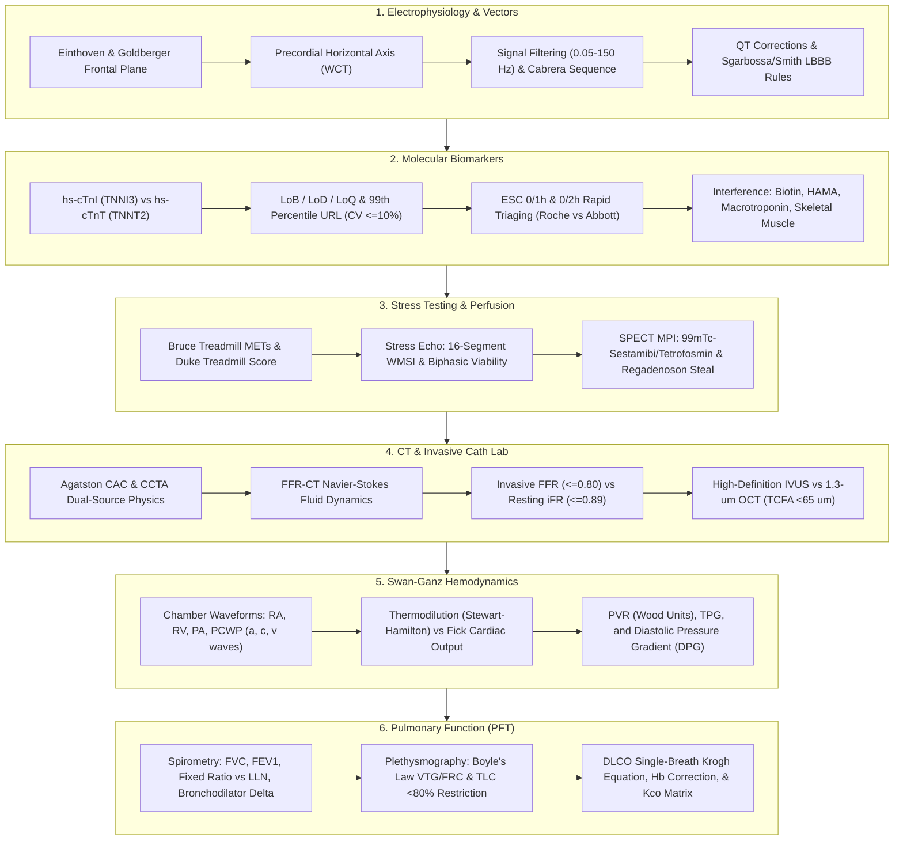
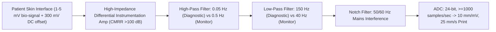
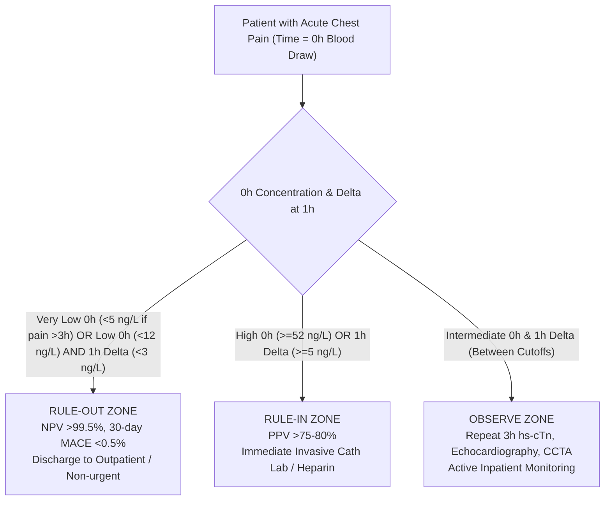
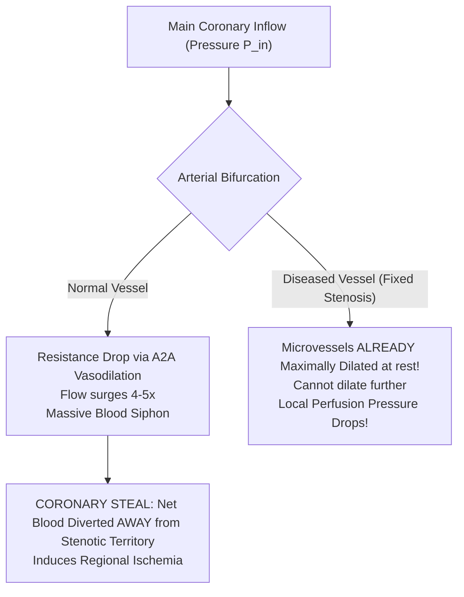
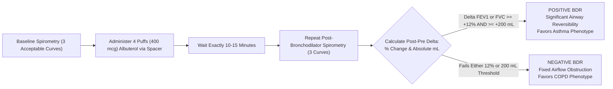

# Bundle 09 — Ep 809: Cardiopulmonary Diagnostics, Vector Loops, hs-cTn Deltoids & Body-Box DLCO (All-In-One)

## ZERO-MIXUP SINGLE-SOURCE BUNDLE FOR GOOGLE NOTEBOOKLM

**How to use in NotebookLM (`notebook.google.com`):**

1. Check **ONLY THIS ONE DOCUMENT** in your NotebookLM Sources sidebar (uncheck all others — every reference treatise and script needed for this episode is merged right inside this single file!).
2. Click **Customize** on **Audio Overview**, choose **Longer**, and paste this exact prompt:

```text
Deep dive into cardiopulmonary diagnostics: 12-lead ECG vector loops and limb lead reversal traps, high-sensitivity troponin rapid 0/1h ESC algorithms and 99th percentile URL sex cutoffs, SPECT myocardial perfusion coronary steal vs dobutamine, Cath-Lab pressure wire FFR and iFR, and PFT body plethysmography Boyle's law thoracic gas volume and single-breath DLCO Krogh equations.
```

---


---

## INCLUDED SOURCE: `VOLUME_XV_CARDIOPULMONARY_DIAGNOSTICS_ECG_VECTORS_HS_TROPONIN_HEMODYNAMICS_AND_PFT.md`

# Basic Medical — Behind the Curtain Clinical Diagnostics Notebook
## Volume XV: Cardiopulmonary Diagnostics — ECG Vector Physics, High-Sensitivity Troponin Immuno-Kinetics, Invasive Cath-Lab Hemodynamics, and Pulmonary Function Mechanics

> *"The cardiovascular and pulmonary systems do not operate as isolated organ blocks; they form an unbroken, continuous hydrodynamic circuit coupled through alveolar-capillary gas exchange, right-to-left pressure cascades, and shared bioenergetic reserves. To master cardiopulmonary diagnostics, a clinician must see through the surface traces: understanding how a 1.3-micron infrared laser illuminates a 65-micron vulnerable coronary fibrous cap, how the Nernst-Goldman electrochemical potential rotates Einthoven's spatial axis, how a single picogram of cleaved cardiac troponin fragment scatters light in an electrochemiluminescent flow-cell, and how Boyle's isothermal gas laws measure air trapped behind diseased bronchioles."*

---

### Master Architectural Overview: The Cardiopulmonary Diagnostic Continuum



---

## Dossier 15.1: 12-Lead Electrocardiography Vector Physics, Lead Placement Forensic Errors, and Conduction Block Ischemia Criteria

### 15.1.1 Einthoven's Triangle, Hexaxial Reference Plane, and Wilson's Central Terminal (WCT) Physics

The surface 12-lead electrocardiogram is not a direct recording of cellular action potentials; it is a spatial projection of the time-varying, three-dimensional cardiac electrical dipole vector $\vec{M}(t)$ onto specific anatomical lead axes. 

#### 1. Dipole Field Theory & Einthoven's Equilateral Postulate
Willem Einthoven modeled the human torso as a homogeneous, spherical volume conductor with the heart acting as a single electrical dipole source located at its geometric center. Three sensing electrodes placed on the Right Arm ($RA$), Left Arm ($LA$), and Left Leg ($LL$) form the vertices of an equilateral triangle in the frontal plane:

$$\text{Lead I}: V_I = \Phi_{LA} - \Phi_{RA}$$
$$\text{Lead II}: V_{II} = \Phi_{LL} - \Phi_{RA}$$
$$\text{Lead III}: V_{III} = \Phi_{LL} - \Phi_{LA}$$

Applying Kirchhoff's Voltage Law around the closed loop of Einthoven's triangle yields **Einthoven's Law**:

$$V_I + V_{III} = (\Phi_{LA} - \Phi_{RA}) + (\Phi_{LL} - \Phi_{LA}) = \Phi_{LL} - \Phi_{RA} = V_{II}$$

$$V_I + V_{III} = V_{II} \iff V_I - V_{II} + V_{III} = 0$$

*Technician's Sanity Check*: If an automated electrocardiograph or manual caliper inspection demonstrates that $V_I + V_{III} \neq V_{II}$ at any instant (e.g., peak of the R-wave), there is an electronic amplifier failure, an analog-to-digital clipping artifact, or high-impedance lead-skin contact noise corrupting the acquisition.

```
                  RA (-60°) --------------- LA (+0°)
                        \                 /
                         \     LEAD I    /
                          \    ----->   /
                           \           /
                   LEAD II  \         /  LEAD III
                    (+60°)   \       /    (+120°)
                              \     /
                               \ v /
                              LL (+90°)
```

#### 2. Wilson's Central Terminal (WCT)
To record unipolar potentials from the torso surface, Frank Wilson (1934) established an artificial reference node intended to represent the electrical potential of the center of the heart ($\Phi_0 \approx 0\text{ V}$). By tying the three limb electrodes together through three equal, high-precision precision resistors ($R = 5\text{ k}\Omega$ historically; now implemented via operational amplifier buffer stages with input impedance $>10^{10}\text{ }\Omega$):

By Kirchhoff's Current Law at the central summing junction:

$$\frac{\Phi_{RA} - \Phi_{WCT}}{R} + \frac{\Phi_{LA} - \Phi_{WCT}}{R} + \frac{\Phi_{LL} - \Phi_{WCT}}{R} = 0$$

$$\Phi_{WCT} = \frac{\Phi_{RA} + \Phi_{LA} + \Phi_{LL}}{3}$$

In a truly symmetrical volume conductor where the sum of limb potentials $\Phi_{RA} + \Phi_{LA} + \Phi_{LL} = 0$, $\Phi_{WCT}$ remains essentially zero throughout the cardiac cycle. Wilson's Central Terminal serves as the universal negative reference terminal for all six precordial leads ($V_1$ through $V_6$):

$$V_k = \Phi_k - \Phi_{WCT} = \Phi_k - \frac{\Phi_{RA} + \Phi_{LA} + \Phi_{LL}}{3} \quad (k \in \{1, 2, 3, 4, 5, 6\})$$

#### 3. Goldberger's Augmented Unipolar Limb Leads
When Wilson attempted to record unipolar limb leads ($V_R, V_L, V_F$) using WCT as the negative reference, the recorded signals were clinically diminutive:

$$V_R = \Phi_{RA} - \Phi_{WCT} = \Phi_{RA} - \frac{\Phi_{RA} + \Phi_{LA} + \Phi_{LL}}{3} = \frac{2\Phi_{RA} - \Phi_{LA} - \Phi_{LL}}{3}$$

Because $\Phi_{LA} + \Phi_{LL} = -\Phi_{RA}$ (assuming $\sum \Phi = 0$), $V_R \approx \Phi_{RA}$. Emanuel Goldberger (1942) realized that if the exploring limb's own resistor is removed from the central terminal, the voltage deflection increases by exactly **$50\%$ ($1.5\times$)** without altering its spatial vector orientation. 

For the augmented unipolar Right Arm lead ($aVR$), the reference terminal is formed solely by averaging the Left Arm and Left Leg:

$$\Phi_{\text{ref}, aVR} = \frac{\Phi_{LA} + \Phi_{LL}}{2}$$

$$aVR = \Phi_{RA} - \frac{\Phi_{LA} + \Phi_{LL}}{2} = \frac{2\Phi_{RA} - \Phi_{LA} - \Phi_{LL}}{2} = \frac{3}{2} \left[ \frac{2\Phi_{RA} - \Phi_{LA} - \Phi_{LL}}{3} \right] = 1.5 \times V_R$$

Similarly, for $aVL$ and $aVF$:

$$aVL = \Phi_{LA} - \frac{\Phi_{RA} + \Phi_{LL}}{2} = 1.5 \times V_L$$

$$aVF = \Phi_{LL} - \frac{\Phi_{RA} + \Phi_{LA}}{2} = 1.5 \times V_F$$

Expressed purely in terms of the standard bipolar leads $I$, $II$, and $III$:

$$aVR = -\frac{I + II}{2}$$
$$aVL = \frac{I - III}{2}$$
$$aVF = \frac{II + III}{2}$$

---

### 15.1.2 The Hexaxial Reference System & The Cabrera Contiguous Sequence

Combining the three standard bipolar leads ($I, II, III$) and the three augmented unipolar leads ($aVR, aVL, aVF$) produces six axes intersecting at $30^\circ$ angular increments in the frontal plane:

| Lead | Spatial Angle | Anatomical Territory Monitored | Positive Pole Location |
| :--- | :--- | :--- | :--- |
| **Lead I** | $0^\circ$ | High Lateral LV Wall | Left mid-axillary / shoulder |
| **Lead II** | $+60^\circ$ | Inferior LV Wall (Apex/RCA/LCx) | Left lower abdomen / leg |
| **Lead III** | $+120^\circ$ | Inferior LV Wall (RCA dominant) | Left lower abdomen / leg |
| **aVR** | $-150^\circ$ | Cavity / Basal Interventricular Septum | Right shoulder |
| **aVL** | $-30^\circ$ | High Lateral LV Wall (Diagonal/OM) | Left shoulder |
| **aVF** | $+90^\circ$ | Inferior LV Wall (Posterior descending) | Left foot |

```
                       -90° (Superior)
                          |
             -120°        |        -60°
                 \        |        /
       -150° aVR  \       |       /   aVL -30°
           \       \      |      /       /
            \       \     |     /       /
   ±180° ----\-------\----+----/-------/----> 0° Lead I
              \       \   |   /       /
               \       \  |  /       /
        +150°   \       \ | /       /    +30°
                 \        |        /
              +120°       |        +60°
             Lead III     |       Lead II
                         +90° aVF
                      (Inferior)
```

#### The Cabrera Sequence: Eliminating the aVR Non-Contiguity Defect
The standard American 12-lead layout prints frontal leads in two arbitrary columns: ($I, II, III$) and ($aVR, aVL, aVF$). This layout creates an anatomical visual fracture: Lead $I$ ($0^\circ$) is followed by Lead $II$ ($+60^\circ$) and Lead $III$ ($+120^\circ$), jumping past the intermediate vectors. 

The **Cabrera Sequence** (mandatory in Scandinavian clinical practice and modern digital electrocardiology) re-arranges the frontal plane into a continuous, panoramic, $30^\circ$ clockwise angular sweep from high lateral to inferior myocardium, inverting $aVR$ to **$-aVR$ ($+30^\circ$)**:

$$\text{Cabrera Sequence}: aVL \, (-30^\circ) \longrightarrow I \, (0^\circ) \longrightarrow -aVR \, (+30^\circ) \longrightarrow II \, (+60^\circ) \longrightarrow aVF \, (+90^\circ) \longrightarrow III \, (+120^\circ)$$

*Clinical Diagnostic Advantage*: In acute inferior or lateral STEMI, the Cabrera sequence displays the spatial wave of injury (ST elevation transitioning seamlessly into reciprocal ST depression) as an unbroken topological curve, preventing subtle single-lead ST elevations from being dismissed.

---

### 15.1.3 Forensic Lead Placement Errors: Reversals and Electrical Signatures

Electrode cable misplacement occurs in up to $4.0\%$ of all hospital ECGs, frequently triggering unwarranted cath-lab activations, missed myocardial infarctions, or erroneous diagnoses of dextrocardia.

```
Normal Connection:      RA [Cable RA]      LA [Cable LA]      LL [Cable LL]
RA-LA Reversal:         RA [Cable LA]      LA [Cable RA]      LL [Cable LL]
```

#### 1. Right Arm / Left Arm (RA–LA) Cable Reversal: The Pseudodextrocardia Trap
When the technician swaps the red (RA) and yellow (LA) limb wires:
* **Lead I Inversion**: $V_I' = \Phi_{LA}' - \Phi_{RA}' = \Phi_{RA} - \Phi_{LA} = -V_I$. The entire Lead I waveform flips upside-down: completely inverted P-wave, negative QRS complex, and inverted T-wave.
* **Lead II and Lead III Mutual Swap**:
  $$V_{II}' = \Phi_{LL} - \Phi_{RA}' = \Phi_{LL} - \Phi_{LA} = V_{III}$$
  $$V_{III}' = \Phi_{LL} - \Phi_{LA}' = \Phi_{LL} - \Phi_{RA} = V_{II}$$
* **aVR and aVL Mutual Swap**: $aVR' = aVL$, while $aVL' = aVR$.
* **aVF Unchanged**: $aVF' = \Phi_{LL} - \frac{\Phi_{RA} + \Phi_{LA}}{2} = aVF$.
* **Precordial Leads ($V_1\text{–}V_6$) Unchanged**: Because WCT is calculated as $(\Phi_{RA} + \Phi_{LA} + \Phi_{LL})/3$, addition is commutative; $\Phi_{WCT}$ is mathematically identical!
* **How to Differentiate RA-LA Reversal from True Dextrocardia**:
  * In **RA-LA Reversal**, precordial leads display normal, healthy R-wave progression from $V_1$ to $V_6$ (rS in $V_1$, transitioning to tall R in $V_5/V_6$).
  * In **True Dextrocardia with Situs Inversus**, the anatomic heart points into the right hemithorax; precordial leads show progressive loss of voltage from $V_1$ to $V_6$, with dominant S-waves throughout and zero R-wave progression.

#### 2. Right Arm / Left Leg (RA–LL) Cable Reversal: The Pseudo-Inferior Infarction
Swapping the RA cable with the LL cable produces profound alterations in the frontal leads:
* **Lead II Inversion**: $V_{II}' = \Phi_{LL}' - \Phi_{RA}' = \Phi_{RA} - \Phi_{LL} = -V_{II}$. Lead II displays an inverted P wave, a deep pathological pseudo-Q wave, and inverted T wave.
* **Lead I Becomes Inverted Lead III**: $V_I' = \Phi_{LA} - \Phi_{LL} = -V_{III}$.
* **Lead III Becomes Inverted Lead I**: $V_{III}' = \Phi_{RA} - \Phi_{LA} = -V_I$.
* **aVL and aVF Inversion & Distortion**: Frontal axis shifts radically superiorly, mimicking an acute inferior myocardial infarction with reciprocal lateral ST depression.
* **Precordial WCT Distortion**: Unlike RA-LA reversal, if limb electrodes with poor impedance are swapped onto the leg, minor baseline shifts may bleed into WCT.

#### 3. Left Arm / Left Leg (LA–LL) Cable Reversal: Subtle Axis Drift
* Lead I becomes Lead II; Lead II becomes Lead I.
* Lead III becomes completely inverted: $V_{III}' = -V_{III}$.
* $aVR$ remains unaltered, but $aVL$ and $aVF$ swap. P-wave polarity in Lead I remains upright, making this the most difficult error for automated algorithm detection.

---

### 15.1.4 Precordial Electrode Displacement Physics & The Brugada Trap

Precordial electrode placement requires rigorous anatomic palpation of the Angle of Louis (sternal manubriosternal angle) to locate the second costal cartilage, walking down to the fourth intercostal space (ICS).

```
   Anatomic Landmark                        Proper Location (4th ICS)               Pathologic High Placement (2nd/3rd ICS)
   =========================================================================================================================
   V1: Right Sternal Border (4th ICS)       Normal rS, flat/biphasic P wave         Elevated rSr', pseudo-coved ST elevation
   V2: Left Sternal Border (4th ICS)        Normal rS, dominant S wave               Mimics Type 1 Brugada Pattern / Incomplete RBBB
```

#### The High V1–V2 Placement (Second/Third Intercostal Space)
Nurses and technicians frequently place $V_1$ and $V_2$ too high on the anterior chest wall (in the 2nd or 3rd ICS) to avoid female breast tissue or unclothed chest exposure:
* **The Physics of Outflow Tract Vectoring**: The second and third intercostal spaces sit directly over the fibro-fatty pulmonary outflow tract and the basal crest of the right ventricle. In this superior plane, late depolarization of the pulmonary conus vectors toward the exploring electrode:
  1. Produces an artificial $rSr'$ or $rSR'$ morphology in $V_1–V_2$, mimicking incomplete right bundle branch block (RBBB).
  2. Generates an apparent downsloping ST elevation terminating in an inverted T wave, perfectly simulating the **Type 1 Brugada Pattern**! Patients have undergone unwarranted electrophysiologic studies and implantable cardioverter-defibrillator (ICD) consultations solely due to a 4-centimeter superior electrode displacement.
  3. Displays inverted P waves in $V_1$ ($P$-terminal force $>0.04\text{ s}\cdot\text{mm}$), falsely suggesting Left Atrial Enlargement.

#### Precordial Lead Inversion ($V_1$ through $V_3$ Reversals)
Swapping cables $V_1$ and $V_2$, or $V_2$ and $V_3$, disrupts the smooth geometric trajectory of the depolarization vector:
* Creates sudden, jagged loss of R-wave amplitude (e.g., $V_1$ R-wave $= 3\text{ mm}$, $V_2$ R-wave $= 1\text{ mm}$, $V_3$ R-wave $= 7\text{ mm}$).
* Falsely flags the automated computer algorithm for **"Anterior Infarct, Age Undetermined"** due to apparent poor R-wave progression.

---

### 15.1.5 Signal Processing, Filter Bandwidths, and Calibration Standards

Modern electrocardiographs are digital recording systems that must preserve microvolt cardiac potentials while rejecting huge environmental electrical noise:



#### 1. Filter Bandwidths: AHA/ACC/HRS Diagnostic Standards vs. Telemetry Distortions
* **Diagnostic ECG Standard**: The American Heart Association mandates a frequency passband of **$0.05\text{ Hz to }150\text{ Hz}$** (and up to $250\text{ Hz}$ in pediatric populations).
  * **The High-Pass Limit ($0.05\text{ Hz}$)**: Required to eliminate respiratory baseline wander without introducing phase-shift distortion into low-frequency ST segments and T waves. A linear phase high-pass filter with a cutoff of $0.05\text{ Hz}$ maintains accurate ST levels.
  * **The Telemetry Monitor Trap ($0.5\text{ Hz to }40\text{ Hz}$)**: Bedside cardiac monitors and transport telemetry units routinely set the high-pass filter to **$0.5\text{ Hz}$** (to anchor the baseline during patient movement) and the low-pass filter to **$40\text{ Hz}$** (to strip out skeletal muscle tremor). 
    * *The Fatal Consequence*: A $0.5\text{ Hz}$ high-pass filter acts as an analog differentiator, distorting the repolarization ST-T wave segment: it can depress a normal ST segment by $1\text{–}2\text{ mm}$ (inducing false ischemia alarms) or conversely elevate an ischemic ST segment, obscuring an evolving STEMI! **Never interpret ST-segment elevation or depression on a telemetry monitor strip running at $0.5\text{–}40\text{ Hz}$ filter bandwidth.**

#### 2. Calibration Standards
* **Voltage Calibration**: Standard calibration is **$10\text{ mm/mV}$** ($1\text{ mm} = 0.1\text{ mV} = 100\text{ }\mu\text{V}$). A standard calibration pulse must display a crisp, square $10\text{-mm}$ upward deflection with a duration of $0.20\text{ seconds}$.
* **Paper Speed**: Standard diagnostic sweep is **$25\text{ mm/s}$** ($1\text{ mm} = 0.04\text{ s} = 40\text{ ms}$; one large box of $5\text{ mm} = 0.20\text{ s} = 200\text{ ms}$). When evaluating extreme tachyarrhythmias or widening of complex conduction anomalies, running paper at **$50\text{ mm/s}$** ($1\text{ mm} = 20\text{ ms}$) expands the time axis, facilitating separation of P waves from T waves.

---

### 15.1.6 Spatial Vectorcardiography and the Spatial QRS-T Angle

Vectorcardiography (VCG) records the cardiac dipole vector simultaneously along three orthogonal Cartesian axes: $X$ (horizontal / right-to-left), $Y$ (vertical / superior-to-inferior), and $Z$ (sagittal / anterior-to-posterior), utilizing the **Frank Lead System** (7 active electrodes: E, I, A, M, C, H, and F):

$$\vec{V}(t) = X(t)\hat{i} + Y(t)\hat{j} + Z(t)\hat{k}$$

Plotting these coordinates parametric in time generates closed continuous 3D loops: the **P loop** (atrial depolarization), the **QRS loop** (ventricular depolarization), and the **T loop** (ventricular repolarization).

```
Spatial QRS-T Angle:
Normal: < 45° (Concordant Depolarization and Repolarization Vectors)
Severe Risk (> 100° to 180°): Discordant Vectors (Subclinical Ischemia, Channelopathy, Sudden Death Risk)
```

#### The Spatial QRS-T Angle ($\theta_{\text{QRS-T}}$)
In a healthy heart, myocardial depolarization and repolarization proceed in opposite anatomical directions: depolarization travels from endocardium to epicardium, while repolarization begins in the epicardium and travels toward the endocardium (due to shorter action potential duration in epicardial myocytes bathed in coronary perfusion). Consequently, the net dipole vector of repolarization ($\vec{T}$) points in nearly the same spatial direction as depolarization ($\vec{QRS}$):
* **Normal Spatial QRS-T Angle**: Typically **$< 45^\circ$** (rarely exceeding $60^\circ$ in young healthy subjects).
* **Wide Spatial QRS-T Angle ($> 100^\circ\text{ to }180^\circ$)**: Indicates severe disruption of repolarization sequence, reflecting structural myocardial scarring, electrical remodeling, channelopathies, or critical subendocardial ischemia. It is one of the strongest independent ECG predictors of sudden cardiac death and fatal ventricular arrhythmias.

---

### 15.1.7 Repolarization Kinetics: QT Correction Dynamics

Because the ventricular action potential duration shortens at higher heart rates (due to delayed-rectifier potassium current activation, $I_{Kr}$ and $I_{Ks}$), the measured raw QT interval ($QT_{\text{raw}}$) must be normalized to a standard heart rate of 60 beats per minute ($RR = 1.0\text{ second}$).

```
QT Correction Comparison:
Tachycardia (HR = 110 bpm, RR = 0.545 s): Bazett severely overcorrects (spurious long QTc alert).
Bradycardia (HR = 45 bpm, RR = 1.333 s): Bazett undercorrects (masks true lethal QT prolongation).
Fridericia (Cube-Root) & Framingham (Linear): Scientifically superior across all physiologic heart rates.
```

#### 1. Mathematical Formulations of Corrected QT ($QTc$)

$$\text{Bazett Formula (1920)}: QTc_B = \frac{QT_{\text{raw}}}{\sqrt{RR}}$$

$$\text{Fridericia Formula (1933)}: QTc_F = \frac{QT_{\text{raw}}}{\sqrt[3]{RR}} = \frac{QT_{\text{raw}}}{RR^{0.333}}$$

$$\text{Framingham Formula}: QTc_{\text{Fram}} = QT_{\text{raw}} + 0.154 \times (1 - RR)$$

$$\text{Hodges Formula}: QTc_{\text{Hodges}} = QT_{\text{raw}} + 1.75 \times (\text{Heart Rate} - 60)$$

*(Note: In all formulas, $QT$ and $RR$ are measured in seconds, except in Hodges where HR is in beats per minute and QT is in milliseconds).*

#### 2. The Analytical Failure of Bazett's Formula
Bazett's square-root normalization assumes a parabolic scaling relationship that does not match human myocyte electrophysiology:
* **At Elevated Heart Rates ($HR > 80\text{ bpm}$, $RR < 0.75\text{ s}$)**: $\sqrt{RR}$ shrinks too rapidly, causing massive mathematical overcorrection. Normal QT intervals of $340\text{ ms}$ at $105\text{ bpm}$ compute to $QTc_B > 480\text{ ms}$, prompting unnecessary drug discontinuations, cardiology consults, and electrolyte infusions.
* **At Bradycardic Heart Rates ($HR < 50\text{ bpm}$, $RR > 1.20\text{ s}$)**: $\sqrt{RR}$ grows excessively, resulting in undercorrection that masks dangerously prolonged repolarization.
* **The Clinical Standard**: The American College of Cardiology and the European Society of Cardiology strongly endorse **Fridericia ($QTc_F$)** or linear regression models (**Framingham**) as the standard of care, especially in atrial fibrillation, sinus tachycardia, or drug safety monitoring.
* **Normal QTc Cutoffs ($QTc_F$)**:
  * Men: Normal $<430\text{ ms}$; Borderline $430\text{–}450\text{ ms}$; Prolonged $>450\text{ ms}$.
  * Women: Normal $<450\text{ ms}$; Borderline $450\text{–}470\text{ ms}$; Prolonged $>470\text{ ms}$.
  * **Critical Torsadogenic Threshold**: $QTc > 500\text{ ms}$ (or an increase in $QTc > 60\text{ ms}$ from baseline) confers an exponential increase in the risk of pause-dependent early afterdepolarizations (EADs) triggering **Torsades de Pointes (TdP)**.

---

### 15.1.8 Sgarbossa and Modified Smith-Sgarbossa Criteria for LBBB and Ventricular Pacing

In normal cardiac conduction, myocardial depolarization and repolarization are balanced. In Left Bundle Branch Block (LBBB) and right ventricular pacing, septal depolarization originates entirely from the right bundle, propagating slowly through myocyte-to-myocyte gap junctions across the septum from right to left. 

This abnormal depolarization creates **appropriate T-wave discordance**: the ST segment and T wave are naturally directed opposite to the major deflection of the QRS complex. In leads with deep negative S waves ($V_1–V_3$), the ST segment naturally elevates; in leads with tall positive R waves ($I, aVL, V_5–V_6$), the ST segment naturally depresses. This physiological discordance completely masks traditional STEMI criteria.

```
Concordant STE (Score 5):        Concordant STD V1-V3 (Score 3):       Modified Smith-Sgarbossa (Rule):
ST elevation in line with R      ST depression in line with S          Discordant STE / S-wave depth >= 0.25
        |                                                                      |
       / \    _---_                         |\                                / \
      /   \  /     \                        | \                              /   \
     /     \/       \                       |  \                            /     \
    /       |        \                      |   \                          /       \
   /                  \               ------|    \    ------              /         \  _---_
                                            |     \  /                   /           \/     \
                                            |      \/                                 |
                                            |
```

#### 1. The Original Sgarbossa Criteria (1996)

| Sgarbossa Criterion | Electrophysiological Description | Points Assigned | Diagnostic Specificity |
| :--- | :--- | :--- | :--- |
| **Criterion A (Concordant STE)** | ST-segment elevation $\ge 1\text{ mm}$ ($0.1\text{ mV}$) in leads with a **positive** QRS complex | **5 Points** | $98\%$ Specific |
| **Criterion B (Concordant STD)** | ST-segment depression $\ge 1\text{ mm}$ ($0.1\text{ mV}$) in lead **$V_1, V_2,\text{ or }V_3$** | **3 Points** | $96\%$ Specific |
| **Criterion C (Excessive Discordant STE)** | ST-segment elevation $\ge 5\text{ mm}$ ($0.5\text{ mV}$) in leads with a **negative** QRS complex | **2 Points** | Low Sensitivity ($<20\%$) |

*A Sgarbossa score $\ge 3$ points has $>90\%$ specificity for acute coronary occlusion myocardial infarction (OMI) requiring emergent catheterization.*

#### 2. The Modified Smith-Sgarbossa Criteria (Smith et al., 2012)
Original Criterion C ($\ge 5\text{ mm}$ absolute discordant STE) had catastrophic diagnostic sensitivity ($16\text{–}20\%$): if a patient had a massive, voltage-dilated QRS complex with an S wave of $40\text{ mm}$ depth, an ST elevation of $6\text{ mm}$ was merely proportional ($15\%$), while a patient with an S wave of $8\text{ mm}$ and an ST elevation of $4.5\text{ mm}$ had massive, lethal transmural ischemia that missed the arbitrary $5\text{ mm}$ threshold!

Dr. Stephen Smith replaced absolute millimetric discordance with a **proportional ratio**:
* **The Rule**: In any lead with a predominantly negative QRS complex ($QS$ or $rS$), measure the ST-segment elevation at the J-point relative to the preceding S-wave amplitude:

$$\text{Modified Smith-Sgarbossa Ratio} = \frac{\text{ST Elevation at J-point}}{\text{S-wave Amplitude}} \ge 0.25 \quad \left( \text{or } \frac{ST}{S} \le -0.25 \right)$$

*Alternatively: In leads with dominant R-waves and excessively discordant ST-depression, a ratio of $\frac{\text{ST Depression}}{\text{R-wave Amplitude}} \ge 0.30$.*

*Clinical Impact*: Replacing Criterion C with the Smith-Sgarbossa ratio of $\ge 0.25$ increases sensitivity for acute coronary occlusion in LBBB from **$52\%$ to $91\%$** while preserving **$96\%$ specificity**, definitively identifying candidates for immediate primary percutaneous coronary intervention (PPCI).

---

## Dossier 15.2: High-Sensitivity Cardiac Troponins (hs-cTnI vs. hs-cTnT) — Analytical Biochemistry, Nanogram Kinetics, and Immunoassay Traps

### 15.2.1 Molecular Proteomics: Troponin C, I, and T Architecture

The troponin complex regulates striated muscle contraction in response to cytosolic calcium fluctuations. Anchored to the actin thin filament alongside tropomyosin, it comprises three non-covalently linked polypeptide subunits:

```
Thin Filament Architecture:
   [Actin Filament] ==========================================================
                           \                 /                   /
                       [Tropomyosin Polymer]                   /
                             |                                /
                   +---------+---------+                     /
                   |    Troponin T     | <------------------+ (Anchors complex)
                   |  (TNNT2, 37 kDa)  |
                   +---------+---------+
                             |
                   +---------+---------+
                   |    Troponin C     | (Binds Ca2+, 18 kDa, shared skeletal/cardiac)
                   |  (TNNC1, 18 kDa)  |
                   +---------+---------+
                             |
                   +---------+---------+
                   |    Troponin I     | <--- Inhibitory subunit: Prevents actomyosin ATPase
                   |  (TNNI3, 24 kDa)  |      100% Unique 32-AA N-terminal cardiac domain
                   +-------------------+
```

#### 1. Troponin I (Inhibitory Subunit — Encoded by *TNNI3*)
* **Molecular Weight**: $\approx 24\text{ kDa}$ ($210$ amino acids).
* **Cardiac Specificity**: Absolute. The cardiac isoform of Troponin I possesses a unique **32-amino acid post-translational extension at its N-terminus** containing two regulatory serine residues (Ser-23, Ser-24) phosphorylated by Protein Kinase A in response to beta-adrenergic stimulation. This cardiac-specific N-terminal sequence is entirely absent in human slow-twitch skeletal muscle ($TNNI1$) and fast-twitch skeletal muscle ($TNNI2$). 
* *Diagnostic Law*: Human skeletal muscle—regardless of injury, regeneration, rhabdomyolysis, polymyositis, or muscular dystrophy—**never expresses cardiac Troponin I (*TNNI3*)**.

#### 2. Troponin T (Tropomyosin-Binding Subunit — Encoded by *TNNT2*)
* **Molecular Weight**: $\approx 37\text{ kDa}$ ($288$ amino acids).
* **Tropomyosin Anchor**: Anchors the troponin complex to the tropomyosin filament and modulates calcium-activated cooperative actomyosin cross-bridging.
* **The Skeletal Cross-Reactivity Vulnerability**: Unlike Troponin I, the gene for cardiac Troponin T (*TNNT2*) shares substantial evolutionary homology with fetal skeletal muscle isoforms. In regenerating skeletal muscle—seen in chronic inflammatory myopathies (polymyositis, dermatomyositis, inclusion body myositis), severe rhabdomyolysis, and Duchenne muscular dystrophy—**myocytes dedifferentiate and re-express embryonic isoforms of Troponin T** that cross-react with commercial high-sensitivity Troponin T (hs-cTnT) detection antibodies! Patients with active polymyositis routinely present with persistent, stable hs-cTnT elevations of $50\text{ to }250\text{ ng/L}$ with completely normal hs-cTnI ($<3\text{ ng/L}$) and zero myocardial ischemia.

---

### 15.2.2 Metrological Definitions: LoB, LoD, LoQ, and the 99th Percentile URL

To qualify as a genuine "high-sensitivity" cardiac troponin assay under International Federation of Clinical Chemistry and Laboratory Medicine (IFCC) guidelines, an analytical platform must meet two strict metrological criteria:
1. The **analytical total error / Coefficient of Variation ($CV$) at the 99th percentile Upper Reference Limit (URL)** of a healthy reference population must be **$\le 10\%$**.
2. The assay must be capable of quantifying troponin concentrations well above the Limit of Detection in at least **$50\%$ of healthy individuals** (both men and women).

```
Analytical Hierarchy of Detection:
0 ng/L ------------ LoB ------------ LoD ---------------- LoQ ---------------- 99th URL (CV <=10%)
                   (Blank noise)   (True presence)      (Quantitative accuracy)  (Upper limit of normal)
                    ~1.0 ng/L       ~1.5-2.0 ng/L        ~3.0-5.0 ng/L            ~14-34 ng/L
```

#### Analytical Precision Definitions
* **Limit of Blank (LoB)**: The highest apparent analyte concentration expected to be found when replicates of a blank sample containing zero troponin are tested:
  $$LoB = \text{Mean}_{\text{blank}} + 1.645 \times SD_{\text{blank}}$$
* **Limit of Detection (LoD)**: The lowest troponin concentration that can be reliably distinguished from the Limit of Blank with a $95\%$ probability:
  $$LoD = LoB + 1.645 \times SD_{\text{low concentration sample}}$$
  *Modern platforms (e.g., Roche Elecsys hs-cTnT, Abbott Alinity hs-cTnI) achieve an LoD of **$1.0\text{ to }2.5\text{ ng/L}$ ($1.0\text{–}2.5\text{ pg/mL}$)**!*
* **Limit of Quantitation (LoQ)**: The lowest concentration at which analyte can not only be detected, but quantified with an established goal for precision (typically defined as the concentration where within-laboratory $CV \le 10\%$).

---

### 15.2.3 Validated Rapid Diagnostic Protocols: ESC 0/1-Hour and 0/2-Hour Triage Algorithms

The extreme sensitivity of modern platforms has replaced the antiquated 6-to-12 hour troponin monitoring protocols with validated rapid 0/1-hour and 0/2-hour algorithms endorsed by the European Society of Cardiology (ESC 2020/2023 Guidelines).



#### 1. Validated Platform Cutoffs (All values in $\text{ng/L} \equiv \text{pg/mL}$)

| Analytical Platform & Biomarker | 99th Percentile URL (Sex-Specific) | Rule-Out: 0h Baseline | Rule-Out: 0h & 1h $\Delta$ | Rule-In: 0h Baseline | Rule-In: 1h $\Delta$ |
| :--- | :--- | :--- | :--- | :--- | :--- |
| **Roche Elecsys hs-cTnT** (Gen 5) | Overall: $14\text{ ng/L}$<br>(F: $9$, M: $17$) | $<5\text{ ng/L}$<br>*(if pain $>3\text{h}$)* | $0\text{h} < 12\text{ ng/L}$<br>AND $\Delta 1\text{h} < 3\text{ ng/L}$ | $\ge 52\text{ ng/L}$ | $\Delta 1\text{h} \ge 5\text{ ng/L}$ |
| **Abbott Alinity / ARCHITECT hs-cTnI** | Female: $16\text{ ng/L}$<br>Male: $34\text{ ng/L}$ | $<2\text{ ng/L}$<br>*(if pain $>3\text{h}$)* | $0\text{h} < 5\text{ ng/L}$<br>AND $\Delta 1\text{h} < 2\text{ ng/L}$ | $\ge 52\text{ ng/L}$ | $\Delta 1\text{h} \ge 6\text{ ng/L}$ |
| **Siemens Atellica hs-cTnI** | Female: $34\text{ ng/L}$<br>Male: $53\text{ ng/L}$ | $<3\text{ ng/L}$<br>*(if pain $>3\text{h}$)* | $0\text{h} < 6\text{ ng/L}$<br>AND $\Delta 1\text{h} < 3\text{ ng/L}$ | $\ge 120\text{ ng/L}$ | $\Delta 1\text{h} \ge 12\text{ ng/L}$ |

#### 2. The 0/2-Hour Alternative Protocol
When 1-hour logistics are prevented by pneumatic tube delays or lab turnaround time constraints, the 0/2-hour algorithm uses slightly higher delta thresholds:
* **Roche hs-cTnT 0/2h**: Rule-out if $0\text{h} < 14\text{ ng/L}$ and $2\text{h} \, \Delta < 4\text{ ng/L}$. Rule-in if $0\text{h} \ge 52\text{ ng/L}$ or $2\text{h} \, \Delta \ge 10\text{ ng/L}$.
* **Abbott hs-cTnI 0/2h**: Rule-out if $0\text{h} < 10\text{ ng/L}$ and $2\text{h} \, \Delta < 4\text{ ng/L}$. Rule-in if $0\text{h} \ge 64\text{ ng/L}$ or $2\text{h} \, \Delta \ge 15\text{ ng/L}$.

---

### 15.2.4 Behind-the-Curtain Analytical Interference Traps

Because clinical decision pathways hinge on single-digit nanogram-per-liter shifts, chemical and immunological interferences inside the automated immunoassay cuvette can simulate or conceal catastrophic infarctions.

```
       HAMA / Heterophile Bridging Trap:                    Competitive Biotin Quenching (Roche):
       [Capture Ab] -- (HAMA) -- [Detection Ab*]           [Streptavidin Bead] == (Biotin Pill) [Sites Blocked]
               \                     /                                         X
                [No Real Troponin!]                                    [Capture Ab Cannot Bind!]
             Spurious High Light Emission                           Spurious False Low Emission
             => Fake Non-STEMI Workup                               => Missed Fatal Occlusion STEMI!
```

#### 1. Heterophile Antibodies and Human Anti-Mouse Antibodies (HAMA)
* **Mechanism**: Two-site sandwich immunoassays utilize a capture antibody bound to a solid phase (e.g., paramagnetic microparticles) and a signal-generating detection antibody conjugated to acridinium ester or ruthenium. Patients exposed to mice, rodents, monoclonal antibody therapies, or farm livestock harbor circulating human anti-animal antibodies (heterophile antibodies or HAMA). These divalent human antibodies directly bind the constant ($Fc$) regions of both capture and detection animal antibodies simultaneously, cross-linking them in the total absence of cardiac troponin.
* **Clinical Result**: Constant, non-fluctuating false-positive troponin elevations ($80\text{ to }500\text{ ng/L}$) with zero acute dynamic delta over serial draws.
* **Technician's Corrective Action**:
  1. Re-run sample using a specialized **Heterophile Blocking Tube (HBT)** containing non-immune murine globulins that saturate and neutralize HAMA.
  2. Perform **serial dilution testing**: true troponin dilutes linearly ($1:2, 1:4, 1:8$ recovery within $10\%$ of expected), whereas antibody bridging exhibits extreme non-linear prozone/hook-like deviations.

#### 2. Biotin (Vitamin B7) Interference
* **Mechanism**: High-sensitivity immunoassays utilizing a streptavidin-biotin magnetic bead capture architecture (principally the **Roche Elecsys hs-cTnT** platform) rely on the nearly covalent non-covalent affinity ($K_d \approx 10^{-15}\text{ M}$) between biotinylated capture antibodies and streptavidin-coated microparticles. 
* **The Pharmacokinetic Disaster**: High-dose over-the-counter biotin supplements ($5\text{ to }100\text{ mg/day}$ consumed for hair, skin, and nail growth) generate plasma biotin concentrations exceeding $500\text{–}1000\text{ ng/mL}$. Free circulating biotin saturates the streptavidin binding pockets on the beads, preventing the biotinylated troponin sandwich complexes from anchoring!
* **Clinical Result**: The unbound sandwich complexes are washed away during aspiration. The analyzer detects virtually zero light, reporting a **catastrophic false-negative troponin ($<5\text{ ng/L}$)** in a patient actively occluding their proximal LAD!
* *Technician's Rule*: In patients consuming high-dose biotin, blood must not be drawn for Roche Elecsys testing for at least **$8\text{ to }24\text{ hours}$ post-ingestion**, or samples must be pre-treated with anti-biotin depleting resin beads.

#### 3. Macrotroponin Complexes
* **Mechanism**: Analogous to macroamylase and macro-prolactin, circulating endogenous autoantibodies (primarily immunoglobulin G, $\text{IgG}$) bind free cardiac troponin (cTnI or cTnT) to form high-molecular-weight macromolecular complexes ($>200\text{ kDa}$). 
* **The Kinetics**: The renal clearance of free troponin fragments ($15\text{–}25\text{ kDa}$) by glomerular filtration is rapid; however, bulky IgG-macrotroponin complexes exceed the glomerular podocyte slit diaphragm cutoff ($\sim 60\text{ kDa}$) and cannot be cleared, accumulating in plasma.
* **The PEG Precipitation Test**:
  * Mix equal volumes of patient serum and a $25\%$ solution of **Polyethylene Glycol (PEG 6000)**.
  * Vortex and centrifuge at $3000 \times g$ for 15 minutes to precipitate high-molecular-weight immunoglobulins while leaving monomeric troponin in the supernatant.
  * Measure troponin in the supernatant and calculate the **Percentage Recovery**:
    $$\% \text{ PEG Recovery} = \frac{\text{Troponin in Supernatant} \times 2}{\text{Troponin in Untreated Serum}} \times 100\%$$
  * **Interpretation**:
    * $\% \text{ Recovery} > 80\%$: Free monomeric troponin confirms true myocardial injury.
    * $\% \text{ Recovery} < 40\%$: Confirms **Macrotroponin**, explaining persistent asymptomatic chronic elevation and sparing the patient invasive angiography.

---

### 15.2.5 Kinetic Clearance, Renal Insufficiency, and Skeletal Muscle Confounders

```
Etiology of hs-cTn Elevation: Is it Acute Type 1 MI vs End-Stage Renal Disease (ESRD)?
   Parameter                 Acute Type 1 MI (Plaque Rupture)           Chronic ESRD Elevation
   -------------------------------------------------------------------------------------------------
   0h to 1h / 2h Delta       Dynamic Surge (>=20% to 100%+ rise)       Static, plateau (<10% variance)
   Renal Filtration          Normal or acute decline                    eGFR <15 mL/min/1.73m2
   Troponin Subfragment      Intact + early large fragments             Heavily cleaved micro-fragments
   hs-cTnI vs hs-cTnT        Both elevate concordantly                 hs-cTnT elevated > hs-cTnI
```

#### 1. The Renal Clearance Mystery in ESRD
Over $70\%$ of asymptomatic patients with End-Stage Renal Disease on chronic hemodialysis exhibit baseline hs-cTnT concentrations above the 99th percentile URL ($>14\text{ ng/L}$), often hovering between $25\text{ and }75\text{ ng/L}$.
* **Mechanism**: Both impaired renal catabolism of cleaved troponin micro-fragments AND chronic subclinical uremic cardiomyopathy (interstitial myocardial fibrosis, left ventricular hypertrophy, silent microvascular subendocardial ischemia, and skeletal muscle isoform re-expression).
* **Diagnostic Rule**: A single isolated elevated troponin in an ESRD patient has poor positive predictive value for acute MI. The diagnosis of acute myocardial infarction in renal failure strictly requires a **dynamic delta shift ($\ge 20\%$ change over $2\text{–}3\text{ hours}$)** superimposed on the chronic elevated baseline!

---

## Dossier 15.3: Noninvasive Ischemia Evaluation & Myocardial Perfusion Scintigraphy

### 15.3.1 Exercise Physiology & Bruce Protocol Hemodynamics: Treadmill METs Math

Exercise stress testing evaluates coronary flow reserve by increasing myocardial oxygen demand ($MVO_2$) to unmask flow-limiting epicardial coronary stenoses. 

#### 1. Rate-Pressure Product (Double Product)
Myocardial oxygen consumption correlates directly with the product of heart rate and peak systolic blood pressure:

$$\text{Rate-Pressure Product (RPP)} = \text{Peak Heart Rate (bpm)} \times \text{Peak Systolic Blood Pressure (mmHg)}$$

* **Adequate Hemodynamic Stress**: An exercise test is diagnostically adequate only if the patient achieves $\ge 85\%$ of their age-predicted maximal heart rate ($HR_{\text{max}} = 220 - \text{Age}$) and an **$RPP \ge 25,000$** (e.g., $165\text{ bpm} \times 160\text{ mmHg} = 26,400$). If a beta-blocker prevents the patient from exceeding an $RPP$ of $20,000$, a negative test is indeterminate and non-diagnostic.

#### 2. Bruce Protocol Mechanics & Oxygen Consumption Formula
The standard Bruce Protocol increments speed and grade every 3 minutes:

| Bruce Stage | Time (Minutes) | Treadmill Speed | Incline Grade | Approximate METs |
| :--- | :--- | :--- | :--- | :--- |
| **Stage 1** | $0:00 - 3:00$ | $1.7\text{ mph}$ ($45.6\text{ m/min}$) | $10\%$ ($0.10$) | **$4.6\text{ METs}$** |
| **Stage 2** | $3:01 - 6:00$ | $2.5\text{ mph}$ ($67.0\text{ m/min}$) | $12\%$ ($0.12$) | **$7.0\text{ METs}$** |
| **Stage 3** | $6:01 - 9:00$ | $3.4\text{ mph}$ ($91.1\text{ m/min}$) | $14\%$ ($0.14$) | **$10.1\text{ METs}$** |
| **Stage 4** | $9:01 - 12:00$ | $4.2\text{ mph}$ ($112.6\text{ m/min}$) | $16\%$ ($0.16$) | **$13.5\text{ METs}$** |
| **Stage 5** | $12:01 - 15:00$ | $5.0\text{ mph}$ ($134.0\text{ m/min}$) | $18\%$ ($0.18$) | **$17.0\text{ METs}$** |

#### American College of Sports Medicine (ACSM) Oxygen Consumption Equation:

$$VO_2\text{ (mL/kg/min)} = (0.1 \times S) + (1.8 \times S \times G) + 3.5$$

Where $S$ is speed in meters per minute ($1\text{ mph} = 26.8\text{ m/min}$) and $G$ is fractional grade (e.g., $10\% = 0.10$). One Metabolic Equivalent of Task (**$1\text{ MET}$**) is defined as resting basal oxygen consumption:

$$1\text{ MET} \equiv 3.5\text{ mL } O_2 / \text{kg/min}$$

$$\text{METs} = \frac{VO_2}{3.5}$$

*Worked Example (Stage 2: 2.5 mph, 12% grade)*:
$$S = 2.5 \times 26.8 = 67.0\text{ m/min}, \quad G = 0.12$$
$$VO_2 = (0.1 \times 67.0) + (1.8 \times 67.0 \times 0.12) + 3.5 = 6.70 + 14.47 + 3.5 = 24.67\text{ mL/kg/min}$$
$$\text{METs} = \frac{24.67}{3.5} = \mathbf{7.05\text{ METs}}$$

---

### 15.3.2 The Duke Treadmill Score (DTS)

The Duke Treadmill Score integrates exercise capacity, ischemic electrophysiology, and symptom severity into a continuous prognostic metric validated by Mark et al. (*Ann Intern Med*, 1987):

$$\text{Duke Treadmill Score (DTS)} = \text{Exercise Time (min)} - (5 \times \text{Max ST Deviation (mm)}) - (4 \times \text{Angina Index})$$

```
Angina Index Definitions:
0 = None (No chest discomfort during exercise)
1 = Non-limiting angina (Patient reports chest pain, but can continue exercise)
2 = Exercise-limiting angina (Test terminated due to severe ischemic pain)
```

*ST Deviation Measurement Rule*: Measured at the J-point $+80\text{ ms}$ (or J $+60\text{ ms}$ at heart rates $>130\text{ bpm}$) in the single lead displaying the most severe horizontal or downsloping ST-segment depression.

```
Risk Stratification via Duke Treadmill Score:
========================================================================================
Score Category          DTS Score Range       5-Year Survival Rate    Recommended Pathway
----------------------------------------------------------------------------------------
Low Risk                DTS >= +5             > 99% (>0.25%/year)     Medical Therapy
Moderate Risk           -10 <= DTS <= +4      95% (~1.25%/year)       Stress Imaging / CCTA
High Risk               DTS <= -11            < 79% (>5.0%/year)      Direct Invasive Cath
```

*Worked Diagnostic Calculation*:
A 62-year-old male completes 4 minutes of the Bruce Protocol before stopping due to severe, exercise-limiting angina (Angina Index = 2). The ECG demonstrates $2.5\text{ mm}$ of horizontal ST-segment depression in leads $V_4–V_6$:
$$\text{DTS} = 4.0 - (5 \times 2.5) - (4 \times 2) = 4.0 - 12.5 - 8 = \mathbf{-16.5}$$
*Interpretation*: **High-Risk Category ($\text{DTS} = -16.5 \le -11$)**; 5-year cardiovascular mortality exceeds $5\%$ annually; immediate invasive coronary angiography indicated.

---

### 15.3.3 Stress Echocardiography: 16-Segment / 17-Segment ASE WMSI & Dobutamine Biphasic Viability

Stress echocardiography pairs physical exercise or pharmacologic inotropic stress with real-time 2D transthoracic imaging to identify regional wall motion abnormalities (RWMAs) that develop when coronary flow cannot meet demand.

```
ASE 17-Segment Regional Model:
   Basal Ring (6 segments):       Anterior, Anteroseptal, Inferoseptal, Inferior, Inferolateral, Anterolateral
   Mid-Cavity Ring (6 segments):   Anterior, Anteroseptal, Inferoseptal, Inferior, Inferolateral, Anterolateral
   Apical Ring (4 segments):       Anterior, Septal, Inferior, Lateral
   Apex Cap (1 segment):           True Apex (Segment 17)
```

#### 1. Wall Motion Score Index (WMSI)
Each visualized myocardial segment is assigned an ordinal functional score under the American Society of Echocardiography (ASE) guidelines:
* **Score 1**: Normal or hyperkinetic ($\ge 30\%$ radial systolic endocardial thickening).
* **Score 2**: Hypokinetic (reduced thickening, $<30\%$).
* **Score 3**: Akinetic (complete absence of systolic wall thickening).
* **Score 4**: Dyskinetic (paradoxical systolic outward ballooning / systolic thinning).
* **Score 5**: Aneurysmal (diastolic and systolic outward deformation with structural thinning).

$$\text{Wall Motion Score Index (WMSI)} = \frac{\sum (\text{Segment Scores})}{\text{Total Number of Evaluated Segments}}$$

* Normal resting WMSI is exactly **$1.0$**. A WMSI $>1.7$ during peak stress indicates multi-vessel CAD and poor long-term prognosis.

#### 2. Dobutamine Inotropic Titration & The Biphasic Viability Response
In patients unable to exercise, **dobutamine** (synthetic $\beta_1 > \beta_2 > \alpha_1$ adrenergic agonist) is infused in incremental stages:

$$\text{Dobutamine Stages}: 5 \longrightarrow 10 \longrightarrow 20 \longrightarrow 30 \longrightarrow 40\text{ }\mu\text{g/kg/min} \quad (\text{+ Atropine } 0.25\text{–}0.5\text{ mg up to } 2.0\text{ mg if HR fails to reach } 85\%)$$

```
Dobutamine Biphasic Response in Hibernating Myocardium:
Rest (Akinetic/Hypokinetic) 
  --> Low-Dose Dobutamine (5-10 mcg/kg/min): Recovers contractility (Inotropic reserve!)
    --> High-Dose Dobutamine (30-40 mcg/kg/min): Contractility collapses into akinesia (Ischemia!)
*PATHOGNOMONIC FOR MYOCARDIAL VIABILITY AND FLOW-LIMITING EPICARDIAL STENOSIS!*
```

* **The Biphasic Response**: At low doses ($5\text{–}10\text{ }\mu\text{g/kg/min}$), dobutamine increases cyclic AMP without massively escalating heart rate, recruiting contractile reserve in chronically hypoperfused, down-regulated ("hibernating") myocardium—the akinetic segment begins to thicken! At high doses ($30\text{–}40\text{ }\mu\text{g/kg/min}$), heart rate and oxygen demand surge, exceeding the fixed blood delivery of the stenotic vessel—the segment abruptly ceases to thicken, reverting to akinesia. The biphasic response has $>85\%$ specificity for predicting functional recovery post-revascularization.

---

### 15.3.4 Nuclear Scintigraphy Physics: 99mTc-Sestamibi, 99mTc-Tetrofosmin, and 201Tl Redistribution Kinetics

Single-Photon Emission Computed Tomography (SPECT) myocardial perfusion imaging (MPI) maps relative regional myocardial blood flow using radiopharmaceuticals injected during peak stress and at rest.

```
Radiotracer Comparison:
-------------------------------------------------------------------------------------------------------
Radiotracer            Photon Energy      Physical Half-Life    Uptake Mechanism & Cellular Target
-------------------------------------------------------------------------------------------------------
99mTc-Sestamibi        140 keV            6.0 hours             Passive diffusion driven by mitochondrial 
(Cardiolite)                                                    negative membrane potential (Delta-Psi_m)
-------------------------------------------------------------------------------------------------------
99mTc-Tetrofosmin      140 keV            6.0 hours             Lipophilic diphosphine; mitochondrial
(Myoview)                                                       membrane potential dependent
-------------------------------------------------------------------------------------------------------
201Tl-Thallous         69-80 keV (X-rays) 73.0 hours            Active transport via sarcolemmal 
Chloride               167 keV (gamma)                          Na+/K+-ATPase pump (Potassium analog)
```

#### 1. Technetium-99m Tracer Biophysics ($^{99m}\text{Tc}$-Sestamibi / Tetrofosmin)
* **Gamma Camera Physics**: Technetium-99m decays by isomeric transition, emitting a single monoenergetic **$140\text{ keV}$ gamma photon** ideal for low-energy high-resolution (LEHR) lead parallel-hole collimators paired with a Sodium Iodide doped with Thallium [$\text{NaI(Tl)}$] scintillation crystal. A $20\%$ energy symmetric window ($126\text{–}154\text{ keV}$) rejects Compton-scattered photons.
* **Mitochondrial Trapping**: Sestamibi is a lipophilic monovalent cation ($+1$ charge). Driven by the negative electrical transmembrane potential of intact myocytes (sarcolemma $-80\text{ mV}$) and the massive negative electrical gradient across the inner mitochondrial membrane ($\Delta \Psi_m \approx -160\text{ to }-180\text{ mV}$), it crosses the membranes and accumulates irreversibly inside the mitochondrial matrix.
* **Absence of Redistribution**: Once trapped inside mitochondria, sestamibi does not wash out or redistribute significantly over time. Therefore, **two separate injections** are required: one at peak stress and a second at rest (typically a 1-day or 2-day rest/stress protocol).

#### 2. Thallium-201 ($^{201}\text{Tl}$) and Redistribution Viability Kinetics
* **The Potassium Analog**: Thallium-201 enters the myocyte via the energy-dependent $\text{Na}^+/\text{K}^+\text{-ATPase}$ pump. Initial uptake ($10\text{–}15\text{ minutes}$ post-injection) reflects regional blood flow.
* **The Dynamic Redistribution Phenomenon**: Unlike technetium agents, Thallium washes in and out of myocytes continuously. Over $3\text{ to }4\text{ hours}$ (and out to $24\text{ hours}$), Thallium washes out rapidly from normally perfused territories but slowly accumulates in viable, hypoperfused, hibernating tissue:
  * **Reversible Defect (Ischemia)**: Cold on initial stress images $\rightarrow$ normalizes (fills in) on 4-hour redistribution images.
  * **Fixed Defect (Scar / Infarction)**: Cold on initial stress $\rightarrow$ remains cold on 4-hour redistribution.
  * **Hibernating Viability (Late Reversibility)**: Cold on initial stress $\rightarrow$ remains cold at 4 hours $\rightarrow$ fills in on delayed **24-hour redistribution imaging** or following a reinjection booster dose!

---

### 15.3.5 Pharmacologic Vasodilator Stress & The Coronary Steal Phenomenon

When physical exercise cannot be performed, coronary hyperemia is provoked pharmacologically using adenosine receptor agonists.

```
Coronary Steal Fluid Dynamics:
   Normal Vessel (Resistance R1): Dilation drop -> Blood flow surges 400-500%
   Stenotic Vessel (Resistance R2): Fixed epicardial resistance + maximally dilated arterioles at rest!
   Consequence: Pressure at common upstream bifurcation drops -> Blood diverted AWAY from ischemic bed!
```



#### 1. Receptor Specificity & Regadenoson Mechanics
* **Adenosine Receptor Subtypes**:
  * $A_{1}$: AV nodal conduction slowing, negative dromotropy (induces heart block).
  * $A_{2A}$: Coronary and systemic arterial smooth muscle vasodilation (the therapeutic target).
  * $A_{2B}$: Peripheral vasodilation, mast cell degranulation, and **bronchospasm**.
  * $A_{3}$: Mast cell activation, bronchoconstriction.
* **Regadenoson (Lexiscan)**: A selective, low-affinity **$A_{2A}$ adenosine receptor agonist**. Administered as a rapid, fixed intravenous bolus of **$0.4\text{ mg}$ ($5\text{ mL}$)** over 10 seconds, eliminating weight-based dosing. It produces rapid coronary hyperemic blood flow velocity ($>4.5\times$ baseline) within 1 to 2 minutes, with minimal cross-reactivity at $A_{1}$ or $A_{2B}$ receptors, greatly reducing the incidence of severe bronchospasm and high-grade AV block.
* **The Pharmacologic Antidote**: **Aminophylline** ($100\text{–}250\text{ mg}$ IV over 10 minutes) competitively antagonizes all adenosine receptors, terminating side effects (headache, flushing, dyspnea, nausea). Patients must abstain from caffeine, theophylline, and dipyridamole for at least **$12\text{ to }24\text{ hours}$** prior to testing, as these xanthines competitively block the $A_{2A}$ receptor, causing false-negative perfusion studies.

---

### 15.3.6 Instrumentation, Attenuation Artifacts, and Transient Ischemic Dilation (TID)

#### 1. Attenuation Traps in SPECT Imaging
Low-energy $140\text{ keV}$ gamma photons traveling from the deep myocardium are absorbed and Compton-scattered by overlying soft tissues:
* **Diaphragmatic / Subdiaphragmatic Attenuation**: In male patients, the left hemidiaphragm absorbs photons originating from the **inferior wall**, creating a false fixed perfusion defect that mimics an old inferior MI.
* **Breast Tissue Attenuation**: In female patients, dense or pendulous breast tissue absorbs photons from the **anterior and anterolateral walls**, simulating LAD ischemia.
* **Technician's Antidote**:
  1. **Prone-Position Imaging**: Flipping the patient from supine to prone shifts the diaphragm inferiorly and presses breast tissue flat, causing attenuation artifacts to disappear while true myocardial infarctions persist.
  2. **Computed Tomography Attenuation Correction (CTAC)**: Modern hybrid SPECT/CT scanners acquire an ultra-low-dose non-contrast CT transmission map to calculate pixel-by-pixel attenuation coefficients ($\mu$), restoring true counts.

#### 2. Transient Ischemic Dilation (TID) Ratio
Transient Ischemic Dilation refers to an apparent enlargement of the left ventricular cavity on post-stress images compared to resting images:

$$\text{TID Ratio} = \frac{\text{Left Ventricular Cavity Volume on Stress Images}}{\text{Left Ventricular Cavity Volume on Rest Images}}$$

* **The Physics of the "Optical Illusion"**: The left ventricle does not physically dilate in minutes; rather, severe, extensive subendocardial ischemia across multiple vascular territories suppresses tracer uptake along the entire subendocardial lining. The gamma camera registers counts only from the viable subepicardium, making the cavity appear outwardly expanded!
* **Diagnostic Interpretation**: A **$\text{TID Ratio} > 1.20\text{ to }1.25$** (platform-dependent) is a high-risk perfusion marker signaling **balanced, critical multi-vessel coronary artery disease** or severe left main trunk stenosis, requiring prompt invasive angiography.


---

## Dossier 15.4: Cardiac Computed Tomography Angiography (CCTA) & Invasive Cath-Lab Hemodynamics

### 15.4.1 CCTA Engineering: Multidetector Physics, Temporal/Spatial Resolution, and Beta-Blocker Premedication

Coronary Computed Tomography Angiography (CCTA) visualizes coronary artery lumina and vessel wall pathology noninvasively. Because coronary arteries move continuously with myocardial contraction ($50\text{–}100\text{ mm/s}$ during early ventricular systole), imaging requires sub-millimeter spatial resolution and temporal resolution fast enough to eliminate cardiac motion artifacts.

```
       Dual-Source CT Geometry:
       [X-Ray Tube A] ------------ 90° ------------ [X-Ray Tube B]
             \                                            /
              \                                          /
               +------------ [Patient] -----------------+
              /                                          \
             /                                            \
       [Detector Array A]                         [Detector Array B]
       Temporal Resolution: Quarter-Gantry Rotation Time (~66-75 ms!)
```

#### 1. Scanner Physics & The Quarter-Rotation Principle
* **Dual-Source CT (DSCT)**: Utilizes two separate X-ray tube and detector systems mounted orthogonally at a $90^\circ$ offset on a single rotating gantry. 
* **Temporal Resolution ($\tau_{\text{temp}}$)**: In single-source CT, reconstructing an image slice via 180-degree filtered backprojection requires at least a half-rotation of the gantry ($\tau_{\text{temp}} = T_{\text{rot}} / 2 \approx 135\text{–}150\text{ ms}$). In dual-source CT, because the two tubes operate at $90^\circ$, data across $180^\circ$ is acquired in only a **quarter-rotation**:
  $$\tau_{\text{temp}} = \frac{T_{\text{rot}}}{4} = \frac{260\text{–}280\text{ ms}}{4} \approx \mathbf{66\text{–}75\text{ ms}}$$
  This $66\text{-ms}$ temporal window "freezes" cardiac motion during the mid-diastolic rest period (diastasis, occupying $70\text{–}80\%$ of the R-R cycle).
* **Spatial Resolution**: Modern high-definition 256- and 320-slice multi-detector systems utilize flying focal spot technology and ultra-thin detector rows providing isotropic voxel resolutions of **$0.23\text{ to }0.50\text{ mm}$**, sufficient to evaluate coronary stents and calcified plaques.

#### 2. Premedication Pharmacodynamics: Negative Chronotropy & Vasodilation
* **Heart Rate Deceleration**: High heart rates ($>65\text{ bpm}$) truncate the diastolic pause, inducing severe motion blurring that mimics coronary occlusion.
  * **Oral Metoprolol Tartrate**: $50\text{ to }100\text{ mg}$ administered orally $60\text{ minutes}$ prior to scan; if heart rate remains $>60\text{ bpm}$, intravenous metoprolol is titrated in **$5\text{-mg}$ boluses every 5 minutes (up to $20\text{–}30\text{ mg}$ total)** targeting a resting heart rate of **$\le 55\text{–}60\text{ bpm}$**.
  * **Ivabradine Option**: In patients with severe asthma or COPD where beta-blockers are contraindicated, the hyperpolarization-activated cyclic nucleotide-gated ($I_f$) channel inhibitor ivabradine ($10\text{–}15\text{ mg}$) slows the sinus node without bronchospasm.
* **Coronary Vasodilation**: Sublingual **nitroglycerin ($0.4\text{ to }0.8\text{ mg}$ spray or tablet)** administered $3\text{ to }5\text{ minutes}$ prior to contrast injection increases epicardial coronary caliber by $20\text{–}30\%$, drastically improving visualization of distal segments and branches.

---

### 15.4.2 Agatston Coronary Artery Calcium (CAC) Scoring: Threshold Math and Attenuation Weighting

The Coronary Artery Calcium score directly quantifies subclinical calcified atherosclerotic plaque burden. It is acquired via a non-contrast, prospective ECG-triggered axial scan at $120\text{ kVp}$ with standard $3\text{-mm}$ slice thickness.

```
       Agatston Plaque Identification Rule:
       1. Threshold Attenuation: >= 130 Hounsfield Units (HU)
       2. Minimum Area Threshold: >= 1.0 mm^2 (At least 3 contiguous pixels)
```

#### 1. The Agatston Scoring Equation
A calcified lesion is defined as an area of contiguous hyperattenuation $\ge 130\text{ Hounsfield Units (HU)}$ with an area $\ge 1.0\text{ mm}^2$. The score for each lesion is calculated by multiplying the lesion area ($\text{mm}^2$) by a discrete, non-linear **peak attenuation weighting factor ($W$)**:

$$\text{Lesion Agatston Score} = \text{Area (mm}^2\text{)} \times W$$

$$\text{Total Agatston CAC Score} = \sum_{i=1}^{N} \left( \text{Area}_i \times W_i \right)$$

| Peak Attenuation Within Calcified Plaque | Weighting Factor ($W$) | Histological Bone Density Analogy |
| :--- | :--- | :--- |
| **$130 - 199\text{ HU}$** | **$1$** | Trabecular bone / early hydroxyapatite |
| **$200 - 299\text{ HU}$** | **$2$** | Dense mineralized plaque |
| **$300 - 399\text{ HU}$** | **$3$** | Compact osteoid calcification |
| **$\ge 400\text{ HU}$** | **$4$** | Dense cortical bone / porcelain vessel |

```
Agatston CAC Clinical Risk Strata:
========================================================================================
Total CAC Score       Plaque Burden          Cardiovascular Risk Tier     10-Year Event Rate
----------------------------------------------------------------------------------------
0                     Zero Detectable        Extremely Low Risk           < 1.0% ("Power of Zero")
1 - 10                Minimal Plaque         Low Risk                     ~ 2.0%
11 - 100              Mild Plaque            Moderate Risk                ~ 4.0%
101 - 400             Moderate Plaque        High Risk (Statin Indicated) ~ 8.0 - 10.0%
> 400                 Severe Plaque          Very High Risk               > 15.0 - 25.0%
                      (Widespread CAD)       (Annual MACE >3-5%)          (Direct Stress/Cath)
```

*The "Power of Zero"*: A CAC score of 0 confers a negative predictive value $>99\%$ for obstructive coronary artery disease and provides a "warranty period" of 5 to 10 years during which cardiovascular event rates remain under $0.1\%$ per year.

---

### 15.4.3 Computational Fluid Dynamics: AI-Derived Fractional Flow Reserve from CT (FFR-CT)

While CCTA defines anatomic stenosis, anatomical narrowing often correlates poorly with functional ischemia (a $60\%$ anatomic stenosis may produce zero flow restriction, whereas a $50\%$ ulcerated bifurcation lesion may severely restrict flow). 

**FFR-CT (e.g., HeartFlow)** applies high-performance computational fluid dynamics (CFD) to standard non-invasive CCTA datasets, computing blood pressure and flow velocity everywhere across the coronary tree under simulated maximal adenosine hyperemia **without requiring invasive cardiac catheterization or actual adenosine infusion**.

```
CCTA 3D Volume Data 
  --> Automated Machine-Learning Coronary Tree Segmentation
    --> Patient-Specific Anatomical Volumetric Mesh Generation (~3 Million Finite Elements)
      --> Boundary Condition Derivation (Resting Flow Proportional to Myocardial Mass: M^0.75)
        --> Simulated Microvascular Hyperemia (Resistance dropped 4.5-fold)
          --> Numerical Solution of 3D Incompressible Navier-Stokes Equations!
            --> Color-Coded 3D Map of Vessel-Specific FFR-CT (Threshold <= 0.80)
```

#### The Governing Navier-Stokes Equations of Coronary Fluid Mechanics
Blood is modeled as an incompressible, non-Newtonian viscous fluid governed by the **Conservation of Mass (Continuity)** and **Conservation of Momentum (Navier-Stokes)**:

$$\nabla \cdot \vec{u} = 0$$

$$\rho \left( \frac{\partial \vec{u}}{\partial t} + (\vec{u} \cdot \nabla)\vec{u} \right) = -\nabla p + \mu \nabla^2 \vec{u}$$

Where $\vec{u}$ is the 3D velocity vector field, $p$ is the static pressure field, $\rho \approx 1050\text{ kg/m}^3$ is blood density, and $\mu$ is blood dynamic viscosity (incorporating shear-thinning Casson fluid rheology). 
* **Validation**: The multicenter ADVANCE and DISCOVER-FLOW trials proved that an $FFR_{\text{CT}} \le 0.80$ has $>86\%$ diagnostic accuracy against invasive wire-based FFR, reducing diagnostic-only invasive catheterizations by $>61\%$.

---

### 15.4.4 Invasive Coronary Physiology: Hyperemic FFR vs. Non-Hyperemic Resting iFR

During invasive coronary angiography, visual stenosis estimation ("eyeballing") is notoriously subjective. Physiological assessment with a $0.014\text{-inch}$ high-fidelity sensor-tipped pressure guidewire provides an objective hydrodynamic measurement of functional lesion significance.

```
       Invasive Cath Lab Pressure Setup:
       [Aortic Guiding Catheter Tip] ------------------------> Pressure Pa (Aortic Pressure)
                                                                    \
       [0.014" Sensor Wire crossed distal to stenosis] ------> Pressure Pd (Distal Coronary Pressure)
       
       Fractional Flow Reserve (Hyperemia):     FFR = Pd / Pa (during IV Adenosine Hyperemia)
       Instantaneous Wave-Free Ratio (Rest):    iFR = Pd / Pa (during Diastolic Wave-Free Period)
```

#### 1. Fractional Flow Reserve (FFR) Physics
Fractional Flow Reserve is defined as the fraction of normal maximal myocardial blood flow that can still reach the downstream myocardial bed through the stenotic vessel:

$$FFR = \frac{Q_{\text{stenosis}}^{\text{max}}}{Q_{\text{normal}}^{\text{max}}}$$

Because volumetric flow rate $Q = \frac{\Delta P}{R}$, under conditions of **constant and minimal microvascular resistance ($R_{\text{myo}}^{\text{minimal}}$)** achieved via maximal hyperemia, flow is directly proportional to driving pressure:

$$FFR = \frac{(P_d - P_v) / R_{\text{myo}}^{\text{minimal}}}{(P_a - P_v) / R_{\text{myo}}^{\text{minimal}}}$$

Assuming central venous pressure $P_v \approx 0\text{ mmHg}$ relative to arterial pressures:

$$FFR = \frac{P_d}{P_a} \quad (\text{at steady-state maximal hyperemia})$$

* **Hyperemic Induction**:
  * **Intravenous Adenosine**: Continuous infusion at **$140\text{ }\mu\text{g/kg/min}$** via a large central or antecubital vein for $2\text{ to }3\text{ minutes}$.
  * **Intracoronary Bolus**: Rapid bolus injection of **$60\text{–}100\text{ }\mu\text{g}$** into the Right Coronary Artery, or **$100\text{–}200\text{ }\mu\text{g}$** into the Left Coronary Artery.
* **The Ischemic Threshold**: An **$FFR \le 0.80$** defines a hemodynamically significant stenosis causing reversible ischemia (FAME and DEFER trials), indicating clear benefit from stent revascularization. An $FFR > 0.80$ indicates revascularization can be safely deferred with superior outcomes on medical therapy.

#### 2. Instantaneous Wave-Free Ratio (iFR) — Non-Hyperemic Resting Index
Adenosine infusion carries significant adverse effects: patient discomfort, intense chest pressure, flushing, transient high-grade AV block, and severe bronchospasm in reactive airway disease.

**The Instantaneous Wave-Free Ratio (iFR)** measures the pressure gradient without pharmacologic hyperemia:
* **The Wave-Free Period (WFP)**: During the mid-to-late phase of ventricular diastole (beginning $25\%$ of the way into diastole and ending $5\text{ ms}$ before end-diastole), the compressed myocardial microvascular bed relaxes, and no active wave reflections occur. During this specific window, **intracoronary microvascular resistance is naturally minimal and flat**, exactly mirroring hyperemic resistance!

$$iFR = \frac{P_d}{P_a} \quad (\text{measured exclusively during the diastolic wave-free period})$$

* **Clinical Equivalence (DEFINE-FLAIR & IFR-SWEDEHEART Trials)**:
  * An **$iFR \le 0.89$** is mathematically and clinically non-inferior to an $FFR \le 0.80$.
  * Eliminates adenosine cost, drug adverse effects, and infusion line preparation, reducing procedure time by $15\text{–}20\text{ minutes}$.

---

### 15.4.5 Intravascular Ultrasound (IVUS): Acoustic Physics and Minimum Lumen Area (MLA) Cutoffs

Intravascular Ultrasound (IVUS) provides cross-sectional, $360^\circ$ tomographic imaging of the coronary vessel wall from inside the lumen out to the external elastic membrane (EEM).

```
Vessel Wall Anatomy via IVUS (Three-Layer Architecture):
[Inner Lumen] -> [Hyperechoic Intima] -> [Hypoechoic Media] -> [Hyperechoic Adventitia / EEM]
```

#### 1. Acoustic Transducer Physics
* **Transducer Options**:
  1. **Rotational Mechanical Catheter**: A single piezoelectric crystal spinning at $1,800\text{–}3,600\text{ RPM}$ inside a protective sheath at frequencies of **$40\text{ to }60\text{ MHz}$ (High-Definition IVUS)**.
  2. **Solid-State Phased Array**: A cylindrical ring array of 64 stationary transducer elements switched electronically at **$20\text{ MHz}$**.
* **Acoustic Trade-offs**:
  * At $40\text{–}60\text{ MHz}$, axial resolution reaches **$20\text{–}40\text{ }\mu\text{m}$** with tissue penetration depth of **$4\text{–}6\text{ mm}$**, sufficient to penetrate through dense atherosclerotic plaque to visualize the outer border of the media (the **External Elastic Membrane, EEM**).

#### 2. Quantitative Volumetric Analysis

$$\text{Plaque Burden (\%)} = \frac{\text{EEM Cross-Sectional Area} - \text{Lumen Cross-Sectional Area}}{\text{EEM Cross-Sectional Area}} \times 100\%$$

* **Significant Plaque Burden**: Plaque burden $>70\%$ identifies high-risk lesions prone to event progression.

```
IVUS Minimum Lumen Area (MLA) Ischemic Decision Matrix:
========================================================================================
Vessel Territory                   Ischemic MLA Cutoff Threshold      Clinical Action
----------------------------------------------------------------------------------------
Left Main Trunk (LMCA)             MLA < 6.0 mm^2 (Asian: <4.5-4.8)   Revascularization (CABG/PCI)
Proximal LAD                       MLA < 3.5 mm^2                     Significant (FFR <=0.80)
Mid-LAD, LCx, RCA                  MLA < 3.0 mm^2                     Significant Stenosis
Small Vessels (Reference <2.8 mm)  MLA < 2.0 - 2.5 mm^2               Ischemic
Post-Stent Expansion Target        Lumen Area >= 80-90% of Reference  Prevents Stent Thrombosis
```

---

### 15.4.6 Optical Coherence Tomography (OCT): Low-Coherence Interferometry and Plaque Rupture

While IVUS uses sound waves, Optical Coherence Tomography (OCT) uses near-infrared light ($\lambda = 1,300\text{ nm}$), achieving a spatial resolution of **$10\text{ to }15\text{ }\mu\text{m}$**—an order of magnitude higher than IVUS, approaching real-time histology (*"optical biopsy"*).

```
OCT Optical Interferometry:
Near-IR Laser (1300 nm) ---> 50/50 Beam Splitter ---> [Reference Mirror]
                                    |                         |
                                    v                         v
                            [Coronary Wall] --------> [Photodetector]
                                                 (Interference Fringe Analysis)
```

#### 1. The Physics of Blood Clearance
Red blood cells scatter near-infrared light aggressively, blinding the optical sensor. To acquire an OCT pullback:
* The technician injects an automated high-pressure bolus of radiographic contrast (or dextran) through the guiding catheter at **$3.0\text{ to }4.5\text{ mL/s}$** for 3 to 4 seconds ($10\text{–}14\text{ mL}$ total).
* This contrast bolus transiently clears red blood cells from the coronary artery lumen, creating an optically transparent optical field while a motorized helical catheter pulls back at **$20\text{ to }40\text{ mm/s}$**, acquiring up to 500 frames in 2.5 seconds!

#### 2. Histomorphological Diagnosis of the Vulnerable Plaque: Thin-Cap Fibroatheroma (TCFA)
OCT is the only clinical imaging modality capable of measuring the microscopic thickness of the fibrous cap overlying a lipid-rich necrotic core.

```
OCT Plaque Phenotypes:
----------------------------------------------------------------------------------------------------
Plaque Morphology           Microscopic OCT Diagnostic Criteria                  Clinical Risk Tier
----------------------------------------------------------------------------------------------------
Thin-Cap Fibroatheroma      Fibrous cap thickness < 65 micrometers overlying     Highest Risk:
(TCFA)                      a lipid pool extending > 2 quadrants (180°)          Culprit for acute STEMI
----------------------------------------------------------------------------------------------------
Plaque Rupture              Discontinuity of fibrous cap with deep cavity        Active Coronary Occlusion
                            excavation into necrotic core + thrombus             (Type 1 MI)
----------------------------------------------------------------------------------------------------
Plaque Erosion              Intact fibrous cap; superficial thrombus overlying   ~30% of Non-STEMI 
                            endothelial denudation; rich in proteoglycans        (Conservative PCI)
----------------------------------------------------------------------------------------------------
Red (Erythrocyte) Thrombus  High backscattering with deep acoustic shadowing;    Acute fresh thrombus
                            blinds deeper wall structures
----------------------------------------------------------------------------------------------------
White (Platelet) Thrombus   Low backscattering, signal-rich, homogenous,         Subacute / mural
                            translucent with clear distal wall visualization
```

*The $65\text{-}\mu\text{m}$ Rule*: Post-mortem autopsy studies of sudden cardiac death victims established that $95\%$ of ruptured fatal coronary plaques had fibrous caps thinner than $65\text{ }\mu\text{m}$. OCT can measure fibrous cap thickness down to $20\text{ }\mu\text{m}$ with micron precision.

---

## Dossier 15.5: Right Heart Catheterization (Swan-Ganz) & Pulmonary Hemodynamics

### 15.5.1 Catheter Architecture, Phlebostatic Axis, and Step-by-Step Chamber Waveforms

The Swan-Ganz pulmonary artery catheter is a $110\text{-cm}$, flexible, polyvinylchloride catheter ($7.0\text{–}7.5\text{ French}$) equipped with a $1.5\text{-mL}$ inflatable latex balloon at its tip, an external thermistor bead $4\text{ cm}$ proximal to the tip, a distal lumen (monitoring pulmonary arterial and wedge pressures), and a proximal lumen located $30\text{ cm}$ back (monitoring right atrial pressure and receiving thermodilution cold injectate).

```
                      Swan-Ganz Pressure Waveform Profile During Floatation:
                      
30 mmHg -                                                      /\    (Dicrotic
                                                              /  \    Notch)
20 mmHg -                         /\                         /    \/\_/\
                   /\            /  \     /\                /
10 mmHg -       a /  \ v        /    \   /  \              /              a  v
         _/\_/\--/    \--/\----/      \_/    \------------/                \--/\----
 0 mmHg -
          Right Atrium (RA)       Right Ventricle (RV)    Pulmonary Artery (PA)   PCWP (Wedge)
          Mean: 2-6 mmHg          Systolic: 15-30 mmHg    Systolic: 15-30 mmHg    Mean: 4-12 mmHg
                                  Diastolic: 2-8 mmHg     Diastolic: 4-12 mmHg
```

#### 1. Zero-Reference Leveling: The Phlebostatic Axis
Before recording pressure traces, the external strain-gauge piezoresistive pressure transducers must be leveled to the **Phlebostatic Axis**:
* **Anatomical Definition**: The intersection of the **fourth intercostal space** and the **mid-anterior-posterior diameter of the chest** (representing the true anatomical center of the right atrium in a supine patient).
* **Hydrostatic Error Math**: Every $1.36\text{ cm}$ vertical displacement of the transducer above or below the phlebostatic axis introduces a hydrostatic measurement error of **$1.0\text{ mmHg}$**:
  * Transducer positioned $5\text{ cm}$ *below* phlebostatic axis $\rightarrow$ pressures read **$+3.7\text{ mmHg}$ spuriously high**.
  * Transducer positioned $5\text{ cm}$ *above* phlebostatic axis $\rightarrow$ pressures read **$-3.7\text{ mmHg}$ spuriously low**.

#### 2. Normal Chamber Pressures

| Anatomic Chamber / Vessel | Peak Systolic (mmHg) | End-Diastolic (mmHg) | Mean Pressure (mmHg) | Distinct Waveform Features |
| :--- | :--- | :--- | :--- | :--- |
| **Right Atrium (RA)** | — | — | **$2 - 6$** | Triphasic ($a, c, v$ waves; $x, y$ descents) |
| **Right Ventricle (RV)** | **$15 - 30$** | **$2 - 8$** | — | Rapid upstroke, diastolic dip to $0$ |
| **Pulmonary Artery (PA)** | **$15 - 30$** | **$4 - 12$** | **$9 - 18$** | Elevated diastolic plateau + **dicrotic notch** |
| **PCWP (Capillary Wedge)** | — | — | **$4 - 12$** | Resembles left atrial trace ($a$ and $v$ waves) |

---

### 15.5.2 Right Atrial & Wedge Waveforms: Waves, Descents, and Pathologic Signatures

```
Right Atrial Trace Anatomy:
       a wave: Atrial Contraction (Late Diastole, post-P wave)
       c wave: Tricuspid Bulging (Early RV Systole, post-QRS)
       x descent: Atrial Relaxation + Downward Tricuspid Annular Pull
       v wave: Passive Venous Filling against Closed Tricuspid Valve
       y descent: Tricuspid Opening & Rapid Ventricular Filling
```

#### Pathological Right Heart Waveform Signatures:
1. **Cannon $a$-Waves**: Occur when the right atrium contracts against a closed tricuspid valve during **Atrioventricular (AV) Dissociation**, complete third-degree heart block, or ventricular tachycardia. Manifests as periodic, massive pressure spikes exceeding $20\text{–}30\text{ mmHg}$.
2. **Absent $a$-Waves**: Pathognomonic for **Atrial Fibrillation** due to loss of organized mechanical atrial systole.
3. **Giant $v$-Waves ("Lancisi's Sign")**: In severe **Tricuspid Regurgitation**, the regurgitant jet surges backward into the right atrium during RV systole, fusing the $c$ and $v$ waves into a single towering systolic pressure wave ($>25\text{ mmHg}$) that obliterates the $x$-descent.
4. **Blunted $y$-Descent in Cardiac Tamponade**: High intrapericardial fluid pressure compresses the ventricles, preventing early diastolic filling when the tricuspid valve opens. The $y$-descent is completely wiped out or severely blunted.
5. **Steep $y$-Descent with "Dip-and-Plateau" (Square-Root Sign) in Constrictive Pericarditis**: A rigid, calcified pericardial shell does not impede early ventricular filling; early diastole is unimpeded, producing an exaggerated, plummeting $y$-descent ("dip"), but once ventricular expansion hits the rigid pericardium, filling abruptly stops, generating a flat diastolic pressure plateau ("dip-and-plateau" or square-root sign $\sqrt{\phantom{x}}$).

---

### 15.5.3 Wedge Pressure (PCWP) Physiology & West Zone 3 Criteria

To record the Pulmonary Capillary Wedge Pressure (PCWP, also termed Pulmonary Artery Occlusion Pressure, PAOP), the balloon is inflated with $1.25\text{ to }1.5\text{ mL}$ of air, allowing forward blood flow to float the tip into a small pulmonary branch until it occludes the vessel:

```
Static Fluid Column in Wedge Position:
[Catheter Tip Occlusion] === (Static Blood Column) ===> [Pulmonary Capillaries] ===> [Pulmonary Vein] ===> [Left Atrium]
                                  Zero Flow -> Pressure Drops to Equal Left Atrial Pressure!
```

#### 1. The Static Column Principle
Once forward blood flow ceases, the pressure drop across the segment vanishes ($\Delta P = Q \times R = 0$). The catheter tip records the static back-pressure transmitted from the pulmonary veins: **$PCWP \approx \text{Left Atrial Pressure (LAP)} \approx \text{Left Ventricular End-Diastolic Pressure (LVEDP)}$** (in the absence of mitral stenosis, mitral regurgitation, or pulmonary veno-occlusive disease).

#### 2. West Zone 3 Lung Conditions
For the static fluid column to remain unbroken, the catheter tip must lodge in **West Zone 3**, where:

$$\text{Arterial Pressure } (P_A) > \text{Venous Pressure } (P_V) > \text{Alveolar Pressure } (P_{\text{alv}})$$

* **The West Zone 1 & 2 Trap**: If the catheter floats into the upper lung zones (Zones 1 or 2) or if high Positive End-Expiratory Pressure (PEEP $>10\text{–}15\text{ cmH}_2\text{O}$) expands alveoli, alveolar pressure exceeds venous pressure ($P_{\text{alv}} > P_V$). The alveolar walls compress the capillary bed, pinching off the static fluid column. The transducer then measures alveolar airway pressure rather than left atrial pressure!
* **Bedside Wedge Validation Criteria**:
  1. A blood sample aspirated from the wedge position must demonstrate a **$pO_2 > \text{systemic arterial } pO_2$** (or $sO_2 \ge 95\%$) because it represents oxygenated blood sitting in the alveolar capillaries.
  2. The mean wedge pressure must be lower than the mean pulmonary artery pressure ($PCWP < mPAP$).
  3. Characteristic phasic $a$ and $v$ waveforms must be present, swinging with respiration.
  4. All measurements must be taken at **end-expiration** (the nadir of positive pressure ventilation or peak of negative spontaneous breathing), when intrathoracic pleural pressure is closest to zero ($0\text{ mmHg}$).

---

### 15.5.4 Cardiac Output Determination: Thermodilution vs. Fick Principle

#### 1. The Stewart-Hamilton Thermodilution Equation
A known volume ($V_i = 10\text{ mL}$) of cold ($0\text{–}4^\circ\text{C}$) or room-temperature ($20\text{–}24^\circ\text{C}$) $5\%$ dextrose or normal saline is injected rapidly ($<4\text{ seconds}$) into the right atrium through the proximal port. The downstream thermistor in the pulmonary artery records the resulting temperature-time cooling curve:

$$\text{Cardiac Output (CO)} = \frac{V_i \times (T_b - T_i) \times (S_i \times C_i)}{\int_0^\infty \Delta T_b(t) \, dt \times (S_b \times C_b)} \times K$$

Where:
* $V_i$: Volume of injectate ($10\text{ mL}$).
* $T_b$: Initial patient core blood temperature ($^\circ\text{C}$).
* $T_i$: Temperature of injectate ($^\circ\text{C}$).
* $S_i, S_b$: Specific gravity of injectate ($1.005$) and blood ($1.045$).
* $C_i, C_b$: Specific heat of injectate ($1.00$) and blood ($0.87$).
* $\int_0^\infty \Delta T_b(t) \, dt$: Area under the thermodilution temperature-time curve (AUC).
* $K$: Dimensionless catheter computation constant incorporating heat loss through catheter walls.

*The Area Rule*: Cardiac Output is **inversely proportional to the area under the cooling curve**. A high cardiac output washes out the cold bolus rapidly, producing a narrow, tall spike with tiny AUC; a low cardiac output (cardiogenic shock) produces a sluggish, prolonged curve with massive AUC.
* **Failure Modes of Thermodilution**:
  * **Severe Tricuspid Regurgitation**: The cold bolus regurgitates repeatedly between RA and RV, distorting the washout curve and causing massive, erroneous underestimation of cardiac output.
  * **Intracardiac Shunts (ASD/VSD)**: Recirculating blood invalidates the Stewart-Hamilton denominator.

#### 2. The Fick Principle (Direct vs. Indirect)
Adolf Fick (1870) formulated that the total uptake of oxygen by the lungs must equal the product of cardiac output and the difference in oxygen content between arterial and mixed venous blood:

$$CO\text{ (L/min)} = \frac{VO_2}{C_aO_2 - C_vO_2} = \frac{VO_2}{13.4 \times \text{Hemoglobin (g/dL)} \times (S_aO_2 - S_vO_2)}$$

Where:
* $VO_2$: Whole-body oxygen consumption in $\text{mL/min}$.
* $C_aO_2$: Arterial oxygen content ($\text{mL } O_2/\text{dL blood}$).
* $C_vO_2$: Mixed venous oxygen content (aspirated strictly from the **distal pulmonary artery**, where SVC, IVC, and coronary sinus blood are completely blended).
* $13.4$: Hüfner's oxygen-binding constant ($1.34\text{ mL } O_2/\text{g Hb} \times 10\text{ dL/L}$).
* **Direct Fick (Gold Standard)**: Measures true $VO_2$ in real time via a metabolic cart or Douglas bag respiratory hood.
* **The "Indirect / Assumed Fick" Trap**: Clinicians frequently calculate Fick cardiac output by guessing $VO_2$ using standard tables ($VO_2 \approx 125\text{ mL/min/m}^2 \times BSA$). In critically ill, shivering, febrile, or sedated patients, assumed $VO_2$ diverges from true oxygen consumption by **up to $30\text{–}40\%$**, introducing massive clinical errors!

---

### 15.5.5 Pulmonary Hypertension Hemodynamics: PVR, TPG, and DPG Calculations

The 2022 ESC/ERS Guidelines for Pulmonary Hypertension establish precise hemodynamic definitions derived via right heart catheterization.

```
Hemodynamic Formulas:
   Mean Pulmonary Artery Pressure:    mPAP = (2 * PAD + PAS) / 3
   Pulmonary Vascular Resistance:     PVR = (mPAP - PCWP) / CO  [Wood Units]
                                      PVR (dynes*s*cm^-5) = Wood Units * 80
   Transpulmonary Gradient:          TPG = mPAP - PCWP
   Diastolic Pressure Gradient:       DPG = PAD - PCWP
```

#### Diagnostic Stratification of Pulmonary Hypertension (ESC/ERS 2022 Criteria)

| Classification Group | Mean PA Pressure ($mPAP$) | Pulmonary Wedge ($PCWP$) | Pulmonary Vascular Resistance ($PVR$) | Primary Pathophysiological Mechanism |
| :--- | :--- | :--- | :--- | :--- |
| **Normal Hemodynamics** | $\le 20\text{ mmHg}$ | $\le 15\text{ mmHg}$ | $\le 2.0\text{ Wood Units}$ | Normal pulmonary vascular bed |
| **Isolated Pre-Capillary PH** (PAH, Group 1, 3, 4, 5) | **$> 20\text{ mmHg}$** | **$\le 15\text{ mmHg}$** | **$> 2.0\text{ Wood Units}$** | Arteriolar remodeling, plexiform lesions, CTEPH |
| **Isolated Post-Capillary PH** (Ipc-PH, Group 2 Heart Failure) | **$> 20\text{ mmHg}$** | **$> 15\text{ mmHg}$** | **$\le 2.0\text{ Wood Units}$** | Passive retrograde venous congestion from left heart |
| **Combined Pre- and Post-Capillary PH** (Cpc-PH, Group 2) | **$> 20\text{ mmHg}$** | **$> 15\text{ mmHg}$** | **$> 2.0\text{ Wood Units}$** | Secondary arterial remodeling driven by chronic venous congestion |

#### The Diastolic Pressure Gradient ($DPG$) Role
* In pure passive left heart congestion (Ipc-PH), the pulmonary artery diastolic pressure rises in parallel with wedge pressure ($PAD \approx PCWP$), keeping **$DPG < 7\text{ mmHg}$**.
* When chronic high venous pressure provokes secondary pulmonary arteriolar smooth muscle hypertrophy and fibroelastosis (Cpc-PH), $PAD$ surges disproportionately higher than wedge, driving the **$DPG \ge 7\text{ mmHg}$**!

---

## Dossier 15.6: Pulmonary Function Testing (PFT) & Respiratory Mechanics

### 15.6.1 Dynamic Spirometry: FVC, FEV1, ATS/ERS Acceptability, and the LLN Debate

Spirometry measures the volume of air exhaled as a function of time during an effort-dependent, maximal forced expiratory maneuver from Total Lung Capacity.

```
       Volume-Time Curve (Spirometry):
       Volume (L)
         ^                                           FVC Plateau (>=6 seconds)
         |                                     -------------------------
         |                                  /
         |                             /
         |                        /
         |                  /
         |             /  FEV1 (at 1.0 second)
         |          /
         |       /
         |    /
         +---+----+----+----+----+----+----+----> Time (seconds)
             0    1    2    3    4    5    6
```

#### 1. Core Spirometric Parameters
* **Forced Vital Capacity (FVC)**: The maximal volume of gas exhaled with maximal effort from a position of full inspiration ($TLC$).
* **Forced Expiratory Volume in 1 Second ($FEV_1$)**: The volume of gas exhaled during the first second of the FVC maneuver.
* **$FEV_1/FVC$ Ratio**: The fraction of total vital capacity cleared in the first second; the cardinal parameter defining airflow obstruction.

#### 2. ATS/ERS 2019 Criteria for Technical Acceptability and Repeatability
A spirometric session is clinically invalid unless it meets rigorous hydrodynamic standards:
1. **Start of Test (Back-Extrapolated Volume)**: The patient must blast out air immediately without hesitation. The back-extrapolated volume ($V_{be}$) must be **$< 5\%$ of FVC or $< 100\text{ mL}$**, whichever is greater. Excess hesitation invalidates $FEV_1$.
2. **End of Test (Expiratory Duration)**: The patient must blow for a minimum of **$6.0\text{ seconds}$** (or $\ge 3\text{ seconds}$ in children under 10), OR achieve an expiratory volume-time plateau where volume changes by **$< 25\text{ mL}$ over the final $1.0\text{ second}$**.
3. **Repeatability Criteria**: At least 3 acceptable maneuvers must be recorded. Across the 3 acceptable efforts, the difference between the two highest $FVC$ values and the two highest $FEV_1$ values must each be **$\le 150\text{ mL}$** ($\le 100\text{ mL}$ if $FVC < 1.0\text{ L}$). The highest $FVC$ and highest $FEV_1$ are reported, even if they originate from different acceptable curves.

#### 3. Obstruction Definition: Fixed $0.70$ Ratio vs. Lower Limit of Normal (LLN)
* **The Fixed Ratio ($FEV_1/FVC < 0.70$) Trap**: The Global Initiative for Chronic Obstructive Lung Disease (GOLD) historically defined obstruction as an $FEV_1/FVC$ ratio $<0.70$.
  * *The Aging Fallacy*: In healthy humans, normal pulmonary elastic recoil declines with age, naturally lowering the $FEV_1/FVC$ ratio from $0.85$ in teenagers to $0.72$ in healthy 75-year-olds! Using an arbitrary fixed cutoff of $0.70$ leads to massive **overdiagnosis of COPD in the elderly** ($>20\%$ false-positive rate) and **underdiagnosis of asthma in young adults**.
* **The Lower Limit of Normal (LLN)**: The American Thoracic Society (ATS) and European Respiratory Society (ERS) mandate defining obstruction as an **$FEV_1/FVC < \text{LLN}$**, where the LLN represents the **lower 5th percentile ($z\text{-score} < -1.645$)** of an age-, sex-, height-, and race-matched healthy reference population derived from Global Lung Function Initiative (GLI) multi-ethnic reference equations:

$$z\text{-score} = \frac{\text{Measured Value} - \text{Predicted Value}}{SD_{\text{residual}}} < -1.645$$

---

### 15.6.2 Bronchodilator Responsiveness Testing (BDR)

Bronchodilator reversibility evaluates the dynamic reactivity of bronchial smooth muscle tone.



#### The Dual-Threshold Criteria (ATS/ERS 2019)
A positive bronchodilator response requires fulfilling **BOTH** a relative percentage increase and an absolute volumetric increment in either $FEV_1$ or $FVC$:

$$\% \text{ Change} = \frac{\text{Post-Drug Value} - \text{Pre-Drug Value}}{\text{Pre-Drug Value}} \times 100\% \ge \mathbf{+12\%}$$

$$\text{AND} \quad \Delta\text{Volume} = \text{Post-Drug Value} - \text{Pre-Drug Value} \ge \mathbf{+200\text{ mL}}$$

*Why Both Criteria Are Mandatory*:
* If a patient with severe obstruction has a baseline $FEV_1$ of $600\text{ mL}$, an increase of $100\text{ mL}$ is a $16.6\%$ relative change ($>12\%$), but $100\text{ mL}$ is within normal within-subject test-retest biological noise ($\le 150\text{ mL}$).
* Conversely, in a tall athlete with an $FEV_1$ of $5.0\text{ L}$, an increase of $250\text{ mL}$ ($>200\text{ mL}$) represents only a $5.0\%$ change ($<12\%$).
* Requiring **$\ge 12\%$ AND $\ge 200\text{ mL}$** ensures that the measured airway dilation exceeds biological variability with $95\%$ statistical confidence.

---

### 15.6.3 Body Plethysmography Physics: Boyle's Law and Thoracic Gas Volume

Spirometry can only measure gas that the patient moves in and out; it cannot measure the gas remaining in the lungs at the end of a maximal exhalation: the **Residual Volume (RV)** and **Total Lung Capacity (TLC)**.

```
Plethysmograph "Body Box" Physics:
Constant Chamber Volume (V_box). Patient pants against closed shutter at FRC.
Thoracic expansion (+Delta-V) compresses box air (-Delta-V_box) -> Box Pressure Rises (+Delta-P_box)!
Simultaneously, alveolar gas decompresses -> Mouth Pressure Drops (-Delta-P_mouth)!
```

#### 1. Boyle's Law Formulation
The constant-volume, variable-pressure body plethysmograph operates on **Boyle's Law**, which states that for a fixed mass of gas at constant temperature (isothermal conditions), the product of pressure and volume is constant:

$$P_1 V_1 = P_2 V_2 = \text{Constant}$$

When the patient sits inside the sealed acrylic box ($V_{\text{box}} \approx 1,000\text{ L}$) with breathing valve closed at end-expiration (Functional Residual Capacity, FRC):
1. The patient pants gently against the closed shutter at a frequency of $0.5\text{ to }1.0\text{ Hz}$.
2. As inspiratory muscles expand the thoracic cage by volume $\Delta V$, lung volume increases ($V_{\text{TGC}} + \Delta V$) and alveolar pressure drops ($P_{\text{mouth}} - \Delta P_{\text{mouth}}$).
3. Simultaneously, thoracic expansion compresses the air inside the sealed box by the exact same volume $\Delta V$, causing box pressure to rise ($P_{\text{box}} + \Delta P_{\text{box}}$).

Applying Boyle's law to the box gas and lung gas simultaneously:

$$(P_{\text{box}}) (V_{\text{box}}) = (P_{\text{box}} + \Delta P_{\text{box}}) (V_{\text{box}} - \Delta V)$$

$$\Delta V = V_{\text{box}} \times \frac{\Delta P_{\text{box}}}{P_{\text{box}}}$$

Applying Boyle's law to the thoracic gas inside the patient's lungs:

$$(P_{\text{mouth}}) (V_{\text{TG}}) = (P_{\text{mouth}} - \Delta P_{\text{mouth}}) (V_{\text{TG}} + \Delta V)$$

Substituting $\Delta V$ and solving for **Thoracic Gas Volume ($V_{\text{TG}} \equiv FRC_{\text{pleth}}$)**:

$$V_{\text{TG}} = \frac{P_B - P_{H_2O}}{\Delta P_{\text{mouth}} / \Delta P_{\text{box}}} \times \left( \frac{\Delta V}{\Delta P_{\text{box}}} \right) - V_{\text{deadspace}}$$

Where $P_B$ is barometric pressure ($760\text{ mmHg}$) and $P_{H_2O}$ is saturated water vapor pressure at body temperature ($47\text{ mmHg}$).

#### 2. Derivation of True Lung Volumes
Once $FRC_{\text{pleth}}$ is established by plethysmography:
* **Residual Volume (RV)**: Calculated by subtracting Expiratory Reserve Volume (ERV) measured during linked spirometry:
  $$RV = FRC_{\text{pleth}} - ERV$$
* **Total Lung Capacity (TLC)**: Calculated by adding Inspiratory Capacity (IC) to FRC:
  $$TLC = FRC_{\text{pleth}} + IC$$

```
Restriction Diagnostic Law:
True Restrictive Lung Defect IS DEFINED EXCLUSIVELY AS:
Total Lung Capacity (TLC) < 80% Predicted (or TLC < LLN)!
*A low FVC on spirometry CANNOT diagnose restriction; severe air-trapping produces pseudo-restriction!*
```

---

### 15.6.4 Gas Dilution Alternatives: Helium Dilution vs. Nitrogen Washout vs. Plethysmography

| Measurement Technique | Physical Principle | Gas Mixture & Detectors | The "Trapped Gas" Blind Spot |
| :--- | :--- | :--- | :--- |
| **Body Plethysmography** | Boyle's Law ($P_1V_1=P_2V_2$); decompression of all thoracic gas | Sealed cabin; piezoresistive differential transducers | **Zero Blind Spot**: Measures $100\%$ of thoracic gas, including non-communicating bullae and cysts. |
| **Helium Dilution** | Closed-circuit gas equilibration ($C_1 V_1 = C_2 [V_1 + FRC]$) | $10\%\text{ He}$, $21\%\text{ O}_2$, balance $\text{N}_2$; Thermal Conductivity meter | **Fails in Severe COPD**: Cannot measure gas trapped behind occluded airways; under-reports TLC! |
| **Nitrogen Washout** | Open-circuit multiple-breath washout ($V_{\text{lung}} \times 0.79 = \sum V_{\text{exhaled}} \times F_N$) | $100\%\text{ O}_2$ inhalation until expired $\text{N}_2 < 2\%$; Rapid emission spectrometer | **Fails in Severe COPD**: Requires $>15\text{ min}$; nitrogen trapped in bullae is never washed out! |

*The "Trapped Gas" Volume ($V_{\text{trap}}$)*:
$$V_{\text{trap}} = TLC_{\text{plethysmography}} - TLC_{\text{gas dilution}}$$
In advanced bullous emphysema, $V_{\text{trap}}$ frequently exceeds **$1.5\text{ to }2.5\text{ Liters}$**, proving the presence of massive unventilated air spaces that compress functional lung parenchyma.

---

### 15.6.5 Diffusing Capacity of the Lung for Carbon Monoxide (DLCO): The Single-Breath Krogh Equation

The Single-Breath Carbon Monoxide Diffusing Capacity ($DLCO$) evaluates the structural integrity of the alveolar-capillary membrane and the pulmonary microvascular red blood cell volume.

```
       DLCO Alveolar-Capillary Gas Transport Chain:
       [Alveolar Gas CO] 
              |
              v (Membrane Conductance, D_M)
       [Alveolar Epithelium -> Interstitium -> Capillary Endothelium -> Plasma]
              |
              v (Red Cell Reaction Rate, theta * V_c)
       [Intraerythrocytic Hemoglobin Binding: CO + Hb -> HbCO]
```

#### 1. Roughton and Forster Resistance Formulation
Gas transfer across the alveolar-capillary barrier is governed by the two resistances in series:

$$\frac{1}{DLCO} = \frac{1}{D_M} + \frac{1}{\theta \times V_c}$$

Where:
* $D_M$: Membrane diffusing capacity (governed by surface area and membrane thickness).
* $\theta$: Specific reaction rate of carbon monoxide with deoxygenated human hemoglobin ($\text{mL } CO/\text{min/mmHg/mL blood}$).
* $V_c$: Pulmonary capillary blood volume participating in gas exchange ($\text{mL}$).

#### 2. The Single-Breath Krogh Equation
The patient exhales completely to Residual Volume ($RV$), then rapidly inhales a test gas mixture to Total Lung Capacity, holds their breath for **$10.0\text{ seconds}$** ($t$), and exhales rapidly:
* **Test Gas Mixture**: $0.3\%\text{ Carbon Monoxide (CO)}$ (high affinity for hemoglobin), **$0.3\%\text{ Methane (CH}_4\text{)}$ or $10\%\text{ Helium (He)}$** (inert, insoluble tracer gas to measure alveolar volume $V_A$ and initial dilution), $21\%\text{ Oxygen (O}_2\text{)}$, balance $\text{Nitrogen (N}_2\text{)}$.

$$DLCO = \frac{V_A \times 60}{(P_B - P_{H_2O}) \times t} \times \ln \left( \frac{F_{A,\text{CO},0}}{F_{A,\text{CO},t}} \right)$$

Where:
* $V_A$: Alveolar Volume calculated from tracer dilution: $V_A = V_{\text{inhaled}} \times \frac{F_{\text{tracer, inspired}}}{F_{\text{tracer, alveolar}}}$.
* $F_{A,\text{CO},0}$: Initial alveolar carbon monoxide concentration at time zero (post-dilution).
* $F_{A,\text{CO},t}$: Final alveolar carbon monoxide concentration after 10-second breath-hold.
* Units: $\text{mL CO/min/mmHg}$ (or $\text{mmol/min/kPa}$ in SI units; $1\text{ mL/min/mmHg} = 0.332\text{ mmol/min/kPa}$).

---

### 15.6.6 Physiological Adjustments & The Kco Diagnostic Differential Matrix

#### 1. Hemoglobin Correction (ATS/ERS Cotes Standards)
Because carbon monoxide binds intra-erythrocytic hemoglobin, a patient with severe anemia will have a markedly reduced raw $DLCO$ purely due to depleted heme binding sites, not membrane destruction! Conversely, polycythemia spuriously elevates $DLCO$.

$$\text{Adult Males}: DLCO_{\text{corrected}} = DLCO_{\text{measured}} \times \left[ \frac{10.22 + \text{Hb (g/dL)}}{1.7 \times \text{Hb (g/dL)}} \right]$$

$$\text{Adult Females / Children } (<15\text{y}): DLCO_{\text{corrected}} = DLCO_{\text{measured}} \times \left[ \frac{9.38 + \text{Hb (g/dL)}}{1.7 \times \text{Hb (g/dL)}} \right]$$

#### 2. Carboxyhemoglobin ($COHb$) Correction
In active cigarette smokers, carboxyhemoglobin saturates binding sites and exerts an "anemia-like" effect while creating back-pressure. Each $1\%$ increase in circulating $COHb$ reduces $DLCO$ by approximately **$1\%$**:

$$DLCO_{\text{COHb corrected}} = DLCO_{\text{measured}} \times (1 + 0.01 \times \%COHb)$$

#### 3. The Carbon Monoxide Transfer Coefficient ($K_{\text{CO}} = DLCO / V_A$)
Normalizing $DLCO$ to the accessible alveolar volume ($V_A$) separates intrinsic parenchymal membrane disease from loss of lung volume due to chest wall deformity or resection:

```
Master PFT Diagnostic Differential Matrix:
========================================================================================================================
Clinical Entity               FEV1/FVC      TLC (% Pred)    DLCO (% Pred)   K_CO (DLCO/VA)  Pathophysiologic Signature
------------------------------------------------------------------------------------------------------------------------
Emphysema (COPD)              < LLN         >= 100% (High)  < 80% (Low)     < 80% (Low)     Alveolar septal destruction
Chronic Bronchitis / Asthma   < LLN         Normal (80-120) Normal / High   Normal / High   Airway disease, intact membrane
Idiopathic Pulm. Fibrosis     Normal / High < 80% (Low)     < 80% (Low)     < 80% (Low)     Thickened interstitium + scar
Pulm. Arterial HTN (PAH)      Normal        Normal          < 70% (Low)     < 70% (Low)     Pure vascular obliteration
Chest Wall / Scoliosis        Normal        < 80% (Low)     Reduced (Low)   NORMAL / HIGH   Extrinsic volume restriction
Pneumonectomy / Resection     Normal        < 80% (Low)     Reduced (Low)   NORMAL / HIGH   Fewer alveoli, normal membrane
Alveolar Hemorrhage (GPA)     Normal        Normal / Low    > 120% (HIGH!)  > 130% (HIGH!)  Free RBCs in alveoli bind CO!
Polycythemia (High Hb)        Normal        Normal          > 120% (HIGH!)  > 120% (HIGH!)  Massive capillary heme reserve
========================================================================================================================
```

*Master Diagnostic Pearl*: In a dyspneic patient with completely normal spirometry ($FEV_1/FVC > 0.75$, $FVC > 80\%$) and normal lung volumes ($TLC > 80\%$), an isolated, severe depression of $DLCO$ ($<55\%$) is the earliest diagnostic hallmark of **Pulmonary Arterial Hypertension (PAH)** or early **Systemic Sclerosis / Scleroderma Lung Disease** before fibrosis becomes radiographically visible on HRCT!


---

## INCLUDED SOURCE: `LONGFORM_60MIN_PODCAST_EP809_CARDIOPULMONARY_DIAGNOSTICS_HEMODYNAMICS_AND_VASCULAR_MEDICINE.md`

# BASIC MEDICAL - BEHIND THE CURTAIN CLINICAL DIAGNOSTICS PODCAST SERIES
## Episode 809: Cardiopulmonary Diagnostics, Hemodynamics & Vascular Medicine - Vector Loops, hs-cTn Deltoids, Cath-Lab FFR & Body-Box DLCO

- **Series**: Basic Medical - Behind the Curtain Clinical Diagnostics Notebook
- **Episode**: 809 (Unabridged Marathon 60-to-90-Minute Script)
- **Cast Mode B (Three Voices Across All Five Acts)**:
  - **Dr. Nathan Sterling** (Director of Clinical Chemistry, Toxicology & Core Lab - Resonant, authoritative)
  - **Dr. Maya Lin** (Internal Medicine Diagnostician & Patient Advocate - Bright, probing)
  - **Denise Okafor** (Lead Core-Lab, Cardiopulmonary & Catheterization Technologist - Crisp, energetic)
- **Spoken Hygiene Standard**: One hundred percent neural-TTS ready; zero LaTeX, zero dollar signs, zero backslashes; all vectors, wavelengths, angles, equations, cutoffs, and pressures written out in clean spoken English.

---

### ACT I: The Twelve-Lead Electrocardiogram - Vector Physics, Einthoven's Triangle, Cabrera Sequence, and Limb Lead Reversal Traps

**Dr. Maya Lin**: Welcome to the Cardiopulmonary Diagnostics, Hemodynamics, and Vascular Medicine masterclass! I am Dr. Maya Lin, internal medicine diagnostician and patient advocate, and tonight we are broadcasting from the junction between the telemetry central bank and the acute cardiac catheterization preparation suite. Joining me are two master clinicians whose daily lives revolve around the microscopic and hemodynamic signals of the human heart and lungs: Dr. Nathan Sterling, director of clinical chemistry, toxicology, and the automated core laboratory, and Denise Okafor, our lead cardiopulmonary, catheterization, and core-lab specialist technologist. Nathan, Denise, just twenty minutes ago, our emergency department was thrown into sheer chaos over a twelve-lead electrocardiogram. A fifty-two-year-old construction foreman was rolled in with severe retrosternal pressure, profuse diaphoresis, and nausea. The resident glanced at the monitor and practically screamed for a pediatric cardiologist and an immediate chest radiograph, because Lead One showed an upside-down P wave, an inverted QRS complex, and a negative T wave, while Lead aVR showed a soaring positive R wave with an upright P wave! The resident announced that the patient had complete situs inversus with mirror-image dextrocardia. Denise, you took one look at the patient's wrists, shook your head, and swapped two alligator clips. Within ten seconds, the dextrocardia vanished! What happened?

**Denise Okafor**: Maya, that poor resident was about to send a patient in the throes of an acute coronary syndrome to the radiology suite for a specialized situs survey, all because of the single most common technical error in non-invasive electrophysiology: a simple right-arm to left-arm lead reversal! In the emergency bay, when a patient is sweating, combative, or shivering, it is remarkably easy for an exhausted technician or nurse to snap the red electrode onto the left wrist and the yellow electrode onto the right wrist. To the uninitiated, the resulting tracing looks bizarre and exotic, but to anyone who understands the foundational biophysics of Willem Einthoven's equilateral triangle, the diagnostic signature of an arm switch is written across every single millimeter of that grid paper. Before you ever diagnose a patient with dextrocardia, you must check the precordial leads and remember the polarity of the frontal plane vectors. When you swap the right arm and left arm cables, you do not just alter one lead; you mathematically invert the entire horizontal axis of the frontal plane!

**Dr. Nathan Sterling**: That is the beauty of electrophysiology, Maya. An electrocardiograph is not an imaging camera; it is a high-impedance galvanometer measuring instantaneous extracellular potential differences across three-dimensional myocardial tissue. Let us take a journey back to nineteen-oh-one and reconstruct Einthoven's triangle. Picture the human torso as an equilateral triangle with the heart sitting at its center. The three vertices are the right arm, the left arm, and the left leg, while the right leg acts purely as an electrical reference ground to suppress ambient alternating current noise from the sixty-hertz wall outlets. Einthoven defined three standard bipolar limb leads. Lead One measures the electrical potential of the left arm minus the right arm. Lead Two measures the potential of the left leg minus the right arm. Lead Three measures the potential of the left leg minus the left arm. Notice the mathematical identity that Einthoven established: Lead One plus Lead Three equals Lead Two! That is Einthoven's law, and it holds true at every millisecond of the cardiac cycle.

**Dr. Maya Lin**: And then in the nineteen-thirties and nineteen-forties, Emmanuel Goldberger realized that we could extract even more directional resolution from those same three limb electrodes by creating augmented unipolar leads: aVR, aVL, and aVF. Nathan, break down the hexaxial reference system so our listeners can visualize the exact angles of these vectors in their mind's eye.

**Dr. Nathan Sterling**: In a standard bipolar lead, you have a distinct positive pole and a negative pole. But Goldberger disconnected the central terminal resistors and referenced one limb electrode against the average of the other two, which augmented the signal amplitude by fifty percent—hence the letter 'a' for augmented. Lead aVR looks directly into the cavity of the right ventricle and the endocardial surface of the basal septum from the vantage point of the right shoulder, at an angle of minus one hundred fifty degrees. Lead aVL looks at the high lateral wall of the left ventricle from the left shoulder, at an angle of minus thirty degrees. And Lead aVF looks straight up at the inferior diaphragmatic surface of the heart from the feet, at an angle of plus ninety degrees. Combine Einthoven's bipolar leads—Lead One at zero degrees, Lead Two at plus sixty degrees, and Lead Three at plus one hundred twenty degrees—with Goldberger's augmented leads, and you have the complete frontal hexaxial reference system spanning three hundred sixty degrees in thirty-degree increments.

**Denise Okafor**: Now let us return to that frantic emergency room scenario and do the vector math on my right-arm to left-arm reversal. Remember Nathan's definition: Lead One is defined as the voltage at the left arm minus the voltage at the right arm. If you accidentally attach the right-arm wire to the left arm and the left-arm wire to the right arm, what is the galvanometer actually recording when it displays Lead One? It is recording the right-arm potential minus the left-arm potential! That is the exact mathematical inverse of true Lead One. Therefore, every single deflection in Lead One flips upside down: a positive P wave becomes negative, an upright QRS complex becomes deeply negative, and an upright T wave becomes inverted! Furthermore, look at what happens to the augmented leads. Lead aVR and Lead aVL swap places entirely! The machine thinks it is looking at the left shoulder when it is really looking at the right, so Lead aVR displays what should have been aVL, and Lead aVL displays what should have been aVR. And what happens to Lead Two and Lead Three? Lead Two, which is left leg minus right arm, becomes left leg minus left arm—which is the definition of Lead Three! So Lead Two and Lead Three trade places!

**Dr. Maya Lin**: That is breathtakingly elegant, Denise. But how do we definitively differentiate a right-arm to left-arm limb reversal from true mirror-image dextrocardia at the bedside without wheeling in an ultrasound machine or waiting for a chest radiograph?

**Denise Okafor**: You look at the precordial leads, V1 through V6! In true dextrocardia, the heart is physically located in the right hemithorax, with the apex pointing toward the right hip. When you place standard precordial leads across the left chest—from V1 at the fourth intercostal space right sternal border all the way to V6 at the fifth intercostal space mid-axillary line—the exploring electrodes are moving progressively farther and farther away from the heart! Therefore, in true dextrocardia, you see an inverted P wave and negative QRS in Lead One, but across V1 through V6, you see an immediate loss of R-wave amplitude, with tiny, flat, microvolt deflections in V5 and V6. Conversely, in a limb lead reversal, the precordial electrodes are sitting in their normal positions directly over the left ventricle! The precordial leads are referenced to Wilson's central terminal, which is the combined average of the limb leads. Because the sum of the limb potentials remains constant, Wilson's central terminal is virtually unaffected by swapping the arms. Therefore, in an arm switch, V1 through V6 demonstrate completely normal R-wave progression, with a normal transition from predominantly negative QRS to predominantly positive QRS across V3 and V4! If Lead One is completely upside down but V1 through V6 look robust and normal, stop thinking about embryological situs inversus and fix your arm cables!

**Dr. Nathan Sterling**: And arm reversals are only the tip of the iceberg, Maya. What about a right-arm to left-leg reversal? That is a catastrophic error that completely garbles the frontal plane. Because the right arm has been swapped with the foot, Lead Two becomes the direct inverse of true Lead Two, Lead One becomes the negative of true Lead Three, and Lead aVR and aVF swap places. Or take a left-arm to left-leg reversal: that error is extraordinarily treacherous because it is visually subtle. Lead Three becomes completely inverted, Lead One becomes Lead Two, and Lead Two becomes Lead One, while Lead aVL and aVF trade places. If you have an inferior myocardial infarction with ST elevation in Leads Two, Three, and aVF, a left-arm to left-leg switch can shift that ST elevation into Leads One and aVL, completely fooling the clinician into diagnosing an acute high-lateral occlusion rather than an inferior right coronary artery occlusion!

**Dr. Maya Lin**: That could lead to an incorrect vascular target in the cath lab! Now, speaking of lead arrangements, whenever I review tracings from our European colleagues or electrophysiology specialists, they often present the twelve-lead tracing in what is called the Cabrera format rather than the standard American layout. Nathan, why do so many electrophysiologists swear by the Cabrera sequence, and how does it alter our spatial comprehension of the heart?

**Dr. Nathan Sterling**: The standard American layout is a historical accident, Maya. We display Lead One, Lead Two, and Lead Three in the first column, followed by aVR, aVL, and aVF in the second column. But spatially, that makes no sense! Lead One is at zero degrees, Lead Two is at plus sixty, Lead Three is at plus one hundred twenty, and then we jump backwards to minus one hundred fifty degrees for aVR! In the Cabrera format, named after the legendary Mexican cardiologist Enrique Cabrera, the six frontal leads are arranged in a continuous, logical geometric sweep across the frontal plane from high lateral to inferior. The sequence is: Lead aVL at minus thirty degrees, Lead One at zero degrees, minus aVR at plus thirty degrees, Lead Two at plus sixty degrees, Lead aVF at plus ninety degrees, and Lead Three at plus one hundred twenty degrees!

**Denise Okafor**: Notice what Nathan just said: 'minus aVR'! In the Cabrera format, we take Lead aVR—which normally points up toward the right shoulder at minus one hundred fifty degrees and shows predominantly negative deflections—and we invert its polarity! When you invert aVR, its positive pole points directly toward plus thirty degrees, filling that massive sixty-degree blind spot between Lead One at zero degrees and Lead Two at plus sixty degrees. With the Cabrera format, your eyes can scan the frontal leads as a continuous panoramic camera panning from the high lateral wall of the left ventricle all the way down to the inferior diaphragmatic wall. If a patient develops an apical or anterolateral infarction, you see a beautiful, uninterrupted wave of ST-segment elevation that sweeps across aVL, One, and minus aVR. It eliminates mental gymnastics and reduces diagnostic error.

**Dr. Maya Lin**: I love the Cabrera sweep. But Denise, let us talk about precordial lead placement traps. In our busy emergency department, I frequently see nurses or technicians slap V1 and V2 way too high on the chest wall—up in the second or third intercostal space near the clavicles instead of precisely in the fourth intercostal space. What happens to the electrical waveform when the precordial electrodes migrate superiorly?

**Denise Okafor**: It creates what we call 'pseudopathology,' Maya! The fourth intercostal space sits right at the level of the middle of the right and left ventricles. If you place V1 and V2 too high, up in the second or third intercostal space, those electrodes are no longer looking horizontally across the ventricular septum; they are looking down into the base of the heart and the right ventricular outflow tract from above! This anatomical misalignment produces three classic false-positive traps. First, it introduces an artificial negative P wave in V1 and V2, mimicking left atrial enlargement. Second, it generates an rSr prime pattern with terminal r-prime notches, mimicking an incomplete right bundle branch block or even the deadly Brugada pattern! And third, it can produce deep, notched T-wave inversions and subtle ST elevations that mimic an acute anterior myocardial infarction or pulmonary embolism. If an intern calls you in a panic about a new Brugada sign or anterior T-wave inversion in an asymptomatic patient, the very first thing you do is palpate the sternal angle of Louis, locate the second rib, count down carefully to the fourth intercostal space, and repeat the tracing. More than half the time, that terrifying Brugada pattern completely resolves!

**Dr. Nathan Sterling**: And while we are discussing the precordial leads, let us examine the concept of the transition zone. Normally, as you move from V1 to V6, the R wave grows progressively taller while the S wave becomes shallower. The transition zone is defined as the precordial lead where the R-wave amplitude equals the S-wave amplitude, giving an R-to-S ratio of exactly one point zero. In a healthy heart, that electrical transition occurs cleanly across lead V3 or V4. But what happens when that transition rotates?

**Dr. Maya Lin**: If the transition occurs late—meaning the R wave does not become dominant until lead V5 or V6—we call that clockwise rotation or delayed transition. We see this all the time in patients with chronic obstructive pulmonary disease or acute right ventricular strain, where the hyperinflated lungs depress the diaphragm and rotate the anatomical heart vertically, pushing the right ventricle anteriorly. Conversely, counterclockwise rotation, or early transition, occurs when the R wave becomes taller than the S wave as early as lead V1 or V2. That can be a benign normal variant, but in the right clinical context, a tall R wave in V1 is a massive diagnostic red flag for two critical conditions: right ventricular hypertrophy, or an acute posterior myocardial infarction, where the tall R wave in V1 is actually the reciprocal mirror image of a pathologic Q wave on the posterior wall of the left ventricle!

**Denise Okafor**: Exactly, Maya. And that brings us to the ultimate diagnostic battlefield in acute chest pain: distinguishing subtle acute myocardial ischemia from Benign Early Repolarization, or BER! Every single week, a young, athletic patient walks into the emergency room with sharp chest pain, and their ECG shows two to three millimeters of ST elevation in leads V2 through V4. The resident wants to activate the cardiac catheterization lab for an immediate emergent angiogram. Nathan, how do you walk our clinicians through the biophysical criteria that separate benign early repolarization from a true occlusive left anterior descending artery occlusion?

**Dr. Nathan Sterling**: It comes down to four quantitative, biophysical discriminators: ST morphology, the J-point fishhook notch, the ST-to-T wave amplitude ratio in lead V6, and the presence or absence of reciprocal ST depression. Let us take them one by one. First, look at the morphology of the ST segment. In benign early repolarization, the ST segment is upwardly concave—it has a gentle, smiling curvature that sweeps smoothly into a tall, broad, asymmetrical T wave. In acute myocardial ischemia, the ST segment loses its concavity; it becomes straightened, flattened, or convex—a frowning, coved morphology that heralds transmembrane potassium and calcium flux abnormalities across ischemic epicardium.

**Denise Okafor**: Second, look at the terminal portion of the QRS complex, right at the J-point. In benign early repolarization, you frequently see a distinct notch or slur on the downslope of the R wave, often described as a fishhook pattern, particularly prominent in lead V4. That notch represents localized regional differences in epicardial action potential notch phases, mediated by the transient outward potassium current, I-to. Third, calculate the ST-segment elevation to T-wave amplitude ratio in lead V6! Measure the ST elevation at the J-point relative to the PR segment in lead V6, and divide it by the total height of the T wave in V6. If that ratio is less than zero point two five, the diagnosis is overwhelmingly benign early repolarization! If the ST-to-T ratio in V6 exceeds zero point two five, you must suspect acute pericarditis or evolving myocardial infarction.

**Dr. Nathan Sterling**: And fourth—the golden, unbreakable rule of electrocardiography: Benign early repolarization NEVER, EVER produces reciprocal ST-segment depression in any lead on the twelve-lead ECG, with the solitary exception of lead aVR! Let me repeat that for every clinician listening: if you see two millimeters of concave ST elevation in the precordial leads, but you find even zero point five millimeters of ST-segment depression in Lead Three or Lead aVF, that is NOT benign early repolarization! That is an acute, occlusive anterior or high-lateral myocardial infarction until proven otherwise in the catheterization lab! Reciprocal changes represent true spatial vectors pointing directly away from the ischemic injury zone. Early repolarization is a diffuse, benign repolarization phenomenon that cannot generate localized reciprocal vectors.

**Dr. Maya Lin**: What a profound clinical pearl: any reciprocal depression outside aVR instantly invalidates the diagnosis of benign early repolarization! Now Denise, before we close Act One, tell us about the hidden trap inside the electrocardiograph machine itself: the signal processing filters. Why does the frequency response setting matter so much when evaluating ST segments?

**Denise Okafor**: This is an analytical gremlin that drives technologists crazy, Maya. Modern digital ECG carts have two primary filter settings: the diagnostic bandwidth, which runs from zero point zero five hertz up to one hundred fifty hertz, and the monitoring bandwidth, which heavily filters the signal between zero point five hertz and forty hertz to eliminate muscle tremor and patient motion. If an ECG is recorded in monitoring mode with a forty-hertz low-pass filter, the machine aggressively smooths the tracing, which blunts sharp pacemaker spikes and rounds off subtle, hyperacute T-wave changes. Even worse, if the high-pass filter is set to zero point five hertz instead of zero point zero five hertz, it introduces severe non-linear phase distortion into low-frequency waves, creating artificial ST-segment depression and false elevation where none exists! Whenever you interpret an ECG for ischemia, look at the bottom margin of the paper and confirm that the frequency response is set to zero point zero five to one hundred fifty hertz. If it isn't, you are interpreting artifact, not cardiac electrophysiology!

---

### ACT II: High-Sensitivity Cardiac Troponin - The Ninety-Ninth Percentile URL, Rapid Zero-Slash-One-Hour Triaging, and Analytical Saboteurs

**Dr. Maya Lin**: Denise, Nathan, that brings us right from the electrical grid of the heart into the molecular engine room of the automated core laboratory: high-sensitivity cardiac troponin! Over the last decade, cardiac troponin immunoassays underwent a technological revolution so profound that it fundamentally altered how we define, diagnose, and triage acute myocardial infarction. But Nathan, every single week in the emergency department and the internal medicine wards, I witness clinicians misunderstanding what 'high sensitivity' actually means. They see a troponin report of eighteen nanograms per liter, panic, and immediately start a heparin drip, without realizing that this number might be completely normal for that specific patient, or conversely, they see an elevation in an end-stage renal disease patient and casually dismiss it as 'just their kidneys.' Let us demystify the molecular structure first. What are we actually measuring when we order a high-sensitivity cardiac troponin I or troponin T?

**Dr. Nathan Sterling**: To understand the biomarker, Maya, you have to look at the sarcomere—the fundamental contractile unit of striated muscle. The troponin complex is a heterotrimeric protein assembly nestled along the actin thin filament, consisting of three distinct subunits: Troponin C, Troponin I, and Troponin T. Troponin C binds calcium ions released from the sarcoplasmic reticulum. Troponin T, encoded by the TNNT2 gene, anchors the entire complex to the tropomyosin polymer. And Troponin I, encoded by the TNNI3 gene, is the inhibitory subunit that physically covers the myosin-binding sites on actin during diastole, preventing muscle contraction until calcium binds Troponin C and triggers a conformational shift.

**Denise Okafor**: And here is the critical molecular difference between troponin I and troponin T that every clinician must burn into their memory: Cardiac Troponin I is one hundred percent cardiac-specific! The human genome expresses three distinct isoforms of troponin I: slow-twitch skeletal, fast-twitch skeletal, and cardiac. The cardiac isoform has a unique thirty-two amino acid amino-terminal extension that is never expressed in adult human skeletal muscle under any physiological or pathological condition. But Cardiac Troponin T is encoded by a gene that can undergo alternative splicing. In severe, chronic skeletal muscle myopathies—such as polymyositis, dermatomyositis, inclusion body myositis, or Duchenne muscular dystrophy—regenerating skeletal muscle cells dedifferentiate and re-express fetal isoforms of Troponin T that cross-react with our commercial cardiac troponin T assays! In the core lab, we routinely see patients with severe polymyositis presenting with massive skeletal muscle weakness and a serum high-sensitivity troponin T of two hundred nanograms per liter, while their high-sensitivity troponin I is completely undetectable and their heart is pristine! If you suspect skeletal myopathy, troponin I is your definitive savior.

**Dr. Maya Lin**: That is an extraordinary biochemical distinction, Denise. Now Nathan, what is the formal, analytical definition of a 'high-sensitivity' troponin assay? Because older clinicians often think it just means the lab lowered the reference threshold, but the International Federation of Clinical Chemistry and Laboratory Medicine, the IFCC, has very strict criteria.

**Dr. Nathan Sterling**: The IFCC established two non-negotiable criteria for an assay to earn the designation 'high-sensitivity.' First, the assay must be able to detect cardiac troponin with analytical precision above its limit of detection in at least fifty percent—and ideally greater than eighty percent—of apparently healthy men and women from the general reference population. Let that sink in: high-sensitivity troponin is not a binary biomarker of death; it is a continuous physiological variable! Healthy human hearts constantly turn over cardiomyocytes and release minuscule basal quantities of troponin into the bloodstream as part of normal physiological maintenance.

**Denise Okafor**: And the second IFCC requirement is analytical precision at the clinical decision limit: the total analytical imprecision, measured as the coefficient of variation, or CV, must be less than or equal to ten percent at the ninety-ninth percentile upper reference limit! In the old days of contemporary fourth-generation troponin assays, the coefficient of variation at the ninety-ninth percentile was often twenty percent or higher. That meant if a lab reported a troponin of zero point zero four nanograms per milliliter, the true biological value could easily have been zero point zero two or zero point zero six purely due to analytical noise! Modern high-sensitivity instruments eliminate that noise, giving us razor-sharp reproducibility down into the single-digit nanograms per liter.

**Dr. Maya Lin**: Now let us tackle the topic that transformed emergency medicine: sex-specific ninety-ninth percentile upper reference limits. Why do men and women have radically different normal cutoffs for high-sensitivity troponin, and what happened when hospitals tried to use a single unisex cutoff?

**Dr. Nathan Sterling**: It comes down to human anatomy and myocardial mass, Maya. On average, healthy biological females have approximately thirty to forty percent less left ventricular myocardial mass than healthy biological males of the same age. Because basal troponin release is directly proportional to total cardiomyocyte volume, the ninety-ninth percentile upper reference limit in healthy women is nearly half that of healthy men! For example, on the Abbott Architect high-sensitivity troponin I platform, the female ninety-ninth percentile cutoff is sixteen nanograms per liter, whereas the male cutoff is thirty-four nanograms per liter. On the Roche Elecsys high-sensitivity troponin T platform, the female cutoff is nine nanograms per liter, whereas the male cutoff is fifteen nanograms per liter.

**Denise Okafor**: When health systems historically utilized a single, blended unisex cutoff—such as twenty-six nanograms per liter for troponin I or fourteen for troponin T—they committed a systemic diagnostic injustice against female patients! A female patient presenting with acute, burning chest pressure could have an acute plaque rupture that doubled her troponin from a basal four nanograms per liter up to eighteen nanograms per liter. Under the female cutoff of sixteen, she is ruled in for an acute myocardial infarction! But under a unisex cutoff of twenty-six, she was stamped 'negative,' reassured, and discharged home to suffer an avoidable fatal arrhythmia! Studies demonstrated that implementing sex-specific cutoffs unmasked acute myocardial infarction in up to twenty-five percent more women without causing a flood of false positives. Sex-specific cutoffs are mandatory for equitable, evidence-based medicine.

**Dr. Maya Lin**: It is stunning how a single number on a lab printout can alter clinical trajectory so dramatically. Now walk us through the European Society of Cardiology, the ESC, rapid rule-in and rule-out algorithms—specifically the zero-slash-one-hour and zero-slash-two-hour protocols. Why did we abandon the classic six-to-twelve-hour serial troponin draws?

**Denise Okafor**: Because waiting six hours in an overcrowded emergency department when a patient has an occluded coronary artery is an unacceptable delay that leads to irreversible transmural myocardial necrosis! Time is muscle. High-sensitivity troponin assays have such exquisite analytical sensitivity and rapid turnaround times that we can detect microscopic elevations in circulating troponin within sixty to one hundred twenty minutes of chest pain onset. The ESC zero-slash-one-hour algorithm utilizes two metrics: the baseline concentration at presentation, time zero, and the absolute dynamic delta between time zero and time one hour.

**Dr. Nathan Sterling**: Let us look at the exact quantitative cutoffs for the Roche Elecsys high-sensitivity troponin T assay. The algorithm triages patients into three distinct pathways: Rule-Out, Rule-In, and the Observational Grey Zone. A patient is safely ruled out at presentation if their baseline troponin T is less than five nanograms per liter, provided their chest pain onset was greater than three hours prior to presentation. If their chest pain began less than three hours ago, or if their baseline troponin T is between five and twelve nanograms per liter, we draw a second sample at exactly one hour. If the absolute one-hour delta is less than three nanograms per liter and the baseline was less than twelve, they are definitively ruled out! That combination achieves a negative predictive value exceeding ninety-nine point five percent and a thirty-day mortality of less than zero point one percent.

**Denise Okafor**: Conversely, how do you rule in? On that same Roche assay, a patient is ruled in immediately if their baseline troponin T at time zero is greater than or equal to fifty-two nanograms per liter! If their baseline is below fifty-two, they still rule in if their absolute one-hour delta jumps by greater than or equal to five nanograms per liter! That gives a positive predictive value of seventy-five to eighty-five percent for acute myocardial infarction, warranting urgent invasive coronary angiography. And what about everyone who falls between those cutoffs—say, a baseline of twenty with a delta of four? They land in the Observational Zone. Those patients require a third draw at three hours, serial dynamic curve tracking, an echocardiogram to assess regional wall motion, or a coronary computed tomography angiogram.

**Dr. Maya Lin**: That algorithmic precision brings so much sanity to the emergency bay. But now, Nathan, let us pull back the curtain on the analytical saboteurs that lurk inside the immunoassay analyzer. Let us start with the nightmare scenario that keeps every laboratory director awake at night: Biotin interference. How can a harmless over-the-counter hair and nail vitamin completely blind a modern troponin assay?

**Dr. Nathan Sterling**: Biotin—vitamin B7—is the ultimate invisible assassin of modern clinical chemistry, Maya. Many prominent automated immunoassay platforms, including the Roche Elecsys system, rely on streptavidin-biotin affinity chemistry to anchor immunocomplexes. Streptavidin, a bacterial protein from Streptomyces avidinii, binds biotin with one of the highest non-covalent binding affinities known to biochemistry, with a dissociation constant on the order of ten to the minus fourteenth moles per liter. In a standard two-site sandwich immunoassay for cardiac troponin, the patient's serum is incubated with two antibodies: a biotinylated capture antibody that binds one epitope on troponin, and a ruthenium-labeled detection antibody that binds a second epitope on troponin. These form a sandwich: biotinylated antibody, troponin, ruthenium antibody.

**Denise Okafor**: Then, paramagnetic microparticles coated with streptavidin are introduced into the reaction cup. The biotinylated end of the sandwich locks onto the streptavidin on the beads. A magnetic field pulls the beads to the bottom of an optical flow-cell, unbound reagents are washed away, a voltage is applied to trigger electrochemiluminescence, and the emitted light is directly proportional to the concentration of troponin in the sample. But here is the catastrophic saboteur: Millions of people consume mega-dose over-the-counter biotin supplements—five, ten, or even twenty milligrams a day—to promote hair and nail growth! The normal physiological level of biotin in human plasma is less than one nanogram per milliliter. But after a ten-milligram biotin gummy, plasma biotin concentrations soar above five hundred to one thousand nanograms per milliliter!

**Dr. Nathan Sterling**: And what happens in that flow-cell, Maya? That massive excess of free, unattached biotin floods the reaction mixture and instantly saturates every single binding pocket on the streptavidin-coated magnetic beads! The biotinylated antibody-troponin sandwich complexes are completely locked out! They cannot anchor to the beads. When the automated wash buffer flushes the cell, the entire troponin sandwich is washed down the waste drain! When the instrument applies the electrical current, there is no ruthenium bound to the beads. The instrument records zero electrochemiluminescent photons, and the analyzer spits out a result of 'Troponin T less than five nanograms per liter'—completely undetectable! A patient with an active, occlusive left anterior descending artery thrombus, actively dying of a massive myocardial infarction, is sent home because mega-dose biotin wiped out the assay signal! That is why the FDA issued an urgent safety communication, and why every clinician must ask about biotin before interpreting a negative troponin on a biotinylated platform.

**Dr. Maya Lin**: That is terrifying, Nathan. How does the laboratory protect against this, or unmask it?

**Denise Okafor**: If biotin interference is suspected, we can incubate the serum with disposable streptavidin-agarose beads to scavenge and absorb the excess free biotin prior to running the assay, or we run the sample on an alternative platform that does not use streptavidin-biotin chemistry, such as the Abbott Architect or Alinity platforms, which covalently link the capture antibody directly onto magnetic microparticles! Now let us talk about the opposite analytical nightmare: Heterophile antibodies and Human Anti-Mouse Antibodies, or HAMA! Nathan, how do these antibodies cause false-positive troponin elevations?

**Dr. Nathan Sterling**: Heterophile antibodies are endogenous human immunoglobulins that possess broad, low-affinity, polyreactive binding against animal antibodies, often arising from exposure to household pets, animal vaccines, or viral infections like Epstein-Barr virus. Human anti-mouse antibodies, or HAMA, are high-affinity human antibodies directed specifically against murine immunoglobulins, frequently developed by patients who have received therapeutic monoclonal antibodies derived from mice. In a two-site sandwich immunoassay, both the capture antibody and detection antibody are often murine-derived monoclonal antibodies. A heterophile antibody or HAMA molecule acts as an artificial bridge! It physically grabs the capture antibody with one Fab arm and grabs the detection antibody with its other Fab arm, cross-linking them together in the complete absence of any cardiac troponin!

**Denise Okafor**: The analyzer sees the sandwich, measures the light, and reports a false-positive troponin elevation—say, forty-five nanograms per liter. And here is how the clinician spots it at the bedside: The number never changes! You draw blood at zero hours, it is forty-five. You draw it at one hour, it is forty-four. You draw it at three hours, it is forty-six. In a true myocardial infarction, troponin follows a dynamic rise-and-fall curve reflecting cellular necrosis and washout. A persistently flat, moderate elevation with zero dynamic delta in an asymptomatic patient is the classic hallmark of analytical interference. In the core lab, we prove it by dropping the sample into a Heterophile Blocking Tube, which contains non-specific animal immunoglobulins that neutralize the interfering antibody. If the troponin drops from forty-five down to less than five after blocking, you have caught the gremlin!

**Dr. Maya Lin**: What about macrotroponin, Denise? That is another entity that confuses clinicians for weeks on end.

**Denise Okafor**: Macrotroponin occurs when a patient develops endogenous circulating autoantibodies—usually IgG, sometimes IgA—directed against their own cardiac troponin molecules. When tiny basal amounts of troponin are released into the blood, they bind to these autoantibodies, forming a high-molecular-weight macromolecular complex. Normally, free troponin fragments are small enough to be filtered and cleared by the renal glomeruli, with a circulatory half-life of roughly two hours. But when locked into a massive macrotroponin complex, the molecule is far too large to cross the glomerular filtration barrier! The clearance rate drops to near zero, and the complex accumulates in plasma, producing chronic, stable troponin elevations that persist for months or years. We unmask macrotroponin using Polyethylene Glycol, or PEG, precipitation. We mix equal volumes of patient serum and twenty-four percent PEG solution, which precipitates large immunoglobulins and macro-complexes. After centrifugation, we re-assay the supernatant. If the troponin recovery is less than forty percent, the patient has macrotroponin, and they do not have coronary artery disease!

**Dr. Maya Lin**: And finally, Nathan, address the chronic kidney disease dilemma. Every clinician has been told: 'Their troponin is eighty because their glomerular filtration rate is fifteen.' Why is troponin elevated in chronic renal disease, and why is it dangerous to dismiss it?

**Dr. Nathan Sterling**: Dismissing elevated troponin in dialysis patients as an 'analytical artifact of kidney failure' is a lethal mistake, Maya. It is true that reduced renal clearance plays a small role in the accumulation of low-molecular-weight degraded troponin fragments. But extensive cardiac imaging and autopsy studies have proved that patients with advanced chronic kidney disease have real, ongoing, subclinical myocardial cell injury! They suffer from severe uremic cardiomyopathy, persistent left ventricular hypertrophy, diffuse microvascular coronary disease, and chronic volume overload. Their troponin is elevated because their heart is chronically stressed and sustaining ongoing micro-necrosis!

**Denise Okafor**: And because they have a high baseline—say, forty or sixty nanograms per liter—you cannot use a static single-value threshold to diagnose an acute heart attack! In a patient with end-stage renal disease, you MUST rely on the dynamic delta! Under the universal definition of myocardial infarction, if a patient has a chronically elevated baseline troponin, diagnosing an acute plaque rupture requires a relative change of greater than twenty percent on serial testing, or an absolute delta that exceeds the assay-specific one-to-two-hour rule-in threshold. If their troponin is sixty at presentation and rises to eighty-two at one hour, that twenty-two-nanogram delta is a roaring, acute myocardial infarction on top of their chronic kidney disease. Treat the delta, not the baseline!

---

### ACT III: Stress Testing Mechanics, Bruce Treadmill Protocols, Wall Motion Index, and Nuclear SPECT Coronary Steal

**Dr. Maya Lin**: Nathan, Denise, we are stepping out of the core chemistry laboratory and walking directly onto the anti-static rubber floor of the stress testing and nuclear cardiology suite. Here, we transition from passive resting signals to dynamic physiological provocation. When a patient reports exertional chest pressure, their resting twelve-lead ECG and baseline high-sensitivity troponin are often completely normal because their resting coronary blood flow—roughly two hundred fifty milliliters per minute, or five percent of cardiac output—is easily maintained even across an eighty percent epicardial luminal stenosis! To unmask coronary insufficiency, we have to push myocardial oxygen consumption to its absolute physiological limits. Denise, start us on the treadmill with the classic Bruce protocol. How do we turn mechanical treadmill work into quantitative metabolic demand?

**Denise Okafor**: Maya, the Bruce treadmill protocol, pioneered by Robert Bruce in nineteen-sixty-three, remains the bedrock of non-invasive exercise physiology. It is an incremental, staged exercise test where every three minutes, the treadmill automatically increases both its belt speed and its incline grade. Stage One begins at one point seven miles per hour at a ten percent grade, which requires approximately four point eight Metabolic Equivalents of Task, or METs. Stage Two increases to two point five miles per hour at a twelve percent grade, consuming seven METs. Stage Three steps up to three point four miles per hour at a fourteen percent grade, demanding ten point two METs. And Stage Four accelerates to four point two miles per hour at a sixteen percent grade, demanding thirteen point five METs.

**Dr. Nathan Sterling**: Let us define that fundamental unit of exercise physiology: the Metabolic Equivalent of Task, or MET. One MET represents the basal resting oxygen consumption of a healthy sitting adult, standardized to three point five milliliters of molecular oxygen per kilogram of body weight per minute. When a patient reaches ten METs on Stage Three of a Bruce protocol, their tissues are consuming ten times their resting oxygen requirement! And from an epidemiological standpoint, functional exercise capacity is one of the most powerful prognostic biomarkers in all of clinical medicine. If a patient can achieve greater than ten METs on a standard Bruce protocol, their annual cardiovascular mortality is less than one percent over the next five years, regardless of whether they have anatomical coronary plaque or subtle resting repolarization changes! Exercise capacity trumps anatomy.

**Dr. Maya Lin**: And to quantify that risk objectively, we calculate the Duke Treadmill Score, or DTS. Denise, walk our listeners through the mathematical formula for the Duke Treadmill Score, and how it dictates clinical management.

**Denise Okafor**: The Duke Treadmill Score is an elegant composite equation that integrates exercise duration, electrocardiographic ischemia, and clinical symptoms into a single integer. The formula is: Exercise duration in minutes on the standard Bruce protocol, minus five times the maximal ST-segment deviation in millimeters, minus four times the treadmill angina index. The treadmill angina index is scored as zero if the patient experiences no chest discomfort during the test; one if they develop mild, non-limiting angina; and two if they develop severe, exercise-limiting angina that forces test termination.

**Dr. Nathan Sterling**: Look at the weighting in that formula, Maya! Every single millimeter of ST-segment depression subtracts five full points from the score, and exercise-limiting angina subtracts eight points! A Duke Treadmill Score of plus five or greater classifies the patient as low risk, with a five-year survival rate of ninety-nine percent. A score between minus ten and plus four represents intermediate risk. But a score of minus eleven or lower indicates high risk, with an annual cardiovascular mortality exceeding five percent per year! A score of minus eleven is a direct, non-negotiable ticket to the cardiac catheterization laboratory for invasive coronary angiography.

**Dr. Maya Lin**: However, an exercise treadmill ECG alone is completely useless if the baseline resting electrocardiogram is uninterpretable! If a patient has a pre-existing complete left bundle branch block, a right ventricular paced rhythm, digitalis effect with sagging 'Salvador Dali' ST depression, left ventricular hypertrophy with severe repolarization strain, or Wolff-Parkinson-White pre-excitation, the secondary repolarization abnormalities mask any ischemic ST-segment shifts. In those patients, we must add an imaging modality—either stress echocardiography or nuclear myocardial perfusion imaging! Denise, take us through stress echocardiography and the sixteen-segment wall motion model.

**Denise Okafor**: Stress echocardiography captures the classic 'ischemic cascade.' When a coronary artery is critically stenosed, the very first physiological failure is metabolic: cellular ATP depletion and lactate accumulation within seconds. The second failure is diastolic dysfunction—impaired active myocardial relaxation. The third failure is systolic dysfunction: regional wall motion abnormalities! ST-segment depression on the ECG is only the fourth stage of the cascade, and clinical angina is the very last! With echocardiography, we visualize the third stage directly, long before the patient feels pain.

**Dr. Nathan Sterling**: We divide the left ventricle into sixteen or seventeen standardized anatomical segments across three short-axis levels—basal, mid-papillary, and apical—plus the true apex. Each segment is assigned to its primary supplying coronary artery: the left anterior descending artery supplies the anterior wall, anterior septum, and apex; the left circumflex supplies the anterolateral and inferolateral walls; and the right coronary artery supplies the inferior wall and basal inferoseptum. During real-time ultrasound, each segment is scored on a four-point scale: one is normal or hyperdynamic with greater than thirty percent systolic wall thickening; two is hypokinetic, showing blunted, reduced systolic thickening; three is akinetic, with complete absence of systolic thickening; and four is dyskinetic, showing paradoxical outward systolic bulging!

**Dr. Maya Lin**: And what if the patient cannot walk on a treadmill due to severe osteoarthritis, bilateral hip prostheses, or peripheral arterial disease with claudication? We turn to pharmacological stress using Dobutamine Stress Echocardiography, or DSE. Denise, how does dobutamine simulate exercise, and what is the famous 'biphasic response' that unmasks viable, hibernating myocardium?

**Denise Okafor**: Dobutamine is a synthetic sympathomimetic amine with potent beta-one adrenergic receptor agonism and mild beta-two and alpha-one activity. We infuse dobutamine intravenously in staged three-minute increments, starting at five micrograms per kilogram per minute, titrating up through ten, twenty, thirty, and up to forty micrograms per kilogram per minute, adding intravenous atropine in zero point five milligram boluses if necessary to achieve eighty-five percent of the age-predicted maximal heart rate. Dobutamine dramatically increases myocardial contractility—inotropism—and heart rate—chronotropism—driving up myocardial oxygen consumption.

**Dr. Nathan Sterling**: And the biphasic response is pure cellular physiology, Maya! Imagine a patient with a chronically occluded left anterior descending artery whose anterior wall is akinetic at baseline. Is that wall dead scar tissue, or is it hibernating myocardium that down-regulated its contractile machinery to survive chronic severe hypoperfusion? At low-dose dobutamine—five to ten micrograms per kilogram per minute—the minimal beta-one stimulation recruits contractile reserves without exceeding ischemic thresholds: that akinetic anterior wall suddenly begins to thicken and contract! But when you escalate the infusion to high doses—thirty to forty micrograms per kilogram per minute—the profound oxygen demand outstrips the fixed blood supply across the tight stenosis: the wall suddenly deteriorates back into severe hypokinesis or akinesis! That biphasic response—improvement at low dose followed by ischemic deterioration at high dose—has a ninety percent positive predictive value for functional myocardial recovery following coronary revascularization!

**Dr. Maya Lin**: That is the definitive proof of hibernating myocardium. Now let us cross the hallway into nuclear medicine and examine Single-Photon Emission Computed Tomography, or SPECT Myocardial Perfusion Imaging. Denise, what radiotracers are we injecting, and how do they interact with human cardiomyocytes?

**Denise Okafor**: Today, the workhorses of nuclear cardiology are Technetium-99m labeled agents: Sestamibi and Tetrofosmin. Technetium-99m has nearly ideal nuclear physical properties for planar and SPECT gamma cameras: it emits a clean, monochromatic one hundred forty kiloelectron-volt gamma ray photopeak, and it has a convenient six-point-zero-two-hour physical half-life. Sestamibi—hexakis(2-methoxyisobutylisonitrile)technetium-one—is a lipophilic monovalent cation. Because it is lipophilic, it diffuses passively across the hydrophobic phospholipid bilayer of the capillary endothelium and the cardiomyocyte sarcolemma. Once inside the cytoplasm, it is driven across the inner mitochondrial membrane by the strong negative electrical potential gradient—roughly minus one hundred eighty millivolts—maintained by the active electron transport chain! Once inside the mitochondria, Sestamibi remains trapped.

**Dr. Nathan Sterling**: Unlike historical Thallium-201, which operated as a potassium analog via the sodium-potassium ATPase pump and continuously washed in and redistributed over several hours, Technetium-99m Sestamibi exhibits minimal myocardial redistribution! When you inject Sestamibi at the peak of treadmill or pharmacological stress, the tracer is extracted by the myocardium in direct proportion to regional blood flow at that precise second! Sestamibi freezes a photographic molecular snapshot of coronary perfusion at peak stress. You can image the patient thirty, sixty, or ninety minutes later on the gamma camera, and the image still reflects the physiological blood flow at the moment of peak stress!

**Dr. Maya Lin**: Now let us examine pharmacological vasodilation in nuclear SPECT using Regadenoson or Dipyridamole. Nathan, explain the biophysics of 'coronary steal.' How does stimulating adenosine A2A receptors create a photopenic defect on a SPECT scan without actually speeding up the patient's heart rate?

**Dr. Nathan Sterling**: This is a masterpiece of vascular fluid dynamics, Maya. In a healthy human heart, coronary vascular resistance is controlled not by the large epicardial conduct vessels, but by the microscopic pre-arterioles and arterioles. At rest, normal arterioles maintain substantial vascular tone. But downstream of a severe, ninety percent epicardial coronary stenosis, those distal arterioles are ALREADY maximally dilated at rest, functioning at their absolute limit to keep baseline resting blood flow normal! When we administer Regadenoson—a selective adenosine A2A receptor agonist—it binds to A2A receptors on vascular smooth muscle, activating adenylate cyclase, increasing intracellular cyclic AMP, and causing profound, maximal vasodilation of resistance arterioles across the entire heart, increasing blood flow four- to five-fold.

**Denise Okafor**: Now look at what happens in the two different vascular territories! In the normal coronary bed, arterioles dilate four-fold, and blood flow surges from one milliliter per gram per minute up to four or five milliliters per gram per minute. But in the bed supplied by the ninety percent stenosis, the arterioles were already maximally dilated at rest! They cannot dilate any further. Their flow cannot increase. In fact, because the vast normal vascular bed has dropped its systemic resistance, blood is preferentially shunted into the low-resistance normal bed—literally stealing flow away from the stenotic territory! When we inject Technetium-99m Sestamibi, the normal myocardium takes up four times more radioactive counts than the stenotic zone. On the SPECT gamma camera computer reconstruct, the normal myocardium glows brilliantly, while the stenotic zone appears as a relative dark, photopenic 'cold spot'! That is the imaging signature of inducible ischemia.

**Dr. Maya Lin**: Now Denise, bring us to the ultimate nuclear cardiology nightmare: The Balanced Three-Vessel Ischemia False-Negative Trap! Every cardiologist has seen this catastrophe: A sixty-eight-year-old diabetic patient presents with classic exertional angina. They undergo a regadenoson SPECT perfusion scan, and the formal radiologist report reads: 'Completely normal myocardial perfusion. No reversible ischemia. Normal left ventricular ejection fraction.' Two weeks later, the patient arrests from critical three-vessel coronary disease! How does a patient with ninety percent stenoses in their LAD, circumflex, and right coronary arteries produce a 'completely normal' SPECT scan?

**Denise Okafor**: Because nuclear SPECT is a RELATIVE perfusion imaging technique, Maya! The reconstruction algorithm does not measure absolute milliliters of blood flow per gram of tissue per minute. Instead, the computer software scans the entire left ventricle, finds the single myocardial region with the highest radioactive count density, sets that peak count region as one hundred percent, and displays all other myocardial segments as a percentage relative to that maximum! In a patient with isolated single-vessel disease of the LAD, the circumflex and RCA territories are normal, glowing at one hundred percent, so the ischemic LAD territory stands out prominently at fifty percent.

**Dr. Nathan Sterling**: But what happens when the patient has severe, balanced three-vessel disease—or critical left main stenosis? All three epicardial arteries are choked off! When regadenoson is injected, NO vascular bed can increase its blood flow! Blood flow is universally and symmetrically crippled across the anterior wall, the lateral wall, the inferior wall, and the septum! When the computer algorithm looks for the 'brightest' spot, it finds a region that is only marginally less ischemic than the others, designates it as one hundred percent, and scales the rest of the ventricle to match it! The resulting reconstructed polar map displays uniform, homogenous radiotracer uptake across all sixteen segments! The software declares the scan 'normal' because there are no relative regional differences, even though the entire left ventricle is starving for oxygen!

**Dr. Maya Lin**: That is terrifying. Denise, what secondary high-risk markers on the nuclear scan MUST the clinician look for to unmask balanced three-vessel ischemia before the patient leaves the department?

**Denise Okafor**: There are three critical high-risk signatures that instantly expose balanced three-vessel disease, and they should be on every reader's checklist! First: Transient Ischemic Dilation of the left ventricle, or TID! Look at the ratio of the left ventricular cavity size on the post-stress images compared to the rest images. If the TID ratio exceeds one point two zero or one point two two, the left ventricular cavity appears dramatically larger immediately after stress! That is not true acute anatomical dilation; it represents profound, diffuse subendocardial hypoperfusion across all three vascular beds, which makes the non-perfused inner half of the myocardium disappear on the scan, creating the optical illusion of a massively dilated ventricular cavity!

**Dr. Nathan Sterling**: Second: Look at the gated post-stress Left Ventricular Ejection Fraction, or LVEF. In a normal human heart, exercise or pharmacological stress causes the ejection fraction to increase by five to ten percentage points due to hyperdynamic contractility. If the post-stress LVEF drops by more than five percentage points compared to rest—say, falling from sixty percent down to forty-eight percent—that is severe, post-ischemic myocardial stunning! Third: Look for prominent radiotracer uptake in the lungs! If you see significant Technetium-99m Sestamibi counts over the pulmonary fields on post-stress images, that reflects severe, stress-induced left ventricular diastolic failure with soaring left atrial and pulmonary capillary wedge pressures. If you see TID, a post-stress EF drop, or lung uptake, ignore the 'normal' perfusion map: that patient has severe multi-vessel or left main disease and requires immediate cardiac catheterization!

---

### ACT IV: Cardiac CT Angiography, Computational Fluid Dynamics, and Invasive Cath-Lab Hemodynamics

**Dr. Maya Lin**: Nathan, Denise, we are now entering the sterile inner sanctum of the cardiac catheterization and interventional suite, directly adjacent to the high-throughput multidetector computed tomography scanner. For decades, interventional cardiology was dominated by 'luminology'—the visual assessment of a two-dimensional silhouette on a planar angiogram or contrast CT. An operator would squint at a blurry shadow on a fluoroscopy monitor, announce 'that looks like a seventy percent lesion,' and deploy a metallic stent. But over the last fifteen years, rigorous biophysics and fluid dynamics dismantled the myth of the naked eye! Nathan, take us first to the CT console. How do we quantify subclinical atherosclerosis before contrast is ever injected, using the Agatston Coronary Artery Calcium score?

**Dr. Nathan Sterling**: The Agatston calcium score, developed in nineteen-ninety by Arthur Agatston, is one of the most rigorously validated non-contrast CT protocols in preventive medicine, Maya. We acquire prospective, electrocardiographically gated axial slices across the coronary tree, typically at one hundred twenty peak kilovolts with three-millimeter slice thickness. Calcified atherosclerotic plaque has a radiodensity vastly higher than circulating blood or myocardium. The Agatston algorithm applies a strict attenuation threshold: any pixel cluster with an attenuation of one hundred thirty Hounsfield Units or greater, and an area of at least one square millimeter—which corresponds to three contiguous pixels—is defined as coronary calcium.

**Denise Okafor**: And the scoring formula is delightfully quantitative! For each calcified lesion, the computer multiplies the two-dimensional area of the plaque in square millimeters by a peak density weighting factor: if the maximum attenuation is between one hundred thirty and one hundred ninety-nine Hounsfield Units, the factor is one; if between two hundred and two hundred ninety-nine, the factor is two; between three hundred and three hundred ninety-nine, the factor is three; and if four hundred Hounsfield Units or greater, the factor is four! The total Agatston score is the mathematical sum of all lesions across the left main, LAD, circumflex, and right coronary arteries.

**Dr. Maya Lin**: And clinically, the Agatston score gives us 'the power of zero!' If a patient in their fifties or sixties presents with intermediate cardiovascular risk, and their Agatston calcium score is exactly zero, their ten-year risk of an acute myocardial infarction or cardiovascular death is less than one percent! A zero calcium score is one of the most powerful 'negative risk factors' in preventive cardiology, allowing clinicians to safely defer or de-escalate lifelong statin therapy. Conversely, a score of one hundred to three hundred ninety-nine indicates substantial plaque burden, and a score of four hundred or greater—or greater than the seventy-fifth percentile for the patient's age and sex—indicates severe, advanced multivessel disease, carrying an annual coronary event rate of two to three percent per year.

**Denise Okafor**: Now, when we move from non-contrast calcium scoring to contrast-enhanced Coronary CT Angiography, or CCTA, patient preparation is everything, Maya! You cannot obtain crystal-clear, motion-free sub-millimeter images of a coronary artery that is beating eighty times a minute! To achieve diagnostic image quality on a modern dual-source scanner with a temporal resolution of sixty-six milliseconds, the patient's resting heart rate must be driven down below sixty beats per minute. We administer oral or intravenous metoprolol—often five to fifteen milligrams intravenously in five-milligram increments—and three to five minutes prior to contrast injection, we administer sublingual nitroglycerin, zero point four milligrams. Nitroglycerin dilates the epicardial coronary vessels by twenty to thirty percent, vastly increasing luminal contrast volume and dramatically improving our ability to evaluate stenotic lesions and plaque composition.

**Dr. Maya Lin**: And now CCTA has entered the realm of computational fluid mechanics through FFR-CT! Nathan, how on earth can a computer take a static, three-dimensional contrast CT scan and calculate the dynamic, hyperemic pressure drop across a coronary artery without ever giving the patient adenosine or putting a wire inside their body?

**Dr. Nathan Sterling**: This is where supercomputing meets cardiovascular medicine, Maya. FFR-CT utilizes the Navier-Stokes equations—the fundamental non-linear partial differential equations that govern fluid dynamics and conservation of mass and momentum! First, specialized software reconstructs a highly precise, three-dimensional anatomical mesh of the patient's coronary artery tree from the contrast CT data. Second, the algorithm models the microvascular bed: because the size of the microvascular bed is directly proportional to myocardial volume, the software calculates total left ventricular mass from the CT images and derives patient-specific resting microvascular resistance. Third, the software mathematically simulates maximal physiological hyperemia, predicting how that specific microvascular bed would dilate under adenosine. Then, it solves the Navier-Stokes fluid equations across millions of finite elements along the vessel mesh, calculating the exact pressure drop across every millimeter of the coronary lumen!

**Denise Okafor**: And the resulting computational FFR-CT value correlates brilliantly with invasive pressure-wire measurements! If the non-invasive FFR-CT is greater than zero point eight zero, the lesion is not hemodynamically significant, meaning blood flow to that territory is preserved. In major clinical trials like PLATFORM and PROMISE, incorporating FFR-CT safely canceled invasive catheterization in over sixty percent of patients who had intermediate anatomical lesions on standard CT, sparing them the risks of arterial puncture, radiation, and unnecessary stenting!

**Dr. Maya Lin**: Now Denise, take us right up to the cath lab table. Suppose the patient has an intermediate fifty to seventy percent stenosis in their proximal left anterior descending artery on diagnostic fluoroscopy. The operator is holding a coronary pressure wire. What is the wire, how do you set it up, and how do we measure invasive Fractional Flow Reserve, or FFR?

**Denise Okafor**: The coronary pressure wire is an engineering marvel, Maya. It is a zero point zero one four-inch steerable guidewire that has a microscopic, high-fidelity piezoresistive pressure sensor embedded exactly three centimeters proximal to its radiopaque flexible tip. Before crossing the lesion, the operator positions the sensor right at the tip of the coronary guide catheter in the aortic root. We then perform 'equalization': the pressure recorded by the wire, labeled distal coronary pressure or Pd, must match the pressure recorded by the guide catheter in the aorta, labeled Pa, so the ratio of Pd to Pa is exactly one point zero.

**Dr. Nathan Sterling**: Next, the operator maneuvers the wire across the coronary stenosis, positioning the pressure sensor at least three centimeters distal to the lesion in healthy vessel architecture. At rest, the ratio of Pd to Pa might be zero point nine two, which looks harmless. But resting flow does not test reserve capacity! To measure Fractional Flow Reserve, we must induce maximal, steady-state coronary microvascular hyperemia. We infuse intravenous adenosine at a standardized dose of one hundred forty micrograms per kilogram per minute through a large-bore peripheral or central intravenous line. Within forty-five to sixty seconds, adenosine maximally dilates the downstream resistance arterioles.

**Denise Okafor**: And look at the pressure monitor! As the coronary bed dilates and blood velocity surges, the resistance across that anatomical stenosis suddenly extracts a massive hydraulic toll! The distal coronary pressure waveform drops. At peak hyperemia, the computer calculates FFR as the mean distal coronary pressure divided by the mean aortic pressure: Pd divided by Pa! The definitive, evidence-based ischemic cutoff established by the landmark DEFER, FAME-One, and FAME-Two trials is zero point eight zero!

**Dr. Maya Lin**: Zero point eight zero—that is the sacred line in interventional cardiology. Unpack the clinical trial data behind that number, Nathan. What happens if you stent an FFR of zero point eight four versus an FFR of zero point seven four?

**Dr. Nathan Sterling**: The FAME trials delivered an unequivocal verdict: If a lesion has an FFR greater than zero point eight zero, it is NOT causing physiological ischemia! Deploying a stent in a lesion with an FFR of zero point eight four offers zero symptomatic benefit, does not reduce myocardial infarction, does not reduce mortality, and actually increases the patient's long-term risk due to stent thrombosis, in-stent restenosis, and procedural complications! Optimal medical therapy is superior! Conversely, if the FFR is less than or equal to zero point eight zero—say, zero point seven four—revascularization with a drug-eluting stent significantly reduces urgent revascularization, relieves angina, and improves outcomes. FFR transformed cardiology from 'oculostenotic reflex' stenting to evidence-based physiological revascularization.

**Dr. Maya Lin**: Now Denise, what about iFR—the Instantaneous Wave-Free Ratio? Many patients cannot tolerate adenosine because of severe asthma, reactive airway disease, second-degree heart block, or profound hypotension. How does iFR measure ischemia without a single drop of adenosine?

**Denise Okafor**: iFR is rooted in coronary wave intensity analysis, Maya. When the left ventricle contracts in systole, the massive intramyocardial tissue pressure compresses the intramural capillaries, actually squeezing blood backwards and driving coronary vascular resistance to its highest level! But during diastole, the myocardium relaxes, the aortic valve closes, and blood surges into the coronary tree. Researchers discovered that within diastole, there is a specific, highly reproducible window called the 'wave-free period.' This period begins twenty-five percent after the start of diastole and ends five milliseconds before the end of diastole.

**Dr. Nathan Sterling**: During this precise diastolic wave-free period, the active pushing and suction waves generated by the heart have completely ceased, and the coronary microvascular resistance is naturally minimal and virtually constant—mimicking the hyperemic state induced by adenosine, but without administering any drug! The computer software isolates this diastolic window across multiple cardiac cycles and calculates the ratio of mean distal coronary pressure to mean aortic pressure purely during the wave-free period. That is the Instantaneous Wave-Free Ratio, or iFR.

**Denise Okafor**: And the landmark randomized non-inferiority trials—DEFINE-FLAIR and iFR-SWEDEHEART, encompassing thousands of patients—proved that an iFR-guided strategy is clinically non-inferior to an FFR-guided strategy! The validated ischemic cutoff for iFR is zero point eight nine! If the resting iFR is less than or equal to zero point eight nine, the lesion is hemodynamically significant and warrants stenting. If the iFR is greater than zero point eight nine, the lesion can be safely deferred. It takes thirty seconds, saves drug costs, and eliminates adenosine side effects.

**Dr. Maya Lin**: Now let us look at the inside of the vessel wall itself with intravascular imaging: Intravascular Ultrasound, or IVUS, versus Optical Coherence Tomography, or OCT. Denise, compare the physics of these two intravascular imaging catheters.

**Denise Okafor**: This is an acoustic versus optical showdown, Maya! Intravascular Ultrasound, or IVUS, uses a miniature piezoelectric crystal spinning at twenty to sixty megahertz. Because ultrasound waves penetrate deeply through biological tissue—up to five to ten millimeters—IVUS allows us to see through the entire vessel wall, past the lumen, through the intima and media, all the way to the external elastic membrane! Its axial resolution is roughly one hundred to one hundred fifty microns. IVUS is the undisputed champion for measuring vessel size, assessing plaque burden, guiding stent diameter selection, and ensuring adequate stent expansion. In the left anterior descending artery, an IVUS Minimum Lumen Area, or MLA, of less than three point five square millimeters correlates strongly with an ischemic FFR of less than zero point eight zero. In the left main coronary artery, an MLA of less than six point zero square millimeters is the validated threshold for revascularization.

**Dr. Nathan Sterling**: Optical Coherence Tomography, or OCT, operates on a completely different physical spectrum. OCT does not use sound; it uses near-infrared light with a center wavelength of one point three microns—one thousand three hundred nanometers! Because light waves have a vastly shorter wavelength than ultrasound, OCT achieves an astonishing microscopic axial resolution of ten to fifteen microns—ten times higher resolution than IVUS! But there is a major technical catch: Red blood cells contain hemoglobin, which aggressively scatters and absorbs near-infrared light. Therefore, to acquire an OCT pullback, you must temporarily clear the coronary artery of all blood by injecting a brisk flush of iodinated contrast or dextran through the guide catheter while the optical core spins and pulls back at twenty to forty millimeters per second!

**Dr. Maya Lin**: And with that ten-micron optical resolution, OCT allows us to visualize the Holy Grail of vascular pathology: the vulnerable Thin-Cap Fibroatheroma, or TCFA, and the difference between plaque rupture and plaque erosion! Nathan, describe what an interventionalist sees on OCT when assessing a culprit plaque.

**Dr. Nathan Sterling**: A Thin-Cap Fibroatheroma is the ticking time bomb of atherosclerosis. Under OCT, we can measure the fibrous cap thickness with micron-level precision. A TCFA is pathologically defined as a fibrous cap thickness of less than sixty-five microns overlying a massive, necrotic lipid pool that exhibits signal attenuation with high macrophage infiltration, visible as intense, sparkling, punctate signal reflections on the cap surface. When that cap ruptures, OCT reveals a ragged, ulcerated crater with a discontinuous fibrous cap and an overlying red, erythrocyte-rich thrombus casting a deep shadow.

**Denise Okafor**: And look at the therapeutic breakthrough OCT gave us with plaque erosion, Maya! In approximately one-third of acute coronary syndromes—especially in younger patients, premenopausal women, and cigarette smokers—the myocardial infarction is NOT caused by a ruptured fibrous cap! It is caused by plaque erosion: the underlying fibrous cap is thick and completely intact, but the endothelial lining has been denuded, triggering a platelet-rich white thrombus! In the landmark EROSION study, investigators demonstrated that patients with acute coronary syndromes caused by plaque erosion who had an intact cap and a residual lumen area greater than fifty percent could be safely managed with potent dual antiplatelet therapy WITHOUT deploying a permanent metallic stent! OCT gives us the microscopic diagnostic power to spare patients unnecessary permanent implants.

---

### ACT V: Swan-Ganz Pulmonary Artery Catheterization and Pulmonary Function Mechanics

**Dr. Maya Lin**: Denise, Nathan, we are entering the final act of our cardiopulmonary journey, and we are stepping into two diagnostic environments that bridge the heart and the lungs: the critical care bedside with the Swan-Ganz pulmonary artery catheter, and the pulmonary function testing suite with the body plethysmography chamber and single-breath carbon monoxide diffusion analyzer. Denise, take us first to the bedside of a patient in refractory undifferentiated shock. The intensivist has placed a central venous introducer sheath in the right internal jugular vein and is unwrapping a classic yellow, seven-French, four-lumen Swan-Ganz catheter. Walk us through the physical anatomy of this catheter and the pressure waveforms as it floats through the right heart chambers.

**Denise Okafor**: Maya, the pulmonary artery catheter, invented by Jeremy Swan and William Ganz in nineteen-seventy, is one of the most brilliant pieces of flow-directed physiological engineering ever created. The catheter is one hundred ten centimeters long with centimeter markings printed along its shaft. It has four dedicated lumens: a distal lumen that terminates at the very tip to record pressure and sample mixed venous blood; a proximal injectate lumen that terminates thirty centimeters back, positioning it squarely in the right atrium; a thermistor wire that terminates in a temperature-sensing bead four centimeters proximal to the tip; and a dedicated balloon inflation lumen connected to a calibrated one-point-five-milliliter syringe.

**Dr. Nathan Sterling**: As the technologist and physician advance the catheter with the balloon inflated with one point five milliliters of air, the hemodynamic waveform on the monitor transforms in real time as the catheter passes through each anatomical chamber. The journey begins in the Right Atrium, where normal mean pressure is two to six millimeters of mercury. The right atrial waveform features five distinct components: the 'a' wave, representing active right atrial contraction in late diastole; the 'c' wave, representing tricuspid valve closure and bulging into the atrium during early ventricular isovolumetric contraction; the 'x' descent, representing atrial relaxation; the 'v' wave, reflecting passive atrial filling against a closed tricuspid valve during ventricular systole; and the 'y' descent, representing the opening of the tricuspid valve and rapid ventricular filling.

**Denise Okafor**: And look at the diagnostic pathologies written into those right atrial waves! If the patient develops complete atrioventricular dissociation, the right atrium contracts while the tricuspid valve is slammed shut by simultaneous ventricular systole: this creates giant 'cannon a waves' that shoot up to twenty or thirty millimeters of mercury! If the patient has severe tricuspid regurgitation, the systolic regurgitant jet obliterates the x descent and merges with the v wave, creating a massive, broad 'cv wave' that rocks the liver! And if the patient has constrictive pericarditis, you see a prominent, steep y descent—the classic dip-and-plateau or square root sign—whereas in cardiac tamponade, the y descent is completely blunted and wiped out because high intrapericardial pressure prevents rapid early diastolic filling!

**Dr. Maya Lin**: Then the catheter crosses the tricuspid valve into the Right Ventricle! Suddenly, the waveform explodes into a tall, pulsatile pressure wave with a systolic pressure of fifteen to thirty millimeters of mercury, but falling precipitously to near zero in early diastole, with an end-diastolic pressure of two to eight. Denise, as the catheter floats across the pulmonic valve into the Pulmonary Artery, what happens to the diastolic pressure?

**Denise Okafor**: That is the crucial transition, Maya! The systolic pressure in the pulmonary artery remains identical to the right ventricle—fifteen to thirty millimeters of mercury—but the diastolic pressure suddenly steps UP from two to eight up to eight to fifteen millimeters of mercury! You see a sharp dicrotic notch on the downstroke, representing the mechanical closure of the pulmonic valve. And finally, the inflated balloon floats downstream until it wedges snugly in a small branch of the pulmonary arterial bed, occluding flow from behind.

**Dr. Nathan Sterling**: When the balloon wedges, it creates a static, motionless column of blood that extends through the pulmonary capillary bed and the pulmonary veins directly into the left atrium! Because blood flow is temporarily halted in that occluded segment, there is zero frictional pressure drop along that column. Therefore, the pressure recorded at the catheter tip—the Pulmonary Capillary Wedge Pressure, or PCWP—directly reflects Left Atrial Pressure, which, in the absence of mitral stenosis, is equal to Left Ventricular End-Diastolic Pressure! Normal wedge pressure is six to twelve millimeters of mercury. If the wedge pressure exceeds eighteen millimeters of mercury, hydrostatic pulmonary capillary pressure overwhelms plasma oncotic pressure, driving fluid into the alveoli and causing cardiogenic pulmonary edema!

**Dr. Maya Lin**: Now Denise, explain how we measure Cardiac Output with this catheter using the thermodilution technique and the classic Stewart-Hamilton equation.

**Denise Okafor**: Thermodilution is indicator-dilution physics at its finest, Maya. We rapidly inject ten milliliters of ice-cold or room-temperature normal saline through the proximal injectate port into the right atrium. As that cold thermal bolus mixes with warm venous blood in the right atrium and right ventricle, it is pumped into the pulmonary artery. The thermistor bead at the catheter tip continuously records the change in blood temperature over time, producing a characteristic thermodilution washout curve. The Stewart-Hamilton equation dictates that the Cardiac Output is inversely proportional to the area under the temperature-time curve!

**Dr. Nathan Sterling**: Think of the physics: If the heart is pumping vigorously with a high cardiac output of eight liters per minute, that cold saline is swept past the thermistor very rapidly, producing a narrow, sharp curve with a tiny area under the curve. But if the patient is in cardiogenic shock with a low cardiac output of two liters per minute, the blood moves sluggishly, the cold bolus washes out very slowly, and the curve is broad, flat, and wide, with a massive area under the curve! But beware the great thermodilution trap: severe tricuspid regurgitation! In severe tricuspid regurgitation, the cold saline sloshes back and forth across the incompetent valve, recirculating and delaying clearance, which distorts the curve and makes thermodilution highly inaccurate. In that setting, you must calculate cardiac output using the Fick principle!

**Dr. Maya Lin**: The Fick principle—formulated by Adolf Fick in eighteen-seventy! Nathan, walk us through the Fick calculation and why mixed venous oxygen saturation, or SvO2, drawn from the pulmonary artery tip is the ultimate indicator of systemic tissue perfusion.

**Dr. Nathan Sterling**: The Fick principle is based on the law of conservation of mass: The total amount of oxygen consumed by the body per minute, VO2, must equal the amount of oxygen brought into the lungs by arterial blood minus the amount leaving the lungs in venous blood. Therefore, Cardiac Output equals VO2 divided by the arteriovenous oxygen content difference! Arteriovenous oxygen difference is calculated as one point three six times hemoglobin concentration, times the difference between arterial oxygen saturation and mixed venous oxygen saturation, SvO2.

**Denise Okafor**: And look at where that mixed venous blood MUST be drawn from, Maya! You cannot draw mixed venous blood from an internal jugular central line or a femoral vein, because the superior vena cava, inferior vena cava, and coronary sinus have radically different oxygen extractions! The coronary sinus blood has an oxygen saturation of only thirty percent, while renal vein blood can be eighty-five percent! It is only when those streams collide and mix violently in the right ventricle that true mixed venous blood is formed. We aspirate slowly from the distal pulmonary artery port of the Swan-Ganz catheter with the balloon deflated. Normal SvO2 is sixty-five to seventy-five percent. If the SvO2 plunges below sixty percent, or below fifty percent, the tissues are desperately extracting every molecule of oxygen from circulating hemoglobin because cardiac output has collapsed! It is the definitive biological signature of shock.

**Dr. Maya Lin**: Now let us calculate vascular resistances before we leave the cath lab. How do we derive Systemic Vascular Resistance and Pulmonary Vascular Resistance, and how do they define pulmonary hypertension?

**Denise Okafor**: Systemic Vascular Resistance, or SVR, is calculated as Mean Arterial Pressure minus Central Venous Pressure, divided by Cardiac Output, multiplied by eighty to convert to dynes-seconds per centimeter to the fifth power. Normal is eight hundred to one thousand two hundred. Pulmonary Vascular Resistance, or PVR, is calculated as Mean Pulmonary Artery Pressure minus Pulmonary Capillary Wedge Pressure, divided by Cardiac Output! That gives PVR in Wood Units, where normal is less than two point zero Wood Units. Under the latest international guidelines, Pulmonary Arterial Hypertension is defined as a mean pulmonary artery pressure greater than twenty millimeters of mercury at rest, combined with a normal wedge pressure of less than or equal to fifteen millimeters of mercury, and a pre-capillary PVR of greater than two point zero Wood Units! If the wedge pressure is greater than fifteen, the pulmonary hypertension is post-capillary, driven by left heart failure!

**Dr. Maya Lin**: Now let us turn to the pulmonary system and step inside the Pulmonary Function Testing laboratory. Many patients with chronic dyspnea undergo simple spirometry, which measures FEV1 and FVC. But spirometry cannot measure residual volume—the air remaining in the lungs after a maximal exhalation. For that, we place the patient inside a glass booth: the Body Plethysmography chamber, affectionately known as the 'Body Box.' Denise, explain the physics of the Body Box and why it relies on Robert Boyle's law from sixteen-sixty-two!

**Denise Okafor**: Maya, the body plethysmograph is a rigid, sealed, airtight chamber. Why do we need it? Because traditional gas-dilution techniques—like helium dilution or nitrogen washout—fail completely in patients with severe emphysema or chronic obstructive pulmonary disease! In emphysema, large bullae and severely obstructed peripheral airways trap enormous pockets of gas that do not communicate with the mouth during tidal breathing. Inhaled helium never enters those bullae! Therefore, gas dilution dramatically underestimates Functional Residual Capacity and Residual Volume. But the body box does not care whether gas communicates with the mouth; it measures total Thoracic Gas Volume, or TGV, based on Boyle's law!

**Dr. Nathan Sterling**: Boyle's law states that for a fixed mass of gas at constant temperature, pressure multiplied by volume is a constant: P-one times V-one equals P-two times V-two! When the patient sits inside the sealed box at end-expiration, an automated shutter suddenly closes the mouthpiece. The patient is instructed to gently pant against that closed shutter at a frequency of about one pant per second. As the patient attempts to inhale against the closed shutter, their inspiratory muscles expand their thoracic cage. Alveolar pressure inside their lungs drops, causing the gas in their lungs to expand by a tiny volume, delta V! Because the box is rigid and sealed, that tiny expansion of the chest compresses the air inside the box, causing box pressure to rise!

**Denise Okafor**: A highly sensitive pressure transducer measures the rise in box pressure, while a second transducer measures the drop in pressure at the mouth. Because there is zero airflow, mouth pressure equals alveolar pressure! By applying Boyle's law simultaneously to the box air and the thoracic gas, the computer instantaneously solves for Thoracic Gas Volume! It captures every single milliliter of air in the thorax—including air trapped inside unventilated emphysematous bullae! By subtracting the Expiratory Reserve Volume, we obtain the true Residual Volume, and by adding the Vital Capacity, we get the true Total Lung Capacity, or TLC. If the Residual Volume to Total Lung Capacity ratio exceeds thirty-five to forty percent, the patient has severe air trapping!

**Dr. Maya Lin**: That is stunning biophysics. Now let us examine the single most sophisticated functional measurement in all of pulmonary medicine: DLCO—the Diffusing Capacity of the Lung for Carbon Monoxide. Nathan, what is the single-breath Krogh technique, and why do we use carbon monoxide instead of oxygen to test the alveolar-capillary barrier?

**Dr. Nathan Sterling**: We cannot easily use oxygen to measure diffusion capacity because oxygen uptake is primarily 'perfusion-limited'—capillary blood rapidly equilibrates with alveolar oxygen within zero point two five seconds, so oxygen transfer depends heavily on blood flow rather than diffusion resistance. But carbon monoxide binds to human hemoglobin with an affinity roughly two hundred ten times higher than oxygen! Therefore, as carbon monoxide crosses the alveolar-capillary membrane, it is instantly snatched up by hemoglobin inside erythrocytes. The partial pressure of dissolved carbon monoxide in plasma remains virtually zero! This maintains a constant, maximal partial pressure gradient across the membrane from the alveolus to the red cell. Carbon monoxide transfer is purely 'diffusion-limited'—making it the ideal probe to measure the physical conductance of the alveolar-capillary membrane!

**Denise Okafor**: The single-breath technique, pioneered by Marie Krogh in nineteen-fifteen and standardized by Ogilvie, is an exact ten-second maneuver. The patient exhales completely down to Residual Volume. Then, they take a maximal, rapid inspiration up to Total Lung Capacity from a specialized gas reservoir. The test gas contains zero point three percent Carbon Monoxide, twenty-one percent Oxygen, balance Nitrogen, and an inert, non-absorbable tracer gas—typically zero point three percent Methane or ten percent Helium! The patient holds their breath at full inflation for exactly ten point zero seconds. During that ten-second breath-hold, carbon monoxide diffuses across the alveolar-capillary membrane into circulating red cells, while the methane or helium does not diffuse at all!

**Dr. Nathan Sterling**: When the patient exhales, the instrument discards the first seven hundred fifty to one thousand milliliters of gas, which represents anatomical dead space in the trachea and large bronchi. Then, it collects a clean sample of alveolar gas. The dilution of the inert methane tracer reveals the accessible Alveolar Volume, or VA. And by comparing the initial calculated carbon monoxide concentration to the final expired concentration, the Krogh equation calculates the Diffusing Capacity, DLCO, in milliliters of carbon monoxide transferred per minute per millimeter of mercury pressure difference!

**Dr. Maya Lin**: Now Denise, what are the physiological corrections that must be applied to raw DLCO? What happens if the patient is severely anemic, or if they are an active cigarette smoker?

**Denise Okafor**: This is governed by the famous Roughton and Forster equation: One over DLCO equals one over DM plus one over theta times Vc! Here, DM is the membrane diffusing capacity, Vc is the pulmonary capillary blood volume, and theta is the chemical reaction rate of carbon monoxide with hemoglobin. Notice that total diffusing capacity depends directly on how many hemoglobin binding sites are present in the capillary bed! If a patient has severe anemia with a hemoglobin of seven grams per deciliter, their raw DLCO will be dramatically reduced—not because their lungs are diseased, but simply because there are fewer red blood cells to absorb the gas! Under the international Cotes guidelines, we MUST correct the measured DLCO for the patient's measured blood hemoglobin concentration!

**Dr. Nathan Sterling**: And in active cigarette smokers, we must correct for carboxyhemoglobin! Smoke inhalation loads red cells with carbon monoxide, which exerts a double blow: it occupies hemoglobin binding sites, reducing available binding capacity, and it creates a back-pressure of dissolved carbon monoxide in plasma. As a rule of thumb, each one percent increase in circulating carboxyhemoglobin reduces measured DLCO by approximately one percent. If a patient smoked two cigarettes right before walking into the PFT lab, their carboxyhemoglobin could be eight percent, artificially depressing their DLCO!

**Dr. Maya Lin**: Now let us examine the Transfer Coefficient, Kco, which is DLCO divided by Alveolar Volume: Kco equals DLCO divided by VA! Nathan, Denise, how does comparing DLCO and Kco allow a clinician to differentiate intrinsic parenchymal lung disease from chest wall restriction or surgical lung resection?

**Dr. Nathan Sterling**: This is the master diagnostic differential of pulmonary mechanics, Maya! Imagine two patients who both have a severely reduced Total Lung Capacity and a reduced DLCO of fifty percent of predicted. Patient A has Idiopathic Pulmonary Fibrosis. The alveolar-capillary membrane is thickened, fibrosed, and destroyed. When you calculate Kco—diffusing capacity per unit of lung volume—it is severely reduced, down at fifty percent! Both DLCO and Kco are low, pointing squarely to intrinsic alveolar-capillary parenchymal destruction. We see this same low DLCO and low Kco in emphysema and in pulmonary arterial hypertension.

**Denise Okafor**: Now look at Patient B! Patient B has severe thoracic kyphoscoliosis or had a surgical pneumonectomy. Their lung volume is restricted by their deformed chest wall or missing lung tissue, so their total DLCO is low—say, sixty percent of predicted. But when you look at Kco—diffusing capacity normalized to their actual available alveolar volume—Kco is completely NORMAL, or even elevated! Why? Because the alveoli that ARE present are perfectly healthy, with intact, pristine alveolar-capillary membranes! In extrinsic restriction from obesity, scoliosis, or neuromuscular weakness, DLCO is low but Kco is normal or high. That distinction saves patients from unnecessary lung biopsies!

**Dr. Maya Lin**: And let us conclude with our favorite diagnostic paradox in the PFT lab: The Alveolar Hemorrhage Paradox! Nathan, what happens to DLCO when a patient is actively bleeding into their alveoli from Goodpasture disease or Granulomatosis with Polyangiitis?

**Dr. Nathan Sterling**: It produces a supernormal DLCO, Maya! In diffuse alveolar hemorrhage, damaged capillaries spill intact red blood cells directly into the alveolar airspace. When the patient performs the single-breath Krogh maneuver and inhales zero point three percent carbon monoxide, those intra-alveolar red cells are sitting right there in the air sacs, bathed in test gas! They voraciously bind the carbon monoxide before it even has to cross the alveolar-capillary membrane! The instrument measures an unprecedented, massive disappearance of carbon monoxide from the breath-hold gas, and reports a DLCO of one hundred thirty, one hundred forty, or one hundred fifty percent of predicted! In a patient with hemoptysis, bilateral alveolar infiltrates, and acute kidney injury, a soaring, supranormal DLCO greater than one hundred twenty percent is the pathognomonic diagnostic hallmark of active alveolar hemorrhage!

**Denise Okafor**: From the electrical vectors of Einthoven's triangle to the picogram deltas of high-sensitivity troponin, the hyperemic fluid dynamics of cath-lab FFR, the thermodilution decay curves of the Swan-Ganz, and the isothermal gas laws of the body plethysmograph—cardiopulmonary medicine is an unbroken continuum of physical laws. When clinicians understand the biophysics behind the traces, diagnostic ambiguity disappears and life-saving interventions become crystal clear!

**Dr. Maya Lin**: Denise, Nathan, thank you both for this tour de force through the cardiopulmonary diagnostic continuum. To our listeners, review your vector loops, trust your dynamic troponin deltas, respect your FFR pressure wires, and we will see you on the next episode of the Basic Medical Diagnostics Suite!

---

