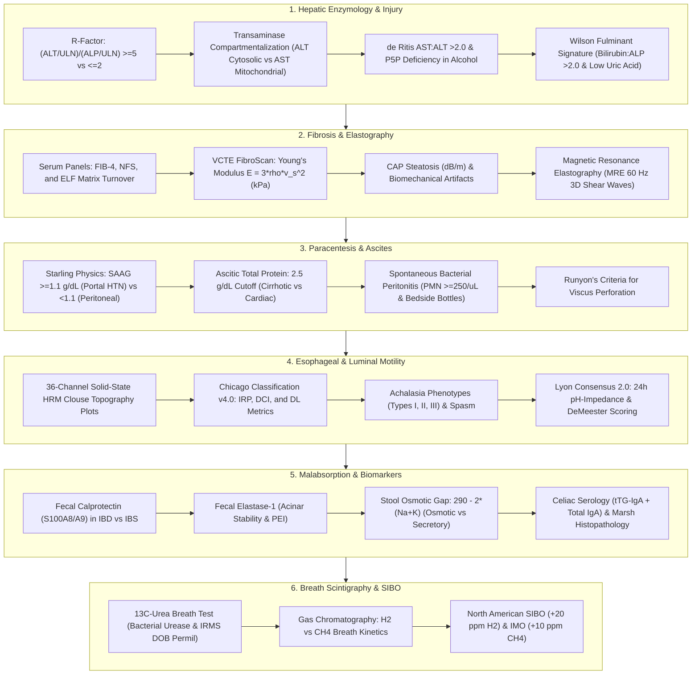
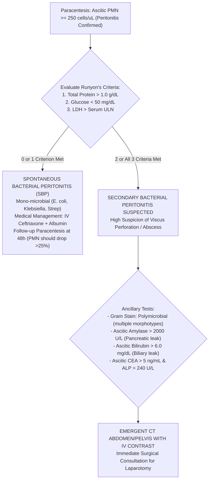
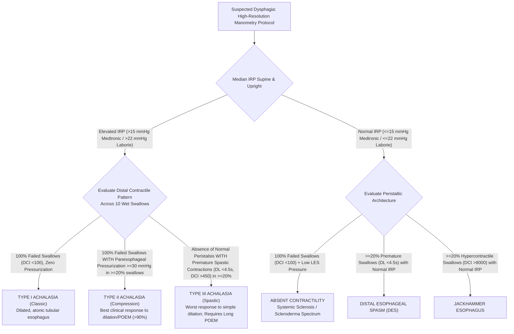
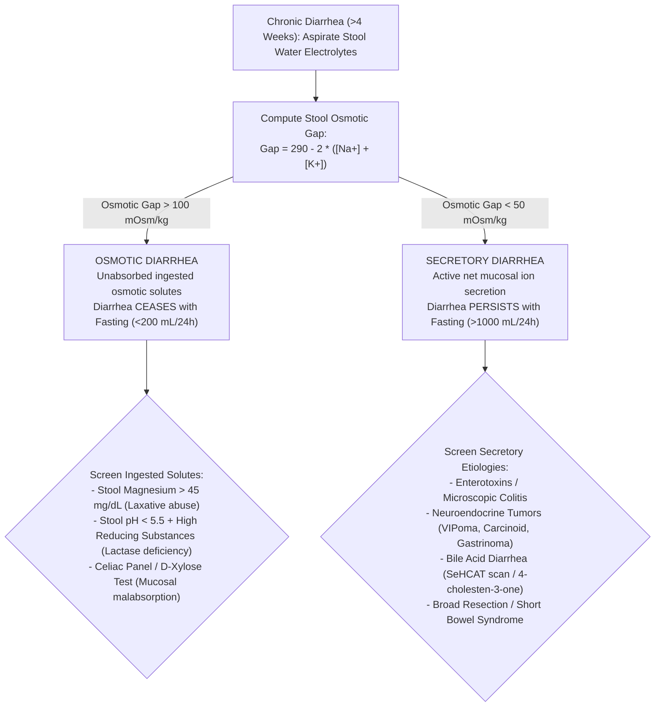
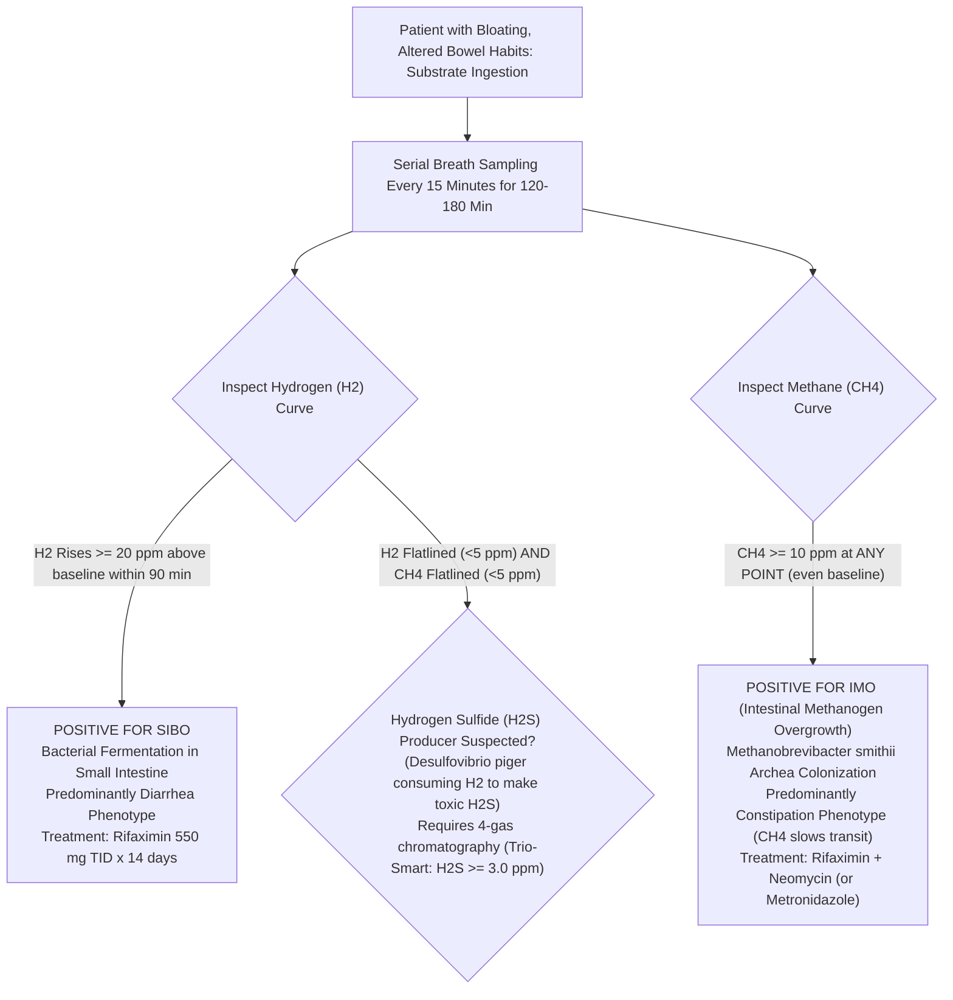

# Bundle 10 — Ep 810: Gastroenterology, Hepatology, Paracentesis SAAG, Chicago Manometry & Breath Physics (All-In-One)

## ZERO-MIXUP SINGLE-SOURCE BUNDLE FOR GOOGLE NOTEBOOKLM

**How to use in NotebookLM (`notebook.google.com`):**

1. Check **ONLY THIS ONE DOCUMENT** in your NotebookLM Sources sidebar (uncheck all others — every reference treatise and script needed for this episode is merged right inside this single file!).
2. Click **Customize** on **Audio Overview**, choose **Longer**, and paste this exact prompt:

```text
Comprehensive masterclass on gastroenterology, hepatology, and nutrition testing: the R-factor equation [(ALT/ULN)/(ALP/ULN)] classifying hepatocellular vs cholestatic injury, De Ritis AST/ALT ratio and P5P deficiency, the acute Wilson disease crisis with Bilirubin/ALP > 2 and Coombs-negative hemolysis, FibroScan shear wave kPa elastography, paracentesis SAAG >= 1.1 portal hypertension, 13C-urea and H2/CH4 breath testing, celiac total IgA/tTG cascade, fecal calprotectin and elastase, stool osmotic gap, and Chicago Classification v4.0 high-resolution manometry.
```

---


---

## INCLUDED SOURCE: `VOLUME_XVI_GASTROENTEROLOGY_HEPATOLOGY_AND_NUTRITION_DIAGNOSTICS.md`

# Basic Medical — Behind the Curtain Clinical Diagnostics Notebook
## Volume XVI: Gastroenterology, Hepatology, and Nutrition Diagnostics — Hepatic Enzymology, FibroScan Elastography, Paracentesis Bio-Gradients, Luminal Manometry, and Enteric Breath Physics

> *"The hepatobiliary tree and gastrointestinal tract represent the body's primary biochemical refinery, immunological frontier, and largest metabolic interface. Diagnostic mastery in this domain demands looking beyond crude organ panel labels: deciphering the R-factor enzymatic divergence at the hepatocyte canalicular membrane, tracking 50-Hertz shear waves propagating through fibrotic collagen crosslinks, computing Starling oncotic gradients across fenestrated hepatic sinusoids, resolving isobaric micro-transducer esophageal pressure topographies, and measuring isotopic carbon-13 mass ratios and parts-per-million bacterial hydrogen gas exhaled from the human breath."*

---

### Master Architectural Overview: The Gastroenterology & Hepatology Diagnostic Continuum



---

## Dossier 16.1: Liver Function & Injury Classification: The R-Factor, Transaminase Kinetics, and Isoenzyme Biochemistry

### 16.1.1 The R-Factor Formula: Mathematical Stratification of Liver Injury

The antiquated terminology "Liver Function Tests" (LFTs) is a misnomer; serum transaminases and alkaline phosphatase do not measure true hepatic functional synthetic capacity (which is reflected solely by **Serum Albumin** and **Prothrombin Time / INR**); they are cellular release markers of membrane disruption and canalicular injury.

To eliminate diagnostic ambiguity between hepatocellular necrosis and biliary cholestasis, the Council for International Organizations of Medical Sciences (CIOMS) established the **R-Factor (Ratio of Enzyme Elevation)**:

$$R = \frac{\text{ALT} / \text{ULN}_{\text{ALT}}}{\text{ALP} / \text{ULN}_{\text{ALP}}}$$

Where $\text{ALT}$ and $\text{ALP}$ represent the patient's measured serum concentrations, and $\text{ULN}$ represents the laboratory-specific, upper reference limit of normal derived from healthy reference populations.

```
       The R-Factor Injury Spectrum:
       
       Cholestatic Pattern              Mixed Injury                 Hepatocellular Pattern
       (R <= 2.0)                       (2.0 < R < 5.0)              (R >= 5.0)
       -----------------------------------------------------------------------------------------
       Choledocholithiasis              Drug-Induced (Augmentin)     Acute Viral Hepatitis (A, B, E)
       Malignant Biliary Obstruction    Early Cholestatic Hepatitis  Acetaminophen Toxicity
       Primary Biliary Cholangitis      Infiltrative Granulomas      Ischemic Hepatitis (Shock Liver)
       Primary Sclerosing Cholangitis   Sepsis Cholestasis           Autoimmune Hepatitis
```

#### Diagnostic Stratification Tiers:
1. **$R \ge 5.0$ (Hepatocellular Pattern)**: Indicates primary cytolytic injury to the hepatocyte plasma membrane, causing massive leakage of cytosolic contents.
2. **$R \le 2.0$ (Cholestatic Pattern)**: Indicates bile secretory impairment, canalicular membrane disruption, or extrahepatic mechanical duct obstruction provoking de novo synthesis and cleavage of alkaline phosphatase.
3. **$2.0 < R < 5.0$ (Mixed Pattern)**: Indicates simultaneous cytolytic and canalicular injury, characteristically observed in idiosyncratic Drug-Induced Liver Injury (DILI—e.g., amoxicillin-clavulanate, phenytoin), atypical viral hepatitis, or acute choledocholithiasis with secondary ascending bacterial cholangitis.

---

### 16.1.2 Transaminase Kinetics: Intracellular Localization & The de Ritis Ratio

```
Hepatocyte Ultrastructure & Transaminase Compartmentalization:
+--------------------------------------------------------------------+
| Hepatocyte Cytosol                                                 |
|   [Alanine Aminotransferase - ALT] (100% Cytosolic)                 |
|   Half-Life: ~47 +/- 10 hours                                      |
|                                                                    |
|   [Cytosolic AST - cAST] (20% of total AST activity)               |
|   Half-Life: ~17 hours                                             |
|                                                                    |
|   +------------------------------------------------------------+   |
|   | Mitochondrion                                              |   |
|   |   [Mitochondrial AST - mAST] (80% of total AST activity)   |   |
|   |   Half-Life: ~87 hours                                     |   |
|   +------------------------------------------------------------+   |
+--------------------------------------------------------------------+
```

#### 1. Molecular Compartmentalization & Enzyme Clearance
* **Alanine Aminotransferase (ALT)**: Exclusively localized within the hepatocyte cytosol. Catalyzes the reversible transamination: $\text{L-Alanine} + \alpha\text{-Ketoglutarate} \rightleftharpoons \text{Pyruvate} + \text{L-Glutamate}$. Because non-hepatic tissues (skeletal muscle, kidney, heart) express minimal ALT, serum ALT is an extraordinarily liver-specific biomarker. Serum clearance half-life: **$47 \pm 10\text{ hours}$**.
* **Aspartate Aminotransferase (AST)**: Catalyzes: $\text{L-Aspartate} + \alpha\text{-Ketoglutarate} \rightleftharpoons \text{Oxaloacetate} + \text{L-Glutamate}$. Present in high concentrations across liver, cardiac muscle, skeletal muscle, kidneys, brain, and erythrocytes. Within hepatocytes, AST exists as two distinct, genetically non-homologous isoenzymes:
  * **Cytosolic AST (cAST)**: Accounts for only **$20\%$** of total intracellular activity; clearance half-life is rapid (**$\approx 17\text{ hours}$**).
  * **Mitochondrial AST (mAST)**: Accounts for **$80\%$** of total intracellular activity; bound within the inner mitochondrial matrix; clearance half-life is prolonged (**$\approx 87\text{ hours}$** via sinusoidal endothelial scavenger receptors).

#### 2. The AST:ALT (de Ritis) Ratio: The Alcohol and Pyridoxal-5'-Phosphate Paradox
In 1957, Fernando de Ritis demonstrated that in most acute liver injuries (acute viral hepatitis, MASLD, toxic ingestions), serum $ALT > AST$, yielding a **de Ritis Ratio ($AST:ALT < 1.0$)**.

In **Alcoholic Hepatitis**, however, the ratio dramatically flips to **$AST:ALT > 2.0$** (and frequently $>3.0$), while absolute transaminase levels rarely exceed **$300\text{ to }500\text{ U/L}$**! This biochemical signature is driven by three distinct mechanisms:
1. **Pyridoxal-5'-Phosphate (P5P / Vitamin B6) Deficiency**: Chronic ethanol metabolism consumes and depletes hepatic reserves of P5P, the essential prosthetic cofactor for both AST and ALT. Crucially, apo-ALT synthesis and stability are severely dependent on P5P; without it, hepatocyte ALT synthesis drops by $>80\%$. Apo-AST is far more resilient to cofactor depletion, remaining synthetically active.
2. **Selective Mitochondrial Injury**: Acetaldehyde and reactive oxygen species directly disrupt the mitochondrial membrane, causing selective extrusion of **mitochondrial AST (mAST)** into the circulation.
3. **Alcoholic Suppression of ALT Transcription**: Ethanol directly downregulates ALT mRNA expression.

*The Cirrhosis Flip*: In chronic hepatitis C or MASLD, when chronic inflammation progresses to established cirrhosis, sinusoidal endothelial clearance of AST declines and hepatic fibrous replacement reduces cytosolic ALT mass; the baseline $AST:ALT$ ratio characteristically **flips from $<1.0$ to $>1.0$**, serving as a sensitive clinical flag for bridging fibrosis/cirrhosis.

```
Transaminase Velocity and Peak Magnitudes in Acute Liver Failure:
===================================================================================================
Etiology                     Peak AST & ALT (U/L)    Dominant Enzyme   LDH:AST Ratio   Kinetics
---------------------------------------------------------------------------------------------------
Ischemic Hepatitis           > 3,000 to > 10,000     AST > ALT         > 1.5 - 2.0     Explosive rise;
(Shock Liver)                                        (Initial Surge)   (High LDH)      Rapid 50% fall/24h
---------------------------------------------------------------------------------------------------
Acetaminophen Toxicity       > 5,000 to > 20,000     ALT >= AST        < 1.0           Rapid rise; Peak 48h;
(APAP NAPQI Necrosis)                                                                  Profound coagulopathy
---------------------------------------------------------------------------------------------------
Acute Viral Hepatitis (A/B)  1,000 to 5,000          ALT > AST         < 1.0           Sluggish rise;
                                                                                       Slow clearance (weeks)
---------------------------------------------------------------------------------------------------
Alcoholic Hepatitis          < 300 to 500            AST:ALT > 2.0     < 1.0           Plateau; P5P deficiency
===================================================================================================
```

---

### 16.1.3 The Fulminant Wilson's Disease Paradigm: The Bilirubin:ALP Ratio Trap

Fulminant Wilson's Disease (ATP7B mutation presenting with acute liver failure in an adolescent or young adult) presents a life-threatening diagnostic trap: automated laboratory analyzers report marked hyperbilirubinemia, but **Alkaline Phosphatase (ALP) is paradoxically normal or profoundly suppressed ($<40\text{ U/L}$)**!

```
Fulminant Wilson's Disease Diagnostic Triad:
1. Serum Bilirubin:ALP Ratio > 2.0 (or ALP:Total Bilirubin Ratio < 2.0)
2. AST:ALT Ratio > 4.0 (Marked AST predominance)
3. Coombs-Negative Intravascular Hemolytic Anemia with Severe Hypouricemia (<1.5 mg/dL)
```

#### The Pathophysiological Triad:
1. **Copper-Mediated ALP Inhibition**: Catastrophic hepatic necrosis releases kilograms of stored elemental copper into the portal and systemic circulation. Free cupric ions ($\text{Cu}^{2+}$) competitively displace zinc ($\text{Zn}^{2+}$) from the active catalytic core of alkaline phosphatase and induce cross-linking denaturation, inactivating the enzyme. Serum ALP drops into the subnormal range ($<20\text{–}40\text{ U/L}$)!
2. **Coombs-Negative Intravascular Hemolysis**: Massive circulating free copper oxidizes erythrocyte membrane sulfhydryl groups, inhibits glucose-6-phosphate dehydrogenase, and depletes glutathione. Red cells undergo acute Heinz-body intravascular lysis. Serum total bilirubin skyrockets ($>20\text{–}40\text{ mg/dL}$), dominated by indirect (unconjugated) bilirubin from hemolysis alongside direct bilirubin from hepatic collapse.
   * **The Ratio Rule**:
     $$\frac{\text{Total Bilirubin (mg/dL)}}{\text{Alkaline Phosphatase (U/L)}} \times 100 > \mathbf{2.0}$$
     *(A Bilirubin:ALP ratio $>2.0$ has $100\%$ specificity and $96\%$ sensitivity for fulminant Wilsonian liver failure versus other etiologies of acute liver failure!)*
3. **Proximal Renal Tubular Fanconi Syndrome**: Toxic copper accumulation in renal tubular epithelial cells disrupts sodium-coupled solute cotransporters, producing profound **hypouricemia (serum uric acid $<1.0\text{ to }1.5\text{ mg/dL}$)** due to massive uricosuria, alongside renal glucosuria and aminoaciduria.

---

### 16.1.4 Alkaline Phosphatase Isoenzymes: Heat Stability Fractionation & GGT/5'-Nucleotidase

Alkaline Phosphatase (ALP) is a family of zinc metalloenzymes that hydrolyze monophosphate esters at an alkaline pH optimum ($pH\ 9.8\text{–}10.5$). Elevated total ALP poses an immediate clinical question: does the enzyme originate from **hepatobiliary canaliculi** or **osteoblastic bone remodeling**?

#### 1. Heat Stability Fractionation ("Bone Burns, Liver Lasts")
Before modern automated electrophoresis, clinical laboratories exploited the distinct thermal denaturation kinetics of ALP isoenzymes by heating patient serum to **$56.0^\circ\text{C}$ for exactly $10\text{ minutes}$**:

$$\% \text{ Residual ALP Activity} = \frac{\text{ALP Activity after } 56^\circ\text{C Heating}}{\text{Baseline Unheated ALP Activity}} \times 100\%$$

```
Heat Fractionation Profile (56°C for 10 minutes):
---------------------------------------------------------------------------------------------------
Isoenzyme Source         Heat Stability Characteristic        % Residual Activity Remaining
---------------------------------------------------------------------------------------------------
Bone Isoenzyme           Heat-Labile ("Bone Burns")           < 20% Residual Activity Remaining
Liver Isoenzyme          Heat-Stable ("Liver Lasts")          > 35% to 50% Residual Activity
Placental (Regan)        Extremely Heat-Stable                Survives 65°C for 30 min (100% active)
Intestinal Isoenzyme     Intermediate Stability               ~30% (Inhibited by L-phenylalanine)
---------------------------------------------------------------------------------------------------
```

#### 2. Confirmatory Secondary Enzymes: GGT and 5'-Nucleotidase
* **Gamma-Glutamyl Transferase (GGT)**: Catalyzes the transfer of glutamyl groups from glutathione to amino acids. GGT is anchored to biliary canalicular epithelial membranes and microsomes. 
  * *Diagnostic Specificity*: GGT is **completely absent from bone tissue**! An elevated total ALP accompanied by an elevated GGT confirms a hepatobiliary origin. If ALP is $450\text{ U/L}$ but GGT is completely normal ($18\text{ U/L}$), a bone pathology (Paget's disease, osteoblastic bone metastases, healing fractures, osteomalacia, or adolescent growth spurts) is definitively established.
  * *The Induction Pitfall*: GGT is inducible by xenobiotics; chronic alcohol intake, phenytoin, carbamazepine, and barbiturates induce hepatic microsomal GGT expression, elevating GGT in the absence of cholestasis.
* **5'-Nucleotidase ($5'\text{-NT}$)**: Hydrolyzes nucleotide-5'-phosphates into nucleosides. Like GGT, $5'\text{-NT}$ is elevated in cholestatic hepatobiliary disease and unaffected by bone disease, but unlike GGT, it is **not induced by drugs or alcohol**, serving as the most specific biochemical referee for isolated ALP elevations.

---

### 16.1.5 Automated Chemistry Analyzer Enzymology, Spectrophotometry & Hemolysis Interference

Behind the computerized clinical laboratory report lies a series of high-speed, temperature-controlled ($37.0^\circ\text{C} \pm 0.1^\circ\text{C}$) spectrophotometric and photometric assays executing inside quartz or acrylic optical cuvettes on automated platforms (Roche cobas 8000, Abbott Alinity c, Beckman Coulter AU5800, Siemens Atellica CH).

#### 1. Coupled Enzymatic Reactions: The 340-nm Warburg Optical Test
Transaminases do not absorb visible or ultraviolet light in quantities that permit direct photometric quantification. Automated analyzers therefore couple transaminase catalytic activity to a secondary, nicotinamide adenine dinucleotide (NADH)-dependent dehydrogenase reaction, monitoring the **rate of decrease in optical absorbance at $\lambda = 340\text{ nm}$** as reduced $\text{NADH}$ is oxidized to $\text{NAD}^+$ (the classic Warburg optical test; molar absorptivity $\epsilon_{340} = 6.22 \times 10^3\text{ L}\cdot\text{mol}^{-1}\cdot\text{cm}^{-1}$):

```
Coupled Optical Reactions at 340 nm:
1. Alanine Aminotransferase (ALT):
   L-Alanine + 2-Oxoglutarate <============ (ALT) ============> Pyruvate + L-Glutamate
   Pyruvate + NADH + H+ <============= (Lactate Dehydrogenase, LDH) =============> L-Lactate + NAD+  [Measured at 340 nm]

2. Aspartate Aminotransferase (AST):
   L-Aspartate + 2-Oxoglutarate <============ (AST) ============> Oxaloacetate + L-Glutamate
   Oxaloacetate + NADH + H+ <======= (Malate Dehydrogenase, MDH) =======> L-Malate + NAD+  [Measured at 340 nm]
```

* **The IFCC Pyridoxal-5'-Phosphate (P5P) Supplementation Standard**:
  * The International Federation of Clinical Chemistry and Laboratory Medicine (IFCC) primary reference procedures mandate the addition of exogenous **Pyridoxal-5'-Phosphate ($P5P$, $0.10\text{ mmol/L}$)** directly into the reagent formulation to ensure full reconstitution of endogenous apo-transaminases into catalytically active holo-transaminases.
  * *Behind-the-Curtain Reagent Trap*: To cut costs, many commercial hospital laboratories purchase transaminase reagents that omit exogenous P5P! In patients with malnutrition, alcoholic liver disease, or chronic hemodialysis (who are severely deficient in circulating Vitamin B6), non-P5P supplemented assays **underestimate true serum ALT and AST by $30\%\text{ to }50\%$**, masking drug-induced hepatotoxicity!

#### 2. Bilirubin Spectrophotometry: Jendrassik-Grof vs. Malloy-Evelyn Diazo Chemistry
Serum bilirubin measurement dates to Paul Ehrlich (1883) and Hijmans van den Bergh (1916), who discovered that bilirubin couples with diazotized sulfanilic acid in an acid medium to produce a vibrant purple-red pigment: **Azobilirubin**.
* **The "Direct" vs. "Indirect" Reaction**:
  * **Direct Bilirubin (Conjugated)**: Bilirubin glucuronides (mono- and diglucuronides) are water-soluble and possess an open, unhindered conformation. When diazotized sulfanilic acid is injected, conjugated bilirubin reacts **directly and immediately within 1 to 2 minutes** without requiring an organic solvent accelerator.
  * **Indirect Bilirubin (Unconjugated)**: Hydrophobic, unconjugated bilirubin is tightly folded by internal hydrogen bonding and bound within the hydrophobic pockets of serum albumin. It will not react with aqueous diazo reagent! To measure **Total Bilirubin**, the analyzer must add an organic solubilizing / displacing "accelerator".
* **The Modern Jendrassik-Grof Reaction**:
  * Uses **Caffeine-Sodium Benzoate** as the accelerator to strip unconjugated bilirubin from albumin, followed by diazotized sulfanilic acid. 
  * After coupling, concentrated **alkaline potassium sodium tartrate (Fehling's solution B)** is added. This shifts the reaction from acidic to strongly alkaline ($pH \sim 13$), transforming the red-purple acid azobilirubin into an intense **blue-green azobilirubin chromophore**.
  * *Optical Advantage*: Blue-green azobilirubin absorbs light at **$\lambda = 600\text{ nm}$**. Shifting the reading wavelength from $540\text{ nm}$ to $600\text{ nm}$ completely eliminates spectral interference from free hemoglobin and turbidity!
  * **Indirect Bilirubin Calculation**: Automated analyzers do not directly measure unconjugated bilirubin; they calculate it mathematically:
    $$\text{Indirect Bilirubin} = \text{Total Bilirubin} - \text{Direct Bilirubin}$$
* **Delta-Bilirubin (Biliprotein) — The Persistent Jaundice Mystery**:
  * In prolonged, severe cholestasis, conjugated bilirubin glucuronide undergoes non-enzymatic acyl-migration, forming a covalent amide linkage between its propionic acid carboxyl groups and the $\epsilon$-amino groups of lysine residues on **Serum Albumin**. This covalent complex is termed **Delta-Bilirubin ($\delta$-bilirubin / Biliprotein)**.
  * *The Kinetic Trap*: Free bilirubin glucuronide is rapidly excreted into urine ($T_{1/2} \approx 2\text{–}4\text{ hours}$). However, delta-bilirubin cannot cross the glomerular filtration barrier; its circulating clearance half-life is identical to that of albumin: **$14\text{ to }21\text{ days}$**!
  * *Clinical Manifestation*: When acute biliary obstruction is successfully relieved or acute hepatitis resolves, the patient's urine returns to normal color and transaminases normalize, yet the patient remains deeply jaundiced with elevated total and direct bilirubin for weeks! This is **not ongoing liver injury**; it is the slow, benign degradation of covalent delta-bilirubin.

#### 3. Specimen Collection Tubes, Centrifugation, and Pre-Analytical Rejections

```
Vacutainer Specifications for Hepatic Panels:
----------------------------------------------------------------------------------------------------
Tube Cap Color           Additive Stoichiometry               Optimal Processing & Centrifugation
----------------------------------------------------------------------------------------------------
Gold SST (Serum)         Micronized Silica Clot Activator +   Allow 30 min full clot at 20-25°C.
                         Thixotropic Polymer Gel (1.04 g/cm3) Centrifuge: 2000 x g for 10 min at 20°C.
----------------------------------------------------------------------------------------------------
Mint Green PST (Plasma)  Lithium Heparin (16 USP units/mL) +  Invert 8-10 times immediately.
                         PST Gel Separator                    Centrifuge immediately: 2000 x g for 10 min.
                                                              *Preferred in Emergency Department for stat turn-around!*
----------------------------------------------------------------------------------------------------
```

* **The Hemolysis Index (H-Index) Catastrophe**:
  * Human erythrocytes contain approximately **$40\text{ times}$ more AST than serum** (and $15\times$ more LDH), but relatively negligible ALT.
  * Even mild in vitro venipuncture hemolysis (lysis of just $0.5\%$ of erythrocytes, releasing free hemoglobin to $50\text{–}100\text{ mg/dL}$, visible as slight pink tinging in serum) spills massive amounts of intracellular AST into the tube.
  * *The Trap*: A patient with completely normal baseline enzymes ($AST = 20\text{ U/L}, ALT = 22\text{ U/L}$) whose tube undergoes shear hemolysis will show **$AST = 58\text{ U/L}$ and $ALT = 23\text{ U/L}$**—generating an artificial **$AST:ALT \text{ ratio of } 2.5$**! Unsuspecting clinicians routinely misdiagnose this as acute alcoholic liver disease. Automated analyzers must inspect the bichromatic optical absorbance at $570/600\text{ nm}$ and automatically suppress or flag AST when the Hemolysis Index exceeds **$H > 50\text{ mg/dL}$**.
* **Photolytic Degradation of Bilirubin**:
  * Bilirubin is extraordinarily photolabile: exposure of an uncovered blood collection tube to ambient hospital fluorescent light or direct window sunlight causes rapid photochemical isomerization into water-soluble photoisomers (lumirubin) and oxidation into biliverdin.
  * Serum bilirubin degrades at a rate of **$10\%\text{ to }30\%\text{ per hour}$** under ambient light! If delayed transport is unavoidable, tubes must be drawn into amber-tinted Vacutainers or wrapped entirely in opaque aluminum foil.

---

## Dossier 16.2: Advanced Liver Fibrosis Assessment: Noninvasive Biomarkers, FibroScan Elastography, and MRE

### 16.2.1 Noninvasive Serum Fibrosis Scores: Mathematical Formulations & Cutoffs

Liver biopsy carries risks of bleeding ($0.5\%$), organ perforation, and significant sampling error ($1/50,000\text{th}$ of total liver volume). Noninvasive algorithms combine standard laboratory variables to rule in or rule out advanced bridging fibrosis ($F3$) and cirrhosis ($F4$).

```
       Noninvasive Serum Biomarker Cascade:
       [Standard Laboratory CBC & LFTs] ---> Compute FIB-4 Index
                                                    |
             +--------------------------------------+--------------------------------------+
             |                                      |                                      |
             v                                      v                                      v
     FIB-4 < 1.30 (Age <65)                FIB-4: 1.30 - 2.67                     FIB-4 > 2.67
     FIB-4 < 2.00 (Age >=65)               Indeterminate Gray Zone                High PPV for Advanced
     Rule-Out Advanced Fibrosis            Mandatory Secondary Testing            Fibrosis (F3/F4)
     NPV > 90-95%                          (FibroScan VCTE / MRE)                 Hepatology Referral
```

#### 1. The FIB-4 Index (Sterling et al., 2006)
Originally developed for HIV/HCV co-infection and now the primary guideline-endorsed screening tool for Metabolic Dysfunction-Associated Steatotic Liver Disease (MASLD / NAFLD):

$$\text{FIB-4} = \frac{\text{Age (years)} \times \text{AST (U/L)}}{\text{Platelet Count } (10^9/\text{L}) \times \sqrt{\text{ALT (U/L)}}}$$

* **Low Cutoff ($<1.30$ in age $<65$; $<2.00$ in age $\ge 65$)**: Demonstrates a **Negative Predictive Value (NPV) $>90\text{–}95\%$**, safely ruling out advanced fibrosis ($F3\text{–}F4$) in primary care settings without elastography.
* **High Cutoff ($>2.67$)**: Demonstrates a **Positive Predictive Value (PPV) $>80\%$** for advanced fibrosis and cirrhosis, mandating immediate hepatology referral and screening for gastroesophageal varices.
* **Indeterminate Zone ($1.30\text{–}2.67$)**: Approximately $30\%$ of patients fall into this gray zone, requiring secondary noninvasive elastography.

#### 2. The NAFLD Fibrosis Score (NFS)

$$NFS = -1.675 + (0.037 \times \text{Age}) + (0.094 \times \text{BMI}) + (1.13 \times \text{IFG/Diabetes}) + \left(0.99 \times \frac{\text{AST}}{\text{ALT}}\right) - (0.013 \times \text{Platelets}) - (0.66 \times \text{Albumin})$$

*(Units: Age in years; BMI in $\text{kg/m}^2$; Impaired Fasting Glucose/Diabetes $= 1$ if present, $0$ if absent; AST/ALT ratio; Platelets in $10^9/\text{L}$; Albumin in $\text{g/dL}$)*.
* **Low Cutoff ($<-1.455$)**: Excludes advanced fibrosis ($NPV \approx 93\%$).
* **High Cutoff ($>0.676$)**: Predicts advanced fibrosis ($PPV \approx 90\%$).

#### 3. The Enhanced Liver Fibrosis (ELF) Score
A direct serological panel quantifying extracellular matrix turnover:
1. **Hyaluronic Acid (HA)**: Glycosaminoglycan synthesized by hepatic stellate cells.
2. **Procollagen III Amino-Terminal Propeptide (PIIINP)**: Cleaved during active type III collagen fibrillogenesis.
3. **Tissue Inhibitor of Metalloproteinases-1 (TIMP-1)**: Inhibits matrix metalloproteinase collagen breakdown, locking in scar.

$$\text{ELF Score} = 2.278 + 0.851 \ln(C_{\text{HA}}) + 0.185 \ln(C_{\text{PIIINP}}) + 0.097 \ln(C_{\text{TIMP-1}})$$

* $\text{ELF} < 7.7$: Mild or no fibrosis ($F0\text{–}F1$).
* $\text{ELF} \ge 9.8$: Advanced bridging fibrosis ($F3$) or cirrhosis ($F4$).

---

### 16.2.2 Vibration-Controlled Transient Elastography (FibroScan): Biomechanics & CAP Scoring

Vibration-Controlled Transient Elastography (VCTE / FibroScan) evaluates hepatic viscoelasticity by propagating a low-frequency shear wave through tissue and tracking its velocity with ultrasound.

```
       FibroScan VCTE Biomechanical Chain:
       [Mechanical Piston Impact] ---> Emits 50 Hz Shear Wave through Intercostal Space
                                              |
                                              v
       [3.5 MHz Ultrasound Transducer] --> Tracks Shear Wave Speed v_s (m/s) in Real Time
                                              |
                                              v
       Young's Modulus Elasticity Math:    E = 3 * rho * (v_s)^2  [Kilopascals, kPa]
```

#### 1. Biomechanical Wave Physics: Young's Modulus
A mechanical piston delivers a transient, low-frequency mechanical vibration (**$50\text{ Hz}$**) to the skin surface in the right 9th-to-11th intercostal space. This creates an elastic shear wave that propagates perpendicularly into the liver parenchyma. A co-axial high-frequency ultrasound transducer (**$3.5\text{ MHz}$ standard M-probe; $2.5\text{ MHz}$ XL-probe**) fires pulse-echo ultrasound lines at $6\text{ kHz}$ to track the displacement of tissue and compute the **Shear Wave Propagation Velocity ($v_s$)** in meters per second.

In an isotropic, homogeneous, incompressible elastic medium, **Young's Modulus ($E$)** is related to the shear modulus ($G$) and shear wave speed ($v_s$) by:

$$E = 3G = 3 \rho v_s^2$$

Where $\rho$ is tissue density ($\approx 1000\text{ kg/m}^3 = 1.0\text{ g/cm}^3$ for soft biological tissue). 
* In healthy liver tissue without cross-linked fibrillar collagen, the shear wave travels slowly ($v_s \approx 1.0\text{ m/s}$), computing an elasticity $E = 3(1000)(1.0)^2 = 3.0\text{ kPa}$.
* In dense, cirrhotic nodular tissue, the rigid collagen matrix accelerates the shear wave ($v_s \ge 2.2\text{ m/s}$), causing Young's modulus to surge: $E = 3(1000)(2.2)^2 \ge \mathbf{14.5\text{ kPa}}$!

```
FibroScan Liver Stiffness Measurement (LSM) Staging (kPa):
========================================================================================
METAVIR Stage     Fibrosis Degree             LSM Median Range (kPa)   Clinical State
----------------------------------------------------------------------------------------
F0 - F1           No Fibrosis / Mild Portal   < 7.0 kPa                Healthy / Reversible
F2                Significant Fibrosis        7.0 - 8.5 kPa            Moderate Architecture Loss
F3                Advanced Bridging Fibrosis  8.5 - 12.5 kPa           Pre-Cirrhotic Scarring
F4                Cirrhosis                   >= 12.5 - 14.0 kPa       Compensated Cirrhosis
CSPH              Clinically Significant      >= 20.0 - 25.0 kPa       Varices, Decompensation
                  Portal Hypertension                                  Risk Surge (>5%/year)
```

#### 2. Strict Technical Quality Rejection Criteria
A FibroScan examination is diagnostically uninterpretable and must be rejected unless it fulfills three criteria:
1. **Valid Acquisitions**: A minimum of **$\ge 10$ valid shots** acquired.
2. **Success Rate**: The ratio of valid acquisitions to total attempted shots must be **$\ge 60\%$**.
3. **Interquartile Range to Median Ratio ($IQR/M$)**: The coefficient of dispersion across valid shots must be:
   $$\frac{IQR}{\text{Median LSM}} \le \mathbf{30\%}$$
   *(If the median stiffness is $<7.0\text{ kPa}$, an $IQR/M \le 40\%$ is clinically acceptable).*

#### 3. Controlled Attenuation Parameter (CAP): Quantifying Hepatic Steatosis
Controlled Attenuation Parameter measures the rate of energy loss (ultrasound attenuation) of the $3.5\text{ MHz}$ ultrasound beam as it passes through intrahepatic lipid droplets, expressed in decibels per meter (**$\text{dB/m}$**):

$$\text{Intensity}(z) = I_0 \cdot 10^{-\frac{\alpha \cdot z}{10}}$$

Where $\alpha$ is the attenuation coefficient in $\text{dB/m}$ and $z$ is depth ($25\text{–}65\text{ mm}$):
* **$S0$ (Normal / No Steatosis, $<11\%$ hepatocytes affected)**: $<238\text{ dB/m}$
* **$S1$ (Mild Steatosis, $11\text{–}33\%$)**: $238\text{–}260\text{ dB/m}$
* **$S2$ (Moderate Steatosis, $34\text{–}66\%$)**: $260\text{–}290\text{ dB/m}$
* **$S3$ (Severe Steatosis, $>66\%$)**: $\ge 290\text{ dB/m}$

#### 4. Behind-the-Curtain Biomechanical False-Positive Traps
Young's Modulus measures tissue *stiffness*, not collagen molecules. Five clinical conditions increase liver stiffness independently of histological fibrosis:
1. **Acute Severe Hepatitis**: Massive intracellular ballooning edema and inflammatory cell influx stretch Glisson's capsule. An acute flare with $ALT > 5\times ULN$ can inflate an $F1$ liver ($5.5\text{ kPa}$) to read a bogus **$24.0\text{ kPa}$ (false cirrhosis)**! *Never perform elastography during an acute hepatitis flare; defer until transaminases normalize.*
2. **Right Ventricular Congestive Heart Failure**: Backward hydrostatic pressure engorges the hepatic sinusoids, mechanically stiffening the parenchyma. Severe tricuspid regurgitation can elevate LSM to $>35\text{ kPa}$ in the absence of fibrosis.
3. **Extrahepatic Biliary Obstruction**: Acute choledocholithiasis increases intrabiliary hydrostatic pressure, spuriously inflating stiffness.
4. **Recent Food Ingestion**: Postprandial splanchnic hyperemia increases portal blood flow by $50\text{–}100\%$, increasing stiffness by $2\text{ to }5\text{ kPa}$. The patient **must be strictly fasting for at least 3 hours** prior to examination.
5. **Thoracic Obesity (Probe Selection)**: The standard M-probe operates at $25\text{–}65\text{ mm}$ skin-to-capsule depth. If chest wall fat exceeds $25\text{ mm}$, the ultrasound signal attenuates in adipose tissue, failing acquisitions. The operator must switch to the **XL-probe ($2.5\text{ MHz}$, focal depth $35\text{–}75\text{ mm}$)**.

---

### 16.2.3 Magnetic Resonance Elastography (MRE): 3D Acoustic Physics & The Gold Standard

Magnetic Resonance Elastography (MRE) overcomes the spatial limitations of FibroScan by sampling the entire liver volume ($>500\text{ cm}^3$ versus $1\text{ cm}^3$ pencil beam) and remains fully functional in patients with massive obesity or severe ascites (both of which cause technical failure of ultrasound shear waves).

```
       MRE Instrumentation:
       [Active Acoustic Driver outside MRI room] 
              |
              v (Pneumatic tube through RF waveguide)
       [Passive Drum Driver strapped over Right Lower Ribs] 
              |
              v (Continuous 60 Hz shear waves into liver)
       [Phase-Contrast MRI Pulse Sequence with Motion-Encoding Gradients (MEG)]
              |
              v (Inversion Algorithm of Helmholtz Wave Equations)
       [Color-Coded 2D/3D Quantitative Elastogram Map (Stiffness in kPa)]
```

#### Inversion Algorithm & Staging Thresholds
Phase-contrast images acquire wave propagation snapshots. A Helmholtz wave inversion algorithm solves the mechanical wave equation to output quantitative shear stiffness maps ($\mu$):

$$\mu \nabla^2 \vec{u} + \rho \omega^2 \vec{u} = 0$$

Where $\omega = 2\pi f$ ($f = 60\text{ Hz}$).
* **Normal Liver**: $<2.5\text{ kPa}$
* **$F2$ (Significant Fibrosis)**: $\ge 2.9\text{ kPa}$
* **$F3$ (Advanced Fibrosis)**: $\ge 3.6\text{ kPa}$
* **$F4$ (Cirrhosis)**: $\ge 4.7\text{ kPa}$
*MRE holds the highest diagnostic accuracy of any noninvasive modality, with an Area Under the Receiver Operating Characteristic Curve ($AUROC > 0.95$) for advanced fibrosis.*

---

### 16.2.4 Comparative Multi-Modality Elastography Physics: VCTE vs. pSWE vs. 2D-SWE vs. MRE

While FibroScan (VCTE) is the most widely deployed point-of-care tool, modern diagnostic ultrasound carts incorporate ultrasound-based shear wave elastography directly into diagnostic radiology workflows.

#### 1. Acoustic Radiation Force Impulse (ARFI) Physics
Unlike VCTE, which relies on a mechanical piston vibrating the skin surface, ultrasound-based shear wave methods (pSWE and 2D-SWE) generate shear waves internally using **Acoustic Radiation Force Impulse (ARFI)**:
* A diagnostic ultrasound transducer focuses a high-energy acoustic push beam ($1.5\text{ to }3.0\text{ MHz}$, pulse duration $100\text{ to }300\text{ }\mu\text{s}$, acoustic intensity $I_{\text{spta}} \sim 100\text{–}1000\text{ W/cm}^2$) at a designated focal depth ($2\text{ to }8\text{ cm}$) within the right hepatic lobe.
* As the acoustic pulse is attenuated and scattered by tissue microstructures, momentum transfers from the acoustic wave to the parenchyma, producing a localized micron-scale mechanical displacement ($1\text{ to }10\text{ }\mu\text{m}$) along the acoustic axis.
* This microscopic displacement generates transient shear waves that propagate outward laterally through the liver tissue at speeds of $v_s = 1.0\text{ to }4.0\text{ m/s}$. Pulse-echo ultrasound tracking lines detect the time-to-peak displacement, directly calculating shear wave velocity.

```
       ARFI Push-Beam Shear Wave Generation:
       [Ultrasound Transducer Face]
              |
              | (High-Energy Focused Acoustic Push Beam, 100-300 microseconds)
              v
       [Acoustic Focal Spot in Liver] ====> Micron-Scale Parenchymal Displacement (1-10 um)
              |
              +<========================= Lateral Shear Waves (v_s = 1.0 - 4.0 m/s) =========================>+
              |                                                                                                  |
       [Ultra-Fast Plane-Wave Tracking (5,000 frames/sec)] ----------------------------> Color-Coded 2D Box (kPa / m/s)
```

#### 2. Master Multimodality Liver Elastography Comparison Matrix

```
Comprehensive Liver Elastography Modality Matrix:
=============================================================================================================================
Parameter                  VCTE (FibroScan)              pSWE (ARFI Point Shear)       2D-SWE (2D Shear Wave)        MRE (MR Elastography)
=============================================================================================================================
Physical Excitation Source External Mechanical Piston    Internal Focused Ultrasound   Multiple Interleaved Acoustic External Pneumatic Drum
                           (50 Hz Low-Frequency Thump)   Push Beam (ARFI Pulse)        Push Lines (Mach Cone)        Driver (60 Hz Sound Waves)
-----------------------------------------------------------------------------------------------------------------------------
Anatomical B-Mode Guidance Blind (A-mode M-mode lines;   Full Real-Time B-Mode         Full Real-Time B-Mode         Cross-Sectional MRI
                           No structural visualization)  Ultrasound Guidance           Ultrasound Guidance           Anatomy (Full 3D Liver)
-----------------------------------------------------------------------------------------------------------------------------
Sampling Volume            ~ 1.0 cm^3 (Pencil Cylinder;  ~ 0.5 cm^3 (Fixed Small Box;  Large 2D ROI Box              Entire Liver Volume
                           100x larger than biopsy)      Single point measurement)     (~ 10-20 cm^3)                (> 500 cm^3; Whole Organ)
-----------------------------------------------------------------------------------------------------------------------------
Performance in Ascites     COMPLETE FAILURE              FEASIBLE                      FEASIBLE                      EXCELLENT
                           (Shear wave cannot cross      (Ultrasound beam penetrates   (Ultrasound beam penetrates   (Acoustic waves traverse
                           free fluid layer!)            fluid; measures parencyhma)   fluid; measures parenchyma)   fluid without attenuation)
-----------------------------------------------------------------------------------------------------------------------------
Performance in Severe      LIMITED                       MODERATE                      MODERATE                      EXCELLENT
Obesity (BMI > 35 kg/m2)   (Requires XL probe;           (Focal depth selectable;      (Adjustable depth,            (Body habitus does not
                           attenuation in chest wall)    fails if depth >8 cm)         subject to attenuation)       impair magnetic resonance)
-----------------------------------------------------------------------------------------------------------------------------
Reporting Metric Units     kPa (Young's Modulus, E)      m/s (Shear Wave Speed)        kPa (Young's Modulus, E)      kPa (Shear Stiffness, mu)
                                                         or converted to kPa           or m/s (Shear Wave Speed)
-----------------------------------------------------------------------------------------------------------------------------
F2 Significant Fibrosis    7.0 - 8.5 kPa                 1.35 - 1.55 m/s               7.0 - 8.0 kPa                 2.9 - 3.5 kPa
Threshold Range                                          (~ 6.0 - 7.5 kPa)
-----------------------------------------------------------------------------------------------------------------------------
F4 Cirrhosis Cutoff        >= 12.5 - 14.0 kPa            >= 1.80 - 2.00 m/s            >= 11.5 - 13.0 kPa            >= 4.7 kPa
Threshold Range                                          (>= 11.0 - 13.0 kPa)
-----------------------------------------------------------------------------------------------------------------------------
Quality Verification       >= 10 valid acquisitions;     >= 5-10 valid acquisitions;   Visual stability >3 sec;      95% Confidence Map;
Standard                   Success >=60%; IQR/M <=30%    IQR/M <= 30%                  Uniform color fill; IQR/M <=30% Minimal wave interference
=============================================================================================================================
```

---

## Dossier 16.3: Ascites & Paracentesis Analysis: SAAG Physics, Cell-Count Corrections, and Peritonitis Subtypes

### 16.3.1 The Serum-Ascites Albumin Gradient (SAAG): Starling Forces in Portal Hypertension

For over a century, ascitic fluid was categorized using the arbitrary, inaccurate exudate/transudate dichotomy based on Total Protein ($3.0\text{ g/dL}$). In the late 1980s, Bruce Runyon demolished this model, demonstrating that ascitic oncotic balance is governed strictly by the **Starling microvascular fluid equilibrium across the hepatic sinusoids and splanchnic capillary bed**.

$$\text{SAAG (g/dL)} = \text{Serum Albumin (g/dL)} - \text{Ascitic Fluid Albumin (g/dL)}$$

*(Crucial Technical Rule: Serum and ascitic fluid samples must be drawn synchronously within a 60-minute window, and both must be quantified in the laboratory on the exact same clinical chemistry platform to eliminate inter-assay calibration offsets!)*

```
Starling Microvascular Filtration Gradient:
[Hepatic Sinusoid Lumen] <============ (Endothelial Fenestrae) ============> [Perisinusoidal Space of Disse]
Hydrostatic Pressure (P_c)                                                  Hydrostatic Pressure (P_i)
Oncotic Pressure (pi_c)                                                     Oncotic Pressure (pi_i)

Net Transudation Driving Force:  Delta-P = P_c - P_i  <== Balanced by ==>  Delta-pi = pi_c - pi_i
By van 't Hoff's law: Delta-pi is directly proportional to (Serum Albumin - Ascitic Albumin) = SAAG!
```

#### The Biophysical Derivation of the $1.1\text{ g/dL}$ Cutoff
Under Starling's Law of capillary equilibrium:

$$J_v = K_f \left[ (P_c - P_i) - \sigma (\pi_c - \pi_i) \right]$$

In hepatic sinusoids, the capillary reflection coefficient $\sigma \approx 0$ (open fenestrae), but across the peritoneal and splanchnic capillary beds, $\sigma$ approaches $1.0$. As portal hypertension drives sinusoidal hydrostatic pressure $P_c$ to abnormal levels ($>12\text{ mmHg} \approx 16\text{ cmH}_2\text{O}$), Starling equilibrium dictates that to prevent explosive, infinite fluid extravasation, the oncotic pressure gradient $\Delta \pi = (\pi_{\text{serum}} - \pi_{\text{ascites}})$ must expand to generate a counterbalancing osmotic pull.

By van 't Hoff's law of oncotic pressure ($\pi = cRT$), $\Delta \pi$ is linearly proportional to the concentration difference of the primary circulating oncotic macromolecule: **Albumin**.
* A portal venous pressure gradient of **$\ge 12\text{ mmHg}$** requires an albumin difference of **$\ge 1.1\text{ g/dL}$** to achieve microvascular equilibrium!

```
Master SAAG Diagnostic Matrix:
========================================================================================
SAAG Classification         Ascitic Total Protein     Pathological Etiologies
----------------------------------------------------------------------------------------
HIGH SAAG (>= 1.1 g/dL)     LOW (< 2.5 g/dL)          Cirrhosis (Sinusoidal Capillarization)
Portal Hypertension Present                           Alcoholic Hepatitis
(Accuracy > 97%)                                      Late Budd-Chiari Syndrome
                                                      Massive Liver Metastases
----------------------------------------------------------------------------------------
HIGH SAAG (>= 1.1 g/dL)     HIGH (>= 2.5 g/dL)        Cardiac Ascites (Congestive Heart Failure)
Portal Hypertension Present                           Constrictive Pericarditis
                                                      Early Acute Budd-Chiari Syndrome
                                                      Sinusoidal Obstruction Syndrome (VOD)
----------------------------------------------------------------------------------------
LOW SAAG (< 1.1 g/dL)       HIGH (>= 2.5 g/dL)        Peritoneal Carcinomatosis
Portal Hypertension Absent                            Peritoneal Tuberculosis
(Normal Portal Pressure)                              Pancreatic Ascites (Amylase > 1000 U/L)
                                                      Biliary Peritonitis (Ascitic Bili > Serum)
                                                      Connective Tissue Disease (Lupus Serositis)
----------------------------------------------------------------------------------------
LOW SAAG (< 1.1 g/dL)       LOW (< 2.5 g/dL)          Nephrotic Syndrome (Generalized Anasarca)
Portal Hypertension Absent                            Severe Protein-Losing Enteropathy
========================================================================================
```

---

### 16.3.2 Ascitic Total Protein: Separating Cirrhotic from Cardiac Ascites

Why does **Cardiac Ascites** exhibit a high total protein ($\ge 2.5\text{ g/dL}$) while **Cirrhotic Ascites** exhibits low total protein ($<2.5\text{ g/dL}$, and frequently $<1.0\text{ g/dL}$), despite both sharing a high SAAG ($\ge 1.1\text{ g/dL}$)?

```
       Microvascular Architecture Difference:
       
       A. Cirrhotic Liver Architecture:
          Sinusoidal Capillarization (Defenestration) + Sub-endothelial Collagen Basement Membrane
          --> Sinusoid becomes IMPERMEABLE to Large Albumin/Globulin Molecules!
          --> High hydrostatic pressure pushes pure water out; proteins trapped inside sinusoid!
          --> Result: Ascitic Total Protein is LOW (< 2.5 g/dL, often < 1.0 g/dL).
       
       B. Cardiac Congestion Architecture:
          Normal, Open, Healthy Sinusoidal Fenestrae (Endothelium has NO basement membrane!)
          --> Post-sinusoidal back-pressure (Right Heart Failure / IVC Congestion)
          --> High hydrostatic pressure sweeps INTACT, protein-rich plasma straight into space of Disse!
          --> Result: Ascitic Total Protein is HIGH (>= 2.5 to 4.5 g/dL).
```

*The Opsonization Risk*: Cirrhotic patients with an ascitic total protein **$<1.0\text{ to }1.5\text{ g/dL}$** have depleted levels of complement factors ($C3, C4$) and bactericidal opsonic proteins in their peritoneal fluid, conferring a **$>10\text{-fold}$ increased risk of spontaneous bacterial peritonitis (SBP)**, qualifying them for daily oral fluoroquinolone (ciprofloxacin) or trimethoprim-sulfamethoxazole antimicrobial prophylaxis.

---

### 16.3.3 Spontaneous Bacterial Peritonitis (SBP): Absolute Neutrophil Cutoff & Bedside Inoculation

Spontaneous Bacterial Peritonitis is an acute bacterial infection of ascitic fluid occurring in the absence of a surgically treatable intra-abdominal perforation or abscess.

#### 1. The Diagnostic Absolute Neutrophil Count (ANC / PMN)
Diagnosis does not depend on bacterial culture (which takes 48 hours); immediate therapy is triggered by the **Polymorphonuclear Leukocyte (PMN / Neutrophil) Count**:

$$\text{Ascitic Absolute PMN Count} = \text{Total Ascitic WBC Count (cells/}\mu\text{L)} \times \left( \frac{\% \text{ Neutrophils}}{100} \right)$$

* **The Universal Diagnostic Cutoff**: An ascitic **$\text{PMN Count} \ge \mathbf{250\text{ cells/}\mu\text{L}}$ ($0.25 \times 10^9/\text{L}$)** confirms SBP! Immediate empirical broad-spectrum intravenous antibiotic therapy (e.g., Ceftriaxone $2\text{ g}$ IV every 24 hours) plus intravenous albumin ($1.5\text{ g/kg}$ within 6 hours, followed by $1.0\text{ g/kg}$ on day 3 to prevent hepatorenal syndrome) must be initiated without waiting for culture confirmation.
* **The "Bloody Tap" Traumatic Paracentesis Correction Formula**:
  When a paracentesis needle punctures a subcutaneous collateral vein or mesenteric vessel, peripheral blood enters the peritoneal collection:
  * For every **$250\text{ Red Blood Cells (RBCs)}/\mu\text{L}$** present in bloody ascitic fluid, subtract **$1.0\text{ PMN}/\mu\text{L}$** from the measured neutrophil count (reflecting the standard $1:250\text{ to }1:500$ neutrophil-to-erythrocyte ratio in peripheral blood):
    $$\text{Corrected PMN} = \text{Measured PMN} - \left( \frac{\text{Ascitic RBCs}}{250} \right)$$
    *(If the patient has a severe leukocytosis with peripheral WBC $>30,000/\mu\text{L}$, use the exact patient-specific ratio: $\text{Corrected PMN} = \text{Measured PMN} - [\text{Ascitic RBCs} \times (\text{Blood PMN} / \text{Blood RBC})]$).*

#### 2. The Bedside Inoculation Mandate
* **The Behind-the-Curtain Error**: Sending a plastic syringe or sterile conical cup of ascitic fluid down the pneumatic tube to the central microbiology lab for routine agar plating produces a positive bacterial culture rate of only **$40\text{ to }50\%$** (due to bacterial death in transit and low bacterial density: $1\text{ CFU/mL}$).
* **The Standard of Care**: The technician or clinician must **inoculate at least $10\text{ mL}$ of ascitic fluid directly into an Aerobic blood culture bottle and $10\text{ mL}$ into an Anaerobic blood culture bottle AT THE BEDSIDE immediately upon aspiration**! Bedside bottle inoculation increases the culture yield to **$>85\text{–}90\%$** and flags bacterial proliferation hours earlier on automated continuous-monitoring incubator systems.

---

### 16.3.4 Runyon's Criteria: Differentiating SBP from Secondary Bacterial Peritonitis

Treating a surgical perforation of the bowel with medical antibiotics alone is fatal ($>90\%$ mortality). Conversely, subjecting an advanced cirrhotic with uncomplicated SBP to an exploratory laparotomy carries a $>80\%$ operative mortality. 

Bruce Runyon established rigorous laboratory criteria on the initial paracentesis to distinguish spontaneous mono-microbial SBP from **Secondary Bacterial Peritonitis** caused by an acute hollow viscus perforation or loculated abscess.

```
Runyon's Secondary Peritonitis Triad (At least 2 of 3 must be met):
1. Ascitic Total Protein > 1.0 g/dL
2. Ascitic Glucose < 50 mg/dL (2.8 mmol/L)
3. Ascitic LDH > Serum Upper Limit of Normal (or > 225 U/L)
```



#### The 48-Hour Repeat Paracentesis Rule
In true SBP responding to intravenous ceftriaxone, the ascitic PMN count decreases exponentially: a repeat paracentesis performed at **$48\text{ hours}$ must demonstrate a $>25\%$ reduction in the absolute PMN count** compared to baseline. If the PMN count at 48 hours is elevated or unchanged, secondary peritonitis must be presumed, and emergent cross-sectional imaging performed.

---

### 16.3.5 Master Paracentesis Laboratory Specimen Logistics, Tube Architecture, and Macroscopic Visual Diagnostics

Paracentesis diagnostic accuracy hinges on strict adherence to specimen tube chemistry, anticoagulation stoichiometry, and visual inspection.

#### 1. Bedside Collection Tube Sequence & Order of Inoculation
When ascitic fluid is aspirated through an 18-gauge Caldwell needle or angiocatheter, fluid must be partitioned immediately into specific collection vessels:

```
Paracentesis Collection Protocol & Tube Rejection Criteria:
----------------------------------------------------------------------------------------------------
Tube Type & Stoichiometry         Analyte Panels Ordered              Technical Traps & Rejection Rules
----------------------------------------------------------------------------------------------------
1. Bedside Blood Culture Bottles  Microbiology: Aerobic & Anaerobic   MUST be inoculated FIRST at bedside!
   (Silver & Purple Bactec vials) culture and antibiotic sensitivities Inoculate 8-10 mL per bottle sterilely.
                                                                      *NEVER send un-inoculated fluid cups!*
----------------------------------------------------------------------------------------------------
2. Lavender Top (K2-EDTA)         Cell Count & Automated Differential Clotting Trap: Fibrinogen in infected
   (Spray-dried EDTA 1.8 mg/mL)   + Manual 100-WBC Slide Review       ascites forms micro-clots that entrap PMNs.
                                                                      Un-anticoagulated tubes underestimate PMNs!
----------------------------------------------------------------------------------------------------
3. Plain Red Top / Gold SST       Biochemistry & Gradients:           Centrifuge at 2000 x g for 10 minutes.
   (No anticoagulant or gel)      Albumin, Total Protein, Glucose,    Run simultaneously against matched serum!
                                  LDH, Amylase, Bilirubin, Triglycerides
----------------------------------------------------------------------------------------------------
4. 50-mL Sterile Polypropylene    Cytopathology & Cell Block          Add 1 mL sodium heparin (1,000 U/mL)
   Falcon Tube                    Centrifugation for Malignant Cells  to prevent fibrin network formation.
----------------------------------------------------------------------------------------------------
```

#### 2. Macroscopic Appearance and Physical Diagnostic Clues
Inspection of ascitic fluid clarity and color provides instantaneous bedside diagnostic guidance before automated numbers return:

```
Macroscopic Color Spectrum of Ascitic Fluid:
===================================================================================================
Visual Appearance            Probable Etiology               Underlying Biochemical & Cellular Biomarker
===================================================================================================
Clear / Pale Straw Yellow    Uncomplicated Cirrhosis         Normal PMN (<250/uL); Low protein (<2.5 g/dL);
                             or Nephrotic Syndrome           Absence of inflammatory cells
---------------------------------------------------------------------------------------------------
Turbid / Cloudy / Purulent   Spontaneous or Secondary        High PMN (>= 250 to > 10,000/uL);
                             Bacterial Peritonitis           Bacterial suspension and dead cellular debris
---------------------------------------------------------------------------------------------------
Milky / Opaque Creamy        Chylous Ascites                 Triglycerides > 200 mg/dL (often > 1,000 mg/dL);
(Does not clear with spin)   (Thoracic duct trauma, Lymphoma)Sudan III fat stain strongly positive
---------------------------------------------------------------------------------------------------
Dark Brown / Cola-Colored    Acute Pancreatic Necrosis       Ascitic Amylase > 2,000 to > 50,000 U/L;
                             or Severe Bowel Infarction      Elevated methemalbumin and necrotic tissue
---------------------------------------------------------------------------------------------------
Deep Green / Golden Brown    Bile Duct Perforation / Leak    Ascitic Bilirubin > 6.0 mg/dL AND
                             or Duodenal Perforation         Ascitic Bilirubin > Serum Bilirubin Level!
---------------------------------------------------------------------------------------------------
Pink / Bloody / Frankly      Traumatic Needle Puncture       Hematocrit > 0.5% indicates significant blood;
Hemorrhagic                  vs. Hepatocellular Carcinoma    Traumatic tap clears on serial syringe draw;
                             or Peritoneal Carcinomatosis    Malignancy shows persistent, non-clearing bloody tap
===================================================================================================
```

---

## Dossier 16.4: Luminal & Esophageal Motility: High-Resolution Manometry (Chicago v4.0) & Ambulatory pH-Impedance

### 16.4.1 High-Resolution Esophageal Manometry (HRM) Architecture & The Chicago Classification v4.0

Conventional esophageal manometry utilized 4 to 8 water-perfused capillary pressure channels spaced 3 to 5 centimeters apart, producing jagged, disconnected line tracings prone to movement artifacts. 

**High-Resolution Manometry (HRM)** replaces capillary lines with a single transnasal silicone catheter containing **36 circumferential solid-state piezoresistive pressure sensors spaced exactly $1.0\text{ cm}$ apart**. The computer interpolates pressure data across space ($36\text{ cm}$ span) and time ($0.1\text{ s}$ sampling), rendering real-time dynamic, color-coded **Clouse Contour Isobaric Topography Plots** (y-axis: catheter length from pharynx to stomach; x-axis: time in seconds; z-axis / color scale: pressure from $0\text{ mmHg}$ [cool blue] to $100\text{ mmHg}$ [blazing red/purple]).

```
Clouse Topography Contour Anatomy (Single Normal Swallow):
Time (s) --->      0s           2s           4s           6s           8s
-----------------------------------------------------------------------------
Pharynx / UES:    [High Pressure] -> [Relaxation 0.5s] -> [Rebound Contraction]
Upper Esophagus:                     \ (Striated Wave)
Transition Zone:                      \ (Inherent Pressure Trough)
Distal Esophagus:                      \==== (Smooth Muscle Peristaltic Wave)
                                              \
EGJ / LES:        [Tonic 20 mmHg] ---> [Post-Deglutitive Relaxation (IRP)] -> [Re-closure]
```

#### 1. Standard Protocol (Chicago Classification v4.0 Guidelines)
The complete diagnostic protocol requires evaluating the esophagogastric junction and peristalsis under multiple physiological conditions:
1. **Supine Baseline**: $30\text{-second}$ quiet respiration baseline to measure resting Upper Esophageal Sphincter (UES) and Lower Esophageal Sphincter (LES) pressures.
2. **Supine Wet Swallows**: **10 separate $5\text{-mL}$ ambient-temperature water swallows** spaced at least 30 seconds apart (to prevent deglutitive inhibition).
3. **Upright Wet Swallows**: Catheter secured while patient sits upright; **5 separate $5\text{-mL}$ water swallows** (evaluates gravity compensation and posture-dependent EGJ relaxation).
4. **Provocative Maneuvers**:
   * **Multiple Rapid Swallows (MRS)**: Five $2\text{-mL}$ swallows administered via syringe $2\text{ to }3\text{ seconds}$ apart; assesses deglutitive inhibition followed by post-MRS peristaltic reserve.
   * **Rapid Drink Challenge (RDC)**: Free drinking of $200\text{ mL}$ of water through a straw; unmasks subtle anatomical or functional outflow obstruction.

---

### 16.4.2 Core Quantitative Manometric Metrics

The Chicago Classification v4.0 establishes three mathematical pillars to categorize every esophageal motility disorder:

```
    Three Core Chicago v4.0 Metrics:
    1. Integrated Relaxation Pressure (IRP): Mean lowest pressure across EGJ over 4 seconds.
    2. Distal Contractile Integral (DCI): Spatial-temporal contractile vigor (mmHg * s * cm).
    3. Distal Latency (DL): Time from UES relaxation to Contractile Deceleration Point (seconds).
```

#### 1. Integrated Relaxation Pressure (IRP)
Measures the adequacy of deglutitive Lower Esophageal Sphincter (LES) and crural diaphragm relaxation:
* **Mathematical Calculation**: The electronic software scans the 10-second post-deglutitive window following UES relaxation, identifies the esophagogastric junction zone ($E-sleeve$), and computes the mean lowest pressure over **4 contiguous or non-contiguous seconds**:

$$\text{IRP} = \frac{1}{4} \int_{t \in T_{\text{lowest } 4\text{s}}} P_{\text{EGJ}}(t) \, dt$$

* **Cutoff Thresholds (Catheter-Specific)**:
  * **Medtronic ManoScan Catheter**: Normal supine **$IRP \le 15\text{ mmHg}$** (Upright cutoff: **$\le 12\text{ mmHg}$**).
  * **Laborie / Diversatek Unisensor Catheter**: Normal supine **$IRP \le 22\text{ mmHg}$** (Upright cutoff: **$\le 15\text{ mmHg}$**).
  * *Diagnostic Significance*: An **elevated median IRP** across supine and upright swallows defines **Esophagogastric Junction Outflow Obstruction (EGJOO)** and is the sine qua non for diagnosing Achalasia!

#### 2. Distal Contractile Integral (DCI)
Quantifies the mechanical contractile vigor of the smooth muscle peristaltic wave between the anatomical transition zone and the upper margin of the EGJ:
* **Mathematical Calculation**:

$$\text{DCI} = \int_{L_1}^{L_2} \int_{t_1}^{t_2} \left[ P(x, t) - 20\text{ mmHg} \right] \, dt \, dx \quad (\text{for } P(x, t) \ge 20\text{ mmHg})$$

Expressed in units of **$\text{mmHg}\cdot\text{s}\cdot\text{cm}$**.

```
DCI Contractile Vigor Spectrum:
---------------------------------------------------------------------------------------------------
DCI Range (mmHg*s*cm)             Peristaltic Quality Tier       Clinical Significance
---------------------------------------------------------------------------------------------------
< 100 mmHg*s*cm                   Failed Peristalsis             Zero contraction (Aperistalsis)
100 - 450 mmHg*s*cm               Ineffective Peristalsis        Weak / Fragmented bolus transit
450 - 8,000 mmHg*s*cm             Normal Peristaltic Vigor       Healthy physiologic peristalsis
> 8,000 mmHg*s*cm                 Hypercontractile Peristalsis   "Jackhammer Esophagus"
                                  (In >= 20% of swallows)        Intense chest pain, dysphagia
---------------------------------------------------------------------------------------------------
```

#### 3. Distal Latency (DL)
Measures the duration of neurogenic deglutitive inhibition propagated down the esophageal smooth muscle:
* **Mathematical Calculation**: The interval from the **opening of the Upper Esophageal Sphincter** to the **Contractile Deceleration Point (CDP)**—the inflection point on the isobaric contour where the peristaltic wave slows down as it terminates at the proximal border of the LES:

$$DL = t_{\text{CDP}} - t_{\text{UES opening}}$$

* **Normal Threshold**: **$DL \ge 4.5\text{ seconds}$**.
* **Premature Contraction (Esophageal Spasm)**: A **$DL < 4.5\text{ seconds}$** indicates premature termination of deglutitive inhibition, reflecting impaired nitric oxide synthase (NOS) inhibitory ganglion cell signaling.

---

### 16.4.3 The Chicago Classification v4.0 Achalasia Phenotypic Subtypes

Achalasia is characterized by the degeneration of postganglionic inhibitory myenteric plexus neurons (containing nitric oxide synthase and vasoactive intestinal peptide), leaving unrestrained cholinergic excitation of the LES and aperistalsis:



#### Diagnostic Subtype Nuances:
* **Type I (Classic Achalasia)**: Complete aperistalsis with negligible intra-esophageal pressure generation. The esophagus dilates over years into a tortuous, decompensated "sigmoid" mega-esophagus.
* **Type II (Achalasia with Panesophageal Pressurization)**: Incomplete loss of longitudinal muscle tone; swallowing traps a column of water between a closed UES and an unrelaxed LES, generating a uniform, high-pressure isobaric band (**$\ge 30\text{ mmHg}$**) that extends from UES to LES simultaneously. This subtype represents early disease and yields the highest cure rates ($>90\%$) following Peroral Endoscopic Myotomy (POEM) or pneumatic balloon dilation.
* **Type III (Spastic Achalasia)**: Retained, aberrant, non-peristaltic contractions with severe lumen-obliterating spasm ($DL < 4.5\text{ s}$). Simple pneumatic dilation or short surgical Heller myotomy fails because the spastic segment extends high into the mid-esophagus; POEM with long endoscopic myotomy ($>10\text{–}15\text{ cm}$) is the treatment of choice.

---

### 16.4.4 Ambulatory 24-Hour pH-Impedance Monitoring: Lyon Consensus 2.0 & DeMeester Scoring

While manometry maps motor force, ambulatory 24-hour pH-impedance monitoring quantifies retrograde bolus transit and luminal mucosal acidification.

```
       Dual pH-Impedance Transducer Physics:
       [Ring Electrode 1] ---------------------------------------+
                                                                 |--> High Baseline Impedance (~3000 Ohms, Air/Mucosa)
       [Ring Electrode 2] ---------------------------------------+
              |
              v (Liquid Bolus Enters: Ion-rich water conduct electricity)
       Impedance Collapses to < 1000 Ohms!
              +
       ISFET / Antimony pH Sensor: Drops from pH 7.0 to pH < 4.0 (Acid Reflux)
```

#### 1. Physical Principles of Combined Multichannel Intraluminal Impedance (MII-pH)
* **Impedance Physics**: The catheter bears pairs of cylindrical metallic ring electrodes spaced $2\text{ cm}$ apart. Alternating current ($1\text{ kHz}$) passes between the rings. The human esophageal mucosa at rest exhibits a high electrical resistance (**$2,000\text{ to }4,000\text{ }\Omega$**). When a liquid bolus containing electrolytes (gastric acid, pepsin, bile) enters the lumen, electrical conductivity surges and **impedance drops sharply ($<1,000\text{ }\Omega$)**. Conversely, an air gas bubble increases electrical resistance, driving impedance up ($>5,000\text{ }\Omega$).
* **Directionality Tracking**: Sequential downward impedance drops from ring 1 to ring 6 identify an **antegrade swallow**; sequential upward impedance drops from ring 6 to ring 1 identify a **retrograde gastroesophageal reflux event**.
* **Reflux Classification**:
  * **Acid Reflux**: Impedance drop accompanied by a decrease in luminal $pH < 4.0$.
  * **Weakly Acidic Reflux**: Impedance drop with luminal $pH$ between $4.0\text{ and }7.0$ (frequent on PPI therapy).
  * **Non-Acid / Alkaline Reflux**: Impedance drop with luminal $pH \ge 7.0$ (bile salt reflux).

#### 2. The Lyon Consensus 2.0 (2023 Update) Diagnostic Stratification

$$\text{Acid Exposure Time (AET \%)} = \frac{\text{Total Time Luminal } pH < 4.0 \text{ in Esophagus}}{\text{Total Monitoring Duration (24 Hours)}} \times 100\%$$

```
Lyon Consensus 2.0 Diagnostic Categories:
===================================================================================================
AET Tier             Acid Exposure Time (%)   Reflux Episodes / 24h     Clinical Interpretation
---------------------------------------------------------------------------------------------------
Conclusive GERD      AET > 6.0%               > 80 Episodes / 24h       True Pathologic GERD;
                                                                        Surgical / Medical Candidate
---------------------------------------------------------------------------------------------------
Inconclusive Zone    4.0% <= AET <= 6.0%      40 - 80 Episodes / 24h    Requires Adjunctive Metrics
(Gray Zone)                                                             (MNBI < 1500 Ohms, PSPW < 50%)
---------------------------------------------------------------------------------------------------
Physiological Normal AET < 4.0%               < 40 Episodes / 24h       GERD Excluded;
(Normal Acid)                                                           Pursue Non-Reflux Etiologies
===================================================================================================
```

#### 3. Adjunctive Secondary Metrics in the Inconclusive Zone
* **Mean Nocturnal Baseline Impedance (MNBI)**: Calculated from the most distal impedance channel during three stable 10-minute intervals during sleep. Normal healthy esophageal mucosa with tight intercellular junctions displays an $MNBI > 2,500\text{ }\Omega$. In reflux disease, micro-ulcerations, dilated intercellular spaces, and mucosal edema reduce electrical resistance: an **$MNBI < 1,500\text{ }\Omega$** confirms chronic microscopic mucosal damage.
* **Post-Reflux Swallow-Induced Peristaltic Wave (PSPW) Index**: The percentage of reflux episodes followed within 30 seconds by an antegrade swallow clearing acid and neutralizing the mucosa with salivary bicarbonate. A **$PSPW\text{ Index} < 50\%$** indicates impaired chemical clearance.
* **Symptom Correlation Metrics**:
  * **Symptom Index (SI)**: Percentage of symptom events associated with reflux episodes:
    $$SI = \frac{\text{Reflux-Associated Symptom Episodes}}{\text{Total Symptom Episodes}} \times 100\% \quad (\text{Positive if } \ge 50\%)$$
  * **Symptom Association Probability (SAP)**: Fisher's exact test contingency calculation correlating symptoms with reflux: **Positive if $SAP > 95\%$ ($p < 0.05$)**.
  * *Reflux Hypersensitivity*: Normal $AET < 4.0\%$ but positive SAP ($>95\%$)—the esophagus is anatomically normal but hyper-sensitive to physiological acid.
  * *Functional Heartburn*: Normal $AET < 4.0\%$ AND negative SAP ($<95\%$)—completely unrelated to acid; treat with neuromodulators (TCAs, SSRIs), not acid suppression!

#### 4. The Classic DeMeester Score
A historical composite score combining six metrics: (1) Total \% time $pH < 4$, (2) Upright \% time $pH < 4$, (3) Supine \% time $pH < 4$, (4) Total number of reflux episodes, (5) Number of episodes lasting $>5\text{ minutes}$, and (6) Duration of the longest reflux episode.
* Calculated as the sum of standard deviation deviations from healthy normal controls.
* **Pathological Cutoff**: A **$\text{DeMeester Score} > \mathbf{14.72}$** indicates abnormal gastroesophageal reflux.

---

### 16.4.5 Solid-State Piezoresistive Transducer Physics, Calibration Engineering, and Borderline Motility Phenotypes

High-resolution manometry catheters utilize advanced Micro-Electro-Mechanical Systems (MEMS) technology to measure radial pressures within the tubular gastrointestinal tract.

#### 1. Piezoresistive Strain-Gauge Physics
Each of the 36 circumferential sensing nodes on a modern high-resolution solid-state catheter contains miniature diffused silicon strain-gauge resistors arranged in a fully active **Wheatstone Bridge circuit** embedded beneath a flexible medical-grade silicone diaphragm:

```
Wheatstone Bridge Circuit at Each Sensor Node:
                       + V_excitation (+5.0 V)
                                 |
                     +-----------+-----------+
                     |                       |
                    [R1] (Piezoresistor)    [R2] (Reference)
                     |                       |
     V_out (+) ------+                       +------ V_out (-)
                     |                       |
                    [R3] (Reference)        [R4] (Piezoresistor)
                     |                       |
                     +-----------+-----------+
                                 |
                                Ground
```

* When esophageal peristaltic smooth muscle compresses the outer silicone diaphragm, the mechanical strain deforms the underlying silicon crystal lattice. This mechanical deformation alters the energy band structure of the semiconductor, shifting carrier mobility and changing electrical resistivity (**the piezoresistive effect**).
* The resulting differential output voltage $\Delta V_{\text{out}} = V_{\text{out}}(+) - V_{\text{out}}(-)$ is linearly proportional to the applied intraluminal pressure:

$$\Delta V_{\text{out}} = V_{\text{excitation}} \times \left( \frac{\Delta R}{R} \right) = S \cdot P_{\text{lumen}}$$

Where $S$ is the transducer sensitivity coefficient in $\mu\text{V/V/mmHg}$.
* **Thermal Compensation & In Vitro Calibration Protocol**:
  * Piezoresistive silicon exhibits an inherent temperature coefficient of resistance ($TCR \approx +0.15\%/^\circ\text{C}$). If calibrated at cold ambient room temperature ($20^\circ\text{C}$) and then inserted into a warm human esophagus ($37.0^\circ\text{C}$), thermal expansion produces an artifactual baseline shift of **$+15\text{ to }+25\text{ mmHg}$**, falsely creating the illusion of non-relaxing EGJ outflow obstruction!
  * *Technician's Calibration Protocol*: The catheter must be submerged in a temperature-controlled **$37.0^\circ\text{C}$ sterile water bath for at least 15 minutes** to reach thermal equilibrium. The electronics are zeroed to atmospheric pressure ($0\text{ mmHg}$). The catheter is then placed inside an airtight calibration chamber pressurized to exactly **$100.0\text{ mmHg}$** by an automated pneumatic pump; all 36 channels must read within $\pm 2.0\text{ mmHg}$ before patient intubation.

#### 2. Borderline Chicago Classification v4.0 Motility Phenotypes

```
Borderline Esophageal Motor Phenotypes (Chicago v4.0):
===================================================================================================
Motility Disorder            Quantitative Diagnostic Criteria                    Clinical Implication
===================================================================================================
Ineffective Esophageal       > 50% Ineffective Swallows (DCI 100-450 mmHg*s*cm)  Severe acid clearance defect;
Motility (IEM)               OR > 50% Failed Swallows (DCI < 100 mmHg*s*cm)      High risk of post-fundoplication
                             with normal median IRP                              dysphagia; avoid tight Nissen
---------------------------------------------------------------------------------------------------
Fragmented Peristalsis       >= 20% Swallows with Large Peristaltic Breaks       Impaired bolus propulsion;
                             (> 5 cm gap on 20 mmHg isobaric contour)            Frequent secondary symptom in
                             with normal DCI and normal IRP                      collagen vascular disease
---------------------------------------------------------------------------------------------------
Distal Esophageal Spasm      Normal median IRP AND >= 20% Premature Swallows     Severe non-cardiac chest pain;
(DES)                        (Distal Latency DL < 4.5 seconds with DCI > 450)    Uncoordinated contraction
---------------------------------------------------------------------------------------------------
Hypercontractile Esophagus   Normal median IRP AND >= 20% Hypercontractile       Intense retrosternal chest pain;
("Jackhammer Esophagus")     Swallows (DCI > 8,000 mmHg*s*cm)                    Muscular hypertrophy; smooth
                                                                                 muscle relaxants indicated
===================================================================================================
```

#### 3. Behavioral and Functional Gastric Phenotypes: Rumination vs. Supragastric Belching
Multichannel intraluminal impedance combined with high-resolution manometry definitively separates behavioral syndromes from organic dysmotility:
* **Supragastric Belching (SGB)**: A behavioral disorder where the patient unconsciously contracts the diaphragm, creating negative intrathoracic esophageal pressure that sucks room air from the pharynx down into the esophagus, followed immediately by abdominal straining that expels the air back up through the mouth.
  * *Impedance Signature*: High-resistance air entering from proximal-to-distal, stopping above the LES, and immediately reversing direction from distal-to-proximal **WITHOUT entering the gastric cavity**!
* **Rumination Syndrome**: Repetitive, effortless postprandial regurgitation of freshly ingested food into the mouth.
  * *Manometric Signature*: Postprandial manometry demonstrates sudden, sharp **intragastric pressure spikes ($>30\text{ mmHg}$)** caused by involuntary contraction of the anterior abdominal wall muscles ("the R-wave"), which overcomes the resting LES pressure and drives gastric contents retrograde into the esophagus. Treatment is diaphragmatic breathing biofeedback therapy, not acid suppression or anti-reflux surgery!

---

## Dossier 16.5: Malabsorption, Exocrine Pancreatic & Enteric Biomarkers

### 16.5.1 Fecal Calprotectin: Neutrophil S100A8/A9 Chemistry in IBD vs. IBS

Distinguishing non-inflammatory Irritable Bowel Syndrome (IBS) from active Inflammatory Bowel Disease (IBD: Crohn's Disease, Ulcerative Colitis) once required routine colonoscopy. Fecal Calprotectin provides an objective, noninvasive surrogate for endoscopic mucosal inflammation.

```
       Calprotectin Molecular Complex:
       [S100A8 Subunit (10.8 kDa)] ===== (Ca2+ / Zn2+ Coordinated) ===== [S100A9 Subunit (13.2 kDa)]
                                                |
                                   Forms Stable 36 kDa Heterodimer / 72 kDa Tetramer
                                                |
                     Resistant to Pancreatic Proteases, Brush Border Peptidases, and Colonic Microbes!
                     Stable at Room Temperature for up to 7 Days in Stool!
```

#### 1. Biochemistry and Biological Role
Calprotectin is a calcium- and zinc-binding protein heterodimer composed of light subunit S100A8 ($10.8\text{ kDa}$) and heavy subunit S100A9 ($13.2\text{ kDa}$). It accounts for up to **$60\%$ of total soluble cytosolic protein within human neutrophils** and $5\%$ of monocyte protein.
* **Mechanism of Enteric Accumulation**: During active intestinal mucosal inflammation, chemotactic cytokines drive massive trans-epithelial neutrophil migration across the lamina propria into the gut lumen. As neutrophils degranulate and undergo NETosis or necrosis, calprotectin is released directly into fecal contents.
* **Metrological Stability**: Calprotectin resists degradation by human digestive enzymes (trypsin, chymotrypsin, carboxypeptidases) and colonic bacterial proteases, remaining chemically intact in stool at room temperature ($20\text{–}25^\circ\text{C}$) for **up to 7 days**.

```
Fecal Calprotectin Clinical Decision Strata:
===================================================================================================
Calprotectin Level (ug/g)  Mucosal State                     Clinical Pathway
---------------------------------------------------------------------------------------------------
< 50 ug/g                  Normal Mucosal Architecture       High NPV (>95%) for IBD;
                           (Zero Active Inflammation)        Confirms Functional IBS; Avoid Colonoscopy
---------------------------------------------------------------------------------------------------
50 - 120 ug/g              Borderline / Low-Grade            Low-level inflammation (NSAID use,
(Gray Zone)                Mucosal Disruption                mild infection); Retest in 4-6 weeks
---------------------------------------------------------------------------------------------------
120 - 250 ug/g             Mild-to-Moderate Inflammation     Possible quiescent IBD, microscopic
                                                             colitis, or resolving gastroenteritis
---------------------------------------------------------------------------------------------------
> 250 ug/g                 Active Endoscopic Mucosal         High PPV for IBD; Urgent Colonoscopy;
                           Ulceration / IBD Flare            Predicts Relapse in Ulcerative Colitis
===================================================================================================
```

*Behind-the-Curtain False-Positive Traps*:
1. **Regular NSAID Ingestion**: Induces subclinical prostaglandin depletion and NSAID enteropathy, elevating calprotectin ($100\text{–}300\text{ }\mu\text{g/g}$).
2. **Proton Pump Inhibitors (PPIs)**: Suppress gastric acid bactericidal barriers, causing subtle intestinal dysbiosis and mild calprotectin elevation.
3. **Age $<4$ Years**: Normal healthy neonates and infants display physiological calprotectin levels exceeding $200\text{–}500\text{ }\mu\text{g/g}$ due to developing mucosal barriers.

---

### 16.5.2 Fecal Elastase-1 (FE-1): Pancreatic Acinar Reserve and PEI Diagnostics

Pancreatic Exocrine Insufficiency (PEI) results in fat malabsorption, steatorrhea, and fat-soluble vitamin ($A, D, E, K$) deficiencies. Direct pancreatic secretory testing via secretin-cholecystokinin duodenal intubation is invasive and largely obsolete.

#### 1. Enzymology & Assay Specificity
Fecal Elastase-1 (FE-1) is a carboxy-peptidase endopeptidase synthesized exclusively by pancreatic acinar cells. 
* **The Transit Advantage**: Unlike pancreatic lipase and amylase, which are rapidly digested by intestinal brush border enzymes, Elastase-1 passes through the human gut completely intact, concentrating **5- to 6-fold in solid stool** relative to duodenal fluid.
* **Monoclonal Antibody ELISA**: Quantified via a two-site sandwich enzyme-linked immunosorbent assay employing **monoclonal antibodies specific for human Elastase-1**.
  * *The PERT Independence Advantage*: Because the monoclonal antibodies recognize human-specific epitopes, **Pancreatic Enzyme Replacement Therapy (PERT: Creon, Zenpep, Pancreaze)—which is derived entirely from porcine pancreas—does not cross-react in the assay**! Patients can undergo FE-1 testing while actively taking PERT without discontinuing therapy.

```
Fecal Elastase-1 (FE-1) Diagnostic Cutoffs:
===================================================================================================
FE-1 Level (ug/g stool)    Exocrine Pancreatic Function      Clinical Etiology
---------------------------------------------------------------------------------------------------
> 200 ug/g stool           Normal Exocrine Reserve           Exocrine insufficiency excluded
---------------------------------------------------------------------------------------------------
100 - 200 ug/g stool       Moderate Pancreatic Insufficiency Early chronic pancreatitis, duct obstruction
---------------------------------------------------------------------------------------------------
< 100 ug/g stool           Severe Pancreatic Insufficiency   Advanced calcific chronic pancreatitis,
(Often < 15 ug/g)          (PEI with Overt Steatorrhea)      Cystic Fibrosis, Pancreatectomy,
                                                             Head of Pancreas Adenocarcinoma
===================================================================================================
```

*The Liquid Stool Dilutional False-Positive Trap*: Fecal Elastase-1 is reported in micrograms per gram of wet stool ($\mu\text{g/g}$). In patients with massive secretory or osmotic diarrhea (e.g., cholera, laxative abuse, C. difficile), huge volumes of luminal water physically dilute the enzyme, causing a completely healthy pancreas to produce a bogus **$FE\text{-}1 < 50\text{ }\mu\text{g/g}$**! 
* *Technician's Rejection Rule*: **Fecal Elastase-1 must NEVER be run on unformed, watery, or liquid stool**. The test must be cancelled and repeated only when the patient produces a formed or semi-formed solid fecal specimen.

---

### 16.5.3 The Fecal Osmotic Gap & Quantitative 72-Hour Fecal Fat

When a patient presents with chronic chronic diarrhea ($>4\text{ weeks}$), determining whether the diarrhea is **Osmotic** (driven by unabsorbed luminal solutes) or **Secretory** (driven by active crypt electrolyte transport) directs the entire diagnostic cascade.

```
Fecal Osmotic Gap Derivation:
   Assumed Normal Stool Water Osmolality = 290 mOsm/kg (Systemic ECF Equilibrium)
   Calculated Electrolyte Osmolality = 2 * ( [Na+]_stool + [K+]_stool )
   
   Stool Osmotic Gap = 290 - 2 * ( [Na+]_stool + [K+]_stool )
```



#### 1. Why Measured Stool Osmolality Must Be Rejected if $>290\text{ mOsm/kg}$
* In vivo, stool water in the terminal rectum is in osmotic equilibrium with systemic capillary blood ($280\text{–}290\text{ mOsm/kg}$).
* Once stool sits in a plastic specimen cup, active anaerobic colonic bacteria continue to ferment unabsorbed carbohydrates into short-chain fatty acids, lactate, and carbon dioxide. This post-defecation bacterial metabolism drives measured stool osmolality up to **$400\text{ to }500\text{ mOsm/kg}$**!
* *Laboratory Law*: Always substitute the fixed physiological extracellular fluid constant of **$290\text{ mOsm/kg}$** in the gap equation.

#### 2. Quantitative 72-Hour Fecal Fat: The Van de Kamer Titration Gold Standard
While qualitative Sudan III staining detects only gross fat globules, the 72-hour quantitative fecal fat collection remains the definitive reference standard for diagnosing steatorrhea:
* **The Dietary Prerequisite**: The patient must consume a standardized, high-fat diet containing exactly **$100.0\text{ grams of fat per day}$** for 3 days prior to collection and throughout the 72-hour collection period.
* **Chemical Saponification & Titration**:
  1. The entire 72-hour fecal output is weighed, homogenized in a industrial laboratory blender with water.
  2. An aliquot is saponified with boiling ethanolic potassium hydroxide ($\text{KOH}$) to convert neutral triglycerides, diglycerides, and free fatty acids into potassium carboxylate soaps.
  3. The solution is acidified with hydrochloric acid ($\text{HCl}$) to liberate free fatty acids, extracted with petroleum ether, and titrated against standard sodium hydroxide ($\text{NaOH}$) using thymol blue indicator.
* **Interpretation**:
  * **Normal**: $<7.0\text{ grams of fat / 24 hours}$ (Coefficient of Fat Absorption $>93\%$).
  * **Mild Steatorrhea**: $7.0\text{–}14.0\text{ g/24h}$ (celiac disease, post-cholecystectomy bile acid loss).
  * **Moderate Steatorrhea**: $14.0\text{–}25.0\text{ g/24h}$.
  * **Severe Steatorrhea**: $>25.0\text{ g/24h}$ (pathognomonic for severe Pancreatic Exocrine Insufficiency or total mucosal destruction in Marsh 3c Celiac disease).

---

### 16.5.4 Celiac Disease Serology & Histopathology: The IgA Deficiency Trap & Marsh Criteria

Celiac disease is a systemic autoimmune enteropathy triggered by dietary gluten ingestion in genetically susceptible individuals carrying Human Leukocyte Antigen (HLA) Class II heterodimers DQ2 or DQ8.

```
       Celiac Serology Diagnostic Algorithm:
       [Initial Test]: Serum IgA Anti-Tissue Transglutaminase (tTG-IgA) 
                                      + 
                       CONCURRENT TOTAL SERUM IgA LEVEL!
                                      |
         +----------------------------+----------------------------+
         |                                                         |
         v                                                         v
   Total IgA Normal (>= 20 mg/dL)                            Total IgA Low (< 20 mg/dL)
         |                                                   Selective IgA Deficiency Confirmed!
   +-----+-----+                                             (tTG-IgA will be FALSE NEGATIVE!)
   |           |                                                   |
   v           v                                                   v
tTG-IgA (-)  tTG-IgA (+)                                     REFLEX TO IgG-BASED TESTING:
Celiac Ruled  Endoscopy / Marsh 3                                  |
Out (>98%)   (Or ESPGHAN >=10x ULN)                         +------+------+
                                                            |             |
                                                            v             v
                                                      DGP-IgG (+)    tTG-IgG (+)
```

#### 1. The Selective IgA Deficiency Trap
* **The Clinical Danger**: Anti-Tissue Transglutaminase IgA ($\text{tTG-IgA}$) is the first-line screening test ($>95\%$ sensitivity, $>98\%$ specificity). However, **Selective IgA Deficiency occurs at a 10- to 15-fold higher frequency in patients with Celiac Disease ($1\text{ in }40$)** compared to the general population ($1\text{ in }400\text{–}600$)!
* If a clinician orders $\text{tTG-IgA}$ without measuring total serum $\text{IgA}$, an IgA-deficient celiac patient will produce zero IgA antibodies, generating a **catastrophic false-negative report**!
* *The Protocol*: Every celiac serology screen must include a **Total Serum IgA**. If total $\text{IgA} < 20\text{ mg/dL}$ ($0.2\text{ g/L}$), the lab must automatically cancel the tTG-IgA and reflex to **IgG Deamidated Gliadin Peptides (DGP-IgG)** and **IgG Tissue Transglutaminase (tTG-IgG)**.

#### 2. The Pediatric "No-Biopsy" ESPGHAN Pathway
Under the European Society for Paediatric Gastroenterology, Hepatology and Nutrition (ESPGHAN) guidelines, an invasive upper endoscopy with duodenal biopsy can be completely bypassed if:
1. Serum $\text{tTG-IgA}$ is **$\ge 10\times$ the Upper Limit of Normal** ($\ge 10\times ULN$).
2. The finding is confirmed by a positive **Anti-Endomysial Antibody IgA (EMA-IgA)** test performed on a **second, independent venipuncture blood draw**!

#### 3. HLA-DQ2 and HLA-DQ8 Genetic Testing
* Evaluates for HLA-DQ2.5 ($DQA1^*05:01 / DQB1^*02:01$), HLA-DQ2.2 ($DQA1^*02:01 / DQB1^*02:02$), and HLA-DQ8 ($DQA1^*03:01 / DQB1^*03:02$).
* *The Extreme Negative Predictive Value*: Virtually $100\%$ of celiac patients possess HLA-DQ2 ($90\text{–}95\%$) or HLA-DQ8 ($5\text{–}10\%$). The absence of both alleles confers a **Negative Predictive Value $>99.5\%$**, definitively ruling out celiac disease in patients who have already initiated a gluten-free diet before serology was drawn.

#### 4. The Modified Marsh-Oberhuber Histopathological Classification
Definitive diagnosis in adults requires upper endoscopy with at least **4 mucosal biopsies from the second and third portions of the duodenum PLUS 1 to 2 targeted biopsies from the duodenal bulb** (where patchy mucosal lesions are exclusively found in $10\%$ of patients), properly oriented on cellulose acetate filter paper before formalin fixation:

```
Marsh-Oberhuber Classification:
===================================================================================================
Marsh Stage   Stage Name        Intraepithelial Lymphocytes (IEL) Crypt Architecture  Villi Architecture
---------------------------------------------------------------------------------------------------
Stage 0       Pre-Infiltrative  Normal (< 25 IELs / 100 enterocytes) Normal Crypts    Normal Slender Villi
Stage 1       Infiltrative      Increased (> 25 IELs / 100 enterocytes) Normal Crypts Normal Slender Villi
Stage 2       Hyperplastic      Increased (> 25 IELs / 100 enterocytes) Crypt Hyperplasia Normal Slender Villi
Stage 3a      Partial Atrophy   Increased (> 25 IELs / 100 enterocytes) Crypt Hyperplasia Marked Blunting of Villi
Stage 3b      Subtotal Atrophy  Increased (> 25 IELs / 100 enterocytes) Crypt Hyperplasia Thin, Rare Stumpy Villi
Stage 3c      Total Atrophy     Increased (> 25 IELs / 100 enterocytes) Hyperplastic      Flat Mucosa (Zero Villi!)
===================================================================================================
```

---

### 16.5.5 The D-Xylose Absorption Test, Fecal Lactoferrin ELISA & Enteric Diagnostic Matrix

When chronic malabsorption and steatorrhea are confirmed, clinical laboratories must distinguish between **maldigestion** (failure of intraluminal macronutrient hydrolysis due to exocrine pancreatic insufficiency or bile acid deficiency) and **malabsorption** (failure of intestinal mucosal transport due to enterocyte loss).

#### 1. The D-Xylose Absorption Kinetics & Protocol
D-Xylose is a five-carbon aldopentose sugar that does not require intraluminal pancreatic enzymes, brush border disaccharidases, or bile salt micelle formation for absorption. It is absorbed passively via facilitated diffusion across intact enterocytes in the proximal small intestine (duodenum and jejunum), enters portal blood, bypasses significant hepatic metabolism, and is excreted unchanged in urine by glomerular filtration:

```
D-Xylose Transport Chain:
[Oral 25 g D-Xylose] ---> [Proximal Jejunum] === (Passive Mucosal Uptake) ===> [Portal Venous Blood]
                                                                                       |
                                                                                       v
   [Urinary Excretion: 5-Hour Urine Collection] <=== (Glomerular Filtration) <=== [Systemic Circulation]
```

* **Standard Clinical Testing Protocol**:
  1. The patient fasts overnight for 8 to 12 hours and empties their bladder completely at Time zero ($t = 0$).
  2. The patient ingests **$25.0\text{ grams of D-xylose}$** dissolved in $250\text{ mL}$ of water, followed immediately by an additional $250\text{ mL}$ of plain water to induce a steady diuresis.
  3. All urine voided over the subsequent **exactly $5.0\text{ hours}$** is pooled into a single collection jug containing $5\text{ mL}$ of glacial acetic acid as a preservative.
  4. A venous blood draw is collected at exactly **$2.0\text{ hours}$ post-ingestion** into a red-top or green-top Vacutainer.
* **Laboratory Diagnostic Criteria (Adults)**:
  * **Normal Mucosal Absorption**: 
    $$\text{5-Hour Urinary Excretion} > \mathbf{4.0\text{ grams}} \quad (\text{or } > 16\%\text{–}20\%\text{ of ingested dose})$$
    $$\text{AND} \quad \text{2-Hour Serum D-Xylose} > \mathbf{25.0\text{ mg/dL}} \quad (1.67\text{ mmol/L})$$
* **The Diagnostic Separation**:
  * **Pancreatic Exocrine Insufficiency (PEI)**: The intestinal mucosa is completely intact! D-Xylose absorption is **completely normal** ($>4.0\text{ g}$ in urine, $>25\text{ mg/dL}$ in serum), despite massive fecal fat ($>20\text{ g/24h}$).
  * **Mucosal Enteropathy (Celiac Disease, Whipple's Disease, Tropical Sprue)**: The damaged brush border fails to transport pentoses; **urinary excretion plummets ($<3.0\text{ g}$) and serum levels drop ($<20\text{ mg/dL}$)**!
  * *The SIBO Confounder*: In severe Small Intestinal Bacterial Overgrowth, luminal bacteria metabolize and consume the D-xylose before enterocytes can absorb it, causing a false-positive abnormal test! Treating with antibiotics normalizes D-xylose excretion in SIBO, whereas in celiac disease, excretion remains depressed until a gluten-free diet restores mucosal villi.

#### 2. Fecal Lactoferrin: Neutrophil Secondary Granule Immunochemistry
While calprotectin resides in the cytosol, **Lactoferrin** is an iron-binding glycoprotein ($78\text{ kDa}$) packaged within the secondary (specific) granules of polymorphonuclear neutrophils. 
* **Stability & Clinical Utility**: Highly resistant to proteolysis in stool; quantified via polyclonal/monoclonal sandwich ELISA.
* **Interpretation**:
  * Normal / Quiescent Mucosa: $<7.2\text{ }\mu\text{g/g stool}$.
  * Active Mucosal Inflammation (IBD Flare): $>20.0\text{ }\mu\text{g/g stool}$.
  * *Diagnostic Concordance*: Fecal lactoferrin exhibits $>90\%$ concordance with fecal calprotectin, providing independent verification of mucosal inflammation during therapeutic monitoring.

#### 3. Fecal Occult Blood: Guaiac vs. Fecal Immunochemical Test (FIT)

```
Chemical Guaiac (gFOBT) vs. Immunochemical (FIT):
===================================================================================================
Parameter                  Chemical Guaiac (gFOBT)             Fecal Immunochemical Test (FIT)
===================================================================================================
Target Detected            Pseudoperoxidase catalytic activity Intact Human Globin Polypeptide
                           of heme porphyrin ring              (Specific Monoclonal Antibodies)
---------------------------------------------------------------------------------------------------
Dietary Restrictions       EXTENSIVE: Avoid red meat (beef,    ZERO DIETARY RESTRICTIONS:
Required                   lamb), broccoli, turnips, melons,   Animal heme, plant peroxidases,
                           horseradish, and Vitamin C (>250mg) and dietary vitamins DO NOT cross-react!
---------------------------------------------------------------------------------------------------
Upper GI Bleeding          HIGH: Detects partially digested    LOW: Human globin is rapidly digested
Detection Capability       heme originating from stomach/duod. by pepsin and trypsin in upper gut.
                                                               *FIT is 100% SPECIFIC for LOWER GI / Colorectal!*
---------------------------------------------------------------------------------------------------
Analytical Cutoff          Visual blue color development       Quantitative automated turbidimetry / ELISA:
                           on alpha-guaiaconic acid paper      Standard threshold: >= 20 ug Hb / g stool
===================================================================================================
```

---

## Dossier 16.6: Breath Testing Physics & Metabolism: 13C-Urea & H2/CH4 SIBO Scintigraphy

### 16.6.1 The 13C-Urea Breath Test for Helicobacter pylori: Enzymatic Physics & IRMS

The Carbon-13 Urea Breath Test ($^{13}\text{C}$-UBT) is the most accurate noninvasive test for identifying active *Helicobacter pylori* gastric infection and confirming eradication post-antimicrobial therapy.

```
       13C-Urea Breath Test Biochemical Pathway:
       Oral Ingestion of 75 mg Carbon-13 Labeled Urea:  NH2-13CO-NH2
                                   |
                                   v
       [Helicobacter pylori Mucosal Colonization] ---> Produces Copious Neutralizing Urease
                                   |
                                   v
       Enzymatic Hydrolysis:   NH2-13CO-NH2 + H2O -------> 2 NH3 (Ammonia) + 13CO2 (Gas)
                                                                               |
                                                                               v
       13CO2 rapidly absorbed into gastric mucosal capillaries ---------------> Venous Blood
                                                                               |
                                                                               v
       Alveolar Gas Exchange: Expired in Breath -----------------------------> Exhaled into Mylar Bag
```

#### 1. Isotopic Ratio Mass Spectrometry (IRMS) & Delta-Over-Baseline (DOB)
Carbon-13 is a stable, non-radioactive isotope of carbon with a natural terrestrial abundance of approximately $1.11\%$. The breath test measures the minute shift in the ratio of heavy carbon-13 ($^{13}\text{C}$) to light carbon-12 ($^{12}\text{C}$) in exhaled carbon dioxide relative to the international reference limestone standard (Pee Dee Belemnite, PDB):

$$\delta^{13}\text{C} \, (\text{‰}) = \left[ \frac{(^{13}\text{C} / ^{12}\text{C})_{\text{sample}}}{(^{13}\text{C} / ^{12}\text{C})_{\text{PDB standard}}} - 1 \right] \times 1000$$

The diagnostic metric is the **Delta-Over-Baseline (DOB)**:

$$\text{DOB (‰)} = \delta^{13}\text{C}_{\text{Post-Urea (30 min)}} - \delta^{13}\text{C}_{\text{Pre-Urea Baseline}}$$

* **Analytical Decision Cutoff**: A **$\text{DOB} \ge \mathbf{2.5\text{ to }4.0\text{ ‰}}$** (depending on mass spectrometer vs non-dispersive infrared spectroscopy [NDIRS] calibration) confirms active *H. pylori* infection (sensitivity and specificity $>95\text{–}98\%$).
* **Pre-Analytical Drug Washout Requirements**:
  * **Proton Pump Inhibitors (PPIs)**: Must be discontinued for at least **14 days** prior to testing (PPIs suppress bacterial urease expression, causing false-negative results).
  * **Antibiotics & Bismuth Compounds**: Must be discontinued for at least **28 days (4 weeks)** prior to testing.
  * **Citric Acid Solution**: Co-administered with the $^{13}\text{C}$-urea to slow gastric emptying, lower antral pH (activating bacterial urease), and ensure complete mucosal distribution.

---

### 16.6.2 Hydrogen (H2) and Methane (CH4) Breath Testing for SIBO & Intestinal Methanogen Overgrowth

#### 1. Biological Impossibility of Human Gas Production
* **The Biological Law**: Human somatic eukaryotic cells possess **zero biochemical pathways capable of synthesizing molecular hydrogen ($\text{H}_2$) or methane ($\text{CH}_4$)**!
* Every single molecule of $\text{H}_2$ and $\text{CH}_4$ detected in human alveolar breath is produced exclusively by anaerobic microbial fermentation of unabsorbed carbohydrates within the gastrointestinal lumen.
  * $\text{H}_2$ is synthesized by fermentative bacteria (*Escherichia coli*, *Klebsiella pneumoniae*, *Enterococcus*).
  * $\text{CH}_4$ is synthesized exclusively by methanogenic archaea, predominantly **Methanobrevibacter smithii**, which consumes 4 moles of hydrogen and 1 mole of carbon dioxide to synthesize 1 mole of methane:

$$\text{CO}_2 + 4\text{H}_2 \xrightarrow{\text{Methanobrevibacter smithii}} \mathbf{CH_4} + 2\text{H}_2\text{O}$$

* *The "Hydrogen Non-Responder" Trap*: Because *M. smithii* consumes 4 volumes of $\text{H}_2$ to generate 1 volume of $\text{CH}_4$, a patient with severe archaeal overgrowth will convert all available bacterial hydrogen into methane. If an older clinic uses an obsolete $\text{H}_2$-only analyzer, the patient will display a flatlined $0\text{ ppm }\text{H}_2$ trace, resulting in a **false-negative report**! Modern gas chromatographs must measure **$\text{H}_2$, $\text{CH}_4$, and $\text{CO}_2$ simultaneously**.

#### 2. Carbon Dioxide ($\text{CO}_2$) Normalization Physics
Breath samples are collected into evacuated test tubes or aluminum bags via a modified Haldane-Priestley tube that captures end-expiratory alveolar gas. Because patient breathing depth varies, alveolar gas dilution is mathematically corrected by normalizing measured gas concentrations to a standard alveolar $\text{CO}_2$ concentration of **$5.5\%$**:

$$\text{PPM}_{\text{normalized}} = \text{PPM}_{\text{measured}} \times \left( \frac{5.5\%}{\% \text{CO}_{2,\text{sample}}} \right)$$

If a sample contains $<1.5\%\text{ CO}_2$, it consists primarily of dead-space room air and is automatically rejected by the analyzer.

```
       SIBO Substrate Kinetics: Glucose vs Lactulose
       
       A. Glucose Substrate (75 g):
          Absorbed completely in proximal 100 cm of normal jejunum.
          --> If gas rises within 90 min: Definitively confirms PROXIMAL SIBO!
          --> Limitation: Cannot evaluate distal jejunum or ileum.
       
       B. Lactulose Substrate (10 g):
          Non-absorbable synthetic disaccharide; travels entire small bowel into cecum.
          --> Double-Peak Pattern: 1st peak = Small bowel SIBO; 2nd peak = Colonic arrival.
          --> Limitation: Rapid small bowel transit can mimic SIBO.
```

---

### 16.6.3 The North American Consensus Guidelines (2017) Diagnostic Criteria

The North American Consensus standardized breath test interpretation across all clinical laboratories:

```
North American Consensus Diagnostic Criteria:
===================================================================================================
Diagnostic Entity           Substrate Tested        Gas Biomarker & Threshold Requirement
---------------------------------------------------------------------------------------------------
Small Intestinal Bacterial  Glucose (75 g) OR       A rise of Hydrogen (H2) >= 20 ppm above baseline
Overgrowth (SIBO)           Lactulose (10 g)        within 90 minutes from ingestion
---------------------------------------------------------------------------------------------------
Intestinal Methanogen       Glucose OR Lactulose    A baseline OR post-substrate Methane (CH4) level
Overgrowth (IMO)                                    >= 10 ppm at ANY POINT during the test
---------------------------------------------------------------------------------------------------
Carbohydrate                Lactose (25 g) OR       A rise of Hydrogen (H2) >= 20 ppm above baseline
Malabsorption               Fructose (25 g)         between 90 and 180 minutes + clinical symptoms
===================================================================================================
```



#### The Pathophysiological Phenotypes:
* **The Hydrogen / SIBO Diarrhea Phenotype**: Fermentative bacteria produce excess organic acids and hydrogen that irritate mucosal enterocytes and accelerate small bowel transit, presenting clinically with watery diarrhea, profound postprandial bloating, and macrocytic anemia ($B_{12}$ deficiency due to bacterial consumption of cobalamin paired with elevated serum folate synthesized by bacteria).
* **The Methane / IMO Constipation Phenotype**: Methane gas is not an inert byproduct; **methane acts as a local neuromuscular neuro-inhibitor in the gut**, blunting the migrating motor complex (MMC) and slowing intestinal peristalsis by $>60\%$. High breath methane ($\ge 10\text{ ppm}$) correlates directly with chronic, treatment-refractory constipation. Eradication of methanogens with combination **Rifaximin ($550\text{ mg}$ TID) plus Neomycin ($500\text{ mg}$ BID)** for 14 days eliminates breath methane and cures the constipation!


---

### 16.6.4 Gas Chromatography Engineering, Multi-Gas Scintigraphy, and Dietary Washout Controls

#### 1. Solid-State Gas Chromatography Instrumentation Physics
Automated breath analyzers (e.g., Quintron BreathTracker, Trio-Smart) utilize multi-column gas chromatography coupled with specialized detectors to separate and quantify micro-concentrations of volatile gases:

```
Gas Chromatography Flow Architecture:
[Patient Breath Sample (Alveolar Gas)] 
         |
         v
[Heated Sample Loop (Prevents H2O Condensation)] 
         |
         v (Ultra-High-Purity Argon or Nitrogen Carrier Gas, Flow Rate: 20 mL/min)
[Packed Molecular Sieve Chromatographic Column (Silica / Carboxen Stationary Phase)]
         |
         +---------------------------------------+---------------------------------------+
         |                                       |                                       |
         v (Elution Time: ~45 seconds)           v (Elution Time: ~90 seconds)           v (Non-Retained)
[Hydrogen Sensor: Solid-State              [Methane Sensor: Solid-State            [Carbon Dioxide Sensor:
 Electrochemical Fuel Cell]                 Micro-Thermal Conductivity (TCD)]       Non-Dispersive Infrared]
         |                                       |                                       |
         v                                       v                                       v
   H2 Concentration (0-200 ppm)            CH4 Concentration (0-150 ppm)           CO2 % (0.0-10.0%)
```

* **Differential Retention Times**: In the molecular sieve packed column, small, non-polar molecular hydrogen ($\text{H}_2$, molecular weight $2.02\text{ g/mol}$) interacts minimally with the stationary phase and elutes first (retention time $\approx 45\text{ seconds}$). Methane ($\text{CH}_4$, molecular weight $16.04\text{ g/mol}$) is mildly retarded by van der Waals interactions, eluting second (retention time $\approx 90\text{ seconds}$).
* **Electrochemical vs. Thermal Conductivity Detection**:
  * **Hydrogen Detection**: Hydrogen passes over a catalytic platinum-black anode in an acidic polymer electrolyte cell, oxidizing into protons: $\text{H}_2 \rightarrow 2\text{H}^+ + 2e^-$. The resulting current is directly proportional to hydrogen partial pressure, sensitive down to **$1.0\text{ ppm}$**.
  * **Methane Detection**: Because methane is chemically inert and does not readily oxidize at ambient temperatures, it is measured via a micro-machined **Thermal Conductivity Detector (TCD)**. A heated tungsten-rhenium filament changes electrical resistance as the thermal conductivity of the passing gas changes relative to pure carrier gas.
  * **Hydrogen Sulfide ($\text{H}_2\text{S}$) Electrochemical Sensor**: Detected via specialized gold-plated electrochemical sensors capable of resolving parts-per-billion concentrations down to **$0.1\text{ ppm}$**.

#### 2. Calibration Curves & Analytical Precision Verification
Prior to clinical testing each morning, the gas chromatograph must undergo a two-point calibration using certified precision reference gas standards:
* **Zero Baseline Calibration**: Room air passed through an activated charcoal and molecular sieve scrub filter (verifies $\text{H}_2 = 0\text{ ppm}$, $\text{CH}_4 = 0\text{ ppm}$, $\text{CO}_2 < 0.05\%$).
* **Span Gas Calibration**: Inoculation of a certified multi-component calibration gas cylinder containing:
  * **Hydrogen ($\text{H}_2$)**: $20.0\text{ ppm} \pm 1\%$
  * **Methane ($\text{CH}_4$)**: $10.0\text{ ppm} \pm 1\%$
  * **Carbon Dioxide ($\text{CO}_2$)**: $5.00\% \pm 0.1\%$
  * Balance: Ultra-high-purity Nitrogen ($\text{N}_2$).
* *Acceptance Limit*: Analyzer readings must fall within $\pm 5\%$ of span gas values. If drift exceeds $5\%$, the sensor baseline must be electrically re-zeroed and the column purged of moisture.

#### 3. Strict Pre-Analytical Conditioning & Washout Protocol
Failure to enforce pre-analytical preparation accounts for $>80\%$ of false-positive and indeterminate breath tests:

```
Pre-Analytical Patient Preparation Timeline:
----------------------------------------------------------------------------------------------------
Timeframe Prior to Test      Mandatory Patient Restrictions & Preparation Rules
----------------------------------------------------------------------------------------------------
4 Weeks (28 Days) Prior      Discontinue ALL oral/IV systemic antibiotics, bismuth subsalicylate (Pepto-Bismol),
                             and high-dose prokinetics (erythromycin, metoclopramide).
----------------------------------------------------------------------------------------------------
2 Weeks (14 Days) Prior      Discontinue ALL colonoscopy preps, barium enemas, colonic hydrotherapy,
                             and laxatives/stool softeners (polyethylene glycol, bisacodyl, senna).
----------------------------------------------------------------------------------------------------
7 Days Prior                 Discontinue probiotics (Lactobacillus, Bifidobacterium), fiber supplements
                             (psyllium husk, Metamucil), and digestive enzymes.
----------------------------------------------------------------------------------------------------
24 Hours Prior               STRICT LOW-FERMENTATION DIET: Consume ONLY baked/broiled chicken, turkey,
                             eggs, white jasmine or basmati rice, clear unflavored water, and salt.
                             FORBIDDEN: All fruits, vegetables, beans, dairy, wheat/gluten, soda, alcohol.
----------------------------------------------------------------------------------------------------
12 Hours Prior               Strict Nil Per Os (NPO) Fast: Nothing to eat or drink except small sips of water.
----------------------------------------------------------------------------------------------------
Morning of Test (Day 0)      1. No physical exercise for 1 hour before test (hyperventilation washes out alveolar CO2).
                             2. No smoking or vaping (tobacco contains 100-300 ppm H2; causes instant false spikes!).
                             3. No chewing gum, breath mints, candy, or toothpaste with sorbitol/xylitol.
                             4. Ingest 25 mL warm tap water mouthwash to rinse oral fermentative bacteria.
----------------------------------------------------------------------------------------------------
```


---

## INCLUDED SOURCE: `LONGFORM_60MIN_PODCAST_EP810_GASTROENTEROLOGY_HEPATOLOGY_AND_METABOLIC_NUTRITION.md`

# BASIC MEDICAL - BEHIND THE CURTAIN CLINICAL DIAGNOSTICS PODCAST SERIES
## Episode 810: Gastroenterology, Hepatology & Nutrition - Liver R-Factor, Paracentesis SAAG, Chicago Manometry & Breath Physics

- **Series**: Basic Medical - Behind the Curtain Clinical Diagnostics Notebook
- **Episode**: 810 (Unabridged Marathon 60-to-90-Minute Script)
- **Cast Mode E (Three Voices Across All Five Acts)**:
  - **Dr. Victor Chen** (Diagnostic Radiologist & Nuclear Medicine Physician - Clear, vivid)
  - **Dr. Elena Rostova** (Surgical Pathologist & Invasive Gastroenterologist - Articulate, precise)
  - **Marcus Bell** (Chief CT/MRI Technologist, Endoscopy Tech & Histotech - Grounded, tactile)
- **Spoken Hygiene Standard**: One hundred percent neural-TTS ready; zero LaTeX, zero dollar signs, zero backslashes; all ratios, enzymes, wavelengths, pressures, and formulas written out in clean spoken English.

---

### ACT I: The Liver Injury Panel - De Ritis Transaminases, The R-Factor Equation, Alk Phos Isoenzymes, and The Fulminant Wilson Crisis

**Dr. Elena Rostova**: Welcome to Episode Eight Hundred Ten of the Basic Medical Behind-the-Curtain Clinical Diagnostics series! I am Dr. Elena Rostova, surgical pathologist and invasive gastroenterologist, and tonight we are broadcasting from the junction between the endoscopy clean-processing suite and the surgical pathology frozen-section grossing station. Joining me are two brilliant colleagues who spend their waking hours untangling the structural, imaging, and biochemical enigmas of the human digestive and hepatobiliary systems: Dr. Victor Chen, diagnostic radiologist and nuclear medicine specialist, and Marcus Bell, our chief computed tomography, magnetic resonance, endoscopy, and histological technologist. Gentlemen, late this afternoon, our medical intensive care unit called an emergency liver transplant consult on a thirty-four-year-old previously healthy woman who collapsed at work with deep jaundice, asterixis, and acute confusion. The medical team sent a routine comprehensive metabolic panel and saw numbers that left them completely bewildered: Her aspartate aminotransferase, AST, was three thousand two hundred units per liter. Her alanine aminotransferase, ALT, was one thousand four hundred units per liter. Her total bilirubin was twenty-two milligrams per deciliter. But her alkaline phosphatase was only twenty-eight units per liter! The junior resident diagnosed acute viral hepatitis B and ordered supportive fluids. Victor, Marcus, what did that resident miss, and why is this patient within forty-eight hours of death without a surgical liver graft?

**Dr. Victor Chen**: Elena, that resident looked at the transaminases in isolation and fell into the single most dangerous cognitive trap in hepatology! When a clinician sees an AST in the thousands and an ALT in the thousands, they immediately assume viral hepatitis, toxic acetaminophen ingestion, or ischemic shock liver. But when you look at the total clinical and biochemical picture—the massive hyperbilirubinemia of twenty-two milligrams per deciliter contrasted against a paradoxically collapsed, subnormal alkaline phosphatase of twenty-eight, accompanied by a sudden drop in hemoglobin from Coombs-negative hemolytic anemia—you are not looking at common viral hepatitis. You are looking at the terrifying, fulminant presentation of acute Wilson disease! Before we unpack why her alkaline phosphatase is practically zero, Marcus, let us ground our listeners in the fundamental biochemistry of the liver injury panel: starting with the transaminases and the classic De Ritis ratio.

**Marcus Bell**: Marcus here, and in the core laboratory and the tissue grossing bay, we see transaminases every single day. Aspartate aminotransferase, AST, and alanine aminotransferase, ALT, are intracellular pyridoxal phosphate-dependent enzymes responsible for transferring amino groups between amino acids and alpha-keto acids to feed the citric acid cycle. But their intracellular localization and half-lives are completely different! Alanine aminotransferase is localized purely within the cytoplasm of hepatocytes, and it has an in vivo plasma elimination half-life of roughly forty-seven hours. Aspartate aminotransferase, on the other hand, exists in two distinct forms: twenty percent is cytosolic, but eighty percent of total hepatocyte AST is housed inside the inner matrix of the mitochondria! And AST has a much shorter plasma half-life of only seventeen hours.

**Dr. Elena Rostova**: And that brings us to the famous De Ritis ratio, discovered by Fernando De Ritis in nineteen-fifty-seven: the ratio of AST to ALT! In healthy human beings, both AST and ALT are normally under thirty-five to forty units per liter, and the AST to ALT ratio is typically zero point eight. In acute viral hepatitis, autoimmune hepatitis, and early metabolic dysfunction-associated steatohepatitis—MASH—the De Ritis ratio remains less than one point zero. ALT is higher than AST because ALT is concentrated in the cytoplasm, releasing easily upon cellular injury, and persists much longer in circulation due to its forty-seven-hour half-life.

**Dr. Victor Chen**: So what happens when the De Ritis ratio flips, and AST becomes vastly higher than ALT, pushing the AST to ALT ratio above two point zero, or even three point zero? The classic textbook answer is acute alcoholic hepatitis! But why? Why does chronic alcohol abuse cause AST to soar while ALT remains strangely blunted, rarely exceeding three hundred to five hundred units per liter even when the patient is in severe hepatic failure?

**Marcus Bell**: It is a brilliant double-mechanism, Victor! First, ethanol metabolism produces toxic acetaldehyde and massive reactive oxygen species that selectively target and lyse the mitochondrial membrane! Because eighty percent of hepatic AST resides inside mitochondria, mitochondrial membrane disruption unleashes a massive, preferential flood of mitochondrial AST into the hepatic sinusoids. Second, chronic alcohol consumption causes severe nutritional deficiency of Pyridoxal-Five-Phosphate, or P5P—the active, bioactive form of Vitamin B6! Both AST and ALT require P5P as an obligate prosthetic group to maintain their enzymatic activity. But hepatocyte synthesis of ALT is far more dependent on, and vulnerable to, P5P depletion than AST synthesis! Under profound P5P deficiency, hepatic production of ALT virtually collapses! Even while the liver is undergoing massive necrosis, hepatocytes simply cannot synthesize ALT! Therefore, serum ALT sits at two hundred or three hundred, while mitochondrial AST shoots up to six hundred or eight hundred, driving the AST to ALT ratio well above two point zero!

**Dr. Elena Rostova**: What an incredible biochemical insight: ALT is low because the liver lacks the vitamin B6 cofactor to synthesize it! Now, what about the other causes of an AST to ALT ratio greater than two point zero? If alcohol is absent, you must look for three conditions: Ischemic hepatitis, or shock liver, where transient profound hypotension causes centrilobular necrosis with transaminases surging above five thousand; acute toxic acetaminophen necrosis; and advanced, end-stage cirrhosis, where sinusoidal endothelial dysfunction and diminished hepatic sinusoidal clearance cause AST to accumulate in plasma, causing the De Ritis ratio to rise above one point zero as fibrosis progresses from stage F0 to F4.

**Dr. Victor Chen**: Now let us examine how a gastroenterologist or internist approaches a newly abnormal liver panel using the R-factor equation! Elena, when a patient presents with elevated transaminases and an elevated alkaline phosphatase, how does the R-factor mathematically classify the pattern of injury into hepatocellular, mixed, or cholestatic?

**Dr. Elena Rostova**: The R-factor is the international gold standard established by the Council for International Organizations of Medical Sciences, or CIOMS, specifically to evaluate drug-induced liver injury, but it is indispensable across all of clinical hepatology. The formula is: R equals the patient's ALT divided by the Upper Limit of Normal for ALT, and that entire ratio is divided by the patient's Alkaline Phosphatase divided by the Upper Limit of Normal for Alkaline Phosphatase! Let us write that out cleanly: ALT divided by ALT upper limit, over ALP divided by ALP upper limit. Notice that both enzymes are normalized to their respective laboratory cutoffs, which eliminates assay-specific variation.

**Marcus Bell**: And look at the three diagnostic tiers dictated by the R-factor: If R is greater than or equal to five point zero, the injury is classified as pure Hepatocellular! That points directly toward viral hepatitis, acetaminophen, autoimmune hepatitis, ischemia, or toxic herbal supplements. If R is less than or equal to two point zero, the injury is classified as Cholestatic! That directs your workup toward biliary obstruction, choledocholithiasis, primary biliary cholangitis, primary sclerosing cholangitis, or medications like amoxicillin-clavulanate, anabolic steroids, or erythromycin. And if R falls between two point zero and five point zero, it is a Mixed cholestatic-hepatocellular pattern! That is frequently seen in complex drug-induced liver injury, systemic sepsis, or granulomatous hepatitis.

**Dr. Victor Chen**: Now Marcus, let us address Alkaline Phosphatase isoenzymes. Every radiologist and gastroenterologist has had a primary care physician consult them for an isolated, incidental Alkaline Phosphatase of four hundred units per liter in an asymptomatic patient. The clinician orders an expensive liver ultrasound or abdominal CT, which looks completely pristine! What are the isoenzymes of alkaline phosphatase, and how do we prove hepatic origin before ordering unnecessary cross-sectional imaging?

**Marcus Bell**: Alkaline phosphatase is a zinc and magnesium metalloenzyme that hydrolyzes phosphate esters at high alkaline pH. But alkaline phosphatase is NOT specific to the liver, Victor! It exists as four distinct genetic isoenzymes: Tissue Non-Specific Alkaline Phosphatase, which is expressed in liver, bone, and kidney; Intestinal Alkaline Phosphatase; Placental Alkaline Phosphatase, also known as the heat-stable Regan isoenzyme; and Germ Cell Alkaline Phosphatase! In adult clinical medicine, ninety-five percent of elevated alkaline phosphatase originates from either the biliary canaliculi of the liver OR osteoblasts in bone!

**Dr. Elena Rostova**: So how does the clinician confirm that an elevated alkaline phosphatase is coming from the liver rather than bone, placenta, or gut? You co-order Gamma-Glutamyl Transferase, or GGT, and Five-Prime-Nucleotidase! Both GGT and Five-Prime-Nucleotidase are integral membrane enzymes localized to the canalicular and biliary ductal epithelial surfaces. But critically, they are COMPLETELY ABSENT from human bone tissue! If a twenty-one-year-old college athlete or a pregnant woman in her third trimester has an isolated alkaline phosphatase of three hundred eighty units per liter, you check GGT. If GGT is normal, the liver is entirely innocent! In the athlete, that alkaline phosphatase is coming from active osteoblastic bone remodeling. In the pregnant woman, it is placental alkaline phosphatase produced by syncytiotrophoblasts! But if GGT is high, you have confirmed biliary ductal irritation.

**Marcus Bell**: And in the historical pathology lab, we also used heat fractionation! Bone alkaline phosphatase is heat-labile, whereas liver alkaline phosphatase is heat-stable. We remember the medical mnemonics: 'Bone burns, liver lives!' If you incubate the serum at fifty-six degrees Celsius for ten minutes, bone alkaline phosphatase loses ninety to one hundred percent of its catalytic activity, whereas liver alkaline phosphatase retains twenty to thirty percent. But today, automated GGT and polyacrylamide gel electrophoresis give us exact percentage readouts in minutes.

**Dr. Victor Chen**: Now let us return to the opening clinical crisis: the thirty-four-year-old woman in the ICU with an AST of three thousand two hundred, total bilirubin of twenty-two, but an alkaline phosphatase of only twenty-eight! Elena, walk us through the pathognomonic Bilirubin-to-Alkaline Phosphatase ratio in fulminant Wilson disease.

**Dr. Elena Rostova**: This is one of the most brilliant, high-yield diagnostic equations in all of critical care hepatology. Calculate the ratio of Total Bilirubin in milligrams per deciliter divided by Alkaline Phosphatase in units per liter! In virtually every other form of acute liver failure—whether viral hepatitis, acetaminophen toxicity, or ischemic shock—total bilirubin and alkaline phosphatase rise in parallel, or alkaline phosphatase is elevated into the hundreds. In those conditions, the ratio of Total Bilirubin to Alkaline Phosphatase is almost always less than one point zero, or at most one point five. But in fulminant Wilson disease, the ratio of Total Bilirubin to Alkaline Phosphatase is GREATER THAN TWO POINT ZERO! In our patient, her total bilirubin was twenty-two, and her alkaline phosphatase was twenty-eight: twenty-two divided by twenty-eight, multiplied by standard laboratory scaling, or a direct ratio where bilirubin is nearly equal to or exceeds the alkaline phosphatase! That ratio has a sensitivity and specificity approaching one hundred percent for fulminant Wilson disease!

**Marcus Bell**: Now explain the biophysics, Elena: WHY does alkaline phosphatase collapse to subnormal levels in fulminant Wilson disease while the liver is actively dying?

**Dr. Elena Rostova**: It comes down to coordination chemistry and competitive metalloenzyme inhibition, Marcus! Alkaline phosphatase is an obligate zinc metalloenzyme: each homodimer requires four tightly coordinated zinc ions and two magnesium ions in its active catalytic site to maintain its tertiary structure and cleave phosphate bonds. Wilson disease is caused by autosomal recessive mutations in ATP7B, the copper-transporting P-type ATPase that normally packages copper into apoceruloplasmin and excretes excess copper into bile. When the hepatic storage capacity for copper is overwhelmed, massive hepatocellular necrosis unleashes a catastrophic tidal wave of free, non-ceruloplasmin-bound copper into the sinusoids and systemic circulation!

**Dr. Victor Chen**: And free ionic copper has a higher binding affinity for imidazole and thiol groups than zinc! That massive excess of free copper ions literally attacks alkaline phosphatase molecules, displacing the native zinc ions from their catalytic binding pockets! When copper displaces zinc, the tertiary configuration of the enzyme collapses, and its catalytic activity is chemically obliterated! The liver is producing alkaline phosphatase, but the circulating copper chemically poisons the enzyme! That is why serum alkaline phosphatase drops to twenty, fifteen, or even single digits!

**Marcus Bell**: And look at what that same wave of free copper does to red blood cells: Coombs-negative hemolytic anemia! Free ionic copper penetrates erythrocyte membranes, oxidizes sulfhydryl groups on cytoskeletal spectrin, directly inhibits Glucose-Six-Phosphate Dehydrogenase, and triggers massive, uncontrolled membrane lipid peroxidation! Red cells undergo explosive intravascular hemolysis! Because this is driven by direct heavy metal oxidation and not by anti-erythrocyte antibodies, the Direct Antiglobulin Test—the Coombs test—is completely NEGATIVE! A patient presenting with acute liver failure, a Bilirubin-to-ALP ratio greater than two point zero, and Coombs-negative hemolytic anemia has fulminant Wilson disease until proven otherwise!

**Dr. Elena Rostova**: Now, what about the classic confirmatory tests for Wilson disease, Victor? Why can serum ceruloplasmin be a dangerous trap in the ICU?

**Dr. Victor Chen**: In chronic, stable Wilson disease, serum ceruloplasmin is typically low—less than twenty milligrams per deciliter, and often less than ten. But ceruloplasmin is an acute-phase reactant synthesized by the liver! In the setting of severe systemic inflammation or acute-on-chronic liver necrosis, residual functional hepatocytes ramp up ceruloplasmin synthesis in response to interleukin-six. Therefore, up to fifteen to twenty percent of patients with fulminant Wilson disease have a completely normal serum ceruloplasmin on admission! If an intern relies on a normal ceruloplasmin to rule out Wilson disease in the ICU, they sign the patient's death warrant!

**Marcus Bell**: To confirm the diagnosis, you must order a twenty-four-hour urinary copper excretion! In healthy adults, twenty-four-hour urine copper is less than forty micrograms per twenty-four hours. In symptomatic Wilson disease, urinary copper exceeds one hundred micrograms per twenty-four hours, and in fulminant crisis, it frequently exceeds one thousand micrograms per day! You also perform an immediate bedside slit-lamp ophthalmologic examination to look for Kayser-Fleischer rings—granular golden-brown or greenish copper deposits localized within Descemet's membrane at the limbus of the cornea, mediated by copper-rich endothelial uptake from the aqueous humor!

**Dr. Elena Rostova**: And clinically, fulminant Wilson disease with acute liver failure is universally fatal without emergent orthotopic liver transplantation! Standard oral copper chelators like D-penicillamine or trientine cannot act fast enough to clear the massive body burden of copper or reverse irreversible multi-organ failure. Recognizing that suppressed alkaline phosphatase and that soaring bilirubin-to-ALP ratio within the first sixty minutes in the emergency department is what activates the national organ procurement network and saves that young woman's life!

---

### ACT II: Transient Elastography (FibroScan) Acoustics, CAP Steatosis, and Diagnostic Paracentesis SAAG Starling Math

**Dr. Elena Rostova**: Victor, Marcus, that brings us directly to the physical evaluation of liver parenchyma and the peritoneal space. Historically, staging chronic liver disease required a percutaneous or transjugular core needle liver biopsy. But a sixteen-gauge biopsy needle samples only one fifty-thousandth of the total liver volume, carries a one-in-one-thousand risk of catastrophic intra-abdominal hemorrhage, and causes substantial patient discomfort. Today, we stand in the ultrasound and hepatology procedure suite, where Transient Elastography—commercially known as FibroScan—allows us to quantify hepatic fibrosis and steatosis in five minutes, non-invasively, through the intercostal spaces! Marcus, take us through the physics of the FibroScan transducer. How does a mechanical thumper turn acoustic waves into kilopascals of liver stiffness?

**Marcus Bell**: Elena, Vibration-Controlled Transient Elastography, or VCTE, is a masterpiece of acoustic shear-wave physics. The operator places the ultrasound probe against the patient's skin in the right ninth to eleventh intercostal space, over the right lobe of the liver. Inside the probe tip is an electrodynamic actuator—a mechanical piston or 'thumper.' When the technologist fires the probe, the piston generates a single, low-frequency, transient mechanical vibration pulse at exactly fifty hertz!

**Dr. Victor Chen**: And look at how that mechanical wave travels, Elena! In ultrasound, we are used to longitudinal compression waves that travel at fifteen hundred forty meters per second through water and soft tissue. But that fifty-hertz mechanical tap generates a transverse shear wave! A shear wave propagates perpendicularly through the liver tissue at a vastly slower speed—typically between one and five meters per second. Simultaneously, an ultra-fast pulse-echo ultrasound tracking beam—operating at three point five megahertz on the standard M probe, or two point five megahertz on the deep XL probe for patients with obesity—fires repetitive pulse-echo lines at several thousand hertz to track the physical propagation velocity of that shear wave as it travels through the liver parenchyma!

**Marcus Bell**: And this is where Young's modulus of tissue elasticity comes in! The fundamental hydrodynamic formula is: Elasticity, E, equals three times the tissue density, rho, multiplied by the shear-wave velocity, V-s, squared! Because human soft tissue density is relatively constant at roughly one thousand kilograms per cubic meter, tissue elasticity is directly proportional to the square of the shear-wave speed! The stiffer and more fibrotic the liver, the faster that shear wave travels through the collagen matrix! The machine converts that propagation speed into a definitive quantitative Liver Stiffness Measurement, or LSM, expressed in kilopascals, or kPa!

**Dr. Elena Rostova**: Now let us map those kilopascal values to the international Metavir histological fibrosis stages, F0 through F4. Victor, walk our listeners through the stiffness cutoffs.

**Dr. Victor Chen**: In a healthy human liver with no fibrosis, liver stiffness is typically between two point zero and six point zero kilopascals. A stiffness measurement of less than seven point zero kilopascals rules out significant fibrosis, classifying the patient as Metavir stage F0 or F1. As collagen and extracellular matrix accumulate, stiffness rises: seven point zero to nine point five kilopascals corresponds to stage F2, significant portal fibrosis. Nine point five to twelve point five kilopascals represents stage F3, severe bridging fibrosis. And any measurement of twelve point five to fourteen point zero kilopascals or greater is the diagnostic threshold for Metavir stage F4: definitive cirrhosis!

**Marcus Bell**: And don't stop at fourteen kPa, Victor! If the liver stiffness reaches twenty point zero to twenty-five point zero kilopascals or higher, the Baveno Seven international consensus criteria state that the patient has a very high probability of Clinically Significant Portal Hypertension, or CSPH! At twenty-five kilopascals, the risk of high-risk esophageal varices and decompensating ascites surges dramatically, mandating non-selective beta-blocker therapy with carvedilol or screening upper endoscopy.

**Dr. Elena Rostova**: Now Marcus, FibroScan does not just measure stiffness; it also measures liver fat using the Controlled Attenuation Parameter, or CAP score! How does CAP quantify hepatic steatosis?

**Marcus Bell**: CAP evaluates the acoustic attenuation of the three point five megahertz ultrasound beam as it travels through the liver, expressed in decibels per meter, or dB per meter! Intracellular lipid vacuoles within steatotic hepatocytes scatter and absorb ultrasound energy far more aggressively than normal aqueous cytoplasm. The more fat droplets present in the tissue, the steeper the drop in ultrasound amplitude over distance. A CAP score of less than two hundred forty-eight decibels per meter indicates S0, normal liver fat. A score of two hundred forty-eight to two hundred sixty-seven represents S1, mild steatosis affecting eleven to thirty-three percent of hepatocytes. Two hundred sixty-eight to two hundred seventy-nine is S2, moderate steatosis. And any CAP score of two hundred eighty decibels per meter or greater indicates S3, severe steatosis affecting more than sixty-six percent of hepatocytes!

**Dr. Victor Chen**: Now, Marcus, alert every clinician to the four deadly false-positive traps for liver stiffness on FibroScan! Every radiologist has seen a patient with a terrifying stiffness of twenty-four kilopascals who did NOT have cirrhosis! What causes a liver to look rock-hard on elastography when there is zero chronic fibrosis?

**Marcus Bell**: Trap number one: Acute severe hepatitis! If a patient has an acute viral flare, autoimmune attack, or acute toxic injury with transaminases in the hundreds or thousands, the hepatocytes are engorged with massive inflammatory cellular edema and ballooning! That intense tissue turgor and cellular swelling dramatically spikes shear-wave velocity, producing a false stiffness reading of twenty or thirty kilopascals in a liver that has zero histological fibrosis! Never perform or interpret a FibroScan during an acute transaminase flare—wait until AST and ALT drop below five times the upper limit of normal.

**Dr. Elena Rostova**: Trap number two: The postprandial state! Patients MUST be strictly fasting for at least three hours prior to their elastography examination. After a meal, splanchnic blood flow surges through the portal vein, engorging the hepatic vascular bed and transiently increasing liver stiffness by two to five kilopascals, easily misclassifying an F1 patient into F3! Trap number three: Passive hepatic venous congestion from acute or chronic right-sided heart failure or tricuspid regurgitation! High central venous pressure backs up into the hepatic veins, stretching Glisson's capsule and creating hydrostatic stiffness. And trap number four: Acute extrahepatic biliary obstruction! When the common bile duct is blocked by a stone, ductal pressure backs up into the intrahepatic biliary tree, increasing parenchymal tension. Always check bilirubin, cardiac status, fasting duration, and transaminases before trusting an elevated stiffness score!

**Dr. Victor Chen**: Now let us turn to the peritoneal cavity and diagnostic paracentesis. In any patient with newly presenting ascites or a cirrhotic patient with acute clinical deterioration, an immediate diagnostic paracentesis is mandatory. Marcus, how do we set up the patient, and where do we insert the needle under ultrasound guidance?

**Marcus Bell**: Bedside ultrasound is non-negotiable for safe paracentesis, Victor. We place the curvilinear probe over the abdomen to identify the largest, deepest fluid pocket that is free of bowel loops and vascular structures. The ideal anatomical puncture site is the left lower quadrant, typically two finger-breadths medial and two finger-breadths cephalad to the anterior superior iliac spine. Why the left lower quadrant? Because the abdominal wall is significantly thinner in the left flank than the midline, and the fluid collection is deeper. Furthermore, staying lateral to the rectus abdominis sheath avoids lacerating the inferior epigastric artery, and staying on the left avoids puncturing a distended cecum, which is tethered in the right lower quadrant. Using an eighteen-gauge Caldwell needle with a plastic cannula and a three-way stopcock, we aspirate twenty to fifty milliliters of fluid for immediate laboratory analysis.

**Dr. Elena Rostova**: And the very first calculation every clinician must perform on that fluid is the Serum-Ascites Albumin Gradient, or SAAG! In the nineteen-eighties, Murray Runyon dismantled the old, obsolete classification of 'transudate versus exudate' based on total protein, because it misclassified over thirty percent of cirrhotic patients. Victor, walk us through the Starling forces behind SAAG.

**Dr. Victor Chen**: SAAG is based directly on Ernest Starling's nineteen-century transcapillary fluid exchange equation. The formula is: Serum Albumin in grams per deciliter minus Ascitic Fluid Albumin in grams per deciliter! To be analytically valid, the serum albumin and ascitic albumin MUST be drawn from the patient on the exact same day, ideally within hours of each other. The oncotic pressure of plasma is directly proportional to albumin concentration. In portal hypertension, the fundamental pathophysiological defect is massively elevated hydrostatic pressure within the hepatic sinusoids and splanchnic capillaries. To counterbalance this high hydrostatic pressure across the peritoneal membrane, Starling forces require a proportionally wide oncotic pressure gradient—meaning a wide difference between serum and ascitic albumin!

**Marcus Bell**: And the magic diagnostic cutoff is ONE POINT ONE grams per deciliter! If the SAAG is greater than or equal to one point one grams per deciliter, the patient has Portal Hypertension with ninety-seven percent diagnostic accuracy! If the SAAG is less than one point one grams per deciliter, the ascites is NOT driven by portal hypertension; it is caused by peritoneal inflammation, increased peritoneal capillary permeability, or systemic hypoalbuminemia!

**Dr. Elena Rostova**: Now combine the SAAG with the Ascitic Fluid Total Protein, using a cutoff of two point five grams per deciliter, to unlock the master four-quadrant diagnostic matrix! Let us take each quadrant one by one. Quadrant One: High SAAG—greater than or equal to one point one—with LOW Ascitic Protein—less than two point five grams per deciliter! What is the diagnosis?

**Dr. Victor Chen**: That is classic Cirrhosis! In established cirrhosis, the hepatic sinusoids undergo 'capillarization'—the sinusoidal endothelial cells lose their normal fenestrations, and dense collagen is deposited in the space of Disse. This fibrotic barrier physically blocks large protein molecules like albumin from leaking out of the liver, so the fluid weeping off the liver capsule has very low protein content, less than two point five grams per deciliter. But portal pressure is soaring, driving a high SAAG greater than one point one!

**Marcus Bell**: Now look at Quadrant Two: High SAAG—greater than or equal to one point one—with HIGH Ascitic Protein—greater than or equal to two point five grams per deciliter! What does that represent?

**Dr. Elena Rostova**: That is Congestive Heart Failure—cardiac ascites—or acute Budd-Chiari syndrome! In congestive heart failure and hepatic vein thrombosis, the hepatic sinusoids are structurally normal; they are NOT fibrosed or capillarized! But massive post-sinusoidal hydrostatic pressure from high central venous pressure forces protein-rich hepatic lymph to weep profusely off the liver surface into the peritoneum! Because the sinusoids are healthy and fenestrated, protein easily crosses into the fluid, yielding a total protein greater than two point five, but the soaring portal hydrostatic pressure maintains a wide SAAG greater than one point one!

**Dr. Victor Chen**: Now look at Quadrant Three: LOW SAAG—less than one point one grams per deciliter—with HIGH Ascitic Protein—greater than or equal to two point five grams per deciliter! That is the hallmark of Peritoneal Carcinomatosis, Peritoneal Tuberculosis, or Pancreatic Ascites! In peritoneal carcinomatosis, malignant tumor implants studding the peritoneal lining release vascular endothelial growth factor and inflammatory cytokines, dramatically increasing peritoneal capillary permeability. Massive amounts of plasma proteins pour into the peritoneal cavity, eliminating the oncotic gradient and dropping SAAG below one point one.

**Marcus Bell**: And Quadrant Four: LOW SAAG—less than one point one—with LOW Ascitic Protein—less than two point five grams per deciliter! That is Nephrotic Syndrome! In nephrotic syndrome, massive urinary protein dumping causes profound systemic hypoalbuminemia. Serum albumin falls to one point two or one point five grams per deciliter, so a wide gradient simply cannot be generated, and total ascitic protein is low.

**Dr. Elena Rostova**: What a magnificent four-quadrant differential! And finally, Marcus, how do we diagnose the most lethal acute complication of ascites: Spontaneous Bacterial Peritonitis, or SBP?

**Marcus Bell**: You look immediately at the cell count and differential! In the laboratory, we perform an automated or manual hemocytometer count on the peritoneal fluid. To diagnose Spontaneous Bacterial Peritonitis, you calculate the absolute Polymorphonuclear Neutrophil count, or PMN count! Take the total white blood cell count per cubic millimeter, and multiply it by the percentage of polymorphonuclear neutrophils! The definitive diagnostic cutoff is TWO HUNDRED FIFTY PMNs per cubic millimeter—or zero point two five times ten to the ninth cells per liter!

**Dr. Victor Chen**: If the absolute PMN count is greater than or equal to two hundred fifty per cubic millimeter, that patient has Spontaneous Bacterial Peritonitis until proven otherwise, even if they are completely afebrile and have zero abdominal pain! Cirrhotic patients are profoundly immunocompromised and often fail to mount a fever or leukocytosis. You do NOT wait for ascitic fluid bacterial cultures, which take forty-eight hours and are negative in over forty percent of SBP cases due to low bacterial density! You initiate immediate empiric intravenous third-generation cephalosporins—ceftriaxone two grams daily or cefotaxime—AND you infuse intravenous twenty percent albumin: one point five grams per kilogram within six hours of diagnosis, followed by one point zero grams per kilogram on day three!

**Dr. Elena Rostova**: Why that intravenous albumin infusion, Victor? The landmark New England Journal of Medicine trial by Sort and colleagues proved that in patients with SBP, administering intravenous albumin reduces the incidence of fatal hepatorenal syndrome from thirty-three percent down to ten percent, and slashes in-hospital mortality from twenty-nine percent down to ten percent! It preserves intravascular oncotic pressure and prevents splanchnic steal-mediated renal ischemia. From the shear waves of FibroScan to the Starling math of the SAAG gradient, quantitative hepatology saves lives every single day!

---

### ACT III: Clinical Breath Testing Biophysics - Carbon-Thirteen UBT Kinetics, Small Intestinal Bacterial Overgrowth, and Methanobrevibacter smithii

**Dr. Elena Rostova**: Victor, Marcus, we are now stepping into one of the most intellectually fascinating diagnostic suites in gastroenterology: the clinical breath physics and metabolic fermentation laboratory. Many patients believe that diagnostic gastroenterology begins and ends with an endoscope or a stool sample. But the human breath contains a real-time, volatile chemical reflection of gastric biochemistry and intestinal microbial ecology! Here, we use stable isotopes and alveolar gas chromatography to detect microscopic bacterial colonization and enzyme deficiencies without a single needle stick. Victor, start us with the undisputed gold standard for non-invasive Helicobacter pylori testing: the Carbon-Thirteen Urea Breath Test. How does an isotope of carbon illuminate a bacterial infection in the stomach?

**Dr. Victor Chen**: Elena, the Carbon-Thirteen Urea Breath Test is pure biochemical brilliance. Helicobacter pylori is a microaerophilic, gram-negative curved rod that inhabits the human stomach. The gastric lumen is a hostile, acidic furnace, with a hydrochloric acid concentration generating a pH between one point five and two point zero. Any ordinary bacterium would be instantly denatured! But Helicobacter pylori survives and thrives because it produces staggering quantities of a nickel-dependent metalloenzyme: Urease! In fact, urease constitutes five to ten percent of total bacterial protein in Helicobacter pylori!

**Marcus Bell**: And look at the catalytic reaction urease performs, Victor: Urease hydrolyzes one molecule of urea and one molecule of water into two molecules of ammonia and one molecule of carbon dioxide! The ammonia acts as a potent chemical base, reacting with gastric hydronium ions to form ammonium. This creates a localized, protective alkaline micro-cloud—a neutral pH halo—around the bacterium, insulating it from gastric acid!

**Dr. Elena Rostova**: And this is where isotope physics comes in! In nature, carbon exists primarily as two stable isotopes: Carbon-Twelve, which makes up ninety-eight point eight nine percent of all carbon atoms on Earth, and Carbon-Thirteen, which has an extra neutron and makes up exactly one point one one percent. Carbon-Thirteen is completely stable, non-radioactive, and completely safe for children and pregnant women, unlike historical Carbon-Fourteen, which emitted beta radiation and had a five-thousand-seven-hundred-year half-life.

**Marcus Bell**: Here is the protocol we run on the patient: The patient presents fasting. We have them blow through a specialized straw into a baseline breath collection bag to record their natural, basal ratio of Carbon-Thirteen to Carbon-Twelve. Then, the patient swallows seventy-five milligrams of synthetic urea that has been selectively synthesized with a Carbon-Thirteen atom at its central carbonyl group, dissolved in water with a small amount of citric acid. Why citric acid? Citric acid lowers gastric pH, which delays gastric emptying and ensures that the solution washes across every square centimeter of the gastric antrum and fundus!

**Dr. Victor Chen**: Now follow the molecular journey of that Carbon-Thirteen atom! If Helicobacter pylori is absent, human cells do not possess urease enzymes! The Carbon-Thirteen urea is completely inert; it passes harmlessly into the small intestine and is excreted in urine. But if Helicobacter pylori is colonizing the stomach, its urease instantly attacks the Carbon-Thirteen urea! The enzyme cleaves the molecule, liberating Carbon-Thirteen-labeled carbon dioxide gas—thirteen-C-O-two!

**Marcus Bell**: That thirteen-C-O-two gas rapidly diffuses across the gastric mucosal capillaries into the submucosal venous plexus! It travels through the portal vein, past the liver, into the right heart, and through the pulmonary circulation into the alveoli! Within fifteen to thirty minutes, the patient is exhaling Carbon-Thirteen-labeled carbon dioxide in their breath! We collect a second breath bag at twenty or thirty minutes, and analyze the ratio using Isotope-Ratio Mass Spectrometry or Non-Dispersive Infrared Spectroscopy!

**Dr. Elena Rostova**: And what is the mathematical readout, Marcus? How do we define a positive test?

**Marcus Bell**: The instrument measures the Delta-Over-Baseline, or DOB! This represents the change in the ratio of Carbon-Thirteen to Carbon-Twelve between the post-ingestion breath and the baseline breath, expressed in parts per thousand—per mil! The standard validated diagnostic cutoff for active infection is a Delta-Over-Baseline of greater than or equal to two point four to five point zero per mil, depending on the instrument. A value above that cutoff proves active, live Helicobacter pylori infection with a sensitivity and specificity exceeding ninety-five to ninety-eight percent!

**Dr. Victor Chen**: Now, Marcus, preach to our clinicians about the mandatory pre-test medication washout rules! Because pre-analytical medication errors ruin this test every single day!

**Marcus Bell**: Listen carefully to these two numbers: TWO WEEKS and FOUR WEEKS! Proton Pump Inhibitors—omeprazole, pantoprazole, esomeprazole—MUST be completely discontinued for at least TWO FULL WEEKS prior to the urea breath test! Why? Because PPIs potently suppress gastric acid secretion. When the gastric lumen becomes less acidic, Helicobacter pylori enters a dormant, non-replicating 'coccoid' morphological state, and severely down-regulates its urease enzyme production! If a patient takes omeprazole the day before the test, urease activity drops below the limit of detection, producing a catastrophic FALSE-NEGATIVE result!

**Dr. Elena Rostova**: And the four-week rule applies to antibiotics and bismuth compounds, like Pepto-Bismol! Antibiotics and bismuth have direct bactericidal effects that transiently suppress bacterial load without achieving true microbiological eradication. If a patient finished a course of amoxicillin, clarithromycin, or metronidazole, you must wait at least four full weeks before performing a test-of-cure breath test. Histamine-two receptor antagonists like famotidine should also be held for twenty-four to forty-eight hours. If you follow those washouts, the urea breath test is gold standard.

**Dr. Victor Chen**: Now let us shift our attention from the stomach down into the small intestine, and explore Hydrogen and Methane Breath Testing for Small Intestinal Bacterial Overgrowth, SIBO, and carbohydrate malabsorption. Elena, state the fundamental physiological law that makes breath testing for intestinal microbes possible.

**Dr. Elena Rostova**: The fundamental law is absolute and universal: Mammalian human cells do NOT possess the enzymatic machinery to produce hydrogen gas, H-two, or methane gas, C-H-four! Not a single molecule! Every single picomole of hydrogen gas and methane gas exhaled from human lungs is produced exclusively by anaerobic microbial fermentation of carbohydrates in the gastrointestinal tract! When gut microbes ferment sugars, they generate volatile fatty acids, hydrogen gas, and methane. These gases diffuse across the intestinal mucosa into the mesenteric venous blood, travel to the lungs, and are exhaled.

**Marcus Bell**: In our physiology lab, we use a Quintron BreathTracker analyzer. The patient fasts overnight, eats a strict low-fermentation diet the day before—strictly white rice, chicken, and eggs, avoiding all fiber, dairy, and beans—and ingests a standardized test substrate: either seventy-five grams of glucose or ten grams of lactulose dissolved in water. We then collect alveolar breath samples every fifteen minutes for two to three hours.

**Dr. Victor Chen**: Explain the difference between the two substrates, Marcus. Why would an endoscopist choose glucose versus lactulose?

**Marcus Bell**: Glucose is an actively absorbed monosaccharide. In a healthy human, glucose is completely absorbed within the first eighty to one hundred centimeters of the proximal jejunum! Therefore, if glucose triggers a sharp spike in breath hydrogen or methane, it proves that bacteria are abnormally colonizing the proximal small bowel—a classic SIBO signature! Lactulose, on the other hand, is a synthetic, non-absorbable disaccharide of galactose and fructose. Human brush-border enzymes cannot cleave lactulose, so it travels through the entire length of the small intestine down to the cecum, allowing us to evaluate the entire small bowel transit.

**Dr. Elena Rostova**: Now walk us through the international North American Consensus criteria, published by Mark Pimentel, Ali Rezaie, and colleagues, for diagnosing SIBO on hydrogen testing.

**Dr. Victor Chen**: For Hydrogen-predominant SIBO, the diagnostic criterion is a rise in breath hydrogen of GREATER THAN OR EQUAL TO TWENTY PARTS PER MILLION—ppm—above baseline within ninety minutes of ingesting lactulose or glucose! Why ninety minutes? Because ninety minutes represents the average orocolonic transit time! Any rapid surge in hydrogen gas before ninety minutes means that bacteria are residing in the small intestine, fermenting the substrate prematurely before it ever reaches the colon! Clinically, these patients present with bloating, postprandial distention, and secretory watery diarrhea.

**Marcus Bell**: Now let us unveil the microbial villain behind the second gas: Methane! And Elena, methane is NOT produced by bacteria at all, is it?

**Dr. Elena Rostova**: It is not! That is one of the most exciting taxonomic discoveries in modern gastroenterology. Methane is produced by microorganisms belonging to the third domain of life: Archaea! Specifically, an ancient methanogenic archaeon named Methanobrevibacter smithii! Because it is an archaeon and not a bacterium, the condition is now formally classified in clinical guidelines as Intestinal Methanogen Overgrowth, or IMO, rather than classic SIBO!

**Marcus Bell**: And look at the unique metabolic stoichiometry of Methanobrevibacter smithii, Victor! M. smithii does not ferment carbohydrates directly; it is a hydrogen scavenger! Its biochemical reaction is: Four moles of hydrogen gas, H-two, plus one mole of carbon dioxide, C-O-two, produces one mole of methane gas, C-H-four, and two moles of water! It consumes four molecules of hydrogen to make a single molecule of methane!

**Dr. Victor Chen**: And what are the diagnostic criteria for Intestinal Methanogen Overgrowth, and what does methane do to the human gut?

**Marcus Bell**: Under the North American Consensus, the diagnostic cutoff for IMO is a breath methane level of GREATER THAN OR EQUAL TO TEN PARTS PER MILLION at ANY point during the test—even on the baseline fasting breath! If baseline methane is twelve ppm, the patient has IMO! And unlike hydrogen, which is relatively inert, methane acts as a potent local neurochemical paralytic in the enteric nervous system! Infusing methane gas into bowel loops slows small intestinal and colonic transit time by over sixty percent, blunts migrating motor complexes, and augments segmental contractions! Therefore, methane-producing IMO is overwhelmingly associated with severe, chronic, treatment-refractory constipation, severe abdominal distention, and hard, pellet-like stools!

**Dr. Elena Rostova**: And that brings us to the famous 'Hydrogen Flatliner' diagnostic trap, Marcus! A clinician orders a lactulose breath test on a patient with profound bloating and chronic constipation. The hydrogen reading starts at two ppm, and stays at two, three, two, and four ppm for the entire three hours! The clinician says: 'Look, zero hydrogen rise, completely negative for SIBO!' What did they miss?

**Marcus Bell**: They forgot to look at the methane channel, Elena! If that patient has a massive bloom of Methanobrevibacter smithii, those archaea are voraciously consuming every single molecule of hydrogen gas the moment neighboring bacteria produce it! Remember the stoichiometry: four molecules of hydrogen swallowed for every methane released! The hydrogen channel is completely flatlined because the archaea are vacuuming it up to produce methane! When you look at the methane channel, you see methane soaring at forty, fifty, or eighty ppm! If you only order a hydrogen monitor, you miss the entire diagnosis of Intestinal Methanogen Overgrowth!

**Dr. Victor Chen**: And that distinction dictates completely different antimicrobial therapy! Standard hydrogen SIBO responds beautifully to rifaximin monotherapy—five hundred fifty milligrams three times daily for fourteen days. But Methanobrevibacter smithii is an archaeon with a distinct cell wall containing pseudomurein; it is completely resistant to rifaximin monotherapy! To treat methane-predominant IMO, you must combine rifaximin with an antibiotic that targets archaeal cell structures: oral neomycin—five hundred milligrams twice daily—or oral metronidazole! Matching the gas physics to the microbial domain is what cures the patient's symptoms!

---

### ACT IV: Luminal Immunology and Stool Diagnostics - The Celiac Serology Cascade, Marsh Histology, Fecal Calprotectin, Elastase-One, and The Stool Osmotic Gap

**Dr. Elena Rostova**: Victor, Marcus, that brings us right from the small bowel breath gases into the luminal mucosa and stool chemistry. Chronic diarrhea, abdominal pain, and weight loss represent one of the most common diagnostic quagmires in ambulatory and inpatient medicine. Patients spend months bounced between irritable bowel syndrome, food intolerances, and psychosomatic labels before someone orders the right biochemical panels. We are standing in the surgical pathology grossing room, where duodenal biopsy specimens arrive in formalin, right next to the stool chemistry bench. Elena, start us with the immunological cascade for Celiac Disease. Why is the classic tissue transglutaminase test so frequently misinterpreted, and what is the absolute First Commandment of celiac serology?

**Dr. Elena Rostova**: The First Commandment of Celiac Disease serology, non-negotiable and absolute, is: ALWAYS co-order a Total Serum Immunoglobulin A level whenever you order Tissue Transglutaminase IgA! Let me repeat that for every practicing physician: never, ever order tTG-IgA in isolation without checking total serum IgA! Why? Because Selective IgA Deficiency is ten to fifteen times more common in patients with celiac disease than in the general population! In the healthy population, IgA deficiency occurs in roughly one in six hundred individuals. But in celiac disease, it occurs in one in forty patients!

**Marcus Bell**: And think about the analytical chemistry inside the ELISA microwell, Victor! A patient with selective IgA deficiency has a total serum IgA level of less than twenty milligrams per deciliter. They are incapable of synthesizing IgA antibodies! If that patient develops raging, classic celiac disease with total villous atrophy, they CANNOT produce anti-tissue transglutaminase IgA antibodies! When you run their serum on a standard tTG-IgA immunoassay, the optical density is flat zero! The automated report prints out: 'tTG-IgA negative, less than two units per milliliter.' The unwary clinician reassures the patient, tells them they don't have celiac disease, and tells them to keep eating gluten, while their duodenum continues to be destroyed!

**Dr. Victor Chen**: So how do you solve the IgA-deficient celiac dilemma, Elena? What does the laboratory reflex to?

**Dr. Elena Rostova**: If total serum IgA is deficient—less than twenty milligrams per deciliter, or below the laboratory age-adjusted lower reference limit—the laboratory algorithm MUST immediately reflex to Immunoglobulin G-based celiac serology! Specifically: Deamidated Gliadin Peptide IgG, or DGP-IgG, and Tissue Transglutaminase IgG! DGP-IgG has an exceptional diagnostic sensitivity exceeding ninety-five percent in IgA-deficient celiac patients. In patients with normal total serum IgA, tTG-IgA remains the single best initial screening test, with sensitivity and specificity exceeding ninety-five percent, especially when verified with an Anti-Endomysial IgA antibody titer, which targets extracellular transglutaminase on primate esophagus with near one hundred percent specificity.

**Dr. Victor Chen**: Now Marcus, what about human leukocyte antigen testing: HLA-DQ2 and HLA-DQ8? Clinicians often order HLA typing and see 'Positive for HLA-DQ2' and jump to the conclusion that the patient has celiac disease. How should an astute clinician interpret HLA testing?

**Marcus Bell**: HLA-DQ2 and HLA-DQ8 testing is a test of EXCLUSION, Victor! It has virtually one hundred percent Negative Predictive Value, but a dismal Positive Predictive Value! Over ninety-five percent of all celiac patients carry HLA-DQ2 point five—encoded by the alleles DQA1-zero-five-zero-one and DQB1-zero-two-zero-one—and virtually all of the remaining five percent carry HLA-DQ8! If a patient is tested and is completely NEGATIVE for both HLA-DQ2 and HLA-DQ8, you can state with greater than ninety-nine percent statistical certainty that they do NOT have celiac disease and will never develop it in their lifetime! It essentially rules out the disease forever.

**Dr. Elena Rostova**: But look at the other side of the coin, Marcus! Approximately thirty to forty percent of the healthy, non-celiac Caucasian population carries HLA-DQ2 or HLA-DQ8! Only three percent of individuals who carry those susceptibility genes will ever develop celiac disease! Carrying the gene is necessary, but utterly insufficient for pathogenesis. Therefore, a positive HLA test does NOT diagnose celiac disease; it merely confirms genetic susceptibility. The true clinical utility of HLA typing is in patients who started a strict gluten-free diet before serology was drawn: if their HLA is negative, they can abandon the diet safely without undergoing a six-week gluten challenge!

**Dr. Victor Chen**: Now let us examine the histological confirmation under the microscope: The Marsh-Oberhuber duodenal biopsy classification. Elena, as a surgical pathologist, when an endoscopist sends you duodenal biopsies in formalin, what anatomical architecture are you looking for, and how do you stage the mucosal lesion?

**Dr. Elena Rostova**: To make a definitive diagnosis, the endoscopist must take at least four to six oriented mucosal biopsies: one or two from the duodenal bulb, where patchy lesions can be localized, and at least four from the second and third portions of the duodenum. Under the light microscope on routine hematoxylin and eosin staining, we grade the tissue according to the Marsh-Oberhuber criteria across three progressive stages: Marsh One, Marsh Two, and Marsh Three.

**Marcus Bell**: Stage Marsh One is the Infiltrative stage! The villous architecture is completely preserved, and the crypts are normal. But the diagnostic hallmark is intraepithelial lymphocytosis! We count the intraepithelial CD3-positive T-lymphocytes nestled between enterocytes along the villus. If there are greater than twenty-five intraepithelial lymphocytes per one hundred enterocytes, the biopsy meets the threshold for Marsh One! Stage Marsh Two is the Hyperplastic stage: you have increased intraepithelial lymphocytes PLUS crypt hyperplasia—the crypts of Lieberkuhn become elongated, hyperplastic, and crowded with mitoses.

**Dr. Elena Rostova**: And Stage Marsh Three is the classic Destructive lesion: Villous Blunting and Atrophy! This is subdivided into three morphological degrees: Marsh Three-A is partial villous atrophy, where the villi are blunted and shortened. Marsh Three-B is subtotal villous atrophy, where only rudimentary, stubby villous projections remain. And Marsh Three-C is total villous atrophy—the mucosal surface is completely flat, resembling the colon, with elongated regenerative crypts and massive intraepithelial lymphocyte infiltration! When combined with positive tTG-IgA serology, a Marsh Three biopsy confirms celiac disease beyond all doubt.

**Dr. Victor Chen**: Now let us move down the gastrointestinal tract and examine stool biomarkers. Let us start with Fecal Calprotectin. Every gastroenterologist orders calprotectin when evaluating inflammatory bowel disease versus irritable bowel syndrome. Marcus, what is calprotectin biochemically, why is it so stable in stool, and what are the exact clinical cutoffs?

**Marcus Bell**: Calprotectin is an abundant cytosolic protein found in neutrophils, Victor. Specifically, it is a calcium- and zinc-binding heterodimer composed of two heavy-chain proteins: S100A8 and S100A9. Calprotectin constitutes an astounding sixty percent of the total soluble cytosolic protein inside human polymorphonuclear neutrophils! Whenever the intestinal mucosa develops active inflammation, ulceration, or architectural breakdown, neutrophils migrate en masse through the lamina propria, traverse the epithelial barrier, and degranulate into the intestinal lumen.

**Dr. Elena Rostova**: And look at its remarkable analytical resilience, Elena! Most pancreatic and intestinal enzymes—like trypsin, chymotrypsin, and elastase—chew up mucosal proteins in hours. But because calprotectin binds calcium tightly, it undergoes a conformational change that renders it extraordinarily resistant to bacterial proteolysis and enzymatic degradation! Calprotectin remains completely stable in room-temperature stool for up to seven full days! A patient can collect a pea-sized stool specimen at home, mail it to the core lab, and the enzyme-linked immunosorbent assay still delivers an accurate quantitative readout in micrograms per gram of stool.

**Dr. Victor Chen**: Now give us the three clinical tiers for Fecal Calprotectin: less than fifty, fifty to two hundred fifty, and greater than two hundred fifty micrograms per gram!

**Marcus Bell**: Tier One: Less than fifty micrograms per gram! That is normal. A calprotectin below fifty has a negative predictive value exceeding ninety-five percent for active mucosal inflammation! If a young patient presents with chronic cramping, bloating, and diarrhea, and their calprotectin is twenty-two, you can reassure them with high confidence that they do NOT have Crohn's disease or Ulcerative Colitis; their symptoms are driven by Irritable Bowel Syndrome or functional enteropathy, sparing them an invasive, expensive colonoscopy!

**Dr. Elena Rostova**: Tier Two: Fifty to two hundred fifty micrograms per gram! That is the diagnostic Grey Zone. Mild elevations in this range can be caused by low-grade non-specific inflammation: frequent non-steroidal anti-inflammatory drug use—NSAID enteropathy—diverticulitis, post-infectious IBS, small adenomatous polyps, or recovering infectious gastroenteritis. If a patient is in this zone, you discontinue NSAIDs and re-test in six to eight weeks. Tier Three: Greater than two hundred fifty micrograms per gram! This indicates active, severe mucosal inflammation and ulceration! In patients with established Crohn's or Ulcerative Colitis, a calprotectin above two hundred fifty has an eighty-five percent sensitivity for predicting endoscopic mucosal flare and imminent clinical relapse within the next three months, prompting immediate escalation of biologic therapy!

**Dr. Victor Chen**: Now let us examine Fecal Elastase-One. When a patient presents with chronic, foul-smelling, floating, oily stools—steatorrhea—unintentional weight loss, and fat-soluble vitamin deficiencies, we must evaluate for Pancreatic Exocrine Insufficiency, or PEI. Marcus, what is fecal elastase-one, and why is it vastly superior to historical seventy-two-hour fecal fat collections?

**Marcus Bell**: The historical seventy-two-hour fecal fat collection was an absolute logistical nightmare, Victor! The patient had to consume a strict one-hundred-gram fat diet for three days, collect every single bowel movement in a giant paint can on dry ice, and the laboratory had to homogenize and chemically saponify the stool. Nobody complied! Fecal Elastase-One replaced all of that with a single, random spot stool sample! Pancreatic Elastase-One is an anionic endopeptidase synthesized exclusively by pancreatic acinar cells. During transit through the gut, elastase-one binds to bile salts and remains remarkably resistant to degradation, concentrating in stool at five to six times its concentration in pure duodenal juice!

**Dr. Elena Rostova**: And what are the quantitative cutoffs for Fecal Elastase-One on monoclonal ELISA?

**Marcus Bell**: Greater than two hundred micrograms per gram of stool is completely Normal! A level between one hundred and two hundred micrograms per gram indicates Moderate Pancreatic Exocrine Insufficiency. And any value LESS THAN ONE HUNDRED micrograms per gram defines Severe Pancreatic Exocrine Insufficiency! We see values below fifty in end-stage chronic pancreatitis, cystic fibrosis, pancreatic head adenocarcinoma obstructing the main pancreatic duct, and status-post pancreaticoduodenectomy—the Whipple procedure.

**Dr. Victor Chen**: Now Marcus, highlight the single greatest clinical advantage of Fecal Elastase-One over every other pancreatic function test! What happens if the patient is ALREADY taking oral pancreatic enzyme replacement therapy, like Creon, Zenpep, or Pancreaze?

**Marcus Bell**: This is the genius of monoclonal antibody engineering, Victor! Commercial pancreatic enzyme supplements—Creon, Zenpep—are derived from porcine, pig pancreas! But our clinical laboratory ELISA utilizes highly specific monoclonal antibodies that ONLY recognize HUMAN pancreatic elastase-one! There is zero cross-reactivity with porcine elastase! That means a patient does NOT have to stop their enzyme replacement therapy to have their fecal elastase tested! You can test them while they are actively taking their capsules, and the test still measures their endogenous pancreatic acinar reserve!

**Dr. Elena Rostova**: And finally, let us tackle the differential diagnosis of chronic diarrhea using the Stool Osmotic Gap! Victor, when an intern is faced with a patient producing two liters of watery stool every day, how does the stool osmotic gap definitively separate Secretory Diarrhea from Osmotic Diarrhea?

**Dr. Victor Chen**: The Stool Osmotic Gap is based on elementary biophysical chemistry, Elena. Normal human stool water is in osmotic equilibrium with systemic extracellular fluid. Therefore, the total osmolality of stool water is assumed to be roughly equal to normal plasma osmolality: two hundred ninety milliosmoles per kilogram. The formula for the Stool Osmotic Gap is: Two hundred ninety, minus two times the sum of the stool Sodium concentration in milliequivalents per liter PLUS the stool Potassium concentration in milliequivalents per liter! Let us write that out: Two hundred ninety minus two times open parenthesis stool sodium plus stool potassium close parenthesis!

**Marcus Bell**: Why do we multiply the sum of sodium and potassium by two, Victor?

**Dr. Victor Chen**: Because sodium and potassium are univalent cations! To maintain electroneutrality in the aqueous stool, each positive cation must be balanced by an accompanying univalent anion—primarily chloride, bicarbonate, and short-chain fatty acids! Multiplying by two accounts for the total electrolyte osmoles in the stool water. Now look at the two diagnostic categories dictated by that gap: A gap of LESS THAN FIFTY milliosmoles per kilogram defines Secretory Diarrhea! A gap of GREATER THAN ONE HUNDRED milliosmoles per kilogram defines Osmotic Diarrhea!

**Dr. Elena Rostova**: Unpack the pathophysiological mechanisms behind those two numbers, Elena. What is happening in Secretory Diarrhea?

**Dr. Elena Rostova**: In Secretory Diarrhea, the intestinal crypt epithelial cells are actively pumping electrolytes—specifically chloride ions via CFTR channels—directly into the intestinal lumen, and water passively follows! Because the diarrhea is driven purely by active secretion of sodium, potassium, and chloride, those measured electrolytes account for virtually ALL the osmolality in the stool water! Therefore, when you calculate two hundred ninety minus two times sodium plus potassium, there is almost no gap remaining—the gap is less than fifty! Classic causes include enterotoxins from Vibrio cholerae, VIP-producing neuroendocrine tumors—VIPomas—Zollinger-Ellison gastrinomas, microscopic colitis, and bile acid malabsorption! And the clinical hallmark: Secretory diarrhea continues unabated even when the patient is strictly fasting, producing large, watery nocturnal bowel movements!

**Marcus Bell**: Now look at Osmotic Diarrhea, where the gap is GREATER THAN ONE HUNDRED milliosmoles per kilogram! In osmotic diarrhea, the patient has ingested or malabsorbed an unabsorbed, osmotically active solute—like unabsorbed lactose in lactase deficiency, unabsorbed fat and peptides in celiac disease, or osmotic laxatives like polyethylene glycol, magnesium hydroxide, or sorbitol! That unabsorbed solute sits in the intestinal lumen and pulls water across the mucosa via osmosis! Because water is being drawn into the gut by an unmeasured solute, the concentrations of sodium and potassium in the stool water are relatively diluted and low! When you calculate two hundred ninety minus two times sodium plus potassium, you are left with a massive gap—frequently one hundred fifty or two hundred milliosmoles per kilogram, representing the unmeasured solute! And the definitive bedside hallmark: Osmotic diarrhea CEASES or dramatically resolves when the patient fasts! If the diarrhea stops when they stop eating, it is osmotic; if they keep filling bedpans at three in the morning while fasting, it is secretory!

---

### ACT V: High-Resolution Esophageal Manometry Clouse Plots, Chicago Classification 4.0, and Narrow Band Imaging Endoscopy

**Dr. Elena Rostova**: Victor, Marcus, we are entering the final act of our gastroenterology and hepatology diagnostic masterclass, and we are stepping into two cutting-edge diagnostic suites that have completely redefined luminal physiology and mucosal oncology: the High-Resolution Esophageal Manometry laboratory and the advanced interventional endoscopy theater equipped with optical chromoendoscopy. Marcus, take us first to the motility table. A patient presents with progressive dysphagia to both solids and liquids, regurgitation of undigested food, and crushing retrosternal chest pain. Their barium swallow shows a dilated esophagus with a tapered 'bird's beak' appearance at the gastroesophageal junction, but upper endoscopy showed normal-appearing mucosa. How does a thirty-six-channel high-resolution solid-state manometry catheter work, and what are Clouse contour plots?

**Marcus Bell**: Elena, High-Resolution Esophageal Manometry, or HRM, represents the single greatest leap in luminal neurogastroenterology in the last thirty years! In the old days of conventional manometry, we used water-perfused catheters with four to eight widely spaced sensors that printed out jagged, overlapping line tracings on graph paper. It was agonizing to interpret! Today, we use a specialized, flexible solid-state catheter containing thirty-six circumferential pressure sensors spaced at exact one-centimeter intervals along its entire length, from the hypopharynx all the way down into the gastric fundus!

**Dr. Victor Chen**: And look at how that data is displayed, Elena! The late Ray Clouse, a visionary gastroenterologist at Washington University in Saint Louis, realized that thirty-six simultaneous pressure channels could be converted into a continuous, two-dimensional isobaric color contour map—an Esophageal Pressure Topography plot, affectionately known as a Clouse plot! The horizontal X-axis represents Time in seconds. The vertical Y-axis represents anatomical Distance along the esophagus in centimeters from the nares, spanning the upper esophageal sphincter, the striated esophageal body, the smooth muscle body, the lower esophageal sphincter, and the stomach. And the Z-axis represents Pressure, encoded as vibrant color!

**Marcus Bell**: Think of it like a dynamic weather map showing pressure fronts moving across the sky! Cool blues and greens represent low resting intraluminal pressures—zero to twenty millimeters of mercury. Warming yellows, oranges, and fiery purples and reds represent intense contractile pressures soaring above sixty, one hundred, or even two hundred millimeters of mercury! The patient is positioned supine, and we administer ten standardized five-milliliter room-temperature wet saline swallows spaced thirty seconds apart, followed by five upright swallows and provocative multiple rapid swallow maneuvers.

**Dr. Elena Rostova**: And to interpret those Clouse plots objectively, the international gastroenterology community established the Chicago Classification, now in version four point zero, updated in twenty-twenty-one! Victor, walk us through the primary, pivotal metric that anchors the entire Chicago Classification: The Integrated Relaxation Pressure, or IRP!

**Dr. Victor Chen**: The Integrated Relaxation Pressure, or IRP, is the undisputed king of esophageal motility diagnostics, Elena. It quantifies the degree of deglutitive relaxation of the Lower Esophageal Sphincter, or LES, and the crural diaphragm in response to a swallow. When a healthy human swallows, the lower esophageal sphincter actively relaxes, dropping its resting tone to allow the bolus to enter the stomach. The IRP measures the median lowest residual pressure across four contiguous OR non-contiguous seconds within the ten-second post-swallow relaxation window! It does not require four consecutive seconds—it finds the lowest four seconds of pressure anywhere in that window, accounting for respiratory motion!

**Marcus Bell**: And what is the critical pathological cutoff for IRP, Victor?

**Dr. Victor Chen**: On the standard Medtronic Sierra solid-state catheter system, the upper limit of normal for median IRP is FIFTEEN millimeters of mercury! Any median IRP GREATER THAN FIFTEEN millimeters of mercury proves Impaired Deglutitive Lower Esophageal Sphincter Relaxation! If the IRP is greater than fifteen, the sphincter is mechanically or neurologically obstructed, preventing the passage of food into the stomach! If the IRP is normal—less than or equal to fifteen—you look for disorders of peristalsis; but if the IRP is elevated, you immediately enter the diagnostic realm of Achalasia or Esophagogastric Junction Outflow Obstruction!

**Dr. Elena Rostova**: Now Marcus, break down the three classic subtypes of Achalasia under Chicago Classification version four point zero. Every subtype has an elevated IRP greater than fifteen millimeters of mercury and one hundred percent failed peristalsis, but their esophageal body pressure patterns and therapeutic responses are radically different!

**Marcus Bell**: Let us take them one by one! Subtype One: Classical Achalasia! The median IRP is greater than fifteen millimeters of mercury, there is one hundred percent failed peristalsis—defined as a Distal Contractile Integral of less than one hundred millimeter-mercury-seconds-centimeters—and there is ZERO esophageal body pressurization! On the Clouse plot, after the swallow, the esophageal body is a cool blue, motionless void. The esophagus is a dilated, flaccid, aperistaltic conduit that has lost all neuromuscular tone.

**Dr. Elena Rostova**: Now look at Subtype Two: Achalasia with Pan-Esophageal Pressurization! The median IRP is greater than fifteen millimeters of mercury, there is one hundred percent failed peristalsis, BUT in at least twenty percent of swallows, you see Pan-Esophageal Pressurization! Pan-esophageal pressurization appears on the Clouse plot as a solid, uniform, vertical wall of bright orange or red spanning the ENTIRE length of the esophagus simultaneously, from the upper sphincter down to the lower sphincter, with pressures typically between thirty and sixty millimeters of mercury! That is not peristalsis; that is the entire trapped fluid column being compressed between two closed sphincters like a hydraulic cylinder!

**Dr. Victor Chen**: And Subtype Two carries the single best clinical prognosis in all of achalasia, Elena! Over ninety percent of patients with Type Two Achalasia achieve complete symptomatic remission following pneumatic balloon dilation, laparoscopic Heller myotomy, or Peroral Endoscopic Myotomy—POEM! That trapped pressurization proves that the circular muscle retains residual tone that can empty the esophagus once the lower sphincter barrier is mechanically divided!

**Marcus Bell**: And finally, look at Subtype Three: Spastic or Vigorous Achalasia! The median IRP is greater than fifteen millimeters of mercury, there is absent normal peristalsis, BUT in at least twenty percent of swallows, you see premature, spastic, high-amplitude contractions with a shortened Distal Latency of less than four point five seconds! On the Clouse plot, instead of smooth peristalsis or uniform pressurization, you see violent, chaotic bursts of red and magenta contracting prematurely in the distal smooth muscle body! Type Three Achalasia has the worst response to standard pneumatic dilation or standard Heller myotomy, and requires an extensive, long-segment surgical or endoscopic myotomy through POEM to divide that spastic smooth muscle!

**Dr. Elena Rostova**: Now Victor, what about two other legendary Chicago four point zero entities: Jackhammer Esophagus and Distal Esophageal Spasm? What metrics define them?

**Dr. Victor Chen**: First, let us define the Distal Contractile Integral, or DCI! The DCI measures the total vigor, amplitude, and duration of the contraction wave in the smooth muscle portion of the distal esophagus. The computer calculates the amplitude in millimeters of mercury, multiplied by the duration in seconds, multiplied by the length of the contraction in centimeters for every point where pressure exceeds twenty millimeters of mercury! The units are millimeter-mercury-seconds-centimeters! Normal DCI is between four hundred fifty and five thousand.

**Marcus Bell**: Now look at Jackhammer Esophagus, also known as Hypercontractile Esophagus! The diagnostic criteria under Chicago four point zero is a Distal Contractile Integral GREATER THAN EIGHT THOUSAND millimeter-mercury-seconds-centimeters in at least twenty percent of swallows, with a normal IRP! In our motility lab, we have seen patients with DCI values of fifteen thousand, twenty thousand, or even thirty thousand! That contraction is so violent and prolonged that the patient experiences crushing, suffocating retrosternal chest pain that perfectly mimics an acute transmural myocardial infarction! These patients routinely get rushed to the cath lab with normal coronary arteries before someone checks an esophageal manometry!

**Dr. Elena Rostova**: And Distal Esophageal Spasm, or DES, is defined by Distal Latency, or DL! Distal Latency is the time interval in seconds from upper esophageal sphincter relaxation—the initiation of the swallow—to the Contractile Deceleration Point, where the contraction wave slows down near the lower sphincter. Normal Distal Latency is greater than or equal to four point five seconds. In Distal Esophageal Spasm, premature contractions occur with a Distal Latency of LESS THAN FOUR POINT FIVE SECONDS in at least twenty percent of swallows, with a normal IRP! That premature contraction reflects a loss of inhibitory nitrinergic postganglionic innervation, allowing the contraction wave to fire too early!

**Dr. Victor Chen**: Now let us leave the motility laboratory, scrub our hands, and walk into the advanced interventional endoscopy theater, where we perform optical chromoendoscopy using Narrow Band Imaging, or NBI! Elena, as an invasive endoscopist and surgical pathologist, why is standard white-light endoscopy insufficient for detecting early mucosal dysplasia in Barrett's esophagus or early gastric cancer, and how does NBI revolutionize optical pathology?

**Dr. Elena Rostova**: Standard white-light endoscopy uses a broadband xenon or LED light source that illuminates the mucosa across the entire visible spectrum, from four hundred to seven hundred nanometers. White-light endoscopy gives a beautiful macroscopic overview of ulcers, erosions, and gross masses. But early neoplastic transformation—high-grade dysplasia in Barrett's esophagus, early gastric adenocarcinoma, and flat adenomas—does NOT look like a giant tumor! It begins as microscopic, millimeter-scale cellular atypia, architectural distortion of glandular pits, and neoangiogenesis within the superficial mucosal capillaries! Under white light, these early malignant changes look virtually identical to normal inflamed pink mucosa!

**Marcus Bell**: And historically, in Barrett's esophagus, we had to rely on the 'Seattle Protocol'—taking random four-quadrant cold forceps mucosal biopsies every one to two centimeters along the entire length of the Barrett's segment. But mathematical modeling demonstrated that random biopsy protocols sample less than five percent of the mucosal surface area! You can take twenty biopsies and completely miss a focal two-millimeter island of intramucosal adenocarcinoma sitting right between your bite marks!

**Dr. Victor Chen**: And this is where the photonic physics of Narrow Band Imaging changes everything, Marcus! Explain the optical filters inside the Olympus NBI light source. How does NBI transform white light into diagnostic blue and green spectral bands?

**Marcus Bell**: The NBI system places a specialized optical bandpass filter in front of the xenon arc lamp. This filter completely blocks all red and yellow wavelengths, splitting the transmitted light into two narrow, specific, monochromatic spectral bands: a Blue light band centered at exactly FOUR HUNDRED FIFTEEN NANOMETERS, with a bandwidth of thirty nanometers, and a Green light band centered at FIVE HUNDRED FORTY NANOMETERS, also with a thirty-nanometer bandwidth!

**Dr. Elena Rostova**: Now follow the biophysics of light absorption and tissue penetration, Victor! Why specifically four hundred fifteen nanometers and five hundred forty nanometers?

**Dr. Victor Chen**: Because four hundred fifteen nanometers corresponds precisely to the Soret peak—the absolute maximal optical absorption band of human hemoglobin! Deoxygenated and oxygenated hemoglobin avidly and voraciously absorb light at four hundred fifteen nanometers! Furthermore, because blue light has a short wavelength, it has very low tissue penetration: it penetrates only into the superficial mucosal layer, less than zero point two millimeters deep! Therefore, the four hundred fifteen-nanometer blue light is almost completely absorbed by the microvascular network of the superficial mucosa: the Intra-Papillary Capillary Loops, or IPCLs! These superficial capillaries appear as dark, crisp, brownish-purple networks!

**Marcus Bell**: Meanwhile, the five hundred forty-nanometer green light has a longer wavelength that penetrates deeper into the submucosa, where it is absorbed by larger venules and submucosal branching vessels. These deeper vessels appear cyan-blue or green! When the video endoscope processor reconstructs the image on the high-definition monitor, the intervening mucosal pit pattern—the micro-surface glandular architecture—stands out in dazzling, high-contrast relief against the dark brown microvessels!

**Dr. Elena Rostova**: And look at what the endoscopist sees when inspecting a segment of Barrett's esophagus with NBI! In non-dysplastic specialized intestinal metaplasia, the mucosal pits form regular, uniform, circular or tubular glandular patterns, surrounded by delicate, symmetrical, honeycomb-like capillary loops. But when the epithelium undergoes malignant transformation into high-grade dysplasia or intramucosal adenocarcinoma, neoangiogenesis takes over! Under NBI, you see chaotic, irregular, dilated, tortuous, corkscrew-like microvessels, accompanied by complete architectural disruption and effacement of the mucosal pit pattern! You see that focal abnormal area glowing in stark contrast under blue light, target your biopsy needle or snare directly onto it, and diagnose high-grade dysplasia with ninety-eight percent sensitivity!

**Dr. Victor Chen**: And because you caught it at the stage of intramucosal neoplasia with NBI, the patient does not need an esophagectomy—a massive, morbid operation with twenty percent complication rates! You can perform an Endoscopic Mucosal Resection, or EMR, or Endoscopic Submucosal Dissection, or ESD, to cleanly resect that focal dysplastic island down to the submucosa, followed by radiofrequency balloon ablation of the remaining Barrett's segment, curing the patient's cancer on an outpatient basis without a single external incision!

**Marcus Bell**: What a breathtaking convergence of diagnostics! From the transaminase ratios of the De Ritis index and the copper-inhibited alkaline phosphatase of fulminant Wilson disease, to the shear-wave kilopascals of FibroScan, the Starling fluid forces of the SAAG gradient, the isotopic carbon breath kinetics of Helicobacter pylori, the methane-driven neuroinhibition of Methanobrevibacter smithii, the fecal calprotectin cutoffs of inflammatory bowel disease, the isobaric Clouse plots of Chicago four point zero manometry, and the four-hundred-fifteen-nanometer hemoglobin absorption physics of Narrow Band Imaging—gastroenterology, hepatology, and nutrition are governed by beautiful, quantitative physical laws!

**Dr. Elena Rostova**: When clinicians look behind the curtain and master these biophysical and biochemical mechanisms, medicine transforms from empirical guesswork into a predictable, life-saving science. Victor, Marcus, thank you both for this extraordinary masterclass through the digestive and hepatobiliary systems. To our listeners around the world: watch your liver R-factors, calculate your SAAG gradients, verify your total serum IgA, and join us next time as we continue our journey behind the curtain of the Basic Medical Diagnostics Suite!

---

