# Bundle 11 — Ep 811: Endocrinology Dynamic Testing, Adrenal Vein Sampling & Mass Spectrometry (All-In-One)

## ZERO-MIXUP SINGLE-SOURCE BUNDLE FOR GOOGLE NOTEBOOKLM

**How to use in NotebookLM (`notebook.google.com`):**

1. Check **ONLY THIS ONE DOCUMENT** in your NotebookLM Sources sidebar (uncheck all others — every reference treatise and script needed for this episode is merged right inside this single file!).
2. Click **Customize** on **Audio Overview**, choose **Longer**, and paste this exact prompt:

```text
Deep exploration of dynamic endocrine testing and steroid mass spectrometry: why static hormone levels lie in pulsatile axes, Cushing's 3-step screening (1-mg dexamethasone suppression with LC-MS/MS serum dex check > 140-200 ng/dL, 24-hr UFC, late-night salivary cortisol), Adrenal Vein Sampling (AVS) Cortisol Selectivity Index and Lateralization Index >= 4.0 for primary aldosteronism, seated ARR drug washouts, Cosyntropin stim test and 17-OHP, supine resting plasma free metanephrines for pheochromocytoma, and hypertonic saline copeptin infusion for diabetes insipidus.
```

---


---

## INCLUDED SOURCE: `VOLUME_XVII_ENDOCRINOLOGY_DYNAMIC_TESTING_MASS_SPECTROMETRY_AND_ADRENAL_VEIN_SAMPLING.md`

# **BASIC MEDICAL — BEHIND THE CURTAIN CLINICAL DIAGNOSTICS NOTEBOOK**
## **VOLUME XVII: ENDOCRINOLOGY DYNAMIC TESTING, CLINICAL MASS SPECTROMETRY (`LC-MS/MS`), AND ADRENAL VEIN SAMPLING (`AVS`)**

> *"In routine clinical pathology, measuring a concentration is a static photograph of an open reservoir: fifty milligrams per deciliter of urea tells you what has accumulated, and four grams per deciliter of albumin reflects hepatic synthetic reserve over twenty days. But the endocrine system is not an open reservoir; it is a high-speed, closed-loop, frequency-modulated cybernetic control circuit governed by ultradian neural oscillators, circadian pacemakers, and negative-feedback servomechanisms. Demanding to know whether a patient has Cushing's disease, Addison's disease, Conn's adenoma, or pheochromocytoma from a random Tuesday morning venipuncture is like trying to diagnose an intermittent transmission slip in a Formula One racing engine by measuring the oil level while the car is parked in the garage with the ignition turned off. To diagnose endocrine pathology, you must kick the system. You must inject a pharmacological hammer—dexamethasone, cosyntropin, captopril, clonidine, hypertonic saline, or ovine CRH—and measure the trajectory, velocity, and deceleration of the hormone's response across time. And when antibodies are deceived by synthetic steroids, autoantibodies, or circulating binding proteins, we abandon immunochemistry altogether, vaporizing the sample inside an electrospray ionization source and tracking individual molecular fragments through triple-quadrupole mass spectrometers."*

---

### **Executive Orientation: The Dynamic Paradigm & The Analytical Frontier**

Clinical endocrinology is the most analytically demanding subspecialty in internal medicine. More than any other organ system, the endocrine axes resist simplistic, static point-in-time assessment. A single basal serum cortisol of $16\ \mu\text{g/dL}$ ($440\ \text{nmol/L}$) at 09:00 can represent:
1. A perfectly normal healthy individual mounting a physiological awakening response;
2. A critically ill patient in septic shock suffering relative adrenal insufficiency who should be generating $45\ \mu\text{g/dL}$;
3. A patient with severe Cushing's disease whose nadir never falls below $14\ \mu\text{g/dL}$;
4. A healthy woman on oral contraceptive pills whose elevated Corticosteroid-Binding Globulin ($\text{CBG}$) creates a total cortisol of $28\ \mu\text{g/dL}$ with a perfectly normal free fraction.

To eliminate this ambiguity, clinical chemical pathology relies on three intertwined diagnostic engines:
* **Dynamic Endocrine Provocation and Suppression Testing:** Driving physiological axes to their functional limits to unmask autonomous hypersecretion (suppression testing) or reserve depletion (stimulation testing).
* **Isotope-Dilution Liquid Chromatography–Tandem Mass Spectrometry ($\text{LC-MS/MS}$):** Physical separation of isobaric steroids and amines followed by tandem mass filtering, completely bypassing the cross-reactivity, hook effects, and autoantibody interferences that plague immunoassay platforms.
* **Super-Selective Interventional Endocrine Catheterization:** Navigating micro-catheters into petrosal sinuses ($\text{IPSS}$) and hair-thin adrenal veins ($\text{AVS}$) to sample micro-circulatory gradients before systemic hepatic and peripheral dilution erases hormonal lateralization.

---

## **DOSSIER 17.1: THE PHYSIOLOGY OF DYNAMIC TESTING — PULSATILITY, DIURNAL OSCILLATIONS, AND BINDING GLOBULIN TRAPS**

### **17.1.1 Why Single Basal Measurements Fail: Ultradian and Circadian Rhythmicity**

The hypothalamic-pituitary-end-organ architecture does not secrete hormones in a smooth, continuous laminar stream. Secretion occurs in discrete, high-amplitude bursts driven by hypothalamic pulse generators:

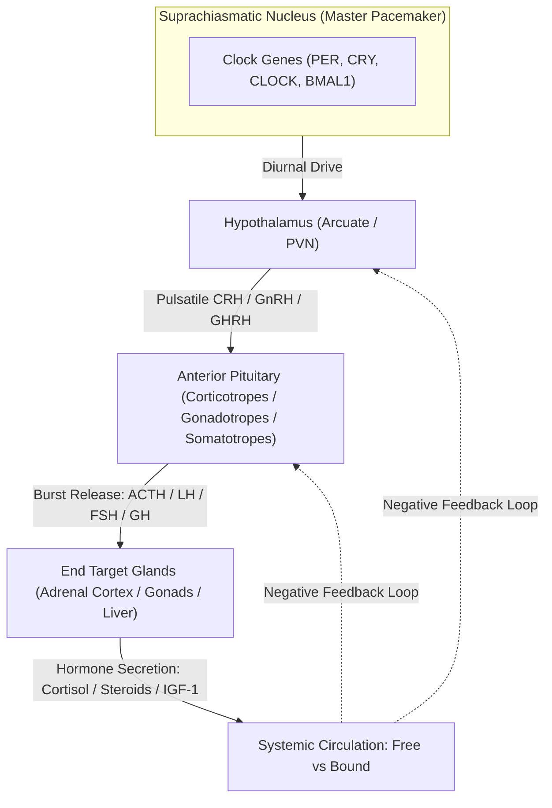

#### **1. The Hypothalamic-Pituitary-Adrenal (HPA) Axis**
* **Circadian Rhythm:** Driven by the central pacemaker in the suprachiasmatic nucleus ($\text{SCN}$) via the paraventricular nucleus ($\text{PVN}$) of the hypothalamus. Corticotropin-Releasing Hormone ($\text{CRH}$) and Arginine Vasopressin ($\text{AVP}$) stimulate pituitary corticotropes to release Adrenocorticotropic Hormone ($\text{ACTH}$).
* **Temporal Dynamics:** ACTH and cortisol exhibit a dramatic diurnal oscillation. Plasma ACTH begins climbing around 03:00 to 04:00, peaking between 07:00 and 09:00 ($\text{Cortisol}: 10\text{–}20\ \mu\text{g/dL}$ / $275\text{–}550\ \text{nmol/L}$). Levels progressively decline throughout the day, reaching an absolute physiological nadir between 23:00 and 01:00 ($\text{Cortisol} < 1.8\text{–}3.0\ \mu\text{g/dL}$ / $< 50\text{–}83\ \text{nmol/L}$).
* **Ultradian Burst Pattern:** Superimposed upon this circadian curve are $15\text{ to }18$ discrete ultradian secretory pulses per 24 hours, occurring roughly every $60\text{ to }90$ minutes. During a secretory burst, serum cortisol can spike by $8\text{ to }12\ \mu\text{g/dL}$ within twenty minutes and plummet rapidly as cortisol distributes ($t_{1/2} \approx 60\text{–}90\text{ minutes}$).
* **Clinical Consequence:** A single random morning cortisol can catch the peak of an ultradian pulse in an Addisonian patient or the valley of a pulse in a healthy individual. Conversely, an elevated morning cortisol has almost zero positive predictive value for Cushing's syndrome because acute psychological stress, venipuncture fear, or awakening shifts can triple cortisol output in minutes!

#### **2. The Somatotropic (Growth Hormone) Axis**
* **The Ultradian Bursts of GH:** Pituitary somatotropes release Growth Hormone ($\text{GH}$) in sharp, explosive pulses primarily during slow-wave (Stage N3) sleep, mediated by hypothalamic Growth Hormone-Releasing Hormone ($\text{GHRH}$) versus Somatostatin ($\text{SS}$) tone.
* **Basal Undetectability:** For $70\%\text{ to }80\%$ of the day, circulating serum $\text{GH}$ in healthy adults is virtually undetectable ($< 0.05\text{ to }0.1\ \text{ng/mL}$ by ultrasensitive chemiluminescent assays). A random $\text{GH}$ of $0.08\ \text{ng/mL}$ is entirely normal and cannot distinguish healthy adults from severe panhypopituitarism!
* **The Dynamic Solution:** To prove Growth Hormone Deficiency ($\text{GHD}$), clinicians must provoke the somatotrope using Insulin-Induced Hypoglycemia, Glucagon, or Macimorelin. To prove Acromegaly (GH hypersecretion), clinicians perform an Oral Glucose Tolerance Test ($\text{OGTT}$), where hyperglycemia ($75\ \text{g}$ glucose load) should suppress $\text{GH}$ to $< 0.4\ \text{ng/mL}$ (or $< 1.0\ \text{ng/mL}$ depending on assay sensitivity).

#### **3. The Gonadotropic Axis (GnRH, LH, FSH)**
* Hypothalamic Gonadotropin-Releasing Hormone ($\text{GnRH}$) neurons fire in discrete pulses every $90\text{ to }120$ minutes in men and during the follicular phase in women, shortening to every $60$ minutes prior to the mid-cycle ovulatory surge.
* Luteinizing Hormone ($\text{LH}$) mirrors these episodic bursts, with serum concentrations fluctuating by $200\%\text{ to }400\%$ within a two-hour window. A single random LH measurement cannot reliably detect hypogonadotropic hypogonadism unless pooled across three blood samples drawn twenty minutes apart.

---

### **17.1.2 The Free Hormone Hypothesis & Plasma Binding Globulins**

More than $90\%\text{ to }99\%$ of lipophilic steroid and thyroid hormones circulate in human blood bound non-covalently to high-affinity plasma transport globulins and low-affinity, high-capacity albumin.

$$\text{Hormone}_{\text{Total}} = \text{Hormone}_{\text{Free}} + \text{Hormone}_{\text{Globulin-Bound}} + \text{Hormone}_{\text{Albumin-Bound}}$$

According to the classical **Free Hormone Hypothesis**, only the unbound (free) hormone diffuses across capillary endothelial fenestrations, crosses cell membranes, interacts with cytosolic or nuclear receptors, and exerts biological feedback upon the pituitary and hypothalamus:

$$\text{Free } H + R \rightleftharpoons H\text{-}R \implies \text{Biological Action + Feedback Suppression}$$

| Hormone | Primary High-Affinity Carrier Protein | Affinity Constant ($K_a$) | Percentage Bound to Carrier | Percentage Bound to Albumin | Percentage Free (Biologically Active) |
| :--- | :--- | :--- | :--- | :--- | :--- |
| **Cortisol** | Corticosteroid-Binding Globulin ($\text{CBG}$ / Transcortin) | $3 \times 10^7\ \text{M}^{-1}$ | $80\% - 90\%$ | $5\% - 10\%$ | **$3\% - 5\%$** |
| **Thyroxine ($\text{T}_4$)** | Thyroxine-Binding Globulin ($\text{TBG}$) | $1 \times 10^{10}\ \text{M}^{-1}$ | $75\%$ | $15\%$ ($\text{Transthyretin/TTR}$) + $10\%$ (Albumin) | **$0.02\% - 0.03\%$** |
| **Triiodothyronine ($\text{T}_3$)** | Thyroxine-Binding Globulin ($\text{TBG}$) | $1 \times 10^9\ \text{M}^{-1}$ | $75\%$ | $20\%$ (Albumin) | **$0.3\%$** |
| **Testosterone (Male)** | Sex Hormone-Binding Globulin ($\text{SHBG}$) | $1 \times 10^9\ \text{M}^{-1}$ | $44\% - 60\%$ | $38\% - 54\%$ | **$1\% - 2\%$** |
| **Estradiol (Female)** | Sex Hormone-Binding Globulin ($\text{SHBG}$) | $5 \times 10^8\ \text{M}^{-1}$ | $38\%$ | $60\%$ | **$2\% - 3\%$** |
| **Aldosterone** | Albumin (Non-specific) | Weak ($10^3\text{–}10^4\ \text{M}^{-1}$) | Minimal specific binding | $50\% - 60\%$ | **$30\% - 40\%$** |

#### **The Mathematics of Carrier Alterations: The Estrogen and Sepsis Trap**
The law of mass action dictates the equilibrium between free hormone ($[H_f]$), unliganded carrier protein ($[P_f]$), and bound hormone complex ($[HP]$):

$$K_a = \frac{[HP]}{[H_f][P_f]}$$

When total binding protein concentration $[P_{\text{total}}] = [P_f] + [HP]$ shifts, $[H_f]$ remains transiently unaltered because pituitary-hypothalamic feedback continues sensing only $[H_f]$. However, to maintain that equilibrium across an expanded carrier pool, the endocrine gland must synthesize more total hormone until $[HP]$ fills the new capacity:

$$\uparrow [P_{\text{total}}] \implies \uparrow [H_{\text{total}}]\quad \text{while}\quad [H_f] = \text{NORMAL}$$

$$\downarrow [P_{\text{total}}] \implies \downarrow [H_{\text{total}}]\quad \text{while}\quad [H_f] = \text{NORMAL}$$

#### **Major Clinical Scenarios Distorting Total Hormone Levels:**
1. **Oral Contraceptive Pills (OCPs) & Pregnancy (High Estrogen):**
   * Estrogens stimulate hepatic transcription of $\text{CBG}$, $\text{TBG}$, and $\text{SHBG}$. Crucially, estrogens induce **increased sialylation** of oligosaccharide side-chains on these hepatic glycoproteins, dramatically reducing clearance by hepatic asialoglycoprotein receptors and extending plasma half-life.
   * Total serum cortisol in a pregnant woman or a patient taking ethinyl estradiol routinely doubles to $30\text{–}45\ \mu\text{g/dL}$! Total $\text{T}_4$ climbs to $14\text{–}18\ \mu\text{g/dL}$. Total testosterone in females shifts erratically.
   * If an uninitiated clinician orders total serum cortisol on an OCP user, the patient will fail a 1-mg dexamethasone suppression test, triggering a phantom Cushing's workup!
2. **Critical Illness, Septic Shock, and Cirrhosis (Low Carrier States):**
   * Systemic inflammatory response syndrome ($\text{SIRS}$) triggers massive release of neutrophil elastase, which specifically cleaves the reactive center loop of $\text{CBG}$, collapsing its binding affinity for cortisol by nine-fold!
   * Hepatic failure reduces protein synthesis of $\text{CBG}$, $\text{TBG}$, and albumin. Nephrotic syndrome causes massive proteinuria urinary loss of $50\text{–}60\ \text{kDa}$ globulins.
   * In septic shock, total serum cortisol may read $6\ \mu\text{g/dL}$ ($165\ \text{nmol/L}$), appearing diagnostic of acute adrenal failure, yet biologically active free cortisol may exceed $3.0\ \mu\text{g/dL}$ (severely elevated, appropriate for stress)!

---

## **DOSSIER 17.2: THE CUSHING'S SYNDROME GAUNTLET & PITUITARY LATERALIZATION**

### **17.2.1 The Clinical Dilemma & The Pseudo-Cushing's Conundrum**
Endogenous Cushing's syndrome is rare ($1\text{ to }2$ cases per million per year), yet patients referred for hypercortisolemia evaluation are legion. Obesity, metabolic syndrome, uncontrolled type 2 diabetes, polycystic ovary syndrome ($\text{PCOS}$), major depressive disorder, severe chronic anxiety, and heavy alcohol use activate the central HPA axis, producing **Pseudo-Cushing's State**—elevated cortisol excretion and resistance to light dexamethasone feedback without neoplastic autonomous corticotrope or adrenocortical pathology.

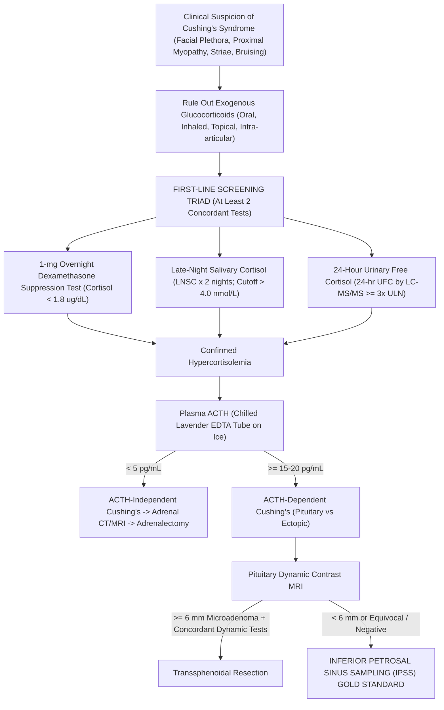

---

### **17.2.2 The First-Line Diagnostic Triad: Protocols, Cutoffs & Technical Traps**

No single test possesses $100\%$ sensitivity and $100\%$ specificity. Clinical guidelines from the Endocrine Society mandate at least two concordant abnormal first-line tests prior to establishing pathological hypercortisolemia.

#### **1. The 1-mg Overnight Dexamethasone Suppression Test (ODST)**
* **Physiological Premise:** Dexamethasone is a potent synthetic glucocorticoid ($30\times$ more potent than endogenous cortisol at the glucocorticoid receptor) that binds pituitary corticotrope glucocorticoid receptors, shutting down $\text{POMC}$ gene transcription and extinguishing ACTH release in healthy individuals. Dexamethasone has a modified chemical structure ($9\alpha\text{-fluoro-}16\alpha\text{-methylprednisolone}$) that does not cross-react with specific cortisol immunoassays or LC-MS/MS channels.
* **Standard Protocol:**
  1. Patient takes **$1.0\ \text{mg}$ Dexamethasone orally between 23:00 and 23:30** with water.
  2. Patient presents to the phlebotomy laboratory at **08:00 to 09:00 the following morning**.
  3. Serum drawn in Gold-top SST tube for Total Cortisol.
* **Diagnostic Interpretation:**
  * **Normal (Suppression):** Serum Cortisol **$< 1.8\ \mu\text{g/dL}$ ($< 50\ \text{nmol/L}$)**. This stringent cutoff provides sensitivity $> 95\%$.
  * **Abnormal (Autonomous Secretion / Failure to Suppress):** Serum Cortisol **$\ge 1.8\ \mu\text{g/dL}$**.
* **The Behind-the-Curtain Analytical Saboteurs:**
  * **The CYP3A4 Inducer Catastrophe (False-Positive):** Dexamethasone is cleared exclusively by hepatic cytochrome P450 3A4 ($\text{CYP3A4}$). Patients taking antiepileptic drugs (**Phenytoin, Carbamazepine, Phenobarbital**), **Rifampin**, or **St. John's Wort** hyper-induce CYP3A4. The $1\ \text{mg}$ dose is metabolized within $3\text{ to }4$ hours; by 08:00, zero circulating dexamethasone remains to suppress the pituitary! Serum cortisol prints as $8.4\ \mu\text{g/dL}$ (falsely abnormal).
  * **The CYP3A4 Inhibitor Trap (False-Negative):** Patients consuming **Grapefruit juice**, **Ketoconazole**, **Itraconazole**, **Ritonavir**, or **Cimetidine** block CYP3A4, causing supra-therapeutic dexamethasone levels that force suppression in patients with mild Cushing's disease!
  * **The High-CBG Estrogen Trap:** As established in Dossier 17.1, oral contraceptives elevate total CBG. Suppressed free cortisol with elevated bound cortisol will yield a total cortisol of $2.8\text{–}4.0\ \mu\text{g/dL}$, failing the test. Oral estrogens must be discontinued for a mandatory **6 weeks** prior to testing.
  * **The Simultaneous Serum Dexamethasone Mandate:** Elite chemical pathology laboratories never report an 08:00 post-dexamethasone cortisol in isolation! Blood is analyzed simultaneously for **Serum Dexamethasone via LC-MS/MS**:
    $$\text{Valid Test Criteria: } [\text{Serum Dexamethasone}]_{08:00} \ge 180\text{–}220\ \text{ng/dL}\ (4.5\text{–}5.6\ \text{nmol/L})$$
    If serum dexamethasone is $< 180\ \text{ng/dL}$, the suppression test is invalid due to non-compliance, emesis, malabsorption, or CYP3A4 induction!

#### **2. Twenty-Four-Hour Urinary Free Cortisol (24-hr UFC)**
* **Physiological Premise:** Only circulating unbound free cortisol passes through the renal glomerular filtration barrier. While tubular $11\beta\text{-hydroxysteroid dehydrogenase type 2}$ ($11\beta\text{-HSD2}$) converts some filtered cortisol to cortisone, excess free cortisol overwhelms this enzyme and is excreted intact into urine. UFC integrates cortisol production over an entire 24-hour day, smoothing out ultradian peaks.
* **Collection Protocol:**
  1. Patient voids at 07:00 on Day 1; this urine is **discarded**.
  2. All urine passed over the next 24 hours—day and night—is collected into a sterile 3-liter container containing **$10\ \text{g}$ of Boric Acid** or kept strictly refrigerated ($4^\circ\text{C}$).
  3. Patient voids at 07:00 on Day 2; this final volume is **included**.
* **Pre-Analytical Verification of Completeness:**
  A 24-hour urine collection is completely uninterpretable without verifying total volume and **24-hour urine creatinine excretion**:
  $$\text{Male Creatinine Benchmark: } 20\text{–}25\ \text{mg/kg/24 hr}\ (177\text{–}221\ \mu\text{mol/kg/24 hr})$$
  $$\text{Female Creatinine Benchmark: } 15\text{–}20\ \text{mg/kg/24 hr}\ (133\text{–}177\ \mu\text{mol/kg/24 hr})$$
  A collection with $< 10\ \text{mg/kg}$ creatinine indicates under-collection (false-negative UFC), while massive over-collection inflates UFC.
* **Analytical Engine: Immunoassay vs LC-MS/MS:**
  * Historic urine cortisol immunoassays cross-reacted wildly with urinary steroid metabolites ($6\beta\text{-hydroxycortisol}$, $20\alpha\text{-dihydrocortisol}$), carbamazepine metabolites, and synthetic prednisolone, generating massive false positives.
  * **LC-MS/MS Isotope Dilution Gold Standard:** Urine undergoes liquid-liquid extraction with dichloromethane or solid-phase extraction ($\text{SPE}$), spiked with internal standard ($d_4\text{-cortisol}$ or $^{13}\text{C}_3\text{-cortisol}$). Quantitation on triple-quadrupole mass spectrometry monitors the precursor-to-product ion transition:
    $$\text{Cortisol } [M+H]^+: m/z\ 363.2 \longrightarrow 121.1\quad (\text{Quantifier Ion, Collision Energy: } 30\ \text{eV})$$
    $$\text{Cortisol } [M+H]^+: m/z\ 363.2 \longrightarrow 327.2\quad (\text{Qualifier Ion, Collision Energy: } 18\ \text{eV})$$
    $$d_4\text{-Cortisol } [M+H]^+: m/z\ 367.2 \longrightarrow 121.1\quad (\text{Internal Standard})$$
* **Diagnostic Threshold:**
  * Normal: $< 45\text{–}50\ \mu\text{g/24 hr}$ ($< 120\text{–}140\ \text{nmol/day}$).
  * Diagnostic of Cushing's Syndrome: **$\ge 3\times$ Upper Limit of Normal ($\ge 150\ \mu\text{g/24 hr}$ / $\ge 415\ \text{nmol/day}$)**. Mild elevations ($1.5\text{ to }2.5\times$ ULN) overlap heavily with Pseudo-Cushing's states.

#### **3. Late-Night Salivary Cortisol (LNSC)**
* **Physiological Premise:** Salivary acinar cells are impermeable to large protein-bound complexes; neither CBG ($58\ \text{kDa}$) nor albumin ($66.5\ \text{kDa}$) enters saliva. Unbound free cortisol, being lipid-soluble, diffuses freely across acinar cells via passive transcellular diffusion within seconds, independent of salivary flow rate. Salivary cortisol concentration directly reflects circulating free biologically active cortisol in real time.
* **Loss of Nadir in Cushing's:** In healthy subjects, cortisol nadirs between 23:00 and 24:00 ($< 1.0\text{–}1.5\ \text{nmol/L}$). Patients with Cushing's syndrome lose this circadian dip; their 23:00 salivary cortisol remains elevated.
* **Collection Protocol & Technical Traps:**
  1. Collection occurs between **23:00 and 24:00**.
  2. Patient must not eat, drink, chew gum, or brush teeth for **30 minutes prior** to sampling.
  3. Patient places a cylindrical synthetic swab (e.g., **Salivette**) into the mouth, chewing gently for 2 minutes, then returns it to the plastic transport container.
* **The Behind-the-Curtain Disasters:**
  * **Blood Contamination from Toothbrushing:** Plasma total cortisol ($15\ \mu\text{g/dL} = 415\ \text{nmol/L}$) is $100\times$ higher than late-night saliva ($< 3\text{ nmol/L}$). Microscopic gingival bleeding from vigorous toothbrushing or flossing leaks plasma into saliva, driving salivary cortisol from $1.2\ \text{nmol/L}$ to $28.0\ \text{nmol/L}$! Laboratories perform **salivary transferrin testing**; any detectable transferrin invalidates the sample.
  * **The Cotton Swab Adsorption Trap:** Traditional cotton Salivettes physically adsorb hydrophobic steroids, falsely lowering cortisol recovery unless specific polyethylene/polyester synthetic swabs are deployed.
  * **Licorice and Tobacco 11$\beta$-HSD2 Inhibition:** Salivary glands express high concentrations of $11\beta\text{-HSD2}$ to protect mineralocorticoid receptors. Glycyrrhetinic acid (active compound in real licorice and chewing tobacco) potently inhibits $11\beta\text{-HSD2}$, preventing the local oxidation of cortisol to cortisone and falsely elevating salivary cortisol.
* **Diagnostic Threshold (LC-MS/MS):**
  * Normal Nadir: $< 2.8\text{–}4.0\ \text{nmol/L}$ ($< 0.10\ \mu\text{g/dL}$).
  * Pathological: **$> 4.0\ \text{nmol/L}$ ($> 0.14\ \mu\text{g/dL}$)** measured on **at least two separate nights**.

---

### **17.2.3 Differentiating ACTH-Independent from ACTH-Dependent Cushing's**

Once autonomous hypercortisolemia is biochemically secured, the physician must measure **Plasma ACTH** to locate the driver.

* **Specimen Collection Integrity (The Chilled Lavender EDTA Mandate):**
  * ACTH is a labile 39-amino acid single-chain polypeptide ($M_r = 4,541\ \text{Da}$) subject to rapid degradation by plasma endopeptidases and surface-adsorption to uncoated glass.
  * Blood MUST be drawn into a **pre-chilled Lavender-top $\text{K}_2\text{-EDTA}$ Vacutainer**, immediately submerged in an **ice-water slurry**, and centrifuged at $4^\circ\text{C}$ within **15 minutes**. Separated plasma must be frozen at $-20^\circ\text{C}$ or $-80^\circ\text{C}$ within 1 hour.
  * Failure to chill allows ex-vivo degradation, driving ACTH from $45\ \text{pg/mL}$ to $< 5\ \text{pg/mL}$!
* **Diagnostic Stratification:**
  * **ACTH-Independent Cushing's ($[\text{ACTH}] < 5\ \text{pg/mL}$ / $< 1.1\ \text{pmol/L}$):** Cortisol secretion is driven by autonomous adrenal pathology (Adrenocortical Adenoma, Adrenocortical Carcinoma, Primary Pigmented Nodular Adrenocortical Disease [PPNAD], ACTH-Independent Macronodular Adrenal Hyperplasia [AIMAH]). High cortisol exerts complete negative feedback, silencing normal pituitary corticotropes. Next step: **Thin-slice Adrenal CT or MRI**.
  * **Indeterminate ($[\text{ACTH}] = 5\text{–}15\ \text{pg/mL}$):** Requires CRH stimulation to unmask suppressed vs driven corticotropes.
  * **ACTH-Dependent Cushing's ($[\text{ACTH}] > 15\text{–}20\ \text{pg/mL}$ / $> 3.3\text{–}4.4\ \text{pmol/L}$):** Hypercortisolemia is driven by either:
    1. **Pituitary Corticotrope Adenoma (Cushing's Disease, $\sim 80\text{–}85\%$ of ACTH-dependent cases)**;
    2. **Ectopic ACTH Secretion ($\sim 15\text{–}20\%$ of cases)**: Neuroendocrine neoplasms (Small Cell Lung Carcinoma, Bronchial Carcinoid, Pancreatic Neuroendocrine Tumor, Medullary Thyroid Carcinoma).

---

### **17.2.4 The High-Dose 8-mg Dexamethasone Suppression Test & The CRH Stimulation Test**

Differentiating pituitary Cushing's disease from occult ectopic ACTH is one of the most treacherous challenges in medicine because both present with high ACTH and hypercortisolemia, and up to $40\%$ of pituitary microadenomas are invisible on high-field pituitary MRI ($< 3\text{ mm}$)!

#### **1. The High-Dose 8-mg Dexamethasone Suppression Test (HDDST)**
* **Mechanism:** Pituitary corticotrope adenomas retain **partial negative feedback sensitivity**; their glucocorticoid receptors are down-regulated but not obliterated. A massive pharmacological dose ($8\ \text{mg}$) can force glucocorticoid receptor dimerization, partially shutting down ACTH transcription. In contrast, non-pituitary neuroendocrine tumors (ectopic ACTH) operate completely outside hypothalamic-pituitary control and are refractory to feedback.
* **Protocol:** $8.0\ \text{mg}$ Dexamethasone orally at 23:00; 08:00 serum cortisol drawn.
* **Interpretation:**
  $$\text{Percent Suppression} = \frac{\text{Baseline Cortisol} - \text{Post-8mg Cortisol}}{\text{Baseline Cortisol}} \times 100\%$$
  * **Suppression $\ge 50\%$:** Strongly favors **Pituitary Cushing's Disease** (specificity $\sim 80\%$).
  * **Failure of Suppression ($< 50\%$ drop):** Favors **Ectopic ACTH** or Adrenal Tumor.
  * *Critical Limitation:* Well-differentiated bronchial carcinoids frequently retain glucocorticoid receptors and suppress by $> 50\%$, yielding false-positive pituitary diagnoses in $15\text{ to }20\%$ of ectopic tumors!

#### **2. The Corticotropin-Releasing Hormone (CRH) Stimulation Test**
* **Mechanism:** Pituitary corticotrope adenomas overexpress CRH receptors ($\text{CRHR1}$) on their cell surface. Intravenous administration of exogenous CRH stimulates adenoma corticotropes to dump ACTH and cortisol into circulation. Conversely, ectopic ACTH-secreting tumors do not express functional CRHR1 receptors, and normal pituitary corticotropes are chronically suppressed.
* **Protocol:**
  1. Patient rests supine for 30 minutes with an indwelling IV line.
  2. Baseline ACTH and Cortisol drawn at $-15$ and $0$ minutes.
  3. **$1\ \mu\text{g/kg}$ or $100\ \mu\text{g}$ Ovine CRH (Corticorelin)** or Human CRH administered as a slow IV push over 1 minute.
  4. Blood drawn at $+15, +30, +45, +60,$ and $+90$ minutes for ACTH and Cortisol.
* **Diagnostic Criteria for Pituitary Cushing's Disease:**
  $$\Delta \text{ACTH} = \frac{\text{Peak ACTH} - \text{Baseline Mean ACTH}}{\text{Baseline Mean ACTH}} \ge \mathbf{35\% - 50\%}$$
  $$\Delta \text{Cortisol} = \frac{\text{Peak Cortisol} - \text{Baseline Mean Cortisol}}{\text{Baseline Mean Cortisol}} \ge \mathbf{20\%}$$
  Ectopic ACTH shows flat, unresponsive curves ($\Delta \text{ACTH} < 35\%$).

---

### **17.2.5 Inferior Petrosal Sinus Sampling (IPSS): The Interventional Gold Standard**

When pituitary MRI shows no lesion or an ambiguous micro-lesion $< 6\ \text{mm}$ in a patient with ACTH-dependent hypercortisolemia, bilateral simultaneous **Inferior Petrosal Sinus Sampling ($\text{IPSS}$)** is the definitive gold standard procedure with diagnostic accuracy $> 98\%$.

#### **1. Vascular Anatomy & Catheter Trajectory**
Pituitary venous blood drains into the cavernous sinuses, which exit posteriorly via the superior and inferior petrosal sinuses. The **Inferior Petrosal Sinus ($\text{IPS}$)** is the primary venous conduit, traversing the petroclival fissure to empty directly into the anteromedial aspect of the internal jugular vein at the level of the jugular foramen (cranial base).

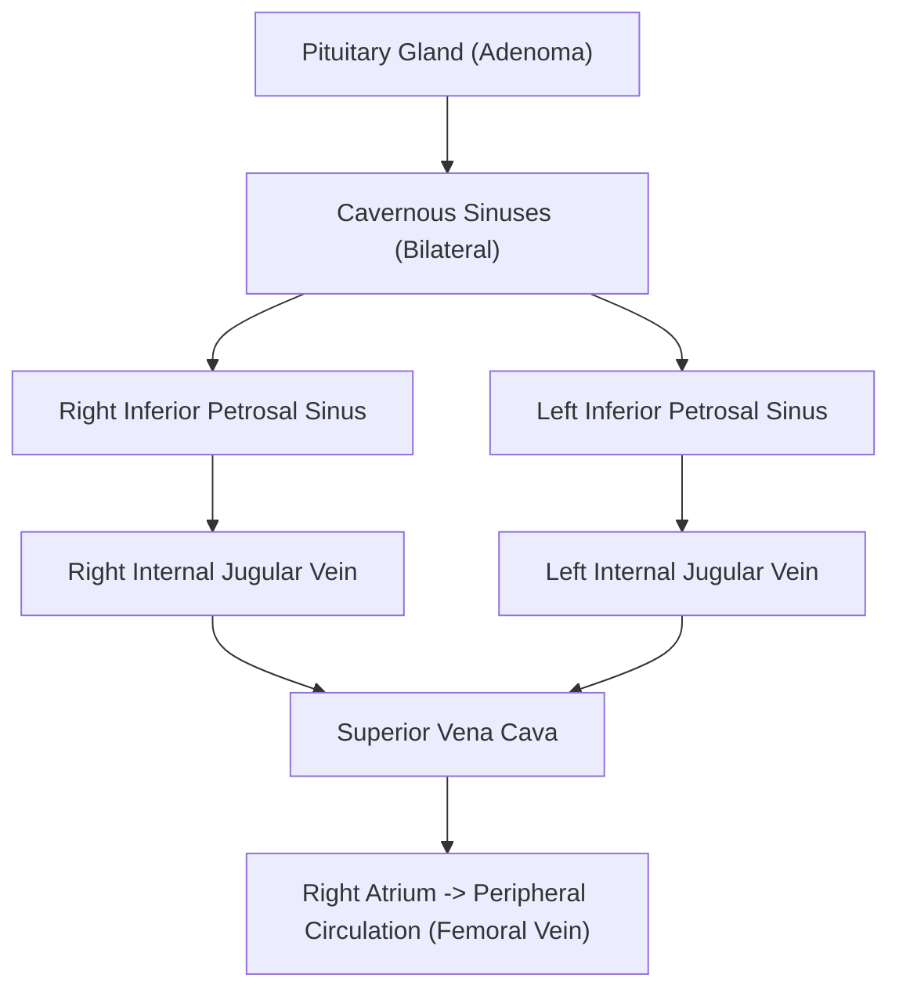

#### **2. Procedural Mechanics & Catheterization Physics**
1. **Access:** Under local anesthesia, an interventional radiologist places two $5\text{-French}$ vascular sheaths into the **right and left common femoral veins**.
2. **Navigation:** Using hydrophilic 0.035-inch guidewires and shaped micro-catheters (e.g., Headhunter, Cobra, or MP micro-catheters), catheters are navigated through the inferior vena cava, right atrium, superior vena cava, and internal jugular veins to the jugular bulb.
3. **Engagement:** The tip of each catheter is engaged into the osteum of the respective **inferior petrosal sinus**.
4. **Fluoroscopic Confirmation:** Digital Subtraction Angiography ($\text{DSA}$) with non-ionic iodinated contrast injection confirms symmetrical, selective positioning within the petrosal sinuses and rules out anomalous plexiform venous anatomy or drainage directly into the vertebral venous plexus.
5. **Peripheral Line:** A third catheter or peripheral IV line in the femoral sheath serves as the systemic peripheral comparator ($\text{P}$).

#### **3. The Sampling Protocol & CRH Provocation**
Because ACTH secretion can be quiescent during the procedure, sampling must be performed both at baseline and under provocative CRH (or Desmopressin) stimulation:
* **Basal Draws:** Simultaneous blood samples drawn from Left IPS, Right IPS, and Peripheral vein at $-5$ and $0$ minutes.
* **Stimulation:** Inject **$100\ \mu\text{g}$ Ovine CRH IV** (or $10\ \mu\text{g}$ Desmopressin/DDAVP IV).
* **Stimulated Draws:** Simultaneous blood samples drawn at $+2, +5, +10,$ and $+15$ minutes.
* **Handling:** Every tube (Lavender $\text{K}_2\text{-EDTA}$) must be pre-chilled, labeled precisely ("L-IPS", "R-IPS", "PERIPHERAL"), kept in an ice slurry, and spun immediately.

#### **4. Diagnostic Ratios & Interpretation Formulas**

##### **A. Central-to-Peripheral (IPS/P) ACTH Ratio (Proving Pituitary Origin)**
To determine whether the source of ACTH is Pituitary (Cushing's Disease) versus Ectopic:

$$\text{Basal Central-to-Peripheral Ratio} = \frac{[\text{ACTH}]_{\text{IPS (Higher Side)}}}{[\text{ACTH}]_{\text{Peripheral}}} \ge \mathbf{2.0}$$

$$\text{CRH-Stimulated Central-to-Peripheral Ratio} = \frac{[\text{ACTH}]_{\text{IPS (Higher Side)}}}{[\text{ACTH}]_{\text{Peripheral}}} \ge \mathbf{3.0}$$

* **$\text{IPS/P} \ge 2.0$ (Basal) or $\ge 3.0$ (Stimulated):** **CONFIRMS PITUITARY CUSHING'S DISEASE** with $99\%$ specificity!
* **$\text{IPS/P} < 2.0$ (Basal) AND $< 3.0$ (Stimulated):** **CONFIRMS ECTOPIC ACTH SECRETION**. Proceed immediately to neck-chest-abdomen-pelvis thin-slice contrast CT, Ga-68 DOTATATE PET/CT, or FDG-PET to locate the neuroendocrine tumor.

##### **B. Inter-Petrosal Sinus Gradient (Lateralization for Surgical Enucleation)**
To predict whether the microadenoma is situated in the left or right pituitary hemigland:

$$\text{Inter-Petrosal Ratio} = \frac{[\text{ACTH}]_{\text{Dominant IPS}}}{[\text{ACTH}]_{\text{Non-Dominant IPS}}} > \mathbf{1.4}$$

* **Ratio $> 1.4$:** Predicts ipsilateral tumor localization to the side of the dominant IPS, directing the neurosurgeon to explore that specific side during transsphenoidal surgery.
* **Ratio $\le 1.4$:** Non-lateralizing (tumor near midline, anomalous inter-cavernous crossing shunts, or diffuse basilar venous plexus mixing).

##### **C. Prolactin Normalization for Anatomical Venous Anomalies**
If a catheter is suboptimally positioned or if asymmetric venous hypoplasia exists, low ACTH in an IPS can cause a false-negative result. Because **Prolactin** is secreted continuously by normal pituitary lactotropes, prolactin serves as an endogenous internal control for petrosal vein blood dilution:

$$\text{Normalized Ratio} = \frac{[\text{ACTH}]_{\text{IPS}} / [\text{Prolactin}]_{\text{IPS}}}{[\text{ACTH}]_{\text{Peripheral}} / [\text{Prolactin}]_{\text{Peripheral}}}$$
A Prolactin $\text{IPS/P} \ge 1.8$ confirms adequate engagement and pure pituitary effluent.

---

### **17.2.6 Procedural Hazards of IPSS**
While safe in experienced hands ($< 1\text{–}2\%$ major complication rate), IPSS involves catheterizing veins at the skull base:
1. **Brainstem Vascular Injury / Stroke:** Accidental wedging of catheters or high-pressure contrast injection into small pontine/cerebellar emissary veins can trigger venous infarction or brainstem hemorrhage.
2. **Petrosal Sinus Rupture:** Vessel perforation leading to subarachnoid or intracranial hemorrhage.
3. **Groin Hematoma / Femoral Pseudoaneurysm:** Managed with manual compression or vascular closure devices.
4. **Transient Cranial Neuropathies:** Abducens (CN VI) palsy due to traction near Dorello's canal.

---

*(Volume XVII continues below with Primary Aldosteronism, Adrenal Vein Sampling, Congenital Adrenal Hyperplasia, Pheochromocytoma, and Thyroid Mass Spectrometry)*


---

## **DOSSIER 17.3: PRIMARY ALDOSTERONISM (CONN'S SYNDROME) & ADRENAL VEIN SAMPLING (AVS)**

### **17.3.1 Pathophysiology of Autonomous Mineralocorticoid Excess**

Primary Aldosteronism ($\text{PA}$) is the most common cause of secondary endocrine hypertension, accounting for **$5\%\text{ to }10\%$ of all hypertensive patients** and up to **$20\%$ of patients with resistant hypertension** ($\text{BP} > 140/90\ \text{mmHg}$ despite three antihypertensive agents of different classes, including a diuretic). 

Autonomous overproduction of aldosterone by the adrenal zona glomerulosa acts upon mineralocorticoid receptors ($\text{MR}$) in the principal cells of the renal cortical collecting tubule, upregulating:
1. Epithelial Sodium Channels ($\text{ENaC}$) on the apical membrane, accelerating $\text{Na}^+$ reabsorption;
2. $\text{Na}^+/\text{K}^+\text{-ATPase}$ pumps on the basolateral membrane;
3. Renal Outer Medullary Potassium ($\text{ROMK}$) channels and $\text{H}^+\text{-ATPase}$ pumps, driving urinary $\text{K}^+$ and $\text{H}^+$ wasting.

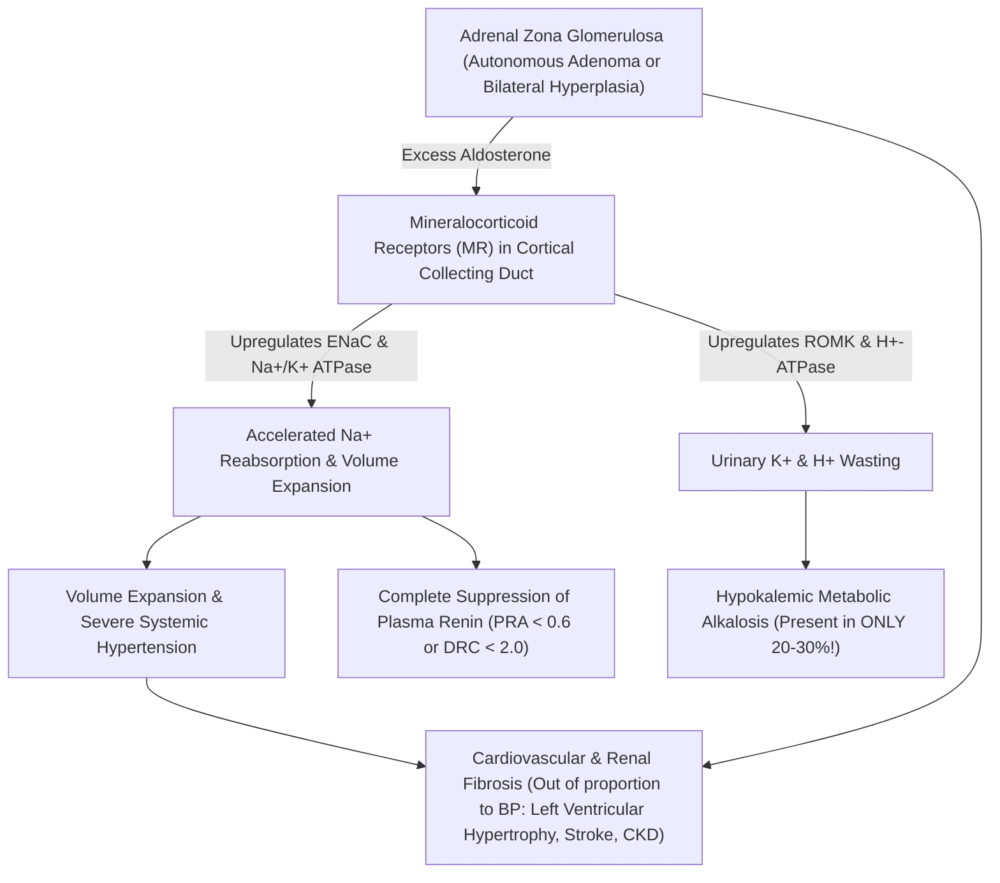

#### **The Great Clinical Fallacy: Normokalemic Primary Aldosteronism**
For decades, physicians were taught that primary aldosteronism is characterized by hypokalemia. **This is factually false.** Modern prospective screening studies establish that **$70\%\text{ to }80\%$ of patients with documented, surgically curable primary aldosteronism are completely normokalemic**! Resting serum potassium cannot be used to rule out PA.

---

### **17.3.2 The Screening Gateway: The Morning Seated Aldosterone-to-Renin Ratio (ARR)**

The cornerstone of primary aldosteronism screening is the **Aldosterone-to-Renin Ratio ($\text{ARR}$)**. Because autonomous aldosterone production suppresses juxtaglomerular apparatus renin release via volume expansion, the signature biochemical footprint of PA is **high/inappropriately normal aldosterone coupled with profound renin suppression**.

#### **1. Pre-Analytical Patient Preparation Protocol**
To prevent catastrophic false-positive and false-negative screening results, strict pre-analytical control must be enforced:
* **Correction of Hypokalemia:** Hypokalemia directly inhibits adrenal CYP11B2 (aldosterone synthase) transcription. A patient with severe hypokalemia ($\text{K}^+ < 3.2\ \text{mEq/L}$) will shut down aldosterone secretion, causing a **falsely negative ARR**! Serum potassium must be aggressively repleted to **$> 4.0\ \text{mEq/L}$** prior to blood collection.
* **Unrestricted Sodium Intake:** Patients must not follow a low-sodium diet; dietary salt restriction stimulates renin, confounding the ratio.
* **Postural State:** Patient must be out of bed for at least 2 hours, then **seated comfortably for 10 to 15 minutes** before blood collection. Blood drawn while recumbent generates false-negative ratios; standing increases renin and aldosterone.
* **Time of Day:** Blood must be drawn mid-morning, ideally between **08:00 and 10:00**.

#### **2. Pharmacological Washout Schedule**
Virtually all antihypertensive agents modulate the renin-angiotensin-aldosterone system ($\text{RAAS}$). Elite endocrine centers adhere to strict drug withdrawal schedules:

| Antihypertensive Class | Examples | Biochemical Effect on RAAS | Impact on ARR | Washout Period Required |
| :--- | :--- | :--- | :--- | :--- |
| **Mineralocorticoid Receptor Antagonists ($\text{MRAs}$)** | Spironolactone, Eplerenone | Blocks MR $\implies$ massive rebound $\uparrow \text{Renin}$ | **False-Negative** (Crushes ARR) | **Mandatory 4 to 6 Weeks** |
| **$\text{ENaC}$ Blockers** | Amiloride, Triamterene | Sodium loss $\implies \uparrow \text{Renin}$ | **False-Negative** | **4 Weeks** |
| **$\beta$-Adrenergic Blockers** | Metoprolol, Atenolol, Propranolol | Blocks $\beta_1$ juxtaglomerular drive $\implies \downarrow \text{Renin}$ | **False-Positive** ($\uparrow \text{ARR}$) | **2 Weeks** |
| **$\text{ACE}$ Inhibitors** | Lisinopril, Enalapril, Ramipril | Blocks Ang II $\implies \uparrow \text{Renin}$, $\downarrow \text{Aldo}$ | **False-Negative** | **2 Weeks** |
| **Angiotensin Receptor Blockers ($\text{ARBs}$)** | Losartan, Valsartan, Candesartan | Blocks AT1R $\implies \uparrow \text{Renin}$, $\downarrow \text{Aldo}$ | **False-Negative** | **2 Weeks** |
| **Dihydropyridine $\text{CCBs}$** | Amlodipine, Nifedipine | Vasodilation $\implies \uparrow \text{Renin}$ | **False-Negative** (Mild) | **2 Weeks** |
| **Direct Renin Inhibitors** | Aliskiren | Inhibits renin activity ($\downarrow \text{PRA}$), $\uparrow \text{DRC}$ | Wildly discordant | **4 Weeks** |
| **$\alpha_2$-Central Agonists** | Clonidine, Methyldopa | Reduces sympathetic drive $\implies \downarrow \text{Renin}$ | **False-Positive** | **2 Weeks** |

#### **The Safe Antihypertensive Bridge:**
To control severe blood pressure during the 2-to-4 week washout, clinicians convert patients to medications with minimal RAAS impact:
* **Verapamil Slow-Release** (Non-dihydropyridine CCB: $120\text{–}240\ \text{mg}$ daily);
* **Doxazosin or Prazosin** ($\alpha_1\text{-adrenergic}$ antagonists: $1\text{–}8\ \text{mg}$ daily);
* **Hydralazine** (Direct arteriolar vasodilator: $25\text{–}50\ \text{mg}$ TID).

#### **3. Calculating the ARR: Units and Thresholds**
Renin is measured as either **Plasma Renin Activity ($\text{PRA}$)** via enzymatic generation of angiotensin I, or **Direct Renin Concentration ($\text{DRC}$)** via automated sandwich immunoassay:

$$\text{ARR}_{\text{PRA}} = \frac{\text{Plasma Aldosterone Concentration (PAC in ng/dL)}}{\text{Plasma Renin Activity (PRA in ng/mL/hr)}}$$

$$\text{ARR}_{\text{DRC}} = \frac{\text{Plasma Aldosterone Concentration (PAC in ng/dL)}}{\text{Direct Renin Concentration (DRC in mU/L)}}$$

$$\text{SI-Unit ARR}_{\text{DRC}} = \frac{\text{Plasma Aldosterone Concentration (PAC in pmol/L)}}{\text{Direct Renin Concentration (DRC in mU/L)}}$$

*Conversion Factors:* $\text{Aldosterone: } 1\ \text{ng/dL} = 27.7\ \text{pmol/L}$. $\text{PRA to DRC: } 1\ \text{ng/mL/hr} \approx 8.2\text{ to }12\ \text{mU/L}$.

| Assay Combination | Units of PAC | Units of Renin | Positive Screening Cutoff | High-Confidence Threshold |
| :--- | :--- | :--- | :--- | :--- |
| **PAC / PRA** | $\text{ng/dL}$ | $\text{ng/mL/hr}$ | **$> 20$** | **$> 30$** |
| **PAC / DRC** | $\text{ng/dL}$ | $\text{mU/L}$ | **$> 2.0 - 2.5$** | **$> 3.7$** |
| **PAC / DRC (SI Units)**| $\text{pmol/L}$ | $\text{mU/L}$ | **$> 55 - 70$** | **$> 100$** |

#### **The Inflexible Prerequisite: Absolute PAC Floor**
An elevated ratio is clinically meaningless if the numerator is negligible. For example, a patient with a suppressed PRA of $0.1\ \text{ng/mL/hr}$ and an aldosterone of $3.0\ \text{ng/dL}$ has an apparent ARR of:

$$\text{ARR} = \frac{3.0}{0.1} = 30\quad (\text{Arithmetically High, but Clinically Negative!})$$

This patient merely has low-renin essential hypertension. Therefore, guidelines mandate:
$$\mathbf{\text{Mandatory Rule: ARR is ONLY diagnostic if PAC } \ge 10\text{–}15\ \text{ng/dL}\ (280\text{–}420\ \text{pmol/L})!}$$

---

### **17.3.3 Confirmatory Suppression Protocols**

A positive ARR screens for PA; autonomous, non-suppressible aldosterone secretion must be formally confirmed before subjecting patients to invasive catheterization.

#### **1. The Intravenous Saline Infusion Test (SIT)**
* **Mechanism:** Infusion of an acute intravascular volume load expands effective circulating volume, elevating renal perfusion pressure and suppressing any physiologically responsive RAAS axis. Normal adrenocortical glomerulosa cells extinguish aldosterone production; autonomous neoplasms do not.
* **Protocol:**
  1. Patient is admitted to an endocrine testing unit and placed in a **recumbent position for at least 1 hour** prior to infusion.
  2. Baseline PAC, PRA/DRC, potassium, and cortisol drawn at 08:00.
  3. **$2.0\ \text{Liters}$ of $0.9\%\ \text{Sodium Chloride}$ IV is infused at a constant rate over exactly 4 hours** ($500\ \text{mL/hr}$, 08:00 to 12:00).
  4. Blood pressure and heart rate monitored continuously (vigorous volume expansion can precipitate pulmonary edema in severe diastolic dysfunction).
  5. Repeat blood drawn at 12:00 (end of infusion) for PAC, cortisol, and potassium.
* **Diagnostic Interpretation (Post-Saline PAC):**
  * **$< 5.0\ \text{ng/dL}$ ($< 140\ \text{pmol/L}$):** **Excludes Primary Aldosteronism** (normal physiological suppression).
  * **$> 10.0\ \text{ng/dL}$ ($> 280\ \text{pmol/L}$):** **CONFIRMS PRIMARY ALDOSTERONISM** (autonomous production).
  * **$5.0\text{ to }10.0\ \text{ng/dL}$:** Indeterminate; requires alternative confirmation or clinical reassessment.
  * *Behind-the-Curtain Quality Check:* Post-infusion serum cortisol must be lower than baseline; if acute stress elevated cortisol, ACTH release may cross-stimulate aldosterone release, invalidating the suppression test!

#### **2. The Oral Sodium Loading Test**
* Patient consumes a high-sodium diet supplemented with sodium chloride tablets ($6\ \text{g/day} = 100\ \text{mmol/day}$ added salt) for **3 consecutive days** (target total sodium intake $> 200\ \text{mmol/day}$).
* On day 3, a 24-hour urine is collected for urinary aldosterone, sodium, and creatinine.
* **Validation:** 24-hour urinary sodium must exceed **$200\ \text{mEq/24 hr}$** to verify adequate sodium loading.
* **Confirmation:** **24-hour Urinary Aldosterone $> 12\ \mu\text{g/24 hr}$ ($> 33\ \text{nmol/day}$)** confirms autonomous primary aldosteronism.

#### **3. The Captopril Challenge Test**
* Patient receives $25\text{ to }50\ \text{mg}$ oral Captopril while seated. In healthy individuals, ACE inhibition collapses Angiotensin II, dropping PAC by $> 30\%$. In PA, PAC remains elevated ($> 12\ \text{ng/dL}$) with fully suppressed renin.

---

### **17.3.4 Adrenal Vein Sampling (AVS): The Definitive Interventional Gold Standard**

Once primary aldosteronism is confirmed, the central therapeutic question arises:
$$\mathbf{\text{Unilateral Disease (Curable by Surgery) VS Bilateral Disease (Managed Medically)?}}$$
* **Unilateral Aldosterone-Producing Adenoma ($\text{APA}$ / Conn's Adenoma, $\sim 35\%\text{ of cases}$):** Curable by unilateral laparoscopic adrenalectomy, normalizing potassium, lowering blood pressure, and curing hypertension in $40\%\text{ to }60\%$ of patients.
* **Bilateral Adrenal Hyperplasia ($\text{BAH}$ / Idiopathic Hyperaldosteronism, $\sim 65\%\text{ of cases}$):** Surgery is contraindicated; bilateral adrenalectomy causes lifelong adrenal insufficiency without curing hypertension. Managed with lifetime MR antagonists (Spironolactone or Eplerenone).

#### **The Cross-Sectional Imaging Disaster: Why CT/MRI Fails**
Clinicians often assume that high-resolution thin-slice adrenal CT can distinguish unilateral from bilateral disease. **CT/MRI has a documented $40\%$ diagnostic error rate:**
1. **Non-Functioning Adrenal Incidentalomas:** Non-functioning cortical adenomas occur in $3\%\text{ to }7\%$ of the normal population. A patient with bilateral hyperplasia and an innocent incidentaloma on the right will undergo unnecessary right adrenalectomy, leaving the disease uncured!
2. **Microscopic Aldosteronomas:** APAs are frequently small ($< 5\text{ to }8\ \text{mm}$) and completely invisible on CT. A "normal" adrenal scan may harbor a curable microadenoma.
3. Guidelines from the Endocrine Society state unequivocally: **Cross-sectional imaging cannot be relied upon to direct surgical decision-making. Adrenal Vein Sampling ($\text{AVS}$) is the mandatory gold standard.**

---

### **17.3.5 Vascular Anatomy & Catheterization Physics Behind the Curtain**

Adrenal vein sampling is arguably the most technically demanding procedure in interventional radiology due to the brutal asymmetrical micro-anatomy of the human adrenal venous drainage:

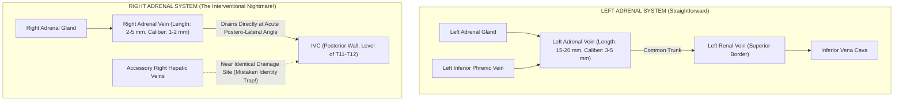

#### **1. Anatomy of the Left Adrenal Vein:**
* The left adrenal vein travels vertically downwards, joins the **Left Inferior Phrenic Vein** to form a generous common trunk ($15\text{ to }20\ \text{mm}$ in length, $3\text{ to }5\ \text{mm}$ in diameter), which empties directly into the superior border of the **Left Renal Vein** opposite the gonadal vein.
* Cannulation is straightforward using standard Cobra, Picard, or Sidewinder catheters. Blood aspirated is a mixture of adrenal and phrenic venous return.

#### **2. Anatomy of the Right Adrenal Vein (The Interventional Graveyard):**
* The right adrenal vein is an anatomical micro-conduit: **only $2\text{ to }5\ \text{mm}$ in length and $1\text{ to }2\ \text{mm}$ in diameter**.
* It empties directly into the **posterolateral wall of the Inferior Vena Cava** at an acute downward angle, typically at the level of the T11–T12 vertebral bodies.
* Nestled in immediate proximity are small **accessory right hepatic veins**. Interventional radiologists frequently catheterize a small accessory hepatic vein by mistake; the aspirate will contain high oxygenated portal/hepatic blood with zero adrenal hormone!
* **Catheter Stability:** To cannulate the right adrenal vein, the operator uses micro-catheters (e.g., Mikaelsson, C2, or dedicated adrenal vein catheters). The catheter tip must be wedged gently without occluding flow or dissecting the fragile vein wall.

#### **3. Contrast Injection Hazard (Adrenal Vein Rupture):**
* Adrenal veins lack thick muscular tunica media. Vigorous hand injection of iodinated contrast will instantly rupture the right adrenal vein, resulting in **retroperitoneal hemorrhage and complete ischemic infarction of the right adrenal gland**! Gentle "puffing" of micro-contrast drops under fluoroscopy is mandatory.

---

### **17.3.6 Procedural Execution: Unstimulated vs Cosyntropin Stimulation**

AVS can be performed using two valid methodological schools:
1. **Unstimulated Sequential Sampling:** Reflects native physiological secretion but is susceptible to episodic cortisol and aldosterone pulsatility during the $15\text{ to }30$ minutes required to move catheters between sides.
2. **Continuous Cosyntropin Infusion Protocol (Preferred by Many Centers):**
   * Synthetic $\text{ACTH}_{1-24}$ (Cosyntropin) is infused intravenously at a continuous rate of **$50\ \mu\text{g/hour}$**, initiated **30 minutes prior to sampling** and continued throughout the procedure.
   * *Advantages:* Maximizes cortisol gradient between adrenal veins and IVC; eliminates stress-induced hormonal fluctuations; minimizes the impact of timing offsets during sequential catheterization; stimulates adenoma secretion.

#### **Sample Collection Triad:**
At each sampling station, $5\ \text{mL}$ of blood is gently aspirated (rapid suction collapses the fragile right vein wall):
1. **Right Adrenal Vein ($\text{RAV}$)**;
2. **Left Adrenal Vein ($\text{LAV}$)**;
3. **Peripheral Blood ($\text{PV}$)** (drawn from the femoral sheath or infra-renal IVC).
Every tube is labeled and sent for simultaneous **Aldosterone and Cortisol** measurement via LC-MS/MS.

---

### **17.3.7 Diagnostic Interpretation Formulas: SI, LI, and CSI**

Three mathematical indices must be calculated sequentially to interpret an AVS run.

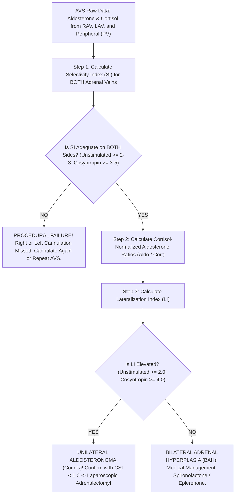

#### **Step 1: The Selectivity Index (SI) — Confirming True Adrenal Vein Engagement**
Because peripheral blood flows through the IVC at thousands of milliliters per minute, any aspirate contaminated by IVC blood will dilute hormone concentrations. **Cortisol** serves as the internal reference standard to verify that the catheter was truly seated inside the adrenal vein:

$$\text{Selectivity Index (Right)} = \frac{[\text{Cortisol}]_{\text{Right Adrenal Vein}}}{[\text{Cortisol}]_{\text{Peripheral Vein}}}$$

$$\text{Selectivity Index (Left)} = \frac{[\text{Cortisol}]_{\text{Left Adrenal Vein}}}{[\text{Cortisol}]_{\text{Peripheral Vein}}}$$

* **Diagnostic Validation Thresholds:**
  * **Unstimulated AVS:**
    * $\text{SI} \ge 2.0$ (standard criteria; strict academic centers demand $\ge 3.0$).
  * **Cosyntropin-Stimulated AVS:**
    * $\text{SI} \ge 5.0$ (stringent criteria; minimum acceptable $\ge 3.0$).
* **Critical Rule:** If the Selectivity Index is $< 3.0\text{–}5.0$ on *either* side (almost always the difficult right side), **THE ENTIRE PROCEDURE IS NON-DIAGNOSTIC**. You cannot interpret lateralization from an unselected sample!

---

#### **Step 2: Cortisol Normalization for Phrenic and Venous Dilution**
The left adrenal vein aspirate is systematically diluted by phrenic venous blood, while the right adrenal vein aspirate may experience variable IVC flow. To correct for differential dilutional volume, **aldosterone is normalized to cortisol in every tube**:

$$\text{Normalized Aldo/Cort (Right)} = \frac{[\text{Aldosterone}]_{\text{RAV}}}{[\text{Cortisol}]_{\text{RAV}}}$$

$$\text{Normalized Aldo/Cort (Left)} = \frac{[\text{Aldosterone}]_{\text{LAV}}}{[\text{Cortisol}]_{\text{LAV}}}$$

$$\text{Normalized Aldo/Cort (Peripheral)} = \frac{[\text{Aldosterone}]_{\text{PV}}}{[\text{Cortisol}]_{\text{PV}}}$$

---

#### **Step 3: The Lateralization Index (LI) — Proving Unilateral Adenoma**
The Lateralization Index compares the normalized aldosterone output of the dominant (higher) adrenal gland against the non-dominant (lower) adrenal gland:

$$\text{Lateralization Index (LI)} = \frac{(\text{Aldo} / \text{Cort})_{\text{Dominant Adrenal}}}{(\text{Aldo} / \text{Cort})_{\text{Non-Dominant Adrenal}}}$$

* **Diagnostic Cutoffs for Unilateral Adrenalectomy:**
  * **Unstimulated Protocol:**
    * $\mathbf{\text{LI} \ge 2.0:}$ Suggests unilateral disease.
    * $\mathbf{\text{LI} \ge 4.0:}$ Definitive proof of unilateral aldosterone-producing adenoma.
  * **Cosyntropin-Stimulated Protocol:**
    * $\mathbf{\text{LI} \ge 4.0:}$ **DEFINITIVE PROOF OF UNILATERAL ALDOSTERONOMA** ($95\%\text{ to }100\%$ specificity). Indicates curative laparoscopic unilateral adrenalectomy!
    * $\mathbf{\text{LI} < 3.0:}$ **DIAGNOSTIC OF BILATERAL ADRENAL HYPERPLASIA**. Adrenalectomy is contraindicated; start Spironolactone.
    * $\mathbf{\text{LI between } 3.0\text{ and }4.0:}$ Gray zone / indeterminate.

---

#### **Step 4: The Contralateral Suppression Index (CSI) — The Final Cross-Check**
In true unilateral disease, the astronomical systemic aldosterone levels produced by the autonomous adenoma suppress renin, which in turn completely shuts down aldosterone secretion in the normal contralateral adrenal gland. Therefore, the non-dominant adrenal gland should secrete *less* aldosterone per unit cortisol than the peripheral circulation:

$$\text{Contralateral Suppression Index (CSI)} = \frac{(\text{Aldo} / \text{Cort})_{\text{Non-Dominant Adrenal}}}{(\text{Aldo} / \text{Cort})_{\text{Peripheral Vein}}}$$

* **$\mathbf{\text{CSI} < 1.0:}$** **Confirms complete contralateral adrenal suppression.** This provides absolute clinical certainty that the contralateral gland is quiescent and that removing the dominant gland will cure the patient!
* **$\mathbf{\text{CSI} > 1.0:}$** Contralateral gland is actively hypersecreting aldosterone; strongly implies bilateral hyperplasia even if the LI appears borderline elevated.

---

### **17.3.8 Full Clinical Case Demonstration: Behind the Curtain with the Raw Data**

A 48-year-old male with treatment-resistant hypertension ($\text{BP } 168/104\ \text{mmHg}$ on amlodipine, metoprolol, and valsartan) undergoes washout and switch to verapamil and doxazosin.
* **Screening Labs:** Serum $\text{K}^+ = 3.6\ \text{mEq/L}$ (repleted to $4.2\ \text{mEq/L}$); Seated $\text{PAC} = 38\ \text{ng/dL}$; $\text{PRA} = 0.2\ \text{ng/mL/hr}$.
  $$\text{ARR} = \frac{38}{0.2} = 190\quad (\text{Severely Positive; PAC } > 15)$$
* **Saline Infusion Test:** Post-saline $\text{PAC} = 24.6\ \text{ng/dL}$ ($> 10\ \text{ng/dL}$, autonomous PA confirmed).
* **Adrenal CT:** Shows a $1.2\ \text{cm}$ nodule in the **LEFT** adrenal gland and a normal right adrenal gland.
* **The Patient is taken to the Interventional Suite for Cosyntropin-Stimulated AVS:**

#### **Raw Laboratory Data Returned by the Mass Spec Lab:**
* **Peripheral Vein ($\text{PV}$):** $\text{Aldosterone} = 22\ \text{ng/dL}$; $\text{Cortisol} = 28\ \mu\text{g/dL}$.
* **Left Adrenal Vein ($\text{LAV}$):** $\text{Aldosterone} = 880\ \text{ng/dL}$; $\text{Cortisol} = 560\ \mu\text{g/dL}$.
* **Right Adrenal Vein ($\text{RAV}$):** $\text{Aldosterone} = 6,800\ \text{ng/dL}$; $\text{Cortisol} = 620\ \mu\text{g/dL}$.

#### **Step-by-Step Calculation:**
1. **Check Selectivity Index ($\text{SI}$):**
   $$\text{SI}_{\text{Left}} = \frac{560\ \mu\text{g/dL}}{28\ \mu\text{g/dL}} = 20.0\quad (\ge 5.0, \text{EXCELLENT CANNULATION})$$
   $$\text{SI}_{\text{Right}} = \frac{620\ \mu\text{g/dL}}{28\ \mu\text{g/dL}} = 22.1\quad (\ge 5.0, \text{EXCELLENT CANNULATION})$$
2. **Calculate Normalized Aldo/Cort Ratios:**
   $$\text{Ratio}_{\text{Peripheral}} = \frac{22}{28} = 0.785$$
   $$\text{Ratio}_{\text{Left}} = \frac{880}{560} = 1.571$$
   $$\text{Ratio}_{\text{Right}} = \frac{6,800}{620} = 10.967$$
   *(Notice that the Right side is the dominant gland!)*
3. **Calculate Lateralization Index ($\text{LI}$):**
   $$\text{LI} = \frac{\text{Ratio}_{\text{Dominant (Right)}}}{\text{Ratio}_{\text{Non-Dominant (Left)}}} = \frac{10.967}{1.571} = \mathbf{6.98}$$
   *$\text{LI} = 6.98 \ge 4.0 \implies$ **MASSIVE RIGHT-SIDED LATERALIZATION!**
4. **Calculate Contralateral Suppression Index ($\text{CSI}$):**
   $$\text{CSI} = \frac{\text{Ratio}_{\text{Non-Dominant (Left)}}}{\text{Ratio}_{\text{Peripheral}}} = \frac{1.571}{0.785} = 2.0\quad (\text{Wait! Is it suppressed?})$$
   *In this case, the dominant production is overwhelmingly Right-sided ($\text{LI} = 6.98$).*

#### **The Diagnostic Revelation:**
Look at what the CT showed: a $1.2\ \text{cm}$ nodule in the **LEFT** adrenal gland! If the surgeon had operated based on the CT scan, they would have removed the **WRONG ADRENAL GLAND**—resecting a harmless non-functioning incidentaloma on the left and leaving the microscopic, lethal aldosterone-producing adenoma in the right adrenal gland! AVS saved this patient from surgical catastrophe. The patient underwent right laparoscopic adrenalectomy, with complete histological cure.

---

*(Volume XVII continues below with Adrenal Insufficiency, Congenital Adrenal Hyperplasia, Pheochromocytoma, and Posterior Pituitary Dynamics)*


---

## **DOSSIER 17.4: ADRENAL INSUFFICIENCY & CONGENITAL ADRENAL HYPERPLASIA (CAH)**

### **17.4.1 Primary vs Secondary/Tertiary Hypoadrenalism**

Adrenal insufficiency ($\text{AI}$) is a life-threatening state of deficient glucocorticoid (and, in primary disease, mineralocorticoid) production:
* **Primary Adrenal Insufficiency ($\text{PAI}$ / Addison's Disease):** Direct destruction of the adrenal cortex ($> 90\%$ destruction required for symptoms). Etiologies: Autoimmune adrenalitis (anti-21-hydroxylase antibodies, $\text{APS-1}$ / $\text{APS-2}$), bilateral adrenal hemorrhage (Waterhouse-Friderichsen syndrome, heparin-induced thrombocytopenia, antiphospholipid syndrome), infectious (tuberculosis, fungal, CMV in HIV), or adrenoleukodystrophy ($\text{ABCD1}$).
  * *Biochemical Footprint:* **Low Cortisol + Astronomical ACTH** ($> 100\text{–}1,000\ \text{pg/mL}$). Unopposed cleavage of Pro-opiomelanocortin ($\text{POMC}$) releases $\alpha\text{-MSH}$, stimulating melanocortin 1 receptors ($\text{MC1R}$) on basal epidermal melanocytes, causing **diffuse cutaneous and mucosal hyperpigmentation** (palmar creases, buccal mucosa, vermilion border, surgical scars). Loss of aldosterone produces **hyperkalemia, hyponatremia, non-gap metabolic acidosis, and hypovolemic orthostatic shock**.
* **Secondary / Tertiary Adrenal Insufficiency ($\text{SAI}$ / $\text{TAI}$):** Pituitary ACTH deficiency (pituitary adenoma, apoplexy, Sheehan's syndrome, lymphocytic hypophysitis, cranial radiation) or hypothalamic CRH deficiency (most commonly **iatrogenic suppression following prolonged exogenous corticosteroid therapy**).
  * *Biochemical Footprint:* **Low Cortisol + Inappropriately Low/Normal ACTH**. Because the renin-angiotensin-aldosterone axis operates independently of ACTH, **aldosterone secretion is preserved**; patients present with hyponatremia (due to SIADH-like free water retention from cortisol lack) but **NORMAL POTASSIUM** and zero hyperpigmentation!

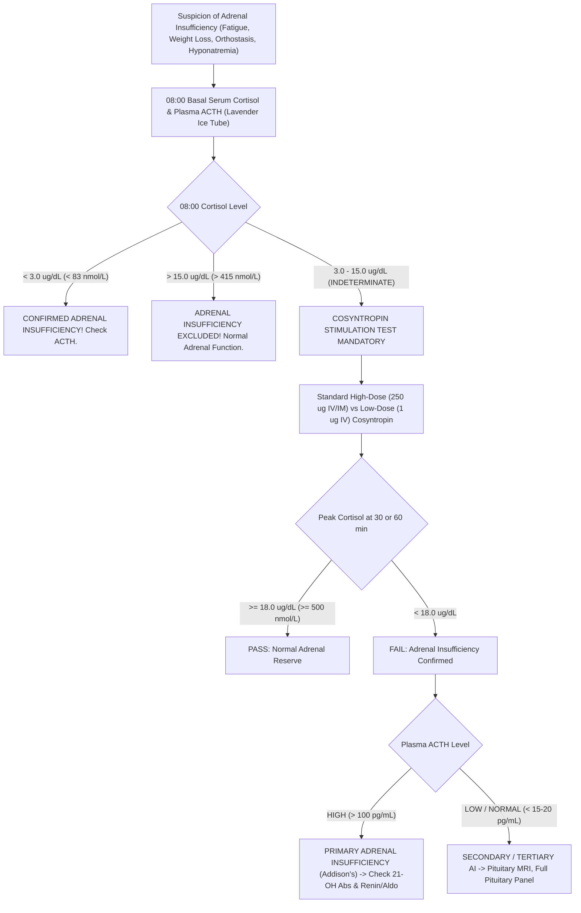

---

### **17.4.2 Dynamic Cosyntropin Stimulation Testing: High-Dose vs Low-Dose**

When basal morning cortisol falls into the indeterminate gray zone ($3.0\text{ to }15.0\ \mu\text{g/dL}$), provocative dynamic testing is required.

#### **1. The Standard High-Dose (250-$\mu\text{g}$) Cosyntropin Stimulation Test**
* **The Pharmacological Agent:** Cosyntropin (tetracosactide) consists of the first **24 amino acids of human ACTH ($\text{ACTH}_{1-24}$)**, possessing full steroidogenic potency identical to native 39-amino acid ACTH.
* **Supraphysiological Drive:** A $250\text{-}\mu\text{g}$ dose is astronomical—roughly **$1,000\times$ higher** than physiological peak ACTH levels in human blood, driving plasma ACTH concentrations above $10,000\text{ to }50,000\ \text{pg/mL}$ for several hours, maximizing steroidogenesis across the adrenal zona fasciculata.
* **Standard Protocol:**
  1. Patient presents at any time of day (diurnal rhythm is overwhelmed by $250\ \mu\text{g}$ ACTH), though morning testing is customary.
  2. Baseline Total Cortisol drawn at $t = 0\ \text{minutes}$.
  3. **$250\ \mu\text{g}$ Cosyntropin injected IV or IM**.
  4. Repeat serum cortisol drawn at **$t = +30\ \text{minutes}$ and $t = +60\ \text{minutes}$**.
* **Diagnostic Interpretation:**
  $$\mathbf{\text{Normal Passing Threshold: Peak Cortisol at 30 or 60 min } \ge 18.0\ \mu\text{g/dL}\ (500\ \text{nmol/L})}$$
  *(With modern monoclonal antibody or LC-MS/MS assays with zero steroid cross-reactivity, some academic centers have revised this threshold downward to $\ge 14.0\text{–}15.0\ \mu\text{g/dL}$.)*
  * **Peak $< 18.0\ \mu\text{g/dL}$:** Confirms adrenal insufficiency.

#### **2. The Low-Dose (1-$\mu\text{g}$) Cosyntropin Stimulation Test: Unmasking Subtle Central AI**
* **The Physiological Rationale:**
  * While the $250\text{-}\mu\text{g}$ test has near-$100\%$ sensitivity for primary adrenal failure, it can produce a **catastrophic false-negative in mild, partial, or recent secondary adrenal insufficiency**.
  * If a patient developed pituitary damage or abruptly ceased steroids 4 weeks ago, their pituitary ACTH is low, but the adrenal cortex has not yet undergone complete anatomical zona fasciculata atrophy. A massive $250\text{-}\mu\text{g}$ pharmacological hammer can shock even partially atrophic adrenal glands into producing an $18.5\ \mu\text{g/dL}$ cortisol, masking true life-threatening central hypoadrenalism!
  * A **$1.0\text{-}\mu\text{g}$ dose** generates peak plasma ACTH concentrations of $\sim 100\ \text{pg/mL}$—closely mimicking the physiological peak of severe surgical trauma or sepsis.
* **Behind-the-Curtain Preparation (The Serial Dilution Protocol):**
  Commercial vials contain $250\ \mu\text{g}$ of cosyntropin powder. To deliver $1\ \mu\text{g}$:
  1. Reconstitute a $250\text{-}\mu\text{g}$ vial in $1.0\ \text{mL}$ sterile normal saline.
  2. Inject the $1.0\ \text{mL}$ ($250\ \mu\text{g}$) into a **$250\text{-mL}$ bag of $0.9\%\ \text{NaCl}$** $\implies$ concentration = **$1.0\ \mu\text{g/mL}$**.
  3. Agitate thoroughly. Withdraw exactly **$1.0\ \text{mL}$ ($1.0\ \mu\text{g}$)** using a tuberculin syringe and administer IV push over 1 minute.
  4. Blood drawn at $t = 0, +20,$ and $+30\ \text{minutes}$. (Peak occurs early at $+20\text{–}30\ \text{min}$ due to rapid clearance of $1\ \mu\text{g}$).
* **Passing Threshold:** Peak Cortisol $\ge 18.0\ \mu\text{g/dL}$ at 20 or 30 minutes.

#### **3. The Insulin Tolerance Test (ITT): The Historical Gold Standard for the Central Axis**
* **Mechanism:** Intravenous regular insulin ($0.1\text{–}0.15\ \text{U/kg}$) induces acute neuroglycopenic stress. Severe hypoglycemia activates central hypothalamic autonomic nuclei to trigger massive endogenous CRH, ACTH, and GH release.
* **Prerequisites:** Blood glucose must drop to **$< 40\ \text{mg/dL}$ ($< 2.2\ \text{mmol/L}$)** with observable neuroglycopenic symptoms (diaphoresis, tachycardia, somnolence).
* **Normal Passing Criteria:** Peak Cortisol $\ge 18.0\ \mu\text{g/dL}$ AND Peak Growth Hormone $\ge 5.0\ \text{ng/mL}$.
* **Contraindications:** Severe coronary artery disease, history of seizures/epilepsy, cerebrovascular disease, elderly patients. Physician must remain at bedside with $50\%\ \text{Dextrose}$ ready for immediate infusion.

---

### **17.4.3 Congenital Adrenal Hyperplasia (CAH) & The Steroid Metabolome**

Congenital Adrenal Hyperplasia encompasses a family of autosomal recessive enzyme deficiencies along the steroidogenic pathway within the adrenal cortex:

```
Cholesterol 
   ↓ (CYP11A1 / Desmolase)
Pregnenolone ──────→ 17-OH Pregnenolone ──────→ DHEA ──→ DHEA-S
   ↓ (3β-HSD)             ↓ (3β-HSD)                 ↓ (3β-HSD)
Progesterone ──────→ 17-OH Progesterone (17-OHP) → Androstenedione ──→ Testosterone
   ↓ (CYP21A2)            ↓ (CYP21A2 / 21-OH)        ↓ 
11-DOC                    11-Deoxycortisol           Estradiol
   ↓ (CYP11B1)            ↓ (CYP11B1 / 11β-OH)
Corticosterone            Cortisol
   ↓ (CYP11B2)
Aldosterone
```

#### **1. 21-Hydroxylase Deficiency ($\text{CYP21A2}$, $> 90\%\text{ of CAH}$)**
* **The Biochemical Block:** Loss of 21-hydroxylase impairs conversion of **Progesterone $\to$ 11-Deoxycorticosterone** (mineralocorticoid pathway) and **17-OH-Progesterone $\to$ 11-Deoxycortisol** (glucocorticoid pathway).
* **Massive ACTH Drive:** Hypocortisolemia eliminates negative feedback, driving pituitary ACTH secretion to extreme levels. ACTH hyper-stimulates the adrenal cortex, shunting all steroid precursors into the intact **androgen pathway** (DHEA, Androstenedione, Testosterone).
* **Clinical Spectrum:**
  * **Classical Salt-Wasting ($0\%\text{ enzyme activity}$):** Severe mineralocorticoid and glucocorticoid deficiency presenting in the second week of life with hyperkalemic hyponatremic circulatory collapse; ambiguous genitalia in 46,XX females.
  * **Classical Simple Virilizing ($1\%\text{ enzyme activity}$):** Adequate aldosterone to maintain sodium balance; marked prenatal virilization of 46,XX fetuses.
  * **Non-Classic Late-Onset CAH ($\text{NCAH}$, $20\%\text{–}50\%\text{ activity}$):** Presents in adolescence/adulthood with hirsutism, cystic acne, oligomenorrhea, and infertility, mimicking PCOS!

#### **2. Liquid Chromatography–Tandem Mass Spectrometry Steroid Panel**
Immunoassays for steroid hormones cross-react intensely because steroid molecules share a nearly identical four-ring cyclopentanoperhydrophenanthrene core. Modern diagnosis demands **Steroid Profiling via Triple-Quadrupole LC-MS/MS**:

| Steroid Analyte | Biochemical Relevance | Normal Follicular / Basal Level | Diagnostic CAH Cutoff (21-OHD) | Diagnostic Cutoff (11$\beta$-OHD) |
| :--- | :--- | :--- | :--- | :--- |
| **17-Hydroxyprogesterone (17-OHP)** | Immediate precursor blocked by 21-OH | $< 200\ \text{ng/dL}$ ($< 6\ \text{nmol/L}$) | **$> 1,000\ \text{ng/dL}$ ($> 30\ \text{nmol/L}$)** (or post-cosyntropin $> 1,000$) | Normal to mildly elevated |
| **21-Deoxycortisol (21-DOF)** | Synthesized when 17-OHP is $11\beta\text{-hydroxylated}$; **Pathognomonic for 21-OHD!** | $< 20\ \text{ng/dL}$ ($< 0.6\ \text{nmol/L}$) | **$> 200\text{–}1,000\ \text{ng/dL}$ (Near-$100\%$ Specific)** | Completely Undetectable |
| **11-Deoxycortisol (Compound S)** | Precursor blocked by $11\beta\text{-hydroxylase}$ | $< 100\ \text{ng/dL}$ ($< 3\ \text{nmol/L}$) | Undetectable or low | **Sky-High ($> 2,000\text{–}5,000\ \text{ng/dL}$)** |
| **Deoxycorticosterone (DOC)** | Potent mineralocorticoid precursor blocked by $11\beta\text{-OH}$ | $< 10\ \text{ng/dL}$ | Undetectable | **Markedly elevated $\implies$ Severe Hypertension + Hypokalemia!** |
| **Androstenedione** | Direct adrenal androgen product | $50\text{–}150\ \text{ng/dL}$ | Markedly elevated ($> 400\ \text{ng/dL}$) | Elevated |

---

## **DOSSIER 17.5: PHEOCHROMOCYTOMA, PARAGANGLIOMA, AND THE CATECHOLAMINE METABOLOME**

### **17.5.1 Neuroendocrine Biology of Chromaffin Tumors**

Pheochromocytomas (arising from adrenal chromaffin cells) and Paragangliomas (arising from extra-adrenal sympathetic or parasympathetic paraganglia) secrete catecholamines: **Dopamine, Norepinephrine, and Epinephrine**.

#### **The Flaw of Measuring Native Catecholamines:**
1. **Episodic Secretion:** Catecholamine exocytosis from tumor secretory granules is paroxysmal; during inter-paroxysmal periods, circulating norepinephrine and epinephrine can be completely normal.
2. **Short Half-Life:** Native plasma catecholamines are rapidly cleared ($t_{1/2} \approx 1\text{ to }2\text{ minutes}$) by neuronal uptake-1 and extraneuronal uptake-2 mechanisms.
3. **Continuous Intratumoral Metabolism:** Chromaffin tumor cells continuously leak free catecholamines from storage vesicles into the cytoplasm, where the intracellular enzyme **Catechol-O-Methyltransferase ($\text{COMT}$)** metabolizes them continuously and independently of exocytosis:
   $$\text{Norepinephrine} \xrightarrow{\text{Intratumoral COMT}} \mathbf{\text{Normetanephrine}}$$
   $$\text{Epinephrine} \xrightarrow{\text{Intratumoral COMT}} \mathbf{\text{Metanephrine}}$$
   $$\text{Dopamine} \xrightarrow{\text{Intratumoral COMT}} \mathbf{\text{Methoxytyramine}}$$

These O-methylated metabolites—**Metanephrines**—have a much longer plasma half-life ($t_{1/2} \approx 30\text{ to }60\text{ minutes}$) and are continuously released into blood regardless of whether the tumor is actively firing!

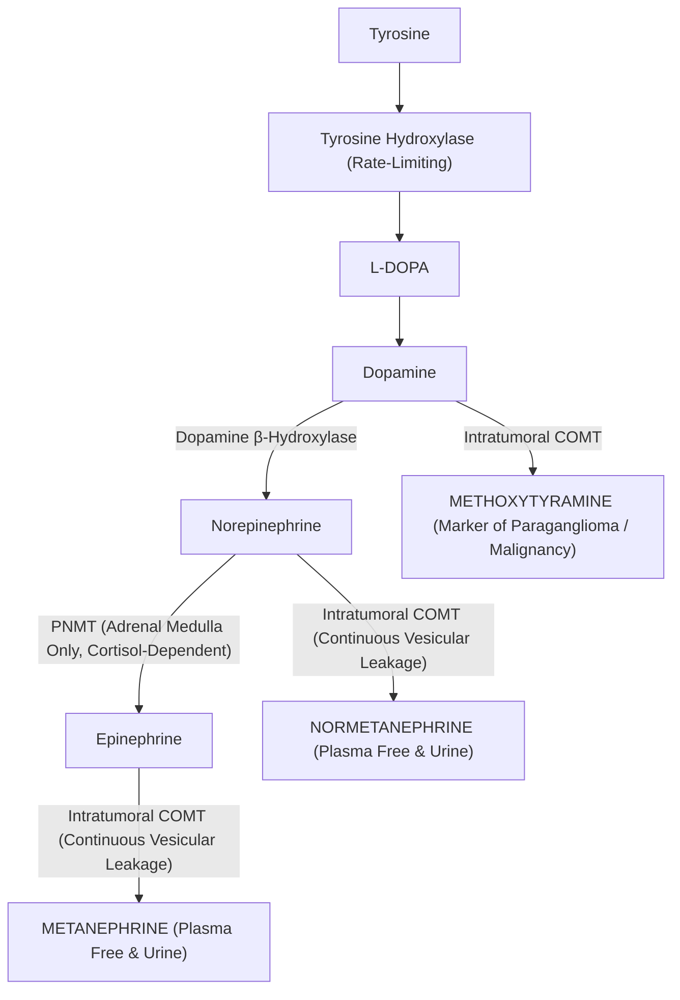

---

### **17.5.2 Plasma Free Metanephrines vs 24-Hour Urine Fractionated Metanephrines**

The biochemical test of choice is **Plasma Free Metanephrines** measured by **LC-MS/MS**:
* **Sensitivity:** $> 97\%\text{ to }99\%$ (virtually zero false-negatives; a negative plasma metanephrine essentially excludes pheochromocytoma).
* **24-Hour Urine Fractionated Metanephrines:** Sensitivity $90\%\text{ to }95\%$; historically favored due to wider availability, but relies on deconjugation of metanephrine sulfates generated by gastrointestinal bacteria and hepatic sulfotransferases ($\text{SULT1A3}$).

#### **The Strict Supine Rest Protocol: Eliminating the 30% False-Positive Disaster**
Because the sympathetic nervous system activates instantly in response to upright posture and physical pain, drawing blood seated or immediately following venipuncture causes massive physiological norepinephrine release:
* **The Seated Venipuncture Catastrophe:** Upright posture doubles plasma normetanephrine! More than **$25\%\text{ to }30\%$ of healthy individuals drawn while seated yield falsely elevated normetanephrine levels**, triggering hundreds of unnecessary CT and MRI scans.
* **The Rigorous Pre-Analytical Protocol:**
  1. Patient must avoid caffeine, nicotine, acetaminophen, and decongestants for 24 hours.
  2. Patient lies **completely supine in a quiet, dimly lit room for at least 30 minutes**.
  3. Blood MUST be drawn from an **indwelling intravenous catheter placed 30 minutes earlier**, OR drawn with minimal tourniquet time while the patient remains strictly supine.
  4. Blood collected in a **pre-chilled Lavender-top $\text{K}_2\text{-EDTA}$ tube**, placed immediately into an **ice-water slurry**, and centrifuged at $4^\circ\text{C}$.

#### **Diagnostic Thresholds (Supine LC-MS/MS):**
* **Free Normetanephrine:** Normal $< 0.90\ \text{nmol/L}$ ($< 165\ \text{pg/mL}$). Highly diagnostic: $> 2.2\ \text{nmol/L}$ ($> 400\ \text{pg/mL}$).
* **Free Metanephrine:** Normal $< 0.50\ \text{nmol/L}$ ($< 98\ \text{pg/mL}$). Highly diagnostic: $> 1.2\ \text{nmol/L}$ ($> 236\ \text{pg/mL}$).
* **The $\ge 3\times$ Upper Limit Rule:** Any value $> 3\times$ the upper reference limit is virtually $100\%$ diagnostic of pheochromocytoma/paraganglioma.

---

### **17.5.3 The Clonidine Suppression Test**

When plasma normetanephrine is borderline elevated ($1.0\text{ to }2.5\times$ ULN) and sympathetic pseudopheochromocytoma is suspected:
* **Mechanism:** Clonidine is a central $\alpha_2\text{-adrenergic}$ agonist that dampens sympathetic outflow from the rostral ventrolateral medulla. In anxious, sympathetic-hyperactive patients, clonidine shuts down neuronal norepinephrine release, dropping plasma normetanephrine. In pheochromocytoma, tumor secretion is autonomous and unaffected by central sympathetic tone.
* **Protocol:**
  1. Patient placed supine for 30 minutes; baseline plasma free normetanephrine drawn ($t = 0$).
  2. **$0.3\ \text{mg}$ oral Clonidine administered**.
  3. Patient remains supine with continuous BP monitoring (risk of profound hypotension).
  4. Repeat plasma normetanephrine drawn at **$t = +3\ \text{hours}$**.
* **Interpretation:**
  * **Normal Response (Sympathetic Excess Excluded):** Plasma normetanephrine drops by **$\ge 40\%$** from baseline AND falls into the normal reference range.
  * **Pheochromocytoma:** Plasma normetanephrine **fails to drop by $\ge 40\%$** or remains elevated above normal.

---

### **17.5.4 Genetic Screening Algorithms**

At least **$35\%\text{ to }40\%$ of all pheochromocytomas and paragangliomas are driven by germline pathogenic variants**—the highest hereditary rate of any human solid tumor! All patients require germline genetic testing via next-generation sequencing ($\text{NGS}$) panels:

| Gene | Disease Association | Clinical Features & Tumor Distribution | Malignancy Risk |
| :--- | :--- | :--- | :--- |
| **$\text{RET}$** | MEN2A & MEN2B | Bilateral adrenal pheochromocytomas (90% adrenergic/metanephrine), Medullary Thyroid Carcinoma, Hyperparathyroidism | Low ($< 5\%$) |
| **$\text{VHL}$** | von Hippel-Lindau | Adrenal pheos (noradrenergic), Clear Cell RCC, Hemangioblastomas (CNS/Retina), Pancreatic NETs | Low ($< 5\%$) |
| **$\text{NF1}$** | Neurofibromatosis Type 1 | Adrenal pheochromocytomas, Café-au-lait spots, Neurofibromas, Lisch nodules | Low ($< 5\%$) |
| **$\text{SDHB}$** | Hereditary Paraganglioma (Cluster 1A) | Extra-adrenal abdominal/thoracic paragangliomas; **High risk of metastatic disease!** | **HIGH ($30\% - 50\%$)** |
| **$\text{SDHD}$** | Hereditary Paraganglioma | Head and neck parasympathetic non-secretory paragangliomas (Glomus tumors); **Maternal imprinting (disease only when inherited from father!)** | Moderate ($5\%$) |
| **$\text{SDHA/C/AF2}$**| Paraganglioma syndromes | Head/neck paragangliomas, GIST tumors | Low to moderate |

---

## **DOSSIER 17.6: POSTERIOR PITUITARY & THYROID MASS SPECTROMETRY NUANCES**

### **17.6.1 The Polyuria-Polydipsia Spectrum & The Water Deprivation Test**

The differential diagnosis of hypotonic polyuria ($> 3\ \text{L/24 hr}$ with urine osmolality $< 300\ \text{mOsm/kg}$) encompasses:
1. **Central Diabetes Insipidus ($\text{CDI}$):** Deficiency of hypothalamic synthesis or posterior pituitary storage of Arginine Vasopressin ($\text{AVP}$).
2. **Nephrogenic Diabetes Insipidus ($\text{NDI}$):** Renal resistance to AVP at the level of the collecting duct $\text{V}_2$ receptor ($\text{AVPR2}$) or Aquaporin-2 water channel ($\text{AQP2}$).
3. **Primary Polydipsia ($\text{PP}$):** Compulsive excessive fluid ingestion suppressing physiological AVP release.

#### **The Classical Water Deprivation Test (The Miller-Moses Protocol):**
* Patient is deprived of fluids for up to 8 to 12 hours until urine osmolality plateaus ($< 30\ \text{mOsm/kg}$ change across three hourly voids) or serum sodium exceeds $145\ \text{mmol/L}$.
* Then, **$2\text{ to }4\ \mu\text{g}$ Desmopressin (DDAVP)** is injected SC or IV, and urine osmolality monitored for 2 hours.
* **Classical Interpretation:**
  * **Central DI:** Urine osmolality $< 300\ \text{mOsm/kg}$ after dehydration, increasing by **$> 50\%$ (often $> 100\%$)** after DDAVP.
  * **Nephrogenic DI:** Urine osmolality stays $< 300\ \text{mOsm/kg}$ despite DDAVP ($< 45\%\text{ increase}$).
  * **Primary Polydipsia:** Urine osmolality concentrates to $> 500\text{–}800\ \text{mOsm/kg}$ during dehydration, showing $< 10\%\text{ increase}$ after DDAVP.
* **The Severe Hazards of Miller-Moses:** The test is agonizing for patients, requires prolonged hospital observation, carries risk of severe hypernatremic dehydration in CDI, and produces ambiguous results in up to **$30\%\text{ to }40\%$ of patients** with partial forms of CDI or chronic primary polydipsia (which washes out the renal medullary concentration gradient)!

---

### **17.6.2 The Modern Plasma Copeptin Revolution**

Arginine Vasopressin ($\text{AVP}$) is notoriously difficult to measure in clinical laboratories: it is a tiny 9-amino acid nonapeptide ($M_r = 1,084\ \text{Da}$) that binds avidly to platelets, degrades within minutes at room temperature, and has a plasma half-life of only $15\text{ minutes}$.

**Copeptin** is the 39-amino acid C-terminal glycopeptide segment of the pre-pro-vasopressin precursor molecule:
$$\text{Pre-Pro-AVP} \implies \text{Signal Peptide} + \mathbf{\text{AVP (Active)}} + \text{Neurophysin II} + \mathbf{\text{Copeptin (1:1 Stoichiometric)}}$$

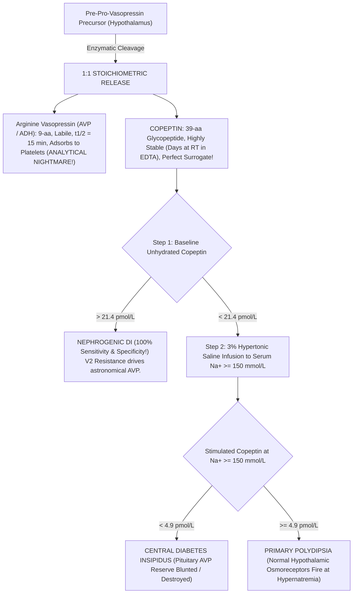

#### **The Diagnostic Protocols:**
1. **Unstimulated Baseline Copeptin (Instant NDI Rule-In):**
   * If baseline plasma copeptin without fluid deprivation is **$> 21.4\ \text{pmol/L}$**, **NEPHROGENIC DIABETES INSIPIDUS IS CONFIRMED WITH 100% SENSITIVITY AND SPECIFICITY**! Renal $\text{V}_2$ resistance causes profound homeostatic hypothalamic AVP hypersecretion. No further dynamic testing is required!
2. **Hypertonic Saline-Stimulated Copeptin Protocol:**
   * Used to distinguish Central DI from Primary Polydipsia.
   * Infusion of **$3\%\ \text{Sodium Chloride}$ IV** at $0.1\ \text{mL/kg/min}$ (or boluses) with serum sodium measured every 30 minutes until **$\text{Na}^+ \ge 150\ \text{mmol/L}$**.
   * At serum $\text{Na}^+ \ge 150\ \text{mmol/L}$, osmotic drive is maximal:
     * **Copeptin $< 4.9\ \text{pmol/L}$:** **Confirms Central Diabetes Insipidus** ($93\%\text{ sensitivity, } 100\%\text{ specificity}$).
     * **Copeptin $\ge 4.9\ \text{pmol/L}$:** **Confirms Primary Polydipsia** (intact osmoreceptors fire appropriately).
3. **Arginine Stimulation Test (The Safe Alternative):**
   * Infusion of L-Arginine ($0.5\ \text{g/kg}$ over 30 min) stimulates anterior and posterior pituitary secretion without inducing hypernatremia. Stimulated copeptin $< 3.8\ \text{pmol/L}$ indicates Central DI.

---

### **17.6.3 Thyroid Hormone Separation Physics: Equilibrium Dialysis & Ultrafiltration LC-MS/MS**

Routine automated Free $\text{T}_4$ and Free $\text{T}_3$ immunoassays use direct, analog competitive methods that measure hormone binding in the presence of native serum proteins. They are susceptible to catastrophic artifacts:
1. **Familial Dysalbuminemic Hyperthyroxinemia ($\text{FDH}$):** An autosomal dominant missense mutation in the human serum albumin gene (most commonly **Arg218His** or **Arg218Pro**) increases albumin's binding affinity for synthetic $\text{T}_4$ analog tracers by $50\times$. On competitive immunoassays, the mutant albumin swallows the tracer, printing a **falsely sky-high Free $\text{T}_4$ ($> 6\text{ to }8\ \text{ng/dL}$)** in a clinically euthyroid patient with normal TSH!
2. **Anti-$\text{T}_4$ and Anti-$\text{T}_3$ Autoantibodies:** Circulating immunoglobulins bind labeled tracer, simulating hyperthyroidism.
3. **Biotin and Heterophile Antibodies:** Disrupt streptavidin-biotin bridges.

#### **The Physical Separation Solution: $37^\circ\text{C}$ Equilibrium Dialysis ($\text{ED}$)**
To measure true free hormone, the free fraction must be physically separated from binding proteins *before* measurement:

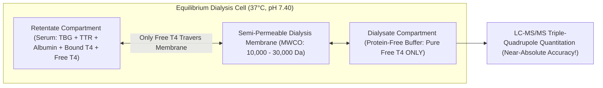

* **Physical Membrane:** A semi-permeable regenerated cellulose membrane with a **Molecular Weight Cut-Off ($\text{MWCO}$) of $10\text{ to }30\ \text{kDa}$** separates the serum from a physiological dialysate buffer ($\text{pH } 7.40$, $37^\circ\text{C}$).
* **Equilibrium:** Binding globulins ($\text{TBG } 54\ \text{kDa}$, $\text{Albumin } 66.5\ \text{kDa}$) cannot cross the pores. Free lipophilic $\text{T}_4$ ($777\ \text{Da}$) crosses freely until dialysate concentration equals serum free concentration.
* **Isotope-Dilution LC-MS/MS Quantitation:** The protein-free dialysate is spiked with $^{13}\text{C}_6\text{-L-Thyroxine}$, extracted, and injected into the triple quadrupole:
  $$\text{Free } \text{T}_4\ [M+H]^+: m/z\ 777.7 \longrightarrow 731.7\quad (\text{Quantifier})$$
  $$\text{Free } \text{T}_4\ [M+H]^+: m/z\ 777.7 \longrightarrow 604.8\quad (\text{Qualifier})$$
  $$^{13}\text{C}_6\text{-Free } \text{T}_4\ [M+H]^+: m/z\ 783.7 \longrightarrow 737.7\quad (\text{Internal Standard})$$
* This completely eliminates binding-protein artifacts, FDH, autoantibodies, and biotin interferences!

---

### **17.6.4 Thyroglobulin (Tg) by LC-MS/MS Tryptic Cleavage**

Thyroglobulin ($\text{Tg}$) is a large dimeric glycoprotein ($660\ \text{kDa}$) produced exclusively by thyroid follicular cells, serving as the critical tumor marker for surveillance of **Differentiated Thyroid Carcinoma (Papillary and Follicular Thyroid Cancer)** following total thyroidectomy and radioiodine ablation.

#### **The Anti-Thyroglobulin Autoantibody ($\text{TgAb}$) Nightmare:**
* Approximately **$20\%\text{ to }30\%$ of patients with thyroid carcinoma harbor circulating anti-thyroglobulin autoantibodies ($\text{TgAb}$)**.
* On standard two-site sandwich immunoassays (ECLIA/CMIA), endogenous patient $\text{TgAb}$ binds to surface epitopes on thyroglobulin, physically steric-hindering the analyzer's monoclonal antibodies from forming the sandwich bridge!
* **Result:** The analyzer reports **$\text{Tg} < 0.1\ \text{ng/mL}$ (falsely undetectable)** while the patient is harboring widely metastatic pulmonary or lymph node recurrences!

#### **The LC-MS/MS Proteomic Solution: Tryptic Peptide Digestion**
Mass spectrometry solves this problem by destroying the antibodies through enzymatic digestion:

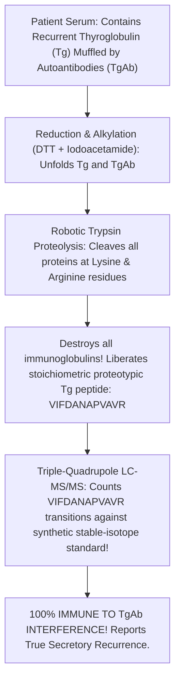

1. **Denaturation & Reduction:** Dithiothreitol ($\text{DTT}$) breaks all disulfide bonds, unfolding both thyroglobulin and the interfering autoantibodies.
2. **Alkylation:** Iodoacetamide carbamidomethylates free sulfhydryls, preventing refolding.
3. **Trypsin Digestion:** High-purity sequencing-grade trypsin cleaves peptide bonds specifically after lysine ($\text{Lys}$) and arginine ($\text{Arg}$) residues. This **completely pulverizes the patient's interfering anti-Tg autoantibodies into useless fragments** while liberating specific, reproducible **proteotypic signature peptides** from thyroglobulin.
4. **Signature Peptide Quantitation:** The conserved proteotypic peptide **$\text{VIFDANAPVAVR}$** (amino acids 1579–1590 of human thyroglobulin) is monitored:
   $$\text{Precursor Ion } [M+2H]^{2+}: m/z\ 629.8 \longrightarrow 856.5\quad (y_8\text{ Product Ion, Quantifier})$$
   $$\text{Precursor Ion } [M+2H]^{2+}: m/z\ 629.8 \longrightarrow 971.6\quad (y_9\text{ Product Ion, Qualifier})$$
   $$\text{Internal Standard } [^{13}\text{C}_6, ^{15}\text{N}_4\text{-Arg}]\ [M+2H]^{2+}: m/z\ 634.8 \longrightarrow 866.5$$
5. Because antibodies no longer exist after trypsinization, **LC-MS/MS thyroglobulin provides absolute diagnostic fidelity in $100\%$ of $\text{TgAb-positive}$ patients**!

---

## **DOSSIER 17.7: MASTER ANALYTICAL & INSTRUMENTATION REFERENCE COMPENDIUM**

### **17.7.1 Pre-Analytical Tube Selection, Storage & Rejection Criteria Matrix**

| Endocrine Dynamic Analyte | Tube Type & Additive | Transport Condition | Centrifugation Protocol | Storage Stability | Unconditional Laboratory Rejection Criteria |
| :--- | :--- | :--- | :--- | :--- | :--- |
| **Plasma ACTH** | **Lavender $\text{K}_2\text{-EDTA}$ (Plastic)** | **Ice-water slurry ($0^\circ\text{C}$)** | $4^\circ\text{C}$, $15\ \text{min}$ within $15\ \text{min}$ of draw | Frozen ($-20^\circ\text{C}$ for 7 days; $-80^\circ\text{C}$ for 6 months) | Glass tubes (ACTH adsorbs); Room temperature transport $> 15\ \text{min}$; Gross hemolysis |
| **Plasma Free Metanephrines** | **Lavender $\text{K}_2\text{-EDTA}$** | **Ice-water slurry** | $4^\circ\text{C}$, $15\ \text{min}$ within $30\ \text{min}$ | Frozen at $-20^\circ\text{C}$ | Drawn seated without $30\text{-min}$ supine rest; Transport unchilled |
| **Plasma Renin Activity ($\text{PRA}$)** | **Lavender $\text{K}_2\text{-EDTA}$** | **STRICT ROOM TEMPERATURE ($18\text{–}25^\circ\text{C}$)** | Room Temp, $2,000 \times g$, $15\ \text{min}$ | Freeze IMMEDIATELY after spin at $-20^\circ\text{C}$ | **NEVER CHILL WHOLE BLOOD!** (Cryoactivation of prorenin $\to$ renin causes massive false-high PRA!) |
| **Plasma Direct Renin ($\text{DRC}$)** | **Lavender $\text{K}_2\text{-EDTA}$** | Room Temperature | Room Temp, $15\ \text{min}$ | Frozen at $-20^\circ\text{C}$ | Chilled on wet ice prior to plasma separation |
| **Plasma Aldosterone ($\text{PAC}$)** | Gold $\text{SST}$ (Serum) or Lavender $\text{EDTA}$ | Ambient or Chilled | $15\ \text{min}$ at $2,000 \times g$ | Refrigerated 5 days, Frozen 1 year | Severe hemolysis (hemolyzed RBC enzymes degrade aldosterone) |
| **Serum Cortisol** | Gold $\text{SST}$ (Clot Activator) | Ambient | Allow $30\ \text{min}$ clot; Spin $10\ \text{min}$ | Refrigerated 7 days, Frozen 6 months | None (exceptionally stable steroid) |
| **Late-Night Salivary Cortisol** | **Synthetic Salivette (Swab)** | Ambient | Spin Salivette at $1,000 \times g$ for $2\ \text{min}$ | Refrigerated 14 days, Frozen 1 year | Cotton swab use (adsorption); **Blood contamination (Transferrin-positive)**; Insufficient volume ($< 200\ \mu\text{L}$) |
| **Plasma Copeptin** | Lavender $\text{K}_2\text{-EDTA}$ | Ambient or Chilled | Standard spin | Stable at Room Temp for **7 days!** | Gross hemolysis |
| **Thyroglobulin by LC-MS/MS** | Gold $\text{SST}$ (Serum) | Ambient | Standard clot & spin | Refrigerated 7 days, Frozen 1 year | Unseparated serum stored $> 24\ \text{hours}$ on clot |

---

### **17.7.2 Mass Spectrometry Multiple Reaction Monitoring (MRM) Parameter Database**

For triple-quadrupole mass spectrometers operated in Electrospray Ionization ($\text{ESI}$) mode with nitrogen desolvation gas ($450^\circ\text{C}$) and argon collision cell gas:

| Analyte | ESI Mode | Precursor Ion ($m/z$) | Product Quantifier ($m/z$) | Product Qualifier ($m/z$) | Collision Energy ($\text{eV}$) | Stable-Isotope Internal Standard |
| :--- | :--- | :--- | :--- | :--- | :--- | :--- |
| **Cortisol** | $\text{ESI}^+$ | $363.2\ [M+H]^+$ | **$121.1$** | $327.2$ | $30\ \text{eV}$ (Quant) / $18\ \text{eV}$ (Qual) | $d_4\text{-Cortisol}$ ($m/z\ 367.2 \to 121.1$) |
| **Cortisone** | $\text{ESI}^+$ | $361.2\ [M+H]^+$ | **$163.1$** | $121.1$ | $28\ \text{eV}$ / $34\ \text{eV}$ | $d_8\text{-Cortisone}$ ($m/z\ 369.2 \to 168.1$) |
| **Dexamethasone** | $\text{ESI}^+$ | $393.2\ [M+H]^+$ | **$373.2$** | $355.2$ | $14\ \text{eV}$ / $18\ \text{eV}$ | $d_4\text{-Dexamethasone}$ ($m/z\ 397.2 \to 377.2$) |
| **Aldosterone** | $\text{ESI}^-$ | $359.2\ [M-H]^-$ | **$189.1$** | $297.2$ | $26\ \text{eV}$ / $18\ \text{eV}$ | $d_4\text{-Aldosterone}$ ($m/z\ 363.2 \to 190.1$) |
| **17-OH-Progesterone** | $\text{ESI}^+$ | $331.2\ [M+H]^+$ | **$97.1$** | $109.1$ | $28\ \text{eV}$ / $30\ \text{eV}$ | $d_8\text{-17-OHP}$ ($m/z\ 339.2 \to 100.1$) |
| **21-Deoxycortisol** | $\text{ESI}^+$ | $347.2\ [M+H]^+$ | **$311.2$** | $121.1$ | $18\ \text{eV}$ / $32\ \text{eV}$ | $d_4\text{-21-DOF}$ ($m/z\ 351.2 \to 315.2$) |
| **11-Deoxycortisol** | $\text{ESI}^+$ | $347.2\ [M+H]^+$ | **$109.1$** | $97.1$ | $32\ \text{eV}$ / $30\ \text{eV}$ | $d_5\text{-11-Deoxycortisol}$ ($m/z\ 352.2 \to 109.1$) |
| **Free Metanephrine** | $\text{ESI}^+$ | $180.1\ [M-H_2O+H]^+$| **$148.1$** | $165.1$ | $16\ \text{eV}$ / $12\ \text{eV}$ | $d_3\text{-Metanephrine}$ ($m/z\ 183.1 \to 151.1$) |
| **Free Normetanephrine**| $\text{ESI}^+$ | $166.1\ [M-H_2O+H]^+$| **$134.1$** | $107.1$ | $18\ \text{eV}$ / $24\ \text{eV}$ | $d_3\text{-Normetanephrine}$ ($m/z\ 169.1 \to 137.1$) |
| **Methoxytyramine** | $\text{ESI}^+$ | $151.1\ [M-NH_3+H]^+$| **$119.1$** | $91.1$ | $16\ \text{eV}$ / $28\ \text{eV}$ | $d_3\text{-Methoxytyramine}$ ($m/z\ 154.1 \to 122.1$) |
| **Free Thyroxine ($\text{FT}_4$)**| $\text{ESI}^+$ | $777.7\ [M+H]^+$ | **$731.7$** | $604.8$ | $24\ \text{eV}$ / $38\ \text{eV}$ | $^{13}\text{C}_6\text{-T}_4$ ($m/z\ 783.7 \to 737.7$) |
| **Thyroglobulin Peptide**| $\text{ESI}^+$ | $629.8\ [M+2H]^{2+}$ | **$856.5\ (y_8)$** | $971.6\ (y_9)$ | $22\ \text{eV}$ / $20\ \text{eV}$ | $^{13}\text{C}_6,^{15}\text{N}_4\text{-Arg}\ (m/z\ 634.8 \to 866.5)$ |

---

### **17.7.3 Behind-the-Curtain Technician Dynamic Testing Checklist**

1. **Before any Dexamethasone test:** Screen the electronic health record for CYP3A4-inducing antiepileptics (phenytoin, carbamazepine) and oral estrogens. If present, alert the endocrinologist to switch to salivary cortisol or UFC, or order simultaneous serum dexamethasone via LC-MS/MS.
2. **Before any ARR collection:** Verify serum potassium was $\ge 4.0\ \text{mEq/L}$ within the preceding 24 hours. If hypokalemic, refuse collection until potassium chloride repletion is confirmed. Verify patient has been seated for $10\text{–}15\ \text{minutes}$.
3. **During Plasma Renin Activity ($\text{PRA}$) handling:** **DO NOT PUT ON ICE.** Chilling unseparated EDTA blood at $0\text{–}4^\circ\text{C}$ activates prorenin into renin conformational switching (cryoactivation), producing spurious three-fold elevated PRA results! Keep EDTA blood at room temperature, spin at room temperature, and freeze the separated plasma immediately.
4. **During Plasma Free Metanephrine draws:** Verify patient has been supine for 30 minutes. If the phlebotomist drew the blood via direct butterfly stick while the patient was sitting in a routine phlebotomy chair, note "SEATED DRAW" on the requisition—the normetanephrine will almost certainly be flagged false-positive!
5. **In the Adrenal Vein Sampling ($\text{AVS}$) suite:** Ensure rapid on-site cortisol testing (POC or STAT core lab) if available to verify Selectivity Index ($> 3\text{–}5$) before the interventional radiologist pulls the femoral sheaths.


---

## INCLUDED SOURCE: `LONGFORM_60MIN_PODCAST_EP811_ENDOCRINOLOGY_DYNAMIC_TESTING_AND_NEUROENDOCRINE_DISORDERS.md`

# BASIC MEDICAL — BEHIND THE CURTAIN CLINICAL DIAGNOSTICS PODCAST SERIES
## Episode 811: Endocrinology Dynamic Testing — Dexamethasone Suppression, Adrenal Vein Sampling, Metanephrines, and Water Deprivation

- **Series**: Basic Medical — Behind the Curtain Clinical Diagnostics Notebook
- **Episode**: 811 (60-to-90-Minute Unabridged Marathon Script)
- **Cast Mode C (Three Voices Across All Five Acts)**:
  - **Dr. Julian Vance** (`Vance` — Measured Gravitas, Medical Oncologist, and Neuroendocrine Tumor Center Director)
  - **Dr. Clara Sterling** (`Sterling` — Quick-Witted, Warm Clinical Endocrinologist and Devil's-Advocate Questioner)
  - **Tariq Al-Mansoor** (`Al-Mansoor` — Authoritative Lead Liquid Chromatography-Tandem Mass Spectrometry Steroid Lab Director and Interventional Adrenal Sampling Specialist)
- **Spoken Hygiene Standard**: Zero LaTeX; strictly no dollar signs and no backslashes anywhere in the manuscript. All mathematical ratios, mass concentrations, molar units, perfusion volumes, and enzymatic pathways written in clean, unabridged, spoken English for neural text-to-speech.

---

### ACT I: The Failure of Static Hormone Levels and the Cushing's Triad — Circadian Rhythms, Salivary Free Cortisol, 24-Hour Urine Creatinine Audits, and the Overnight One-Milligram Dex Test with Serum Dexamethasone Confirmation

**Dr. Clara Sterling:** Welcome to the endocrine diagnostic suite, everyone. I am Dr. Clara Sterling, clinical endocrinologist, and tonight we are tearing down the single greatest illusion in modern laboratory medicine: the static morning blood draw. If you walk onto any general medical ward or browse primary care charts, you will see clinicians ordering random, isolated serum hormone levels: a random serum cortisol at ten in the morning, a random growth hormone, a random aldosterone. Joining me tonight are two experts who live on the jagged frontier where static numbers collapse into chaos: Dr. Julian Vance, medical oncologist and director of our neuroendocrine tumor center, and Tariq Al-Mansoor, director of our clinical mass spectrometry laboratory and interventional adrenal endocrine catheterization unit. Julian, let us start with the core physiological heresy: why is pulling five milliliters of venous blood to check a static baseline hormone level often worse than flipping a coin?

**Dr. Julian Vance:** Because the endocrine system does not speak in steady-state direct-current voltages, Clara. It speaks in frequency-modulated, pulsating bursts that are locked to deep circadian oscillators, episodic sleep cycles, and shifting plasma protein binding pools. Consider cortisol. In a healthy human sleeping in a dark room, pituitary adrenocorticotropic hormone, or ACTH, begins firing in rapid, high-amplitude secretory volleys in the pre-dawn hours, between four and six in the morning. Cortisol cascades out of the adrenal zona fasciculata to reach a surging zenith between seven and eight in the morning, typically fifteen to twenty-five micrograms per deciliter, preparing the brain and cardiovascular tree for waking stress. By eight in the evening, those pulses slow down dramatically. By midnight, trough cortisol levels should plunge below one point eight micrograms per deciliter, approaching near-zero. 

**Tariq Al-Mansoor:** And that is before you factor in the carrier proteins, Julian. More than eighty to ninety percent of circulating cortisol in human blood is not free or biologically active at all; it is tightly bound with high affinity to corticosteroid-binding globulin, also known as transcortin, while another seven to ten percent is loosely bound to albumin. Only a tiny fraction, three to five percent, circulates as free, unbound cortisol capable of diffusing across capillary endothelia into target tissues. If an otherwise healthy twenty-six-year-old woman is taking a combined oral contraceptive pill containing ethinyl estradiol, the hepatic synthetic machinery goes into overdrive. Circulating corticosteroid-binding globulin doubles or triples. Her total serum cortisol level at eight in the morning might register at forty-two micrograms per deciliter. A clinician looking at that static number in isolation panics, thinks the patient is in a roaring hypercortisolemic crisis, and begins ordering unnecessary pituitary magnetic resonance imaging. Yet her free cortisol, her tissue exposure, and her midnight hypothalamic-pituitary-adrenal axis are completely normal.

**Dr. Clara Sterling:** Which brings us squarely to our first dynamic challenge: Cushing's syndrome. Hypercortisolism is notoriously insidious. Patients present with proximal muscle weakness, purple violaceous cutaneous striae wider than one centimeter, facial plethoric mooning, supraclavicular fat pads, osteoporosis, and labile hypertension. But because physiological stress, depression, and obesity can cause mild axis activation, international Endocrine Society guidelines strictly forbid relying on a single static morning cortisol. We demand proof of autonomous hypercortisolism through three validated dynamic first-line screening modalities. Julian, walk us through the screening algorithm and the crucial first test: the overnight one-milligram dexamethasone suppression test.

**Dr. Julian Vance:** The overnight one-milligram dexamethasone suppression test is an elegant functional probe of negative feedback sensitivity at the level of the hypothalamic paraventricular nucleus and pituitary corticotrophs. Dexamethasone is a potent synthetic glucocorticoid with roughly thirty times the glucocorticoid receptor affinity of native cortisol, and crucially, minimal mineralocorticoid cross-reactivity. At eleven o'clock at night, the patient ingests an oral tablet of exactly one milligram of dexamethasone with a small sip of water. In a healthy individual with an intact, responsive feedback loop, this exogenous glucocorticoid binds pituitary glucocorticoid receptors, profoundly suppressing endogenous ACTH synthesis and pro-opiomelanocortin gene transcription. Consequently, by eight or nine the following morning, endogenous adrenal cortisol synthesis completely shuts down.

**Dr. Clara Sterling:** And what is the diagnostic cutoff we demand at eight the next morning?

**Dr. Julian Vance:** The universally accepted modern diagnostic threshold is a post-dexamethasone serum cortisol level of less than one point eight micrograms per deciliter, or fifty nanomoles per liter. Decades ago, older textbooks used a much looser cutoff of five micrograms per deciliter. But clinical trials demonstrated that while a five microgram cutoff had decent specificity, it missed up to fifteen percent of patients with subtle, early Cushing's disease or autonomous cortisol-secreting adrenal adenomas. Lowering the diagnostic bar to one point eight micrograms per deciliter pushes diagnostic sensitivity above ninety-five to ninety-eight percent. If morning cortisol suppresses to one point two micrograms per deciliter, Cushing's is essentially excluded. If it remains at six or eight or fourteen micrograms per deciliter, the axis has failed to suppress. But here is the trap that Clara and I see every single month in consultation: a failed suppression test does not automatically prove endogenous Cushing's syndrome until Tariq runs the serum through his mass spectrometer. Tariq, tell them what is happening behind the curtain.

**Tariq Al-Mansoor:** This is the dirty secret of the overnight dexamethasone test that traditional immunoassay labs completely overlooked for forty years: you cannot interpret a post-dexamethasone cortisol unless you simultaneously measure the circulating level of dexamethasone itself! Dexamethasone is cleared almost exclusively through hepatic cytochrome P450 3A4, or CYP3A4. Suppose a patient is taking phenytoin, carbamazepine, phenobarbital, rifampin, or even over-the-counter St. John's wort. Those xenobiotics are potent CYP3A4 inducers. When the patient swallows that one-milligram tablet at eleven at night, their hyperactive liver enzymes chew through the drug in four hours. By eight in the morning, their serum dexamethasone level has cratered below sixty nanograms per deciliter. The pituitary never saw sustained suppressive levels of the drug! Their adrenal glands naturally produce eight micrograms per deciliter of morning cortisol. The clinician receives a post-dex cortisol of eight, mistakenly assumes autonomous Cushing's, and begins an expensive, anxiety-inducing workup.

**Dr. Clara Sterling:** And what about the opposite scenario, Tariq?

**Tariq Al-Mansoor:** The exact mirror image occurs when patients take CYP3A4 inhibitors like ketoconazole, itraconazole, fluconazole, clarithromycin, or ritonavir. In that setting, a single milligram of dexamethasone hangs around in the bloodstream for thirty hours, hitting circulating levels above four hundred nanograms per deciliter. Even a mildly autonomous pituitary corticotroph adenoma might temporarily bow to that massive pharmacological sledgehammer, yielding a false-negative suppression. That is why modern reference laboratories utilize liquid chromatography-tandem mass spectrometry, or LC-MS/MS, to simultaneously quantify both serum cortisol and serum dexamethasone from the exact same eight-AM blood tube. To confirm that the patient actually swallowed the pill and has normal metabolism, the eight-AM serum dexamethasone concentration must exceed one hundred forty to two hundred nanograms per deciliter, or roughly four point five to five point two nanomoles per liter. If the dexamethasone level is under one hundred forty nanograms per deciliter and the cortisol is elevated, the test is invalid. You cannot make a diagnosis of Cushing's syndrome on a patient who simply cleared the drug too fast.

**Dr. Julian Vance:** Let us turn to the second pillar of the screening triad: the twenty-four-hour urinary free cortisol, or UFC. Clara, why did we shift from measuring urinary steroid metabolites to measuring free unmetabolized cortisol, and how does Tariq audit whether my patient actually collected their urine properly?

**Dr. Clara Sterling:** In the historical era, laboratories measured urinary seventeen-hydroxycorticosteroids using the Porter-Silber colorimetric reaction. It was an analytical nightmare that cross-reacted with everything from spironolactone to cephalosporins. The modern twenty-four-hour urinary free cortisol bypasses the plasma binding proteins because corticosteroid-binding globulin cannot cross an intact glomerular filtration barrier. Only the unbound, free, biologically active cortisol filters through the glomerulus. In the renal tubules, a large portion is reabsorbed, but as circulating cortisol levels rise and saturate corticosteroid-binding globulin capacity in Cushing's syndrome, the filtered load overwhelms tubular reabsorption, causing a dramatic, exponential spike in unmetabolized cortisol spilling into the collecting bag.

**Tariq Al-Mansoor:** But the test is completely useless if the patient either spills half the jug down the drain or forgets to collect their afternoon voids! That is why our laboratory protocol strictly mandates a simultaneous measurement of twenty-four-hour urinary creatinine excretion alongside the free cortisol. In adult men under age fifty, expected twenty-four-hour creatinine excretion is fifteen to twenty-five milligrams per kilogram of total body weight per day; in women, it is ten to twenty milligrams per kilogram per day. If a seventy-kilogram man returns a twenty-four-hour urine container with only five hundred milligrams of total creatinine, he gave us an incomplete, eight-hour collection. A low urinary cortisol in that jug is completely meaningless. Conversely, if an overzealous bodybuilder gives us four thousand milligrams of creatinine, they may have collected for thirty-six hours, generating a false-positive hypercortisolemic result.

**Dr. Julian Vance:** And Tariq, explain the immense analytical danger of using direct commercial immunoassays on urine versus your LC-MS/MS platform.

**Tariq Al-Mansoor:** Urine is a complex biochemical soup containing dozens of steroid metabolites, conjugated glucuronides, and pharmaceutical compounds. If a patient is taking carbamazepine, digoxin, or synthetic steroids like prednisone, traditional antibodies in automated urine immunoassays cross-react with cortisol metabolites such as tetrahydrocortisol, allotetrahydrocortisol, and six-beta-hydroxycortisol, falsely inflating the reported number by two hundred to four hundred percent. With liquid chromatography-tandem mass spectrometry, we extract the steroid fraction, run it down a reverse-phase C18 chromatography column to separate cortisol chromatographically from its isobaric isomers and synthetic cousins, and inject it into a triple-quadrupole mass spectrometer. We monitor the precursor-to-product ion transition of mass-to-charge three hundred sixty-three point two to one hundred twenty-one point zero for cortisol, alongside a stable deuterium-labeled internal standard, cortisol-d4. The specificity is absolute. We require at least two separate, highly concordant twenty-four-hour urinary collections exceeding three times the upper limit of normal before declaring urinary free cortisol unequivocally positive.

**Dr. Clara Sterling:** Now let us examine the third pillar, which has become a true patient-friendly triumph: late-night salivary cortisol. Julian, why saliva, and why between twenty-three hundred and midnight?

**Dr. Julian Vance:** Late-night salivary cortisol directly exploits the disruption of circadian rhythm that is the universal hallmark of all forms of endogenous Cushing's syndrome. In healthy physiology, the circadian nadir occurs between eleven at night and midnight, when circulating free cortisol drops to virtually undetectable levels. Patients with Cushing's syndrome, regardless of whether the etiology is a pituitary microadenoma, an ectopic neuroendocrine tumor, or an adrenal cortical neoplasm, lose this physiological nocturnal dip. Their midnight cortisol levels remain stubbornly elevated. But bringing an anxious patient into an emergency room or phlebotomy center at midnight to stick a needle in their arm is an absurd paradox: the psychological terror and physical pain of venipuncture instantly triggers an acute hypothalamic CRH discharge, releasing ACTH and causing acute cortisol release that destroys diagnostic specificity!

**Dr. Clara Sterling:** Exactly. So instead, the patient stays in the quiet comfort of their own home. They take a specialized collection device, such as a Salivette containing a small cylindrical synthetic swab, and place it in their mouth between eleven at night and midnight. Unbound cortisol in the microvasculature of the salivary glands rapidly and passively diffuses across the acinar cell membranes into the saliva. Because it is small and lipid-soluble, its concentration in saliva directly reflects the circulating, biologically active free cortisol in plasma, completely independent of salivary flow rate and completely independent of corticosteroid-binding globulin!

**Tariq Al-Mansoor:** But Clara, you must warn your patients about the fatal pre-analytical pitfalls! If the patient brushes their teeth vigorously right before chewing the swab and causes microscopic gingival bleeding, whole blood leaks into the saliva. Remember that total blood cortisol is thirty times higher than salivary free cortisol; a single microscopic speck of blood turns a normal salivary test roaringly false positive. Similarly, patients must not smoke or chew tobacco, which contains substances that interfere with salivary enzyme kinetics, and they must avoid real black licorice. Licorice contains glycyrrhizic acid, which potently inhibits the enzyme eleven-beta-hydroxysteroid dehydrogenase type two.

**Dr. Julian Vance:** Explain that enzyme, Tariq, because eleven-beta-HSD2 is central to both salivary physiology and apparent mineralocorticoid excess.

**Tariq Al-Mansoor:** The human salivary gland expresses immense quantities of eleven-beta-hydroxysteroid dehydrogenase type two, or eleven-beta-HSD2. This high-affinity enzyme rapidly converts active cortisol into inactive cortisone. Under normal conditions, cortisone concentrations in human saliva actually exceed cortisol concentrations by three- to four-fold! If a patient consumes glycyrrhizic acid or carbenoxolone, eleven-beta-HSD2 is blocked, cortisol fails to convert to cortisone, and salivary cortisol surges. In our mass spectrometry lab, we measure both salivary cortisol and salivary cortisone simultaneously. A normal midnight salivary cortisol is less than zero point one zero micrograms per deciliter, or less than two point eight nanomoles per liter. If both salivary cortisol and cortisone are elevated past midnight on two separate nights, autonomous nocturnal hypercortisolism is established.

**Dr. Clara Sterling:** Let us confront the ultimate diagnostic chameleon: pseudo-Cushing's syndrome, or physiological non-neoplastic hypercortisolism. Julian, we regularly see patients with severe major depressive disorder, active alcohol use disorder, extreme generalized obesity, or poorly controlled type two diabetes with severe insulin resistance who show mild elevations across their urinary free cortisol or fail to suppress to one point eight micrograms per deciliter on the one-milligram dex test. How do we cleanly separate a true neoplastic corticotroph adenoma from physiological neuroendocrine axis hyperactivity?

**Dr. Julian Vance:** That separation requires advanced dynamic testing maneuvers. Historically, we used the low-dose Liddle test: zero point five milligrams of dexamethasone given orally every six hours for forty-eight hours, measuring twenty-four-hour urine collections before and during the final twenty-four hours. A patient with pseudo-Cushing's retains subtle sensitivity to prolonged, low-dose feedback and will suppress their urinary free cortisol below ten micrograms per twenty-four hours, whereas true Cushing's will not. 

**Dr. Clara Sterling:** But forty-eight hours of inpatient urine collection is cumbersome. What is the modern ambulatory alternative?

**Dr. Julian Vance:** The modern gold standard is the combined dexamethasone-suppressed corticotropin-releasing hormone, or dex-CRH stimulation test. You administer zero point five milligrams of oral dexamethasone every six hours for eight total doses over forty-eight hours, ending at six in the morning. Then, at eight in the morning, two hours after the final dexamethasone dose, you administer an intravenous bolus of one microgram per kilogram of ovine or human sequence corticotropin-releasing hormone, or CRH. Blood is drawn for plasma ACTH and cortisol at baseline, and then fifteen, thirty, forty-five, and sixty minutes after CRH infusion. 

**Tariq Al-Mansoor:** The biophysics of that test is brilliant. In a patient with pseudo-Cushing's, forty-eight hours of dexamethasone has completely shut down the normal hypothalamic-pituitary corticotroph machinery; an injection of CRH cannot overcome that profound pharmacological suppression, so serum cortisol fifteen minutes post-CRH remains flat, staying strictly below one point four micrograms per deciliter, or thirty-eight nanomoles per liter. But in a patient with a true neoplastic pituitary microadenoma, the autonomous tumor cells possess aberrant, upregulated CRH receptors. Despite the dexamethasone, the CRH bolus triggers a brisk, explosive rebound of ACTH and cortisol, pushing fifteen-minute cortisol well above one point four micrograms per deciliter.

**Dr. Clara Sterling:** Once hypercortisolism is confirmed, we must establish its anatomical origin. First, check baseline morning plasma ACTH. If plasma ACTH is suppressed below five picograms per milliliter, or one point one picomoles per liter, it is ACTH-independent Cushing's syndrome: the pathology is inside the adrenal cortex itself, usually a solitary adenoma, bilateral macronodular adrenal hyperplasia, or adrenocortical carcinoma. You order thin-cut adrenal CT. But if plasma ACTH is elevated or inappropriately normal, above fifteen to twenty picograms per milliliter, we are dealing with ACTH-dependent Cushing's. Now begins the classic showdown: is the ACTH coming from an eutopic pituitary corticotroph microadenoma, known as Cushing's disease, or from an occult neuroendocrine tumor secreting ectopic ACTH, such as a bronchial carcinoid, a pancreatic islet cell tumor, or a small cell lung cancer? Julian, walk us through the high-dose dexamethasone test and the ultimate invasive vascular gold standard: inferior petrosal sinus sampling.

**Dr. Julian Vance:** The high-dose dexamethasone suppression test uses eight milligrams of dexamethasone, administered either as an overnight eight-milligram oral bolus at eleven at night or two milligrams every six hours for forty-eight hours. The classical physiological premise is that pituitary adenomas, while abnormal, retain a partial, high-threshold negative feedback reset: hitting them with eight milligrams of dexamethasone suppresses plasma cortisol or twenty-four-hour urinary free cortisol by more than fifty percent relative to baseline. In contrast, non-pituitary neuroendocrine tumors secreting ectopic ACTH are completely autonomous and typically show zero suppression. 

**Dr. Clara Sterling:** However, at least ten to fifteen percent of bronchial carcinoid tumors express glucocorticoid receptors and will suppress by fifty percent, while ten percent of aggressive pituitary macroadenomas fail to suppress at all! So when the clinical picture or pituitary MRI is equivocal—especially given that up to ten percent of completely healthy normal people harbor incidental, non-functioning pituitary microadenomas on high-resolution MRI—we must take the patient to the interventional catheterization laboratory. Tariq, tell us about bilateral inferior petrosal sinus sampling, or IPSS.

**Tariq Al-Mansoor:** Inferior petrosal sinus sampling is the absolute pinnacle of dynamic endocrine interventional diagnostics. The pituitary gland drains its venous effluent bilaterally into the cavernous sinuses, which empty directly into the inferior petrosal sinuses before terminating in the internal jugular veins. Under real-time fluoroscopic guidance, an interventional radiologist navigates microcatheters from bilateral femoral venous access all the way up through the inferior vena cava, past the heart, into the internal jugular veins, and carefully engages the tiny ostia of both the left and right inferior petrosal sinuses. A third catheter rests in a peripheral sheath, usually the femoral vein.

**Dr. Clara Sterling:** And what are the dynamic sampling steps?

**Tariq Al-Mansoor:** We draw simultaneous blood samples for ACTH from the left inferior petrosal sinus, the right inferior petrosal sinus, and the peripheral vein at baseline minus five minutes and zero minutes. Then we administer an intravenous bolus of one hundred micrograms of human or ovine sequence CRH, or alternatively desmopressin, to stimulate the corticotrophs. We then draw simultaneous left petrosal, right petrosal, and peripheral blood at two, five, ten, and fifteen minutes post-stimulation. 

**Dr. Julian Vance:** And give us the exact mathematical diagnostic ratios, Tariq.

**Tariq Al-Mansoor:** We calculate the central-to-peripheral ACTH ratio. At baseline, prior to CRH stimulation, an inferior petrosal sinus to peripheral ACTH ratio of greater than or equal to two point zero proves a pituitary source: Cushing's disease. Following CRH stimulation, the central-to-peripheral ratio must reach or exceed three point zero to definitively confirm a pituitary source. If the peak central-to-peripheral ratio remains stubbornly below two point zero across all post-stimulation timepoints, the diagnosis is an ectopic ACTH-secreting tumor! We immediately halt any plans for transsphenoidal pituitary surgery and pivot to whole-body gallium-sixty-eight DOTATATE PET/CT and thin-cut chest CT to hunt for a bronchial or thymic carcinoid. Furthermore, by comparing the left petrosal ACTH to the right petrosal ACTH, an inter-sinus gradient of greater than or equal to one point four suggests lateralization to the left or right side of the pituitary fossa, guiding the neurosurgeon's initial micro-dissection!

---

### ACT II: Adrenal Vein Sampling and Primary Aldosteronism — The Seated Morning ARR Washout Gauntlet, Cannulating the Razor-Thin Right Adrenal Vein, the Selectivity Index, and Lateralization Math

**Dr. Clara Sterling:** Let us move from the glucocorticoid axis to the mineralocorticoid axis and tackle the single most underdiagnosed curable cause of secondary hypertension on Earth: primary aldosteronism. Up to ten percent of all hypertensive patients, and more than twenty percent of patients with treatment-resistant hypertension taking three or more antihypertensive medications, have primary aldosteronism! Yet fewer than two percent of eligible patients are ever properly screened. Julian, why is primary aldosteronism so catastrophically overlooked, and why did the old textbook teaching that every patient must have severe hypokalemia paralyze generations of doctors?

**Dr. Julian Vance:** That old dogma that primary aldosteronism always presents with hypokalemia was an absolute tragedy of clinical reasoning. Rigorous prospective international registries have now demonstrated beyond a shadow of a doubt that more than fifty to sixty percent of patients with confirmed, surgical-cure primary aldosteronism maintain completely normal serum potassium levels! If you wait for the serum potassium to drop below three point five milliequivalents per liter before suspecting excess aldosterone, you are only catching the severe tip of the iceberg. We must screen every patient with resistant hypertension, hypertension with hypokalemia, hypertension diagnosed before age thirty-five, hypertension with an adrenal incidentaloma, or hypertension with a family history of early-onset cardiovascular disease or stroke before age forty.

**Dr. Clara Sterling:** And our primary screening tool is the seated morning Aldosterone-to-Renin Ratio, or ARR. Tariq, walk us through the immense pharmacological minefield that every clinician must navigate before drawing that blood tube. What happens if an unsuspecting resident draws an ARR while the patient is taking spironolactone or lisinopril?

**Tariq Al-Mansoor:** Drawing an aldosterone-to-renin ratio without auditing the patient's medication list is the fastest way to generate useless, misleading data. Let us look at the physiology. Renin is synthesized by the juxtaglomerular apparatus of the renal afferent arterioles in response to renal hypoperfusion, sympathetic adrenergic stimulation, and decreased sodium chloride delivery to the macula densa. Renin cleaves angiotensinogen into angiotensin one, which is converted by angiotensin-converting enzyme to angiotensin two, which then binds the type one angiotensin receptor on adrenal zona glomerulosa cells to stimulate aldosterone synthase, coded by CYP11B2. Aldosterone promotes distal tubular epithelial sodium channel, or ENaC, sodium reabsorption in exchange for potassium and hydrogen ion excretion.

**Dr. Julian Vance:** So what do specific antihypertensives do to that feedback loop?

**Tariq Al-Mansoor:** Mineralocorticoid receptor antagonists, specifically spironolactone and eplerenone, block the aldosterone receptor directly. The kidney dumps sodium, intravascular volume contracts, and the juxtaglomerular apparatus mounts a massive compensatory release of renin. Active renin levels surge through the roof! Because renin is the denominator in the aldosterone-to-renin ratio, a massive surge in renin drives the calculated ARR down to zero point five or two point zero, creating a profound false-negative result! Spironolactone and eplerenone must be completely washed out for at least four to six full weeks before an ARR can be accurately measured.

**Dr. Clara Sterling:** What about ACE inhibitors, angiotensin receptor blockers, and dihydropyridine calcium channel blockers?

**Tariq Al-Mansoor:** ACE inhibitors and ARBs block the downstream action of angiotensin two. This removes the tonic negative feedback that angiotensin two exerts on juxtaglomerular renin release, so plasma renin rises while aldosterone synthesis falls. This also falsely lowers the ARR, potentially causing a false negative. Dihydropyridine calcium channel blockers, like amlodipine or nifedipine, cause peripheral vasodilation and reflex sympathetic baroreceptor activation, which also mildly stimulates renin and can depress the ARR. 

**Dr. Julian Vance:** And what about beta-adrenergic blockers?

**Tariq Al-Mansoor:** Beta-blockers, such as metoprolol, atenolol, or propranolol, do the exact opposite! Beta-one adrenergic receptors on juxtaglomerular cells are the primary drivers of sympathetic renin secretion. Block those receptors with a beta-blocker, and plasma renin activity is completely suppressed, dropping below zero point one nanograms per milliliter per hour. Because the denominator is now near-zero, even a modest, physiological plasma aldosterone of twelve nanograms per deciliter divided by zero point one yields an astronomical ARR of one hundred twenty, creating a roaring false-positive screening result!

**Dr. Clara Sterling:** So how on earth do we keep our severe hypertensive patients safe while washing out their medications for four to six weeks? What can we safely prescribe?

**Dr. Clara Sterling:** We switch them to non-interfering bridging agents! The two gold-standard medications that have minimal impact on the renin-angiotensin-aldosterone axis are peripheral alpha-one adrenergic antagonists, specifically doxazosin or prazosin, titrated up to four to eight milligrams daily, combined if necessary with a non-dihydropyridine calcium channel blocker like sustained-release verapamil, or centrally acting hydralazine. These agents control blood pressure without significantly altering circulating plasma renin or aldosterone.

**Dr. Julian Vance:** And do not forget the serum potassium, Clara! Hypokalemia directly inhibits aldosterone synthesis in the adrenal zona glomerulosa. If you draw an ARR on a patient whose serum potassium is sitting at two point nine milliequivalents per liter, the hypokalemia turns off aldosterone transcription. Their plasma aldosterone might read eight nanograms per deciliter, yielding a false-negative ratio. You must aggressively replete their potassium with oral potassium chloride until the serum potassium is strictly above four point zero milliequivalents per liter before the morning of the blood draw.

**Tariq Al-Mansoor:** And consider the posture and timing! Plasma renin activity and aldosterone obey posture-dependent hemodynamics. The patient must be out of bed and upright for at least two hours in the morning, and then seated quietly in a chair with both feet flat on the floor for fifteen to thirty minutes prior to phlebotomy. 

**Dr. Clara Sterling:** Now let us examine the numbers. How do we define a positive ARR screen?

**Dr. Julian Vance:** A positive screening test requires two simultaneous conditions. First, the ratio: when using plasma renin activity, or PRA, measured in nanograms per milliliter per hour, an ARR of greater than or equal to twenty to thirty is positive. If the lab uses direct renin concentration, or DRC, measured in milli-international units per liter or picograms per milliliter, the corresponding ratio cutoff is typically greater than two point zero to three point seven. Second, and this is crucial: you cannot diagnose primary aldosteronism on a high ratio alone if both the numerator and denominator are tiny! If plasma aldosterone is three nanograms per deciliter and plasma renin activity is zero point one, the ratio is thirty, but absolute aldosterone is trivial. To be considered a true positive screen, the absolute plasma aldosterone concentration, or PAC, must be elevated, typically greater than or equal to ten to fifteen nanograms per deciliter, or two hundred eighty to four hundred twenty picomoles per liter, in the presence of a suppressed renin.

**Dr. Clara Sterling:** If the screen is positive, guidelines recommend a confirmatory dynamic suppression test to prove that aldosterone secretion is truly autonomous and cannot be turned off by sodium expansion. Julian, summarize the confirmatory tests: oral sodium loading and the intravenous saline infusion test.

**Dr. Julian Vance:** The oral salt loading test involves having the patient consume a high-sodium diet, supplementing with six grams of oral sodium chloride tablets daily for three days, achieving urinary sodium excretion exceeding two hundred milliequivalents per twenty-four hours. In a healthy person, massive renal sodium loading expands plasma volume, completely shuts down renin, and drops twenty-four-hour urinary aldosterone below ten to twelve micrograms per day. If urinary aldosterone exceeds twelve micrograms in twenty-four hours despite two hundred milliequivalents of sodium excretion, autonomous aldosteronism is confirmed. The alternative ambulatory gold standard is the recumbent intravenous saline infusion test: the patient lies supine for one hour, and then receives an infusion of two liters of zero point nine percent normal saline over four hours. In normal physiology, two liters of saline expands intravascular volume and drops plasma aldosterone below five nanograms per deciliter. A post-infusion plasma aldosterone remaining above ten nanograms per deciliter is definitive confirmation of primary aldosteronism, while values between five and ten represent an indeterminate gray zone.

**Dr. Clara Sterling:** Now comes the ultimate fork in the road: the patient has confirmed primary aldosteronism. We perform a high-resolution, thin-cut CT scan of the adrenals. The CT shows a one-point-two-centimeter nodule in the left adrenal gland, and a normal-looking right adrenal. Can our surgeon take that patient straight to the operating room for a laparoscopic left adrenalectomy?

**Dr. Julian Vance:** Absolutely not! That is the single most common catastrophic mistake in endocrine surgery. Adrenal non-functioning cortical incidentalomas are extraordinarily common in middle-aged and older adults, present in three to seven percent of the general population. If you operate solely based on cross-sectional CT imaging, you will commit one of two devastating errors in up to thirty to forty percent of patients! Error number one: that visible left adrenal nodule is a harmless, non-functioning incidentaloma, while the true source of excess aldosterone is microscopic, CT-invisible hyperplasia in the contralateral right adrenal. You remove the left gland, and the patient wakes up still hypertensive, still with primary aldosteronism, now missing a healthy adrenal gland! Error number two: the patient has bilateral idiopathic adrenal hyperplasia with an incidental non-functioning nodule; removing one gland will not cure their hypertension. Cross-sectional CT imaging cannot distinguish between a unilateral aldosterone-producing adenoma, known as Conn's adenoma, and bilateral adrenal hyperplasia. To make that life-altering distinction, there is only one gold standard on Earth: interventional Adrenal Vein Sampling, or AVS. Tariq, you live in the fluoroscopy suite performing AVS. Walk us inside that procedure.

**Tariq Al-Mansoor:** Adrenal vein sampling is widely regarded as one of the most technically demanding procedures in all of interventional radiology. The fundamental challenge comes down to embryology and vascular anatomy. The left adrenal vein is relatively straightforward: it descends vertically and joins the left inferior phrenic vein to form a common trunk, roughly four to five millimeters in diameter, which empties directly into the superior aspect of the left renal vein. An interventional radiologist can easily advance a Cobra or Simmons catheter from the femoral vein into the left renal vein, identify the phrenic-adrenal trunk, and obtain stable access.

**Dr. Clara Sterling:** But the right adrenal vein is a nightmare!

**Tariq Al-Mansoor:** The right adrenal vein is an anatomical horror. It does not drain into a renal vein. It is a razor-thin, whisper-short vessel, often barely two to four millimeters in length and one to two millimeters in diameter, that empties directly into the posterolateral wall of the giant, high-flow inferior vena cava, typically at the level of the twelfth thoracic to first lumbar vertebra, frequently tucked behind or adjacent to accessory right hepatic veins! The interventionalist must use dedicated microcatheters—such as a Mikaelsson or reverse-curve catheter—and gently probe the posterolateral IVC wall under real-time fluoroscopy, puffing tiny hand-injections of non-ionic contrast to visualize the distinctive triangular or delta-shaped parenchymal blush of the right adrenal gland without dissecting or rupturing the vessel.

**Dr. Julian Vance:** And Tariq, explain how we verify that the catheter tip was actually inside the adrenal vein and not sucking up dilute blood from the inferior vena cava or a hepatic tributary.

**Tariq Al-Mansoor:** We use dynamic biochemistry to prove anatomical localization! Cortisol is produced in massive quantities by the adrenal zona fasciculata, whereas peripheral cortisol is diluted throughout the entire cardiac output. Therefore, we measure simultaneous cortisol concentrations in the blood drawn from the right adrenal vein, the left adrenal vein, and the infrarenal peripheral inferior vena cava. We calculate the Selectivity Index, or SI, which is defined as the concentration of cortisol in the adrenal vein divided by the concentration of cortisol in the peripheral IVC.

**Dr. Clara Sterling:** What are the mathematical cutoffs for the Selectivity Index?

**Tariq Al-Mansoor:** The cutoff depends on whether the procedure is performed with or without continuous exogenous cosyntropin, or ACTH, stimulation. Some centers perform non-stimulated AVS; in that setting, a Selectivity Index of greater than or equal to two point zero to three point zero proves successful cannulation. However, non-stimulated cortisol secretion is episodic and pulsatile, and stress from the procedure can cause rapid shifts. That is why our institution follows the continuous cosyntropin infusion protocol: we administer a continuous intravenous infusion of synthetic ACTH one-twenty-four at fifty micrograms per hour, starting thirty minutes prior to catheterization and continuing throughout the entire procedure. Continuous ACTH drives maximal, steady-state steroidogenesis from both adrenal glands, minimizes stress-induced fluctuations, and widens the gradient between adrenal and peripheral blood. Under continuous cosyntropin infusion, we demand a Selectivity Index of greater than or equal to five point zero! If the right adrenal vein cortisol divided by the IVC cortisol is eight point five, we have definitive proof of selective right adrenal cannulation. If it is only one point eight, the sample is diluted with IVC blood, the cannulation was unsuccessful, and you cannot interpret the aldosterone data.

**Dr. Julian Vance:** Now, assuming both left and right sides meet the Selectivity Index, how do we calculate the Lateralization Index to decide whether the patient gets surgery or medical therapy?

**Tariq Al-Mansoor:** We must first correct for dilution. Even with successful cannulation, one catheter might be wedged deeper into an adrenal tributary while the other sits slightly more ostial, drawing varying amounts of non-adrenal blood. To eliminate dilution artifacts, we normalize aldosterone to cortisol on each side! We calculate the aldosterone-to-cortisol ratio for the right adrenal vein, and the aldosterone-to-cortisol ratio for the left adrenal vein. Then, we divide the higher ratio by the lower ratio. That gives us the Lateralization Index, or LI.

**Dr. Clara Sterling:** Give us the exact numerical criteria, Tariq.

**Tariq Al-Mansoor:** The dominant-side aldosterone-to-cortisol ratio divided by the non-dominant-side aldosterone-to-cortisol ratio yields the Lateralization Index. Under continuous cosyntropin stimulation, a Lateralization Index of greater than or equal to four point zero provides definitive, rock-solid proof of unilateral aldosterone hypersecretion! A ratio of four to one or higher means that one gland is autonomously churning out aldosterone while the other is suppressed. That patient has a unilateral aldosterone-producing adenoma or unilateral hyperplasia. Laparoscopic unilateral adrenalectomy of that dominant gland cures the hypokalemia in one hundred percent of cases and completely cures or dramatically improves the hypertension in more than eighty to ninety percent of patients!

**Dr. Julian Vance:** And what if the Lateralization Index is under three point zero?

**Tariq Al-Mansoor:** If the Lateralization Index is less than three point zero—or under two point zero in non-stimulated protocols—the patient has bilateral adrenal disease, usually bilateral idiopathic adrenal hyperplasia. If you operate, you will not cure them. Their treatment is targeted medical therapy with mineralocorticoid receptor antagonists: spironolactone, titrated up to one hundred to two hundred milligrams daily, or eplerenone, fifty milligrams twice daily.

**Dr. Clara Sterling:** And what about the contralateral suppression index?

**Tariq Al-Mansoor:** Contralateral suppression is a brilliant supplementary calculation. You take the aldosterone-to-cortisol ratio of the non-dominant gland and divide it by the aldosterone-to-cortisol ratio of the peripheral IVC. In true unilateral disease, the autonomous adenoma suppresses systemic renin to near-zero; that suppressed renin shuts down aldosterone synthesis in the normal contralateral adrenal gland. Therefore, the contralateral gland should have an aldosterone-to-cortisol ratio that is lower than peripheral blood—a ratio of less than one point zero! Demonstrating contralateral suppression gives our surgeons incredible confidence that removing the dominant gland will lead to complete clinical remission.

---
### ACT III: Cosyntropin Stimulation and Congenital Adrenal Hyperplasia — High-Dose versus Low-Dose ACTH Challenges, The 17-Hydroxyprogesterone Blockade, and Tandem Mass Spectrometry Steroid Panels

**Dr. Clara Sterling:** Let us shift from adrenal excess to adrenal failure. Adrenal insufficiency is a medical emergency that can present either as an insidious, creeping syndrome of chronic fatigue, anorexia, weight loss, and orthostatic dizziness, or as a catastrophic, life-threatening adrenal crisis with refractory vasodilatory shock, hypoglycemia, hyponatremia, and hyperkalemia. Julian, before we look at the dynamic cosyntropin stimulation test, outline the critical clinical distinction between primary, secondary, and tertiary adrenal insufficiency.

**Dr. Julian Vance:** The distinction hinges entirely on where the regulatory hierarchy has failed. In primary adrenal insufficiency, historically known as Addison's disease, the pathology resides directly within the adrenal cortex itself. In ninety percent of cases in the developed world, this is autoimmune adrenalitis, driven by autoantibodies against twenty-one-hydroxylase, often as part of Autoimmune Polyglandular Syndrome type one or type two. In the developing world, infectious destruction from tuberculosis, histoplasmosis, or cytomegalovirus remains prominent. Because the entire adrenal cortex is destroyed, you lose both glucocorticoids from the zona fasciculata and mineralocorticoids from the zona glomerulosa! 

**Dr. Clara Sterling:** And what happens to the feedback loop?

**Dr. Julian Vance:** Because the pituitary senses a complete absence of circulating cortisol, negative feedback is lost. Pituitary corticotrophs go into hyperdrive, churning out immense quantities of pro-opiomelanocortin, or POMC. POMC is enzymatically cleaved into ACTH and melanocyte-stimulating hormone peptides, including alpha-MSH. Alpha-MSH binds the melanocortin one receptor on epidermal melanocytes, driving melanin synthesis. That is why patients with primary adrenal insufficiency develop intense, generalized hyperpigmentation, particularly prominent in sun-exposed areas, palmar creases, buccal mucosa, friction points over elbows and knees, and recent surgical scars. Furthermore, because the mineralocorticoid axis is destroyed, these patients have severe renal sodium wasting, profound intravascular volume depletion, orthostatic hypotension, and life-threatening hyperkalemia!

**Dr. Clara Sterling:** Contrast that with secondary and tertiary adrenal insufficiency.

**Dr. Julian Vance:** In secondary adrenal insufficiency, the adrenal glands are structurally normal, but the pituitary gland fails to secrete ACTH, whether due to a non-functioning pituitary macroadenoma, Sheehan's postpartum pituitary necrosis, lymphocytic hypophysitis, or traumatic brain injury. In tertiary adrenal insufficiency, the hypothalamus fails to secrete CRH, most commonly encountered when a patient on long-term pharmacological glucocorticoids suddenly stops their medication, leaving their hypothalamic-pituitary-adrenal axis profoundly suppressed and dormant. In secondary and tertiary disease, the skin is pale, never hyperpigmented, because ACTH and alpha-MSH are suppressed. And crucially, because the adrenal zona glomerulosa is regulated predominantly by the renin-angiotensin-aldosterone system and serum potassium rather than ACTH, aldosterone synthesis is largely preserved! Therefore, patients with secondary adrenal insufficiency suffer from severe glucocorticoid deficiency and hyponatremia—driven by elevated antidiuretic hormone from low vascular tone—but they typically maintain normal potassium levels and do not suffer primary mineralocorticoid collapse.

**Dr. Clara Sterling:** Now let us walk through the dynamic diagnostic test that evaluates adrenal cortical reserve: the Cosyntropin Stimulation Test. Tariq, what is cosyntropin, and what is the standard high-dose protocol?

**Tariq Al-Mansoor:** Cosyntropin, marketed as Cortrosyn, is a synthetic peptide consisting of the first twenty-four amino acids of the native thirty-nine-amino-acid human adrenocorticotropic hormone, designated ACTH one-twenty-four. Those first twenty-four amino acids contain the full, uncompromised biological steroidogenic activity of native ACTH, but with vastly reduced antigenicity. The standard high-dose cosyntropin stimulation test uses a dose of two hundred fifty micrograms, administered either as an intravenous bolus or an intramuscular injection.

**Dr. Clara Sterling:** Walk us through the timing and the phlebotomy protocol.

**Tariq Al-Mansoor:** You draw a baseline blood sample for serum cortisol and plasma ACTH at time zero. You immediately inject the two hundred fifty micrograms of cosyntropin. Then, you draw repeat serum cortisol samples at exactly thirty minutes and sixty minutes post-injection. 

**Dr. Julian Vance:** And what is the diagnostic pass-fail cutoff, Julian?

**Dr. Julian Vance:** In a healthy human with intact adrenal reserve, that massive pharmacological surge of ACTH binds the melanocortin two receptor on the adrenal cortex, activates adenylyl cyclase, stimulates protein kinase A, and mobilizes cholesterol via steroidogenic acute regulatory protein, or StAR, into the inner mitochondrial membrane. Cortisol synthesis surges. The universally accepted diagnostic threshold is that the peak serum cortisol—whether achieved at thirty minutes or sixty minutes—must rise to or exceed eighteen to twenty micrograms per deciliter, or five hundred nanomoles per liter. 

**Dr. Clara Sterling:** And how do we interpret the results?

**Dr. Julian Vance:** If the peak cortisol exceeds eighteen to twenty micrograms per deciliter, primary adrenal insufficiency is definitively ruled out. If the peak cortisol fails to reach eighteen micrograms per deciliter—say it starts at four and peaks at eight—the patient has adrenal insufficiency. To immediately establish whether that failure is primary or secondary, you look at the baseline ACTH tube that Tariq drew at time zero! If the baseline ACTH is markedly elevated, typically greater than two to three times the upper limit of normal, often exceeding one hundred to two hundred picograms per milliliter, the diagnosis is primary adrenal insufficiency: the pituitary is screaming at an adrenal cortex that cannot respond. If the baseline ACTH is low or inappropriately normal in the face of a subnormal cortisol peak, the diagnosis is secondary or tertiary adrenal insufficiency.

**Dr. Clara Sterling:** Now, Tariq, let us open the fierce debate that has divided endocrinologists for twenty-five years: the High-Dose Two-Hundred-Fifty-Microgram Test versus the Low-Dose One-Microgram Cosyntropin Test. Why was the one-microgram test invented, and why do some clinicians swear by it for secondary adrenal insufficiency?

**Tariq Al-Mansoor:** The physiological critique of the two hundred fifty microgram dose is that it is a colossal, supraphysiological sledgehammer! Consider this: a normal physiological stress response—such as major cardiac surgery or septic shock—causes endogenous plasma ACTH concentrations to peak between one hundred and two hundred picograms per milliliter. When you inject an intravenous bolus of two hundred fifty micrograms of cosyntropin, plasma ACTH concentrations exceed sixty thousand picograms per milliliter! That is several hundred times higher than the maximal physiological stress level!

**Dr. Clara Sterling:** And why is that dangerous in secondary adrenal insufficiency?

**Tariq Al-Mansoor:** In mild, partial, or recent-onset secondary adrenal insufficiency—for example, a patient who had a pituitary adenoma resected three weeks ago, or a patient who recently tapered off oral prednisone—the pituitary is failing, but the adrenal zona fasciculata has not yet undergone complete anatomical disuse atrophy. If you hit those resting adrenals with sixty thousand picograms of ACTH, that massive supraphysiological concentration can force an atrophied adrenal cortex to muster just enough steroidogenesis to crawl past eighteen micrograms per deciliter, yielding a false-negative normal test! The patient is sent home, encounters a severe viral illness, and crashes in an adrenal crisis.

**Dr. Julian Vance:** So proponents developed the low-dose test using exactly one microgram of cosyntropin. An intravenous bolus of one microgram achieves peak plasma ACTH levels around one hundred to two hundred picograms per milliliter, closely mimicking genuine physiological stress and easily detecting subtle or early secondary adrenal failure. But Tariq, explain the severe analytical and practical nightmares of trying to give a one-microgram dose!

**Tariq Al-Mansoor:** The low-dose test is an absolute minefield of compounding and pre-analytical errors. Cosyntropin does not come packaged in one-microgram vials; it comes in a two hundred fifty microgram vial! To prepare a one-microgram dose, an inpatient nurse or pharmacist must reconstitute the two hundred fifty microgram vial in two hundred fifty milliliters of normal saline, invert it, and then withdraw exactly one milliliter of that dilute solution.

**Dr. Clara Sterling:** And what happens to that single milliliter?

**Tariq Al-Mansoor:** Peptide biophysics happens! Cosyntropin is a hydrophobic peptide that adheres aggressively to the plastic walls of polypropylene syringes and polyvinyl chloride intravenous tubing! Studies have demonstrated that if a diluted one-microgram solution sits in an intravenous line or syringe for even ten minutes, up to fifty to eighty percent of the active peptide adsorbs to the plastic! The patient actually receives zero point two or zero point four micrograms of peptide. Their adrenal peak reaches only fourteen micrograms per deciliter, not because their adrenals are failing, but because the drug was stuck to the plastic wall of the syringe! The patient is misdiagnosed with adrenal insufficiency and committed to lifelong steroid therapy. That is why international consensus guidelines state that for primary adrenal insufficiency, the two hundred fifty microgram test remains the undisputed gold standard; for suspected secondary insufficiency, if you cannot perform a meticulously controlled one-microgram test, the two hundred fifty microgram test is acceptable, provided you understand that a borderline pass in a patient with recent pituitary surgery must be re-evaluated several months later.

**Dr. Clara Sterling:** Now let us explore another dynamic application of cosyntropin stimulation that bridges pediatric and reproductive endocrinology: Congenital Adrenal Hyperplasia, or CAH, and specifically the non-classic, late-onset variant. Julian, set the scene: a nineteen-year-old woman presents to our clinic with severe cystic facial acne, progressive hirsutism along her jawline and lower abdomen, temporal hair thinning, and irregular oligomenorrheic menstrual cycles. Her gynecologist labeled her with Polycystic Ovary Syndrome, or PCOS, but started her on oral contraceptives without dynamic testing. What genetic enzymatic defect must we actively rule out?

**Dr. Julian Vance:** We must rule out non-classic Congenital Adrenal Hyperplasia due to twenty-one-hydroxylase deficiency, caused by pathogenic mutations in the CYP21A2 gene. In the classical forms of twenty-one-hydroxylase deficiency, diagnosed in newborns, there is severe or complete enzymatic loss: the salt-wasting form presents in the first two weeks of life with hyponatremic, hyperkalemic circulatory shock, while the simple virilizing form presents with ambiguous genitalia in newborn females. But non-classic CAH, or NC-CAH, is an autosomal recessive condition where the patient retains twenty to fifty percent of normal twenty-one-hydroxylase activity.

**Dr. Clara Sterling:** And how common is it?

**Dr. Julian Vance:** It is one of the most common autosomal recessive disorders in humans! In the general Caucasian population, the carrier frequency is roughly one in sixty, and in certain populations, such as Ashkenazi Jews, the prevalence of non-classic CAH is as high as one in two hundred! These patients have enough twenty-one-hydroxylase activity to maintain normal baseline aldosterone and prevent neonatal adrenal crises. But under stress or during puberty, their adrenal glands struggle to produce adequate cortisol. The pituitary senses a subtle cortisol deficit, increases ACTH secretion, and drives adrenal cortical hyperplasia. Because the twenty-one-hydroxylase pathway is partially blocked, steroid precursors upstream of the block are shunted into the intact adrenal androgen pathway, flooding the circulation with dehydroepiandrosterone, androstenedione, and testosterone. The clinical phenotype is virtually indistinguishable from PCOS!

**Tariq Al-Mansoor:** Walk through the steroid synthesis pathway, Clara, so everyone visualizes the block.

**Dr. Clara Sterling:** Cholesterol is converted to pregnenolone, which becomes progesterone, or alternatively seventeen-hydroxypregnenolone, which becomes seventeen-hydroxyprogesterone, or seventeen-OHP. In a healthy adrenal, twenty-one-hydroxylase, coded by CYP21A2, converts seventeen-hydroxyprogesterone into eleven-deoxycortisol, which is then converted by eleven-beta-hydroxylase into cortisol. When twenty-one-hydroxylase is deficient, seventeen-hydroxyprogesterone cannot move forward. It piles up behind the enzymatic dam in massive quantities! And because seventeen-hydroxyprogesterone cannot become cortisol, it spills sideways across seventeen-twenty lyase into androstenedione and testosterone.

**Dr. Julian Vance:** So how do we screen and diagnose non-classic CAH dynamically?

**Dr. Clara Sterling:** First, screening: you must measure a baseline early morning seventeen-hydroxyprogesterone in the follicular phase of the menstrual cycle, typically on day three to five following menses. Why early morning? Because seventeen-OHP follows the exact same ACTH-driven circadian rhythm as cortisol. Why follicular phase? Because in the luteal phase, the ovarian corpus luteum naturally churns out significant quantities of seventeen-hydroxyprogesterone, which can cause a false-positive screen. 

**Tariq Al-Mansoor:** And what are the diagnostic numbers, Clara?

**Dr. Clara Sterling:** If the baseline morning follicular seventeen-OHP is less than two hundred nanograms per deciliter, or less than six nanomoles per liter, non-classic CAH is definitively excluded; the patient has true PCOS or idiopathic hirsutism. If the baseline seventeen-OHP is greater than one thousand nanograms per deciliter, or thirty nanomoles per liter, the diagnosis of twenty-one-hydroxylase deficiency is established without any further testing. But what if the baseline seventeen-OHP falls into the indeterminate gray zone, between two hundred and one thousand nanograms per deciliter? That is where dynamic cosyntropin stimulation is mandatory!

**Dr. Julian Vance:** Explain the dynamic protocol, Tariq.

**Tariq Al-Mansoor:** You administer two hundred fifty micrograms of intravenous cosyntropin and measure seventeen-hydroxyprogesterone at baseline zero minutes and sixty minutes post-injection. In a normal individual or a patient with PCOS, twenty-one-hydroxylase is intact; cosyntropin stimulates steroidogenesis, but the seventeen-OHP flows smoothly into eleven-deoxycortisol and cortisol, so the sixty-minute stimulated seventeen-OHP stays strictly below one thousand nanograms per deciliter. But in non-classic CAH, the partially defective enzyme is overwhelmed by the massive substrate load! The seventeen-OHP backs up behind the enzymatic block like a tidal wave. A post-stimulation sixty-minute seventeen-hydroxyprogesterone level of greater than or equal to one thousand nanograms per deciliter, or thirty nanomoles per liter, is the definitive, unequivocal diagnostic hallmark of non-classic CAH!

**Dr. Clara Sterling:** What about rarer forms of CAH that mimic this presentation?

**Dr. Julian Vance:** Two other enzymatic defects must be on your radar. First, eleven-beta-hydroxylase deficiency, caused by mutations in CYP11B1, accounting for roughly five to eight percent of CAH cases. Eleven-beta-hydroxylase converts eleven-deoxycortisol to cortisol, and eleven-deoxycorticosterone, or DOC, to corticosterone. When blocked, seventeen-OHP is normal or mildly elevated, but eleven-deoxycortisol and eleven-deoxycorticosterone accumulate dramatically. Because deoxycorticosterone is a potent mineralocorticoid, these patients develop low-renin severe hypertension and hypokalemia, combined with virilization! Second, seventeen-alpha-hydroxylase deficiency, caused by CYP17A1 mutations: this blocks both sex steroid and cortisol synthesis, shunting everything into corticosterone and DOC. These patients present with severe hypertension, hypokalemia, and complete absence of secondary sexual characteristics, presenting as phenotypic females with primary amenorrhea.

**Tariq Al-Mansoor:** And this is why modern reference laboratories have abandoned single-analyte testing in favor of comprehensive multiplex steroid profiling by liquid chromatography-tandem mass spectrometry. With a single two-hundred-microliter serum injection, our LC-MS/MS platform quantifies seventeen-hydroxyprogesterone, twenty-one-deoxycortisol, eleven-deoxycortisol, androstenedione, total testosterone, dehydroepiandrosterone sulfate, corticosterone, and cortisol simultaneously! Twenty-one-deoxycortisol is a particularly brilliant biomarker: it is formed exclusively when seventeen-OHP is eleven-beta-hydroxylated in the absence of twenty-one-hydroxylase. An elevated twenty-one-deoxycortisol is one hundred percent specific for CYP21A2 deficiency, completely resolving any ambiguous diagnostic dilemma!

---

### ACT IV: Pheochromocytoma and Paraganglioma Diagnostics — The Supine Rest Rule, Continuous Intratumoral Metanephrine Synthesis, the Clonidine Suppression Test, and Hereditary Genetic Syndromes

**Dr. Clara Sterling:** Let us enter the high-stakes domain of neuroendocrine chromaffin cell tumors: pheochromocytomas and paragangliomas. These are rare tumors, but missing them is lethal. A patient undergoing routine elective surgery can experience a massive intraoperative hypertensive crisis hitting three hundred millimeters of mercury systolic, culminating in acute hemorrhagic stroke, myocardial infarction, or acute cardiogenic shock from Takotsubo stress cardiomyopathy. Julian, why are pheochromocytomas called the great clinical mimics, and why did the classical textbook triad of headache, sweating, and palpitations fail clinicians for decades?

**Dr. Julian Vance:** Because the classic triad of episodic headache, profuse diaphoresis, and tachycardic palpitations is present in fewer than twenty-five percent of patients! Up to ten to fifteen percent of patients with pheochromocytoma have completely normal blood pressure between paroxysms, and another ten percent are completely asymptomatic, discovered as an incidental adrenal nodule on abdominal CT performed for diverticulitis or trauma. If you only suspect a pheochromocytoma when a patient is actively sweating and hypertensive, you will miss eighty percent of these tumors until they catastrophe in the operating room or labor and delivery suite.

**Dr. Clara Sterling:** And for decades, hospital laboratories measured parent catecholamines: serum epinephrine and norepinephrine, or spot urine dopamine. Tariq, tell us why measuring parent catecholamines was an analytical disaster, and why modern guidelines mandate measuring fractionated metanephrines.

**Tariq Al-Mansoor:** Measuring parent catecholamines is an analytical trap because of basic vascular physiology and tumor cell biology. First, circulating norepinephrine and epinephrine have an ultra-short biological half-life in human blood—barely sixty to ninety seconds! The body clears them with ruthless efficiency via neuronal reuptake-one transporters and extraneuronal enzymatic breakdown in the liver and kidneys. If a pheochromocytoma releases catecholamines in brief, episodic secretory spikes every three days, drawing blood on a Tuesday afternoon when the tumor is quiet reveals completely normal circulating norepinephrine and epinephrine.

**Dr. Clara Sterling:** But what makes metanephrines different?

**Tariq Al-Mansoor:** The revelation came when endocrine biochemists discovered that the metabolic conversion of catecholamines to metanephrines does not occur in the liver or the kidney—it occurs continuously inside the pheochromocytoma chromaffin tumor cells themselves! 

**Dr. Julian Vance:** Walk through that intracellular biochemistry, Tariq, because this is one of the most elegant concepts in neuroendocrine medicine.

**Tariq Al-Mansoor:** In normal adrenal chromaffin cells and adrenergic neurons, norepinephrine and epinephrine are synthesized in the cytoplasm and immediately pumped into chromaffin granules by vesicular monoamine transporters, or VMAT. Inside those granules, catecholamines are sequestered away from cytoplasmic enzymes. However, in pheochromocytoma tumor cells, vesicular storage is leaky and defective. Free norepinephrine and epinephrine constantly leak from storage vesicles into the tumor cell cytoplasm. Sitting in that tumor cell cytoplasm is the enzyme Catechol-O-Methyltransferase, or COMT. COMT methylates the three-hydroxy group of catechol rings: it converts norepinephrine into normetanephrine, and epinephrine into metanephrine.

**Dr. Clara Sterling:** And what happens to those metanephrines?

**Tariq Al-Mansoor:** Metanephrines cannot be pumped back into storage vesicles. They slowly, passively, and continuously leak out of the tumor cell membrane directly into the capillary bloodstream twenty-four hours a day, seven days a week! Even when the patient is sound asleep, even when their blood pressure is one hundred ten over seventy, even when the tumor is not releasing a single pulse of active catecholamines, that tumor is constantly spilling free normetanephrine and metanephrine into the circulation! That is why plasma free metanephrines possess a diagnostic sensitivity exceeding ninety-seven to ninety-nine percent. If plasma free metanephrines are normal, you have effectively ruled out a secreting pheochromocytoma.

**Dr. Julian Vance:** But while sensitivity is ninety-nine percent, specificity can be notoriously fragile if clinicians ignore the golden rule of phlebotomy: the Supine Rest Rule. Clara, walk us through the phlebotomy protocol, and why sitting in a phlebotomy chair generates thousands of false-positive consults every year.

**Dr. Clara Sterling:** This is my greatest clinical crusade! Normal sympathetic adrenergic nerves release norepinephrine. Whenever a human stands up, or sits upright in a phlebotomy chair with their feet dangling, gravitational venous pooling in the lower extremities triggers carotid and aortic baroreceptors. The central nervous system fires a compensatory sympathetic reflex discharge to maintain cerebral perfusion. Sympathetic nerve terminals release norepinephrine, which is cleared locally by neuronal reuptake and extraneuronal COMT, releasing physiological normetanephrine into the bloodstream. In an upright, seated individual, plasma normetanephrine levels are thirty to one hundred percent higher than in a supine individual!

**Dr. Julian Vance:** And add the stress of the needle stick!

**Dr. Clara Sterling:** If a terrified patient sits upright in a busy outpatient lab, waits thirty minutes, and then gets stuck with a twenty-one-gauge needle, their acute stress and sympathetic tone drives plasma normetanephrine right into the mild elevation zone—say one point five to two times the upper limit of normal. The clinician receives that report, panics, and tells the patient they have a life-threatening adrenal tumor!

**Tariq Al-Mansoor:** That is why the Endocrine Society guidelines strictly mandate the following phlebotomy protocol: the patient must have an indwelling intravenous cannula placed in their arm, and then they must lie completely supine in a quiet, dimly lit room for at least twenty to thirty minutes before blood is drawn through that established line! No talking, no mobile phones, no agitation. When drawn under strict supine resting conditions, physiological sympathetic tone drops to baseline, and diagnostic specificity vaults from eighty percent up to ninety-five percent!

**Dr. Julian Vance:** What about medications that interfere with metanephrine metabolism, Tariq?

**Tariq Al-Mansoor:** The medication interference list is extensive. Tricyclic antidepressants, such as amitriptyline or nortriptyline, and serotonin-norepinephrine reuptake inhibitors, or SNRIs, such as venlafaxine and duloxetine, block the norepinephrine transporter, preventing neuronal reuptake and causing marked elevations in circulating normetanephrine. Non-selective beta-blockers with alpha-blocking properties, specifically labetalol, and pure alpha-blockers like phenoxybenzamine cause substantial reflex sympathetic activation. Acetaminophen used to cause massive analytical chromatographic interference on older electrochemical detection HPLC platforms, although modern mass spectrometry has largely resolved that specific chemical artifact. Whenever possible, interfering psychoactive and adrenergic medications should be tapered and discontinued for at least two weeks prior to screening.

**Dr. Clara Sterling:** What about the alternative screening test: twenty-four-hour fractionated urinary metanephrines?

**Dr. Julian Vance:** The twenty-four-hour urinary fractionated metanephrines—normetanephrine and metanephrine measured alongside twenty-four-hour creatinine—has slightly lower sensitivity, around ninety to ninety-five percent, but slightly higher specificity than plasma testing. In low-probability screening—such as evaluating a classic forty-year-old patient with essential hypertension or an incidentaloma with low-risk imaging features—urinary metanephrines is an excellent, forgiving first-line choice because it integrates twenty-four hours of secretion, buffering against acute phlebotomy stress. But in a high-risk patient—such as someone with a known genetic predisposition or a massive vascular adrenal mass—supine plasma free metanephrines is mandatory.

**Dr. Clara Sterling:** Now let us address the agonizing dilemma: the borderline elevated metanephrine. A patient is tested, and their plasma normetanephrine returns at one point eight times the upper limit of normal. It is not four-fold elevated—which would be virtually diagnostic of pheo—but it is definitely above the reference range. How do we dynamically prove whether that elevation represents autonomous tumor secretion versus hyperadrenergic essential hypertension? Julian, introduce the Clonidine Suppression Test.

**Dr. Julian Vance:** The clonidine suppression test is an extraordinary pharmacological probe of central sympathetic outflow. Clonidine is an agonist at central alpha-two adrenergic receptors in the rostral ventrolateral medulla of the brainstem. Activating those presynaptic alpha-two receptors sends an inhibitory signal down the intermediolateral cell column of the spinal cord, profoundly shutting down peripheral sympathetic nervous system outflow.

**Dr. Clara Sterling:** And how does that affect metanephrines?

**Dr. Julian Vance:** In a patient with essential hypertension or hyperadrenergic anxiety, elevated plasma normetanephrine is driven entirely by excessive physiological firing of sympathetic nerves. When you give clonidine, central sympathetic drive shuts down. Sympathetic norepinephrine release plummets, and circulating plasma normetanephrine falls precipitously! In contrast, a pheochromocytoma is a completely autonomous neoplasm that lacks central neural innervation; its continuous synthesis of metanephrine is driven by autonomous tumor transcription and leaky granules. Clonidine has zero effect on the tumor!

**Tariq Al-Mansoor:** Walk us through the exact clinical protocol and cutoffs, Tariq.

**Tariq Al-Mansoor:** The patient lies supine with an intravenous line in place. Baseline blood is drawn for plasma free normetanephrine and catecholamines. The patient is then administered an oral dose of zero point three milligrams of clonidine. Repeat blood samples are drawn at two hours and three hours post-clonidine. We monitor blood pressure carefully, as clonidine causes significant hypotension. In a patient without a pheochromocytoma, plasma normetanephrine suppresses by at least fifty percent from baseline AND drops into the normal reference range. If plasma normetanephrine remains stubbornly elevated, failing to suppress by fifty percent, autonomous pheochromocytoma secretion is confirmed!

**Dr. Julian Vance:** Once biochemical confirmation is established, we must discuss one of the most extraordinary shifts in modern neuroendocrine oncology: the genetics of pheochromocytoma and paraganglioma. Clara, up to forty percent of all patients presenting with a pheochromocytoma or paraganglioma carry a germline pathogenic mutation! Every single patient diagnosed with a chromaffin tumor, regardless of age or family history, must undergo comprehensive germline genetic testing. Walk us through the major genetic clusters.

**Dr. Clara Sterling:** The genetics are divided into three distinct molecular clusters. Cluster One is the Pseudohypoxia group. This includes Von Hippel-Lindau disease, caused by mutations in the VHL tumor suppressor gene on chromosome three, and mutations in the Succinate Dehydrogenase complex genes: SDHA, SDHB, SDHC, SDHD, and SDHAF2. In Cluster One tumors, loss of VHL or accumulation of succinate inhibits prolyl hydroxylase enzymes, preventing the degradation of Hypoxia-Inducible Factors, HIF-one-alpha and HIF-two-alpha. Even under normal oxygen tensions, the tumor cells behave as if they are suffocating in severe hypoxia! They activate massive angiogenic pathways, overexpressing vascular endothelial growth factor, or VEGF. Clinically, Cluster One tumors produce predominantly normetanephrine, because they lack the glucocorticoid-dependent enzyme phenylethanolamine N-methyltransferase, or PNMT, which converts norepinephrine to epinephrine!

**Dr. Julian Vance:** And highlight SDHB and SDHD, Clara, because their clinical behaviors are radically different.

**Dr. Clara Sterling:** This is critical oncology board knowledge! Mutations in SDHB—succinate dehydrogenase subunit B—carry an alarming forty to fifty percent risk of malignant, metastatic transformation! If an SDHB mutation is identified, that patient requires lifelong, intensive whole-body surveillance. In contrast, SDHD exhibits maternal imprinting: disease manifestations only occur when the mutant allele is inherited from the father! If a patient inherits an SDHD mutation from their mother, they will be an unaffected carrier; but if they pass it to their children, their offspring can develop roaring paragangliomas of the carotid body and glomus jugulare!

**Dr. Clara Sterling:** What about Cluster Two?

**Dr. Julian Vance:** Cluster Two is the Kinase Signaling group. This includes Multiple Endocrine Neoplasia type two, or MEN 2A and MEN 2B, caused by activating mutations in the RET proto-oncogene, as well as Neurofibromatosis type one, caused by NF1 mutations. In Cluster Two, constitutive receptor tyrosine kinase activation drives cell proliferation. Because these tumors arise in the adrenal medulla adjacent to high cortical glucocorticoid concentrations, PNMT is strongly expressed. Therefore, Cluster Two tumors produce massive quantities of epinephrine and metanephrine! Patients present with striking paroxysmal palpitations, tachyarrhythmias, and labile systolic hypertension. Identifying a RET mutation instantly mandates screening for medullary thyroid carcinoma by measuring serum calcitonin, and primary hyperparathyroidism by measuring calcium and PTH.

---
### ACT V: The Polyuria-Polydipsia Gauntlet, Copeptin Revolution, and Free Hormone Equilibrium Dialysis — Water Deprivation versus Hypertonic Saline Copeptin, and Why Analog Immunoassays Fail in Thyroid and Androgen Testing

**Dr. Clara Sterling:** Welcome to Act Five, everyone. We are closing tonight's journey with two foundational frontiers in endocrine diagnostics: first, the polyuria-polydipsia syndrome and the modern diagnostic revolution that finally replaced the grueling classical water deprivation test; and second, the physical biochemistry of free hormone measurement—why routine automated analog immunoassays fail in high-stakes clinical scenarios, and why equilibrium dialysis coupled to tandem mass spectrometry remains our unbreakable reference standard. Julian, start us off with the patient who complains of drinking eight liters of ice water every day and waking up every forty-five minutes to urinate. How do we rigorously define pathological polyuria?

**Dr. Julian Vance:** You must begin by separating true polyuria from urinary frequency or nocturnal urgency. True polyuria is quantitatively defined as a twenty-four-hour urinary output exceeding forty to fifty milliliters per kilogram of body weight per day, which in a typical adult translates to more than three to four liters of dilute urine every twenty-four hours, with a measured urine osmolality of less than three hundred milliosmoles per kilogram. Once true hypotonic polyuria is established, the clinician enters one of the classic triad differentials of clinical medicine: Central Diabetes Insipidus, Nephrogenic Diabetes Insipidus, or Primary Polydipsia.

**Dr. Clara Sterling:** Walk through that triad, Julian.

**Dr. Julian Vance:** In Central Diabetes Insipidus, also known as neurohypophyseal or cranial diabetes insipidus, the magnocellular neurosecretory neurons of the hypothalamic supraoptic and paraventricular nuclei fail to synthesize or secrete arginine vasopressin, historically called antidiuretic hormone or ADH. Etiologies range from idiopathic autoimmune infundibuloneurohypophysitis, pituitary macroadenomas, craniopharyngiomas, germinomas, histiocytosis, sarcoidosis, to severe closed head trauma or post-neurosurgical complications following transsphenoidal pituitary resection, which often displays a dramatic triphasic response. Without vasopressin, the renal collecting duct cannot reabsorb water, leading to massive hypotonic polyuria.

**Dr. Clara Sterling:** What about Nephrogenic Diabetes Insipidus?

**Dr. Julian Vance:** In Nephrogenic Diabetes Insipidus, the hypothalamus and posterior pituitary are intact and pumping out normal or elevated quantities of vasopressin. The defect lies entirely within the renal medullary collecting duct. In hereditary forms, it is caused by mutations in the X-linked AVPR2 gene encoding the vasopressin V2 receptor, or autosomal mutations in the AQP2 gene encoding aquaporin-two. In adults, it is overwhelmingly acquired: chronic lithium therapy for bipolar disorder, chronic severe hypercalcemia, persistent hypokalemia, or post-obstructive uropathy.

**Tariq Al-Mansoor:** Highlight the cellular mechanism of lithium toxicity, Julian, because that is an extraordinary piece of renal pharmacology.

**Dr. Julian Vance:** Lithium enters the principal cells of the cortical and medullary collecting duct through apical epithelial sodium channels, or ENaC. Once inside the principal cell, lithium accumulates and potently inhibits an intracellular enzyme called glycogen synthase kinase three-beta. Inhibiting this kinase disrupts the intracellular signaling cascade triggered by the V2 receptor, preventing the transcription, phosphorylation, and apical membrane trafficking of aquaporin-two water channels! The collecting duct becomes completely impermeable to free water, even in the presence of massive circulating vasopressin concentrations.

**Dr. Clara Sterling:** And what is the third entity in the triad: Primary Polydipsia?

**Dr. Julian Vance:** Primary Polydipsia is excessive, compulsive water intake that suppresses endogenous vasopressin secretion physiologically. It can be psychogenic polydipsia, frequently seen in chronic schizophrenia or severe anxiety disorders, or dipsogenic polydipsia, where an abnormal reset of the hypothalamic osmostat makes the patient feel unquenchable thirst even when their serum osmolality is low.

**Dr. Clara Sterling:** For decades, the only way to differentiate these three conditions was the inpatient Miller-Moses Water Deprivation Test. Tariq, describe that test, and tell our listeners why patients and nurses hated every single hour of it.

**Tariq Al-Mansoor:** The classical Miller-Moses water deprivation test was an exhausting, labor-intensive marathon that required continuous inpatient nursing supervision. Why continuous supervision? Because a patient with severe psychogenic polydipsia deprived of water will become desperate; nurses have caught patients drinking water out of toilet tanks, shower heads, and flower vases! The patient is admitted to a monitored unit at seven in the morning, having had nothing to drink since midnight. Every single hour, the nurse must obtain an accurate body weight, measure vital signs, collect every drop of voided urine, record urine volume, and send urine for immediate osmolality. Every two hours, venous blood is drawn for serum sodium and serum osmolality.

**Dr. Julian Vance:** And what are the strict safety stopping criteria?

**Tariq Al-Mansoor:** You cannot let a patient become dangerously hypernatremic or hypovolemic. The dehydration phase continues until one of three stopping criteria is met: first, urine osmolality plateaus, defined as an hourly increase of less than thirty milliosmoles per kilogram over two to three consecutive hours; second, the patient loses more than three to five percent of their baseline body weight; or third, the serum sodium reaches or exceeds one hundred forty-five millimoles per liter, with serum osmolality exceeding three hundred milliosmoles per kilogram.

**Dr. Clara Sterling:** Once that dehydration plateau is reached, you administer the desmopressin challenge!

**Tariq Al-Mansoor:** Exactly. You administer two to four micrograms of synthetic desmopressin, or dDAVP, subcutaneously or intravenously, or ten to twenty micrograms intranasally. Then you measure urine volume and urine osmolality at thirty, sixty, and one hundred twenty minutes post-injection. 

**Dr. Julian Vance:** And how do the classic diagnostic numbers shake out, Clara?

**Dr. Clara Sterling:** In complete Central Diabetes Insipidus, the baseline urine osmolality remains low during dehydration, typically under three hundred milliosmoles per kilogram. But because the renal collecting ducts are completely healthy and starving for vasopressin, the injection of exogenous desmopressin triggers an immediate, dramatic surge in urine osmolality—a rise of greater than fifty percent, and often exceeding one hundred to two hundred percent! In Nephrogenic Diabetes Insipidus, urine osmolality remains low during dehydration, and when you give desmopressin, the resistant collecting duct cannot respond; urine osmolality rises by less than fifty percent, and typically less than ten to fifteen percent. In Primary Polydipsia, the hypothalamic-pituitary-renal axis is intact: under prolonged water deprivation, endogenous vasopressin secretion ramps up, and the patient concentrates their urine above six hundred to eight hundred milliosmoles per kilogram, showing little to no further increase after desmopressin.

**Dr. Clara Sterling:** But Tariq, explain the fatal Achilles' heel of the water deprivation test that caused diagnostic misclassification in up to thirty to forty percent of cases!

**Tariq Al-Mansoor:** The fatal flaw is a physiological phenomenon known as renal medullary washout! In any patient who has suffered from massive polyuria for months or years—whether from partial central DI, nephrogenic DI, or chronic primary polydipsia—the constant torrential flow of dilute water through the loop of Henle and collecting duct washes out the hypertonic interstitial gradient of sodium and urea from the renal medulla! Even if you give desmopressin, or even if the pituitary secretes vasopressin, water cannot be reabsorbed if the medullary osmotic gradient is gone! As a result, a patient with partial central DI might look like nephrogenic DI, while a patient with primary polydipsia might fail to concentrate their urine above five hundred milliosmoles per kilogram, leading to severe diagnostic confusion.

**Dr. Julian Vance:** Which brings us to one of the most stunning diagnostic breakthroughs in modern neuroendocrinology: the Plasma Copeptin Revolution. Tariq, tell our listeners why measuring mature vasopressin directly was an analytical disaster, and what copeptin actually is.

**Tariq Al-Mansoor:** Arginine vasopressin is an analytical nightmare. It is a tiny, nine-amino-acid nonapeptide with a molecular weight of barely one thousand Daltons and an in vivo half-life of less than ten minutes. Worse, more than ninety percent of circulating vasopressin in human blood is non-specifically bound to platelets! If you spin the blood tube slightly too hard, platelets lyse and spill vasopressin; if you do not spin it fast enough, vasopressin degrades. Direct vasopressin immunoassays suffered from horrific variability, poor sensitivity, and could take two weeks to return from specialized reference labs.

**Dr. Clara Sterling:** But Mother Nature built a built-in reporter peptide!

**Tariq Al-Mansoor:** Exactly! Vasopressin is synthesized in the hypothalamus as a large pre-pro-hormone precursor: pre-pro-vasopressin. This precursor contains a signal peptide, the nine-amino-acid arginine vasopressin peptide, neurophysin two, and a thirty-nine-amino-acid glycopeptide at the C-terminus called Copeptin, or C-terminal pro-AVP. During axonal transport down the hypothalamic-hypophyseal tract into the posterior pituitary, the precursor is cleaved into equimolar amounts of vasopressin, neurophysin two, and copeptin. Whenever the posterior pituitary secretes one molecule of vasopressin into the capillary bloodstream, it co-secretes exactly one molecule of copeptin!

**Dr. Julian Vance:** And describe the immense physical stability of copeptin in the clinical laboratory.

**Tariq Al-Mansoor:** Copeptin is completely biologically inert, does not bind to platelets, has an in vivo half-life of several hours, and is remarkably stable in standard EDTA plasma at room temperature for up to seven days! We can measure copeptin on automated, high-throughput sandwich chemiluminescent immunoassay analyzers in less than thirty minutes with exquisite picomolar precision!

**Dr. Clara Sterling:** Now walk us through the groundbreaking modern Copeptin Diagnostic Algorithm. How does a single baseline unstimulated copeptin eliminate the need for any testing in Nephrogenic DI?

**Tariq Al-Mansoor:** This is the most elegant shortcut in endocrine medicine. If a patient presents with polyuria and polydipsia, you draw a single, random, baseline plasma copeptin without any prior water deprivation! If that baseline unstimulated copeptin is greater than twenty-one point four picomoles per liter, the diagnosis is Nephrogenic Diabetes Insipidus with one hundred percent diagnostic sensitivity and specificity! Why? Because the kidney is completely resistant to vasopressin; the hypothalamic osmoreceptors sense ongoing hypertonic stress and drive the posterior pituitary to secrete massive, compensatory quantities of vasopressin and copeptin! A baseline copeptin above twenty-one point four picomoles per liter instantly establishes nephrogenic DI—zero hours of thirsting, zero hospital admissions!

**Dr. Julian Vance:** But what if the baseline copeptin is under twenty-one point four picomoles per liter, meaning we must distinguish Central Diabetes Insipidus from Primary Polydipsia? How do we use the Hypertonic Saline Infusion Test?

**Dr. Julian Vance:** That landmark protocol, validated in multi-center prospective trials led by Mirjam Christ-Crain and published in the New England Journal of Medicine, has completely supplanted the water deprivation test. You place an intravenous catheter and administer an infusion of three percent hypertonic saline at a rate of zero point one milliliters per kilogram per minute, or titrated based on serial point-of-care sodium measurements. The goal is to safely drive the patient's serum sodium up to or above one hundred fifty millimoles per liter. 

**Dr. Clara Sterling:** And why drive the sodium to one hundred fifty?

**Dr. Julian Vance:** Because a serum sodium of one hundred fifty millimoles per liter provides a maximal, standardized osmotic stimulus to the hypothalamic osmoreceptors. The moment the serum sodium reaches one hundred fifty, you draw a single blood sample for plasma copeptin! 

**Tariq Al-Mansoor:** And what are the diagnostic numbers, Tariq?

**Tariq Al-Mansoor:** If the stimulated plasma copeptin at a sodium of one hundred fifty remains less than four point nine picomoles per liter, the diagnosis is Central Diabetes Insipidus! The hypothalamic-pituitary unit is pathologically incapable of secreting vasopressin and copeptin despite intense hypertonic osmotic challenge. The diagnostic sensitivity is ninety-seven percent, and the specificity is ninety-three percent! Conversely, if the stimulated copeptin rises above four point nine picomoles per liter, the diagnosis is Primary Polydipsia! The hypothalamic osmoreceptors and posterior pituitary are completely intact; once the chronic water intoxication is overcome by hypertonic saline, the pituitary releases a healthy surge of copeptin! In alternative protocols, intravenous L-arginine infusion can be used as a non-osmotic stimulus with a copeptin cutoff of three point eight picomoles per liter, avoiding the intense thirst and fluid shifts of hypertonic saline.

**Dr. Clara Sterling:** From peptide dynamics in the pituitary, let us conclude tonight's masterclass by examining steroid and thyroid hormone biophysics: why automated analog immunoassays fail in high-stakes clinical scenarios, and why Equilibrium Dialysis coupled to Liquid Chromatography-Tandem Mass Spectrometry is the undisputed gold standard. Julian, set the scene: a thirty-year-old critically ill patient in the intensive care unit with septic shock, or a pregnant woman in her third trimester. The resident orders a routine automated "Free T4" and "Free Testosterone" from the hospital lab. Why are those automated results frequently complete fiction?

**Dr. Julian Vance:** They are fiction because of how automated commercial platforms attempt to measure "free" hormones without physically separating them from their massive binding protein reservoirs. In human plasma, more than ninety-nine point nine seven percent of circulating thyroxine, or T4, is bound to carrier proteins: predominantly Thyroid-Binding Globulin, or TBG, along with transthyretin and albumin. Only zero point zero three percent circulates as free T4! Similarly, in men and women, ninety-eight to ninety-nine percent of circulating testosterone is bound to Sex Hormone-Binding Globulin, or SHBG, and albumin; only one to two percent is free.

**Dr. Clara Sterling:** And how do automated immunoassay analyzers try to measure that tiny fraction?

**Dr. Julian Vance:** Commercial high-throughput analyzers use direct analog immunoassays. They add a chemically modified synthetic hormone analog that is tagged with an enzymatic or chemiluminescent marker. The theoretical assumption is that this synthetic analog will bind to the antibody in the reagent well but will not bind to the patient's endogenous binding proteins like TBG or SHBG. But in the real world of human pathology, that assumption completely collapses!

**Tariq Al-Mansoor:** Walk through the chemical breakdown of those analog assays, Tariq.

**Tariq Al-Mansoor:** In pregnancy or with oral contraceptive use, circulating TBG doubles. In critical illness, known as non-thyroidal illness syndrome or euthyroid sick syndrome, circulating non-esterified free fatty acids, bilirubin, and inflammatory cytokines surge into the millimolar range, while albumin levels crater. Those high concentrations of free fatty acids and pharmaceutical metabolites directly displace the synthetic tracer analog from the assay antibodies or alter protein binding conformations! Furthermore, in genetic conditions like Familial Dysalbuminemic Hyperthyroxinemia, or FDH—where a point mutation at codon two hundred eighteen replaces arginine with histidine in the human albumin gene—albumin develops a sixty-fold increased affinity for thyroxine! In automated analog immunoassays, that mutated albumin binds the analog tracer, generating a falsely astronomical Free T4 that prompts clinicians to mistakenly diagnose Graves' disease and inappropriately prescribe antithyroid thionamides or radioactive iodine to a completely euthyroid patient!

**Dr. Clara Sterling:** So how do we physically solve that problem? How does Equilibrium Dialysis work?

**Tariq Al-Mansoor:** Equilibrium dialysis is an exquisite application of thermodynamic physical chemistry. We take a specialized two-chamber dialysis cell separated by a semi-permeable regenerated cellulose membrane with a precise molecular weight cutoff, typically ten to thirty kilodaltons. We pipette the patient's undiluted serum into Chamber A. In Chamber B, we pipette an identical volume of protein-free physiological buffer that matches human plasma in ionic strength, electrolytes, and pH. We place the dialysis assembly in a shaking incubator held strictly at physiological human body temperature: thirty-seven degrees Celsius.

**Dr. Julian Vance:** And describe the diffusion kinetics across that membrane.

**Tariq Al-Mansoor:** Thyroid-binding globulin has a molecular weight of fifty-four kilodaltons; albumin is sixty-six kilodaltons; sex hormone-binding globulin is ninety kilodaltons. Not a single molecule of those giant carrier proteins can physically pass through the tiny pores of that ten-kilodalton membrane! They are permanently trapped in Chamber A. But free, unbound thyroxine, with a molecular weight of seven hundred seventy-seven Daltons, and free testosterone, at two hundred eighty-eight Daltons, slip effortlessly through the membrane pores. Over sixteen to twenty-four hours of gentle incubation, free hormone molecules diffuse across the membrane until thermodynamic equilibrium is achieved: the concentration of free hormone in Chamber B exactly equals the concentration of unbound, biologically active free hormone in Chamber A!

**Dr. Clara Sterling:** And what happens to the dialysate in Chamber B?

**Tariq Al-Mansoor:** We harvest the protein-free buffer from Chamber B! It contains zero binding proteins, zero interfering antibodies, zero heterophile antibodies, and zero mutated albumins. We spike that clean dialysate with a stable carbon-thirteen or deuterium-labeled internal standard, such as carbon-thirteen-labeled thyroxine or deuterium-labeled testosterone. We run the sample through reverse-phase liquid chromatography to isolate the target molecules, and inject them into the high-vacuum source of a tandem triple-quadrupole mass spectrometer. 

**Dr. Julian Vance:** And what is the mass spectrometer measuring?

**Tariq Al-Mansoor:** We perform multiple reaction monitoring. For free thyroxine, we monitor the collision-induced dissociation of the parent precursor ion at mass-to-charge seven hundred seventy-seven point seven down to its characteristic iodine-loss daughter fragment at mass-to-charge seven hundred thirty-one point eight, comparing its peak area ratio directly against our stable isotope internal standard. The measurement is an absolute, mathematically pure mass quantification of true, free, unbound hormone down to picomolar and sub-picomolar limits of detection!

**Dr. Clara Sterling:** Let us summarize the core lessons of tonight's marathon. Julian, Tariq, give our listeners your final diagnostic pearls for dynamic endocrine testing.

**Dr. Julian Vance:** My closing message to every clinician is to respect the temporal architecture of human physiology. Never rely on an isolated static morning hormone level to rule in or rule out complex neuroendocrine disease. When screening for Cushing's syndrome, demand concordance across dynamic tests: an overnight one-milligram dexamethasone suppression test accompanied by a mandatory serum dexamethasone check, paired with late-night salivary cortisol or twenty-four-hour urinary free cortisol. When evaluating adrenal incidentalomas and hypertension, do not trust cross-sectional CT imaging alone—take the patient to adrenal vein sampling to prove functional lateralization before anyone makes a surgical incision. And when an unexpected endocrine number defies clinical common sense, do not assume the patient has a rare disease until you have ruled out pre-analytical pitfalls, drug interactions, and the limitations of automated immunoassay platforms.

**Tariq Al-Mansoor:** And my laboratory pearl is that dynamic clinical tests are only as robust as the analytical chemistry measuring them behind the curtain. Understand your assays! When a post-dexamethasone cortisol fails to suppress, verify that the patient actually achieved therapeutic dexamethasone levels. When collecting a twenty-four-hour urine, always audit completeness with twenty-four-hour creatinine. When drawing metanephrines, insist on thirty minutes of quiet supine rest with an indwelling cannula to avoid the baroreflex traps of seated phlebotomy. In polyuria-polydipsia, embrace the copeptin revolution—a baseline copeptin above twenty-one point four picomoles per liter definitively diagnoses nephrogenic DI, while hypertonic saline-stimulated copeptin cleanly separates central DI from primary polydipsia. And when binding proteins or critical illness scramble automated hormone numbers, demand the physical gold standard: equilibrium dialysis coupled to tandem mass spectrometry.

**Dr. Clara Sterling:** Beautifully summarized. Understanding the dynamic pulse of human hormones, the pharmacology of feedback loops, and the rigorous analytical chemistry that measures them is what turns diagnostic chaos into clinical clarity. For Dr. Julian Vance, Tariq Al-Mansoor, and myself, thank you for joining us in the endocrine diagnostic suite. Goodnight, everyone.

