# Bundle 12 — Ep 812: Preventable Death, Evidence-Based Screening Architecture & Longevity (All-In-One)

## ZERO-MIXUP SINGLE-SOURCE BUNDLE FOR GOOGLE NOTEBOOKLM

**How to use in NotebookLM (`notebook.google.com`):**

1. Check **ONLY THIS ONE DOCUMENT** in your NotebookLM Sources sidebar (uncheck all others — every reference treatise and script needed for this episode is merged right inside this single file!).
2. Click **Customize** on **Audio Overview**, choose **Longer**, and paste this exact prompt:

```text
Masterclass on evidence-based screening mathematics and longevity diagnostics: Bayes' theorem in clinical practice, lead-time bias, length-time bias, overdiagnosis, and number needed to screen (NNS); Apolipoprotein B (ApoB) total atherogenic particle burden vs calculated LDL-C, once-in-a-lifetime molar Lp(a) nmol/L assays, and hs-CRP residual inflammation; non-contrast ECG-gated Coronary Artery Calcium (CAC) Agatston scoring (density factor 1-4 and the power of zero); Low-Dose CT lung cancer screening (USPSTF 20 pack-year criteria, Lung-RADS); screening colonoscopy vs Cologuard mt-sDNA vs annual FIT; cervical high-risk HPV 16/18 PCR; DEXA T-score vs Z-score and Trabecular Bone Score; and debunking the whole-body executive scan fallacy.
```

---


---

## INCLUDED SOURCE: `VOLUME_XVIII_PREVENTABLE_DEATH_LONGEVITY_AND_EVIDENCE_BASED_SCREENING_ARCHITECTURE.md`

# **BASIC MEDICAL — BEHIND THE CURTAIN CLINICAL DIAGNOSTICS NOTEBOOK**
## **VOLUME XVIII: PREVENTABLE DEATH, LONGEVITY MEDICINE, AND EVIDENCE-BASED SCREENING ARCHITECTURE**

> *"In the acute wards of tertiary hospitals, modern medicine performs breathtaking rescues: deploying catheter-directed thrombolysis for massive pulmonary embolism, deploying endovascular thrombectomy for middle cerebral artery occlusion, and stenting acutely ruptured left anterior descending coronaries at three o'clock in the morning. Yet every physician standing in the cardiac catheterization suite knows a tragic, unvarnished truth: the coronary artery calcium plaque that ruptured in that fifty-two-year-old marathon runner did not begin on the morning of his heart attack; it began thirty-two years earlier when ApoB-containing lipoproteins first traversed his vascular endothelium and became trapped in the subendothelial matrix of his intima. The high-grade dysplastic adenoma that transformed into a metastatic colorectal adenocarcinoma was a tiny, harmless, asymptomatic five-millimeter polyp when the patient was forty-five. Modern medicine spends eighty percent of its resources treating end-stage organ failure during the final two years of human life, whereas true clinical excellence lies in the unglamorous, statistically rigorous, biostatistically calibrated architecture of pre-emptive screening—detecting the molecular, histological, and radiological precursors of disease decades before the first symptom emerges."*

---

### **Executive Orientation: The Four Horsemen of Chronic Mortality & The Philosophy of Pre-Emption**

Across modern developed societies, **greater than eighty percent of all non-accidental deaths** prior to age eighty-five are driven by four primary pathophysiological processes—colloquially termed the "Four Horsemen" of chronic disease (*Peter Attia, Outlive: The Science and Art of Longevity*; *Global Burden of Disease Study*):
1. **Atherosclerotic Cardiovascular & Cerebrovascular Disease ($\text{ASCVD}$):** Plaque accumulation, arterial remodeling, and plaque rupture causing myocardial infarction and ischemic stroke ($> 30\%\text{ of total mortality}$).
2. **Malignant Neoplasms:** Somatic mutagenesis, epigenetic silencing, genomic instability, and immune evasion yielding invasive carcinomas of the colon, lung, breast, cervix, prostate, pancreas, and hematologic lineages ($> 25\%\text{ of total mortality}$).
3. **Neurodegenerative Disorders:** Protein misfolding, impaired proteostasis, neuroinflammation, and synaptic degradation causing Alzheimer's disease, Lewy body dementia, and frontotemporal degeneration ($> 10\%\text{ of mortality}$ in aging cohorts).
4. **Metabolic Dysfunction & Insulin Resistance:** Hyperinsulinemia, visceral adiposity, hepatic steatosis ($\text{MASLD/MASH}$), and type 2 diabetes, which act as the primary metabolic accelerant for both cardiovascular disease and malignancy.

To intercept these processes before irreversible tissue destruction occurs, clinical medicine employs **Population and Individualized Screening Architectures**. However, screening asymptomatic individuals is fundamentally different from diagnosing sick patients:
* In a symptomatic patient, the physician's duty is to explain known suffering using tests with high diagnostic sensitivity.
* In an asymptomatic person, the physician intervenes in a healthy life. An uncalibrated screening test can introduce physical harm (perforated bowels from colonoscopies, radiation-induced malignancies from uncalibrated CTs, thyroidectomy for indolent microcarcinomas) and psychological terror without extending life by a single day!

To separate life-saving surveillance from commercial malpractice, the clinical preventive physician must master the **biostatistical, molecular, radiological, and endoscopic mechanisms** behind the screening curtain.

---

## **DOSSIER 18.1: THE EPIDEMIOLOGICAL & BIOSTATISTICAL FOUNDATION OF SCREENING**

### **18.1.1 The Wilson and Jungner Classic Criteria in the 21st-Century Genomic Era**

In 1968, James Maxwell Glover Wilson and Gunnar Jungner authored the foundational World Health Organization monograph (*Principles and Practice of Screening for Disease*) establishing the ten sacred commandments governing any screening intervention:

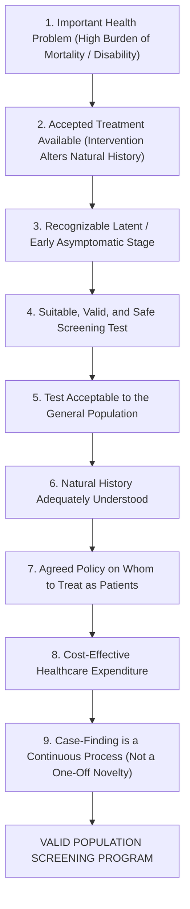

#### **The Modern Longevity Paradigm Shift:**
In 1968, screening was binary: did the patient have syphilis, tuberculosis, or cervical dysplasia? In the modern era of low-dose computed tomography ($\text{LDCT}$), multi-target stool DNA, coronary artery calcium ($\text{CAC}$) scoring, and whole-genome polygenic risk scores ($\text{PRS}$), the Wilson-Jungner criteria must be evaluated through the lens of **pre-clinical velocity and molecular reversibility**:
* We do not merely screen to detect established cancer; we screen to detect **advanced precancerous adenomas** (colorectal screening) or **high-grade cervical intraepithelial neoplasia** ($\text{CIN 2/3}$), removing the precursor lesion and completely aborting the carcinogenic cascade.
* We do not merely screen for acute coronary ischemia; we screen to quantify **subclinical calcified and non-calcified plaque burden** decades before luminal stenosis restricts coronary flow.

---

### **18.1.2 Bayes' Theorem, Pre-Test Probability & The Predictive Value Paradox**

The single greatest mathematical error committed by practicing clinicians is confusing the **Sensitivity of a test** with its **Positive Predictive Value ($\text{PPV}$)**:
* **Sensitivity ($P(\text{Test}^+ \mid \text{Disease}^+)$):** The intrinsic probability that a test is positive given that the patient truly has the disease.
* **Positive Predictive Value ($P(\text{Disease}^+ \mid \text{Test}^+)$):** The posterior probability that a patient who tests positive actually has the disease.

#### **Bayes' Theorem Formulation:**

$$\text{PPV} = \frac{\text{Sensitivity} \times \text{Prevalence}}{(\text{Sensitivity} \times \text{Prevalence}) + (1 - \text{Specificity}) \times (1 - \text{Prevalence})}$$

$$\text{NPV} = \frac{\text{Specificity} \times (1 - \text{Prevalence})}{(1 - \text{Sensitivity}) \times \text{Prevalence} + \text{Specificity} \times (1 - \text{Prevalence})}$$

#### **Likelihood Ratios and the Fagan Nomogram:**
The intrinsic discriminatory power of any screening test independent of prevalence is defined by its **Likelihood Ratios ($\text{LR}$)**:

$$\text{Positive Likelihood Ratio (LR+)} = \frac{\text{Sensitivity}}{1 - \text{Specificity}} = \frac{\text{True Positive Rate}}{\text{False Positive Rate}}$$

$$\text{Negative Likelihood Ratio (LR-)} = \frac{1 - \text{Sensitivity}}{\text{Specificity}} = \frac{\text{False Negative Rate}}{\text{True Negative Rate}}$$

$$\text{Pre-Test Odds} = \frac{\text{Prevalence}}{1 - \text{Prevalence}}$$

$$\text{Post-Test Odds} = \text{Pre-Test Odds} \times \text{Likelihood Ratio}$$

$$\text{Post-Test Probability} = \frac{\text{Post-Test Odds}}{\text{Post-Test Odds} + 1}$$

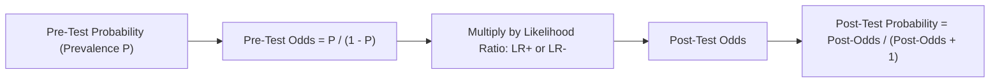

#### **The Disaster of Low Prevalence: The Real-World Mathematical Simulation**
Consider an advanced blood-based multi-cancer early detection ($\text{MCED}$) test advertised with an outstanding **$90.0\%$ Sensitivity** and an exceptional **$99.0\%$ Specificity** ($1.0\%$ false-positive rate).
A direct-to-consumer longevity clinic markets this test to asymptomatic 35-year-old adults, where the point prevalence of occult undiagnosed cancer is approximately **$1\text{ in }1,000$ ($P = 0.001$)**.

Watch the mathematics unfold across **100,000 screened individuals**:
* **True Cancers Present:** $100,000 \times 0.001 = \mathbf{100\ \text{patients}}$.
* **True Positives ($\text{TP}$):** $100 \times 0.90 = \mathbf{90\ \text{patients}}$ correctly identified.
* **False Negatives ($\text{FN}$):** $100 - 90 = \mathbf{10\ \text{patients}}$ missed.
* **Healthy Individuals:** $100,000 - 100 = \mathbf{99,900\ \text{individuals}}$.
* **False Positives ($\text{FP}$):** $99,900 \times (1 - 0.990) = \mathbf{999\ \text{healthy individuals}}$ falsely flagged as having cancer!

$$\text{Positive Predictive Value (PPV)} = \frac{\text{TP}}{\text{TP} + \text{FP}} = \frac{90}{90 + 999} = \frac{90}{1,089} \approx \mathbf{8.26\%}$$

**Ninety-two percent of every positive result is a terrifying false alarm!** For every single true cancer detected, eleven healthy 35-year-old individuals are plunged into psychological agony, subjected to whole-body CT scans, PET scans, bone marrow biopsies, colonoscopies, and endoscopies searching for an occult cancer that does not exist. 

This mathematical reality is why screening programs MUST be restricted to **target populations whose age, smoking history, or genetic profile establishes an adequately high pre-test probability**!

---

### **18.1.3 The Four Classic Screening Biases: Why Observational Studies Lie**

When an enthusiastic clinician publishes an observational study claiming that a new screening test "doubled 5-year survival rates," they are almost always falling victim to the **Four Classic Methodological Biases of Screening**:

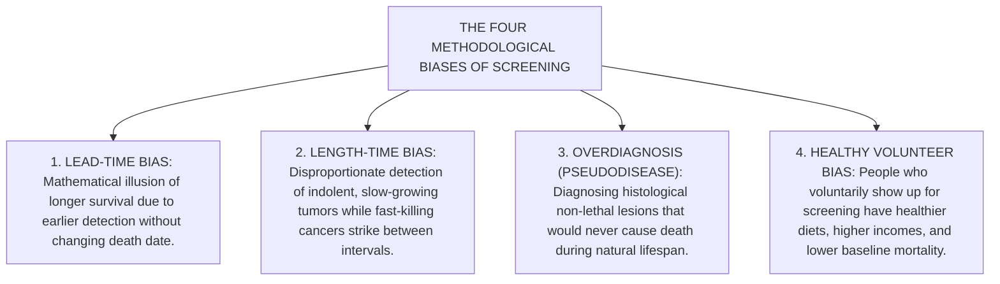

#### **1. Lead-Time Bias (The Zero-Sum Clock Illusion)**
* **The Mechanism:** Lead time is the period between early detection by a screening test and the time when the disease would have been detected clinically due to symptoms.
* **The Mathematical Deception:**
  * Imagine a patient develops an aggressive pancreatic adenocarcinoma at age 55.
  * In the **Unscreened Scenario**, symptoms (painless jaundice) appear at age 59, the cancer is diagnosed, and the patient dies at age 60. Survival from clinical diagnosis to death: **1 year**.
  * In the **Screened Scenario**, a novel full-body MRI catches the microscopic lesion at age 56. The patient is treated with surgery and chemotherapy, but the tumor recurs, and the patient dies at the exact same moment: **age 60**. Survival from screening diagnosis to death: **4 years**!
* The screening test did not add a single second of biological life to the patient; it merely added **three additional years of living as a cancer patient**! Any trial using "5-year survival from diagnosis" as an endpoint is fundamentally flawed. **The only uncorrupted endpoint for screening efficacy is Cause-Specific or All-Cause Mortality per 100,000 person-years.**

```
Unscreened:
  Biological Onset (Age 55) ──────→ Symptoms & Diagnosis (Age 59) ──→ Death (Age 60)
                                    [── 1-Year Survival ──]

Screened:
  Biological Onset (Age 55) ──→ Screen Diagnosis (Age 56) ──────────→ Death (Age 60)
                                [─────── 4-Year Survival (LEAD TIME!) ───────]
```

#### **2. Length-Time Bias (The Indolence Trap)**
* Tumors of the same histological type do not grow at the same biological rate. Some cancers have a doubling time of 20 days (highly aggressive, rapidly fatal); others have a doubling time of 800 days (indolent, slow-growing).
* A periodic screening test (e.g., mammogram every 2 years or colonoscopy every 10 years) acts like a net dipped into a river at long intervals.
* The indolent, slow-growing tumors reside in the asymptomatic, detectable preclinical phase for many years; the screening net catches nearly all of them.
* Conversely, the hyper-aggressive, rapid-growing tumors blitz through the preclinical phase in 4 months. They develop, cause symptoms, and kill the patient **entirely between screening rounds** (**Interval Cancers**).
* Consequently, screen-detected cohorts are disproportionately enriched with biologically benign, slow-growing tumors with inherently fantastic prognoses, creating the false impression that screening cure rates are exceptional!

#### **3. Overdiagnosis (Pseudodisease)**
* **Definition:** Overdiagnosis occurs when a screening test detects a histological abnormality that fulfills microscopic criteria for malignancy, but which would never have progressed to cause clinical symptoms or death during the patient's natural lifetime.
* **The Tragic Paradigms:**
  * **Papillary Thyroid Microcarcinoma:** Widespread neck ultrasound screening in South Korea increased thyroid cancer incidence by $1,500\%$ over two decades; yet thyroid cancer mortality remained dead flat! Thousands of healthy women underwent total thyroidectomy and lifelong levothyroxine replacement for indolent $4\text{-mm}$ nodules that would have stayed dormant forever.
  * **Prostate Cancer (Gleason 3+3 = 6):** Autopsy studies demonstrate that $> 60\%$ of men over age 80 who die of natural causes harbor microscopic prostate adenocarcinoma. Uncalibrated PSA screening led to radical prostatectomy in hundreds of thousands of men, leaving them with permanent urinary incontinence and erectile dysfunction for a pseudodisease.
  * **Ductal Carcinoma In Situ ($\text{DCIS}$):** Screen-detected DCIS represents up to $25\%$ of mammographic diagnoses; a significant proportion would never break through the basement membrane into invasive ductal carcinoma.

#### **4. Healthy Volunteer Bias**
* Individuals who proactively schedule colonoscopies, mammograms, and lipid panels are systematically wealthier, exercise more, smoke less, eat higher-fiber diets, and take medications with greater adherence than those who do not.
* Comparing mortality in individuals who chose to be screened versus those who did not introduces massive confounding. Only **Randomized Controlled Trials ($\text{RCTs}$)** with intention-to-screen analyses can eliminate this bias.

---

### **18.1.4 Number Needed to Screen (NNS) vs Number Needed to Treat (NNT)**

To communicate the true human reality of population screening, clinical scientists discard misleading **Relative Risk Reductions ($\text{RRR}$)** and report **Absolute Risk Reduction ($\text{ARR}$)** and **Number Needed to Screen ($\text{NNS}$)**:

$$\text{Absolute Risk Reduction (ARR)} = \text{Mortality}_{\text{Unscreened}} - \text{Mortality}_{\text{Screened}}$$

$$\text{Number Needed to Screen (NNS)} = \frac{1}{\text{ARR}}$$

#### **The Relative Risk Deception:**
* If a lung cancer screening trial shows that unselected LDCT drops 10-year lung cancer mortality from $0.50\%$ down to $0.40\%$:
  $$\text{Relative Risk Reduction (RRR)} = \frac{0.50\% - 0.40\%}{0.50\%} = \mathbf{20.0\%\ \text{Reduction!}}$$
  *(Marketed on clinic billboards: "New Screening Reduces Cancer Death by 20%!")*
* But examine the absolute reality:
  $$\text{Absolute Risk Reduction (ARR)} = 0.005 - 0.004 = 0.001\ (0.10\%)$$
  $$\text{Number Needed to Screen (NNS)} = \frac{1}{0.001} = \mathbf{1,000\ \text{People}}$$
* You must perform serial CT scans on **1,000 human beings** for ten years to save **one single life**, while hundreds endure false-positive biopsies, needle-induced pneumothoraces, and surgical lung wedge resections for benign hamartomas!

---

## **DOSSIER 18.2: CARDIOVASCULAR DISEASE PREVENTION, ATHEROSCLEROSIS STAGING & ADVANCED LIPIDS**

### **18.2.1 Atherosclerotic Pathophysiology: The ApoB Retention Hypothesis**

Atherosclerotic cardiovascular disease is not a passive plumbing problem where pipes "clog with fat"; it is an active, chronic, maladaptive immuno-inflammatory reaction driven by the retention of cholesterol-rich apolipoprotein B ($\text{ApoB}$) lipoproteins inside the arterial wall (*Tabas & Bornfeldt, Circulation Research*; *Goldstein & Brown Nobel lecture*):

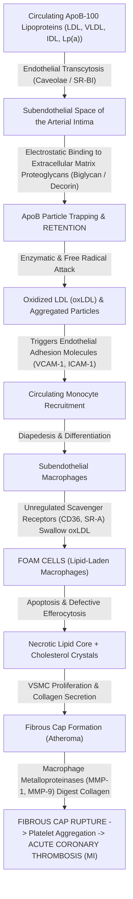

#### **The Core Insights of Modern Atherosclerosis Biology:**
1. **The Retention Step is Obligatory:** Endothelial injury is not required; ApoB particles enter the intima continuously via transcytosis. Positively charged basic amino acids (arginine and lysine residues) on the ApoB-100 outer protein shell form electrostatic bonds with negatively charged sulfate groups on glycosaminoglycans (biglycan and decorin) in the subendothelial matrix.
2. **Macrophage Scavenger Receptors Have No Feedback:** Unlike the standard LDL receptor ($\text{LDLR}$), which down-regulates its expression when intracellular cholesterol climbs, macrophage scavenger receptors (**CD36 and SR-A**) recognize oxidized ApoB particles and continue gorging on lipid indefinitely until the cell transforms into a pathological, dying **Foam Cell**.
3. **Plaque Rupture Dictates Mortality:** Myocardial infarction is not caused by slow, gradual 90% luminal narrowing (which provokes protective coronary collateralization); it is caused by the sudden rupture of a thin-cap fibroatheroma ($\text{TCFA}$) in a moderately stenotic ($40\%\text{–}60\%$) plaque, exposing tissue factor to circulating platelets and triggering occlusive intraluminal thrombosis within minutes!

---

### **18.2.2 Coronary Artery Calcium (CAC) Agatston Scoring Physics & Clinical Application**

As atherosclerotic plaques mature, macrophage foam cells undergo apoptosis, releasing free intracellular calcium that crystallizes into micro-calcifications resembling endochondral bone formation. Calcification occurs exclusively within atherosclerotic plaque; **there is zero calcium in a healthy coronary artery intima**.

#### **1. Computed Tomography Physics & Prospective ECG Gating**
To image calcified plaques in vessels moving at 80 beats per minute without motion blur, coronary calcium scans employ dedicated **prospective ECG-triggered non-contrast multidetector CT ($\text{MDCT}$)**:
* **The Acquisition Window:** The heart is relatively motionless during mid-to-late diastole. The CT scanner syncs to the patient's surface ECG R-wave, pulsing X-rays strictly during **$65\%\text{ to }75\%$ of the R-R interval**.
* **Scan Parameters:** $120\ \text{kVp}$ tube voltage, $2.5\text{ to }3.0\ \text{mm}$ reconstructed slice thickness, zero intravenous iodinated contrast.
* **Radiation Physics:** Because no contrast is needed and gating pulses intermittently, the radiation dose is minimal: **$< 1.0\ \text{mSv}$** (equivalent to roughly 10 chest X-rays, or the background environmental cosmic radiation received during 4 months on Earth).

#### **2. The Agatston Mathematical Algorithm**
Invented by cardiologist Arthur Agatston and radiologist Warren Janowitz in 1990, the **Agatston Score** quantifies both the area and the radiological density of coronary calcification:
* **Threshold Definition:** A coronary calcified lesion is defined as an area of at least **$\ge 1.0\ \text{mm}^2$** (or $\ge 3$ contiguous voxels) exhibiting a peak attenuation **$\ge 130\ \text{Hounsfield Units (HU)}$**.
* **Peak Attenuation Weighting Factors:**

$$\text{Density Weighting Factor} = 
\begin{cases} 
1 & \text{for peak attenuation } 130 - 199\ \text{HU} \\
2 & \text{for peak attenuation } 200 - 299\ \text{HU} \\
3 & \text{for peak attenuation } 300 - 399\ \text{HU} \\
4 & \text{for peak attenuation } \ge 400\ \text{HU}
\end{cases}$$

* **Calculation:**

$$\text{Lesion Score} = \text{Area in mm}^2 \times \text{Density Factor}$$

$$\mathbf{\text{Total Agatston Score} = \sum_{\text{All Slices}} (\text{Lesion Scores across LM, LAD, LCx, and RCA})}$$

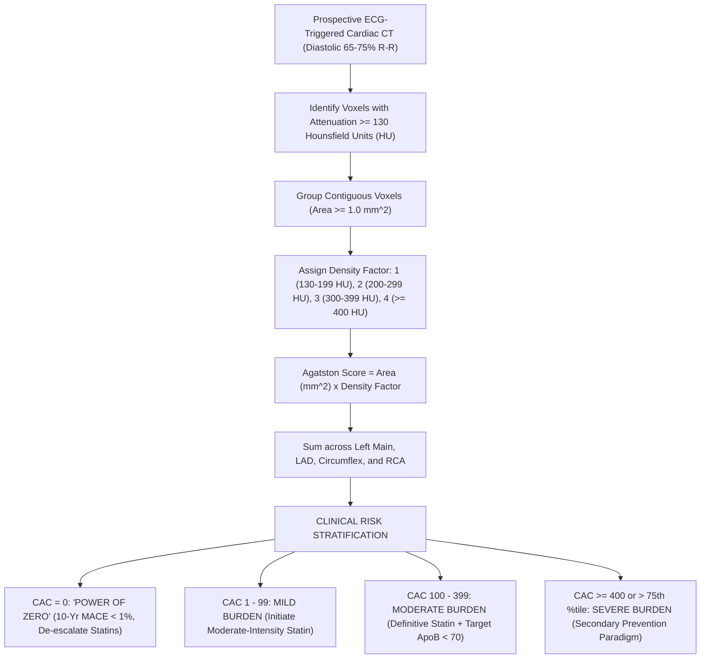

#### **3. Clinical Interpretation & Risk Stratification**

| Agatston Score | Plaque Burden Category | 10-Year ASCVD Event Rate | Clinical Management & Statin Architecture |
| :--- | :--- | :--- | :--- |
| **$\text{CAC} = 0$** | **No Identifiable Calcified Plaque** | **$< 1.0\% - 1.5\%$** | **"The Power of Zero":** Provides a 10-year "warranty period." Allows safe withholding or de-escalation of statin therapy in borderline/intermediate-risk individuals without diabetes or strong family history. |
| **$\text{CAC} = 1 - 99$** | **Mild Plaque Burden** | $3\% - 5\%$ | **Definitive Plaque Present:** Initiates moderate-intensity statin therapy (e.g., Atorvastatin $20\ \text{mg}$ or Rosuvastatin $10\ \text{mg}$). Re-evaluates lifestyle. |
| **$\text{CAC} = 100 - 399$** | **Moderate Plaque Burden** | $10\% - 15\%$ | High-intensity statin therapy indicated. Target $\text{LDL-C} < 70\ \text{mg/dL}$ ($\text{ApoB} < 70\ \text{mg/dL}$). Consider baby Aspirin ($81\ \text{mg/day}$). |
| **$\text{CAC} \ge 400$ OR $> 75^{\text{th}}$ percentile** | **Extensive, Severe Plaque Burden** | **$> 20\% - 25\%$ (Equivalent to Known Prior MI!)** | **Secondary Prevention Paradigm:** Maximal tolerated high-intensity statin + Ezetimibe (target $\text{LDL-C} < 55\ \text{mg/dL}$, $\text{ApoB} < 55\ \text{mg/dL}$); Daily Aspirin; Functional ischemia stress testing if symptoms present. |

#### **The Behind-the-Curtain Limitations of CAC:**
1. **The Soft Plaque Blindspot:** CAC measures only calcified plaque. A 42-year-old heavy smoker can harbor a large, inflamed, non-calcified lipid-rich soft plaque that has an Agatston score of $0$ but is on the verge of rupture! In symptomatic patients, CAC cannot rule out acute coronary syndrome.
2. **The Statin Paradox:** Statins actually **increase coronary artery calcium**! Statins extract lipid from the necrotic core and accelerate dense, crystalline micro-calcification of the fibrous cap, transforming unstable, rupture-prone soft plaques into stable, calcified scars. A post-statin increase in CAC reflects **plaque stabilization**, not disease failure! Therefore, **serial CAC scans should never be ordered to monitor statin efficacy**.

---

### **18.2.3 Advanced Lipid Testing: ApoB, Lipoprotein(a), and hs-CRP**

#### **1. Apolipoprotein B (ApoB): The True Particle Count**
For sixty years, medicine relied on **Calculated LDL Cholesterol ($\text{LDL-C}$)** derived via the Friedewald Equation:

$$\text{LDL-C}_{\text{Friedewald}} = \text{Total Cholesterol} - \text{HDL-C} - \frac{\text{Triglycerides}}{5}$$

* **The Friedewald Collapse:** The equation assumes a fixed $5:1$ ratio of triglycerides to cholesterol in VLDL particles. When serum triglycerides exceed $400\ \text{mg/dL}$ ($4.5\ \text{mmol/L}$) or when LDL-C is extremely low ($< 50\ \text{mg/dL}$), Friedewald breaks down completely, underestimating LDL-C by up to $40\ \text{mg/dL}$!
* **The Stoichiometry of Atherogenicity:** What enters the subendothelial space and causes disease is not a mass of cholesterol (measured in $\text{mg/dL}$), but the **number of circulating atherogenic particles**.
* Every single atherogenic lipoprotein particle—whether **$\text{LDL}$ ($90\%$), $\text{VLDL}$ ($8\%$), $\text{IDL}$ ($1\%$), or $\text{Lp(a)}$ ($1\%$)**—carries **exactly ONE single molecule of Apolipoprotein B-100 ($\text{ApoB-100}$)** wrapped around its surface:
  $$\mathbf{1\ \text{Particle} = 1\ \text{ApoB Molecule}}$$
* **The Discordance Phenomenon:** In patients with obesity, metabolic syndrome, insulin resistance, or hypertriglyceridemia, the liver secretes cholesterol-depleted, triglyceride-rich VLDL that undergoes intravascular remodeling into **Small, Dense LDL ($\text{sdLDL}$)**. Because each particle carries less cholesterol, LDL-C can read deceptively "normal" ($95\ \text{mg/dL}$), while total particle count ($\text{ApoB}$) is astronomically elevated ($135\ \text{mg/dL}$)—driving relentless plaque progression!
* **Measurement Engine:** Automated immunoturbidimetry or immunonephelometry using goat anti-human ApoB polyclonal antibodies. Fasting is NOT required.
* **Target Thresholds:**
  * Low Risk: $\text{ApoB} < 90\ \text{mg/dL}$ ($< 0.9\ \text{g/L}$).
  * High Risk / Secondary Prevention: $\mathbf{\text{ApoB} < 80\ \text{mg/dL}}$ ($\text{LDL-C} < 70\ \text{mg/dL}$).
  * Very High / Extreme Risk: $\mathbf{\text{ApoB} < 55\text{–}65\ \text{mg/dL}}$ ($\text{LDL-C} < 55\ \text{mg/dL}$).

---

#### **2. Lipoprotein(a) [Lp(a)]: The Once-in-a-Lifetime Genetic Ticking Time Bomb**
Lipoprotein(a) consists of an LDL-like core containing ApoB-100 covalently bound by a **single disulfide bridge** to a unique, heavily glycosylated, highly polymorphic glycoprotein: **Apolipoprotein(a) [Apo(a)]**.

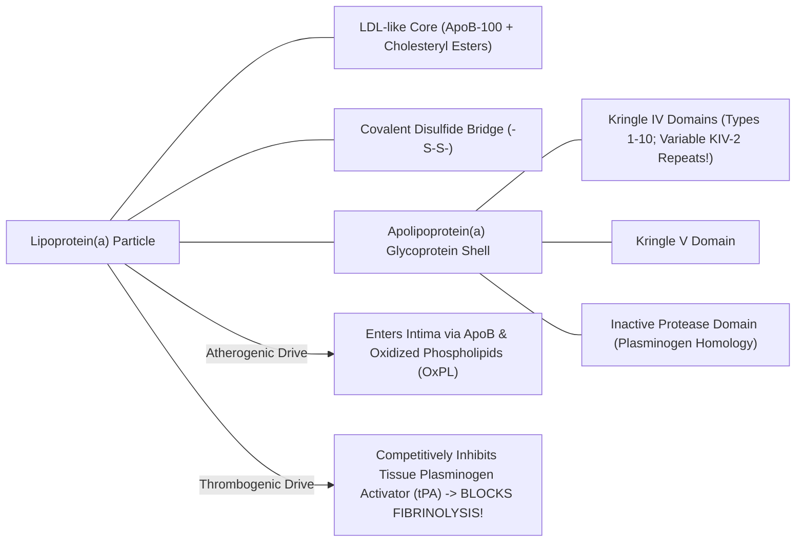

* **Pathophysiological Mechanisms:**
  1. **Accelerated Atherogenesis:** The ApoB core carries oxidized phospholipids ($\text{OxPL}$), triggering intense vascular inflammation.
  2. **Pro-Thrombotic / Anti-Fibrinolytic:** Apo(a) exhibits $> 80\%$ amino acid homology with human **Plasminogen**. It contains an inactive protease-like domain that binds fibrin, competitively displacing plasminogen and tissue plasminogen activator ($\text{tPA}$)—**physically blocking fibrinolysis and stabilizing acute occlusive coronary thrombi**!
  3. **Aortic Valve Calcification:** Lp(a) is the primary causal genetic risk factor for calcific aortic valve stenosis ($\text{CAVS}$).
* **Genetics & The KIV-2 Isoform Trap:**
  * Lp(a) concentrations are **$90\%\text{ genetically determined}$** by the *LPA* gene on chromosome 6q26–27.
  * The *LPA* gene contains an unstable copy number variation in **Kringle IV type 2 ($\text{KIV-2}$)** repeats, ranging from **$1\text{ to }> 40\text{ repeats}$**.
  * Individuals with few KIV-2 repeats produce a tiny Apo(a) protein that is synthesized and secreted rapidly by hepatocytes, leading to **astronomically high plasma Lp(a)**. Individuals with many KIV-2 repeats secrete low levels of a giant protein.
* **The Commercial Immunoassay Trap:**
  * Polyclonal antibody immunoassays that measure Lp(a) in mass units ($\text{mg/dL}$) use antibodies that bind to KIV-2 repeats. Because large isoforms contain 40 copies of KIV-2, antibodies bind repeatedly, **falsely overestimating large, low-risk isoforms**. In patients with small, lethal isoforms (few KIV-2 repeats), the assay **falsely underestimates the true particle count**!
  * **The Clinical Solution:** Elite laboratories measure Lp(a) using **Isoform-Insensitive Monoclonal Assays or LC-MS/MS calibrated strictly in molar units ($\text{nmol/L}$)**:
    $$\mathbf{\text{Normal: } < 75\ \text{nmol/L}\ (< 30\ \text{mg/dL})}$$
    $$\mathbf{\text{High Risk: } > 125\ \text{nmol/L}\ (> 50\ \text{mg/dL})}$$
* **Testing Frequency:** Because Lp(a) is genetically determined and does not fluctuate with diet or exercise, **Lp(a) should be measured AT LEAST ONCE IN A LIFETIME in every adult human being**.

---

#### **3. High-Sensitivity C-Reactive Protein (hs-CRP): Residual Inflammatory Risk**
* **Biology:** C-Reactive Protein is a homopentameric acute-phase reactant synthesized by the liver in response to circulating Interleukin-6 ($\text{IL-6}$) and Interleukin-1$\beta$ ($\text{IL-1}\beta$) produced by inflamed macrophage foam cells inside atherosclerotic plaques.
* **Analytical Engine:** Standard hospital CRP assays detect macro-inflammation ($> 10\ \text{mg/L}$) for sepsis. **High-Sensitivity CRP ($\text{hs-CRP}$)** employs latex particle-enhanced immunonephelometry capable of precise quantitation down to $0.1\ \text{mg/L}$.
* **Clinical Tiers (AHA/CDC Guidelines):**
  * **Low Risk:** $< 1.0\ \text{mg/L}$.
  * **Average Risk:** $1.0\text{ to }3.0\ \text{mg/L}$.
  * **High Residual Inflammatory Risk:** $> 3.0\ \text{mg/L}$.
  * *Exclusion Rule:* If $\text{hs-CRP} > 10.0\ \text{mg/L}$, the elevation is almost certainly driven by acute infection, trauma, or autoimmune flare. The test must be discarded and repeated in 3 weeks.
* **The Landmark CANTOS Trial:** Proved that targeting inflammatory pathways with canakinumab (anti-IL-1$\beta$ monoclonal antibody) significantly reduced major adverse cardiovascular events ($\text{MACE}$) independent of lipid lowering, proving inflammation is a direct causal driver of atherothrombosis.

---

*(Volume XVIII continues below with Colorectal Cancer Screening Mechanics, Lung/Breast/Cervical Evidence-Based Architecture, Metabolic Screening, and the Executive Full-Body Trap)*


---

## **DOSSIER 18.3: COLORECTAL CANCER SCREENING MECHANICS & NEXT-GENERATION LIQUID BIOPSY**

### **18.3.1 The Three Molecular Carcinogenic Pathways of the Colorectum**

Colorectal cancer ($\text{CRC}$) does not arise de novo from normal intestinal mucosa overnight; it develops through a decades-long accumulation of genetic mutations and epigenetic alterations known as the **Adenoma-to-Carcinoma Sequence** (*Fearon & Vogelstein landmark model*):


#### **1. The Classical Chromosomal Instability (CIN) Pathway (75% of Sporadic CRC):**
* **Step 1: Loss of *APC* ($5\text{q}21$):** Both alleles of the Adenomatous Polyposis Coli gene are inactivated, preventing phosphorylation and degradation of cytosolic $\beta\text{-catenin}$. Free $\beta\text{-catenin}$ translocates to the nucleus, binding TCF/LEF transcription factors to drive continuous crypt proliferation (Tubular Adenoma).
* **Step 2: Activating *KRAS* Mutation ($12\text{p}12$):** Codon 12 or 13 mutations lock the KRAS GTPase in a constitutively active state, driving growth factor-independent MAPK/ERK signaling.
* **Step 3: Inactivation of *SMAD4* ($18\text{q}$) and *TP53* ($17\text{p}$):** Loss of p53 eliminates DNA damage cell-cycle checkpoints and apoptosis, permitting aneuploidy and invasive carcinoma.
* **Temporal Horizon:** The transition from normal epithelium to invasive carcinoma takes **$10\text{ to }15\text{ years}$**, providing a vast asymptomatic window for endoscopic interception!

#### **2. The Microsatellite Instability (MSI) Pathway (15%):**
* Defective DNA Mismatch Repair ($\text{dMMR}$) through either germline mutations (**Lynch Syndrome**: *MLH1*, *MSH2*, *MSH6*, *PMS2*) or somatic epigenetic hypermethylation of the *MLH1* promoter.
* Failure to repair single-base mismatches and insertion-deletion loops creates hypermutated tumors with thousands of mutations, marked lymphocyte infiltration, and high sensitivity to immune checkpoint blockade (PD-1 inhibitors).

#### **3. The Serrated Neoplasia Pathway (15–20%):**
* Driven by activating **$\text{BRAF}^{\text{V600E}}$ mutations** coupled with the **CpG Island Methylator Phenotype ($\text{CIMP}$)**, causing widespread transcriptional silencing.
* Morphologically distinct: **Sessile Serrated Lesions ($\text{SSLs}$)** situated predominantly in the **right (proximal) colon**. They are flat, pale, covered by an adherent mucus cap, and lack the classical friable stalk of tubular adenomas, making them easy to miss during rapid colonoscopy withdrawal!

---

### **18.3.2 Colonoscopy: The Endoscopic Gold Standard & Quality Metrics**

Optical colonoscopy is the only screening modality that is simultaneously **diagnostic and curative**; it visualizes the entire mucosal surface from rectum to cecum and permits instant endoscopic resection of precancerous polyps.

#### **1. The Core Quality Metrics of Screening Colonoscopy**
A colonoscopy is only as effective as the endoscopist holding the scope. Clinical outcomes vary dramatically between practitioners:

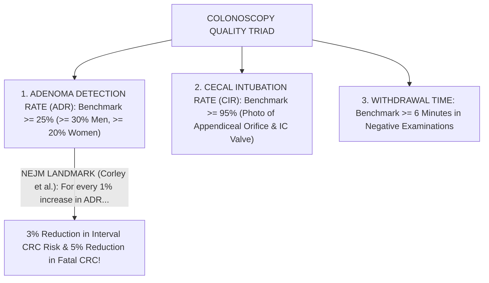

* **Adenoma Detection Rate ($\text{ADR}$):** The percentage of asymptomatic screening colonoscopies in patients age $\ge 50$ (or $\ge 45$) where at least one histologically confirmed adenoma or SSL is removed.
  $$\mathbf{\text{National Minimum ADR Benchmark: } \ge 25\%\ \text{Overall}\ (\ge 30\%\ \text{in Men},\ \ge 20\%\ \text{in Women})}$$
  * **The Landmark Corley NEJM Study (2014):** Evaluated $314,872$ colonoscopies performed by 136 gastroenterologists. For every **$1.0\%$ increase in an endoscopist's ADR**, the patient's hazard ratio for developing an interval cancer over the subsequent 10 years **decreased by $3.0\%$**, and the risk of **fatal colorectal cancer dropped by $5.0\%$**! An endoscopist with an ADR of $38\%$ provides vastly superior cancer prevention compared to one with an ADR of $18\%$.
* **Cecal Intubation Rate ($\text{CIR}$):** Visual confirmation that the scope entered the cecal caput and touched the ileocecal valve and appendiceal orifice ($\ge 95\%$ benchmark).
* **Withdrawal Time:** The duration spent inspecting the colonic mucosa while withdrawing the colonoscope from cecum to anus. Guidelines mandate a minimum inspection time of **$\ge 6\ \text{minutes}$** in examinations where no polyps are resected.

#### **2. Bowel Preparation Physics & The Boston Bowel Preparation Scale (BBPS)**
Fecal residue covers flat adenomas. A screening colonoscopy cannot be considered complete without validating adequate bowel cleansing using the **Boston Bowel Preparation Scale ($\text{BBPS}$)**:
* The colon is divided into three segments:
  1. **Right Colon** (Cecum and Ascending Colon);
  2. **Transverse Colon** (Hepatic to Splenic Flexure);
  3. **Left Colon** (Descending, Sigmoid, and Rectum).
* Each segment is scored from **$0\text{ to }3$** *after* washing and suctioning:
  * **Score 0:** Unprepared colon segment with mucosa not seen due to solid stool.
  * **Score 1:** Portion of mucosa seen, but other areas stained with residual liquid or stool.
  * **Score 2:** Minor residual staining or small liquid fragments, but mucosa well visualized.
  * **Score 3:** Entire mucosa of segment cleanly visualized with zero residual stool or liquid.
$$\mathbf{\text{Adequate Preparation Standard: Total BBPS } \ge 6\quad \text{AND}\quad \text{No Individual Segment } < 2}$$
If any segment scores $< 2$, the examination is inadequate; the patient must repeat the colonoscopy within **1 year** with an intensified prep regimen!

#### **3. Polypectomy Mechanics: Cold Snare vs EMR**
* **Diminutive Polyps ($< 5\ \text{mm}$) and Small Polyps ($6\text{–}9\ \text{mm}$):**
  * **Cold Snare Polypectomy ($\text{CSP}$):** The polyp and a $2\text{-mm}$ margin of normal mucosa are mechanically severed using a thin-wire snare without electrocautery.
  * *Why Cold Snare Won:* Electrocautery (hot biopsy forceps or hot snare) causes transmural thermal necrosis, deep tissue sloughing, post-polypectomy coagulation syndrome, and delayed arterial hemorrhage ($1\text{ to }2\%$). Cold snare relies on mechanical cutting, leaving the submucosal arterioles and muscularis propria intact, with near-$0\%$ perforation rate and $< 0.1\%$ bleeding rate!
* **Large Flat / Sessile Polyps ($\ge 20\ \text{mm}$):**
  * **Endoscopic Mucosal Resection ($\text{EMR}$):** Flat lesions cannot be ensnared directly. The endoscopist injects a submucosal cushion (saline mixed with **Methylene Blue** or **Indigo Carmine** and dilute epinephrine $1:100,000$) underneath the lesion. The fluid expands the submucosa, lifting the polyp away from the muscularis propria ("The Lift Sign") and creating a safe fluid safety barrier for snare electrocautery resection.

---

### **18.3.3 Non-Invasive Stool-Based Screening: FIT vs mt-sDNA**

For patients unwilling or unable to undergo screening colonoscopy, non-invasive stool tests provide validated alternative screening architectures.

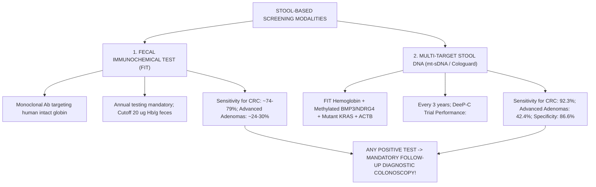

#### **1. Fecal Immunochemical Test (FIT)**
* **Mechanism:** Employs monoclonal antibodies directed against the **protein globin moiety of human hemoglobin**.
* **Why FIT Displaced Guaiac-based FOBT ($\text{gFOBT}$):**
  * Old guaiac tests detected the peroxidase activity of heme. Patients consuming red meat, broccoli, radishes, or vitamin C generated wild false positives and false negatives.
  * Crucially, human globin released from upper gastrointestinal bleeding (stomach, duodenum) is completely digested and degraded by gastric acid and pancreatic proteases (pepsin and chymotrypsin) during intestinal transit. Therefore, **FIT detects ONLY lower gastrointestinal bleeding**!
* **Threshold & Interval:** Standard automated quantitative cutoff: **$20\ \mu\text{g}\ \text{Hemoglobin per gram of feces}$**. Must be repeated **every 12 months**. Sensitivity for invasive CRC: $74\%\text{–}79\%$; sensitivity for advanced precancerous adenomas: $24\%\text{–}30\%$.

#### **2. Multi-Target Stool DNA (mt-sDNA / Cologuard)**
* **Biochemical Architecture:** Combines quantitative fecal immunochemical hemoglobin with molecular polymerase chain reaction ($\text{PCR}$) amplification of:
  1. **Aberrant DNA Methylation Markers:** Hypermethylated promoter regions of **$BMP3$** (Bone Morphogenetic Protein 3) and **$NDRG4$** (N-Myc Downstream-Regulated Gene 4);
  2. **Point Mutations:** Seven specific mutation hotspots in codon 12 and 13 of the **$KRAS$** oncogene;
  3. **Total Human DNA Reference:** **$\beta\text{-Actin}$ ($ACTB$)** quantitation to verify adequate exfoliated human enterocyte recovery.
* **The Landmark DeeP-C Trial ($9,989$ Patients, NEJM 2014):**
  * **Sensitivity for Colorectal Cancer:** **$92.3\%$** (superior to FIT's $73.8\%$, $p < 0.001$).
  * **Sensitivity for Advanced Precancerous Lesions:** **$42.4\%$** (superior to FIT's $23.8\%$).
  * **Specificity:** **$86.6\%$** in patients with normal colonoscopy (compared to $94.9\%$ for FIT).
* **Recommended Interval:** **Every 3 years**.
* **The Inflexible Clinical Law:** Any positive FIT or mt-sDNA test **MANDATES A FOLLOW-UP OPTICAL COLONOSCOPY**. A patient who receives a positive Cologuard and refuses colonoscopy has completely defeated the clinical screening program!

---

### **18.3.4 Blood-Based Cell-Free DNA (cfDNA) & Liquid Biopsies**

The frontier of colorectal screening is the detection of tumor-derived molecular signatures in peripheral blood:
* **Methylated *SEPT9* ($\text{mSEPT9}$ / Epi proColon):** An FDA-approved blood test monitoring hypermethylation of the Septin-9 promoter via real-time PCR. Sensitivity for CRC is $\sim 68\%\text{ to }72\%$, but sensitivity for advanced precancerous adenomas is poor ($< 15\text{ to }20\%$).
* **Multi-Cancer Early Detection ($\text{MCED}$) Liquid Biopsies (e.g., GRAIL Galleri):**
  * Utilizes targeted, bisulfite-free next-generation sequencing ($\text{NGS}$) to detect **cell-free DNA ($\text{cfDNA}$) methylation patterns** across $> 100,000$ informative genomic regions.
  * An artificial intelligence classifier detects the cancer signal and predicts the **Cancer Signal Origin ($\text{CSO}$)** with $> 85\%$ accuracy.
  * *The Stage Dependency Dilemma:* While overall specificity is high ($> 99.0\%$), analytical sensitivity correlates directly with tumor shed:
    * Stage I Malignancies: Sensitivity only **$16\%\text{ to }30\%$**;
    * Stage II: **$40\%\text{ to }60\%$**;
    * Stage III: **$70\%\text{ to }80\%$**;
    * Stage IV: **$> 90\%$**.
  * Liquid biopsy cannot yet substitute for optical colonoscopy or mammography because it misses the tiny, localized, surgically curable Stage I lesions that standard screening targets.

---

*(Volume XVIII continues below with Lung, Breast, and Cervical Cancer Screening Architecture, Metabolic Screening, and the Executive Full-Body Trap)*


---

## **DOSSIER 18.4: EVIDENCE-BASED SCREENING ARCHITECTURE FOR LUNG, BREAST, AND CERVICAL MALIGNANCIES**

### **18.4.1 Lung Cancer Screening: Low-Dose Computed Tomography (LDCT)**

Lung cancer remains the undisputed leading cause of cancer mortality worldwide, killing more individuals annually than colorectal, breast, and prostate malignancies combined. For fifty years, chest radiography (CXR) and sputum cytology failed to reduce lung cancer mortality because plain radiographs detect tumors only after they reach $1.5\text{ to }2.0\ \text{cm}$ and have established micro-metastases.

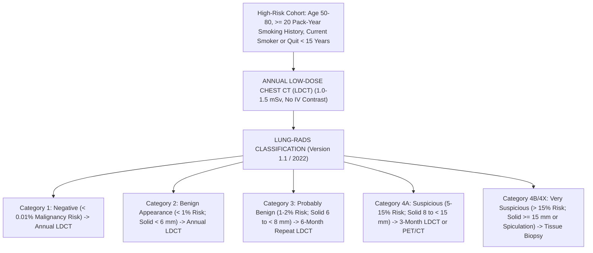

#### **1. The Landmark Clinical Trials: NLST and NELSON**
* **The National Lung Screening Trial ($\text{NLST}$, $53,454$ Participants, NEJM 2011):**
  * Randomized heavy smokers (aged 55–74 with $\ge 30$ pack-year history) to **Annual LDCT vs Chest X-Ray** for 3 consecutive years.
  * **Results:** LDCT produced a **$20.0\%$ relative reduction in lung cancer mortality** ($p = 0.004$) and an unprecedented **$6.7\%$ reduction in all-cause mortality** ($p = 0.02$)!
* **The Dutch-Belgian NELSON Trial ($15,792$ Participants, NEJM 2020):**
  * Utilized modern **CT Volumetric Nodule Management** (measuring volume in $\text{mm}^3$ and Volume Doubling Time [$\text{VDT}$] rather than simple 2D diameter).
  * **Results:** At 10 years, lung cancer mortality was reduced by **$24.0\%$ in men** and **$33\%\text{ to }59\%$ in women**, proving the definitive mortality benefit of volumetric screening.

#### **2. Eligibility Criteria (USPSTF 2021 Update)**
Screening with annual LDCT is recommended for individuals meeting **ALL THREE CRITERIA**:
1. **Age:** **$50\text{ to }80\ \text{years}$**;
2. **Cumulative Exposure:** **$\ge 20\ \text{pack-year}$ smoking history** ($\text{Pack-Years} = \text{Packs per day} \times \text{Years smoked}$);
3. **Current Status:** Currently smoke OR have **quit within the past 15 years**.
* *Discontinuation Criteria:* Screening terminates once a person turns 81, has been abstinent from smoking for $> 15\ \text{years}$, or develops a severe co-morbid illness that substantially limits life expectancy or ability to undergo curative lung resection.

#### **3. Radiation Physics of LDCT**
* Standard diagnostic chest CT delivers $7.0\text{ to }8.0\ \text{mSv}$ of radiation.
* **Low-Dose CT ($\text{LDCT}$):** Employs reduced tube current ($20\text{–}40\ \text{mAs}$) and lower tube potential ($100\text{–}120\ \text{kVp}$) coupled with advanced **iterative model reconstruction ($\text{IMR}$)** algorithms.
* **Effective Dose:** **$\sim 1.0\text{ to }1.5\ \text{mSv}$** (comparable to natural background radiation received over 6 months).

#### **4. The Lung-RADS Classification System (Version 1.1 / 2022)**

| Lung-RADS Category | Radiological Description | Estimated Malignancy Risk | Clinical Management Recommendation |
| :--- | :--- | :--- | :--- |
| **Category 1 (Negative)** | No lung nodules; purely calcified / benign granulomas | $< 0.01\%$ | Continue routine **Annual LDCT in 12 months** |
| **Category 2 (Benign Appearance)** | Solid nodule $< 6\ \text{mm}$; New solid $< 4\ \text{mm}$; Pure ground glass $< 30\ \text{mm}$ | $< 1.0\%$ | Continue routine **Annual LDCT in 12 months** |
| **Category 3 (Probably Benign)** | Solid nodule $\ge 6$ to $< 8\ \text{mm}$; New solid $4$ to $< 6\ \text{mm}$; Part-solid $\ge 6\ \text{mm}$ (solid component $< 6\ \text{mm}$) | $1.0\% - 2.0\%$ | **Short-Interval Repeat LDCT in 6 Months** |
| **Category 4A (Suspicious)** | Solid nodule $\ge 8$ to $< 15\ \text{mm}$; Growing nodule $< 8\ \text{mm}$; Part-solid with solid component $\ge 6$ to $< 8\ \text{mm}$ | $5.0\% - 15.0\%$ | **3-Month LDCT** OR **$\text{PET/CT}$** (if solid component $\ge 8\ \text{mm}$) |
| **Category 4B (Very Suspicious)** | Solid nodule $\ge 15\ \text{mm}$; New or growing solid component $\ge 8\ \text{mm}$ | **$> 15.0\%$** | **Diagnostic Chest CT with Contrast**, $\text{PET/CT}$, and **Tissue Biopsy** (Bronchoscopy / CT-guided) |
| **Category 4X (Suspicious + Features)**| Category 3 or 4 nodules with additional aggressive features (spiculation, lymphadenopathy) | **$> 15.0\%$** | Immediate multidisciplinary clinical evaluation |

---

### **18.4.2 Breast Cancer Screening: DBT vs FFDM, BI-RADS & Breast MRI**

Breast cancer screening is designed to detect localized, invasive ductal and lobular carcinomas before lymph node dissemination occurs.

#### **1. Full-Field Digital Mammography (FFDM) vs Digital Breast Tomosynthesis (3D DBT)**
* **The Tissue Overlap Limitation of 2D FFDM:** Standard 2D mammography projects a 3-dimensional biological breast onto a flat 2D detector plate. Overlapping dense glandular tissue creates false shadows that mimic tumors (false-positive recalls) or physically obscures small invasive cancers (false-negative misses).
* **3D Digital Breast Tomosynthesis ($\text{DBT}$):** The X-ray tube pivots in an arc ($15^\circ\text{ to }50^\circ$) across the compressed breast, capturing multiple low-dose projection images that are reconstructed into **$1.0\text{-mm}$ thin tomographic slices**:
  * **Clinical Advantages:** DBT eliminates tissue superposition, reducing patient recall rates by **$15\%\text{ to }20\%$** while simultaneously **increasing invasive cancer detection by $20\%\text{ to }40\%$**! DBT is now the standard of care for screening mammography.

#### **2. Breast Density & The Masking Effect**
Breast composition is categorized into four **BI-RADS Density Tiers**:
* **Density A:** Almost entirely fatty tissue ($< 10\%\text{ of women}$).
* **Density B:** Scattered areas of fibroglandular density ($40\%$).
* **Density C:** Heterogeneously dense ($40\%$).
* **Density D:** Extremely dense ($10\%$).
* **The Masking Trap:** Fat appears black (radiolucent) on X-rays, providing high contrast against white tumors. In contrast, fibroglandular tissue appears radiopaque (pure white)—the **exact same radiological density as breast carcinoma**! In extremely dense breasts (Density D), 2D mammographic sensitivity plummets from $> 90\%$ down to **$< 50\%$**, while dense breast tissue independently confers a **$4\times\text{ to }6\times$ higher lifetime risk of developing breast cancer**!

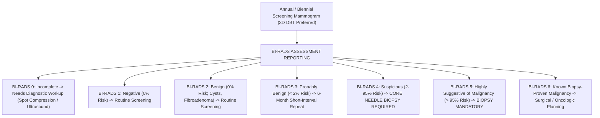

#### **3. Supplemental Screening with Dynamic Contrast-Enhanced Breast MRI (DCE-MRI)**
* **Mechanism:** Tumors overexpress Vascular Endothelial Growth Factor ($\text{VEGF}$), stimulating disorganized, hyper-permeable neo-vasculature. Following IV injection of **Gadolinium-based contrast**, malignant tumors exhibit rapid wash-in and wash-out kinetics.
* **Sensitivity:** **$> 90\%\text{ to }95\%$** for invasive cancer (immune to breast density).
* **Kinetic Enhancement Curves:**
  * **Type 1 Curve (Persistent):** Signal continuously climbs over time; strongly favors benign etiology.
  * **Type 2 Curve (Plateau):** Sharp early uptake followed by flat signal; intermediate risk.
  * **Type 3 Curve (Washout):** Rapid initial peak enhancement followed by rapid decline (washout); **pathognomonic hallmark of malignant neo-angiogenesis**!
* **Indications for Annual Screening Breast MRI:**
  1. Women with a **lifetime breast cancer risk $\ge 20\%\text{ to }25\%$** calculated by validated models (Tyrer-Cuzick / IBIS, Claus, or BRCAPRO);
  2. Documented pathogenic germline mutations in **$BRCA1$, $BRCA2$, $TP53$, $PTEN$, $PALB2$, $STK11$, or $CDH1$**;
  3. Women who received **mantle radiation therapy to the chest between ages 10 and 30** (e.g., for Hodgkin lymphoma).

---

### **18.4.3 Cervical Cancer Screening & HPV Molecular Diagnostics**

Cervical cancer is the triumph of modern preventive oncology: virtually $100\%$ of cases are driven by persistent infection with high-risk genotypes of the **Human Papillomavirus ($\text{hrHPV}$)**.

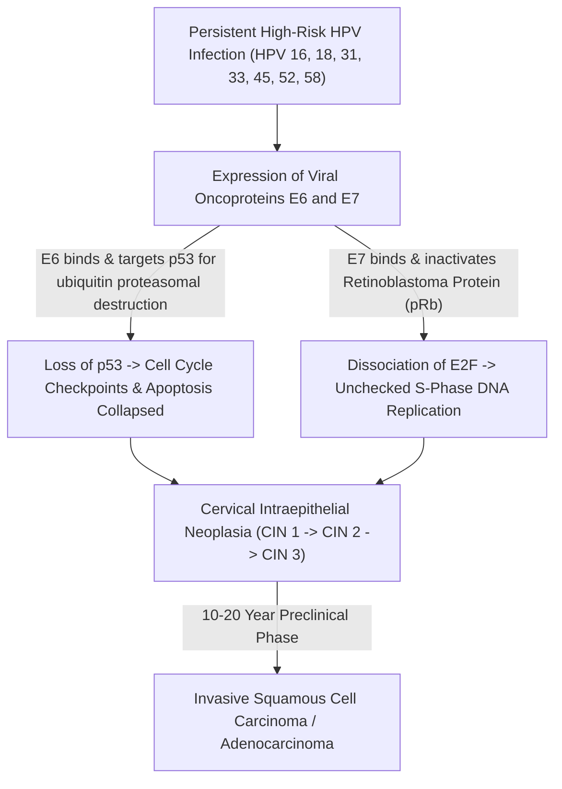

#### **1. Molecular Biology of hrHPV Oncogenesis**
* High-risk HPV genotypes **16 and 18** cause **$70\%$ of all invasive cervical cancers**; types 31, 33, 45, 52, and 58 cause another $20\%$.
* Following viral DNA integration into the human host genome, the viral E2 repressor gene is disrupted, driving uncontrolled transcription of two potent viral oncoproteins:
  * **Oncoprotein E6:** Forms a complex with host ubiquitin ligase ($\text{E6AP}$), binding and **targeting the tumor suppressor protein p53 for rapid proteasomal degradation**. The cell loses DNA damage arrest and apoptosis mechanisms.
  * **Oncoprotein E7:** Binds to the hypophosphorylated active form of the **Retinoblastoma Protein ($\text{pRb}$)**, displacing the transcription factor **E2F**. Free E2F drives constitutive transcription of cyclin-dependent kinases, forcing continuous entry into the S-phase of the cell cycle!

#### **2. Primary hrHPV DNA Testing vs Pap Cytology Guidelines**
* **Why Primary HPV Displaced the Pap Smear:** Conventional Pap cytology (even liquid-based ThinPrep) has an analytical sensitivity of only **$50\%\text{ to }65\%$** for high-grade cervical dysplasia ($\text{CIN 2/3}$). Automated real-time PCR or transcription-mediated amplification ($\text{TMA}$) targeting hrHPV DNA/RNA achieves **$> 95\%$ sensitivity**! A negative hrHPV test provides a 5-year reassurance period against cervical cancer.
* **Evidence-Based Screening Algorithms (USPSTF & ACS Guidelines):**
  * **Age 21–29 Years:** Cervical cytology (Pap smear) alone every 3 years. *(HPV testing is contraindicated in women $< 30$ because transient, self-clearing HPV infections are ubiquitous [$> 30\%$ prevalence], causing massive overtreatment!)*
  * **Age 30–65 Years (Three Valid Options):**
    1. **Primary hrHPV Testing Alone EVERY 5 YEARS (Preferred)**;
    2. **hrHPV + Pap Co-Testing EVERY 5 YEARS**;
    3. Cervical Cytology Alone EVERY 3 YEARS.
  * **Discontinuation:** Stop at age 65 if the patient has adequate prior negative screening (three consecutive negative Pap smears or two negative HPV tests within 10 years, with the most recent within 5 years).

#### **3. Reflex Colposcopy & The Schiller Test Behind the Curtain**
When screening flags high-risk HPV or abnormal cytology ($\text{ASC-US with hrHPV}^+$, $\text{LSIL}$, $\text{ASC-H}$, $\text{HSIL}$), the patient is referred for **Colposcopy**:
1. **Application of 3% to 5% Acetic Acid (Vinegar):**
   * Normal squamous epithelium contains abundant cytoplasm and low nuclear density; acetic acid has no visual effect.
   * Dysplastic cells ($\text{CIN 2/3}$ or cancer) have high nuclear-to-cytoplasmic ratios and hyper-chromatic nuclei with dense cytokeratin networks. Acetic acid induces reversible cellular dehydration and protein coagulation, causing light to scatter backwards $\implies$ **Dense Acetowhite Epithelium**!
   * The colposcopist looks for structural vascular abnormalities: **Punctation** (end-on views of intra-epithelial capillary loops) and **Mosaicism** (cobblestone pattern of capillaries encircling blocks of dysplastic cells).
2. **Lugol's Iodine (The Schiller Test):**
   * Normal, mature squamous epithelium is rich in intracellular **Glycogen**. Iodine reacts with glycogen to produce a deep, uniform **dark mahogany brown stain**.
   * Dysplastic cells lose intracellular glycogen synthesis. When swabbed with Lugol's iodine, dysplastic lesions **fail to stain, appearing bright canary yellow (Schiller-Positive)**, demarcating the exact boundaries for cervical loop electrosurgical excision ($\text{LEEP}$) or cold-knife conization!

---

## **DOSSIER 18.5: METABOLIC, BONE MINERAL HEALTH, AND THE EXECUTIVE FULL-BODY SCREENING DILEMMA**

### **18.5.1 Type 2 Diabetes Mellitus & Dysglycemia Screening**

Metabolic dysfunction accelerates both atherosclerotic plaque formation and malignant transformation via hyperinsulinemia, advanced glycation end-products ($\text{AGEs}$), and chronic low-grade inflammation.

#### **1. Diagnostic Cutoffs (ADA & WHO Standards)**

| Diagnostic Modality | Normal Homeostatic Range | Pre-Diabetes (Impaired Fasting / IGT) | Overt Diabetes Mellitus (Confirmed on 2nd Test) |
| :--- | :--- | :--- | :--- |
| **Fasting Plasma Glucose (FPG)** | $70\text{–}99\ \text{mg/dL}$ ($3.9\text{–}5.5\ \text{mmol/L}$) | **$100\text{–}125\ \text{mg/dL}$** ($5.6\text{–}6.9\ \text{mmol/L}$) | **$\ge 126\ \text{mg/dL}$** ($\ge 7.0\ \text{mmol/L}$) |
| **2-Hour 75-g Oral Glucose (OGTT)** | $< 140\ \text{mg/dL}$ ($< 7.8\ \text{mmol/L}$) | **$140\text{–}199\ \text{mg/dL}$** ($7.8\text{–}11.0\ \text{mmol/L}$) | **$\ge 200\ \text{mg/dL}$** ($\ge 11.1\ \text{mmol/L}$) |
| **Hemoglobin A1c ($\text{HbA1c}$)** | $< 5.7\%$ ($< 39\ \text{mmol/mol}$) | **$5.7\%\text{–}6.4\%$** ($39\text{–}46\ \text{mmol/mol}$) | **$\ge 6.5\%$** ($\ge 48\ \text{mmol/mol}$) |
| **Random Plasma Glucose** | N/A | N/A | **$\ge 200\ \text{mg/dL}$ + Symptoms of Hyperglycemia** |

#### **2. Analytical Requirements & Pitfalls of HbA1c**
* **The NGSP Standard:** Assays must be certified by the National Glycohemoglobin Standardization Program ($\text{NGSP}$) traceable to the Diabetes Control and Complications Trial ($\text{DCCT}$) reference method.
* **The Erythrocyte Lifespan Saboteur:** HbA1c measures the non-enzymatic glycation of the N-terminal valine on the $\beta\text{-chain}$ of hemoglobin over the normal **120-day lifespan of an erythrocyte**.
  * **Falsely Low HbA1c:** Conditions that shorten erythrocyte survival (**Hemolytic anemia, G6PD deficiency, Hemoglobinopathies [HbS, HbC, HbE], Splenomegaly, Blood transfusions, Erythropoietin therapy**) expose red cells to plasma glucose for fewer days, causing a **falsely depressed HbA1c** (e.g., printing $5.4\%$ in a patient whose average blood glucose is $220\ \text{mg/dL}$!). In these patients, the clinician must measure **Fructosamine** or **Glycated Albumin** ($2\text{-to-}3\text{ week}$ window).
  * **Falsely High HbA1c:** Conditions that extend erythrocyte survival (**Severe Iron Deficiency Anemia, Vitamin $\text{B}_{12}$/Folate deficiency, Splenectomy**) allow red cells to circulate for $140\text{ to }160\ \text{days}$, artificially accumulating more glycation and falsely elevating HbA1c.

---

### **18.5.2 Dual-Energy X-Ray Absorptiometry (DEXA) & Trabecular Bone Score (TBS)**

Osteoporosis is a silent systemic skeletal disorder characterized by low bone mass and microarchitectural deterioration of bone tissue, leading to devastating fragility fractures (hip, spine, wrist) that carry a **$20\%\text{ to }30\%$ one-year mortality rate following hip fracture in the elderly**.

#### **1. Dual-Energy X-Ray Physics: K-Edge Subtraction**
How does a DXA scanner measure the density of bone hidden beneath centimeters of variable muscle, adipose tissue, and visceral fat?

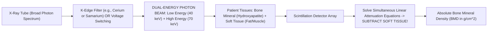

* **The Physics:** The attenuation of an X-ray beam through matter follows the Beer-Lambert law: $I = I_0 e^{-\mu x}$.
* Soft tissue and bone mineral have fundamentally different mass attenuation coefficients ($\mu$) that change differently across photon energy levels:
  * At **Low Energy ($40\ \text{keV}$)**, bone mineral (calcium hydroxyapatite, atomic number $Z \approx 13.8$) attenuates X-rays heavily via the **Photoelectric Effect** ($\mu \propto Z^3/E^3$).
  * At **High Energy ($70\text{–}100\ \text{keV}$)**, **Compton Scattering** dominates, and attenuation depends strictly on electron density.
* By pulsing X-rays through a **K-edge filter** (e.g., Samarium or Cerium) to split the beam into **$40\ \text{keV}$ and $70\ \text{keV}$ components**, the scanner's computer solves a system of two simultaneous equations with two unknowns (soft tissue mass and bone mass), **completely subtracting the soft tissue mass** to calculate:
  $$\mathbf{\text{Areal Bone Mineral Density (aBMD)} = \frac{\text{Bone Mineral Content (g)}}{\text{Projected Scan Area (cm}^2\text{)}}}\quad (\text{in g/cm}^2)$$

#### **2. T-Score vs Z-Score Mathematical Definitions**

$$\mathbf{\text{T-Score} = \frac{\text{BMD}_{\text{Patient}} - \text{Peak Mean Young Adult Reference BMD}}{\text{Young Adult Standard Deviation (SD)}}}$$

$$\mathbf{\text{Z-Score} = \frac{\text{BMD}_{\text{Patient}} - \text{Age- and Sex-Matched Mean BMD}}{\text{Age-Matched Standard Deviation (SD)}}}$$

* **WHO Diagnostic T-Score Criteria (Postmenopausal Women & Men $\ge 50$):**
  * **Normal Bone Density:** $\text{T-Score} \ge -1.0\ \text{SD}$.
  * **Osteopenia (Low Bone Mass):** $\text{T-Score}$ between **$-1.0$ and $-2.5\ \text{SD}$**.
  * **Osteoporosis:** **$\text{T-Score} \le -2.5\ \text{SD}$** (at Lumbar Spine L1–L4, Total Hip, or Femoral Neck).
  * **Severe (Established) Osteoporosis:** $\text{T-Score} \le -2.5\ \text{SD}$ **PLUS a documented fragility fracture**.
* **The Z-Score Threshold:** A $\text{Z-Score} \le -2.0\ \text{SD}$ is defined as "Below the expected range for age" and indicates **secondary osteoporosis** (Cushing's, hyperparathyroidism, celiac disease, multiple myeloma, hypogonadism).

#### **3. Anatomical Sites & The Lumbar Spine Artifact Trap**
* **Standard Scan Sites:** Lumbar Spine (L1–L4), Total Proximal Hip, and Femoral Neck. The $33\%\text{ Radius}$ (non-dominant forearm) is scanned in patients exceeding table weight limits, those with bilateral hip replacements, or in **Primary Hyperparathyroidism** (which preferentially degrades cortical bone).
* **The Degenerative Artifact Trap:** In elderly patients, degenerative disk disease, facet joint osteoarthritis, and aortic calcification deposit calcium right over the lumbar spine project plane. This **falsely inflates lumbar BMD**, giving an apparent normal T-score of $-0.2$ while the femoral neck is severely osteoporotic at $-2.9$! Clinicians must visually inspect the scan and exclude any vertebra whose T-score is $> 1.0\ \text{SD}$ higher than its adjacent neighbor.

#### **4. Trabecular Bone Score (TBS)**
* **Mechanism:** A gray-level variogram texture analysis software applied to the 2D projection DXA image of the lumbar spine.
* **Clinical Value:** Evaluates the **3-dimensional microarchitecture and connectivity of trabecular struts** independent of bone density. High TBS indicates dense, mechanically strong bone; low TBS indicates degraded, fractured struts with large empty spaces.
* **The Diabetic Paradox Solution:** Patients with Type 2 Diabetes have structurally fragile bone with high fracture rates, yet their DXA scans paradoxically print normal or elevated T-scores! TBS exposes this hidden structural degradation, providing accurate fracture risk calculation.

---

### **18.5.3 The "Executive Full-Body CT/MRI" Trap: A Preventive Medicine Critique**

In recent years, private commercial longevity clinics have heavily marketed **"Whole-Body Screening CT"** and **"Preventive Full-Body MRI"** ($2,500\text{ to }5,000\ \text{dollars}$ out-of-pocket) directly to consumers, promising that a single scan can "detect all diseases early."

From the perspective of academic preventive medicine and chemical pathology, **unselected full-body scanning in asymptomatic individuals is one of the most hazardous diagnostic interventions in medicine**:

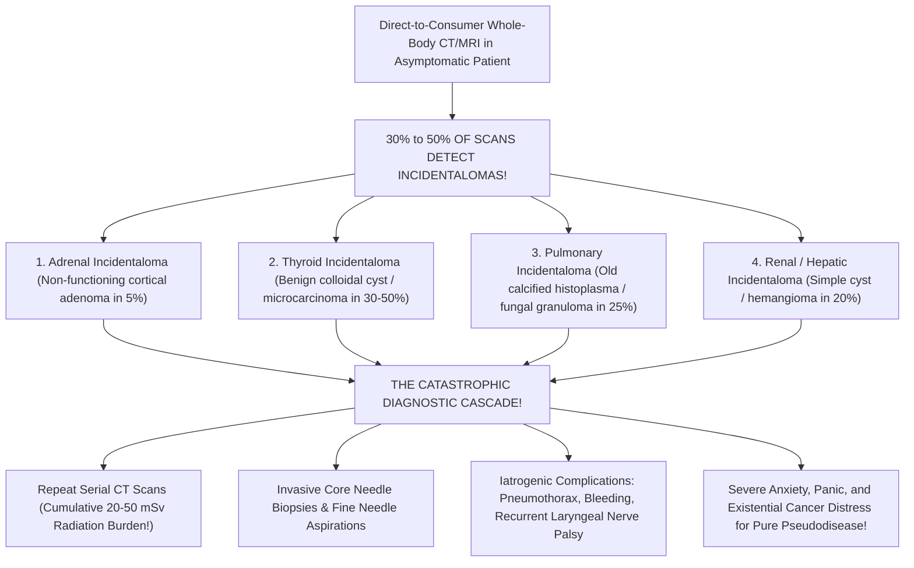

#### **The Evidence-Based Autopsy of the Full-Body Trap:**
1. **The Incidentaloma Flood ($30\%\text{ to }50\%$ Prevalence):**
   * Human biology is not geometrically uniform. High-resolution cross-sectional imaging reveals thousands of tiny anatomical variations: benign hepatic hemangiomas, asymptomatic renal cysts, non-functioning adrenal adenomas, thyroid nodules, and calcified pulmonary granulomas.
   * Because the pre-test probability of lethal cancer in an asymptomatic 40-year-old is infinitesimal, **$> 95\%$ of every discovered nodule is benign**.
2. **The Catastrophic Diagnostic Cascade:**
   * Once an "abnormal $9\text{-mm}$ indeterminate pulmonary nodule" or "$1.4\text{-cm}$ adrenal lesion" is printed on a radiology report, the physician cannot ignore it due to medicolegal liability.
   * The patient is thrust into a cascade: repeat high-dose contrast CTs at 3, 6, and 12 months; PET scans; CT-guided lung biopsies (carrying a $15\%\text{ to }20\%$ pneumothorax rate); or diagnostic laparoscopic adrenalectomies.
3. **The Ionizing Radiation Burden:**
   * A full-body screening CT delivers **$10\text{ to }20\ \text{mSv}$ of ionizing radiation** ($200\times$ a chest X-ray).
   * Epidemiological models from the National Research Council's BEIR VII report estimate that a single full-body CT in a 40-year-old confers a lifetime excess cancer mortality risk of **$1\text{ in }1,000$**—literally causing the very disease the patient paid to avoid!
4. **Zero Mortality Benefit:**
   * Not a single prospective randomized controlled trial has ever demonstrated that unselected full-body scanning reduces all-cause mortality, cardiovascular mortality, or cancer mortality in the general population.
   * Genuine preventive medicine does not perform random, uncalibrated fishing expeditions; it applies **targeted, calibrated screening directed at specific biological mechanisms with proven interventions**.

---

## **DOSSIER 18.6: MASTER SCREENING COMPENDIUM & EVIDENCE-BASED REFERENCE MATRIX**

### **18.6.1 The Master Preventive Screening Architecture Database**

| Disease Target | Target Population / Eligibility | Screening Modality | Recommended Frequency | High-Risk Escalation Triggers | Validated Stopping Age | Primary Evidence Grade |
| :--- | :--- | :--- | :--- | :--- | :--- | :--- |
| **Atherosclerotic CVD ($\text{ASCVD}$)** | Adults aged $40\text{–}75$ with borderline/intermediate risk ($7.5\%\text{–}20\%$ 10-yr risk) | **Coronary Artery Calcium ($\text{CAC}$) CT** + **ApoB & Lipid Panel** | Once for baseline CAC; Lipid panel every $3\text{–}5\ \text{yr}$ | $\text{CAC} \ge 100$ or $\text{ApoB} > 100 \implies$ High-intensity statin; $\text{CAC} \ge 400 \implies$ Secondary prevention | Age $75\text{–}80$ | **ACC/AHA Class IIa** |
| **Colorectal Cancer ($\text{CRC}$)** | Average-risk adults aged **$45\text{ to }75\ \text{years}$** | **Optical Colonoscopy** OR **FIT** OR **mt-sDNA (Cologuard)** | Colonoscopy **every 10 yr**; FIT **annual**; mt-sDNA **every 3 yr** | 1st-degree relative with CRC $< 60\ \text{yr} \implies$ Colonoscopy at age $40$ (or $10\ \text{yr}$ before index case), repeat every $5\ \text{yr}$ | Age $75$ routine; Individualize $76\text{–}85$; Stop $> 85$ | **USPSTF Grade A** |
| **Lung Carcinoma** | Adults aged **$50\text{ to }80\ \text{years}$** with **$\ge 20$ pack-year** smoking history | **Annual Low-Dose Chest CT ($\text{LDCT}$)** | **Every 12 Months** | Lung-RADS 3 $\implies$ 6-mo CT; Lung-RADS 4A $\implies$ 3-mo CT; 4B $\implies$ Biopsy | Cessation of smoking for $> 15\ \text{yr}$ OR Age 81 | **USPSTF Grade B** |
| **Breast Carcinoma** | Average-risk women aged **$40\text{ to }74\ \text{years}$** | **3D Digital Breast Tomosynthesis ($\text{DBT}$)** | **Biennial** (USPSTF) or **Annual** (ACS/ACR) | Lifetime risk $\ge 20\%$ by Tyrer-Cuzick OR *BRCA* mutation $\implies$ **Annual Breast MRI + DBT starting at age 25–30!** | Age $75$ (or life expectancy $< 10\ \text{yr}$) | **USPSTF Grade B** |
| **Cervical Carcinoma** | Women aged **$21\text{ to }29$** (Cytology) and **$30\text{ to }65$** (hrHPV) | **Primary High-Risk HPV ($\text{hrHPV}$)** OR **Cytology** | hrHPV **every 5 yr** (Ages $30\text{–}65$); Cytology **every 3 yr** (Ages $21\text{–}29$) | $\text{ASC-US with hrHPV}^+$ or $\text{HSIL} \implies$ Immediate Colposcopy + Directed Biopsy | Age $65$ if prior screens negative | **USPSTF Grade A** |
| **Osteoporosis** | Women aged **$\ge 65\ \text{years}$**; Men $\ge 70$; Younger with high risk | **Dual-Energy X-Ray Absorptiometry ($\text{DXA}$)** | Every **$2\text{ to }5\ \text{years}$** based on baseline T-score | T-score $\le -2.5$ or Fragility fracture $\implies$ Bisphosphonates / Denosumab / Teriparatide | None established | **USPSTF Grade B** |
| **Type 2 Diabetes** | Adults aged **$35\text{ to }70\ \text{years}$** who are overweight ($\text{BMI} \ge 25$) | **$\text{HbA1c}$** OR **Fasting Plasma Glucose** | **Every 3 Years** | Pre-diabetes ($\text{HbA1c } 5.7\text{–}6.4\%) \implies$ Annual testing + Intensive lifestyle/Metformin | Individualize based on health status | **USPSTF Grade B** |
| **Abdominal Aortic Aneurysm** | Men aged **$65\text{ to }75\ \text{years}$** who have **ever smoked ($\ge 100$ cigarettes)** | **Abdominal Duplex Ultrasound** | **Once in a Lifetime** | Aortic diameter $\ge 5.5\ \text{cm}$ (or expansion $> 1.0\ \text{cm/yr}$) $\implies$ Vascular surgical repair | Age 75 | **USPSTF Grade B** |

---

### **18.6.2 Biostatistical Formulas & Quality Summary**

$$\text{Sensitivity} = \frac{\text{TP}}{\text{TP} + \text{FN}}\qquad \text{Specificity} = \frac{\text{TN}}{\text{TN} + \text{FP}}$$

$$\text{PPV} = \frac{\text{TP}}{\text{TP} + \text{FP}}\qquad \text{NPV} = \frac{\text{TN}}{\text{TN} + \text{FN}}$$

$$\text{Positive Likelihood Ratio (LR+)} = \frac{\text{Sensitivity}}{1 - \text{Specificity}}\qquad \text{Negative Likelihood Ratio (LR-)} = \frac{1 - \text{Sensitivity}}{\text{Specificity}}$$

$$\text{Agatston Score} = \sum (\text{Plaque Area mm}^2 \times \text{Density Factor [1, 2, 3, or 4]})$$

$$\text{Selectivity Index (AVS)} = \frac{[\text{Cortisol}]_{\text{Adrenal Vein}}}{[\text{Cortisol}]_{\text{Peripheral Vein}}}\ge 3.0\text{–}5.0$$

$$\text{Lateralization Index (AVS)} = \frac{(\text{Aldo/Cort})_{\text{Dominant}}}{(\text{Aldo/Cort})_{\text{Non-Dominant}}} \ge 4.0$$

$$\text{Central-to-Peripheral Ratio (IPSS)} = \frac{[\text{ACTH}]_{\text{IPS}}}{[\text{ACTH}]_{\text{Peripheral}}} \ge 2.0\ (\text{Basal}) \text{ or } \ge 3.0\ (\text{Stimulated})$$


---

## **DOSSIER 18.7: ADVANCED LONGEVITY PHARMACOTHERAPY, POST-SCREENING SURVEILLANCE & CLINICAL CASE ARCHITECTURE**

### **18.7.1 Post-Polypectomy Colonoscopy Surveillance Intervals (US Multi-Society Task Force Guidelines)**

When a screening colonoscopy reveals polyps, the patient exits the 10-year general population screening track and enters the **Stratified Post-Polypectomy Surveillance Protocol**. The recall interval is strictly determined by polyp count, maximum size, and histological sub-classification (*Lieberman et al., USMSTF on Colorectal Cancer*):

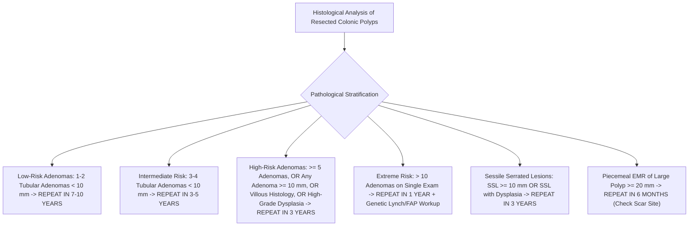

| Baseline Colonoscopy Histological Findings | USMSTF Risk Classification | Recommended Surveillance Interval | Critical Clinical Rationale |
| :--- | :--- | :--- | :--- |
| **Normal Examination (No Polyps) OR Diminutive Hyperplastic Polyps in Rectum/Sigmoid ONLY** | Average Population Risk | **10 Years** | Distal hyperplastic polyps $< 10\ \text{mm}$ have zero malignant potential. |
| **$1\text{ to }2$ Tubular Adenomas, each $< 10\ \text{mm}$** | Low-Risk Adenoma ($\text{LRA}$) | **$7\text{ to }10\ \text{Years}$** | 10-year incidence of advanced neoplasia is identical to patients with normal baseline colonoscopy. |
| **$3\text{ to }4$ Tubular Adenomas, each $< 10\ \text{mm}$** | Intermediate Risk | **$3\text{ to }5\ \text{Years}$** | Accelerated multi-focal adenoma formation rate. |
| **$5\text{ to }10$ Tubular Adenomas, each $< 10\ \text{mm}$** | High-Risk Adenoma ($\text{HRA}$) | **3 Years** | Marked lifetime risk of subsequent advanced metachronous neoplasia. |
| **Any Adenoma $\ge 10\ \text{mm}$ in diameter** | High-Risk Adenoma ($\text{HRA}$) | **3 Years** | Polyps $\ge 10\ \text{mm}$ harbor a $10\%\text{ to }20\%$ prevalence of invasive or micro-invasive carcinoma. |
| **Any Adenoma with Villous Histology ($\ge 25\%$ Villous Component)** | High-Risk Adenoma ($\text{HRA}$) | **3 Years** | Villous finger-like fronds carry $3\times$ higher progression velocity than tubular architecture. |
| **Any Adenoma with High-Grade Dysplasia ($\text{HGD}$)** | High-Risk Adenoma ($\text{HRA}$) | **3 Years** | Represents intraepithelial neoplasia on the verge of basement membrane invasion. |
| **$> 10$ Adenomas on a single examination** | Severe Adenomatous Burden | **1 Year** | High suspicion for Attenuated Familial Adenomatous Polyposis ($\text{AFAP}$) or *MUTYH*-Associated Polyposis ($\text{MAP}$). Order germline genetics. |
| **$1\text{ to }2$ Sessile Serrated Lesions ($\text{SSL}$), each $< 10\ \text{mm}$** | Low-Risk Serrated | **$5\text{ to }10\ \text{Years}$** | Low short-term progression risk if complete cold-snare resection achieved. |
| **$\text{SSL} \ge 10\ \text{mm}$ OR $\text{SSL}$ with Cytological Dysplasia** | High-Risk Serrated | **3 Years** | Rapid progression via the serrated BRAF/CIMP methylation pathway. |
| **Piecemeal Resection of Large Adenoma or $\text{SSL} \ge 20\ \text{mm}$** | Incomplete Resection Risk | **6 Months** | Mandatory endoscopic inspection and scar biopsy to rule out residual neoplastic rim. |

---

### **18.7.2 Advanced Longevity Lipidology: Beyond Conventional Statins**

When screening unmasks high ApoB ($> 80\text{–}100\ \text{mg/dL}$), elevated Lp(a) ($> 125\ \text{nmol/L}$), or non-zero CAC in a patient seeking maximum cardiovascular healthspan, modern preventive cardiology deploys a targeted pharmacological hierarchy:

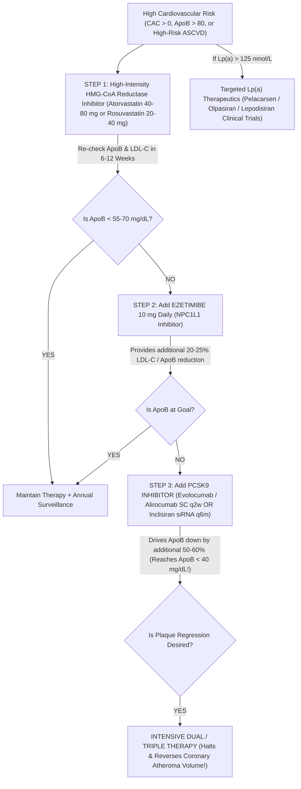

#### **1. Step 1: High-Intensity Statins (HMG-CoA Reductase Inhibition)**
* **Mechanism:** Competitively inhibits 3-hydroxy-3-methylglutaryl-coenzyme A ($\text{HMG-CoA}$) reductase, the rate-limiting step in hepatocyte cholesterol biosynthesis.
* **Secondary Feedback:** Depleted intracellular cholesterol triggers sterol regulatory element-binding protein 2 ($\text{SREBP-2}$) translocation to the nucleus, upregulating **cell-surface LDL Receptors ($\text{LDLR}$)**. Increased receptor clearance clears ApoB and LDL particles from the bloodstream by $50\%\text{ to }60\%$.
* **Pleiotropic Effects:** Enhances endothelial nitric oxide synthase ($\text{eNOS}$), stabilizes fibrous caps via macrophage matrix metalloproteinase inhibition, and reduces systemic vascular inflammation.

#### **2. Step 2: Ezetimibe (NPC1L1 Inhibition)**
* **Mechanism:** Selectively binds and inhibits the **Niemann-Pick C1-Like 1 ($\text{NPC1L1}$) transporter** located on the apical brush border of enterocytes in the small intestine.
* **Biochemical Impact:** Blocks intestinal absorption of both dietary and biliary cholesterol by $> 50\%$.
* **Synergy with Statins:** When hepatocytes are blocked from synthesizing cholesterol (statin) AND blocked from recycling biliary cholesterol (ezetimibe), hepatic LDL receptors are hyper-induced, yielding an **additional $20\%\text{ to }25\%$ reduction in ApoB and LDL-C** with virtually zero systemic side effects (*IMPROVE-IT landmark trial*).

#### **3. Step 3: PCSK9 Monoclonal Antibodies & siRNA Technology**
* **The PCSK9 Degradation Cycle:** Proprotein Convertase Subtilisin/Kexin Type 9 ($\text{PCSK9}$) is a circulating serine protease secreted by the liver. When an LDL particle binds to an LDL receptor, circulating PCSK9 binds to the extracellular domain of the LDLR. During clathrin-coated endocytosis, the bound PCSK9 prevents the normal acidic dissociation of the receptor in the endosome, routing the **LDL receptor directly to the lysosome for irreversible destruction**!
* **Monoclonal Antibodies (Evolocumab & Alirocumab):** Fully human monoclonal antibodies bind free circulating PCSK9 with picomolar affinity, preventing it from binding LDLR. Liberated LDL receptors are spared from lysosomal degradation and recycle back to the hepatocyte surface up to **150 times**, purging ApoB from circulation and dropping LDL-C by **$50\%\text{ to }65\%$** (*FOURIER and ODYSSEY OUTCOMES trials*)!
* **siRNA Gene Silencing (Inclisiran):** A chemically synthesized small interfering RNA ($\text{siRNA}$) conjugated to triantennary N-acetylgalactosamine ($\text{GalNAc}$), which binds specifically to asialoglycoprotein receptors on hepatocytes. Inside the hepatocyte cytoplasm, inclisiran loads into the **RNA-Induced Silencing Complex ($\text{RISC}$)**, cleaving *PCSK9* messenger RNA with surgical precision. Administered subcutaneously once every **6 months**, it provides sustained $> 50\%$ ApoB reduction.

#### **4. Emerging Therapeutics for Elevated Lipoprotein(a)**
Standard statins do not lower Lp(a); in fact, statins can increase Lp(a) by $10\%\text{ to }20\%$ via transcriptional activation of the *LPA* promoter! Specific targeted RNA therapeutics are currently transforming longevity cardiology:
* **Pelacarsen:** An antisense oligonucleotide ($\text{ASO}$) targeting *Apo(a)* mRNA in hepatocytes, lowering plasma Lp(a) by **$70\%\text{ to }80\%$**.
* **Olpasiran & Lepodisiran:** Long-acting GalNAc-conjugated siRNAs targeting *LPA* transcripts, delivering **$> 95\%$ sustained reduction in circulating Lp(a)** with dosing intervals up to once every six months (*OCEAN(a) and ALPACAR clinical trial programs*).

---

### **18.7.3 Technical Calibration Physics: DEXA European Spine Phantom & TBS Thresholds**

To ensure that bone mineral density results are comparable across different medical centers and over decades of patient follow-up, medical physicists perform strict machine cross-calibration.

#### **1. The European Spine Phantom (ESP) Quality Control Standard**
* DXA scanners (manufactured primarily by **Hologic** [pulsed dual-energy 100/140 kVp] and **GE Lunar** [K-edge filtered dual-energy 40/70 keV]) employ different physical X-ray spectrums and edge-detection edge algorithms.
* To calibrate scanners, medical physicists image the **European Spine Phantom ($\text{ESP}$)**—a standardized semi-anthropomorphic epoxy phantom containing three vertebrae with precisely machined hydroxyapatite inserts representing:
  * L1: Low BMD ($0.50\ \text{g/cm}^2$);
  * L2: Medium BMD ($1.00\ \text{g/cm}^2$);
  * L3: High BMD ($1.50\ \text{g/cm}^2$).
* **Cross-Calibration Formula:** If a patient switches from a Hologic scanner to a GE Lunar scanner, raw $\text{g/cm}^2$ values cannot be compared directly! Clinicians must apply standardized BMD ($\text{sBMD}$) conversion formulas:

$$\text{sBMD}_{\text{Hologic}} = 1.0536 \times (\text{BMD}_{\text{Hologic}} - 0.0019)$$

$$\text{sBMD}_{\text{GE Lunar}} = 0.9683 \times \text{BMD}_{\text{Lunar}}$$

#### **2. Trabecular Bone Score (TBS) Diagnostic Reference Thresholds**
While areal BMD reflects the quantity of hydroxyapatite, the **Trabecular Bone Score ($\text{TBS}$)** assesses textural microarchitecture:

$$\text{TBS} = \text{Variogram Slope Analysis of Projected DXA Gray-Level Differences}$$

* **Normal Microarchitecture:** $\mathbf{\text{TBS} \ge 1.310}$. Indicates dense, intact, mechanically resilient trabecular network; low independent fracture risk.
* **Partially Degraded Microarchitecture:** $\mathbf{\text{TBS between } 1.230\ \text{and } 1.310}$. Intermediate fracture risk; warrants fracture risk enhancement calculations via the FRAX-TBS algorithm.
* **Degraded Microarchitecture:** $\mathbf{\text{TBS} < 1.230}$. Severe microarchitectural fragmentation, porous trabecular plates, and elevated fragility fracture risk independent of bone mineral density!

---

### **18.7.4 Comprehensive Screening Case Studies: Putting the Math to Work**

#### **Case Study 1: The Asymptomatic Executive with High ApoB and Zero Calcium**
* **Patient:** 44-year-old male entrepreneur presents for an executive longevity evaluation. Non-smoker, $\text{BP } 128/82\ \text{mmHg}$, $\text{BMI } 27.2\ \text{kg/m}^2$.
* **Advanced Biomarkers:**
  * Total Cholesterol $= 224\ \text{mg/dL}$; $\text{HDL-C} = 42\ \text{mg/dL}$; Triglycerides $= 210\ \text{mg/dL}$.
  * Calculated $\text{LDL-C} = 140\ \text{mg/dL}$.
  * **$\text{ApoB} = 122\ \text{mg/dL}$** (Severely elevated; $> 90^{\text{th}}$ percentile!).
  * **$\text{Lp(a)} = 22\ \text{nmol/L}$** (Normal, $< 75\ \text{nmol/L}$).
  * $\text{hs-CRP} = 1.1\ \text{mg/L}$ (Low-average).
  * **Coronary Artery Calcium (CAC) CT:** **$\text{Agatston Score} = \mathbf{0}$**.
* **Clinical Dilemma:** The patient's primary care doctor wants to withhold statin therapy because the CAC is $0$ ("The Power of Zero"). Is this correct?
* **Behind-the-Curtain Longevity Resolution:**
  * **No!** CAC $= 0$ confirms the absence of *calcified* plaque, providing a low 5-year event horizon. However, the patient is 44 years old. Plaque takes 15 to 20 years to calcify!
  * With an $\text{ApoB}$ of $122\ \text{mg/dL}$, the patient is bathing his subendothelial matrix in millions of atherogenic particles every single day. Waiting for the CAC to turn positive is waiting for irreversible arterial injury to occur!
  * **Action:** Initiate moderate-intensity statin + ezetimibe to drive $\text{ApoB} < 70\ \text{mg/dL}$, permanently arresting the retention of atherogenic lipoproteins and preserving his CAC at zero for the next thirty years.

#### **Case Study 2: The Multi-Cancer Early Detection (MCED) False Alarm Nightmare**
* **Patient:** 38-year-old female marathon runner pays $\$1,200$ out-of-pocket for a commercial multi-cancer cell-free DNA methylation blood test.
* **Result:** **"CANCER SIGNAL DETECTED — Predicted Origin: PANCREAS / GALLBLADDER."**
* **The Panic:** The patient is referred to an emergency oncology clinic in acute psychological distress, convinced she has fatal pancreatic cancer.
* **The Bayesian Calculation:**
  * Pre-test prevalence of pancreatic cancer in an asymptomatic 38-year-old female: $P \approx 1\text{ in }50,000 = 0.00002$.
  * Test Specificity $= 99.5\%$ ($1 - \text{Specificity} = 0.005$).
  * Test Sensitivity for Stage I/II pancreatic cancer $\approx 60\%$ ($0.60$).
  * **Calculate Positive Predictive Value ($\text{PPV}$):**

$$\text{PPV} = \frac{0.60 \times 0.00002}{(0.60 \times 0.00002) + (0.005 \times 0.99998)} = \frac{0.000012}{0.000012 + 0.00500} = \frac{0.000012}{0.005012} \approx \mathbf{0.24\%}$$

* **The Reality:** **There is a $99.76\%$ probability that this result is a FALSE POSITIVE!**
* **Diagnostic Workup:** Thin-slice pancreatic protocol contrast CT of the abdomen and high-resolution Endoscopic Ultrasound ($\text{EUS}$) of the pancreas are performed, showing a completely normal, healthy pancreas. The patient is spared an exploratory diagnostic laparoscopy and reassured after profound, unnecessary iatrogenic psychological trauma. This case embodies why screening tests without pre-test calibration cause immense harm.


---

## INCLUDED SOURCE: `DOCS_ARCHIVE_04_PREVENTABLE_DEATH_SCREENING_AND_LONGEVITY.md`


# **The Paradox of Longevity: Aligning Medical Innovation, Prevention Strategy, and Patient Compliance to Mitigate Avoidable Mortality**

## **I. The Economic and Human Scale of Avoidable Mortality**

### **I.A. Defining Preventable and Treatable Mortality in Public Health Contexts**

To address the challenge of premature death, policy analysis must first distinguish between two critical public health categories: preventable and treatable mortality. This distinction, typically applied to deaths occurring before the age of 75 years 1, highlights different required intervention strategies.

A death is defined as **treatable** (or amenable to treatment) if it could have been avoided through optimal quality health care utilizing existing medical knowledge and technology at the time of death.2 Failures in this category often point toward deficiencies in clinical access, quality of care, or, significantly, patient utilization and adherence.

In contrast, a death is considered **preventable** if it could have been avoided through broad public health interventions focused on wider determinants of health, such as behavior, lifestyle factors, socioeconomic status, and environmental conditions.2 The primary drivers of Noncommunicable Diseases (NCDs), which account for the vast majority of chronic morbidity and mortality, stem from these behavioral risk factors: tobacco use, insufficient physical activity, harmful use of alcohol, and unhealthy diets.3 These behaviors contribute to metabolic risk factors—raised blood pressure, elevated blood lipids, and obesity—that ultimately lead to cardiovascular disease and other chronic conditions.3 Both preventable and treatable disease categories are central to the structural inefficiency observed in modern healthcare systems.

### **I.B. The Global and National Burden of Noncommunicable Diseases (NCDs)**

Noncommunicable diseases—including cardiovascular diseases, cancers, chronic respiratory diseases, and diabetes—are the pervasive chronic conditions that drive the global mortality crisis.3 The burden is globally immense and fundamentally unevenly distributed. Low- and middle-income countries (LMICs) bear the disproportionate majority, accounting for nearly three-quarters of global NCD deaths (32 million).3

Crucially, NCDs are responsible for a significant crisis of premature mortality. Globally, approximately 18 million NCD deaths occur before the age of 70, surpassing all other causes of death combined within that age group.3 Of these premature deaths, 82% are estimated to occur in LMICs, illustrating the severe inequality embedded within the global health landscape.3

In the domestic context, chronic conditions overwhelmingly dominate mortality statistics. In the United States, the leading causes of death are Heart Disease (680,981 deaths) and Cancer (613,352 deaths), followed by accidents (unintentional injuries), stroke (cerebrovascular diseases), and chronic lower respiratory diseases.4 The sheer volume of deaths attributable to these chronic, preventable, and treatable conditions confirms that the greatest human loss arises from conditions amenable to systematic intervention.

### **I.C. Quantifying the Lost Economic Welfare: Output vs. Value of Healthy Life**

The human cost of avoidable death translates directly into massive economic loss, particularly in developing economies. A comprehensive analysis indicated that approximately 8 million deaths worldwide in 2015 were "amenable" to treatment if globally standardized, high-quality care were universally available.5

To quantify the cost of this lost potential, analysts use two metrics. The direct loss of economic output measures the workforce's contribution to a country’s Gross Domestic Product (GDP). Researchers estimate that the loss of productivity from deaths amenable to treatment resulted in a cumulative loss of **\$11.2 trillion in low- and middle-income countries between 2015 and 2030**.5 For some of the most vulnerable nations, such as the Central African Republic and Lesotho, this loss was predicted to exceed 5.3 percent of national GDP by 2030\.5

This profound loss of productive potential acts as a structural constraint on global economic development. When NCDs disproportionately kill people prematurely (under 70\) in LMICs 3, the resulting cumulative loss of output 5 starves the very economies that need to invest in advanced medical systems and public health infrastructure, thereby perpetuating the cycle of early mortality and underdevelopment. The failure to mitigate NCDs is, therefore, a fundamental impediment to achieving global economic parity.

Beyond GDP, the broader measure of **Lost Economic Welfare** captures the inherent value that individuals place on their own good health.5 This loss was estimated at \$6 trillion in 2015 for LMICs alone.5

In the United States, the total scale of expenditure—\$4.9 trillion in 2023 6—yet the continued dominance of chronic, preventable diseases in mortality statistics 4, reveals a profound structural inefficiency. Ninety percent of the nation's annual health care expenditures are dedicated to managing people with chronic and mental health conditions.8 This enormous financial commitment demonstrates that the system is structurally designed to treat the costly **consequences** of preventable diseases rather than investing efficiently to reduce their **incidence**. This misallocation highlights a fundamental failure in systemic prioritization.

Table 1: The Global and National Economic Burden of Avoidable Mortality

| Metric | Scope/Region | Value (Source Year) | Significance to Policy |
| :---- | :---- | :---- | :---- |
| Amenable Deaths Annually | Worldwide | \~8 million (2015) 5 | Highlights massive human potential loss globally, especially in LMICs.3 |
| Lost Economic Welfare | Low/Middle-Income Countries | \$6 Trillion (2015) 5 | Captures the broader societal value of health beyond GDP metrics. |
| Cumulative Lost Output (2015-2030) | Low/Middle-Income Countries | \$11.2 Trillion 5 | Demonstrates long-term macroeconomic drag on developing nations. |
| US Annual Healthcare Spending | United States | \$4.9 Trillion (2023) 6 | Defines the scale of the financial commitment in the US system. |
| Share of Spending on Chronic Conditions | United States | 90% of annual expenditures 8 | Isolates chronic diseases as the primary financial policy challenge. |

## **II. The Dynamics of Escalating Medical Costs and Innovation**

### **II.A. Analyzing Cost Drivers: Technology, Utilization, and Systemic Waste**

Healthcare expenditure in the United States continues to accelerate at an unsustainable rate, reaching \$4.9 trillion in 2023\.6 This represents a 7.5% increase over the previous year, significantly outpacing the nation’s GDP growth of 6.6%.7 This rapid escalation is driven by a combination of rising prices and increased utilization of goods and services.6

Structural and input costs contribute heavily to this acceleration. For instance, labor costs remain the largest single category of hospital spending, accounting for 56% of total expenses.9 Amid ongoing workforce shortages, hospitals face persistent cost growth, with advertised salaries for registered nurses growing 26.6% faster than the rate of inflation over the past four years.9 This creates enormous financial pressure, particularly as Medicare and Medicaid reimbursements often fail to keep pace with inflation.9

Furthermore, systemic complexity contributes significantly to waste and high unit prices, which are substantially higher in the United States compared to peer nations.6 The complexity of the system involves administrative waste, and unit prices for services such as doctor and hospital visits remain elevated.6 Hospital consolidation also reduces competition, allowing providers to increase prices.6 Government interference, often through federal and state-based coverage mandates, can increase the cost of basic health insurance anywhere from slightly less than 10% to over 50%.10

### **II.B. The Value Proposition of Advanced Medical Technologies in Life Extension**

Medical technology innovations, encompassing new diagnostics, devices, procedures, and pharmaceuticals, have been instrumental in improving life expectancy and quality of life following diagnosis.11 Global average life expectancy has increased by almost 23 years over the past 60 years, a success story largely attributable to improvements in overall health conditions, better understanding of risk factors, and access to healthcare.12

In acute care, the impact is quantifiable: improvements in medical technology and trauma care were responsible for one-third of the drop in road traffic deaths in England over two decades, saving hundreds of lives annually.13 This evidence demonstrates the profound value of innovation in sustaining life and overcoming previously fatal conditions.

However, the pursuit of marginal gains comes at a significant cost. Necessary life-extending treatments carry a high price tag per unit of life gained. For instance, receiving revascularization is associated with an additional 1.1 years of life expectancy, at a cost of \$38,000 for that gain.14

### **II.C. The Complicated Economic Impact of Innovation**

Medical innovation presents a complex fiscal trade-off. Some advances, such as improved anesthetic agents and practices, can reduce costs per patient by reducing the burden of surgery, leading to faster recoveries and shorter hospital stays.15 These innovations achieve health improvements while reducing the cost of a specific intervention.

Yet, a substantial portion of high-value technology increases overall systemic costs. This occurs because successful innovations often extend treatment to previously untreatable populations or expand existing treatments to new conditions, thereby increasing overall utilization across the entire system.15 Moreover, technologies that successfully extend life inherently increase the patient's lifetime utilization of healthcare services, particularly the longitudinal management required by an older, sicker population with chronic conditions.9

This acceleration creates a systemic paradox: the success of innovation in prolonging life (Section II.B) transforms into an unsustainable financial burden (Section II.A) because the healthcare system is inefficient and focused on high-cost treatments. The \$4.9 trillion expenditure is largely a result of successfully extending life; however, since the infrastructure is strained by factors like high labor costs and lagging reimbursement 9, the very triumph of medical technology generates pressure that the financial architecture cannot absorb.

The central economic challenge has shifted from funding critical, acute, life-saving breakthroughs to efficiently managing the chronic aftermath. Since 90% of US health expenditure targets chronic care 8, pricing controls or policy strategies aimed solely at new, high-tech cures will miss the primary cost driver: the massive, complex, and longitudinal management required by the population that technology has saved. The cost crisis is fundamentally a chronic disease management crisis, not merely an R\&D pricing issue.

## **III. Patient Compliance: The Critical Choke Point in Preventing Death**

### **III.A. The Pervasiveness of Non-Adherence and its Clinical Consequences**

Adherence to therapy—the extent to which a patient follows prescribed therapeutic recommendations—is the single most pivotal factor in the effective management of chronic conditions such as diabetes, hypertension, and cardiovascular diseases.16 Despite its critical importance, medication non-adherence remains a staggering challenge: approximately half of patients in the United States stop taking their prescribed chronic medications within one year.17

The clinical outcomes of this failure are devastating. Non-adherence leads directly to disease progression, worse clinical outcomes, higher rates of hospital readmissions, and increased cardiovascular mortality.16 Conversely, the impact of improved adherence is profound: hospitals with high medication adherence rates demonstrate significantly lower 2-year major adverse cardiovascular event risk (27.5% versus 35.3%) and lower adjusted rates of death or readmission.18 Even modest improvements in compliance have been shown to reduce the risk of atherosclerosis progression and improve long-term survival rates in cardiovascular patients.16

### **III.B. Multifaceted Barriers to Adherence: Financial, Logistical, and Cognitive Factors**

The reasons for medication non-adherence are varied and stem from barriers related to the patient, the treatment regimen, the illness, or the therapeutic environment.19 Logistical and financial barriers are frequently cited, including the sheer cost of medication (affordability) and the complexity of managing multiple prescriptions.17

However, the barriers extend beyond mere cost. Patients often lack the fundamental information or knowledge required to properly understand their medication regimen.20 Crucially, non-adherence is often fueled by a lack of motivation or an inability to integrate medications into daily life.20 A good understanding of how the medication promotes the patient's quality of life is essential for adherence.20

The patient’s environment and socioeconomic factors (Social Determinants of Health, or SDOH) are inextricably linked to compliance. Factors such as a patient's self-efficacy, support from family and friends, and the ability to secure necessities like housing and transportation all influence the probability of adherence.20

### **III.C. The Direct Economic Cost of Non-Compliance**

Patient non-adherence acts as the primary threat multiplier to the massive investment poured into the healthcare system (Section II). If the \$4.9 trillion expenditure is reliant on patient participation, yet 50% of the patient population fails to comply 17, the return on investment is severely compromised. Non-adherence converts managed chronic conditions into acute, high-cost crises.16 Non-adherent patients with chronic illnesses experience increased hospital admission rates by up to **69 percent**.17

This failure to maintain compliance generates substantial direct economic costs associated with increased use of healthcare services, including hospitalizations, emergency room visits, and additional intensive treatments to manage preventable complications.16 This profound failure to leverage existing treatment effectively wastes resources and actively fuels the acceleration of healthcare costs.

Table 2: The Costs and Consequences of Patient Non-Adherence

| Adherence Status | Clinical Outcome Metric | Impact (Quantified) | Economic Implication |
| :---- | :---- | :---- | :---- |
| Non-Adherent Patients | Increase in Hospital Admission Rates (Chronic Illness) | Up to 69% increase 17 | Substantial direct costs via hospitalizations/ER visits.16 |
| Non-Adherent Patients | Major Adverse Cardiovascular Event (2-Year Risk) | Risk up to 35.3% (vs. 27.5% for High-Adherence) 18 | Higher incidence of acute, high-cost interventions (e.g., revascularization).14 |
| Adherent Patients | Risk of Disease Progression/Complications | Reduced significantly 16 | Improved long-term survival rates and reduced indirect economic costs.16 |
| High Adherence Interventions | Medication Synchronization (Med Sync) | Improved adherence, fewer hospitalizations 16 | Proven cost savings through reduced complexity and fewer acute events.16 |

### **III.D. Strategic Interventions for Improving Adherence**

Effective strategies for improving adherence require a personalized, comprehensive, and patient-centric approach.16 Simple interventions focusing on regimen complexity have proven highly effective, such as reducing the number of daily doses by prescribing once-daily medications.16 The role of healthcare professionals is fundamental; they must build patient trust, provide continuous support, and ensure effective communication regarding the treatment plan.16

Pharmacist-led interventions offer significant returns on investment. Medication Synchronization (Med Sync) programs, which ensure all of a patient's multiple prescriptions are refilled on the same day each month, reduce logistical complexity.16 Studies confirm that patients enrolled in Med Sync programs are more likely to adhere to their medications and experience fewer hospitalizations and emergency room visits, translating directly into overall cost savings.16 Other promising tools include telemedicine, structured intervention programs utilizing multidisciplinary teams, and targeted financial incentives.16

Furthermore, since many barriers to adherence are rooted in logistical and socioeconomic instability 20, structural interventions targeting the Social Determinants of Health are required. Providing cost-effective measures like non-emergency medical transportation or stable housing for individuals with chronic conditions 21 are not simply social welfare programs; they are highly effective clinical interventions because they stabilize the environment necessary for continuous compliance and disease management.

## **IV. The Ethical and Economic Trade-Off: Prevention vs. Treatment Resource Allocation**

### **IV.A. Principles of Health Resource Allocation: Cost-Effectiveness Analysis (CEA)**

The allocation of finite healthcare resources must be guided by ethical and economic principles. Resource allocation should satisfy the ethical criterion of cost-effectiveness, aiming to maximize health benefits for the population served.22 Cost-Effectiveness Analysis (CEA) serves as the primary tool, measuring the cost and benefits of alternative health interventions to determine their relative efficiency, often by ranking interventions based on their cost-to-effectiveness ratio (e.g., cost per quality-adjusted life year, or QALY).22

This decision-making process concerning priorities in public health versus medical care must be deliberative, emphasizing transparency, stakeholder participation, and clear, relevant reasoning.23 While CEA provides a robust economic framework, it is noted that the quality component of the QALY is often derived from utility surveys, which introduces an element of ethical complexity concerning the societal valuation of different health states.24

### **IV.B. The Policy Debate: Prioritizing Upstream Prevention vs. Downstream Advanced Treatment**

The prevailing political economy often favors funding advanced, downstream treatment over upstream prevention. Advanced medical treatment, such as revascularization (\$38,000 for 1.1 years of life gain) 14, offers immediate, identifiable, and concentrated benefits for a specific patient. In contrast, the return on investment (ROI) for public health prevention strategies is dispersed across a large population and realized only over a long duration—years or decades—by reducing the overall incidence of NCDs.25

It is important to challenge the simplistic adage that prevention always saves money in the clinical setting. Research shows that targeted clinical prevention, such as screening healthy people, can sometimes cost more than treating the few individuals who eventually develop the disease.25 The economic justification for prevention must therefore pivot from immediate cost savings to the long-term societal imperative of achieving population-wide risk reduction and mitigating the *future incidence* of costly chronic disease.25

Policy analysis suggests that when CEA is applied broadly to encompass all social conditions and programs that influence health, it often supports allocating resources to affect the Social Determinants of Health (SDOH) — which largely influence the incidence of disease and premature mortality — rather than strictly funding clinical health care to treat established disease.22

This prioritization gap represents a core political challenge: policymakers often prioritize short-term, visible wins (funding high-cost treatment) over the sustained, long-term societal solvency achieved through public health investment, despite the CEA evidence that the latter maximizes population health.22

### **IV.C. Evidence for Cost-Effective Prevention Measures**

Targeted prevention is demonstrably cost-effective. One area of high efficiency is **tertiary prevention**, which focuses on high-risk patients who already have one or more chronic conditions. These individuals account for approximately \$1.5 trillion in healthcare spending per year.26 Interventions focused on this population offer high savings and cost-effectiveness margins because the likelihood of avoiding an imminent, high-cost acute event (e.g., hospitalization or stroke) is significantly greater than in the general population.26

Furthermore, investment in SDOH is highly cost-effective public health policy. Evidence shows that efforts to improve food access and nutrition standards, or interventions that enhance the built environment to encourage physical activity (such as public transit infrastructure) 21, reduce the likelihood of costly chronic disease development. Providing non-emergency medical transportation is a particularly cost-effective measure as it increases the utilization of preventative and outpatient care, subsequently decreasing reliance on more expensive emergency and inpatient services.21 Investment in prevention, by reducing the pool of individuals who develop NCDs 3, acts as the necessary economic countermeasure to slow the inevitable cost acceleration driven by high-tech medical innovation and chronic care management.15

Table 3: Comparative Economic Strategy: Resource Allocation Trade-offs

| Intervention Type | Target Population | Primary Policy Goal | Economic Justification (CEA/ROI) | Citation |
| :---- | :---- | :---- | :---- | :---- |
| Advanced Treatment (Cure) | Acute/High-Risk Individual Patients | Life Extension/Crisis Management | High cost per QALY gain (e.g., \$38,000/1.1 yr gain) | 14 |
| Tertiary Prevention | Individuals with Chronic Conditions | Disease Management/Complication Reduction | High savings due to high probability of avoiding imminent, high-cost events. | 26 |
| Primary Prevention (SDOH) | Population/Socioeconomic Vulnerable Groups | Incidence Reduction/Behavioral Determinants | High population health benefit; cost-effective when measured broadly against societal metrics. | 21 |

## **V. Integrating Longevity Aspirations with Preventative Health Policy**

### **V.A. The Psychology of Longevity: Purpose, Social Connection, and Behavioral Motivation**

The human desire to live a long life is a powerful intrinsic motivator that public health policy must strategically harness. Longevity is not purely a function of clinical intervention; healthspan is significantly influenced by non-clinical factors. A strong sense of purpose, often cited as the one critical contributor to health- and lifespan that cannot be purchased, provides a powerful drive for self-care and sustained adherence.27 Similarly, maintaining good mental health, securing restorative sleep 28, and fostering strong social connections have been identified as essential components of a long and healthy life.29

Public health strategy can leverage this drive by adopting an aspirational approach, similar to the multi-billion-dollar longevity industry.27 Instead of relying on fear of illness, campaigns should link preventative actions (e.g., exercise, diet) directly to achieving a purposeful, connected, and long life. Furthermore, cultural engagement is shown to serve as an effective non-pharmacological health tool. Systematic review shows a positive association between cultural participation and better mental health outcomes, including reduced cognitive decline and frailty, and enhanced social well-being in middle-aged and older adults.30

### **V.B. Policy Instruments for Behavioral Change: Shifting from Treatment Dependence to Healthspan Focus**

Policymakers must reframe adherence and preventative action not as burdensome mandates, but as essential investments in achieving a high-quality, long life.20 This shift in perspective is supported by scientific understanding. Research indicates that aging phenotypes can be partially and temporarily reversed by interventions—including dietary changes and exercise—that restore a more youthful epigenome in stem cells throughout the body.29 This biological mechanism provides strong justification for the long-term efficacy of adherence to healthy lifestyles.

The necessity of supporting behavioral change extends beyond the patient level to the core structure of healthcare accountability. While non-adherence by patients is a major driver of preventable death (Section III), another critical category of preventable death is medical error, which experts estimate costs the system between \$20 billion and \$45 billion annually.31 Reducing preventable death requires system integrity built on transparency. Currently, a reluctance among healthcare professionals to report errors due to fear of punishment hinders the ability to perform root cause analysis and identify patterns.31 Systemic cultural revisions must be implemented so that error reporting leads to constructive system and process improvement, ensuring accountability alongside non-punitive learning.31

### **V.C. Addressing Social Determinants of Health (SDOH) to Improve Compliance and Outcomes**

Socioeconomic factors and environmental conditions—the SDOH—exert a disproportionate influence on health outcomes. Studies estimate that socioeconomic factors account for as much as 50% of the county-level variation in health outcomes, far outweighing the estimated 20% impact of clinical care.21

Integrating effective SDOH interventions into healthcare planning is crucial for achieving compliance and mitigating preventable death. Evidence-based strategies include:

1. **Housing Stability:** "Housing first" interventions, which provide supportive housing to individuals with chronic conditions, lead to improved health outcomes and, in some cases, reduced overall healthcare costs.21  
2. **Transportation Access:** Non-emergency medical transportation is demonstrably cost-effective by ensuring that patients, particularly those with chronic diseases, can reliably access preventative and outpatient care, which is vital for sustained compliance.21  
3. **Food Security:** Efforts to improve food environments and nutrition standards, often supported through public benefit programs, have been shown to lower healthcare costs and improve outcomes.21

By stabilizing the underlying social and logistical foundations of a patient’s life, these interventions function as powerful compliance enablers, proving that investment in SDOH is the most leveraged form of primary and tertiary prevention.

## **VI. Strategic Recommendations for a Sustainable Healthspan Model**

Based on the analysis of avoidable mortality, financial acceleration, and the patient adherence crisis, the following strategic recommendations are proposed to align medical innovation, policy, and behavioral aspiration into a sustainable healthspan model.

### **VI.A. Policy Recommendations for Value-Based Care and Cost Containment**

1. **Mandate Value-Based Reimbursement Tied to Adherence:** The healthcare system must aggressively shift away from fee-for-service models toward value-based reimbursement (VBR). VBR models must incorporate metrics that reward successful long-term chronic disease management, incentivize the effective implementation of preventative services, and impose financial penalties on providers for non-adherence-related acute complications and readmissions.16  
2. **Implement Regulatory Action on Unit Costs and Consolidation:** To manage the rapid acceleration of costs outpacing GDP growth 7, policies must be implemented to address the systemic complexity, administrative waste, and high unit prices observed in the US system.6 This includes leveraging anti-trust measures to prevent hospital consolidation and mitigate the market power that drives up healthcare prices.  
3. **Invest in System Safety and Cultural Transparency:** To eliminate preventable deaths caused by medical errors (costing up to \$45 billion annually) 31, public health mandates must fund system and cultural revisions. This requires implementing non-punitive error reporting protocols and root cause analysis mechanisms, ensuring that healthcare professionals can report institutional deficiencies without fear of legal consequence, thereby leading to necessary system and process changes.31

### **VI.B. Mandates for Integrated Behavioral and Pharmacological Adherence Programs**

1. **Standardize Adherence Support and Education:** All treatment plans for chronic diseases must be legally required to include a standardized, multidisciplinary adherence component. This component must encompass comprehensive patient education regarding the illness, the mechanism of medication action, and how the regimen enhances long-term quality of life.20  
2. **Universalize Medication Synchronization and Simplified Regimens:** Policy must incentivize or require insurance plans and pharmacy benefit managers (PBMs) to cover and actively promote pharmacist-led medication synchronization (Med Sync) programs.16 Furthermore, prescribing standards should be reviewed to promote simplified, once-daily regimens wherever clinically appropriate, leveraging the proven cost-saving benefits derived from reduced logistical complexity and fewer acute events.16  
3. **Integrate Financial Incentive Alignment:** Policy should design targeted financial incentives within coverage plans that reward sustained patient compliance (e.g., lower copayments for compliant periods) and actively utilize digital health tools and telemedicine to facilitate motivational support and continuous monitoring.16

### **VI.C. Recommendations for Increased Investment in Foundational Public Health Infrastructure**

1. **Strategic SDOH Allocation:** Federal and state budgeting must formally recognize and fund SDOH interventions (e.g., housing support, food security, non-emergency transportation) as essential, highly cost-effective public health tools.21 This ensures that resource allocation adheres to the broad findings of CEA, which often supports social condition intervention over purely clinical, downstream treatment.22  
2. **Prioritize Tertiary Prevention ROI:** Policymakers must focus on prioritizing investment in programs that target the management of chronic conditions in high-risk patient populations. Given that these individuals account for \$1.5 trillion in annual spending 26, tertiary prevention offers the most immediate and substantial financial savings by significantly reducing the probability of high-cost acute events.26  
3. **Adopt Comprehensive Public Health Resilience Planning:** Agencies must adopt and consistently update comprehensive adaptation plans, such as the CDC’s BRACE framework 32, to proactively assess vulnerability to public health determinants and implement environmental and policy interventions—such as developing built environment infrastructure (sidewalks, transit) that encourages physical activity—to drive long-term, population-level health improvements.21

#### **Works cited**

> 1. accessed October 21, 2025, [https\://ec.europa.eu/eurostat/statistics-explained/index.php/Preventable\_and\_treatable\_mortality\_statistics\#:\~:text=The%20concept%20of%20treatable%20and,aged%20less%20than%2075%20years.](https://ec.europa.eu/eurostat/statistics-explained/index.php/Preventable_and_treatable_mortality_statistics#:~:text=The%20concept%20of%20treatable%20and,aged%20less%20than%2075%20years.)  
> 2. Preventable and treatable mortality statistics \- Statistics Explained \- Eurostat, accessed October 21, 2025, [https\://ec.europa.eu/eurostat/statistics-explained/index.php/Preventable\_and\_treatable\_mortality\_statistics](https://ec.europa.eu/eurostat/statistics-explained/index.php/Preventable_and_treatable_mortality_statistics)  
> 3. Noncommunicable diseases \- World Health Organization (WHO), accessed October 21, 2025, [https\://www\.who.int/news-room/fact-sheets/detail/noncommunicable-diseases](https://www.who.int/news-room/fact-sheets/detail/noncommunicable-diseases)  
> 4. Leading Causes of Death \- FastStats \- CDC, accessed October 21, 2025, [https\://www\.cdc.gov/nchs/fastats/leading-causes-of-death.htm](https://www.cdc.gov/nchs/fastats/leading-causes-of-death.htm)  
> 5. The High Cost of Preventable Deaths \| Harvard Medical School, accessed October 21, 2025, [https\://hms.harvard.edu/news/high-cost-preventable-deaths](https://hms.harvard.edu/news/high-cost-preventable-deaths)  
> 6. Why Are Americans Paying More for Healthcare?, accessed October 21, 2025, [https\://www\.pgpf.org/article/why-are-americans-paying-more-for-healthcare/](https://www.pgpf.org/article/why-are-americans-paying-more-for-healthcare/)  
> 7. Trends in health care spending \| Healthcare costs in the US \| AMA, accessed October 21, 2025, [https\://www\.ama-assn.org/about/ama-research/trends-health-care-spending](https://www.ama-assn.org/about/ama-research/trends-health-care-spending)  
> 8. Fast Facts: Health and Economic Costs of Chronic Conditions \- CDC, accessed October 21, 2025, [https\://www\.cdc.gov/chronic-disease/data-research/facts-stats/index.html](https://www.cdc.gov/chronic-disease/data-research/facts-stats/index.html)  
> 9. Costs of Caring \| AHA \- American Hospital Association, accessed October 21, 2025, [https\://www\.aha.org/costsofcaring](https://www.aha.org/costsofcaring)  
> 10. Drivers of Health Care Costs: A Physicians Foundation white Paper \- Second of a Three-Part Series \- PMC, accessed October 21, 2025, [https\://pmc.ncbi.nlm.nih.gov/articles/PMC6179664/](https://pmc.ncbi.nlm.nih.gov/articles/PMC6179664/)  
> 11. The Effect of Medical Technology Innovations on Patient Outcomes, 1990-2015: Results of a Physician Survey \- PMC, accessed October 21, 2025, [https\://pmc.ncbi.nlm.nih.gov/articles/PMC10398270/](https://pmc.ncbi.nlm.nih.gov/articles/PMC10398270/)  
> 12. Longer lives – impact of medical advances on life expectancy \| Swiss Re, accessed October 21, 2025, [https\://www\.swissre.com/institute/research/sonar/sonar2023/medical-advances-life-expectancy.html](https://www.swissre.com/institute/research/sonar/sonar2023/medical-advances-life-expectancy.html)  
> 13. Advances in medical technology account for a third of the reduction in road traffic deaths, accessed October 21, 2025, [https\://pmc.ncbi.nlm.nih.gov/articles/PMC1169360/](https://pmc.ncbi.nlm.nih.gov/articles/PMC1169360/)  
> 14. The Lifetime Costs and Benefits of Medical Technology \| NBER, accessed October 21, 2025, [https\://www\.nber.org/bah/fall07/lifetime-costs-and-benefits-medical-technology](https://www.nber.org/bah/fall07/lifetime-costs-and-benefits-medical-technology)  
> 15. Snapshots: How Changes in Medical Technology Affect Health Care Costs \- KFF, accessed October 21, 2025, [https\://www\.kff.org/health-costs/snapshots-how-changes-in-medical-technology-affect/](https://www.kff.org/health-costs/snapshots-how-changes-in-medical-technology-affect/)  
> 16. Enhancing Therapy Adherence: Impact on Clinical Outcomes, Healthcare Costs, and Patient Quality of Life \- PMC, accessed October 21, 2025, [https\://pmc.ncbi.nlm.nih.gov/articles/PMC11766829/](https://pmc.ncbi.nlm.nih.gov/articles/PMC11766829/)  
> 17. Overcoming Barriers to Medication Adherence for Chronic Diseases \- YouTube, accessed October 21, 2025, [https\://www\.youtube.com/watch?v=sEMCR7LchcA](https://www.youtube.com/watch?v=sEMCR7LchcA)  
> 18. Hospital Variation in Adherence Rates to Secondary Prevention Medications and the Implications on Quality \| Circulation \- American Heart Association Journals, accessed October 21, 2025, [https\://www\.ahajournals.org/doi/10.1161/circulationaha.117.029160](https://www.ahajournals.org/doi/10.1161/circulationaha.117.029160)  
> 19. 13.3 Factors that influence adherence \- MSF Medical Guidelines, accessed October 21, 2025, [https\://medicalguidelines.msf.org/en/viewport/TUB/english/13-3-factors-that-influence-adherence-20322728.html](https://medicalguidelines.msf.org/en/viewport/TUB/english/13-3-factors-that-influence-adherence-20322728.html)  
> 20. Factors Contributing to Medication Adherence in Patients with a Chronic Condition: A Scoping Review of Qualitative Research \- MDPI, accessed October 21, 2025, [https\://www\.mdpi.com/1999-4923/13/7/1100](https://www.mdpi.com/1999-4923/13/7/1100)  
> 21. Addressing Social Determinants of Health: Examples of Successful Evidence-Based Strategies and Current Federal Efforts \- https: // aspe . hhs . gov., accessed October 21, 2025, [https\://aspe.hhs.gov/sites/default/files/documents/e2b650cd64cf84aae8ff0fae7474af82/SDOH-Evidence-Review.pdf](https://aspe.hhs.gov/sites/default/files/documents/e2b650cd64cf84aae8ff0fae7474af82/SDOH-Evidence-Review.pdf)  
> 22. Ethical Issues in Resource Allocation, Research, and New Product Development \- NCBI, accessed October 21, 2025, [https\://www\.ncbi.nlm.nih.gov/books/NBK11739/](https://www.ncbi.nlm.nih.gov/books/NBK11739/)  
> 23. Resource Allocation and Priority Setting \- Public Health Ethics: Cases Spanning the Globe, accessed October 21, 2025, [https\://www\.ncbi.nlm.nih.gov/books/NBK435786/](https://www.ncbi.nlm.nih.gov/books/NBK435786/)  
> 24. Hidden Costs: the ethics of cost-effectiveness analyses for health interventions in resource-limited settings \- PMC, accessed October 21, 2025, [https\://pmc.ncbi.nlm.nih.gov/articles/PMC5303190/](https://pmc.ncbi.nlm.nih.gov/articles/PMC5303190/)  
> 25. Do Prevention Or Treatment Services Save Money? The Wrong Debate \- Health Affairs, accessed October 21, 2025, [https\://www\.healthaffairs.org/doi/10.1377/hlthaff.28.1.37](https://www.healthaffairs.org/doi/10.1377/hlthaff.28.1.37)  
> 26. Missed Prevention Opportunities \- The Healthcare Imperative \- NCBI Bookshelf, accessed October 21, 2025, [https\://www\.ncbi.nlm.nih.gov/books/NBK53914/](https://www.ncbi.nlm.nih.gov/books/NBK53914/)  
> 27. The Hidden Power of Purpose for Longevity \- Psychology Today, accessed October 21, 2025, [https\://www\.psychologytoday.com/us/blog/beyond-longevity/202503/the-hidden-power-of-purpose-for-longevity-0](https://www.psychologytoday.com/us/blog/beyond-longevity/202503/the-hidden-power-of-purpose-for-longevity-0)  
> 28. How to Live a Long, Healthy Life \| Psychology Today, accessed October 21, 2025, [https\://www\.psychologytoday.com/us/blog/the-resilient-brain/202308/how-to-live-a-long-healthy-life](https://www.psychologytoday.com/us/blog/the-resilient-brain/202308/how-to-live-a-long-healthy-life)  
> 29. Culture and Longevity \- IBSA Foundation, accessed October 21, 2025, [https\://www\.ibsafoundation.org/en/activities/forum/culture-and-longevity](https://www.ibsafoundation.org/en/activities/forum/culture-and-longevity)  
> 30. The effects of cultural engagement on health and well-being: a systematic review, accessed October 21, 2025, [https\://www\.researchgate.net/publication/382494081\_The\_effects\_of\_cultural\_engagement\_on\_health\_and\_well-being\_a\_systematic\_review](https://www.researchgate.net/publication/382494081_The_effects_of_cultural_engagement_on_health_and_well-being_a_systematic_review)  
> 31. Medical Error Reduction and Prevention \- StatPearls \- NCBI Bookshelf, accessed October 21, 2025, [https\://www\.ncbi.nlm.nih.gov/books/NBK499956/](https://www.ncbi.nlm.nih.gov/books/NBK499956/)  
> 32. Public Health Resiliency Strategies \| US EPA, accessed October 21, 2025, [https\://www\.epa.gov/arc-x/public-health-resiliency-strategies](https://www.epa.gov/arc-x/public-health-resiliency-strategies)


---

## INCLUDED SOURCE: `LONGFORM_60MIN_PODCAST_EP812_PREVENTABLE_DEATH_LONGEVITY_AND_SCREENING_MEDICINE.md`

# BASIC MEDICAL — BEHIND THE CURTAIN CLINICAL DIAGNOSTICS PODCAST SERIES
## Episode 812: Preventable Death, Longevity, and Screening Medicine — Bayesian Mathematics, ApoB Particle Number, Molar Lp(a), CAC Agatston Physics, and the Low-Dose CT / Colonoscopy Paradigms

- **Series**: Basic Medical — Behind the Curtain Clinical Diagnostics Notebook
- **Episode**: 812 (60-to-90-Minute Unabridged Marathon Script)
- **Cast Mode G (Three Voices Across All Five Acts)**:
  - **Dr. Arthur Pendelton** (`Pendelton` — Encyclopedic, Witty Preventive Medicine Physician, Clinical Epidemiologist, and Master Diagnostic Grandmaster)
  - **Zoe Patel** (`Patel` — Sharp, Lively Senior Internal Medicine Chief Resident and Evidence-Based Skeptic)
  - **Matteo Rossi** (`Rossi` — Seasoned Bench Craftsman, Cardiovascular Biostatistician, Clinical Chemist, and Diagnostic Lab Director)
- **Spoken Hygiene Standard**: Zero LaTeX; strictly no dollar signs and no backslashes anywhere in the manuscript. All mathematical equations, conditional probabilities, Hounsfield units, particle numbers, and biostatistical formulas written in clean, natural, spoken English for neural text-to-speech.

---

### ACT I: The Quantitative Mathematics of Screening — Bayes' Theorem, The Low-Prevalence Positive Predictive Value Trap, Lead-Time Bias, Length-Time Bias, and Overdiagnosis

**Zoe Patel:** Welcome to the preventive medicine and longevity diagnostics masterclass, everyone! I am Zoe Patel, chief internal medicine resident, and tonight we are tearing the shiny wrapper off the fastest-growing frontier in modern healthcare: screening medicine, preventative longevity testing, and the mathematical mechanics of early disease detection. Sitting across the studio table from me are two people who spend their lives defending patients from the twin dangers of delayed diagnosis and runaway overtesting: Dr. Arthur Pendelton, preventive medicine physician, clinical epidemiologist, and our hospital's reigning grandmaster of diagnostic strategy; alongside Matteo Rossi, clinical chemist, cardiovascular biostatistician, and diagnostic laboratory director. Arthur, let us launch straight into the deep mathematical heart of clinical practice: Bayes' Theorem. Every medical student memorizes sensitivity and specificity for their board exams, yet when they arrive on the wards or enter primary care clinics, they make catastrophic mathematical errors when interpreting a positive screening test in an asymptomatic person. Why does traditional medical education fail so miserably at teaching conditional probability?

**Dr. Arthur Pendelton:** Because medical school teaches sensitivity and specificity as if they were intrinsic, immutable properties of a laboratory instrument that tell you what the patient has, Zoe! They teach you that if a test is ninety-five percent sensitive, it catches ninety-five percent of sick people, and if it is ninety-five percent specific, it is negative in ninety-five percent of healthy people. That sounds wonderfully reassuring. But that is looking through the microscope backward! In clinical practice, you never know beforehand whether the asymptomatic human sitting in your exam room has the disease or not. That is the entire reason you ordered the test! What the clinician desperately needs to know is the inverse conditional probability: given that this asymptomatic person just tested positive, what is the actual probability that they truly have the disease? That is the Positive Predictive Value, or PPV. And Positive Predictive Value is not a fixed property of the laboratory kit; it is exquisitely, brutally dependent on one overarching parameter: the prior probability, or disease prevalence, in the population being tested!

**Matteo Rossi:** Let us put raw, unforgettable numbers to this, Zoe, because when you run the Bayesian math, clinicians are stunned into silence. Imagine an innovative screening test for an early, asymptomatic cancer. The manufacturer publishes magnificent clinical trial data: the test has a sensitivity of ninety-five percent, and a specificity of ninety-five percent. On paper, it sounds like an unassailable clinical home run. Now, let us deploy that test in the general asymptomatic population, where the true prevalence of this occult cancer is exactly one percent.

**Zoe Patel:** Okay, Matteo, walk us through a cohort of ten thousand people.

**Matteo Rossi:** Take ten thousand asymptomatic citizens walking into an outpatient longevity clinic. At a prevalence of one percent, exactly one hundred of those ten thousand people actually have the early cancer, while nine thousand nine hundred are completely cancer-free. Now, let us administer this ninety-five percent sensitive and ninety-five percent specific test to all ten thousand individuals!

**Dr. Arthur Pendelton:** Look at the one hundred sick individuals first, Zoe. With a sensitivity of ninety-five percent, the test successfully detects ninety-five of them—ninety-five True Positives! Five sick people receive a false-negative result. Now, look at the nine thousand nine hundred healthy individuals! The test is ninety-five percent specific, which sounds fantastic—until you realize that means the test has a false-positive rate of five percent! What is five percent of nine thousand nine hundred healthy human beings?

**Zoe Patel:** Five percent of nine thousand nine hundred is four hundred ninety-five!

**Matteo Rossi:** Four hundred ninety-five False Positives! Now add the two positive piles together! The laboratory posts ninety-five true positives plus four hundred ninety-five false positives. That is a total of five hundred ninety people who receive a terrifying phone call or notification in their patient portal stating: your cancer screening test is positive! Now calculate the Positive Predictive Value: take the ninety-five true positives and divide them by the total five hundred ninety positive tests. What do you get?

**Zoe Patel:** Ninety-five divided by five hundred ninety... that is sixteen point one percent!

**Dr. Arthur Pendelton:** Sixteen point one percent! Let that number echo through every clinic in the country! With a ninety-five percent sensitive and ninety-five percent specific test, more than five out of every six patients who test positive—over eighty-three percent of everyone told they have a positive screen—are completely, unequivocally healthy! And what happens to those four hundred ninety-five healthy people in the modern medical machine? They do not get a pat on the back and a reassuring smile. They are swept into a terrifying diagnostic cascade: high-resolution contrast CT scans, invasive core-needle biopsies, diagnostic laparoscopies, bleeding complications, pneumothoraces, thousands of dollars in out-of-pocket medical bills, weeks of sleepless agony, and life-altering existential terror—all driven by a failure to understand Bayes' Theorem!

**Zoe Patel:** That is staggering. And that is why we calculate Likelihood Ratios! Matteo, define the Positive and Negative Likelihood Ratios and show how they bypass the trap.

**Matteo Rossi:** The Positive Likelihood Ratio, or LR positive, is sensitivity divided by one minus specificity. In our example, zero point nine five divided by zero point zero five gives an LR positive of nineteen. The Negative Likelihood Ratio, or LR negative, is one minus sensitivity divided by specificity: zero point zero five divided by zero point nine five, giving an LR negative of roughly zero point zero five. Using the Fagan Nomogram, you take the patient's pre-test probability—say one percent—align it with the Likelihood Ratio of nineteen, and you see the post-test probability climb to sixteen percent. If the pre-test probability was forty percent—say, an older patient with persistent unexplained weight loss, night sweats, and iron deficiency anemia—that exact same test and that exact same positive result vaults the post-test probability to ninety-three percent! The test did not change; the prior probability changed everything!

**Zoe Patel:** Now let us examine the classical biases that deceive clinicians and the public into believing that screening programs are saving millions of lives when they might actually be doing nothing of the sort. Arthur, introduce the first great illusion: Lead-Time Bias.

**Dr. Arthur Pendelton:** Lead-time bias is the supreme master of epidemiological deception. To understand lead-time bias, you must separate five-year survival from true chronological lifespan. Imagine a woman who develops a microscopic, aggressive breast or lung tumor at age forty-five. Without any screening, the tumor grows silently for seven years until she feels a palpable lump at age fifty-two. She is diagnosed clinically, receives standard chemotherapy and surgery, and tragically passes away from metastatic disease at age fifty-six. Her survival from the date of clinical diagnosis was exactly four years: from age fifty-two to fifty-six. She died as a five-year non-survivor.

**Zoe Patel:** Now run that exact same woman's life with an early screening test.

**Dr. Arthur Pendelton:** Now suppose she underwent an ultra-sensitive screening test at age forty-eight, four years before she would have ever felt a lump. The test flags the microscopic tumor. She receives immediate chemotherapy and surgery. But the tumor's biology is relentlessly aggressive; the therapeutic interventions do not alter the biological clock of metastatic progression. She still passes away at the exact same chronological age: fifty-six years old! But look at what happens to the hospital's published cancer registry statistics! Because she was diagnosed at age forty-eight instead of fifty-two, her survival from the date of diagnosis was eight years: from age forty-eight to fifty-six! She is proudly entered into the cancer registry as an eight-year cancer survivor—a miraculous "five-year survival" success story! The screening test did not extend her life by a single hour; it simply advanced the date of diagnosis backward by four years, lengthening the duration of her life that she lived burdened by medicalization, anxiety, and the toxic side effects of treatment. That is lead-time bias!

**Matteo Rossi:** And do not forget its sinister twin sister, Zoe: Length-Time Bias!

**Zoe Patel:** Break down length-time bias, Matteo.

**Matteo Rossi:** Tumors are not biological monoliths that grow at identical speeds. Tumor biology exists on a vast, continuous spectrum of growth rates. On one end of the spectrum, you have indolent, turtle-like tumors that double in size every five to ten years; on the other end, you have raging, cheetah-like tumors that double in volume every three weeks. Now consider how an intermittent screening test—say, a mammogram or CT scan performed once every two or three years—samples that tumor population. Because indolent, slow-growing tumors spend years or decades in the asymptomatic, subclinical, detectable phase, a periodic screening test is overwhelmingly, disproportionately likely to catch those slow-moving turtles!

**Dr. Arthur Pendelton:** Meanwhile, what happens to the cheetah?

**Matteo Rossi:** The fast-growing, lethal cheetah-like tumor arises de novo six months after a completely normal, clean screening scan, grows rapidly, metastasizes, and presents as an aggressive interval cancer that kills the patient before the next scheduled screen ever takes place! As a result, when you look at the cohort of cancers detected by screening, they are heavily enriched with mild, indolent, biologically favorable tumors that have fantastic natural prognoses regardless of what you do. When you look at unscreened or interval cancers, they are enriched with lethal cheetahs! Clinicians falsely conclude: look how much better our screened patients do! No—screening simply fished out the indolent cases!

**Zoe Patel:** Which leads directly to the ultimate taboo in screening medicine: Overdiagnosis and Overtreatment. Arthur, define overdiagnosis, because clinicians frequently confuse it with a false-positive test.

**Dr. Arthur Pendelton:** A false-positive test is a technical laboratory or imaging artifact: the test says you have cancer, but a biopsy shows completely normal, benign tissue. Overdiagnosis is far more insidious: overdiagnosis is the correct histological or radiographic detection of an abnormality that meets all pathological criteria for cancer, but which, if left entirely undiscovered and untreated, would never have grown to produce symptoms or cause death during that human being's natural lifetime! 

**Zoe Patel:** Give us concrete clinical examples of overdiagnosis.

**Dr. Arthur Pendelton:** The classic historical examples are low-grade localized prostate cancer, ductal carcinoma in situ or DCIS of the breast, and papillary thyroid microcarcinoma. If you perform routine autopsy studies on eighty-year-old men who died from car crashes or heart attacks, more than sixty to seventy percent harbor occult, microscopic foci of adenocarcinoma of the prostate in their glands! They lived their entire lives, fathered children, climbed mountains, and died of unrelated causes never knowing those cells existed. If you deploy aggressive screening with prostate-specific antigen, or PSA, in healthy sixty-year-olds without diagnostic restraint, you turn millions of healthy men into cancer patients, subjecting them to radical prostatectomies, permanent erectile dysfunction, and urinary incontinence to treat pseudodisease! The exact same phenomenon occurred in South Korea with thyroid ultrasound screening: in the early two thousands, widespread ultrasound screening caused a fifteen-fold explosion in the incidence of diagnosed thyroid cancer, leading to tens of thousands of thyroidectomies and vocal cord nerve injuries—yet the mortality curve for thyroid cancer remained flat as a pancake! The screening caught indolent pseudodisease.

**Matteo Rossi:** That is why rigorous evidence-based epidemiologists evaluate screening programs using the Number Needed to Screen, or NNS, to prevent one disease-specific death, evaluated alongside all-cause mortality! Look at the data: for mammography in women aged fifty to sixty-nine screened over a ten-to-fifteen-year window, the Number Needed to Screen to prevent one breast cancer death is between five hundred and one thousand! For screening colonoscopy, the NNS to prevent one colorectal cancer death is roughly three hundred to five hundred. For low-dose CT lung cancer screening in high-risk heavy smokers, the NNS is roughly two hundred fifty to three hundred. And notice the crucial distinction: pharmaceutical advertisements always trumpet Relative Risk Reduction—"this screen cuts your risk of dying by twenty percent!" But if your baseline absolute risk of dying from that cancer over ten years is one percent, a twenty percent relative risk reduction means your risk drops from one point zero percent to zero point eight percent! The Absolute Risk Reduction is a mere zero point two percent! You must screen five hundred people for ten years so that one person avoids dying of that cancer, while dozens experience false alarms, biopsies, and overtreatment.

---

### ACT II: Advanced Cardiovascular Longevity Biomarkers — Apolipoprotein B versus LDL Cholesterol, The Failure of the Friedewald Equation, Molar Lipoprotein(a) Isoform Invariance, and High-Sensitivity C-Reactive Protein

**Zoe Patel:** Now let us pivot from oncology screening math to the number one cause of preventable death on planet Earth: atherosclerotic cardiovascular disease. Every adult who visits a doctor receives a routine standard lipid panel: Total Cholesterol, HDL Cholesterol, Triglycerides, and a calculated LDL Cholesterol. But in the longevity and lipidology communities, there is an intense revolt against calculated LDL-C. Cardiologists and preventive lipidologists are demanding that we measure Apolipoprotein B, or ApoB. Arthur, why is measuring LDL cholesterol akin to weighing passenger baggage instead of counting the number of planes in the sky?

**Dr. Arthur Pendelton:** That is the perfect architectural analogy, Zoe! Atherosclerosis is fundamentally a particle concentration problem, not a cholesterol mass problem. To initiate and drive an atherosclerotic plaque, an atherogenic lipoprotein particle must physically penetrate the endothelial barrier of the arterial wall, become trapped in the subendothelial extracellular matrix of the intima, undergo oxidation and enzymatic modification, and trigger macrophage scavenger receptors to form foam cells, inciting chronic vascular inflammation. Every single atherogenic particle—one low-density lipoprotein, or LDL; one very-low-density lipoprotein, or VLDL; one intermediate-density lipoprotein, or IDL; and one lipoprotein(a)—carries on its outer phospholipid shell exactly one single, solitary, structural molecule of Apolipoprotein B-one-hundred!

**Matteo Rossi:** Exactly one molecule of ApoB-one-hundred per atherogenic particle! Mother Nature built a perfect one-to-one stoichiometric barcode! If you measure the circulating concentration of ApoB, you are directly counting the absolute number of atherogenic particles circulating in that patient's bloodstream.

**Zoe Patel:** Contrast that with traditional LDL-C, Matteo.

**Matteo Rossi:** LDL-C does not count particles; LDL-C measures the total mass of cholesterol ester and free cholesterol carried inside those particles, reported in milligrams per deciliter! Now consider this physiological reality: the cholesterol content of an individual LDL particle is wildly variable! A large, buoyant LDL particle can carry more than three thousand molecules of cholesterol, while a small, dense, cholesterol-depleted LDL particle might carry only twelve hundred molecules of cholesterol. 

**Dr. Arthur Pendelton:** And that creates the deadly trap known in lipidology as Discordance Analysis! Imagine two forty-five-year-old patients sitting in our clinic. Both have an LDL-C of eighty milligrams per deciliter, which modern primary care guidelines classify as completely normal or optimal. Patient A has large, buoyant LDL particles; eighty milligrams per deciliter represents a low particle count, with an ApoB of sixty-five milligrams per deciliter. But Patient B has metabolic syndrome, insulin resistance, mild hypertriglyceridemia, and elevated hepatic lipogenesis. Her liver pumps out vast numbers of small, dense, cholesterol-depleted LDL particles. To reach eighty milligrams per deciliter of total cholesterol mass, she requires twice as many individual LDL particles circulating in her bloodstream! Her ApoB is one hundred fifteen milligrams per deciliter!

**Zoe Patel:** And what do prospective clinical trials show about cardiovascular risk in discordant patients?

**Dr. Arthur Pendelton:** The Framingham Offspring Study, the Multi-Ethnic Study of Atherosclerosis, or MESA, and massive UK Biobank analyses demonstrated unanimously that whenever LDL-C and ApoB are discordant, cardiovascular event risk tracks ApoB particle count with absolute fidelity! Patient B, with her "normal" LDL-C of eighty but elevated ApoB of one hundred fifteen, suffers the high myocardial infarction rate predicted by her particle number. Relying on LDL-C gave her clinician a false sense of security. In patients at high cardiovascular risk, modern consensus guidelines recommend targeting an ApoB below seventy milligrams per deciliter, and in very-high-risk patients with established vascular disease, targeting an ApoB below fifty-five milligrams per deciliter!

**Zoe Patel:** And Matteo, explain why calculated LDL-C is an analytical house of cards to begin with: the Failure of the Friedewald Equation.

**Matteo Rossi:** The Friedewald equation was published in nineteen seventy-two by William Friedewald and colleagues as a cheap mathematical shortcut to avoid running expensive preparative ultracentrifugation on every patient. The equation states: calculated LDL cholesterol equals Total Cholesterol minus HDL Cholesterol minus Triglycerides divided by five!

**Zoe Patel:** Where did that "triglycerides divided by five" come from?

**Matteo Rossi:** Friedewald assumed that in human plasma, virtually all circulating triglycerides reside within very-low-density lipoproteins, and that the mass ratio of triglycerides to cholesterol in VLDL is fixed at exactly five to one. But in biological reality, that ratio is an absolute myth! Whenever a patient's triglycerides rise above two hundred milligrams per deciliter—and especially when they exceed four hundred milligrams per deciliter—the triglyceride-to-cholesterol ratio in VLDL shifts wildly. The term "triglycerides divided by five" grossly overestimates VLDL cholesterol, which mathematically subtracts too much mass from total cholesterol, causing calculated LDL-C to plunge falsely low! A patient with roaring dyslipidemia might receive a calculated LDL-C of fifty milligrams per deciliter when their true, ultracentrifuged LDL-C is over one hundred! Furthermore, in patients whose LDL-C is very low—such as patients on high-intensity statins combined with PCSK9 inhibitors targeting LDL under fifty—the Friedewald equation becomes completely unhinged.

**Dr. Arthur Pendelton:** How did modern clinical chemistry fix that calculation, Matteo?

**Matteo Rossi:** First came the Martin-Hopkins equation from Johns Hopkins, which replaced that fixed divisor of five with an adjustable, individualized divisor selected from a one-hundred-eighty-cell lookup table based on the patient's exact non-HDL cholesterol and triglyceride levels. More recently, the Sampson equation, developed at the National Institutes of Health, uses multiple regression modeling to provide reliable estimates even when triglycerides reach eight hundred milligrams per deciliter. But why rely on mathematical guesswork when you can directly measure ApoB or directly measure non-HDL cholesterol—total cholesterol minus HDL-C—which captures all ApoB-containing particles for zero additional cost!

**Zoe Patel:** Now let us examine the most dangerous inherited lipid abnormality that ninety percent of clinicians never test: Lipoprotein(a), or Lp(a). Arthur, introduce Lp(a), and tell us why the European Atherosclerosis Society and Canadian Cardiovascular Society mandate that every human being on Earth be tested at least once in their adult lifetime.

**Dr. Arthur Pendelton:** Lipoprotein(a) is an evolutionary genetic enigma that affects one in five humans worldwide—more than one point four billion people! Structurally, it consists of a standard, highly atherogenic LDL-like core particle containing ApoB-one-hundred, but attached to that ApoB molecule by a single covalent disulfide bridge is a giant, heavily glycosylated, polymorphic protein called Apolipoprotein(a). 

**Zoe Patel:** And why is that molecular union so catastrophic for human arteries?

**Dr. Arthur Pendelton:** Because Lipoprotein(a) is a dual-action cardiovascular assassin: it is simultaneously intensely atherogenic and intensely prothrombotic and antifibrinolytic! The LDL core drives intimal cholesterol deposition and foam cell formation. But the apolipoprotein(a) tail contains protein domains known as kringles—named after the looped, folded shape of a Danish pretzel pastry! Specifically, it contains multiple copies of kringle four, along with kringle five and an inactive protease domain. That kringle structure shares striking, ninety-percent structural homology with human plasminogen!

**Matteo Rossi:** Walk through that plasminogen mimicry, Arthur, because that explains why Lp(a) causes heart attacks in thirty-five-year-old marathon runners!

**Dr. Arthur Pendelton:** Because apolipoprotein(a) looks almost identical to plasminogen, it acts as a competitive antagonist! It binds to fibrin, endothelial receptors, and annexin A2, physically blocking endogenous plasminogen from binding. Consequently, tissue plasminogen activator, or tPA, cannot convert plasminogen to active plasmin! It paralyzes the vascular wall's endogenous clot-dissolving machinery, promoting microvascular thrombosis on top of inflamed plaques! Furthermore, Lp(a) is the primary carrier of circulating oxidized phospholipids in human blood, binding them via its kringle domains and dumping them directly into aortic valve leaflets, making elevated Lp(a) the leading genetic cause of calcific aortic valve stenosis!

**Zoe Patel:** And unlike standard LDL, you cannot fix Lp(a) with a Mediterranean diet, crossfit, or atorvastatin!

**Dr. Arthur Pendelton:** That is the tragic reality: circulating Lp(a) concentrations are more than ninety percent genetically determined by the LPA gene locus on chromosome six. Diet, intense exercise, and standard statins have virtually zero effect—in fact, statins can mildly increase circulating Lp(a) levels by ten to twenty percent! Once a human reaches adulthood, their Lp(a) levels remain remarkably stable across their entire life. That is why it is a once-in-a-lifetime test: measure it once in every adult, and you instantly identify whether they harbor this high-risk genetic trait.

**Zoe Patel:** Now, Matteo, open the laboratory curtain on Lp(a) assays, because this is one of the greatest standardization scandals in clinical chemistry. Why are weight-based assays reporting in milligrams per deciliter fundamentally flawed, and why must clinicians demand molar-calibrated assays reporting in nanomoles per liter?

**Matteo Rossi:** This is an absolute masterpiece of analytical pathology, Zoe. The apolipoprotein(a) gene contains a hypervariable region of kringle four type two, or KIV-two, repeat domains. In human populations, the number of KIV-two repeats in an individual's apolipoprotein(a) protein varies wildly: from as few as twelve repeats to more than fifty repeats! 

**Zoe Patel:** And what does that do to the molecular weight of the protein?

**Matteo Rossi:** It means there is no single molecular weight for Lp(a)! A small isoform with twelve kringle repeats has a molecular weight around three hundred kilodaltons. A giant isoform with fifty kringle repeats has a molecular weight exceeding eight hundred kilodaltons! Now look at how older, commercial, weight-based immunoassays attempt to measure Lp(a) in milligrams per deciliter: they use polyclonal antibodies directed against the apolipoprotein(a) protein. 

**Dr. Arthur Pendelton:** And where do those polyclonal antibodies bind, Matteo?

**Matteo Rossi:** They bind to the kringle four type two repeats! If a patient has a giant, fifty-repeat isoform, that protein is studded with dozens of identical antibody-binding epitopes. The polyclonal antibodies bind repeatedly to that giant protein, generating a massive optical scatter signal that the analyzer falsely reports as a roaringly high mass—say, eighty milligrams per deciliter! But genetically, patients with giant isoforms have low particle numbers and lower cardiovascular risk! Conversely, if a patient carries a tiny, ultra-high-risk, twelve-repeat isoform that churns out massive numbers of particles, the antibody finds only a few binding sites, generating a weak optical signal that the analyzer falsely reports as twenty-five milligrams per deciliter—telling the clinician the patient is safe when they are actually carrying a lethal particle burden!

**Zoe Patel:** How did international clinical chemistry standards resolve that trap?

**Matteo Rossi:** By demanding isoform-independent, molar-calibrated assays! Modern reference assays use monoclonal antibodies directed against unique, single-copy epitopes—such as kringle four type nine or the protease domain—calibrated against World Health Organization reference materials and reported strictly in particle concentration: nanomoles per liter! The universal diagnostic threshold is that an Lp(a) exceeding one hundred to one hundred twenty-five nanomoles per liter—roughly equivalent to fifty milligrams per deciliter on an idealized mid-size isoform—defines high cardiovascular risk. And the pharmaceutical horizon is breathtaking: clinical trials are currently evaluating antisense oligonucleotides like pelacarsen, and small interfering RNAs like olpasiran, lepodisiran, and zerlasiran, which selectively silence LPA messenger RNA in the hepatocyte, dropping circulating Lp(a) particle concentrations by ninety-five to ninety-eight percent!

**Zoe Patel:** Round out Act Two with residual inflammatory risk: High-Sensitivity C-Reactive Protein, or hs-CRP. Arthur, why did the CANTOS and COLCOT trials revolutionize preventive cardiology?

**Dr. Arthur Pendelton:** Because atherosclerosis is an inflammatory disease as much as a lipid disease! For decades, clinicians focused exclusively on lowering cholesterol. But even when LDL-C is driven down to fifty, a massive residual risk of recurrent cardiovascular events persists. High-sensitivity CRP, measured using high-precision turbidimetry capable of measuring down to fractions of a milligram per liter, directly reflects vascular interleukin-six and interleukin-one-beta signaling. An hs-CRP below one point zero milligram per liter indicates low inflammatory risk; one point zero to three point zero represents average risk; and an hs-CRP exceeding three point zero milligrams per liter identifies high vascular inflammation. The CANTOS trial, utilizing the monoclonal antibody canakinumab against interleukin-one-beta, and the COLCOT trial, utilizing low-dose colchicine at zero point five milligrams daily, proved that directly quenching vascular inflammation significantly slashes recurrent myocardial infarctions and stroke completely independent of lipid levels! Just ensure the patient does not have an acute tooth abscess, urinary tract infection, or recent sprained ankle when the blood is drawn!

---
### ACT III: Coronary Artery Calcium (CAC) Scoring and Vascular Imaging — Non-Contrast ECG-Gated Cardiac CT, The Agatston Hounsfield Density Formula, The Power of Zero, and Why Asymptomatic Contrast Angiography Fails

**Zoe Patel:** Let us move from circulating biomarkers in test tubes to non-invasive anatomical imaging of the coronary arteries: Coronary Artery Calcium scoring, or CAC. Every year, millions of asymptomatic forty-five to sixty-five-year-old adults are classified as "borderline" or "intermediate risk" on traditional cardiovascular pooled cohort equations. Should we start them on a statin? Should we give them aspirin? In twenty-twenty-four, the ultimate tiebreaker is a rapid, non-contrast ECG-gated cardiac CT scan for Agatston coronary calcium. Arthur, what is coronary calcium, and why does finding calcium inside a coronary artery wall tell us something fundamental about atherosclerosis?

**Dr. Arthur Pendelton:** Calcium in a coronary artery is not an accident of aging, Zoe; it is the active, organized end-product of vascular healing and chronic inflammation. In human biology, the only tissue in the human body that calcifies pathologically like bone is an atherosclerotic plaque that has undergone intimal injury, lipid core necrosis, and vascular smooth muscle cell apoptosis. When a plaque inflames and necroses, dying smooth muscle cells and macrophages release microscopic vesicle calcifications that coalesce into crystalline hydroxyapatite. In the coronary tree, calcification occurs exclusively within atherosclerotic plaques; you never find calcium in a healthy, normal coronary artery wall! Therefore, imaging coronary calcium provides an absolute, unmistakable footprint of the anatomical presence and burden of coronary atherosclerosis.

**Zoe Patel:** And Matteo, walk us inside the CT scanner gantry. How does a non-contrast ECG-gated cardiac CT acquire that image without motion blur, and what is the radiation dose?

**Matteo Rossi:** The scanner mechanics are brilliant, Zoe. The coronary arteries are moving targets: the heart beats sixty to eighty times a minute, whipping the left anterior descending and right coronary arteries back and forth through the pericardial space. If you take a standard, non-gated chest CT, cardiac motion turns the coronary vessels into blurry, smudged shadows. 

**Zoe Patel:** So how does the scanner freeze that motion?

**Matteo Rossi:** We use prospective electrocardiographic gating—often called step-and-shoot mode. Electrodes placed on the patient's chest monitor the cardiac electrical cycle. The CT software calculates the patient's R-R interval. During systole, the ventricles violently contract; but during late diastole—specifically during diastasis, typically between seventy and eighty percent of the R-R interval—the myocardium is completely relaxed and motionless for a brief window of one hundred to two hundred milliseconds. The CT scanner triggers its X-ray tube and detector array to fire exclusively during that brief diastolic sweet spot!

**Dr. Arthur Pendelton:** And what about the physical parameters, Matteo?

**Matteo Rossi:** We use a tube potential of one hundred twenty kilovolts peak, or kVp, and reconstruct contiguous axial slices with a slice thickness of two point five to three point zero millimeters. Crucially, because calcium is intensely radiopaque and dense, we do NOT administer a single drop of intravenous iodinated contrast! The entire scan takes less than ten to fifteen seconds while the patient holds their breath. And the effective radiation dose is remarkably low: typically zero point eight to one point five millisieverts! That is roughly the same radiation dose as a standard two-view mammogram, or equivalent to just four to six months of natural environmental background radiation!

**Zoe Patel:** Now let us examine the mathematics of the Agatston score. Arthur, walk us through Arthur Agatston's nineteen-ninety mathematical formula. How do we convert CT pixels into an Agatston score?

**Dr. Arthur Pendelton:** Arthur Agatston and Warren Janowitz established a beautifully simple, reproducible algorithm. First, the CT software scans every slice of the heart searching for calcified lesions. To be recognized as an atherosclerotic calcification, a focus must meet two strict criteria: first, it must have a CT X-ray attenuation threshold of at least one hundred thirty Hounsfield Units, or HU; and second, it must span an area of at least one square millimeter, which typically corresponds to three or more contiguous pixels. Anything with an attenuation below one hundred thirty Hounsfield Units is considered soft tissue, myocardium, or blood pool and is ignored.

**Zoe Patel:** Once a calcified lesion is identified, how is it scored?

**Dr. Arthur Pendelton:** The score for each individual lesion equals the area of the lesion in square millimeters multiplied by a peak attenuation density weighting factor! And that density factor is an integer from one to four based on the highest Hounsfield Unit found within that lesion:
- If the peak attenuation is between one hundred thirty and one hundred ninety-nine Hounsfield Units, the area is multiplied by a weighting factor of one.
- If the peak attenuation is between two hundred and two hundred ninety-nine Hounsfield Units, the area is multiplied by a weighting factor of two.
- If the peak attenuation is between three hundred and three hundred ninety-nine Hounsfield Units, the area is multiplied by a weighting factor of three.
- And if the peak attenuation reaches or exceeds four hundred Hounsfield Units, the area is multiplied by a weighting factor of four!

**Matteo Rossi:** And then you sum them all up, Zoe! The radiologist or software calculates the score for every lesion in the Left Main Coronary Artery, the Left Anterior Descending Artery, the Left Circumflex Artery, and the Right Coronary Artery. The sum across all four coronary arteries yields the total Agatston Coronary Artery Calcium Score!

**Zoe Patel:** Now walk us through the clinical risk tiers and guidelines. How do clinicians use this number to guide therapy?

**Dr. Arthur Pendelton:** The Agatston score divides patients into four revolutionary prognostic tiers:
- First, the most powerful number in preventive cardiology: a CAC score of ZERO!
- Second, mild plaque burden: a CAC score of one to ninety-nine.
- Third, moderate plaque burden: a CAC score of one hundred to three hundred ninety-nine.
- Fourth, severe extensive plaque burden: a CAC score of four hundred or greater, or any score exceeding the seventy-fifth percentile for the patient's age and sex.

**Zoe Patel:** Arthur, expand on "The Power of Zero," because that concept has changed millions of clinical conversations.

**Dr. Arthur Pendelton:** The "Power of Zero" is one of the most thoroughly validated observations in cardiovascular epidemiology! Large prospective cohorts from the MESA study and the Heinz Nixdorf Recall study demonstrated that in an asymptomatic adult who has a CAC score of zero—even if traditional risk calculators labeled them intermediate risk due to age or total cholesterol—their actual ten-year atherosclerotic cardiovascular event rate is extraordinarily low: less than one percent per year, and typically under zero point three to zero point five percent per year! 

**Zoe Patel:** And how long does that protection last?

**Dr. Arthur Pendelton:** It confers what cardiologists call a five-to-fifteen-year "warranty period"! If an asymptomatic patient with intermediate calculated risk has a CAC of zero, guidelines from the American College of Cardiology and American Heart Association state that you can safely defer or de-escalate statin therapy, sparing the patient decades of daily pill-taking and potential statin-associated muscle symptoms! The only caveats where a CAC of zero cannot safely overrule risk are: active heavy cigarette smokers, patients with poorly controlled diabetes mellitus, patients with extreme premature family history of fatal heart attacks in first-degree relatives under age forty, or patients with astronomical Lipoprotein(a) exceeding one hundred twenty-five nanomoles per liter.

**Zoe Patel:** What about a CAC of one to ninety-nine?

**Dr. Arthur Pendelton:** A CAC of one to ninety-nine proves that coronary atherosclerosis is anatomically present. The disease has breached the vessel wall. In an intermediate-risk patient, finding a CAC of one to ninety-nine immediately reclassifies them to definite statin therapy benefit: initiate moderate-to-high-intensity statin therapy to stabilize that plaque and arrest progression.

**Matteo Rossi:** And what about CAC scores of one hundred to three hundred ninety-nine, and four hundred plus?

**Dr. Arthur Pendelton:** A CAC score of one hundred to three hundred ninety-nine represents substantial plaque burden: high-intensity statin therapy is unequivocally indicated, and clinicians should strongly consider initiating low-dose aspirin at eighty-one milligrams daily. A CAC score of four hundred or greater—or greater than the seventy-fifth percentile—represents severe, extensive, multi-vessel calcified atherosclerosis! These patients have an annual myocardial infarction or cardiovascular death rate exceeding two to three percent per year! They require aggressive, secondary-prevention-level medical therapy: high-intensity statin plus ezetimibe targeting an LDL-C under fifty-five to seventy milligrams per deciliter, blood pressure strictly below one hundred twenty over eighty, low-dose aspirin, and a careful clinical evaluation for exertional symptoms.

**Zoe Patel:** Now, Arthur, let us address the critical question that every eager resident asks: if non-contrast CAC scoring is so great, why don't we go one step further in asymptomatic patients and order a contrast-enhanced CT Coronary Angiogram, or CCTA, to see the actual soft plaques and vessel lumen? Why is CCTA strictly contraindicated for asymptomatic population screening?

**Dr. Arthur Pendelton:** Because ordering a contrast-enhanced CT coronary angiogram in an asymptomatic person opens the gates to an invasive, dangerous diagnostic disaster, Zoe! Contrast CCTA requires high-pressure intravenous iodinated contrast injection, risking acute contrast-induced nephropathy, allergic anaphylactoid reactions, and extravasation necrosis. It requires beta-blockers and nitroglycerin to slow the heart, and carries significantly higher radiation. But the true medical catastrophe is the clinical management cascade that follows!

**Zoe Patel:** Walk through that invasive cascade.

**Dr. Arthur Pendelton:** Contrast CCTA reveals non-calcified "soft plaques" and anatomical luminal narrowing. Suppose an asymptomatic sixty-year-old runner has a CCTA that shows a sixty percent anatomical narrowing in their mid-LAD. The moment a clinician or patient sees that scan, panic sets in! The clinician says: "My God, you have a sixty percent blockage in your widow-maker!" The patient is rushed to the cardiac catheterization laboratory for an invasive femoral or radial catheterization. And what does the interventional cardiologist do when they see an anatomical sixty percent narrowing? They deploy a drug-eluting coronary stent!

**Matteo Rossi:** And why did the landmark COURAGE and ISCHEMIA trials prove that stenting that asymptomatic narrowing is medical malpractice?

**Dr. Arthur Pendelton:** The COURAGE trial and the massive five-thousand-patient ISCHEMIA trial, published in the New England Journal of Medicine, proved beyond all scientific doubt that in patients with stable coronary artery disease, performing routine revascularization with stents or bypass surgery on top of optimal medical therapy does NOT reduce myocardial infarction or all-cause mortality compared to optimal medical therapy alone! 

**Zoe Patel:** Stenting stable plaque does not prevent heart attacks!

**Dr. Arthur Pendelton:** It does not prevent heart attacks! Why? Because heart attacks do not occur because a stable sixty percent calcified fibrous plaque slowly chokes off blood flow over twenty years! Heart attacks occur when an unstable, inflamed, non-obstructive twenty or thirty percent soft plaque with a thin fibrous cap suddenly ruptures, exposing necrotic core tissue factor to platelets and precipitating an acute occlusive thrombus! Deploying a stent into an asymptomatic sixty percent lesion treats the angiogram, not the patient! And stenting introduces permanent, life-threatening risks: stent thrombosis, in-stent restenosis, coronary artery dissection during deployment, and the mandatory requirement for dual antiplatelet therapy with aspirin and clopidogrel, which causes severe major gastrointestinal and intracranial bleeding! Contrast CCTA in asymptomatic people breeds invasive overtreatment. Non-contrast CAC scoring tells you all you need to know: calibrate the intensity of medical therapy, and leave the invasive catheters in their sterile packages!

---

### ACT IV: Cancer Early Detection Screening Modalities — Low-Dose CT Lung Cancer Screening and Lung-RADS, Colonoscopy Adenoma Detection Rates versus Stool DNA-FIT, Cervical High-Risk HPV PCR, and 3D Breast Tomosynthesis

**Zoe Patel:** Welcome to Act Four! We are diving into the four classic pillars of evidence-based cancer screening: Lung Cancer with Low-Dose CT, Colorectal Cancer with Colonoscopy versus Stool DNA-FIT, Cervical Cancer with primary HPV PCR, and Breast Cancer with 3D Tomosynthesis. Arthur, start us in the thorax. Lung cancer remains the number one cancer killer of both men and women worldwide, killing more people than breast, colon, and prostate cancers combined. For decades, routine chest X-rays failed completely to reduce lung cancer mortality. But then came the landmark National Lung Screening Trial and the European NELSON trial. What changed?

**Dr. Arthur Pendelton:** The National Lung Screening Trial, or NLST, published in the New England Journal of Medicine, randomized over fifty-three thousand high-risk individuals to three annual screens with either low-dose helical CT or standard chest radiography. The results were revolutionary: low-dose CT demonstrated a twenty percent relative reduction in lung cancer mortality, and a six point seven percent reduction in all-cause mortality! Later, the Dutch-Belgian NELSON trial confirmed a twenty-four to twenty-six percent reduction in lung cancer mortality in high-risk men, and up to thirty-three percent in high-risk women! Low-dose CT became the first screening test in history to definitively bend the mortality curve of lung cancer.

**Zoe Patel:** And what are the current United States Preventive Services Task Force, or USPSTF, screening criteria?

**Dr. Arthur Pendelton:** Under the updated twenty-twenty-one guidelines, annual screening with low-dose CT is recommended for adults aged fifty to eighty years who have at least a twenty pack-year smoking history, and who currently smoke or have quit within the past fifteen years. Screening is discontinued once a person has been tobacco-free for fifteen years, or if they develop a medical condition that substantially limits life expectancy or the ability to undergo curative thoracic surgery.

**Matteo Rossi:** Explain the radiation biophysics of Low-Dose CT, Arthur, because patients are terrified of getting a CT scan every single year.

**Dr. Arthur Pendelton:** This is why it is called LOW-DOSE CT! A standard diagnostic chest CT uses a high tube current-time product, delivering an effective radiation dose of seven to eight millisieverts. In contrast, Low-Dose CT uses an ultra-low tube current—typically twenty to forty milliampere-seconds—reducing the effective radiation dose down to one point zero to one point five millisieverts! That is an eighty percent reduction in radiation dose! The risk of radiation-induced malignancy from annual low-dose CT is dwarfed by orders of magnitude compared to the lethal risk of undiagnosed occult bronchogenic carcinoma in a twenty pack-year smoker.

**Zoe Patel:** But Matteo, when you scan the lungs of older smokers, you find thousands of tiny pulmonary nodules! How does the American College of Radiology prevent catastrophic over-biopsying using the Lung-RADS classification?

**Matteo Rossi:** Lung-RADS—the Lung Imaging Reporting and Data System—is a masterclass in risk-stratified nodule management:
- Lung-RADS Category One is completely negative: no nodules. The malignancy risk is substantially less than one percent. The patient returns for routine annual screening in twelve months.
- Lung-RADS Category Two represents benign appearance or tiny nodules: solid nodules smaller than six millimeters, or new nodules smaller than four millimeters. The malignancy risk is still under one percent. Management is routine twelve-month annual follow-up.
- Lung-RADS Category Three is probably benign: solid nodules measuring six to less than eight millimeters, or non-solid pure ground-glass nodules measuring thirty millimeters or greater. The malignancy risk is one to two percent. Management shifts from twelve months to a short-interval low-dose CT in six months to assess stability!
- Lung-RADS Category Four-A is suspicious: solid nodules measuring eight to less than fifteen millimeters. The malignancy risk rises to five to fifteen percent. Management mandates a diagnostic contrast CT or three-month low-dose CT, with consideration of a PET/CT scan.
- And Lung-RADS Category Four-B and Four-X are very suspicious: solid nodules fifteen millimeters or greater, or new or growing nodules eight millimeters or larger, or nodules with dynamic spiculation, pleural retraction, or enlarged mediastinal lymph nodes! The malignancy risk exceeds fifteen percent! Management requires immediate diagnostic contrast CT, PET/CT, and multidisciplinary pulmonary biopsy via endobronchial ultrasound or CT-guided transthoracic needle biopsy!

**Zoe Patel:** Now let us move below the diaphragm to Colorectal Cancer screening in average-risk adults aged forty-five to seventy-five. In the United States, we have two dominant philosophies: structural visual screening with optical colonoscopy every ten years, versus non-invasive molecular stool screening with multi-target stool DNA-FIT, known commercially as Cologuard, every three years, or annual fecal immunochemical testing. Arthur, take on the gold standard: screening colonoscopy. What is the Adenoma Detection Rate, and why is it the ultimate quality metric?

**Dr. Arthur Pendelton:** Colonoscopy is unique among all cancer screening modalities because it is simultaneously diagnostic AND therapeutic. It does not just detect early cancer; it interrupts the thirty-year adenoma-carcinoma sequence by physically identifying and snare-resecting precancerous tubular and tubulovillous adenomas and sessile serrated lesions before they can ever undergo chromosomal instability and transform into adenocarcinoma! But a colonoscopy is only as protective as the skill, patience, and visual inspection of the endoscopist holding the scope!

**Zoe Patel:** And that is measured by the Adenoma Detection Rate, or ADR!

**Dr. Arthur Pendelton:** The Adenoma Detection Rate is the percentage of average-risk screening colonoscopies performed by a specific endoscopist in which at least one precancerous adenoma or serrated polyp is detected and removed. National benchmark guidelines demand a minimum ADR of at least twenty-five percent overall: thirty percent in men, and twenty percent in women! 

**Matteo Rossi:** Cite the landmark Corley study from the New England Journal of Medicine, Arthur, because that paper should be framed in every endoscopy suite!

**Dr. Arthur Pendelton:** Douglas Corley and colleagues analyzed over three hundred thousand screening colonoscopies performed by dozens of gastroenterologists across Kaiser Permanente. They discovered that the endoscopist's ADR was inversely correlated with the patient's risk of developing post-colonoscopy interval cancer! For every one percent increase in an endoscopist's Adenoma Detection Rate, there was a corresponding three percent reduction in the patient's risk of developing interval colorectal cancer, and a five percent reduction in fatal colorectal cancer mortality over the subsequent decade! If you have your colonoscopy performed by an endoscopist with an ADR of forty percent, your protection against interval cancer is night-and-day superior compared to having it done by a rushed endoscopist with an ADR of fifteen percent who whips the scope out of the cecum in three minutes! Guidelines strictly demand a mucosal withdrawal time of at least six full minutes, along with a documented adequate bowel preparation—such as a Boston Bowel Preparation Score of six or higher, with at least two points in each colonic segment!

**Zoe Patel:** Now let us examine the competitor: Multi-target Stool DNA-FIT testing, or Cologuard. Matteo, you run molecular stool testing in your clinical lab. What specific DNA biomarkers are being captured inside that stool container?

**Matteo Rossi:** The multi-target stool DNA test is an impressive feat of molecular engineering. As colonocytes traverse the colonic lumen, they shed continuously into the fecal stream. Cologuard extracts total DNA from a whole stool sample and runs quantitative, allele-specific PCR and methylation-specific assays targeting three distinct molecular signatures:
- First, aberrantly hypermethylated promoter regions of two tumor suppressor genes: BMP3, bone morphogenetic protein three, and NDRG4, N-myc downstream-regulated gene four! In colorectal neoplasms, hypermethylation of these promoter CpG islands silences gene expression.
- Second, seven specific point mutations in the KRAS oncogene, across codons twelve and thirteen!
- Third, a quantitative Fecal Immunochemical Test, or FIT, measuring human hemoglobin globin protein using monoclonal antibodies!

**Zoe Patel:** And what are the diagnostic numbers from the DeeP-C clinical trial?

**Matteo Rossi:** In the landmark DeeP-C prospective trial of ten thousand average-risk individuals, Cologuard demonstrated a ninety-two percent sensitivity for detecting invasive colorectal cancer, compared to seventy-four percent for standard FIT. But look at the critical fine print! For detecting advanced precancerous adenomas—the large, high-grade dysplastic polyps that you actually want to remove to PREVENT cancer—Cologuard's sensitivity dropped to forty-two percent! And crucially, the specificity was eighty-seven percent, meaning a thirteen percent false-positive rate!

**Dr. Arthur Pendelton:** Now run the Bayesian math we taught in Act One, Zoe! In an average-risk population where the prevalence of occult colorectal cancer is zero point three percent, if a patient receives a positive Cologuard result, what is the Positive Predictive Value that they actually have invasive cancer?

**Zoe Patel:** With ninety-two percent sensitivity and eighty-seven percent specificity at a prevalence of zero point three percent... the Positive Predictive Value for invasive cancer is barely three to four percent!

**Dr. Arthur Pendelton:** Barely three to four percent! More than ninety-six percent of patients who test positive on a multi-target stool DNA test do NOT have cancer! They might have a benign adenoma, or they might have a completely clean colonoscopy! That is why a positive Cologuard test is NOT a definitive diagnosis; it is an absolute mandate to perform a complete, high-quality diagnostic optical colonoscopy! And patients must understand that stool DNA-FIT is an every-three-year test, whereas annual FIT is an every-single-year test.

**Zoe Patel:** Now let us look at Cervical Cancer screening. In the last five years, guidelines underwent a seismic shift: moving away from traditional liquid-based Papanicolaou cytology smears toward Primary High-Risk Human Papillomavirus PCR testing every five years! Arthur, why did molecular virology defeat cytology?

**Dr. Arthur Pendelton:** Because cervical cancer is not an idiopathic cellular mutation; cervical cancer is the late, tragic consequence of a persistent chronic viral infection with high-risk oncogenic types of Human Papillomavirus! More than seventy percent of all invasive cervical squamous cell carcinomas and adenocarcinomas worldwide are caused by just two high-risk genotypes: HPV sixteen and HPV eighteen!

**Matteo Rossi:** Describe the molecular virology of the E6 and E7 oncoproteins, Arthur, because that is pure Nobel Prize-winning medicine.

**Dr. Arthur Pendelton:** Harald zur Hausen won the two-thousand-eight Nobel Prize in Medicine for proving this exact mechanism. High-risk HPV viral genomes integrate into the host human cervical epithelial cell DNA, disrupting the viral E2 repressor gene. This unleashes unrestrained expression of two potent viral oncoproteins: E6 and E7! The viral E6 oncoprotein binds the host human tumor suppressor protein p53 and recruits the ubiquitin ligase E6AP, sending p53 to the cellular proteasome for degradation. The host cell loses its ability to initiate apoptosis in response to DNA damage! Simultaneously, the viral E7 oncoprotein binds the host Retinoblastoma tumor suppressor protein, pRb, displacing it from the E2F transcription factor. Free E2F forces the quiescent cervical basal cell to cross the restriction point and enter unscheduled, continuous S-phase DNA replication!

**Zoe Patel:** And that is why Primary HPV PCR testing every five years is so powerful!

**Dr. Arthur Pendelton:** Exactly. Pap cytology relies on a cytotechnologist examining thousands of sloughed cervical cells under a microscope looking for morphological signs of dysplasia: the Bethesda criteria of ASC-US, LSIL, ASC-H, and HSIL. A single Pap smear has a clinical sensitivity of only fifty to sixty percent! In contrast, modern real-time PCR or transcription-mediated amplification targeting high-risk HPV DNA or E6/E7 messenger RNA has a clinical sensitivity exceeding ninety-five percent! A negative high-risk HPV PCR test provides extraordinary reassurance that the patient is at virtually zero risk of developing cervical intraepithelial neoplasia grade three over the subsequent five years!

**Zoe Patel:** And round out Act Four with Breast Cancer screening: Digital Breast Tomosynthesis, or 3D mammography, versus standard 2D digital mammography, and the immense problem of Breast Tissue Density. Matteo, what is tomosynthesis physically doing?

**Matteo Rossi:** In conventional two-dimensional digital mammography, the entire three-dimensional volume of the breast is compressed between two plastic plates and projected onto a flat 2D detector. The fundamental physical limitation is tissue summation: overlapping normal fibroglandular tissue can either mimic a mass, causing a terrifying false-positive recall, or worse, obscure a true invasive cancer, causing a lethal false negative! Digital Breast Tomosynthesis solves tissue summation by rotating the X-ray tube in a gentle arc—typically fifteen to fifty degrees—around the compressed breast, taking dozens of ultra-low-dose projection exposures in a few seconds. Complex filtered back-projection algorithms reconstruct those data into razor-thin, one-millimeter cross-sectional image slices through the entire breast! The radiologist can scroll through the breast slice-by-slice, peeling away overlapping tissue! Clinical trials demonstrated that 3D tomosynthesis decreases patient recall rates by fifteen to twenty percent while simultaneously increasing the detection of invasive breast cancers by thirty to forty percent!

**Dr. Arthur Pendelton:** But warn them about Breast Tissue Density, Matteo!

**Matteo Rossi:** Under the American College of Radiology BI-RADS reporting system, breast density is classified into four categories:
- Category A: almost entirely fatty.
- Category B: scattered areas of fibroglandular density.
- Category C: heterogeneously dense.
- Category D: extremely dense.
More than forty percent of adult women have heterogeneously dense or extremely dense breasts! On an X-ray, fatty adipose tissue is radiolucent and appears dark gray or black. Dense fibroglandular tissue absorbs X-rays and appears radiopaque bright white. But what color is an invasive breast carcinoma or ductal carcinoma in situ? Bright white! In an extremely dense breast, finding a white cancer inside white fibroglandular tissue is like looking for a polar bear in a blizzard! Mammography sensitivity drops from ninety percent in fatty breasts down to barely fifty percent in extremely dense breasts! That is why modern laws mandate that radiologists inform women of their breast density, prompting high-risk women to discuss supplemental screening with automated breast ultrasound or contrast-enhanced breast magnetic resonance imaging!

---
### ACT V: Bone Density, Body Composition, and The Executive Whole-Body Scan Fallacy — DEXA T-Scores versus Z-Scores, Trabecular Bone Score Microarchitecture, and How Thirty-Five-Year-Old Full-Body MRIs Unleash Cascades of Harm

**Zoe Patel:** Welcome to our final act, everyone. We are closing tonight's masterclass with two contrasting worlds of diagnostic technology: first, the gold standard of skeletal longevity—Dual-Energy X-ray Absorptiometry, or DEXA, bone mineral density, T-scores, Z-scores, and the remarkable Trabecular Bone Score; and second, the explosive cultural phenomenon of the commercial direct-to-consumer "executive" whole-body MRI and CT scan. Arthur, start us in the bone suite. Osteoporosis is a silent killer: an older adult who suffers an osteoporotic hip fracture carries a twenty to thirty percent mortality rate within the first twelve months! Yet osteoporosis causes zero pain until a bone snaps. How does a DEXA scan use two distinct X-ray energies to quantify bone mass?

**Dr. Arthur Pendelton:** The physics of Dual-Energy X-ray Absorptiometry is an absolute triumph of applied radiation biophysics, Zoe. If you take a standard X-ray of a human hip or spine, the detector records the total attenuation of photons passing through both the dense calcium in bone AND the thick envelope of overlying soft tissue: skeletal muscle, adipose tissue, and skin. On a single-energy radiograph, you cannot tell whether a pale shadow is a dense bone covered by thin muscle, or a thin, osteoporotic bone covered by thick muscle and fat!

**Matteo Rossi:** Walk through the dual-energy solution, Matteo.

**Matteo Rossi:** DEXA solves that physical ambiguity by firing two alternating X-ray energy spectrums through the patient's body: typically a low-energy beam at forty to forty-five kiloelectronvolts, and a high-energy beam at seventy to eighty kiloelectronvolts!

**Zoe Patel:** And what happens to photons at those two distinct energies?

**Matteo Rossi:** Pure atomic physics! At low photon energies—around forty kiloelectronvolts—the Photoelectric Effect dominates. Photoelectric absorption is exquisitely sensitive to the atomic number of the absorbing element, scaling with atomic number cubed! Calcium has an atomic number of twenty, whereas soft tissue—composed of hydrogen, carbon, and oxygen—has an average atomic number between six and seven. Calcium absorbs low-energy photons with ferocious efficiency! At higher photon energies—around eighty kiloelectronvolts—Compton Scattering takes over, where photon attenuation depends strictly on electron density, behaving almost identically across bone and soft tissue.

**Dr. Arthur Pendelton:** And the software runs simultaneous equations!

**Matteo Rossi:** Exactly! By measuring the ratio of high-energy attenuation to low-energy attenuation across every single pixel, the DEXA computer mathematically subtracts one hundred percent of the overlying soft tissue! It strips away the fat and muscle, leaving pure, isolated hydroxyapatite mineral. The instrument quantifies areal Bone Mineral Density, or BMD, reported in grams per square centimeter of projected bone area, typically scanned at the femoral neck, total hip, and lumbar spine from L1 to L4.

**Zoe Patel:** Now let us examine the numbers: the T-score versus the Z-score. Arthur, why do these two numbers mean completely different things, and how does the World Health Organization define osteoporosis?

**Dr. Arthur Pendelton:** This distinction is critical for every clinician! A **T-score** is the number of standard deviations that a patient's bone mineral density deviates from the mean peak bone mass of a healthy, young adult reference population—specifically a thirty-year-old sex-matched cohort at the peak of human skeletal development! 

**Zoe Patel:** And what are the WHO diagnostic cutoffs for the T-score?

**Dr. Arthur Pendelton:** Under the World Health Organization criteria:
- A T-score of minus one point zero or greater—say zero point five, or minus zero point eight—is classified as **Normal** bone mineral density.
- A T-score between minus one point zero and minus two point five—such as minus one point six or minus two point two—defines **Osteopenia**, or low bone mass.
- A T-score of minus two point five or lower—such as minus two point eight or minus three point four—is the formal diagnostic threshold for **Osteoporosis**!
- And if a patient has a T-score of minus two point five or lower AND has suffered a low-trauma fragility fracture—such as fracturing a hip or wrist from a standing-height fall, or suffering a vertebral compression fracture from coughing—they have **Severe or Established Osteoporosis**!

**Zoe Patel:** Now contrast that with the **Z-score**.

**Dr. Arthur Pendelton:** A **Z-score** compares the patient's bone mineral density not to a young thirty-year-old, but to an age-matched, sex-matched, and ethnicity-matched peer group! If an eighty-year-old woman has a T-score of minus two point six, her bones are osteoporotic compared to a thirty-year-old, but her Z-score might be minus zero point two, meaning her bone density is completely average for an eighty-year-old woman. 

**Matteo Rossi:** But when does an abnormal Z-score trigger an alarm, Arthur?

**Dr. Arthur Pendelton:** An abnormal Z-score is an urgent red alert whenever the Z-score is minus two point zero or lower! If an eighty-year-old woman has a Z-score of minus three point zero—or if a premenopausal woman, a man under age fifty, or a child has a Z-score of minus two point zero or lower—that is defined as bone density "below the expected range for age." That patient does not just have ordinary age-related bone loss; they have **Secondary Osteoporosis**! You must immediately initiate an aggressive systemic workup: screen for primary hyperparathyroidism by checking serum calcium and PTH; screen for celiac disease by checking tissue transglutaminase IgA; screen for Cushing's syndrome; check serum free light chains and protein electrophoresis for multiple myeloma; check twenty-five-hydroxyvitamin D; and check total testosterone in men!

**Zoe Patel:** Now introduce the newer, revolutionary microarchitectural parameter: the **Trabecular Bone Score**, or TBS. Matteo, why did standard DEXA fail in patients with type two diabetes, and how does TBS fix that blind spot?

**Matteo Rossi:** The Trabecular Bone Score is a software breakthrough that evaluates bone microarchitecture without requiring any additional radiation or scan time! Standard DEXA measures areal bone mineral density—which is essentially a two-dimensional shadow of total mineral quantity. But bone strength depends on two distinct properties: mineral quantity AND spatial microarchitectural quality! 

**Zoe Patel:** And what happened to patients with diabetes?

**Matteo Rossi:** In patients with type two diabetes mellitus and insulin resistance, chronic hyperinsulinemia and mechanical loading stimulate osteoblast cortical bone formation. When an older diabetic patient gets a standard DEXA scan, their areal bone mineral density looks fantastic! Their T-score might read minus zero point eight—completely normal! Yet prospective clinical registries revealed an alarming paradox: patients with type two diabetes have DOUBLE the hip and vertebral fracture rate of non-diabetic individuals at the exact same T-score!

**Dr. Arthur Pendelton:** Why? Because their bone microarchitecture is rotten!

**Matteo Rossi:** Chronic hyperglycemia drives the non-enzymatic glycation of bone collagen, forming advanced glycation end-products, or AGEs! Those sugar adducts form abnormal, brittle cross-links within the collagen matrix, while trabecular bone plates become thinned, disconnected, and perforated! The bone is stiff, brittle, and fragile like dry chalk, even though the total calcium mass is preserved!

**Zoe Patel:** And how does TBS detect that?

**Matteo Rossi:** TBS runs advanced gray-level texture analysis directly on the raw, two-dimensional lumbar spine DEXA acquisition! It calculates experimental variograms of pixel gray-level fluctuations. A high TBS—greater than one point three one—reflects dense, homogeneous, well-connected, fracture-resistant three-dimensional trabecular microarchitecture. A low TBS—less than one point two three—reveals degraded, porous, disconnected trabecular architecture that carries an immense fracture risk! Modern fracture risk algorithms, such as the FRAX tool from the University of Sheffield, now directly integrate the TBS adjustment to reclassify fracture risk upward, ensuring that diabetic patients with fragile bones receive life-saving antiresorptive or bone-anabolic therapy with teriparatide, abaloparatide, or romosozumab before their spine collapses!

**Zoe Patel:** Now let us pivot to the final, explosive topic of tonight's episode: the cultural boom of the commercial, direct-to-consumer, whole-body "executive" MRI and CT scan. Every week on social media, celebrities, influencers, and longevity clinics boast about paying twenty-five hundred dollars out of pocket to lie inside a scanner that images them from the crown of their skull to the soles of their feet, claiming: *"We scan your entire body to find cancer and aneurysms before you feel a single symptom!"* Arthur, as a preventive medicine physician and clinical epidemiologist, dismantle the dangerous illusion of the asymptomatic whole-body scan!

**Dr. Arthur Pendelton:** The commercial asymptomatic whole-body scan is the ultimate triumph of marketing over Bayesian mathematics, Zoe! It is medical theater at its most seductively dangerous. The entire business model relies on weaponizing human health anxiety and systematically concealing conditional probability from the consumer! Let us run the Bayesian mathematics that Matteo and I taught in Act One on a completely healthy, asymptomatic thirty-five or forty-year-old human who walks into one of these strip-mall boutique scanning suites.

**Zoe Patel:** Walk through the prior probabilities, Arthur.

**Dr. Arthur Pendelton:** What is the prior probability that a healthy, asymptomatic thirty-five-year-old with no personal symptoms, no red-flag weight loss, and no severe hereditary cancer syndromes harbors a hidden, aggressive, life-threatening solid organ malignancy that is currently at an early, curable stage? It is vanishingly tiny! It is substantially less than zero point one percent—fewer than one in a thousand!

**Matteo Rossi:** But what is the prior probability that this exact same healthy human body harbors harmless, benign, asymptomatic anatomical incidental findings—what radiologists call **incidentalomas**?

**Dr. Arthur Pendelton:** It is virtually ONE HUNDRED PERCENT! Look at the autopsy and cross-sectional imaging data on healthy, living human beings:
- Benign thyroid nodules: present on high-resolution imaging in fifty to sixty percent of healthy adults!
- Benign hepatic hemangiomas and simple liver cysts: present in twenty percent of adults!
- Simple cortical renal cysts: present in thirty to forty percent of adults over age forty!
- Non-functioning benign adrenal cortical adenomas: present in four to seven percent of the general population!
- Pulmonary calcified or non-calcified granulomas: present in thirty to fifty percent of adults living in the Ohio and Mississippi River valleys from historical, harmless exposure to Histoplasma!
- Pituitary microincidentalomas: present on 3-Tesla brain MRI in ten percent of normal human beings!
- Asymptomatic spinal disk protrusions and facet arthropathy: present in sixty to eighty percent of completely pain-free adults!
- And benign physiological ovarian follicular cysts: present in virtually one hundred percent of premenopausal women!

**Zoe Patel:** So what happens when that thirty-five-year-old gets their whole-body scan?

**Dr. Arthur Pendelton:** The scanner does not find a rare occult cancer. The scanner finds three completely innocent, benign incidentalomas! The official radiology report prints out:
1. An eight-millimeter non-calcified indeterminate pulmonary nodule in the right lower lobe.
2. A one-point-two-centimeter indeterminate lipid-poor nodule in the left adrenal gland.
3. A one-point-four-centimeter solid hypoechoic nodule in the right thyroid lobe.
And at the bottom of the report, the radiologist—terrified of medical-legal liability—types the dreaded boilerplate phrase: *"Cannot definitively exclude malignancy; recommend clinical correlation, dedicated thin-cut contrast imaging, and specialty referral."*

**Matteo Rossi:** And now the nightmare begins! Describe the Diagnostic Cascade, Arthur!

**Dr. Arthur Pendelton:** The patient receives that PDF report in their inbox on a Friday evening. Their heart races, their hands shake, and they enter an immediate, catastrophic existential panic! They do not sleep for a week. On Monday morning, they demand emergency appointments with an endocrinologist, a pulmonologist, and a surgeon.

**Zoe Patel:** Walk through what our medical machine does to that terrified person!

**Dr. Arthur Pendelton:** Cascade Step One: For the eight-millimeter lung nodule, the pulmonologist orders serial thin-cut chest CT scans at three, six, twelve, and twenty-four months to evaluate volume doubling time! Over two years, the patient receives cumulative chest radiation that ironically increases their actual lifetime risk of breast or lung cancer! If the nodule looks suspicious on a PET/CT, they are taken to the interventional suite for a CT-guided percutaneous core-needle biopsy. The needle punctures the visceral pleura, causing an acute tension pneumothorax! The patient crashes in agony, requires an emergency chest tube placed between their ribs, and spends four days in the intensive care unit! And what does the final lung pathology report show? Benign anthracotic scar tissue!

**Matteo Rossi:** Cascade Step Two: The adrenal nodule!

**Dr. Arthur Pendelton:** For the one-point-two-centimeter adrenal nodule, they undergo an extensive, expensive biochemical gauntlet: twenty-four-hour urine metanephrines, overnight dexamethasone suppression testing, and plasma aldosterone-to-renin ratios. All are normal. But because the nodule is lipid-poor on unenhanced CT, a worried surgeon recommends a laparoscopic adrenalectomy! The patient undergoes general anesthesia, undergoes surgical resection, and the surgical pathology comes back: benign non-functioning adrenocortical adenoma!

**Zoe Patel:** And Cascade Step Three: The thyroid nodule!

**Dr. Arthur Pendelton:** For the one-point-four-centimeter thyroid nodule, an endocrinologist performs a fine-needle aspiration biopsy. The cytology returns as Bethesda Category Three: Atypia of Undetermined Significance! To rule out malignancy, the sample is sent for a four-thousand-dollar proprietary molecular gene expression classifier test. The test comes back suspicious! The patient is scheduled for a right hemithyroidectomy. During the operation, the recurrent laryngeal nerve is inadvertently stretched or injured! The patient wakes up with permanent vocal cord paralysis, leaving them with a chronic, raspy, hoarse voice for the rest of their natural life!

**Dr. Arthur Pendelton:** And what was the final pathology on that thyroid lobe?

**Dr. Arthur Pendelton:** A completely benign, harmless adenomatoid nodule! Now step back and look at what that commercial whole-body scan achieved! A vibrant, healthy, thirty-five-year-old human being paid twenty-five hundred dollars out of pocket to be transformed into a chronically injured, medically traumatized patient! They spent fifteen thousand dollars in deductible expenses, suffered a collapsed lung in an ICU, lost half their thyroid gland, developed permanent vocal cord paralysis, and endured two years of debilitating psychological terror—all to surgically resect benign pseudodisease that was never going to harm them in a million years! That is the iatrogenic vortex of the whole-body scan!

**Zoe Patel:** That is the most devastating, unvarnished indictment of unindicated screening I have ever heard. Matteo, Arthur, let us bring this masterclass home with your grandmaster principles of true, evidence-based preventive medicine.

**Matteo Rossi:** My message to every patient and clinician is to ground your diagnostic choices in rigorous probability. When ordering cardiovascular tests, do not rely on calculated shortcuts like the Friedewald equation when triglycerides climb. Directly measure ApoB to count true atherogenic particle burden. Check Lipoprotein(a) once in a lifetime with an isoform-independent, molar-calibrated assay reporting in nanomoles per liter. Evaluate residual vascular inflammation with high-sensitivity CRP. And if you need to know whether atherosclerosis has physically breached the vessel wall, order an ultra-low-dose non-contrast cardiac CT for Agatston coronary calcium scoring—remembering the magnificent power of zero to safely de-escalate unnecessary medications.

**Dr. Arthur Pendelton:** And my final clinical rule is simple: screening is a powerful surgical scalpel, not a blunt broadsword. True preventive medicine does not mean scanning every organ in the body hoping to catch random shadows. True preventive medicine means delivering validated, high-yield interventions that proven clinical trials have demonstrated reduce all-cause and disease-specific mortality! 
- Control blood pressure aggressively to protect the microvasculature.
- Lower ApoB particle burden early in life to starve the plaque of atherogenic fuel.
- Screen for lung cancer with annual low-dose CT exclusively in heavy smokers who meet USPSTF criteria.
- Screen for colorectal cancer from age forty-five to seventy-five with high-quality colonoscopy performed by an endoscopist with a high Adenoma Detection Rate, or with annual FIT.
- Eradicate cervical cancer through primary high-risk HPV PCR screening.
- Screen for breast cancer with digital breast tomosynthesis, auditing breast tissue density.
- And evaluate skeletal longevity with DEXA bone mineral density and the Trabecular Bone Score.
Reject the Siren song of commercial full-body imaging theater. Respect Bayes' theorem, understand pre-test probability, and remember that the first oath of medicine is: First, do no harm.

**Zoe Patel:** Perfectly stated. High-yield science, rigorous biostatistics, and diagnostic restraint are the true engines of human longevity. For Dr. Arthur Pendelton, Matteo Rossi, and myself, thank you for listening to tonight's masterclass. Stay evidence-based, and goodnight everyone!

