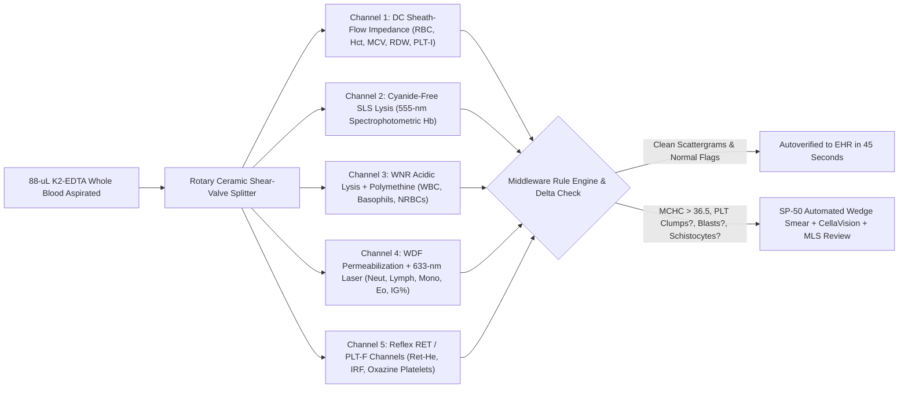
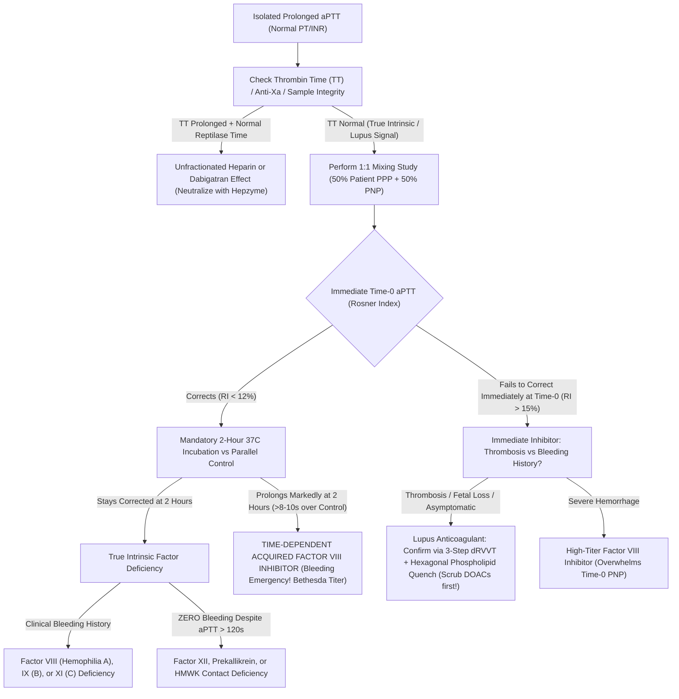

# **BASIC MEDICAL — BEHIND THE CURTAIN CLINICAL DIAGNOSTICS NOTEBOOK**
## **VOLUME III: COMPLETE BLOOD COUNT, FLUORESCENCE FLOW CYTOMETRY, COAGULATION KINETICS, AND IMMUNOHEMATOLOGY (BLOOD BANKING)**

> *"Every drop of peripheral blood is a pressurized suspension of twenty-five billion biconcave oxygen ferries, forty million hemostatic time-bombs, seven million nucleated immune sentinels, and a spring-loaded enzymatic cascade capable of turning liquid plasma into a cross-linked polymer gel in eleven seconds flat. To measure that living river outside the body without detonating it—or letting an invisible cold autoantibody, an EDTA calcium-chelation conformational shift, or a myeloma monoclonal antibody masquerade as a fatal catastrophe—requires a triumph of electrical physics, laser optics, viscoelastic mechanics, and molecular serology."*

---

### **Executive Orientation: Crossing the Threshold Behind the Lavender, Light-Blue, and Pink-Top Doors**

When a clinician clicks **"Order: CBC with Differential, PT/INR, aPTT, Type & Screen"** in the electronic health record (`EHR`), the bedside workflow appears deceptively effortless: three vacuum-evacuated plastic tubes fill with venous blood, drop into a pneumatic-tube carrier, and reappear as rows of numbers fifteen to forty-five minutes later. Yet behind the frosted glass of the core hematology, hemostasis, and transfusion-medicine laboratories, those three tubes enter three radically different biophysical worlds:

1. **The `4.0-mL` Lavender-Top (`K2-EDTA`) Hematology Track**, where robotic needles aspirate a mere **`88 µL`** of whole blood, hydrodynamically focus millions of individual cells single-file through **`100-µm` synthetic ruby apertures** and **`633-nm` semiconductor laser beams**, and flag subtle morphologic impostors—from `IgM` cold agglutinins yielding impossible `MCHC` values of `64 g/dL` to *in vitro* `EDTA` platelet clumping that mimics life-threatening thrombocytopenia.
2. **The `2.7-mL` Light-Blue-Top (`3.2%` Sodium Citrate) Coagulation Bench**, where exact **`9:1` calcium-chelation stoichiometry** preserves the coagulation cascade in suspended animation during `2,500 × g` centrifugation to **Platelet-Poor Plasma (`< 10,000 platelets/µL`)**, before photo-optical light-scatter sensors or oscillating electromagnetic steel balls time fibrin polymerization to the tenth of a second—distinguishing benign Factor XII deficiency (`aPTT > 150 s`, zero bleeding) from time-dependent Acquired Factor VIII inhibitors (catastrophic retroperitoneal hemorrhage) and Lupus Anticoagulants (*in vivo* thrombosis).
3. **The Locked Pink-Top (`6.0-mL K2-EDTA`) Immunohematology / Blood Bank Vault**, where **zero clerical or analytical error is survivable**, where `ABO` remains the sole human blood group demanding mandatory forward *and* reverse reciprocal verification, where `Sephadex` dextran-acrylamide microcolumn gel cards act as molecular sieves trapping `IgG`-sensitized erythrocytes, and where Blood Bank Specialists (`SBB`) deploy acid elution, enzyme modification, and **`0.2 M` dithiothreitol (`DTT`)** disulfide cleavage to unmask lethal delayed-hemolysis alloantibodies (`Anti-Jkᵃ`, `Anti-Kell`) beneath pan-agglutinating myeloma immunotherapies.

---

## **DOSSIER 3.1: INSIDE THE `88-µL` LAVENDER TUBE — HOW AUTOMATED HEMATOLOGY ANALYZERS (`SYSMEX XN` / `BECKMAN COULTER DxH`) COUNT, WEIGH & LASER-SORT MILLIONS OF CELLS IN 45 SECONDS**

### **3.1.1 Why the Doctor Orders It & Pre-Analytical Physics of the `K2-EDTA` Lavender Tube**

A Complete Blood Count (`CBC`) with automated differential is ordered across virtually every clinical presentation—acute dyspnea, febrile neutropenia, occult gastrointestinal hemorrhage, unexplained bruising, constitutional weight loss, and routine preoperative clearance—because peripheral blood dynamically integrates bone-marrow erythropoiesis, megakaryocytic thrombopoiesis, innate/adaptive leukocyte trafficking, microvascular shear stress, and splenic reticuloendothelial clearance.

Before a single cell reaches an analyzer, pre-analytical chemistry determines whether the specimen reflects *in vivo* physiology or phlebotomy artifact:

* **Why Spray-Dried Dipotassium `K2-EDTA` (`1.5–2.2 mg/mL` of blood) Replaced Liquid `K3-EDTA`:** Ethylenediaminetetraacetic acid (`EDTA`) is a hexadentate aminopolycarboxylic acid chelator that binds divalent cations—specifically ionized calcium ($\text{Ca}^{2+}$) and magnesium ($\text{Mg}^{2+}$)—with high thermodynamic affinity ($\log K_{\text{Ca}} \approx 10.7$). Stripping free $\text{Ca}^{2+}$ from plasma arrests the coagulation cascade prior to thrombin generation and inhibits calcium-dependent platelet aggregation without distorting cellular morphology for up to `4–6 hours` at room temperature (`24 hours` at `4°C` for stable `RBC`/`Hb` counts). International Council for Standardization in Haematology (`ICSH`) guidelines mandate **spray-dried `K2-EDTA`** coated onto the inner plastic wall rather than liquid tripotassium `K3-EDTA`: liquid `K3-EDTA` is strongly hyperosmolar and introduces a `1–2%` volumetric dilution error, shrinking erythrocytes osmotically and depressing the Mean Corpuscular Volume (`MCV`) by `2–4%`—an error magnified to `8–10%` if a difficult venipuncture underfills the tube!
* **The Phlebotomy Order-of-Draw Catastrophe (`EDTA` Carryover):** Under Clinical and Laboratory Standards Institute (`CLSI GP41`) venipuncture rules, the **Lavender `K2-EDTA` tube MUST be drawn *after* Light-Blue Citrate and Gold/Green Chemistry tubes**. If a phlebotomist draws a Lavender tube *before* a Basic Metabolic Panel (`BMP`) or pours blood from a purple-top tube into a chemistry tube to "top it off," microscopic droplets of `K2-EDTA` contaminate the chemistry plasma:
  1. Direct potassium donation spikes serum **`K+` to `9.5–15.0 mmol/L`** (non-hemolyzed!), mimicking a lethal hyperkalemic cardiac arrest.
  2. Hexadentate chelation strips $\text{Ca}^{2+}$ down to **`< 4.0 mg/dL`** (physiologically incompatible with consciousness) and strips the essential $\text{Zn}^{2+}$ and $\text{Mg}^{2+}$ active-site cofactors out of **Alkaline Phosphatase (`ALP`)**, driving **`ALP` to `< 5 U/L`**.
* **Behind-the-Curtain Robotic Aspiration:** When the lavender tube arrives on the core-lab automation track, an optical camera checks barcode alignment and fill height. A mechanical rocker gently inverts the sealed tube **`8–10 times`** (preventing gravitational erythrocyte settling, which would otherwise cause a bottom-dwelling needle to aspirate packed `RBCs` with a spurious `Hb` of `21 g/dL`!). A dual-lumen cap-piercing needle vents pressure and aspirates exactly **`88 µL`** (`Sysmex XN` series; `~165 µL` on `Beckman Coulter DxH`), immediately splitting that tiny droplet via ceramic rotary shear-valves into five parallel microfluidic reaction chambers.

---

### **3.1.2 Wallace Coulter's Direct-Current (`DC`) Aperture Impedance Principle, Hydrodynamic Sheath-Flow Focusing & The Cold Agglutinin Gremlin**

#### **1. The Physics of the `100-µm` Ruby Orifice**
Prior to 1953, every blood count on Earth required a technologist to suck blood into a glass Thoma pipette, load a ruled Neubauer hemocytometer chamber, and squint through a microscope clicking a hand tally—carrying an analytical coefficient of variation (`CV`) of `±15–20%`. In 1949, electrical engineer **Wallace H. Coulter** (patented 1953, US Patent `2,656,508`) realized that intact mammalian blood cells possess **phospholipid bilayer membranes** that behave as **near-perfect electrical insulators** at low direct-current (`DC`) frequencies, whereas isotonic buffered saline (`Cellpack` diluent, `~0.9% NaCl` equivalent, osmolality `~290 mOsm/kg`) conducts electricity freely.

Inside the `RBC/PLT` impedance chamber, `4 µL` of whole blood is diluted **`1:500` to `1:6,250`** in conductive diluent and drawn across a precision laser-drilled **synthetic ruby or sapphire micro-aperture** (`50–100 µm` in diameter, `~60–75 µm` in path length) separating an internal platinum electrode from an external platinum electrode across which a **constant direct current ($I$)** is maintained:

1. **Ohm's Law & Maxwell's Volume Proportionality:** Whenever a single insulating cell of volume $V_{\text{cell}}$ enters the conductive sensing zone of volume $V_{\text{aperture}}$, it displaces an exactly equal volume of conductive electrolyte ions, momentarily increasing the electrical resistance ($\Delta R$) across the orifice and generating a discrete **voltage spike ($\Delta V$)** governed by Ohm's Law and Maxwell's suspension conductivity relation:

$$\Delta V = I \cdot \Delta R \approx I \cdot R_0 \cdot f_{\text{shape}} \cdot \left( \frac{V_{\text{cell}}}{V_{\text{aperture}}} \right)$$

   where $R_0$ is the baseline aperture resistance and $f_{\text{shape}}$ is the electrical form factor (`~1.05–1.20` for shear-elongated biconcave erythrocytes vs `1.50` for rigid spheres).
2. **Pulse Frequency = Cell Concentration; Pulse Height = Femtoliter (`fL`) Cell Volume:**
   * The **total number of voltage pulses** per calibrated fluid volume directly yields the **`RBC` count** ($\times 10^6/\mu\text{L}$) and impedance **Platelet count (`PLT-I`, $\times 10^3/\mu\text{L}$)**.
   * The **microvolt amplitude (height)** of each individual pulse is directly proportional to that cell's physical volume in **femtoliters (`fL`, $10^{-15}\text{ L}$)**:
     * Pulses between **`2 fL` and `30 fL`** populate the log-normal **Platelet Impedance Histogram (`PLT-I`)** (with dynamic floating discriminators between `2–6 fL` on the left to exclude electronic noise and `12–30 fL` on the right to separate platelets from microcytic `RBCs`).
     * Pulses between **`25 fL` and `250 fL`** populate the Gaussian **Erythrocyte Volume Histogram**, counting `30,000–50,000` individual red cells in seconds (`CV < 0.8%`!).

#### **2. Why Classical Unfocused Apertures Needed Hydrodynamic Sheath-Flow Focusing**
First-generation unfocused Coulter apertures suffered two physical distortions that modern analyzers (`Sysmex XN` **DC Sheath Flow**, `Beckman DxH` **Acoustic/Sweep Flow**) engineered out of existence:

* **Coincidence Passage Error:** At physiological concentrations, two erythrocytes occasionally enter the sensing zone simultaneously, registering as **one giant pulse** rather than two normal pulses—artificially lowering `RBC` count and inflating `MCV`. Analyzers apply a non-linear **Poisson coincidence correction algorithm** ($\text{True Count} = N_{\text{obs}} + \tau N_{\text{obs}}^2$) based on pulse width and dead-time $\tau$.
* **Off-Center Edge Trajectories & Von Behrens Recirculation Eddies:** In an unguided cylindrical orifice, electrical field density and fluid shear stress peak sharply along the sharp ruby rim. Cells grazing the outer wall deform asymmetrically through high-field fringes, producing **bimodal "M-shaped" voltage spikes** that overestimate cell volume, while cells caught in micro-vortices *behind* the aperture tumble back near the exit lip, generating tiny secondary **ghost pulses (`~5–15 fL`)** that masquerade as platelets! **Hydrodynamic Sheath-Flow Focusing** solves both problems simultaneously: a fast outer coaxial jacket of particle-free diluent squeezes the central sample stream into a laminar **`15-µm` core filament** straight down the exact geometric centerline of the ruby orifice, forcing every single cell to transit dead-center in uniform orientation before a rear vacuum catcher whisks it away without recirculation.

#### **3. Direct Measurements vs. Calculated Wintrobe Indices & `RDW-SD` vs. `RDW-CV`**
Understanding which CBC numbers are *physically measured* versus *mathematically derived* is the single sharpest troubleshooting tool in laboratory medicine:

| Parameter | Analytical Derivation (`Sysmex XN` / `Beckman DxH`) | Adult Reference Interval | Primary Analytical Vulnerability |
| :--- | :--- | :--- | :--- |
| **`RBC` Count** | **Direct:** Sheath-flow `DC` voltage pulse count (`25–250 fL` gate) | `4.20–5.80 × 10^6/µL` (sex-dependent) | Falsely **LOW** in Cold Agglutinins (`IgM` clumping); falsely **HIGH** in Giant Cryoglobulinemia (`WBC > 200k` spillover) |
| **`Hb` (Hemoglobin)** | **Direct:** `555-nm` absorbance of `SLS-Methemoglobin` after RBC lysis | `12.0–17.5 g/dL` (sex-dependent) | Falsely **HIGH** in severe hypertriglyceridemia (`TG > 1,000`), `WBC > 100k`, or monoclonal `IgM` turbidity |
| **`MCV` & `Hct`** | **Sysmex:** Cumulative pulse-height summation directly yields **`Hct (%)`**, and $\text{MCV} = \frac{\text{Hct} \times 10}{\text{RBC}}$; **Beckman:** Mean pulse height directly yields **`MCV (fL)`**, and $\text{Hct} = \frac{\text{RBC} \times \text{MCV}}{10}$ | `MCV`: `80.0–100.0 fL` `Hct`: `36.0–51.0%` | Falsely **HIGH `MCV`** in Cold Agglutinins, severe hyperglycemia (`> 600 mg/dL` osmotic swelling *in vitro* inside isotonic diluent!), or marked reticulocytosis |
| **`MCH`** | **Calculated:** $$\text{MCH (pg)} = \frac{\text{Hb (g/dL)} \times 10}{\text{RBC} (\times 10^6/\mu\text{L})}$$ | `27.0–33.0 pg` | Mirrors `MCV` and `MCHC` artifacts |
| **`MCHC`** | **Calculated:** $$\text{MCHC (g/dL)} = \frac{\text{Hb (g/dL)}}{\text{Hct (\%)}} \times 100$$ | `32.0–36.0 g/dL` | **Ultimate Lab Integrity Alarm:** True physiological `MCHC > 37.5 g/dL` occurs *only* in Hereditary Spherocytosis / Xerocytosis; **`MCHC > 38–45+ g/dL` = Analytical Artifact until proven otherwise!** |
| **`RDW-CV` vs. `RDW-SD`** | **`RDW-CV (%)`** $= \frac{1\text{ SD of RBC volume}}{\text{MCV}} \times 100$ **`RDW-SD (fL)`** $=$ Arithmetic width of the RBC histogram measured directly at the **`20%` relative height level** | `RDW-CV`: `11.5–14.5%` `RDW-SD`: `39.0–46.0 fL` | Because `MCV` sits in the denominator of `RDW-CV`, severe macrocytosis (`MCV = 125 fL`) can artificially suppress `RDW-CV`, whereas **`RDW-SD` (`fL`) measures pure anisocytosis independent of `MCV`!** |

#### **4. Behind-the-Curtain Case Gremlin #1: Cold Agglutinins (`IgM Anti-I`) & The `37°C` Water-Bath Cure**
Picture a 29-year-old teacher presenting in January with two weeks of dry hacking cough (*Mycoplasma pneumoniae* atypical pneumonia) and acrocyanosis of her fingertips. Her room-temperature lavender tube hits the `Sysmex XN` and triggers a flashing red middleware hold:

* **`Hb`:** `11.2 g/dL`
* **`RBC`:** **`1.35 × 10^6/µL`** *(Critical Low?!)*
* **`MCV`:** **`134.8 fL`** *(Extreme Macrocytosis?!)*
* **`Hct`:** **`18.2%`** *($1.35 \times 134.8 / 10$)*
* **`MCHC`:** **`61.5 g/dL`** *($11.2 / 18.2 \times 100$ — **Physiologically Impossible!**)*

> [!WARNING]
> **Why `MCHC = 61.5 g/dL` Defies Biophysics:** Intracellular human hemoglobin reaches its physical aqueous solubility ceiling around **`36–37 g/dL`**; above `38 g/dL`, tetrameric hemoglobin spontaneously crystallizes inside the erythrocyte. Even in severe **Hereditary Spherocytosis** (ankyrin/band-3 membrane loss) or **Hereditary Xerocytosis** (`PIEZO1` cation-leak dehydration), true `MCHC` sits between **`36.5` and `38.5 g/dL`**. Whenever an analyzer prints **`MCHC > 38.0 g/dL`**, either the **numerator (`Hb`) is falsely inflated** (lipemia, free plasma hemolysis, hyperleukocytosis) or the **denominator (`RBC` / `Hct`) is falsely crushed** (cold agglutination)!

**What Actually Happened Inside the Ruby Aperture & How the MLS Fixes It:**
1. **Pathophysiology in the Vacutainer:** *Mycoplasma pneumoniae* (or Waldenström macroglobulinemia / idiopathic Cold Agglutinin Disease) induces polyclonal or monoclonal **pentameric `IgM` autoantibodies against the erythrocyte `I` carbohydrate antigen** (`Anti-I`; whereas Epstein-Barr virus infectious mononucleosis induces `Anti-i`). While circulating inside the patient's `37°C` core vasculature, this `IgM` has negligible binding affinity. The instant venous blood cools to **`20–22°C`** inside the plastic vacutainer on the pneumatic-tube ride, pentameric `IgM` avidly cross-links erythrocytes into **doublets, triplets, and micro-rosettes**.
2. **Instrument Deception:**
   * Inside the **unlysed `DC` Impedance Chamber**, a triplet of three `90-fL` RBCs squeezes through the `100-µm` ruby orifice together—registering as **one single giant voltage pulse** (collapsing the `RBC` count from `3.70` down to `1.35 × 10^6/µL` and inflating `MCV` to `134.8 fL`; triplets larger than `250 fL` fall off the right edge of the `RBC` gate altogether, crushing calculated `Hct` to `18.2%`!).
   * Meanwhile, inside the **`SLS-Hemoglobin` Chamber**, surfactant completely lyses *every* erythrocyte—clumped or unclumped—releasing 100% of intracellular hemoglobin into solution so **`Hb = 11.2 g/dL` is completely accurate!** Dividing true `Hb` (`11.2`) by spurious `Hct` (`18.2%`) explodes `MCHC` to `61.5 g/dL`.
3. **The `37°C` Bench Protocol:** The Medical Laboratory Scientist (`MLS`) visually tilts the lavender tube against a light source—observing fine "brick-dust" graininess coating the plastic wall that vanishes upon hand-warming—and places the lavender tube into a calibrated **`37°C` dry-block incubator or water bath for `15–30 minutes`**. Thermal agitation dissociates the low-affinity `IgM` pentamers off the `I` antigens. Immediately removing the warm tube, mixing gently, and aspirating in manual stat mode yields the true physiological CBC: **`RBC = 3.74 × 10^6/µL`, `Hb = 11.2 g/dL`, `Hct = 33.3%`, `MCV = 89.0 fL`, and `MCHC = 33.6 g/dL`!** *(If extreme high-titer cold agglutinins in Waldenström macroglobulinemia still partially re-clump inside the analyzer's room-temperature diluent lines, the `MLS` pre-warms isotonic diluent to `37°C` or reports only the thermally invariant **`Hb`** while preparing a pre-warmed `37°C` peripheral smear.)*

---

### **3.1.3 Cyanide-Free `SLS-Hemoglobin` Spectrophotometry (`555 nm`) & Optical Turbidity Saboteurs**

Historically, reference hemoglobinometry relied on **Drabkin's Cyanmethemoglobin Method**: potassium ferricyanide oxidized ferrous heme ($\text{Fe}^{2+}$) to ferric methemoglobin ($\text{Fe}^{3+}$), and **potassium cyanide (`KCN`)** coordinated $\text{Fe}^{3+}$ into hyper-stable cyanmethemoglobin measured at `540 nm`. Disposing of thousands of liters of toxic cyanide waste daily drove modern hematology platforms (`Sysmex XN`) to adopt **Cyanide-Free Sodium Lauryl Sulfate (`SLS`) Spectrophotometry**:

1. **Chemical Reaction Kinetics (`< 10 seconds`):** Whole blood (`1:500` dilution) mixes with **Sodium Lauryl Sulfate (`SLS`, $\text{CH}_3(\text{CH}_2)_{11}\text{OSO}_3^-\text{Na}^+$)**, an anionic amphiphilic surfactant:
   * Hydrophobic dodecyl tails insert into and solubilize erythrocyte and leukocyte lipid membranes.
   * `SLS` induces a rapid conformational unfolding of the globin polypeptide pocket, exposing the heme prosthetic group to dissolved $\text{O}_2$, which spontaneously oxidizes ferrous $\text{Fe}^{2+} \to$ ferric $\text{Fe}^{3+}$.
   * The negatively charged hydrophilic sulfate head group coordinates the sixth axial ligand site of ferric heme, yielding a rock-steady **`SLS-Hemoglobin` chromogen** (converting oxyhemoglobin, deoxyhemoglobin, carboxyhemoglobin, and methemoglobin—excluding only rare irreversible **sulfhemoglobin**) with a sharp absorbance peak at **`555 nm`**, quantified via a light-emitting diode (`LED`) photometer against an internal diluent blank per the **Beer-Lambert Law**:

$$A_{555\text{ nm}} = \log_{10}\left(\frac{I_0}{I}\right) = \varepsilon_{555} \cdot b \cdot c_{\text{Hb}}$$

2. **Optical Scattering Saboteurs & Behind-the-Curtain Plasma-Blank Replacement:**
   Because spectrophotometers measure *attenuation* of transmitted `555-nm` light ($I$), they cannot distinguish true heme photon absorption from **Mie and Tyndall light scattering** caused by suspended particles that survive `SLS` lysis:
   * **Severe Hypertriglyceridemia (`TG > 1,000 mg/dL`, acute hyperlipidemic pancreatitis, diabetic ketoacidosis, or drawing blood while `20% Intralipid` TPN is infusing):** Chylomicron and `VLDL` droplets scatter `555-nm` light, falsely elevating `Hb` by `1.5–4.0 g/dL` and pushing **`MCHC > 37.5 g/dL`**.
   * **Extreme Hyperleukocytosis (`WBC > 100,000–300,000/µL` in chronic myeloid leukemia [`CML`] or acute leukemic blast crisis):** `SLS` strips leukocyte plasma membranes, but dense hundreds of thousands of **unlysed chromatin nuclei** remain suspended in the optical cuvette, scattering `555-nm` photons!
   * **Monoclonal `IgM` / Cryoglobulin Precipitation:** Low-ionic-strength or surfactant-containing lysing reagents occasionally precipitate massive paraproteins into cloudy flocculants.
   * **How the `MLS` Executes Isovolumetric Saline Replacement (or Mathematical Plasma Blank Correction):** When `MCHC > 36.5 g/dL` fails to correct in a `37°C` water bath, the `MLS` spins an aliquot of the lavender tube at `1,500 × g` for `5 minutes`. Inspecting the supernatant instantly reveals milky strawberry-milk lipemia or amber-pink *in vivo* intravascular hemolysis! Using a calibrated micropipette, the `MLS` aspirates the exact volume of turbid plasma, replaces it **drop-for-drop (isovolumetrically)** with clear isotonic `Cellpack` diluent, gently resuspends the packed `RBCs`, and re-runs the tube—yielding the exact, turbidity-free **`Hb`, `MCH`, and `MCHC`**! *(Alternatively, the `MLS` runs the cell-free turbid supernatant directly in the `Hb` channel to obtain $Hb_{\text{plasma blank}}$ and calculates corrected hemoglobin via $Hb_{\text{corrected}} = Hb_{\text{whole blood}} - Hb_{\text{plasma blank}} \times \left[1 - \frac{\text{Hct}}{100}\right]$.)*

---

### **3.1.4 Fluorescence Flow Cytometry (`633-nm` Laser) — The 5-Part & 6-Part `WBC` Differential (`WDF` & `WNR` Channels)**

Pure impedance counters (`3-part differentials`) could only sort leukocytes crudely by nuclear size post-lysis (`small = lymphocytes`, `mid = monocytes/eosinophils/basophils/blasts`, `large = neutrophils`). Modern reference hematology analyzers (`Sysmex XN`) execute **high-throughput clinical fluorescence flow cytometry** on every single `CBC + Diff`, interrogating `10,000+` leukocytes per sample across dedicated **`WDF` (`WBC Differential`)** and **`WNR` (`WBC & Nucleated RBC`)** channels:

#### **1. Selective Membrane Permeabilization & Polymethine Nucleic-Acid Stoichiometry**
Inside the `37°C–41°C` `WDF` reaction chamber, an organic acid/non-ionic surfactant reagent (`Lysercell WDF`) completely lyses non-nucleated `RBCs` while punching controlled **nanopores** into leukocyte plasma membranes without destroying intracellular granules. Simultaneously, a lipophilic **polymethine cyanine fluorescent dye (`Fluorocell WDF`)** diffuses through those nanopores and binds stoichiometrically to **cytoplasmic ribosomal `RNA` (`rRNA` / `mRNA`) and nuclear `DNA`**.

Hydrodynamic sheath flow then rockets the stained cells single-file at `~5 meters/second` across a tightly focused **`633-nm` red semiconductor laser beam** inside a quartz flow cell. Three independent photodetectors capture each cell's optical signature simultaneously:

1. **Forward-Scattered Light (`FSC`, photodiode at `1°–6°` forward angle):** Light diffracted around the cell's outer contour $\propto$ **Physical Cell Cross-Sectional Size / Volume**.
2. **Side-Scattered Light (`SSC`, photodiode/photomultiplier at `90°` orthogonal angle):** Light refracted and reflected off internal refractive-index boundaries $\propto$ **Internal Structural Complexity** (nuclear multilobulation + density and crystallinity of primary azurophilic and secondary specific cytoplasmic granules!).
3. **Side-Fluorescent Light (`SFL`, avalanche photodiode / PMT at `90°` behind a `>650-nm` dichroic long-pass filter):** Emitted fluorescence photons from the excited polymethine dye $\propto$ **Total Intracellular Nucleic Acid (`RNA + DNA`) Concentration**—which scales directly with transcriptional activity, rough endoplasmic reticulum density, and **cellular immaturity**!

#### **2. Decoding the `WDF` (`SSC` vs. `SFL`) & `WNR` (`SFL` vs. `FSC`) 3D Cluster Clouds**
Plotting **`SSC` (Internal Complexity) on the X-axis** against **`SFL` (RNA/DNA Fluorescence) on the Y-axis** resolves a **6-part leukocyte differential** plus pathological warning flags:

* **Lymphocytes (`Low SSC, Moderate SFL`):** Agranular round nuclei yield minimal `90°` side scatter (`left X-axis`) with compact chromatin fluorescence; **Reactive ("Atypical") T-Lymphocytes** in EBV mononucleosis or **Plasma Cells** surge dramatically *upward* on the `SFL` Y-axis (`High-Fluorescence Lymphocyte Count [HFLC]`) because viral activation packs their cytoplasm with immunoglobulin/cytokine `mRNA` and ribosomes!
* **Monocytes (`Moderate SSC, High SFL`):** Kidney-bean folded nuclei, fine azurophilic lysosomal granules, and abundant cytoplasmic `RNA` place monocytes above and to the right of lymphocytes.
* **Mature Neutrophils (`High SSC, Low-to-Moderate SFL`):** Multilobed (`3–5` lobes) nuclei plus abundant myeloperoxidase/lactoferrin granules generate intense `90°` side scatter (`right X-axis`), while mature, transcriptionally quiet cytoplasm keeps `SFL` low—**EXCEPT in Septic Toxic Granulation / Döhle Bodies** (`rough ER` remnants), where neutrophil `SSC` (`NEUT-GI`, granularity index) and `SFL` (`NEUT-RI`, reactivity intensity) shift noticeably upward!
* **Eosinophils (`Extreme Far-Right SSC, Low SFL`):** Bilobed eosinophils contain large refractile **crystalloid granules packed with Major Basic Protein (`MBP`) and Eosinophil Peroxidase**, scattering `633-nm` light at `90°` more intensely than any other cell in human blood!
* **Immature Granulocytes (`IG%` & `IG#` — The Automated `6th` Differential Parameter):** **Metamyelocytes, Myelocytes, and Promyelocytes** pushed out of the bone marrow during bacterial sepsis, G-CSF therapy, or **`CML`** possess both **granulocytic side scatter (`High SSC`)** *and* **abundant immature ribosomal `RNA` (`Sky-High SFL`)**—forming a clean cluster directly *above* mature neutrophils! Unlike subjective manual `100-cell` "band counts" (notorious for `CV > 40%` inter-observer disagreement), automated **`IG% > 0.5–1.0%`** counts thousands of cells reproducibly as a validated early sepsis biomarker.
* **Basophils & Nucleated Red Blood Cells (`NRBCs`) in the `WNR` Channel:** Under the `WNR` channel's low-pH (`~pH 3.0`) surfactant lysis, every leukocyte *except* **Basophils** (whose water-resistant sulfated heparin/histamine glycosaminoglycan granules stabilize the cell) is stripped down to a bare nucleus (`FSC` low), leaving intact **Basophils** towering high on `FSC` and `SFL`. Meanwhile, **Nucleated Red Blood Cells (`NRBCs` — orthochromatic normoblasts)** ejected into peripheral blood during **severe hemolysis (`β-thalassemia major`, sickle crisis), myelophthisis (bone-marrow carcinoma/fibrosis), neonatal hypoxia, or overwhelming ICU sepsis** possess tiny, pyknotic, RNA-depleted nuclei that cluster at **ultra-low `SFL`** cleanly separated *below* mature leukocytes!
  * **Why Automatic `NRBC` Subtraction Saved Clinical Hematology:** On legacy impedance counters, every unlysed `NRBC` nucleus was blindly tallied as a leukocyte (`Total Nucleated Cell [TNC]` count). A thalassemic child with `150 NRBCs per 100 WBCs` and a true `WBC` of `8.0 × 10^3/µL` would print a spurious `WBC = 20.0 × 10^3/µL`, requiring manual smear counting and the classic correction equation:

$$\text{Corrected WBC} = \text{Uncorrected TNC} \times \left( \frac{100}{100 + \text{NRBCs per 100 WBCs}} \right)$$

  * Modern `WNR` fluorescence channels count `NRBC%` and `NRBC#` on *every* CBC automatically and **subtract `NRBCs` from the `WBC` count before reporting**, flagging clinicians immediately because **any circulating `NRBC > 0.00 × 10^3/µL` in a non-pregnant, splenectomized-negative adult ICU patient is an independent predictor of in-hospital mortality!**

---

### **3.1.5 Reticulocyte (`RET%`, `IRF`, `Ret-He`) & Fluorescent Platelet (`PLT-F`) Channels — Defeating `EDTA` Pseudothrombocytopenia**

#### **1. Reticulocytes & `Ret-He`: The Real-Time 48-Hour Bone-Marrow Iron Gauge**
When an orthochromatic normoblast extrudes its nucleus in the bone marrow, the nascent **reticulocyte** retains a residual cytoplasmic meshwork of ribosomal `RNA`, mitochondria, and transferrin receptors (`CD71`) for `24–48 hours` in peripheral blood while synthesizing its final `20%` of hemoglobin before maturing into a smooth erythrocyte. In the `RET` fluorescence channel (`polymethine RNA dye`), laser interrogation delivers three transformative clinical metrics:

1. **Absolute Reticulocyte Count (`ARC`, normal `25,000–100,000/µL`) & Reticulocyte Production Index (`RPI`):** Raw `RET%` (`0.5–2.0%`) is dangerously misleading in severe anemia because the denominator (`total RBCs`) has shrunk! A patient with `Hct = 15%` (normal `45%`) and `RET% = 3.0%` actually has twice-diluted red cells *and* premature marrow ejection of "stress/shift" polychromatophilic macro-reticulocytes that linger in blood for **`2.5 days`** instead of `1.0 day` (`Maturation Factor [MF]` = `1.0` at `Hct 45%`, `1.5` at `Hct 35%`, `2.0` at `Hct 25%`, `2.5` at `Hct 15%`):

$$\text{RPI} = \text{RET (\%)} \times \left( \frac{\text{Patient Hct (\%)}}{45\%} \right) \times \frac{1}{\text{Maturation Factor}}$$

   * **`RPI > 2.0–3.0`** = Vigorous **hyperproliferative** marrow response (hemolysis or acute blood loss).
   * **`RPI < 2.0`** in anemia = **Hypoproliferative** marrow failure (iron/B12/folate deficiency, erythropoietin deficiency in CKD, anemia of chronic inflammation, or aplastic/MDS marrow)! *(In our patient above: $\text{RPI} = 3.0 \times (15/45) / 2.5 = \mathbf{0.40}$ — profound marrow hypoproliferation masked by a "high" `3.0%` percentage!)*
2. **Immature Reticulocyte Fraction (`IRF`):** The proportion of high- and medium-fluorescence (`RNA`-rich) youngest reticulocytes—the **earliest hematologic herald of bone-marrow engraftment** after hematopoietic stem-cell transplantation (`HSCT`), rising **`3–5 days` before** the Absolute Neutrophil Count (`ANC > 500/µL`) recovers!
3. **Reticulocyte Hemoglobin Equivalent (`Ret-He` on Sysmex / `CHr` on Siemens, normal `28.0–35.0 pg`):** Measured directly from the calibrated forward-scatter signal of gated reticulocytes, **`Ret-He` quantifies the exact picograms of hemoglobin synthesized inside the bone marrow over the preceding `48 hours`!**
   * Why is `Ret-He` revolutionary? Mature erythrocytes live **`120 days`**, so conventional `MCV` takes *months* of iron depletion to drop below `80 fL`. Worse, serum **Ferritin is a positive hepatic acute-phase reactant** that skyrockets to `400–900 ng/mL` in hemodialysis, heart failure, cancer, or ICU inflammation even when bone-marrow erythroblasts are starving for iron behind **hepcidin-locked ferroportin gates**! **`Ret-He < 28.0 pg`** exposes **functional iron-restricted erythropoiesis** immediately, and after IV iron infusion, `Ret-He` surges back above `30 pg` within **`48–72 hours`**!

#### **2. Why Three Platelet Counting Methods Exist (`PLT-I`, `PLT-O`, `PLT-F`)**
Standard `DC` impedance (`PLT-I`) blindly classifies *any* cytoplasmic particle between `2` and `30 fL` as a platelet. Two life-threatening clinical scenarios break `PLT-I` completely:

* **False-LOW `PLT-I` (Giant Macrothrombocytes `> 30 fL`):** In **Immune Thrombocytopenia (`ITP`)**, **`MYH9`-related disorders (May-Hegglin anomaly)**, or **Bernard-Soulier Syndrome (`GPIb-IX-V` deficiency)**, giant young platelets reach `35–80 fL`—crossing the `30-fL` threshold into the `RBC` histogram where `PLT-I` ignores them!
* **False-HIGH `PLT-I` (Micro-Erythrocyte / Schistocyte / Leukemic Cytoplasmic Fragment Invasion `< 30 fL`):** In **3rd-degree thermal burns** (heat sphero-fragmentation of `RBCs`), **Thrombotic Thrombocytopenic Purpura (`TTP`)**, severe **`HbH` α-thalassemia (`MCV < 55 fL`)**, or **acute myeloid leukemia (`AML`) chemotherapy lysis** (shedding `10-fL` leukemic cytoplasmic blebs called *hyaline bodies*), millions of non-platelet fragments flood the `2–30 fL` impedance gate! `PLT-I` prints a reassuring **`44,000/µL`** when the patient's true platelet count is **`5,000/µL`** on the verge of spontaneous intracranial hemorrhage!
* **The `PLT-F` (`Oxazine` Dye) Rescue:** When impedance histograms lose their clean return-to-baseline valley above `20 fL`, the `Sysmex XN` automatically reflexes to the **`PLT-F` (`Fluorescent Platelet`)** channel, staining platelet **mitochondrial `DNA` and dense-tubular ribosomal `RNA`** with a platelet-specific **oxazine fluorochrome** (`5×` longer counting volume for extreme precision below `20,000/µL`!). Non-nucleated `RBC` schistocytes and thermal microspherocytes contain **zero mitochondrial `DNA` or `RNA`**, vanishing from the `PLT-F` gate (`SFL = 0`), while `60-fL` giant `ITP` platelets glow intensely with `RNA` (`High FSC + High SFL`), delivering exact truth at transfusion decision thresholds (`10,000/µL`)!

#### **3. Behind-the-Curtain Case Gremlin #2: `EDTA`-Induced Pseudothrombocytopenia (`PTCP`)**
A healthy 54-year-old man arrives for an outpatient knee arthroscopy. His routine preoperative `CBC` triggers a panic page to orthopedic surgery: **`WBC = 7.4 × 10^3/µL`, `Hb = 14.8 g/dL`, `PLT = 12,000/µL`!** Surgery is canceled, a hematology consult is called, and plateletpheresis units plus IVIG are considered—yet the patient has **zero petechiae, zero mucosal wet purpura, and brushed his teeth vigorously that morning without bleeding**.

**Biochemical Mechanism & Bench Resolution:**
1. **Calcium-Dependent Cryptic Epitope Exposure on `GPIIb/IIIa` ($\alpha_{\text{IIb}}\beta_3$):** Present in **`0.07%–0.20%` of all hospitalized patients** (higher after viral infections, autoimmune states, or `abciximab` therapy), naturally occurring IgG/IgM/IgA cold-reactive autoantibodies circulate harmlessly *in vivo* because their target epitope lies buried inside the heterodimeric interface of the platelet fibrinogen receptor **`GPIIb/IIIa` ($\alpha_{\text{IIb}}\beta_3$)**. Inside the `K2-EDTA` purple-top tube, chelation strips structural $\text{Ca}^{2+}$ ions out of `GPIIb`'s calcium-binding EF-hand domains at room temperature, triggering a conformational shift that **unmasks the cryptic neoepitope**!
2. ***In Vitro* Rosetting & Satellitism:** Autoantibodies instantly cross-link `15` to `100` platelets into huge clumps (`60–300 fL`)—or adhere platelets in a halo ring directly around `FcγRIII` (`CD16`) receptors on neutrophils (**platelet satellitism**!). Inside the analyzer, giant platelet clumps exceed the `PLT` upper volume gate (driving `PLT` down to `12,000/µL`) and occasionally spill into the lower `WBC` impedance gate (spuriously nudging `WBC` *upward*!).
3. **How the `MLS` Catches & Defeats It:**
   * Triggered by the analyzer's jagged sawtooth `PLT` tail and **`PLT Clumps?`** Q-flag, the `MLS` pulls the automated **Romanowsky Wright-Giemsa smear** and drives the microscope stage (or `CellaVision DM96` digital scanner) straight to the **feathered edge and lateral margins**—where fluid drag deposits massive purple rafts of `50+` aggregated platelets!
   * The `MLS` cancels the spurious `12,000/µL` number (`"Unable to report PLT due to in vitro EDTA platelet clumping"`) and requests a fresh venipuncture into a **`3.2%` Light-Blue Sodium Citrate tube** (kept warm at `37°C` and run immediately).
   * **Mandatory `1.1×` Citrate Dilution Factor:** Because a blue-top tube contains `1 part` liquid sodium citrate to `9 parts` whole blood (`10%` dilution), the `MLS` **multiplies the citrate `PLT` count (`210,000/µL`) by `1.1` (`10/9`)** to report the corrected whole-blood platelet count: **`231,000/µL`**—saving the patient from canceled surgery, bone-marrow biopsy, corticosteroids, and unnecessary donor platelet transfusion!
   * **What if Citrate *Also* Clumps (`10–15%` of `PTCP` cases)?** Sodium citrate is still a weak calcium chelator! For dual `EDTA/Citrate` clumpers, laboratories draw blood into a **Magnesium Sulfate (`MgSO4` / `ThromboExact`)**, **Heparin**, or **Amikacin-supplemented** tube (or warm `ACD` buffer), where high physiological $\text{Mg}^{2+}$ stabilizes `GPIIb/IIIa` without chelating $\text{Ca}^{2+}$ conformational pockets!

---

### **3.1.6 Peripheral Blood Smear Physics, Morphologic Emergencies & `ESR` vs. `CRP` Biophysical Kinetics**

#### **1. Automated Wedge Smear Fluidics & The Romanowsky Staining Effect**
When a `CBC` fails autoverification, the `Sysmex SP-50` slide-maker reads the sample's exact **`Hct`** before dispensing a `2–4 µL` blood droplet onto a frosted glass slide:
* **Why Hematocrit Dictates Spreader Angle & Velocity:** High-viscosity polycythemic blood (`Hct = 62%`) pushed at a standard `30°` fast stroke creates a thick, short "bullet" smear with zero monolayer; conversely, severely anemic blood (`Hct = 16%`) runs right off the glass! The robotic arm dynamically **lowers the spreader angle (`~20°–25°`) and slows velocity** for high `Hct`, and **steepens the angle (`~35°–40°`) and accelerates** for low `Hct`—guaranteeing a crisp **rainbow feathered edge** preceded by the **counting monolayer** (where adjacent erythrocytes barely touch without overlapping, preserving their central `1/3` biconcave pallor).
* **Methanolic Fixation & Polychromatic Romanowsky Chemistry:** Slides immerse first in **anhydrous (`100%` water-free) absolute methanol** to cross-link proteins *(even `>1–3%` atmospheric water absorption into humid summer methanol punches shiny refractive "water-artifact vacuoles" into every `RBC`, mimicking basophilic stippling or ring trophozoites!)*. Next, buffered (`pH 6.8`) **Wright-Giemsa** stain unleashes the **Romanowsky Effect**: negatively charged acidic **Eosin Y** stains basic hemoglobin coral-pink and eosinophil major basic protein fiery orange-red, while cationic **Methylene Blue** and its oxidative demethylation product **Azure B** bind acidic nucleic acids (`DNA`/`RNA`) and heparin-sulfate basophil granules—forming an insoluble purple-violet **Azure B–Eosinates charge-transfer complex** that gives chromatin, azurophilic Auer rods, and *Plasmodium* malaria parasites their unmistakable magenta hue!

| Morphologic Finding | Underlying Biophysical / Cellular Mechanism | Clinical Emergency / Diagnostic Action |
| :--- | :--- | :--- |
| **Schistocytes (`> 1%` of `RBCs`: helmets, keratocytes, sharp triangles lacking central pallor)** | Mechanical intravascular decapitation of erythrocytes across ultra-large `vWF` strings (`ADAMTS13 < 10%`), microvascular fibrin meshes, or paravalvular prosthetic-valve jets | **Microangiopathic Hemolytic Anemia (`MAHA`):** Check `LDH`, haptoglobin, `PT/aPTT/Fibrinogen` (`DIC` vs **`TTP` [`PLASMIC` score $\to$ emergent plasma exchange + caplacizumab; HOLD platelet transfusions!]**) |
| **Microspherocytes (`dense dark spheres, zero central pallor`)** | Loss of vertical membrane lipid surface area relative to cytoplasmic volume—either congenital (`spectrin/ankyrin/band 3`) or splenic macrophage `FcγR` partial phagocytosis of `IgG`-coated membrane | Order **Direct Antiglobulin Test (`DAT` / Coombs)**: `DAT+` = **Warm Autoimmune Hemolytic Anemia (`wAIHA`)** or `DHTR`; `DAT-` = **Hereditary Spherocytosis** (confirm via **EMA [eosin-5'-maleimide] flow cytometry**!) |
| **Bite Cells (`degmacytes`) & Blister (`hemi-ghost`) Cells** | Acute oxidative stress (`fava beans, dapsone, rasburicase, primaquine, TMP-SMX`) denatures hemoglobin into insoluble membrane-bound **Heinz bodies**, which splenic macrophages literally bite out inside the narrow `2-µm` slits of the cords of Billroth | **Acute `G6PD` Deficiency Crisis** or unstable hemoglobinopathy! *(Note: **Wright-Giemsa CANNOT see Heinz bodies**—requires **supravital New Methylene Blue or Crystal Violet** on unfixed living cells! Also note: acute reticulocytosis carries high `G6PD` activity, potentially yielding a **false-normal `G6PD` enzyme assay** during peak hemolysis!)* |
| **Auer Rods (`pink-purple needle bundles / "faggot cells"` inside promyelocytes)** | Pathologic crystallization and fusion of primary azurophilic (`myeloperoxidase +`) lysosomal granules inside leukemic blasts/promyelocytes | **Acute Myeloid Leukemia (`AML`)**, classically **Acute Promyelocytic Leukemia (`APML`, `PML::RARA` `t(15;17)`)** $\to$ **STAT All-Trans Retinoic Acid (`ATRA`)** + `Cryoprecipitate` to prevent fatal `tPA`/annexin-II cerebral hemorrhage! |
| **Howell-Jolly Bodies (`single crisp dark-purple 1-µm DNA sphere near RBC rim`)** | Residual nuclear `DNA` fragment from orthochromatic normoblast karyorrhexis normally pitted out by a healthy spleen | **Anatomic Splenectomy or Functional Hyposplenism (`HbSS` autosplenectomy, celiac disease)** $\to$ extreme vulnerability to fulminant sepsis from encapsulated bacteria (*S. pneumoniae, N. meningitidis, H. influenzae*)! |
| **Gumprecht Smudge ("Basket") Cells + Mature Soccer-Ball Lymphocytosis** | Chronic Lymphocytic Leukemia (`CLL` `CD5+/CD19+/CD23+`) B-cells express abnormally **low cytoskeletal vimentin**, causing mechanical shear rupture during glass-slide wedge spreading | **Behind-the-Curtain `22% BSA` Stabilization Trick:** Before making a manual differential slide on `CLL` blood, the `MLS` mixes **`4 drops` of whole blood + `1 drop` of `22%` Bovine Serum Albumin (`BSA`)**—osmotically and oncotic-viscously cushioning fragile lymphocyte membranes so smudge cells stay intact for an accurate `100-cell` count! |

#### **2. Westergren `ESR` vs. Hepatic `CRP`: Zeta-Potential Electrokinetics vs. Direct `IL-6` Immunoturbidimetry**
Clinicians routinely order both an **Erythrocyte Sedimentation Rate (`ESR`)** and **C-Reactive Protein (`CRP`)** to track osteomyelitis, giant-cell arteritis (`GCA`), polymyalgia rheumatica, or prosthetic joint infection—yet the two assays diverge wildly in predictable clinical traps because their analytical physics could not be more different:

* **Westergren `ESR` (`mm/hr`) — Indirect Electrokinetic Rouleaux Sedimentation:**
  1. Suspended in normal plasma inside a vertical `200-mm` Westergren column, healthy biconcave erythrocytes carry dense terminal **N-acetylneuraminic acid (sialic acid) carboxylates ($\text{-COO}^-$)** across their glycophorin coat, creating a negative surface electrostatic **Zeta Potential ($\zeta \approx -15\text{ mV}$)** surrounded by a counter-ion Stern/Gouy-Chapman cloud. Like-charged `RBCs` repel each other, falling individually at a glacial `2–15 mm/hr` governed by **Stokes' Law** for gravitational sedimentation through a viscous fluid:

$$v_{\text{sedimentation}} = \frac{2 \cdot r_{\text{eff}}^2 \cdot \left(\rho_{\text{RBC}} - \rho_{\text{plasma}}\right) \cdot g}{9 \cdot \eta_{\text{plasma}}}$$

  2. During systemic inflammation (or monoclonal gammopathy), `IL-6` drives the liver to pour **Fibrinogen** (`340 kDa`, an elongated `45-nm` asymmetric dipole rod) and **Immunoglobulins (`IgG`, `IgM`)** into plasma. These long, positively polarized macromolecules adsorb weakly across adjacent `RBC` membranes, acting as **dielectric bridges that dissipate the negative Zeta Potential**, allowing biconcave discs to snap together face-to-face into tall coin stacks (**Rouleaux**).
  3. Stacking `10` erythrocytes into one rouleaux cylinder dramatically lowers the surface-area-to-mass drag ratio, increasing the effective hydrodynamic radius squared ($r_{\text{eff}}^2$) in Stokes' numerator and causing `RBCs` to plummet **`60–120+ mm/hr`**!
  4. **Why `ESR` Lies (`False-Low` & `False-High` Discordance Traps):**
     * **Shape-Rigid Cells Cannot Stack Coins (`False-Low ESR`):** **Sickle cells (`HbSS`)**, **acanthocytes**, **spherocytes**, and severe **microcytes** lack flat biconcave faces—physically preventing rouleaux even during raging osteomyelitis!
     * **Fibrinogen Consumption (`False-Low ESR`):** In **Macrophage Activation Syndrome / `HLH`** or **`DIC`**, rampant plasmin/thrombin consumes fibrinogen (`< 100 mg/dL`), causing a **sudden paradoxical crash in `ESR`** (`85 mm/hr` dropping to `4 mm/hr`) just as the patient is dying of cytokine storm!
     * **Polycythemia (`Hct > 55%`) & Leukocytosis** crowd upward displaced plasma flow ("hindered settling"), suppressing `ESR`, whereas **Anemia (`Hct < 30%`), Pregnancy, Chronic Kidney Disease, Nephrotic Syndrome, and Monoclonal Myeloma (`IgG`/`IgM`)** drive `ESR > 100 mm/hr` in the *complete absence* of infection!
     * **Lag & Persistence Kinetics:** Because hepatic **Fibrinogen has a `3–5 day` plasma half-life** (and `IgG` has a `21-day` half-life!), `ESR` takes `24–48 hours` to rise after acute infection onset and **remains elevated for `2–4 weeks` *after* antibiotics have completely cured bacterial osteomyelitis!**
* **Quantitative `CRP` (`mg/L` or `mg/dL`) — Direct Latex-Enhanced Immunoturbidimetry:**
  * Synthesized directly by hepatocytes under **`IL-6`** transcriptional control, homopentameric **C-Reactive Protein (`~115 kDa`)** is measured on automated chemistry analyzers by mixing patient serum with **polystyrene latex microbeads coated with monoclonal anti-CRP antibodies**; `CRP` cross-links the beads, scattering `570–800 nm` light proportionally to exact `CRP` mass (`hs-CRP` detects down to `0.1 mg/L` for vascular risk; standard `CRP` spans `1–500 mg/L`).
  * Unaffected by `RBC` shape, anemia, polycythemia, or myeloma paraprotein rouleaux, `CRP` surges within **`4–6 hours`**, peaks at `36–48 hours`, and decays with a crisp, invariant **`19-hour` plasma half-life**—plummeting within `48 hours` of effective source control or antibiotic therapy! *(Classic Clinical Pearl: In **Systemic Lupus Erythematosus [`SLE`]**, active lupus flares with high `Type I Interferon-α` suppress hepatic `CRP` transcription while polyclonal hypergammaglobulinemia drives **`ESR` sky-high (`High ESR + Normal CRP`)**—meaning a sudden **`CRP > 50 mg/L` in an `SLE` patient screams superimposed bacterial sepsis or lupus serositis!**)*

---

## **DOSSIER 3.2: BEHIND THE BLUE-TOP COAGULATION CURTAIN — PHOTO-OPTICAL VS. MECHANICAL CLOT TIMERS, MIXING STUDIES, LUPUS ANTICOAGULANT & VISCOELASTIC `TEG` / `ROTEM`**

### **3.2.1 Pre-Analytical Stoichiometry of the `3.2%` Citrate Tube & Why Platelet-Poor Plasma (`< 10,000/µL`) Is Non-Negotiable**

Unlike the lavender `K2-EDTA` tube—which irreversibly strips conformational calcium from Factor V and Factor VIII—hemostasis testing requires **gentle, stoichiometrically reversible calcium chelation** inside the **Light-Blue-Top Buffered Trisodium Citrate (`3.2%` or `109 mmol/L` $\text{Na}_3\text{C}_6\text{H}_5\text{O}_7$)** tube:

1. **The Sacred `9:1` Blood-to-Citrate Fill Ratio & The Polycythemia (`Hct > 55%`) Trap:**
   Every standard `2.7-mL` blue-top tube arrives from the factory pre-filled with **`0.30 mL` of liquid `3.2%` trisodium citrate**, engineered to mix with **`2.40 mL` of whole blood** (assuming a normal `Hct` of `~40–45%`). Because trisodium citrate remains strictly extracellular inside plasma water and never enters erythrocytes, two pre-analytical disasters shatter the `9:1` ratio and **falsely prolong `PT` and `aPTT`**:
   * **The Underfilled Blue-Top Tube (`< 90%` of the etched meniscus line):** Drawing blood with a dry butterfly tubing dead-space (`~0.5 mL` of air!) without a discard tube leaves `1.8 mL` of blood swimming in `0.30 mL` of citrate. When the coagulation analyzer later injects a fixed aliquot of `25 mmol/L CaCl2` to restart clotting, **excess uncomplexed citrate greedily chelates the analyzer's exogenous calcium**, artificially dragging `aPTT` from `30 s` out to `58 s`!
   * **Severe Erythrocytosis (`Hct > 55%` in Polycythemia Vera, Cyanotic Congenital Heart Disease, COPD, or Neonates):** When `68%` of the tube's volume is packed red cells, the plasma compartment shrinks by half—creating the *exact same* citrate-to-plasma overdose inside a `100%`-filled tube! Under **`CLSI H21-A5`** guidelines, whenever `Hct > 55%`, the coagulation `MLS` prepares a custom-adjusted blue-top tube by aspirating excess citrate out of the tube prior to venipuncture according to the exact stoichiometric formula:

$$C_{\text{citrate}}(\text{mL}) = \left(1.85 \times 10^{-3}\right) \times \left(100 - \text{Hct [\%]}\right) \times V_{\text{blood}}(\text{mL})$$

2. **Spinning at `2,500 × g × 15 Minutes` to Achieve Platelet-Poor Plasma (`PPP`, `< 10,000 Platelets/µL`):**
   Behind the coagulation curtain, blue-top tubes are never spun gently like chemistry serum; they undergo high-speed **swing-out rotor centrifugation (`1,500–2,500 × g` for `15 minutes`—and mandatory *double-centrifugation* before `-70°C` freezing for send-out thrombophilia panels)** to drive residual platelets strictly below **`10,000/µL`**. Why does residual platelet contamination (`> 20,000/µL`) wreck hemostasis assays?
   * **Heparin Neutralization by Platelet Factor 4 (`PF4`):** Stored platelets leak alpha-granule **`PF4`**, a strongly cationic chemokine tetramer that electrostatically binds and neutralizes negatively charged **Unfractionated Heparin (`UFH`)** *in vitro* inside the sitting tube! Delaying centrifugation past **`1 hour`** allows leaked `PF4` to falsely *shorten* the `aPTT` and depress `Anti-Xa` levels—tricking the ICU team into escalating the patient's heparin drip into hemorrhagic overdose!
   * **False-Negative Lupus Anticoagulant (`LA`) upon Freezing:** If plasma containing `35,000 platelets/µL` is frozen at `-70°C` and thawed for a send-out `Lupus Anticoagulant` panel, ice crystals shatter the residual platelets into thousands of **anionic phosphatidylserine-rich platelet microparticles**. Those endogenous phospholipid shards mop up and **quench the patient's Lupus Anticoagulant antibodies *before* the assay even starts**, producing a **false-negative `dRVVT`** in a patient with catastrophic antiphospholipid syndrome!

---

### **3.2.2 `PT` / `INR` vs. `aPTT` Chemistry & Photo-Optical vs. Electromagnetic Steel-Ball Coagulometers**

#### **1. Prothrombin Time (`PT`) & Why the WHO Invented the `INR`**
To fire the **Extrinsic and Common Pathways** ($\text{Factor VIIa} \to \text{Factor X} \to \text{Factor Xa/Va Prothrombinase} \to \text{Factor II [Thrombin]} \to \text{Fibrinogen [Factor I]}$), the analyzer warms `50 µL` of patient `PPP` to `37.0°C` and injects `100 µL` of **Thromboplastin Reagent** containing:
1. **Recombinant Human Tissue Factor (`TF`)** (or purified rabbit-brain thromboplastin) relipidated into synthetic phosphatidylserine/phosphatidylcholine vesicles.
2. **Excess Calcium Chloride (`25 mmol/L CaCl2`)** to overwhelm citrate and bridge $\gamma$-carboxyglutamic acid (`Gla`) domains of Factors `II, VII, IX, X` onto anionic phospholipid surfaces.
3. **Heparin Neutralizer (`Polybrene` [hexadimethrine bromide] or heparinase)** capable of neutralizing up to **`1.0–2.0 U/mL` of Unfractionated Heparin**—so a routine inpatient heparin infusion does *not* prolong the `PT` during warfarin bridging!

Clotting completes briskly in **`10.0–13.0 seconds`**. Because **Factor VII possesses the shortest biological half-life of all procoagulants (`4–6 hours`, vs. `60–72 hours` for Prothrombin [Factor II])**, the `PT` is the very first test to prolong in acute acetaminophen hepatotoxicity, early Vitamin K deficiency, or day-2 warfarin initiation *(even though true antithrombotic protection on warfarin requires `5 days` for Factor II to decay!)*.

**Why Raw `PT` Seconds Failed Across Hospitals:** Crude rabbit-brain thromboplastins contain variable trace amounts of Factor V/fibrinogen and react sluggishly to warfarin-induced des-$\gamma$-carboxy **`PIVKA`** proteins, whereas modern recombinant human `TF` reacts exquisitely—meaning the exact same warfarinized plasma could read `16.5 s` in Chicago and `29.0 s` in London! The World Health Organization (`WHO`) calibrated every commercial thromboplastin lot on a log-log plot against an international reference human brain thromboplastin (`ISI = 1.00`) to assign each reagent lot an **International Sensitivity Index (`ISI`, ideally `0.92–1.08`)** and compute the **International Normalized Ratio (`INR`)**:

$$\text{INR} = \left( \frac{\text{PT}_{\text{patient}}(\text{s})}{\text{MNPT}(\text{s})} \right)^{\text{ISI}}$$

where $\text{MNPT}$ is the **Mean Normal Prothrombin Time** (the geometric mean `PT` of $\ge 20$ healthy local adult donors run on that exact analyzer and reagent lot!).

> [!IMPORTANT]
> **Clinical Caveat on `INR` Misuse:** Mathematically, `ISI` slope calibration was derived *exclusively* using plasma from stable **Vitamin K antagonist (warfarin)** patients. In **cirrhosis (`MELD` scoring)**, **`DIC`**, or **Direct Oral Anticoagulant (`DOAC` — rivaroxaban/apixaban/dabigatran)** exposure, inter-reagent `INR` harmonization breaks down (`rivaroxaban` may spike `PT/INR` to `2.4` on Neoplastin CI+ while `apixaban` at peak therapeutic concentration leaves `INR` at `1.08`!). Never rely on a normal `PT/INR` to rule out `apixaban` or `dabigatran` prior to thrombolysis or lumbar puncture!

#### **2. Activated Partial Thromboplastin Time (`aPTT`) & The Contact-Factor Paradox**
Named **"Partial" Thromboplastin** because its reagent contains **cephalin** (phospholipid platelet-membrane substitute) *without* Tissue Factor (so hemophilic plasma lacking Factor VIII *cannot* bypass the intrinsic tenase loop as it did in `PT`!), the `aPTT` runs in **two timed stages** at `37.0°C`:

* **Stage 1 (`Contact Activation, 3–5 minutes` without $\text{Ca}^{2+}$):** `50 µL` of citrated `PPP` incubates with cephalin plus a **negatively charged particulate or soluble surface activator**—**micronized silica, kaolin, celite, or ellagic acid** (mimicking exposed subendothelial collagen / polyphosphates). On this negative surface, **Factor XII (Hageman factor)** undergoes conformational autoactivation to `FXIIa`, engaging in a reciprocal amplification loop with **Prekallikrein (`PK`, Fletcher factor)** and cofactor **High-Molecular-Weight Kininogen (`HMWK`, Fitzgerald factor)** to cleave **Factor XI $\to$ Factor XIa**. *Crucially, the cascade halts right at `Factor XIa` because cleavage of `Factor IX` requires ionized $\text{Ca}^{2+}$!*
* **Stage 2 (`Recalcification Stopwatch`):** The analyzer injects pre-warmed **`25 mmol/L CaCl2`** and starts the timer, firing $\text{XIa} \to \text{IXa/VIIIa (Intrinsic Tenase)} \to \text{Xa/Va (Prothrombinase)} \to \text{Thrombin} \to \text{Fibrin}$ in **`25.0–35.0 seconds`**.

**The Contact-Factor Paradox (`aPTT > 120–180 s` + Zero Surgical Bleeding):** When a preoperative patient returns a normal `PT` (`11.5 s`) alongside a terrifying, unclottable **`aPTT > 150 seconds`** with **zero personal or family history of bleeding** despite prior tonsillectomy and molar extractions, experienced hematologists immediately suspect congenital deficiency of **Factor XII, Prekallikrein (`PK` — which uniquely *shortens/normalizes* if Stage 1 silica contact pre-incubation is extended from `3 min` to `10–15 min`!), or `HMWK`**. Why don't these patients bleed a drop? Because inside a living human blood vessel, there is **no micronized silica**! Physiological hemostasis initiates at **subendothelial Tissue Factor (`VIIa/TF`)**, generating an initial burst of **Thrombin (`Factor IIa`)** on activated platelet surfaces that **directly feedback-activates Factor XI $\to$ XIa**, completely bypassing `Factor XII`, `PK`, and `HMWK`!

#### **3. Photo-Optical Turbidity (`Sysmex CS` / `ACL TOP`) vs. Electromagnetic Steel-Ball Viscosity (`Stago STA-R`)**
How does an automated coagulometer "see" liquid plasma transform into a translucent fibrin mesh? Two rival engineering schools dominate clinical laboratories—and knowing which instrument sits behind your hospital's curtain explains why icteric or lipemic ICU samples fail on one analyzer and succeed effortlessly on the other:

1. **Photo-Optical Turbidimetric / Nephelometric Clot Detection (`405 nm` & `671 nm`):** As thrombin cleaves fibrinopeptides A and B (`FpA`, `FpB`) off soluble fibrinogen (`340 kDa`), nascent fibrin monomers polymerize end-to-end and laterally into insoluble protofibrils that **scatter transmitted light**, decreasing transmitted light intensity (or increasing `90°` scattered light) in a sigmoid curve. Optical analyzers (`Sysmex CS-5100`, `Werfen ACL TOP`) compute the **mathematical first derivative ($dA/dt$, peak clotting velocity)** or **second derivative ($d^2A/dt^2$, maximum acceleration)** and automatically shift from `405 nm` up to **`671 nm` or `800 nm` near-infrared wavelengths** when free hemoglobin (`415 nm` Soret peak) or bilirubin (`450 nm` peak) muddies the sample. Even so, **gross chylomicronemia (`TG > 1,500 mg/dL`) or opaque `Intralipid` infusion** renders plasma optically impenetrable, triggering `"No Coagulation / Optical Interference"` flags unless ultracentrifuged!
2. **Electromagnetic Mechanical Steel-Ball Oscillation (`Diagnostica Stago STA-R Max`):** Inside a curved-bottom disposable cuvette, a tiny **precision stainless-steel ball** rolls back and forth along a curved track driven at a constant pendulum frequency by alternating electromagnetic coils positioned on either side of the cuvette, tracked continuously by an infrared/magnetic amplitude sensor. So long as plasma remains liquid—**even if it is opaque black from massive intravascular hemolysis, neon-orange from `bilirubin = 42 mg/dL`, or milky-white from `triglycerides = 4,000 mg/dL`**—plasma viscosity stays low and the steel ball swings freely at `100%` amplitude! The exact millisecond nascent fibrin strands cross-link around the ball, mechanical viscosity surges, physically **dampening the ball's swing amplitude below `50%`** and tripping the timer with zero optical bias!

---

### **3.2.3 The `1:1` Immediate & `2-Hour 37°C` Incubated Mixing Study, Lupus Anticoagulant (`dRVVT`), `HIT` (`ELISA` / `14C-SRA`) & Viscoelastic `TEG` / `ROTEM`**

#### **1. The `1:1` Mixing Study: Differentiating Factor Deficiency, Lupus Anticoagulant & Lethal Acquired Factor VIII Autoantibodies**
When an unexplained prolonged `aPTT` (after ruling out heparin contamination via a normal **Thrombin Time [`TT`]** or `Hepzyme` neutralization) confronts the lab, the `MLS` performs a **`1:1` Mixing Study** by combining **`50%` volume of Patient `PPP` + `50%` volume of commercial Pooled Normal Plasma (`PNP`, calibrated to `~100%` [`1.00 IU/mL`] activity of every clotting factor)**:

* **Why `50%` Factor Activity Completely Normalizes the `aPTT`:** Clotting times follow an exponential hyperbolic curve against factor levels—the `aPTT` remains **100% normal (`25–35 s`) all the way down to `30–40%` activity** of Factors `VIII`, `IX`, `XI`, or `XII`! Even if a severe Hemophilia A patient has **`0%` endogenous Factor VIII**, mixing `1:1` with `100%` `PNP` yields $(0\% + 100\%)/2 = \mathbf{50\%\text{ Factor VIII}}$—snapping the `1:1` mix `aPTT` right back into the normal reference interval! Quantitatively, laboratories compute the **Rosner Index (`RI`)**:

$$\text{Rosner Index (\%)} = \left( \frac{\text{aPTT}_{\text{1:1 Mix}} - \text{aPTT}_{\text{PNP}}}{\text{aPTT}_{\text{Patient}}} \right) \times 100$$

  * **`RI < 11–12%` (Correction):** True **Factor Deficiency** $\to$ run one-stage intrinsic factor assays (`FVIII, FIX, FXI, FXII`).
  * **`RI > 15%` (Non-Correction):** Circulating **Inhibitor** present!
* **Why Skipping the `2-Hour 37°C` Incubation Can Kill Your Patient (`Acquired Hemophilia A`):**
  Suppose an 74-year-old woman (or a postpartum mother) presents with expanding flank ecchymosis and `aPTT = 68 s`. At **Time 0 (Immediate `1:1` Mix)**, her `aPTT` **corrects completely to `32.5 s`!** If the lab stops there and calls it a mild factor deficiency, the patient may bleed to death overnight!
  * **Type II Slow Kinetics of Autoanti-Factor VIII (`IgG4`):** Unlike congenital hemophiliacs' alloantibodies (`Type I` linear kinetics), **Acquired Factor VIII Autoantibodies** are **time- and temperature-dependent**: they require `60–120 minutes` at physiological **`37.0°C`** to bind the `A2`/`C2` domains of exogenous Factor VIII donated by `PNP`!
  * **Proper Behind-the-Curtain `2-Hour 37°C` Protocol:** The `MLS` incubates **Tube A (`1:1` Patient + `PNP` pre-mixed)** alongside **Tube B (Patient `PPP` alone)** and **Tube C (`PNP` alone)** in a `37°C` water bath for `2 hours`, then mixes Tube B + Tube C `1:1` immediately at the `2-hour` mark as a **heat-lability control** (because heat-labile Factors V and VIII naturally lose `10–15%` activity sitting at `37°C`, nudging the control up by `2–3 s`!). In **Acquired Factor VIII Inhibitor**, Tube A (`pre-mixed incubated`) rockets out to **`76.0 seconds`** while the Tube B+C control sits at `36.0 s`—triggering an emergency hematology call, **Bethesda Inhibitor Assay** (`1 Bethesda Unit [BU]` neutralizes `50%` of `FVIII` after `2 hr` at `37°C`), and life-saving bypassing hemostasis (**recombinant porcine `FVIII` [`susoctocog alfa`], `rFVIIa`, `aPCC` [`FEIBA`], or `emicizumab`**) plus immunosuppressive eradication!
* **Lupus Anticoagulant (`LA`) & The `3-Step dRVVT` Phospholipid Quench:**
  Conversely, **Lupus Anticoagulants**—autoantibodies directed not against bare phospholipids, but against phospholipid-binding plasma cofactors **`β2-Glycoprotein I` (`β2GPI`) and Prothrombin**—inhibit `aPTT` **immediately at Time 0** (`non-correcting RI > 15%`) by blanketing the limited synthetic cephalin micelles in the test tube. Paradoxically, *inside the patient's vasculature*, these same antibodies cross-link `β2GPI` on monocytes, endothelial cells, and platelets (`upregulating Tissue Factor` and inhibiting activated `Protein C`), causing **unprovoked DVT/PE, stroke, and recurrent 2nd/3rd-trimester fetal loss**!
  * **Confirming `LA` via `Dilute Russell's Viper Venom Time` (`dRVVT`):** Metalloprotease venom from *Daboia russelii* **directly cleaves Factor X $\to$ Factor Xa**, bypassing Factors `VII`, `XII`, `XI`, `IX`, and `VIII` entirely (so `FVIII` inhibitors and contact deficiencies rarely interfere!).
    1. **`dRVVT` Screen (Limiting Ultra-Dilute Phospholipid):** `LA` antibodies steal the scarce phospholipid vesicles $\to$ **prolonged ratio (`> 1.20`)**.
    2. **`dRVVT 1:1` Mix:** Fails to normalize (`confirms inhibitor`).
    3. **`dRVVT` Confirm (Flooding with Excess Bilayer or Hexagonal-Phase Phosphatidylethanolamine):** High-concentration phospholipid acts as a **decoy sponge**, adsorbing all `LA` autoantibodies out of solution and **snapping the `dRVVT` clotting ratio sharply back down to normal (`Screen / Confirm Normalized Ratio > 1.20 = Positive LA`)**! *(Critical `MLS` Alert: **Factor Xa `DOACs` [`rivaroxaban`, `apixaban`, `edoxaban`]** directly inhibit the `Factor Xa` generated by viper venom and notoriously produce **false-positive `dRVVT` Lupus Anticoagulant results**—solved behind the curtain by vortexing plasma with **`DOAC-Stop` / `DOAC-Remove` activated-charcoal minitablets** prior to testing!)*

#### **2. Specialized Hemostasis Bench Assays: `Clauss Fibrinogen`, `D-Dimer`, `Chromogenic Anti-Xa`, `HIT` (`ELISA` + `14C-SRA`) & Viscoelastic `TEG` / `ROTEM`**

| Assay | Exact Analytical Chemistry Behind the Curtain | Crucial Clinical Interpretation & Interference Traps |
| :--- | :--- | :--- |
| **`Clauss` Functional Fibrinogen (`200–400 mg/dL`)** | `PPP` is diluted **`1:10`** in Owren's veronal buffer (diluting out heparin/`FDPs`) and spiked with **massive excess bovine Thrombin (`50–100 NIH U/mL`)**. At saturating thrombin, $\log(\text{clotting time})$ is **inversely linear to functional `[Fibrinogen]`**! | Superior to optical `PT-derived fibrinogen` (which overestimates fibrinogen in `DIC`!). Unmasks congenital/cirrhotic **Dysfibrinogenemia** (`normal antigenic fibrinogen mass = 310 mg/dL`, `functional Clauss = 65 mg/dL`). Target `> 150–200 mg/dL` in obstetric hemorrhage / `APML`. |
| **Quantitative `D-Dimer` (`< 500 ng/mL FEU` or `< 250 ng/mL DDU`)** | Latex immunoturbidimetry or `ELFA` using mAbs targeting *exclusively* the covalent **Factor XIIIa $\gamma$-chain isopeptide bond bridging two adjacent `D` domains (`D-D` neoepitope)** exposed *only* after **Plasmin** degrades cross-linked insoluble fibrin! | Never cross-reacts with intact fibrinogen or primary fibrinogenolysis (`uncrosslinked FDPs`). **Attention Unit Trap:** **`1 DDU` (`D-Dimer Unit`, `195 kDa`) $\approx$ `2 FEU` (`Fibrinogen Equivalent Unit`, `340 kDa`)**! Above age `50`, apply **Age-Adjusted `FEU` Cutoff = `Age × 10 ng/mL`** (`97–99%` NPV for low/intermediate pretest `Wells` PE/DVT!). |
| **Chromogenic `Anti-Xa` (`UFH: 0.30–0.70 IU/mL`; `LMWH peak: 0.5–1.0 IU/mL`)** | Patient `PPP` (relying on endogenous **Antithrombin [`AT`]**!) + fixed excess exogenous **bovine Factor Xa** + synthetic chromogenic tripeptide **`S-2765` (`Z-D-Arg-Gly-Arg-pNA`)**. Residual uninhibited `FXa` cleaves off yellow **`p-nitroaniline` (`pNA`) at `405 nm`** **inversely proportional** to `[Heparin]` or `[Xa-DOAC]`. | **Gold standard for `UFH` titration** when baseline `aPTT` is corrupted by **Lupus Anticoagulant**, `Factor XII` deficiency, or ICU hyperfibrinogenemia/high `FVIII` ("apparent heparin resistance"). **Trap 1:** Severe `AT` deficiency (`cirrhosis/nephrotic/ECMO`) yields falsely low `Anti-Xa` unless `AT`-supplemented reagent is avoided (`AT-free` kits reflect true *in vivo* anticoagulation!). **Trap 2:** Free **`Hb > 200 mg/dL` or `Bilirubin > 15 mg/dL`** absorbs at `405 nm`, falsifying `Anti-Xa`! |
| **`HIT` Two-Tier Cascade (`PF4-Polyanion IgG ELISA` $\to$ `14C-SRA`)** | **Tier 1 (`Immunoassay`):** Microtiter plate coated with `PF4–polyvinyl sulfonate` captures patient `IgG` (`Optical Density [OD]` at `405 nm`). **Tier 2 (`Functional Gold Standard SRA`):** Washed reactive donor platelets pre-loaded with radiolabeled **`14C-Serotonin`** are incubated with heat-inactivated (`56°C`, complement-killed) patient serum at **low therapeutic heparin (`0.1 & 0.3 U/mL`)** vs **supratherapeutic heparin (`100 U/mL`)**. | Combine **`4Ts` Pretest Score** (`thrombocytopenia >50% drop, days 5–10, thrombosis, no other cause`) with **`IgG-specific ELISA OD`**: • `OD < 0.40`: Rules out `HIT` (`>99%` NPV). • `OD 0.40–1.99`: Indeterminate (`~50%` of post-cardiopulmonary bypass patients carry **non-pathogenic anti-PF4 antibodies**!) $\to$ **Confirm via `SRA`!** • **Classic Biphasic `14C-SRA` Proof:** **`> 20%` serotonin release at `0.1–0.3 U/mL` heparin** (equimolar `PF4:heparin` ultra-large complexes cross-link platelet **`FcγRIIA`**!), **ABOLISHED (`< 20%` release / `> 50%` inhibition) at `100 U/mL` heparin** (excess heparin dissolves `PF4` lattices!). Switch immediately to **Argatroban** (prolongs `INR`!) or **Bivalirudin**! |

#### **3. Whole-Blood Viscoelastic Clot Kinetics (`TEG` & `ROTEM`): Watching the Living Clot Form, Contract & Dissolve**
Conventional `PPP` clot timers (`PT`, `aPTT`) discard `100%` of erythrocytes and platelets before testing and **shut their stopwatch off the instant `~5%` of total thrombin has generated the first wispy strands of fibrin**—completely blind to peak clot tensile strength (`80%` platelet `GPIIb/IIIa` contractile actomyosin!) and subsequent `tPA` hyperfibrinolytic collapse!

In massive trauma resuscitation, liver transplantation, postpartum hemorrhage, and cardiac surgery, **Thromboelastography (`TEG 5000` / microfluidic resonance `TEG 6s`)** and **Rotational Thromboelastometry (`ROTEM delta/sigma`)** test **`300–360 µL` of `37°C` whole blood**: in classical `TEG`, a cylindrical cup oscillates through a `4°45'` arc every `10 seconds` around a torsion-wire pin (`in ROTEM, the cup stays fixed while a ball-bearing pin oscillates, tracked by an LED optical mirror`). As fibrin-platelet bridges tether the cup to the pin, torque plots a symmetric **"wine-glass" viscoelastic waveform** guiding precision goal-directed blood-component therapy in real time:

* **`R-Time` (`TEG` Reaction Time, `4–8 min` kaolin) / `CT` (`ROTEM` Clotting Time):** Latency from start to initial `2-mm` trace divergence = **Enzymatic Coagulation Factor Activity**.
  * *Prolonged `R` / `CT`* $\to$ Transfuse **Fresh Frozen Plasma (`FFP`)** or **`4-Factor PCC`** *(or **IV Protamine** if `ROTEM INTEM CT` is prolonged while heparinase-treated `HEPTEM CT` snaps back to normal!)*.
* **`K-Time` (`1–3 min`) & `α-Angle` (`55°–78°`):** Slope from `2 mm` to `20 mm` divergence = **Fibrinogen Cleavage & Cross-Linking Kinetics**.
  * *Depressed `α-Angle` (or `ROTEM FIBTEM`—which blocks platelets with **cytochalasin D**—showing `MCF < 8–10 mm`)* $\to$ Transfuse **Cryoprecipitate** or **Fibrinogen Concentrate**!
* **`MA` (`TEG` Maximum Amplitude, `50–70 mm`) / `MCF` (`ROTEM` Maximum Clot Firmness):** Peak vertical width of the wine glass = **Ultimate Mechanical Clot Strength (`~80%` Platelets via `GPIIb/IIIa` + `~20%` Fibrin)**.
  * *Low `MA` (`< 50 mm`) despite normal `FIBTEM`* $\to$ Transfuse **Platelets** (or administer **`DDAVP` [`0.3 µg/kg`]** in uremic/aspirin qualitative platelet dysfunction).
* **`LY30` (`%` Amplitude Lost `30 min` After `MA`, normal `< 3%`) / `ROTEM ML` (`< 15%`):** When tissue hypoxia/shock floods the bloodstream with endothelial **`tPA`**, the wine glass collapses into a **tapered "tadpole / teardrop" tail (`LY30 > 3%–15%+`)** = **Fulminant Primary Hyperfibrinolysis** $\to$ Administer **IV Tranexamic Acid (`TXA`, `1 g` bolus)**! *(Conversely, if `LY30 < 0.8%` in severe trauma—**acute fibrinolysis shutdown** driven by massive `PAI-1` surge—giving empiric `TXA` increases fatal microvascular organ thrombosis and mortality!)*

---

## **DOSSIER 3.3: BEHIND THE LOCKED BLOOD-BANK DOORS — FORWARD/REVERSE `ABO`, `RhD`, GEL-CARD COLUMN AGGLUTINATION, COOMBS (`DAT` / `IAT`), COLD/WARM ELUTION & CROSSMATCHING**

### **3.3.1 Landsteiner's Law, Erythrocyte Zeta-Potential Physics & Resolving `ABO` Forward/Reverse Discrepancies**

Behind the badge-locked doors of the Transfusion Medicine Service (`AABB` & `FDA` regulated as a biological pharmaceutical manufacturer!), **transfusion of an `ABO`-incompatible red-cell unit remains the single fastest iatrogenic cause of complement-mediated intravascular hemolysis, `DIC`, renal cortical necrosis, and shock**. Why is `ABO` unique among all `45+` human blood group systems recognized by the International Society of Blood Transfusion (`ISBT`)?

1. **Biochemical Glycosyltransferases & Landsteiner's Reciprocal Law (1900):**
   * On chromosome `19`, the **`FUT1` (`H`) gene** encodes an $\alpha$-1,2-fucosyltransferase that attaches **L-fucose** onto precursor paragloboside chains on `RBC` glycoproteins/glycolipids, creating the foundational **`H` antigen** (`Group O` adds nothing further, expressing the *highest* density of unmodified `H` antigen!).
   * On chromosome `9q34`, the **`A` allele** encodes *N*-acetylgalactosaminyltransferase (adding **`GalNAc`** onto `H`), the **`B` allele** encodes D-galactosyltransferase (adding **`D-galactose`** onto `H`), and **`O`** is a frameshift null allele. *(Rare **Bombay Phenotype [`Oh`, `hh` null]** individuals lack `FUT1`, cannot synthesize `H`, `A`, or `B` antigens, forward-type identically to `Group O`, yet harbor lethal complement-fixing **`Anti-H` IgM** in plasma that explosively hemolyzes `100%` of `Group O` donor units—detected ONLY on the antibody screen / `O`-cell crossmatch and rescued exclusively via rare frozen autologous or sibling **`Oh` donor blood**!)*
   * **Landsteiner's Law:** Starting at **`4–6 months` of infancy**, dietary and commensal gut-microbiome cell-wall lipopolysaccharides structurally mimic `A` and `B` glycans, immunizing every immunocompetent human to manufacture high-titer **naturally occurring pentameric `IgM` (and `IgG`, especially high-titer `IgG Anti-A,B` in `Group O` plasma!)** against whichever `A` or `B` antigen their own erythrocytes lack! Because a single **pentameric `IgM` molecule (`900 kDa`, `10` antigen-binding Fab sites)** binds **complement `C1q` with a single `IgM` hit**, firing the entire classical complement cascade all the way through the **`C5b-9` Membrane Attack Complex (`MAC`)**, an `ABO` mismatch punches literal `10-nm` transmembrane holes straight through donor erythrocytes inside the bloodstream within seconds (`free plasma pink hemoglobinemia` + `hemoglobinuria`)!
2. **The `300-Å` Zeta-Potential Gap (`IgM` Complete Agglutinins vs. `IgG` Incomplete Antibodies):**
   Suspended in `0.9% NaCl`, negative sialic-acid charges (`Zeta Potential`) prevent adjacent `RBC` lipid bilayers from approaching closer than **`~250–300 Å` (`25–30 nm`)**:
   * **Pentameric `IgM` (`Anti-A`, `Anti-B`) spans `~300–350 Å`** from Fab tip to Fab tip—effortlessly bridging two erythrocytes across the Zeta-potential gap at `20–22°C` room temperature (`Immediate Spin`) without needing any secondary reagent!
   * **Monomeric `IgG` (`Anti-D`, `Anti-Kell`, `Anti-Fyᵃ`, `Anti-Jkᵃ`) spans only `~120–140 Å`** (`12–14 nm`)—even with flexible hinge opening, a `120-Å` monomer attached to Cell #1 physically *cannot reach* across the `250-Å` electrostatic canyon to grab Cell #2! Thus `IgG`-coated red cells look completely smooth (`0` agglutination) in saline until bridged by **Coombs Anti-Human Globulin (`Anti-IgG`)**!
3. **Mandatory Dual Verification (`Forward Cell Typing` + `Reverse Serum Typing`) & Classic `ABO` Discrepancies:**
   Blood banks **refuse to assign a patient's `ABO` type** unless **Forward Typing** (`Patient RBCs` + monoclonal `IgM Anti-A` and `Anti-B`) and **Reverse Typing** (`Patient Plasma` + reagent `A1` and `B` red cells) agree `100%` (`4+` reactions opposing `0` reactions). When Forward and Reverse clash, the Blood Bank Specialist (`SBB`) holds non-type-specific blood (`issuing uncrossmatched Group O RBCs` ONLY in life-threatening bleeding!) and resolves four classic discrepancy classes:

| `ABO` Discrepancy Scenario | Forward Type (`Patient RBCs`) | Reverse Type (`Patient Plasma`) | Biophysical Etiology & Behind-the-Curtain `SBB` Resolution |
| :--- | :---: | :---: | :--- |
| **Multiple Myeloma `IgG/IgM` Rouleaux (`Group III`)** | `Anti-A: 4+` `Anti-B: 4+` | `A1 cells: 2+` `B cells: 2+` | Hyperproteinemia stacks *all* cells (`Autocontrol: 2+`). **Saline Replacement:** Spin, decant myeloma plasma, replace with `2 drops` `0.9% NaCl`, resuspend $\to$ **rouleaux disperses instantly (`0`), leaving true `ABO` reactions crisp (`4+`)!** |
| **Hypogammaglobulinemia / Rituximab / Neonate `< 4 mo` (`Group I`)** | `Anti-A: 0` `Anti-B: 0` | `A1 cells: 0` `B cells: 0` | True `Group O` lacking expected reverse `Anti-A`/`Anti-B`. Incubate plasma + `A1/B/O/Auto` cells at **`16°C` or `4°C` for `15–30 min`** to amplify weak `IgM`! |
| **Colon Carcinoma / *Clostridium tertium* Sepsis **"Acquired B"** (`Group IV`)** | `Anti-A: 4+` **`Anti-B: 2+`** | `A1 cells: 0` **`B cells: 4+`** | Bacterial **deacetylase** strips the acetyl group off `Group A`'s `GalNAc` ($\text{-NHCOCH}_3 \to \text{-NH}_2$, **galactosamine**), mimicking `D-galactose` (`B`) to `ES4` monoclonal `Anti-B`, while patient's own `Anti-B` ignores it (`Autocontrol = 0`)! Confirmed by **acidifying `Anti-B` to `pH 6.0`** (protonates $-\text{NH}_2 \to -\text{NH}_3^+$, abolishing false `B` reaction!). Transfuse **`Group A` RBCs**! |
| **Recent `Group O` Trauma Transfusion or Chimeric `O -> A` Marrow Transplant (`Group II`)** | `Anti-A: 2+ mf` *(mixed-field!)* `Anti-B: 0` | `A1 cells: 0` `B cells: 4+` | Two distinct circulating `RBC` populations (`donor O` + `recipient A`). In microcolumn gel cards, a **`4+` red band sits at the top while a clean `0` red button sits at the bottom**! Verify transfusion/HSCT history. |

---

### **3.3.2 How `Bio-Rad` / `Ortho` Microcolumn Gel Cards Sieve Agglutinates Without Washing Errors**

For seventy years, classic glass-tube serology suffered two human-factor Achilles' heels: **(1)** shaking a glass tube too hard broke fragile `1+` `Anti-Jkᵃ` agglutinates apart, and **(2)** during the `3×` manual saline washes required before adding Coombs `Anti-IgG`, leaving behind just **`1 µL` (`1:4,000` trace)** of unbound human plasma `IgG` **completely neutralized the Coombs `Anti-IgG` reagent in solution**, causing a **false-negative antibody screen**!

Modern automated immunohematology platforms (`Ortho Vision`, `Bio-Rad IH-1000`, `Grifols Erytra`) utilize **Column Agglutination Technology (`CAT` Microcolumn Gel Cards)**: each palm-sized plastic card houses **six clear vertical microtubes** consisting of a wide **upper reaction/incubation chamber** sitting atop a `15-mm` column packed with **cross-linked dextran-acrylamide (`Sephadex`) microscopic gel beads** (`~20–50 µm` interstitial pore channels) pre-suspended in either neutral buffer (`ABO/Rh` typing) or **Anti-Human Globulin (`Anti-IgG` Coombs reagent)**:

1. **No-Wash Density-Barrier Physics (`IAT` Gel Card):** `50 µL` of `0.8%` reagent `RBCs` suspended in `LISS` and `25 µL` of patient plasma incubate together at **`37.0°C` for `15 minutes`** inside the wide upper reaction chamber—held safely *above* the gel surface by surface tension! Next, the card spins at a calibrated **`85 × g` for `10 minutes`**:
   * High-density **erythrocytes (`ρ ≈ 1.095 g/mL`)** plunge downward out of the plasma meniscus and enter the `Anti-IgG`-impregnated gel column, while **low-density bulk plasma proteins (`ρ ≈ 1.026 g/mL`, including `1,200 mg/dL` of unbound free `IgG`!) remain trapped upstairs in the reaction chamber**—eliminating `100%` of manual saline washing and false-negative Coombs neutralization!
2. **Objective Molecular-Sieve Grading (`4+` to `0`):**
   * **`4+` Reaction:** `Anti-IgG` cross-links sensitized `RBCs` into large grape-cluster lattices **too bulky to squeeze between the `Sephadex` microspheres**, arresting them as a **razor-sharp, solid crimson band right at the top meniscus of the gel**!
   * **`3+` / `2+` / `1+` Reactions:** Progressively smaller micro-agglutinates arrest in the upper half (`3+`), disperse evenly throughout the column (`2+`), or cluster in the lower third (`1+`).
   * **`0` (Negative) Reaction:** Unsensitized single `8-µm` deformable biconcave erythrocytes slip smoothly through the `Sephadex` bead pores all the way to the conical floor, forming a **crisp, smooth red pellet at the very bottom**! *(And because gel cards remain photostable for `24–48 hours`, automated digital CCD cameras archive high-resolution images of every column for permanent peer review!)*

---

### **3.3.3 Direct (`DAT`) vs. Indirect (`IAT`) Coombs, Acid/Heat Elution & Solving the `11-Cell` Antigram Puzzle**

#### **1. Direct Antiglobulin Test (`DAT` / Direct Coombs) & Behind-the-Curtain Acid Elution**
**Crucial Distinction:**
* **`DAT` (`Direct` Coombs)** asks: ***"Are the PATIENT'S OWN circulating red blood cells ALREADY coated with `IgG` or complement `C3d` IN VIVO inside their body right now?"*** *(Zero `37°C` *in vitro* incubation! Just wash patient `EDTA` `RBCs` + add Polyspecific `AHG` [`Anti-IgG + Anti-C3d`], then reflex positives to **Monospecific `Anti-IgG`** and **Monospecific `Anti-C3d`**! Why use `EDTA` lavender/pink blood instead of a red-top clot tube? Because inside a refrigerating red-top clot tube, benign normal cold autoantibodies activate *in vitro* complement `C3`, causing false-positive `C3d` `DATs`—whereas **`EDTA` chelates $\text{Ca}^{2+}/\text{Mg}^{2+}$, blocking `C1qrs` *in vitro* complement activation completely** so any `C3d` detected on `EDTA` cells truly happened *in vivo*!)*
* **`IAT` (`Indirect` Coombs / Antibody Screen)** asks: ***"Does the PATIENT'S PLASMA contain unbound soluble `IgG` antibodies capable of sensitizing DONOR or FETAL red blood cells?"*** *(Requires `37°C` *in vitro* incubation of patient plasma + reagent Group O `RBCs` in `LISS`/`PEG` followed by `Anti-IgG`!)*

**Decoding `DAT` Patterns & Stripping Antibodies via `pH 2.0` Glycine-Acid Elution:**
* **`IgG+` (with or without `C3d+`):** Classic **Warm Autoimmune Hemolytic Anemia (`wAIHA`)**, **Hemolytic Disease of the Fetus and Newborn (`HDFN` — neonatal `RBCs` coated by transplacental maternal `IgG Anti-D`, `Anti-c`, or `Anti-Kell`!)**, **Delayed Hemolytic Transfusion Reaction (`DHTR` — mixed-field `DAT`!)**, or **Drug-Induced Immune Hemolytic Anemia**:
  1. *Drug Adsorption (Hapten) Mechanism (**High-Dose IV Penicillin / Cefotetan**):* Drug binds covalently to `RBC` membrane proteins; patient `IgG` binds penicillin (`IgG+ DAT`, extravascular splenic hemolysis; **eluate fails to react with normal reagent panel `RBCs` *unless* those reagent `RBCs` are pre-coated with penicillin in the lab!**).
  2. *Drug-Independent True Autoantibody Induction (**α-Methyldopa, Fludarabine, Checkpoint Inhibitors [`nivolumab`]**):* Drug dysregulates T-reg tolerance, inducing genuine anti-`Rh` `IgG` (`IgG+ DAT`, **pan-reactive eluate** identical to `wAIHA`!).
  3. *Drug-Dependent ("Immune-Complex / Ternary") Mechanism (**Ceftriaxone, Piperacillin, Quinidine**):* Drug + anti-drug `IgM/IgG` bind membrane glycoproteins transiently, detonating **fulminant complement `C3d+` intravascular hemolysis**!
* **Isolated `C3d+` ONLY (`IgG-`):** Pathognomonic of **Cold Agglutinin Disease (`CAD`)**! Pentameric `IgM Anti-I` binds `RBCs` transiently inside cool **`28°C–30°C` finger/nose/ear capillaries**, stamps covalent **`C3b` $\to$ `C3d`** onto the `RBC` membrane, and then **`IgM` falls right off when the cell returns to `37°C` core visceral blood**—leaving **`C3d`** behind as its permanent forensic fingerprint!
* **How Acid Elution Catches an Early Transfusion Reaction:** Suppose a patient transfused `6 days` ago drops `Hb` by `2.0 g/dL` with a new `1+ IgG+ DAT`, yet their plasma **Antibody Screen (`IAT`) is `0` (negative)** because `100%` of their emerging memory alloantibody has been **sponged onto the circulating transfused donor `RBCs`!** The `SBB` washes the patient's `RBCs` `6×` (saving the final wash supernatant as a `0` negative control to prove no free plasma antibody contaminated the prep!) and mixes the packed cells with **`pH 2.0` Glycine-HCl Acid Elution Buffer** for `60 seconds`. Extreme low `pH` protonates amino-acid side chains inside the `Fab` cleft, snapping electrostatic and hydrogen bonds to **release the bound `IgG` off the red cells into the fluid supernatant (`the Eluate`)**, which is immediately neutralized back to `pH 7.0` with `Tris-BSA` buffer. Running that **Eluate** against an `11-cell` panel unmasks a razor-sharp **`Anti-Jkᵃ`** (`reacting ONLY with Jkᵃ+ cells!`) days before free `Anti-Jkᵃ` ever spills into plasma!

#### **2. The Indirect Antiglobulin Test (`IAT`), `LISS` / `PEG` Potentiators & The `11-Cell` Antigram Rule-Out Matrix**
To screen patient plasma for clinically significant `37°C`-reactive `IgG` alloantibodies prior to transfusion or during prenatal care:

1. **Why Screening Cells Must Carry Homozygous "Double-Dose" Antigens (`The Dosage Effect`):**
   An individual whose genotype is **`Jkᵃ/Jkᵃ` (homozygous)** expresses **twice as many `Jkᵃ` glycoprotein molecules per erythrocyte** as a **`Jkᵃ/Jkᵇ` heterozygote**! Notorious blood groups exhibiting strong **Dosage**—**Kidd (`Jkᵃ, Jkᵇ`), Duffy (`Fyᵃ, Fyᵇ`), Rh (`C, c, E, e`), and `MNS` (`M, N, S, s`)**—frequently yield **`0` (false-negative) reactions against heterozygous cells** when an antibody is weak or early! Therefore, `FDA`-licensed `2-` or `3-cell` Group O screening sets are meticulously donor-selected so at least one vial is **homozygous** for `R1R1` (`CDe/CDe`), `R2R2` (`cDE/cDE`), `rr` (`cde/cde`), `K+`, `Fy(a+b-)`, `Fy(a-b+)`, `Jk(a+b-)`, `Jk(a-b+)`, `M+N-`, and `S+s-`.
2. **Potentiator Physics (`LISS` vs. `PEG`):**
   * **Low-Ionic-Strength Saline (`LISS`, `0.03 M NaCl` + isotonic glycine):** Cutting sodium/chloride ion density by `80%` thins out the shielding counter-ion cloud surrounding the erythrocyte's negative `COO-` surface and the `IgG` `Fab` positive charges—accelerating `IgG` association rate **`4-fold`** (`cutting 37°C incubation from 60 min down to 10–15 min`!).
   * **Polyethylene Glycol (`20% PEG 3350`):** Long hydrophilic polymer coils **sterically exclude bulk water molecules** out of the peri-cellular space, concentrating patient `IgG` directly against `RBC` epitopes—delivering the **highest sensitivity in immunohematology** for subtle warm `IgG` antibodies (`Anti-Jkᵃ`!), though `PEG` tubes are read *exclusively* at `Monospecific Anti-IgG` (`never centrifuged at 37°C`, and avoided in myeloma where `PEG` precipitates paraproteins!).
3. **SBB `11-Cell` Panel Rule-Out Logic, Proteolytic Enzymes (`Ficin` / `Papain`) & The `Anti-Jkᵃ` Delayed-Hemolysis Trap:**
   When a screening cell turns positive (`2+`), the `SBB` tests patient plasma across an **11-vial Panel Antigram** using two unbreakable rules:
   * **Homozygous Cross-Out Rule:** An antibody (`e.g., Anti-Jkᵃ`) can ONLY be ruled out on a non-reactive (`0`) panel cell if that cell is **homozygous positive (`Jk(a+b-)`)**—never cross out on a heterozygote (`Jk(a+b+)`) lest a dosage-dependent antibody slip through!
   * **Harris / Fisher's Exact Probability `"Rule of Three"` ($p < 0.05$):** To prove an antibody's identity with `95%` statistical certainty (`preventing random chance matching`), the patient's plasma MUST react with **at least `3` antigen-positive panel cells** AND fail to react with **at least `3` antigen-negative panel cells**:

$$P_{\text{random coincidence}} = \frac{3! \times 3!}{6!} = \frac{6 \times 6}{720} = \frac{1}{20} = 0.05$$

   * **Proteolytic Enzyme Forensics (`Ficin` or `Papain` Treatment):** When multiple alloantibodies overlap (`e.g., Anti-Fyᵃ hiding behind Anti-E`), treating the `11-cell` panel with **ficin** (fig protease) or **papain** (papaya protease) cleaves extracellular glycophorin sialoglycoproteins—**completely DESTROYING `Duffy` (`Fyᵃ, Fyᵇ`) and `M, N, S` antigens (`reactivity drops to 0!`)**, while shaving off negatively charged sialic acids to **dramatically ENHANCE `Rh` (`D, C, c, E, e`), `Kidd` (`Jkᵃ, Jkᵇ`), and `Lewis` (`reactivity jumps from 1+ to 4+!`)**, leaving **`Kell` unchanged**!
   * **Why `Anti-Jkᵃ` (`Kidd` Urea Transporter) Is the Deadliest Chameleon in Transfusion Medicine:** Over **`50%` of `Anti-Jkᵃ` antibodies undergo rapid *in vivo* evanescence**, plummeting below detectable `IAT` titers within `3–6 months` of sensitization! A patient immunized at Hospital A two years ago walks into Hospital B with a **completely negative (`0`) fresh Antibody Screen**, receives an `IS/electronic`-crossmatched `Jk(a+)` unit, and **`5 to 10 days` later** suffers a massive anamnestic memory B-cell explosion of **complement-fixing `IgG1/IgG3 Anti-Jkᵃ`**—destroying `100%` of the transfused unit (`dark tea-colored hemoglobinuria`, `jaundice`, `rising LDH`, `acute kidney injury`, **`Delayed Hemolytic Transfusion Reaction [DHTR]`**)! **Lesson:** Once a clinically significant alloantibody is identified *anywhere, ever*, the patient wears a lifelong antibody wallet alert and MUST receive **antigen-negative (`Jk(a-)`) full `AHG`-crossmatched blood for life**, even when today's antibody screen is `0`!

---

### **3.3.4 Electronic vs. Immediate-Spin vs. Full `AHG` Crossmatch & The Daratumumab (`Anti-CD38`) + `0.2 M DTT` Countermeasure**

#### **1. The Three Legal Tiers of Pre-Transfusion Crossmatching (`AABB` Standards)**
1. **Electronic ("Computer") Crossmatch (`Turnaround: < 2 minutes`):** Zero physical mixing of patient plasma and donor `RBCs`! Validated Blood Bank software verifies `ABO/Rh` compatibility electronically—permitted **ONLY** if **(a)** current Antibody Screen (`IAT`) is `0` negative, **(b)** **zero historical clinically significant antibodies** exist in the database, and **(c)** the patient's `ABO/Rh` has been verified on **two independent phlebotomy determinations** (`the "Check-Type" tube rule`—preventing Wrong-Blood-In-Tube [`WBIT`] bedside mislabeling disasters!).
2. **Immediate-Spin (`IS`) Serologic Crossmatch (`Turnaround: 5 minutes`):** Mixing `2 drops` patient plasma + `1 drop` donor segment `RBCs` at room temperature (`15-second` spin)—solely a final physical firewall against lethal `ABO` incompatibility when `Check-Type` or software rules preclude electronic crossmatch (requires negative current *and* historical antibody screens).
3. **Full Anti-Human Globulin (`AHG` / `IAT`) Serologic Crossmatch (`Turnaround: 45–60+ minutes`):** Mandatory whenever the current **OR any historical** antibody screen contains a clinically significant warm `IgG` antibody! The `SBB` pulls donor bags off the refrigerator shelf, phenotypes donor segments with licensed commercial antisera (`e.g., confirming two K-negative units`), and incubates **Patient Plasma + Donor `RBCs`** through `37°C` `LISS/PEG` + `Anti-IgG` Coombs phase.

#### **2. Behind-the-Curtain Boss Fight: Daratumumab (`Anti-CD38`) Pan-Agglutination & The `0.2 M DTT` Kell-Destruction Trap**
Picture a 66-year-old Multiple Myeloma patient on **`Daratumumab` (`Darzalex`)** or **`Isatuximab`**—humanized **`IgG1κ` monoclonal antibodies targeting `CD38`**—who arrives in the emergency department with `Hb = 6.2 g/dL` needing `2 units` of `PRBCs`. When the `SBB` runs the Type & Screen, **every single cell on the `3-cell` screen, all `11` cells on the identification panel, and every donor unit in the refrigerator pan-agglutinates `1+` to `2+` at `AHG`** *(yet the patient's `DAT` / `Autocontrol` is often **`0` negative** because `Daratumumab` stripped `CD38` off the patient's surviving autologous `RBCs` via macrophage trogocytosis!)*—and this pan-reactivity persists for **`4 to 6 months` after a single infusion**!

> [!CAUTION]
> **Why You Can NEVER "Just Transfuse Least-Incompatible Blood" Through Daratumumab:** Beneath that uniform `2+` `Anti-CD38` veil, a multiply transfused myeloma patient may harbor a lethal **`Anti-Jkᵃ`, `Anti-Fyᵃ`, or `Anti-E`**! Blindly releasing `2+` incompatible units risks an acute or delayed fatal hemolytic reaction.

**How the `SBB` Neutralizes `CD38` with `0.2 M DTT`—And Why Every Daratumumab Patient Must Receive `Kell-Negative` (`K-`) Blood:**
1. **Disulfide-Bond Reduction of `CD38`:** Behind the blood-bank curtain, the `SBB` incubates reagent screening and `11-cell` panel erythrocytes with **`0.2 mol/L` Dithiothreitol (`DTT`, Cleland's thiol reducing agent)** at `37°C` for `30 minutes` (`washing alongside `K+` and `E+` QC control cells!`). The extracellular domain of human **`CD38` relies on five structural disulfide (`-S-S-`) bridges** to maintain its conformational fold; `0.2 M DTT` reduces `-S-S-` $\to$ `-SH HS-`, **denaturing `CD38` completely** so `Daratumumab` can no longer bind (`screen drops cleanly to 0`—unless a genuine underlying alloantibody like `Anti-E`, `Anti-c`, `Anti-Fyᵃ`, or `Anti-Jkᵃ` is present, which pops right out!).
2. **The Critical `Kell` System Collateral Casualty:** The **`Kell` glycoprotein (`CD238`)** is tethered to erythrocyte `XK` protein and folded via **multiple extracellular disulfide bonds** that are **simultaneously destroyed by `0.2 M DTT`** *(along with rare `Lutheran`, `Yt` [`Cartwright`], `Dombrock`, and `LW` antigens)*! Because `DTT`-treated screening cells have **zero intact `Kell` antigen left on their surface**, a `DTT` antibody screen is **100% BLIND to `Anti-K`** (one of the most immunogenic and hemolytic antibodies in medicine)!
3. **Mandatory Safe Transfusion Protocol:**
   * **Before** a myeloma patient receives their *very first* dose of `Daratumumab` or `Isatuximab`, oncology should send a **baseline Blood Bank Type, Screen & Extended `RBC` Phenotype / `DNA` Genotype** (`Rh C/c/E/e, K, Fyᵃ/Fyᵇ, Jkᵃ/Jkᵇ, S/s`) so the blood bank permanently archives their native antigens!
   * Whenever `0.2 M DTT`-treated screening is used to clear a `Daratumumab` patient (`and no underlying non-Kell antibodies are found`), the blood bank **MUST issue `ABO/Rh`-compatible, prophylactically `Kell-negative` (`K-`) `PRBC` units** *(unless baseline pre-Daratumumab typing proved the patient is themselves `K+`, in which case they cannot form allo-`Anti-K`!)*.

---

### **Landmark References & Primary Technical Authorities (Volume III)**

1. **Coulter WH.** *Means for Counting Particles Suspended in a Fluid.* United States Patent `2,656,508` (Filed Aug 27, 1949; Issued Oct 20, 1953); and *High Speed Automatic Blood Cell Counter and Cell Size Analyzer*, *Proc Natl Electron Conf.* 1956;12:1034–1042.
2. **McPherson RA, Pincus MR, eds.** *Henry's Clinical Diagnosis and Management by Laboratory Methods.* 24th ed. Philadelphia, PA: Elsevier; 2022 (Part IV: Hematology, Coagulation, and Transfusion Medicine).
3. **Rifai N, Chiu RWK, Young I, Burnham CAD, Wittwer CT, eds.** *Tietz Textbook of Laboratory Medicine.* 7th ed. St. Louis, MO: Elsevier; 2023.
4. **Cohn CS, Delaney M, Johnson ST, Katz LM, eds.** *AABB Technical Manual.* 21st ed. Bethesda, MD: Association for the Advancement of Blood & Biotherapies (`AABB`); 2023 (ABO/Rh Discrepancies, Column Agglutination, Elution, and `0.2 M DTT` Anti-CD38 Mitigation).
5. **Clinical and Laboratory Standards Institute (`CLSI`).** *Collection, Transport, and Processing of Blood Specimens for Testing Plasma-Based Coagulation Assays (`H21-A5`)*, 5th ed.; and *Validation, Verification, and Quality Assurance of Automated Hematology Analyzers (`H26-A2`)*.
6. **Chapin JC, Hajjar KA; International Society on Thrombosis and Haemostasis (`ISTH`).** *Update of the Guidelines for Lupus Anticoagulant Detection (`Devreese KMJ et al., J Thromb Haemost. 2020;18:2828–2839`)*; and **Palmer L et al.** *ICSH Recommendations for the Standardization of Nomenclature and Grading of Peripheral Blood Cell Morphological Features.* *Int J Lab Hematol.* 2015;37(3):287–303.
