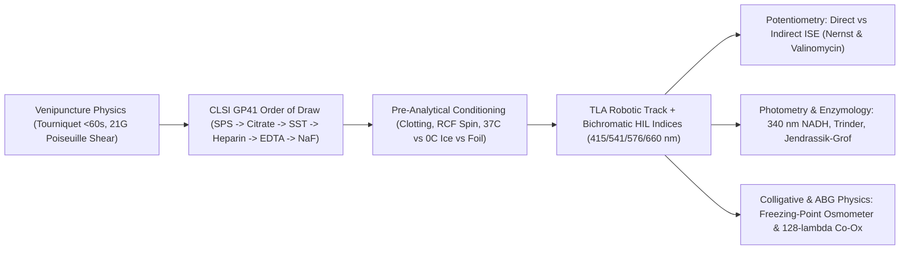
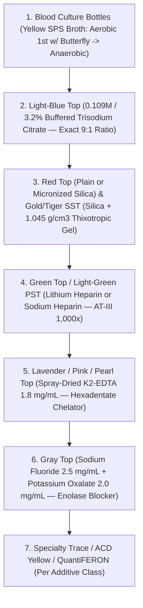
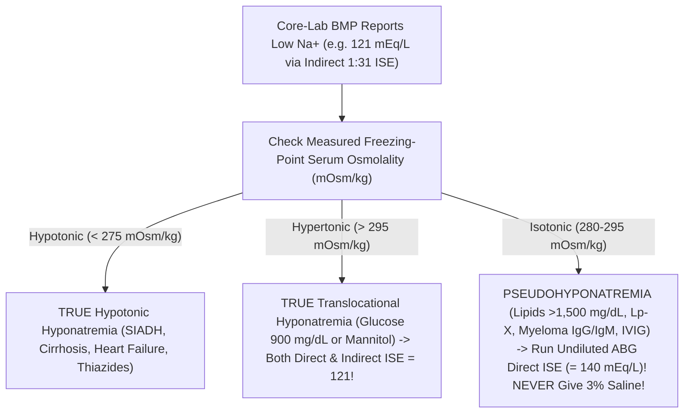

# Basic Medical — Behind the Curtain Clinical Diagnostics Notebook
## Volume II: Phlebotomy, Vacutainer Chemistry, and Automated Core-Lab Analyzers — From Butterfly Needle to `128-Wavelength` Co-Oximetry

> *"Seventy percent of all clinical decisions in a modern hospital pivot on laboratory numbers, yet seventy percent of all laboratory errors are committed before the blood tube ever crosses the threshold of the laboratory door. To read a metabolic panel like a master diagnostician, one must follow the blood drop from steel needle bevel through rubber stopper polymers, centrifugal G-forces, valinomycin membranes, and ultraviolet NADH cuvettes."*

---

### Prologue: Plebani's Pre-Analytical Law & The Invisible Life of a Blood Tube

To the patient in an outpatient phlebotomy chair or an intensive care unit bed, a blood draw ends the moment a cotton ball and tape press against the antecubital fossa. Colored plastic tubes vanish into a biohazard bag, drop down a wall-mounted pneumatic chute at twenty-five feet per second, and reappear forty minutes later as crisp black digits on an electronic health record screen: `Na+ 139`, `K+ 4.2`, `Ca2+ 9.4`, `INR 1.0`, `Lactate 1.1`.

When one of those numbers prints in crimson panic font—`K+ = 7.8 mEq/L`, `Na+ = 119 mEq/L`, `INR = 4.6`, `Platelets = 14,000/µL`, or `Lactate = 27.0 mmol/L`—an unprepared clinician treats the number and harms the patient: administering intravenous calcium gluconate and insulin to a normokalemic myeloproliferative patient, infusing `3%` hypertonic saline into a normonatremic hypertriglyceridemic patient, canceling urgent surgery for an underfilled blue-top tube, or missing lethal antifreeze poisoning disguised as septic shock.

Landmark forensic audits of clinical pathology led by Mario Plebani (*Clin Chem*, 1997; *Clin Chem Lab Med*, 2006–2020) proved a sobering truth: modern core-laboratory robotic analyzers have driven purely *analytical* error rates below $0.05\%$ (5-to-6-sigma industrial precision), yet **$62\%\text{ to }75\%$ of all erroneous hospital laboratory results originate in the Pre-Analytical Phase**—venous stasis, fist-pumping, shear cavitation, wrong order of draw, additive stoichiometry violations, temperature drift, and light degradation—while the remaining $15\text{–}25\%$ reflect misinterpreting analytical chemistry interferences (`HIL` indices, Indirect vs. Direct `ISE`, `P5P` cofactors, and enzyme cross-reactivity).

In **Volume II**, we trace every physical, hydrodynamic, stoichiometric, electrochemical, and spectrophotometric law governing clinical blood diagnostics from needle bevel to final verified report.

---

## Dossier 2.1: From Butterfly Needle to Pneumatic Tube — The Pre-Analytical Physics Where 70% of All Lab Errors Happen

### 2.1.1 Venipuncture Hemodynamics: Tourniquet Starling Filtration, Fist-Pumping `K+` Leak & Hagen-Poiseuille Shear Hemolysis

Before a single chemical additive touches the blood, three bedside physical forces can rewrite the patient's biochemistry inside their own arm:

#### 1. The `60-Second` Tourniquet Limit & Starling Ultrafiltration Hemoconcentration
When an elastic tourniquet constricts the upper arm at $\sim 60\text{–}80\text{ mmHg}$ (above venous pressure of $10\text{ mmHg}$ so veins engorge, yet below arterial systolic pressure of $120\text{ mmHg}$ so blood keeps pouring *in* with nowhere to exit), capillary hydrostatic pressure $P_c$ inside the forearm surges from $18\text{ mmHg}$ toward $55\text{ mmHg}$. By **Starling's Microvascular Filtration Equation**:
$$J_v = K_f \left[ (P_c - P_i) - \sigma (\pi_c - \pi_i) \right]$$
protein-free plasma water and freely diffusible small electrolytes ($\text{Na}^+, \text{Cl}^-$, glucose, urea) are forced out through endothelial fenestrations into the forearm interstitium, while cells and **macromolecules larger than $5\text{–}10\text{ kDa}$ are trapped inside the shrinking capillary lumen**!
* **What happens after `3 minutes` of prolonged tourniquet hunting for a difficult vein?**
  * Intravascular plasma volume in that stagnant forearm segment drops by **$10\text{–}15\%$**!
  * Every large protein, cell count, and **protein-bound analyte** concentrates spuriously by **`+8% to +15%`**: **Albumin**, **Total Protein**, **Total Cholesterol & `LDL`** (`+10–15%`), **Hemoglobin/Hematocrit**, **Iron & Transferrin**, **Hepatic Enzymes (`AST`, `ALT`, `GGT`, `ALP`)**, and crucially **Total Serum Calcium**! Because $\sim 45\%$ of serum calcium rides bound to albumin, a 3-minute tourniquet routinely pushes a completely normal Total Calcium of $9.8\text{ mg/dL}$ up to **$10.7\text{ mg/dL}$**—triggering an expensive, unnecessary primary hyperparathyroidism workup! Meanwhile, stagnant tissue hypoxia generates local lactic acid (`↑ Lactate`, `↓ pH`).
  * **Clinical Rule (`CLSI GP41`)**: Tourniquet application must never exceed **`60 seconds`**. If vein location takes longer, release the tourniquet for `2 full minutes` to wash out concentrated capillary blood before re-tying and puncturing!

#### 2. Forearm Fist-Pumping ("Clench-and-Pump") Pseudohyperkalemia
For decades, well-meaning clinicians told patients, *"Pump your fist five or six times so your vein pops up!"* That single sentence is responsible for thousands of false emergency potassium alerts every day:
* **Skeletal-Muscle Electrophysiology**: Resting myocytes hold $98\%$ of total body potassium at an intracellular concentration of **`140–150 mEq/L`** versus **`4.0 mEq/L`** in extracellular plasma ($35:1$ gradient). During repetitive isometric/isotonic forearm fist-pumping under tourniquet ischemia, every sarcolemmal action potential opens voltage-gated delayed-rectifier $\text{K}^+$ channels (`Kv`) and $\text{ATP}$-sensitive $\text{K}_{\text{ATP}}$ channels faster than ischemic $\text{Na}^+/\text{K}^+\text{-ATPase}$ pumps can reclaim $\text{K}^+$.
* **Magnitude of the Artifact**: Forearm venous effluent $\text{K}^+$ leaps acutely by **`+1.0 to +1.8 mEq/L`** (Donague et al.; Seimiya et al.)—turning a physiological **`4.2 mEq/L` into `5.7 mEq/L`** with **zero hemolysis** (`H-index = 0`, crystal-clear yellow plasma, fooling clinicians into thinking the `5.7` is real!). Gently holding tension without rhythmic pumping—or relaxing the hand the instant blood enters the first tube—abolishes the artifact completely.

#### 3. Needle-Gauge Fluid Mechanics (`Hagen-Poiseuille` Shear Stress), `IV`-Catheter Draws & Pneumatic Tube Cavitation
Why do Emergency Department blood samples drawn through newly placed peripheral `IV` catheters hemolyze **`5 to 6 times` more frequently** ($12\text{–}20\%$ hemolysis rate!) than outpatient phlebotomy straight-needle venipunctures ($< 2\%$)? Pure fluid dynamics!

For laminar Newtonian flow of whole blood (dynamic viscosity $\eta \approx 3.5\text{–}4.5\text{ mPa}\cdot\text{s}$) volumetric flow rate $Q$ driven by vacuum pressure drop $\Delta P$ across a needle or catheter of length $L$ and internal radius $r$, **Hagen-Poiseuille's Law** gives the **Wall Shear Stress ($\tau_w$)** experienced by red blood cells scraping past the inner wall:
$$Q = \frac{\pi r^4 \Delta P}{8 \eta L}, \qquad \tau_w = \frac{r \, \Delta P}{2 L} = \frac{4 \eta Q}{\pi r^3}$$
Look closely at $\tau_w \propto \frac{\Delta P \cdot r}{2L}$ and $\tau_w \propto \frac{Q}{r^3}$:
* Human erythrocyte spectrin-ankyrin cytoskeletal membranes deform gracefully up to shear stresses of $\sim 100\text{ Pa}$, **but mechanically rupture (hemolyze) once shear stress crosses $\tau_{\text{crit}} \approx 150\text{–}300\text{ Pa}$ ($1,500\text{–}3,000\text{ dynes/cm}^2$)**—especially at abrupt geometric step-downs (`vena contracta` micro-jets and turbulent eddies)!
* **The Three Hemolysis Traps**:
  1. **`25G` Needle + Hard-Pulled `20-mL` Syringe**: A standard `21G` green-hub phlebotomy needle has a generous internal bore ($2r \approx 0.51\text{ mm}$) paired with calibrated Vacutainer vacuum. A tiny pediatric **`25G` needle ($2r \approx 0.26\text{ mm}$)** cuts radius $r$ in half—raising $1/r^3$ shear **8-fold** at equal flow! Worse, yanking back hard on a large `10-mL` or `20-mL` syringe plunger generates localized negative gauge pressures exceeding **$-400\text{ to }-600\text{ mmHg}$**, causing dissolved $\text{N}_2/\text{CO}_2$ microbubble **cavitation** and jetting RBCs violently against the syringe barrel! (If syringe draw is unavoidable, use a `3–5 mL` syringe with gentle slow pull and a sterile `Vacutainer Blood Transfer Device`—*never* stab a needle through a rubber stopper and squirt under positive thumb pressure!)
  2. **Soft Polyurethane `IV` Angiocatheters**: Unlike rigid siliconized stainless-steel phlebotomy needles, flexible `IV` catheters compress partially against vein valves, collapse slightly under Vacutainer suction (chattering like a reed valve!), and force blood through a $90^\circ$ Luer-lock hub/extension-set step-down that acts as an RBC blender!
  3. **Pneumatic Tube Systems (`PTS`) & Unfilled Air Headspace**: Hospital pneumatic carriers accelerate and corner at **`8 to 15 × g`**. If a blood tube is only half-full (leaving a large air headspace) and unpadded, repetitive high-G sloshing creates **air-liquid interface foaming** that shears RBCs (spiking `LDH` and `K+`) and **shatters fragile malignant lymphocytes in Chronic Lymphocytic Leukemia (`CLL`, `WBC = 180,000/µL`)**—causing dramatic **" Pneumatic-Tube Leukemic Pseudohyperkalemia"** (`K+ = 9.2 mEq/L` via `PTS`, whereas walking a heparinized whole-blood syringe by foot to the lab reads `K+ = 3.9 mEq/L`!).

---

### 2.1.2 The Complete `CLSI GP41` Order of Draw & Chemical Stoichiometry of Every Vacutainer Cap Color

Why does the **Clinical and Laboratory Standards Institute (`CLSI GP41`, 7th Edition)** enforce a rigid, non-negotiable universal **Order of Draw** across every hospital on Earth? Look inside the multi-sample Vacutainer hub: as you pop off Tube #1 and push Tube #2 onto the internal rubber-sheathed posterior needle, **a microscopic $0.2\text{–}1.0\text{ }\mu\text{L}$ droplet of blood mixed with Tube #1's chemical additive clings to the rubber sleeve and needle tip**, washing straight into Tube #2! The Order of Draw is engineered so that early tubes carry either zero additive or benign additives that cannot poison downstream assays, pushing the most chemically destructive chelators and enzyme poisons (`K2-EDTA` and `NaF/K-Oxalate`) to the very end!

#### Stopper #1: Sterile Blood Culture Bottles (`0.025–0.05%` `SPS` Polyanethole Sulfonate)
* **Why Drawn First**: Aseptic sterility! Every subsequent tube stopper that touches the hub increases skin-flora (*Staphylococcus epidermidis*, *Cutibacterium acnes*) needle contamination risk (`< 3%` target contamination rate; skin prepped with `2%` chlorhexidine gluconate in `70%` isopropyl alcohol allowed to air-dry 30 sec, plus stopper septum wiped with `70%` alcohol—never povidone-iodine on rubber!).
* **Aerobic vs. Anaerobic Order (`Butterfly` vs. `Syringe`)**:
  * **With a Winged Butterfly Collection Set**: Always inoculate the **Aerobic bottle FIRST**, then the **Anaerobic bottle**! Why? Because the $12\text{-inch}$ clear flexible butterfly tubing contains **`~0.5 mL` of room air ($21\%\text{ O}_2$)**—routing that air bubble into the Anaerobic bottle would poison obligate anaerobes (*Bacteroides fragilis*, *Clostridium*)!
  * **With a Straight Needle & Syringe** (historically): Anaerobic first (since air rises to the plunger top).
  * **Volume Law of Bacteremia**: Adult bacteremia averages fewer than **$0.1\text{ to }1.0\text{ CFU/mL}$** of blood! Each bottle requires **$8\text{–}10\text{ mL}$** of blood ($2\text{ sets} = 4\text{ bottles} = 40\text{ mL}$ total; each extra milliliter increases true pathogen yield by $\sim 3\%$).
* **The Secret Chemistry of `SPS` (`Sodium Polyanethole Sulfonate`, `0.025–0.05%`)**: Fresh whole human blood does not stop fighting bacteria just because it entered a bottle! Without an immunomodulator, host plasma complement, lysozyme, and live neutrophils inside the bottle would digest low-colony bacteria before they could grow! Polyanionic **`SPS`** is the unsung hero of microbiology: it **precipitates `C3/C4` complement**, **neutralizes bactericidal lysozyme**, **blocks neutrophil/monocyte phagocytosis**, anticoagulates blood, AND **electrostatically binds and inactivates cationic aminoglycoside (`gentamicin/tobramycin`) and polymyxin antibiotics** already circulating in the septic patient's bloodstream (paired with antibiotic-adsorbing polymeric resin beads in *BACTEC Plus / BacT/ALERT FA Plus* bottles)! *(Microbiology Pearl: `SPS` is toxic to four fastidious organisms—`Neisseria meningitidis`, `Neisseria gonorrhoeae`, `Gardnerella vaginalis`, and `Peptostreptococcus anaerobius`—which is why commercial broth includes gelatin to buffer `SPS` toxicity!)*

---

#### Stopper #2: Light-Blue Top (`0.109 M` / `3.2%` Buffered Trisodium Citrate — Strict `9 : 1` Stoichiometry)
Used for all plasma coagulation cascades (**`PT/INR`, `aPTT`, `Fibrinogen`, `D-Dimer`, `Lupus Anticoagulant`, `Factors II–XII`, `anti-Xa`, `Protein C/S`**) and platelet function studies.
* **Reversible Chelation Chemistry**: Liquid **trisodium citrate ($\text{Na}_3\text{C}_6\text{H}_5\text{O}_7 \cdot 2\text{H}_2\text{O}$)** at **$0.109\text{ mol/L}$ ($3.2\text{ g/dL}$)** gently chelates ionized $\text{Ca}^{2+}$ (`Factor IV`) into soluble $[\text{CaCit}]^-$ complexes without denaturing labile **Factor V** or **Factor VIII** (unlike `EDTA`, which irreversibly destroys Factor V/VIII quaternary assembly!). Gently invert **`3 to 4 times`** immediately—never shake! Inside the optical/electromechanical coagulometer (`Sysmex CS-5100` or `Werfen ACL TOP`), after spinning at $1,500 \times g$ for $15\text{ min}$ to obtain **Platelet-Poor Plasma (`PPP`, `< 10,000 platelets/µL`**—crucial because freeze-thawed residual platelets leak **Platelet Factor 4 [`PF4`]** which neutralizes heparin in `aPTT/anti-Xa` assays, and leak anionic phospholipids that mask **Lupus Anticoagulants**!), the robot adds recombinant tissue factor (`PT`) or micronized silica/ellagic acid + cephalin phospholipid (`aPTT`) plus a calibrated stoichiometric excess of **$0.025\text{ M }\text{CaCl}_2$**, snapping free $\text{Ca}^{2+}$ back to physiological $1.2\text{ mmol/L}$ and starting the optical `660 nm` fibrin-turbidity stopwatch!

* **Why Two `9 : 1` Volumetric Errors Falsely Prolong `PT` and `aPTT`**:
  1. **The Butterfly Dead-Space Underfill Trap (`< 90%` Fill Line)**: A $2.7\text{-mL}$ light-blue tube contains $0.30\text{ mL}$ of liquid citrate at the bottom, awaiting exactly $2.70\text{ mL}$ of whole blood ($9:1$). If drawn as the *very first* tube through a winged butterfly needle without a clear/blue **non-additive discard tube** first, $0.5\text{ mL}$ of tubing air fills the tube vacuum instead of blood—delivering only $2.2\text{ mL}$ blood ($7.3:1$)! Leftover **unbound citrate** sits waiting in the plasma; when the analyzer injects its fixed $\text{CaCl}_2$ bolus, the excess citrate steals the reagent's calcium, starving prothrombinase complexes and **falsely prolonging `aPTT` and `PT/INR`**! (`CLSI H21-A5` strictly rejects any blue top filled `< 90%`!)
  2. **The Polycythemia (`Hematocrit > 55%`) Over-Citration Trap**: Citrate ions cannot enter red blood cells; all $0.30\text{ mL}$ of citrate distributes exclusively into the **plasma fraction**!
     * In a normal adult ($\text{Hct} = 45\%$), $2.70\text{ mL}$ blood delivers $2.70 \times (1 - 0.45) = \mathbf{1.485\text{ mL plasma}}$ to dilute $0.30\text{ mL}$ citrate ($\sim 5:1$ plasma-to-citrate).
     * In a patient with Eisenmenger cyanotic heart disease, COPD cor pulmonale, Polycythemia Vera, or a newborn with **$\text{Hct} = 68\%$**, $2.70\text{ mL}$ blood delivers only $2.70 \times (1 - 0.68) = \mathbf{0.864\text{ mL plasma}}$—effectively **nearly doubling the citrate concentration in plasma** and creating a terrifying fake coagulopathy (`INR = 2.9, aPTT = 68 sec`)!
     * **The `CLSI H21-A5` Exact Citrate Adjustment Formula**: Whenever $\text{Hct} > 55\%$, the lab prepares a custom light-blue tube by sterilely aspirating out excess citrate so the remaining citrate volume $C$ ($\text{mL}$) matches the true plasma volume of blood collected $V_{\text{blood}}$ ($\text{mL}$):
       $$C\text{ (mL of }0.109\text{ M Citrate)} = (1.85 \times 10^{-3}) \times (100 - \text{Hct}_{\%}) \times V_{\text{blood (mL)}}$$
       *(Worked Check: For a $5.0\text{-mL}$ total tube in a patient with $\text{Hct} = 70\%$, $C = 0.00185 \times (30) \times 4.73 \approx \mathbf{0.26\text{ mL}}$ citrate instead of $0.50\text{ mL}$—instantly normalizing the bogus `INR` from $2.9$ back to $1.05$! Note: No adjustment is needed for severe *anemia* [$\text{Hct } 15\%$] because extra plasma water still holds ample $\text{Ca}^{2+}$ upon analyzer recalcification.)*

---

#### Stopper #3: Red Top (Plain vs. Plastic Silica) & Gold / Tiger-Top `SST` (Serum Separator Tube)
Wait—why do *clot-activator serum tubes* come **AFTER** Light-Blue coagulation tubes instead of first?! Because plastic `SST` and plastic Red-Top tubes are coated internally with **micronized silica clot activator** (and Orange `RST` tubes contain **thrombin**): if drawn *before* the Light-Blue tube, carrying trace silica/thrombin into the citrate tube initiates premature `Factor XIIa/IIa` generation, **falsely shortening `PT/aPTT`** and triggering microclots!

* **Intrinsic Contact Clotting Chemistry (`5 Inversions` + `15–30 Min` Clotting)**:
  In old borosilicate glass tubes, native negative silanol ($\text{-Si-O}^-$) charges activated clotting naturally. Modern shatterproof polyethylene terephthalate (`PET`) plastic tubes are hydrophobic and inert—blood inside uncoated plastic takes $> 60\text{ minutes}$ to clot! Therefore, plastic Red and Gold `SST` walls are spray-coated with **$1\text{–}5\text{ }\mu\text{m}$ amorphous silica nanoparticles** wrapped in water-soluble polyvinylpyrrolidone (`PVP`). Upon `5` gentle inversions, negatively charged silica binds **Factor XII (Hageman Factor)** alongside **High-Molecular-Weight Kininogen (`HMWK`)** and **Prekallikrein**, driving conformational auto-cleavage to **Factor XIIa $\to$ Kallikrein $\to$ Factor XIa $\to$ IXa $\to$ Xa $\to$ Thrombin (`IIa`) $\to$ Factor XIIIa-crosslinked Fibrin Clot** within `15–30 minutes` upright at room temperature!
  * *What happens if an impatient tech throws a Gold `SST` into the centrifuge at `4 minutes` before clotting finishes (or in a dialysis/ICU patient on heparin)?* Fibrinogen stays in the liquid supernatant during the spin and **finishes clotting AFTER centrifugation**, forming a translucent **"latent fibrin jellyfish clot"** right in the serum cup that plugs the `$500,000` analyzer's $2\text{-}\mu\text{L}$ needle probe or gets sucked into an immunoassay cuvette to create rogue false-positive troponin/hormone spikes!

* **Physics of the Thixotropic Polymer Separator Gel & Centrifuge `RCF` Math**:
  At the bottom of a Gold `SST` (and Light-Green `PST`) sits $0.8\text{–}1.2\text{ g}$ of **thixotropic polyester, polybutene, or acrylic copolymer gel** compounded with hydrophobic fumed silica to a hyper-precise **specific gravity of $1.040\text{ to }1.050\text{ g/cm}^3$**:
  $$\rho_{\text{Cell-Free Serum}} \approx 1.024\text{–}1.028\text{ g/cm}^3 \quad < \quad \mathbf{\rho_{\text{Thixotropic Gel}} = 1.045\text{ g/cm}^3} \quad < \quad \rho_{\text{RBC / Fibrin Clot}} \approx 1.090\text{–}1.095\text{ g/cm}^3$$
  **Thixotropy** is time-dependent non-Newtonian **shear-thinning viscosity**: at rest ($1 \times g$), weak van der Waals and silanol hydrogen bonds lock the polymer into a rigid solid plug. When spun in a swing-bucket centrifuge at **`1,100 to 1,500 × g` for `10 minutes`**—governed NOT by `RPM` alone, which varies wildly by rotor radius $r_{\text{cm}}$, but by **Relative Centrifugal Force (`RCF`)**:
  $$\text{RCF } (\times g) = 1.118 \times 10^{-5} \times r_{\text{cm}} \times (\text{RPM})^2$$
  *(e.g., at radius $r = 15\text{ cm}$, $3,000\text{ RPM}$ delivers $1.118 \times 10^{-5} \times 15 \times 9 \times 10^6 = \mathbf{1,509 \times g}$!)*—hydrostatic buoyant pressure exceeds the gel's yield stress, liquefying it so it flows smoothly up the plastic wall while dense RBCs sink past it. The instant the rotor stops, hydrogen bonds snap back into place, sealing an airtight chemical barrier between living/dying cells below and pristine cell-free serum above!
  * **Two Famous `SST` Gel Failures**:
    1. **Floating Inverted Gel ("Paraprotein / Contrast Buoyancy Reversal")**: If a patient has severe **Multiple Myeloma (`Total Protein = 13.5 g/dL`)** OR had blood drawn **10 minutes after a `370 mgI/mL` CT Angiogram bolus**, serum specific gravity climbs above **`1.055 g/cm^3`**—now *denser* than the `1.045 g/cm^3` gel! After centrifugation, the `SST` gel floats right on **top** of the serum like a cork, breaking analyzer probes!
    2. **Hydrophobic Therapeutic Drug Adsorption (`Why Plain Red No-Gel Tops Still Exist!`)**: Lipophilic small-molecule drugs with high octanol-water partition coefficients ($\log P > 2.5$)—specifically **phenytoin, carbamazepine, phenobarbital, valproic acid, tricyclic antidepressants (`amitriptyline/nortriptyline`), lidocaine, flecainide, and steroid hormones (`progesterone`)**—slowly dissolve straight into the hydrophobic polyester `SST` gel matrix (`-15%` to `-40%` false drop over 6–24 hours!), mandating **Plain No-Gel Red-Top tubes**!

---

#### Stopper #4: Green Top (`Lithium Heparin` vs. `Sodium Heparin`, Light-Green `PST`)
Why have most high-volume Emergency Departments and hospital inpatient floors switched routine `BMP`/`CMP` and `hs-Troponin` panels from Gold `SST` *serum* to Light-Green `PST` **Lithium Heparin *plasma***?
1. **Turnaround-Time (`TAT`) Physics**: Heparin (`12–30 USP IU/mL` spray-dried glycosaminoglycan) binds lysine clusters on endogenous **Antithrombin III (`AT-III`)**, inducing an allosteric conformational shift that accelerates covalent trapping of **Thrombin (`IIa`) and Factor Xa `1,000-fold`**. Because no clotting wait is needed, the tube goes straight from pneumatic chute into the centrifuge—**shaving 20 to 30 minutes off stroke, sepsis, and myocardial infarction turnaround times**!
2. **Eliminating Thrombocytosis Pseudohyperkalemia (`Serum K+` vs. `Plasma K+`)**:
   * In *every* healthy human, **Gold `SST` Serum $\text{K}^+$ runs `0.3 to 0.4 mEq/L` higher than paired Green-Top Plasma $\text{K}^+$** (`ref range: Serum 3.5–5.1` vs `Plasma 3.4–4.8 mEq/L`) because thrombin aggregation during clotting triggers physiological platelet degranulation!
   * Now consider a patient with **Essential Thrombocythemia, Polycythemia Vera, CML, or post-splenectomy reactive thrombocytosis** whose platelet count is **`1,200,000 / µL`** ($+0.15\text{ mEq/L}$ spurious serum $\text{K}^+$ rise per $100,000/\mu\text{L}$ elevation in platelets!). Clotting inside a Gold `SST` squeezes massive cytosolic $\text{K}^+$ out of a trillion platelets, printing **`Serum K+ = 7.4 mEq/L`** while the patient sits cheerfully reading a magazine with a normal T-wave ECG! Drawing a **Green-Top Lithium Heparin Plasma tube** stops clotting cold and reveals the patient's true *in vivo* **`Plasma K+ = 4.1 mEq/L`**!
3. **Why `Lithium` Salt—And Its Fatal Bipolar Psychiatry Trap**: Heparin is a strongly negative polyanion requiring a positive counter-ion: `Sodium Heparin` would add $+1\text{–}3\text{ mEq/L}$ of fake $\text{Na}^+$; `Potassium` is impossible; `Ammonium` wrecks `BUN`/ammonia; so **`Lithium Heparin`** is ideal for `BMP`/`CMP` since endogenous human $\text{Li}^+$ is zero—**EXCEPT when ordering a therapeutic Serum Lithium level on a bipolar disorder patient!** Drawing a Lithium level in a green Lithium Heparin tube adds `~1.0–1.8 mmol/L` of exogenous $\text{Li}^+$, falsely spiking a safe `0.8 mmol/L` level to a "toxic emergency hemodialysis" level of `2.4 mmol/L`! *(Note also: Plasma still contains `0.2–0.4 g/dL` of **intact fibrinogen**, which raises Total Protein slightly vs. serum and shows up on Serum Protein Electrophoresis [`SPEP`] as a sharp $\beta\text{-}\gamma$ bridge band that mimics a **monoclonal M-spike**—so **`SPEP` MUST always be drawn in a Gold/Red Serum tube, NEVER plasma!**)*

---

#### Stopper #5: Lavender & Pink Top (`Spray-Dried K2-EDTA`, `1.8 mg/mL`) — And Its Forensic Cross-Contamination Fingerprint
Used for **Complete Blood Count (`CBC` + Differential)**, **Reticulocytes**, **`HbA1c`**, **Blood Bank `ABO/Rh` & Type-and-Screen (`Pink Top`)**, **`BNP`/`NT-proBNP`**, **`iPTH`**, **`ACTH`**, **`Tacrolimus/Cyclosporine` whole-blood troughs**, and molecular viral/genetic PCR.

* **Why `K2-EDTA` Preserves Cells—And Occasionally Clumps Platelets (`EDTA Pseudothrombocytopenia`)**:
  Spray-dried dipotassium ethylenediaminetetraacetate (`1.5–2.2 mg/mL` blood; `8–10` inversions; favored by `ICSH`/`CLSI` over liquid `K3-EDTA` which osmotically shrinks RBC `MCV` by $2\%$) chelates $\text{Ca}^{2+}$ to prevent platelet GpIIb/IIIa fibrinogen bridging while preserving crisp Romanowsky Wright-Giemsa white-cell nuclear chromatin and RBC morphology.
  * *The Classic Hematology Consult (`Platelets = 12,000/µL` with Zero Petechiae!)*: In $\sim 0.1\text{–}0.2\%$ of hospitalized patients, chelating $\text{Ca}^{2+}$ out of the platelet integrin **`GPIIb/IIIa` (`CD41/CD61`)** heterodimer at room temperature induces a subtle conformational shift exposing neoepitopes bound by harmless, naturally occurring IgG/IgM cold/EDTA-dependent autoantibodies! Platelets agglutinate into giant 20-platelet rosettes (*platelet satellitism* around neutrophils or free clumps on peripheral smear!) that impedance/optical counters misclassify as leukocytes (`false leukocytosis + severe pseudothrombocytopenia`)! **The Instant Bench Fix**: Redraw CBC in a **Light-Blue `3.2%` Sodium Citrate tube** (which leaves $\text{GPIIb/IIIa}$ calcium intact!), verify single un-clumped platelets on smear, and **multiply the analyzer's platelet count by `1.1`** (`10/9` dilution factor correction for the $9:1$ liquid citrate)!

* **THE FORENSIC TRIAD OF `K2-EDTA` CROSS-CONTAMINATION INTO CHEMISTRY TUBES**:
  Every single night in every major medical center, an on-call resident or core-lab clinical chemist gets paged with a bizarre, physiologically impossible STAT chemistry panel:
  > `Na+ 139 mEq/L` | **`K+ 11.4 mEq/L (CRITICAL)`** | `Cl- 103 mEq/L` | `HCO3- 24 mEq/L` | `Cr 0.85 mg/dL` | **`Total Ca2+ < 2.0 mg/dL (CRITICAL)`** | **`Mg2+ 0.2 mg/dL`** | **`Alkaline Phosphatase < 5 U/L`** | `Hemolysis Index: 0 (Clear!)`

  What happened behind the curtain? Either the phlebotomist violated `CLSI GP41` by drawing the **Lavender `K2-EDTA` tube BEFORE the Green/Gold chemistry tube** (transferring $10\text{ }\mu\text{L}$ of concentrated `K2-EDTA` off the rubber needle sleeve!), backward syringe needle transfer contaminated the needle, OR someone uncapped a short Green tube and **poured `0.5 mL` of blood from the Lavender `K2-EDTA` tube into it** so the lab wouldn't cancel for "Quantity Not Sufficient (`QNS`)"! Look at the ironclad three-part chemical signature of **`K2-EDTA` (`C10H14K2N2O8`)**:
  1. **Massive Hyperkalemia (`K+ 7.0 to > 15.0 mEq/L` with `H-Index = 0`)**: Every single molecule of `K2-EDTA` releases **two free $\text{K}^+$ ions** directly into the plasma (`1.8 mg/mL K2-EDTA` = $+8.9\text{ mmol/L}$ of pure exogenous $\text{K}^+$)!
  2. **Profound Hypocalcemia (`Ca2+ < 5.0 mg/dL`) & Hypomagnesemia**: Hexadentate `EDTA` wraps four carboxylate oxygens and two tertiary amine nitrogens around divalent $\text{Ca}^{2+}$ ($\log K_f = 10.7$) and $\text{Mg}^{2+}$ ($\log K_f = 8.7$) like a six-clawed crab, hiding them completely from spectrophotometric `Arsenazo III` / `o-cresolphthalein` dyes and `ISE` membranes!
  3. **Collapsed / Undetectable Alkaline Phosphatase (`ALP < 5–10 U/L`) + Low Serum Zinc**: Human **Alkaline Phosphatase (`ALP`) is an obligate $\text{Zn}^{2+}/\text{Mg}^{2+}$ metalloenzyme** housing two catalytic $\text{Zn}^{2+}$ ions and one $\text{Mg}^{2+}$ ion inside each active monomer! Because `EDTA` binds $\text{Zn}^{2+}$ with ferocious thermodynamic avidity (**$\log K_f = 16.5$—nearly one million times tighter than calcium!**), even trace `K2-EDTA` Carryover—too small to crash calcium below $7.8\text{ mg/dL}$, raising $\text{K}^+$ from $4.2$ to a dangerously believable $5.9\text{ mEq/L}$!—**rips catalytic $\text{Zn}^{2+}$ out of `ALP`'s active site**, causing a sudden unexplained drop in `ALP` (and serum $\text{Zn}^{2+}$) compared to yesterday's labs!

---

#### Stopper #6: Gray Top (`Sodium Fluoride 2.5 mg/mL` + `Potassium Oxalate 2.0 mg/mL`) & Citrate-Acidified Glycolysis Blockade
* **Why Unspun Blood Devours Its Own Glucose**: Mature human erythrocytes lack mitochondria—they survive $100\%$ on anaerobic **Embden-Meyerhof glycolysis**, burning plasma D-glucose into L-lactate at **`5% to 7%` per hour (`~7–10 mg/dL/hr`) at $22^\circ\text{C}$**! In a patient with acute myeloid leukemia (`WBC = 140,000/µL`), thrombocytosis, or severe bacteremia left in an outpatient courier lockbox for 3 hours before spinning, cells devour glucose down to **`18 mg/dL` (`in vitro` pseudohypoglycemia)** while pouring out lactic acid!
* **How Gray-Top Additives Work—And Why `NaF` Alone Has a `90-Minute` Blind Spot**:
  * **Potassium Oxalate (`2.0 mg/mL`)** anticoagulates the tube immediately by precipitating insoluble **calcium oxalate ($\text{CaC}_2\text{O}_4 \downarrow$)**.
  * **Sodium Fluoride (`2.5 mg/mL`)** enters erythrocytes and complexes with $\text{Mg}^{2+}$ and inorganic $\text{PO}_4^{3-}$ inside step 9 of glycolysis—**Enolase (`2-phosphoglycerate dehydratase`)**—forming a dead-end **$[\text{Mg–F}_2\text{–PO}_4]^-$** transition-state mimic!
  * *The Biochemical Catch (*ADA/NACB Guidelines*)*: Blocking step 9 (`Enolase`) does **NOT** stop steps 1 and 3 (**`Hexokinase`** and **`Phosphofructokinase-1 [PFK-1]`**) until upstream glycolytic intermediates pile up and `ATP` depletes—which takes **`60 to 120 minutes`**! Consequently, even inside a standard Gray-Top `NaF` tube, **plasma glucose still drops `6–9 mg/dL` during the first hour** (missing up to $20\%$ of Gestational Diabetes diagnoses on `OGTT`!). True `t = 0` glycolysis arrest requires either **centrifuging a gel tube within `< 15–30 minutes`** OR drawing into a **Citrate-Buffered `NaF-EDTA` Acidified Tube (`pH 5.3–5.9`)**, where protons instantly inhibit allosteric **`PFK-1`**!
  * *Why Gray Comes Last*: `Potassium Oxalate` adds massive $\text{K}^+$ and precipitates $\text{Ca}^{2+}$, while $\text{F}^-$ directly inhibits **`Urease`** (wrecking `Urease`-based `BUN`!) and **`ALP`/`esterases`**, and causes ~10% osmotic RBC shrinkage hemolysis!

---

#### Stopper #7: Specialty Trace-Metal, Thermal (`37°C` vs. `0°C` Ice Slurry) & Photoprotective Foil Protocols

| Vacutainer / Transport Protocol | Additive & Container Physics | Target Clinical Analytes | What Goes Catastrophically Wrong If Violated |
| :--- | :--- | :--- | :--- |
| **Royal-Blue Top (`Trace Element`)** | Acid-washed `PET` + special non-vulcanized bromobutyl stopper (`< 0.1 µg/L` metal leach); `K2-EDTA` or Plain label stripe | **`Zn`, `Cu`, `Se`, `Cr`, `Co`, `As`, `Hg`, `Cd`** via `ICP-MS` (**Tan Top** certified `< 0.01 µg/dL` for **`Lead [Pb]`**) | Standard rubber stoppers contain **zinc oxide & aluminum/magnesium silicates**—leaching massive exogenous $\text{Zn}^{2+}$ into serum (`false hyperzincemia`)! |
| **`37°C` Warm-Bath / Heel-Warmer Transport** | Pre-warmed **$37^\circ\text{C}$ Plain Red No-Gel Tube**; clotted & spun strictly at **$37^\circ\text{C}$** | **Serum `Cryoglobulins` (`Types I, II, III`)** & high-thermal-amplitude **`Cold Agglutinin` titers** (`EDTA` for titer) | Cooling to $22^\circ\text{C}$ hallway air precipitates cryoglobulins *into the cellular clot* before spinning $\to$ thrown in trash = **`100%` False-Negative Cryoglobulin** in active HCV/myeloma vasculitis! |
| **`0–4°C` Ice-Water Slurry + `< 15 min` Cold Spin** | Pre-chilled Lavender `K2-EDTA` or Gray/Green tube plunged straight into crushed ice + water | **Venous `Ammonia` (`NH3`)**, **`Lactate`**, **`ACTH`**, **`Vasoactive Intestinal Peptide`**, **`PTHrP`**, **`Pyruvate`** | At $22^\circ\text{C}$, RBC metabolism + plasma **`GGT` hydrolysis of L-glutamine** generates `20–100%` fake ammonia within `30–60 min` (`pseudo-hyperammonemia` in non-encephalopathic patients)! |
| **Amber Tube / Aluminum Foil Light-Wrap** | Opaque sleeve blocking `380–500 nm` blue/UV hospital fluorescent & LED light | **`Total/Direct Bilirubin`** (esp. neonatal), **Urine/Plasma `Porphyrins` & `PBG`**, **`Vitamin B6 (PLP)`**, **`Vitamin A`**, **`Beta-Carotene`** | Blue light (`450 nm`) photo-isomerizes bilirubin into colorless dipyrroles/lumirubin (`-30%` to `-50%` loss in `2 hr`) and destroys `405 nm` Soret-absorbing porphyrins (`false-negative Acute Intermittent Porphyria`)! |

---

## Dossier 2.2: Inside the Total Laboratory Automation (`TLA`) Track — `HIL` Spectrophotometry, Direct vs. Indirect `ISE`, Coupled `340-nm` `NADH` Enzymology & Blood-Gas Co-Oximetry

### 2.2.1 Behind the Core-Lab Airlock: The Robotic `TLA` Superhighway & Zero-Reagent `HIL` Serum Indices

When the pneumatic carrier thuds into the receiving station of a modern 2,000-bed academic core laboratory (**`Roche cobas pro` / `c8000`**, **`Abbott Alinity ci`**, or **`Beckman Coulter AU5800` / `Power Express`**), human hands rarely uncap a routine tube again:

1. **Machine-Vision Pre-Inspection & Inline Robotic Centrifugation**:
   A high-speed optical camera spins each barcoded tube $360^\circ$ in $0.4\text{ seconds}$—measuring total blood column height, verifying cap color against the LIS test order (catching a Gray top accidentally labeled with a `BMP` sticker before it enters the track!), checking whether a gel barrier is already spun, and routing unspun tubes into a refrigerated robotic swing-out centrifuge (`1,500 × g`, `7–10 min`).
2. **Pneumatic Decapping, Magnetic-Puck Routing & Micro-Probe Clot Physics**:
   A rotary gripper twists off rubber stoppers behind a bioaerosol HEPA shield (avoiding vacuum-pop microdroplet splatter) and snaps each open tube into an individual **RFID-tagged magnetic linear-motor puck** gliding silently at $1.0\text{ m/sec}$ to chemistry and immunoassay modules.
   * **How a Needle Aspirates Exactly `1.6 µL` Without Touching the `SST` Gel or Missing a Micro-Clot**: As the slim titanium/stainless-steel sample probe descends toward the serum meniscus, its tip emits a high-frequency radio-oscillation field (**capacitance liquid-level sensing**): the exact millisecond the tip kisses conductive aqueous serum ($2\text{ mm}$ below the surface to avoid top-floating lipid films!), capacitance spikes and halts descent! Simultaneously, a piezo-resistive **differential pressure transducer** inside the syringe line records real-time suction pressure $P(t)$ across the $150\text{-millisecond}$ aspiration of **$1.5\text{ to }3.0\text{ }\mu\text{L}$**: if a microscopic invisible fibrin thread partially occludes the $0.2\text{-mm}$ nozzle bore, negative pressure deviates from the calibration curve, instantly aborting the draw, back-flushing the probe with NaOH/detergent, and flagging `"Sample Clot Error"` rather than reporting a falsely half-diluted result!

#### Automatic Bichromatic `HIL` (`Hemolysis`, `Icterus`, `Lipemia`) Spectrophotometric Gatekeeping
In the 1980s, technologists held spun serum tubes up to ceiling lights to eyeball whether serum looked "pink" (hemolyzed), "dark amber" (icteric), or "milky" (lipemic)—a subjective guess proven wildly unreliable in dark icteric samples hiding severe hemolysis! Today, *every single chemistry specimen* automatically forfeits $2\text{–}5\text{ }\mu\text{L}$ into a cuvette filled with plain **$0.9\%\text{ NaCl}$ isotonic saline** (`zero chemical reagent cost!`), where a multi-wavelength photodiode array scans absorbance from **`340 nm` to `800 nm`** in four seconds to compute quantitative **`H`, `I`, and `L` Indices** (calibrated roughly to $\text{mg/dL}$ of free hemoglobin, bilirubin, and Intralipid turbidity):

* **`L-Index` (Lipemia — Measured First at `660 nm / 700 nm`)**:
  Neither hemoglobin nor bilirubin absorbs any light above $620\text{ nm}$! Therefore, absorbance at **$660\text{ nm}$ and $700\text{ nm}$** isolates pure light scattering caused by giant triglyceride-rich lipoproteins: **Chylomicrons ($75\text{–}1,200\text{ nm}$ diameter)** and large **`VLDL` ($30\text{–}80\text{ nm}$)** (note that high `LDL` cholesterol particles are tiny—$20\text{ nm}$—so pure familial hypercholesterolemia of $500\text{ mg/dL}$ leaves serum crystal clear!). Because particle diameters match visible wavelengths, **Mie and Rayleigh scattering** ($\propto 1/\lambda^4$ for small particles) blinds UV `340 nm` NADH assays!
  * *The 5-Minute Core-Lab Rescue (`Beckman Airfuge` Ultracentrifugation)*: When a patient with hypertriglyceridemic acute pancreatitis (`Triglycerides = 4,800 mg/dL`, `L-index = 950`) has every chemistry result suppressed by turbidity, the technologist pipettes $180\text{ }\mu\text{L}$ of milky plasma into a miniature compressed-air-driven **Beckman `Airfuge` rotor spinning at `95,000–100,000 × g` for `5 minutes`**! Buoyant chylomicrons pack into a solid white butter-cap at the meniscus (or clear via non-ionic cyclodextrin polymer `LipoClear` for non-lipid analytes), allowing crystal-clear aqueous infranatant to be aspirated underneath!

* **`H-Index` (Hemolysis — Oxyhemoglobin Twin Peaks at `570/600 nm` & Soret `415 nm`)**:
  After subtracting the calculated lipemic scattering baseline, the analyzer measures **free extracellular Oxyhemoglobin** via its unmistakable **$\alpha$-band ($576\text{ nm}$) and $\beta$-band ($541\text{ nm}$) twin peaks** (plus Soret peak at $415\text{ nm}$). Visible pink tinting begins at just **$20\text{–}50\text{ mg/dL}$ free hemoglobin (`~0.2%` RBC lysis!)**, yet intracellular-to-plasma gradients wreak havoc immediately:

| Intracellular Analyte / Enzyme | RBC-to-Plasma Concentration Ratio | Effect of Moderate Hemolysis (`H-Index = 150–200 mg/dL` Free Hb) | Mechanism Behind the Curtain |
| :--- | :--- | :--- | :--- |
| **Lactate Dehydrogenase (`LDH`)** | **`~160 : 1`** | **Massively Falsely Elevated** (`220` $\to$ `950 U/L`!) | Single most sensitive marker of *in vitro* RBC rupture (cancel `LDH` if `H > 15–30`!) |
| **Aspartate Aminotransferase (`AST`)** | **`~40 : 1`** *(vs `ALT` only `~7 : 1`!)* | **Markedly Falsely Elevated** (`25` $\to$ `110 U/L`) | Creates a fake high `AST >> ALT` ratio mimicking alcoholic hepatitis or rhabdomyolysis! |
| **Potassium (`K+`)** | **`~23 : 1`** | **`+0.45 to +0.70 mEq/L`** (`~+0.3 mEq/L` per `100 mg/dL` free Hb) | Middleware rules attach caution flags at `H = 50–100` and **hard-cancel `K+` above `H > 100–150`**! *(Never apply mathematical "K+ correction formulas" clinically—risks masking real hypokalemia in DKA!)* |
| **Inorganic Phosphate (`PO4`) & Folate** | `~7 : 1` (organic esters `100 : 1`) | **Falsely Elevated** | Intracellular `2,3-BPG` & `ATP` hydrolyzed by phosphatases into inorganic $\text{PO}_4^{3-}$; RBC folate `30x` plasma |
| **Plasma Insulin** *(plus `ACTH`, `Glucagon`, `Calcitonin`)* | **Proteolytic Destruction!** | **Catastrophically FALSELY LOW (`-50%` to `-90%`)!** | Ruptured erythrocytes spill cytosolic **Insulysin (`IDE` — Insulin-Degrading $\text{Zn}^{2+}$ Metalloprotease)**, which cleaves insulin's A/B chains in minutes—**masking a hypoglycemic patient's lethal Insulinoma!** |
| **High-Sensitivity Troponin T (`hs-cTnT`)** | Protease / spectral split | **Falsely Decreased** on electrochemiluminescence `cTnT` *(vs `hs-cTnI` mildly ↑ in gross lysis)* | Released RBC cathepsin/proteases clip immunogenic `cTnT` terminal epitopes (`H > 100` rejected!) |

* **`I-Index` (Icterus — Bilirubin at `480/505 nm`)**:
  Subtracting both `L` and `H` contributions at $480\text{ nm}$ quantifies total bilirubin. Beyond obvious `405–505 nm` spectral overlap (`Jaffe` creatinine!), severe icterus (`Bilirubin > 15–25 mg/dL` in cirrhosis/biliary atresia) causes **chemical Trinder Peroxidase Quenching**: bilirubin acts as a sacrificial reducing agent that consumes `HRP` ferryl-oxo intermediates and $\text{H}_2\text{O}_2$ before `4-aminophenazone` dye can form, **falsely depressing enzymatic Creatinine, Cholesterol, Triglycerides, Uric Acid, and Glucose Oxidase** unless diluted or measured by non-Trinder UV (`Hexokinase` / `LC-MS`) chemistry!

---

### 2.2.2 Potentiometry (`Nernst Equation`), `Valinomycin` Ionophores & The Deadly Pseudohyponatremia Trap (`Indirect ISE` vs. `Direct ISE`)

How does an automated analyzer measure $\text{Na}^+, \text{K}^+, \text{Cl}^-$, and $\text{Ionized Ca}^{2+}$ at $1,800\text{ tests/hour}$? Through **zero-current Ion-Selective Electrode (`ISE`) Potentiometry**—a miniature electrochemical half-cell paired with a constant-potential `Ag/AgCl` reference electrode bridged by saturated $3\text{ M KCl}$.

#### 1. The Nernst Equation & Molecular Host–Guest Ionophore Engineering
When an ion-selective membrane separates an internal filling solution of fixed ion activity from the patient's sample at zero current ($I = 0$), mobile target ions partition selectively into the membrane boundary layer until opposing electrostatic potential balances chemical diffusion—obeying Walther Nernst's thermodynamic law:
$$E = E^0 + \frac{2.303 \, RT}{zF} \log_{10}(a_i) = E^0 + \frac{61.54\text{ mV}}{z} \log_{10}(\gamma_i \, m_i) \qquad (\text{at } 37^\circ\text{C})$$
where $z$ is ionic charge ($+1$ for $\text{Na}^+/\text{K}^+$, $+2$ for $\text{Ca}^{2+}$, $-1$ for $\text{Cl}^-$), $F = 96,485\text{ C/mol}$, $\gamma_i$ is the Debye-Hückel activity coefficient ($\sim 0.75$ for monovalent ions at physiological ionic strength $I = 0.16\text{ M}$), and $m_i$ is **molality in plasma water ($\text{mmol/kg H}_2\text{O}$)**!

Look how each electrode achieves near-miraculous ion specificity:
* **Potassium (`K+`) Electrode — The `Valinomycin` Donut**: A plasticized polyvinyl chloride (`PVC`) membrane doped with **Valinomycin**, a natural cyclic dodecadepsipeptide antibiotic synthesized by *Streptomyces fulvissimus*. Valinomycin folds six inward-pointing ester carbonyl oxygens around an octahedral cavity of radius **$1.33\text{ Å}$**—an exact geometric glove for unhydrated $\text{K}^+$ ($1.33\text{ Å}$), whereas smaller $\text{Na}^+$ ($0.95\text{ Å}$) rattles loosely inside and refuses to shed its high-enthalpy hydration shell! Result: **`> 1,000 : 1` selectivity for $\text{K}^+$ over $\text{Na}^+$** (though high quaternary ammonium drugs or `benzalkonium` skin antiseptic contamination can depolarize `PVC` membranes)!
* **Sodium (`Na+`) Electrode**: Either a specialized **lithium-aluminum-silicate ($\text{Li}_2\text{O–Al}_2\text{O}_3\text{–SiO}_2$) glass capillary** or a synthetic **methyl monensin / `bis(12-crown-4)` crown-ether** neutral carrier (`> 300 : 1` over $\text{K}^+$).
* **Ionized Calcium (`iCa2+`) Electrode**: Neutral lipophilic dicarboxamide carrier **`ETH 1001`** in `PVC` ($z = +2 \implies \mathbf{30.77\text{ mV/decade}}$ slope).
* **Chloride (`Cl-`) Electrode — And the Bromide/Thiocyanate "Negative Anion Gap" Trap**: Uses a lipophilic quaternary ammonium anion-exchanger (`tri-n-octylpropylammonium`) in `PVC`. Because lipophilic ion-exchangers obey the **Hofmeister lipophilicity series ($\text{ClO}_4^- > \text{SCN}^- > \text{I}^- > \text{NO}_3^- > \text{Br}^- > \text{Salicylate}^- > \text{Cl}^-$)**, heavier/more-polarizable anions partition into the `Cl-` membrane **far more strongly than chloride itself**! When a dog-medication overdose, herbal sedative, pyridostigmine bromide, nitroprusside infusion (`thiocyanate`), or severe **aspirin (`salicylate`)** toxicity hits the lab, the `Cl-` electrode hallucinates **`Cl- = 139 mEq/L`** alongside `Na+ = 140` and `HCO3- = 14`, producing a shocking **NEGATIVE Anion Gap of `-13 mEq/L`**—an instant diagnostic clue to halide or salicylate poisoning!

#### 2. THE DEADLY PSEUDOHYPONATREMIA TRAP: Why Core-Lab `Indirect ISE` Prints `120 mEq/L` While ICU Blood-Gas `Direct ISE` Prints `140 mEq/L`!

No analytical distinction in hospital medicine carries higher life-or-death stakes than **Electrolyte Exclusion (`Pseudohyponatremia`)**. Let us do the exact volumetric physics!

1. **Normal Human Plasma Composition**:
   In a healthy person, $1.00\text{ L}$ of total plasma consists of **$930\text{ mL}$ ($93\%$) aqueous plasma water** and **$70\text{ mL}$ ($7\%$) anhydrous solid volume** occupied by plasma proteins ($\sim 7\text{ g/dL}$) and lipids ($\sim 0.5\text{ g/dL}$). Hydrophilic $\text{Na}^+$ ions dissolve *exclusively* inside the $93\%$ aqueous phase at a true physiological plasma-water molality of **$150.5\text{ mmol/kg H}_2\text{O}$** ($0\text{ mmol}$ inside lipid droplets!). When reported traditionally per liter of *total* plasma:
   $$[\text{Na}^+]_{\text{total plasma (normal)}} = 150.5\text{ mmol/L H}_2\text{O} \times 0.93 = \mathbf{140.0\text{ mmol/L}}$$

2. **What Happens Inside the Core-Lab Autoanalyzer (`Indirect ISE`)**:
   To aspirate tiny $15\text{-}\mu\text{L}$ volumes and prevent concentrated serum proteins/lipids from coating expensive `ISE` membranes over $50,000$ runs, **every giant core-lab chemistry analyzer (`Cobas`, `Alinity`, `AU5800`, `Atellica`) uses `INDIRECT ISE`**: a precision syringe pipettes $15\text{ }\mu\text{L}$ of *total plasma* into $450\text{ }\mu\text{L}$ of fixed ionic-strength buffer (**`1 : 31` pre-dilution**), measures diluted $\text{Na}^+$, and **multiplies back assuming every human specimen on Earth is `93%` water!**
   * Now admit a patient with **acute hypertriglyceridemic pancreatitis (`Triglycerides = 4,400 mg/dL`)**, **primary biliary cholangitis with obstructive `Lipoprotein-X`** (`Cholesterol = 1,400 mg/dL`, where serum even looks clear because `Lp-X` vesicles are $40\text{–}60\text{ nm}$ flat discs!), **Waldenström Macroglobulinemia / Multiple Myeloma (`Total Protein = 13.8 g/dL`)**, or post-infusion **`IVIG` (`2 g/kg`)**:
   * Non-aqueous lipids or immunoglobulins now occupy **`20%`** of every microliter of plasma, shrinking the aqueous water fraction to **`80%`**!
   * Inside the patient's cerebral capillaries, neurons experience a **100% normal plasma-water $\text{Na}^+$ activity of $150.5\text{ mmol/kg H}_2\text{O}$** (and freezing-point serum osmolality is a completely isotonic **$288\text{ mOsm/kg}$**!).
   * Yet when the core-lab pipette draws $15.0\text{ }\mu\text{L}$ of total plasma, $3.0\text{ }\mu\text{L}$ of that pipette tip is pure anhydrous fat/protein containing zero sodium—delivering only $12.0\text{ }\mu\text{L}$ of water into the `1:31` dilution cup! Multiplying by its hard-coded `0.93` calibration factor, the core lab prints:
     $$[\text{Na}^+]_{\text{Indirect ISE}} = 140.0 \times \frac{0.80}{0.93} = \mathbf{120.4\text{ mEq/L ("CRITICAL HYPONATREMIA!")}}$$
   * **The Iatrogenic Catastrophe**: If an unsuspecting physician infuses `3%` hypertonic saline to "raise" `120` to `135 mEq/L`, they drive true plasma-water sodium to a lethal hyperosmolar **$169\text{ mmol/kg}$ (`~157 mEq/L` equivalent)**, causing pontine myelinolysis, cerebral hemorrhage, and death!

3. **How the ICU Blood-Gas Analyzer (`Direct ISE`) Saves the Patient in 60 Seconds**:
   Point-of-care and arterial blood-gas analyzers (`Radiometer ABL90`, `Werfen GEM 5000`, `Siemens RAPIDPoint`, `Abbott i-STAT`) pump **UNDILUTED whole blood** directly over the `ISE` membrane! Because Nernstian electrode potential responds strictly to **thermodynamic ion activity $a_{\text{Na}^+}$ inside the continuous aqueous phase**—completely blind to how many non-aqueous fat globules or myeloma proteins float alongside!—`Direct ISE` multiplies measured $150.5\text{ mmol/kg H}_2\text{O}$ by standard $0.93$ (`flame-photometry equivalent` convention) and immediately prints **`Direct Na+ = 140 mEq/L`**!

> **Crucial Contrast — Pseudohyponatremia vs. Hyperglycemic Translocational Hyponatremia (`Glucose = 900 mg/dL`)**:
> Students routinely confuse the two! In **Diabetic Ketoacidosis / `HHS` (`Glucose = 900 mg/dL`)**, osmotic glucose stays trapped outside cells in extracellular water, physically sucking *real intracellular water* out of skeletal muscle into the bloodstream! Here, plasma water is genuinely diluted ($a_{\text{Na}^+}$ truly drops to $136\text{ mmol/kg H}_2\text{O}$ while measured Serum Osmolality is **HIGH at `325 mOsm/kg`**!), so **BOTH `Direct ISE` and `Indirect ISE` truthfully read `~126 mEq/L`** (Katz/Hillier rule: true $\text{Na}^+$ drops $1.6\text{ to }2.4\text{ mEq/L}$ per $100\text{ mg/dL}$ glucose above $100$, and rises automatically back to $140$ as insulin drives glucose and water back into cells!).

---

### 2.2.3 Every Assay on the `CMP` / `BMP`, Mineral, Hepatic & Metabolic Panels Unmasked

Behind the analyzer shroud sits a spinning $37.0 \pm 0.1^\circ\text{C}$ water-bath carousel holding hundreds of quartz cuvettes illuminated by a tungsten-halogen/xenon lamp. Over half of all clinical enzymology and substrate chemistry relies on **Otto Warburg's Optical Test (`340 nm` UV Spectrophotometry)**: oxidized nicotinamide cofactors (**`NAD+` and `NADP+`**) absorb **zero** light at $340\text{ nm}$ (absorbing only at $260\text{ nm}$), whereas reduced **`NADH` and `NADPH`** acquire a newly saturated dihydropyridine ring displaying a crisp absorption peak at **$340\text{ nm}$** with an exact molar absorptivity of **$\varepsilon_{340} = 6,220\text{ L}\cdot\text{mol}^{-1}\cdot\text{cm}^{-1}$** via the **Beer-Lambert Law ($A_{340} = \varepsilon_{340} \cdot b \cdot c$)**!

#### 1. Glucose (`Hexokinase / G6PDH` vs. Bedside `Glucose Oxidase` & The Fatal `GDH-PQQ` Maltose Trap)
* **Core-Lab Reference Method (`Hexokinase` + `G6PDH`, `340 nm` Endpoint)**:
  $$\text{D-Glucose} + \text{ATP} \xrightarrow{\text{Hexokinase, Mg}^{2+}} \text{Glucose-6-Phosphate} + \text{ADP}$$
  $$\text{Glucose-6-Phosphate} + \text{NADP}^+ \xrightarrow{\text{G6PDH}} \text{6-Phosphogluconolactone} + \mathbf{\text{NADPH } (\uparrow A_{340\text{ nm}})} + \text{H}^+$$
  Virtually $100\%$ immune to vitamin C, uric acid, or bilirubin!
* **Point-of-Care Fingerstick Strips**:
  * **Glucose Oxidase (`GOx`) Amperometric Strips**: Require dissolved $\text{O}_2$ as electron acceptor ($\text{D-Glucose} + \text{O}_2 \to \text{Gluconolactone} + \text{H}_2\text{O}_2$); severe ICU hyperoxia ($P_{\text{aO}_2} > 200\text{ mmHg}$) steals electrons and falsely *lowers* strip glucose, while profound shock/vasopressor finger vasoconstriction starves capillary beds so fingerstick glucose reads `28 mg/dL` while arterial glucose is normal (or conversely, high-dose IV **Ascorbic Acid [Vitamin C]** in burn/sepsis protocols directly oxidizes on the strip anode, falsely reporting **`Glucose = 380 mg/dL`** during severe hypoglycemia!).
  * **The Historic `GDH-PQQ` Peritoneal Dialysis Disaster**: Legacy bedside strips using **Pyrroloquinoline Quinone–dependent Glucose Dehydrogenase (`GDH-PQQ`)** could not distinguish D-glucose from **maltose**, **galactose**, or **xylose**! Patients on **icodextrin (`Extraneal`) peritoneal dialysis** (whose systemic $\alpha$-amylase hydrolyzes absorbed icodextrin polymer into circulating maltose!) or receiving maltose-stabilized `IVIG` registered **`Fingerstick Glucose = 450 mg/dL`** while true core-lab `Hexokinase` glucose was `50 mg/dL`—causing tragic fatal ICU insulin overdoses until the FDA forced mutant glucose-specific `GDH-FAD`/`GDH-NAD` strips!

#### 2. `BUN` (Blood Urea Nitrogen — Kinetic `Urease / GLDH` & The `2.14` Stoichiometry Relic)
* **Coupled Kinetic `NADH` Disappearance (`340 nm`)**:
  $$\text{Urea } (\text{NH}_2\text{-CO-NH}_2) + \text{H}_2\text{O} + 2\text{H}^+ \xrightarrow{\text{Urease}} 2\text{NH}_4^+ + \text{CO}_2$$
  $$2\text{NH}_4^+ + 2\,\alpha\text{-Ketoglutarate} + \mathbf{2\text{NADH}} \xrightarrow{\text{Glutamate Dehydrogenase (GLDH)}} 2\text{ L-Glutamate} + 2\text{NAD}^+ + 2\text{H}_2\text{O} \quad (\downarrow A_{340\text{ nm}})$$
* **Why Does America Divide Urea by `2.14`?** In Europe, Canada, and Australia, labs report molar **Serum Urea** ($2.5\text{–}7.1\text{ mmol/L}$). Nineteenth-century Kjeldahl nitrogen chemists in the United States measured only the **elemental nitrogen content** of non-protein nitrogenous waste ("Blood Urea Nitrogen"). One mole of Urea ($\text{CH}_4\text{N}_2\text{O}$) weighs **$60.06\text{ g}$**, containing two Nitrogen atoms ($\text{N}_2$) weighing **$28.02\text{ g}$** ($60.06 / 28.02 = \mathbf{2.143}$). Thus **$1\text{ mmol/L Urea} = 6.0\text{ mg/dL Urea} = \mathbf{2.8\text{ mg/dL BUN}}$**—which is the exact physical origin of the denominator **`2.8`** ($28\text{ mg/L per mmol/L} \div 10\text{ dL/L}$) in the serum osmolality equation!

#### 3. Total $\text{CO}_2$ (`PEPC`), Figge Albumin-Corrected Anion Gap & Freezing-Point Osmolal Gap
* **Core-Lab `"CO2"` (`Total CO2` $\approx 95\%\text{ HCO}_3^- + 5\%\text{ dissolved CO}_2$)**:
  Alkalinizing serum to $\text{pH } 8.0$ converts all dissolved $\text{CO}_2/\text{H}_2\text{CO}_3$ into $\text{HCO}_3^-$, which **Phosphoenolpyruvate Carboxylase (`PEPC`)** fixes onto `PEP` to form oxaloacetate, immediately reduced by **`MDH` + `NADH`** ($\downarrow A_{340\text{ nm}}$). *(Pre-Analytical Trap: Underfilled tubes or uncapped pediatric micro-cups sitting exposed to room air [$P_{\text{CO}_2} = 0.3\text{ mmHg}$ vs venous $45\text{ mmHg}$] outgas $\text{CO}_2$ rapidly, **dropping reported `HCO3-` by `4 to 6 mEq/L` per hour** and creating fake metabolic acidosis with an elevated Anion Gap!)*
* **The Figge-Fencl Albumin-Corrected Anion Gap (`1998`)**:
  $$\text{AG}_{\text{raw}} = [\text{Na}^+] - \left([\text{Cl}^-] + [\text{HCO}_3^-]\right) \qquad (\text{Modern ISE Normal: } 8\text{–}12\text{ mEq/L})$$
  Because negatively charged **serum albumin** carries $\sim 75\%$ of the body's normal unmeasured anionic charge ($\approx 2.5\text{ mEq/L}$ per $1.0\text{ g/dL}$ albumin at $\text{pH } 7.4$), hypoalbuminemia masks life-threatening ketoacidosis or lactic acidosis! In a cirrhotic or septic ICU patient with **Albumin $= 1.6\text{ g/dL}$**, a "reassuring" raw $\text{AG}$ of $11\text{ mEq/L}$ hides $+6.0\text{ mEq/L}$ of pathologic organic acid:
  $$\text{AG}_{\text{corrected}} = \text{AG}_{\text{raw}} + 2.5 \times \left(4.0 - \text{Albumin}_{\text{g/dL}}\right) = 11 + 2.5(4.0 - 1.6) = \mathbf{17.0\text{ mEq/L}}$$

* **Freezing-Point Depression Osmometry & Integrating Our Osmolarity Archive**:
  Cross-referencing the companion physical-chemistry treatise (*[DOCS_ARCHIVE_01_OSMOLARITY_AND_SOLUTION_CALCULATIONS.md](file:///C:/Users/patel/.gemini/antigravity/scratch/Basic_Medical_Notebook/DOCS_ARCHIVE_01_OSMOLARITY_AND_SOLUTION_CALCULATIONS.md)*), recall the critical thermodynamic distinction between **Calculated Osmolarity ($\text{mOsmol/L of solution}$)** and **Measured Osmolality ($\text{mOsmol/kg of solvent H}_2\text{O}$)**:
  * **Inside the Freezing-Point Depression Osmometer (*Advanced Instruments*)**: $200\text{ }\mu\text{L}$ of serum is cooled in a Peltier bath smoothly **below $0^\circ\text{C}$ down to $-6^\circ\text{C}$ without freezing (supercooling!)**. Suddenly, a stainless-steel wire vibrates violently for $1\text{ second}$ (**mechanical freeze-seeding**): microscopic ice crystals nucleate instantaneously, releasing exothermic **latent heat of fusion** that warms the slush straight up to a rock-steady **solid-liquid equilibrium plateau temperature $T_f$** ($\approx -0.540^\circ\text{C}$ for normal $290\text{-mOsm/kg}$ plasma!), measured to $\pm 0.0005^\circ\text{C}$ by a Wheatstone-bridge glass bead thermistor:
    $$\text{Measured Osmolality (mOsm/kg H}_2\text{O)} = \frac{|\Delta T_f|}{K_f} = \frac{|\Delta T_f|}{1.858\text{ }^\circ\text{C}\cdot\text{kg/Osm}} \times 1000$$
    *(CRITICAL TOXICOLOGY WARNING: Never use a **Vapor-Pressure [Dew-Point] Osmometer** for suspected toxic alcohol poisoning! Volatile solutes—**ethanol, methanol, isopropanol, diethyl ether**—evaporate into the chamber vapor phase and exert high vapor pressure rather than depressing it, yielding a **100% FALSE-NORMAL osmolality** in fatal methanol poisoning! Only **Freezing-Point Depression** catches volatiles!)*
  * **Why the Classic `2[Na+]` Formula Works Despite Non-Ideal Ion Pairing**: As derived in *[DOCS_ARCHIVE_01](file:///C:/Users/patel/.gemini/antigravity/scratch/Basic_Medical_Notebook/DOCS_ARCHIVE_01_OSMOLARITY_AND_SOLUTION_CALCULATIONS.md)*, ideal $\text{NaCl}$ ($n = 2$) in physiological $0.15\text{ M}$ plasma has an osmotic coefficient $\phi \approx 0.93$ (effective van't Hoff factor $i = 2 \times 0.93 = \mathbf{1.86}$)—yet dividing by the $0.93$ aqueous plasma-water fraction ($1.86 / 0.93 = \mathbf{2.00}$!) magically restores the clean integer **`2`** (plus minor $\text{K}^+/\text{Ca}^{2+}/\text{Mg}^{2+}$ matching non-chloride anions):
    $$\text{Osm}_{\text{calc}} = 2[\text{Na}^+] + \frac{\text{Glucose}_{\text{mg/dL}}}{18} + \frac{\text{BUN}_{\text{mg/dL}}}{2.8}, \qquad \mathbf{\text{Osmolal Gap} = \text{Osm}_{\text{measured}} - \text{Osm}_{\text{calc}}} \quad (\text{Normal: } -5\text{ to }+10)$$
  * Because low-molecular-weight alcohols pack enormous moles into tiny $\text{mg/dL}$ masses (**Methanol $\text{MW } 32$**, **Ethylene Glycol $\text{MW } 62$**, **Ethanol $\text{MW } 46$** [divide $\text{mg/dL}$ by `3.7–4.6` empirically due to non-ideal water structuring at high concentration], **Isopropanol $\text{MW } 60$** [ketosis *without* acidosis!], **Propylene Glycol $\text{MW } 76$** in high-dose IV lorazepam drips), an **Osmolal Gap $> 15\text{ mOsm/kg}$** catches un-metabolized parent poison immediately upon ED arrival—before hepatic Alcohol Dehydrogenase turns it into blindness-inducing formate or renal-destroying oxalate!

#### 4. Calcium (`Arsenazo III` vs. `iCa2+`), Paraprotein Phosphate Artifacts, Liver Transaminases (`P5P`), `Delta-Bilirubin` & The `Lactate Gap`

* **Total Calcium (`Arsenazo III` `650 nm` or Alkaline `o-Cresolphthalein Complexone` `570 nm` + `8-hydroxyquinoline` blocking $\text{Mg}^{2+}$) vs. Ionized Calcium (`iCa2+`)**:
  Roughly $45\%$ of serum calcium is albumin-bound, $10\%$ complexed to citrate/phosphate/bicarbonate, and **$45\text{–}50\%$ free physiologically active $\text{iCa}^{2+}$ ($1.12\text{–}1.32\text{ mmol/L}$)**. Why does Payne's albumin formula ($\text{Ca}_{\text{corr}} = \text{Ca} + 0.8[4.0 - \text{Alb}]$) fail in critical care? Because $\text{H}^+$ and $\text{Ca}^{2+}$ compete directly for negatively charged imidazole/carboxyl sites on albumin! During **acute panic hyperventilation or mechanical over-ventilation ($\text{pH } 7.40 \to 7.60$)**, stripping protons off albumin makes albumin grab free $\text{Ca}^{2+}$ (`-0.05 mmol/L iCa2+` per `+0.10 pH` rise), triggering **acute hypocalcemic tetany, Chvostek/Trousseau spasms, and QT prolongation while Core-Lab Total Calcium still reads a stone-normal `9.5 mg/dL`**! *(Note: `iCa2+` blood tubes MUST remain anaerobically sealed—uncapping lets $\text{CO}_2$ escape, raising sample $\text{pH}$ *in vitro* and creating false low `iCa2+`!)*
* **Inorganic Phosphate (`Ammonium Molybdate` at $\text{pH } < 1.0$, `340 nm` UV) — The Myeloma Turbidity Trap**:
  Phosphate reacts with ammonium heptamolybdate in strong sulfuric acid ($\text{pH } 0.7$) to form unreduced **ammonium phosphomolybdate** read directly at **$340\text{ nm}$**. When serum from a patient with **Multiple Myeloma (`IgG/IgA`) or Waldenström (`IgM`)** hits $\text{pH } 0.7$ sulfuric acid without detergent stabilization, monoclonal immunoglobulins precipitate into dense white micro-clouds that block $340\text{-nm}$ UV light—printing a shocking **pseudohyperphosphatemia (`Phosphate = 15.6 mg/dL`)** in an asymptomatic patient with normal kidney function (`Cr = 0.9`) and normal calcium (`9.4`)! *(Instant confirmation: Deproteinize with sulfosalicylic acid or dilute `1:5` in saline—the fake phosphate vanishes!)*
* **`ALT` & `AST` (`IFCC` `340 nm` Coupled Assays + The `Pyridoxal-5'-Phosphate` [`P5P`] Vitamin B6 Secret)**:
  $$\text{L-Alanine} + \alpha\text{-Ketoglutarate} \xrightarrow{\text{ALT (requires P5P)}} \text{Pyruvate} + \text{L-Glutamate} \xrightarrow{+\text{NADH, LDH}} \text{L-Lactate} + \text{NAD}^+ \quad (\downarrow A_{340\text{ nm}})$$
  $$\text{L-Aspartate} + \alpha\text{-Ketoglutarate} \xrightarrow{\text{AST (requires P5P)}} \text{Oxaloacetate} + \text{L-Glutamate} \xrightarrow{+\text{NADH, MDH}} \text{L-Malate} + \text{NAD}^+ \quad (\downarrow A_{340\text{ nm}})$$
  *Why `P5P` Reagent Choice Changes Clinical Diagnoses*: Both transaminases require **Pyridoxal-5'-Phosphate (`P5P`, active Vitamin $\text{B}_6$)** covalently bound via a Schiff base inside their catalytic pocket—and cytosolic `apo-ALT` loses `P5P` far faster during Vitamin $\text{B}_6$ deficiency than `AST`! Many legacy US labs ran reagents **without exogenous `P5P`** (because `P5P` slowly yellows in liquid storage): in **alcoholic liver disease, chronic hemodialysis/uremia, or isoniazid therapy**, `B6` depletion leaves half of the patient's `ALT` sitting silent as inactive `apo-ALT` in the cuvette, producing **falsely low/normal `ALT`** (and exaggerating the `> 2:1 AST:ALT` alcoholic ratio, alongside mitochondrial `mAST` necrosis release!), whereas `IFCC`-standardized **`P5P`-supplemented reagents** reconstitute $100\%$ holoenzyme truth! *(Note also **Macro-AST**: benign `IgG`-complexed `AST` macromolecule `MW ~ 250 kDa` cleared slowly by Kupffer cells, causing isolated lifelong asymptomatic `AST = 280 U/L` with normal `ALT = 18` and normal `CK`—unmasked by **Polyethylene Glycol [`PEG 6000`] precipitation** or storing refrigerated plasma at $4^\circ\text{C}$ for 5 days where certain Macro-AST complexes dissociate/precipitate!)*
* **`Jendrassik-Gróf` Total, Direct & `Delta-Bilirubin` (`Azobilirubin` Chemistry)**:
  * **Direct (Conjugated + Delta) Bilirubin**: Reacts *directly* in aqueous acid with **diazotized sulfanilic acid** (`sulfanilic acid + NaNO2 + HCl`) to cleave the central tetrapyrrole methylene bridge into two pink-blue **azobilirubin** isomers ($540/600\text{ nm}$).
  * **Total Bilirubin**: Adds **`caffeine–sodium benzoate`** (or `dyphylline`/DMSO surfactant accelerator) to disrupt the six rigid internal intramolecular hydrogen bonds of hydrophobic unconjugated `4Z,15Z-bilirubin` so it diazotizes alongside conjugated bilirubin (`Indirect = Total - Direct`).
  * **Why Doesn't Jaundice Clear Right After `ERCP` Pulls Out the Common-Bile-Duct Stone (`Delta-Bilirubin`)?!** During days/weeks of biliary obstruction, reactive acyl-glucuronides of conjugated bilirubin undergo non-enzymatic nucleophilic attack by the $\varepsilon$-amino group of `Lys-190` on **serum albumin**, forging an irreversible **covalent amide bond (`Delta-Bilirubin` / `Biliprotein`)**! Once the gastroenterologist extracts the stone, free bilirubin diglucuronide clears within hours (`urine bilirubin dipstick immediately turns NEGATIVE` because albumin cannot cross the glomerulus!), yet serum **`Direct Bilirubin` lingers at `3.0–6.0 mg/dL` for 2 to 3 weeks**, decaying sluggishly along **albumin's `19-to-21-day` biological half-life**! (Dry-slide `Vitros BuBc` spectrophotometry measures unconjugated `Bu` and conjugated `Bc` directly at $400/460\text{ nm}$ without diazo reagent, letting `Delta = Total - [Bu + Bc]` be calculated explicitly!)
* **Albumin (`BCG` vs. `BCP`) & Pancreatic Lipase**: **`Bromocresol Purple` (`BCP`, `603 nm`)** binds strictly to human albumin, whereas **`Bromocresol Green` (`BCG`, `628 nm`)** binds acute-phase $\alpha_1/\alpha_2$-globulins after the first few seconds—overestimating albumin by `+0.5–0.8 g/dL` in nephrotic syndrome (risking missed anticoagulation prophylaxis thresholds!). **Lipase** assays incorporate **`colipase` + `bile salts`** (preventing bile-salt micelle inhibition while blocking non-pancreatic lipoprotein/hepatic lipases) against synthetic chromogenic `6'-methylresorufin` diglyceride esters ($580\text{ nm}$).

* **THE LIFE-SAVING TOXICOLOGY MIRACLE OF THE "LACTATE GAP" (`POC Lactate = 28 mmol/L` vs. `Core-Lab Lactate = 1.8 mmol/L`)**:
  Picture a comatose 44-year-old brought to the Emergency Department at `02:00 AM` with Kussmaul respirations, arterial $\text{pH } 7.02$, $\text{HCO}_3^- = 4\text{ mEq/L}$, and Anion Gap $= 34\text{ mEq/L}$.
  1. At `02:04 AM`, the ICU **Point-of-Care Blood-Gas Cartridge (`Radiometer ABL` / `GEM Premier` / `i-STAT`)** prints **`Whole-Blood Lactate = 29.2 mmol/L`**! Everyone assumes fulminant septic shock or mesenteric ischemia.
  2. At `02:26 AM`, the **Core-Lab Chemistry Track (`Roche Cobas` / `Beckman AU` plasma assay)** on the *exact same venipuncture* prints **`Plasma Lactate = 1.9 mmol/L`**!
  * **Why Do Two FDA-Cleared Hospital Analyzers Disagree by `27.3 mmol/L`?!** Look at the active sites of the two enzymes:
    * **Point-of-Care Amperometric Biosensors** immobilize bacterial **`L-Lactate Oxidase`** ($\text{CH}_3\text{-CH(OH)-COO}^- + \text{O}_2 \to \text{Pyruvate} + \text{H}_2\text{O}_2$, oxidized at a platinum electrode). Bacterial `L-Lactate Oxidase` has a permissive active pocket that avidly oxidizes **`Glycolate` (`Glycolic Acid`, $\text{HO-CH}_2\text{-COO}^-$)**—the primary lethal organic acid accumulated during **Ethylene Glycol (automotive antifreeze)** poisoning, differing from L-lactate by only a single missing methyl ($\text{-CH}_3$) group!
    * **Core-Lab Plasma Spectrophotometric Assays** use **`L-Lactate Dehydrogenase (`LDH`) + NAD+`** ($340\text{ nm}$) (or engineered glycolate-blind oxidases), which shows **zero catalytic cross-reactivity with glycolate**!
  * **Clinical Triumph**: Whereas send-out gas-chromatography (`GC-FID`) ethylene glycol blood levels take 12 to 48 hours at reference labs, spotting a **`POC minus Core-Lab Lactate Gap > 10 mmol/L`** diagnoses **Ethylene Glycol poisoning in 22 minutes flat**—triggering immediate intravenous **Fomepizole** ($4\text{-methylpyrazole}$ competitive `Alcohol Dehydrogenase` blockade) and **emergent Hemodialysis** before calcium oxalate monohydrate crystals permanently obliterate the patient's renal tubules!

---

### 2.2.4 Arterial Blood Gas (`ABG`) Electrodes & `128-Wavelength` Co-Oximetry vs. Two-Wavelength Finger Pulse Oximetry

#### 1. Pre-Analytical Physics of the Heparinized `ABG` Syringe (`Room-Air Bubbles` & `Leukocyte Larceny`)
Arterial radial/femoral blood is drawn into a specialized vented plastic syringe pre-coated with **lyophilized ("dry") calcium-balanced Lithium Heparin** (legacy *liquid* sodium heparin solution diluted blood volume if $< 1\text{ mL}$ was drawn, falsely dropping $P_{\text{aCO}_2}$ by $25\%$ and chelating `iCa2+`!). Two rapid pre-analytical physics traps distort `ABG` numbers within minutes:
1. **The Room-Air Bubble Equilibration Law (`Sea-Level Room Air:` $P_{\text{O}_2} \approx 150\text{ mmHg}$, $P_{\text{CO}_2} \approx 0.3\text{ mmHg}$)**:
   If the clinician fails to expel a $0.3\text{-mL}$ air bubble and sends that syringe rattling down a high-G **pneumatic tube** (which whips the bubble into hundreds of high-surface-area micro-bubbles!), Henry's Law gas equilibration rapidly **drives a hypoxic patient's $P_{\text{aO}_2}$ UPWARD from $56\text{ mmHg}$ toward $150\text{ mmHg}$** (falsely reassuring the ICU team at $P_{\text{aO}_2} = 94\text{ mmHg}$—unless the patient is ventilated on $100\%\text{ FiO}_2$ with true $P_{\text{aO}_2} = 420\text{ mmHg}$, in which case a $150\text{-mmHg}$ air bubble drags $P_{\text{aO}_2}$ *downward*!) while **stripping $\text{CO}_2$ (`↓ PaCO2`, `↑ pH`)**!
2. **`"Leukocyte Larceny"` (`Pseudohypoxemia`)**:
   Unlike mature RBCs (zero mitochondria, zero $\text{O}_2$ consumption!), **leukocytes and platelets possess active mitochondria**! In acute leukemia (`WBC = 220,000/µL`) or extreme thrombocytosis (`Platelets > 2,000,000/µL`), metabolically hyperactive blasts inside a room-temperature syringe devour dissolved plasma $\text{O}_2$ within 10 minutes—printing a terrifying **`PaO2 = 34 mmHg`** while the comfortable patient's real-time finger **`SpO2 = 99%`**! (Solved by icing immediately + running within `< 5 minutes`, or continuous bedside `SpO2`.)

#### 2. Inside the `37.0°C` Thermostatted `ABG` Electrode Block (`Sanz`, `Severinghaus` & `Clark`)
1. **`pH` — The Sanz Glass Electrode**: Measures $\text{H}^+$ potential across a hydrated $\text{SiO}_2\text{/Na}_2\text{O/CaO}$ glass membrane ($\Delta E = -61.5\text{ mV/pH}$ at $37^\circ\text{C}$). *(Hypothermia Nuance: Cooling sealed blood in a cardiac-arrest `33°C` TTM patient increases gas solubility [$\downarrow P_{\text{O}_2}, \downarrow P_{\text{CO}_2}$] and increases water/imidazole $\text{p}K_a$ [$\uparrow \text{pH}$ by $+0.015\text{ units per }1^\circ\text{C}$ cooling]; standard **"Alpha-Stat"** management interprets `ABG` warmed to $37^\circ\text{C}$ so histidine ionization $\alpha$ stays constant!)*
2. **`PaCO2` — The Severinghaus Electrode**: Wraps a hydrophobic **silicone/Teflon gas-permeable membrane** (impermeable to charged $\text{H}^+$ and $\text{HCO}_3^-$ ions, permeable *only* to uncharged dissolved $\text{CO}_2$ gas!) over a thin aqueous nylon mesh soaked in $\text{NaHCO}_3/\text{NaCl}$ touching an internal glass `pH` bulb: diffusing $\text{CO}_2 + \text{H}_2\text{O} \rightleftharpoons \text{H}^+ + \text{HCO}_3^-$ lowers internal film $\text{pH}$ linearly with $\log P_{\text{aCO}_2}$! *(Crucial Bench Fact: `HCO3-` on an `ABG` slip is **NOT directly measured**—it is **calculated** from `pH` and `PaCO2` via Henderson-Hasselbalch: $\text{pH} = 6.103 + \log_{10}\frac{[\text{HCO}_3^-]}{0.0307 \cdot P_{\text{aCO}_2}}$!)*
3. **`PaO2` — The Clark Polarographic Amperometric Electrode (or Optical Ruthenium Luminescence Quenching)**: Unlike zero-current potentiometric `pH`/`PCO2`, Leland Clark's electrode applies a constant **`-0.68 Volt` polarizing voltage** to a **Platinum (`Pt`) micro-cathode** vs. an `Ag/AgCl` anode behind a polypropylene $\text{O}_2$-permeable membrane: every $\text{O}_2$ molecule diffusing across is electrochemically reduced ($\text{O}_2 + 2\text{H}_2\text{O} + 4e^- \to 4\text{OH}^-$), generating a **direct nanoampere Faradaic current proportional to $P_{\text{aO}_2}$**! (Newer cartridge systems shine blue LED pulses onto a **ruthenium/platinum-porphyrin fluorophore spot** whose excited triplet-state fluorescence lifetime/intensity is dynamically quenched by $\text{O}_2$ via the **Stern-Volmer equation**—zero $\text{O}_2$ consumption and zero membrane fouling!)

#### 3. Why Finger Pulse Oximeters (`SpO2`) & Calculated `SaO2` Lie Fatally in Carbon Monoxide (`COHb`) & Methemoglobinemia (`MetHb`) — Rescued by `128-Wavelength` Co-Oximetry

Why do emergency physicians demand **"Arterial/Venous Blood Gas WITH Co-Oximetry"** on every house-fire victim and every cyanotic patient whose dark chocolate-brown arterial blood stays brown in room air?

* **Trap #1 — Standard `ABG` "Calculated `SaO2`"**: If a basic `ABG` lacks a Co-Oximeter module, its computer merely plugs measured dissolved plasma **`PaO2` (`e.g., 105 mmHg`—which reflects only alveolar gas diffusion into plasma water, `0.003 mL O2/dL/mmHg`, completely independent of hemoglobin!)** into a textbook sigmoidal Severinghaus oxyhemoglobin curve and prints **`Calculated SaO2 = 98%`**—even if $60\%$ of the patient's hemoglobin is poisoned by Carbon Monoxide or oxidized to ferric Methemoglobin!
* **Trap #2 — Standard Two-Wavelength Finger Pulse Oximetry (`SpO2`: `660 nm` Red & `940 nm` Near-Infrared)**:
  A bedside finger clip shines only **two LEDs** across the nailbed, isolating the cardiac-pulsatile arterial (`AC`) absorbance over static venous/tissue (`DC`) baseline to compute the two-wavelength modulation ratio $R$:
  $$R = \frac{(AC_{660\text{ nm}} / DC_{660\text{ nm}})}{(AC_{940\text{ nm}} / DC_{940\text{ nm}})}$$
  Because a system with **2 equations (2 wavelengths)** can algebraically solve for at most **2 unknowns** (`O2Hb` and `HHb`), the oximeter assumes `COHb = 0%` and `MetHb = 0%`:
  1. **Lethal Carbon Monoxide Poisoning (`COHb` — Affinity for $\text{Fe}^{2+}$ Heme `~210–240×` Higher Than $\text{O}_2$ + Haldane Left-Shift Starving Mitochondria + Complex IV Cytochrome *c* Oxidase Blockade)**:
     Look at the visible absorption spectrum: bright cherry-red **Carboxyhemoglobin (`COHb`) has virtually the EXACT SAME molar extinction coefficient at `660 nm` red light as normal Oxyhemoglobin (`O2Hb`)** (and absorbs almost zero `940 nm` IR light)! Therefore, the pulse oximeter counts **every `COHb` molecule as if it were `O2Hb`**! A winter space-heater victim dying with **`45% COHb`**, **`53% O2Hb`**, and **`2% HHb`** displays a cheerful, glowing **`SpO2 = 98–100%` on the bedside monitor**!
  2. **Acquired / Congenital Methemoglobinemia (`MetHb` — Heme Iron Oxidized from Ferrous $\text{Fe}^{2+}$ to Ferric $\text{Fe}^{3+}$, Unable to Bind $\text{O}_2$, Triggered by Topical `Benzocaine` TEE/Bronchoscopy Spray, `Dapsone`, `Amyl/Sodium Nitrites`, `Rasburicase` in `G6PD` Deficiency, or `Phenazopyridine`)**:
     Ferric **`MetHb` absorbs strongly and NEARLY EQUALLY at both `660 nm` and `940 nm`!** As `MetHb` climbs above $20\text{–}30\%$, it dominates both numerator and denominator of the modulation ratio, **forcing $R \to 1.0$**! On every manufacturer's empirical healthy-volunteer calibration curve, **$R = 1.0$ corresponds mathematically to `SpO2 = 85%`**! Thus a deeply cyanotic patient on $100\%\text{ O}_2$ non-rebreather mask with **`PaO2 = 380 mmHg`**, **chocolate-brown blood**, and a **`SpO2` stubbornly plateaued at `84–86%` ("The Classic `85%` MetHb Lock")** has `35%` or `60%` `MetHb`—curable within 30 minutes by intravenous **`1–2 mg/kg` Methylene Blue** (reduced by `NADPH-Methemoglobin Reductase` using `G6PD`-derived `NADPH` into **leucomethylene blue**, which donates an electron directly to $\text{Fe}^{3+} \to \text{Fe}^{2+}$—*strictly contraindicated in `G6PD` deficiency where methylene blue causes brisk Heinz-body hemolysis, using high-dose Vitamin C instead!*)!

* **The `128-Wavelength` Spectrophotometric Co-Oximeter Solution (`475 nm` to `655 nm`)**:
  Inside a core-lab or ICU `ABG` **Co-Oximeter**, $35\text{ }\mu\text{L}$ of whole blood is ultrasonically hemolyzed at $30\text{ kHz}$ into a crystal-clear optical solution inside a $100\text{-}\mu\text{m}$ quartz microcuvette (eliminating intact RBC Mie scatter!). Polychromatic white light passes through the hemoglobin film onto a **concave holographic diffraction grating and `128-diode` linear spectrophotometer array (`475–655 nm` at `1.5-nm` resolution)**. Solving an overdetermined **least-squares Beer-Lambert matrix** across all 128 wavelengths ($A(\lambda_k) = b \sum_{j=1}^6 \varepsilon_j(\lambda_k) c_j$, where `O2Hb` peaks at $541/577\text{ nm}$, `HHb` single peak at $555\text{ nm}$, `COHb` blue-shifted twin peaks at $538/568\text{ nm}$, `MetHb` sharp diagnostic peak at **$630\text{ nm}$**, and irreversible green **`Sulfhemoglobin` [`SulfHb`]** peak at **$620\text{ nm}$** unquenched by cyanide!) outputs **True Fractional Oxyhemoglobin (`FO2Hb = O2Hb / [O2Hb + HHb + COHb + MetHb + SulfHb]`)** in **30 seconds**:

| Clinical Hypoxic Emergency | Arterial `PaO2` (`Clark`) | Calculated `ABG` `SaO2` | 2-$\lambda$ Finger `SpO2` (`660/940 nm`) | `128-λ` Co-Oximetry Fractional Truth | Immediate Antidote |
| :--- | :--- | :--- | :--- | :--- | :--- |
| **True Hypoxic Pneumonia / ARDS** | **Low** (`52 mmHg`) | Low (`86%`) | **Accurate Low** (`86%`) | `FO2Hb = 85%`, `FHHb = 14%`, `COHb < 1%` | Oxygen / PEEP / Prone ventilation |
| **Severe Carbon Monoxide (`COHb = 42%`)** | **Normal / High** (`110` or `450 mmHg` on $\text{O}_2$) | **Falsely Normal** (`98–100%`) | **Falsely Normal (`99%`!)** | **`FCOHb = 42%`**, **`FO2Hb = 56%`** (`42%` Saturation Gap!) | `100%` Normobaric $\text{O}_2$ ($t_{1/2}\text{ }320 \to 75\text{ min}$) or `2.5–3 atm` **Hyperbaric $\text{O}_2$** ($t_{1/2} \approx 20\text{ min}$) |
| **Severe Methemoglobinemia (`MetHb = 38%`)** | **Normal / High** (`350 mmHg` on $\text{O}_2$) | **Falsely Normal** (`99%`) | **Locked Plateau at `~85%` ($R=1.0$)** | **`FMetHb = 38%`**, **`FO2Hb = 60%`** ($630\text{ nm}$ peak!) | IV **Methylene Blue** `1–2 mg/kg` (verify no `G6PD` deficiency; else Ascorbic Acid / Exchange) |
| **Cyanide Toxicity (`Sodium Nitroprusside` / Smoke)** | **Normal / High** (+ *arterialized high Venous `PvO2 > 60 mmHg`*!) | Normal (`99%`) | Normal (`99%`) | `FO2Hb = 97%` (*cells cannot extract $\text{O}_2$—Complex IV $\text{Fe}^{3+}$ blocked!*); `Lactate > 10 mmol/L` | IV **Hydroxocobalamin (`Cyanokit` `5 g`)** chelating $\text{CN}^- \to$ urinary Cyanocobalamin (`turns urine wine-red`, interfering briefly with Co-Ox!) |

---

### Summary Synthesis & Seminal Clinical References (Volume II)

From the cubed-radius shear physics inside a butterfly needle and the `9:1` calcium stoichiometry of a blue-top citrate tube, to the `K2-EDTA` zinc-stripping of alkaline phosphatase, `Valinomycin` Nernstian potentiometry, the `Indirect vs. Direct ISE` plasma-water trap, the antifreeze `Lactate Gap`, and `128-wavelength` Beer-Lambert Co-Oximetry, mastering the physical chemistry behind the laboratory curtain transforms raw EHR digits into transparent physiological ground truth.

#### Key Literature & Standards Cited
1. **Rifai N, Chiu RWK, Young I, Burnham CD, Wittwer CT, eds.** *Tietz Textbook of Laboratory Medicine.* 7th ed. St. Louis, MO: Elsevier; 2023.
2. **Clinical and Laboratory Standards Institute (`CLSI`).** *GP41: Collection of Diagnostic Venous Blood Specimens.* 7th ed. Wayne, PA: CLSI; 2017.
3. **Clinical and Laboratory Standards Institute (`CLSI`).** *H21-A5: Collection, Transport, and Processing of Blood Specimens for Testing Plasma-Based Coagulation Assays and Molecular Hemostasis Assays.* 5th ed. Wayne, PA: CLSI; 2008.
4. **Plebani M.** Errors in clinical laboratories or errors in laboratory medicine? **Clin Chem Lab Med**. 2006;44(6):750–759; & Carraro P, Plebani M. Errors in a stat laboratory: types and frequencies 10 years later. **Clin Chem**. 2007;53(7):1338–1342.
5. **Donague EA, et al. / Seimiya M, et al.** Effect of forearm exercise ("fist clenching") and prolonged tourniquet stasis on serum potassium and protein-bound analytes. **Clin Chem** / **Ann Clin Biochem**.
6. **Cornes M, van Dongen-Lases E, Grankvist K, et al.** Order of blood draw: Opinion Paper by the European Federation for Clinical Chemistry and Laboratory Medicine (`EFLM`) Working Group for the Preanalytical Phase (`WG-PRE`) — *K-EDTA cross-contamination forensics*. **Clin Chem Lab Med**. 2017;55(1):27–31.
7. **Sacks DB, Arnold M, Bakris GL, et al.** Guidelines and Recommendations for Laboratory Analysis in the Diagnosis and Management of Diabetes Mellitus (*ADA/AACC — NaF vs. Citrate-Acidified Glycolysis Inhibition & GDH-PQQ Maltose Interference*). **Clin Chem**. 2023;69(8):808–868.
8. **Dimeski G, Morgan TJ, Presneill JJ, Venkatesh B.** Disagreement between ion selective electrode direct and indirect sodium measurements: estimation of the problem in a tertiary referral hospital (*Pseudohyponatremia*). **J Crit Care**. 2012;27(3):326.e9–16.
9. **Figge J, Jabor A, Kazda A, Fencl V.** Anion gap and hypoalbuminemia. **Crit Care Med**. 1998;26(11):1807–1810.
10. **Purssell RA, Pudek M, Brubacher J, Abu-Laban RB.** Derivation and validation of a formula to calculate the contribution of ethanol to the osmolal gap. **Ann Emerg Med**. 2001;38(6):653–659 *(paired with [DOCS_ARCHIVE_01_OSMOLARITY_AND_SOLUTION_CALCULATIONS.md](file:///C:/Users/patel/.gemini/antigravity/scratch/Basic_Medical_Notebook/DOCS_ARCHIVE_01_OSMOLARITY_AND_SOLUTION_CALCULATIONS.md))*.
11. **Brindley PG, Butler MS, Cembrowski G, Brindley DN.** Falsely elevated point-of-care lactate measurement after ingestion of ethylene glycol (*The Lactate Gap*). **CMAJ**. 2007;176(8):1097–1099.
12. **Barker SJ, Tremper KK, Hyatt J.** Effects of carboxyhemoglobin and methemoglobin on pulse oximetry and mixed venous oximetry. **Anesthesiology**. 1987–1989 foundational series.
