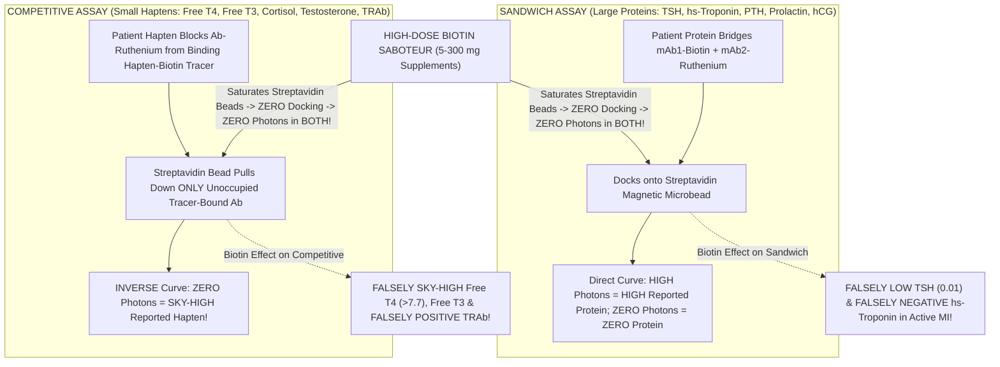

# **BASIC MEDICAL — BEHIND THE CURTAIN CLINICAL DIAGNOSTICS NOTEBOOK**
## **VOLUME IV: CLINICAL IMMUNOASSAYS, CARDIAC BIOMARKERS, PROTEIN ELECTROPHORESIS, ENDOCRINE DYNAMICS, AND TANDEM MASS SPECTROMETRY (`LC-MS/MS`)**

> *"Routine spectrophotometric chemistry swims in an ocean of millimolar solutes—glucose, urea, sodium, albumin—where molecules outnumber hormones by a billion to one. Detecting twelve nanograms per liter of cardiac troponin leaking from a dying left anterior descending territory, or ten picograms per milliliter of free thyroxine governing cellular basal metabolism, is the analytical equivalent of finding three specific grains of table salt dissolved inside an Olympic swimming pool filled with chicken soup. Humanity solved that problem twice: first with Rosalyn Yalow's exquisitely specific antibodies wired to electrochemiluminescent Ruthenium beacons, and second by hurling ionized molecules through triple-quadrupole vacuum collision chambers at ten thousand meters per second."*

---

### **Executive Orientation: Crossing into Special Chemistry, Immunodiagnostics & Clinical Mass Spectrometry**

When a Gold-Top Serum Separator Tube (`SST`), Mint-Green Lithium Heparin Tube (`PST`), or chilled Lavender `K2-EDTA` Tube exits the core spectrophotometric chemistry track and routes into the **Immunochemistry and Special Chemistry Division**, the analytical paradigm shifts fundamentally:

1. **In Dossier 4.1 (Electrochemiluminescent & Chemiluminescent Immunoassays [`ECLIA` / `CMIA`])**, automated analyzers (`Roche Cobas e801`, `Abbott Alinity i`, `Siemens Atellica IM`) deploy engineered monoclonal antibodies (`mAbs`), **Streptavidin-coated superparamagnetic microbeads**, and **`620-nm` Ruthenium(II) tris(bipyridyl)** photon emitters to quantify proteins and small haptens down to femtomolar (`10^-15 mol/L`) concentrations in `9 to 18 minutes`. Yet because immunoassays never directly touch or weigh the target molecule—measuring only *whether an antibody bridge formed*—they are vulnerable to **Four Great Analytical Saboteurs** (**Exogenous Biotin**, the **High-Dose Hook Effect**, **Heterophile / `HAMA` Antibodies**, and **Macro-Analyte Complexes**) capable of fabricating fake Graves' storm, masking giant prolactinomas, triggering needless hysterectomies for "phantom `hCG`," or hiding an active myocardial infarction!
2. **In Dossier 4.2 (Cardiac Biomarkers, Capillary Protein Electrophoresis & `HbA1c` Separation Physics)**, rapid `0/1-hour` high-sensitivity troponin (`hs-cTnI` vs. `hs-cTnT`) delta algorithms dissect acute coronary plaque rupture from regenerating skeletal myopathy (`fetal TNNT2 re-expression`), `NT-proBNP` untangles true ventricular wall-stress relief from `Sacubitril/Valsartan` (`Entresto`) neprilysin blockade, `pH 9.8` capillary zone electrophoresis (`SPEP`/`IFE`/`Freelite`/`MALDI-TOF MASS-FIX`) exposes razor-sharp myeloma M-spikes, and four rival `HbA1c` chemistries confront hemolytic erythrocyte-lifespan distortions.
3. **In Dossier 4.3 (`37°C` Equilibrium Dialysis & Triple-Quadrupole `LC-MS/MS`)**, when binding-protein upheavals (`ICU non-thyroidal illness, pregnancy, ESRD`), steroid structural isomers (`prednisolone` masquerading as `cortisol`), intracellular erythrocyte drug sequestration (`Tacrolimus` bound to `FKBP12`), dynamic adrenal provocation/suppression tests, and cross-reactive urine drug screens defeat antibodies altogether, the Medical Laboratory Scientist (`MLS`) turns to **Isotope-Dilution Liquid Chromatography–Tandem Mass Spectrometry (`LC-MS/MS`)**—weighing precursor ions in `Q1`, shattering their covalent backbones in an argon `Q2` collision cell, and counting forensic fragment transitions in `Q3` with near-absolute molecular certainty.

---

## **DOSSIER 4.1: FROM ROSALYN YALOW'S RADIOACTIVE INSULIN TO GLOWING RUTHENIUM MICROBEADS — NON-COMPETITIVE SANDWICH VS. COMPETITIVE IMMUNOASSAYS & THEIR FOUR GREAT SABOTEURS**

### **4.1.1 Historical Origin & Pre-Analytical Tube Selection Behind the Immunochemistry Curtain**

In the 1950s, endocrinology was trapped in the dark ages of crude animal bioassays—measuring human `hCG` by injecting a woman's urine into female *Xenopus* frogs or rabbits to inspect their ovaries days later, while peptide hormones like insulin, `TSH`, `ACTH`, and `PTH` were completely unmeasurable in human plasma. In 1959, medical physicist **Rosalyn Sussman Yalow** and physician **Solomon Berson** working at the Bronx Veterans Administration Hospital published their landmark *Journal of Clinical Investigation* discovery: patients treated with beef/pork insulin developed circulating **anti-insulin `IgG` globulins**, and by allowing unlabeled human plasma insulin to **compete** against trace amounts of radioiodinated **`131I-Insulin`** for a tiny fixed amount of antibody, hormone concentrations down to **`10^-12 mol/L` (`picograms/mL`)** could be read off a competitive displacement curve! Yalow and Berson refused to patent **Radioimmunoassay (`RIA`)**, gifting clinical diagnostics its modern foundation (1977 Nobel Prize).

Over subsequent decades, hazardous gamma-emitting `125I` radioisotopes (`60-day` half-life) and slow colorimetric `ELISA` microtiter plates gave way to high-speed random-access **Chemiluminescent Microparticle Immunoassays (`CMIA`, Abbott)** and **Electrochemiluminescent Immunoassays (`ECLIA`, Roche)**. Behind the curtain, specimen tube choice dictates whether those analyzers report truth or artifact:

* **Gold-Top `SST` (Serum) vs. Mint-Green `PST` (Lithium Heparin Plasma) & The "Latent Fibrin Flier" Trap:**
  * Gold-top `SST` tubes contain micronized silica particles that require a **mandatory `20–30 minute` upright room-temperature clotting wait** before centrifugation. If an emergency-department (`ED`) tech rushes a gold-top tube from a heparinized or coagulopathic chest-pain patient straight into the centrifuge after `4 minutes`, liquid fibrinogen passes into the supernatant above the thixotropic gel barrier and **continues polymerizing into sticky, invisible micro-fibrin threads right inside the analyzer sample cup**! Those sticky fibrin micro-clots physically trap Ruthenium- or Acridinium-labeled antibodies onto magnetic beads, generating a **spurious, non-reproducible false-positive `hs-Troponin` "flier" (`e.g., 145 ng/L`, repeating as `< 3 ng/L` after re-centrifugation!)**.
  * For **`0/1-hour` STAT `ED` `hs-Troponin` protocols**, laboratories strongly prefer **Mint-Green Lithium Heparin `PST` plasma** (`zero clotting wait`, cutting turnaround time by `25 minutes`!)—*with one strict rule*: because heparinized plasma and serum exhibit subtle `5–10%` matrix offsets on certain `cTnI` assays, **serial `0-hour` and `1-hour` delta draws MUST use the exact same tube type**!
* **Why `K2-EDTA` Lavender Plasma Wrecks `ALP`-Labeled Immunoassays—Yet Saves `ACTH`, `PTH`, and `BNP`:**
  * Platforms that employ **Alkaline Phosphatase (`ALP`)** as their chemiluminescent reporter enzyme (`e.g., Beckman Access dioxetane phosphate substrate`) suffer catastrophic **false-zero / false-high signal collapse** if `K2-EDTA` plasma is accidentally poured into a sample cup, because `EDTA` chelates the catalytic **$\text{Zn}^{2+}$ and $\text{Mg}^{2+}$ cofactors** right out of the analyzer's `ALP` enzyme conjugate!
  * Conversely, on non-metalloenzyme **`ECLIA` (`Ruthenium`) / `CMIA` (`Acridinium`)** platforms, **`K2-EDTA` chilled (`ice-slurry`) plasma is MANDATORY** for ultra-labile peptide hormones—specifically **Adrenocorticotropic Hormone (`ACTH`)**, **Parathyroid Hormone-Related Peptide (`PTHrP`)**, **Renin / Plasma Metanephrines**, and **`32-aa` active `BNP`** (which adheres to glass and is chewed apart within minutes at room temperature by calcium-dependent serum metalloproteases and kallikreins that `EDTA` arrests!).

---

### **4.1.2 Non-Competitive Two-Site ("Sandwich") vs. One-Site Competitive `ECLIA` / `CMIA` Physics**

Why can't every analyte in medicine be measured with the exact same antibody geometry? The answer is pure **molecular size and steric hindrance**: an `IgG` antibody (`150,000 Da`) has an antigen-binding `Fab` footprint roughly **`15–20 Å` (`1.5–2.0 nm`) wide**.

#### **1. Two-Site Non-Competitive Immunometric ("Sandwich") Architecture (`Large Analytes > 3,000–5,000 Da`)**
Polypeptide and glycoprotein hormones, tumor markers, and structural cardiac proteins (**`TSH`, `LH`, `FSH`, `β-hCG`, `Prolactin`, `GH`, `Intact PTH (1–84)`, `ACTH`, `Insulin`, `C-Peptide`, `hs-cTnI`, `hs-cTnT`, `BNP`, `NT-proBNP`, `Ferritin`, `PSA`, `CA-125`, `Thyroglobulin`**) are large enough (`3.5 kDa` to `660 kDa`) to present **two spatially distinct surface epitopes** simultaneously without the two antibodies bumping into each other:

1. **Liquid-Phase Ternary Sandwich Assembly (`37°C`, `4.5–9 minutes`):** Patient sample mixes with **vast molar excess** of two soluble monoclonal antibodies:
   * **Capture `mAb-1` conjugated to Biotin** (binding Epitope `A`—for instance, the `α/β` interface or C-terminus of `Intact PTH`).
   * **Detection `mAb-2` conjugated to a Ruthenium(II) tris(bipyridyl) chelate, $\text{[Ru(bpy)}_3\text{]}^{2+}$** (`Roche ECLIA`) or an **Acridinium Ester** (`Abbott CMIA`) (binding Epitope `B`—for instance, amino acids `1–34` at the biologically active N-terminus of `Intact PTH`, ensuring inactive `7–84` C-terminal uremic fragments cannot complete the bridge!).
2. **Streptavidin Superparamagnetic Capture & Magnetic Wash:** Micron-sized **paramagnetic iron-oxide microbeads coated with tetrameric Streptavidin** enter the cuvette. Biotin snaps into Streptavidin's deep $\beta$-barrel pocket with $K_d \approx 4 \times 10^{-14}\text{ to } 10^{-15}\text{ mol/L}$—the strongest non-covalent biological interaction known! Inside the flow-through measuring cell, an **electromagnet engages beneath a polished platinum working electrode**, pulling `100%` of the Streptavidin beads flat onto the electrode while `ProCell` buffer flushes unbound serum proteins, bilirubin, hemoglobin, and excess unbridged $\text{mAb-2–[Ru(bpy)}_3\text{]}^{2+}$ out to waste.
3. **Anodic Tripropylamine (`TPA`) Electrochemiluminescence (`620 nm`):** With the cuvette filled solely with **`Tripropylamine` (`TPA`)** co-reactant buffer, a precise **`+1.2-Volt` electrical potential** steps across the platinum electrode, triggering a rapid redox-radical cascade strictly within `~200 nm` of the electrode surface:

$$\text{[Ru(bpy)}_3\text{]}^{2+} \xrightarrow{-e^-\text{ (Pt anode)}} \text{[Ru(bpy)}_3\text{]}^{3+}$$

$$\text{TPA} \xrightarrow{-e^-\text{ (Pt anode)}} \text{TPA}^{\bullet+} \xrightarrow{-\text{H}^+} \text{TPA}^\bullet \text{ (potent reducing radical)}$$

$$\text{[Ru(bpy)}_3\text{]}^{3+} + \text{TPA}^\bullet \longrightarrow \text{[Ru(bpy)}_3\text{]}^{2+*} \text{ (excited triplet state)} + \text{Products}$$

$$\text{[Ru(bpy)}_3\text{]}^{2+*} \longrightarrow \text{[Ru(bpy)}_3\text{]}^{2+} + h\nu \text{ (}\mathbf{620\text{ nm}}\text{ photon!)}$$

   Notice the brilliance of this cycle: ground-state $\text{[Ru(bpy)}_3\text{]}^{2+}$ is **regenerated intact** after emitting its `620-nm` photon, allowing a *single* captured troponin or `TSH` molecule to fire **dozens of `620-nm` photons** into the photomultiplier tube (`PMT`) during a `100-millisecond` voltage pulse! *(On `Abbott CMIA` platforms, paramagnetic capture is followed instead by injection of alkaline hydrogen peroxide [$\text{H}_2\text{O}_2 + \text{NaOH}$], cleaving the acridinium ester ring into excited N-methylacridone for a sharp `430-nm` flash.)*
4. **Mathematical Signal Law (`Sandwich`):** **DIRECTLY PROPORTIONAL**—more patient analyte builds more `Biotin–Analyte–Ru2+` bridges on the magnetic beads:

$$\uparrow [\text{Patient Analyte}] \implies \uparrow \text{Captured } \text{[Ru(bpy)}_3\text{]}^{2+} \implies \uparrow \mathbf{620\text{-nm Photons (RLU)}}$$

#### **2. One-Site Competitive Immunoassay Architecture (`Small Haptens & Steroids < 1,000 Da`)**
Tiny non-peptide hormones, secosteroids, and therapeutic drugs (**`Free T4` [`777 Da`], `Free T3` [`651 Da`], `Cortisol` [`362 Da`], `Aldosterone` [`360 Da`], `Testosterone` [`288 Da`], `Estradiol` [`272 Da`], `Progesterone` [`314 Da`], `25-OH-Vitamin D` [`400 Da`], `Digoxin` [`781 Da`], `Folates`, `Vitamin B12`**—plus competitive receptor autoantibody assays such as **`TRAb` [`Thyrotropin Receptor Antibody`]** and **`Anti-TPO` / `Anti-Tg`** on select designs) are **physically smaller than a single antibody binding cleft**; once one `mAb` swallows `Testosterone` or `Free T4`, zero surface remains exposed for a second antibody!

1. **Competitive Scarcity Design:** Patient serum incubates with a **strictly limiting, sub-saturating quantity of `Ruthenium`-labeled anti-hormone monoclonal antibody** (`or biotinylated anti-hormone mAb`), followed by addition of a **Biotinylated exogenous hormone analog (`Hormone–Biotin tracer`)** and **Streptavidin magnetic microparticles**:
   * If the patient has **ZERO endogenous hormone** (`e.g., severe hypothyroidism, Free T4 ≈ 0`), `100%` of the Ruthenium-labeled antibodies remain empty and grab the `Hormone–Biotin` tracer, docking onto the Streptavidin beads $\to$ **MAXIMUM `620-nm` photon flash (`RLU`)**!
   * If the patient has **SKY-HIGH endogenous hormone** (`e.g., thyroid storm, Free T4 = 6.5 ng/dL`), native patient `T4` fills nearly `100%` of the Ruthenium-antibody binding pockets first, blocking them from grabbing the `Hormone–Biotin` tracer; when the magnet pulls down the Streptavidin beads, the occupied `Ru2+–Antibody–Patient T4` complexes wash right down the drain $\to$ **NEAR-ZERO `620-nm` photon flash (`RLU`)**!
2. **Mathematical Signal Law (`Competitive`):** **INVERSELY PROPORTIONAL**—the analyzer software inverts the sigmoidal `4-parameter logistic (4PL)` master calibration curve so **fewer photons translate to a higher reported hormone concentration**:

$$\uparrow [\text{Patient Hapten}] \implies \downarrow \text{Tracer Bound to Beads} \implies \downarrow \mathbf{620\text{-nm Photons (RLU)}} \implies \uparrow \text{Reported Concentration!}$$

---

### **4.1.3 The Four Great Immunoassay Saboteurs Every Clinician & Laboratory Scientist Must Master**

Whenever an endocrine or cardiac lab value violently contradicts the human being sitting on the exam table, **never treat the number before interrogating the four biochemical gremlins of immunodiagnostics**:

#### **1. Saboteur #1: High-Dose Exogenous Biotin (`Vitamin B7`) — The Counterfeit Graves' Storm & Silent Myocardial Infarction Killer**
* **Why Biotin Suddenly Broke Clinical Medicine:** Normal dietary Vitamin B7 intake (`30–70 µg/day`) produces trace serum biotin levels (`< 0.5 ng/mL`) completely invisible to `Streptavidin–Biotin` immunoassays. Over the past decade, social media popularized **"Hair, Skin & Nails" beauty gummies containing `5,000 µg` (`5 mg`) to `10,000 µg` (`10 mg`) of Biotin** (`300×` the daily requirement!), while high-dose progressive **Multiple Sclerosis (`MS`) regimens** and pediatric inherited metabolic protocols (`biotinidase / holocarboxylase synthetase deficiency`) prescribe **`100 mg` to `300 mg/day`**—pushing peak serum free biotin to **`100–1,200 ng/mL`**!
* **Dual-Direction Analytical Sabotage:** When free patient biotin floods a vulnerable one-step `Streptavidin–Biotin` reaction cup *before* the Streptavidin beads have pre-bound the assay's biotinylated reagent, free biotin saturates every Streptavidin pocket on the magnetic beads. Everything washes down the drain, **crushing `620-nm` photon emission (`RLU`) toward zero in *both* assay formats**—with diametrically opposite mathematical consequences:
  1. **Sandwich Assays Crash FALSELY LOW (`RLU ≈ 0` $\implies$ `Concentration ≈ 0`):**
     * **`TSH`** plummets to **`< 0.01 mIU/L`**, intact **`PTH`** drops to `< 4 pg/mL`, **`LH/FSH`** read undetectable, and **`NT-proBNP`** & **`β-hCG`** read falsely low.
     * **Lethal FDA Safety Alert (`hs-Troponin`):** In documented emergency-department fatalities that prompted urgent **FDA Safety Communications (2017 & 2019)**, patients taking high-dose biotin presented with acute crushing substernal chest pain (`NSTEMI`), yet their `Streptavidin–Biotin` **cardiac troponin printed `< 3 ng/L` (completely negative!)**, resulting in premature ED discharge and fatal arrhythmia!
  2. **Competitive Assays Explode FALSELY HIGH (`RLU ≈ 0` $\implies$ `Concentration = Above Upper Limit!`):**
     * **`Free T4` (`> 7.7 ng/dL`)**, **`Free T3` (`> 20 pg/mL`)**, **`Total T4/T3`**, **`Cortisol`**, **`Testosterone`**, **`Estradiol`**, and **`25-OH-Vitamin D`** print at thyrotoxic / Cushingoid / toxic extremes!
     * Worse still, the standard automated **`TRAb` (`TSH Receptor Antibody / TBII`)** assay is a *competitive* assay measuring inhibition of labeled `M22` monoclonal antibody binding to immobilized `TSH` receptors immobilized via `Streptavidin–Biotin`—so biotin makes **`TRAb` read STRONGLY POSITIVE (`> 40 IU/L`)**!
  3. **The Perfect Crime ("Fake Biochemical Graves' Disease"):** Look at the panel sitting in the endocrinologist's inbox: **`TSH < 0.01 mIU/L` + `Free T4 = 7.2 ng/dL` + `Free T3 = 22 pg/mL` + `Strongly Positive TRAb = 38 IU/L`!** Dozens of completely euthyroid patients (`resting pulse 64 bpm, warm dry skin, normal thyroid ultrasound vascularity`) were placed on **methimazole** or scheduled for irreversible **`131I` radioactive iodine thyroid ablation** before an astute clinician asked *"Do you take a hair-and-nails vitamin?"*
* **Behind-the-Curtain Detection & Mitigation:**
  * **Manufacturer Re-Engineering:** Manufacturers (`Roche Cobas Generation II/III` troponin & `TSH`) urgently reformulated vulnerable kits either by **pre-forming the `Streptavidin-Bead–Biotin-mAb` complex inside the factory bottle** prior to patient serum contact (since $K_d = 10^{-15}\text{ M}$, patient biotin cannot displace pre-bound biotin during a `9-minute` run!) or adding monoclonal biotin-scavenging antibodies (raising biotin tolerance to `> 1,200 ng/mL`). Platforms using covalent non-biotin capture (`Abbott Alinity CMIA`) are inherently immune!
  * **Bench & Bedside Washout Rules:** If biotin interference is suspected behind the curtain, the `MLS` either mixes `400 µL` of patient serum with washed **Streptavidin-agarose beads** for `30 minutes`, spins out the biotin-saturated beads, and re-runs the supernatant (`TSH` instantly jumps from `0.01` to `2.4 mIU/L`!), OR instructs the patient to hold biotin:
    * Hold **`5–10 mg/day` OTC Biotin** for **`48 hours`** prior to phlebotomy.
    * Hold **`100–300 mg/day` High-Dose Biotin** for **`72 hours` to `7 days`** *(and double washout times in **`CKD Stage 4–5 / Dialysis`**, because biotin is `100%` renally cleared!)*.

#### **2. Saboteur #2: The High-Dose "Hook" Effect (Antigen-Excess Prozone of One-Step Sandwich Assays)**
Picture a 38-year-old man presenting with bitemporal hemianopsia (`optic chiasm compression`), severe headaches, erectile dysfunction, and an MRI revealing a massive **`5.4-cm` invasive sellar/suprasellar pituitary mass** encasing both cavernous internal carotid arteries. Neurosurgery orders a STAT serum **Prolactin** to rule out a giant prolactinoma (`which melts away non-surgically on oral Cabergoline!`). The analyzer returns **`Prolactin = 39 ng/mL`** (`normal < 18 ng/mL`). Neurosurgeons conclude *"A `5.4-cm` true prolactinoma always has a prolactin `> 1,000–10,000 ng/mL`; `39 ng/mL` is classic mild **pituitary stalk compression ('stalk effect')** blocking hypothalamic dopamine from a non-functioning pituitary macroadenoma!"*—and book an unnecessary, high-morbidity craniotomy!

* **Physical Chemistry of the One-Step Sandwich Hook (`Heidelberger-Kendall Equivalence Curve`):**
  In fast **one-step homogeneous sandwich immunoassays**, patient serum, soluble `mAb-1–Biotin`, and soluble `mAb-2–Ruthenium` enter the reaction vessel **simultaneously**. Across physiological and moderately elevated ranges (`0.1` to `2,000 ng/mL`), antibodies remain in vast molar excess over prolactin (`Ascending Linear Arm`). However, when a `5.4-cm` giant prolactinoma pours **`38,000 ng/mL` (`1.6 million pmol/L`!)** of prolactin into plasma, antigen molecules outnumber antibody molecules **`50-to-1`**:
  * Prolactin Molecule #1 grabs `mAb-1–Biotin`, while Prolactin Molecule #2 grabs `mAb-2–Ruthenium` **separately**!
  * Virtually **zero** single prolactin molecule manages to bridge *both* antibodies simultaneously! When Streptavidin beads pull down `mAb-1–Biotin`, `99.9%` of captured prolactin lacks a `mAb-2–Ruthenium` partner—causing the photon curve to **hook violently downward (`Descending Post-Zone Arm`)**, falsely printing **`39 ng/mL`**! *(Note: **Two-Step Sequential Wash Sandwich Assays** eliminate hooking by immobilizing `mAb-1` first, capturing antigen, **washing away excess unbound ocean of antigen**, and *only then* adding `mAb-2–Ruthenium`!)*
* **Classic High-Dose Hook Clinical Scenarios & The `1:100` Dilution Rescue:**
  1. **Giant Macroprolactinomas (`> 3 cm`):** Mandatory rule—**EVERY pituitary macroadenoma `> 2–3 cm` with a prolactin `< 200 ng/mL` MUST undergo a `1:100` serial dilution behind the curtain before surgery!** In our patient, diluting serum `1:100` drops cuvette prolactin from `38,000` into the sweet spot of `380 ng/mL` $\to$ multiplied by `100` = **`38,000 ng/mL` (`Cabergoline` started; surgery canceled!)**.
  2. **Complete Hydatidiform Mole / Choriocarcinoma (`β-hCG > 1,000,000–3,000,000 mIU/mL`):** Point-of-care lateral-flow **urine pregnancy cassettes** are unwashed one-step sandwich strips! In molar pregnancy (`snowstorm pelvic ultrasound`), extreme intact `hCG` *plus* high-concentration urinary **`hCG β-core fragment`** independently saturate the mobile gold-conjugated antibody and fixed test-line antibody, producing a **false-negative urine pregnancy test** (`cured instantly by diluting the urine 1:10 in saline or ordering diluted quantitative serum β-hCG!`).
  3. **Extreme Hyperferritinemia in `HLH` / Adult-Onset Still's Disease (`Ferritin > 100,000 ng/mL`), Metastatic Prostate Cancer (`PSA > 50,000 ng/mL`), Hepatoblastoma/HCC (`AFP > 200,000 ng/mL`), and Myeloma Free Light Chains (`Freelite κ/λ`).**

#### **3. Saboteur #3: Heterophile Antibodies, `HAMA` (Human Anti-Mouse Antibodies) & Rheumatoid Factor (`RF`)**
* **Mechanism (`Bridging Without Antigen`):** Nearly all diagnostic monoclonal antibodies are harvested from **mouse (`murine IgG1`), rat, rabbit, or goat** hybridomas/B-cells. Roughly **`0.5%–3.0%` of patients** harbor circulating endogenous human antibodies capable of binding animal immunoglobulin `Fc` or `Fab` framework regions:
  * **Specific `HAMA` (`Human Anti-Mouse Antibodies`):** Induced by occupational rodent/veterinary exposure, pet mice, or therapeutic chimeric/murine monoclonal biologics.
  * **Polyspecific Heterophile Antibodies & IgM Rheumatoid Factor (`RF`):** Weak, multi-reactive autoantibodies (`common in rheumatoid arthritis, SLE, post-viral states, or idiopathic healthy donors`) that recognize conserved `Fc` domains across species.
  * Inside a two-site **Sandwich Assay**, a bivalent `HAMA` or pentameric `IgM RF` grabs the `Fc` tail of **`mAb-1–Biotin`** with one arm and the `Fc` tail of **`mAb-2–Ruthenium`** with its other arm—**building a rock-solid glowing antibody bridge when the patient's true hormone or troponin concentration is `0.00`!**
* **Clinical Hallmarks ("Phantom `hCG`" & "Phantom `hs-Troponin`"):**
  * **Flat, Non-Physiological Kinetics:** Unlike true acute myocardial infarction (`where hs-Troponin rises and falls dynamically across 0/1/3 hours`) or viable pregnancy/trophoblastic tumor (`where β-hCG doubles or responds to therapy`), heterophile elevation sits **eerily flat (`e.g., hs-cTnI = 185 ng/L, 182 ng/L, 188 ng/L` every month for a year!)**.
  * **The `Urine β-hCG = 0` Smoking Gun:** In suspected **"Phantom `hCG`"** (`persistent serum β-hCG = 85 mIU/mL` in a non-pregnant woman), ordering a simultaneous **Urine `β-hCG`** settles the diagnosis instantly: **`150-kDa` `IgG` / `900-kDa` `IgM` heterophile antibodies are blocked by the renal glomerular size-selectivity barrier (`< 60 kDa`)**, so **`Serum β-hCG (+)` + `Simultaneous Urine β-hCG (0)` = Heterophile Antibody (`DO NOT give methotrexate or operate!`)**!
* **Three Behind-the-Curtain Laboratory Confirmatory Tests:**
  1. **Alternate-Species Platform Check:** Re-running the sample on a rival analyzer (`e.g., sending a Roche murine-mAb sample to an Abbott/Siemens platform using chimeric human-Fc, Fab'-only fragments lacking Fc tails, or sheep/goat antibodies`) drops a `185 ng/L` false troponin straight to **`< 2 ng/L`**!
  2. **Non-Linear Serial Dilution:** True antigen dilutes linearly (`100 -> 50 -> 25 -> 12.5`), whereas low-affinity heterophile antibodies dissociate disproportionately (`100 -> 18 -> 2`, failing `80–120%` linearity recovery!).
  3. **Heterophile Blocking Tube (`HBT`) Neutralization:** Pipetting `500 µL` of patient serum into a lyophilized **`HBT` tube** saturated with non-immune mouse/animal `IgG` sponges up the offending `HAMA` before re-assaying.

#### **4. Saboteur #4: Macro-Analyte `IgG` Complexes (`Macro-Prolactin`, `Macro-TSH`, `Macro-Troponin`, `Macro-AST`)**
* **Pathophysiology:** Occasionally, a healthy patient develops a benign endogenous `IgG` autoantibody that binds their *own* native hormone or enzyme (`monomeric 23-kDa Prolactin`, `28-kDa TSH`, `cTnI`, `Amylase`, or `AST`), creating a **`170–200 kDa` high-molecular-weight `IgG–Analyte` complex**:
  * **Biologically Inactive *In Vivo*:** Trapped inside the intravascular space because a `170-kDa` complex cannot cross capillary endothelium to engage target-organ receptors (`so a woman with Prolactin = 165 ng/mL from Macroprolactin has regular ovulatory cycles, normal estradiol, and zero galactorrhea; a child with AST = 420 U/L and ALT = 18 U/L from Macro-AST has a 100% normal liver!`).
  * **Renally Cleared at `1/20th` Normal Speed:** Monomeric `23-kDa` prolactin clears rapidly via glomerular filtration ($t_{1/2} \approx 25\text{–}50\text{ min}$), whereas `IgG`-bound **Macroprolactin** adopts the **`21-day` FcRn-recycled half-life of `IgG`**, piling up in serum to alarming concentrations that still bind sandwich `mAbs`!
* **Behind-the-Curtain `25% PEG 6000` Precipitation Protocol:** The `MLS` mixes `200 µL` of patient serum `1:1` with **`25%` (`w/v`) Polyethylene Glycol (`PEG 6000`)** in `pH 7.4` phosphate-buffered saline, vortexes for `10 seconds`, and centrifuges at `3,000 × g` for `15 minutes`. Neutral `PEG` polymer chains sterically exclude water of hydration around bulky `> 150-kDa` `IgG` complexes, **precipitating `100%` of Macroprolactin (`or Macro-Troponin / Macro-TSH / Macro-AST`) into a tight white pellet at the bottom** while leaving small `23-kDa` bioactive monomeric prolactin dissolved in the supernatant!

$$\text{Monomeric Recovery (\%)} = \left( \frac{2 \times [\text{Prolactin}]_{\text{Post-PEG Supernatant}}}{[\text{Prolactin}]_{\text{Unprecipitated Neat Serum}}} \right) \times 100$$

  * **`Recovery < 40%` (plus normalized post-PEG monomeric reference value):** Diagnostic of **Benign Macroprolactinemia** (`no pituitary MRI, no Cabergoline needed!`).
  * **`Recovery > 60%`:** Confirms true bioactive **Monomeric Hyperprolactinemia** (`proceed to TSH check, medication review, and pituitary MRI`).

| Immunoassay Saboteur | Sandwich Effect (`TSH, hs-cTn, Prolactin, hCG`) | Competitive Effect (`Free T4/T3, Cortisol, Testosterone, TRAb`) | Definitive Behind-the-Curtain Unmasking Test |
| :--- | :--- | :--- | :--- |
| **1. Exogenous Biotin (`5–300 mg/day`)** | **Falsely LOW** (`TSH = 0.01`, **false-negative `hs-Troponin` in MI!**) | **Falsely SKY-HIGH** (`FT4 > 7.7`, **false-positive `TRAb`** = *Fake Graves' Storm!*) | Hold biotin `48–72+ hr`, Streptavidin-agarose bead pre-depletion, or run on non-biotin `CMIA` (`Abbott`) |
| **2. High-Dose Hook Effect (`Antigen Excess`)** | **Falsely LOW / Mild** (`38,000 ng/mL` giant prolactinoma reads `39 ng/mL`!) | *Immune* (extreme antigen only drives competitive `RLU` closer to `0` = true `> ULN`!) | **`1:10` and `1:100` Serial Dilution** (`value rockets upward 100-fold!`) or 2-step wash assay |
| **3. Heterophile / `HAMA` / `RF` Cross-Linking** | **Falsely HIGH** (*Phantom `hCG`*, flat *Phantom `hs-Troponin`*; occasionally blocks = low) | Rare variable interference | **Urine `β-hCG` (`= 0!`)**, **Heterophile Blocking Tube (`HBT`)**, non-linear dilution, or alternate-platform assay |
| **4. Macro-Complexes (`Macro-PRL / TSH / cTn / AST`)** | **Clinically Misleading HIGH** (biologically inactive `IgG-hormone` trapped in plasma) | Minimal (measures free unbound fraction if equilibrium respected) | **`25% PEG 6000` Precipitation** (`< 40%` post-PEG supernatant recovery proves macro-complex!) |

---

## **DOSSIER 4.2: CARDIAC BIOMARKERS (`hs-cTnI` VS. `hs-cTnT`, `0/1-HOUR` ALGORITHMS & `BNP` VS. `NT-proBNP`) & ELECTROPHORETIC PROTEIN SEPARATION (`SPEP`, `IFE`, `FREELITE` & `HbA1c`)**

### **4.2.1 High-Sensitivity Cardiac Troponin (`hs-cTnI` vs. `hs-cTnT`): Biphasic Release Kinetics, `0/1-Hour` Algorithms & The Regenerating Skeletal Muscle Trap**

#### **1. Sarcomeric Compartmentalization & What Legally Defines a "High-Sensitivity" (`hs`) Assay**
Inside ventricular cardiomyocytes, the heterotrimeric troponin complex sits every `38.5 nm` along actin thin filaments: **Troponin C (`cTnC`, calcium sensor — shared identically `100%` with slow-twitch skeletal muscle, hence useless diagnostically!)**, **Cardiac Troponin T (`cTnT`, `37 kDa`, encoded by `TNNT2`, tethering the complex to tropomyosin)**, and **Cardiac Troponin I (`cTnI`, `24 kDa`, encoded by `TNNI3`, blocking actomyosin ATPase cross-bridging during diastole)**.

Crucially, cardiomyocytes house troponin in **two kinetically distinct intracellular pools**:
1. **The Early-Release Cytosolic / Loosely Bound Pool (`~5–8%` of total `cTnT` and `~3–5%` of `cTnI`):** Dissolved freely in sarcoplasm (or shed inside reversible ischemic membrane blebs?), this pool crosses injured sarcolemma into cardiac lymphatics and coronary venous blood within **`30 to 90 minutes`** of acute coronary occlusion!
2. **The Myofibrillar Structural Pool (`~92–95%`):** Covalently/tightly locked into insoluble sarcomeric filaments, requiring macrophage/proteolytic dismantling of necrotic myocardium—generating the classic prolonged **`5-to-14 day` elevation tail** (`longer for cTnT [10–14 days] than cTnI [5–10 days]`) that replaced `CK-MB`!

Under **International Federation of Clinical Chemistry (`IFCC`)** and **Fourth Universal Definition of Myocardial Infarction** criteria, an immunoassay earns the **"High-Sensitivity" (`hs-cTn`)** designation ONLY if it meets two strict analytical benchmarks—and **MUST be reported in whole-number nanograms per liter (`ng/L`, equivalent to `pg/mL`)** rather than legacy three-decimal `0.014 ng/mL` units (eliminating catastrophic decimal-point misreads at `2:00 AM`!):

* **Benchmark 1 (Precision):** Analytical Coefficient of Variation (**`CV <= 10%`**) at the **sex-specific 99th percentile Upper Reference Limit (`URL`)** of a healthy population.
* **Benchmark 2 (Sensitivity):** Quantifiable concentrations above the Limit of Detection (`LoD`) in **`>= 50%` of completely healthy adult men AND women**! *(Why sex-specific cutoffs matter: healthy women possess `~25–30%` smaller left-ventricular myocardial mass than men—so on `Abbott Alinity hs-cTnI`, the 99th percentile `URL` is **`16 ng/L` in women vs. `34 ng/L` in men** [`Roche Elecsys hs-cTnT`: **`9 ng/L` women vs. `16 ng/L` men`**]. Applying a unisex `26–34 ng/L` cutoff systematically underdiagnoses female `NSTEMIs`!)*

#### **2. `ESC` / `AHA` `0/1-Hour` Rapid Rule-Out & Rule-In Delta Algorithms**
Because high-sensitivity `ECLIA`/`CMIA` platforms exhibit an intra-assay analytical `CV` of **`< 2–4%`** (`±1 ng/L` precision!) at low concentrations, emergency departments no longer hold chest-pain patients for `6 to 12 hours`. Assay-specific **`0/1-Hour` (or `0/2-Hour`) Algorithms** separate acute plaque instability from chronic structural elevation in `60 minutes`:

* **Immediate `0-Hour` Single-Draw Rule-Out (`NPV > 99.5%`):** If symptom onset was **`> 3 hours` prior** AND `0-hour hs-cTn` sits below the Limit of Blank/Detection (`e.g., < 5 ng/L` on `Roche hs-cTnT` or `< 4 ng/L` on `Abbott hs-cTnI`) with a non-ischemic `ECG`.
* **Serial `0/1-Hour` Delta Rule-Out:** Low `0-hour` baseline (`e.g., < 12 ng/L` on `hs-cTnT`) **AND** `1-hour` absolute change **`|Δ 0–1h| < 3 ng/L`**.
* **Serial `0/1-Hour` Delta Rule-In (`PPV ~75–80%` for Acute Myocardial Injury):** Markedly elevated `0-hour` (`e.g., >= 52 ng/L` on `hs-cTnT` or `>= 64 ng/L` on `Abbott hs-cTnI`) **OR** `1-hour` dynamic surge **`Δ 0–1h >= 5 ng/L` (`hs-cTnT`) / `>= 6 ng/L` (`hs-cTnI`)**!
* **Acute vs. Chronic Injury & Type 1 vs. Type 2 MI:** Any value `> 99th percentile URL` defines **Myocardial Injury**. A **dynamic rise and/or fall (`> 20%` delta when baseline exceeds `URL`)** defines **Acute Myocardial Injury**—which becomes **Acute Myocardial Infarction (`Type 1` atherothrombotic plaque rupture vs. `Type 2` oxygen supply-demand mismatch in septic shock, tachyarrhythmia, or GI bleed)** *only* when paired with clinical, `ECG`, angiographic, or imaging evidence of **acute myocardial ischemia** (`whereas myocarditis, pulmonary embolism, or Takotsubo cardiomyopathy cause acute non-ischemic injury, and CKD/LVH causes flat < 20% chronic injury!`).

#### **3. Critical Discordance Behind the Curtain: Why Skeletal Myopathies Elevate `hs-cTnT` While `hs-cTnI` Stays Dead Normal!**
Suppose a 58-year-old woman with **idiopathic inflammatory myopathy (`polymyositis` / `dermatomyositis`), inclusion-body myositis, muscular dystrophy, or severe statin myopathy** (`CK = 3,800 U/L`, proximal leg weakness, zero chest pain, normal `ECG` and echocardiogram) has a routine `Roche hs-cTnT` drawn—and it returns **`hs-cTnT = 148 ng/L` (`16×` the female `URL`!)**, triggering unnecessary heparinization and invasive coronary angiography!

* **The Embryonic `TNNT2` Re-Expression Phenomenon:** During human fetal embryogenesis, immature skeletal muscle transiently expresses the cardiac **`TNNT2` (`cTnT`)** gene before switching postnatally to skeletal troponin T isoforms (`TNNT1`/`TNNT3`). Whenever adult skeletal muscle undergoes **chronic injury and satellite-cell myoblast regeneration**, regenerating skeletal myofibers **transcriptionally re-activate fetal `TNNT2` mRNA and translate authentic immunoreactive `cTnT` protein** that leaks into blood and triggers the `Roche hs-cTnT` sandwich assay!
* **Why `hs-cTnI` Solves It Instantly:** Unlike `TNNT2`, the cardiac **`TNNI3` (`cTnI`) gene is NEVER expressed in fetal, neonatal, healthy, or regenerating skeletal muscle at any point in human biology**! Sending that exact same serum tube behind the curtain to an **`hs-cTnI` platform (`Abbott`, `Siemens`, `Beckman`)** returns **`hs-cTnI = < 2 ng/L` (completely normal!)**, proving `100%` skeletal-muscle origin without a cardiac catheterization!
* **Opposite Pre-Analytical Hemolysis Trap:** Gross *in vitro* hemolysis (`free Hb > 100–200 mg/dL` from traumatic ED butterfly draws) releases intra-erythrocytic proteases (`cathepsin E` / `insulin-degrading enzyme`) that **proteolytically clip `cTnT` epitopes**, causing a **false-LOWERING of `Roche hs-cTnT`** (`potentially dropping a borderline 18 ng/L NSTEMI into the falsely reassuring rule-out zone!`), whereas hemolysis tends to leave `cTnI` unchanged or mildly *elevated*—which is why automated serum-indices spectrophotometry checks **Hemolysis Index (`H-index`)** on every troponin tube before releasing a `0/1-hour` delta!

---

### **4.2.2 Natriuretic Peptides (`BNP` vs. `NT-proBNP`): The `Sacubitril/Valsartan` (`Entresto`) Paradox & The Obesity Natriuretic Handicap**

When elevated left-ventricular end-diastolic pressure (`P`) and chamber radius (`r`) stretch ventricular cardiomyocytes per **Laplace's Law** ($\text{Wall Stress } \sigma = \frac{P \cdot r}{2h}$), transcription of the `NPPB` gene yields **`108-amino-acid proBNP(1–108)`**, which transmembrane serine protease **Corin** (and intracellular **Furin**) cleaves in an exact **`1:1` equimolar ratio** into two radically different circulating molecules:

| Feature | Active **`BNP` (`1–32`, `3.5 kDa` disulfide ring)** | Inactive **`NT-proBNP` (`1–76`, `8.5 kDa` linear N-terminus)** |
| :--- | :--- | :--- |
| **Biological Activity** | **Bioactive Hormone:** Binds `NPR-A` guanylyl cyclase $\to$ intracellular `cGMP` $\to$ natriuresis, vasodilation, RAAS/sympathetic inhibition | **Biologically Inert** cleavage byproduct |
| **Plasma Half-Life ($t_{1/2}$)** | **`~18–22 minutes`** (`lower circulating molar concentration`) | **`~90–120 minutes`** (`4–6× higher circulating plasma concentration!`) |
| **Clearance Pathways** | **1.** **`NPR-C`** natriuretic clearance receptor endocytosis (`adipose/vascular`) **2.** **Neprilysin (`CD10` neutral endopeptidase)** enzymatic cleavage (`> 70%` non-renal!) | **Almost `100%` Passive Renal Glomerular Filtration** (`rises steeply as eGFR falls below 60 mL/min!`) |
| ***In Vitro* Tube & Stability** | **Lavender `K2-EDTA` Plastic Tube ONLY** (adheres to glass; degrades within `4 hours` at room temp via kallikrein/proteases!) | **Serum (`SST`) or Heparin Plasma**; rock-stable for **`72 hours`** at room temperature! |
| **Acute Heart Failure Cutoffs (`ICON` / `PRIDE`)** | Rule-out: **`< 100 pg/mL`** (`> 400 pg/mL` high probability) | Rule-out (all ages): **`< 300 pg/mL`** **Age-Adjusted Rule-In:** `< 50 yr`: **`> 450`**; `50–75 yr`: **`> 900`**; `> 75 yr`: **`> 1,800 pg/mL`** |
| **Effect of `Sacubitril/Valsartan` (`Entresto` `ARNI`)** | **PHARMACOLOGICALLY ELEVATED!** `Sacubitrilat` blocks **Neprilysin**, inhibiting `BNP` breakdown (plus assays cross-react with glycosylated `proBNP`) $\to$ **`BNP` RISES even as the heart improves!** | **UNAFFECTED BY NEPRILYSIN!** Reflects true myocardial stretch $\to$ **`NT-proBNP` DROPS (`30–50%`) within days/weeks of successful `Entresto` unloading!** |

> [!TIP]
> **The Obesity Natriuretic Handicap (`BMI >= 35 kg/m^2`):** In severe obesity—especially **Obese `HFpEF`**, where thick epicardial fat pads and chest-wall mass drive pulmonary capillary wedge pressures `> 28 mmHg` during exertion—**`BNP` and `NT-proBNP` are `40%–60%` LOWER than expected** (`often BNP = 35–80 pg/mL` during frank pulmonary edema!). Adipocytes express high densities of **`NPR-C` clearance receptors**, heightened androgenic/hyperinsulinemic signaling suppresses cardiomyocyte `NPPB` transcription, and external pericardial restraint blunts transmural stretch ($\Delta P_{\text{transmural}}$). Clinicians must **halve the `BNP` rule-out cutoff to `< 50 pg/mL`** in patients with `BMI >= 35 kg/m^2`!

---

### **4.2.3 Serum Protein Electrophoresis (`SPEP`), Immunofixation (`IFE`), `Freelite` Free Light Chains & `MALDI-TOF MASS-FIX`**

#### **1. Capillary Zone Electrophoresis (`CZE` at `pH 9.8`) & Why Plasma Ruins `SPEP`**
Ordered to investigate unexplained anemia, hypercalcemia, renal insufficiency, lytic bone lesions (`CRAB` criteria), peripheral neuropathy, nephrotic proteinuria, or an elevated **Total Protein–Albumin ("Globulin") Gap (`> 4.0 g/dL`)**, **Serum Protein Electrophoresis (`SPEP`)** MUST be performed on **clotted Serum (`Gold/Red-top`), NEVER Plasma (`Green/Blue/Lavender`)**! Why? Plasma retains **`300–400 mg/dL` of intact Fibrinogen**, which migrates as a **crisp, narrow discrete band right at the `β2–γ` junction**—perfectly mimicking a **Monoclonal Myeloma `M-Spike`**! *(Behind the curtain, if a suspected fibrinogen band appears in an anticoagulated dialysis patient, the `MLS` treats an aliquot with bovine thrombin or runs `IFE` with anti-fibrinogen vs. anti-`IgG/A/M/κ/λ` antisera to expose the impostor!)*

Modern high-throughput special-chemistry labs (`Sebia Capillarys 3`) have largely replaced manual agarose-gel Coomassie/Amido-Black dye staining with **Liquid-Flow Capillary Zone Electrophoresis (`CZE`)**:
* Diluted serum injects at the anode (`+`) end of `8` parallel hair-thin **`25-µm` fused-silica capillaries** filled with **`pH 9.8–10.0` alkaline borate buffer**.
* At `pH 9.8`, virtually all human serum proteins sit above their isoelectric point (`pI`) and carry a **net negative charge** (`Albumin pI = 4.7` carries the strongest negative charge; `γ-globulins pI ≈ 7.3–8.5` carry minimal negative charge). Left alone, negative proteins would migrate *backward* toward the anode (`+`). However, at `pH 9.8`, ionized silanol ($\text{Si-O}^-$) groups lining the glass capillary wall generate a massive **Electroendosmotic Flow (`EOF`)** of hydrated $\text{Na}^+$ ions surging rapidly toward the **cathode (`-`)**—sweeping *every* protein past a **`200-nm` direct peptide-bond UV detector** in exact inverse order of negative charge (`γ-globulins` exit *first*, followed by `β2`, `β1`, `α2`, `α1`, and strongly retarded negative `Albumin` *last*, flipped electronically by software into the familiar left-to-right `Albumin -> γ` densitometric trace!).

| `SPEP` Zone | Dominant Physiologic Proteins | Classic Diagnostic Curve Signatures |
| :--- | :--- | :--- |
| **1. `Albumin` (`3.5–5.0 g/dL`)** | Serum Albumin (`66 kDa`, oncotic/transport carrier; negative acute-phase reactant) | **Severely depressed** in nephrotic syndrome, cirrhosis, malnutrition, or `IL-6` sepsis. **Twin symmetric peaks = Benign hereditary `Bisalbuminemia`** (or high-dose β-lactam binding!). |
| **2. `α1-Globulin` (`0.1–0.3 g/dL`)** | **`α1-Antitrypsin` (`AAT`, `~90%` of band!)**, `α1-Acid Glycoprotein` | **Flat / Absent `α1` Peak = Pathognomonic for `Pi*ZZ` `α1-Antitrypsin` Deficiency** (`panacinar basilar emphysema + PAS-positive hepatocyte globule cirrhosis`!). Surges in acute inflammation/pregnancy. |
| **3. `α2-Globulin` (`0.6–1.0 g/dL`)** | **`α2-Macroglobulin` (`725 kDa` giant!)**, **`Haptoglobin`**, `Ceruloplasmin` | **Classic Nephrotic Syndrome Pattern (`Low Albumin + Sky-High α2 Spike`):** Damaged glomeruli dump `66-kDa` albumin into urine, stimulating compensatory hepatic protein synthesis—retaining `725-kDa` `α2-Macroglobulin` inside plasma! **Collapsed `α2` band** = *in vivo* intravascular hemolysis depleting `Haptoglobin`! |
| **4. `β1-Globulin` (`0.5–0.8 g/dL`)** | **`Transferrin`**, `Hemopexin`, `β-Lipoprotein (LDL)` | **Sharp Benign `β1` Elevation = Severe Iron Deficiency Anemia** (hepatic upregulation of apo-transferrin!). *(Note: Free `Hb` bound to haptoglobin migrates between `α2` and `β1` in hemolyzed tubes!)* |
| **5. `β2-Globulin` (`0.2–0.5 g/dL`)** | **Complement `C3`**, `β2-Microglobulin`, and **Polymeric/Monoclonal `IgA`** | **Absent `β2` band** = old unrefrigerated serum (`C3 -> C3c` degradation) or lupus complement consumption. **CRITICAL:** **`40–50%` of `IgA` Multiple Myeloma `M-Spikes` hide inside the `β2` zone** rather than the `γ` zone! |
| **6. `γ-Globulin` (`0.7–1.6 g/dL`)** | **`IgG` (`dominant`), `IgM`, `IgA`, `IgD`, `IgE`** *(plus **`CRP`** mini-band in severe sepsis!)* | • **Broad Rounded Dome:** Benign **Polyclonal Hypergammaglobulinemia** (`chronic infection, SLE, Sjögren's, autoimmune hepatitis`). • **`β–γ` Bridging (Loss of valley between `β` & `γ`):** Classic **Hepatic Cirrhosis** (`shunted portal gut antigens drive polyclonal polymeric IgA synthesis spanning β2 into γ!`). • **Tall, Narrow Church-Steeple Spike:** **Monoclonal Gammopathy (`MGUS`, Smoldering/Symptomatic Multiple Myeloma, Waldenström `IgM` Macroglobulinemia, `AL` Amyloidosis)**! • **Flat Hypogammaglobulinemia (`< 0.4 g/dL`):** `CVID`, anti-`CD20` (`rituximab`), **`CLL`**, OR **`Light-Chain-Only` (`Bence Jones`) Multiple Myeloma (`15–20%` of all myelomas!)**! |

#### **2. Immunofixation (`IFE`), `Freelite` Serum Free Light Chains (`κ/λ`) & `MALDI-TOF MASS-FIX`**
Because `SPEP` alone cannot identify immunoglobulin isotype and **misses small monoclonal spikes `< 100–200 mg/dL`** (`including 100% of Light-Chain Myelomas and most AL Amyloidosis cases!`), complete plasma-cell dyscrasia screening requires the **`IMWG` Triad (`SPEP` + Serum `IFE` + Serum Free Light Chains [`sFLC`])**:

1. **Immunofixation Electrophoresis (`IFE` / Capillary Immunotyping):** Patient serum runs simultaneously down `6` parallel lanes; Lane 1 receives general protein fixative (`ELP`), while Lanes `2–6` are overlaid with monospecific **`Anti-γ (IgG)`, `Anti-α (IgA)`, `Anti-μ (IgM)`, `Anti-κ (Kappa)`, and `Anti-λ (Lambda)`** antisera (`plus Anti-δ [IgD] and Anti-ε [IgE] if a crisp κ or λ band lacks heavy-chain match!`), washing away unprecipitated proteins and staining the insoluble immune complexes (`detection limit ~10–15 mg/dL`).
2. **Nephelometric/Turbidimetric Serum Free Light Chains (`Freelite` Assay):** Healthy plasma cells synthesize a `~40%` molar excess of `22.5-kDa` monomeric **Kappa (`κ`)** and `45-kDa` dimeric **Lambda (`λ`)** light chains that spill unbound into blood and are rapidly filtered and catabolized by renal proximal-tubule `megalin/cubilin` receptors (`normal κ/λ ratio = 0.26–1.65`). Polyclonal antibodies raised specifically against **cryptic constant/variable-domain interface epitopes (`buried out of sight whenever light chains are disulfide-bonded to heavy chains, exposed ONLY on unbound free light chains!`)** detect aberrant clonal excess (`involved/uninvolved FLC ratio >= 100` with involved `FLC >= 100 mg/L` is a myeloma-defining `SLiM-CRAB` biomarker!). *(Renal Pearl: In **Stage 4–5 `CKD` / Dialysis**, glomerular clearance stalls, forcing slow reticuloendothelial pinocytosis to clear both chains equally—eliminating `κ`'s faster monomeric renal clearance advantage and shifting the **normal renal `κ/λ` reference interval upward to `0.37–3.10`**!)*
3. **Why Therapeutic `Daratumumab` Fakes Persistent Myeloma on `IFE`—Solved by `MASS-FIX` (`MALDI-TOF-MS`):** Because **`Daratumumab` (`Isatuximab`, `Elotuzamab`)** is itself a humanized **`IgG1κ` monoclonal antibody** infused at gram doses (`serum levels ~50–100 mg/dL`), an `IgGκ` myeloma patient in **complete bone-marrow remission** still prints a stubborn **`IgGκ` band on `IFE`**! Reference centers (`Mayo Clinic MASS-FIX`) immunoenrich `IgG/A/M/κ/λ` onto nanobody beads and fire a **Matrix-Assisted Laser Desorption/Ionization Time-of-Flight (`MALDI-TOF`)** laser, weighing light chains to **`±1 Dalton`** accuracy—cleanly separating `Daratumumab`'s known exact light-chain molecular mass (`m/z 23,382 Da` doubly charged `11,691`) from the patient's unique somatic-hypermutated myeloma clone!

---

### **4.2.4 Hemoglobin `A1c` (`HbA1c`) Behind the Curtain: Amadori Chemistry, Four Rival Separation Methods & Erythrocyte-Lifespan Traps**

#### **1. Non-Enzymatic Two-Step Amadori Rearrangement**
Inside circulating erythrocytes (`which express insulin-independent GLUT1 transporters, keeping intracellular [glucose] equilibrated with plasma [glucose]`), open-chain aldehyde glucose reacts spontaneously with the nucleophilic $\alpha$-amino group of the **N-terminal Valine (`Val-1`) of one or both $\beta$-globin chains** of adult **`HbA` ($\alpha_2\beta_2$)**:

$$\text{D-Glucose (Aldehyde)} + \text{H}_2\text{N-Val}_1\text{-}\beta\text{-Globin} \underset{\text{Fast, Reversible (Hours)}}{\overset{-\text{H}_2\text{O}}{\rightleftharpoons}} \underbrace{\text{Schiff Base (Labile Aldimine, Pre-A1c)}}_{\text{Fluctuates wildly with acute meal spike!}} \xrightarrow[\text{Slow, Irreversible}]{\text{Amadori Rearrangement}} \underbrace{\mathbf{\text{HbA}_{1\text{c}}\text{ (Stable Ketoamine: 1-Deoxyfructosyl-Valine)}}}_{\text{Locked permanently until RBC dies at Day 120!}}$$

Because erythrocytes survive `~120 days` (`with continuous birth and splenic clearance`), `HbA1c` integrates `8–12 weeks` of ambient glycemia—**exponentially weighted so `~50%` of today's `HbA1c` reflects the most recent `30 days`**, `~25%` days `30–60`, and `~25%` days `60–120`! Validated by the `ADAG` study (`Nathan et al., Diabetes Care 2008`), `NGSP` percentage converts linearly to **Estimated Average Glucose (`eAG`)**:

$$\text{eAG (mg/dL)} = \left(28.7 \times \text{HbA}_{1\text{c}}\text{ [\%]}\right) - 46.7 \qquad \left[\text{IFCC (mmol/mol)} = 10.93 \times \text{NGSP (\%)} - 23.5\right]$$

#### **2. Four Analytical `HbA1c` Methods & When `HbA1c` Lies Catastrophically**

| Analytical Method | Physical / Chemical Separation Principle | Variant & Chemical Vulnerabilities |
| :--- | :--- | :--- |
| **1. Cation-Exchange `HPLC` (`Bio-Rad Variant II / Tosoh G8`)** | Attaching glucose to `β-Val1` neutralizes `1` positive charge, lowering `HbA1c`'s `pI` so **`HbA1c` elutes EARLIER** off a negatively charged sulfonate resin column (`415 nm` absorbance) than native `HbA0`! | **Advantage:** Displays visual peaks for `HbF, HbS, HbC`! **Fails completely** in **homozygous/compound variants lacking `HbA` (`HbSS, HbCC, HbSC, HbEE`)**, **`HbF > 15–25%` (`HPFH`)**, or rare variants co-eluting with `HbA1c` (`Hb Raleigh` [acetylated Val1 $\to$ fake `HbA1c = 45%`!], `Hb Wayne`). |
| **2. Capillary Electrophoresis (`Sebia Capillarys HbA1c`)** | High-voltage migration in alkaline buffer separates `HbA1c` with wide baseline valleys away from `HbA0`, labile `pre-A1c`, carbamylated `Hb`, and structural variants! | Immune to heterozygous `HbAS, HbAC, HbAD, HbAE` and uremic carbamylation; still **cannot report `HbA1c` in `HbSS` / `HbSC`** (because zero `βA` chains exist!). |
| **3. Boronate Affinity (`Trinity Premier` / POC)** | Immobilized ***m*-aminophenylboronic acid** forms reversible covalent tetrahedral esters exclusively with **`1,2-cis-diol` hydroxyls** on ketoamine glucose attached to *any* globin chain (`415 nm` ratio)! | Measures total glycated `Hb` across `HbAS, HbAC, HbAE` cleanly—**DANGEROUS TRAP:** In **`HbSS` / `HbSC`**, boronate affinity *prints a number* (`e.g., 4.6%`), tricking clinicians who forget that `20-day` sickle hemolysis renders that number **100% falsely low**! |
| **4. Enzymatic (`Abbott Alinity` / `Roche` Immunoassay)** | Protease cleaves N-terminal glycated dipeptide $\to$ **Fructosyl-Peptide Oxidase (`FPOX`)** generates $\text{H}_2\text{O}_2$ (`or mAb binds N-terminal 4–8 glycated β-globin residues`). | Interfered if a variant mutates amino acids `1–6` of $\beta$-globin (`HbS [Glu6Val]` and `HbC [Glu6Lys]` are validated on modern enzymatic kits, but **hemolytic lifespan reduction still breaks all `HbA1c` assays**!). |

> [!IMPORTANT]
> **Universal `RBC`-Lifespan Rule (Applies to ALL Four `HbA1c` Methods!):** Even on the world's finest analyzer, `HbA1c` is mathematically `Glycation Rate × Mean Erythrocyte Age`!
> * **Falsely LOW `HbA1c` (`Shortened RBC Lifespan / Young Reticulocytosis`):** **Any hemolytic anemia (`HbSS`, `HbSC`, `G6PD` deficiency, hereditary spherocytosis, autoimmune hemolysis), **`Dapsone`** (`hydroxylamine oxidative hemolysis + methemoglobinemia — classic dermatology/PCP prophylaxis trap driving HbA1c down to 3.8%!`), `Ribavirin`, acute blood loss, phlebotomy, `EPO` therapy, cirrhosis hypersplenism, or 2nd/3rd-trimester pregnancy**! **Alternative Test:** Order **Serum `Fructosamine` or `% Glycated Albumin`** (`integrates 2–3 weeks of glycemia via albumin's 20-day half-life, completely independent of RBCs`—provided serum albumin is normal!) or **14-day Continuous Glucose Monitoring (`CGM` Time-in-Range)**.
> * **Falsely HIGH `HbA1c` (`Prolonged Senescent RBC Survival`):** **Untreated Iron Deficiency Anemia, Vitamin B12/Folate Deficiency, Aplastic Anemia, or Post-Splenectomy** (`aged erythrocytes circulate longer, accumulating extra glycation so a euglycemic woman with ferritin = 4 ng/mL prints a fake "prediabetic" HbA1c = 6.3% that normalizes upon iron repletion!`).

---

## **DOSSIER 4.3: WHY CLINICAL MASS SPECTROMETRY (`LC-MS/MS` TRIPLE-QUADRUPOLE & `EQUILIBRIUM DIALYSIS`) CONQUERED ENDOCRINOLOGY, THERAPEUTIC DRUG MONITORING & PAIN/TRANSPLANT CLINICS**

### **4.3.1 When Direct Analog Immunoassays Collapse: `Free T4` Binding-Protein Chaos & Low-Range `Testosterone`**

#### **1. The `99.97%` Bound Thyroxine (`T4`) Equilibrium Problem & `37°C` Equilibrium Dialysis**
In healthy plasma, **`99.97%` of Total `T4`** circulates reversibly bound to three hepatic carrier proteins—high-affinity **Thyroxine-Binding Globulin (`TBG`, `~70%`)**, **Transthyretin (`TTR` / prealbumin, `~20%`)**, and low-affinity high-capacity **Albumin (`~10%`)**—leaving a microscopic **`0.03%` (`~0.8–1.8 ng/dL` or `10–23 pmol/L`) unbound as biologically active `Free T4`** governed by the Law of Mass Action:

$$[\text{Free T}_4] = \frac{[\text{Bound T}_4]}{K_{\text{TBG}}[\text{Unoccupied TBG}] + K_{\text{TTR}}[\text{Unoccupied TTR}] + K_{\text{Alb}}[\text{Unoccupied Alb}]}$$

Routine automated `1-step` **"Direct Analog" `Free T4` Immunoassays** never physically separate bound `T4` from free `T4`; instead, they calibrate a labeled `T4` analog assuming *normal* `TBG` and *normal* `Albumin`. Four clinical scenarios shatter that assumption completely:
1. **Critical `ICU` Non-Thyroidal Illness ("Sick Euthyroid") & Severe Hypoalbuminemia / Nephrotic Syndrome:** Plummeting albumin (`< 2.0 g/dL`), inflammatory cytokines, and circulating fatty-acid binding inhibitors distort analog binding, printing **falsely subnormal `Free T4`** despite true euthyroidism!
2. **Pregnancy (`2nd/3rd Trimester`) & Oral Estrogens:** Estrogen inhibits hepatic `TBG` sialic-acid clearance, **doubling or tripling `TBG`** (`Total T4 rises physiologically to 15–18 µg/dL`), while analog `Free T4` immunoassays artificially drift downward!
3. **Intravenous Heparin (`UFH` / `LMWH`) *In Vitro* `NEFA` Artifact:** Heparin releases endothelial **Lipoprotein Lipase (`LPL`)** into the patient's bloodstream; *inside the drawn blood tube sitting on the bench*, `LPL` continuously cleaves serum triglycerides into **Non-Esterified Free Fatty Acids (`NEFAs`)**, which competitively kick `T4` off `TBG` and **falsely spike `Free T4` into the thyrotoxic zone**!
4. **Familial Dysalbuminemic Hyperthyroxinemia (`FDH`, autosomal dominant `ALB` `R218H` variant):** Mutant albumin binds native `T4` with `10×` affinity *and* avidly grabs the analyzer's `T4`-biotin analog tracer—producing **falsely elevated `Free T4` + normal non-suppressed `TSH`**, famously misdiagnosed as a rare **TSH-secreting pituitary adenoma (`TSHoma`)** or **Thyroid Hormone Resistance (`THRB`)**!

**Behind-the-Curtain Reference Gold Standard (`37°C` Equilibrium Dialysis + `LC-MS/MS`):** To obtain absolute thermodynamic truth, `200 µL` of undiluted patient serum is loaded into the upper chamber of a dual-compartment micro-dialysis cell separated from protein-free physiological `pH 7.4` HEPES buffer (`ionic composition matched identically to human plasma ultrafiltrate!`) by a **`5-to-10 kDa` molecular-weight-cutoff (`MWCO`) regenerated-cellulose membrane** and incubated at **`37.0°C ± 0.1°C`** (`crucial because cooling from 37°C to 25°C drops Free T4 by 40%!`). Large `54-kDa TBG` and `66-kDa Albumin` are `100%` retained upstairs while `777-Da` unbound `Free T4` equilibrates freely into the bottom dialysate—which is then injected directly into an **Isotope-Dilution `LC-MS/MS`** (`revealing completely normal Free T4 in FDH, pregnancy, and ICU hypoalbuminemia!`).

#### **2. Why Female, Pediatric & Castrate-Prostate `Testosterone` Demands `LC-MS/MS`**
In adult eugonadal men (`Total Testosterone = 300–900 ng/dL`), automated competitive immunoassays perform adequately. Below **`100 ng/dL`**—the entire physiological and diagnostic universe of **women (`normal 8–45 ng/dL`; `PCOS` `45–90 ng/dL`; androgen-secreting ovarian/adrenal tumors `> 150 ng/dL`), prepubertal children (`precocious puberty` workups `< 10 ng/dL`), hypogonadal men, and prostate cancer patients on androgen deprivation (`castrate target < 20 ng/dL`)**—direct steroid immunoassays cross-react heavily with abundant **`DHEA-S` (`present at 10,000× higher concentration!`)**, androstenedione, and phase-II steroid glucuronides/sulfates (`producing 30–200% positive bias and CVs > 30%`). Endocrine Society and CDC (`HoSt` standardization) guidelines mandate **extraction `LC-MS/MS`** (`coupled with Equilibrium Dialysis + SHBG for Free Testosterone`) for all female and pediatric androgen testing!

---

### **4.3.2 Inside the Triple-Quadrupole (`QqQ`) `LC-MS/MS` Bench Workflow: `SIL-IS`, `UHPLC` Isomer Separation & `Q1–q2–Q3` `MRM` Physics**

Step inside the ventilated, nitrogen-fed clinical mass-spectrometry room (`Sciex Triple Quad 6500+` / `Waters Xevo TQ-XS` / `Agilent 6495`) to watch what the Mass-Spec `MLS` physically executes on a batch of patient specimens:

```mermaid
flowchart LR
    A["Step 1: Patient Sample + Exact Spike of Stable-Isotope Internal Standard (e.g., Cortisol-d4)"] --> B["Step 2: ZnSO4/Acetonitrile Crash + Solid-Phase Extraction (SPE)"]
    B --> C["Step 3: UHPLC C18 Column Separates Isobars by Retention Time (e.g., 3-epi-VitD3 vs 25-OH-D3)"]
    C --> D["Step 4: Electrospray Ionization (ESI) Generates Gas-Phase [M+H]+ Ions"]
    D --> E["Q1 Quadrupole Filters ONLY Precursor Mass m/z (e.g., 363.2)"]
    E --> F["q2 Argon Collision Cell (CID) Shatters Covalent Backbone"]
    F --> G["Q3 Quadrupole Counts Quantifier (121.1) + Qualifier (97.1) Fragments"]
    G --> H["Analyte / Deuterated-IS Ratio = 100% Matrix-Corrected Concentration!"]
```

1. **Step 1 — Spiking the Stable-Isotope-Labeled Internal Standard (`SIL-IS`) Before Touching the Sample:**
   Before extracting anything, a robotic liquid handler spikes every patient tube, calibrator, and QC with an exact picomolar aliquot of a synthetic **Deuterated (`2H` / `d`) or Carbon-13 (`13C`) twin** of the target analyte—such as **`[13C3]-Testosterone` (`MW = 291.2 Da` vs. native `Testosterone` `288.2 Da`)** or **`Cortisol-d4` (`MW = 366.2 Da` vs. native `Cortisol` `362.2 Da`)**. Because `[13C3]-Testosterone` possesses the *exact same* physicochemical hydrophobicity, extraction recovery, `UHPLC` retention time, and **Electrospray Ionization (`ESI`) matrix suppression** (caused by residual co-eluting serum lysophosphatidylcholines stealing droplet surface charge!) as the patient's endogenous testosterone, yet weighs **`+3.01 Daltons` heavier**, computing the **Internal-Standard Peak-Area Ratio** cancels `100%` of sample-to-sample recovery loss and ionization drift:

$$[\text{Patient Analyte}] = \left( \frac{\text{Peak Area}_{\text{Native Analyte MRM}}}{\text{Peak Area}_{\text{SIL-IS MRM}}} \right) \times \text{Calibration Slope}$$

2. **Step 2 — Protein Precipitation & Solid-Phase Extraction (`SPE`):** Organic solvent (`acetonitrile` or `methanol` + `ZnSO4`) precipitates serum binding proteins (`releasing 100% of bound steroid/drug!`), followed by 96-well polymeric **`SPE`** (`or phospholipid-removal plates`) to strip inorganic salts ($\text{Na}^+, \text{Cl}^-$) and phospholipids.
3. **Step 3 — `UHPLC` (`C18` Reverse-Phase) Separation of Identical-Mass Isobars & Epimers:**
   A mass spectrometer weighs mass-to-charge ($m/z$)—so if two isomers share the **exact same chemical formula (`C27H44O2 = 400.33 Da`)** and enter the mass spectrometer simultaneously, even a billion-dollar analyzer cannot tell them apart! Pumping the extract at `800 bar` across a **`1.7-µm` octadecylsilane (`C18`) `UHPLC` column** separates structural twins across **time (`Retention Time, RT`)** *before* ionization:
   * **`25-OH-Vitamin D3` (`400.3 Da`, `RT = 3.1 min`) vs. `25-OH-Vitamin D2` (`ergocalciferol`, `412.3 Da`) vs. Biologically Inactive `3-Epi-25-OH-Vitamin D3` (`400.3 Da`, `RT = 3.5 min`, resolved on a pentafluorophenyl [`PFP`] column!):** Up to **`15–45%` of circulating Vitamin D in neonates and infants `< 1 year`** is the inactive **`C3-epimer`** (`which falsely inflates immunoassays and unseparated C18 runs into fake Vitamin D toxicity!`).
   * **Steroid Cross-Reactants:** Cleanly separating **`Cortisol` (`RT = 2.8 min`)** from exogenous **`Prednisolone` (`MW 360.2 Da`—whose natural `13C2` heavy-isotope peak at `362.2 Da` overlaps Cortisol `100%` unless chromatographically separated, and which cross-reacts `30–50%` in Cortisol immunoassays!)**, and separating **`11-Deoxycortisol` (`346.2 Da`)** from isobaric **`Corticosterone` (`346.2 Da`)** and **`21-Deoxycortisol` (`346.2 Da`)** in Congenital Adrenal Hyperplasia (`CAH`) panels!
4. **Step 4 — Electrospray Ionization (`ESI`) & Triple-Quadrupole (`Q1 -> q2 -> Q3`) Multiple Reaction Monitoring (`MRM`):**
   Liquid eluent sprays out of a `3.5-kV` stainless-steel capillary needle into heated nitrogen desolvation gas; shrinking charged microdroplets undergo **Coulombic explosion**, ejecting soft, unfragmented protonated gas-phase ions (**`[M+H]+`**) across a sampling cone into deep vacuum (`10^-5 Torr`):
   * **`Q1` (`Precursor Mass Filter`):** Four hyperbolic molybdenum rods oscillating with coupled `DC` and radiofrequency (`RF`) potentials (`Mathieu stability equations`) allow *only* ions of exact **`Precursor m/z`** (`e.g., Cortisol [M+H]+ = 363.2`) to corkscrew stably down the tunnel; every ion of `362` or `364` crashes into the rods and vanishes!
   * **`q2` (`Collision-Induced Dissociation [CID] Cell`):** Surviving `363.2` ions accelerate across a `15–35 eV` voltage drop into neutral **Argon gas**, shattering reproducible covalent bonds in the steroid A/B rings!
   * **`Q3` (`Product-Ion Mass Filter`) & Forensic `Ion-Ratio` Verification:** `Q3` alternates every `5 milliseconds` between **two structural fragments** of Cortisol: the **`Quantifier Ion` (`363.2 -> 121.1`)** and the **`Qualifier Ion` (`363.2 -> 97.1`)**. In pure human cortisol, the `Qualifier / Quantifier` peak ratio is an invariant physical fingerprint (`e.g., 0.42 ± 20%`). If an exotic ICU drug metabolite happens to have mass `363.2`, elute at `2.8 min`, and produce a `121.1` fragment, its **`Ion Ratio` fails (`0.04` instead of `0.42`)**, alerting the `MLS` before a bogus result ever reaches the chart!

---

### **4.3.3 Four High-Stakes Clinical Triumphs of `LC-MS/MS` & Dynamic Endocrine Provocation/Suppression Protocols**

#### **1. Transplant Immunosuppressants (`Tacrolimus`, `Cyclosporine`, `Sirolimus`, `Everolimus`) — Why Whole-Blood `EDTA` Lysis Is Mandatory**
In kidney, liver, heart, and lung transplant recipients, calcineurin inhibitors (**`Tacrolimus` [`FK506`], `Cyclosporine A`**) and `mTOR` inhibitors (**`Sirolimus`, `Everolimus`**) exhibit razor-thin therapeutic windows (`Tacrolimus trough C0 typically 5.0–12.0 ng/mL`: `< 4 ng/mL` risks acute T-cell rejection; `> 15 ng/mL` causes afferent arteriolar nephrotoxicity, `PRES` neurotoxicity, and tremors!).
* **Why Serum or Plasma Destroys Tacrolimus Accuracy:** Inside human blood, **`85% to 95%` of `Tacrolimus` and `Sirolimus` is sequestered *inside* erythrocytes**, bound with nanomolar affinity to abundant intra-erythrocytic **`FKBP12` (`FK506-Binding Protein 12` immunophilin)** (`while Cyclosporine binds intra-erythrocytic Cyclophilin`)! Worse, drug partitioning between `RBCs` and plasma shifts dramatically as a blood tube cools from `37°C` to `20°C`! Therefore, transplant therapeutic drug monitoring (`TDM`) **MUST be drawn (`12-hour C0 trough, 30 min prior to morning dose, never through the IV infusion lumen!`) in a Lavender `K2-EDTA` WHOLE-BLOOD tube**, gently inverted `8–10×`, and **NEVER centrifuged**! Behind the curtain, the `MLS` vortexes whole blood with **`0.1 M ZnSO4` + methanol** containing `[13C,D2]-Tacrolimus` to **lyse `100%` of erythrocytes and strip `Tacrolimus` off `FKBP12`**, quantifying pure parent drug by `LC-MS/MS` (`avoiding the 15–30% positive bias of older immunoassays that cross-reacted with inactive hepatic CYP3A4 13-O-demethylated metabolites accumulating during cholestasis!`).

#### **2. Supine Plasma Free Metanephrines (`Normetanephrine` & `Metanephrine`) for Pheochromocytoma / Paraganglioma**
Why did Endocrine Society guidelines crown **Plasma Free Metanephrines (`or 24-hr Urinary Fractionated Metanephrines`) by `LC-MS/MS`** (`sensitivity 97–99%`) over legacy plasma/urine catecholamines (`epinephrine/norepinephrine`) and `VMA`?
* **Continuous `COMT` Leakage Inside Chromaffin Tumors:** Adrenal medullary pheochromocytomas and sympathetic paragangliomas express high levels of membrane-bound **Catechol-*O*-Methyltransferase (`COMT`)**, which **continuously converts norepinephrine $\to$ `Normetanephrine` and epinephrine $\to$ `Metanephrine`** inside tumor vesicles and leaks them steadily into venous blood `24 hours a day`—even between paroxysmal blood-pressure spikes when plasma catecholamines drop back to normal!
* **The Seated Outpatient Sympathetic Surge Trap:** Walking into a phlebotomy clinic and sitting upright in a draw chair activates baroreceptor sympathetic nerves, elevating **`Plasma Normetanephrine` by `30–50%`** (`yielding a 15–25% false-positive rate between 1.0× and 2.5× ULN!`). While a normal seated draw (`Normetanephrine < 0.90 nmol/L`, `Metanephrine < 0.50 nmol/L`) rules out pheochromocytoma with `>99%` certainty, any borderline **`1–3× ULN`** result (`after holding tricyclic antidepressants, SNRIs [venlafaxine/duloxetine], phenoxybenzamine, amphetamines, and levodopa`) requires repeat collection after **`>= 30 minutes` of quiet SUPINE rest through a pre-placed indwelling butterfly catheter** into chilled `K2-EDTA` plasma! *(Whereas **`> 3–4× ULN`** elevation of Normetanephrine or **`> 2–3× ULN`** elevation of both markers is virtually `100%` diagnostic of chromaffin neoplasia!)*

#### **3. Dynamic Endocrine Suppression & Stimulation Protocols Behind the Curtain**

| Dynamic Protocol | Exact Bedside Timing & Drug Dose | Analytical Gold Standard & Behind-the-Curtain Pitfall Fixes |
| :--- | :--- | :--- |
| **`1-mg` Overnight Dexamethasone Suppression (`Cushing's Screen`)** | Patient swallows **`1.0 mg` Dexamethasone** between **`11:00 PM` & `12:00 AM`** $\to$ Fasting **`8:00–9:00 AM` Serum Cortisol + Simultaneous Serum Dexamethasone** (`LC-MS/MS`)! | • **Normal Suppression:** `8 AM` Cortisol **`< 1.8 µg/dL` (`< 50 nmol/L`)**. • **Why Simultaneous `LC-MS/MS` Serum Dexamethasone (`target > 140–220 ng/dL`) Is Game-Changing:** `CYP3A4` inducers (`phenytoin, carbamazepine, rifampin, topiramate`), malabsorption, or forgotten pills drop serum dexamethasone `< 140 ng/dL`, causing **false-positive non-suppression**! • **Oral Estrogen (`OCP`) `CBG` Trap:** Oral estrogens double hepatic **Cortisol-Binding Globulin (`CBG`)**, elevating *total* `8 AM` serum cortisol to `4–8 µg/dL` even when free cortisol suppressed (`50%` false-positive rate!) $\to$ Hold `OCPs` `6 weeks` OR screen via **Late-Night (`11 PM`) Salivary Free Cortisol by `LC-MS/MS`** (`or 24-hr Urinary Free Cortisol`)! |
| **Standard `250-µg` `Cosyntropin` (`ACTH 1–24`) Stimulation (`Adrenal Insufficiency`)** | Draw baseline `Cortisol` + chilled-`EDTA` `ACTH` $\to$ Inject **`250 µg` Cosyntropin IV/IM** $\to$ Draw **`30-min` & `60-min` Serum Cortisol** (`plus 60-min 17-OHP by LC-MS/MS if CAH suspected!`). | • **Modern Assay Cutoff Revolution:** Legacy `>= 18.0 µg/dL` cutoff came from polyclonal 1980s `RIAs` that cross-reacted `20–30%` with other steroids! On modern **monoclonal `Roche Cortisol II ECLIA` and `LC-MS/MS`**, normal adrenal reserve peaks at **`>= 14.0–15.0 µg/dL`** at `30` or `60 min`! • **Pituitary Acute Trap:** Within the **first `4–6 weeks` after pituitary apoplexy or transsphenoidal surgery**, unstimulated adrenal zona fasciculata has *not yet atrophied*—so **`250-µg` Cosyntropin will PASS FALSELY NORMAL**! Use `8 AM` Cortisol (`< 3 µg/dL` = AI) or insulin-hypoglycemia / metyrapone testing! |
| **Seated Morning `Aldosterone-to-Renin Ratio` (`ARR`, Primary Aldosteronism)** | `8:00–10:00 AM` after `2 hr` upright posture & `5–15 min` seated (`replete K+ >= 4.0 mmol/L first; hold spironolactone/eplerenone 4 weeks!`). | • **Positive Screen:** **`ARR > 20–30` (`ng/dL` per `ng/mL/hr` `PRA`)** with suppressed Renin (`PRA < 1.0 ng/mL/hr` or `DRC < 8–10 pg/mL`) and **`LC-MS/MS` Aldosterone `>= 10 ng/dL`** *(note `LC-MS/MS` aldosterone reads `~25–30%` lower and cleaner than immunoassays in CKD!)*. • **Confirm** via **Seated `2-L` `0.9%` IV Saline Infusion (`4 hr`)** (`post-saline LC-MS/MS Aldosterone > 6–10 ng/dL` = autonomous Conn's) $\to$ **Cosyntropin-stimulated Adrenal Vein Sampling (`AVS`)** verifying bilateral catheter placement via `Adrenal/IVC Cortisol Selectivity Index >= 3–5:1` (`Lateralization Index >= 4:1` = curable unilateral adenoma!). |

#### **4. Definitive Urine Drug Testing (`UDT`): Why Immunoassay Screens Lie & How `β-Glucuronidase LC-MS/MS` Catches "Cup Spiking"**
In emergency toxicology, transplant candidacy, obstetrics, and chronic pain management, clinicians routinely confuse **Presumptive Homogeneous Enzyme Immunoassays (`EMIT` / `CEDIA` / `KIMS`)** with **Definitive Quantitative `LC-MS/MS`**—a mistake that has wrongfully stripped compliant pain patients of analgesia while letting synthetic opioid overdoses walk out undetected:

1. **The Two Fatal Flaws of Presumptive Urine Immunoassays:**
   * **Rampant Structural Cross-Reactivity (`False Positives`):**
     * **`Amphetamine / Methamphetamine` Screen (+):** Triggered falsely by **`Bupropion` (`Wellbutrin` — the #1 false-positive amphetamine in outpatient medicine!)**, **`Trazodone` (`mCPP` metabolite)**, **`Labetalol`**, **`Ranitidine`**, **`Pseudoephedrine`**, and **`Levomethamphetamine`** (`Vicks` nasal inhaler—resolved on chiral `LC-MS/MS` separating OTC `L-isomer` from illicit `D-methamphetamine`!).
     * **`Phencyclidine (PCP)` Screen (+):** Triggered falsely by **`Dextromethorphan` (`Robitussin`)**, **`Venlafaxine` (`Effexor`)**, **`Diphenhydramine` (`Benadryl`)**, **`Tramadol`**, **`Ketamine`**, and **`Ibuprofen`**.
     * **`Opiate` Screen (+):** Triggered falsely by **`Fluoroquinolone` antibiotics (`levofloxacin`, `ofloxacin`)**, **`Rifampin`**, **`Dextromethorphan`**, or **dietary poppy seeds** (`which genuinely contain trace morphine/codeine!`).
     * **`Benzodiazepine` Screen (+):** Triggered falsely by **`Sertraline` (`Zoloft`)** and **`Oxaprozin` (`Daypro`)**.
     * **`Cannabinoid (THC-COOH)` Screen (+):** Triggered falsely by **`Pantoprazole` (`Protonix`)** and **`Efavirenz`**.
   * **Dangerous Structural Blindness (`False Negatives`):**
     * A standard `"Opiate"` immunoassay antibody recognizes ONLY the natural **morphine/codeine phenanthrene ring**: it has **poor sensitivity for semisynthetic `Oxycodone` / `Oxymorphone` / `Hydrocodone` / `Hydromorphone`** (`requiring dedicated keto-opioid immunoassays!`) and **`0.0%` cross-reactivity (`100%` FALSE NEGATIVE!) for wholly synthetic opioids—`Fentanyl` (`and illicit carfentanil/xylazine`), `Methadone`, `Buprenorphine`, and `Tramadol`!**
     * Similarly, standard `"Benzodiazepine"` screens calibrated against `oxazepam/nordiazepam` routinely **MISS `Clonazepam` (`excreted as 7-aminoclonazepam`) and `Lorazepam` (`excreted as bulky lorazepam-glucuronide` unless cleaved first with `β-glucuronidase`!)**!
2. **How Definitive `LC-MS/MS` Exposes Pill Diversion ("Shaving / Cup Spiking") & Proves True Hepatic Metabolism:**
   Behind the toxicology curtain, urine first undergoes automated **Specimen Validity Testing (`SVT`)**: **`Urine Creatinine` (`normal > 20 mg/dL`; `< 20 mg/dL` + `Specific Gravity < 1.003` = intentional water-loading or toilet-water dilution; `< 2 mg/dL` = non-human water/apple juice substitution!)**, **`pH` (`4.5–8.0`)**, and **Oxidant screen (`bleach, nitrite ["Klear"], pyridinium chlorochromate, glutaraldehyde` added to destroy `THC` immunoassays!)**. Next, recombinant **`β-Glucuronidase`** cleaves Phase-II hepatic glucuronide conjugates back into free analytes before **`SIL-IS` `LC-MS/MS`** quantifies `40–80` parent drugs *and* their mandatory **hepatic `CYP450` metabolites** simultaneously:

| Clinical Drug Scenario | Parent Drug (`Urine LC-MS/MS`) | Mandatory Hepatic / Unique Metabolite (`LC-MS/MS`) | Forensic Clinical Interpretation |
| :--- | :--- | :--- | :--- |
| **Compliant `Suboxone` (`Buprenorphine`) Therapy** | `Buprenorphine`: `80 ng/mL` | **`Norbuprenorphine`** (`CYP3A4`): **`340 ng/mL`** (`Metabolite > Parent!`) | **True Ingestion:** Oral/sublingual absorption underwent first-pass hepatic `CYP3A4` N-dealkylation! |
| **Diverted `Suboxone` ("Cup Spiking / Pill Shaving")** | `Buprenorphine`: **`4,800 ng/mL`** | **`Norbuprenorphine`**: **`0 ng/mL`** *(plus high `Naloxone` > `500 ng/mL`!)* | **Simulated Compliance (`Diversion`):** Patient dissolved a sliver of their `Suboxone` film directly into drug-free urine inside the restroom! |
| **True `Methadone` vs. Spiked `Methadone`** | `Methadone`: `450 ng/mL` | **`EDDP`** (`2-ethylidene-1,5-dimethyl-3,3-diphenylpyrrolidine`): **`620 ng/mL`** | **`EDDP (+)`** proves hepatic `CYP2B6/3A4` metabolism (`spiked cup has Methadone > 2,000 + EDDP = 0!`). |
| **True `Fentanyl` Exposure** | `Fentanyl`: `18 ng/mL` | **`Norfentanyl`**: **`145 ng/mL`** | Confirms systemic `Fentanyl` metabolism (`even after rapid parent Fentanyl clears below 2 ng/mL!`). |
| **Illicit `Heroin` vs. Poppy Seeds / Rx `Morphine`** | `Morphine`: `1,200 ng/mL` *(+ trace `Codeine` from opium acetylcodeine)* | **`6-Monoacetylmorphine` (`6-MAM`):** **`45 ng/mL`** | **`6-MAM > 10 ng/mL` is `100%` PATHOGNOMONIC of Illicit Heroin (`diacetylmorphine`) use within the prior `8–24 hours`**—never formed from poppy seeds, codeine, or pharmaceutical morphine! *(Also note: high-dose Rx `Morphine` can undergo minor keto-oxidation (<1%) into trace **`Hydromorphone`**, and Rx `Codeine` undergoes `CYP2D6` O-demethylation into **`Morphine`** + minor **`Hydrocodone`**—expected metabolic pathways, NOT unprescribed drug abuse!)* |

---

### **Landmark References & Primary Technical Authorities (Volume IV)**

1. **Yalow RS, Berson SA.** *Immunoassay of endogenous plasma insulin in man.* *J Clin Invest.* 1960;39(7):1157–1175 (`and 1959 Nature 184:1648–1649`).
2. **Rifai N, Chiu RWK, Young I, Burnham CAD, Wittwer CT, eds.** *Tietz Textbook of Laboratory Medicine.* 7th ed. St. Louis, MO: Elsevier; 2023 (Immunoassay Design & Interferences, Mass Spectrometry, Cardiac Biomarkers, Protein Electrophoresis, Endocrinology, and Clinical Toxicology).
3. **McPherson RA, Pincus MR, eds.** *Henry's Clinical Diagnosis and Management by Laboratory Methods.* 24th ed. Philadelphia, PA: Elsevier; 2022.
4. **Thygesen K, Alpert JS, Jaffe AS, et al.** *Fourth Universal Definition of Myocardial Infarction (2018).* *Circulation.* 2018;138(20):e618–e651; and **Byrne RA et al.** *2023 ESC Guidelines for the management of acute coronary syndromes (`0/1-h and 0/2-h hs-cTn algorithms`).* *Eur Heart J.* 2023;44(38):3720–3826.
5. **U.S. Food and Drug Administration (`FDA`).** *The FDA Warns that Biotin May Interfere with Lab Tests: FDA Safety Communication* (Nov 2017; Updated Nov 2019); and **Piketty ML et al.** *High-dose biotin therapy leading to false biochemical endocrine profiles: validation of a simple method to overcome biotin interference.* *Clin Chem Lab Med.* 2017;55(6):817–825.
6. **Lenders JWM, Duh QY, Eisenhofer G, et al.** *Pheochromocytoma and Paraganglioma: An Endocrine Society Clinical Practice Guideline.* *J Clin Endocrinol Metab.* 2014;99(6):1915–1942; **Fleseriu M et al.** *Consensus on diagnosis and management of Cushing's disease: a guideline update.* *Lancet Diabetes Endocrinol.* 2021;9(12):847–875; and **Jannetto PJ, Bratanow NC, et al.** *Executive Summary: American Association for Clinical Chemistry (`AACC` / `ADLM`) Laboratory Medicine Practice Guideline—Using Clinical Laboratory Tests to Monitor Drug Therapy in Pain Management Patients.* *J Appl Lab Med.* 2018;2(4):489–526.
