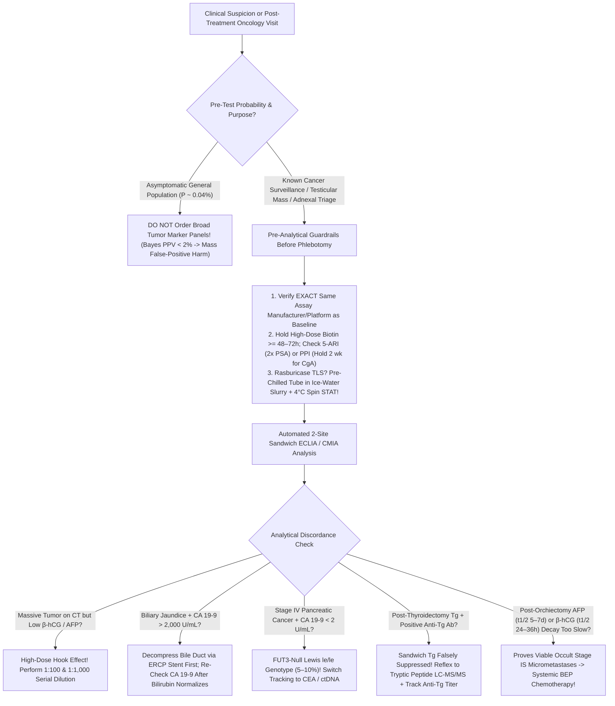
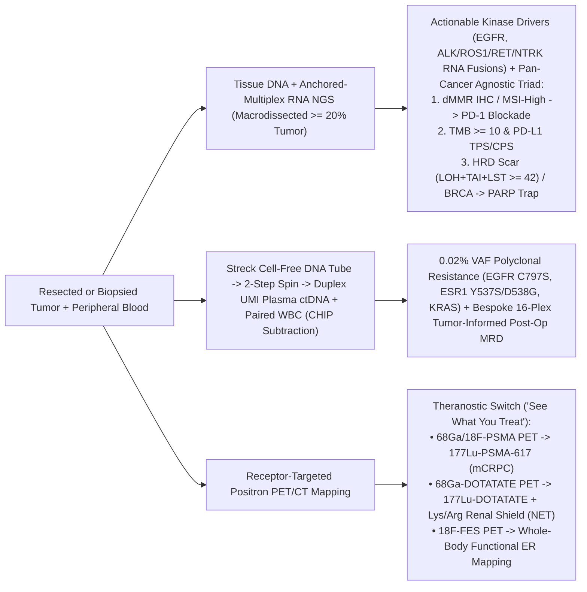

# Basic Medical — Behind the Curtain Clinical Diagnostics Notebook
## Volume IX: Oncology Diagnostics — Serum Tumor Markers, Bone Marrow & `10`-Color Flow Cytometry, Liquid Biopsy `ctDNA`, Molecular `NGS` & Theranostic Staging

> *"To the patient sitting in an oncology infusion suite, cancer monitoring looks deceptively quiet: two gold-top and lavender-top Vacutainers drawn from a mediport, a fifteen-minute posterior iliac crest marrow aspiration, or an outpatient `PET/CT` injection. Behind the laboratory double doors, however, paramagnetic streptavidin beads capture picogram mucin glycoforms via ruthenium electrochemiluminescence, four-laser hydrodynamic flow cytometers interrogate five million living marrow cells at ten thousand events per second to unmask a single `CD45-dim` leukemic blast among a million normal leukocytes, duplex molecular barcodes sequence `145-base-pair` apoptotic circulating tumor DNA fragments down to `0.02%` allele frequency, and `511-keV` positron-emitting `PSMA` ligands map the exact coordinates where `177-Lutetium` beta-electrons will obliterate metastatic castration-resistant prostate cancer."*

---

## Architectural Orientation: The Six Diagnostic Pillars of Modern Precision Oncology

Modern oncology never relies on a single diagnostic lens. Every malignancy is interrogated across an integrated hierarchy of biochemical, cellular, cytogenetic, genomic, cell-free, and molecular-imaging platforms (*DeVita, Hellman, and Rosenberg's Cancer: Principles & Practice of Oncology*, 12th ed.; *NCCN Clinical Practice Guidelines in Oncology*):

| Oncology Diagnostic Platform | Primary Specimen & Pre-Analytical Requirement | Physical / Analytical Detection Engine | Analytical Sensitivity / Resolution | Turnaround Time (`TAT`) | Signature Clinical Superpower & Fatal Blindspot |
| :--- | :--- | :--- | :--- | :--- | :--- |
| **Serum Tumor Marker Immunoassays (`PSA, CEA, CA 19-9, CA-125, AFP, β-hCG, Tg`)** | Serum (`SST` gold-top) or `Li-Heparin`; strict **same-manufacturer serial tracking**; ice-slurry for `Rasburicase` `TLS` | Two-site monoclonal `ECLIA` / `CMIA` sandwich (`620 nm` ruthenium or acridinium flash) or tryptic `LC-MS/MS` (`Tg`) | Picogram-to-nanogram/mL (`10^-12` to `10^-9 g/mL`); reflects whole-body secretory burden | `45–90 min` (`STAT` `TLS` `< 30 min`; `LC-MS/MS Tg` `3–5 days`) | **Post-resection recurrence kinetics & germ-cell staging**; dismal `PPV` for general screening; **hook effect**, `FUT3` `le/le` blindspot, `Anti-Tg` & biotin traps |
| **Bone Marrow Aspirate, Trephine Core & `10–12`-Color Flow Cytometry** | Liquid aspirate (`EDTA` + **preservative-free `Na-Heparin`**) + `>= 1.5–2.0 cm` trephine core (`EDTA` decalcification, *never* `HCl`!) | `4–5` solid-state lasers (`405/488/561/640 nm`), `FSC/SSC`, `CD45` blast gating + tandem fluorochrome spillover matrices | `10^-4` to `10^-5` (`0.01%–0.001%` `MRD` across `1–5 × 10^6` events) | Smear/Flow: **`2–6 hours`** (`APL` emergency `< 2 hr`); Core IHC: `48–72 hr` | Instant lineage (`AML` vs `B-ALL` vs `T-ALL`), `κ:λ` B-cell clonality, and `APL` `DIC` rescue; **"Dry Tap"** in reticulin fibrosis (`PMF`, Hairy Cell) requires core touch-prep |
| **Metaphase `G`-Banding Karyotype, Interphase `FISH` & `IS` `RT-qPCR` / `clonoSEQ`** | Living dividing cells in `Na-Heparin` (`Karyotype`); `FFPE`/smears (`FISH`); `EDTA` RNA/DNA (`RT-qPCR` / `NGS MRD`) | Mitogen + `Colcemid` `20`-cell chromosomal banding; fluorescent `100–200 kb` DNA probes; `V(D)J` deep `NGS` | Karyotype: `5–10 Mb`; `FISH`: `100 kb` (`10^-2`); `RT-qPCR` / `clonoSEQ`: **`10^-6`** (`1` in `1,000,000` cells!) | `STAT PML::RARA FISH`: `4–12 hr`; Routine `FISH`: `24–48 hr`; Karyotype: `5–10 days` | Whole-genome balanced translocations, `CD138`-sorted myeloma `del(17p)`, `CML` `0.1% IS MMR`, and ultra-deep `MRD`-adapted therapy escalation/de-escalation |
| **Comprehensive Tissue `DNA + Anchored-Multiplex RNA` `NGS` (`300–500` Genes)** | `FFPE` tissue block (`>= 20%` macrodissected tumor nuclei; `10%` neutral buffered formalin) + `PD-L1` / `MMR` `IHC` | Hybrid-capture `DNA` sequencing + spliced-transcript `RNA-seq` fusion capture (`Illumina` short-read + bioinformatics) | `2%–5%` somatic Variant Allele Frequency (`VAF`); single-base `SNVs`, `Indels`, `CNVs`, `MSI`, `TMB`, `HRD` | `7–14 days` (Rapid `EGFR/ALK/BRAF` `PCR` cartridge: `2–4 hours`) | Unmasks cryptic intronic `ALK/ROS1/RET/NTRK` fusions missed by `DNA-NGS` + pan-cancer agnostic biomarkers (`MSI-H`, `TMB >= 10`, `HRD >= 42`, `PD-L1 CPS/TPS`) |
| **Liquid Biopsy Cell-Free `ctDNA` (`UMI` Duplex `NGS` & Tumor-Informed `MRD`)** | `2 × 10 mL` whole blood in **`Streck Cell-Free DNA BCT`** (prevents `WBC` genomic `DNA` lysis flood; double-spun plasma) | Duplex **Unique Molecular Identifiers (`UMIs`)** sequencing `~134–166 bp` apoptotic nucleosomal `cfDNA` fragments | **`0.01%–0.05% VAF`** (`1` mutant molecule per `2,000–10,000` wild-type molecules) | `5–10 days` (`Signatera` bespoke design `2–3 wk` initial, `7 d` serial) | Catches polyclonal acquired resistance (`EGFR C797S`, `ESR1`, `KRAS`) & post-op molecular relapse months before `CT`; vulnerable to **`CHIP`** (`DNMT3A/TET2/TP53`) & low-shedding `CNS`/mucinous tumors |
| **Targeted Diagnostic Staging & Molecular Theranostics (`DBT`, `SLNB`, `PSMA` / `DOTATATE` `PET`)** | Breast `3D` tomosynthesis + stereotactic core; `99mTc` + `ICG` dual nodal mapping; `68Ga`/`18F` -> `177Lu` radioligands | `511-keV` coincidence `PET` localization paired directly to `0.498-MeV` (`0.7–2 mm` range) $\beta^-$ particle radiotherapy | Millimeter receptor-avid metastases (`PSA 0.2 ng/mL` sensitivity on `PSMA PET`) | `60–90 min` uptake + `20 min` scan | **"See What You Treat, Treat What You See"** whole-body receptor mapping (`PSMA`, `SSTR2`, `18F-FES ER`) eliminating spatial biopsy heterogeneity |

---

## Dossier 9.1: Serum Tumor Markers Unmasked — Why Doctors Rarely Screen With Them, How Analyzers Measure Them, and Their Classic Analytical Saboteurs

### 1. The Bayesian Screening Paradox & The Sacred Law of Manufacturer Non-Interchangeability

#### A. Why a "98% Specific" Blood Cancer Test Fails Catastrophically as a General Screening Tool
Patients routinely ask a completely logical question during annual physicals: *"Doctor, why don't you just check every cancer blood marker—`CEA`, `CA-125`, `CA 19-9`, `CA 15-3`—on my yearly routine panel so we catch anything early?"*

The answer is pure mathematical probability governed by **Bayes' Theorem**. The clinical usefulness of a positive screening test is not its laboratory specificity, but its **Positive Predictive Value (`PPV`)**—the probability that an asymptomatic person with a flagged abnormal result actually harbors an occult malignancy, given disease prevalence $P$ in that population:

$$\text{PPV} = \frac{\text{Sensitivity} \times P}{(\text{Sensitivity} \times P) + (1 - \text{Specificity}) \times (1 - P)}$$

Watch what happens behind the curtain when we run a seemingly impressive tumor marker—say **`CA-125`** with an optimistic **`85%` sensitivity** and **`98.0%` specificity** (`2%` false-positive rate)—across **100,000 asymptomatic postmenopausal women**, where the true point prevalence of undiagnosed ovarian carcinoma is roughly **`1 in 2,500` ($P = 0.0004$, or `40` true cancers among `100,000` women)**:

* **True Positives (`TP`)**: $0.85 \times 40 = \mathbf{34}$ women with true ovarian cancer correctly flagged.
* **False Negatives (`FN`)**: $40 - 34 = \mathbf{6}$ early-stage Stage I cancers missed anyway (because `~20–50%` of Stage I epithelial ovarian cancers do not yet elevate serum `CA-125` above `35 U/mL`!).
* **False Positives (`FP`)**: $(1 - 0.98) \times 99,960 = \mathbf{1,999}$ completely cancer-free women flagged as "ABNORMAL CANCER MARKER"!

$$\text{PPV} = \frac{34}{34 + 1,999} = \frac{34}{2,033} \approx \mathbf{1.67\%}$$

Read that number twice: **`98.3%` of every positive screening result is a false alarm!** Nearly **two thousand healthy women** per `100,000` screened are subjected to months of existential terror, transvaginal ultrasounds, pelvic `MRIs`, and diagnostic laparoscopies or oophorectomies carrying real surgical complications—which is precisely why the `UKCTOCS` (`202,638` women) and `PLCO` (`78,216` women) randomized trials proved that general-population `CA-125` + ultrasound screening **fails to reduce ovarian cancer mortality** (*USPSTF Grade D recommendation against screening*).

Now flip the pre-test probability $P$ into the **three scenarios where serum tumor markers become clinical gold**:
1. **Post-Resection Recurrence Kinetics (`R0` Curative Surgery)**: A patient had a `CEA`-producing Stage III colon adenocarcinoma resected, and post-op `CEA` dropped from `42.0 ng/mL` to `1.1 ng/mL`. Eighteen months later, serial `CEA` climbs from `1.1 -> 3.8 -> 9.4 -> 19.2 ng/mL`. Here pre-test probability of recurrence is high, the patient serves as their *own biological baseline*, and exponentially rising kinetics trigger a liver `MRI` + `PET/CT` that catches a solitary resectable hepatic metastasis!
2. **Metastatic Systemic Treatment Monitoring**: In inoperable metastatic pancreatic, colorectal, ovarian, or `PSA`-secreting prostate cancer, serial marker velocity tracks whole-body clonogenic tumor kill (`>= 50%` drop) weeks before anatomic shrinkage crosses `RECIST 1.1` (`>= 30%` diameter decrease) on `CT`, sparing patients ineffective toxic chemotherapy.
3. **High-Probability Diagnostic Triage & TNM Staging**: In a 26-year-old man presenting with a rock-hard intratesticular mass ($P > 80\%$) or a cirrhotic patient with an arterial-enhancing `LI-RADS` liver nodule, `AFP` and `β-hCG` yield **`> 95% PPV`**—and in testicular cancer alone, post-orchiectomy `AFP`, `β-hCG`, and `LDH` are formally built directly into **`AJCC` `TNMS` Stage Grouping (`S0–S3`)**!

---

#### B. Behind the Curtain of the Automated Immunoassay Analyzer — And Why Switching Labs Breaks Longitudinal Curves
When a gold-top Serum Separator Tube (`SST`) arrives on the automated core-laboratory track for `CEA`, `CA-125`, `CA 19-9`, `PSA`, or `AFP`, no human pipettes the sample. Inside a high-throughput immunochemistry module (such as a **Roche cobas e801** using Electrochemiluminescence Immunoassay [`ECLIA`] or an **Abbott Alinity i** using Chemiluminescent Microparticle Immunoassay [`CMIA`]), a robotic probe aspirates `10–50 µL` of spun serum into a `37°C` reaction cuvette for an **18-minute two-site non-competitive ("sandwich") immunometric reaction**:

1. **Dual Monoclonal Epitope Capture (`9 min` Incubation)**: The analyzer dispenses two distinct murine or chimeric monoclonal antibodies engineered against *non-overlapping steric epitopes* on the target tumor glycoprotein:
   * **Capture Antibody (`Ab1`)**: Covalently conjugated to **Biotin** (on Roche/Siemens platforms) or directly coated onto paramagnetic microparticles (on Abbott).
   * **Tracer/Signal Antibody (`Ab2`)**: Covalently labeled with a Tris(2,2'-bipyridyl)ruthenium(II) complex (**$[\text{Ru(bpy)}_3]^{2+}$**) for `ECLIA`, or an **Acridinium Ester** for `CMIA`.
   If tumor antigen (`Ag`) is present, a trimolecular soluble complex forms: **`Biotin-Ab1 — [Tumor Antigen] — Ab2-Ru2+`**.
2. **Paramagnetic Bead Capture & Unbound Wash (`9 min` Incubation)**: **Streptavidin-coated superparamagnetic iron-oxide microparticles** are injected. Because the **Streptavidin–Biotin non-covalent bond** ($K_d \approx 10^{-15}\text{ M}$) is the strongest biological interaction in nature, every sandwich locks instantaneously onto the magnetic beads. An electromagnet pulls the beads tightly against a platinum working electrode while wash buffer flushes away `99.999%` of unbound serum proteins, bilirubin, and excess free `Ab2-Ru2+` tracer.
3. **Photon Counting**: Tripropylamine (`TPA`) buffer floods the electrode, and a precise electrical voltage (`~1.2 V`) oxidizes both `TPA` and $[\text{Ru(bpy)}_3]^{2+}$. Electron transfer creates an excited $[\text{Ru(bpy)}_3]^{2+*}$ state that relaxes back to ground state by emitting an orange-red **`620 nm` photon** counted by a photomultiplier tube (`PMT`). In non-competitive sandwich format, **light intensity (`RLU`) is directly proportional to tumor marker concentration** across `4–5` orders of magnitude.

> [!WARNING]
> **The Four Analytical Traps Every Oncologist and Clinical Chemist Must Guard Against**:
> 1. **Sacred Rule of Assay Manufacturer Non-Interchangeability**: Unlike `Sodium` or `Glucose` (which are small, chemically identical molecules traceable to `NIST` isotope-dilution mass spectrometry), mucin glycoproteins like `CA-125`, `CA 19-9`, `CA 15-3`, and `CEA` exist in patient serum as **heterogeneous post-translationally glycosylated isoforms**. Manufacturer A's monoclonal antibody pair recognizes sialylated epitope cluster X, whereas Manufacturer B's pair binds peptide backbone Y! Sending a patient's Cycle 1–3 blood to Hospital Lab A (Roche `ECLIA`: `CA-125 = 68 U/mL`) and Cycle 4 blood to Outpatient Quest/Labcorp Lab B (Siemens/Beckman: `CA-125 = 104 U/mL`) creates a **spurious `+53%` jump** with **zero change in actual tumor burden**! Every lab report is mandated by `CAP` to print the exact assay manufacturer and methodology; if a lab changes analyzers, both methods must be run **in parallel on the same specimen** to establish a **new baseline**.
> 2. **The High-Dose "Hook Effect" (Prozone Phenomenon)**: Suppose a 24-year-old presents with cannonball lung metastases from **choriocarcinoma** (`β-hCG = 2,400,000 mIU/mL`) or a child presents with giant **hepatoblastoma** (`AFP = 900,000 ng/mL`) in a **one-step simultaneous** sandwich assay. Millions of excess free antigen molecules independently saturate `100%` of `Biotin-Ab1` *and* `100%` of `Ab2-Ru2+` separately, sterically preventing a single `Ab1–Ag–Ab2` bridge from forming! After the wash step, free `Ag–Ab2-Ru2+` washes down the drain, and the analyzer paradoxically prints **`β-hCG = 42 mIU/mL`**! Whenever clinical imaging screams massive trophoblastic/hepatocellular tumor burden yet the marker looks bizarrely modest, call the chemistry lab immediately for **`1:100` and `1:1,000` serial dilutions**—the diluted value will suddenly rocket upward to `2,400,000 mIU/mL`!
> 3. **Mega-Dose Over-the-Counter Biotin (`Vitamin B7`, `5,000–10,000 µg/day` "Hair, Skin & Nails")**: In streptavidin-biotin `ECLIA` sandwiches, massive free serum biotin floods all binding pockets on the streptavidin magnetic beads, blocking the `Biotin-Ab1–Ag–Ab2` tumor-marker sandwich from attaching! Result: **catastrophic false-LOW / false-negative `PSA`, `Thyroglobulin`, `CA-125`, `CEA`, and `CA 19-9`**—hiding a real cancer relapse! (Hold high-dose biotin for **`48–72 hours`** prior to phlebotomy, or `>= 5 days` in `ESRD`).
> 4. **Heterophile / Human Anti-Mouse Antibodies (`HAMA`)**: Patients exposed to mouse antigens, therapeutic chimeric antibodies, or rheumatoid factor possess endogenous IgG/IgM that directly cross-link murine `Ab1` directly to murine `Ab2` *even with zero tumor antigen in the blood*! Classic clinical signature: a surgically cured Stage I testicular or gestational trophoblastic patient has persistent **`"phantom β-hCG" = 35–120 mIU/mL`** receiving unnecessary chemotherapy—unmasked in 10 minutes because **heterophile `IgG` (`150 kDa`) cannot cross the glomerulus (`urine β-hCG = ZERO`!)** and fails to dilute linearly after heterophile-blocking-tube (`HBT`) incubation!

---

### 2. `PSA` Biophysics, Free-to-Total Partitioning, `PHI`/`4Kscore` & the `PI-RADS` MRI-TRUS Fusion Pathway

#### A. Why Malignant Prostate Acini Produce *LOW* `% Free PSA` While Benign `BPH` Produces *HIGH* `% Free PSA`
**Prostate-Specific Antigen (`PSA`, human kallikrein-3 / `KLK3`)** is *organ-specific, not cancer-specific*. Synthesized by normal, hyperplastic, and malignant prostatic luminal epithelial cells under androgen-receptor (`DHT`) transcriptional control, `PSA` is a `30–33 kDa` chymotrypsin-like serine protease secreted into prostatic ducts at massive concentrations (**`0.5 to 2.0 mg/mL`—one million times higher than normal serum `< 4.0 ng/mL`!**) to cleave **semenogelin I & II** and liquefy the seminal coagulum after ejaculation.

In a healthy young prostate, an architectural fortress—an intact inner **basal cell layer** (`p63+`, high-molecular-weight cytokeratin `34βE12+`), tight intercellular junctions, an intact basement membrane, and intervening fibromuscular stroma—prevents luminal `PSA` from escaping into capillary blood. Why, then, does **percent Free `PSA` (`%fPSA = [Free PSA / Total PSA] × 100`)** separate prostate cancer from Benign Prostatic Hyperplasia (`BPH`) inside the notorious **`Total PSA = 4.0–10.0 ng/mL` diagnostic gray zone** (where routine biopsy finds cancer only `~25%` of the time)?

* **In Benign Prostatic Hyperplasia (`BPH` — High `% Free PSA > 25%`)**: Transitional-zone glandular hyperplasia retains its intact basal layer and ductal polarity. `PSA` first enters hyperplastic glandular lumens, where prolonged stagnation subjects `PSA` zymogens to internal endoproteolytic "nicking" (creating catalytically *inactive* isoforms like `BPSA` and nicked `iPSA`) before slowly diffusing across stretched lymphatics into systemic veins. Because these internally nicked `PSA` molecules have a **dead catalytic pocket**, circulating hepatic protease inhibitors **cannot bind them**—so they float freely in plasma as unbound **Free `PSA` (`%fPSA > 25%` -> `< 8%` probability of prostate cancer!)**.
* **In Prostate Adenocarcinoma (`PCa` — Low `% Free PSA < 10%`)**: Malignant acinar proliferation is histologically defined by **complete loss of the basal cell layer** and invasion directly through the basement membrane onto periacinar capillaries! Catalytically *intact, active* `PSA` (alongside truncated leader-peptide **`[-2]proPSA`**) is secreted directly across endothelial walls into blood without ever seeing luminal proteases. The instant enzymatically active `PSA` hits plasma, `1,000-fold` molar excess hepatic serpins—chiefly **`α1-Antichymotrypsin (ACT)` (`~70–85%` of total serum `PSA`)** and **`α2-Macroglobulin (A2M)`** (which completely cages `PSA` inside a "venus-flytrap" shell, hiding it even from immunoassays!)—attack `PSA`'s active serine site and lock it covalently into **`90-kDa` Complexed `PSA (PSA-ACT)`**! Consequently, unbound Free `PSA` plummets: **`%fPSA < 10%` carries a `> 50–56%` probability of adenocarcinoma on biopsy!**

#### B. Next-Generation Kallikrein Math, `PSA` Density, Pharmacologic Doubling & `PI-RADS` Targeted Biopsy
To prevent millions of men from undergoing blind transrectal biopsies that find clinically harmless **Gleason `3+3=6` (`ISUP` Grade Group 1)** microfoci while missing anterior apex lethal cancers, modern urologic oncology layers precision math onto multiparametric `MRI` (*NCCN Prostate Cancer Early Detection Guidelines*):

1. **The `5α`-Reductase Inhibitor (`5-ARI`) `2×` Doubling Rule**:
   Men taking **Finasteride** (`Proscar` `5 mg` for `BPH` or `Propecia` `1 mg` for androgenetic alopecia!) or **Dutasteride** (`Avodart`) block steroid $5\alpha\text{-reductase}$, halting intracellular conversion of Testosterone into potent **Dihydrotestosterone (`DHT`)**. After **`>= 6–12 months`** of continuous therapy, glandular atrophy slashes total serum `PSA` by **`~50%`**.
   * **Bedside Correction**: You **MUST multiply the lab-reported `PSA` by `2.0`** (a `PSA` of `2.6 ng/mL` on dutasteride is biologically **`5.2 ng/mL`**!). Even more critically, if `PSA` rises by **`>= 0.3 ng/mL` above its on-treatment nadir** while adherent to a `5-ARI`, benign `BPH` has already been suppressed—elevating suspicion specifically for **high-grade (`Grade Group >= 3`) prostate cancer**!
2. **Pre-Analytical Physiologic Elevations to Exclude Before Ordering `MRI`/Biopsy**:
   * **Acute Bacterial Prostatitis / `UTI`**: Neutrophilic disruption of acinar barriers spikes `PSA` to `15–50+ ng/mL`; repeat `PSA` **`6–8 weeks` after completing antibiotics** (do *not* give empiric antibiotics to asymptomatic men just to "see if `PSA` drops"!).
   * **Ejaculation (`+0.8 ng/mL` transient rise)** & **Vigorous Bicycle Riding / Saddle Pressure**: Enforce **`48–72 hours` abstinence** from ejaculation and cycling before redrawing a borderline `PSA`.
   * **Acute Urinary Retention, Traumatic Foley Catheterization, Cystoscopy, or Prostate Biopsy**: Wait **`3–6 weeks`** post-biopsy/instrumentation before measuring baseline `PSA`. *(Note: A routine outpatient **Digital Rectal Exam [`DRE`]** raises `PSA` by only `0.1–0.2 ng/mL`—clinically negligible unless sitting right on a `3.9 ng/mL` cutoff).*
3. **Second-Tier Reflex Biomarkers (`PSAD`, `PHI`, `4Kscore`)**:
   * **`PSA` Density (`PSAD`)**: Divides serum Total `PSA` by `MRI`-planimetered prostate volume ($\text{cm}^3$, approximated via prolate ellipsoid $\text{Length} \times \text{Width} \times \text{Height} \times 0.52$):
     $$\text{PSAD} = \frac{\text{Total Serum PSA (ng/mL)}}{\text{Prostate Volume (cm}^3\text{)}}$$
     A `PSA` of `6.5 ng/mL` inside a massive `90 cm³` `BPH` gland gives `PSAD = 0.072 ng/mL/cm³` (reassuringly benign **`< 0.15`**), whereas `6.5 ng/mL` inside a small `25 cm³` gland yields **`PSAD = 0.26 ng/mL/cm³`** (high cancer suspicion!).
   * **Prostate Health Index (`PHI`)**: Combines tumor-enriched **`[-2]proPSA`** (`p2PSA`, cleaved poorly in malignant cells lacking luminal processing), `Free PSA`, and `Total PSA` into one `FDA`-approved formula:
     $$\text{PHI} = \left(\frac{\text{[-2]proPSA (pg/mL)}}{\text{Free PSA (ng/mL)}}\right) \times \sqrt{\text{Total PSA (ng/mL)}}$$
     (`PHI >= 36–55` strongly enriches for clinically significant **Grade Group `>= 2` [`Gleason >= 3+4=7`]** cancer; similarly, the **`4Kscore`** combines `tPSA, fPSA, intact PSA,` and **`human kallikrein-2 [hK2]`** with age/DRE/prior biopsy to report an exact `%` risk of Grade Group `>= 2` cancer).
4. **Multiparametric `3.0-Tesla` Prostate `MRI` (`mpMRI`, `PI-RADS v2.1`) -> `MRI-TRUS` Targeted Fusion Biopsy**:
   Before sticking a needle into the prostate (`PROMIS` and `PRECISION` NEJM landmark trials), an `mpMRI` evaluates the **Peripheral Zone** (`75%` of cancers — scored primarily on **Diffusion-Weighted Imaging [`DWI`] / `ADC` map** showing dark restricted Brownian water motion inside hypercellular malignant acini!) and the **Transition Zone** (`20–25%` of cancers — scored primarily on high-resolution **`T2`-weighted** "erased charcoal" lenticular margins). Lesions scored **`PI-RADS 4` (high probability) or `PI-RADS 5` (`>= 1.5 cm` or extraprostatic extension, very high probability)** have their `3D` `MRI` contours digitally co-registered in real time onto live transrectal or transperineal ultrasound (**`MRI-TRUS` Fusion Biopsy**), guiding spring-loaded `18-gauge` biopsy needles directly into the millimeter core of aggressive tumors!
5. **Post-Treatment Ultrasensitive `PSA` Kinetics**:
   * **After Radical Prostatectomy**: Because every benign and malignant prostate cell was surgically excised and `tPSA` half-life is `~2.2–3.2 days`, serum `PSA` **must plummet to undetectable (`< 0.01–0.02 ng/mL`) within `4–6 weeks`**. Two consecutive rises reaching **`>= 0.2 ng/mL`** define **Biochemical Recurrence (`BCR`)** (`AUA` criteria; though salvage pelvic radiation + `PSMA PET` now routinely trigger as early as `0.1–0.2 ng/mL`!).
   * **After Definitive Radiation Therapy (`EBRT` / Brachytherapy)**: Benign radiated prostate stroma remains in situ and slowly fibroses over `18–36 months` (`PSA` bounce at `12–18 mo` is benign!). Therefore, radiation recurrence uses the **Phoenix Definition**: **`Post-RT PSA Nadir + 2.0 ng/mL`**.

---

### 3. Mucin & Oncofetal Workhorses: The `CA 19-9` `FUT3` Genetic Blindspot, `CEA`, and `CA-125` / `HE4` (`ROMA`)

#### A. `CA 19-9` (`Sialyl-Lewis^a`): The `5–10%` `FUT3` Null-Phenotype Trap vs. Benign Stone Spikes to `10,000 U/mL`
Ordered to track resectability, neoadjuvant `FOLFIRINOX` response, and post-Whipple recurrence in **Pancreatic Ductal Adenocarcinoma (`PDAC`)** and **Cholangiocarcinoma**, **`CA 19-9`** is *not a protein*—it is a tetrasaccharide carbohydrate blood-group antigen (**$\text{Sialyl-Lewis}^a$**: $\text{Neu5Ac}\alpha 2\text{-}3\text{Gal}\beta 1\text{-}3[\text{Fuc}\alpha 1\text{-}4]\text{GlcNAc}$) attached onto circulating high-molecular-weight mucins.

Two diametrically opposite traps ambush clinicians who treat `CA 19-9` (`normal < 37 U/mL`) as a simple linear cancer meter:

1. **THE CLASSIC GENETIC FALSE-NEGATIVE TRAP — Lewis-Negative (`le/le`, `FUT3`-Null) Patients**:
   Look closely at the final enzymatic step required to synthesize `CA 19-9`: adding an $\alpha\text{-}1,4\text{-fucose}$ sugar onto the sialylated Type-1 precursor chain (`DUPAN-2`) requires the enzyme **$\alpha(1,3/1,4)\text{-fucosyltransferase}$**, encoded by the **Lewis blood-group gene (`FUT3`)** on chromosome `19p13.3`.
   * **`5% to 10%` of Caucasian/Asian individuals and up to `20–22%` of African-ancestry individuals** inherit homozygous loss-of-function alleles (**`le/le` genotype -> red blood cell phenotype $\text{Le}(a-b-)$**)!
   * These patients **physically lack the enzyme required to manufacture `CA 19-9` anywhere in their body**! Even when a `FUT3`-null patient presents with a `6-cm` pancreatic head cancer and twenty hepatic metastases, their automated `CA 19-9` assay prints **`< 2.0 U/mL` (or `< 1 U/mL`)**!
   * *Behind-the-Curtain Solution*: Whenever a biopsy-proven pancreaticobiliary cancer reads `CA 19-9 < 2 U/mL`, `CA 19-9` is permanently useless for monitoring that patient (confirmable via `RBC` Lewis $\text{Le}(a-b-)$ phenotyping); pivot longitudinal tracking immediately to **`CEA`**, **`CA-125`**, or cell-free **`KRAS` `ctDNA`**!
2. **THE BENIGN OBSTRUCTIVE BILIARY SPIKE TRAP**:
   Normal biliary epithelial cells (cholangiocytes) constitutively secrete `CA 19-9` into bile (`> 10,000 U/mL` inside the bile duct lumen!). When a **benign common bile duct gallstone (`choledocholithiasis`)**, ascending **cholangitis**, or benign inflammatory stricture corks the ampulla of Vater, intrabiliary hydrostatic pressure surges:
   * Stretched, inflamed cholangiocytes upregulate mucin synthesis `10-fold`, tight junctions burst open, and bile regurgitates directly into hepatic sinusoids—while hepatic Kupffer-cell clearance of circulating sialomucins simultaneously stalls!
   * Result: A completely **cancer-free gallstone patient routinely presents with `CA 19-9 = 2,500 to 25,000 U/mL`**!
   * **Mandatory Clinical Rule**: **NEVER interpret `CA 19-9` to declare pancreatic cancer unresectable while Total Bilirubin exceeds `2–3 mg/dL`!** Decompress the biliary tree via `ERCP` plastic/metal stenting first, wait **`2–3 weeks`** for bilirubin to normalize, and *re-measure `CA 19-9`*: a benign stone drops precipitously back toward `< 37 U/mL`, whereas persistent elevation (`> 500–1,000 U/mL`) in an unjaundiced `FUT3`-competent patient genuinely signals high occult metastatic risk (`NCCN Pancreatic Adenocarcinoma Guidelines`).

#### B. `CEA` (`CEACAM5`), `CA-125` (`MUC16`) + `HE4` (`ROMA`), and `CA 15-3` / `CA 27.29`
* **Carcinoembryonic Antigen (`CEA`)**: A `180–200 kDa` glycophosphatidylinositol (`GPI`)-anchored cell-adhesion glycoprotein normally expressed exclusively in fetal gut endoderm, reactivated in `~70–80%` of colorectal, gastric, pancreatic, lung (`NSCLC`), breast, and medullary thyroid carcinomas.
  * *Primary Role*: Post-resection Stage II/III **Colorectal Cancer surveillance** (`q3–6 months` for `5 years` per `NCCN`/`ASCO`) to detect curable oligometastatic hepatic or pulmonary relapse.
  * *Classic Confounders*: **Active cigarette smoking** irritates bronchial/gastrointestinal mucosa, raising the upper reference limit from **`< 2.5–3.0 ng/mL` (non-smokers)** up to **`5.0–10.0 ng/mL` (heavy smokers)**! Benign elevations (`3–10 ng/mL`) also occur in ulcerative colitis flare, alcoholic cirrhosis (impaired hepatic asialoglycoprotein-receptor clearance!), peptic ulcer disease, chronic bronchitis, and overt hypothyroidism. Furthermore, **`4–8 weeks` after starting effective `FOLFOX` chemotherapy**, massive apoptosis of liver metastases dumps stored intracellular `CEA` into blood—causing a transient **`15–30%` "Chemotherapy Surge/Flare"** that precedes radiographic tumor shrinkage!
* **`CA-125` (`MUC16`) & Human Epididymis Protein 4 (`HE4` / `WFDC2`) — The `ROMA` Score**:
  `CA-125` is a giant (`> 2,000 kDa`) transmembrane mucin expressed not by normal ovarian surface epithelium, but by **all embryonic coelomic mesothelium** (pleura, pericardium, peritoneum) and Müllerian duct derivatives (endocervix, endometrium, fallopian tube).
  * *Why `CA-125` Lies Constantly in Premenopausal Women and Cirrhotics*: Any physical stretch or inflammation of the peritoneal or pleural mesothelium pours `CA-125` into blood! Normal **menses (`CA-125 = 50–120 U/mL`)**, first-trimester **pregnancy**, **endometriosis / endometrioma (`100–500 U/mL`)**, uterine **leiomyomas**, pelvic inflammatory disease (`PID`), congestive heart failure pleural effusions, peritoneal tuberculosis, and **decompensated liver cirrhosis with ascites** (where biological males with zero ovarian tissue routinely post **`CA-125 = 400–1,800 U/mL`**!) all cause dramatic false positives.
  * *The `HE4` Rescue*: **`HE4`** (`25 kDa` whey acidic four-disulfide core protein overexpressed in serous/endometrioid ovarian carcinoma) is **NOT elevated by benign endometriosis or menstruation** (note: `HE4` *is* renally cleared, so **`CKD` / elevated creatinine falsely elevates `HE4`**!). Combining `CA-125` + `HE4` + menopausal status inside the logarithmic **Risk of Ovarian Malignancy Algorithm (`ROMA`)** accurately triages complex pelvic adnexal masses to a specialized Gynecologic Oncologist before surgery.
* **`CA 15-3` & `CA 27.29` (`MUC1` Tandem-Repeat Epitopes)**: Measure overlapping soluble epitopes of polymorphic epithelial mucin (`MUC1`) in **Metastatic (`Stage IV`) Breast Cancer** (`ER+/HER2-` bone-predominant disease where `RECIST` bone scans cannot measure millimeter shrinkage). Per **`ASCO` Choosing Wisely**, ordering `CA 15-3` or `CA 27.29` in asymptomatic post-mastectomy Stage I–III breast cancer survivors is **strictly discouraged**—randomized trials proved lead-time anxiety and false positives with *zero improvement in overall survival*.

---

### 4. The Germ-Cell & Hepatobiliary Triad (`AFP`, `β-hCG`, `LDH`): First-Order Decay Kinetics That Dictate Chemotherapy

In **Testicular Germ Cell Tumors (`GCTs`)**, serum tumor markers achieve their pinnacle of diagnostic precision—drawn **BEFORE radical inguinal orchiectomy** (never transscrotal biopsy, which seeds inguinal lymphatics!) and then tracked serially **AFTER orchiectomy** to prove whether invisible retroperitoneal or pulmonary micrometastases exist (*AJCC 8th Edition Staging*):

$$C(t) = C_{\text{pre-op}} \cdot \left(\frac{1}{2}\right)^{\!\frac{t}{t_{1/2}}} \implies t_{1/2\text{, observed}} = \frac{\Delta t \cdot \ln(2)}{\ln(C_1 / C_2)}$$

1. **Alpha-Fetoprotein (`AFP`, `70 kDa` Fetal Albumin Homolog — Exact $t_{1/2} = \mathbf{5\text{ to }7\text{ Days}}$)**:
   * Synthesized normally by fetal yolk sac and fetal liver (`peaks at 13–16 weeks gestation`, falling to adult `< 8–10 ng/mL` by age `12 months`).
   * **Germ-Cell Lineage Rule**: Secreted robustly by **Yolk Sac Tumor (Endodermal Sinus Tumor)** and **Embryonal Carcinoma** (and immature teratoma). **PURE SEMINOMA AND PURE CHORIOCARCINOMA NEVER SYNTHESIZE `AFP` (`0%`)!**
   * *Life-Saving Pathology Override*: Suppose histopathology of an excised testis reports *"100% Pure Classic Seminoma,"* yet pre-op serum `AFP` is **`94 ng/mL`**. Because pure seminoma is transcriptionally incapable of expressing the `AFP` gene, an unsampled microscopic focus of yolk-sac/embryonal carcinoma was missed in tissue sectioning—and the oncologist **MUST classify and treat the patient as a Non-Seminomatous Germ Cell Tumor (`NSGCT`)**! *(Rare benign confounders to exclude before giving `BEP` chemo when `AFP` stays stably `15–40 ng/mL` without rising: **Hereditary Persistence of `AFP`** [autosomal dominant `HNF1` promoter variant], active viral hepatitis/cirrhotic hepatocyte regeneration, and **Ataxia-Telangiectasia [`ATM`]**).*
   * **Hepatocellular Carcinoma (`HCC`) & the `GALAD` Score**: In cirrhotic `HCC` `q6-month` ultrasound surveillance, `30–40%` of early `< 2 cm` `HCCs` have normal total `AFP`. Labs therefore fractionate **`AFP-L3%`** (the *Lens culinaris* agglutinin-reactive $\alpha 1\text{-}6$ core-fucosylated glycoform produced specifically by malignant hepatocytes via `FUT8`; **`AFP-L3% >= 10%`** flags `HCC`!) alongside **`DCP` (`Des-gamma-carboxy prothrombin` / `PIVKA-II`)**, an abnormal prothrombin lacking vitamin-K-dependent $\gamma$-carboxylation of glutamic acid residues (`GALAD` = Gender, Age, `AFP-L3%`, `AFP`, `DCP`).
2. **Human Chorionic Gonadotropin (`β-hCG`, `36.7 kDa` Heterodimer — Exact $t_{1/2} = \mathbf{24\text{ to }36\text{ Hours}}$)**:
   * Shares an identical `92-amino-acid` **$\alpha$-subunit** with pituitary `LH`, `FSH`, and `TSH`, while its unique `145-amino-acid` **$\beta$-subunit** confers biologic specificity (oncology assays *must* measure **Total `β-hCG` [intact dimer + free $\beta$-subunit]**, because aggressive germ-cell and bladder/trophoblastic tumors often hypersecrete uncoupled **free $\beta$-subunits** that pregnancy-only intact-dimer kits miss!).
   * **Lineage Rule**: Driven to stratospheric levels (**`50,000 to > 1,000,000 mIU/mL`**) by **Choriocarcinoma** (malignant syncytiotrophoblasts + cytotrophoblasts; at `> 100,000 mIU/mL`, cross-activation of thyroid `TSH` receptors triggers **paraneoplastic thyrotoxicosis** and diffuse alveolar hemorrhage!). Pure **Seminoma** *can* contain scattered syncytiotrophoblastic giant cells in `15–20%` of cases, producing modest `β-hCG` elevations (typically `< 500–1,000 mIU/mL`).
   * *Post-Orchiectomy Pituitary Trap*: Bilateral orchiectomy + chemotherapy induces primary hypogonadism -> pituitary `LH` surges -> `1–2%` pituitary co-secretion of sulfated `hCG` or `LH` assay cross-reactivity produces a mild `β-hCG = 4–12 mIU/mL`. Giving `1` intramuscular injection of **Testosterone (`200 mg`)** suppresses pituitary `LH/hCG` to `< 1 mIU/mL` within `7–14 days` if benign, sparing the cured patient salvage chemotherapy!
3. **Kinetic Proof of Occult Metastasis**:
   Suppose pre-orchiectomy `AFP` is **`640 ng/mL`** and `CT` Chest/Abdomen/Pelvis shows **zero enlarged lymph nodes (`cN0M0`)**. After clean orchiectomy on Day 0, if `100%` of tumor lived inside the excised testis, `AFP` ($t_{1/2} \le 7\text{ days}$) *must* decay along: Day 7 $\le 320$, Day 14 $\le 160$, Day 21 $\le 80$, Day 28 $\le 40\text{ ng/mL}$. If Day 21 `AFP` reads **`240 ng/mL`** (observed $t_{1/2} = 14.8\text{ days}$) or rebounds to `290 ng/mL`, **living retroperitoneal/lung micrometastases are actively manufacturing new `AFP` (`Stage IS`)**, mandating full systemic `BEP` (`Bleomycin, Etoposide, Cisplatin`) chemotherapy immediately!
4. **Lactate Dehydrogenase (`LDH`)**: Reflects rapid cellular turnover and `12p` (`LDHB` gene on isochromosome `i(12p)`!) amplification across seminomas, `NSGCTs`, and aggressive **Burkitt / Diffuse Large B-Cell Lymphomas** (`IPI` Prognostic Index). *(Pre-analytical trap: `RBCs` contain **`150×` more `LDH` than serum**—even mild traumatic phlebotomy hemolysis ruins `LDH`!)*

---

### 5. Endocrine/Neuroendocrine Traps & The `Rasburicase` Ice-Slurry Emergency (`TLS`)

#### A. Thyroid Oncology: `Calcitonin` (`MTC`) & Why `Anti-Tg` Forces Mass-Spectrometry `Thyroglobulin`
* **Medullary Thyroid Carcinoma (`MTC` — Neuroendocrine Parafollicular `C`-Cells, `RET` Proto-Oncogene)**: Secretes **`Calcitonin`** (drawn fasting into a chilled tube; `Calcitonin > 100 pg/mL` is virtually diagnostic of `MTC`, and **`> 500 pg/mL`** mandates staging liver `MRI` + neck/chest `CT` for distant metastases before neck dissection!) alongside **`CEA`**. Post-thyroidectomy **Calcitonin & `CEA` Doubling Times (`< 6 months` vs `> 24 months`)** are the single strongest predictors of `MTC` survival; if `CEA` rises rapidly while `Calcitonin` plateaus, the `MTC` clone is **dedifferentiating** into an aggressive poorly differentiated neuroendocrine phenotype!
* **Differentiated Papillary & Follicular Thyroid Cancer (`DTC` — Follicular Cells): The `Thyroglobulin` + `Anti-Tg` Rule**:
  After total thyroidectomy + `131I` radioactive iodine ablation, `0` normal thyroid tissue remains—so **Serum Thyroglobulin (`Tg`, `660 kDa` iodinated prohormone scaffold)** should read **`< 0.1–0.2 ng/mL`** (under `TSH` suppression or rhTSH `Thyrogen` stimulation).
  * **THE `25%` AUTOANTIBODY BLINDSPOT**: Roughly **`20% to 25%` of papillary thyroid cancer patients** (often with coexisting Hashimoto lymphocytic thyroiditis) harbor circulating endogenous **Anti-Thyroglobulin Autoantibodies (`Anti-Tg Ab`)**!
  * Inside an automated **immunometric sandwich `Tg` assay**, patient `Anti-Tg` IgG binds directly onto circulating tumor `Tg` and **sterically blocks** the analyzer's `Biotin-Ab1` and `Ab2-Ru2+` antibodies from forming a sandwich—producing a **catastrophic FALSE-LOW / UNDETECTABLE `Tg < 0.1 ng/mL` while pulmonary metastases are actively growing!** *(Conversely, in older competitive radioimmunoassays [`RIA`], `Anti-Tg` sequesters radiolabeled tracer and causes false-highs).*
  * **Behind the Mass-Spectrometry Bench (`LC-MS/MS` Tryptic Peptide Rescue)**: Every single `Tg` order **automatically co-runs a quantitative `Anti-Tg Ab` immunoassay** before releasing `Tg`. If `Anti-Tg` is positive (`even 1 IU/mL` above cutoff):
    1. First, serial `Anti-Tg` antibody titers themselves act as a surrogate tumor marker (falling `Anti-Tg` = remission; rising `Anti-Tg` = persistent/recurrent antigen stimulation!).
    2. Second, the lab reflexes serum to **Liquid Chromatography–Tandem Mass Spectrometry (`LC-MS/MS`) Thyroglobulin**: the technologist adds **trypsin protease**, which indiscriminately chops *both* `660-kDa` `Tg` *and* all interfering `150-kDa` `Anti-Tg` antibodies into tiny `8–15` amino-acid peptides, completely destroying the antibody blockade! Anti-peptide beads then enrich a unique signature `Tg` peptide (`VIFDANAPVAVR`, spiked with a $^{13}\text{C}/^{15}\text{N}$ heavy-isotope internal standard) for triple-quadrupole quantification free of `Anti-Tg` interference!

#### B. Neuroendocrine `Chromogranin A` (`PPI` Trap) & `24-Hour Urine 5-HIAA` (Banana/Walnut Trap)
* **Serum `Chromogranin A (CgA)`**: Co-stored inside dense-core neurosecretory granules of gastro-entero-pancreatic Neuroendocrine Tumors (`GEP-NETs`). **Number-One False-Positive Trap (`80%+` of outpatient false alarms!)**: **Proton Pump Inhibitors (`Omeprazole, Pantoprazole, Esomeprazole`)**! Shutting off parietal-cell $\text{H}^+/\text{K}^+\text{-ATPase}$ eliminates gastric acid -> antral `G`-cells pour out **Gastrin** -> trophic hypergastrinemia drives diffuse **Gastric Enterochromaffin-Like (`ECL`) Cell Hyperplasia**, skyrocketing serum `CgA` **`3-fold to 15-fold`**! Patients **MUST discontinue `PPIs` for at least `14 days`** (switching temporarily to an $\text{H}_2$-blocker if needed, and holding `H2RAs` `24–48h` before draw) prior to testing; `CKD` (`eGFR < 45`) and atrophic gastritis (`pernicious anemia`) also chronically elevate `CgA`.
* **`24-Hour Urine 5-Hydroxyindoleacetic Acid (5-HIAA)`**: Serotonin (`5-HT`) secreted by metastatic midgut (ileal/jejunal) **Well-Differentiated Carcinoid Tumors** (causing flushing, secretory diarrhea, and right-sided tricuspid/pulmonic carcinoid heart fibrosis once hepatic metastases bypass portal `MAO` first-pass metabolism!) is oxidized by monoamine oxidase + aldehyde dehydrogenase into **`5-HIAA`** (`normal < 6–8 mg/24h`; carcinoid syndrome often `25–500+ mg/24h`).
  * *Behind-the-Curtain Pre-Analytical Protocol*: Collected in an **amber light-protected jug pre-charged with `10–25 mL` of `6N HCl` or `50%` Acetic Acid (`pH 2–4`)** refrigerated throughout collection so `5-HIAA` does not oxidize. For **`48 to 72 hours` prior to and during all `24 hours` of collection**, the patient **MUST strictly avoid dietary tryptophan/serotonin bombs**: **bananas, plantains, walnuts, pecans, hickory nuts, avocados, pineapple, kiwi, plums, eggplants, and tomatoes**, as well as interfering medications (**acetaminophen, guaifenesin cough syrups, naproxen, caffeine, `SSRIs` [falsely lower], and `MAOIs` [falsely lower]**)! Modern `LC-MS/MS` plasma/urine `5-HIAA` eliminates acetaminophen colorimetric cross-reactivity, *but dietary walnuts or bananas actually put real exogenous serotonin into the human bloodstream*, so no analyzer on earth can distinguish a walnut smoothie from an ileal carcinoid!

#### C. Tumor Lysis Syndrome (`TLS`) Cairo-Bishop Chemistry & The `Rasburicase` Pre-Chilled Ice-Slurry Trap
Within `12–72 hours` of initiating cytotoxic chemotherapy, steroids, `Venetoclax`, or `CAR-T` cells in high-proliferation malignancies (**Burkitt Lymphoma**, `ALL`, hyperleukocytic `AML` `WBC > 100,000/µL`), billions of malignant cells rupture simultaneously, dumping their concentrated intracellular contents into extracellular fluid (**Cairo-Bishop Laboratory `TLS` = `>= 2` abnormalities within `3 days` before to `7 days` after therapy; Clinical `TLS` = Lab `TLS` + `AKI` [`Cr >= 1.5× ULN`], cardiac arrhythmia/sudden death, or seizure**):

1. **Hyperkalemia (`K+ >= 6.0 mEq/L` or `+25%` jump)**: Earliest lethal killer (`peaked T-waves -> sine-wave VF/asystole`). *(Beware **Pseudohyperkalemia** in `WBC > 150,000/µL` `CLL/AML`: fragile leukemic blasts lysed by pneumatic-tube agitation + clotting inside `SST` tubes leak `K+` *in vitro*! Confirm immediately via **walked whole-blood arterial/venous blood gas syringe**!)*
2. **Hyperphosphatemia (`PO4 >= 4.5 mg/dL` in adults; `>= 6.5 mg/dL` in children)**: Malignant lymphoblasts contain **`4×` more organic/inorganic phosphate** than normal mature lymphocytes!
3. **Secondary Hypocalcemia (`Corrected Ca <= 7.0 mg/dL` or `Ionized Ca <= 1.12 mmol/L`)**: Driven directly by surging serum phosphate exceeding the **Calcium–Phosphate Solubility Product ($\text{Ca} \times \text{PO}_4 > 55\text{–}60\text{ mg}^2/\text{dL}^2$)**, precipitating microcrystalline **calcium phosphate ($\text{Ca}_3(\text{PO}_4)_2$)** directly inside renal tubules and cardiac conduction tissue! **CRITICAL ICU RULE**: **NEVER administer intravenous Calcium Gluconate for asymptomatic hypocalcemia in hyperphosphatemic `TLS`**—pouring IV calcium into a `PO4 = 9.2 mg/dL` bloodstream calcifies the kidneys solid (`nephrocalcinosis`)! Reserve IV calcium *strictly* for life-threatening tetany, laryngospasm, seizures, or `QRS/QT` arrhythmia while aggressively clearing phosphate (`hydration + phosphate binders + CRRT/hemodialysis`).
4. **Hyperuricemia (`Uric Acid >= 8.0 mg/dL`) & The `Rasburicase` Vacutainer Saboteur**:
   Catabolism of released nuclear purines (`Adenine` & `Guanine` $\to$ `Hypoxanthine` $\to$ `Xanthine` $\xrightarrow{\text{Xanthine Oxidase}}$ **`Uric Acid`**) floods acidic distal renal tubules (`pH ~5.0`, where uric acid $\text{p}K_a = 5.4$ protonates into insoluble crystals!). While **Allopurinol** and **Febuxostat** block *new* uric acid formation (leaving existing `16 mg/dL` uric acid untouched!), **`Rasburicase`** (recombinant *Aspergillus* **urate oxidase**, an enzyme humans evolutionarily lost via pseudogene mutation!) directly oxidizes existing insoluble uric acid into **`5–10×` more water-soluble Allantoin** + $\text{CO}_2$ + **$\text{H}_2\text{O}_2$ (Hydrogen Peroxide)**:
   $$\text{Uric Acid} + \text{O}_2 + \text{H}_2\text{O} \xrightarrow{\text{Rasburicase}} \text{Allantoin} + \text{CO}_2 + \text{H}_2\text{O}_2$$

> [!CAUTION]
> **Two Life-or-Death `Rasburicase` Rules Behind the Curtain**:
> 1. **Mandatory `G6PD` Contraindication**: Because every molecule of uric acid degraded by `Rasburicase` generates a molecule of oxidative **$\text{H}_2\text{O}_2$**, red blood cells depend entirely on **Glucose-6-Phosphate Dehydrogenase (`G6PD`)** to regenerate `NADPH` and glutathione peroxidase. Giving `Rasburicase` to a `G6PD`-deficient patient triggers **catastrophic intravascular oxidative hemolysis ("bite/blister cells") + severe Methemoglobinemia (`SpO2` locks at `85%`, chocolate-brown blood — do NOT give Methylene Blue, which also requires `G6PD` `NADPH` and worsens hemolysis!)**!
> 2. **The Room-Temperature Vacutainer Destruction Artifact**: Suppose a patient's true *in vivo* uric acid `4 hours` after `Rasburicase` is still dangerously high at **`9.8 mg/dL`**, and the nurse draws a routine room-temperature green/gold tube and sends it to the core lab (`30 minutes` transit + spin). **Circulating `Rasburicase` enzyme drawn into that Vacutainer keeps digesting uric acid at room temperature *inside the test tube* all the way to the analyzer!** The computer prints a reassuring **`Uric Acid = 0.1 mg/dL`** while the patient is still suffering acute urate nephropathy!
>    * **Exact Laboratory Protocol**: Every post-`Rasburicase` uric acid specimen **MUST be drawn into a pre-chilled heparinized tube**, submerged **immediately (`< 10 seconds`) into a crushed ice-water slurry (`0–4°C`)**, hand-delivered STAT, centrifuged inside a **`4°C` refrigerated centrifuge**, and assayed immediately upon separation!

---

### 6. Master Reference Table: Clinical & Analytical Atlas of Major Serum Tumor Markers

| Marker | Biochemical Structure & Source | Primary Clinical Indications (`Never General Screen!`) | Exact Half-Life ($t_{1/2}$) & Cutoff | Classic Benign False-Positive Saboteurs | Classic False-Negative / Analytical Trap |
| :--- | :--- | :--- | :--- | :--- | :--- |
| **`PSA` (`tPSA` & `%fPSA`)** | `30–33 kDa` kallikrein-3 (`KLK3`) serine protease (`PSA-ACT` complex vs nicked `fPSA`) | Post-RP (`< 0.01 ng/mL`) / Post-RT (`Nadir + 2`) recurrence; shared-decision `mpMRI` triage (`PHI` / `4Kscore`) | `tPSA`: `2.2–3.2 days`; `fPSA`: `2–4 hours` (`%fPSA < 10%` = high PCa risk) | `BPH` (`high %fPSA > 25%`), acute bacterial prostatitis, urinary retention, ejaculation (`48h`), cycling, recent biopsy (`6 wk`) | **`5α`-reductase inhibitors (`finasteride/dutasteride`) cut `PSA` by `50%` (must double!)**; high-dose biotin; neuroendocrine small-cell prostate (`PSA-neg`!) |
| **`CA 19-9`** | $\text{Sialyl-Lewis}^a$ carbohydrate tetrasaccharide on mucins | Pancreatic ductal (`PDAC`) & cholangiocarcinoma resectability, chemo response & surveillance | `~1–3 days` (`Normal < 37 U/mL`) | **Benign biliary obstruction / choledocholithiasis (`> 5,000–20,000 U/mL` until stented!)**, pancreatitis, cirrhosis, bronchiectasis | **`5–10%` `FUT3`-null (`le/le`, $\text{Le}(a-b-)$) humans physically CANNOT synthesize `CA 19-9` (`reads < 2 U/mL` in Stage IV PDAC!)** |
| **`CEA` (`CEACAM5`)** | `180–200 kDa` `GPI`-anchored fetal gut cell-adhesion glycoprotein | Stage II/III post-op Colorectal surveillance (`q3–6 mo`); metastatic CRC/breast/lung; `MTC` | `~3–7 days` (`< 2.5–3.0 ng/mL` non-smoker; `< 5–10` smoker) | **Cigarette smoking**, `IBD` flare, alcoholic cirrhosis, pancreatitis, hypothyroidism, **`4–6 wk` chemo tumor-lysis flare** | Poorly differentiated/mucinous or `MSI-H` colon cancers (`20–30%` non-secretors); assay vendor switch (`30%` shift); biotin |
| **`CA-125` (`MUC16`) + `HE4`** | `> 2,000 kDa` coelomic mucin (`CA-125`) + `25 kDa` `WFDC2` (`HE4`, `ROMA`) | Epithelial ovarian/tubal/peritoneal chemo response (`GCIG` criteria), recurrence & pelvic mass `ROMA` triage | `~5–6 days` (`CA-125 < 35 U/mL`; `HE4` age/menopause-stratified) | **Menses, pregnancy, endometriosis, fibroids, `PID`, cirrhosis ascites (`> 1,000 U/mL`!), `CHF` pleural effusion** (`CKD` raises `HE4`!) | Misses **`20–50%` of Stage I** early ovarian cancers (`PPV < 2%` in population screening); mucinous ovarian subtype (`use CEA/CA 19-9`) |
| **`AFP` & `AFP-L3%`** | `70 kDa` fetal yolk-sac/hepatic glycoprotein (`L3%` = `FUT8` fucosylated) | Testicular `NSGCT` `AJCC` staging/decay; cirrhotic `HCC` `q6m` surveillance (`+ US + DCP`) | **`5 to 7 days`** (`Adult < 8–10 ng/mL`; `AFP-L3% >= 10%`) | Pregnancy, viral hepatitis flare, regenerating cirrhotic nodules, hereditary persistence of `AFP`, ataxia-telangiectasia | **Pure Seminoma & Pure Choriocarcinoma NEVER make `AFP`** (if `AFP+`, treat as `NSGCT`!); high-dose hook effect in hepatoblastoma |
| **`Total β-hCG`** | `36.7 kDa` syncytiotrophoblast glycoprotein (`α` + unique `β` + free `β`) | Testicular `GCT` staging/decay; Gestational Trophoblastic Neoplasia (`GTN` / molar / choriocarcinoma) | **`24 to 36 hours`** (`Non-pregnant < 2–5 mIU/mL`) | Pregnancy, hypogonadal pituitary `LH/hCG` post-orchiectomy, **`HAMA` heterophile "phantom hCG" (`urine hCG = 0`!)**, marijuana | **High-dose Hook Effect at `> 1,000,000 mIU/mL`** in choriocarcinoma (`dilute 1:1,000`!); pregnancy-only kits missing free `β`-subunit |
| **`Thyroglobulin (Tg)`** | `660 kDa` follicular thyroid iodoglycoprotein (post-total thyroidectomy) | Differentiated Papillary & Follicular Thyroid Cancer post-ablation recurrence tracking | `~25–65 hours` (`Athyreotic < 0.1–0.2 ng/mL`) | Residual normal thyroid remnant lobe, thyroiditis, recent thyroid `FNA` biopsy (`wait >= 2–4 wk`), Graves' disease | **`Anti-Tg` autoantibodies (`25%` of DTC patients) cause FALSE-NEGATIVE sandwich `Tg`!** -> Reflex to **Tryptic `LC-MS/MS` `Tg`** |
| **`Chromogranin A` & `24h 5-HIAA`** | Neurosecretory granule `CgA` (`49 kDa`); urinary serotonin metabolite (`5-HIAA`) | Well-differentiated `GEP-NET` surveillance & metastatic midgut Carcinoid Syndrome | `CgA`: `< 20 min` (`CKD` prolongs); `5-HIAA`: `< 6–8 mg/24h` | **`PPIs` (`omeprazole` raises `CgA` `3–15×` via `ECL` hyperplasia — hold `>= 2 wk`!)**, `CKD`; **bananas, walnuts, avocado, pineapple, acetaminophen (`5-HIAA`)** | Non-functioning hindgut/rectal `NETs` & poorly differentiated small-cell `NEC` (`lose CgA/5-HIAA -> use Neuron-Specific Enolase / FDG PET`) |

---

## Dossier 9.2: Hematologic Malignancy Workup — Posterior Iliac Crest Bone Marrow Aspirate & Trephine Core, `10`-Color Flow Cytometry, Karyotyping, `FISH` & `clonoSEQ` Minimal Residual Disease (`MRD`)

### 1. Behind the Bedside Jamshidi & Aspirate Procedure: Why Hematopathology Demands *Both* Tubes and Bone

When a patient arrives on the inpatient leukemia service with `WBC = 64,000/µL`, `Hemoglobin = 6.8 g/dL`, `Platelets = 19,000/µL`, and circulating blasts—or presents to clinic with unexplained pancytopenia, `IgG-κ` monoclonal spike, or B-symptoms—peripheral blood alone is only a partial window into the factory. Definitive diagnosis under the **WHO Classification of Haematolymphoid Tumours (5th Ed.)** and **International Consensus Classification (`ICC`)** requires interrogating the medullary hematopoietic niche directly at the **Posterior Superior Iliac Spine (`PSIS`)**:

1. **Anatomic & Neurophysiologic Bedside Reality**:
   Positioned in lateral decubitus (knees tucked) or prone, the clinician palpates the prominent bony prominence of the `PSIS` (far away from gluteal neurovascular bundles; note that sternal aspiration is virtually abandoned in adults and *strictly forbidden* for core biopsy because the sternum is `< 1 cm` thick directly in front of the ascending aorta and right ventricle!). After sterile `2%` chlorhexidine prep, `1%` buffered lidocaine infiltrates the skin, subcutaneous fat, and—most critically—in a `2-cm` four-quadrant fan directly into the **periosteum**.
   * *Why Patients Still Feel a `2-Second` Deep Pelvic Cramp*: Somatic nociceptors live exclusively in the skin and **outer cortical periosteum** (so twisting the needle through cortical bone feels like painless dull pressure once properly numbed). However, the **inner medullary marrow sinusoids** are innervated by unmyelinated autonomic visceral fibers sensitive to **acute negative hydrostatic pressure**! Warning the patient `3 seconds` before pulling the `10-mL` aspirate syringe plunger (*"You will feel a sharp two-second cramp shooting down the back of your hip right... now"*) transforms panic into calm cooperation.
   * *Wait—Is Thrombocytopenia (`Platelets = 12,000/µL`) a Contraindication?* **NO!** Unlike lumbar puncture or liver biopsy, the `PSIS` sits `1–2 cm` beneath skin against a rigid bony cortex where direct external manual thumb pressure + supine body-weight tamponade achieves `100%` mechanical hemostasis even in severe leukemic thrombocytopenia (`< 10,000/µL`).

2. **Why Hematopathology Needs BOTH a Liquid Marrow Aspirate AND a `2.0-cm` Trephine Core Biopsy**:
   * **Specimen 1 — The Liquid Bone Marrow Aspirate (`Cytology, Flow, Cytogenetics & Molecular`)**:
     The *very first* `0.5 to 1.0 mL` brisk syringe pull is the crown jewel: pulling `10 mL` into one giant syringe sucks peripheral sinusoidal venous blood into the marrow cavity (**hemodilution**), dropping apparent blast percentage from `28%` (`AML`!) down to `9%` (`MDS` misdiagnosis!). Immediately at the bedside, the hematology technologist expels `2` drops onto a tilted **glass watch glass**, hunting with the naked eye for **glistening, golden-tan `0.5–1 mm` marrow spicules** (fat-and-stroma particles that prove true medullary sampling) and makes `8–10` feather-edge **push/crush smears** on the spot for **Wright-Giemsa `500-cell` cytomorphology** (nuclear chromatin, nucleoli, **Auer rods**, dysplastic Pelger-Huët neutrophils) and **Prussian Blue (`Perls`) iron stain** (assessing macrophage storage iron and counting **`>= 15%` Ringed Sideroblasts** [`>= 5%` if **`SF3B1`**-mutated!]). Subsequent redirected `2–3 mL` syringe pulls are partitioned strictly by tube anticoagulant:
     * **Lavender-Top `K2-EDTA` Tube**: Preserves crisp cellular surface antigens and inhibits `DNase/RNase` nucleases -> routed to **`10–12`-Color Flow Cytometry**, **`DNA` `NGS` Myeloid Panel**, and **`RNA` `RT-qPCR` / Fusion `NGS`**.
     * **Green-Top *Preservative-Free* `Sodium Heparin` Tube**: Routed *exclusively* to **Metaphase Karyotyping (`G-Banding`) and `FISH`**. **CRITICAL BENCH LAW**: Never send `EDTA` for conventional karyotyping (`EDTA` chelates $\text{Ca}^{2+}/\text{Mg}^{2+}$, killing living cells before they can enter mitosis!), and never substitute routine chemistry **`Lithium Heparin`** (`Li+` ions are cytotoxic to dividing bone marrow progenitors!).
   * **Specimen 2 — The Solid `1.5–2.0 cm` Jamshidi Trephine Core Biopsy (`Architecture, Fibrosis & Focal Infiltrates`)**:
     Advancing an `11-gauge` hollow beveled **Jamshidi needle** `2 cm` into trabecular bone (redirected `1–2 cm` away from the aspiration tract to avoid aspirate-induced hemorrhage artifact!) extracts an intact cylinder of bony trabeculae and undisturbed marrow stroma.
     * **Step Zero Before Formalin — Touch Imprints ("Roll Preps")**: Before dropping the raw bone cylinder into `10%` neutral buffered formalin, the technologist gently rolls/touches the fresh core across `3` clean glass slides. Why? Because when aspiration yields **zero fluid ("Dry Tap")**, those touch imprints instantly provide single-cell Wright-Giemsa cytology and unfixed interphase `FISH` targets `48 hours` before the calcified core can even be sectioned!
     * **Why a "Dry Tap" (`Punctio Sicca`) Occurs — A Diagnostic Clue in Itself!**: Failing to aspirate marrow despite confirmed intramedullary needle placement is *rarely* operator error; `> 85%` of true dry taps unveil dense **reticulin (Type III collagen, highlighted black on `Gomori Silver Stain`)** or **collagen (`Masson Trichrome` blue) marrow fibrosis**, or hypercellular "packed marrow":
       1. **Primary Myelofibrosis (`PMF`, driven by `JAK2 V617F` [`60%`], `CALR` exon 9 indels [`25%`], or `MPL W515L/K` [`8%`])**: Clonal megakaryocytes blast **`TGF-β` and `PDGF`**, cementing the marrow in dense `MF-2/MF-3` reticulin/osteosclerosis and forcing extramedullary hematopoiesis into a massive spleen (`teardrop dacrocytes` + leukoerythroblastic nucleated `RBCs` on peripheral smear!).
       2. **Hairy Cell Leukemia (`HCL`, `> 95%` harboring **`BRAF V600E`**)**: Monotonous mature B-cells with circumferential "hairy" cytoplasmic projections synthesize fibronectin and weave a tight pericellular **reticulin spiderweb** that locks every cell inside the core (`"fried-egg"` clear perinuclear halos on `H&E` core biopsy + **monocytopenia**!).
       3. **Packed Acute Lymphoblastic Leukemia (`ALL`)** or **Metastatic Desmoplastic Solid Carcinoma** (`breast, prostate, gastric`).
     * **Gentle `EDTA` vs. Destructive `HCl` Core Decalcification**: Cortical bone trabeculae will shatter a steel microtome blade unless calcium hydroxyapatite is removed first. Old pathology labs soaked cores in strong mineral acid (**Hydrochloric Acid [`HCl`]** or nitric acid) for `2 hours`—which **acid-hydrolyzes purine bases (`depurination`) and shreds `DNA` and `RNA` into `< 50 bp` unsequenceable rubble!** Modern hematopathology labs decalcify bone cores gently in buffered **`10–14% EDTA` (`pH 7.2`) with ultrasonic agitation** (or weak formic acid protocols), completely preserving intact `DNA/RNA` for downstream `NGS`!
     * **What Only the Core Biopsy Can Reveal**: Overall **Marrow Cellularity** (estimated against the classic aging benchmark: **$\text{Expected Normal Cellularity (\%)} \approx 100 - \text{Patient Age in Years}$**, so `25%` cellularity is normal at age `78` yet severely hypocultural/aplastic at age `22`!), focal **paratrabecular lymphoid aggregates** (classic for **Follicular Lymphoma** hugging bone surfaces, vs benign intertrabecular reactive nodules), patchy **Hodgkin Reed-Sternberg (`CD15+, CD30+, PAX5-dim`)** granulomatous infiltrates, systemic **mastocytosis (`CD117+, Tryptase+, CD25+, KIT D816V`)** spindle clusters, and true **`CD138+` Plasma Cell percentage**!

---

### 2. Behind the `10–12`-Color Multiparameter Flow Cytometer: Lasers, Spillover Math & The `CD45` Blast Gate

#### A. How `5,000,000` Living Cells Fly Single-File Past Four Lasers in Five Minutes
Once the lavender `EDTA` marrow or peripheral blood tube enters the Flow Cytometry laboratory, technologists execute a choreographed `90-minute` wet-bench protocol:
1. **Cell Counting, `NH4Cl` Erythrocyte Lysis & Monoclonal Cocktail Staining**: Because mature red blood cells outnumber white cells `1,000 : 1`, isotonic **Ammonium Chloride (`NH4Cl`)** buffer selectively lyses anucleate `RBCs` while leaving nucleated leukocytes viable. If assessing surface immunoglobulin light chains (**`κ` and `λ`**), cells are **pre-washed `3×` in warm `PBS`** first—otherwise free polyclonal `IgG` floating in patient plasma saturates the `anti-κ` and `anti-λ` reagent antibodies in solution and causes a **false "surface-Ig negative" readout**! Cells are then incubated in the dark with pre-titrated `10-to-12-color` monoclonal antibody cocktails conjugated to distinct fluorochromes (`FITC`, `PE`, `PerCP-Cy5.5`, `PE-Cy7`, `APC`, `APC-H7`, `Brilliant Violet 421 [BV421]`, `BV510`, `BV605`, `BV786`). To reach nuclear **`TdT`** or intracytoplasmic **`MPO` (myeloperoxidase)**, **`cCD3`**, **`cCD79a`**, or **`cytoplasmic κ/λ`**, a second tube fixes cell membranes with paraformaldehyde and punches reversible nanoscale pores using **saponin detergent**!
2. **Hydrodynamic Focusing & Scatter Physics**: Inside the cytometer (e.g., `BD FACSLyric` or `Beckman Navios`), pressurized isotonic **sheath fluid** squeezes the cell suspension down to a `10-µm` laminar core stream, forcing **`5,000 to 20,000` cells per second** to march strictly **single-file** through focused `405 nm` (violet), `488 nm` (blue), `561 nm` (yellow-green), and `640 nm` (red) laser beams (`100,000` events acquired for routine diagnosis; **`1,000,000 to 5,000,000` events** for Minimal Residual Disease [`MRD`]!).
   * **Forward Scatter (`FSC` — photodiode at `0.5°–5°` directly in front of laser)**: Light diffraction proportional to **cell cross-sectional diameter / size**. Also used first on a **`FSC-Area` vs. `FSC-Height` plot** to digitally exclude **cell doublets** (two cells stuck together that would falsely look "co-positive" for both T-cell and B-cell markers!).
   * **Side Scatter (`SSC` — lens at `90°` orthogonal to laser)**: Internal light refraction/reflection proportional to **cytoplasmic granularity and nuclear lobulation** (agranular lymphocytes have rock-bottom `SSC`; Auer-rod-stuffed promyelocytes and mature neutrophils skyrocket to the top of the `SSC` axis!).
3. **Spectral Spillover & Compensation Matrix Math**: Fluorochrome emission spectra have long red-shifted tails—for instance, `FITC` (`peaks at 519 nm`) leaks `~15–20%` of its photons across optical dichroic mirrors into the adjacent `PE` (`578 nm`) detector! Before running patient tubes, single-stained bead controls calculate an exact $N \times N$ linear algebra **Spillover Matrix ($S$)** and apply $C = S^{-1}$ event-by-event so true `FITC+/PE-` populations align orthogonally without phantom diagonal streaks.
4. **The Master Hematopathology Map — `CD45` Intensity vs. Side Scatter (`SSC`)**:
   Every normal leukocyte expresses **`CD45` (Leukocyte Common Antigen)** at a lineage-specific density. Plotting **`CD45` (`X-axis`, log scale)** against **`SSC` (`Y-axis`)** automatically separates normal bone marrow into discrete continents—leaving an unmistakable **"empty" central valley where leukemic blasts live**:
   * **Mature Lymphocytes (`T, B, NK`)**: **Brightest `CD45` (`CD45+++`)** + **Lowest `SSC`** (tight cluster in bottom-right corner).
   * **Mature Monocytes**: **Bright `CD45` (`CD45+++`)** + **Moderate `SSC`** (just above lymphocytes; bright `CD14+, CD64+`).
   * **Maturing Granulocytes (`Promyelocytes -> Myelocytes -> Neutrophils`)**: **Moderate `CD45`** + **Very High `SSC`** (towering cloud at top center).
   * **Nucleated Erythroid Precursors & Plasma Cells**: **`CD45-Negative`** + **Low `SSC`** (bottom-left corner).
   * **THE `CD45-DIM` BLAST GATE ("Bermuda Triangle")**: Immature myeloid and lymphoid **blasts (`CD34+` progenitors)** express **dim-to-intermediate `CD45`** with **low `SSC`**! In healthy marrow, `< 1–3%` of regenerating hematogones/myeloblasts sit here; in Acute Leukemia, a massive clonal `40–90%` population floods this `CD45-dim` gate!

---

### 3. Decoding Flow Cytometry Signatures & The `2-Hour` `APL` Coagulopathy Emergency

Once gated on the `CD45-dim` blast population or mature lymphoid cluster, immunophenotypic fingerprints establish exact `WHO` lineage within **`2 to 4 hours`** of marrow collection:

| Hematologic Neoplasm | Defining Multiparameter Immunophenotype (`Positives` & **Crucial `Negatives`!**) | Decisive Molecular / Cytogenetic Partner & Clinical Imperative |
| :--- | :--- | :--- |
| **Acute Myeloid Leukemia (`AML`, Non-`APL`)** | **`CD34+, CD117+ (c-KIT), HLA-DR+`**, cytoplasmic **`MPO+`** (myeloid lineage-defining!), **`CD13+, CD33+`** (`CD14+/CD64+/NSE+` if monocytic `FAB M4/M5`) | Run immediate **`FLT3-ITD/TKD`, `NPM1` (`CD34-`!), `IDH1/2`, `TP53`, `CBF` [`t(8;21)`, `inv(16)`], `KMT2A`** for targeted `Midostaurin/Gilteritinib`, `Ivosidenib`, or `Gemtuzumab` |
| **Acute Promyelocytic Leukemia (`APL`, `FAB M3`) — `2-HR` EMERGENCY!** | **High `SSC`** (hypergranular) or bilobed microgranular; **`HLA-DR NEGATIVE` + `CD34 NEGATIVE`** + **Homogeneous Bright `CD33+++`, `CD117+`, Strong `MPO+++`**, aberrant `CD2+` in microgranular! | **`t(15;17)(q24;q21)` `PML::RARA`** (`> 98%`). **DO NOT WAIT FOR `FISH`!** Start **`ATRA` (`All-Trans Retinoic Acid`) IMMEDIATELY** on clinical/smear/flow suspicion + keep **`Fibrinogen > 150 mg/dL` & `Platelets > 30–50k`**! |
| **`B`-Lymphoblastic Leukemia (`B-ALL`)** | `CD45-dim/neg`, **`CD19+`, cytoplasmic `CD79a+`, `CD22+`, nuclear `TdT+`**, `CD34+/-`, **`CD10+` (`CALLA`, common `B-ALL`)** (`CD10-` suggests infant **`KMT2A/MLL` `11q23`**!); `MPO-` | Check **`BCR::ABL1 t(9;22)` (`Ph+ ALL` -> add `Ponatinib/Dasatinib` + `Blinatumomab [CD19 BiTE]`!)**, `Ph-like` (`CRLF2/JAK2`), `ETV6::RUNX1`, hyperdiploidy; **mandatory `LP` + intrathecal `CNS` prophylaxis!** |
| **`T`-Lymphoblastic Leukemia (`T-ALL`)** | **Cytoplasmic `CD3+`** (`T-lineage-defining! Surface CD3` often negative!), **nuclear `TdT+`**, `CD7+` (bright), `CD2+, CD5+`, cortical thymic **`CD1a+`** with **`CD4+/CD8+` double-positivity** | Classic teen/young adult presenting with **`12-cm` Anterior Mediastinal Thymic Mass + `SVC` syndrome / pleural effusion**; beware **`ETP-ALL`** (`CD1a-, CD8-, CD5-weak` + myeloid `CD13/CD33/CD34+`!) |
| **Chronic Lymphocytic Leukemia (`CLL` / `SLL`)** | Mature **`CD19+, CD5+` (aberrant T-marker on B-cells!)**, **`CD23+`, `CD200+` (bright)**, **characteristically `DIM CD20`, `DIM CD79b`, and `DIM` monoclonal surface `κ` or `λ`** ("smudge/basket cells" on smear) | **`FISH` (`del(17p)/TP53`, `del(11q) ATM`, `del(13q)` favorable, `+12`) + `IGHV` somatic hypermutation status**; targeted **`BTK` inhibitors (`Zanubrutinib/Acalabrutinib`)** & **`BCL2` inhibitor (`Venetoclax`)** |
| **Mantle Cell Lymphoma (`MCL`) — The `CD5+` `CLL` Mimic!** | Mature **`CD19+, CD5+`**, **`CD23 NEGATIVE`, `CD200 NEGATIVE`**, **`BRIGHT CD20`, `BRIGHT` monoclonal surface `κ` or `λ`**, `FMC7+`; **IHC `Cyclin D1+` & `SOX11+`** | **`t(11;14)(q13;q32)` `IGH::CCND1`**! Far more aggressive GI (`lymphomatous polyposis`) & marrow behavior than `CLL`—missing `CD23-/CD200-` misclassifies `MCL` as indolent `CLL`! |
| **Follicular (`FL`) vs. Hairy Cell (`HCL`)** | **`FL`**: `CD19+, CD20+,` **Germinal-Center `CD10+, BCL6+`, `BCL2+`** (`kappa/lambda` restricted). **`HCL`**: **Very bright `CD20+++`, `CD11c+`, `CD25+`, `CD103+`, `CD123+`** (`Annexin A1+` IHC) | **`FL`**: **`t(14;18)(q32;q21)` `IGH::BCL2`** blocking germinal-center apoptosis. **`HCL`**: **`BRAF V600E`** (`> 95%`), splenomegaly + monocytopenia + dry tap -> `90%` complete remission with `Cladribine`! |
| **Plasma Cell Myeloma (`Multiple Myeloma`)** | `CD45-neg/dim`, **Ultra-Bright `CD38+++`, `CD138+` (`Syndecan-1`)**, **Cytoplasmic `κ` or `λ` light-chain restriction**, aberrant **`CD56+` (`75%`), `CD19 NEGATIVE`, `CD27-`, `CD81-`** (normal plasma cells are `CD19+/CD56-`!) | *Pre-analytical trap*: `CD138` sheds rapidly off dying plasma cells if marrow sits `> 24h`, and fragile lipid-rich myeloma cells lyse during aspiration -> **always trust Core Biopsy `CD138` IHC `%` (`>= 10%` or `>= 60%` `SLiM-CRAB`) over lower Flow `%` for diagnostic tumor burden!** *(Note: Therapeutic **`Daratumumab` [anti-`CD38`]** masks `CD38` on follow-up flow—use multi-epitope `CD38` or `BCMA`/`VS38c`/`CD269` gating!)* |

> [!CAUTION]
> **Why Acute Promyelocytic Leukemia (`APL`, `PML::RARA`) Is Medicine's True `2-Hour` Oncologic Emergency**:
> Promyelocytic blasts packed with crystalline bundles of azurophilic **Auer rods ("Faggot Cells")** express massive cell-surface **Tissue Factor** (activating extrinsic `Factor VIIa` coagulation -> relentless thrombin consumption of platelets and fibrinogen!) *simultaneously* with cell-surface **Annexin II** (which binds `tPA` and plasminogen `100-fold` more efficiently, triggering explosive **primary hyperfibrinolysis**!).
> * **Before `ATRA` existed, `15%–30%` of young `APL` patients died of catastrophic spontaneous intracerebral or pulmonary hemorrhage within the first `48–72 hours` of hospital admission**—yet if they survive week one on **`ATRA` + `Arsenic Trioxide (`ATO`)`** (chemotherapy-free differentiation therapy that unlocks the `PML::RARA` transcriptional block and degrades the fusion oncoprotein, maturing leukemic promyelocytes into harmless terminally differentiated neutrophils!), **cure rates exceed `90%–95%`!**
> * **Behind-the-Curtain Rule**: The moment peripheral smear shows bilobed promyelocytes/faggot cells OR flow cytometry flashes **`HLA-DR(-) / CD34(-) / Bright CD33(+) / MPO(+)`**, the hematopathologist picks up the red phone. Oral **`ATRA` (`45 mg/m²/day`) is swallowed AT ONCE**—giving `1` dose of `ATRA` to a patient whose `STAT` `PML::RARA` `FISH` (`4–6h`) later comes back negative causes **zero harm**, whereas waiting `12 hours` for `FISH` confirmation before starting `ATRA` + cryoprecipitate (`Fibrinogen >= 150 mg/dL`) + platelets (`>= 30,000–50,000/µL`) costs young lives! *(Once on `ATRA + ATO`, watch closely for **Differentiation Syndrome**: fever, hypoxia, pulmonary infiltrates, weight gain as `WBC` surges -> treat immediately with **`Dexamethasone 10 mg IV q12h`**!)*

#### B. Surface `κ` vs. `λ` Light-Chain Restriction: How Flow Cytometry Proves B-Cell Cancer in `90 Minutes`
During bone marrow B-cell development, every naive B lymphocyte rearranges its heavy chain (`IGH`) first, then attempts **Kappa (`κ`, chromosome `2p11`)** light-chain rearrangement; only if both `κ` alleles fail does it rearrange **Lambda (`λ`, chromosome `22q11`)** (**allelic & isotypic exclusion**—one B cell expresses *either* `κ` *or* `λ`, never both!).
* In **benign reactive viral or autoimmune lymphocytosis** (e.g., EBV mononucleosis with `WBC = 28,000/µL`), thousands of independent B-cell clones proliferate together, maintaining nature's **polyclonal `κ : λ` ratio of `~60% κ : 40% λ` (`1.5 : 1`, normal range `0.5 : 1` to `3.0 : 1`)**.
* In **B-Cell Lymphoma or `CLL`**, every malignant cell descended from a single transformed mother B-cell locked into one light chain! Flow cytometry plots `Surface κ` (`X-axis`) vs `Surface λ` (`Y-axis`) gated on `CD19+/CD20+` B cells and reveals **`99.2% κ : 0.8% λ` (`κ:λ = 124:1`)** or **`1.5% κ : 98.5% λ` (`κ:λ = 0.015`)**—instantaneous, unequivocal proof of **monoclonal B-cell malignancy** without waiting `5 days` for molecular `PCR`! *(What about mature **T-Cell Lymphomas**? T cells do not express `κ` or `λ`, so flow detects T-cell clonality via loss of pan-T antigens [`CD7-` or `CD5-`] plus single-antibody **`TRBC1` [T-Cell Receptor Beta Constant 1]** restriction—normal polyclonal T cells are `~35–50% TRBC1+`, whereas a clonal T-cell lymphoma is either `> 85%` or `< 15% TRBC1+`!)*

---

### 4. Cytogenetics (`G-Banding` vs. Interphase `FISH`) & `10^-6` Minimal Residual Disease (`MRD`)

Why do hematopathologists still order *three* overlapping genetic tests—**Metaphase Karyotype**, **Targeted `FISH`**, and **`RT-qPCR` / `clonoSEQ` `NGS`**—on the same marrow? Because each sees a fundamentally different spatial scale and sensitivity floor:

1. **Conventional Metaphase `G-Banding` Karyotype (`Whole-Genome Discovery`, `~5–10 Mb` Resolution)**:
   * **Bench Protocol**: Living cells from the `Sodium Heparin` tube are cultured at `37°C` for `24–48 hours` (unstimulated for rapidly dividing `AML/ALL` blasts—stimulating an `AML` culture with T-cell mitogen **`Phytohemagglutinin [PHA]`** is a catastrophic lab error because `PHA` selectively grows *normal polyclonal T cells*, yielding a fake `46,XY [20]` normal karyotype! Conversely, indolent non-dividing **`CLL`** cells *require* **`CpG-oligonucleotide + IL-2` B-cell mitogens** to coax them into mitosis!). **`Colcemid`** depolymerizes spindle microtubules to freeze `20` cells precisely at condensed **metaphase**; hypotonic **`0.075 M KCl`** swells cells so chromosomes separate cleanly when dropped onto glass slides; **trypsin + Giemsa (`GTG`)** produces `400–550` alternating dark AT-rich and light GC-rich bands read by a cytogeneticist.
   * **Superpower**: Unbiased **whole-genome view**—instantly detects **Complex Karyotype (`>= 3` unrelated chromosomal aberrations)** or **Monosomal Karyotype** in `AML/MDS` (adverse `ELN` risk requiring allogeneic stem-cell transplant!), balanced inversions like `inv(16)(p13.1q22) CBFB::MYH11`, and clonal evolution (`[14]` abnormal metaphases alongside `[6]` normal metaphases).
   * **Blindspots**: Fails completely on `FFPE` tissue or non-dividing cells, and misses **cryptic submicroscopic translocations** (`< 5 Mb`, such as pediatric `t(12;21) ETV6::RUNX1`, where swapped telomeric tips have identical pale G-band shading!).
2. **Fluorescence In Situ Hybridization (`Interphase FISH`, `100–200 kb` Resolution in `4–24 Hours`)**:
   * Hybridizes fluorescently labeled `DNA` probes directly onto `200` **non-dividing interphase nuclei** (works on dry-tap touch preps, peripheral blood, and `FFPE` lymphoma blocks!).
   * **Two Classic Probe Geometries**:
     * **Dual-Color, Dual-Fusion (`D-FISH`) Probes** (e.g., **`BCR` [`22q11.2`, Green] + `ABL1` [`9q34`, Red]** for `t(9;22)` Philadelphia Chromosome in `CML` / `Ph+ ALL`, or `PML::RARA t(15;17)`): A normal cell shows **`2 Red + 2 Green` (`2R2G`)** separate dots. Reciprocal translocation splits both probes and fuses them on both derivative chromosomes (`der(9)` and `der(22)`), glowing as **`1 Red + 1 Green + 2 Yellow Fusions` (`1R1G2F`)**!
     * **Dual-Color Break-Apart Probes** (mandatory for promiscuous oncogenes with *dozens* of possible translocation partners, such as **`MYC` [`8q24`], `KMT2A/MLL` [`11q23`], `BCL2` [`18q21`], `BCL6` [`3q27`], or `ALK` [`2p23`]**): `5'` Red and `3'` Green probes flank opposite sides of the `MYC` gene. Intact `MYC` overlaps as **`2 Yellow` (`2F`)** dots; *any* translocation splits one yellow signal apart into **`1 Yellow + 1 Separate Red + 1 Separate Green` (`1F1R1G`)**—identifying lethal **High-Grade B-Cell Lymphoma with `MYC` and `BCL2` Rearrangements ("Double-Hit Lymphoma")**, which fails standard `R-CHOP` and requires intensive `DA-EPOCH-R`!
   * **CRITICAL MYELOMA `FISH` BENCH RULE — Mandatory `CD138+` Magnetic-Bead Plasma Cell Enrichment!**: Suppose a newly diagnosed Multiple Myeloma marrow aspirate contains `8%` malignant plasma cells diluted in `92%` normal neutrophils/erythroid precursors, and an inferior lab runs `FISH` on *unsorted* whole marrow. Even if `100%` of the myeloma cells harbor lethal **`del(17p) TP53`**, `92%` of the `200` interphase nuclei scored by the technologist are normal neutrophils—dropping `del(17p)` near the `5–8%` background cutoff and **reporting a FALSE-NEGATIVE "Standard Risk" `FISH`!** Accredited reference labs **MUST first isolate pure `CD138+` plasma cells using anti-`CD138` immunomagnetic microbeads** before hybridizing probes for `del(17p)`, `t(4;14) FGFR3::IGH`, `t(14;16) MAF`, `t(11;14)` (`Venetoclax`-sensitive!), and `gain/amp(1q21)`!
3. **The `10^-6` Measurable / Minimal Residual Disease (`MRD`) Revolution**:
   A newly diagnosed acute leukemia patient carries roughly **$10^{12}$ (`1 trillion`) malignant blasts**. When induction chemotherapy achieves **"Complete Morphologic Remission (`CR`)"** (`< 5%` blasts on a `500`-cell microscope count with recovered counts), the patient can STILL harbor up to **$10^{10}$ (`10 billion`) viable leukemic cells**—virtually guaranteeing fatal relapse if therapy stopped!
   * **`BCR::ABL1` Quantitative `RT-qPCR` on the International Scale (`% IS`) in `CML`**: Reverse-transcribes peripheral blood `EDTA` leukocyte `mRNA` (`p210` `e13a2/e14a2` transcripts in `CML`; note that `Ph+ B-ALL` often uses the shorter **`p190` `e1a2`** primers—ordering a `p210`-only `PCR` on a `p190` `Ph+ ALL` patient yields a **catastrophic `0.000%` false negative**!) normalized against a housekeeping control gene (`ABL1` or `BCR` `>= 32,000–100,000` copies to prove `MR4.5` RNA quality!) multiplied by a `WHO`-calibrated conversion factor:
     * **`100% IS`**: Standardized diagnostic baseline.
     * **`<= 10% IS` at `3 months`**: Early Molecular Response (`1-log` reduction).
     * **`<= 0.1% IS` at `12 months`**: **Major Molecular Response (`MMR` / `MR3.0` — `3-log` [`1,000-fold`] reduction)** — the "safe haven" where progression to blast crisis approaches `0%`! (Rising `> 1-log` or losing `MMR` triggers **`ABL1` Kinase Domain Sequencing** to catch the **`T315I` "gatekeeper" mutation**, which sterically blocks `Imatinib, Dasatinib, Nilotinib, and Bosutinib`, mandating switch to **`Ponatinib` or allosteric myristoyl-pocket `Asciminib`**!).
     * **`<= 0.0032% IS` (`MR4.5` — `4.5-log` reduction)** sustained `>= 2 years`: Qualifies selected `CML` patients to safely stop `TKI` pills altogether (**Treatment-Free Remission**)!
   * **`clonoSEQ` Deep Immunosequencing `NGS` (`10^-6` Sensitivity in `ALL`, `CLL` & Myeloma)**: Every B-cell or T-cell malignancy carries a unique DNA "fingerprint" forged during somatic **`V(D)J` recombination** (`IGH`, `IGK/IGL`, `TRB/TRG`) with random `TdT`-inserted N-nucleotides across `CDR3`. Baseline diagnostic marrow `NGS` identifies the patient's exact malignant clonotype sequence; post-therapy marrow `NGS` sequences **millions of leukocyte genomes**, detecting **`1` residual leukemic or myeloma cell hidden among `1,000,000` normal marrow cells (`10^-6`)**—guiding whether a pediatric/adult `B-ALL` patient receives **`Blinatumomab`** (`CD19×CD3` bispecific engager) or proceeds to allogeneic stem-cell transplantation!

---

## Dossier 9.3: Precision Solid-Tumor Genomics, Liquid Biopsy `ctDNA`, Breast/SLNB Surgical Staging & Molecular Theranostic `PET` Scans

### 1. Tissue `DNA + Anchored-Multiplex RNA` `NGS` & Why `DNA`-Only Panels Miss `15–20%` of Kinase Fusions

When an interventional radiologist or pulmonologist delivers `3` `18-gauge` lung adenocarcinoma or cholangiocarcinoma cores to Surgical Pathology, **Tissue Stewardship** begins immediately (`CAP/IASLC/AMP` Guidelines: preserve block material—do not exhaust a tiny `2-mm` endobronchial biopsy on `15` redundant `IHC` stains when `TTF-1` + `p40` suffice, leaving `10–15` unstained `5-µm` `FFPE` curls for comprehensive `NGS`!).

1. **Pathologist `H&E` Macrodissection & The `20%` Tumor Cellularity Floor**:
   Before extracting nucleic acids, a molecular pathologist circles the tumor-rich region on a guide `H&E` slide with a diamond pen so technologists scrape *only* tumor-enriched paraffin (`macrodissection`), excluding necrotic debris (`DNase` wasteland) and benign lung/liver parenchyma. Why? Suppose a tumor sample has only **`4%` neoplastic cells** swimming inside `96%` benign desmoplastic stroma and inflammatory lymphocytes (classic in scirrhous pancreatic cancer or post-neoadjuvant biopsies). Because every diploid cell contributes `2` alleles, a heterozygous driver mutation (`KRAS G12C` or `EGFR L858R` on `1` of `2` tumor alleles) sits at a true **Variant Allele Frequency (`VAF`) of only `2.0%`**—right on the `FFPE` cytosine-deamination (`C>T` formalin artifact, mitigated enzymatically with **Uracil-DNA Glycosylase [`UDG`]**) noise floor, risking a **false-negative tissue `NGS`**!
2. **Why Modern Reference Oncology Labs Pair Hybrid-Capture `DNA-NGS` WITH `RNA-NGS` Fusion Capture**:
   * **`DNA` Hybrid-Capture (`300–500` Genes)**: Biotinylated `120-bp` synthetic `DNA` "baits" pull down all coding exons of oncogenes (`EGFR, KRAS, BRAF, PIK3CA, ERBB2, MET`) and every single exon of tumor suppressors (`TP53, RB1, BRCA1/2, APC, STK11, KEAP1`), calling point mutations (`SNVs`), small insertions/deletions (`EGFR` exon 19 deletions), amplifications (`ERBB2/HER2`, `MET`), `MSI`, `TMB`, and `HRD`.
   * **THE INTRONIC BLINDSPOT OF `DNA-ONLY` `NGS`**: Why do `DNA`-only panels miss **`15%–20%` of targetable `NTRK1/2/3`, `ROS1`, `RET`, `ALK`, `NRG1`, and `FGFR2` fusions** as well as cryptic **`MET` Exon 14 Skipping** variants (`Memorial Sloan Kettering` landmark `MSK-IMPACT` -> `MSK-Fusion` validation study)? Because chromosomal translocation breakpoints almost *never* snap cleanly inside short `150-bp` exons—they shatter deep inside **cavernous `50,000` to `300,000-base-pair` introns** (`NTRK3` intron 14 spans `> 100 kb`!) carpeted with repetitive `Alu/LINE` retrotransposons where `150-bp` short-read `DNA` sequencing baits cannot tile or align uniquely!
   * **How Anchored Multiplex `PCR` (`AMP`) / Hybrid-Capture `RNA-Seq` Solves It Instantly**: Inside the living cancer cell, the spliceosome *already spliced out `100%` of those giant repetitive introns*! Mature tumor `mRNA` stitches `Exon 13` of `EML4` directly side-by-side onto `Exon 20` of `ALK` (or splices `MET Exon 13` directly onto `Exon 15`, skipping `Exon 14`'s `c-Cbl` ubiquitin degradation site!). By anchoring `1` gene-specific primer onto `ALK/ROS1/RET/NTRK` kinase exons and ligating a universal adapter onto the opposite end of `cDNA`, **Anchored Multiplex `RNA-NGS`** captures *any* fusion partner—even a brand-new partner never before seen in medical literature—while simultaneously proving the fusion is **actively transcribed at high levels**!

---

### 2. Unpacking the Three Pan-Cancer Tumor-Agnostic Biomarkers on Every Modern `NGS` Report

#### Biomarker 1: Deficient Mismatch Repair (`dMMR` `IHC`) & Microsatellite Instability-High (`MSI-H` `PCR/NGS`)
During normal `DNA` replication, DNA polymerases frequently "slip" across repetitive `1–6 bp` nucleotide stutters (**microsatellites**, such as `AAAAAAAA` homopolymers like `BAT-25` and `BAT-26`). Four nuclear **Mismatch Repair (`MMR`)** proteins patrol newly synthesized strands in **two obligate heterodimer pairs**:
* **MutLα Pair: `MLH1` (dominant scaffold) + `PMS2` (dependent partner)**
* **MutSα Pair: `MSH2` (dominant scaffold) + `MSH6` (dependent partner)**

Understand the **Proteolytic Heterodimer Stability Law** behind the immunohistochemistry (`IHC`) microscope, and you will never misread an `MMR` pathology report again (*Note: `IHC` stains for **INTACT NUCLEAR PROTEIN**—so "Intact/Retained (`+`)" is NORMAL [`pMMR`], whereas **COMPLETE LOSS (`-`) inside tumor nuclei** [with retained positive staining inside adjacent benign lymphocytes/stromal fibroblasts as a mandatory internal control!] proves **`dMMR`**!*):

1. **Loss of BOTH `MLH1 (-)` AND `PMS2 (-)` (`~75–80%` of all `dMMR` Colorectal/Endometrial Cancers)**:
   Because `PMS2` degrades rapidly in the cytoplasm whenever its `MLH1` partner is missing, dual `MLH1/PMS2` loss means the primary defect is in **`MLH1`**. Is it hereditary **Lynch Syndrome** (`germline MLH1`) or **sporadic epigenetic silencing**?
   * **Reflex Test**: In Colorectal Cancer, test **`BRAF V600E`** and/or **`MLH1` Promoter CpG Hypermethylation** (`MLH1` methylation alone in Endometrial Cancer, which lacks `BRAF` mutations!). Presence of **`BRAF V600E` or `MLH1` promoter hypermethylation confirms SPORADIC `dMMR`** (elderly right-sided colon cancer); if *both* are negative, refer urgently for **Germline Lynch Syndrome Genetic Testing**!
2. **Isolated Loss of `PMS2 (-)` Alone (`MLH1` Intact `+`)**: `MLH1` remains stable by pairing with minor `PMS1/MLH3` backups -> points straight to **Germline `PMS2` Lynch Syndrome**!
3. **Loss of BOTH `MSH2 (-)` AND `MSH6 (-)`**: `MSH6` degrades without `MSH2` -> high-probability **Germline `MSH2` Lynch Syndrome** (or **`EPCAM` `3'` deletion**, which read-through hypermethylates the immediately downstream `MSH2` promoter!).
4. **Isolated Loss of `MSH6 (-)` Alone (`MSH2` Intact `+`)**: `MSH2` stays stable by pairing with `MSH3` -> points to **Germline `MSH6` Lynch Syndrome**! *(Analytical pearl: Because `MSH2/MSH3` still repairs dinucleotide repeats, `MSH6`-deficient tumors sometimes read falsely `MSS / MSI-Low` on older `PCR` panels while showing clear `MSH6` loss on `IHC`; conversely, rare catalytically dead *missense* mutations in `MLH1` keep antigenically intact protein in the nucleus [`false-normal IHC`] while reading unmistakably **`MSI-High` on `NGS/PCR`**—proving why co-testing `MMR IHC` + `NGS MSI` catches `99.5%+` of cases!)*
* **Therapeutic Payoff**: `MSI-H / dMMR` tumors accumulate **`1,000+` out-of-frame insertion/deletion neoantigens**, turning immunologically "cold" tumors into blazing beacons for cytotoxic `CD8+` T cells! `FDA` granted history's first **tissue-agnostic approval** to **`Pembrolizumab` (anti-`PD-1`)** for *any* unresectable `MSI-H/dMMR` solid tumor—and in locally advanced `dMMR` rectal cancer, neoadjuvant **`Dostarlimab`** achieved **`100%` clinical complete responses** without radiation or permanent colostomy (*Cercek et al., NEJM 2022*)!

#### Biomarker 2: Tumor Mutational Burden (`TMB`) & `PD-L1` IHC (`TPS` vs. `CPS` Exact Math)
* **Tumor Mutational Burden (`TMB`, `mutations / Megabase`)**: Counts somatic coding mutations across `>= 0.8–1.2 Mb` of sequenced panel territory (`FDA` tissue-agnostic Pembrolizumab cutoff: **`TMB >= 10 mut/Mb`**). Driven highest (`30–200+ mut/Mb`) by `UV` pyrimidine dimers (melanoma/cutaneous SCC), tobacco carcinogens (`NSCLC`/bladder), `MSI-H`, and **ultra-mutated `POLE` / `POLD1` exonuclease proofreading-domain mutations** (`> 100 mut/Mb` despite completely intact `MMR`!).
* **`PD-L1` Immunohistochemistry (`22C3` PharmDx, `28-8`, `SP263`, `SP142` Companion Clones)**: Pathologists score partial or complete linear **membrane** `PD-L1` staining (ignoring pure cytoplasmic blush!) across a minimum of **`100` viable tumor cells** using two distinct formulas that clinicians must never confuse:
  1. **Tumor Proportion Score (`TPS`, expressed as `%` — used in `NSCLC`)**:
     $$\text{TPS (\%)} = \frac{\text{Number of PD-L1}^+ \text{ Viable Tumor Cells}}{\text{Total Number of Viable Tumor Cells}} \times 100\%$$
     *(In metastatic `EGFR/ALK`-wild-type `NSCLC`: `TPS >= 50%` qualifies for chemo-free single-agent anti-`PD-1` [`Pembrolizumab / Cemiplimab`]; `TPS 1–49%` or `< 1%` typically receives chemo + immunotherapy).*
  2. **Combined Positive Score (`CPS`, expressed as a *unitless number* `0–100` — used in Gastric/GEJ, Esophageal, Cervical, Head & Neck `HNSCC`, Urothelial, and Triple-Negative Breast Cancer `TNBC`)**:
     $$\text{CPS} = \frac{\text{PD-L1}^+ \text{ Tumor Cells} + \text{PD-L1}^+ \text{ Tumor-Associated Lymphocytes \& Macrophages}}{\text{Total Number of Viable Tumor Cells}} \times 100 \quad (\text{capped at } 100)$$
     *(Why `CPS` has no `%` sign: because numerator includes immune cells while denominator counts only tumor cells, raw ratio can mathematically exceed `100`, so `CPS` is reported as a dimensionless score [`e.g., CPS = 10` activates Pembrolizumab + chemo in metastatic `TNBC`!] capped at `100`).*

#### Biomarker 3: Homologous Recombination Deficiency (`HRD` Genomic Scar Score) & `PARP` Synthetic Lethality
Healthy cells repair lethal double-strand `DNA` breaks (`DSBs`) error-free during `S/G2` phase via **Homologous Recombination Repair (`HRR`)** orchestrated by **`BRCA1, BRCA2, PALB2, RAD51C, and RAD51D`**. When an ovarian, breast, prostate, or pancreatic carcinoma loses both alleles of `BRCA1/2` (or epigenetically methylates `BRCA1`), it survives only by patching `DSBs` with sloppy, error-prone **Non-Homologous End Joining (`NHEJ`)** and microhomology-mediated end joining (`Polθ`).
* **Measuring the Permanent Chromosomal "Genomic Scar" (`GIS >= 42`)**: Even when `BRCA1/2` coding sequences look wild-type, hybrid-capture `SNP` backbones (`Myriad myChoice CDx` / `FoundationOne`) sum three permanent genome-wide structural scars:
  $$\text{Genomic Instability Score (GIS)} = \text{LOH} + \text{TAI} + \text{LST}$$
  * **`LOH` (Loss of Heterozygosity)**: Regions `> 15 Mb` (smaller than a whole chromosome) where one parental allele vanished.
  * **`TAI` (Telomeric Allelic Imbalance)**: Asymmetric allele copy ratios extending right to subtelomeric chromosome tips.
  * **`LST` (Large-Scale State Transitions)**: Chromosomal breaks `>= 10 Mb` apart generating adjacent copy-number steps.
* **Synthetic Lethality**: Oral **`PARP` Inhibitors (`Olaparib, Niraparib, Rucaparib, Talazoparib`)** catalytically block `PARP1` *and physically trap `PARP1` protein jaws onto single-strand `DNA` nicks* (`PARP trapping`). Colliding replication forks shatter into double-strand breaks: normal patient marrow/gut cells (`BRCA+/-` heterozygous!) repair the break cleanly via `HRR` and live, whereas **`HRD-Positive` (`BRCA`-mutated or `GIS >= 42`)** tumor cells suffer catastrophic chromosomal pulverization (`mitotic catastrophe`) and die!

---

### 3. Cell-Free Circulating Tumor `DNA` (`ctDNA` Liquid Biopsy): `166-bp` Nucleosomal Physics, `Streck` Tubes, Duplex `UMIs` & The `CHIP` Trap

#### A. Fragmentomics Physics (`166 bp` vs. `145 bp`) & Why Routine `EDTA` Tubes Ruin Liquid Biopsies After `4 Hours`
Every day, billions of senescent myeloid and lymphoid cells undergo orderly apoptosis, during which caspase-activated **`DNase1L3` and `DFFB`** slice chromosomal `DNA` specifically inside exposed linker regions *between* protective histone cores.
* **Normal Cell-Free `DNA` (`cfDNA`, `~3–15 ng/mL` of plasma; exact $t_{1/2} = \mathbf{16\text{ Minutes to }2\text{ Hours}}$!)**: Exhibits a razor-sharp modal size peak at **`166–167 base pairs`**—representing **`146–147 bp` wrapped `1.65` left-handed superhelical turns around the `H2A/H2B/H3/H4` histone octamer** plus **`~20 bp` protected by `H1` linker histone**!
* **Tumor-Derived `ctDNA` Fragmentomics**: Malignant cells possess looser, more transcriptionally open chromatin and altered nuclease cleavage, shifting **`ctDNA` systematically shorter to `~134–145 bp`** with jagged `10-bp` oscillatory sub-peaks! Because `ctDNA` half-life (`< 2 hours`) is **`50×` shorter than protein markers like `CEA` (`5 days`) or `CA-125` (`6 days`)**, `ctDNA` functions as a real-time molecular snapshot of living tumor turnover *today*.

**Behind the Phlebotomy & Plasma-Processing Bench**:
Suppose `10 mL` of blood contains `10 ng` of plasma `cfDNA` (`~3,000` haploid genome equivalents), of which only `0.2%` (`6` mutant molecules!) came from an occult lung metastasis—swimming alongside **`70,000,000` intact normal white blood cells (`450,000 ng` of wild-type leukocyte genomic `DNA`!)**.
* If drawn into a routine **purple `EDTA` tube** and shipped overnight at ambient temperature, fragile neutrophils apoptose and rupture *in vitro*, dumping **`100-fold` excess high-molecular-weight (`> 10,000 bp`) wild-type `WBC` `gDNA`** into the plasma and **diluting that `0.2%` tumor `VAF` down to `0.002%` (completely undetectable!)** (`EDTA` must be spun within **`2–4 hours`** max!).
* **The `Streck Cell-Free DNA BCT` Solution**: Dedicated camouflage-striped **`Streck` tubes** contain `K3-EDTA` plus a proprietary non-crosslinking cell-membrane stabilization reagent that prevents leukocyte lysis and nuclease degradation at **room temperature (`6°C–37°C`) for `7 to 14 days`** during courier transit to reference sequencing centers (`Guardant360`, `FoundationOne Liquid`, `Natera`)! *(Bedside phlebotomy rule: Use a **`21G` needle**, fill completely to `10 mL`, invert gently `8–10×` without shaking, **NEVER freeze or refrigerate whole blood** [hemolysis + `WBC` rupture!], and process via a **two-step spin**: low-speed `1,600 × g` for `10 min` to pellet cells cleanly without crushing `WBCs`, aspirate upper plasma leaving `2 mm` above the buffy coat, then high-speed **`16,000 × g` for `10 min`** to pellet residual apoptotic cellular debris!)*

#### B. Duplex Unique Molecular Identifiers (`UMIs`), Acquired Resistance & Tumor-Informed `MRD`
Standard next-generation sequencing (`Illumina` polymerase + cluster generation) introduces random single-base substitution errors in **`~0.1% to 0.5%`** of reads—making raw `NGS` blind below `0.5% VAF`. Liquid biopsy engineers defeated this physics barrier with **Duplex Unique Molecular Identifiers (`Duplex UMIs`)**:
* *Before* a single cycle of `PCR` amplification occurs, unique double-stranded molecular barcodes are ligated onto *both* the **top (`Watson`) strand** and **bottom (`Crick`) strand** of every native `145-bp` `cfDNA` fragment. After `PCR` generates `20` copies of each strand, bioinformatic algorithms collapse each `UMI` family and accept a mutation as real **ONLY if `100%` of Watson copies AND `100%` of complementary Crick copies carry the exact same mutation**! Random `PCR`/sequencer artifacts on one strand vanish, dropping the theoretical false-positive error rate below **$10^{-7}$** and unlocking clinical **`0.01%–0.05% VAF`** detection!

**Four Transformative Clinical Roles of `ctDNA`—And Its Two Great Traps**:
1. **Tissue-Insufficient Rapid Genotyping ("Plasma-First" in Metastatic `NSCLC`)**: When a frail patient's lung mass is perilous to re-biopsy or bone decalcification ruined `FFPE` `DNA`, liquid `ctDNA` identifies `EGFR exon 19 del / L858R`, `ALK` fusions, `KRAS G12C`, `BRAF V600E`, `MET ex14`, or `RET` in **`5–7 days`** (`> 98%` Positive Predictive Value—if actionable driver is **FOUND** in blood, start targeted `TKI` immediately!).
2. **Unmasking Spatial & Polyclonal Acquired Drug Resistance**: Tissue needle biopsy samples *one `2-mm` needle track* inside *one* liver lesion, missing distinct resistance clones evolving inside bone and lung metastases! Plasma `ctDNA` pools shed `DNA` from *every metastatic deposit in the body simultaneously*, catching:
   * **`EGFR T790M`** (`gatekeeper` resistance to 1st/2nd-gen `TKIs`) and **`EGFR C797S` (`cis` vs `trans`) + `MET` amplification** evolving on **`Osimertinib`** in `NSCLC`.
   * **`ESR1` Ligand-Binding Domain Mutations (`Y537S`, `D538G`)** emerging in **`30–40%` of `ER+/HER2-` metastatic breast cancers** treated with **Aromatase Inhibitors (`Letrozole/Anastrozole`)**: `ESR1` locks constitutively active *without estrogen*, rendering aromatase inhibitors useless while unlocking oral selective estrogen receptor degrader **`Elacestrant` (`EMERALD` trial)**!
   * **Emergent `KRAS / NRAS / BRAF / EGFR` ectodomain clones** driving resistance to anti-`EGFR` (`Cetuximab / Panitumumab`) in metastatic colorectal cancer—and tracking *exponential decay* of those `RAS` clones (`t1/2 ~4 months`) after stopping `Cetuximab` to guide **`anti-EGFR` rechallenge**!
   * **Somatic `BRCA1/2` Reading-Frame Reversion Deletions** restoring homologous recombination and causing clinical `PARP`-inhibitor resistance!
3. **Tumor-Informed Personalized `ctDNA MRD` (`e.g., Signatera`) After Curative Surgery**:
   After Stage II/III colon resection (`DYNAMIC` NEJM trial), muscle-invasive bladder cystectomy (`IMvigor010/011`), or `NSCLC` lobectomy, whole-exome sequencing (`WES`) is performed on the patient's excised tumor + matched normal `WBCs` to design a **patient-bespoke `16-plex` `PCR-NGS` assay** targeting `16` clonal truncal mutations unique to *that human's cancer*. Detecting **`>= 2` mutant targets (`0.005%` sensitivity, measured in mean tumor molecules per mL [`MTM/mL`])** `4–6 weeks` post-op identifies micrometastatic residual disease with a **`> 95%` relapse rate if untreated**—identifying Stage II colon patients who genuinely need adjuvant oxaliplatin while sparing `ctDNA-negative` patients permanent chemotherapy neuropathy!
4. **THE TWO GREAT `ctDNA` TRAPS**:
   * **Trap A — Low-Shedding Tumors ("Negative Plasma != Wild-Type Tumor"!)**: Primary brain gliomas and isolated **leptomeningeal / `CNS` metastases** (blocked by the **Blood-Brain Barrier** -> test **`CSF` `ctDNA`** via lumbar puncture instead!), low-volume lung-only nodules (`< 1 cm`), peritoneal mucinous carcinomatosis, and well-differentiated renal/neuroendocrine tumors shed almost *zero* `ctDNA` into peripheral blood. **CRITICAL RULE**: If a liquid biopsy comes back **"No Mutations Detected"** with **`Max Somatic VAF = 0%` (indeterminate tumor shedding)**, it is an **uninformative ("non-shedder") result, NOT true wild-type**—you **MUST reflex immediately to a tissue biopsy `NGS`** so you do not miss an `ALK` or `EGFR` cure!
   * **Trap B — Clonal Hematopoiesis of Indeterminate Potential (`CHIP`)**: By age `70`, **`10% to 20%` of completely cancer-free adults** carry benign age-acquired somatic mutations inside a hematopoietic stem-cell clone in their bone marrow! Because `> 85%` of plasma `cfDNA` comes from normal dying white blood cells, `CHIP` mutations pour straight into plasma `cfDNA` at `0.1%–15% VAF`!
     * **Classic `CHIP` Impostor Genes**: Epigenetic regulators **`DNMT3A`, `TET2`, `ASXL1`**, **`JAK2 V617F`**, **`PPM1D`** (post-chemotherapy/radiation), and—**most dangerously for solid-tumor clinicians!**—DNA-damage-response genes **`TP53`, `ATM`, and `CHEK2`**!
     * *Clinical Disaster Prevented*: A 74-year-old man with metastatic prostate cancer runs a *plasma-only* `ctDNA` panel that reports **`ATM` pathogenic frameshift (`VAF 2.4%`)**, tempting the oncologist to prescribe `Olaparib` (`PARP` inhibitor)—when `100%` of that `ATM` mutation actually came from benign aging white blood cells (`CHIP`), not his prostate cancer (*Jensen et al., JAMA Oncology*)! Sequencing **paired buffy-coat `WBC` `gDNA`** alongside plasma `cfDNA` instantly subtracts `CHIP` with `100%` certainty!

---

### 4. Specialized Oncology Imaging, Stereotactic Breast Staging & Molecular Theranostics ("See What You Treat, Treat What You See")

#### A. Digital Breast Tomosynthesis (`DBT`), `BI-RADS 0–6` & Stereotactic Vacuum-Assisted Clip Verification
Conventional `2D` planar mammography compresses the breast (`~10–15 daN` paddle force, essential to spread overlapping parenchyma, immobilize `0.1-mm` calcifications against motion blur, and slash glandular X-ray dose!) using low-kilovoltage **`25–32 kVp` Molybdenum/Rhodium/Tungsten (`17.5–22 keV` characteristic X-rays)** tuned to maximize photoelectric contrast ($\propto 1/E^3$) between fibrous cancer (`Z_eff ~7.5`) and adipose fat (`Z_eff ~6.3`). Yet in `40–50%` of women with **Heterogeneously Dense (`Category C`) or Extremely Dense (`Category D`)** fibroglandular breasts, `3D` tissue projected onto a `2D` flat sheet creates both **masking** (hiding spiculated cancers) and **summation shadows** (`10%` recall false-positives).
* **Digital Breast Tomosynthesis (`DBT` / "`3D` Mammography")**: The X-ray tube sweeps across a `15°–50°` arc acquiring `9–25` ultra-low-dose projections reconstructed into **`1-mm` crisp tomosynthesis planes**, peeling away overlying dense breast tissue so radiating **spiculated margins** (`invasive ductal carcinoma`) and **`0.1–0.3 mm` pleomorphic / fine-linear branching intraductal microcalcifications** (`comedo necrosis` inside **Ductal Carcinoma In Situ [`DCIS`]**!) stand out starkly.

| `ACR BI-RADS` Category | Exact Meaning & Malignancy Likelihood (`PPV`) | Mandatory Clinical & Behind-the-Curtain Radiology Action |
| :--- | :--- | :--- |
| **`BI-RADS 0`** | **Incomplete — Needs Additional Imaging** (`NOT` "zero cancer"!) | **Recall from screening** for diagnostic **spot-compression magnification mammography** (zooming microcalcifications with a `0.1-mm` microfocal spot!) and **targeted `12–18 MHz` Breast Ultrasound** |
| **`BI-RADS 1` / `2`** | **`1`: Negative** (`0%`) / **`2`: Benign** (`0%` — calcified fibroadenoma, simple cyst, intramammary lymph node, vascular/popcorn calcifications) | Routine annual/biennial screening mammography |
| **`BI-RADS 3`** | **Probably Benign (`> 0%` to `<= 2%` malignancy risk)** (e.g., circumscribed non-palpable oval mass) | Short-interval **`6-month` diagnostic follow-up** (`6, 12, and 24 months` stability check — avoids unnecessary biopsy) |
| **`BI-RADS 4` (`4A / 4B / 4C`)** | **Suspicious (`> 2%` to `< 95%` risk)**: `4A` (`2–10%`), `4B` (`10–50%`), `4C` (`50–95%`, amorphous/coarse heterogeneous or fine pleomorphic calcifications) | **Image-Guided Core Needle Biopsy Mandatory!** (Ultrasound-guided `14G` core for masses; **Stereotactic / Tomosynthesis-Guided `9G` Vacuum-Assisted Biopsy [`VAB`]** for microcalcifications invisible on ultrasound!) |
| **`BI-RADS 5`** | **Highly Suggestive of Malignancy (`>= 95%` risk)** (classic spiculated irregular high-density mass or segmental fine-linear branching `DCIS` casts) | **Image-Guided Core Needle Biopsy** (`ER, PR, HER2 IHC/FISH, Ki-67`); **Radiology–Pathology Concordance Check**: if biopsy of a `BI-RADS 5` spiculated mass returns *"benign fibroadipose tissue,"* it is **DISCORDANT (missed target!)** -> repeat biopsy or surgical excision! |
| **`BI-RADS 6`** | **Known Biopsy-Proven Malignancy** | Pre-operative MRI staging or monitoring response during neoadjuvant chemotherapy (`AC-T / Keynote-522 / TCHP`) prior to lumpectomy |

* **Behind the Stereotactic Vacuum-Assisted Biopsy (`VAB`) Curtain**: Because `0.15-mm` `DCIS` microcalcifications have no ultrasound echo, stereo X-ray angles (`+15°` and `-15°` parallax trigonometry) guide a **`9-gauge` vacuum-assisted rotating cutter** into exact $(x, y, z)$ coordinates, extracting `6–12` contiguous tissue cylinders. Before the patient leaves the table, the technologist shoots an **immediate magnified Specimen Radiograph** of the biopsy cores sitting inside a plastic grid—proving visually that the bright white calcium specks are physically inside the pathology cores! Finally, because vacuum suction often removes `100%` of a `4-mm` calcification cluster (and neoadjuvant chemo can melt a `2-cm` `TNBC` mass completely!), a **`2-mm` MRI-safe ribbon/coil Titanium Tissue Marker Clip** is deployed at the biopsy cavity so the breast surgeon can later localize the exact tumor bed via radar (`Savi Scout`), magnetic seed (`Magseed`), or radioactive seed!

#### B. Dual-Tracer Sentinel Lymph Node Biopsy (`SLNB`) & The Intraoperative Pulse-Oximeter Dye Scare
To stage clinically node-negative (`cN0`) breast cancer and melanoma (`>= 0.8–1.0 mm` Breslow depth) without subjecting patients to lifelong lymphedema from full axillary/inguinal dissection, surgeons map the **very first ("Sentinel") draining lymph node(s)** along tumor afferent lymphatics using **Dual-Tracer Mapping** (`< 5%` false-negative rate vs `10–13%` single-tracer):
1. **Radiocolloid Tracer (`99mTc-Tilmanocept [Lymphoseek]` — engineered mannose-dextran binding `CD206` macrophage receptors — or `0.22-µm` filtered `99mTc-Sulfur Colloid`, `140 keV` $\gamma$-emitter, $t_{1/2} = 6.0\text{ hr}$)**: Injected intradermally/peritumorally `1–24 hours` pre-op (`Lymphoscintigraphy / SPECT-CT` for melanoma to reveal unexpected contralateral or epitrochlear basins!). Intraoperatively, a sterile handheld **Cadmium-Zinc-Telluride (`CZT`) Gamma Probe (`Neoprobe`)** converts `140 keV` photons into rising audio pitch + counts-per-second (`cps`). Surgeons harvest the hottest node, *check ex vivo counts*, and follow the **"10% Rule"**: remove any remaining axillary nodes still emitting **`>= 10%` of the hottest sentinel node's *ex vivo* count**!
2. **Optical Visual Tracer (`Indocyanine Green [ICG]` `800-nm` Near-Infrared Fluorescence OR `1% Isosulfan Blue [Lymphazurin]` / `Methylene Blue`)**: Injected `5–10 minutes` before incision so afferent lymphatic channels visibly glow bright green on `NIR` camera or stain vivid royal blue under direct vision.
   * **Classic Operating-Room Anesthesia Trap**: `5–15 minutes` after subareolar injection of **Isosulfan Blue** or **Methylene Blue**, systemic venous absorption carries blue chromophore past the fingertip **`SpO2` pulse oximeter**, which measures **red light absorbance at `660 nm`** (identical to the `646–668 nm` absorption peak of blue dyes!). The monitor alarms wildly as **`SpO2` plunges artificially to `82%–88%`**, even though an arterial blood gas confirms **`PaO2 = 320 mmHg` and `SaO2 = 99.8%`**! *(Also recall: Isosulfan Blue causes true `IgE`-mediated anaphylaxis in **`~1%`** of patients, and blue dyes turn urine harmlessly **emerald green** for `24–48 hours` post-op!)*

#### C. Receptor-Targeted Molecular Theranostics: Pairing `PET` Positrons Directly to `177Lu` $\beta^-$ Radiotherapy
Standard **`18F-FDG PET/CT`** tracks `GLUT1` glucose avidity—superb for `DLBCL`, `Hodgkin` (`Deauville 1–5` scale), `NSCLC`, melanoma, and `HNSCC`, yet **notoriously blind (`false-negative`)** in **low-glycolytic prostate adenocarcinoma** (obscured further by hot urinary bladder `FDG` excretion!), **well-differentiated `G1/G2` neuroendocrine tumors**, and **invasive lobular breast carcinoma** (`CDH1` E-cadherin loss!). Modern **Theranostics** swaps the generic sugar molecule for a **high-affinity peptide or small-molecule ligand** conjugated to a `DOTA` chelator cage that holds *either* a **Diagnostic Positron Emitter (`68Ga` or `18F` / `64Cu`)** for `511-keV` `PET/CT` imaging *or* a **Therapeutic Beta/Alpha Particle Emitter (`177Lu` or `225Ac`)** for targeted systemic cellular ablation:

1. **Prostate Cancer — `68Ga-PSMA-11` / `18F-DCFPyL` (`Pylarify`) `PET` $\longrightarrow$ `177Lu-PSMA-617` (`Pluvicto`)**:
   * **Target**: **Prostate-Specific Membrane Antigen (`PSMA` / `FOLH1`)**, a transmembrane glutamate carboxypeptidase overexpressed `100-to-1,000-fold` on prostate cancer cell membranes (`internalized via clathrin endocytosis` the moment the urea-based ligand binds!).
   * **Diagnostic Leap**: Detects `3-mm` pelvic lymph node or osseous biochemical recurrence when conventional `CT` + `99mTc-MDP` bone scans are `100%` blind—localizing recurrent disease in **`~40–50%` of men at `PSA = 0.2–0.49 ng/mL`** and **`> 85%` at `PSA >= 1.0 ng/mL`**!
   * **Theranostic Strike (`VISION` & `PSMAfore` Trials)**: In `PSMA-PET`-positive (`uptake > liver`) metastatic castration-resistant prostate cancer (`mCRPC`), intravenous **`177Lu-PSMA-617`** delivers **Lutetium-177** ($t_{1/2} = 6.65\text{ days}$) straight inside every metastatic focus across the skeleton and viscera. `177Lu` emits short-range **`0.498 MeV` $\beta^-$ electrons** that travel **`0.7 to 2.0 mm` (`~20–80` cell diameters — creating a lethal "cross-fire effect" across adjacent tumor cells while sparing surrounding normal bone marrow!)**, *plus* low-abundance `113 keV` & `208 keV` $\gamma$-photons that let nuclear medicine acquire post-infusion `SPECT/CT` dosimetry scans! *(Selection pearl: Physiological `PSMA` expression in **lacrimal and salivary glands** causes dose-limiting xerostomia; furthermore, aggressive neuroendocrine-dedifferentiated clones that flip **`FDG-PET Positive` yet `PSMA-PET Negative` ["Mismatch Lesions"]** will completely escape `177Lu-PSMA` radiation and must be excluded on dual-tracer `TheraP` screening!)*
2. **Gastroenteropancreatic Neuroendocrine Tumors (`GEP-NETs`) — `68Ga-DOTATATE` `PET` $\longrightarrow$ `177Lu-DOTATATE` (`Lutathera`)**:
   * **Target**: Cell-surface **Somatostatin Receptor Subtype 2 (`SSTR2`)**. Well-differentiated `G1` (`Ki-67 < 3%`) and `G2` (`Ki-67 3–20%`) `NETs` blaze fiercely on **`68Ga-DOTATATE` / `64Cu-DOTATATE` `PET/CT`** (`Krenning Score 3–4`, brighter than normal liver/spleen!) while sleeping cold on `18F-FDG PET`; conversely, when a `NET` mutates into a high-grade poorly differentiated **`G3` Neuroendocrine Carcinoma (`Ki-67 > 20–55%`)**, it loses `SSTR2` (`DOTATATE-cold`) and ignites brightly on **`18F-FDG PET`** (**The "Flip-Flop Phenomenon"**)!
   * **Peptide Receptor Radionuclide Therapy (`PRRT`, `NETTER-1` & `NETTER-2` Trials)**: Infusing **`177Lu-DOTATATE`** (`q8 weeks × 4 cycles`) slashes `SSTR2+` midgut/pancreatic `NET` progression by **`~79%`**. **Behind-the-Curtain Renal Shielding Protocol**: Because small radiolabeled peptides filter freely through glomeruli and get actively endocytosed into proximal convoluted tubule cells via cationic **megalin/cubilin** scavengers (risking delayed radiation nephropathy!), nurses **MUST start an intravenous co-infusion of positively charged `2.5% L-Lysine + 2.5% L-Arginine` amino acid solution `30 minutes` BEFORE `Lutathera` and continue for `4 hours`**—competitively saturating proximal tubular megalin receptors and cutting renal radiation absorbed dose by **`~47%`**! *(Hold long-acting `Octreotide LAR / Lanreotide` for `4 weeks` prior so cold somatostatin analogs don't competitively block tumor `SSTR2` receptors!)*
3. **Metastatic `ER+` Breast Cancer — `18F-Fluoroestradiol` (`18F-FES` / `Cerianna`) Whole-Body Estrogen Receptor `PET`**:
   * A single bone metastasis biopsy can miss receptor heterogeneity (`ER+` primary breast tumor evolving `ER-negative` visceral clones under endocrine pressure) or suffer decalcification `IHC` false-negatives. Injecting **`18F-Fluoroestradiol`** maps functional ligand-binding **Estrogen Receptor-$\alpha$ (`ERα`)** across *every bone, lung, and nodal lesion in the entire body in `20 minutes`*! *(Pre-scan rule: Because **`Tamoxifen` and `Fulvestrant` (`SERDs`)** physically occupy the `ER` ligand-binding pocket for weeks, they **MUST be washed out for `6–8 weeks` [`Tamoxifen`] or `28 weeks` [`Fulvestrant`]** before `18F-FES PET`—whereas **Aromatase Inhibitors [`Letrozole`]** only lower endogenous estradiol without blocking the receptor pocket and **do NOT need to be held**!)*

---

## Landmark Literature & Guideline References (Volume IX)

1. **DeVita VT, Lawrence TS, Rosenberg SA**, eds. *DeVita, Hellman, and Rosenberg's Cancer: Principles & Practice of Oncology*. 12th ed. Wolters Kluwer; 2023. *(Foundational tumor marker kinetics, `AJCC` germ-cell `S`-staging, and surgical oncology).*
2. **Alaggio R, Amador C, Anagnostopoulos I, et al.** The 5th edition of the World Health Organization Classification of Haematolymphoid Tumours: Lymphoid and Myeloid Neoplasms. *Leukemia*. 2022;36(7):1720–1776; alongside **Arber DA, et al.** International Consensus Classification (`ICC`). *Blood*. 2022;140(11):1200–1228.
3. **Cairo MS, Bishop M.** Tumour lysis syndrome: new therapeutic strategies and classification (`Cairo-Bishop Criteria` & `Rasburicase` handling). *Br J Haematol*. 2004;127(1):3–11.
4. **Sanz MA, Fenaux P, Tallman MS, et al.** Management of acute promyelocytic leukemia: updated recommendations from an expert panel of the European LeukemiaNet (`ATRA + ATO` emergency `DIC` protocol). *Blood*. 2019;133(15):1630–1643.
5. **Benayed R, Offin M, Mullaney K, et al.** High yield of `RNA` sequencing for targetable kinase fusions in lung adenocarcinomas with no mitogenic driver alteration detected by `DNA` sequencing (`MSK-IMPACT` + `AMP RNA-seq`). *Clin Cancer Res*. 2019;25(15):4712–4722.
6. **Cercek A, Lumish M, Sinopoli J, et al.** `PD-1` blockade in mismatch repair–deficient, locally advanced rectal cancer (`100%` clinical response with `Dostarlimab`). *N Engl J Med*. 2022;386(25):2363–2376.
7. **Tie J, Cohen JD, Lahouel K, et al.** Circulating tumor `DNA` analysis guiding adjuvant therapy in stage II colon cancer (`DYNAMIC` Trial). *N Engl J Med*. 2022;386(24):2261–2272; and **Razavi P, et al.** High-intensity sequencing reveals the sources of plasma circulating cell-free `DNA` variants (`CHIP` biological noise). *Nat Med*. 2019;25(12):1928–1937.
8. **Sartor O, de Bono J, Chi KN, et al.** Lutetium-177–`PSMA`-617 for metastatic castration-resistant prostate cancer (`VISION` Trial). *N Engl J Med*. 2021;385(12):1091–1103; and **Strosberg J, El-Haddad G, Wolin E, et al.** Phase 3 trial of $^{177}\text{Lu}$-Dotatate for midgut neuroendocrine tumors (`NETTER-1`). *N Engl J Med*. 2017;376(2):125–135.
9. **National Comprehensive Cancer Network (`NCCN`)**. *Clinical Practice Guidelines in Oncology*: Prostate Cancer Early Detection, Pancreatic Adenocarcinoma (`CA 19-9` `FUT3` & biliary decompression), Testicular Cancer, Thyroid Carcinoma (`Tg` `LC-MS/MS`), Acute Myeloid Leukemia, and Multiple Myeloma (`2025–2026`).
