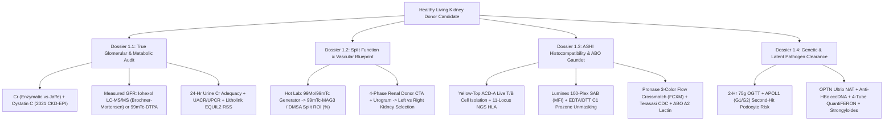
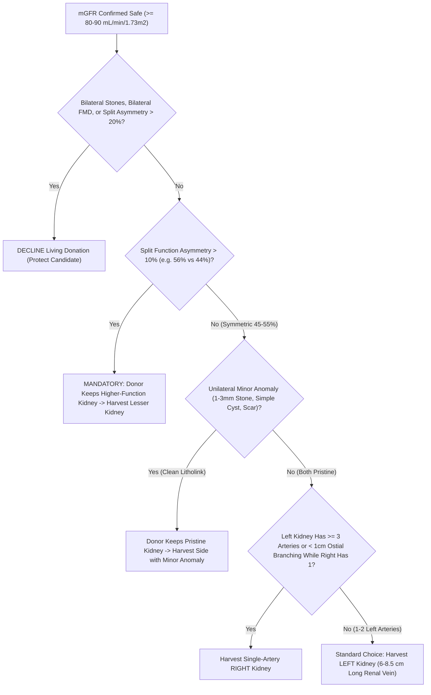
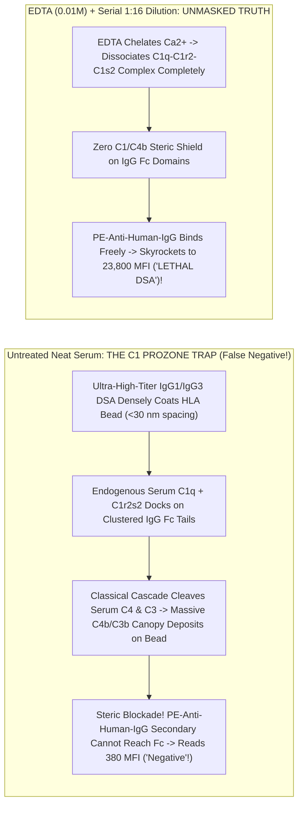

# Basic Medical — Behind the Curtain Clinical Diagnostics Notebook
## Volume I: The Living Kidney Donor Gauntlet — Measured GFR (`mGFR`), Split Renal Scintigraphy, `HLA` Crossmatching, and Occult Clearance Panels

> *"When a sick patient enters the clinic, diagnostic medicine searches for a culprit large enough to explain existing suffering. When a healthy human volunteers to surrender half of their nephron endowment for the next fifty years of life, diagnostic medicine transforms into forensic engineering: every routine screening shortcut becomes suspect, every physiological reserve must be stress-tested to its physical-chemical ground truth, and every invisible immunological landmine must be defused before a scalpel ever touches skin."*

---

### Prologue: Why Even a Biomedical PhD Walks Out of Living Donor Clinic Baffled

Imagine a healthy 34-year-old molecular biologist or biomedical engineer sitting in a transplant center evaluation suite. Their annual primary-care physical three weeks earlier was spotless: serum creatinine $0.92\text{ mg/dL}$, estimated glomerular filtration rate ($\text{eGFR}$) $104\text{ mL/min/1.73 m}^2$, hemoglobin $\text{A}_{1\text{c}}$ $5.4\%$, normal blood pressure, and an unremarkable urinalysis dipstick. Expecting a brief surgical anatomy scan and a blood-type check, they instead walk out carrying:

1. An infusion-center appointment for a **4-hour intravenous Iohexol (`Omnipaque`) disappearance study**—receiving an iodinated X-ray contrast bolus without setting foot near a CT or X-ray machine, while a nurse weighs a plastic syringe on an analytical microbalance to a thousandth of a gram.
2. Two **3-liter opaque plastic collection jugs**—one pre-spiked with corrosive hydrochloric acid or antimicrobial thymol crystals—with stern instructions about flushing Monday's `07:00 AM` urine down the toilet while capturing Tuesday's `07:00 AM` urine to the drop.
3. A Nuclear Medicine requisition for **`99mTc-MAG3` dynamic renal scintigraphy** on top of a **4-phase CT Angiogram and CT Urogram**.
4. A phlebotomy slip calling for **eight yellow-top `ACD-A` tubes**, **four specialized `QuantiFERON` peptide-coated lithium-heparin tubes**, **two lavender `EDTA` tubes**, **three gold `SST` tubes**, and a **2-hour `75-g` Oral Glucose Tolerance Test (`OGTT`)** despite an $\text{HbA}_{1\text{c}}$ of $5.4\%$.

Why does transplant medicine distrust every routine test that internal medicine relies upon daily? Because unilateral donor nephrectomy instantaneously deletes $50\%$ of an individual's ~1.8 to 2.0 million nephrons. Within days of surgery, renal blood flow to the solitary remaining kidney surges by $40\text{–}45\%$, driving single-nephron glomerular hyperfiltration so that whole-body GFR stabilizes at **$65\text{–}70\%$ of pre-donation two-kidney baseline** (not $50\%$). For that solitary kidney to sustain its owner to age 85 or 90 without tipping into end-stage kidney disease (`ESKD`—quantified in seminal cohorts by Muzaale et al., *JAMA* 2014, and Grams et al., *NEJM* 2016), the transplant team must replace population-average *estimates* with direct physical, nuclear, chromatographic, and cellular measurements.

In **Volume I**, we pull back the stainless-steel curtain of the Clinical Chemistry Core Lab, the Mass Spectrometry Suite, the Nuclear Medicine Hot Lab, the Multidetector CT Console, and the `ASHI`-accredited Histocompatibility & Immunogenetics Laboratory to trace every tube, photon, microsphere, and enzyme in the Living Kidney Donor Gauntlet.

---

## Dossier 1.1: Why Serum Creatinine & `eGFR` Are Not Enough — Measured GFR (`mGFR`), Cystatin C, 24-Hour Urine Adequacy & `Litholink` Stone Supersaturation

### 1.1.1 The Three Physiological & Analytical Lies of Serum Creatinine

Creatinine ($\text{C}_4\text{H}_7\text{N}_3\text{O}$, molecular weight $113.12\text{ Da}$) is the cyclic anhydride formed by the spontaneous, non-enzymatic dehydration of skeletal-muscle **creatine** and **phosphocreatine** at a steady fractional turnover rate of roughly $1.1\text{–}2.0\%$ per day. In outpatient primary care, clinicians treat steady-state serum creatinine ($S_{\text{Cr}}$) as an inverse mirror of glomerular filtration rate ($\text{GFR}$): if $\text{GFR}$ halves, $S_{\text{Cr}}$ roughly doubles. Yet inside a living kidney donor evaluation, relying on $S_{\text{Cr}}$ alone can either falsely disqualify an athletic hero or fatally clear a candidate with ocult Stage 2 chronic kidney disease. Serum creatinine tells **three distinct lies**:

#### Lie #1: The Generation & Dietary Confounder ($G_{\text{Cr}} \neq \text{constant}$)
At steady state, urinary creatinine excretion must equal endogenous muscle production plus exogenous dietary absorption:
$$S_{\text{Cr}} = \frac{G_{\text{Cr}}}{\text{GFR} + J_{\text{secretion}}/S_{\text{Cr}}}$$
where $G_{\text{Cr}}$ is the creatinine generation rate ($\text{mg/min}$) and $J_{\text{secretion}}$ is tubular secretory flux. Demographic `eGFR` equations guess $G_{\text{Cr}}$ solely from **age** and **sex**. Consequently:
* **The Muscular Donor Trap**: A 31-year-old CrossFit athlete or former collegiate rower taking oral creatine monohydrate supplements or eating a high-cooked-beef dinner (heat during cooking converts meat creatine directly into absorbable creatinine, spiking postprandial $S_{\text{Cr}}$ by $0.2\text{–}0.5\text{ mg/dL}$ for 4–8 hours!) may present with $S_{\text{Cr}} = 1.32\text{ mg/dL}$ and an alarming `eGFR` of $71\text{ mL/min/1.73 m}^2$, when their true measured GFR is a pristine $118\text{ mL/min/1.73 m}^2$.
* **The Low-Muscle-Mass Donor Trap**: Conversely, a petite 58-year-old vegetarian woman with mild sarcopenia ($46\text{ kg}$) generates so little endogenous creatinine that a "reassuring" $S_{\text{Cr}}$ of $0.78\text{ mg/dL}$ (`eGFR` $86\text{ mL/min/1.73 m}^2$) can conceal a true measured GFR of $64\text{ mL/min/1.73 m}^2$—a level unsafe for unilateral nephrectomy.

#### Lie #2: Proximal Tubular Secretion (`OCT2` / `MATE1` / `MATE2-K`) & Drug-Induced Pseudo-AKI
Inulin and iohexol are filtered exclusively across the glomerular capillary wall and never touched by renal tubular cells. Creatinine is **not** a pure filtration marker. In healthy adults with normal kidney function, **$10\text{–}15\%$ of urinary creatinine** (rising to $35\text{–}50\%$ in advanced CKD) is actively secreted across the S2 segment of the proximal convoluted tubule without ever passing through a glomerulus:
1. **Basolateral Uptake**: Positively charged/zwitterionic creatinine enters proximal tubular epithelial cells from peritubular capillary blood down the inside-negative membrane potential via **Organic Cation Transporter 2 (`OCT2`, encoded by `SLC22A2`)** (with minor contribution from `OAT2` / `SLC22A7`).
2. **Apical Efflux**: Creatinine is pumped out across the brush-border membrane into tubular urine via proton-coupled electroneutral antiporters **Multidrug and Toxin Extrusion protein 1 (`MATE1`, `SLC47A1`)** and kidney-specific **`MATE2-K` (`SLC47A2`)**.

This transporter architecture creates one of clinical medicine's classic diagnostic illusions. Common medications prescribed to healthy donor candidates competitively inhibit `OCT2` and/or `MATE1/2-K`:
* **Trimethoprim** (in `TMP-SMX` / *Bactrim* taken for a simple urinary tract or skin infection)
* **Cimetidine** (over-the-counter `H2`-receptor blocker for heartburn; famotidine has minimal effect)
* **Dolutegravir, Bictegravir, Raltegravir, and Cobicistat** (widely used in `HIV` PrEP/PEP or treatment regimens)
* **Pyrimethamine, Dronedarone, Ranolazine, Olaparib, and CDK4/6 inhibitors**

Within 24 to 48 hours of starting trimethoprim or dolutegravir, blocking `OCT2`/`MATE1` shuts down the $10\text{–}15\%$ secretory escape valve. Serum creatinine rises by **$0.20\text{ to }0.40\text{ mg/dL}$ ($15\text{–}30\%$)**, causing calculated `eGFR` to plummet from $98$ to $74\text{ mL/min/1.73 m}^2$—yet **true glomerular filtration (`mGFR`) and Cystatin C remain $100\%$ unchanged**!

#### Lie #3: Analytical Bench Interference — `Jaffe` Alkaline Picrate vs. Coupled Enzymatic `Trinder` Chemistry
Behind the core-lab curtain, clinical analyzers measure serum creatinine using one of two fundamentally different chemical reactions, both calibrated since the mid-2000s to **Isotope Dilution Mass Spectrometry (`IDMS`, NIST `SRM 967`)**, yet vulnerable to opposite sample interferents (*Tietz Textbook of Laboratory Medicine*, 7th ed.):

* **Method A — The Kinetic Alkaline Picrate (`Jaffe`, 1886) Reaction**:
  Under strongly alkaline conditions ($\text{NaOH}$, $\text{pH } 12.4\text{–}12.8$), creatinine's active methylene group forms a red-orange **Janovsky sigma-complex** with picrate ions ($2,4,6\text{-trinitrophenol}$), monitored kinetically by spectrophotometric absorbance rate ($\Delta A/\Delta t$) at **$505\text{ nm}$** over a narrow 20- to 60-second window:
  $$\text{Creatinine} + \text{Picrate}^- \xrightarrow{\text{OH}^-\text{ (pH } > 12.4\text{)}} \text{Creatinine–Picrate Janovsky Adduct } (\lambda_{\max} \approx 505\text{ nm})$$
  *Why Jaffe Lies*: Up to $15\text{–}20\%$ of the color in normal human plasma comes from **non-creatinine "pseudo-chromogens"**—plasma proteins, **acetoacetate** and **pyruvate** (causing dramatic false $S_{\text{Cr}}$ spikes of $+0.5\text{ to }+2.0\text{ mg/dL}$ during ketogenic diets, prolonged fasting, or diabetic ketoacidosis!), high glucose ($>300\text{ mg/dL}$), ascorbic acid (vitamin C megadosing), fetal hemoglobin, and cephalosporin antibiotics—most notoriously **cefoxitin**—which react directly with alkaline picrate. Conversely, **hyperbilirubinemia (icterus)** causes a *falsely low* Jaffe creatinine because NaOH oxidizes bilirubin ($450\text{ nm}$) to colorless biliverdin, subtracting absorbance during the kinetic read window unless rate-blanking or potassium ferricyanide oxidation is applied. Modern "compensated Jaffe" analyzers automatically subtract a fixed constant ($\sim 0.18\text{–}0.20\text{ mg/dL}$) from every patient's reading assuming average plasma protein levels—which systematically underestimates $S_{\text{Cr}}$ (overestimating GFR!) in cirrhotic or hypoalbuminemic patients.

* **Method B — The 4-Step Coupled Enzymatic (`Trinder`) Creatinine Assay** (Preferred by *KDIGO* for all Living Donor Centers):
  To eliminate Jaffe pseudo-chromogens, high-tier transplant laboratories deploy a specific bacterial enzyme cascade housed in two sequential reagent cuvettes (`R1` and `R2`):
  1. **Reagent `R1` Pre-Incubation (Endogenous Creatine Scavenging)**: Before `Creatininase` is ever added, `R1` introduces **Creatinase**, **Sarcosine Oxidase**, and **Catalase** to destroy all pre-existing endogenous serum creatine and sarcosine into harmless water and oxygen over 3–5 minutes!
  2. **Reagent `R2` Trigger (`Creatininase` + Sodium Azide Catalase Blocker + `Trinder` Chromogen)**:
     $$\text{Creatinine} + \text{H}_2\text{O} \xrightarrow{\text{Creatininase (Creatinine Amidohydrolase)}} \text{Creatine}$$
     $$\text{Creatine} + \text{H}_2\text{O} \xrightarrow{\text{Creatinase (Creatine Amidinohydrolase)}} \text{Sarcosine} + \text{Urea}$$
     $$\text{Sarcosine} + \text{O}_2 + \text{H}_2\text{O} \xrightarrow{\text{Sarcosine Oxidase}} \text{Glycine} + \text{Formaldehyde} + \text{H}_2\text{O}_2$$
     $$2\text{H}_2\text{O}_2 + \text{4-Aminophenazone} + \text{HTIB / TOOS} \xrightarrow{\text{Horseradish Peroxidase (HRP)}} \text{Quinoneimine Dye } (\lambda = 546\text{ nm}) + 4\text{H}_2\text{O}$$
  *Residual Enzymatic Caveats*: While immune to ketones and cefoxitin, the final `HRP`/$\text{H}_2\text{O}_2$ **Trinder coupling step** is vulnerable to strong reducing agents:blood drawn through an IV line infusing **dopamine or dobutamine**, high-dose intravenous **N-acetylcysteine (`NAC`)**, **metamizole (dipyrone)**, or **calcium dobesilate** consumes $\text{H}_2\text{O}_2$ before `HRP` can form the quinoneimine dye, yielding catastrophically **falsely low** enzymatic creatinine values! Furthermore, **5-fluorocytosine (`flucytosine`)** inhibits cytosine-deaminase-based dry-slide enzymatic creatinine systems (Vitros), falsely spiking $S_{\text{Cr}}$.

---

### 1.1.2 Cystatin C (`13.3 kDa`) & The 2021 Race-Free `CKD-EPI Cr-CysC` Equation

When a healthy donor candidate's creatinine-based `eGFR` sits in a gray zone ($75\text{–}95\text{ mL/min/1.73 m}^2$) or muscle mass deviates from population norms, the first blood-based adjudicator is **Serum Cystatin C**.

* **Molecular Physiology**: Encoded by the housekeeping-like `CST3` gene on chromosome `20p11.21`, Cystatin C is a $13,343\text{-Da}$ (120-amino-acid), non-glycosylated, positively charged ($\text{pI} = 9.3$) extracellular **cysteine protease inhibitor** synthesized at a remarkably constant constitutive rate by **every nucleated cell in the human body**—completely independent of skeletal muscle mass, sex, cooked meat intake, or `OCT2`/`MATE1` drugs!
* **Glomerular Filtration & `Megalin`/`Cubilin` Catabolism**: Because of its compact hydrodynamic radius ($\sim 1.8\text{ nm}$) and cationic charge (attracted across the negatively charged heparan-sulfate proteoglycans of the glomerular basement membrane), Cystatin C exhibits a glomerular sieving coefficient $\Theta \approx 0.99$. Once in Bowman's space, **$>99\%$ of filtered Cystatin C is bound by the proximal-tubule brush-border endocytic tandem receptor complex `Megalin` (`LRP2`) and `Cubilin`**, internalized into clathrin-coated pits, and completely degraded into free amino acids inside tubular lysosomes. Virtually zero intact Cystatin C is secreted by tubules or returned to blood—meaning *intact urinary Cystatin C is NOT used to calculate urinary clearance; serum Cystatin C alone reflects GFR!*
* **Behind the Bench (`PENIA` vs. `PETIA`)**: Because Cystatin C circulates at trace concentrations ($0.60\text{–}1.05\text{ mg/L}$, roughly $75\text{ nanomolar}$), spectrophotometric dye chemistry cannot touch it. Instead, core labs run automated homogeneous particle-enhanced immunoassays calibrated to the international certified reference material **`ERM-DA471/IFCC`**:
  * **`PENIA` (Particle-Enhanced Nephelometric Immunoassay, e.g., Siemens BN II / Atellica NEPH)**: $40\text{–}80\text{ nm}$ polystyrene nanoparticles covalently coated with rabbit anti-human Cystatin C antibodies agglutinate upon binding patient Cystatin C; an $840\text{-nm}$ infrared LED illuminates the cuvette while a forward-angle photodetector positioned at **$13^\circ\text{–}24^\circ$** measures increased **Rayleigh-Debye light scattering**.
  * **`PETIA` (Particle-Enhanced Turbidimetric Immunoassay, e.g., Roche Cobas `Tina-quant`)**: Measures the *decrease* in transmitted light intensity ($0^\circ$ optical axis at $546/800\text{ nm}$) caused by immunocomplex turbidity on standard chemistry tracks.
* **Non-GFR Confounders of Cystatin C**: Cystatin C has its own distinct blind spots! Because nucleated cell metabolic turnover regulates `CST3` transcription:
  * **Hyperthyroidism** accelerates cellular synthesis, **raising** serum Cystatin C (falsely lowering `eGFRcys`), whereas **hypothyroidism lowers** Cystatin C (the exact *opposite* direction of thyroid effects on creatinine, where hypothyroidism impairs GFR/water handling and raises $S_{\text{Cr}}$!).
  * **Exogenous high-dose glucocorticoids**, severe systemic inflammation (`CRP`), high adiposity/obesity, active cigarette smoking, and high-turnover hematologic states elevate Cystatin C independent of true GFR.

#### The Evolution of GFR Estimating Equations (`1976` to `2021`)
Understanding why transplant hepatologists, nephrologists, and pharmacists still clash over equations requires inspecting the exact algebra:

1. **Cockcroft-Gault (1976)** — estimates *unindexed Creatinine Clearance* ($\text{mL/min}$, including the $+10\text{–}15\%$ tubular secretion overestimate; still frozen into legacy FDA drug-dosing package inserts, *never* appropriate for donor GFR screening):
   $$\text{CrCl}_{\text{CG}}\text{ (mL/min)} = \frac{(140 - \text{Age}) \times \text{Weight}_{\text{kg}}}{72 \times S_{\text{Cr (mg/dL)}}} \times (0.85 \text{ if female})$$

2. **2021 Race-Free `CKD-EPI` Combined Creatinine–Cystatin C Equation (`eGFRcr-cys`)** (Inker et al., *NEJM* 2021 — recommended by *NKF-ASN* and *KDIGO* as the most accurate endogenous blood-based estimator):
   $$\text{eGFR}_{\text{cr-cys}} = 135 \times \min\!\left(\frac{S_{\text{Cr}}}{\kappa}, 1\right)^{\alpha} \times \max\!\left(\frac{S_{\text{Cr}}}{\kappa}, 1\right)^{-0.544} \times \min\!\left(\frac{S_{\text{CysC}}}{0.8}, 1\right)^{-0.323} \times \max\!\left(\frac{S_{\text{CysC}}}{0.8}, 1\right)^{-0.778} \times 0.9961^{\text{Age}} \times (0.963 \text{ if female})$$
   *(where $\kappa = 0.7\text{ mg/dL}, \alpha = -0.219$ for females; $\kappa = 0.9\text{ mg/dL}, \alpha = -0.144$ for males).*

Why, then, isn't `eGFRcr-cys` the final word in living kidney donation? Because even `eGFRcr-cys` exhibits a $P_{30}$ accuracy of $\sim 91\%$—meaning **$9\%$ of healthy people have a true `mGFR` that differs from `eGFRcr-cys` by more than $\pm 30\%$**, and the $95\%$ prediction interval around an `eGFRcr-cys` of $88\text{ mL/min/1.73 m}^2$ spans roughly **$71\text{ to }108\text{ mL/min/1.73 m}^2$**! When the `OPTN` / center safety threshold sits at **$80\text{ mL/min/1.73 m}^2$** (and $\ge 90\text{ mL/min/1.73 m}^2$ for young donors under age 35–40 who need 55+ years of renal longevity), guessing is unacceptable. Enter **Measured GFR (`mGFR`)**.

---

### 1.1.3 Behind the Curtain of Measured GFR (`mGFR`): Iohexol (`Omnipaque`) Plasma Disappearance vs. `99mTc-DTPA` & `125I-Iothalamate`

Classic renal physiology taught Homer Smith's continuous intravenous **inulin** infusion with bladder catheterization—an ordeal requiring scarce fructose-polymer inulin, constant infusion pumps, and error-prone voided urine collections. Modern transplant centers measure true `mGFR` primarily through **Exogenous Marker Plasma Disappearance**—most cleanly via **non-radioactive Iohexol (`Omnipaque`)**, or via nuclear radiotracers **`99mTc-DTPA`** and **`125I-Iothalamate`**.

#### Step-by-Step Behind the Curtain: The 4-Hour Iohexol (`Omnipaque-300`) `mGFR` Protocol
Iohexol ($N,N'\text{-bis(2,3-dihydroxypropyl)-5-[}N\text{-(2,3-dihydroxypropyl)-acetamido]-2,4,6-triiodoisophthalamide}$, $\text{MW } 821.14\text{ Da}$) is a non-ionic, water-soluble monomeric X-ray contrast agent. Unlike a CT scan that blasts `100–120 mL` intravenously, an Iohexol `mGFR` uses a tiny **$5.0\text{-mL}$ micro-bolus** (`Omnipaque-300`, containing $647\text{ mg iohexol/mL}$, or $3,235\text{ mg}$ total iohexol):
* **Why Iohexol is an Ideal Glomerular Marker**: Plasma protein binding is $< 1.5\%$; extrarenal (biliary/fecal) clearance is $< 0.5\%$; metabolic biotransformation is $0\%$; and renal tubular secretion and reabsorption are $0\%$. Once equilibrated across extracellular fluid, *the only exit door out of the human body for iohexol is glomerular filtration*.

Here is what happens minute-by-minute in the infusion chair and inside the Mass Spectrometry lab:

1. **`T = -30 min` (Pre-Test Conditioning & Dual-Arm Architecture)**:
   The donor arrives avoiding high-protein meat loads (which acutely trigger transient afferent arteriolar vasodilation via tubuloglomerular feedback, artificially inflating GFR by $10\text{–}20\%$!) and NSAIDs (which constrict afferent arterioles by blocking $\text{PGE}_2/\text{PGI}_2$). Oral hydration ($250\text{–}500\text{ mL}$ water) ensures steady urine flow. Two peripheral `IV` angiocatheters are placed—**one in the right arm strictly for Iohexol injection, and one in the CONTRALATERAL left arm strictly for timed blood draws** (drawing blood back through the injection hub, even after 10 saline flushes, desorbs trace microgram iohexol clinging to polyurethane catheter walls and ruins the assay!). A `T = 0` baseline blank blood tube is drawn first.

2. **`T = 0.00 min` (Gravimetric Microbalance Bolus Accounting)**:
   A volumetric syringe marking ("$5.0\text{ mL}$") has a $\pm 3\text{–}5\%$ human meniscus error. Therefore, the infusion nurse or lab technologist weighs the loaded `Omnipaque-300` syringe on a calibrated four-decimal analytical balance **before injection** ($W_{\text{pre}}$, e.g., $15.8421\text{ g}$), injects the $5\text{ mL}$ bolus smoothly over $60\text{–}90\text{ seconds}$ (recording the exact midpoint clock time to the second, e.g., `08:32:15`), flushes the line with $10\text{–}20\text{ mL}$ normal saline, and **re-weighs the empty syringe + needle** ($W_{\text{post}}$, e.g., $9.0971\text{ g}$). Given the exact density of `Omnipaque-300` at $20^\circ\text{C}$ ($\rho = 1.349\text{ g/mL}$) and concentration ($647.1\text{ mg iohexol/mL}$):
   $$\text{Exact Dose } D\text{ (mg)} = \frac{W_{\text{pre}} - W_{\text{post}}}{1.349\text{ g/mL}} \times 647.1\text{ mg/mL} = \frac{6.7450\text{ g}}{1.349} \times 647.1 = 3,235.5\text{ mg}$$

3. **`T = 0 to 120 min` (The Invisible $\alpha$-Distribution Phase)**:
   For the first two hours, plasma iohexol falls steeply via a **bi-exponential** curve: simultaneously diffusing out of capillaries into the $\sim 14\text{-liter}$ interstitial fluid space ($\alpha$-phase) while being filtered by the kidneys. Only after $\sim 120\text{ minutes}$ (in non-edematous subjects with normal GFR) does vascular-interstitial equilibrium lock into a pure log-linear **mono-exponential renal elimination slope ($\beta$-phase)**.

4. **`T = 120, 180, 240 min` (Exact-Minute Contralateral Draws)**:
   Blood is drawn from the contralateral arm into serum or `K2-EDTA` tubes at nominal 2, 3, and 4 hours (plus $300\text{ min}$ if lower GFR is suspected). Crucially, if the 2-hour draw happens at `124 min` instead of `120 min`, *no harm is done provided `124.0 min` is recorded truthfully into the regression equation*!

5. **Behind the Analytical Bench (`LC-MS/MS` vs. `HPLC-UV 254 nm`)**:
   * **`LC-MS/MS` Protocol**: The clinical chemist pipettes $50\text{ }\mu\text{L}$ of donor plasma, spikes in $50\text{ }\mu\text{L}$ of stable-isotope-labeled internal standard **`Iohexol-d5`** ($\text{MW } 826.17\text{ Da}$, which co-elutes identically and corrects for any ionization suppression or pipetting variance), precipitates plasma proteins with cold acetonitrile + $0.1\%$ formic acid, spins at $14,000 \times g$ for $10\text{ min}$, and injects supernatant onto a reverse-phase $\text{C}_{18}$ UHPLC column coupled to a triple-quadrupole tandem mass spectrometer in positive electrospray ionization (`ESI+`) Multiple Reaction Monitoring (`MRM`) mode: tracking precursor-to-product ion transitions **$m/z\text{ }822.1 \to 804.1$** (iohexol loss of $\text{H}_2\text{O}$) against **$m/z\text{ }827.1 \to 809.1$** (`Iohexol-d5`).
   * **`HPLC-UV` Isomer Physics**: Labs running `HPLC` with ultraviolet absorbance detection at **$254\text{ nm}$** (exploiting the aromatic triiodobenzene ring) observe **two distinct chromatographic peaks** for pure iohexol! Because bulky ortho-iodine atoms sterically hinder rotation around the central amide bonds, iohexol exists in aqueous equilibrium as two stable rotational atropisomers/conformers: a minor hydrophilic **endo-isomer ($\sim 15\%$)** eluting first and a major **exo-isomer ($\sim 85\%$)** eluting second. The chemist integrates the exo-isomer peak area (or summed isomer areas) against an internal standard (`iothalamate` or `p-aminobenzoic acid`) and confirms linearity ($R^2 > 0.995$ across the 3–4 timed log-concentration points—if $R^2 < 0.985$, a timing or line-contamination error immediately flags the run!).

6. **The Bröchner-Mortensen Quadratic Correction (`1972`)**:
   Plotting $\ln C(t)$ versus exact elapsed minutes $t$ across $120, 180, \text{ and } 240\text{ min}$ yields slope $-k_2$ and y-intercept $\ln C_0$:
   $$\text{One-Compartment Slow Clearance } Cl_1 = \frac{D}{C_0 / k_2} = \frac{D \cdot k_2}{C_0}$$
   Wait! Because $C_0$ extrapolates ONLY the slow $\beta$-slope back to $t = 0$, it completely misses the "extra triangle" of high plasma concentration during the first 90 minutes before iohexol finished entering interstitial space ($\text{AUC}_{\text{true}} = \text{AUC}_{\alpha} + \text{AUC}_{\beta} > C_0 / k_2$). Using raw $Cl_1$ would **underestimate $\text{AUC}$ and dangerously OVERESTIMATE the donor's GFR by $12\text{–}25\%$**! To capture the missing early $\alpha$-compartment without poking the donor 8 times in the first hour, clinical laboratories apply **Jens Bröchner-Mortensen's (1972) Quadratic Correction**:
   $$\text{mGFR}_{\text{raw}} = Cl_{\text{BM}} = 0.990778 \cdot Cl_1 - 0.001218 \cdot (Cl_1)^2$$
   *(Notice the physics of the $-0.001218 (Cl_1)^2$ quadratic penalty: the faster a healthy donor's kidneys clear iohexol—say $Cl_1 = 130\text{ mL/min}$—the larger the fraction of total clearance that already occurred during the unmeasured first 120 minutes, subtracting $20.6\text{ mL/min}$ to yield true $\text{mGFR}_{\text{raw}} = 108.2\text{ mL/min}$!)*

7. **Body Surface Area (`BSA`) Indexing — And Its Obesity/Petite Nuance**:
   Finally, raw $\text{mGFR}$ ($\text{mL/min}$) is normalized to the canonical $1.73\text{ m}^2$ human surface area using the **Du Bois & Du Bois (1916)** or **Haycock (1978)** formula:
   $$\text{BSA}_{\text{Du Bois}}\text{ (m}^2\text{)} = 0.007184 \times \text{Weight}_{\text{kg}}^{0.425} \times \text{Height}_{\text{cm}}^{0.725}, \qquad \text{mGFR}_{\text{indexed}} = \text{mGFR}_{\text{raw}} \times \frac{1.73}{\text{BSA}}$$
   *Clinical Pearl*: Indexing to $\text{BSA}$ prevents a petite $1.50\text{-m}^2$ woman with a perfectly matched $\text{mGFR}_{\text{raw}}$ of $78\text{ mL/min}$ ($\text{mGFR}_{\text{indexed}} = 90\text{ mL/min/1.73 m}^2$) from being falsely rejected, while preventing a large $2.35\text{-m}^2$ donor with an $\text{mGFR}_{\text{raw}}$ of $95\text{ mL/min}$ ($\text{mGFR}_{\text{indexed}} = 70\text{ mL/min/1.73 m}^2$—insufficient nephron power for their metabolic body mass!) from being mistakenly cleared.

#### Comparing Exogenous `mGFR` Modalities Across Transplant Centers

| Exogenous Marker | Isotope / Detection Physics | Renal Handling | Typical Sampling Protocol | Key Bench Advantages & Pitfalls |
| :--- | :--- | :--- | :--- | :--- |
| **Iohexol (`Omnipaque`)** | Non-radioactive iodine; `LC-MS/MS` (`Iohexol-d5` IS) or `HPLC-UV 254 nm` | Pure glomerular filtration; $<1.5\%$ protein bound; zero tubular transport | `5 mL` IV bolus (gravimetric syringe weigh); `120, 180, 240 min` plasma draws | **Zero radiation**; plasma stable for days at RT/frozen; gold-standard multicenter reproducibility; avoid in severe immediate contrast anaphylaxis |
| **`99mTc-DTPA`** | Gamma emitter ($140.5\text{ keV}$, $t_{1/2} = 6.01\text{ hr}$); NaI(Tl) gamma well-counter (`cpm`) | Glomerular filtration; **$5\text{–}10\%$ reversible plasma protein binding** | IV bolus (`1–5 mCi`); `120, 180, 240 min` plasma counted simultaneously with decay standard | Can combine with gamma-camera imaging (`Gates` camera-only method is **inaccurate**—must use timed blood draws!); slight GFR underestimation from protein binding unless ultrafiltered |
| **`125I-Iothalamate`** | Low-energy gamma/X-ray ($27\text{–}35\text{ keV}$, $t_{1/2} = 59.4\text{ days}$); gamma well-counter | Glomerular filtration + **minor active proximal tubular secretion via `OAT1` ($\sim 5\text{–}8\%$)** | Subcutaneous arm injection (`35 µCi`) + oral potassium iodide (`SSKI` thyroid block) + 4 timed plasma & spontaneous voided urine periods | Classic Mayo Clinic / NIH Crisp renal clearance protocol; requires complete bladder emptying (confirmed by post-void bladder ultrasound!) and radiation licensing |
| **Inulin** | Fructose polymer ($\sim 5,200\text{ Da}$); anthrone/resorcinol or enzymatic assay | Pure glomerular filtration ($100\%$ gold standard) | Priming bolus + continuous IV pump + timed urinary catheterization | Historical physiological benchmark; prohibitively expensive, scarce supply, cumbersome for clinical donor throughput |

---

### 1.1.4 The 24-Hour Urine Jug Behind the Curtain: Adequacy Math, `UACR` vs. `UPCR`, and `Litholink` `EQUIL2` Stone Supersaturation

Why ask a donor who is already undergoing an Iohexol `mGFR` to carry around a 3-liter urine jug for 24 hours? Because blood tests cannot measure **glomerular albumin/protein leak**, **actual dietary sodium and animal-protein intake**, or **thermodynamic urinary crystal supersaturation** that predicts whether a solitary remaining kidney could be obstructed by a ureteral stone!

#### 1. The Bladder-Clock Geometry & Catching Collection Errors ("Jug Fraud / Clock Drift")
Every patient initially asks: *"Why do I throw away my `07:00 AM` urine on Monday morning if my 24-hour collection starts at `07:00 AM`?"*
Because urine sitting inside the urinary bladder at `07:00 AM` Monday was filtered by the glomeruli between `11:00 PM` Sunday night and `07:00 AM` Monday! Including it would turn a 24-hour collection into a **32-hour collection**. Flushing the `07:00 AM` Monday void resets the bladder volume to zero at $t = 0$; thereafter, every drop passed during the day, night, and the final full bladder emptying at exactly `07:00 AM` Tuesday represents precisely $1,440\text{ minutes}$ of nephron output.

When the jug arrives in the core lab, the technologist first weighs the jug on a platform scale (converting mass to exact volume $V_{24}$ via specific gravity) and immediately runs a **24-Hour Total Creatinine Excretion Adequacy Check**. Regardless of how much water the donor drank ($1.2\text{ L}$ vs. $4.5\text{ L}$), daily skeletal-muscle creatinine production is locked to lean body mass:
* **Healthy Adult Males (age 20–50)**: **$20\text{ to }25\text{ mg/kg/day}$** (declining to $15\text{–}20\text{ mg/kg/day}$ over age 60)
* **Healthy Adult Females (age 20–50)**: **$15\text{ to }20\text{ mg/kg/day}$** (declining to $10\text{–}15\text{ mg/kg/day}$ over age 60)

> **Worked Bench Audit**: Suppose an $80\text{-kg}$, 32-year-old male donor turns in a jug containing $V_{24} = 1,400\text{ mL}$ with urine creatinine $U_{\text{Cr}} = 75\text{ mg/dL}$ ($0.75\text{ mg/mL}$) and serum creatinine $S_{\text{Cr}} = 1.00\text{ mg/dL}$.
> * Naive calculated 24-hr Creatinine Clearance: $\text{CrCl} = \frac{U_{\text{Cr}} \times V_{24}}{S_{\text{Cr}} \times 1440} = \frac{75\text{ mg/dL} \times 1400\text{ mL}}{1.00\text{ mg/dL} \times 1440\text{ min}} = \mathbf{72.9\text{ mL/min}}$ — *Panic! Is this young donor ineligible?*
> * **Behind-the-Curtain Adequacy Check**: Total creatinine in the jug $= 0.75\text{ mg/mL} \times 1,400\text{ mL} = \mathbf{1,050\text{ mg/day}}$. Divided by $80\text{ kg}$ body weight $= \mathbf{13.1\text{ mg/kg/day}}$ (expected: $20\text{–}25\text{ mg/kg/day}$, or $1,600\text{–}2,000\text{ mg/day}$!).
> * **Verdict**: The donor missed nearly $40\%$ of his day's urine (forgot to take the jug to the gym or flushed a nighttime void)! His true $\text{CrCl}$ is $\sim 120\text{ mL/min}$. Conversely, if total creatinine had been $2,650\text{ mg/day}$ ($33\text{ mg/kg/day}$), the lab immediately flags **over-collection** (included Day 1's first morning void), preventing a falsely inflated $\text{CrCl}$ from clearing an impaired donor!

#### 2. Dipstick vs. `UACR` (Microalbumin) vs. `UPCR` (Total Protein)
Why run *both* `UACR` and `UPCR` when the urinalysis dipstick already read `"Protein: Negative"`?
* **Urinalysis Dipstick ("Protein Error of Indicators")**: Filter paper impregnated with **tetrabromophenol blue** buffered to $\text{pH } 3.0$ changes from yellow to green-blue only when anionic amino/carboxyl sites of **albumin** accept protons. Its analytical limit of detection is coarse (**$15\text{–}30\text{ mg/dL}$**, or $150\text{–}300\text{ mg/L}$!). In a well-hydrated donor producing $3\text{ L/day}$ of dilute urine, $250\text{ mg/day}$ of pathological glomerular albuminuria dilutes to $8.3\text{ mg/dL}$—reading **completely `"Negative"` on dipstick**! Worse, dipstick pads are virtually blind to positively/neutrally charged **immunoglobulin free light chains (Bence Jones $\kappa/\lambda$)** and tubular low-molecular-weight proteins ($\beta_2\text{-microglobulin}$, retinol-binding protein).
* **Urine Albumin-to-Creatinine Ratio (`UACR`) / 24-Hr Urine Albumin Excretion (`UAE`)**: Measured via **immunoturbidimetry** (anti-human albumin antibodies at $340\text{ nm}$, detecting down to **$2\text{–}3\text{ mg/L}$**!). *KDIGO Living Kidney Donor Guidelines* classify **`UAE < 30 mg/day`** (or `UACR < 30 mg/g`, ideally `< 10 mg/g` in young donors) as mandatory for acceptance, and **`UAE >= 100 mg/day`** as an absolute contraindication—because trace selective albuminuria is the earliest hemodynamic footprint of glomerular endothelial glycocalyx loss and early podocyte effacement years before GFR budges.
* **Urine Protein-to-Creatinine Ratio (`UPCR`) / 24-Hr Total Protein (`< 150 mg/day`)**: Measured chemically via **Pyrogallol Red–Molybdate (`600 nm` blue-purple complex at $\text{pH } 2.5$)** or **alkaline Benzethonium Chloride turbidimetry (`505 nm`)**. This captures *all* urinary proteins: filtered albumin ($\sim 15\text{–}20\text{ mg/day}$ normally), tubular **Tamm-Horsfall mucoprotein / Uromodulin** ($\sim 40\text{–}70\text{ mg/day}$ secreted normally by the thick ascending limb of Henle!), and monoclonal light chains. *(Diagnostic gem: If `UPCR` is elevated at $450\text{ mg/g}$ while `UACR` is tiny at $12\text{ mg/g}$—an **"Albumin-to-Total-Protein Ratio `< 0.40`"**—the protein leak is NOT glomerular; it is either proximal tubular Fanconi/interstitial injury OR occult myeloma light-chain overflow requiring serum/urine immunofixation!)*

#### 3. Behind the Curtain of the 24-Hour `Litholink` Metabolic Stone Panel & `EQUIL2` Supersaturation
If a donor has an incidental $1.5\text{-mm}$ asymptomatic non-obstructing renal calculus on CT or a remote stone episode, a solitary kidney makes future ureteral obstruction a medical emergency (anuric post-renal AKI!). Simply checking serum calcium is useless; stone formation happens in distal nephron urine governed by **solution thermodynamics**.

In the **`Litholink` (Labcorp)** 24-hour stone risk protocol, the donor collects urine with an antimicrobial preservative (preventing *Proteus* or *Klebsiella* bacterial **urease** from hydrolyzing urea $\to 2\text{NH}_3 + \text{CO}_2$ during transit, which would skyrocket $\text{pH} > 8.0$, precipitate struvite/brushite, and destroy citrate via bacterial metabolism!). Back at the reference laboratory, the specimen is split and chemically conditioned before running 14 simultaneous analytes:
* **Acidified Aliquot ($\text{HCl}$ to $\text{pH } < 1.8$, warmed)**: Dissolves any microscopic **calcium oxalate ($\text{CaC}_2\text{O}_4$)** or **calcium phosphate** crystals that nucleated *in vitro* as the urine cooled from $37^\circ\text{C}$ body temperature to $20^\circ\text{C}$ room temperature! Analyzed for $\text{Ca}^{2+}, \text{Mg}^{2+}, \text{PO}_4^{3-}$, and **Oxalate** (measured enzymatically via *Oxalate Oxidase* generating $\text{H}_2\text{O}_2$ at $590\text{ nm}$ or by **Ion Chromatography [`IC`]**; note that high urinary Vitamin C must be stabilized/chelated at low pH because ascorbate spontaneously oxidizes to oxalate at alkaline pH, creating fake hyperoxaluria!).
* **Alkalinized Aliquot ($\text{NaOH}$ / buffer to $\text{pH } > 8.5$)**: Redissolves any precipitated **uric acid** crystals ($\text{p}K_a = 5.35$, insoluble below $\text{pH } 5.5$) prior to **Uricase** measurement!
* **Unacidified Aliquot**: Glass-electrode **`pH`**, **Citrate** (*Citrate Lyase + Malate Dehydrogenase* `NADH` oxidation at $340\text{ nm}$—crucial because trivalent $\text{Citrate}^{3-}$ chelates free $\text{Ca}^{2+}$ into soluble $[\text{CaCit}]^-$ complexes!), $\text{Na}^+, \text{K}^+, \text{Cl}^-$, **Sulfate ($\text{SO}_4^{2-}$)** via `IC` (a direct quantitative biomarker of dietary animal methionine/cysteine acid load, normally $15\text{–}30\text{ mEq/day}$), **Ammonium ($\text{NH}_4^+$)**, and Urea Nitrogen (computing normalized **Protein Catabolic Rate [`PCR`]** in $\text{g/kg/day}$).

Finally, these 14 molar concentrations are fed into **`EQUIL2`** (the iterative thermodynamic speciation algorithm developed by Finlayson and Werness et al., *J. Urol.* 1985). Why can't you simply multiply $[\text{Total Ca}] \times [\text{Total Oxalate}]$? Because over $50\%$ of urinary calcium is tied up in soluble ion pairs ($[\text{CaCit}]^-, [\text{CaHPO}_4]^0, [\text{CaSO}_4]^0$), and high urinary ionic strength $I = \frac{1}{2}\sum c_i z_i^2$ shields electrostatic charges via Debye-Hückel activity coefficients $\gamma_i$! `EQUIL2` iteratively solves 23+ simultaneous mass-action equations at $37^\circ\text{C}$ until free ion activities converge to $< 0.01\%$, outputting **Relative Supersaturation (`RSS`)**:
$$\text{RSS}_{\text{CaOx}} = \frac{\{ \text{Ca}^{2+} \} \cdot \{ \text{C}_2\text{O}_4^{2-} \}}{K_{sp,\text{CaOx}}}, \qquad \text{RSS}_{\text{Brushite}} = \frac{\{ \text{Ca}^{2+} \} \cdot \{ \text{HPO}_4^{2-} \}}{K_{sp,\text{CaHPO}_4 \cdot 2\text{H}_2\text{O}}}$$
where $\text{RSS} < 1.0$ means **undersaturated** (existing stones actually dissolve for uric acid!), $\text{RSS} = 1.0$ is thermodynamic saturation, and elevated **`RSS CaOx > 8–10`**, **`RSS Brushite > 2.0`**, or **`RSS Uric Acid > 2.0`** flags active lithogenic risk requiring either targeted dietary correction (water $> 2.5\text{ L/day}$, sodium $< 100\text{ mEq/day}$ to lower proximal-tubule-coupled calciuria, potassium citrate) with repeat clean testing—or donor exclusion.

---

## Dossier 1.2: Split Renal Scintigraphy (`99mTc-MAG3` / `DMSA`) & Multiphase Renal Donor CT Angiography (`CTA`) — Choosing Which Kidney Stays Behind

Once `mGFR` proves that the donor's *two* kidneys together filter $102\text{ mL/min/1.73 m}^2$, a deceptively simple question arises: **Does the left kidney contribute $51\text{ mL/min}$ and the right kidney $51\text{ mL/min}$—or is one hypertrophied kidney doing $72\text{ mL/min}$ while a congenitally hypoplastic or scarred contralateral kidney quietly contributes only $30\text{ mL/min}$?** Neither serum creatinine, Cystatin C, Iohexol `mGFR`, nor 24-hour urine can tell left from right. Answering that question takes the donor into the Nuclear Medicine Suite and the Multidetector CT Scanner.

### 1.2.1 Inside the Nuclear Medicine Hot Lab: `99Mo/99mTc` Generator Physics, `MAG3` vs. `DMSA` Radiochemistry & Gamma-Camera Split Function

#### 1. Milking the "Moly Cow" (`99Mo/99mTc` Alumina Generator) at `05:30 AM`
Hours before the living donor arrives, a nuclear pharmacist steps behind lead-shielded L-blocks in the radiopharmacy hot lab to elute **Technetium-99m ($^{99\text{m}}\text{Tc}$)**—the workhorse radioisotope of diagnostic medicine because it emits a **pure $140.5\text{-keV}$ gamma photon** (isomeric transition, zero tissue-destroying $\beta^-$ particles!) with a convenient **$6.01\text{-hour}$ physical half-life**. How can a hospital keep a $6\text{-hour}$ isotope in stock all week? Via transient secular equilibrium inside a **`99Mo/99mTc` Chromatographic Generator**:
* Inside a lead-encased glass column packed with acidic **alumina ($\text{Al}_2\text{O}_3$)** sits parent **Molybdenum-99 ($^{99}\text{Mo}$, $t_{1/2} = 66.0\text{ hours}$)** absorbed tightly as the dinegative **molybdate** oxyanion ($^{99}\text{MoO}_4^{2-}$).
* As $^{99}\text{Mo}$ undergoes $\beta^-$ decay ($87.5\%$ branch), it transmutes into metastable daughter $^{99\text{m}}\text{Tc}$ in the $+7$ oxidation state: **singly charged pertechnetate ($^{99\text{m}}\text{TcO}_4^-$)**:
  $$^{99}_{42}\text{MoO}_4^{2-} \xrightarrow{\beta^- \text{ (}t_{1/2}=66.0\text{ hr)}} {}^{99\text{m}}_{43}\text{TcO}_4^- + e^- + \bar{\nu}_e$$
* Because $-1$ pertechnetate binds alumina far more weakly than $-2$ molybdate, spiking an evacuated sterile vial onto the outlet needle pulls **$0.9\%\text{ NaCl}$ isotonic saline** through the column, selectively washing out pure $\text{Na}[^{99\text{m}}\text{TcO}_4]$ while leaving $^{99}\text{MoO}_4^{2-}$ behind to regenerate peak $^{99\text{m}}\text{Tc}$ activity again in $\sim 23\text{ hours}$!
* **Mandatory Hot-Lab Quality Control (`USP <823>`)**: Before a single microcurie touches a healthy donor, the nuclear tech performs two non-negotiable checks:
  1. **`99Mo` Breakthrough Assay**: Placing the eluted vial inside a $6\text{-mm}$ thick lead pig inside the dose calibrator blocks $>99.9\%$ of low-energy $140\text{-keV}$ $^{99\text{m}}\text{Tc}$ photons while letting high-energy $740/778\text{-keV}$ $^{99}\text{Mo}$ gammas penetrate. Limit: **$< 0.15\text{ }\mu\text{Ci } ^{99}\text{Mo per mCi } ^{99\text{m}}\text{Tc}$** at time of administration!
  2. **Aluminum Ion Breakthrough Spot Test**: Dropping eluate onto aurintricarboxylic acid indicator paper ensures $\text{Al}^{3+} < 10\text{ }\mu\text{g/mL}$ (excess $\text{Al}^{3+}$ causes radiocolloid clumping in the liver/lungs).

#### 2. Chelation Chemistry & Renal Transport: `99mTc-MAG3` vs. `99mTc-DMSA`
Free pertechnetate ($^{99\text{m}}\text{TcO}_4^-$) mimics iodide—it would light up the donor's thyroid, salivary glands, and stomach rather than the kidneys! To build a kidney-specific probe, the pharmacist injects $^{99\text{m}}\text{TcO}_4^-$ into a lyophilized sterile kit containing **stannous chloride ($\text{SnCl}_2 \cdot 2\text{H}_2\text{O}$)**: $\text{Sn}^{2+}$ reduces $\text{Tc(VII)}$ down to $\text{Tc(V)}$ or $\text{Tc(III)}$ so it can coordinate organic chelators:

* **`99mTc-MAG3` (`Mercaptoacetyltriglycine` — Dynamic Tubular Extraction + Drainage)**:
  Synthesized by boiling $^{99\text{m}}\text{TcO}_4^- + \text{Sn}^{2+} + S\text{-benzoyl-MAG3}$ for $10\text{ minutes}$ (cleaving the protecting benzoyl group to lock an oxotechnetium $[\text{Tc}^{\text{V}}\text{O}(\text{MAG3})]^-$ square-pyramidal N3S chelate; radiochemical purity verified $\ge 90\%$ via instant thin-layer chromatography!).
  * *Physiology*: `99mTc-MAG3` is $\sim 90\%$ bound to plasma albumin, so $< 10\%$ is filtered at the glomerulus. Instead, as blood courses through peritubular capillaries, **`55–65%` is stripped out in a single pass across the basolateral membrane of proximal convoluted tubular cells via `OAT1` (`SLC22A6`)** (the classic para-aminohippurate `PAH` transporter!) and rapidly secreted via apical `MRP2` into tubular urine. Thus `99mTc-MAG3` delivers crisp, high-target-to-background images reflecting **Effective Renal Plasma Flow (`ERPF`)** plus dynamic ureteral washout!
* **`99mTc-DMSA` (`Dimercaptosuccinic Acid` — Static Cortical Mass & Scar Mapping)**:
  Prepared at room temperature at acidic $\text{pH } 2.5$ (alkaline pH accidentally forms pentavalent $^{99\text{m}}\text{Tc(V)-DMSA}$, a medullary thyroid tumor tracer!). After IV injection of $2\text{–}5\text{ mCi}$, **`40–50%` of the injected `99mTc-DMSA` becomes stably fixed inside proximal convoluted tubular cortical cells** (via peritubular uptake + glomerular filtration/megalin endocytosis) without washing out into the renal pelvis! Imaged **2 to 3 hours post-injection** with high-resolution planar + pinhole/SPECT views, `DMSA` is the undisputed gold standard when evaluating focal cortical scarring (e.g., childhood reflux nephropathy), horseshoe kidney isthmuses, or pelvic ectopic kidneys.

#### 3. Planar Gamma-Camera Physics & The `1.0–2.0 Minute` Split-Function Math
During a `99mTc-MAG3` scan, the hydrated donor lies supine over a **Gamma Camera** (`Anger Scintillation Camera`) equipped with a **Low-Energy High-Resolution (`LEHR`) parallel-hole lead collimator** (thousands of hexagonal lead septa rejecting scattered off-axis photons so only perpendicular gamma rays pass through to strike the **$3/8\text{-inch}$ `NaI(Tl)` thallium-activated sodium iodide crystal**, generating blue scintillation flashes amplified by a hexagonal array of photomultiplier tubes within a $140\text{ keV} \pm 10\%$ pulse-height analyzer window).

Immediately upon rapid antecubital bolus injection ($3\text{–}8\text{ mCi}$ `99mTc-MAG3`), frames are acquired dynamically (`2 sec/frame` for 60 sec vascular perfusion phase $\to$ `15–30 sec/frame` for 25 min parenchymal uptake & excretory washout):
1. **Why the Split-Function Window MUST Be `1.0 to 2.0 Minutes` (`60–120 sec`)**: Between $60$ and $120\text{ seconds}$ post-injection, `MAG3` has been extracted from blood into proximal tubular cells, **but has NOT yet crossed into the calyces or renal pelvis** (cortical transit time is $\sim 2.5\text{–}3.0\text{ min}$). Measuring after $3\text{ minutes}$ would corrupt parenchymal function with variable pelvic drainage pooling!
2. **Perirenal Background Subtraction (`C-Shaped ROI`s)**: Because hepatic, splenic, and retroperitoneal soft-tissue blood pools sit directly over the kidneys, the technologist draws whole-kidney Regions of Interest (`ROI`s) around the Left and Right cortices and paired **2-pixel-wide C-shaped lateral/inferior perirenal background `ROI`s** (avoiding medial hilar vessels!), normalizing background counts by pixel area ($A_{\text{kidney}} / A_{\text{bkg}}$):
   $$N_{\text{Left, net}} = C_{\text{Left }(60\text{–}120\text{s})} - \left( C_{\text{Bkg, L}} \times \frac{\text{Pixels}_{\text{Left}}}{\text{Pixels}_{\text{Bkg, L}}} \right)$$
   $$\text{Split Function}_{\text{Left}} (\%) = \frac{N_{\text{Left, net}}}{N_{\text{Left, net}} + N_{\text{Right, net}}} \times 100\%$$
3. **The Soft-Tissue Attenuation Trap (Geometric Mean Correction)**: In a posterior-only camera view, $140\text{-keV}$ gamma photons have a linear attenuation coefficient in human soft tissue of $\mu \approx 0.153\text{ cm}^{-1}$ (meaning **every $1\text{ cm}$ of extra kidney depth absorbs $\sim 14\%$ of the photons!**). If a thin female donor has mild **right nephroptosis** where the right kidney drops $2.5\text{ cm}$ anteriorly when supine, a posterior-only camera will falsely report **`Left 60% / Right 40%`** even when both kidneys are identical! Dual-head **Anterior + Posterior Simultaneous Acquisition** solves this via the depth-independent **Geometric Mean**:
   $$N_{\text{GeoMean}} = \sqrt{N_{\text{Anterior, net}} \times N_{\text{Posterior, net}}}$$

---

### 1.2.2 The 4-Phase Living Donor CT Angiography (`CTA`) & CT Urogram Surgical Blueprint

While nuclear scintigraphy measures physiological extraction, laparoscopic donor nephrectomy requires sub-millimeter anatomical truth (`0.5–0.625 mm` isotropic multidetector CT slices). A dedicated **4-Phase Renal Donor `CTA`/`CTU`** choreographs X-ray tube firing to four exact physiological moments of contrast transit:

1. **Phase 1 — Unenhanced Low-Dose Stone Scan (`t = 0`, Pre-Contrast)**:
   Essential *before* iodine enters the body—once renal calyces fill with bright $800\text{-HU}$ contrast, a $2\text{-mm}$ stone becomes completely invisible! Measures attenuation in **Hounsfield Units ($\text{HU} = 1000 \times \frac{\mu_{\text{tissue}} - \mu_{\text{water}}}{\mu_{\text{water}}}$)**: pure renal cysts read $0\text{ to }+20\text{ HU}$, angiomyolipoma macroscopic fat reads $<-20\text{ HU}$, uric acid calculi read $300\text{–}450\text{ HU}$, and dense calcium oxalate monohydrate stones read $> 1,000\text{ HU}$.
2. **Phase 2 — Bolus-Tracked Corticomedullary / Arterial Phase (`t ≈ 22–28 sec`)**:
   A power injector drives $100\text{–}120\text{ mL}$ of high-concentration non-ionic contrast ($350\text{–}370\text{ mgI/mL}$) at **$4.5\text{–}5.0\text{ mL/sec}$** through an `18G` antecubital `IV` followed by a $40\text{-mL}$ saline chaser. A real-time `SmartPrep` / `Bolus Tracking` cursor sits inside the abdominal aorta at the celiac axis; the instant aortic density crosses **$150\text{ HU}$**, the scanner fires cranio-caudally during peak arterial opacification!
   * *Critical Surgical Findings*: Maps **accessory/polar renal arteries** (present in **$25\text{–}30\%$** of healthy humans! Ligating a lower-pole accessory artery risks **recipient ureteral necrosis and urinary leak**, because the donor ureter gets its fragile blood supply from branches of the lower-pole renal artery!), measures the exact **distance from the aortic/IVC ostium to the first arterial/venous bifurcation** (if a single renal artery bifurcates $< 1.5\text{ cm}$ from the aorta, the endoscopic `Endo-GIA` vascular stapler—which consumes $5\text{–}7\text{ mm}$ of staple line—will sever the common trunk into **two separate orifices** requiring delicate *ex vivo* ice-slush trouser-graft reconstruction!), screens for **Fibromuscular Dysplasia (`FMD` — classic mid-to-distal arterial `"string-of-beads"` medial fibroplasia)**, and identifies venous anomalies (**retroaortic** or **circumaortic** left renal veins).
3. **Phase 3 — Nephrographic Parenchymal Phase (`t ≈ 75–90 sec`)**:
   Both cortex and medulla enhance homogeneously ($150\text{–}220\text{ HU}$), unmasking tiny $< 8\text{-mm}$ solid neoplasms and enabling **3D Semiautomated CT Parenchymal Volumetry** ($V_{\text{Left}} / [V_{\text{Left}} + V_{\text{Right}}]$). *Modern Practice Shift*: Because 3D CT cortical/parenchymal volumetry correlates at $r = 0.88\text{–}0.94$ with nuclear `MAG3` split function without extra radiation or cost, *KDIGO* and *OPTN* guidelines now endorse CT volumetry as the primary split-function test when kidneys are symmetric ($\le 10\%$ volume difference), reserving `99mTc-MAG3`/`DMSA` for volume asymmetry $> 10\%$, congenital anomalies, or scarring!
4. **Phase 4 — Excretory CT Urogram Phase (`t = 8–10 min`, Low-Dose or Split-Bolus)**:
   Opacifies the pelvicalyceal system and ureters down to the bladder to detect **bifid renal pelvis**, **partial (`Y-shaped`) or complete ureteral duplication**, UPJ obstruction, or urothelial filling defects.

#### The Transplant Surgeon's Decision Matrix: Why Left Wins ~85% of the Time—And the 6 Rules That Flip the Choice to Right

All else being equal, transplant surgeons overwhelmingly harvest the **Left Kidney ($\sim 85\%$ of living donor nephrectomies)** because of **venous embryology**:
* The **Left Renal Vein is $6.0\text{ to }8.5\text{ cm}$ long**, coursing anterior to the abdominal aorta (beneath the superior mesenteric artery) to reach the right-sided inferior vena cava (`IVC`). Although the donor surgeon must clip and divide three left venous tributaries (the **left gonadal vein** inferiorly, the **left adrenal vein** superiorly, and the **posterior ascending lumbar vein**), the recipient surgeon receives a long, thick-walled vein that effortlessly reaches the recipient's deep external iliac vein without tension!
* The **Right Renal Vein is only $2.0\text{ to }2.5\text{ cm}$ long and thin-walled**, draining straight into the `IVC` behind the liver—leaving zero margin for stapler loss and elevating recipient venous thrombosis or caval bleed risk.

**HOWEVER**, the supreme ethical law of living organ donation overrides surgical convenience every single time: **THE DONOR MUST ALWAYS KEEP THE BETTER KIDNEY.**

| Clinical / Anatomical Scenario on `CTA` & Split Scan | Split Function / Anatomy Example | Which Kidney Is Harvested (If Cleared)? | Surgical & Donor-Safety Rationale |
| :--- | :--- | :--- | :--- |
| **Baseline Symmetric Anatomy** | `51% Left / 49% Right`; single artery/vein bilaterally; 0 stones | **Harvest LEFT Kidney** (Donor keeps Right) | $6\text{–}8.5\text{ cm}$ left renal vein ensures safest recipient venous anastomosis and smooth retroperitoneal/laparoscopic mobilization |
| **Significant Split-Function Asymmetry (`> 10%` gap)** | `57% Left / 43% Right` (`mGFR` $100\text{ mL/min} \to 57\text{ vs }43\text{ mL/min}$) | **Harvest RIGHT Kidney** (Donor keeps stronger `57%` Left!) | Taking the `57%` kidney would strand the donor with a solitary $43\text{-mL/min}$ kidney; donor keeps the powerhouse organ |
| **Unilateral Solitary Asymptomatic Tiny Stone (`1–3 mm`)** | `2-mm` lower-pole stone on Right; clean `Litholink` supersaturation | **Harvest RIGHT Kidney** (+ *ex vivo* back-table ureteroscopic basket removal if needed!) | Donor is never left with a stone-bearing solitary kidney; tiny stone sits harmlessly or is extracted on ice before implantation |
| **Complex Left Multi-Vessel Anatomy vs. Simple Right** | Left has **3–4 arteries** or `< 1.0 cm` early branching; Right has **1 artery** | **Harvest RIGHT Kidney** (Donor keeps multi-vessel Left) | Multi-artery bench reconstruction prolongs warm/cold ischemia and raises recipient arterial thrombosis & ureteral stricture risk |
| **Unilateral Mild Focal Fibromuscular Dysplasia (`FMD`)** | Mild distal right `"string-of-beads"` without hypertension; normal Left | **Decline Donation** (usually) OR **Harvest RIGHT** *only* in select older normotensive candidates excising diseased segment | `FMD` progresses bilaterally in up to $25\text{–}30\%$ of young patients; leaving a donor with potential `FMD` in a solitary kidney is hazardous |
| **Unilateral Bosniak I / Simple Benign Cortical Cyst** | $2.5\text{-cm}$ simple `8 HU` cyst on Left; normal Right | **Harvest LEFT Kidney** (marsupialize/unroof cyst on back-table!) | Preserves completely pristine, cyst-free right kidney inside the donor |

---

## Dossier 1.3: The Yellow-Top `ACD` Mystery — `HLA` NGS Typing, Luminex Single-Antigen Beads (`MFI`), The `C1` Prozone Trap, Flow Crossmatch (`Pronase`) & `ABO A2` Subtyping

### 1.3.1 Why 6–8 Yellow-Top `ACD` Tubes? Keeping Donor Lymphocytes Alive Behind the `ASHI` Lab Doors

Nothing mystifies a scientifically trained kidney donor quite like watching the transplant phlebotomist line up **six to eight large $8.5\text{-mL}$ pale-yellow-stoppered glass or plastic tubes (`ACD` Solution A)** alongside two dark-green **Sodium Heparin** tubes—and then deliberately leave them sitting on a room-temperature countertop instead of placing them on ice!

Why can't the Histocompatibility & Immunogenetics Laboratory (accredited by **`ASHI` / `ACHI`**, the American Society for Histocompatibility and Immunogenetics) simply use the standard purple-top `K2-EDTA` tube already drawn for the donor's CBC?
* Because physical transplant crossmatching (**Flow Cytometric Crossmatch [`FCXM`]** and **Complement-Dependent Microcytotoxicity [`CDC`]**) is not a chemical assay on dead plasma—it is a **live miniature organ-transplant rehearsal in a test tube**! The laboratory must harvest millions of **living, metabolically respiring donor `CD3+` T lymphocytes and `CD19+` B lymphocytes** whose plasma membranes remain intact, non-apoptotic, and impermeable to vital dyes for **72 to 96 hours** while tubes travel by courier across states for Kidney Paired Donation (`KPD`) exchanges.
* **`K2-EDTA` is Toxic to Live Functional Crossmatching**: Strong hexadentate `EDTA` strips structural $\text{Ca}^{2+}$ and $\text{Mg}^{2+}$ straight out of lymphocyte integrins and lipid bilayers, triggers rapid membrane blebbing and cell death within $24\text{ hours}$ (ruining `CDC` vital-dye background!), and directly chelates the $\text{Ca}^{2+}/\text{Mg}^{2+}$ required for rabbit complement activation!
* **The Biochemical Genius of `ACD` Solution A (`1.5 mL` liquid additive per `8.5 mL` blood)**:
  1. **Trisodium Citrate ($22.0\text{ g/L}$) + Citric Acid ($8.0\text{ g/L}$)**: Gently and reversibly buffers free $\text{Ca}^{2+}$ just below the clotting threshold while maintaining physiological pericellular $\text{pH}$ ($\sim 7.0\text{–}7.2$ once mixed with blood buffers) and preventing platelet activation.
  2. **Dextrose Monohydrate ($24.5\text{ g/L}$ D-Glucose)**: Feeds continuous glycolytic `ATP` synthesis inside harvested lymphocytes and erythrocytes so $\text{Na}^+/\text{K}^+\text{-ATPase}$ pumps keep running for four days!
* **Why Sodium Heparin (Not Lithium Heparin) Pair Tubes Are Drawn**: Provides calcium-replete whole blood for immediate same-day functional `CDC` or T-cell assays without altering divalent cation-dependent epitopes.
* **Why `4°C` Refrigeration Is Strictly Forbidden**: Chilling `ACD` or heparinized whole blood to $4^\circ\text{C}$ depolymerizes lymphocyte microtubules, activates granulocyte clumping, and causes massive cell death upon rewarming; `ASHI` standards mandate **`20–24°C` ambient insulated transport**.

#### Step-by-Step at the Bench: `Ficoll-Hypaque` (`1.077 g/mL`) vs. Immunomagnetic `EasySep` Isolation
Once the yellow-top `ACD-A` tubes pass through the airlock of the `ASHI` laboratory, the histocompatibility technologist isolates pure Peripheral Blood Mononuclear Cells (`PBMCs`: T cells, B cells, NK cells, monocytes) using one of two precision physical separations:

1. **Boyum's `Ficoll-Hypaque` (`1.077 g/mL`) Isopycnic Density-Gradient Centrifugation**:
   Whole `ACD` blood is diluted $1:1$ with sterile phosphate-buffered saline (`PBS`, lowering plasma viscosity so RBCs don't trap lymphocytes) and gently layered down the angled wall of a $50\text{-mL}$ conical tube atop a cushion of **`Ficoll-Paque`** (high-molecular-weight neutral sucrose-epichlorohydrin copolymer `Ficoll 400` + dense iodinated **sodium diatrizoate**, calibrated to an exact specific gravity of **$1.077 \pm 0.001\text{ g/mL}$** at $20^\circ\text{C}$).
   * The tube spins in a swinging-bucket rotor at **$400 \times g$ for $25\text{–}30\text{ minutes}$ with the centrifuge brake strictly turned `OFF` (`deceleration = 0`)**—because mechanical braking creates Coriolis vortexing that whips the paper-thin lymphocyte band back into the plasma!
   * Polysaccharide `Ficoll` aggregates erythrocytes (`rouleaux`, density $1.095\text{ g/mL}$) and dense polymorphonuclear neutrophils/eosinophils ($1.085\text{–}1.092\text{ g/mL}$), driving them straight to the bottom pellet, while less-dense **mononuclear `PBMCs` ($1.065\text{–}1.075\text{ g/mL}$)** float as a crisp, pearlescent white **buffy-coat ring** right at the plasma–`Ficoll` interface! Platelets remaining in the upper plasma are removed by low-speed $120 \times g$ washes.
2. **Untouched Negative-Selection Immunomagnetic Bead Isolation (`EasySep` / `Dynabeads`)**:
   Modern high-throughput `ASHI` labs bypass `Ficoll` altogether by adding bispecific tetrameric antibody complexes coated onto superparamagnetic dextran-iron nanoparticles (`50–200 nm`) targeting unwanted granulocytes (`CD66b`), RBCs (`Glycophorin A`), platelets (`CD61`), monocytes (`CD14`), and NK cells (`CD56`). Placing the tube inside a rare-earth neodymium magnet pulls every contaminant tightly against the plastic wall in $5\text{ minutes}$, allowing untouched, unactivated **`> 98%` pure donor `CD3+` T cells and `CD19+` B cells** (`> 95%` Trypan Blue / Acridine Orange viability) to be poured directly into the crossmatch!

---

### 1.3.2 11-Locus High-Resolution `HLA` Typing (`NGS`), Structural `Eplets` & `PIRCHE-II`

As established in the companion archival treatise (*[DOCS_ARCHIVE_02_HLA_VARIABILITY_AND_AUTOIMMUNITY.md](file:///C:/Users/patel/.gemini/antigravity/scratch/Basic_Medical_Notebook/DOCS_ARCHIVE_02_HLA_VARIABILITY_AND_AUTOIMMUNITY.md)*), the Major Histocompatibility Complex (`MHC`) spanning $3.6\text{ Mb}$ on chromosome **`6p21.3`** is the single most polymorphic region in the human genome—exceeding **$35,000$ cataloged `IPD-IMGT/HLA` alleles** driven by intense pathogen-mediated balancing selection ($dN/dS > 1$ precisely across the $\alpha_1/\alpha_2$ and $\alpha_1/\beta_1$ Antigen Recognition Site groove codons!). What protects *Homo sapiens* against viral extinction becomes the primary immunological barrier to organ transplantation.

#### Why Transplant Labs Now Type All `11 Classical HLA Loci` (Not Just `"6-Antigen Match"`)
Historically, kidney allocation counted only three loci (`HLA-A`, `HLA-B`, `HLA-DR` $\times 2$ parental haplotypes = "6 antigens"). Today, we know that **chronic antibody-mediated rejection (`cABMR`)**—the #1 immunologic cause of late kidney allograft loss 5 to 15 years post-transplant—is overwhelmingly driven by *de novo* Donor-Specific Antibodies (`dnDSA`) against **`HLA-DQ` (`DQA1/DQB1` heterodimers)**, **`HLA-Cw`**, **`HLA-DP` (`DPA1/DPB1`)**, and the **paralogous `DR51/52/53` loci (`DRB5`, `DRB3`, `DRB4`)**!
* **Cellular Distribution Rule (Essential for Decoding Every Crossmatch)**:
  * **`HLA` Class I (`HLA-A`, `HLA-B`, `HLA-C`)**: Heavy $\alpha$-chain non-covalently paired with invariant chromosome-15 **$\beta_2$-microglobulin ($\beta_2\text{m}$)**. Expressed constitutively on **ALL nucleated cells**—meaning **donor `CD3+` T cells, donor `CD19+` B cells (at $1.5\text{–}2\times$ higher density than T cells!), platelets, AND every glomerular and peritubular capillary endothelial cell inside the kidney graft!**
  * **`HLA` Class II (`HLA-DRB1`, `DRB3/4/5`, `DQA1/DQB1`, `DPA1/DPB1`)**: Polymorphic $\alpha$-chain + polymorphic $\beta$-chain heterodimers (notice why typing `DQB1` without `DQA1` is incomplete: the recipient antibody often binds a composite conformational patch spanning *both* chains!). Expressed constitutively on **Antigen-Presenting Cells (`CD19+` B cells, monocytes, dendritic cells) and human microvascular renal peritubular/glomerular endothelium** (massively upregulated by surgical ischemia-reperfusion and `IFN-γ`!), **but ABSENT (`0%`) on resting `CD3+` T cells**!

#### Why Next-Generation Sequencing (`NGS`) Replaced Serology & `SSO/SSP`
Legacy 1-field serological typing (e.g., `"HLA-A2"`) or short-amplicon Sanger sequencing suffered from **cis/trans phase ambiguity** (unable to tell which exon-2 polymorphism sat on the maternal vs. paternal chromosome alongside an exon-3 polymorphism) and missed **Null (`N`) expression alleles** (e.g., `HLA-A*24:02:01:02L` or splice-site null `B*15:01:01:02N`, where typing only exon 2/3 falsely assumes the protein is expressed!).
* **Behind the `NGS` Bench**: Genomic DNA extracted from donor `EDTA`/`ACD` buffy coat undergoes **Long-Range Multiplex PCR** amplifying full-length $3\text{–}11\text{ kb}$ genes from `5'-UTR` to `3'-UTR`. Library fragments (via **Illumina MiSeq** paired-end $2 \times 250\text{ bp}$ reads or rapid **Oxford Nanopore `MinION` / PacBio HiFi** single-molecule long reads spanning the entire gene in phase!) yield unambiguous **2-field (`HLA-A*02:01`, unique amino acid protein)** to **4-field (`HLA-A*02:01:01:01`)** resolution.
* **Molecular Epitope Risk Scoring (`Eplets` & `PIRCHE-II`)**: Two donors may both be a "1-DR mismatch" to a young recipient, yet carry vastly different immunogenicity! Software like René Duquesnoy's **`HLAMatchmaker`** maps 3D crystallographic `HLA` structures to count mismatched **$3.0\text{–}3.5\text{ Å}$ solvent-exposed polymorphic amino-acid patches (`Eplets`)** accessible to B-cell receptors (`HLA-DR < 7–10` and `HLA-DQ < 9–15` eplet mismatches drastically cut *de novo* `DSA` rates!), while **`PIRCHE-II`** computationally predicts how many donor mismatched `HLA` peptides can be processed and presented inside the **recipient's own `HLA-DRB1` groove** to provide indirect `CD4+` helper T-cell licensing to B cells!

---

### 1.3.3 Luminex Single-Antigen Beads (`SAB`), `MFI` & The Deadly `C1` Complement Prozone Trap

How does the transplant immunologist know *before* physical crossmatching whether the recipient already harbors dangerous antibodies against the living donor's exact `HLA` alleles (from prior pregnancies—where a mother makes lifelong `IgG` against paternal `HLA` on fetal trophoblasts!—blood transfusions, or previous failed transplants)? Through the **Luminex 100-Plex Single-Antigen Bead (`SAB`) Solid-Phase Assay** (*One Lambda LABScreen* or *Immucor LIFECODES*).

#### Inside the Dual-Laser Luminex Microsphere Physics
1. **100 Distinctly Barcoded Polystyrene Beads**: Inside a single tiny reaction well sit $\sim 100$ distinct populations of $5.6\text{-}\mu\text{m}$ carboxylated polystyrene microspheres. During manufacturing, each bead population is internally dyed with a precise ratio of **Red ($658\text{ nm}$ emission)** and **Infrared ($712\text{ nm}$ emission)** fluorochromes, creating a $10 \times 10$ spectral matrix of 100 unique barcodes. Crucially, the outer surface of each bead population is covalently conjugated to **purified recombinant protein of ONE single `HLA` allele** (e.g., Bead #07 carries only `HLA-A*02:01`; Bead #64 carries only `HLA-DQA1*05:01/DQB1*02:01`).
2. **Bench Incubation**: $20\text{ }\mu\text{L}$ of recipient serum is incubated with $5\text{ }\mu\text{L}$ of the 100-bead Class I or Class II suspension for $30\text{ min}$ in a 96-well filter/magnetic plate, washed $3\times$ to remove unbound serum proteins, and incubated for $30\text{ min}$ in the dark with **`R-Phycoerythrin` (`PE`)-conjugated goat anti-human `IgG` secondary antibody** (strictly $\gamma$-heavy-chain specific so it ignores `IgM`).
3. **Dual-Laser Hydrodynamic Interrogation**: Beads stream single-file through a flow cuvette past two lasers:
   * **`635-nm` Red Diode Classification Laser**: Reads the internal red/IR dye ratio to identify *which* `HLA` allele the bead carries.
   * **`532-nm` Green `Nd:YAG` Reporter Laser**: Excites surface-bound `R-PE` ($576\text{ nm}$ orange emission) on ≥ 50–100 individual beads per allele, calculating background-subtracted **Median Fluorescence Intensity (`MFI`)**:
     $$\text{Normalized MFI} = (\text{Sample Bead}_{\text{MFI}} - \text{Sample Negative Control Bead}_{\text{MFI}}) - (\text{Neg Serum Bead}_{\text{MFI}} - \text{Neg Serum NC Bead}_{\text{MFI}})$$

> **Why `MFI` Is Semi-Quantitative (NOT a True Antibody Concentration!)**: Beginners assume `12,000 MFI` always means twice as much antibody as `6,000 MFI`. False! First, if a recipient has an antibody targeting a **public shared epitope** like **`Bw4`** (present on 25 different `HLA-A` and `HLA-B` beads in the same well!), that finite antibody pool spreads thinly across 25 beads (`MFI ~ 1,800` each), whereas an identical concentration targeting a private epitope on 1 bead saturates it at `18,000 MFI`! Second, occasional recombinant Class I beads lose $\beta_2\text{-microglobulin}$ during attachment, exposing **denatured cryptic heavy-chain neoepitopes** that bind harmless natural antibodies (`SAB+`, yet native cell `FCXM` is completely negative; verified with acid-treated beads or native `iBeads`).

#### THE `C1` COMPLEMENT PROZONE ("HOOK") ARTIFACT: How a Lethal `24,000 MFI` Bomb Masks Itself as `"Negative (380 MFI)"`

Here lies the single most dangerous bench pitfall in all of transplant immunology—connecting directly to our Classical Complement Pathway archive (*[DOCS_ARCHIVE_03_COMPLEMENT_MEDIATED_IMMUNITY.md](file:///C:/Users/patel/.gemini/antigravity/scratch/Basic_Medical_Notebook/DOCS_ARCHIVE_03_COMPLEMENT_MEDIATED_IMMUNITY.md)*).

Suppose a multiparous recipient harbors a **massive, ultra-high-titer `IgG1/IgG3` Donor-Specific Antibody** against her husband's `HLA-B*07:02`. If a surgeon transplanted that kidney unchecked, unclamping the renal artery would trigger **Hyperacute Rejection** within 10 minutes on the operating table: recipient `IgG` coats donor endothelial `HLA-B*07:02`, activates `C1q` $\to$ `C4b2a` $\to$ **`C5b-9` Membrane Attack Complex**, strips endothelial heparan sulfate, exposes subendothelial collagen/von Willebrand factor, and turns the pink kidney purple-black and infarcted with microvascular fibrin thrombi right in the surgeon's hands!

Yet when an inexperienced lab runs **neat (untreated, undiluted) recipient serum** on Luminex `SAB`, the `HLA-B*07:02` bead prints out **`MFI = 380` ("NEGATIVE — Safe to Transplant" < `1,000 MFI`)**! How is that physically possible?!

* **The Macromolecular Steric Blockade Mechanism**: Unlike classical precipitation "hook effects" caused by antigen excess, Luminex **Prozone** is caused by **endogenous recipient Classical Complement (`C1` / `C4b` / `C3b`) steric interference** (plus occasional competing `IgM`!). When ultra-dense complement-fixing `IgG1` or `IgG3` molecules pack side-by-side on the microsphere surface, their adjacent `CH2` Fc domains recruit the giant $460\text{-kDa}$ six-headed tulip bouquet of endogenous serum **`C1q` complexed with `C1r2s2`** ($\sim 790\text{ kDa}$ total!), which immediately cleaves serum `C4` and `C3` to covalently plaster bulky **`C4b` and `C3b`** macromolecules all over the `IgG` constant regions! When the secondary **`PE`-goat-anti-human-IgG** antibody arrives in step 2, its Fc target sites are completely buried under a wall of complement proteins—producing near-zero fluorescence!
* **How `ASHI` Labs Defeat Prozone Before Every Transplant**:
  1. **Routine `EDTA` Pre-Treatment (`0.01–0.02 M` `Na2-EDTA` mixed straight into every serum sample)**: The integrity of the **`C1` complex (`C1q` + $\text{Ca}^{2+}$-dependent `C1r2-C1s2` tetramer)** strictly requires free $\text{Ca}^{2+}$! Adding `EDTA` instantly shatters `C1` and halts `C4/C3` activation, causing our hidden `380 MFI` bead to jump instantaneously to **`23,800 MFI`**!
  2. **`DTT` (`5 mM` Dithiothreitol at `37°C`) or Heat Inactivation (`56°C` for `30 min`)**: `DTT` reduces disulfide bonds in pentameric `IgM` and `C1q`; heat denatures heat-labile `C1r/C1s/C2`.
  3. **Serial Serum Titration (`Neat`, `1:4`, `1:16`, `1:64`, `1:256`, `1:1024`)**: Reveals both hidden prozone (a paradoxical *rise* in `MFI` as serum is diluted!) and true **antibody titer** (critical because two sera that both plateau at `18,000 MFI` neat behave totally differently if Serum A drops `< 1,000 MFI` at `1:8` while Serum B stays `> 10,000 MFI` out to `1:512`!).
  4. **`C1qScreen` Assay**: Conversely, if the team *wants* to know whether a known `DSA` fixes complement, heat-inactivated serum is spiked with standardized exogenous purified human `C1q` and detected with **`PE`-anti-human-`C1q`** (`C1q+ DSA` carries a $4\times$ higher hazard of acute antibody-mediated graft loss!).

---

### 1.3.4 Physical Crossmatching: 3-Color `Pronase` Flow Crossmatch (`FCXM`) vs. Paul Terasaki's 1964 `CDC` Microcytotoxicity Assay

Even in the era of Luminex `Virtual Crossmatching`, living donor transplants routinely undergo a **Physical Cellular Crossmatch** mixing actual recipient serum against live isolated donor `CD3+` T and `CD19+` B lymphocytes—catching antibodies against rare donor `HLA` alleles absent from the 100-bead Luminex panel or conformational heterodimers!

#### 1. Behind the Curtain of the 3-Color `Pronase` Flow Cytometric Crossmatch (`FCXM`)
If you mix normal, healthy negative-control human serum with untreated donor B cells, `PE/FITC`-anti-human-IgG lights up the B cells brightly—generating **rampant false-positive B-cell crossmatches in $20\text{–}30\%$ of completely compatible pairs**! Why?
* Because mature human `CD19+` B lymphocytes express two troublemakers on their plasma membrane:
  1. **Intrinsic Cell-Surface Immunoglobulin (`sIg` B-cell receptors)**, though mostly `IgM/IgD`, switching subsets carry endogenous surface **`IgG`**!
  2. High-density **Low-Affinity IgG Fc Receptors (`FcγRIIb` / `CD32`)**, which non-specifically grab monomeric/aggregated non-HLA `IgG` and immune complexes out of recipient serum **by their Fc tails** rather than by true antigen-specific Fab binding!

* **The `Pronase` Proteolytic Shave (`37°C`, `15–20 min`)**:
  To cure false-positive B-cell crossmatches (pioneered by Lobo et al. & Vaidya et al.), the technologist pre-treats $2\text{–}5 \times 10^6$ live donor `PBMCs` in serum-free `PBS` with **`0.5–1.0 mg/mL` `Pronase`** (a calibrated broad-spectrum mixture of endo- and exoproteases from *Streptomyces griseus*) at **$37^\circ\text{C}$ for exactly $15\text{–}20\text{ minutes}$**, immediately quenching digestion with fetal calf serum + `DNase I` (preventing sticky DNA strings from any lysed cells from clumping the remaining live lymphocytes!).
  * *Why doesn't `Pronase` chew up `HLA` too?!* Differential protease sensitivity! Globular, compact, disulfide-locked Class I and Class II `HLA` extracellular domains resist mild `1.0 mg/mL` `Pronase` (in fact, clearing bulky neighboring glycocalyx proteins often *improves* `DSA` access to Class I/II!), whereas exposed **`FcγRIIb` (`CD32`)** and surface immunoglobulin stalks are cleanly shaved off!
  * *Critical Bench Caveats of `Pronase`*: (a) `Pronase` **destroys `CD20`** on B cells—which is why the flow cytometrist MUST gate B cells using **`APC`-anti-`CD19`** (never anti-`CD20`!), and explains why a patient who recently received **Rituximab (chimeric anti-`CD20` IgG1)** causes a massive **false-positive B-cell crossmatch on untreated cells** that is dramatically reduced (though sometimes not $100\%$ abolished) by `Pronase`! (b) Over-digestion (`> 2.0 mg/mL` or wrong lot potency) *can* clip subtle `HLA` epitopes or expose cryptic `HLA` neoepitopes on `CD3+` T cells, so `ASHI` labs validate every `Pronase` lot and often run parallel untreated + `Pronase` tubes!

* **3-Color Staining & `MCS` (Median Channel Shift) Math**:
  `2.5 × 10^5` `Pronase`-treated donor `PBMCs` incubate with $25\text{ }\mu\text{L}$ recipient serum ($30\text{ min}$, RT) $\to$ wash $3\times$ $\to$ stain ($20\text{ min}$, $4^\circ\text{C}$ dark) with a 3-fluorochrome cocktail:
  1. **`FITC`-F(ab')2 Goat Anti-Human IgG** (F(ab')2 fragment lacks an Fc tail so it cannot bind any residual Fc receptors!) — measures recipient `DSA` bound to donor cells.
  2. **`PerCP`-Anti-Human `CD3`** — gates donor **T lymphocytes** (pure `HLA` Class I sensor).
  3. **`APC`-Anti-Human `CD19`** — gates donor **B lymphocytes** (`HLA` Class I + Class II sensor).
  The cytometer converts `FITC` fluorescence on a `1,024-channel` log-linear scale (or standardized **`MESF` calibration beads**) and subtracts the fluorescence of pooled `AB` negative control serum:
  $$\text{MCS}_{\text{T or B}} = \text{Median Channel}_{\text{Recipient Serum}} - \text{Median Channel}_{\text{Negative Control AB Serum}}$$
  Typically, **`T-cell MCS > +40 to +50 channels`** (`> 2.5–3 SD` above negative control) or **`B-cell MCS > +80 to +100 channels`** flags a positive `FCXM`!

#### 2. Paul Terasaki's 1964 `CDC` (Complement-Dependent Microcytotoxicity) Assay & `DTT` IgM Dissection
Before flow cytometry existed, UCLA's **Paul Terasaki and John McClelland (*Nature*, 1964)** revolutionized human organ transplantation by miniaturizing complement lysis down to **$1.0\text{ microliter}$** droplets beneath mineral oil in a **72-well Terasaki tray**—an assay still run today as the ultimate functional arbiter of immediate **hyperacute rejection risk**:
1. **$1\text{ }\mu\text{L}$ Recipient Serum + $1\text{ }\mu\text{L}$ Isolated Live Donor T or B Cells ($\sim 2,000\text{ cells}$)** are dispensed beneath $5\text{ }\mu\text{L}$ liquid paraffin oil (preventing evaporation of a $1\text{-}\mu\text{L}$ drop!) and incubated $30\text{ min}$ at $22^\circ\text{C}$ (plus optional **Anti-Human Globulin [`CDC-AHG`]** wash step adding anti-kappa light chain antibody to amplify C1q clustering $10\times$!).
2. **$5\text{ }\mu\text{L}$ Prescreened Baby Rabbit Complement (`60 min`, $22^\circ\text{C}$)**: *Why baby rabbit serum instead of human complement?* Human lymphocytes express homologous complement-restriction proteins (**`CD59` [protectin] and `CD55` [`DAF`]**) that inhibit *human* `C5b-9` MAC assembly, whereas heterologous **rabbit `C5b-9`** bypasses human `CD59` restriction and punches lethal osmotic transmembrane pores with crisp sensitivity! ("Baby" 3-to-4-week weaned rabbits lack heteroantibodies against human cells that adult rabbits acquire from gut flora!)
3. **Vital Fluorescence Scoring (`Acridine Orange + Ethidium Bromide` + Quench)**:
   * **Acridine Orange (`AO`)** crosses intact membranes of **live cells**, intercalating DNA to glow **bright emerald green**.
   * **Ethidium Bromide (`EB`)** can ONLY enter **complement-lysed dead cells** whose plasma membranes were perforated by `C5b-9` MAC, overwhelming `AO` to glow **fiery orange-red**!
   * **Standard `ASHI` Visual Cytotoxicity Scale**: **`Score 1`** ($0\text{–}10\%$ dead = Negative), **`Score 2`** ($11\text{–}20\%$ dead = Doubtful Negative), **`Score 4`** ($21\text{–}50\%$ dead = Weak Positive), **`Score 6`** ($51\text{–}80\%$ dead = Positive), **`Score 8`** ($81\text{–}100\%$ dead = Strong Positive — **ABSOLUTE CONTRAINDICATION / HYPERACUTE REJECTION!**).
4. **The `DTT` Disulfide Trick (`IgM` vs. `IgG`)**: Autoimmune lupus patients or dialysis patients often harbor harmless cold-reactive pentameric **`IgM` autoantibodies**—and because a single stapled `IgM` pentamer binds `C1q` $1,000\times$ more avidly than a single `IgG`, it triggers a terrifying **`Score 8` `CDC+` crossmatch**! Incubating recipient serum with **`5 mM` Dithiothreitol (`DTT`) at $37^\circ\text{C}$** cleaves inter-subunit J-chain disulfide bonds of pentameric `IgM` into inactive monomers while sparing `IgG`:
   * **`Neat CDC = 8` $\to$ `DTT CDC = 1` (plus negative `SAB` IgG & positive autocrossmatch against recipient's own cells)**: Benign `IgM` autoantibody — **safe to transplant** (avoid cold perfusion!).
   * **`Neat CDC = 8` $\to$ `DTT CDC = 8`**: Lethal complement-fixing `IgG` `DSA` — **DO NOT TRANSPLANT** (without full desensitization or Kidney Paired Donation swap!).

#### Master Histocompatibility Crossmatch Interpretation Matrix

| `T-Cell XM` (`CD3+`) | `B-Cell XM` (`CD19+`) | Luminex `SAB` (`EDTA`-treated) | Immunological Mechanism & Clinical Action |
| :--- | :--- | :--- | :--- |
| **Negative** | **Negative** | **No `DSA` (`< 1,000 MFI`)** | **Immunologically Compatible**: Clean Class I & Class II; green light for standard immunosuppression |
| **Positive** | **Positive (Stronger)** | **Class I `DSA` (`± Class II`)** | **Anti-Class I `DSA`**: Class I sits on BOTH T and B cells (higher density on B!); high risk of acute `ABMR` (`CDC+` = absolute stop!) |
| **Negative** | **Positive** | **Class II `DSA` (`DR/DQ/DP`)** OR **Low-level Class I `DSA`** | **Classic Anti-Class II `DSA`** (absent on T cells!) *OR* **weak Class I `DSA`** caught first on higher-Class-I-density B cells! Stratify by `FCXM` `MCS`, `CDC`, & `DSA` titer |
| **Positive** | **Negative** | **No `DSA`** | **Immunological Impossibility for True `HLA`!** (`HLA` Class I is always higher on B than T!) Signals **non-HLA anti-T-cell antibody** (e.g., recipient recently got `ATG`/Thymoglobulin or `Alemtuzumab` [`anti-CD52`]) or `Pronase` T-cell artifact! |
| **Negative** | **Positive (Untreated -> Neg w/ `Pronase`?)** | **No `DSA`** | Recipient treated with **Rituximab (`anti-CD20`)** or **Daratumumab (`anti-CD38`)**, or Fc-receptor non-specific binding; verify against `SAB` & donor `NGS` typing |

---

### 1.3.5 `ABO` Subtyping (`Dolichos biflorus` Anti-`A1` Lectin) & Crossing the Blood-Group Barrier

Unlike `Rh(D)` (which exists strictly on erythrocyte membranes and is *completely absent* from renal endothelium—so an **`Rh+` donor kidney can be safely transplanted into an `Rh-` recipient** without `Rh` rejection, needing only `RhIg` consideration for residual passenger RBCs in fertile females!), **`ABO` histo-blood group carbohydrate antigens are densely expressed on vascular endothelial cells of renal glomerular and peritubular capillaries**. Transplanting a standard Group `A` kidney into a Group `O` recipient whose plasma teems with preformed anti-A isohemagglutinins triggers catastrophic complement-mediated hyperacute thrombosis—unless one exploits **Group `A2` glycobiology**!

* **Biochemical Difference Between `A1` ($\sim 80\%$) and `A2` ($\sim 20\%$ of Blood Group A)**:
  Both `A1` and `A2` genes encode $\alpha\text{-1,3-}N\text{-acetylgalactosaminyltransferase}$ (adding `GalNAc` onto precursor `H` fucosylated chains). However, the common **`ABO*A2.01`** allele carries a single-base deletion (**`1061delC`**) near the 3' stop codon, causing a frameshift that tacks **21 extra amino acids** onto the enzyme's C-terminus. This clumsy tail slashes catalytic $V_{\max}$ **30- to 50-fold**:
  * **`A1` Renal Endothelium**: Packed with $\sim 1,000,000$ epitopes/RBC equivalent, including branched repetitive Type 3 and Type 4 glycolipid `A` chains that avidly cross-link recipient IgM/IgG!
  * **`A2` (`Non-A1`) Renal Endothelium**: Expresses **`75–80%` fewer surface `A` epitopes** ($\sim 200,000$ simple linear chains) and zero repetitive Type 3/4 `A` structures!
* **Behind the Blood-Bank Bench (`Dolichos biflorus` Lectin Forward Subtyping)**:
  Every Group `A` or `AB` living kidney donor has washed RBCs mixed with an extract from the seeds of the horse-gram plant ***Dolichos biflorus*** (**anti-`A1` phytohemagglutinin lectin**) paired with *Ulex europaeus* (**anti-`H` lectin**):
  * **`A1` Donor**: `4+` macroscopic agglutination with *Dolichos biflorus* (`anti-A1+`), weak/negative with `anti-H`.
  * **`A2` Donor**: **`0` agglutination with *Dolichos biflorus* (`anti-A1 Negative`)**, strong `3+/4+` agglutination with `anti-H` (confirmed twice on independent blood draws per `OPTN` mandate!).
* **Clinical Breakthrough**: When a Group `B` or Group `O` recipient has naturally low baseline anti-A `IgG` titers (**$\le 1:4$ or $\le 1:8$** by `AHG` column/tube titration), an **`A2` (or `A2B`) donor kidney can be transplanted directly across the `ABO` barrier without plasmapheresis or splenectomy**, achieving 5-year graft survival virtually indistinguishable from `ABO`-identical transplants—and for `A1` incompatible or high-`DSA` pairs, national **Kidney Paired Donation (`KPD`, e.g., National Kidney Registry)** algorithms link non-directed altruistic donors into domino chains unlocking 5 to 20 simultaneous compatible living transplants!

---

## Dossier 1.4: Hidden Donor Clearance Panels — `OGTT`, `APOL1` (`G1/G2`), `QuantiFERON-TB` 4-Tube Stimulation & `OPTN` Window-Period `NAT` / Occult `cccDNA` Screens

### 1.4.1 Why `HbA1c = 5.4%` Still Triggers a 2-Hour `75-g` Oral Glucose Tolerance Test (`OGTT`)

Diabetic nephropathy is the #1 cause of kidney failure worldwide; donating a kidney if you are silently marching toward Type 2 diabetes leaves a single hyperfiltering remnant kidney naked to hyperglycemic glomerular hypertension. Why don't transplant centers trust a normal $\text{HbA}_{1\text{c}}$ ($< 5.7\%$) and fasting glucose ($< 100\text{ mg/dL}$) in candidates with BMI $\ge 28\text{–}30\text{ kg/m}^2$, family history of diabetes, gestational diabetes history, or metabolic traits?
1. **Erythrocyte Lifespan Confounding of `HbA1c`**: Non-enzymatic Amadori glycation of hemoglobin $\beta$-chain N-terminal valines accumulates linearly over an RBC's nominal `120-day` lifespan. Common benign traits in healthy donors—**silent `G6PD` deficiency** (especially `rs1050828` `V68M` A- variant shortening RBC survival by ~20 days, lowering `HbA1c` by **$0.7\text{–}0.8\%$** at identical true blood glucose!), **sickle cell trait (`HbAS`)**, mild $\alpha$-thalassemia trait, or recent blood donation reticulocytosis—systematically make `HbA1c` look falsely low (`5.2–5.5%`)!
2. **Isolated Post-Challenge $\beta$-Cell Defect (`IGT`)**: Fasting glucose reflects hepatic gluconeogenesis, whereas drinking **$75\text{ g}$ anhydrous D-glucose in $250\text{ mL}$ water over 5 minutes** after an 8–12 hour fast (preceded by 3 days of $\ge 150\text{ g/day}$ unrestricted carbohydrates so pancreatic `GLUT2`/glucokinase isn't downregulated!) stress-tests **first-phase pancreatic $\beta$-cell insulin exocytosis** and skeletal-muscle **`GLUT4`** disposal. Up to **$30\text{–}35\%$ of donor candidates discovered to have Impaired Glucose Tolerance (`2-hr PG 140–199 mg/dL`) or occult Diabetes (`2-hr PG >= 200 mg/dL`) had completely normal fasting glucose AND `HbA1c < 5.7%`**!

---

### 1.4.2 `APOL1` Renal Risk Variants (`G1` & `G2`): Evolutionary Trypanosome Shield vs. Post-Nephrectomy "Second Hit"

Few discoveries in 21st-century human genetics (Genovese et al., *Science* 2010) carry deeper biological and ethical weight in living kidney donation than **`APOL1`** on chromosome `22q12.3`:
* **The Evolutionary Arms Race**: Wild-type **Apolipoprotein L1 (`G0`)** circulates on dense `HDL3` particles (`Trypanosome Lytic Factor`). When *Trypanosoma brucei brucei* ingests human `HDL`, `APOL1` inserts pH-gated cation/chloride pores into parasite lysosomal and mitochondrial membranes, osmotically bursting the parasite. However, the lethal East/West African sleeping sickness subspecies *Trypanosoma brucei rhodesiense* evolved a virulence factor—**`SRA` (Serum Resistance-Associated protein)**—that binds and neutralizes the C-terminal $\alpha$-helix of wild-type `G0` `APOL1`! Within the past 10,000 years in Sub-Saharan West/Central Africa, intense natural selection swept two `SRA`-evading coding variants to high frequency:
  * **`G1` Allele**: Two missense substitutions in near-complete linkage disequilibrium (**`S342G` [`rs73885319`] + `I384M` [`rs60910145`]**).
  * **`G2` Allele**: An in-frame **6-base-pair deletion (`rs71785313`, `delN388/Y389`)** right inside the `SRA`-binding helix.
* **The Recessive Podocyte Trade-Off & Donor Risk**: Carrying **1 risk allele (`G0/G1` or `G0/G2`)** protects against trypanosomiasis with minimal kidney risk. Carrying **2 risk alleles (`G1/G1`, `G2/G2`, or `G1/G2` compound heterozygosity—present in $\sim 13\%$ of US individuals of African ancestry)** confers a $7\text{- to }29\text{-fold}$ increased risk of focal segmental glomerulosclerosis (`FSGS`), hypertensive nephrosclerosis, and `HIVAN` via toxic gain-of-function cation-channel pore flux across human **glomerular podocytes**!
* **Why `APOL1` Matters Specifically for Living Donors**: Roughly $80\%$ of two-risk-allele carriers *never* develop CKD unless exposed to a **"Second Hit"** (e.g., high-interferon viral surge upregulating `APOL1` transcription `200-fold`, or **hemodynamic hyperfiltration stress across a reduced nephron pool after unilateral donor nephrectomy**!). PCR/sequencing genotyping of `G1` and `G2` (actively studied in the NIH **`APOLLO` Consortium**) allows transparent shared decision-making—generally counseling young two-risk-allele (`2-RV`) candidates away from donation while safely clearing `0-RV` and `1-RV` donors!

---

### 1.4.3 The Mandatory `OPTN` / `PHS` Infectious Transmission Matrix: `NAT` Window Closure, Occult `HBV cccDNA`, `QuantiFERON` 4-Tube Live T-Cell Assay & Tropical Hyperinfection

When a transplant recipient receives rabbit **Anti-Thymocyte Globulin (`rATG`)**, **tacrolimus**, **mycophenolate mofetil**, and **methylprednisolone**, their T-cell and humoral defenses drop near zero. A dormant microbe harmlessly policed inside a healthy donor for thirty years can turn rapidly fatal inside the immunosuppressed recipient. Per **`OPTN` Policy 14**, living donor infectious testing must be repeated **within 28 days prior to surgery** (and many centers repeat **`HIV/HBV/HCV NAT` within 7 days**):

#### 1. Nucleic Acid Testing (`NAT`) vs. Serology: Closing the Diagnostic Window Period
Antibody serology (`ELISA`/`CIA`) waits weeks to months for host B cells to seroconvert—a deadly blind spot if a donor acquired an acute viral exposure two weeks before surgery! Clinical molecular virology closes this gap using automated **Transcription-Mediated Amplification (`TMA`, Grifols *Procleix Ultrio Elite*, isothermally amplifying viral RNA/DNA via reverse transcriptase + T7 RNA polymerase into billions of amplicons in a single tube)** or **Real-Time Multiplex `PCR` (Roche *cobas 6800/8800*)**:

| Bloodborne Pathogen | Serological Screening Assay | Serology Window Period | Direct Viral `NAT` (`TMA` / `RT-PCR`) | `NAT` Window Period | Residual Special Donor Pitfall |
| :--- | :--- | :--- | :--- | :--- | :--- |
| **`HIV-1 / HIV-2`** | 4th-Gen `HIV-1/2 Ab + p24 Ag` Combo CIA | `14–21 days` | `HIV-1/2 RNA` Quantitative/Qual `NAT` | **`5–6 days`** | Donor taking oral/injectable **`HIV PrEP`** (`tenofovir/emtricitabine` or `cabotegravir`) can suppress viral load & delay seroconversion! |
| **Hepatitis C (`HCV`)** | `Anti-HCV` Total IgG CIA | **`56–70 days` (8–10 wk!)** | `HCV RNA` `NAT` | **`3–5 days`** | `Anti-HCV+ / HCV RNA-` = cleared prior infection (negligible transmission risk for kidney, distinct from active `RNA+` viremia) |
| **Hepatitis B (`HBV`)** | `HBsAg` + **`Total Anti-HBc`** + `Anti-HBs` | `32–44 days` (`HBsAg`) | `HBV DNA` `NAT` | **`15–20 days`** | **Isolated `Anti-HBc+`** (`HBsAg-`, `HBV DNA-`): Unmasks lifelong intrahepatic nuclear **`cccDNA`** (`>50%` reactivation transmission in *liver* grafts; `<1%` risk in *kidney* grafts, managed with recipient vaccination/prophylaxis!) |

#### 2. `CMV` & `EBV` IgG Matching (`D+/R-`) & The `Belatacept` `PTLD` Rule
Roughly $50\text{–}60\%$ of healthy adults are **`CMV IgG+`** and $> 90\%$ are **`EBV VCA/EBNA IgG+`**. Positivity does *not* disqualify a donor! Instead, pairing **`Donor+ / Recipient-` (`D+/R-`)** dictates recipient post-op survival strategy:
* **`CMV D+/R-`**: Latent `CMV` rides inside donor intrarenal endothelial and myeloid progenitor cells, reactivating without pre-existing recipient immunity $\to$ mandates 6 months of recipient oral **valganciclovir** prophylaxis!
* **`EBV D+/R-`**: Passenger donor B cells harbor latent `EBV` episomes. Without recipient `EBV`-specific cytotoxic `CD8+` T cells, unchecked `EBV`-driven B-cell proliferation causes **Post-Transplant Lymphoproliferative Disorder (`PTLD` — high-grade B-cell lymphoma)**—and makes the costimulation blocker **Belatacept (`CTLA4-Ig`) strictly contraindicated (FDA Boxed Warning for CNS `PTLD` in `EBV`-seronegative recipients!)**.

#### 3. Inside the 4-Tube `QuantiFERON-TB Gold Plus` (`QFT-Plus`) Interferon-$\gamma$ Release Assay (`IGRA`)
Why doesn't the transplant clinic place a PPD tuberculin skin test (`TST`) on a donor born in India, Mexico, Korea, or Eastern Europe who received childhood **`BCG` (*Mycobacterium bovis* Calmette-Guérin) vaccination**? Because `PPD` contains over 200 crude mycobacterial proteins shared with `BCG`, triggering rampant false-positive skin induration—whereas *Mycobacterium tuberculosis* possesses a specific genomic segment (**Region of Difference 1, `RD1`**) that was **completely deleted from every `BCG` vaccine strain on Earth**!

Here is what happens inside the **four color-coded $1.0\text{-mL}$ `QuantiFERON-TB Gold Plus` lithium-heparin tubes**:
1. **Exact `1.0 mL` Fill + 10 Manual Shakes**: The inner plastic walls are spray-dried with synthetic peptides from `RD1` virulence proteins **`ESAT-6`** and **`CFP-10`**. Underfilling or failing to gently shake all 4 tubes `10 times` fails to coat the blood over the dried peptides; violent shaking hemolyzes cells! Within $16\text{ hours}$ (kept strictly at room temperature $22^\circ\text{C}$!), all 4 tubes enter a **$37^\circ\text{C}$ incubator for $16\text{–}24\text{ hours}$** while live donor T cells interrogate Antigen-Presenting Cells, followed by centrifugation and **ELISA quantification of secreted `IFN-γ` (`IU/mL`)**:
   * **Tube 1 — `Gray Cap` (`Nil` Negative Control)**: Heparin only. Measures background circulating `IFN-γ` (must be $\le 8.0\text{ IU/mL}$).
   * **Tube 2 — `Green Cap` (`TB1` `CD4+` Tube)**: Long 15-to-25-mer `ESAT-6`/`CFP-10` peptides processed into **`MHC` Class II grooves** to stimulate effector/memory **`CD4+` helper T cells**.
   * **Tube 3 — `Yellow Cap` (`TB2` `CD4+` + `CD8+` Tube)**: Contains the `TB1` peptides **PLUS shortened octamer/nonamer peptides** engineered to load directly onto **`MHC` Class I grooves** to trigger **`CD8+` cytotoxic T cells** (increasing sensitivity for recent or higher-burden latent/renal urothelial *M. tuberculosis*!).
   * **Tube 4 — `Purple Cap` (`Mitogen` Positive Control)**: Coated with **Phytohemagglutinin (`PHA`)**, a universal T-cell polyclonal mitogen. Must generate `Mitogen - Nil >= 0.50 IU/mL`! If `Mitogen` fails (`< 0.50 IU/mL`) while `TB1/TB2` are negative, the lab refuses to report `"Negative"`—reporting **`"INDETERMINATE"`**, proving either donor T-cell lymphopenia/immunosuppression OR that a courier accidentally chilled/overheated and killed the T cells in transit! *(Positive cutoff: `TB1 - Nil` or `TB2 - Nil >= 0.35 IU/mL` AND `>= 25%` of `Nil`.)*

#### 4. The Endemic Parasitic & Spirochetal Traps (`Strongyloides`, Chagas & Reverse-Sequence Syphilis)
* **`Strongyloides stercoralis` `IgG` ELISA**: Unlike virtually all other human intestinal helminths, *Strongyloides* has a sinister **internal autoinfective cycle**—rhabditiform larvae mature into filariform larvae inside the colon, penetrate perianal mucosa, and maintain tiny, totally asymptomatic worm populations (often with zero eosinophilia!) **for 30 to 65 years** after an American veteran, traveler, or immigrant walked barefoot on tropical/Appalachian soil! If transplanted untreated (or carried inside a donor kidney), recipient **corticosteroids mimic ecdysteroid molting hormones**, triggering explosive larval multiplication across lungs, gut, and brain carrying enteric *E. coli / Klebsiella* on their cuticles—**Donor-Derived *Strongyloides* Hyperinfection Syndrome (`> 50–70%` mortality!)**. Screening donor `IgG` catches it effortlessly; two oral doses of **ivermectin (`200 µg/kg/day × 2 days`)** eradicate it before donation!
* **`Trypanosoma cruzi` `IgG` (Chagas Disease)** & **Seasonal `West Nile Virus` `NAT`**: Mandatory in donors with Latin American epidemiologic links (`T. cruzi`) or mosquito-season exposure (`WNV NAT`, preventing fatal donor-derived neuroinvasive encephalitis!).
* **Reverse-Sequence Syphilis Algorithm**: Modern high-throughput labs screen first with an automated **Treponemal Chemiluminescent Immunoassay (`T. pallidum` recombinant `Tp15/Tp17/Tp47` IgG/IgM `CIA`)**. If reactive, the lab automatically reflexes to a quantitative **Non-Treponemal `RPR` (Rapid Plasma Reagin cardiolipin-lecithin-cholesterol flocculation titer)**:
  * `CIA+ / RPR+` = Active or recently treated syphilis (treat prior to donation; note syphilis is NOT an absolute contraindication once treated, with recipient penicillin prophylaxis).
  * `CIA+ / RPR-` = Discordant! Reflexes to a second distinct treponemal assay—***Treponema pallidum* Particle Agglutination (`TP-PA`)**: if **`TP-PA-`**, it was a **classic biological false-positive screening `CIA`** in a low-prevalence healthy donor; if **`TP-PA+`**, it confirms remote resolved/late latent syphilis!

---

### Summary Synthesis & Seminal Clinical References (Volume I)

Through four interlocking diagnostic pillars—**exogenous plasma disappearance (`mGFR`) and thermodynamic `EQUIL2` urine chemistry**, **`99mTc` split scintigraphy and 4-phase vascular `CTA`**, **`ASHI` living-lymphocyte `FCXM`/`CDC` and `EDTA`-unmasked Luminex `SAB` histocompatibility**, and **`NAT`/cellular latent pathogen screening**—the Living Kidney Donor Gauntlet transforms a routine healthy volunteer workup into the most rigorous individualized physiological audit in modern medicine.

#### Key Literature & Standards Cited
1. **Lentine KL, Kasiske BL, Levey AS, et al.** *KDIGO Clinical Practice Guideline on the Evaluation and Care of Living Kidney Donors.* **Transplantation**. 2017;101(8S Suppl 1):S1–S109.
2. **Rifai N, Chiu RWK, Young I, Burnham CD, Wittwer CT, eds.** *Tietz Textbook of Laboratory Medicine.* 7th ed. St. Louis, MO: Elsevier; 2023.
3. **Inker LA, Eneanya ND, Coresh J, et al.** New Creatinine- and Cystatin C–Based Equations to Estimate GFR without Race (*2021 CKD-EPI*). **N Engl J Med**. 2021;385(19):1737–1749.
4. **Cockcroft DW, Gault MH.** Prediction of creatinine clearance from serum creatinine. **Nephron**. 1976;16(1):31–41.
5. **Bröchner-Mortensen J.** A simple method for the determination of glomerular filtration rate. **Scand J Clin Lab Invest**. 1972;30(3):271–274.
6. **Delanaye P, Ebert N, Melsom T, et al.** Iohexol plasma clearance for measuring glomerular filtration rate in clinical practice and research: a review. **Clin Kidney J**. 2016;9(5):682–699.
7. **Werness PG, Brown CM, Smith LH, Finlayson B.** `EQUIL2`: a BASIC computer program for the calculation of urinary saturation. **J Urol**. 1985;134(6):1242–1244.
8. **Muzaale AD, Massie AB, Wang MC, et al.** Risk of end-stage renal disease following live kidney donation. **JAMA**. 2014;311(6):579–586.
9. **Terasaki PI, McClelland JD.** Microdroplet assay of human serum cytotoxins. **Nature**. 1964;204:998–1000.
10. **Schnaidt M, Weinstock C, Jurisic M, Schmid-Horch B, Ender A, Wernet D.** HLA antibody specification using single-antigen beads—a technical solution for the prozone effect. **Transplantation**. 2011;92(5):510–515.
11. **Vaidya S, Cooper TY, Avandsalehi J, et al.** Improved flow cytometric crossmatch specificity after pronase treatment of donor cells. **Transplantation**. 2001;71(3):422–428.
12. **American Society for Histocompatibility and Immunogenetics (`ASHI` / `ACHI`).** *Standards for Accredited Laboratories.* 2024–2025 ed.
13. **Bryan CF, Shield CF 3rd, Nelson PW, et al.** Transplantation of `A2` and `A2B` kidneys into `B` and `O` recipients: long-term experience. **Am J Transplant**. 2005–2014 series; & **OPTN Policies** (Policy 14: *Living Donation*).
14. **Genovese G, Friedman DJ, Ross MD, et al.** Association of trypanolytic `ApoL1` variants with kidney disease in African Americans. **Science**. 2010;329(5993):841–845.
