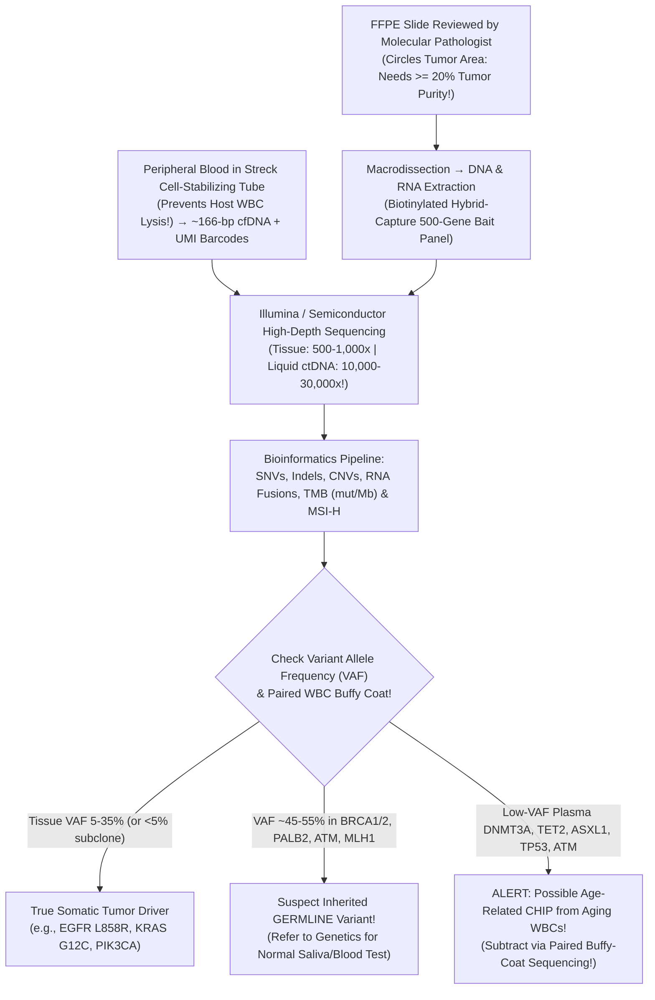
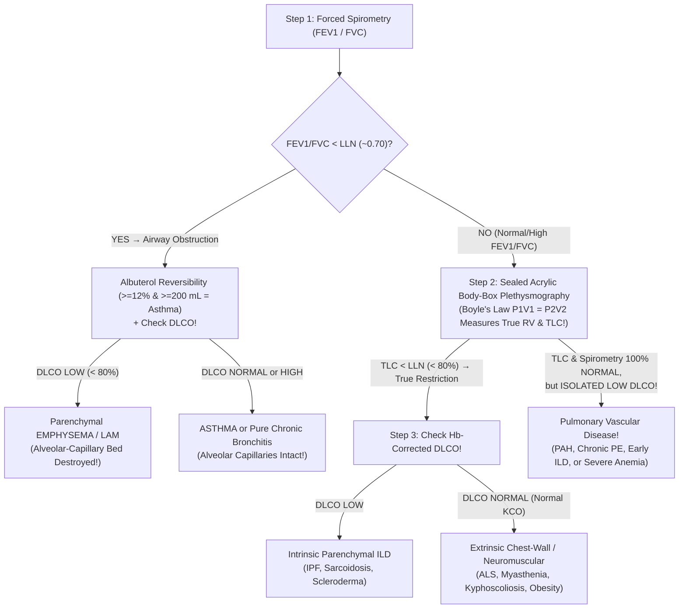

# Basic Medical — Behind the Curtain Clinical Diagnostics Notebook
## Volume VIII: Anatomic Pathology, Biopsy, Frozen Section, `IHC`, Tumor `NGS`, Liquid Biopsy & Bedside/Invasive Physiological Procedures

> *"Radiology reveals the shadow of a mass; Anatomic Pathology names its soul, its lineage, its molecular engine, and its exact vulnerability to therapy—while physiological laboratories wire living myocardium, alveoli, gastrointestinal mucosa, peripheral nerves, and cerebral cortex directly to Maxwell's, Einthoven's, Poiseuille's, and Boyle's equations."*

---

## Architectural Orientation: Tissue-to-Diagnosis & Bedside Physiological Pipelines

| Diagnostic Domain | Primary Specimen or Physiological Signal | Core Laboratory / Procedural Engine | Typical Turnaround Time (`TAT`) | Decisive Clinical Output |
| :--- | :--- | :--- | :--- | :--- |
| **Routine Surgical Pathology (`FFPE` + `H&E`)** | Core needle biopsy, endoscopic pinch, or surgical organ resection | `10%` Formalin cross-linking -> Ethanol/Xylene/Paraffin processor -> `4-µm` microtome -> Hemalum/Eosin | **`2–5` Business Days** (`+1–2 d` if `EDTA` bone decalcification) | Definitive benign vs. malignant architecture, histologic grade, lymphovascular invasion, inked surgical margin clearance (`R0` vs `R1`) |
| **Intraoperative Frozen Section (`Cryostat`)** | Fresh unfixed surgical margin, sentinel node, or unknown mass | `-24°C` `OCT` ice embedding -> `5-µm` cryosection -> `60-sec` rapid `H&E` | **`15–20 Minutes`** (patient asleep in OR!) | Immediate intraoperative surgical guidance (re-excise positive margin vs. close incision) |
| **Immunohistochemistry (`IHC`) & `FISH`** | Unstained `4-µm` charged slides cut from `FFPE` block | `97°C` `HIER` epitope unmasking -> Monoclonal `Ab` -> Polymer-`HRP/DAB` brown precipitate or fluorescent `DNA` probes | **`+24–48 Hours`** after initial `H&E` | Lineage of unknown primary (`TTF-1, PAX8, CDX2, GATA3`), `ER/PR/HER2`, `PD-L1`, `MMR`, `ALK/BCL2` rearrangements |
| **Tumor `NGS` & Plasma `ctDNA` Liquid Biopsy** | `FFPE` tumor curls (`>= 20%` purity) or `Streck`-tube peripheral plasma | Hybrid-capture `DNA/RNA` bait sequencing + `UMI` molecular barcoding (`0.05% VAF`) | **`7–14` Calendar Days** (`5–7 d` for plasma `ctDNA`) | Actionable driver mutations (`EGFR, KRAS G12C, BRAF`), RNA fusions, `TMB`, `MSI-H`, resistance clones (`ESR1`), `CHIP` subtraction |
| **Cardiopulmonary, `GI` & Neuro Physiology** | Millivolt biopotentials, coronary pressures (`Pd/Pa`), lung volumes (`DLCO`), mucosal `NBI` optics | `12-Lead ECG`, Cath-lab `FFR/iFR`, `Boyle's Law` body box, `CO2` videoendoscopy, `NCS/EMG`, `10–20 EEG/PSG` | **Real-Time (`Seconds to Hours`)** | `STEMI` culprit artery, hemodynamic ischemia (`FFR <= 0.80`), emphysema vs. asthma, precancerous adenoma resection, demyelination vs. axonopathy |

---

## Dossier 8.1: Why Does My Biopsy Take Five Days? — Inside the Surgical Pathology Grossing Bench, Overnight Xylene Processor, `4-µm` Microtome, `H&E` Chemistry & 15-Minute OR Frozen Sections

Every single day in clinics around the world, anxious patients ask the exact same question: *"A blood test comes back in one hour and a CT scan takes five minutes—why do I have to wait four or five agonizing days to find out if my breast core biopsy or colon polyp is cancer?"*

Behind the badge-locked double doors of the **Anatomic Pathology Laboratory**, tissue cannot simply be placed under a microscope: raw human flesh is opaque, soft as warm gelatin (impossible to slice to single-cell transparency), and begins digesting itself via ruptured lysosomal hydrolases (**autolysis**) within minutes of losing its arterial blood supply. Converting a `3-cm` surgical mass into a jewel-like, **`4-micrometer`-thin** stained glass slide requires an unforgiving, multi-day physicochemical marathon (*Bancroft's Theory and Practice of Histological Techniques*, 8th ed.; *Robbins & Cotran Pathologic Basis of Disease*, 10th ed.):

---

### 1. Day 1, Hours `0–2`: Accessioning, Surgical Margin Inking & The `3-mm` Grossing Rule

1. **Zero-Tolerance Two-Identifier Chain of Custody**: Unlike a peripheral blood draw—which can always be repeated if a tube breaks—a `4-mm` vocal cord biopsy or excised melanoma is **irreplaceable**. Accessioning clerks match two patient identifiers + exact anatomic site laterally against the electronic surgical pathology requisition and laser-etch a permanent `2D` barcode directly onto chemical-resistant **Acetal Polymer Histology Cassettes** (standard xylene/alcohol dissolves ordinary ink markers instantly!).
2. **The Pathologists' Assistant (`PA`) & `6`-Color Surgical Margin Inking**: At the ventilated downdraft **Grossing Bench**, the surgeon has placed orienting silk sutures on the excised breast lumpectomy (`"Short stitch = Superior, Long stitch = Lateral"`). Before a scalpel ever touches the specimen, the Pathologists' Assistant blots the outer surface dry, paints all **six anatomic surgical surfaces with distinct insoluble colored inks** (`Black = Deep/Posterior`, `Blue = Superior`, `Green = Anterior`, `Yellow = Inferior`, `Red = Medial`, `Orange = Lateral`), and mists the specimen with **5% Acetic Acid or Bouin's mordant**—locking each pigment chemically onto external collagen so colors never bleed into adjacent faces! Why? Four days later under the `400×` microscope, if invasive ductal carcinoma cells physically kiss the **green ink**, the pathologist tells the breast surgeon not merely *"margin positive,"* but **"re-excise ONLY the Anterior cavity wall (`0 mm` to green ink); the other five walls are clear (`> 5 mm`)!"**
3. **"Bread-Loafing" to `<= 3 mm` Thickness**: Because chemical fixatives and molten wax penetrate tissue purely by slow passive diffusion, the `PA` serially sections organs into `2–3 mm` slices (`the thickness of a nickel`) and places selected cross-sections of tumor, tumor-to-normal border, inked margins, and every dissected regional lymph node into perforated cassettes (`never stuffing > 50% of cassette volume`, or fluid circulation chokes and the center turns necrotic!).

---

### 2. Day 1, Hours `2–14`: `10%` Neutral Buffered Formalin Chemistry — And The Three Specimens Formalin Ruins Forever!

#### A. Why "`10%` Formalin" Is Actually `3.7–4.0%` Formaldehyde + Fick's Law Diffusion
Pure formaldehyde ($\text{H}_2\text{C=O}$) is a pungent gas that saturates in water at **`37–40%` weight/volume** (sold commercially as `100%` stock *"Formalin"*). Diluting that saturated stock **`1:10`** in `pH 7.0–7.4` sodium phosphate buffer yields universal **`10%` Neutral Buffered Formalin (`NBF`)** = **`3.7–4.0%` dissolved formaldehyde** (buffered precisely at neutral `pH` because unbuffered acidic formalin oxidizes into formic acid, which reacts with red-cell hemoglobin to precipitate ugly black-brown **"formalin pigment" [acid hematin]** granules mimicking malaria or melanin!).

* **Diffusion Penetration vs. Covalent Cross-Linking Time**:
  Formalin penetrates tissue via **Fick's Law** ($d = k\sqrt{t}$, averaging **`~1.0 mm per hour`** from each cut face—so a `3-mm` biopsy core is physically soaked in `1.5–2 hours`, whereas an uncut `8-cm` uterus dropped whole into a bucket overnight stays raw, autolyzed pink mush inside!). Even *after* methylene glycol reaches the center, the two-step **protein cross-linking reaction** requires **`6 to 24+ hours`** to reach chemical equilibrium:
  $$\text{Protein-Lys-NH}_2 + \text{H}_2\text{C=O} \;\xrightleftharpoons{\text{fast (min)}}\; \text{Protein-Lys-NH-CH}_2\text{OH} \;\xrightarrow{+\,\text{H}_2\text{N-R' (slow, 6–24 hr)}}\; \text{Protein-Lys-NH}-\mathbf{CH_2}-\text{NH-R'} + \text{H}_2\text{O}$$
  > [!IMPORTANT]
  > **The `ASCO/CAP` Breast Biomarker Fixation Window (`Cold Ischemia <= 1 Hour`, `10% NBF` for `6–72 Hours`)**:
  > Every operating room records two mandatory timestamps on breast biopsies and mastectomies: (1) **Devitalization / Excision Time** and (2) **Time Placed in Formalin**. Leaving a breast tumor sitting unfixed on an OR back-table for `> 1 hour` (**prolonged Cold Ischemia**), *under-fixing* `< 6 hours`, or *over-fixing* `> 72 hours` degrades Estrogen Receptor (`ER`), Progesterone Receptor (`PR`), and `HER2` epitopes—risking a **catastrophic false-negative `"Triple-Negative"` misdiagnosis** that denies a curable patient life-saving endocrine or anti-`HER2` therapy!

#### B. NEVER Drop in Formalin! The Critical Specimen Triage Exceptions
In the operating room, clinic, or radiology procedure suite, reflexively dropping *every* biopsy into a pre-filled formalin jar is one of clinical medicine's costliest irreversible errors:

| Clinical Scenario & Biopsy Type | Why `10%` Formalin Destroys the Diagnosis | Mandatory Transport & Fixation Protocol Behind the Curtain |
| :--- | :--- | :--- |
| **1. Excisional Lymph Node Biopsy (`Rule Out Lymphoma`)** | Formalin kills `100%` of cells instantly and welds membrane proteins together—making single-cell laser **Flow Cytometry (`kappa/lambda` light-chain clonality, `CD5/CD10/CD19/CD20/CD23`)** and metaphase **Cytogenetic Karyotyping** physically impossible! | Send **FRESH UNFIXED** immediately on saline-dampened sterile gauze (never floating in water, which lyses cells osmotically!) or in pink **`RPMI-1640` Nutrient Media** so pathology can divide into `RPMI` (`Flow/Cytogenetics`) + `10% NBF` (`H&E/IHC`) + snap-frozen! |
| **2. Medical Native or Transplant Renal Core Biopsy (`Glomerulonephritis`)** | Formalin cross-links hide native glomerular immunoglobulin & complement epitopes (`ruining Direct Immunofluorescence`) and causes ultrastructural shrinkage insufficient for `100,000×` electron beams! | Split immediately under bedside dissecting scope into **3 vials**: • **`10% NBF`** -> Light Microscopy (`H&E, PAS, Jones Silver, Trichrome`) • **`Zeus` / `Michel's` Medium (or fresh `OCT` freeze)** -> **Direct `IF`** (`IgG, IgA, IgM, C3, C1q, PLA2R, κ/λ`) • **`2.5%` Buffered Glutaraldehyde** -> **Electron Microscopy (`EM` podocyte foot processes & `GBM` deposits)**! |
| **3. Excised Joint Tophus / Synovium (`Rule Out Gout`)** | `10% NBF` is **`90%` water**—and **Monosodium Urate (`MSU`) gout crystals dissolve completely in water** overnight, leaving empty clefts that cannot exhibit negative birefringence! | Place tissue directly into **`100%` Absolute Ethanol** (`anhydrous alcohol preserves water-soluble urate crystals intact for polarized microscopy!`). |
| **4. Deep Tissue Biopsy for Infection (`Fungal / Mycobacterial / Bacterial Culture`)** | Formaldehyde sterilizes every living microbe on contact! (`Only low-sensitivity tissue stains or 16S/ITS PCR remain`). | Divide with sterile instruments *before* touching formalin: send half in a **sterile dry/saline cup to Microbiology**, half in `10% NBF` to Surgical Pathology! |
| **5. Calcified Bone Marrow Core or Bone Metastasis (`Needs Molecular NGS!`)** | Cortical/trabecular bone shatters microtome blades unless decalcified—but fast **`10% HCl` / nitric mineral acid** strips purine bases (**depurination**), shredding `DNA` & `RNA` into `< 50-bp` fragments that **fail `NGS` and `FISH` `100%` of the time**! | Fix in `10% NBF`, then decalcify gently in **neutral `10–14% EDTA` (`pH 7.2` calcium chelator)** (`adds 24–48 hours to TAT, but preserves pristine intact DNA/RNA for myeloid/tumor NGS!`). |

---

### 3. Night 1, Hours `14–26`: The Overnight Vacuum Tissue Processor — Bridging Water to Molten Wax via Xylene

At `5:00 PM`, fixed cassettes are loaded into a sealed stainless-steel retort inside an **Automated Vacuum-Pressure Tissue Processor**. Why does this take all night (`10–12 hours`)? Because **fixed human tissue is `70%` water, whereas solidifying slicing paraffin wax (`mp 58°C`) is `100%` hydrophobic hydrocarbon**—drop wet tissue straight into molten wax and zero wax enters! The machine executes a **three-stage solvent bridge** under gentle heat (`40–60°C`) and alternating vacuum/pressure cycles:

1. **Stage 1 — Graded Ethanol Dehydration (`70% -> 80% -> 95% -> 100% Absolute Ethanol × 3 baths`)**: Stepping concentration upward gradually draws every molecule of free water out of cells without violent osmotic crinkling.
2. **Stage 2 — Clearing in `Xylene` (`Dimethylbenzene × 3 baths`)**: Even `100%` anhydrous ethanol refuses to mix with molten paraffin wax! **Xylene** is an aromatic hydrocarbon uniquely miscible with **both `100%` ethanol AND molten paraffin**. As xylene replaces ethanol, two remarkable visual transformations occur:
   * Because xylene's refractive index ($n \approx 1.497$) closely matches dehydrated tissue collagen/protein ($n \approx 1.53$), light stops scattering off internal interfaces and the opaque tan biopsy suddenly turns **amber-translucent ("cleared")**!
   * Because xylene is a potent nonpolar organic fat solvent, **all unfixed neutral triglycerides dissolve out into the xylene bath overnight**! That is why subcutaneous **adipocytes**, **bone marrow fat spaces**, **lipoblasts**, and **macrovesicular fatty liver (`steatosis`) vacuoles** appear as **crisp, optically empty white circles ("signet-ring holes")** on every routine `H&E` slide! (If a pathologist needs to *prove* an empty vacuole contained lipid rather than glycogen or water—e.g., fat embolism syndrome or sebaceous carcinoma—fresh frozen tissue skipping xylene must be stained with lipophilic **`Oil Red O`** or **`Sudan Black B`**!).
3. **Stage 3 — Molten Paraffin Infiltration & `6:00 AM` `FFPE` Block Embedding**: Vacuum suction boils out residual xylene while **`58–60°C` molten purified paraffin wax** (blended with plastic polymers for ribbon elasticity) permeates every microscopic organelle space. At dawn on Day 2, a skilled Histotechnologist (`HTL`) lifts each warm tissue piece with heated forceps, **orients it precisely** inside a stainless-steel base mold (e.g., standing a `1-mm` skin shave or colon mucosal strip strictly **on edge** so epidermis-to-dermis depth or crypt-to-muscularis mucosae architecture shows vertically rather than tangentially!), snaps the barcoded cassette backing on top, fills with wax, and freezes it solid on a `-5°C` cold plate into an immortal **`FFPE` (Formalin-Fixed, Paraffin-Embedded) Block**!

---

### 4. Day 2, Hours `26–36`: The `4-µm` Rotary Microtome & Exact `H&E` Acid-Base Coordination Chemistry

#### A. Slicing Thinner Than a Single Red Blood Cell (`4 µm`)
Why **`4 micrometers` (`0.004 mm`)**? A human hepatocyte or carcinoma cell is `15–25 µm` wide, and an erythrocyte is `7.5 µm` wide. If you sliced tissue `25 µm` thick, three to four layers of nuclei would stack atop one another like marbles in a jar, blocking transmitted light and obscuring chromatin detail! Clamping the chilled `FFPE` block into a precision **Rotary Microtome**, each `360°` turn of the flywheel advances the block **exactly `4 µm`** (`2–3 µm` for delicate renal glomeruli and lymph nodes!) down across a razor-sharp disposable tungsten-carbide/steel blade, peeling off a continuous gossamer **paraffin ribbon**.

The histotech floats that delicate ribbon onto a **`42–45°C` warm distilled water bath**—surface tension + gentle warmth (`~12°C` below wax's melting point) instantly flattens every microscopic accordion fold! Dipping a **positively charged (`+` aminoalkylsilane-coated) glass slide** underneath lifts the section cleanly; baking at `60°C` melts wax into glass pores while electrostatic attraction locks negatively charged tissue glycoproteins onto the `+` glass. Next, an automated stainer runs the **exact reverse of overnight processing** (**`Xylene` strips out all hydrophobic wax -> `100% -> 95% -> 70% Ethanol` -> `Distilled Water`**) so water-soluble `H&E` dyes can enter the rehydrated tissue!

#### B. How Two Dyes Paint Every Organ on Earth: Hematoxylin (`Hemalum` Mordant) & Eosin Y
Almost every medical student learns *"Hematoxylin is a basic dye that stains acidic DNA blue, and Eosin is an acidic dye that stains basic proteins pink"*—yet chemically, **pure hematoxylin is neither basic nor even a dye!** Here is what actually happens inside the stainer (*Bancroft*, Ch. 9):

1. **Hematoxylin -> Hematein -> Cationic Metal-Mordant `"Hemalum"` (`Blue-Purple Nuclei`)**:
   * **Natural Extraction & Ripening**: Extracted from heartwood of the Central American logwood tree (*Haematoxylon campechianum*), native **Hematoxylin** is colorless and unreactive until oxidized (chemically via **sodium iodate, $\text{NaIO}_3$**, in Harris/Mayer formulas) by removing two hydrogens into **Hematein**. Even oxidized hematein carries a weak *negative* charge and washes right off nuclei!
   * **The Trivalent Metal Mordant Bridge ($\text{Al}^{3+}$ or $\text{Fe}^{3+}$)**: Mixing hematein with excess **Potassium Aluminum Sulfate ("Alum", $\text{Al}^{3+}$)** chelates the dye into a bulky, strongly **positively charged cationic metal-dye coordination complex called `Hemalum` (`[Hematein–Al]^{2+}`)**! Cationic Hemalum forms tenacious coordinate-covalent bonds with **anionic (`-PO4-`) phosphodiester groups along nuclear `DNA`**, staining condensed **heterochromatin**, **mitotic figures**, **nucleoli (`rRNA`)**, ribosome-packed **rough endoplasmic reticulum** (`giving immunoglobulin-factory Plasma Cells their classic deep purple "amphophilic" cytoplasm!`), **apoptotic karyorrhectic debris**, **bacterial colonies**, **hyaline cartilage matrix (`-SO4^{2-}` glycosaminoglycans)**, and **dystrophic calcium deposits**!
   * **Acid Differentiation & Alkaline `"Bluing"`**: In regressive Harris staining, a `5-second` dip in **`0.5%` HCl Acid-Alcohol** strips loosely bound dye off background collagen, leaving nuclear Hemalum in its protonated **soluble reddish-maroon state**; plunging the slide into **`pH 8.0` Scott's Tap Water Substitute (`MgSO4 + NaHCO3`)** deprotonates the aluminum chelate into an **insoluble crisp royal-blue/violet lake**!
2. **Eosin Y (`Anionic Brominated Fluorescein` -> `3` Diagnostic Shades of Pink/Coral)**:
   * **Eosin Y (`Yellowish`, tetrabromofluorescein)** carries negatively charged **`-COO-` and `-O-` groups**. In weak acetic acid (`pH 4.6–5.0`), intracellular and stromal **lysine, arginine, and histidine** amino groups become maximally protonated (**`-NH3+`**), attracting anionic Eosin electrostatically!
   * **Quality-Control Check on Every Slide**: A properly balanced `H&E` MUST display **three distinct pink-orange tonalities** side-by-side: (1) **vivid coral-orange** intact red blood cells and eosinophil granules (`major basic protein`, rich in arginine!), (2) **rich rose-pink** smooth/skeletal/cardiac muscle sarcoplasm and hepatocyte mitochondria (`packed in Oncocytomas!`), and (3) **soft pale pastel pink** extracellular dermal/stromal collagen! Cover-slipped under synthetic resin (`n = 1.52`, matching glass so light exits cleanly without refraction), the slide finally reaches the pathologist's desk!

---

### 5. The `15-Minute` Intraoperative Frozen Section (`Cryostat` & `Mohs` Surgery): How Pathology Races Anesthesia

What if a neurosurgeon has a craniotomy open over a ring-enhancing frontal lobe lesion (`glioblastoma` vs `metastasis` vs `lymphoma`—remember **you do NOT resect primary `CNS` lymphoma**, whereas you maximally debulk glioblastoma!), or a hepatobiliary surgeon needs to know whether the `2-mm` pancreatic neck transection margin of a Whipple procedure is clear of adenocarcinoma *right now* while the patient lies intubated under sevoflurane? Waiting `48 hours` for xylene and paraffin is out of the question!

#### Minute-by-Minute Inside the Frozen Section Suite (`TAT Benchmark: <= 20 Minutes`!):
1. **Minute `0–3` (`Zero Formalin!` -> `OCT` Chuck Mounting)**: A circulating OR nurse hands the **fresh, completely unfixed** specimen directly through the sub-sterile window (if someone accidentally dropped it in formalin, water cross-linking ruins rapid cryosectioning!). The pathologist/resident inks the true surgical margin, places a `3-mm` slice flat onto a grooved metal cryostat chuck flooded with viscous clear **`OCT` Compound (`Optimal Cutting Temperature`: water-soluble polyvinyl alcohol + polyethylene glycol)**, and sets a heavy `-26°C` stainless-steel heat-extractor bar on top inside the **`-22°C` to `-28°C` Cryostat Chamber**.
2. **Minute `3–7` (Ice Replaces Paraffin!)**: Within `60 seconds`, `OCT` turns snow-white opaque and **cellular water freezes rock-hard—acting as its own internal mechanical support matrix in place of paraffin wax**! Turning the external cryostat handwheel slices **`5-µm` frozen ribbons**, which instantly melt-adhere when touched with a **room-temperature (`+22°C`) `+`-charged glass slide**!
3. **Minute `7–11` (`60-Second` Rapid `H&E`)**: Plunged immediately (`within 1 second` before air-drying bloats cells!) into `95%` ethanol fixative (`15 sec`) -> water -> concentrated Hematoxylin (`30 sec`) -> bluing (`10 sec`) -> Eosin (`15 sec`) -> ethanols -> xylene -> coverslip!
4. **Minute `11–18` (Microscope to OR Speakerphone)**: Two pathologists verify patient identity aloud from the surgical whiteboard into the **intercom speakerphone inside the operating room**: *"Frozen Section `FS-1` on Jane Doe, MRN `...`, Pancreatic Neck Margin: **Negative for carcinoma; benign pancreatic ducts and acini present.**"*

> [!WARNING]
> **Why Frozen Sections Carry Known Artifacts — And Which Two Tissues Defy the Cryostat**:
> 1. **Ice-Crystal `"Freeze Artifact"`**: Water expands `9%` on freezing, forming microscopic ice crystals that punch tiny Swiss-cheese vacuoles into stroma and **optically clear out nuclei**—making normal follicular thyroid cells mimic *"Orphan Annie eye"* papillary thyroid carcinoma nuclei (`which is why follicular thyroid neoplasms and melanocytic dysplastic nevi/melanoma sentinel nodes are NOT diagnosed definitively on frozen section!`). Once the frozen call is made, the remaining `OCT` tissue is thawed in warm formalin and processed into a permanent `FFPE` control slide (`"Frozen Section Control"`) the next morning to confirm concordance!
> 2. **Pure Adipose Tissue (`Fatty Breast Margins` & Lipomas)**: Triglyceride fat does not freeze solid until **`-35°C` to `-50°C`**—a temperature at which adjacent aqueous glands turn brittle and shatter like glass! At `-24°C`, fatty breast tissue smears like soft butter over the microtome knife, leaving gaping holes (`touch-imprint cytology / gross distance is often superior for fatty breast margins`).
> 3. **Calcified Cortical Bone & Tooth Enamel**: Cannot be cut un-decalcified on a steel cryostat blade (`scrape/imprint cytology of soft marrow between bony trabeculae is used instead!`).

---

## Dossier 8.2: Molecular & Special Anatomic Diagnostics — Histochemistry, `IHC`, `FISH`, Cytopathology (`Pap` / `ROSE`), Tumor `NGS` & Liquid Biopsy `ctDNA`

### 1. Classic Special Histochemical Stains: Chemical Reactions Before Antibodies Existed

When `H&E` shows suspicious pink amorphous material, granulomatous necrosis, or cryptogenic cirrhosis, pathologists order targeted **Special Chemical Stains** (`ready in 4–24 hours`):

| Special Stain | Chemical Mechanism | Visual Color Readout | Signature Pathologies Diagnosed |
| :--- | :--- | :--- | :--- |
| **`PAS` (`Periodic Acid–Schiff` $\pm$ Diastase `PAS-D`)** | $\text{HIO}_4$ oxidizes `1,2-vicinal` sugar diols into dialdehydes (`-CHO`) -> colorless **Schiff leukofuchsin** turns **vivid magenta** (`Diastase` $\alpha$-amylase digests glycogen away to prove specificity!) | **Brilliant Magenta** | Fungal walls (*Candida, Aspergillus, Mucor*), glomerular basement membranes, **Whipple disease** foamy macrophages, **`PAS-D`-resistant $\alpha_1$-antitrypsin globules** in liver! |
| **`GMS` (`Gomori Methenamine Silver`)** | Chromic acid oxidizes fungal cell-wall polysaccharides -> reduces `[Ag(NH3)2]+` to **metallic black `Ag0`** | **Jet-Black Organism Outlines** on green background | Gold standard for ***Pneumocystis jirovecii*** (`crushed ping-pong balls` with dark central dots in `BAL`), *Histoplasma*, *Coccidioides*, *Aspergillus* (`45°` septate branches). |
| **`Ziehl-Neelsen` (`AFB`) & `Fite` Stain** | Heat/phenol drives **Carbolfuchsin** through waxy **mycolic acid** envelopes; resists `3%` HCl-alcohol stripping! (`Fite` uses peanut/mineral oil to protect delicate *M. leprae* coats) | **Bright Red Beaded Rods** on methylene-blue background | ***Mycobacterium tuberculosis***, *M. avium* complex (`MAC`), *M. leprae*, and *Nocardia* (`weakly/partially acid-fast` on modified `Fite`!). |
| **`Congo Red` (`+ Polarized Light`)** | Linear planar diazo dye aligns parallel inside cross-$\beta$-pleated sheet (`8–10 nm` non-branching) fibrils | Salmon-pink (`brightfield`) -> **Apple-Green Birefringence** (`crossed polarizers`!) | Systemic & localized **Amyloidosis** (`AL` light-chain, `ATTR` cardiac transthyretin, `AA` inflammatory, `Aβ` cerebral, medullary thyroid `calcitonin` amyloid; subtyped definitively via **Laser Microdissection Mass Spectrometry [`LC-MS/MS`]**!). |
| **`Perls' Prussian Blue`** | Acidified potassium ferrocyanide ($\text{K}_4[\text{Fe(CN)}_6]$) reacts with stored ferric **$\text{Fe}^{3+}$ hemosiderin** (`ferritin aggregates`) | **Deep Prussian Blue Granules** | **Hereditary Hemochromatosis** (`HFE` periportal hepatocyte iron), **`MDS` Ringed Sideroblasts** (`>= 5` mitochondrial iron granules ringing erythroblast nucleus on marrow aspirate!), alveolar hemorrhage macrophages. |
| **`Masson's Trichrome` & `Reticulin`** | Differential pore-size dye exclusion (`Aniline Blue` binds Type I collagen) & Ammoniacal Silver (`Type III` reticulin) | **Blue Collagen** vs. **Red Hepatocytes/Muscle**; **Black Reticulin Net** | Stages **Liver Fibrosis (`Metavir F0–F4` bridging cirrhosis)** & renal interstitial scarring; **Reticulin loss/widening (`> 3 cells thick`)** distinguishes malignant **Hepatocellular Carcinoma** from benign regenerative nodules, while marrow reticulin grades **Myelofibrosis (`MF 0–3`)**! |

---

### 2. Immunohistochemistry (`IHC`): Unmasking Formalin Bridges with Heat & Painting Epitopes Brown (`HRP-DAB`)

Two poorly differentiated tumors—a metastatic lung adenocarcinoma, a bladder carcinoma, an amelanotic melanoma, and a diffuse large B-cell lymphoma—can look **100% identical** (`sheets of large pleomorphic pink-and-blue cells`) on routine `H&E`! **Immunohistochemistry (`IHC`)** turns monoclonal antibodies into molecular GPS beacons directly on `4-µm` `FFPE` slides:

1. **Why `IHC` Failed on `FFPE` Until 1991 — Heat-Induced Epitope Retrieval (`HIER`)**:
   Remember those covalent methylene bridges (`-CH2-`) formalin built across lysine side chains? They fold neighbor proteins right over antigenic `3D` epitopes like a locked cage! In 1991, Shan-Rong Shi discovered that immersing deparaffinized slides in **`95–98°C` buffered Citrate (`pH 6.0`) or `Tris-EDTA` (`pH 9.0`)** hydrolyzes formalin cross-links *without* detaching tissue from `+`-charged slides—popping native protein epitopes wide open!
2. **The Polymer-`HRP` + `DAB` Chromogen Cascade**:
   After blocking endogenous tissue peroxidases with $\text{H}_2\text{O}_2$, an automated immunostainer incubates a **clone-specific Primary Monoclonal Antibody** (`e.g., Mouse anti-TTF-1 [clone 8G7G3/1]`), washes unbound antibody away, adds a **Dextran Polymer Spine carrying Secondary Antibodies + dozens of Horseradish Peroxidase (`HRP`) enzymes**, and floods the slide with colorless **`DAB` (`3,3'-diaminobenzidine`) + $\text{H}_2\text{O}_2$**. Everywhere `HRP` sits, enzymatic oxidation polymerizes `DAB` into a **razor-sharp, permanent, dark mahogany-brown precipitate** locked within `0.2 µm` of the target protein (**Nuclear** for transcription factors `TTF-1, PAX8, CDX2, GATA3, ER, Ki-67`; **Crisp Chicken-Wire Membranous** for `HER2, CD20, PD-L1`; **Cytoplasmic** for `Cytokeratins, Synaptophysin, HepPar-1`)! *(In heavily pigmented melanomas where brown melanin mimics brown `DAB`, pathologists switch to **Alkaline Phosphatase + Fast Red chromogen**, painting positive tumor cells vivid crimson red!)*

#### A. How Pathologists Solve a Liver or Bone "Carcinoma of Unknown Primary (`CUP`)"
First, broad lineage screen separates **Pan-Cytokeratin (`AE1/AE3`)+ Carcinoma** from **`CD45`+ Lymphoma**, **`SOX10 / S100 / Melan-A`+ Melanoma**, and **`Vimentin / Desmin / SMA / CD34 / ERG`** Sarcomas. Next, pairing **Cytokeratin 7 (`CK7`, simple ductal epithelia above the diaphragm/Mullerian)** and **Cytokeratin 20 (`CK20`, lower GI intestinal & urothelial/Merkel)** with nuclear **Lineage-Defining Transcription Factors** pinpoints the exact primary organ in `> 90%` of cases:

| `CK7 / CK20` Coordinate Quadrant | Top Candidate Primary Cancers | Decisive Confirmatory Nuclear / Cytoplasmic `IHC` Panel |
| :--- | :--- | :--- |
| **`CK7+ / CK20-`** | • **Lung Adenocarcinoma** • **Breast Carcinoma** • **Mullerian (Ovary / Endometrium)** • **Thyroid Carcinoma** • **Pancreaticobiliary / Gastric** | • **`TTF-1+` & `Napsin A+`** (Lung Adenocarcinoma) • **`GATA3+`, `ER/PR+`, `Mammaglobin / GCDFP-15+`** (Breast) • **`PAX8+`, `WT1+` (serous), `ER+`** (Mullerian) • **`TTF-1+` AND `PAX8+` AND `Thyroglobulin+`** (Follicular/Papillary Thyroid; `+ Calcitonin` = Medullary!) • **`SMAD4 (DPC4)` loss (`~55%`), `CA19-9+`, `MUC5AC+`** (Pancreaticobiliary) |
| **`CK7- / CK20+`** | • **Colorectal Adenocarcinoma** • **Merkel Cell Skin Carcinoma** | • **`CDX2+` & `SATB2+`** (Colorectal; `SATB2` distinguishes colon from upper GI mucinous!) • **Perinuclear `"Dot-Like"` `CK20+` + `Synaptophysin+` + `MCPyV`** (Merkel Cell) |
| **`CK7+ / CK20+`** | • **Urothelial (Bladder / Ureter) Carcinoma** • **Mucinous Ovarian / Pancreatic / Gastric** | • **`GATA3+`, `p63/p40+`, `Uroplakin II+`** (Urothelial Carcinoma) |
| **`CK7- / CK20-`** | • **Prostate Adenocarcinoma** • **Hepatocellular Carcinoma (`HCC`)** • **Clear-Cell Renal Cell Carcinoma (`ccRCC`)** • **Squamous Cell Carcinoma (`SCC`)** • **Neuroendocrine Tumor (`NET / SCLC`)** | • **`NKX3.1+` (`>98%` sensitive even in bone mets!), `PSA+`, `AMACR+`** (Prostate) • **`Arginase-1+`, `HepPar-1+`, canalicular `pCEA+`, `Glypican-3+`** (`HCC`) • **`PAX8+`, box-like membranous `CAIX+`, `RCC+`, `CD10+`** (`ccRCC`) • **`p40+` (`ΔNp63`, far more specific than `p63`!) & `CK5/6+`** (Squamous) • **`INSM1+` (nuclear), `Synaptophysin+`, `Chromogranin A+`** (Neuroendocrine) |

#### B. Therapeutic & Predictive Biomarker `IHC` Every Oncologist Reads Verbatim
* **Breast `ER / PR` (`>= 1%` nuclear positivity = Endocrine-sensitive; `1–10%` = `ER-Low`) & `HER2` (`0, 1+, 2+, 3+`)**:
  * **`HER2 3+`**: Uniform intense complete circumferential membrane staining in `> 10%` of tumor cells -> **Directly `HER2`-Positive** (`Trastuzumab + Pertuzumab`).
  * **`HER2 2+` (Equivocal)**: Weak-to-moderate complete membrane staining in `> 10%` -> **Mandatory Reflex `HER2/CEP17` Dual-Probe `FISH`**!
  * **`HER2-Low` (`IHC 1+` or `IHC 2+ / FISH-Negative`)**: Historically lumped as `"HER2-Negative"` and ignored—until the landmark **`DESTINY-Breast04` Trial** proved that the bystander-payload antibody-drug conjugate **`Trastuzumab deruxtecan` (`T-DXd`)** doubles progression-free survival in `HER2-Low` metastatic breast cancer! Pathologists must now distinguish `IHC 0` (`faint/absent`) from `IHC 1+` with microscopic precision!
* **Mismatch Repair (`MMR`: `MLH1`, `PMS2`, `MSH2`, `MSH6`) — Universal Lynch Syndrome & Immunotherapy Gatekeeper**:
  Because `MMR` proteins function as obligate **heterodimers** (`MLH1` stabilizes `PMS2`; `MSH2` stabilizes `MSH6`), healthy stromal lymphocytes and normal crypts **MUST stain `100%` brown nuclear positive (`internal positive control`)**! Complete **LOSS of nuclear staining inside tumor nuclei** (`e.g., MLH1- / PMS2- lost` -> check `BRAF V600E` / `MLH1` promoter hypermethylation to separate sporadic colorectal/endometrial cancer from germline **Lynch Syndrome**; `MSH2- / MSH6- lost` -> almost always **Lynch Syndrome**!) diagnoses **Mismatch Repair Deficiency (`dMMR` / `MSI-H`)**—predicting dramatic durable responses to **`PD-1` Checkpoint Blockade (`Pembrolizumab / Dostarlimab`)** while warning oncologists that single-agent `5-FU` adjuvant chemotherapy is ineffective in Stage II colon cancer!
* **`PD-L1` (`22C3` / `SP263`)**: Scored as **Tumor Proportion Score (`TPS` = `%` viable tumor cells showing partial/complete membrane staining — used in `NSCLC`: `TPS >= 50%` unlocks single-agent `Pembrolizumab`!)** versus **Combined Positive Score (`CPS` = `[PD-L1+ tumor cells + lymphocytes + macrophages] / total viable tumor cells × 100` — used in gastric, esophageal, cervical, head & neck, and triple-negative breast cancers!)**.

---

### 3. `FISH`, Liquid-Based Cytopathology (`Pap` + `ROSE`) & Hybrid-Capture Tumor `NGS` vs. Liquid Biopsy `ctDNA`

#### A. Fluorescence *In Situ* Hybridization (`FISH`): Counting Chromosomal Breaks in Interphase `FFPE` Nuclei
Unlike conventional karyotyping (which requires living dividing metaphase cells), **`FISH`** anneals fluorescently labeled `100–500 kb` `DNA` probes directly onto formalin-fixed interphase nuclei viewed under darkfield epifluorescence filters:
* **Dual-Color Dual-Fusion Probes (`e.g., BCR` [Green `22q11`] + `ABL1` [Red `9q34`] in `CML`)**: Normal cell shows `2 Red + 2 Green` separate dots; `t(9;22)` fuses them into **`Yellow` overlapping signals**!
* **Break-Apart Probes (`e.g., ALK, ROS1, RET` in lung; `MYC, BCL2, BCL6` in `"Double-Hit"` High-Grade B-Cell Lymphoma; `EWSR1` in Ewing Sarcoma)**: Red and Green probes flank the `5'` and `3'` sides of *one* promiscuous oncogene. Intact normal alleles glow **fused `Yellow`**; *any* chromosomal translocation splits `5'` from `3'`, separating **`1 Red + 1 Green` dot far apart**—catching rearrangements even when the fusion partner gene is completely novel!
* **Gene Amplification Ratio (`HER2` [Red] / Chromosome 17 Centromere `CEP17` [Green])**: Distinguishes true `HER2` oncogene amplification (`HER2/CEP17 >= 2.0` with `>= 4.0` `HER2` signals/cell) from benign whole-chromosome `polysomy 17`!

#### B. Cytopathology: `ThinPrep` Cervical `Pap` + `HPV` Co-Testing & `EBUS/EUS` `ROSE`
Instead of waiting days for tissue architecture, **Cytopathology** evaluates individual exfoliated or needle-aspirated cells (`Papanicolaou` alcohol-fixed polychrome stain gives crystal-clear nuclear chromatin crispness; air-dried `Diff-Quik` Romanowsky stain highlights cytoplasmic mucin, neuroendocrine granules, and thyroid colloid):
* **Liquid-Based Cervical Screening (`ThinPrep` / `SurePath` + High-Risk `HPV`)**: Sampling the **Cervical Transformation Zone (`Squamocolumnar Junction`)** with a broom/cytobrush rinsed into methanol preservative allows automated filtration onto a clean monolayer **AND** simultaneous molecular testing from the exact same vial for **High-Risk Oncogenic `HPV` (`Types 16, 18` + `12` others whose `E6` degrades `p53` and `E7` inactivates `Rb`!)**. Under the **Bethesda System**, `LSIL` shows classic **koilocytes** (brick-sharp perinuclear cytoplasmic cavitation halo + enlarged `"raisinoid"` crinkled hyperchromatic nucleus), whereas **`HSIL`** shows high nuclear-to-cytoplasmic (`N:C`) ratio basaloid dysplasia prompting colposcopic biopsy / `LEEP`.
* **`ROSE` (`Rapid On-Site Evaluation`) Inside the Bronchoscopy & Endoscopy Suite**: During **Endobronchial Ultrasound (`EBUS-TBNA`)** of mediastinal nodes or **Endoscopic Ultrasound (`EUS-FNA`)** of a deep pancreatic head mass, a cytopathologist wheels a microscope right beside the proceduralist! Within `90 seconds` of each `22G` needle pass, an air-dried `Diff-Quik` smear confirms whether the needle actually hit viable carcinoma (`vs acellular fibrotic pancreatitis or bronchial cartilage!`)—immediately directing extra dedicated needle passes into formalin to build a paraffin **Cell Block** so full `IHC`, `PD-L1`, and `350-gene` `NGS` succeed on the very first procedure without ever calling the patient back!

#### C. Tissue Hybrid-Capture `NGS` vs. Cell-Free Plasma `ctDNA` Liquid Biopsy (And the `CHIP` Trap!)

Behind the molecular pathology report sit four critical quantitative rules every ordering clinician must master:
1. **Why `"Insufficient Tumor Purity (< 15–20%)"` Happens**: If a scirrhous pancreatic adenocarcinoma or post-neoadjuvant breast biopsy contains `5%` cancer cells swimming in `95%` benign desmoplastic fibroblasts and lymphocytes (`each normal diploid cell contributing 2 wild-type alleles!`), a heterozygous mutation lives on only **`2.5%` of extracted `DNA` strands**—dropping copy-number deletion, `TMB`, and `MSI` calls below analytic sensitivity! Pathologists physically **circle and scalpel-macrodissect** the richest tumor cluster off unstained slides to boost purity!
2. **Why `DNA + RNA` Co-Sequencing Beats `DNA`-Only Panels**: Oncogenic gene fusions (`ALK, ROS1, RET, NTRK1/2/3, FGFR2/3, MET exon 14 skipping`) break inside sprawling `50,000-bp` repetitive **introns** that choke short-read `DNA` capture—whereas inside transcribed **`mRNA`**, introns are already cleanly spliced out, placing Exon A directly beside Exon B for `100%`-clear fusion detection!
3. **Reading `VAF` (`Variant Allele Frequency` = Mutant Reads $\div$ Total Depth)**:
   * **`VAF` Is NOT `"Percent of Tumor Cells"`**: In a sample with `40%` tumor purity, a clonal heterozygous driver present in *every single cancer cell* (`1` mutant allele out of `2` alleles in `40%` of cells) yields **`VAF ≈ 20%`**!
   * **The `~50%` Germline Clue**: Whenever a tumor-only `NGS` report flags a pathogenic variant in **`BRCA1, BRCA2, PALB2, ATM, CHEK2, TP53, MLH1, MSH2, VHL`, or `RET`** sitting right near **`VAF 45–55%`** (or `70–90%` due to loss of heterozygosity of the wild-type allele!), it may sit in **every normal cell of the patient's body**—mandating formal genetic counseling and germline confirmation (`unlocking PARP inhibitors like Olaparib plus life-saving cascade screening for the patient's children and siblings!`).
4. **Cell-Free `ctDNA` Liquid Biopsy — `Streck` Tubes, `UMIs` & The Notorious `CHIP` False-Positive Trap**:
   Dying cells shed **`~166-base-pair` fragments of cell-free `DNA` (`cfDNA`)**—the exact length wrapped `1.7` turns around a single histone octamer nucleosome—into circulating plasma (`clearance half-life = just 15 to 120 minutes`, making `ctDNA` a real-time dynamic tumor monitor!).
   * **Why Standard Purple-Top `EDTA` Ruins Liquid Biopsies After `2 Hours`**: One `10-mL` tube of blood holds `~50,000,000` fragile maternal/host leukocytes (`WBCs`). If `WBCs` lyse during courier transit, `100,000,000` normal genomic `DNA` copies flood the plasma and **drown a `0.2%` tumor `ctDNA` signal to `0.0001%`**! Specialized **`Streck` Cell-Free `DNA` `BCT` tubes** chemically cross-link `WBC` membranes without harming plasma `cfDNA`, keeping blood stable at room temperature for **`7–14 days`**!
   * **Unique Molecular Identifiers (`UMIs`)**: Standard `NGS` polymerases make random base-call errors on `~0.1–0.5%` of reads. Ligating unique `8–12 bp` random **molecular barcodes (`UMIs`)** onto every single native `166-bp` `cfDNA` molecule *before* `PCR` amplification lets bioinformaticians group `20` duplicate copies of the exact same parent strand together and erase `99.99%` of polymerase artifacts—pushing true detection down to **`0.02–0.05% VAF`** (`catching acquired EGFR C797S or breast ESR1 mutations months before CT progression, or post-colectomy Minimal Residual Disease [MRD]`)!
   * **The `CHIP` (`Clonal Hematopoiesis of Indeterminate Potential`) Trap**: More than **`80%` of normal plasma `cfDNA` comes from aging hematopoietic bone-marrow cells**, *not* solid organs! By age `70`, **`10–20%` of completely cancer-free adults** harbor benign age-acquired somatic clones in blood stem cells—most famously **`DNMT3A`, `TET2`, and `ASXL1`**, *plus* DNA-damage-response genes **`TP53`, `ATM`, `CHEK2`, `PPM1D`, and `JAK2`**! On a plasma-only liquid biopsy, an aging patient's marrow **`ATM` or `CHEK2` `CHIP` clone (`VAF 0.8%`)** can be **misinterpreted as a prostate or pancreatic tumor `HRR` mutation**, leading to futile `PARP`-inhibitor therapy—unless the lab sequences the patient's **paired `WBC` buffy coat** simultaneously to prove the mutation came from white blood cells rather than the tumor!

---

## Dossier 8.3: Behind the Curtain of Bedside & Invasive Physiological Studies — `12-Lead ECG`, Cath-Lab `FFR/iFR`, `PFTs` (`DLCO`), Endoscopy/Colonoscopy, `EMG/NCS` & `EEG/PSG`

### 1. The `12-Lead` Electrocardiogram (`ECG`), Stress Echo & Invasive Cath-Lab Hemodynamics (`FFR / iFR / Swan-Ganz`)

#### A. Behind the `10` Stickers of a `12-Lead ECG`: Einthoven, Goldberger, Wilson & Classic Wire-Swap Traps
When a nurse or ECG technician snaps **10 adhesive silver/silver-chloride (`Ag/AgCl`) hydrogel electrodes** onto a chest-pain patient in under `60 seconds` (shaving chest hair and briskly wiping oily stratum corneum so skin-electrode impedance drops below `< 5,000 Ω`, preventing `60-Hz` AC wall-current fuzz and respiratory baseline wander), notice a mathematical riddle: **How do `10` physical wires record `12` distinct leads?** (Notice first that the **Right Leg [`RL`] electrode is a pure electrical ground / reference drive**—it contributes *zero* cardiac vector!). The remaining **9 active electrodes** (`RA, LA, LL` + `V1–V6`) are algebraically combined by differential operational amplifiers onto standardized **`25 mm/sec` horizontal (`1 small 1-mm box = 40 ms`; `1 large 5-mm box = 200 ms`)** and **`10 mm/mV` vertical (`1 small box = 0.1 mV`)** grid paper:

1. **The `6` Frontal-Plane ("Coronal Wheel") Leads**:
   * **Einthoven's `3` Bipolar Limb Leads (`1924 Nobel Prize`)**: Measure potential differences directly between pairs of limbs, forming an equilateral triangle around the heart (**Einthoven's Law**: at every millisecond, $\text{Lead I} + \text{Lead III} = \text{Lead II}$!):
     * **`Lead I`** $= \Phi_{LA} - \Phi_{RA}$ (`0°` leftward lateral view)
     * **`Lead II`** $= \Phi_{LL} - \Phi_{RA}$ (`+60°` aligned right down the normal sinus `SA -> AV -> Apex` depolarization axis!)
     * **`Lead III`** $= \Phi_{LL} - \Phi_{LA}$ (`+120°` rightward inferior view — stares directly down the **Right Coronary Artery [`RCA`]**!)
   * **Goldberger's `3` Augmented Unipolar Limb Leads (`aVR`, `aVL`, `aVF`)**: Compare one limb against the average of the *other two* limbs (boosting amplitude by `50%`, hence *"augmented"*), filling the `30°` gaps of the `360°` hexaxial wheel (`Inferior wall = II, III, aVF`; `High Lateral wall = I, aVL`).
2. **The `6` Transverse-Plane ("Horizontal Cross-Section") Precordial Leads (`V1–V6`)**:
   By tying `RA + LA + LL` together through equal `5,000-Ω` resistors, Frank Wilson created an electrical zero-potential bullseye right at the center of the thorax (**Wilson's Central Terminal**, $V_W = \frac{1}{3}[\Phi_{RA} + \Phi_{LA} + \Phi_{LL}] \approx 0$). Each chest sticker acts as a positive camera lens looking straight out from the AV groove:
   * **`V1–V2`** (`4th` intercostal space right & left sternal borders): Anteroseptal (`proximal LAD`).
   * **`V3–V4`** (`5th` ICS midclavicular): Anterior apex (`mid/distal LAD`).
   * **`V5–V6`** (`5th` ICS anterior & midaxillary): Low lateral left ventricle (`LCx` / diagonal).
   * **Hidden Territory Tricks**: Standard `12-lead` has *zero* stickers over the right ventricle or posterior back! Whenever **`Inferior STEMI` (`II, III, aVF`)** appears (`especially III > II`), the tech immediately moves `V4` to the *right* midclavicular `5th` ICS (**`V4R`**) to catch **`RV` Infarction** (`where sublingual nitroglycerin crashes preload into lethal hypotension!`); whenever `V1–V3` show tall `R` waves + horizontal `ST` depression, placing **`V7–V9`** beneath the left scapula unmasks an **Isolated Posterior `STEMI` (`LCx` occlusion)**!

> [!WARNING]
> **The `2-Second` Detective Test for Accidental `RA / LA` Limb-Lead Reversal (`Fake Dextrocardia / Fake Lateral MI`)**:
> In a hectic emergency bay, clipping the **Right Arm (`White`)** wire onto the **Left Arm** and **`Black`** onto the **Right Arm** inverts the `0°` horizontal dipole: **Lead `I` flips completely upside-down (`negative P wave, negative QRS, inverted T wave` — mimicking extreme right-axis deviation, lateral `Q`-wave `MI`, or congenital `Dextrocardia`!)**, `aVR` turns upright, and Leads `II` and `III` trade places!
> * **How to prove it is a wire swap without waking the cardiologist**: Look immediately at **`V1` through `V6`**! In true anatomical **Dextrocardia** (heart sitting in the right hemithorax), precordial `R` waves peak in `V1` and **die down to tiny flat lines in `V5–V6`**. In **`RA/LA` Limb-Lead Reversal**, the chest stickers haven't moved—so **`V1 -> V6` shows `100%` normal tall left-sided `R`-wave progression**! *(Second classic tech placement trap: sticking `V1–V2` too high in the `2nd` intercostal space instead of the `4th` ICS records negative high-atrial vectors, creating false `P`-wave inversion and a **pseudo-Brugada / incomplete `RBBB` `rSr'` pattern**!)*

*(For paroxysmal palpitations or cryptogenic syncope that vanish before a `10-second` `12-lead` prints: `24–48 hr` **`Holter`** catches daily arrhythmias; a single-lead `14-day` adhesive **`Zio` Patch** catches weekly runs of occult atrial fibrillation; and a `3-year` subcutaneous **Implantable Loop Recorder [`ILR`]** injected beside the sternum catches twice-yearly syncopal sinus pauses!)*

#### B. Coronary Angiography, Intracoronary Pressure-Wire `FFR / iFR` & `Swan-Ganz` Right Heart Catheterization
When noninvasive **Exercise or Dobutamine Stress Echocardiography** (`graded IV β1-agonist dobutamine 5 -> 40 µg/kg/min` driving myocardial $\text{O}_2$ demand until a segment fed by a stenotic artery transitions from hyperdynamic contraction to **new regional hypokinesis/akinesis**) or high-sensitivity Troponin points to unstable coronary disease, the patient enters the **Cardiac Catheterization Lab**:

1. **Why Visual Angiographic `"% Stenosis"` Can Lie — And How `FFR` (`<= 0.80`) & `iFR` (`<= 0.89`) Measure True Physiology**:
   Advancing a `2-mm` (`6-French`) catheter from the **right radial artery** into the left and right coronary ostia, the interventional cardiologist injects iodinated contrast under `15-fps` X-ray fluoroscopy. Yet X-ray angiography is merely a **2D silhouette of the dye lumen ("luminogram")**: an eccentric crescent-shaped atherosclerotic plaque can look `40%` narrowed in one camera angle while choking `80%` of cross-sectional area (`and remember Poiseuille's Law: vascular resistance explodes with the FOURTH power of radius`, $R \propto 1/r^4$!), whereas a smooth concentric `70%` lesion feeding a tiny scarred territory may cause **zero ischemia**—and stenting non-ischemic lesions *increases* stent thrombosis/MI without benefit!
   * **Fractional Flow Reserve (`FFR`, Pijls & De Bruyne; Landmark `FAME 1` & `FAME 2` Trials)**: The cardiologist threads an ultra-thin **`0.014-inch` solid-state pressure-sensor guidewire** across the intermediate (`40–70%`) stenosis and infuses **IV Adenosine (`140 µg/kg/min`)** to maximally dilate downstream arterioles (**maximal hyperemia**, eliminating variable microvascular resistance so pressure becomes strictly linear with blood flow!). Dividing mean distal coronary pressure ($P_d$) by simultaneous aortic root catheter pressure ($P_a$) yields the exact fraction of normal maximal blood flow that survives the stenosis:
     $$\text{FFR} = \frac{P_d}{P_a}\bigg|_{\text{max adenosine hyperemia}}$$
     * **`FFR <= 0.80`** (at least a `20%` drop in maximal flow): **Hemodynamically Significant Ischemia -> Deploy Drug-Eluting Stent (`PCI`)** (guided by **Intravascular Ultrasound [`IVUS`]** or `10-µm` infrared **Optical Coherence Tomography [`OCT`]** to size vessel media-to-media diameter and prevent stent under-expansion!).
     * **`FFR > 0.80`**: **Hemodynamically Benign -> Safely Defer Stenting** and treat with optimal medical therapy (`statin + antiplatelet`)!
   * **Instantaneous Wave-Free Ratio (`iFR`, `DEFINE-FLAIR` Trial)**: Samples $P_d/P_a$ strictly during the mid-to-late diastolic **"wave-free period"** when myocardial contraction ceases and microvascular resistance is naturally minimal—requiring **zero adenosine** (`saving time, cost, flushing, bronchospasm, and transient AV block`): **`iFR <= 0.89` = Stent; `iFR > 0.89` = Defer**!
2. **Right Heart Catheterization (`Swan-Ganz` Balloon Catheter): Separating Lung Vascular Disease from Left Heart Failure**:
   Passed via the right internal jugular vein through `RA -> RV -> Pulmonary Artery`, inflating the `1.5-mL` latex tip balloon floats the catheter with venous blood until it gently **wedges** inside a `3-mm` pulmonary arterial branch—shutting off `RV` pulsatile pressure behind it so the open distal tip looks straight through a static fluid column of pulmonary capillaries and veins into the **Left Atrium (`Pulmonary Capillary Wedge Pressure [PCWP]`, normal `6–12 mmHg`)**! Paired with **Fick (`CO = VO2 / [CaO2 - CvO2]`)** or **Thermodilution Cardiac Output**, `PCWP` is the definitive arbiter of **Pulmonary Hypertension (`mPAP > 20 mmHg`)**:
   * **Pre-Capillary Pulmonary Hypertension (`Group 1 PAH`, `Group 3 Lung`, `Group 4 CTEPH`)**: `mPAP > 20 mmHg` + **`PCWP <= 15 mmHg`** + **Pulmonary Vascular Resistance `PVR = (mPAP - PCWP)/CO > 2.0 Wood Units`** (obstruction sits *upstream* in pulmonary arterioles—giving `PAH` vasodilators here helps!).
   * **Post-Capillary Pulmonary Hypertension (`Group 2 Left Heart Failure / Mitral Stenosis`)**: `mPAP > 20 mmHg` + **`PCWP > 15 mmHg`** (passive hydrostatic backup from high left atrial pressure—giving pulmonary arterial vasodilators here floods the lungs into **flash pulmonary edema**!).

---

### 2. Pulmonary Function Testing (`PFTs`): Forced Spirometry, `Boyle's Law` Body-Box Plethysmography & `DLCO`

When a dyspneic patient walks into the Pulmonary Physiology Lab, three distinct physical maneuvers dissect airways, chest-wall/parenchymal volumes, and alveolar-capillary gas diffusion (`ATS/ERS 2021 Technical Standards`):

1. **Forced Spirometry & The `3` Classic Upper-Airway Flow-Volume Loop Signatures**:
   Wearing nose clips, the patient inhales maximally to Total Lung Capacity (`TLC`) and blasts air out as hard and fast as possible for `>= 6 seconds` (`repeating >= 3 times within 150 mL reproducibility`).
   * **Lower-Airway Obstruction (`Asthma`, `COPD`)**: Dynamic airway compression drops `FEV1` disproportionately more than `FVC` (**`FEV1/FVC < Lower Limit of Normal [LLN]` or `< 0.70`**), carving a classic **"scooped-out / concave" expiratory curve**.
   * **Reading Upper-Airway Tracheal Stenosis on the Flow-Volume Loop (`Expiratory = Top Half; Inspiratory = Bottom Half`)**:
     * **Fixed Obstruction (`circumferential post-intubation subglottic stenosis` or `ring goiter`)**: Rigid pipe limits peak flow equally both ways -> **flat `"Box / Pancake"` plateau chopping off BOTH top and bottom loops**!
     * **Variable Extrathoracic Obstruction (`bilateral vocal cord paralysis`, `laryngeal tumor`)**: During inspiration, negative intratracheal pressure (`-15 cmH2O`) relative to atmospheric neck pressure sucks floppy cords together -> **flattens ONLY the bottom (`Inspiratory`) half**!
     * **Variable Intrathoracic Obstruction (`tracheomalacia`, `mainstem tumor`)**: During forced exhalation, positive pleural pressure (`+30 cmH2O`) crushes the weakened intrathoracic trachea -> **flattens ONLY the top (`Expiratory`) half**!
2. **Why Spirometry Can NEVER Diagnose Restriction Alone — `Boyle's Law` Inside the Sealed Body Box**:
   A spirometer measures *only* air that moves past the lips (`FVC`); it is `100%` blind to the **Residual Volume (`RV`)** trapped inside the chest after maximal exhalation (`TLC = FVC + RV`)! In severe `COPD`, massive air-trapping balloons `RV` from `1.5 L` to `4.5 L`, encroaching upward and shrinking `FVC` (**"pseudorestriction"**)—only measuring **`TLC`** separates air-trapping (`High TLC > 120%`) from true **Restriction (`Low TLC < LLN / < 80%`)**!
   * **How the Acrylic "Telephone Booth" Works (`Boyle's Law`: $P_1 V_1 = P_2 V_2$ at constant body temperature)**: Sitting inside an airtight `800-liter` transparent booth at relaxed Functional Residual Capacity (`FRC`), a solenoid shutter abruptly **closes the mouthpiece for `2 seconds`** while the patient gently pants (`1 Hz`) against the closed valve with hands bracing both cheeks. With zero airflow, mouth pressure change $\Delta P_{\text{mouth}}$ equals alveolar pressure change $\Delta P_{\text{alv}}$, while tiny `20-mL` chest expansions compress the surrounding booth air ($\Delta V_{\text{lung}} = -\Delta V_{\text{box}}$):
     $$V_{\text{TGV (FRC)}} = \left(P_{\text{barometric}} - P_{\text{H}_2\text{O}\;(47\text{ mmHg})}\right) \times \frac{\Delta V_{\text{box}}}{\Delta P_{\text{mouth}}}$$
   * **Why Body-Box Plethysmography Beats Helium Dilution**: In `Helium Dilution`, the patient rebreathes inert `10% He` gas—which equilibrates *only* with open, ventilated airways, completely **missing non-communicating emphysematous bullae (`underestimating true TLC by up to 2–3 liters!`)**. Inside the sealed Body Box, Boyle's Law compresses **every pocket of gas inside the ribcage—communicating or completely trapped**! (The difference `TLC_pleth - TLC_He` directly quantifies **trapped bullous lung volume**!).
3. **`DLCO` (`10-Second` `0.3%` Carbon Monoxide Breath-Hold)**:
   Inhaling a single vital-capacity breath of **`0.3%` `CO` + `10%` `CH4`/`He`**, holding at `TLC` for **`10.0 seconds`**, and exhaling alveolar gas measures how fast `CO` crosses the **`0.3-µm` Type-I pneumocyte + fused basement membrane + capillary endothelium** into erythrocyte hemoglobin (`corrected mandatory for patient Hemoglobin`!). Because `CO` binds `Hb` `210×` tighter than $\text{O}_2$, plasma capillary $P_{\text{CO}}$ stays `~0`, making transfer `100%` **diffusion-limited**—cleanly splitting **Emphysema (`low DLCO`)** from **Asthma (`normal/high DLCO`)**, **Intrinsic `ILD` (`low DLCO`)** from **Neuromuscular weakness (`normal DLCO`)**, and catching **Alveolar Hemorrhage (`DLCO > 120–140%` from free blood sitting in alveoli!)**!

---

### 3. Gastrointestinal Videoendoscopy (`EGD` & Screening Colonoscopy): Split-Dose `PEG`, `CO2` Physics, `NBI` `415/540-nm` Optics & Cold-Snare Engineering

Screening colonoscopy doesn't merely *detect* cancer like mammography—by finding and physically excising precancerous **adenomatous and sessile serrated polyps (`10–15 year` `APC -> KRAS -> TP53` or `BRAF + CpG` methylation sequence)** during the exam, it **prevents colorectal carcinoma outright (`68–80%` mortality reduction)**! Behind the endoscopy suite curtain, four engineering breakthroughs transformed quality and patient comfort:

1. **Why `"Split-Dose"` `PEG-3350` Prep & The `Boston Bowel Preparation Scale` (`BBPS >= 6`) Save Right-Colon Lives**:
   Even if a patient drank `4 liters` of polyethylene glycol (`PEG`) at `6:00 PM` the night before, overnight small-intestinal bile and mucus continuously trickle through the ileocecal valve and **varnish the cecum and ascending colon in sticky yellow-green chyme**—camouflaging flat, pale, mucus-capped **Sessile Serrated Lesions (`SSLs`, `BRAF`-mutated precursors of `~25%` of interval right-sided colon cancers!)**. Drinking the **second half of the purge `4 to 5 hours` prior to sedation (`finished >= 2 hours` before anesthesia per `ASA` fasting rules!)** washes the right colon crystal-clean! After washing/suctioning during withdrawal (`minimum >= 6–8 minute mucosal inspection withdrawal time` -> `Adenoma Detection Rate [ADR] >= 25–35%` quality benchmark!), the endoscopist scores **Right, Transverse, and Left colon from `0` to `3` (`BBPS` total `0–9`)**: *any* segment scoring `< 2` is **inadequate** and legally mandates repeating the colonoscopy within **`1 year`**!
2. **`CO2` Insufflation vs. Room Air (`150×` Faster Absorption = Zero Post-Procedure Agony)**:
   Collapsed colonic folds hide polyps unless distended with gas. Historically, scopes pumped **room air (`78%` poorly soluble $\text{N}_2$)** into the colon, leaving patients doubled over with painful bowel distension for hours afterward. Modern endoscopy towers insufflate medical **Carbon Dioxide (`CO2`)**—which diffuses passively across colonic epithelium into splanchnic blood (`converted via carbonic anhydrase`) and is **exhaled out the alveoli `150 times faster` than nitrogen**, deflating the colon before the patient even reaches the recovery stretcher!
3. **Optical Biopsy at the Push of a Button — Narrow-Band Imaging (`NBI`: `415 nm` + `540 nm`)**:
   White light penetrates deep into submucosa, washing out tiny dysplastic surface capillaries. Clicking the scope's **`NBI` filter button** narrows illumination strictly to **`415 nm` violet-blue** (the exact Soret absorption peak of oxy/deoxyhemoglobin in superficial mucosal capillaries!) and **`540 nm` green** (secondary hemoglobin peak reaching deeper collecting venules). Blood vessels absorb the light and jump out **jet-brown/black** against pale pits (**`NICE` Classification**):
   * **`NICE Type 1` (Lacy/pale, no dark vessels)**: Benign distal diminutive hyperplastic polyp (`or right-sided cloud-like SSL` -> resect!).
   * **`NICE Type 2` (Thick dark-brown pericryptal capillary rings hugging white tubular/branched pits)**: **Tubular / Tubulovillous Adenoma** -> complete endoscopic resection!
   * **`NICE Type 3` (Shattered amorphous surface with avascular white patches & corkscrew vessels)**: **Deep Submucosal (`>= sm2/T1b`) Invasive Adenocarcinoma** -> **DO NOT snare piecemeal!** Biopsy, inject **`3` circumferential submucosal spots of sterile permanent Carbon Black Tattoo `2–3 cm` *distal* to the tumor** (so the laparoscopic surgeon can spot the black serosal stain immediately inside the abdomen!), and stage for oncologic colectomy!
4. **Why `< 10 mm` Polyps Are Guillotined with `Cold Snare` (`Zero Electricity!`) + `EGD` Rapid `CLO` Urease**:
   For decades, endoscopists burned small `4–9 mm` polyps off with **electrocautery `"Hot Snare"`**—unwittingly cooking a hidden deep zone of thermal coagulation necrosis into submucosal arterioles that sloughed `5 to 10 days` later as **life-threatening delayed post-polypectomy GI bleeding or micro-perforation**! Randomized trials proved that mechanical **`Cold Snare Polypectomy`** (`cinching a thin braided wire tightly around the polyp + a 1–2 mm rim of normal mucosa without electrical current`) leaves superficial mucosal capillaries to clot naturally in `60 seconds` with **near-zero delayed bleeding (`< 0.1%`) and zero thermal perforation**! (For flat `>= 15–20 mm` polyps, **Endoscopic Mucosal Resection [`EMR`]** first injects viscous blue-dyed saline into the submucosa to lift the adenoma safely away from the `2-mm`-thin muscularis propria—if a polyp **refuses to lift [`"Non-Lifting Sign"`]**, invasive cancer or prior biopsy scar has tethered mucosa to muscle!). Meanwhile, on Upper **`EGD`**, pinching antral/incisura/corpus biopsies (`Sydney Protocol`) for histology or a **`CLO` Rapid Urease Gel** (`where *H. pylori* urease splits urea -> alkaline $\text{NH}_3$, flipping phenol red indicator from yellow to magenta!`; note **patients MUST hold `PPIs` for `2 weeks` and antibiotics/bismuth for `4 weeks`** prior or suppressed bacterial load causes false-negative `H. pylori` tests!) diagnoses peptic ulcers, celiac villous blunting (`Marsh 3`), and **Barrett's intestinal metaplasia (`Seattle Protocol` `4-quadrant` biopsies every `1–2 cm`)**.

---

### 4. Clinical Neurodiagnostics: Nerve Conduction Studies (`NCS`) + Needle `EMG` & `21-Channel` `EEG` / Polysomnography (`PSG`)

#### A. Electrodiagnostic Medicine (`NCS + Needle EMG`): Mapping Peripheral Myelin, Axons, Neuromuscular Junctions & Muscle
Think of `NCS/EMG` as an extension of the bedside reflex hammer wired to an oscilloscope:

| Pathophysiologic Lesion Site | Surface Nerve Conduction (`NCS`: `CMAP` & `SNAP`) | Concentric Needle `EMG` (Rest & Voluntary `MUAP` Recruitment) | Classic Clinical Prototypes |
| :--- | :--- | :--- | :--- |
| **1. Primary Demyelination** (`Nodes of Ranvier / Schwann Myelin`) | **Markedly Slowed Conduction Velocity (`< 35 m/s` arm, `< 30 m/s` leg)**, prolonged Distal Latency & `F-waves`, **Conduction Block** & Temporal Dispersion (`amplitudes preserved early!`) | **Quiet at rest** (`zero fibs` unless secondary axonal loss ensues); normal `MUAP` morphology firing with **reduced recruitment** across blocked fibers | **Guillain-Barré (`AIDP`)**, **`CIDP`**, **`CMT1A` (`PMP22`)**, focal **Carpal Tunnel** median compression across wrist |
| **2. Primary Axonal Neuropathy** (`Wallerian / Dying-Back`) | **Low `SNAP` & `CMAP` Amplitudes** (`proportional to lost axons!`), while surviving healthy axons keep **Conduction Velocity near-normal (`> 40 m/s`)**! | **Active Denervation at Rest** (`Fibrillations + Positive Sharp Waves` after `2–3 wk`) + **Chronic Reinnervation (`Giant, Broad, Polyphasic MUAPs` + Reduced Recruitment)** | **Diabetic distal symmetric polyneuropathy**, `B12` deficiency, `Vincristine/Cisplatin`, vasculitic mononeuritis |
| **3. Preganglionic Nerve Root (`Radiculopathy`, e.g., `L5` Disc)** | **`100%` NORMAL Sensory `SNAP`!** *(Because the Dorsal Root Ganglion [`DRG`] cell body sits **distal** to the compressed spinal root inside the neural foramen, peripheral sensory axons stay alive despite severe dermatomal numbness!)* | `Fibs/PSWs` + neurogenic `MUAPs` strictly restricted to **`>= 2` muscles sharing `L5` root via *different* peripheral nerves** (`e.g., Tibialis Anterior [deep peroneal] + Tensor Fasciae Latae [superior gluteal] + Lumbar Paraspinals!`) | Herniated `L4–L5` / `C6–C7` intervertebral disc, foraminal spondylosis |
| **4. Anterior Horn Motor Neuron Disease (`ALS`)** | **`100%` NORMAL Sensory `SNAPs`** alongside progressively falling Motor **`CMAP` amplitudes** (`no conduction block!`, distinguishing `ALS` from treatable **Multifocal Motor Neuropathy [`MMN`]**!) | **Diffuse Fasciculations + Active `Fibs/PSWs` + Giant Reinnervation `MUAPs`** across `Bulbar, Cervical, Thoracic & Lumbosacral` segments | **Amyotrophic Lateral Sclerosis (`ALS`)**, Spinal Muscular Atrophy (`SMA`), Poliomyelitis |
| **5. Neuromuscular Junction (`NMJ`: Post- vs. Pre-Synaptic)** | Baseline `NCS` normal -> **Repetitive Nerve Stimulation (`RNS`)**: • **`2–3 Hz` Slow `RNS` `> 10%` Decrement** = **Myasthenia Gravis** • **`20–50 Hz` Fast `RNS` (or `10-sec` Max Exercise) `> 60–100%` Facilitation Increment** (`Ca2+` buildup!) = **Lambert-Eaton (`LEMS`)** / Botulism | Unstable fluctuating `MUAP` amplitude; **Single-Fiber `EMG` (`SFEMG`) increased `"Jitter"`** is **`> 95%` sensitive** even in pure ocular Myasthenia! | **Myasthenia Gravis (`AChR / MuSK`)** vs. paraneoplastic `SCLC` **Lambert-Eaton (`P/Q-type VGCC`)** |
| **6. Primary Myopathy** (`Inflammatory vs. Non-Inflammatory`) | Normal `SNAPs` & normal `CMAP` velocities (`distal CMAP amplitude drops only in severe end-stage muscle wasting`) | **Tiny Low-Amplitude, Short-Duration `"Brief-Small-Polyphasic" MUAPs`** with **Early ("Full") Recruitment** (`+ irritable Fibs/PSWs in necrotizing Polymyositis/Dermatomyositis/Statin HMGCR myopathy; quiet in steroid Type-II atrophy!`) | **Dermatomyositis / Immune-Mediated Necrotizing Myopathy**, Duchenne/Becker, Inclusion Body Myositis |

#### B. The `10–20` Scalp `EEG` (`Microvolt Cortical Dipoles`) & Overnight Attended Polysomnography (`PSG`)
1. **What `21` Scalp Electrodes Actually Hear (`International 10–20 System`)**:
   Positioned at `10%` and `20%` fractional landmarks from `Nasion` to `Inion` (**Odd numbers = Left hemisphere [`Fp1, F3, C3, P3, O1, T3`]; Even numbers = Right [`Fp2, F4, C4...`]; `z` = Midline**), scalp `EEG` cannot hear fast `1-ms` single-axon action potentials through `7 mm` of resistive skull bone! Instead, an `EEG` spike only appears on screen when **`>= 6 cm²` (`millions` of parallel Layer V cortical pyramidal neurons)** fire synchronous **`15–200 ms` Excitatory and Inhibitory Post-Synaptic Potentials (`EPSPs / IPSPs`)** together!
   * **Important Clinical Reality**: A single routine `30-minute` interictal `EEG` is **completely normal in `~50%` of genuine epilepsy patients** (`a normal EEG NEVER rules out epilepsy!`; sleep-deprived `EEG` or multi-day inpatient **Continuous Video-`EEG` Monitoring** boosts yield past `85–90%` and definitively distinguishes epileptic seizures from **Psychogenic Non-Epileptic Spells [`PNES`]**—where violent bilateral thrashing occurs alongside a preserved awake **`8–12 Hz` Posterior Dominant Alpha rhythm** once muscle artifact clears!).
   * **Five High-Yield `EEG` Patterns**:
     1. **`3-Hz` Generalized Synchronous Spike-and-Wave**: Pathognomonic of **Childhood Absence Epilepsy** (provoked live in clinic by `3 minutes` of vigorous **hyperventilation** hypocapnic cerebral vasoconstriction -> treated specifically with **`Ethosuximide`** via thalamic `T-type` $\text{Ca}^{2+}$ channels!).
     2. **`15–20 Hz` Photic-Induced `4–6 Hz` Polyspike-and-Wave**: **Juvenile Myoclonic Epilepsy (`JME`)** (`avoid Carbamazepine/Phenytoin, which worsen generalized myoclonus!`).
     3. **Lateralized Periodic Discharges (`LPDs`, formerly `PLEDs`) over Temporal Lobe (`1–2 Hz`)**: Classic emergency red flag for **`HSV-1` Necrotizing Temporal Encephalitis** (or acute cortical stroke/tumor).
     4. **Generalized Periodic Triphasic Waves (`1.5–2.5 Hz` anterior-to-posterior lag)**: Metabolic **Hepatic, Uremic, or Cefepime/Baclofen Toxic Encephalopathy** (`distinguished from Non-Convulsive Status Epilepticus [NCSE]—responsible for unexplained coma in ~15–20% of ICU patients!`).
     5. **`1–2 Hz` Generalized Periodic Sharp-Wave Complexes**: Sporadic **Creutzfeldt-Jakob Prion Disease (`sCJD`)**; **Hypsarrhythmia** (`chaotic high-voltage mountain-range slowing + multifocal spikes`) = **Infantile Spasms (`West Syndrome` -> `ACTH / Vigabatrin`)**!
2. **Overnight Polysomnography (`PSG`) — Separating Obstructive vs. Central Sleep Apnea (`AHI`)**:
   In the sleep laboratory, simultaneous **`EEG + EOG (eye movements) + Submental Chin EMG`** stages sleep epochs (`30 sec` each: `N1` light theta, `N2` **12–14 Hz Sleep Spindles & K-Complexes** [`~50%` of adult night], `N3` restorative `< 2 Hz` slow-wave delta, and **`REM`**—paradoxical awake-looking sawtooth `EEG` + rapid eye darts + **complete brainstem glycinergic/GABAergic skeletal muscle paralysis**; **loss of `REM` muscle atonia** causing patients to physically punch/kick out vivid dreams diagnoses **`REM` Sleep Behavior Disorder [`RBD`]**—an **`> 80%` `12-year` prodromal harbinger of $\alpha$-synucleinopathies: Parkinson's Disease, Lewy Body Dementia, or Multiple System Atrophy**!).
   Meanwhile, **nasal-oral pressure/thermistor sensors**, **finger oximetry**, and **thoracic + abdominal respiratory inductance belts** tally the **Apnea-Hypopnea Index (`AHI` = `[Apneas + Hypopneas] / Hours of Sleep`; Normal `< 5`, Mild `5–14`, Moderate `15–29`, Severe `>= 30/hr`)**:
   * **Obstructive Apnea (`OSA`)**: Pharyngeal soft palate/tongue collapses during `REM`/supine hypotonia -> **nasal airflow flatlines `>= 10 seconds` WHILE thoracic and abdominal belts heave wildly in opposite directions (`paradoxical effort straining against a sealed upper airway`)**, ending in a cortical micro-arousal and sympathetic blood-pressure spike (`treated first-line with pneumatic **CPAP** splint!`).
   * **Central Apnea (`CSA` / `Cheyne-Stokes` Crescendo-Decrescendo Breathing in `HFrEF`, Brainstem Stroke, or Chronic Opioids)**: Medullary respiratory pacemaker pauses when $P_a\text{CO}_2$ dips below the apneic threshold -> **nasal airflow AND chest/abdominal belts go `100%` motionless simultaneously (`zero respiratory effort`)** for `>= 10 seconds`!

---

## Landmark Literature & Foundational References (Volume VIII)

1. **Suvarna SK, Layton C, Bancroft JD.** *Bancroft's Theory and Practice of Histological Techniques*. 8th ed. Elsevier; 2019. *(Definitive reference for `10% NBF` methylene cross-linking kinetics, ethanol/xylene/paraffin processing, microtomy, Hemalum/Eosin Y coordination chemistry, special stains, and `HIER` immunohistochemistry).*
2. **Kumar V, Abbas AK, Aster JC.** *Robbins & Cotran Pathologic Basis of Disease*. 10th ed. Elsevier; 2020. *(Gold-standard clinicopathologic integration of gross, histologic, ultrastructural, immunohistochemical, and molecular pathology).*
3. **Wolff AC, Somerfield MR, Dowsett M, et al.** Human Epidermal Growth Factor Receptor 2 Testing in Breast Cancer: `ASCO–CAP` Guideline Update. *J Clin Oncol.* 2023;41(22):3867–3872; & **Allison KH, et al.** Estrogen and Progesterone Receptor Testing in Breast Cancer: `ASCO/CAP` Guideline Update. *J Clin Oncol.* 2020;38(12):1346–1366. *(Establishing strict `<= 1 hr` cold ischemia, `6–72 hr` `10% NBF` fixation, `HER2` `IHC/FISH` scoring, and `HER2-Low` therapeutic context).*
4. **Razavi P, Li BT, Brown DN, et al.** High-intensity sequencing reveals the sources of plasma circulating cell-free `DNA` variants. *Nat Med.* 2019;25(12):1928–1937. *(Landmark memorial Sloan Kettering study proving widespread Clonal Hematopoiesis [`CHIP`] in plasma `cfDNA` and the necessity of paired `WBC` sequencing to prevent false-positive tumor calls).*
5. **Tonino PAL, De Bruyne B, Pijls NHJ, et al. (`FAME` Study Investigators).** Fractional flow reserve versus angiography for guiding percutaneous coronary intervention. *N Engl J Med.* 2009;360(3):213–224; & **Davies JE, et al. (`DEFINE-FLAIR`).** Use of the instantaneous wave-free ratio or fractional flow reserve in PCI. *N Engl J Med.* 2017;376(19):1824–1834. *(Establishing `FFR <= 0.80` and `iFR <= 0.89` physiological coronary revascularization thresholds).*
6. **Stanojevic S, Kaminsky DA, Miller MR, et al.** `ERS/ATS` technical standard on interpretive strategies for routine lung function tests. *Eur Respir J.* 2022;60(1):2101499. *(Global standard for forced spirometry `LLN`, bronchodilator responsiveness, `Boyle's Law` body-box `TLC`, and `Hb`-corrected `DLCO` differential diagnosis).*
7. **Kaltenbach T, Anderson JC, Burke CA, et al.** Endoscopic Removal of Colorectal Lesions—Recommendations by the `US` Multi-Society Task Force on Colorectal Cancer. *Gastroenterology.* 2020;158(4):1095–1129. *(Establishing `Cold Snare Polypectomy` as universal standard for `< 10 mm` polyps, `NBI` `NICE` optical classification, split-dose prep, and `EMR` / tattooing rules).*
8. **Preston DC, Shapiro BE.** *Electromyography and Neuromuscular Disorders: Clinical-Electrophysiologic-Ultrasound Correlations*. 4th ed. Elsevier; 2020; & **Berry RB, et al.** *The `AASM` Manual for the Scoring of Sleep and Associated Events*. American Academy of Sleep Medicine; 2023. *(Definitive physiology of `NCS/EMG` myelin vs. axon localization, `DRG` sensory sparing in radiculopathy, `10–20` `EEG`, and `PSG` obstructive vs. central `AHI` scoring).*
