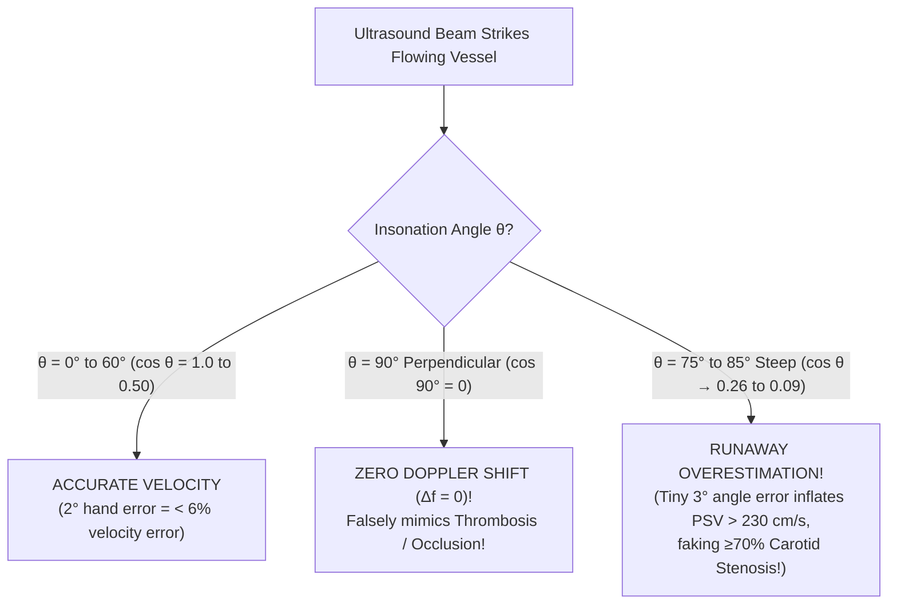
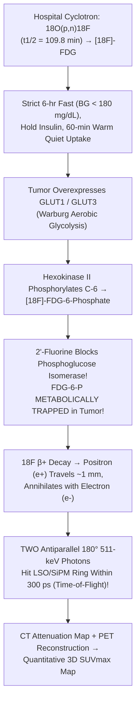

# Basic Medical — Behind the Curtain Clinical Diagnostics Notebook
## Volume VII: Radiology, `CT`, `MRI`, Ultrasound & Nuclear `PET/CT` Physics Behind the Glass

> *"When the emergency physician clicks 'Order CTA Chest — Rule Out Pulmonary Embolism' or 'MRI Brain Without Contrast — Stroke Code,' the patient experiences twenty minutes on a motorized carbon-fiber table listening to whirring gantries or thunderous metallic knocking. Behind the leaded barium-glass window and inside the copper-lined Faraday vault, however, an extraordinary symphony of relativistic electron braking, $33.2\text{-keV}$ K-shell photoelectric absorption, piezoelectric crystal resonance, $4.2\text{-Kelvin}$ superconducting quantum spin precession, and $511\text{-keV}$ antimatter positron-electron annihilation converts invisible human pathophysiology into millimeter-scale grayscale truth."*

---

## Architectural Orientation: The Four Physical Regimes of Diagnostic Imaging

Every clinical imaging modality interrogates living tissue through a fundamentally distinct physical carrier wave or subatomic particle, trading spatial resolution, temporal resolution, soft-tissue contrast, and ionizing radiation against one another (*Bushberg et al., The Essential Physics of Medical Imaging*, 4th ed.):

| Imaging Modality | Physical Probe & Energy Regime | Primary Tissue Property Measured | Typical Spatial Resolution | Ionizing Radiation (`mSv`) | Signature Clinical Superpower |
| :--- | :--- | :--- | :--- | :--- | :--- |
| **Multi-Detector / Photon-Counting `CT`** | Polyenergetic X-ray photons (`80–140 kVp`; mean `45–70 keV`) | Linear attenuation coefficient $\mu(x,y,z)$ ($Z_{\text{eff}}$ & electron density $\rho_e$) | `0.2–0.6 mm` isotropic (`< 5 sec` whole-body scan) | `1.5–2 mSv` (Head/Low-Dose Chest) to `7–12 mSv` (Abdomen/Pelvis) | Trauma, acute hemorrhage, cortical bone, lung parenchyma, coronary/pulmonary/aortic `CTA`, nephrolithiasis |
| **Diagnostic Ultrasound & Spectral Doppler** | High-frequency mechanical longitudinal sound waves (`2–18 MHz`) | Acoustic impedance mismatch ($\Delta Z = \Delta[\rho c]$) & RBC Doppler shift ($\Delta f$) | `0.15–1.0 mm` (depth-dependent) | **`0 mSv`** (purely mechanical pressure waves) | Real-time bedside `POCUS`, biliary/renal calculi, cysts vs solids, vascular stenosis/DVT, obstetrics, `FibroScan` stiffness |
| **`DEXA` (`DXA`) Absorptiometry** | Dual-energy low-flux X-ray beams (`~40 keV` & `~75 keV`) | Areal hydroxyapatite Bone Mineral Density (`BMD`, $\text{g/cm}^2$) after soft-tissue subtraction | `~1 mm` planar projection | `< 0.005 mSv` (`< 1 day` background radiation) | Gold-standard diagnosis & treatment monitoring of osteoporosis (`T-score` & `Z-score`) |
| **`1.5T` / `3.0T` Superconducting `MRI`** | Static $\mathbf{B}_0$ magnetic field + `64/128 MHz` RF pulses (non-ionizing radio waves) | $^1\text{H}$ proton density, $T_1$ longitudinal recovery, $T_2$ transverse decay, Brownian water diffusion (`ADC`) | `0.5–1.5 mm` (`3–5 min` per pulse sequence) | **`0 mSv`** (ferromagnetic & `SAR` thermal hazards instead) | Hyperacute ischemic stroke (`6 min`), white-matter demyelination, spinal cord, ligaments/menisci, multiphasic liver/prostate |
| **Nuclear `SPECT` & Positron `PET/CT`** | Radiopharmaceutical-emitted $\gamma$-rays (`140 keV` $^{99\text{m}}\text{Tc}$ or dual `511 keV` $\beta^+$ annihilation) | Picomolar-to-nanomolar metabolic flux (`GLUT1`/Hexokinase), perfusion, biliary excretion, receptor density | `4–8 mm` (`PET`) / `7–12 mm` (`SPECT`) fused with `CT` | `2–4 mSv` (`V/Q`, `HIDA`) to `10–18 mSv` (`FDG PET/CT`) | Oncologic staging (`SUVmax`), acute cholecystitis (`HIDA`), inducible myocardial ischemia, `SSTR2`/`PSMA` theranostics |

---

## Dossier 7.1: Spinning Tungsten Anodes, Hounsfield Units, K-Edge Iodine & Dual-Energy `CT` — What Happens Behind the Lead Glass

### 1. From Clinical Order to the Motorized Table: Pre-Scan Choreography

When an emergency physician, internist, or surgeon orders a contrast-enhanced Computed Tomography (`CT`) scan, a hidden safety and hemodynamic checklist unfolds before the patient ever enters the gantry room:

1. **Venous Access Engineering for Power Injection**: Rapid arterial-phase CT Angiography (`CTA`) requires a mechanical dual-syringe **power injector** driving viscous iodinated contrast at **`4.0–6.0 mL/sec`** (generating line pressures up to **`250–300 psi`**), immediately chased by a `30–40 mL` `0.9%` saline flush to compact the contrast bolus into a tight central venous column. Behind the curtain, the CT technologist inspects the intravenous catheter personally: an **`18-gauge` or `20-gauge` peripheral IV** seated cleanly in an **antecubital or large forearm vein** (or an explicitly purple-labeled `CT-power-injectable PICC/Port` rated to `300 psi` at `5 mL/s`) is mandatory. Attempting a `5 mL/s` `CTA` through a fragile `24-gauge` dorsal hand or wrist vein risks catheter blowout and **compartment-threatening contrast extravasation** into tight fascial planes—or smears the bolus so slowly that the pulmonary arteries never reach diagnostic opacification (`> 250 HU`).
2. **Isocenter Positioning & the Scout Topogram**: The technologist centers the patient precisely at the gantry **isocenter** using laser crosshairs (positioning a patient just `4 cm` off-center degrades bowtie-filter compensation and inflates surface radiation dose by `20–30%`!) and elevates both arms overhead during chest/abdomen scans so humeral cortical bone does not cast dense **beam-hardening streaks** across the liver and spleen. A low-dose `1–2 sec` planar **Scout Topogram** (`AP` and `Lateral` digital radiographs with the tube locked stationary) is acquired first. Modern **Automatic Exposure Control (`AEC` / `CareDose` / `Auto-mA`)** reads the patient's water-equivalent diameter slice-by-slice from this scout—automatically dialing tube current (`mA`) *down* across air-filled lungs (low attenuation) and dialing `mA` *up* across dense bony shoulders and the pelvis so quantum image noise remains constant at the lowest achievable radiation dose (**ALARA**: *As Low As Reasonably Achievable*).

---

### 2. X-Ray Generation, Matter Interactions & Anti-Scatter Physics

#### A. Inside the Evacuated Glass-Metal X-Ray Tube: `99%` Heat, `1%` Photons
Mounted inside the rotating CT gantry is a heavy oil-cooled vacuum housing containing two electrodes separated by a high-voltage dielectric gap:

* **The Cathode Filament (`mA` Controls Photon Quantity)**: A coiled thoriated-tungsten wire (`~2 mm` wide) is heated by a `4–10 Amp` filament current past `2,200°C`, boiling off a dense cloud of free electrons via **thermionic emission** inside a negatively charged molybdenum focusing cup. The **tube current (`mA`, milliamperes)** multiplied by exposure time (`s`) equals **`mAs`**, which linearly dictates the **total number of electrons** striking the target—and therefore the **total photon flux**. Doubling `mAs` doubles radiation dose and cuts quantum mottle (grainy noise, $\sigma \propto 1/\sqrt{N}$) by $\sqrt{2}$.
* **The `10,000-RPM` Rotating Tungsten Anode (`kVp` Controls Photon Energy & Penetrability)**: Across the vacuum gap, a high-voltage generator applies **`80, 100, 120, or 140 kVp` (kilovoltage peak)**, accelerating the electron cloud to **half the speed of light** (`~0.5c` at `80 kVp` to `~0.62c` at `140 kVp`) before slamming it into a beveled focal track (`0.5–1.2 mm` effective focal spot) of **Tungsten-Rhenium alloy** (`90% W / 10% Re`). Tungsten is chosen for three physical reasons: high atomic number (**$Z = 74$**, maximizing radiative braking efficiency $\propto Z$), extreme melting point (**`3,422°C`**), and rapid thermal conductivity. Even so, **`~99%` of the kinetic energy of colliding electrons degrades directly into intense heat** via outer-shell vibrational excitations! If the electron beam struck a stationary spot, the tungsten face would vaporize in milliseconds; therefore, a frictionless vacuum induction motor spins the anode disc at **`8,000–10,000 RPM`**, spreading the multi-megawatt thermal load over a `360°` annular track.
* **The `1%` Radiative Yield — Bremsstrahlung vs. Characteristic K-Shell X-Rays**:
  1. **Bremsstrahlung ("Braking Radiation" — ~`80–85%` of diagnostic output)**: When a relativistic projectile electron passes microscopically close to a positively charged $+74$ tungsten nucleus, intense Coulombic attraction violently deflects and decelerates the electron. By conservation of energy, the lost kinetic energy radiates away immediately as an X-ray photon of continuous energy anywhere from near `0 keV` up to the exact peak voltage (`E_max = kVp`, e.g., `120 keV` at `120 kVp`). Low-energy ("soft") X-rays (`< 25 keV`) that would only burn the patient's skin without ever exiting the body are stripped out by `2.5–7 mm` aluminum/copper flat filters and a contoured Teflon **bowtie filter**, shifting the **mean effective beam energy to roughly `1/3` to `1/2` of `kVp`** (e.g., a `120 kVp` CT beam has a mean photon energy of **`~55–65 keV`**).
  2. **Characteristic X-Rays (~`15–20%` discrete spikes)**: Whenever `kVp` exceeds Tungsten's innermost **`K`-shell electron binding energy (`69.5 keV`)**, a projectile electron can knock a `K`-shell electron completely out of the tungsten atom. An outer `L`-shell (`~10.2 keV` binding energy) or `M`-shell electron cascades down into the `K`-shell vacancy, emitting sharp monochromatic X-ray spikes at exact energy differences (**$K_\alpha \approx 59.3\text{ keV}$** and **$K_\beta \approx 67.2\text{ keV}$**).

#### B. Inside the Patient: Photoelectric Sharpness ($\propto Z^3/E^3$) vs. Compton Scatter Fog
Once the filtered X-ray beam enters human tissue, individual `30–140 keV` photons undergo three fates: **unattenuated transmission** straight into the detector, **Photoelectric Absorption**, or **Compton Incoherent Scatter** (*Bushberg*, Ch. 3):

1. **The Photoelectric Effect — The Engine of Crisp Anatomic & Contrast Shadowing**:
   An incident X-ray photon of energy $E$ collides with a tightly bound inner **`K`-shell electron** of a tissue atom (provided $E \ge E_K$, the `K`-edge binding energy) and **vanishes completely**, transferring all its energy to eject a short-range photoelectron ($E_{e^-} = E - E_K$). The mass attenuation probability ($\tau/\rho$) obeys a dramatic cubic power law:
   $$\frac{\tau}{\rho} \propto \frac{Z^3}{E^3}$$
   Look at what $Z^3$ accomplishes clinically! Soft tissue, water, muscle, and fat consist predominantly of Hydrogen ($Z=1$), Carbon ($Z=6$), Nitrogen ($Z=7$), and Oxygen ($Z=8$), yielding an effective atomic number **$Z_{\text{eff}} \approx 7.4$** ($7.4^3 \approx 405$). Cortical bone contains Calcium (**$Z = 20$**, $Z_{\text{eff}} \approx 13.8$, $13.8^3 \approx 2,628$ — a **`6.5×` jump** per gram, further multiplied by bone's `1.85 g/cm³` physical density!). Injected **Iodine ($Z = 53$)** boasts $53^3 = 148,877$ — over **`360×` greater photoelectric appetite per gram** than soft tissue! Simultaneously, the $1/E^3$ denominator explains why dropping CT voltage from `120 kVp` down to **`80 kVp`** in a lean patient or pediatric `CTPA` causes iodinated vessels to blaze twice as bright!
2. **Compton Incoherent Scatter — The Enemy of Abdominal Contrast & Staff Radiation Safety**:
   At higher diagnostic energies (`> 40–50 keV`) inside low-$Z$ soft tissue, an X-ray photon collides elastically-inelastically with a loosely bound **outer-shell valence electron**, knocking out a recoil Compton electron and deflecting at an angle $\theta$ as a lower-energy **scattered photon** ($E'$):
   $$E' = \frac{E}{1 + \frac{E}{511\text{ keV}}(1 - \cos\theta)}$$
   Crucially, Compton probability depends strictly on **electron density ($\rho_e$, electrons per $\text{cm}^3$)** and is **virtually independent of atomic number $Z$**. In a large or obese abdomen (`> 35 cm` AP thickness), vast tissue volume generates a blizzard of random-angle Compton-scattered photons. If those deflected photons strike the detector far from their true geometric ray path, they blanket the image in **gray contrast-destroying fog** (plummeting Contrast-to-Noise Ratio, `CNR`) while also spraying out of the gantry bore as the primary source of occupational radiation exposure to clinicians standing in the room!
   * **How Engineers Defeat Scatter**: Directly in front of the detector elements sits a precision-aligned **Anti-Scatter Grid** (thin **lead or tungsten septa** angled dynamically toward the X-ray focal spot). Primary photons traveling in straight geometric lines from the focal spot pass cleanly between the septa; off-axis Compton-scattered photons crash obliquely into the lead walls and are absorbed!

---

### 3. Helical Multi-Detector `CT`, Photon-Counting `CT` & Godfrey Hounsfield's Exact Math

#### A. Slip-Ring Helical Geometry, Pitch & Detector Evolution
Early 1970s scanners had to unwind high-voltage cables after every single slice ("step-and-shoot"). Modern **64-to-320-row Multi-Detector CT (`MDCT`)** scanners transmit kilovolt power and multi-gigabit optical data across brushless **slip rings**, allowing a `1,500-pound` gantry assembly to spin continuously at **`0.25–0.28 seconds per revolution`** (experiencing **`> 30 G`** of centrifugal acceleration—faster than a fighter jet centrifuge!) while the motorized table glides smoothly through the bore, tracing a continuous **helix**.

* **Helical Pitch ($P$)**:
  $$P = \frac{\text{Table Feed per } 360^\circ \text{ Gantry Rotation (mm)}}{\text{Total Nominal X-Ray Beam Collimation Width (mm)}}$$
  * **$P < 1.0$ (e.g., `0.2–0.6` Overlapping Helix)**: High spatial oversampling and retrospective ECG-gated coronary `CTA` fidelity, at higher radiation dose.
  * **$P = 1.0$**: Contiguous non-overlapping helical ribbons.
  * **$P > 1.0$ (e.g., `1.2–1.5`, up to `3.2` on Dual-Source Flash `CT`)**: Stretched fast helix—scanning an entire trauma chest-abdomen-pelvis or uncooperative dyspneic patient in **`1.5–3 seconds`**, slashing motion blur and radiation dose!
* **Conventional Energy-Integrating (`EID`) vs. Next-Generation Photon-Counting (`PCD-CT`) Detectors**:
  Traditional `MDCT` uses solid-state ceramic **scintillators** (such as Gadolinium Oxysulfide, $\text{Gd}_2\text{O}_2\text{S}$) separated by reflective septa: an X-ray creates a flash of visible light, which a silicon photodiode converts into an analog electrical current proportional to *total integrated energy* deposited during that reading interval (mixing low-energy high-contrast iodine photons with noisy electronic dark current). **Photon-Counting Detector CT (`PCD-CT`, FDA-cleared 2021)** replaces scintillators completely with direct-conversion **Cadmium Telluride (`CdTe` / `CZT`)** semiconductors: every single incident X-ray photon generates a discrete nanosecond charge cloud counted individually against `2–4` programmable kilovolt energy thresholds! Electronic dark noise drops to zero, reflective septa vanish (shrinking pixels to **`0.15–0.2 mm`** to visualize coronary stents and inner-ear ossicles cleanly), and **every single scan is natively multi-energy spectral**!
* **Reconstruction Math**: Each slice's 360° angular projection profiles (a **sinogram** via the **Radon Transform**) were classically solved via **Filtered Back-Projection (`FBP`)**, which works fast at normal doses but explodes with grainy streak noise at ultra-low doses. Modern scanners employ **Statistical Iterative Reconstruction** and **Deep-Learning Image Reconstruction (`DLIR`)**, modeling exact focal-spot geometry and Poisson photon statistics to cut radiation doses by **`50–80%`** (enabling **`1.0 mSv` Low-Dose Lung Cancer Screening `CT`** and **`< 1.5 mSv` renal stone `CT`**!).

#### B. Godfrey Hounsfield's Linear Attenuation Equation & The Universal Clinical `HU` Scale
As an X-ray pencil beam traverses heterogeneous voxels of width $\Delta x$, total transmission obeys the exponential **Beer-Lambert Law**:
$$I = I_0 \exp\!\left(-\sum_{i} \mu_i \,\Delta x\right)$$
Solving millions of intersecting ray sums reconstructs the exact linear attenuation coefficient $\mu(x,y,z)$ (in $\text{cm}^{-1}$) inside every `0.5 × 0.5 × 0.5 mm` voxel. Because raw $\mu$ shifts slightly with scanner `kVp` filtration, Sir **Godfrey Hounsfield** (1971 first clinical brain CT at Atkinson Morley Hospital; 1979 Nobel Prize in Physiology or Medicine with Allan Cormack) standardized every voxel on earth relative to pure distilled **Water ($\text{HU} = 0$)** and **Air ($\text{HU} = -1000$, where $\mu_{\text{air}} \approx 0$)**:

$$\text{HU} = 1000 \times \frac{\mu_{\text{tissue}} - \mu_{\text{water}}}{\mu_{\text{water}} - \mu_{\text{air}}} \approx 1000 \times \frac{\mu_{\text{tissue}} - \mu_{\text{water}}}{\mu_{\text{water}}}$$

Every `1 HU` step equals a **`0.1%` change** in X-ray linear attenuation relative to water! Placing an electronic circular **Region of Interest (`ROI`) cursor** on a PACS workstation turns pixel brightness into a quantitative bedside biopsy:

| Tissue, Fluid, Pathology or Material | Exact Hounsfield Unit (`HU`) Range | Underlying Biophysical Basis & Decisive Diagnostic Pearl |
| :--- | :--- | :--- |
| **Room Air / Pneumothorax / Free Peritoneal Gas** | **`-1000 HU`** | Virtually zero atomic mass/electron density ($\mu_{\text{air}} \approx 0$). Subcutaneous emphysema or pneumoperitoneum stands out pitch-black. |
| **Normal Aerated Lung Parenchyma** | **`-850 to -700 HU`** | `~80%` alveolar air + `20%` capillary/septal tissue; drops below `-950 HU` in panlobular emphysema; rises toward `-300 HU` in ground-glass (`GGO`) COVID/edema. |
| **Adipose Tissue / Lipoma / Chylothorax / Dermoid Fat** | **`-100 to -50 HU`** | Hydrocarbon `-CH2-` chains pack lower physical density (`0.92 g/cm³`) and lower $Z_{\text{eff}}$ (`~6.3`) than $\text{H}_2\text{O}$ (`1.00 g/cm³`, $Z_{\text{eff}} = 7.42$). Macroscopic fat in a renal mass proves benign **Angiomyolipoma (`AML`)**! |
| **Benign Lipid-Rich Adrenal Adenoma (Unenhanced)** | **`<= +10 HU`** (often `-15 to +8 HU`) | Abundant intracytoplasmic cholesterol/steroid lipid droplets pull voxel attenuation below `+10 HU` (**`98%` specificity for benignity** — sparing the patient biopsy or surgery!). |
| **Pure Water / Simple Renal or Hepatic Cyst / `CSF`** | **`0 HU`** (`-10 to +15 HU`) | Calibration reference ($\mu = \mu_{\text{water}}$). Homogeneous `< 20 HU` non-enhancing renal cyst = **Bosniak I** (`0%` malignancy). |
| **Transudative vs. Exudative Effusion / Ascites** | **`+2 to +15 HU`** (Transudate) vs **`+20 to +45 HU`** (Exudate / Hemothorax / Empyema) | Dissolved plasma proteins, neutrophils, fibrin, and cellular debris raise electron density linearly above pure water. |
| **Brain White Matter vs. Cortical Gray Matter** | **`+28 to +32 HU`** (White) vs **`+36 to +42 HU`** (Gray) | Myelin sheaths in white matter are **`~70%` lipid**, pulling white matter `~8 HU` *darker* than lipid-poor, capillary-rich neuronal gray matter! |
| **Skeletal Muscle / Unenhanced Kidney / Spleen** | **`+35 to +50 HU`** | Hydrated intracellular actin/myosin and parenchymal protein matrices. |
| **Normal Unenhanced Liver vs. Hepatic Steatosis** | **`+55 to +65 HU`** (Normal) vs **`< +40 HU`** (Moderate–Severe Fatty Liver) | Glycogen + iron keep normal liver `~8–10 HU` *brighter* than spleen. Intracellular triglycerides drag liver `> 10 HU` *darker* than spleen (making portal veins look artificially "bright" even without IV contrast!). |
| **Liquid Flowing Whole Blood (Aorta / Dural Sinus)** | **`+35 to +45 HU`** | Linearly proportional to **Hematocrit (`Hct`)**! Severe anemia (`Hct < 21%`) drops lumen blood to `+20 HU` (making the uncalcified aortic wall look falsely hyperdense); polycythemia (`Hct > 55%`) raises sinuses to `+60 HU` (mimicking dural venous sinus thrombosis!). |
| **Acute Retracted Clot / Acute Subdural / Hyperdense `MCA` Sign** | **`+60 to +85 HU`** | **Why fresh clots glow white without calcium**: Platelet-fibrin retraction squeezes watery serum (`0 HU`) out of the thrombus, concentrating dense **globin protein** (`Hct` inside clot reaches `~90%`!). Note: *not* iron—iron contributes `< 2 HU`! Over `1–3 weeks`, fibrinolysis liquefies the subdural clot through an **isodense phase (`+30–38 HU` — easy to miss!)** into a dark **chronic hygroma (`+10–20 HU`)**. |
| **Pure Uric Acid Renal Calculus** | **`+300 to +450 HU`** | Composed strictly of low-$Z$ `C, H, N, O` ($Z_{\text{eff}} \approx 6.9$): completely **radiolucent (invisible) on plain abdominal X-ray (`KUB`)**, yet unmistakably bright white (`+400 HU`) on non-contrast `CT`! Dissolves medically with oral potassium citrate! |
| **Calcium Oxalate Monohydrate / Brushite Stone** | **`+800 to +1,500+ HU`** | Calcium ($Z = 20$) surges photoelectric absorption; stones `> 1,000 HU` are rock-hard and resist extracorporeal shockwave lithotripsy (`ESWL`), steering urologists straight to laser ureteroscopy! |
| **Dense Cortical Bone** | **`+1,000 to +1,800 HU`** | Hydroxyapatite $\text{Ca}_{10}(\text{PO}_4)_6(\text{OH})_2$ crystal lattice (`~1.85 g/cm³`). |
| **Surgical Titanium / Cobalt-Chrome Hip / Dental Amalgam / Coils** | **`+3,000 to +30,000 HU`** (Extended `16-bit` scale) | Complete **photon starvation** + polychromatic **beam hardening** creates alternating dark bands and starburst white streaks across adjacent pelvic organs or oral pharynx (mitigated by Dual-Energy virtual monoenergetic `130-keV` reconstruction & Metal Artifact Reduction [`MAR`] algorithms). |

#### C. Window Width (`WW`) & Window Level (`WL`): Why One Scan Hides or Reveals an Acute Stroke
A standard `12-bit` CT matrix stores **`4,096` distinct Hounsfield shades** (`-1024` to `+3071 HU`), whereas the human retina and diagnostic monitor distinguish only **`~32 to 64` shades of gray** simultaneously! If a workstation mapped `-1000 HU` to pure black and `+3000 HU` to pure white (`WW = 4000`), every `65 HU` span would compress into a single indistinguishable gray shade—turning the entire brain (`+30` to `+40 HU`), muscle, liver, and acute stroke into one featureless gray blob!

Radiologists dynamically adjust two parameters on the mouse scroll wheel without ever re-scanning the patient:
* **Window Level (`WL`, or Center `C`)**: The exact `HU` value assigned to **50% mid-gray**—chosen to match the target organ's attenuation.
* **Window Width (`WW`)**: The total `HU` span stretched from pure black (`WL - WW/2`) to pure white (`WL + WW/2`). Any tissue below `WL - WW/2` clips to solid black; any tissue above `WL + WW/2` saturates at solid white:
  $$\text{Display Intensity (0–255)} = 255 \times \text{clamp}\!\left(\frac{\text{HU} - (\text{WL} - \text{WW}/2)}{\text{WW}},\, 0,\, 1\right)$$

> [!TIP]
> **The `4-HU` Hyperacute Stroke Window Trick Behind the Curtain**:
> Every **1% increase in brain tissue water** from early cytotoxic edema lowers parenchymal attenuation by **`~2.0 to 2.5 HU`**. Two hours into a right Middle Cerebral Artery (`MCA`) occlusion, the dying insular cortex or caudate/putamen drops from `+38 HU` to `+34 HU`—just a **`4-HU` delta**!
> * On a **Bone Window (`WW 2500 / WL 500`)**: Only `-750` to `+1750 HU` spans gray; `+38` vs `+34 HU` differs by `0.16%` brightness—**100% invisible** (used strictly for skull fractures and mastoid air cells).
> * On a **Routine Brain Window (`WW 80 / WL 40`)**: `0 HU` is black and `+80 HU` is white; `+38` vs `+34 HU` spans `5%` contrast—subtle loss of gray-white differentiation.
> * On a **Narrow "Stroke Window" (`WW 35 / WL 35` or `WW 40 / WL 40`)**: `+17.5 HU` is pure black and `+52.5 HU` is pure white! That exact same `4-HU` drop now explodes across **`> 11%` of the entire luminance range**, making insular ribbon effacement and basal ganglia hypodensity leap off the monitor in seconds! (Standard Chest/Abdomen windows: **Soft Tissue `WW 400 / WL 50`**, **Lung `WW 1500 / WL -600`**, **Liver `WW 150 / WL 70`**).

---

### 4. Intravenous Iodinated Contrast, K-Edge Dual-Energy `CT` & Bolus-Tracking Timing

#### A. Non-Ionic Tri-Iodinated Monomers & The Magic `33.2-keV` Iodine K-Edge
Modern intravenous CT contrast agents—such as **Iohexol (`Omnipaque`)**, **Iopamidol (`Isovue`)**, and **Iomeprol** (low-osmolality non-ionic monomers, **`~600–850 mOsm/kg H2O`**) or **Iodixanol (`Visipaque`)** (an iso-osmolar non-ionic dimer formulated at **`290 mOsm/kg`**, identical to human plasma)—built a pharmacology revolution upon `1950s` ionic high-osmolality salts (`Diatrizoate`, `> 1,500–2,000 mOsm/kg`, which caused violent endothelial pain, flushing, vomiting, and frequent anaphylactoid mast-cell degranulation). Each monomer attaches **three covalent iodine atoms (`2,4,6-triiodobenzene`)** to hydrophilic hydroxyl side chains that shield the hydrophobic core without dissociating into charged ions in blood!

Why did nature make **Iodine ($Z = 53$)** the undisputed champion of X-ray angiography? Because of its **`K`-Shell Binding Energy (`K-Edge` = `33.2 keV`)**!
* Photons at `32.9 keV` barely have enough energy to eject outer `L`-shell electrons of iodine.
* Photons at **`33.3 keV`** cross the `33.2 keV` `K`-shell threshold—causing iodine's photoelectric mass attenuation coefficient ($\mu/\rho$) to **vault upward `6-fold` instantaneously** (from `~6 cm²/g` to `~36 cm²/g`) right inside the sweet spot (`35–65 keV`) where `80–100 kVp` diagnostic X-ray tubes emit their peak photon flux! (Oral/rectal **Barium Sulfate**, $\text{BaSO}_4$, $Z = 56$, sits right beside Iodine with a **`37.4 keV` `K`-edge**—insoluble chalk suspension safe for intact bowel lumens, though **strictly contraindicated if esophageal or colonic perforation is suspected** because barium spilled into the mediastinum or peritoneum triggers lethal granulomatous mediastinitis/peritonitis; water-soluble iodinated `Gastrografin` / `Omnipaque` is used instead!).

#### B. Dual-Energy `CT` (`DECT`): Material Decomposition via `80 kVp` vs. `140 kVp`
On a single-energy `120 kVp` scan, a voxel measuring `+350 HU` is mathematically ambiguous: is it **dilute iodine contrast** (`Z = 53`), a **uric acid stone** (`Z_eff ≈ 6.9`), **clotted hemorrhage**, or **diffuse calcium** (`Z = 20`)? **Dual-Energy CT (`DECT`)**—acquired via dual orthogonal X-ray tubes (`80 kVp` + tin-filtered `Sn140 kVp`), ultra-fast kilovolt switching (`80 <-> 140 kVp` every `0.25 ms`), dual-layer sandwich detectors, or `PCD-CT`—measures every voxel at **two distinct photon energy spectra simultaneously**:
* High-$Z$ **Iodine (`Z=53`, `K`-edge `33.2 keV`)** nearly **doubles** its `HU` attenuation when shifting from `140 kVp` down to `80 kVp` (`DEI` ratio `~2.0`)!
* Medium-$Z$ **Calcium (`Z=20`, `K`-edge `4.0 keV`)** rises moderately (`ratio ~1.4–1.5`).
* Low-$Z$ **Uric Acid (`C5H4N4O3`, `Z_eff ≈ 6.9`)** exhibits virtually **flat attenuation (`ratio ~1.0`)** across `80` and `140 kVp`!
* **Clinical Payoffs**:
  1. **Non-Invasive Renal Stone Chemistry**: Color-codes pure uric acid calculi red vs. calcium calculi blue—allowing nephrologists/urologists to dissolve uric acid stones home-medically with oral **potassium citrate** (`target urine pH 6.5–7.0`) and cancel surgery!
  2. **Virtual Non-Contrast (`VNC`) & Iodine Maps**: Digitally subtracts all iodine from a single portal-venous scan to synthesize an unenhanced image (saving `50%` radiation!), proves whether a hyperdense renal lesion truly enhanced or was merely a hemorrhagic cyst, maps **pulmonary parenchymal perfusion defects** distal to subsegmental `PE`s, and identifies **monosodium urate gout crystals** in joints without arthrocentesis!

#### C. Bolus-Tracking Choreography: Why Seconds Decide Diagnosis (and How a Deep Breath Fakes a `PE`!)
Injected into an antecubital vein, an iodinated contrast bolus journeys sequentially through distinct vascular beds. Mistiming the helical sweep by even `6 seconds` can completely hide a life-threatening diagnosis:

```mermaid
flowchart LR
    IV["Antecubital 18G IV<br/>(4-5 mL/s Power Injector)"] --> RA["Right Heart & Pulmonary Trunk<br/>(12-15 s: CTPA for PE)"]
    RA --> AO["Left Heart & Systemic Aorta<br/>(18-25 s: CTA Stroke / Dissection)"]
    AO --> LA["Late Arterial Parenchymal<br/>(35-40 s: Hypervascular HCC / Pancreas)"]
    LA --> PV["Portal Venous Phase<br/>(65-75 s: Routine Liver / GI / Sepsis)"]
    PV --> NP["Nephrographic Phase<br/>(90-100 s: Renal Corticomedullary Mass)"]
    NP --> EX["Excretory / Washout Phase<br/>(10-15 min: CT Urogram & Adrenal Washout)"]
```

Behind the lead glass, because a young hyperdynamic trauma patient (`CO = 9 L/min`) circulates blood three times faster than an elderly patient in cardiogenic shock (`EF = 15%`), fixed timer delays fail. Instead, the CT technologist runs **Automated Bolus Tracking (`SmartPrep` / `CARE Bolus`)**:
1. The tech draws a small circular **`ROI` sensor** inside the target vessel on a single stationary axial slice and starts `4–5 mL/s` injection.
2. Every `1.0–1.5 seconds`, the scanner fires a tiny ultra-low-dose monitoring pulse, plotting real-time `HU` inside that circle on the console screen.
3. The instant lumen attenuation crosses **`100–150 HU`**, the table automatically snaps to the start position, plays the breath-hold audio prompt, and fires the full helical sweep:
   * **`12–15 sec` — `CT` Pulmonary Angiography (`CTPA`)**: `ROI` placed on the **Main Pulmonary Trunk**. Goal: bright white pulmonary arteries (`> 250–350 HU`) before contrast floods left-sided pulmonary veins, silhouetting dark intraluminal saddle or lobar **Pulmonary Emboli (`PE`, "polo-mint" or "railway-track" filling defects)**.
   * **`18–25 sec` — Systemic Arterial `CTA`**: `ROI` placed on the **Ascending or Descending Thoracic Aorta**. Captures intimal flaps in **Stanford Type A/B Aortic Dissection**, active `GI` or pelvic arterial **contrast blush/extravasation**, intracranial **Circle of Willis `LVO` thrombi / Berry aneurysms**, and **Late Arterial (`35–40 s`)** hepatic-artery-fed **Hepatocellular Carcinoma (`HCC`, LI-RADS arterial-phase hyperenhancement)** or pancreatic adenocarcinoma (hypodense tumor against briskly enhancing normal pancreas).
   * **`65–75 sec` — Portal Venous Phase (`PVP`)**: Blood has circulated through the splenic and mesenteric capillaries into the **Portal Vein** (which supplies **`75–80%` of normal hepatic blood flow**). Normal liver parenchyma reaches peak brightness (`+110–130 HU`), unmasking hypovascular colorectal/breast metastases, hepatic abscesses, appendicitis, diverticulitis, and mesenteric venous thrombosis.
   * **`10–15 min` — Delayed Excretory / Adrenal Washout Phase**: Opacifies renal calyces, ureters, and bladder for urothelial carcinoma (`CT Urogram`), detects **late portal/delayed washout + capsular appearance in `HCC`**, shows progressive fibrotic pooling in **cholangiocarcinoma**, and proves whether an indeterminate lipid-poor adrenal nodule (`> +10 HU` unenhanced) is a benign capillary-leaky **lipid-poor adenoma** (**Absolute Percentage Washout `APW >= 60%`**: $\text{APW} = 100 \times \frac{\text{HU}_{\text{portal}} - \text{HU}_{15\text{m}}}{\text{HU}_{\text{portal}} - \text{HU}_{\text{unenh}}}$) versus slow-washout metastasis, adrenocortical carcinoma, or pheochromocytoma!

> [!WARNING]
> **The Classic `CTPA` Trap — How a Deep Inspiratory Gasp Creates a Fake Pulmonary Embolism ("Transient Interruption of Contrast")**:
> During a `12-second` `CTPA`, contrast enters strictly via the upper-extremity **Superior Vena Cava (`SVC`)**, while blood returning from the legs/kidneys via the **Inferior Vena Cava (`IVC`) is `100%` unopacified (`+40 HU` dark blood)**. If the patient hears *"Take a deep breath in and hold it!"* and sucks in a **violent inspiratory gasp** followed by a **Valsalva glottic strain**:
> 1. Sudden negative intrathoracic pressure (`-25 cmH2O`) acts like a giant vacuum pump, sucking a torrent of **dark unopacified `IVC` blood** straight into the right atrium while the tense diaphragm and subsequent positive-pressure Valsalva pinch off `SVC` contrast inflow!
> 2. A bolus of dark `IVC` blood washes straight through the right ventricle into the lower-lobe pulmonary arteries—creating an abrupt **dark intraluminal drop (`< 100 HU`) or swirling mixing artifact** that mimics an acute pulmonary embolism (recognizable because the main pulmonary trunk is unexpectedly dim while the `SVC` and aorta are bright!).
> * **Behind-the-Glass Fix**: Skilled CT technologists coach patients *before* injection: **"When the machine speaks, take only a tiny, gentle breath—just stop breathing where you are, and do NOT bear down!"**

---

### 5. Contrast Nephropathy Myth vs. Reality (`ACR–NKF` Consensus), `Metformin` & Thyroid Safety

For forty years, fear of **"Contrast-Induced Nephropathy (`CIN`)"** caused well-meaning clinicians to cancel or delay urgent contrast `CT` scans in septic, hypotensive, or stroke patients—costing lives from missed mesenteric ischemia, aortic dissection, and abscesses. Landmark propensity-matched propensity studies of `> 100,000` hospitalized patients (McDonald et al., Davenport et al.) culminating in the **2020 Joint American College of Radiology (`ACR`) and National Kidney Foundation (`NKF`) Consensus Statement** revolutionized clinical practice:

1. **Contrast-Associated `AKI` (`CA-AKI`) vs. True Contrast-Induced `AKI` (`CI-AKI`)**:
   * **`CA-AKI` (Post-Contrast `AKI`)** is a purely *correlational* rise in serum creatinine within `48–72 hours` after a scan—overwhelmingly driven by the **confounding acute illness** that prompted the `CT` in the first place (septic shock, hypovolemia, nephrotoxic antibiotics, heart failure, or cholesterol atheroemboli from arterial catheters!).
   * **True `CI-AKI`** (direct causal renal medullary vasoconstriction + tubular viscosity injury caused by IV low/iso-osmolar iodinated contrast) has an incidence **indistinguishable from `0%` in patients with stable `eGFR >= 30 mL/min/1.73 m²`**!
   * **The `ACR–NKF` Clinical Action Thresholds**:
     * **`eGFR >= 30 mL/min/1.73 m²`**: **Zero prophylaxis required; proceed directly with IV contrast.** (`eGFR 30–44` carries at most `0–2%` borderline risk; prophylaxis is unnecessary for `eGFR >= 30` unless multiple acute nephrotoxic hits coexist).
     * **`eGFR < 30 mL/min/1.73 m²` (non-dialysis) OR Active Acute Kidney Injury (`AKI`)**: True `CI-AKI` risk exists (`~5–10%`). First ask: *Can non-contrast CT, Ultrasound, or non-contrast MRI answer the question?* **If life- or limb-saving diagnosis requires IV contrast (`CTA` stroke, `PE`, trauma, dissection, occult sepsis), NEVER withhold contrast regardless of `eGFR`!** In non-emergent `eGFR < 30` patients without decompensated volume overload, infuse **isotonic `0.9%` Normal Saline** (`100 mL/hr` or `1–1.5 mL/kg/hr` starting `1 hour` pre-scan through `3–12 hours` post-scan) to dilute intratubular contrast viscosity. (**Oral `N`-acetylcysteine [`NAC`]** and **sodium bicarbonate** showed zero benefit over normal saline in the landmark **`PRESERVE` Trial** [*NEJM* 2018] and are obsolete!).
     * **Anuric End-Stage Renal Disease (`ESRD`) on Chronic Dialysis**: Zero remaining nephrons exist to protect, and low-osmolality contrast (`100 mL`) does *not* require urgent post-scan emergent hemodialysis!
2. **Why `Metformin` Does NOT Injure Kidneys (The `MALA` Clearance Mechanism)**:
   One of medicine's most persistent boards/ward myths is that *"Metformin + CT dye is nephrotoxic."* **Metformin causes zero glomerular or tubular injury!** Rather, metformin is cleared **`100%` unchanged by renal tubular secretion** (`OCT2` / `MATE1`). If—and *only* if—a patient already has severe renal impairment or suffers concurrent `AKI`, unexcreted metformin accumulates in plasma, inhibiting hepatic mitochondrial Complex I and cytosolic glycerophosphate dehydrogenase, halting gluconeogenesis from lactate and precipitating **Metformin-Associated Lactic Acidosis (`MALA`, `pH < 7.1`, `lactate > 10 mmol/L`, `~30–50%` mortality)**.
   * **`ACR` & `FDA` Protocol**:
     * **`eGFR >= 30` with no `AKI` and no intra-arterial renal catheterization**: **Do NOT even hold Metformin!**
     * **`eGFR < 30`, active `AKI`, or intra-arterial catheter study with renal emboli risk**: Hold Metformin at the time of contrast injection for **`48 hours`**, recheck renal function at `48h`, and resume once `eGFR` is stable/restored.
3. **Prior Contrast Reactions & Thyroid (`Jod-Basedow`) Precautions**:
   * **"Shellfish Allergy" Is a Total Myth**: Shellfish anaphylaxis is an `IgE` reaction to **tropomyosin muscle protein**, *not* elemental iodine (iodine is an essential endogenous atom inside every human's `T4` hormone!). A shellfish or topical povidone-iodine rash does **not** require premedication! Only a documented prior moderate/severe **acute anaphylactoid reaction to iodinated contrast** warrants switching contrast agent class + **`13-hour` oral steroid/antihistamine premedication** (`Prednisone 50 mg PO` at `13h`, `7h`, and `1h` prior + `Diphenhydramine 50 mg` at `1h`; note steroids take `>= 4–6 hours` of nuclear transcription to work!).
   * **The `30,000-µg` Free Iodide Surge**: A single `100 mL` dose of `350 mgI/mL` contrast contains `35,000,000 µg` of bound iodine and delivers **`~3,000–13,500 µg` of bioavailable free inorganic iodide (`I-`)**—nearly **`100×` the `150 µg` daily requirement**! Normal thyroids shut down organification transiently (**Wolff-Chaikoff effect**), but patients with **untreated Graves' disease or autonomous multinodular toxic goiter** lack autoregulation and can erupt into life-threatening **Jod-Basedow Hyperthyroid Storm** (`3–6 weeks` post-scan)! Furthermore, iodinated contrast saturates thyroid `NIS` symporters for **`4–8 weeks`**, blinding diagnostic thyroid uptake scans or **`131I` radioactive iodine ablation** for differentiated thyroid cancer!

---

## Dossier 7.2: Piezoelectric Echoes, Acoustic Shadowing & Spectral Doppler Ultrasound — Plus `DEXA` Absorptiometry (`T-Score` vs `Z-Score`)

### 1. Lead Zirconate Titanate (`PZT`) Piezoelectric Physics & Probe Selection

Diagnostic ultrasound uses **zero ionizing radiation**: instead, an array of `128–256` microscopic **Lead Zirconate Titanate (`PZT`, $\text{Pb}[\text{Zr}_x\text{Ti}_{1-x}]\text{O}_3$)** ceramic crystals exploits the reversible **Piezoelectric Effect** (discovered by Pierre and Jacques Curie, 1880):
1. **Transmit (`~0.1–1%` of each cycle)**: A `100-Volt` electrical spike physically expands and contracts the non-centrosymmetric `PZT` crystal lattice, launching a `2–3` wavelength longitudinal mechanical pressure pulse (`2–18 MHz` — `100×` to `900×` above the `20 kHz` ceiling of human hearing!) into tissue.
2. **Listen (`~99%` of each cycle!)**: While silent, the exact same `PZT` crystals feel tiny returning mechanical pressure echoes squeeze their crystal faces, instantly generating microvolt-to-millivolt electrical signals! Because ultrasound travels through average human soft tissue at a remarkably uniform speed of **`c = 1,540 m/s`** (`1.54 mm/µs`), the scanner computes reflector depth $d$ strictly from round-trip stopwatch arrival time $t$:
   $$d = \frac{c \cdot t}{2} \quad \Longrightarrow \quad \text{Exactly } 13\,\mu\text{s round-trip per } 1\text{ cm of tissue depth!}$$
3. **Time-Gain Compensation (`TGC`) & The Fundamental Frequency–Penetration Trade-Off**:
   As sound waves travel deeper, tissue frictional absorption (`viscoelastic heat`) attenuates acoustic intensity exponentially at **`~0.5 dB / cm / MHz`**. Behind the curtain, the sonographer sweeps the **8 horizontal `TGC` sliders** progressively to the right (higher gain for deeper echoes) so liver at `14 cm` looks just as bright as liver at `3 cm`. Notice that attenuation scales *linearly with frequency* ($\text{MHz}$), whereas **Axial Spatial Resolution** equals half the spatial pulse length ($\text{SPL}/2 \propto \lambda = c/f$):
   * **High-Frequency Linear Array (`7–15 MHz`, up to `22 MHz`)**: Short wavelength (`~0.1 mm`) yields **microscopic `0.15 mm` resolution**—visualizing a `2 mm` thyroid microcalcification, internal jugular vein valve during `IJ` central line cannulation, femoral/popliteal `DVT`, or testicular spermatic cord torsion—but dies out completely beyond **`4–6 cm` depth**!
   * **Low-Frequency Curvilinear (`2–5 MHz`) & Cardiac Phased-Array (`1–5 MHz`)**: Longer wavelength (`~0.4–0.8 mm`) sacrifices sub-millimeter detail in exchange for **deep `15–25 cm` penetration** to reach the retroperitoneal kidneys, abdominal aorta, cirrhotic liver, fetus, or subxiphoid pericardium (with the tiny `2 cm` square phased-array footprint slipping neatly *between* acoustic-shadowing ribs!).

---

### 2. Acoustic Impedance ($Z = \rho c$), Why Sonic Gel Exists & Lung `POCUS` (`A-Lines` vs `B-Lines`)

Why doesn't an ultrasound image simply show absolute tissue density like `CT`? Because echoes arise *only* at interfaces where **Acoustic Impedance ($Z$, in $\text{Rayls} = \text{kg}/[\text{m}^2\cdot\text{s}]$)** changes! Acoustic impedance is the product of tissue density $\rho$ and propagation speed $c$:
$$Z = \rho \cdot c$$
At a perpendicular tissue boundary between Medium 1 ($Z_1$) and Medium 2 ($Z_2$), the fraction of acoustic intensity **reflected back** toward the probe ($R$) obeys the **Fresnel Acoustic Reflection Equation**:
$$R = \left(\frac{Z_2 - Z_1}{Z_2 + Z_1}\right)^2 \qquad (\text{Transmitted fraction } T = 1 - R)$$

Plug in the real physiological numbers to witness why bedside ultrasound behaves the way it does:
* **Liver ($Z_1 = 1.65\text{ MRayls}$) to Kidney Cortex ($Z_2 = 1.62\text{ MRayls}$)**:
  $$R = \left(\frac{1.62 - 1.65}{1.62 + 1.65}\right)^2 \approx 0.00008 \quad (\mathbf{0.008\%}\text{ reflected; }\mathbf{99.99\%}\text{ continues deeper!})$$
  Tiny `0.01–1%` reflections let a single pulse paint 15 centimeters of stacked organ boundaries in one trip!
* **Soft Tissue ($Z_1 = 1.63 \times 10^6\text{ Rayls}$) to Air ($Z_2 \approx 429\text{ Rayls}$, `c = 330 m/s`)**:
  $$R = \left(\frac{429 - 1,630,000}{429 + 1,630,000}\right)^2 \approx \mathbf{0.9990} \quad (\mathbf{99.9\%\text{ TOTAL REFLECTION!}})$$
  Even a `10-micrometer` invisible film of trapped room air between a dry probe face and skin reflects `99.9%` of the sound wave right at the plastic lens, turning the entire monitor black! Warmed **water-based polyacrylic coupling gel** ($Z_{\text{gel}} \approx 1.50\text{ MRayls}$) displaces all air so `> 99.8%` of acoustic energy enters the skin! (Soft tissue to **Cortical Bone**, $Z_2 \approx 7.8\text{ MRayls}$, reflects `~43%` and absorbs the rest—which is why ribs cast dark acoustic shadows).

#### How Emergency Physicians Turn "Un-Imageable" Lung Air Artifacts into `30-Second` Diagnostics (`BLUE` Protocol)
For decades, textbooks claimed *"ultrasound cannot image the lung because air reflects `99.9%` of the beam."* Pioneer intensivist **Daniel Lichtenstein** realized that *how* the pleural interface generates artifacts immediately differentiates acute dyspnea causes at the bedside (`> 90–95%` accuracy, faster and more sensitive than supine portable chest X-ray!):
* **Normal Aerated Lung (`Lung Sliding` + `A-Lines`)**: Visceral pleura glides smoothly against parietal pleura with every breath ("shimmering ants on a string"; **M-mode "Seashore Sign"** = flat chest-wall waves over granular sandy lung motion). Because `99.9%` of the beam bounces off alveolar air back to the probe lens, reflects *off the probe lens again*, and returns a second and third time at $2\times d_{\text{pleura}}$ and $3\times d_{\text{pleura}}$, the machine draws crisp **horizontal equidistant reverberation lines (`A-lines`)**—proving dry, air-filled subpleural alveoli (seen in normal lungs, asthma, `COPD`, or `PE`).
* **Cardiogenic Pulmonary Edema / `ARDS` (`B-Lines` / "Lung Rockets")**: When left atrial pressure rises (`PCWP > 18 mmHg`), fluid engorges subpleural interlobular septa surrounded by alveolar air. Ultrasound enters these microscopic fluid-air acoustic traps and reverberates internally thousands of times, spraying a continuous stream of echoes back to the probe that the computer plots as **vertical, laser-like hyperechoic beams arising straight from the pleural line, erasing `A-lines`, moving with lung sliding, and shooting unattenuated to the bottom of the screen (`B-lines`)**! Three or more `B-lines` per rib space bilaterally diagnoses interstitial/alveolar pulmonary edema in `60 seconds`!
* **Pneumothorax (`Absent Lung Sliding` + `Barcode Sign` + `Lung Point`)**: Free pleural air separates visceral pleura from the chest wall: shimmering lung sliding vanishes (`M-mode` turns into uniform horizontal stripes top-to-bottom = **"Stratosphere / Barcode Sign"**), `B-lines` become physically impossible (`100%` negative predictive value: seeing even one `B-line` rules *out* pneumothorax at that interspace!), and sliding the probe laterally locates the exact millimeter where collapsing lung intermittently touches the chest wall (**"Lung Point" = `100%` specific for pneumothorax**!).

---

### 3. Posterior Acoustic Shadowing vs. Enhancement & Sacred `<= 60°` Spectral Doppler Math

#### A. Two Opposite Artifacts That Differentiate Stones, Cysts, and Solid Tumors
1. **Clean Posterior Acoustic Shadowing (Gallstones & Renal Calculi)**: When the beam strikes a cholesterol/pigment gallstone or renal pelvic stone, virtually `100%` of acoustic energy is reflected and absorbed at the anterior stone surface. Zero sound reaches deeper liver or retroperitoneum—casting a razor-sharp **jet-black anechoic corridor ("clean shadow")** trailing behind a bright echogenic arc! Combined with gallbladder wall edema (`> 3 mm`), pericholecystic fluid, and a **positive Sonographic Murphy's Sign** (maximal tenderness elicited when the sonographer presses the probe *directly over the visualized gallbladder fundus*), ultrasound outperforms `CT` (`~20%` of cholesterol gallstones are isodense to bile and **invisible on `CT`**!).
2. **Posterior Acoustic Enhancement ("Through-Transmission" Behind Benign Cysts)**: The machine's `TGC` amplifier *assumes* every centimeter of tissue attenuates sound at `0.5 dB/cm/MHz` and automatically boosts deeper pixels accordingly. When a beam passes through a `3 cm` **simple fluid cyst** (virtually `0 dB` attenuation!), it arrives at the tissue *behind* the cyst carrying far more energy than adjacent beams that traveled through solid parenchyma—making the tissue directly deep to the cyst **glow brightly ("posterior enhancement")**! That bright tail proves a dark black circle is benign liquid rather than a dangerous hypoechoic solid tumor (such as lymphoma or breast carcinoma, which attenuates sound and casts dark edges!).

#### B. The Doppler Equation & Why Insonation Angle $\theta \le 60^\circ$ Is Sacred
When an ultrasound pulse of transmitted frequency $f_0$ strikes red blood cells flowing at velocity $v$ at an **insonation angle $\theta$** relative to the ultrasound beam axis, returning echoes shift in frequency by the **Doppler Shift ($\Delta f = f_{\text{received}} - f_0$)**:

$$\Delta f = \frac{2 \, f_0 \, v \, \cos\theta}{c} \quad \Longleftrightarrow \quad v = \frac{\Delta f \cdot c}{2 \, f_0 \, \cos\theta}$$

* **Why the Factor of `2`?**: Moving erythrocytes experience a *double* Doppler shift—first acting as moving *receivers* intercepting incoming wave crests faster (or slower), and instantaneously acting as moving *transmitters* compressing (or stretching) reflected wave crests back toward the stationary probe!
* **Color Doppler Convention (`BART`)**: By default, positive $\Delta f$ displays **Red (flow *Toward* the probe)** and negative $\Delta f$ displays **Blue (flow *Away* from the probe)**—**`BART`: Blue Away, Red Toward** (tilting the probe `20°` the opposite way turns the exact same artery from red to blue! Never assume red = artery and blue = vein!). If blood jet velocity exceeds the **Nyquist Limit** ($\Delta f_{\max} = \text{PRF}/2$, half the Pulse Repetition Frequency), phase wraps around (`aliasing`), painting turbulent mosaic yellow-cyan swirls right at a stenosis or regurgitant heart valve!
* **Why $\theta \le 60^\circ$ Prevents Catastrophic Misdiagnosis Behind the Curtain**:
  Notice $\cos\theta$ sitting in the **denominator** of the velocity equation $v = \frac{\Delta f \cdot c}{2 f_0 \cos\theta}$! During a Carotid Duplex or Renal Transplant Doppler exam, the vascular sonographer manually rotates an electronic **angle-correction cursor bar** parallel to the vessel lumen wall while electronically steering the beam so **$\theta$ stays strictly between `45°` and `60°`**:

  * **The `90°` Perpendicular Blind Spot**: Most superficial vessels (carotid, femoral, radial, dialysis fistula) run parallel to the skin—meaning a probe held flat on the skin shoots sound at **$\theta = 90^\circ$**! Because **$\cos 90^\circ = 0$**, $\Delta f = 0$ even in a roaring `150 cm/s` artery, leaving the lumen completely black on Color Doppler (**faking carotid occlusion or `DVT`**; remember **compression non-collapsibility** with `B-mode` pressure, *not* Doppler alone, is the gold standard for diagnosing lower-extremity `DVT`!). The sonographer must rock ("heel-toe") the probe and electronically steer the Doppler box `15–20°` off-vertical.
  * **The `> 60°` Runaway Denominator Trap**: Because the slope of $\cos\theta$ plunges precipitously past `60°`, at $\theta = 80^\circ$ ($\cos 80^\circ = 0.174$), a `3°` misalignment of the angle cursor inflates calculated **Peak Systolic Velocity (`PSV`)** by **`> 35–50%`**—falsely pushing a mild `125 cm/s` carotid plaque past the **`>= 230 cm/s` NASCET surgical threshold** for `70–99%` Internal Carotid Artery stenosis!
* **Angle-Independent Pourcelot Resistive Index (`RI`)**:
  Because $\cos\theta$ cancels out cleanly when taking a ratio of Peak Systolic Velocity (`PSV`) and End-Diastolic Velocity (`EDV`), sonographers evaluate parenchymal organ microvascular resistance using the **Resistive Index (`RI`)**:
  $$\text{RI} = \frac{\text{PSV} - \text{EDV}}{\text{PSV}}$$
  Vital low-resistance beds (Internal Carotid Artery feeding the brain; normal native or **transplanted renal interlobar arteries**) demand continuous forward flow throughout diastole (**normal renal `RI = 0.55–0.70`**). In a fresh kidney transplant with rising creatinine, **`RI > 0.80`** (or absent/reversed diastolic flow, `RI >= 1.0`!) signals high downstream parenchymal compression from **acute tubular necrosis (`ATN`), acute transplant rejection, perinephric hematoma/urinoma Page kidney, hydronephrosis, or catastrophic renal vein thrombosis**!

---

### 4. Transient Elastography (`FibroScan`) & `DEXA` Bone Densitometry (`T-Score` vs `Z-Score`)

#### A. Non-Invasive Liver Staging via Shear-Wave Speed: `FibroScan` ($E = 3\rho v_s^2$)
Historically, staging hepatic fibrosis in `MASLD` (fatty liver), chronic Hepatitis B/C, or alcohol-associated liver disease required an invasive percutaneous `16G` liver core biopsy (`1:1,000` major hemorrhage risk + `1/50,000th` of liver sampling error). **Vibration-Controlled Transient Elastography (`VCTE` / `FibroScan`)** places a specialized right-intercostal probe (`Segment VII/VIII`, fasted `>= 3 hours`!) containing a **`50-Hz` mechanical piston thumper** coaxial with an ultra-fast `3.5-MHz` (`M` probe) or `2.5-MHz` (`XL` probe for obesity) ultrasound tracker:
1. The piston taps the intercostal skin gently, launching a low-frequency **transverse shear wave** into the liver.
2. Just as sound travels faster through rigid steel than soft Jell-O, transverse shear waves propagate **slowly (`~1.0 m/s`) through healthy elastic liver** and **rapidly (`> 2.2–4.0 m/s`) through stiff collagen-scarred cirrhotic liver**! Ultra-fast ultrasound (`> 5,000 frames/sec`) tracks exact shear-wave speed $v_s$ (`m/s`) across `2.5–6.5 cm` depth (`>= 10` valid shots with Interquartile Range/Median **`IQR/M <= 30%`** quality control) and converts $v_s$ into **Young's Elastic Modulus $E$ (in kilopascals, `kPa`)**:
   $$E = 3 \, \rho \, v_s^2 \qquad (\rho \approx 1,000\text{ kg/m}^3)$$
   * **Normal / Mild (`F0–F1`)**: **`2.5 – 7.0 kPa`**
   * **Significant / Advanced Bridging Fibrosis (`F2–F3`)**: **`7.5 – 11.5 kPa`**
   * **Compensated Cirrhosis (`F4`)**: **`>= 12.5 – 14.0 kPa`**; **`>= 20–25 kPa`** (+ platelets `< 150k`, **Baveno VII criteria**) diagnoses **Clinically Significant Portal Hypertension (`CSPH`)**, prompting non-selective $\beta$-blocker (`carvedilol`) therapy without even needing screening endoscopy!
   * **Simultaneous `CAP` Score (`dB/m`)**: Measures ultrasonic attenuation of the `3.5-MHz` wave by intracellular lipid droplets (`< 248 dB/m` normal `S0`; `> 280–300 dB/m` severe `> 66%` macrovesicular steatosis `S3`).
   * **False-Elevation Traps**: Eating lunch within `2 hours` (splanchnic portal blood engorgement), **acute hepatitis flare (`ALT > 5× ULN` necroinflammatory swelling)**, **extrahepatic cholestasis**, **right-sided decompensated `CHF` (`nutmeg` venous congestion)**, or hepatic **amyloidosis** stretch Glisson's capsule and **falsely spike liver stiffness `> 15–30 kPa` without actual collagen cirrhosis**!

#### B. `DEXA` (`DXA`) Dual-Energy X-Ray Absorptiometry: Why Two Energies & `T-Score` vs `Z-Score`
Why can't a single X-ray energy measure bone density? Because a thick muscular abdomen attenuates just as many X-rays as dense spine bone! **Dual-Energy X-Ray Absorptiometry (`DEXA` / `DXA`)** sweeps an ultra-low-dose fan beam alternating between **two low X-ray energies (`~40 keV` and `~70–80 keV`)** across two standardized sites—the **Posterior-Anterior `L1–L4` Lumbar Spine** (patient's calves elevated on a foam cube to flatten lumbar lordosis and open intervertebral disc spaces!) and the **Proximal Hip (`Femoral Neck` & `Total Hip`, internally rotated `15–20°` on a foot-positioner triangle so the femoral neck lies flat parallel to the table!)**, adding the **Non-Dominant `1/3` (`33%`) Distal Radius** in primary hyperparathyroidism (parathyroid hormone preferentially resorbs *cortical* forearm bone!), severe obesity exceeding table weight limits, or bilateral hip replacements + lumbar hardware.

Using two simultaneous Beer-Lambert equations (one at `40 keV` where calcium's photoelectric $Z^3/E^3$ dominates, one at `75 keV` where soft-tissue Compton dominates), the computer algebraically cancels out overlying fat/muscle thickness and calculates **Areal Bone Mineral Density (`BMD`, in $\text{g/cm}^2$)**—reporting two distinct standard-deviation metrics (**WHO 1994 & ISCD Official Positions**):

$$\text{T-Score} = \frac{\text{BMD}_{\text{patient}} - \text{BMD}_{\text{Young-Adult Reference Mean (20–29 yo Caucasian Female NHANES III)}}}{\text{SD}_{\text{Young-Adult}}}$$

$$\text{Z-Score} = \frac{\text{BMD}_{\text{patient}} - \text{BMD}_{\text{Age-, Sex-, and Race/Ethnicity-Matched Peer Mean}} }{\text{SD}_{\text{Peer-Matched}}}$$

| Population Group | Score Used | Diagnostic Thresholds & Clinical Interpretation |
| :--- | :--- | :--- |
| **Postmenopausal Women & Men `>= 50` Years Old** | **`T-Score`** (lowest of Lumbar `L1–L4` mean, Femoral Neck, Total Hip, or `1/3` Radius) | • **`>= -1.0`**: Normal Bone Density • **`-1.0` to `-2.4`**: Low Bone Mass (**Osteopenia** — calculate `10-year` **`FRAX`** fracture probability: treat if `10-yr` hip fracture `>= 3%` or major osteoporotic fracture `>= 20%`!) • **`<= -2.5`**: **Osteoporosis** (every `1.0 SD` drop roughly **doubles** fracture risk! Note: a fragility hip or vertebral fracture diagnoses clinical osteoporosis *even if `T-score > -2.5`*!) |
| **Premenopausal Women, Men `< 50` Years Old & Children** | **`Z-Score`** (*Never* diagnose osteoporosis by `T-score` alone in young adults!) | • **`> -2.0`**: *"Within the expected range for age"* • **`<= -2.0`**: ***"Below the expected range for age"*** — also suspect secondary causes in *any* older patient with `Z-score <= -2.0`! Prompts workup for **celiac disease, vitamin D deficiency, primary hyperparathyroidism, hypogonadism, hyperthyroidism, Cushing's/glucocorticoids, mastocytosis, or multiple myeloma**! |

> [!CAUTION]
> **The Classic `DEXA` False-Reassurance Trap — Degenerative Lumbar Osteophytes & Compression Fractures**:
> Because `DEXA` is a **2D planar projection** ($\text{g}/\text{cm}^2$, not true 3D volumetric $\text{g}/\text{cm}^3$), *any* calcium sitting in the beam path between the X-ray tube and detector gets counted as "healthy trabecular spine"! In a 76-year-old patient, **degenerative lumbar osteophytes (`spondylosis`), facet joint osteoarthritis, heavily calcified abdominal aorta**, or an **existing `L2` vertebral compression fracture** (which crushes the same grams of mineral into half the vertical $\text{cm}^2$ area!) **artificially inflate lumbar `T-scores` to `+0.5` ("super-normal")** while the **Femoral Neck reveals `-2.9` severe osteoporosis**! Certified `DXA` technologists and radiologists inspect every vertebra visually and **exclude any individual `L1–L4` level with focal structural change or a `> 1.0 T-score` jump** from its immediate neighbors (requiring at least two clean vertebrae to report a valid spine `BMD`).

---

## Dossier 7.3: Inside the `3-Tesla` Superconducting Vault & The `511-keV` Annihilation Ring — `MRI` Pulse Sequences (`T1, T2, FLAIR, DWI/ADC, SWI`) & Nuclear `PET/CT`

### 1. Behind the Zone IV Ferromagnetic Door: `4.2-Kelvin` Liquid Helium & Why the Magnet Never Sleeps

Walk down a hospital radiology corridor toward Magnetic Resonance Imaging (`MRI`) and you cross four strictly policed **American College of Radiology (`ACR`) Safety Zones**:
* **Zone I**: General public hallway outside the MRI environment.
* **Zone II**: Patient reception, gowning, and the **two-stage ferromagnetic screening interview**. Every hairpin, pocket coin, belt buckle, transdermal metallic foil patch (which can induce severe cutaneous `RF` burns!), credit card, and hearing aid is removed. The MRI technologist personally vets surgical history: **ferromagnetic intracranial cerebral aneurysm clips**, **cochlear implants**, **older non-conditional pacemakers/ICDs** (modern **`MR-Conditional`** cardiac devices require pre-scan cardiology interrogation to verify lead impedance and switch the pacemaker to asynchronous `DOO`/`VOO` mode and disable `ICD` tachy-therapies so pulsing `RF`/gradients aren't misread as ventricular fibrillation!), **deep brain or spinal cord stimulators**, and **occupational sheet-metal/welding history** (machinists and grinders undergo a quick screening **orbital plain X-ray** first, lest a forgotten microscopic iron sliver inside the vitreous torque at `3.0T` and blind the eye!).
* **Zone III**: The locked, badge-restricted MRI Tech Control Console room directly outside the vault—the deadliest threshold if unscreened hospital code-team personnel rush across it carrying steel gear.
* **Zone IV**: Behind a heavy brass-and-copper **Faraday-shielded RF door** sits the **Magnet Room itself**, guarded at the doorway by real-time ferromagnetic pillar detectors.

#### Why `1.5-Tesla` & `3.0-Tesla` Magnets Are NEVER Turned Off — And What "Quenching" Means
Hospital visitors routinely assume that when the green "Scan Complete" light turns off, the magnet is switched off like an X-ray tube. **Nothing could be more lethal.** Inside the cylindrical stainless-steel cryostat vacuum vessel, **miles of Niobium-Titanium (`NbTi`) alloy wire** sit submerged inside **`1,500 to 2,000 liters` of liquid Helium cooled to `4.2 Kelvin` (`-268.95°C` / `-452.1°F`)**—just four degrees above absolute zero! Below `NbTi`'s critical superconducting temperature (`9.2 K`), electrical resistance drops to **literally `0.000000 Ohms`**. Years earlier during installation, field engineers hooked up an external power supply, ramped **`400 to 800 Amperes`** into the coil, closed a superconducting persistence switch, and *unplugged the power cord*: that massive electrical current circulates frictionlessly **forever**—24 hours a day, 365 days a year, even during a total hospital power blackout!
* **`1.5 Tesla` (`15,000 Gauss`)** equals **`~30,000×` Earth's natural magnetic field** (`~0.5 Gauss`); **`3.0 Tesla` (`30,000 Gauss`)** equals **`~60,000×` Earth's field**.
* **The Spatial Gradient Missile Hazard ($\mathbf{F}_{\text{trans}} \propto \mathbf{B}_0 \cdot \nabla \mathbf{B}_0$)**: Translational pull on ferromagnetic steel depends not merely on $\mathbf{B}_0$, but on how steeply the fringe field *changes per centimeter* right at the bore opening! A wheelchair, crash-cart defibrillator, floor buffer, or steel `E`-cylinder oxygen tank rolled within `6 feet` of the bore feels minimal tug at `8 feet`—and one step closer gets wrenched out of human hands and accelerated to **`40–50 mph` straight into the bore isocenter**, crushing anyone on the table!
* **The Red Guarded "Emergency Quench" Button**: Pressed **only if a human being is pinned/injured inside the bore by a ferromagnetic object or during a room fire**, the Quench button fires a tiny resistive heater against the coil, warming a few centimeters of `NbTi` above `9.2 K`. Electrical resistance returns instantly; `800 Amps` convert stored megajoules of magnetic energy into heat within seconds, **flash-boiling `1,500 liters` of `4.2-K` liquid helium (`1:757` liquid-to-gas expansion ratio!) into `> 1,100,000 liters` of roaring `-260°C` white helium gas**, blasted skyward through a dedicated stainless-steel **quench vent stack** on the hospital roof (costing `\$30,000–\$60,000` and days of downtime to re-cool and re-energize—and posing an acute **asphyxiation + room-pressurization hazard** if the vent pipe ever bursts!).

---

### 2. Larmor Precession, Resonant `RF` Tipping, `k-Space` Fourier Math & Why `MRI` Sounds Like a Jackhammer

1. **Quantum Spin & Net Longitudinal Magnetization ($\mathbf{M}_0$)**:
   Human tissue is `~60–80%` water ($\text{H}_2\text{O}$) and triglycerides (`-CH2-`), packing roughly $6 \times 10^{22}$ **Hydrogen nuclei ($^1\text{H}$, single protons)** into every cubic centimeter. Because $^1\text{H}$ has an odd mass number (nuclear spin $I = 1/2$), each spinning positively charged proton behaves like a microscopic bar magnet. Outside the scanner, thermal chaos orients proton dipoles randomly (net magnetization = `0`). Inside the `1.5T` or `3.0T` main field $\mathbf{B}_0$ (defined along the head-to-toe $+z$ axis), protons split into two Zeeman energy states: **parallel ("spin-up," slightly lower energy)** and **antiparallel ("spin-down," slightly higher energy)**, governed by Boltzmann thermal statistics ($\Delta N / N \approx \hbar \gamma B_0 / 2 k_B T$). At body temperature (`310 K`), only a tiny excess—**`~5 protons per million` at `1.5T` and `~10 protons per million` at `3.0T`** (explaining why `3.0T` yields double the baseline Signal-to-Noise Ratio [`SNR`] of `1.5T`!)—aligns parallel to $+z$, summing into a macroscopic **Net Magnetization Vector $\mathbf{M}_0$**.
2. **The Larmor Equation ($\omega_0 = \gamma B_0$)**:
   Just like a spinning gyroscope tilted in Earth's gravity, individual proton magnetic moments do not sit rigidly still—they **wobble (precess)** around the $\mathbf{B}_0$ axis at an exact resonant frequency discovered by Sir Joseph Larmor:
   $$\omega_0 = \gamma B_0 \quad \Longleftrightarrow \quad f_0 = \frac{\gamma}{2\pi} B_0 \qquad \left(\text{Gyromagnetic ratio }\frac{\gamma}{2\pi} = \mathbf{42.58\text{ MHz/Tesla}}\text{ for }^1\text{H}\right)$$
   * At **`1.5 Tesla`**: $f_0 = 42.58 \times 1.5 = \mathbf{63.87\text{ MHz}}$ (VHF/FM radio band!).
   * At **`3.0 Tesla`**: $f_0 = 42.58 \times 3.0 = \mathbf{127.74\text{ MHz}}$ (Aviation/FM radio band—which is why the Zone IV room *must* be sealed inside a solid **copper Faraday cage**; an ajar MRI door lets local `100-MHz` FM music broadcasts leak in and paint vertical zipper artifacts right across the brain!).
3. **Resonant `RF` Excitation (`90°` Flip) & Faraday Signal Reception**:
   Because $\mathbf{M}_0$ points motionless along the giant $+z$ main field, no receiver coil can detect it directly. Transmit coils therefore fire a microsecond burst of **non-ionizing Radiofrequency (`RF`) electromagnetic wave** ($\mathbf{B}_1$) tuned *to the exact Larmor frequency* (`127.74 MHz` at `3.0T` — if off by even `0.5%`, zero energy transfers!). Two things happen simultaneously:
   * **Flip**: Absorbed `RF` energy tips $\mathbf{M}_0$ by **`90°`** away from $+z$ down into the transverse $xy$-plane ($\mathbf{M}_{xy}$). (Note: deposited `RF` energy warms tissue mildly—quantified as **Specific Absorption Rate [`SAR`, in `W/kg`]**—which quadruples with $B_0^2$ from `1.5T` to `3.0T` and is hardware-capped so core body temperature never rises `> 0.5–1.0°C`).
   * **Phase Coherence**: Protons begin precessing *in lockstep phase together* like synchronized swimmers. As this rotating transverse magnetic vector $\mathbf{M}_{xy}$ sweeps at `127.74 million times per second` past the tight-fitting **phased-array receiver coil** strapped around the patient's head, knee, or abdomen, **Faraday's Law of Electromagnetic Induction** ($V = -d\Phi_B/dt$) induces an oscillating microvolt alternating current—the **MR Echo Signal**!
4. **Spatial Encoding (`G_z, G_y, G_x`), `k-Space` & Why `dB/dt` Gradient Coils Roar at `115 dB`**:
   If every proton in the body experienced the exact same `3.0000T` field, every voxel from forehead to occiput would broadcast at `127.7400 MHz`—making spatial localization impossible! **Paul Lauterbur** and **Sir Peter Mansfield** (2003 Nobel Prize) solved this by adding three orthogonal copper **Gradient Coils ($G_x, G_y, G_z$)** inside the bore wall that add and subtract small linear millitesla slopes (`20–80 mT/m`) onto $\mathbf{B}_0$:
   * **Slice-Select Gradient ($G_z$)**: Makes the patient's vertex experience `3.005T` (`127.95 MHz`) and chin experience `2.995T` (`127.53 MHz`)—so transmitting a narrowband `127.74 MHz` `RF` pulse excites *only* a `3-mm` axial brain slice at $z = 0$!
   * **Phase-Encoding ($G_y$, rows) & Frequency-Encoding Readout ($G_x$, columns)**: Briefly pulsing $G_y$ imprints position-dependent phase offsets vertically across the slice, while holding $G_x$ on during echo readout makes left-to-right columns sing at slightly higher and lower musical pitches! Each repetition (`TR`) fills one horizontal line of a raw spatial-frequency matrix called **`k-Space`**, which a **2D/3D Fast Fourier Transform (`FFT`)** converts instantly into anatomical pixels! (**Behind-the-Curtain `k-Space` Rule**: Low spatial frequencies at the **bullseye center of `k-space`** dictate overall **image contrast and brightness**, whereas high spatial frequencies at the **outer rim of `k-space`** draw **sharp anatomical borders**—and because frequency encoding takes `2 milliseconds` while `256` phase-encoding steps take `3 minutes`, **patient coughing, swallowing, or arterial pulsation smears ghosting artifacts strictly along the Phase-Encoding direction**!).
   * **The `110–120 dB` Acoustic Thunder — Lorentz Force ($\mathbf{F} = I \mathbf{L} \times \mathbf{B}_0$)**: Why does an MRI hammer, chirp, and buzz like a construction jackhammer? There are **zero moving mechanical parts** in an MRI! Rather, pulsing `300–600 Amperes` ($I$) on and off every millisecond through copper gradient wires ($\mathbf{L}$) immersed inside a `3.0-Tesla` static magnetic field ($\mathbf{B}_0$) unleashes ferocious **Lorentz Forces**:
     $$\mathbf{F} = I \, (\mathbf{L} \times \mathbf{B}_0)$$
     Epoxy-potted copper cylinders physically flex and slap like giant loudspeaker cones at `110–120 dB` (rock-concert/jet-engine volume—requiring mandatory `29-dB` foam earplugs + earmuffs on every patient, while hardware limits $dB/dt$ slew rates to prevent harmless **peripheral nerve stimulation** muscle twitches!).

---

### 3. How Doctors & Radiologists Read the Five Core `MRI` Sequences Side-by-Side

Unlike `CT` (which has only one physical contrast mechanism: X-ray electron density), `MRI` lets the technologist dial **Repetition Time (`TR`, milliseconds between successive `90°` excitation pulses)** and **Echo Time (`TE`, milliseconds between the `90°` pulse and echo readout)** to highlight completely different molecular behaviors across five side-by-side series:

| MRI Sequence | Timing Parameters | `CSF` / Simple Fluid | Cortical Gray vs. White Matter | Fat / Marrow | Signature Bright ("Hyperintense") or Dark Clues & Primary Clinical Use |
| :--- | :--- | :--- | :--- | :--- | :--- |
| **`T1`-Weighted** (`Pre` & `+Gd Post`) | **Short `TR`** (`400–650 ms`), **Short `TE`** (`10–20 ms`) | **Jet-Black** (`Long T1`) | Gray is *darker* than White (`Myelin lipid = bright` — true anatomic look!) | **Bright White** | **The `6` Classic `T1`-Bright Substances**: Fat, Subacute Blood (`Methemoglobin`), Melanin (`Melanoma`), Proteinaceous/Mucinous cyst, **IV Gadolinium (`BBB` breakdown!)**, Laminar Calcium/Mn. (**"Anatomy & Post-Contrast Map"**). |
| **`T2`-Weighted** (`FSE / TSE`) | **Long `TR`** (`3,000–5,000 ms`), **Long `TE`** (`80–120 ms`) | **Blazing White** (`Long T2`) | Gray is *brighter* than Myelinated White | Intermediate–Bright (Dark on `T2 Fat-Sat`!) | **Pathology Fluid Beacon**: Vasogenic/cytotoxic edema, cysts, joint effusions, spinal cord myelomalacia, disc hydration, liver hemangioma ("lightbulb"). |
| **`T2-FLAIR`** (`TI ≈ 2,200–2,500 ms`) | Inversion `180°` pulse nulls pure free water (`CSF`) + Long `TE` | **Jet-Black** (Free `CSF` nulled!) | Same as `T2` (`Gray > White`), **Abnormal Edema stays Blazing White!** | Intermediate | **Gold-Standard Brain Pathology Screen**: Periventricular **`MS` "Dawson's fingers"**, `HSV` temporal encephalitis, glioma edema, **sulcal Subarachnoid Hemorrhage (`SAH`)**! |
| **`DWI` (`b=1000`) + `ADC` Map** | Stejskal-Tanner diffusion-sensitizing bipolar gradients | Dark on `DWI`, **Bright on `ADC`** (unrestricted!) | Isointense | Suppressed (`EPI` fat-sat) | **True Restricted Diffusion (`DWI` Bright + `ADC` Pitch-Dark!)**: **Acute Ischemic Stroke (`6 min` onset!)**, **Pyogenic Brain Abscess pus**, **Hypercellular `CNS` Lymphoma**, **Epidermoid Cyst**, `CJD`. |
| **`SWI` / `T2*` (`GRE`)** | Unrefocused gradient echo (`no 180° pulse`) + phase mask | Dark / Intermediate | Venules visible | Intermediate | **Paramagnetic "Blooming" Dark Dots**: **Cerebral Amyloid Angiopathy** (lobar microbleeds), **Hypertensive** (deep basal ganglia/pons microbleeds), **Diffuse Axonal Injury (`DAI`)**, cavernous malformation, calcium (distinguished on filtered phase!). |

#### Deep-Dive Physics Behind Each Sequence:
1. **`T1` Relaxation (Spin-Lattice Longitudinal Recovery, $M_z(t) = M_0[1 - e^{-t/T_1}]$)**:
   After `RF` switches off, protons shed absorbed thermal energy back into the surrounding molecular "lattice" to regrow $\mathbf{M}_z$ (`T1` = time to recover `63%` of $\mathbf{M}_0$). Energy transfer works best when neighboring molecules tumble near the Larmor frequency (`64–128 MHz`): **medium-sized cholesterol/triglyceride lipid chains** tumble right at the Larmor sweet spot (`Short T1 ~ 250 ms` -> recovers `90%` between short `500 ms` `TR` pulses -> **glows bright!**), whereas tiny free $\text{H}_2\text{O}$ molecules in **`CSF`** tumble far too fast (`> 10,000 MHz`, `Long T1 ~ 4,000 ms` -> barely recovers at `500 ms` -> **stays jet-black!**).
   * **Bonus `T1` Trick — Chemical Shift In-Phase vs. Opposed-Phase (`Out-of-Phase`)**: Because electron clouds shield lipid `-CH2-` protons slightly differently from $\text{H}_2\text{O}$ protons, fat precesses **`3.5 ppm` slower** (`~220 Hz` slower at `1.5T`) than water! Acquiring gradient echoes at `TE = 4.4 ms` (**In-Phase**: fat + water add constructively) and `TE = 2.2 ms` (**Opposed-Phase**: fat and water point `180°` opposite and **annihilate each other inside any voxel containing *both* microscopic lipid and water!**) causes a **benign lipid-rich adrenal adenoma** or **steatotic liver** to **drop dramatically dark on Out-of-Phase `T1`**!
2. **`T2` Relaxation (Spin-Spin Transverse Decay, $M_{xy}(t) = M_{xy}(0)e^{-t/T_2}$) & `T2-FLAIR` Nulling**:
   Immediately after a `90°` flip, static field inhomogeneities plus random magnetic interactions with neighboring protons cause synchronized spins to fan out and lose phase coherence (`T2*` decay; a **`180°` Spin-Echo refocusing pulse** flips the runners around like horses turning back toward the starting line to cancel *fixed* magnet inhomogeneities and isolate pure molecular **`T2`**!). Locked macromolecular tissues dephase rapidly (`Short T2` -> dark at `TE = 100 ms`), whereas rapidly tumbling **free water (`CSF`, cysts, inflammatory edema)** averages out local dipole fields (`Long T2` -> stays bright!). Because blazing-white ventricular `CSF` blinds radiologists to white `MS` plaques hugging the lateral ventricles, **`FLAIR` (Fluid-Attenuated Inversion Recovery)** opens with a **`180°` inversion pulse** (flipping magnetization to $-M_0$) and waits the exact **Inversion Time $TI = T_{1,\text{CSF}} \ln 2 \approx 2,400\text{ ms}$**—the exact millisecond when bulk free `CSF` crosses **`0` magnetization**—before snapping the `90°` readout! Pure `CSF` vanishes jet-black, while protein-bound edematous lesions (`shorter T1`, already positive!) blaze like beacons!
3. **`DWI` & `ADC`: Catching Acute Stroke in `6 Minutes` via Micrometer Brownian Motion**:
   How does `DWI` detect an ischemic stroke `6 to 10 minutes` after a clot plugs the `MCA`—hours before non-contrast `CT` or `FLAIR` turns abnormal? The **Stejskal-Tanner sequence** fires two identical, powerful diffusion-sensitizing gradient pulses of opposite polarity ($+G$ then $-G$, quantified by the **`b-value`**, typically `b = 1,000 s/mm²` in brain):
   $$S(b) = S_0 \cdot e^{-b \cdot \text{ADC}}$$
   * **Healthy Tissue / Free Extracellular Water**: Between the first gradient pulse and the second (`~40 ms` later), thermal Brownian motion jiggles water molecules `10–20 micrometers` into a new magnetic-gradient neighborhood—so the second pulse *cannot* undo the phase twist imparted by the first! Signal attenuates heavily (`Dark on DWI`, **`Bright` high diffusivity on the calculated `ADC` map**).
   * **Hyperacute Cytotoxic Edema (`6 min` into Stroke)**: Oxygen/glucose cutoff crashes neuronal `ATP`, paralyzing membrane **$\text{Na}^+/\text{K}^+$-ATPase** pumps. Extracellular $\text{Na}^+$, $\text{Cl}^-$, and obligate osmotic $\text{H}_2\text{O}$ rush *inside* dying neurons and glia, swelling cells and squeezing tortuous extracellular clefts shut (**zero net brain water added yet—so `CT` `HU` and `FLAIR` are still normal!**). Trapped inside organelle-packed cytoplasm, water molecules barely budge during the `40 ms` window -> the second gradient pulse *perfectly rephases* them -> **blazing white hyperintensity on `DWI` (`b=1000`) PAIRED WITH pitch-black hypointensity on the `ADC` map**!
   * **Why You MUST Check `ADC` Every Single Time (`T2 Shine-Through`)**: Because `DWI` is inherently built atop a `T2`-weighted backbone ($S_0$), a chronic `6-month-old` stroke cavity or subacute vasogenic edema with extreme `T2` brightness can "bleed through" and look bright on `DWI` even though diffusion is wide open! Checking the pure mathematical **`ADC` map** (`calculated from b=0 and b=1000`, `100%` stripped of `T2` effects) settles it instantly: **Acute restricted diffusion is `ADC-DARK`; `T2 shine-through` is `ADC-BRIGHT`!** (Bonus pearls: **Viscous purulent pus inside a bacterial brain abscess** restricts diffusion [`DWI-bright / ADC-dark` center], cleanly distinguishing it from a **necrotic glioblastoma** [`facilitated liquid necrotic center = DWI-dark / ADC-bright` with enhancing rim]!).
4. **Paramagnetic Gadolinium (`Gd3+`) & Eradicating Nephrogenic Systemic Fibrosis (`NSF`)**:
   Wait—if Gadolinium ($Z = 64$) is injected for `MRI`, are we imaging the Gadolinium atoms themselves? **No!** `MRI` listens strictly to $^1\text{H}$ water protons! The lanthanide ion $\text{Gd}^{3+}$ possesses **seven unpaired `4f` outer-shell electrons**—the maximum paramagnetic dipole moment in the periodic table! Wherever an intact **Blood-Brain Barrier (`BBB`)** breaks down (glioblastoma neovascularity, metastases, active `MS` demyelination, meningitis/abscess) or hypervascular tumors concentrate contrast, tumbling $\text{Gd}^{3+}$ complexes create intense fluctuating local magnetic fields that **dramatically shorten the `T1` relaxation time of millions of surrounding water molecules**, making enhancing tissue glow brilliant white on **Post-Contrast `T1`**!
   * **Why Chelation Geometry Matters (`NSF` History)**: Free unchelated $\text{Gd}^{3+}$ has virtually the exact ionic radius of $\text{Ca}^{2+}$ (`~0.99 Å`)—making free $\text{Gd}^{3+}$ violently toxic (blocking voltage-gated calcium channels and precipitating insoluble $\text{GdPO}_4$ in skin, joints, heart, and diaphragm!). Between `1997` and `2007`, patients with `ESRD` / severe `AKI` (`eGFR < 30`) whose kidneys held contrast in circulation for days instead of `90 minutes` suffered devastating wooden skin/organ hardening called **Nephrogenic Systemic Fibrosis (`NSF`)** after receiving unstable **ACR Group I Linear Chelates** (`gadodiamide [Omniscan]`, `gadopentetate [Magnevist]`—open-chain ligands that allowed endogenous $\text{Zn}^{2+}$/$\text{Cu}^{2+}$ transmetallation to pry $\text{Gd}^{3+}$ loose!). Switching worldwide to **ACR Group II Macrocyclic Chelates (`Gadobutrol [Gadavist]`, `Gadoterate meglumine [Dotarem]`, `Gadoteridol [ProHance]`)**—which lock $\text{Gd}^{3+}$ inside a rigid, closed `12-membered` polyaza `DOTA` molecular cage with kinetic dissociation half-lives exceeding `> 1,000 years` at `pH 7.4`—dropped `NSF` risk to **`< 0.07%` (near zero)**, so per the **2021/2024 `ACR` Contrast Manual**, **routine pre-scan `eGFR` screening is no longer even mandatory before standard-dose Group II macrocyclic Gadolinium**!

---

### 4. Nuclear Medicine Scintigraphy (`SPECT`) & The `511-keV` Antimatter Ring (`[18F]-FDG` & Receptor `PET/CT`)

Every modality covered thus far (`CT`, `DEXA`, Ultrasound, `MRI`) transmits energy *into* the patient from outside and maps **anatomy or water physics**. **Nuclear Medicine inverts the entire paradigm**: the nuclear medicine technologist injects, inhales, or feeds trace **picomolar-to-nanomolar** quantities of a radioisotope chemically hitched to a biological targeting molecule (**radiopharmaceutical**)—so tiny it exerts **zero pharmacologic effect and zero osmotic kidney toxicity**—turning the **patient's own living biochemical pathways into the gamma-ray lighthouse**!

#### A. Single-Photon Planar Scintigraphy & `SPECT` (`99mTc` — The `140-keV` Workhorse)
Over `80%` of general nuclear medicine relies on metastable **Technetium-99m ($^{99\text{m}}\text{Tc}$)**, eluted fresh every morning in the hospital "hot lab" by pouring sterile saline over an alumina column holding parent Molybdenum-99 ($^{99}\text{Mo} \to \,^{99\text{m}}\text{Tc}$, a **`"Moly Cow"` generator**). $^{99\text{m}}\text{Tc}$ is physically ideal: its **`6.01-hour` physical half-life** keeps patient radiation low (`2–6 mSv`), it emits **zero tissue-burning $\beta^-$ particles** (pure isomeric transition), and its monochromatic **`140-keV` gamma ray** passes cleanly out of the torso to be stopped efficiently by a **`3/8-inch` Thallium-doped Sodium Iodide (`NaI[Tl]`) scintillation crystal** behind a **parallel-hole lead collimator** (which rejects off-angle photons; rotating `1–3` gamma camera heads `360°` around the patient reconstructs 3D **Single-Photon Emission Computed Tomography [`SPECT`]**):

1. **Lung Ventilation/Perfusion (`V/Q`) Scan (Diagnosing `PE` Without Iodine)**: Ideal in pregnancy (lower maternal breast radiation than `CTPA`!), severe anaphylactic iodinated contrast allergy, or chronic thromboembolic pulmonary hypertension (`CTEPH` — where `V/Q` actually *beats* `CTPA` sensitivity!). First, the patient inhales radiolabeled **`99mTc-DTPA` submicron aerosol** (or `133Xe` gas) to map open airways (**`V`**). Second, the tech injects `200,000–400,000` biodegradable particles (`10–90 µm` diameter) of **`99mTc-MAA` (Macroaggregated Albumin)**—which harmlessly wedge inside `~0.1%` of pulmonary precapillary arterioles proportional to regional blood flow (**`Q`**). **Two or more wedge-shaped pleural-based Perfusion (`Q`) defects with completely normal Ventilation (`V`) = High-Probability `"V/Q Mismatch"` = Pulmonary Embolism!** (Whereas pneumonia or `COPD` bullae block *both* air and blood = `"Matched V/Q Defect"`).
2. **Hepatobiliary Cholescintigraphy (`HIDA` Scan — `99mTc-Mebrofenin`)**: When RUQ ultrasound is equivocal for **Acute Cholecystitis**, `99mTc-iminodiacetic acid` is injected IV (patient fasted `4–24 hours`; if fasted `> 24 hours` on `TPN`, pre-treat gently with **`Sincalide` [synthetic `CCK-8`]** first to empty thick sludge from a chronically distended gallbladder so you don't get a false positive!). Healthy hepatocytes extract `Mebrofenin` rapidly (`5 min`), excreting it via canalicular `MRP2` down the common hepatic duct into a patent **cystic duct -> gallbladder** AND through the **common bile duct (`CBD`) -> duodenum** within **`60 minutes`**.
   * **Gallbladder fills within `60 min`**: Cystic duct is **100% patent** — acute calculous cholecystitis is **ruled OUT**!
   * **Liver & duodenum light up, but NO Gallbladder at `60 min`**: Instead of making the patient lie on the table for `4 hours` of delayed imaging, the nuclear physician gives **`IV Morphine Sulfate (0.04 mg/kg, typically 2–3 mg)`**—which **contracts the Sphincter of Oddi**, raising intraductal biliary back-pressure to force radioactive bile into the gallbladder if the cystic duct is merely sluggish! Persistent **non-visualization of the gallbladder `30 minutes` post-morphine (or at `4 hours`) = Cystic Duct Obstruction = Acute Cholecystitis (`> 95%` accuracy)**! (Bonus: free radioactive fluid pooling in the peritoneal cavity after laparoscopic cholecystectomy proves an active **post-op bile leak [biloma]**!).
3. **Myocardial Perfusion `SPECT` (`99mTc-Sestamibi` / `Tetrofosmin` + `Regadenoson` Stress)**: Lipophilic positively charged `Sestamibi` crosses capillary and sarcolemmal membranes passively and gets **electrostatically trapped inside negatively charged (`-180 mV`) viable cardiomyocyte mitochondria** strictly proportional to coronary blood flow at the moment of injection! Comparing **Rest** images against **Exercise Treadmill (`>= 85%` max predicted heart rate)** or pharmacologic **`Regadenoson` (`Lexiscan`, `0.4 mg` rapid IV bolus selective `A2A` adenosine receptor agonist**—dilating healthy coronary arterioles **`4-fold`**, whereas epicardial arteries with **`>= 70%` atherosclerotic stenosis** have *already* maximally dilated their downstream arterioles at rest just to survive, creating a `4:1` relative flow deficit / **"coronary flow reserve steal"**; reversed instantly by IV `aminophylline` / `caffeine`!):
   * **Photopenic ("cold") defect on Stress that FILLS IN normally at Rest ("Reversible Defect")** = **Viable Inducible Myocardial Ischemia** (benefits from revascularization/medical therapy!).
   * **Photopenic defect unchanged on BOTH Stress and Rest ("Fixed Defect")** = **Prior Transmural Myocardial Infarction / Scar**!

#### B. `[18F]-FDG PET/CT`: Cyclotron Antimatter Physics, Hexokinase Metabolic Trapping & Receptor Theranostics
**Positron Emission Tomography fused with Computed Tomography (`PET/CT`)** is the undisputed crown jewel of clinical molecular oncology, neurology, and infectious/inflammatory imaging:

1. **Why Pre-Scan Preparation Makes or Breaks an `FDG PET/CT` Behind the Curtain**:
    Fluorine-18 ($^{18}\text{F}$, **$t_{1/2} = 109.8\text{ minutes}$**) decays so rapidly that regional radiopharmacy **cyclotrons** manufacture **2-deoxy-2-$[^{18}\text{F}]$fluoro-D-glucose (`FDG`)** before dawn and courier lead-"pig" syringes timed to the minute of each patient's appointment! Before injecting a single megabecquerel, the nuclear technologist enforces four non-negotiable rules:
   * **`6-Hour` Strict Caloric Fast & Capillary Glucose `< 180–200 mg/dL`**: Unlabeled plasma D-glucose directly competes with `[18F]-FDG` for `GLUT` saturable carriers, diluting tumor uptake.
   * **NEVER Inject Rapid-Acting Insulin Right Before `FDG`!**: Why? Tumor cells use **insulin-independent `GLUT1`/`GLUT3`**, whereas vast **skeletal muscle and myocardium express insulin-sensitive `GLUT4`**! Giving insulin (or eating a donut `1 hour` pre-scan, triggering endogenous pancreatic insulin!) translocates millions of `GLUT4` channels onto biceps, thighs, diaphragm, and heart—sucking `85%` of all `[18F]-FDG` straight into healthy muscle (**an unreadable `"superscan of skeletal muscle"`** that leaves lethal cancer metastases completely invisible!).
   * **`60-Minute` Silent, Motionless Rest in a Warm (`24°C`) Dim Uptake Bay**: Chewing gum lights up bilateral masseters (`faking parotid/tonsillar tumors!`); scrolling a phone or shivering in a chilly room activates sympathetic $\beta_3$-receptors on **supraclavicular/paraspinal Brown Adipose Tissue (`UCP1` thermogenesis)**—painting symmetric blazing hotspots across the neck and mediastinum that mimic **Hodgkin lymphoma** (`silenced by warm blankets or 20 mg oral propranolol pre-scan`!); talking on the phone lights up the intrinsic laryngeal vocalis muscles!
2. **Otto Warburg's Glycolytic Switch & The `2'-Fluorine` Dead-End Trap**:
   Even in abundant oxygen, invasive cancer cells shift metabolism toward rapid aerobic glycolysis (**the Warburg Effect**), upregulating surface **`GLUT1`/`GLUT3`** transporters `10-to-20-fold` and amplifying **Hexokinase II**. Once `[18F]-FDG` enters the cancer cell, Hexokinase II transfers `ATP`'s terminal phosphate onto carbon-6, forming **`[18F]-FDG-6-Phosphate`**. In normal glycolysis, the very next enzyme—**Phosphoglucose Isomerase (`PGI`)**—requires the hydroxyl (`-OH`) group on **Carbon-2** to isomerize the pyranose glucose ring into a furanose fructose-6-phosphate ring. Because `[18F]-FDG` carries an electronegative **`18F` fluorine atom at Carbon-2 instead of `-OH`**, `PGI` hits a brick wall! Simultaneously, adding the negatively charged `-PO4^{2-}` group locks the molecule inside the lipid bilayer (and malignant cells downregulate glucose-6-phosphatase)—so **`[18F]-FDG-6-P` accumulates relentlessly inside tumor cells for the entire `60-minute` uptake hour** while clearing out of background blood via the kidneys (`FDG` lacks the `2'-OH` required by renal `SGLT2` cotransporters, so kidneys *excrete* `FDG` into urine—which is why patients void right before climbing onto the scanner!).
3. **Antimatter Positron Annihilation ($E = 2 m_e c^2 = 2 \times 511\text{ keV}$) & `300-Picosecond` Time-of-Flight (`TOF`)**:
   Inside the trapped tumor cell, a proton-rich $^{18}\text{F}$ nucleus converts a proton into a neutron ($^{18}\text{F} \to \,^{18}\text{O} + e^+ + \nu_e$), ejecting an **antimatter positron ($\beta^+$ / $e^+$)**. Traveling just **`0.5 to 1.5 mm`** through water, the slowing positron collides with an ordinary tissue **electron ($e^-$)**. Matter and antimatter **annihilate `100%` of their rest mass** ($m_e = 9.11 \times 10^{-31}\text{ kg} \equiv 511\text{ keV}/c^2$ each), conserving energy and zero net momentum by firing **two monochromatic `511-keV` gamma photons in exactly opposite directions (`180° ± 0.25°`)** at the speed of light!
   * **"Electronic Collimation" & Time-of-Flight (`TOF`)**: Surrounding the patient is a stationary `360°` solid-state ring of **Lutetium Oxyorthosilicate (`LSO` / `LYSO`)** crystals coupled to **Silicon Photomultipliers (`SiPM`)**—requiring *zero* sensitivity-wasting lead collimators! Whenever two opposing detectors register `511-keV` hits within a **`4-nanosecond` coincidence window**, the computer knows an annihilation occurred along the straight **Line of Response (`LOR`)** connecting those two crystals. Better yet, modern digital `SiPM` `TOF-PET` clocks the exact arrival-time difference $\Delta t$ between Photon A and Photon B down to **`200–350 picoseconds`** ($10^{-12}\text{ s}$!), localizing the tumor along that chord within $\Delta x = \frac{c \cdot \Delta t}{2} \approx \mathbf{3\text{–}5\text{ cm}}$ *before* iterative reconstruction even begins! A `10-second` low-dose helical **`CT`** acquired on the same table supplies both millimeter anatomic fusion and the **`511-keV` linear attenuation correction map (`µ-map`)** so deep mediastinal nodes aren't artificially dimmed compared to superficial skin lesions.
4. **Quantitative `SUVmax`, Classic `FDG` Traps & Next-Generation Receptor `PET` (`DOTATATE` & `PSMA`)**:
   Radiologists and nuclear physicians quantify hypermetabolism via the unitless **Standardized Uptake Value (`SUV`)**—if tracer distributed completely evenly across the whole body, every organ would read `SUV = 1.0` (normal mediastinal blood pool `SUV ≈ 1.5–2.0`; normal liver `SUV ≈ 2.0–3.0` — the universal reference bars of the **Lugano Deauville `1–5` Scale** used worldwide to confirm Complete Metabolic Remission in Hodgkin/DLBCL lymphoma!):
   $$\text{SUV} = \frac{\text{Decay-Corrected Tissue Activity Concentration }(\text{kBq/mL})}{\text{Injected Dose }(\text{MBq}) \,/\, \text{Patient Body Weight }(\text{kg})}$$
   * **Classic `FDG` Blind Spots & Mimics Every Clinician Must Know**:
     * **Normal `FDG`-Blazing Organs**: **Cerebral gray matter** runs `100%` on obligate glucose (`SUV 8–15`), turning the normal cortex into a blinding white lightbulb—which is why **`FDG PET/CT` CANNOT rule out brain metastases; contrast-enhanced Brain `MRI` is mandatory!** Similarly, urinary renal pelvis/bladder excretion hides primary renal cell and bladder urothelial tumors.
     * **Inflammatory False Positives (`Activated Macrophages Love Glucose Too!`)**: Granulomatous **sarcoidosis**, active **tuberculosis**, endemic **histoplasmosis/coccidioidomycosis**, post-surgical foreign-body granulomas, biopsy tracts (`wait >= 2–4 weeks` post-surgery and `>= 8–12 weeks` post-radiation!), and large-vessel **giant-cell/Takayasu vasculitis** regularly hit **`SUVmax 8–20`**, mimicking metastatic carcinoma (`always biopsy an unexpected stage-changing FDG hotspot!`).
     * **Indolent / Low-`GLUT1` False Negatives**: Sub-centimeter nodules `< 7–8 mm` (partial-volume averaging dims `SUV`), **mucinous / signet-ring GI/ovarian adenocarcinomas** (sparse cancer cells floating in acellular mucin lakes), **lepidic/minimally invasive lung adenocarcinoma**, well-differentiated **hepatocellular carcinoma** (high glucose-6-phosphatase strips the phosphate off `FDG-6-P` so it leaks back out!), **well-differentiated Neuroendocrine Tumors (`NETs`)**, and **Prostate Adenocarcinoma** (`driven by lipid/citrate metabolism rather than Warburg glycolysis`!).
   * **Solving `FDG`-Blind Cancers — Precision Receptor `PET` & Theranostic Twins**:
     * **`68Ga-DOTATATE` / `64Cu-DOTATATE` (`Netspot` / `Detectnet`)**: Binds overexpressed **Somatostatin Receptor Subtype 2 (`SSTR2`)** on well-differentiated gastroenteropancreatic **Neuroendocrine Tumors (`GEP-NETs`)**, paragangliomas, pheochromocytomas, and meningiomas with dazzling target-to-background contrast—and serves as the direct diagnostic "see what you treat" gatekeeper for **`177Lu-DOTATATE` (`Lutathera`)** $\beta^-$-emitting targeted radioligand therapy!
     * **`68Ga-PSMA-11` / `18F-DCFPyL` (`Pylarify`)**: Locks onto **Prostate-Specific Membrane Antigen (`PSMA`, glutamate carboxypeptidase II)**—detecting `3-mm` pelvic lymph node or osseous prostate cancer metastases when serum `PSA` is just **`0.2 ng/mL`** post-prostatectomy (when conventional `CT` and bone scans are `100%` negative!), directly selecting patients for life-extending **`177Lu-PSMA-617` (`Pluvicto`)** radioligand therapy!

---

## Master Clinical Decision Matrix: Ordering the Right First Study Without Falling Into Classic Traps

| Clinical Presentation | First-Line Modality & Exact Protocol | Why This Physics Wins (and What Alternative Fails) |
| :--- | :--- | :--- |
| **Sudden Focal Neurologic Deficit (`< 4.5–24 hr` Stroke Code)** | **1st**: Non-Contrast Head `CT` (`Stroke Window WW 40/WL 40`) + Head/Neck **`CTA`** (`+ CT Perfusion`) **2nd / Gold Standard**: Brain **`MRI` `DWI/ADC`** | `CT` in `90 seconds` excludes acute hemorrhage (`+65–80 HU` clot) so `tPA/TNK` can run immediately, while `CTA` locates `LVO` thrombi for thrombectomy; `MRI DWI/ADC` catches `2-mm` brainstem/lacunar strokes within `6 minutes`! |
| **Thunderclap "Worst Headache of Life" (`SAH`)** | Non-Contrast Head `CT` within `6 hours` (`~99%` sensitive); if `> 6 hr` & negative -> `LP` (`xanthochromia`) or `MRI FLAIR/SWI` | Fresh subarachnoid blood (`+65 HU`) fills basal cisterns brightly on `CT` before `CSF` dilutes it; `FLAIR` nulls `CSF` so sulcal blood glows white days later. |
| **Acute Right Upper Quadrant Pain + Fever (`Cholecystitis`)** | **1st**: **RUQ Abdominal Ultrasound** **2nd (if equivocal)**: **`99mTc-HIDA` Scan** (`+ IV Morphine`) | `US` catches `> 95%` of gallstones (`clean posterior shadow` + Sonographic Murphy's, whereas `20%` of cholesterol stones are invisible on `CT`!); `HIDA` directly proves functional cystic-duct occlusion. |
| **Flank Pain Radiating to Groin (`Nephrolithiasis`)** | **Low-Dose Non-Contrast `CT` Abdomen/Pelvis** (`or Dual-Energy CT`); **Renal `US` first** in pregnancy / recurrent young stone-formers | Every renal stone (`including plain-film-invisible +400 HU uric acid!`) shines white without IV contrast (`IV contrast fills ureters white and *hides* stones!`; only HIV `indinavir/atazanavir` protease-inhibitor crystals are CT-lucent). |
| **Suspected Pulmonary Embolism (`Wells > 4` or `+ D-Dimer`)** | **`CTPA`** (`12–15 s` pulmonary trunk bolus tracking, gentle breath-hold!); **`V/Q` Scan** if anaphylactic iodine allergy or pregnancy with normal CXR | `0.5-mm` `CTPA` resolves down to subsegmental `PE` + diagnoses alternate pneumonia/dissection in `3 seconds` (coach against deep Valsalva gasp!). |
| **Incidental `2.2-cm` Adrenal Nodule ("Incidentaloma")** | **1st**: Unenhanced `CT` `HU` check (`<= +10 HU` = Benign Adenoma, done!) **2nd (if `> +10 HU`)**: **Chemical-Shift `MRI`** (`In/Out-of-Phase T1`) or **`15-min` Washout `CT`** (`APW >= 60%`) | Microscopic intracellular steroid lipid drops `CT` `< +10 HU`, cancels water signal on `Out-of-Phase MRI`, and washes contrast out briskly (`never needle-biopsy an adrenal mass before ruling out Pheochromocytoma with plasma free metanephrines!`). |
| **Staging `NSCLC` Lung Cancer, Hodgkin/DLBCL Lymphoma, or Solitary `1.5-cm` Lung Nodule** | Whole-Body **`[18F]-FDG PET/CT`** (`Skull Base to Mid-Thigh`) **PLUS Contrast-Enhanced Brain `MRI`** | `FDG PET/CT` exposes occult `8-mm` metabolically hyperactive lymph nodes and marrow metastases missed by `CT` size criteria, while Brain `MRI` covers the cortex where normal brain glucose uptake blinds `FDG-PET`! |

---

## Landmark Literature & Foundational References (Volume VII)

1. **Bushberg JT, Seibert JA, Leidholdt EM, Boone JM.** *The Essential Physics of Medical Imaging*. 4th ed. Wolters Kluwer; 2020. *(Definitive mathematical and engineering reference across X-ray, CT, Ultrasound, DEXA, MRI, SPECT, and TOF-PET physics).*
2. **Hounsfield GN.** Computerized transverse axial scanning (tomography): Part 1. Description of system. *Br J Radiol.* 1973;46(552):1016–1022. *(1979 Nobel Prize paper establishing linear attenuation reconstruction and the universal Hounsfield scale).*
3. **American College of Radiology (`ACR`) Committee on Drugs and Contrast Media.** *ACR Manual on Contrast Media* (2024 ed.) & **Davenport MS, Perazella MA, Yee J, et al.** Use of Intravenous Iodinated Contrast Media in Patients with Kidney Disease: Consensus Statements from the `ACR` and the National Kidney Foundation (`NKF`). *Radiology.* 2020;294(3):660–668. *(Landmark consensus separating `CA-AKI` from `CI-AKI`, establishing `eGFR >= 30` safety, `Metformin` clearance rules, and Group II macrocyclic Gadolinium `NSF` elimination).*
4. **Lauterbur PC.** Image formation by induced local interactions: examples employing nuclear magnetic resonance. *Nature.* 1973;242:190–191; & **Mansfield P.** Multi-planar image formation using NMR spin echoes. *J Phys C.* 1977;10:L55–L58. *(2003 Nobel Prize foundations of spatial gradient encoding and echo-planar `k-space` imaging).*
5. **Lichtenstein DA, Mezière GA.** Relevance of lung ultrasound in the diagnosis of acute respiratory failure: the `BLUE` protocol. *Chest.* 2008;134(1):117–125. *(Transforming pleural `A-line` reverberations, `B-line` lung rockets, and lung-point physics into rapid critical-care bedside diagnostics).*
6. **Moseley ME, Cohen Y, Mintorovitch J, et al.** Early detection of regional cerebral ischemia in cats: comparison of diffusion- and T2-weighted MRI and spectroscopy. *Magn Reson Med.* 1990;14(2):330–346. *(Discovery that hyperacute cytotoxic edema restricts water Brownian diffusion within minutes of stroke).*
7. **Boellaard R, Delgado-Bolton R, Oyen WJG, et al.** `FDG PET/CT`: EANM procedure guidelines for tumour imaging: version 2.0. *Eur J Nucl Med Mol Imaging.* 2015;42(2):328–354. *(Standardizing `6-hour` fasting, insulin/glucose mechanics, `SUV` normalization, and metabolic response pitfalls).*
