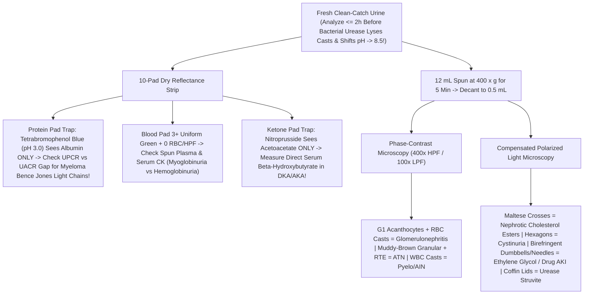
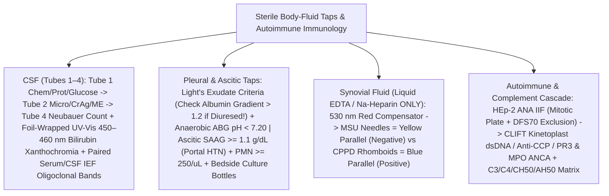

# **BASIC MEDICAL — BEHIND THE CURTAIN CLINICAL DIAGNOSTICS NOTEBOOK**
## **VOLUME VI: URINALYSIS ("THE POOR MAN'S RENAL BIOPSY"), STERILE BODY-FLUID TAP MICROSCOPY (`CSF`, PLEURAL, ASCITIC, SYNOVIAL) & AUTOIMMUNE RHEUMATOLOGY PANELS**

> [!IMPORTANT]
> **How to Read This Volume:** Few diagnostic acts in medicine yield higher bedside leverage per drop of fluid than looking directly at what filters through a glomerulus, bathes the subarachnoid cisterns, accumulates in a pleural or peritoneal cavity, or crystallizes inside an acutely swollen joint—and pairing that cellular truth with precision autoantibody and complement cascades. Yet every one of these tests contains famous chemical and optical illusions: urine dipsticks that read *"Negative Protein"* during `12 g/day` myeloma cast nephropathy or *"Trace Ketones"* in life-threatening `pH 7.0` diabetic ketoacidosis; spinal taps where naked-eye inspection misses half of subarachnoid hemorrhages; synovial aspirates where powdered collection-tube anticoagulants masquerade as gout; and ethanol-fixed neutrophil slides whose most famous vasculitis pattern (`p-ANCA`) is literally a laboratory charge-migration artifact! This volume takes you behind the curtain of clinical microscopy, reflectance photometry, UV-Vis spectrophotometry, compensated polarized optics, `HEp-2` immunofluorescence, and functional hemolytic complement assays.

---

# **DOSSIER 6.1: THE "POOR MAN'S RENAL BIOPSY" — REFRACTOMETRY, DIPSTICK DRY-PAD CHEMISTRY TRAPS & PHASE-CONTRAST / POLARIZED URINE SEDIMENT MICROSCOPY**

## **6.1.1 Pre-Analytical Urgency: What Happens to Unpreserved Urine After `120 Minutes` on a Counter**

Clinicians routinely call the nephrology consult service to inspect a spun urine sediment—only to discover the specimen cup has been sitting warm at a nursing station for four hours. Under *CLSI GP16* Urinalysis Standards, **unpreserved urine MUST be analyzed within `2 hours` of voiding (or refrigerated immediately at `2°C–8°C`, though refrigeration precipitates heavy pink amorphous urates [`brick dust`] in acidic urine and white amorphous phosphates in alkaline urine that obscure casts until gently rewarmed to `37°C`)**.

Leave an unrefrigerated clean-catch urine cup at room temperature past `2 hours` and a five-alarm biochemical demolition unfolds inside the plastic cup:

1. **Bacterial `Urease` Alkalinization ($\text{pH} \to 8.5\text{–}9.0$):** Trace perineal or catheter contaminants—especially ***Proteus mirabilis*, *Klebsiella pneumoniae*, *Morganella morganii*, *Providencia*, and *Corynebacterium urealyticum***—multiply logarithmically (`doubling every 20–30 minutes`), expressing nickel-metalloenzyme **urease** to hydrolyze abundant urinary urea (`~300–500 mmol/L`):

$$\text{CO(NH}_2\text{)}_2\text{ (Urea)} + 2\text{H}_2\text{O} \xrightarrow{\text{Bacterial Urease}} 2\text{NH}_4^+ + \text{CO}_3^{2-} \implies \text{NH}_3\uparrow + \text{pH } 8.5\text{–}9.2$$

2. **Complete Dissolution of Cellular Casts & Osmotic Lysis of `RBC`s / `WBC`s:** As discussed below, every urinary cast is held together by a delicate disulfide-crosslinked glycoprotein gel—**Tamm-Horsfall mucoprotein (`Uromodulin`)**—which polymerizes *only* in acidic, concentrated tubular fluid and **depolymerizes/dissolves rapidly once $\text{pH}$ climbs above `7.5–8.0`**! Simultaneously, alkaline hypotonicity ruptures erythrocyte and neutrophil membranes (`> 50%` of `WBC`s and dysmorphic `RBC`s lyse within `2–3 hours` at room temperature), erasing the sole microscopic proof of proliferative glomerulonephritis!
3. **Metabolic & Photochemical Wipeout:** Multiplying bacteria consume urinary **glucose** (`false-negative glucosuria`) and reduce nitrate to **nitrite** *in vitro* (`false-positive UTI screen`); volatile **acetone** evaporates into the headspace (`false-low ketones`); **conjugated bilirubin** photo-oxidizes under fluorescent ceiling lights into green **biliverdin** (`undetected by diazo bilirubin pads!`); and **urobilinogen** oxidizes into orange-brown **urobilin** (`false-negative urobilinogen`). Meanwhile, alkaline $\text{pH}$ precipitates meaningless clouds of **triple-phosphate (`struvite`) and amorphous phosphate crystals** that did not exist inside the patient's bladder!

---

## **6.1.2 Physical & Dry-Reagent Strip (`10-Pad`) Reflectance Photometry Unmasked**

Inside an automated urinalysis workstation (`Siemens Clinitek Novus`, `Sysmex UC-3500`, `Beckman Coulter iChemVELOCITY`), a robotic arm dips a multi-pad cellulose strip into unspun urine, blots excess edge fluid on absorbent paper (preventing acidic `pH 3.0` buffer from the protein pad from running sideways onto adjacent pads!), waits exact kinetic intervals (`30 to 120 seconds`—e.g., Leukocyte Esterase requires a full `120 seconds`!), and measures **multi-wavelength LED reflectance photometry** via Kubelka-Munk remission math. Every single pad harbors critical analytical traps:

### **A. Concentrating Power: Dipstick Specific Gravity (`SG`) vs. Refractometer vs. Freezing-Point Osmolality**

Assessing whether the collecting duct responds to Antidiuretic Hormone (`ADH` / Vasopressin) during hyponatremia, polyuria/diabetes insipidus, or acute kidney injury uses three fundamentally different physical principles (*cross-reference `DOCS_ARCHIVE_01_OSMOLARITY_AND_SOLUTION_CALCULATIONS.md` for fundamental Van't Hoff particle dissociation and colligative thermodynamics*):

* **1. Dipstick `SG` Pad (`Ionic Polyelectrolyte pKa Shift` — Measures `IONS ONLY`!):** How can a dry piece of paper measure fluid density? *It doesn't!* The pad contains **bromothymol blue** indicator plus a pre-titrated polyelectrolyte—**poly(methyl vinyl ether/maleic anhydride)** carrying weakly acidic $-\text{COOH}$ groups. Dissolved urinary **cations ($\text{Na}^+, \text{K}^+, \text{NH}_4^+$)** exchange electrostatically with protons ($\text{H}^+$) on the polymer:

$$\text{Polymer–COOH} + \text{Na}^+ \rightleftharpoons \text{Polymer–COO}^-\text{Na}^+ + \text{H}^+$$

  Released $\text{H}^+$ acidifies bromothymol blue from **deep blue-green (`SG 1.000`) through olive green to yellow (`SG 1.030`)**!
  * **Trap #1 — `100%` Blind to Uncharged Non-Electrolytes:** Because **Glucose (`i = 1`, neutral), Urea (`neutral`), Mannitol, and Non-Ionic Iodinated IV Radiocontrast** do not dissociate into cations, `4+` diabetic glucosuria (`2,000 mg/dL`) or heavy mannitol osmotic diuresis yields a **deceptively LOW dipstick `SG` (`1.005–1.010`)** despite high true osmolality!
  * **Trap #2 — Alkaline Urine Buffer Bias:** At `urine pH >= 6.5`, hydroxide neutralizes released protons, underestimating `SG` (automated readers automatically add **`+0.005`** whenever `pH >= 6.5`).
* **2. Optical Refractometer (`Snell's Law` Refractive Index $n = c / v$ — Distorted by Heavy Solute Mass!):** Measures how steeply a `1-drop` urine film bends transmitted light, which scales with **total dissolved solute MASS per unit volume (`g/L`)**, not particle count. Normally, `SG 1.010` ("isosthenuria," matching protein-free plasma glomerular ultrafiltrate) corresponds roughly to **`~300 mOsm/kg`**, and human kidneys max out around **`SG 1.030–1.035` (`~1,000–1,200 mOsm/kg`)** (rule-of-thumb multiplier: last two digits of `SG × 30–35 ≈ mOsm/kg`, e.g., `1.020 -> 20 × 32 ≈ 640 mOsm/kg`).
  * **Trap — Supra-Physiologic `SG > 1.040–1.050`:** Whenever a refractometer reads **`SG > 1.035`** (`e.g., 1.045`), a human kidney CANNOT concentrate sodium/urea that high! The culprit is high-molecular-weight uncharged solute: **Iodinated IV CT Contrast (`MW ~777–821 Da` — every `10 g/L` spikes `SG` wildly while barely nudging osmolality!)**, **Mannitol**, **Dextran**, high-dose IV `β-lactams` (carbenicillin/piperacillin), or massive **`> 10 g/L` glucosuria/proteinuria** (subtract `0.004` per `1 g/dL` glucose and `0.003` per `1 g/dL` protein).
* **3. Freezing-Point Depression Osmometer ($\Delta T_f = K_f \cdot \text{Osmolality}$ — True Colligative Gold Standard!):** Supercools `200 µL` of urine to `-7°C`, induces crystallization via mechanical vibration, and measures the exact latent-heat freezing plateau via thermistor (`precision ±1 mOsm/kg`, where $1,000\text{ mOsm/kg}$ depresses water's freezing point by **`1.86°C`**). Because colligative freezing-point depression counts **every single dissolved particle equally (`1 mOsm` of $\text{Na}^+$ = `1 mOsm` of urea = `1 mOsm` of glucose = `1 mOsm` of contrast)** regardless of molecular weight or electrical charge, **Direct Urine Osmolality (`50–1,200 mOsm/kg`)** is mandatory whenever evaluating hyponatremia (`SIADH` `> 100 mOsm/kg` vs psychogenic polydipsia `< 100 mOsm/kg`), central/nephrogenic diabetes insipidus, or calculating the **Urine Osmolal Gap** (`Measured Urine Osm - [2(U_Na + U_K) + U_Urea + U_Glucose]` to estimate unmeasured urinary $\text{NH}_4^+$ excretion in distal Renal Tubular Acidosis!).

### **B. Dipstick Protein (`Tetrabromophenol Blue`) & the Deadly Myeloma Bence Jones Blindspot**

Normal glomeruli restrict `66.5 kDa` negatively charged **Albumin** via endothelial fenestrations, heparan-sulfate glomerular basement membrane (`GBM`) charge repulsion, and podocyte slit diaphragms (`Nephrin`/`Podocin`), while megalin-cubilin receptors in the proximal convoluted tubule reabsorb filtered low-molecular-weight proteins—keeping normal `24-hour` urine total protein **`< 150 mg/day`** (predominantly `~50–70 mg` Tamm-Horsfall uromodulin secreted distally!) and urinary **Albumin `< 30 mg/day` (`UACR < 30 mg/g creatinine`)**.

* **Sörensen's "Protein Error of Indicators" (`pH 3.0` Citrate Buffer + `Tetrabromophenol Blue`):** Normally, pH indicator dyes change color only when ambient $\text{pH}$ changes. Here, heavy citrate buffer locks the pad firmly at **`pH 3.0`**, where free `Tetrabromophenol Blue` (`pKa ~3.8`) is protonated **bright yellow**. When **Albumin** (`isoelectric point pI ≈ 4.7`) enters this `pH 3.0` environment, its dozens of basic lysine/histidine/arginine side chains are hungry proton acceptors ($-\text{NH}_3^+$) paired with hydrophobic binding pockets; **Albumin accepts a proton directly from `Tetrabromophenol Blue` and binds the deprotonated dye anion**, shifting absorption instantaneously from **yellow (`Negative`) -> yellow-green (`Trace`: `15–20 mg/dL`) -> green (`1+`: `30 mg/dL`; `2+`: `100 mg/dL`) -> deep teal-blue (`3+`: `300 mg/dL`; `4+`: `>= 2,000 mg/dL`)** while bulk pad $\text{pH}$ never budges from `3.0`!

> [!CAUTION]
> **THE #1 URINALYSIS TRAP IN CLINICAL MEDICINE — Dipstick Protein Is `100%` Blind to Myeloma Free Light Chains & Microalbuminuria!**
> 1. **Multiple Myeloma Cast Nephropathy ("Overflow Proteinuria"):** Monoclonal **Free $\kappa$ (`22.5 kDa` monomer) or $\lambda$ (`45 kDa` dimer) Immunoglobulin Light Chains (Bence Jones Proteins)** have far fewer proton-accepting sites and lack albumin's hydrophobic dye-binding clefts at `pH 3.0`. A patient in acute renal failure (`Creatinine 5.8 mg/dL`, hypercalcemia, anemia) pouring **`12,000 mg/day` (`12 g/day`!) of nephrotoxic monoclonal $\kappa$ light chains** into their urine will routinely read **`DIPSTICK PROTEIN = NEGATIVE` (or `Trace`)**!
>    * **How to Catch the "Albumin-to-Total-Protein Gap" Immediately:** Order **both** a spot **Urine Total Protein-to-Creatinine Ratio (`UPCR` — measured chemically via `Pyrogallol Red–Molybdate` or `Benzethonium Chloride` turbidimetry, which precipitates ALL proteins including light chains!)** AND a spot **Urine Albumin-to-Creatinine Ratio (`UACR` — anti-albumin immunoassay)** *(or classical `3% Sulfosalicylic Acid [SSA]` cold acid turbidimetry)*.
>    * In **Glomerular Disease** (diabetic nephropathy, membranous nephropathy, FSGS), albumin constitutes **`60%–85%` of total urine protein** (`e.g., UPCR = 4,000 mg/g` and `UACR = 3,100 mg/g` -> `UACR/UPCR ratio > 0.4–0.6`).
>    * In **Multiple Myeloma / `AL` Amyloidosis Light-Chain Overflow** (or pure proximal tubular $\beta_2$-microglobulinuria), `Dipstick Protein = Negative` / **`UACR = 35 mg/g` while `UPCR = 6,500 mg/g` (`UACR/UPCR ratio < 0.10`!)** -> **Pathognomonic of Monoclonal Free Light Chains (`Bence Jones Proteinuria`)**—confirm immediately with **Serum Free $\kappa/\lambda$ Light Chain Ratio + `SPEP/UPEP` with Immunofixation (`IFE`)**!
> 2. **Early Diabetic "Moderately Increased Albuminuria" (`30–300 mg/g`):** Standard dipstick protein turns `1+` only around `20–30 mg/dL` (`~300 mg/day`), completely missing early glomerular hyperfiltration (`UACR 30–299 mg/g`) when `ACEi/ARB`, `SGLT2i`, and `Finerenone` prevent progression to ESKD!
> 3. **False-Positive Dipstick Protein (`Urine pH > 8.0`):** Heavily buffered alkaline urine (*Proteus* UTI, sodium bicarbonate infusion), quaternary ammonium skin cleansers (`benzalkonium`), or chlorhexidine overwhelm the pad's `pH 3.0` citrate buffer, deprotonating `Tetrabromophenol Blue` directly to `2+/3+` blue with **zero actual protein** (`UPCR` will be completely normal)!

### **C. Dipstick Blood, Ketone Redox Paradoxes, Vitamin C Interference & `Griess` Nitrites**

| Dipstick Pad & Exact Chemistry | What Triggers Positive | Critical Clinical Paradoxes & Analytical False-Negative / False-Positive Traps |
| :--- | :--- | :--- |
| **Blood (`Heme Pseudoperoxidase`):** Iron-porphyrin heme ring catalyzes organic hydroperoxide oxidation of **`3,3',5,5'-Tetramethylbenzidine (TMB)`** from yellow/orange to **green-blue**. | • **Intact `RBC`s** (lyse on pad -> **speckled green dots**) • **Free Hemoglobin** (uniform green) • **Myoglobin** (uniform green) | **1. `3+` Uniform Green Dipstick Blood + `0–1 RBC/HPF` on Spun Sediment = `Heme Pigmenturia`!** Differentiate immediately: • **Intravascular Hemolysis (`Hemoglobinuria`):** `64 kDa` Hb saturates serum haptoglobin -> spun blood plasma looks **cherry/pink**, `LDH` sky-high, `Haptoglobin < 10 mg/dL`, `Indirect Bilirubin` high, `CK` normal. • **Rhabdomyolysis (`Myoglobinuria`):** `17 kDa` monomer lacks a carrier protein and clears straight into urine -> **spun blood plasma is crystal-clear pale yellow**, while **Serum `Creatine Kinase (CK)` is `10,000–200,000+ U/L`** (+ hyperkalemia, hyperphosphatemia, hypocalcemia, pigment `ATN`!). **2. False-Negative:** **High-dose `Vitamin C (Ascorbic Acid)`** reduces hydroperoxide before `TMB` oxidizes! **3. False-Positive:** Microbial peroxidases in severe Gram-negative bacteriuria or bleach (`hypochlorite`) container contamination. |
| **Ketones (`Legal's Reaction`):** **`Sodium Nitroprusside` (`nitroferricyanide`) + glycine** in alkaline buffer reacts with **`Acetoacetate`** (`CH3COCH2COO-`) to form a **magenta-purple** ring (`0` reactivity with `β-OHB`!). | **`Acetoacetate` ONLY** (detects `>= 5 mg/dL`; faint reactivity to `Acetone`; **COMPLETELY BLIND to `β-Hydroxybutyrate` [`β-OHB`]!**). | **THE `DKA / AKA` REDOX PARADOX:** Hepatic ketogenesis generates 3 ketone bodies governed by mitochondrial $\text{NADH}/\text{NAD}^+$: $$\text{Acetoacetate} + \text{NADH} + \text{H}^+ \xrightleftharpoons{\beta\text{-OHB Dehydrogenase}} \beta\text{-Hydroxybutyrate} + \text{NAD}^+$$ Normally `β-OHB : Acetoacetate ≈ 1:1`. In severe hypoxic **Diabetic Ketoacidosis (`DKA`)** and **Alcoholic Ketoacidosis (`AKA` — where ethanol metabolism floods liver mitochondria with $\text{NADH}$!)**, the ratio skews **`8:1` to `15:1` toward `β-OHB`**! Thus, a lethally acidotic `AKA`/`DKA` patient (`β-OHB = 9.5 mmol/L`) can show **`Negative` or `Trace` Urine Dipstick Ketones** on arrival—and then `8 hours` into successful IV insulin + resuscitation, as mitochondrial $\text{NADH}$ clears and `β-OHB` converts *backward* into acetoacetate for excretion, **urine dipstick ketones paradoxically SURGE from `Trace` to `4+` while the patient is actually getting BETTER!** Never track `DKA` closure with urine dipsticks—measure **Direct Enzymatic Serum `β-Hydroxybutyrate`** + Serum Anion Gap! *(False-positive nitroprusside color: sulfhydryl drugs like `Captopril`, `Mesna`, `N-acetylcysteine`.)* |
| **Glucose (`Double-Sequential Enzyme`):** **`Glucose Oxidase`** oxidizes D-glucose + $\text{O}_2 \to$ gluconolactone + **$\text{H}_2\text{O}_2$**; **`Peroxidase`** uses $\text{H}_2\text{O}_2$ to oxidize potassium iodide / chromogen. | Filtered glucose exceeding proximal-tubule **`SGLT2` (`SLC5A2`) $T_m$ (`~180 mg/dL` plasma glucose)**. *(Specific to D-glucose; ignores galactose/fructose!)* | • **Expected `4+` Euglycemic Glucosuria:** Patients taking **`SGLT2` inhibitors (`Empagliflozin`, `Dapagliflozin`, `Canagliflozin`)** purposefully excrete `50–80 g/day` glucose at normal serum glucose (`95 mg/dL`)—*warn clinicians about **Euglycemic `DKA`** (`serum glucose < 200 mg/dL` + high serum `β-OHB` + high anion gap) perioperatively!* • **Pathologic Normoglycemic Glucosuria (`Not on SGLT2i`):** **Proximal Renal Tubular `Fanconi` Syndrome** (+ phosphaturia, uricosuria, aminoaciduria, normal-AG type 2 `RTA` — caused by **Myeloma $\kappa$ light chains**, **`Tenofovir Disoproxil Fumarate [TDF]`**, **`Ifosfamide`**, **`Cisplatin`**, Wilson disease!). • **False-Negative:** **Ascorbic acid (`Vitamin C`)** scavenges the intermediate $\text{H}_2\text{O}_2$! |
| **Nitrite (`Griess` Reaction):** Urinary **`Nitrite` ($\text{NO}_2^-$)** diazotizes *p*-arsanilic acid at acidic pH, coupling with tetrahydrobenzoquinolinol into a **pink azo dye** (`high ~95% specificity`, low `~45–55%` sensitivity!). | **Nitrate-reductase-positive Gram-negative *Enterobacterales*** (*E. coli, Klebsiella, Proteus*) converting dietary $\text{NO}_3^- \to \text{NO}_2^-$ over **`>= 4 hours` bladder dwell time**. | **Three Major Causes of `Nitrite-Negative` True UTI:** 1. **Gram-Positive & Non-Fermenter Uropathogens LACK Nitrate Reductase:** ***Enterococcus faecalis***, ***Staphylococcus saprophyticus*** (young sexually active women!), *Streptococcus agalactiae* (`GBS`), ***Pseudomonas aeruginosa***, and *Candida* are **intrinsically Nitrite-Negative**! 2. **Frequent Dysuric Voiding (`< 4h` Bladder Incubation):** First-morning void maximizes sensitivity; hourly cystitis urgency flushes bacteria out before $\text{NO}_2^-$ accumulates. 3. **Low Dietary Vegetable Nitrate** (parenteral nutrition/infants) or **Vitamin C** blocking diazotization. |
| **Leukocyte Esterase (`LE`):** Neutrophil azurophilic granule **indoxyl carboxylic acid esterase** cleaves a pyrrole/indoxyl ester; released indoxyl couples with a diazonium salt to turn **violet** (`read at 120s`). | Intact **OR lysed** **neutrophils** (plus eosinophils/histiocytes; **lymphocytes LACK leukocyte esterase!**). | • **Why `LE+` with `0 WBC/HPF` Occurs:** Alkaline hypotonic urine lysed all `PMN`s on the counter, spilling soluble granule esterase into the liquid! • **Classic `Sterile Pyuria` (`LE+` / `> 10 WBC/µL` + Routine Urine Culture Negative):** (1) Partially antibiotic-treated UTI, (2) **`Chlamydia trachomatis` / `Neisseria gonorrhoeae` / `Mycoplasma genitalium` urethritis** (order first-catch uncleaned urine `NAAT`!), (3) **Genitourinary Tuberculosis (`Mycobacterium tuberculosis` — acidic `pH 5.0` sterile pyuria!)**, (4) **Acute Interstitial Nephritis (`AIN`)**, (5) Nephrolithiasis / papillary necrosis / bladder carcinoma in situ, (6) Vaginal leukocyte contamination (`squamous epithelial cells` abundant!). *(False-negative `LE`: high urine `SG`, heavy glucosuria/proteinuria crenate PMNs; cephalexin/nitrofurantoin/gentamicin/Vitamin C inhibit reaction!)* |
| **Bilirubin (`Diazo` Coupling) & Urobilinogen (`Ehrlich's` *p*-DMAB Aldehyde):** | **Bilirubin pad:** Water-soluble **Conjugated (`Direct`) Bilirubin ONLY**. **Urobilinogen pad:** Reabsorbed gut bacterial breakdown tetrapyrrole. | • **Hemolytic Anemia / Gilbert Syndrome:** Unconjugated (`Indirect`) bilirubin is tightly bound to `66.5 kDa` serum Albumin and **CANNOT cross the glomerulus** -> **`Urine Bilirubin = NEGATIVE` ("Acholuric Jaundice")** while **`Urine Urobilinogen = HIGH (2+/3+)`**! • **Complete Biliary Obstruction (Pancreatic Head Mass / Choledocholithiasis):** Conjugated bilirubin refluxes into blood and filters freely -> **`Urine Bilirubin = POSITIVE` (`dark tea/cola foam`)** while zero bile reaches gut bacteria -> **`Urine Urobilinogen = ABSENT/LOW`**! *(Note: Dipsticks CANNOT detect `0` urobilinogen reliably because normal `0.2–1.0 mg/dL` sits at the bottom color block!)* |

---

## **6.1.3 Behind the Phase-Contrast & Polarized Microscope (`400×` High-Power Field / `Iris iQ200`)**

### **A. Standardized Centrifugation & Optical Mode Selection**

To convert urine microscopy from subjective guesswork into reproducible quantitative nephrology, technologists transfer exactly **`12 mL`** (`or 10 mL`) of well-mixed fresh urine into a conical tube, spin in a swinging-bucket centrifuge at **`400 × g` Relative Centrifugal Force (`RCF`, ~`1,500 rpm` depending on rotor radius: $\text{RCF} = 1.118 \times 10^{-5} \cdot r_{\text{cm}} \cdot \text{RPM}^2$) for `5 minutes`** (spinning at `3,000 rpm` shatters delicate `RBC` and `WBC` casts into unrecognizable debris!), aspirate supernatant leaving exactly **`0.5 mL`** (`24×` concentration), gently flick-resuspend the pellet, and load **`20 µL`** into a calibrated KOVA chamber (`Low-Power Field [LPF, 100×]` along chamber edges where casts drift; `High-Power Field [HPF, 400×]` across `>= 10` fields for cells and crystals). *(Automated high-volume labs screen first via `Sysmex UF-5000` polymethine laser fluorescence flow cytometry or `Beckman Iris iQ200` planar laminar-flow digital microscopy, flagging every pathologic cast, dysmorphic RBC, or crystal specimen for manual **Phase-Contrast + Compensated Polarized Microscopy**!)*

* **Why Brightfield Alone Fails (`Lower the Condenser` or Switch to `Phase-Contrast`!):** Tamm-Horsfall **Hyaline Casts** have a refractive index (`n ≈ 1.34`) almost identical to water (`n = 1.333`). Leave a brightfield condenser wide open and `100%` of hyaline casts and `G1` acanthocyte blebs bleach out completely invisible! **Phase-Contrast Microscopy** converts tiny optical path-length phase retardations ($\Delta \phi$) across cell membranes and uromodulin fibrils into dramatic dark/halo amplitude contrast without requiring toxic wet-mount stains (`Sternheimer-Malbin` crystal-violet/safranin).

### **B. Tamm-Horsfall (`Uromodulin`) Cast Moulding & the Nephrologist's Diagnostic Atlas**

Every true **Urinary Cast (`Cylindruria`)** is an actual `3D` anatomical plaster mould of a single **Thick Ascending Limb of the Loop of Henle (`TAL`) or Distal Convoluted / Collecting Tubule lumen**! Epithelial cells lining the `TAL` exclusively synthesize and cleave **`Uromodulin` (`Tamm-Horsfall Mucoprotein`)** into tubular fluid. Under conditions of **low urine flow, acidic $\text{pH}$, high $\text{NaCl}$/$\text{Ca}^{2+}$ concentration, or co-precipitating heme/myoglobin/Bence Jones light chains** (*precisely why myeloma `κ/λ` CDR3 loops bind a specific `D8C` peptide motif on uromodulin to cement rock-hard intratubular myeloma casts!*), `uromodulin` cross-links into a cylindrical fibrillar meshwork, trapping whatever cells, granules, or lipid droplets happen to be passing down that nephron at that exact moment—proving beyond doubt that **those trapped cells originated INSIDE the kidney parenchyma, NOT the bladder, prostate, or urethra!**

| Sediment Element (`LPF 100×` for Casts; `HPF 400×` for Cells) | Exact Phase-Contrast / Polarized Morphology | Pathophysiologic Origin & High-Stakes Bedside Action |
| :--- | :--- | :--- |
| **Hyaline Casts** | Transparent, parallel-sided, rounded-end empty `uromodulin` cylinders (faintly visible only via **Phase-Contrast** or lowered condenser). | **Non-specific / Physiologic:** Concentrated acidic urine (`volume depletion`, marathon running, fever, congestive heart failure, or **IV Loop Diuretics [`Furosemide`]**, which flood the distal nephron with $\text{NaCl}$ + $\text{H}^+$, forcefully precipitating `0–10+` hyaline casts/LPF!). |
| **Dysmorphic `RBC`s (`G1` Acanthocytes) & `RBC` Casts** | **`G1` Acanthocytes:** Ring-shaped doughnut `RBC`s sporting `>= 1` protruding **vesicular membrane blebs ("Mickey Mouse ears")** (`>= 5%` of urinary `RBC`s = **`~98%` specific for glomerular bleeding**!). **`RBC` Casts:** Tightly packed orange-red erythrocyte bricks cemented inside a uromodulin cylinder. | **NEPHROLOGIC EMERGENCY — Active Proliferative Glomerulonephritis / Small-Vessel Vasculitis!** Mechanical extrusion of `RBC`s through rents in inflamed `GBM` followed by hypertonic medullary osmotic shock creates `G1` acanthocytes. Triggers urgent workup (`ANCA [PR3/MPO]`, `Anti-GBM`, `ANA/dsDNA`, `C3/C4`, `Cryoglobulins`, `ASO/IgA`) & **expedited Renal Biopsy**! *(Contrast with `100%` smooth uniform biconcave **Isomorphic `RBC`s** + zero casts/protein = **Urologic Tract Bleeding**: stone, papillary necrosis, bladder/renal cell carcinoma -> CT Urogram + Cystoscopy!)* |
| **`WBC` Casts & Sterile Pyuria** | Refractile multi-lobed polymorphonuclear leukocytes (`12–15 µm`) embedded *inside* a cylindrical uromodulin matrix (distinguishing nephron inflammation from loose bladder `WBC` clumps!). | **Tubulointerstitial Inflammation:** 1. **Acute Bacterial Pyelonephritis** (fever, flank pain, bacteriuria). 2. **Drug-Induced Acute Interstitial Nephritis (`AIN` — `PPI`s, `β-lactams`, `NSAIDs`, `TMP-SMX`, `Immune Checkpoint Inhibitors`)** or Lupus/Sarcoid/Sjögren's tubulointerstitial nephritis. *(Note: **Urine Eosinophils [`Hansel Stain`]** are **NO LONGER reliable** to rule `AIN` in or out [`Muriithi et al., CJASN 2013`: sensitivity `~31%`, positive in RPGN, cholesterol atheroemboli, and cystitis]!)* |
| **"Muddy-Brown" Coarse Pigmented Granular Casts & `RTE` Cells** | Cigar-shaped dark golden-brown to mahogany cylinders densely packed with coarse degenerated cellular granules (**heme/cytochrome/lipofuscin breakdown** of sloughed epithelium), accompanied by free **Renal Tubular Epithelial (`RTE`) Cells** (`14–25 µm` round/columnar cells with a **single large eccentric nucleus**) and `RTE` casts. | **Pathognomonic of Acute Tubular Necrosis (`ATN` — Ischemic/Septic Shock or Nephrotoxic [`Aminoglycosides`, `Cisplatin`, `Radiocontrast`, `Rhabdomyolysis`, `Heme`])!** Scoring `>= 2` on the **Perazella `ATN` Cast Scoring Index** (`granular casts + RTE cells`) yields a **`> 95%` Positive Predictive Value for `ATN`** over simple pre-renal volume responsiveness (`FE_Na < 1%` + bland hyaline sediment), preventing catastrophic fluid-overload pulmonary edema from blind saline boluses! |
| **Fine Granular & Waxy / Broad Casts** | **Waxy Casts:** Homogeneous, smooth, dull-yellow/matte high-refractive-index cylinders (sharply visible even on brightfield!) with **squared-off brittle ends and lateral saw-tooth fissures ("cracks")**, formed by prolonged intratubular stasis degeneration of cellular casts. **Broad Casts:** `2× to 6×` wider than normal casts. | **Advanced Chronic Kidney Disease (`CKD` / End-Stage "Renal Failure Casts")** or prolonged severe oliguric `ATN`: When `80%` of nephrons scar down, surviving remnant collecting ducts undergo massive **compensatory luminal hypertrophy/dilation** with sluggish flow, moulding giant broad waxy cylinders. |
| **Oval Fat Bodies, Fatty Casts & `"Maltese Cross"` Droplets** | `RTE` cells or macrophages engorged with refractile amber lipid vacuoles (**Oval Fat Bodies**) or free/cast-bound lipid droplets. Flip in **Crossed Polarizers**: liquid-crystalline **Cholesterol Esters** split light into a **symmetrical glowing `4-Arm White "Maltese Cross"`** (`+` sign turns red/blue with a compensator plate; neutral triglycerides stain `Oil Red O / Sudan III` orange without polarizing!). | **Heavy Glomerular Barrier Failure — Nephrotic Syndrome (`> 3.5 g/24h` proteinuria: Minimal Change Disease, `FSGS`, Membranous Nephropathy [`Anti-PLA2R`], Diabetic Nephropathy, `AL` Amyloidosis)** *plus* **Fabry Disease (`α-galactosidase A` deficiency — globotriaosylceramide `"mulberry"` Maltese-cross bodies even before heavy proteinuria!)**. Filtered lipoprotein-bound cholesterol is endocytosed by proximal `RTE` cells until overloaded cells slough into urine. |
| ** Clue / Decoy / Squamous Epithelial Cells** | • **Squamous Epithelial (`40–60 µm`):** Giant flat flagstone cells with tiny central nuclei = **perineal/vaginal contamination**! • **Urothelial (Transitional, `20–30 µm`):** Pear/umbrella cells from renal pelvis/ureter/bladder. • **Decoy Cells (`BK Polyomavirus`):** Enlarged urothelial cells with a giant homogeneous **"ground-glass" intranuclear viral inclusion** mimicking urothelial carcinoma! | **Decoy Cells** in a kidney transplant recipient screen early for **`BK` Polyomavirus reactivation** (`confirm via quantitative plasma BK PCR`, Dossier 5.2!). |

### **C. Pathognomonic Urinary Crystals: Decoding `pH` + Geometric Habit + Birefringence**

Many urinary crystals (`calcium oxalate dihydrate envelopes` after eating spinach/rhubarb, `uric acid` in concentrated acidic morning urine) appear transiently in healthy adults—whereas **four crystal types are NEVER normal and diagnose congenital metabolic defects, lethal toxic ingestions, staghorn infections, or acute iatrogenic crystal nephropathy on the spot**:

| Crystal Identity & Mandatory Urine `pH` | Microscopic Habit (`400×`) & Polarized Birefringence | Clinical Diagnosis & Immediate Bedside Intervention |
| :--- | :--- | :--- |
| **Cystine (`Acidic Urine`, `pH 5.0–6.5`)** *ALWAYS PATHOLOGIC!* | **Colorless, flat, refractile `6-Sided Regular Hexagons` ("Benzene Rings")**, often laminated in stacked shingles; weak variable birefringence *(dissolve in `HCl`/ammonia; positive cyanide-nitroprusside test turns cherry-purple!)*. | **Congenital Cystinuria** (autosomal recessive defect in proximal-tubule dibasic amino-acid transporter `SLC3A1 / SLC7A9` [`COLA`: Cystine, Ornithine, Lysine, Arginine] -> radiopaque staghorn stones!). **Rx:** `> 3–4 L/day` water (`urine cystine < 250 mg/L`) + **Potassium Citrate alkalinization (`target urine pH 7.0–7.5`)** + thiol binders (`Tiopronin`). |
| **Calcium Oxalate (`Acidic / Neutral Urine`, `pH 5.0–6.8`)** | **1. Dihydrate (`Weddellite`):** Classic colorless **octahedral bipyramidal `"Mailing Envelopes"` (`X` inside a square)** — weakly/non-birefringent. **2. Monohydrate (`Whewellite`):** Oval **"Hemp-Seed"**, pinched **"Dumbbell"**, or elongated **picket-fence spindles/needles** — **INTENSELY BIREFRINGENT**! | • **Monohydrate Needles/Dumbbells + Coma + High Serum Osmolal Gap + High Anion Gap Metabolic Acidosis = `ETHYLENE GLYCOL` (Antifreeze) Poisoning!** Alcohol dehydrogenase metabolizes ethylene glycol -> glycolaldehyde -> **glycolic acid** (acidosis + **falsely elevates point-of-care `L-lactate` electrodes!**) -> **oxalic acid**, precipitating `CaOx` monohydrate needles throughout renal tubules and brain! **STAT Rx:** **`Fomepizole`** (`ADH` competitive inhibitor) + Pyridoxine/Thiamine + **Emergent Hemodialysis**! • Also seen in **Enteric Hyperoxaluria** (Crohn's / Roux-en-Y gastric bypass fat malabsorption saponifying intestinal $\text{Ca}^{2+}$, leaving free dietary oxalate to hyperabsorb across the colon!), Primary Hyperoxaluria (`AGXT`), or megadose **Vitamin C** (`metabolized to oxalate!`). |
| **Uric Acid (`Strictly Acidic Urine`, `pH <= 5.5`; `pKa = 5.35`)** | Amber / lemon-yellow **diamond `"Rhomboids"`**, lemon-shaped **whetstones**, barrels, or **rosettes**. Under crossed polarizers: **dazzlingly `POLYCHROMATIC` (stained-glass cyan, magenta, emerald, gold)**! | • **Acute Tumor Lysis Syndrome (`TLS`)** after leukemia/lymphoma chemotherapy (`uric acid > 10–15 mg/dL` + hyperkalemia + hyperphosphatemia -> **Rasburicase** recombinant urate oxidase + aggressive IV fluids!), Lesch-Nyhan (`HGPRT`), gout, or metabolic-syndrome defective ammoniagenesis (`urine pH 5.0` driving radiolucent uric acid stones -> cured completely by **Potassium Citrate raising `urine pH to 6.5–7.0`**, converting insoluble protonated uric acid into `20×` more soluble sodium/potassium urate!). |
| **Magnesium Ammonium Phosphate — `Struvite` (`Alkaline Urine`, `pH > 7.2–8.5`)** | Colorless `3D` rectangular prisms beveled like classic **"Coffin Lids"** (occasionally fern-leaf when freshly precipitated); moderately birefringent. | **Pathognomonic of `Urease-Splitting` Bacterial Infection** (*Proteus*, *Klebsiella*, *Providencia*, *Corynebacterium urealyticum*) forming branching **staghorn calculi** (requires complete percutaneous/ureteroscopic stone clearance + targeted antibiotics—antibiotics alone cannot sterilize bacteria sheltered inside struvite Biofilm!). |
| **Cholesterol Plates & Rare Amino-Acid Crystals (`Acidic`)** | • **Cholesterol:** Flat rectangular transparent glass plates with a **missing `"Notched Corner"`** (`nephrotic chyluria`). • **Tyrosine** (fine silky dark needle sheaves) & **Leucine** (yellow oily concentric spheres with radial striations). | **Tyrosine + Leucine Crystals:** Classic terminal **Fulminant Hepatic Failure** (failed hepatic amino-acid deamination) or congenital tyrosinemia / maple-syrup urine disease. |
| **Iatrogenic Drug Crystals (`AKI` Culprits!)** | • **Sulfadiazine / Sulfamethoxazole (`Acidic`):** Brown-gold asymmetric **"Shocks of Wheat"** tied at the waist. • **IV Acyclovir (`Neutral/Alkaline`):** Fine **strongly birefringent needles** (`red/blue` under compensator) engulfing WBCs. • **High-Dose IV Methotrexate (`Acidic`):** Golden-brown amorphous/rosette plugs. • **Amoxicillin / Ciprofloxacin / Atazanavir** needles. | Intratubular **Crystal-Induced `AKI` (`Obstructive + NLRP3 Inflammasome Tubulopathy`)**! Prevented/treated by discontinuing culprit drug, **aggressive isotonic IV hydration** (especially before IV acyclovir!), and **targeted pH manipulation** (`Sodium Bicarbonate` maintaining **`urine pH >= 7.5–8.0`** is mandatory before high-dose **IV Methotrexate** or **Sulfadiazine** to keep weak-acid drugs ionized and `10-to-50-fold` more soluble!). |

---

# **DOSSIER 6.2: STERILE BODY-FLUID TAPS BEHIND THE CURTAIN — `CSF` LUMBAR PUNCTURE (`TUBE 1 VS 4` & SPECTROPHOTOMETRIC `XANTHOCHROMIA`), PLEURAL `LIGHT'S CRITERIA`, ASCITIC `SAAG` & COMPENSATED POLARIZED SYNOVIAL CRYSTAL PHYSICS**

## **6.2.1 Cerebrospinal Fluid (`CSF`) — Strict `Tubes 1–4` Routing, Hemacytometer Chambers & `UV-Vis` Xanthochromia**

### **A. Opening Manometry & Why `Tube 1, 2, 3, 4` Sequential Routing Is Non-Negotiable**

Advancing an atraumatic pencil-point (`Sprotte`/`Whitacre` `22G`—cutting post-dural-puncture headache incidence by `> 60%` compared to bevel-edged `Quincke` needles!) spinal needle through the `L3–L4` or `L4–L5` interspace pierces the dura-arachnoid into `~150 mL` of subarachnoid cerebrospinal fluid secreted at `~20 mL/hour` (`500 mL/day`) by choroid plexus tight junctions.

* **Lateral Decubitus Opening Pressure (`10–20 cm H2O` Normal Adult [`8–25 cm H2O` in obesity]):** Accurate manometry **requires the lateral recumbent position with hips/legs relaxed and extended**! Measuring pressure while sitting upright adds the hydrostatic column height from the cisterna magna to `L4` (`falsely reading 35–45 cm H2O`), while cramped knees-to-chest Valsalva abdominal compression spikes jugular/epidural venous pressure by `+10 cm H2O`. Markedly elevated opening pressure (`> 25–35+ cm H2O`) flags **Cryptococcal Meningitis** (fungal `GXM` capsule plugs arachnoid villi—therapeutic serial drainage down to `< 20 cm H2O` or `50%` reduction directly saves vision and life!), **Acute Bacterial Meningitis** cerebral edema, **Cerebral Venous Sinus Thrombosis**, or **Idiopathic Intracranial Hypertension (`IIH`)**.
* **Why Sequential Numbered `Tubes 1, 2, 3, and 4` (`1–2 mL` each) Route to Different Laboratories:**
  1. **`Tube 1` -> Clinical Chemistry & Immunology (`Total Protein` + `Glucose`):** Why *never* send `Tube 1` as the sole tube for Cell Count or Bacterial Culture? Because as the spinal needle traverses skin and the Batson epidural venous plexus, **the very first drops entering `Tube 1` wash out any microscopic epidermal skin plug (*S. epidermidis*) AND the heaviest bolus of needle-induced capillary blood ("traumatic tap")!** Chemistry resolves this effortlessly: spinning `Tube 1` pellets intact traumatic RBCs cleanly away so dissolved **CSF Glucose** and **Micro-Protein** (`Pyrogallol Red–Molybdate` dye binding; normal lumbar **`15–45 mg/dL`**, `100×` lower than `7,000 mg/dL` serum protein!) remain accurate (`subtract ~1 mg/dL CSF protein per 1,000 traumatic RBCs/µL` if heavily bloody).
     * **The `CSF : Serum Glucose Ratio` (`Normal >= 0.60`, or `45–80 mg/dL` at normal glycemia):** Glucose crosses the blood-brain barrier via saturable endothelial **`GLUT1` facilitated diffusion**, taking `2–4 hours` to equilibrate with blood (`always draw simultaneous serum glucose`—a diabetic patient with serum glucose `400 mg/dL` and CSF glucose `90 mg/dL` has a **profoundly pathologic ratio of `0.22` [`< 0.40`]**, completely masked if a clinician only looks at the raw number `90`!). **`Hypoglycorrhachia` (`Ratio < 0.40` or `< 18 mg/dL`)** reflects impaired `GLUT1` transport + accelerated meningeal anaerobic glycolysis in **Acute Bacterial Meningitis**, **Tuberculous Meningitis**, **Fungal (`Cryptococcus` / *Coccidioides*) Meningitis**, **Leptomeningeal Carcinomatosis**, or neurosarcoidosis—whereas **viral aseptic meningitis typically preserves normal CSF glucose (`>= 0.50–0.60`)**!
  2. **`Tube 2` -> Clinical Microbiology (`Cytocentrifuged Gram Stain`, `5% SBA` + `Chocolate Agar` + `Broth`, `BioFire ME`, `CrAg`):** Flushed free of initial skin-plug contaminants. *(CRITICAL BENCH RULE: **NEVER refrigerate `CSF` destined for Microbiology!** Cold `4°C` storage rapidly kills fastidious ***Neisseria meningitidis*** and ***Haemophilus influenzae***—keep `Tube 2` at room temperature/`35°C` and hand-carry STAT!)*
  3. **`Tube 3` & `Tube 4` -> Hematology Cell Count (`Improved Neubauer Hemacytometer` + `Cytospin` Differential):** Counting **`Tube 4` (`or Tube 3`)** minimizes traumatic-tap distortion—and when blood appears visibly or microscopically, laboratories count **BOTH `Tube 1` AND `Tube 4` side-by-side**!
     * **Why Manual `Neubauer` Chamber Microscopy Beats Million-Dollar Automated Hematology Analyzers Below `200 Cells/µL`:** Normal adult CSF contains **`0 to 5 WBC/µL`** (mononuclear lymphocytes/monocytes; **`0` neutrophils**—even `1–2 PMNs/µL` with abnormal protein warrants scrutiny!) and **`0 RBC/µL`**. Automated blood-counter impedance/laser channels calibrated for `4,000–15,000 WBC/µL` whole blood suffer electronic background carryover below `50–200 cells/µL`. Therefore, hematology technologists pipette `10 µL` of undiluted CSF under a quartz coverslip into a precision-etched **`0.1 mm`-deep Improved Neubauer Hemacytometer** (`9 large 1 mm² squares` = **`0.9 µL` exact calibrated optical volume**), counting every single cell manually at `400×`! To identify *which* leukocytes are present without shearing fragile CSF lymphocytes against a blood-smear glass spreader, `200–500 µL` of CSF spins at `500–800 rpm × 5 min` inside a **Shandon `Cytospin` funnel** lined with filter blotter paper, gently plastering scarce cells onto a `6 mm` glass circle for Wright-Giemsa staining (unmasking neutrophils, reactive viral lymphocytes, leptomeningeal adenocarcinoma signet rings, CNS lymphoma blasts, or **Mollaret footprint cells** in `HSV-2` recurrent meningitis!).

### **B. Traumatic Spinal Tap vs. Subarachnoid Hemorrhage (`SAH` > 12h): `Tube 1 -> 4` Clearing & `UV-Vis` Spectrophotometry**

Non-contrast third-generation Head CT performed **within `6 hours` of thunderclap headache onset** approaches `98.7%–99.9%` sensitivity for aneurysmal **Subarachnoid Hemorrhage (`SAH`)**. However, once **`> 6 to 12 hours` (and especially `2–5 days`)** elapse, subarachnoid blood dilutes into circulating CSF and **Head CT sensitivity plummets below `85%–50%`**—making Lumbar Puncture mandatory! When pink/bloody CSF drips out of the hub, the patient's life hangs on distinguishing an innocent **needle-nicked epidural vein (`Traumatic Tap`, occurring in `~15%` of LPs!)** from a ruptured **cerebral berry aneurysm (`True SAH`)**:

1. **`Tube 1` vs. `Tube 4` `RBC` Trajectory:**
   * **Traumatic Tap:** Fresh needle bleeding washes out progressively -> `Tube 1 RBC = 12,400/µL` plummeting sharply to `Tube 4 RBC = 320/µL` (*though complete clearing to `0` is needed to fully exclude `SAH` solely by cell counts, and if the needle bevel sits inside an epidural vein, `RBC`s can remain persistently high across all 4 tubes!*).
   * **True `SAH`:** Blood ruptured hours earlier has mixed uniformly throughout all cisterns -> **`Tube 1 RBC = 8,600/µL` and `Tube 4 RBC = 8,450/µL` (`non-clearing plateau`)**!
2. **The Definitive Arbiter — Centrifuged Supernatant `Xanthochromia` (`UK NEQAS` `UV-Vis` Spectrophotometry):**
   * Wrap **`Tube 4`** immediately in **light-blocking aluminum foil** (fluorescent hospital lights photodegrade trace CSF bilirubin at `~0.005 AU/hour`, causing false-negative `SAH`!) and **centrifuge within `< 1 hour` of collection**!
   * **Traumatic Tap Supernatant:** Intact fresh peripheral erythrocytes sink to the bottom, leaving the cell-free CSF supernatant **crystal-clear and colorless (`water-clear`)**! *(Critical Pre-Analytical Trap: if a traumatic tap sits unspun on a lab bench or shakes inside a pneumatic tube for `> 2–4 hours`, traumatic `RBC`s lyse **in vitro**, releasing free **Oxyhemoglobin** that tints the supernatant pale pink-orange!)*
   * **True `SAH` (`>= 12 Hours` Post-Bleed) — Why *In Vivo* `Bilirubin` Cannot Be Faked in a Test Tube:** Inside the living subarachnoid space, arachnoid cells, choroid plexus epithelium, and meningeal macrophages engulf lysed erythrocytes and induce microsomal **Heme Oxygenase-1 (`HO-1`)** + **Biliverdin Reductase**, enzymatically cleaving heme (`415 nm` pink **Oxyhemoglobin**) -> biliverdin -> **yellow `Bilirubin` (`Xanthochromia`, Greek *"yellow color"*, taking `9–12 hours` *in vivo* to appear and persisting `2–3 weeks` even after `RBC`s vanish!)**. **Because test tubes contain ZERO living arachnoid macrophages, conversion of hemoglobin into bilirubin NEVER occurs *in vitro* during transport!**
   * **Why Spectrophotometry (`350–600 nm` Scan) Beats the Human Eye:** Naked-eye inspection against white paper misses **`~50%` of clinically proven `SAH` xanthochromia**! Scanning the spun supernatant in a `1 cm` quartz cuvette separates the sharp **`415 nm` Oxyhemoglobin Soret Peak** (ambiguous alone if transport was delayed) from the **broad `450–460 nm` Net Bilirubin Absorbance (`NBA`) Shoulder**: **`NBA > 0.007 Absorbance Units` at `476 nm`** (adjusted when serum bilirubin `< 1.2 mg/dL` and CSF protein `< 150 mg/dL`) confirms **Subarachnoid Hemorrhage with `> 98%` sensitivity** (`>= 12h` post-ictus), triggering urgent **CT/Catheter Cerebral Angiography**!

### **C. Paired `CSF + Serum` Isoelectric Focusing (`IEF`) for Oligoclonal `IgG` Bands (`Multiple Sclerosis`)**

As detailed in the immunogenetics archive (**`DOCS_ARCHIVE_02_HLA_VARIABILITY_AND_AUTOIMMUNITY.md`**), neuroinflammation in **Multiple Sclerosis (`MS`)** centers on **`HLA-DRB1*15:01`**-restricted CD4+ T cells cross-recognizing `EBV` / reactivated `HERV-W Env` epitopes and **Myelin Basic Protein (`MBP`)**, recruiting clonal B-cell follicles inside the leptomeninges that continuously secrete clonally restricted **`IgG`** directly into CSF.

How does the immunology laboratory prove that CSF `IgG` was **synthesized intrathecally inside the CNS** rather than leaking passively across an inflamed blood-brain barrier from blood?
1. **Quantitative `CSF IgG Index` (`Normal < 0.70`):** Normalizes CSF-to-Serum `IgG` against the pure blood-CSF barrier permeability marker **Albumin** (`synthesized 100% by hepatocytes, 0% by brain!`):

$$\text{CSF IgG Index} = \frac{\text{CSF IgG } (\text{mg/dL}) \;/\; \text{Serum IgG } (\text{mg/dL})}{\text{CSF Albumin } (\text{mg/dL}) \;/\; \text{Serum Albumin } (\text{mg/dL})} = \frac{Q_{\text{IgG}}}{Q_{\text{Alb}}}$$

2. **Agarose Gel Isoelectric Focusing (`IEF`) + Anti-`IgG` Immunoblotting (`Mandatory Paired CSF + Simultaneous Serum!`):** Equal `IgG` nanogram amounts of patient `CSF` and `Serum` migrate side-by-side across an immobilized ampholyte `pH 3–10` gradient until each `IgG` clonotype halts sharply at its exact isoelectric point (`pI`):
   * **Pattern 1 (`Normal`):** Smooth polyclonal haze in both `CSF` and `Serum` (`0` bands).
   * **Pattern 2 (`Pure Intrathecal Synthesis — Classic MS!`):** **`>= 2` sharp discrete `IgG` Oligoclonal Bands (`OCBs`) in `CSF` with ZERO matching bands in paired `Serum`** (`present in > 90%–95% of MS`, fulfilling *Dissemination in Time* under the **Revised McDonald Criteria**; also seen in neurosyphilis, neuroborreliosis, SSPE, and autoimmune encephalitis!).
   * **Pattern 3 (`Mixed Intrathecal + Systemic`):** Identical bands in `CSF` and `Serum` **PLUS `>= 2` extra unique bands restricted solely to `CSF`** = Intrathecal synthesis superimposed on systemic inflammation (`MS`, neurosarcoidosis, CNS lupus).
   * **Pattern 4 (`"Mirror Pattern" — Passive Blood-CSF Leak ONLY, Negative for MS!`):** Identical clonal bands in *both* `CSF` and `Serum` (`zero unique CSF bands`) = Systemic monoclonal/oligoclonal gammopathy (`Multiple Myeloma`, `MGUS`, `Guillain-Barré`, systemic viral infection) filtering passively into spinal fluid! *(Proving why ordering CSF `OCBs` WITHOUT a paired blood tube is diagnostically uninterpretable!)*

---

## **6.2.2 Thoracentesis (`Pleural Fluid`) — Richard Light's Criteria, Diuresed Pseudo-Exudates & Blood-Gas `pH < 7.20`**

Normally, `~10–20 mL` of ultra-low-protein (`~1.5 g/dL`) lubricating fluid glides between the parietal and visceral pleura, balanced between systemic parietal-capillary hydrostatic filtration and parietal-pleural lymphatic stomata drainage. When an effusion accumulates, **Richard W. Light's landmark 1972 rules** (*Ann Intern Med* 1972;47:507) separate passive **Hydrostatic/Oncotic `Transudates`** (left heart failure, cirrhosis [`hepatic hydrothorax`], nephrotic syndrome—*treat the systemic organ, leave the pleura alone!*) from **Inflammatory/Capillary-Leak `Exudates`** (pneumonia/empyema, malignancy, pulmonary embolism, tuberculosis, pancreatitis, rheumatoid/lupus pleuritis):

* **Light's Criteria (`Exudate` Diagnosed if `>= 1` of the Following 3 Conditions Is Met — `98%` Sensitivity!):**
  1. $$\frac{\text{Pleural Fluid Total Protein}}{\text{Serum Total Protein}} > 0.5$$
  2. $$\frac{\text{Pleural Fluid LDH}}{\text{Serum LDH}} > 0.6$$
  3. $$\text{Pleural Fluid LDH} > \frac{2}{3} \times \left(\text{Laboratory Upper Limit of Normal for Serum LDH}\right)$$

* **The Classic Diuresed Heart-Failure `"Pseudo-Exudate"` Trap (`~25%` of Treated CHF Patients!):** Suppose an acutely decompensated heart-failure patient receives `160 mg` of IV furosemide for 48 hours before thoracentesis. Free water reabsorbs rapidly out of the pleural space into capillaries while bulky `Protein` and `LDH` lag behind, concentrating `Pleural/Serum Protein` to `0.53` (`falsely calling CHF an Exudate` and triggering unnecessary CT/thoracoscopy!).
  * **The Bench Rescue (`96%` Accuracy):** Whenever clinical suspicion favors CHF/cirrhosis despite a borderline Light's exudate (`Protein ratio 0.50–0.65`), calculate the **Serum-to-Pleural Albumin Gradient** (or Total Protein Gradient):
    $$\text{Serum Albumin} - \text{Pleural Fluid Albumin} > \mathbf{1.2\text{ g/dL}} \quad \left(\text{or Serum Protein} - \text{Pleural Protein} > \mathbf{3.1\text{ g/dL}}\right)$$
    *(Confirmed equally well by `Pleural or Serum NT-proBNP > 1,500 pg/mL`!)* If the Albumin Gradient exceeds `1.2 g/dL`, the effusion is a **true diuresed Transudate**!
* **Pleural `pH < 7.20` on the Blood-Gas Analyzer — The Chest-Tube Trigger:** Normal pleural fluid is mildly alkaline (`pH ~7.60`). In bacterial pneumonia, an uncomplicated sterile sympathetic effusion (`pH > 7.30`, `Glucose > 60 mg/dL`) resolves with antibiotics alone. Once bacteria invade across visceral pleura (**Complicated Parapneumonic Effusion / Fibrinopurulent Empyema**), neutrophil respiratory-burst lactic acid + bacterial $\text{CO}_2$ production + fibrin loculation drive **`Pleural Fluid pH < 7.20`** (`and/or Pleural Glucose < 60 mg/dL`, `LDH > 1,000 IU/L`, or frank pus/positive Gram stain)—**mandating immediate tube thoracostomy drainage (`+ intrapleural tPA + DNase` per the `MIST2` trial)** before thick fibrous peel traps the lung!
  * **Strict Pre-Analytical `pH` Rule:** Pleural `pH` MUST be aspirated anaerobically into a **heparinized arterial blood-gas (`ABG`) syringe** (expelling all air bubbles and capping immediately!). Dipping urine pH paper into an open cup is forbidden by *CLSI*: room-air exposure lets dissolved $\text{CO}_2$ outgas within minutes (**falsely raising `pH` from `7.12` to `7.35` and masking an empyema!**), whereas accidentally aspirating acidic **local `Lidocaine HCl` (`pH ~5.0–6.5`)** through the same anesthetic needle **falsely plunges `pH` below `7.0`**! *(Note: Never inject **frank thick pus** into an `ABG` electrode—pus clots ruin the glass membrane, and frank pus ALREADY mandates a chest tube regardless of pH!)*
* **Targeted Pleural Biomarkers:** **`Adenosine Deaminase (ADA) > 40 U/L`** in lymphocytic exudate = `> 92%` sensitive/specific for **Tuberculous Pleuritis** (also elevated in empyema/lymphoma/rheumatoid); **`Pleural Glucose < 30 mg/dL` (often `< 10 mg/dL`!) + `pH ~7.00`** = classic **Rheumatoid Pleuritis** or **Empyema**; **`Pleural Triglycerides > 110 mg/dL` + Chylomicrons** = milky **Chylothorax** (`thoracic-duct disruption` from lymphoma or cardiothoracic surgery, vs `Cholesterol > 200 mg/dL + cholesterol crystals` in chronic **Pseudochylothorax**); **`Salivary-Isoform Pleural Amylase` + `pH < 7.00`** = surgical-emergency **Boerhaave Esophageal Rupture**!

---

## **6.2.3 Paracentesis (`Ascitic Fluid`) — Starling Physics of `SAAG >= 1.1 g/dL`, `SBP` (`PMN >= 250/µL`) & Bedside Culture Bottles**

Light's exudate/transudate protein ratios collapsed completely in peritoneal fluid because healthy hepatic sinusoids lack a continuous basement membrane ("fenestrated sieves"), allowing cardiac ascites to carry high protein while infected cirrhotic `SBP` fluid keeps ultra-low protein (`< 1.0 g/dL`). Hepatologist **Bruce Runyon** (*Ann Intern Med* 1992;117:215) replaced total protein with the **Serum-Ascites Albumin Gradient (`SAAG`)**—a direct mathematical readout of **Starling trans-sinusoidal oncotic-hydrostatic equilibrium**:

$$\text{SAAG} = \left[\text{Simultaneous Serum Albumin } (\text{g/dL})\right] - \left[\text{Ascitic Fluid Albumin } (\text{g/dL})\right]$$

*(Notice this is a **subtraction difference**, NOT a division ratio! Because Albumin contributes `~75–80%` of colloid oncotic pressure, when portal capillary hydrostatic pressure rises high enough to push fluid across into the abdomen, the body widens the oncotic albumin gradient across the sinusoid by the exact same magnitude to oppose filtration!)*

| `SAAG` Cutoff (`97%` Accuracy!) | Paired `Ascitic Total Protein` | Underlying Pathophysiology & Classic Etiologies |
| :--- | :--- | :--- |
| **`SAAG >= 1.1 g/dL`** **(`Portal Hypertension Present!`)** | **`< 2.5 g/dL`** *(Sinusoidal / Pre-Sinusoidal Capillarization)* | **Hepatic Cirrhosis** (collagen deposition in the Space of Disse seals sinusoidal fenestrations, blocking protein entry into ascites! *Note: `Ascites Protein < 1.0–1.5 g/dL` starves ascites of opsonic `C3`/immunoglobulins, steeply elevating **`SBP` risk**!*), Alcoholic Hepatitis, Late Budd-Chiari, Portal Vein Thrombosis. |
| **`SAAG >= 1.1 g/dL`** **(`Portal Hypertension Present!`)** | **`>= 2.5 g/dL`** *(Post-Sinusoidal Congestion — Healthy Leaky Sinusoids!)* | **Right-Sided Heart Failure / Constrictive Pericarditis** (`check Serum BNP > 364 pg/mL!`), **Early/Acute `Budd-Chiari` Hepatic-Vein Thrombosis**, Sinusoidal Obstruction Syndrome (`VOD`). High hepatic venous back-pressure pushes rich plasma proteins straight through normal wide-open hepatic sinusoidal pores! |
| **`SAAG < 1.1 g/dL`** **(`NO Portal Hypertension — Peritoneal Leak`)** | Usually **`>= 2.5 g/dL`** *(except Nephrotic `< 2.5`)* | **Peritoneal Carcinomatosis** (ovarian/gastric/colon — send `>= 50 mL` large-volume cytology!), **Tuberculous Peritonitis** (`lymphocytic + Ascites ADA > 39 U/L`, though cirrhotic low-protein TB ascites may blunt `ADA`!), **Pancreatic Ascites / Duct Leak** (`Ascites Amylase > 1,000 U/L`), **Biliary Leak** (`Ascites Bilirubin > Serum Bilirubin` & `> 6 mg/dL`), **Lupus Serositis**, **Nephrotic Syndrome**. |

* **Diagnosing Spontaneous Bacterial Peritonitis (`SBP`) vs. Secondary Gut Perforation (`Runyon's Triad`):**
  * Compute the **Absolute Ascitic Polymorphonuclear (`PMN`) Count**:
    $$\text{Absolute PMN } (\text{cells}/\mu\text{L}) = \left(\text{Total Nucleated WBC}/\mu\text{L}\right) \times \left(\frac{\%\text{ Neutrophils}}{100}\right)$$
    *(If traumatic paracentesis yields `> 10,000 RBC/µL`, subtract **`1 PMN` for every `250 RBCs`**.)*
  * **`Absolute PMN >= 250 cells/µL`** confirms **`SBP`**, demanding immediate empiric **IV `3rd-Gen Cephalosporin` (`Ceftriaxone 2 g IV q24h` — or Carbapenem if nosocomial/MDR risk)** **PLUS** **IV `25% Albumin` (`1.5 g/kg` within 6h on Day 1 + `1.0 g/kg` on Day 3, especially when `Cr > 1.0`, `BUN > 30`, or `Bilirubin > 4 mg/dL` — slashing Type-1 Hepatorenal Syndrome and mortality from `29%` down to `10%`, *Sort et al., NEJM 1999*)**!
  * **Bedside Blood-Culture Bottle Inoculation Secret:** Monomicrobial gut-translocated `SBP` (*E. coli*, *Klebsiella pneumoniae*, *S. pneumoniae*) averages just **`~1 CFU/mL`** inside ascitic fluid! Sending ascites in a plain sterile urine cup to be plated with a `10 µL` loop misses **`50%–60%` of organisms**, whereas **injecting `10 mL` of ascitic fluid directly into Aerobic + Anaerobic Blood Culture Bottles at the bedside boosts culture positivity above `80%–90%`**!
  * **Never Miss Surgical Secondary Bacterial Peritonitis (Perforated Peptic Ulcer / Diverticulitis / Appendicitis Inside Ascites!):** Treating a perforated colon medically with ceftriaxone alone carries `~100%` mortality! Suspect **Secondary Perforation (`Runyon's Criteria`)** whenever Gram stain/culture is **polymicrobial** (Gram-negatives + *Enterococcus* + *Bacteroides* + *Candida*) **OR `>= 2` of the following 3 chemical flags** appear: **(1) `Ascitic Total Protein > 1.0 g/dL`, (2) `Ascitic Glucose < 50 mg/dL`, (3) `Ascitic LDH > Upper Limit of Normal for Serum LDH`** -> STAT abdominal CT with oral/IV water-soluble contrast + emergent surgical consult!

---

## **6.2.4 Arthrocentesis (`Synovial Fluid`) — Anticoagulant Tube Traps & Compensated Polarized Crystal Physics**

### **A. Pre-Analytical Tube Selection & Inflammatory Stratification**

Normal diarthrodial joint fluid (`< 3.5 mL` in a knee) is an ultra-viscous hyaluronic-acid dialysate of plasma (`string sign > 4 cm`, straw-clear, **`WBC < 200 cells/µL`** with `< 25% PMNs`). Aspirating an acutely hot, swollen monoarthritis divides synovial fluid into four classical tiers:
1. **Non-Inflammatory (`WBC 200–2,000/µL`, `< 25% PMNs`):** Osteoarthritis, internal meniscus/trauma derangement.
2. **Inflammatory (`WBC 2,000–50,000/µL`, `> 50% PMNs`):** Acute **Gout (`MSU`)**, **Pseudogout (`CPPD`)**, Rheumatoid Arthritis, Spondyloarthritis, Lyme arthritis.
3. **Septic (`WBC > 50,000–100,000+/µL`, `> 90% PMNs`):** **Acute Bacterial Septic Arthritis** (*Staphylococcus aureus* #1 overall, *Streptococcus*, Gram-negatives, *Neisseria gonorrhoeae* [note gonococcal tenosynovitis/arthritis often has `WBC 30,000–60,000/µL` and negative synovial cultures `< 50%`—always swab pharynx/urine/rectum for `GC NAAT`!]).
   * **CRITICAL CLINICAL OVERLAP RULE:** Severe acute gout and pseudogout flares **can exceed `50,000 to 100,000 WBC/µL`**, AND **crystals + bacterial septic arthritis co-exist in `~2%–5%` of crystal-positive joints** (septic cartilage enzymes strip urate/pyrophosphate crystals right out of preformed synovial tophi/cartilage!). Finding intracellular `MSU` crystals **NEVER rules out concomitant septic arthritis** until Gram stain and synovial fluid cultures (inoculated into blood culture bottles for fastidious *Kingella kingae* in children or prosthetic joint *Cutibacterium*!) confirm sterility!
4. **Hemorrhagic:** Hemophilia, trauma/tibial-plateau fracture (`floating liquid marrow fat droplets`!), pigmented villonodular synovitis (`PVNS`).

> [!WARNING]
> **Mandatory Synovial Collection Tubes — NEVER Use Powdered Oxalate or Lithium Heparin!**
> Distribute synovial aspirate into: (1) **Liquid `K2/K3-EDTA` (Lavender)** for `WBC`/differential (if mucin clots form in routine saline diluent, laboratories pre-treat with **hyaluronidase**—and NEVER use `glacial acetic acid` WBC-diluting fluid because acid precipitates synovial hyaluronic acid into a rubbery `"Ropes Mucin Clot"` trapping every leukocyte!), (2) **Sterile Additive-Free Tube + Blood Culture Bottles** for Microbiology, and (3) **Liquid `Sodium Heparin` (Green) or Plain Sterile Tube** for **Crystal Microscopy**. **Powdered `Calcium Oxalate` (gray-top), `Lithium Heparin` crystals, and undissolved `EDTA` crystals are strongly birefringent under polarized light—and living synovial neutrophils actively phagocytose those anticoagulant crystals *in vitro* inside the tube, producing textbook FALSE-POSITIVE intracellular "gout/pseudogout"!** *(Likewise, residual intra-articular **triamcinolone/methylprednisolone acetate** steroid ester injections persist for weeks as ragged, strongly birefringent crystals!)*

### **B. Optical Physics of the Compensated Polarized Light Microscope (`First-Order Red 530 nm Retardation Plate`)**

How does a rheumatologist or clinical microscopist turn a colorless microscopic needle into blazing **canary yellow** and **sapphire blue** just by rotating the microscope stage `90°`?

1. **Crossed Linear Polarizers (`Dark Extinction Background`):** Light from the lamp passes through a lower **`Polarizer`** oriented East–West (`E–W`); above the objective sits an **`Analyzer`** oriented orthogonally North–South (`N–S`). Isotropic background fluid cannot twist E–W light, so `100%` of background light is blocked (`pitch-black field`). Anisotropic **birefringent crystals** possess two unequal internal refractive indices ($n_{\text{slow}} > n_{\text{fast}}$ along perpendicular crystal lattice axes), splitting incident polarized light into two out-of-phase orthogonal waves (`optical path retardation Γ`), allowing recombined light to pass the Analyzer and **shine bright white against black**!
2. **Inserting the `First-Order Red` (`λ = 530–550 nm` Quartz/Gypsum) Compensator Plate (`Magenta Background`):** White light alone cannot tell whether a crystal is **Negatively Birefringent** (`fast` lower-index ray vibrating parallel to the crystal's long axis: $n_{\parallel} < n_{\perp}$) or **Positively Birefringent** (`slow` higher-index ray vibrating parallel to the crystal's long axis: $n_{\parallel} > n_{\perp}$). Sliding a **`530 nm` First-Order Red Retardation Plate** diagonally (`NE–SW`) into the optical path retards green `530 nm` wavelengths out of white lamp light, painting the entire background field **vivid magenta-red** and engraving an arrow on the microscope housing marking the **`γ` Axis of Slow Vibration**:
   * **Subtractive Retardation (`530 nm Plate Slow` + `Crystal Fast` -> Net `~400–430 nm` Retardation):** Subtracts blue/violet wavelengths from white light -> **crystal glows brilliant `YELLOW`!**
   * **Additive Retardation (`530 nm Plate Slow` + `Crystal Slow` -> Net `~650–680 nm` Retardation):** Subtracts orange/red wavelengths from white light -> **crystal glows vivid `CYAN-BLUE`!**

| Feature | **Acute Gout — Monosodium Urate (`MSU`)** | **Pseudogout — Calcium Pyrophosphate Dihydrate (`CPPD`)** | **Basic Calcium Phosphate (`Hydroxyapatite` — "Milwaukee Shoulder")** |
| :--- | :--- | :--- | :--- |
| **3D Crystal Morphology (`400×–1000×`)** | Long, slender, **sharp-pointed needles (`5–25 µm`)**, frequently **skewering intracellularly** right through neutrophil cytoplasm! | Short, stubby, **blunt-ended rhomboids, parallelograms, or rectangular bricks (`2–10 µm`)** (`intra- or extracellular`). | Sub-microscopic (`< 0.5 µm`) amorphous clumps (**invisible** individually on standard light/polarized microscopy!). |
| **Intrinsic Sign & Strength of Birefringence** | **STRONGLY `Negatively` Birefringent** (fast ray runs lengthwise along needle; blazes intensely bright!). | **WEAKLY `Positively` Birefringent** (slow ray runs lengthwise; *`70%` are faint/non-birefringent—hunt rhomboids on **Phase-Contrast** first!*). | **Non-birefringent** — stains bright orange-red clumps only with calcium-chelating **`Alizarin Red S`** stain! |
| **Aligned `PARALLEL` ($\parallel$) to Compensator Slow `γ` Arrow** | **`BRIGHT YELLOW`** (*Subtractive*) *Mnemonic: **`Y`ellow `P`arallel = `N`egative (`A`llopurinol)**!* | **`BLUE`** (*Additive*) | No color shift (magenta background). |
| **Rotated $90^\circ$ `PERPENDICULAR` ($\perp$) to Slow `γ` Arrow** | **`SAPPHIRE BLUE`** (*Additive*) | **`PALE YELLOW`** (*Subtractive*) | No color shift. |
| **Classic Metabolic / Systemic Associations** | Hyperuricemia (`serum uric acid` often **drops transiently into the NORMAL range during an acute gout flare** due to `IL-6`-driven renal uricosuria—never rule out acute gout from a normal flare serum urate!), diuretics, CKD, myeloproliferative turnover. | Aging chondrocalcinosis (`meniscal/TFCC calcification`) — if age `< 55`, screen the **`4 H's`:** **H**emochromatosis (`ferritin/transferrin sat`), **H**yperparathyroidism (`Ca2+/PTH`), **H**ypomagnesemia (`Gitelman`), **H**ypophosphatasia (`low ALP`)! | Destructive elderly glenohumeral rotator-cuff tear arthropathy with blood-tinged non-inflammatory synovial fluid + collagenase debris. |

---

# **DOSSIER 6.3: DECODING AUTOIMMUNE & RHEUMATOLOGY PANELS — `HEp-2` `ANA` IMMUNOFLUORESCENCE PATTERNS, `CLIFT` `dsDNA`, `ENA`, `RF/CCP`, `ANCA` & COMPLEMENT (`C3/C4/CH50/AH50`)**

## **6.3.1 Why `HEp-2` Indirect Immunofluorescence (`IIF`) Remains the `ACR/EULAR` Gold Standard Over Solid-Phase Screens**

### **A. Inside the `HEp-2` Darkroom: `150+` Native Conformational Autoantigens & Mitotic Metaphase Plates**

When an automated hospital laboratory advertises a cheap `"Multiplex ANA Screen by ELISA / Bead Immunoassay (BioPlex)"`, rheumatologists immediately raise a red flag. Solid-phase multiplex beads covalently attach only **`8 to 13` recombinant/purified extractable nuclear antigens** onto plastic microspheres—meaning **any patient with genuine Systemic Lupus Erythematosus, Systemic Sclerosis (`anti-RNA Polymerase III`, `anti-Th/To`, `anti-Fibrillarin`, `anti-PM/Scl`), Dermatomyositis, or Type-1 Autoimmune Hepatitis (`anti-F-actin/ASMA`) targeting the other `130+` native chromatin/nucleolar structures will test `FALSELY NEGATIVE` (`up to 15%–30%` missed diagnoses!)**. Consequently, the **American College of Rheumatology (`ACR`)** designates **Indirect Immunofluorescence (`IIF`) on `HEp-2` Cells** as the **Reference Gold Standard `ANA` Screening Method**, and the **2019 `EULAR/ACR` Classification Criteria for `SLE` mandate an `HEp-2` `ANA` titer `>= 1:80` as the obligatory entry criterion!**

* **Bench Protocol (`Serial Two-Fold Titer Dilutions`):** Cultured **Human Epithelial Type-2 (`HEp-2` laryngeal carcinoma)** cells—prized because they possess huge, crisp interphase nuclei, prominent nucleoli, and **`10%–15%` actively dividing `Mitotic Metaphase Cells` whose condensed 46 chromosomes align visibly down the equatorial metaphase plate**—are acetone/methanol-fixed onto multi-well glass slides. Patient serum is serially diluted **`1:40 -> 1:80 -> 1:160 -> 1:320 -> 1:640 -> 1:1280 -> 1:2560`**, incubated on the `HEp-2` wells, washed, stained with **Fluorescein Isothiocyanate (`FITC`)-conjugated goat anti-human `IgG` ($\gamma$-chain specific, avoiding nonspecific low-affinity natural `IgM`!)**, and read at `490 nm / 520 nm` apple-green fluorescence (`automated digital `NOVA View` / `EUROPattern` microscopes assist human readers`).
* **Why Pre-Test Probability & Titer Magnitude Matter Enormously:**
  * At **`1:40`**, **`~25%–32%`** of completely healthy disease-free adults test `ANA` positive!
  * At **`1:80`**, **`~13%–15%`** of healthy adults (`especially women and adults > 65`) still test positive; at **`1:160`**, **`~5%`**; and at **`>= 1:320`**, **`< 1%–3%`**! Ordering an `"ANA panel"` for non-specific fibromyalgia fatigue without rash, inflammatory synovitis, cytopenias, Raynaud's, sicca, or proteinuria guarantees `10×` more false positives than true lupus!

### **B. The `ICAP` (`International Consensus on ANA Patterns`) Atlas — Reading the Mitotic Plate & `DFS70` Exclusion**

Watching whether apple-green fluorescence **coats (`Positive`) or spares (`Negative`) the condensed Mitotic Metaphase Chromosomal Plate** instantly splits `HEp-2` patterns into chromatin-bound vs ribonucleoprotein/centromere/nucleolar families:

| `HEp-2` `ICAP` Pattern | Interphase Nucleus vs. **Mitotic Metaphase Chromosomal Plate** | Target Autoantigens (Reflex `ENA` / Specific Immunoassays) | Primary Clinical Disease Associations & Diagnostic Pearls |
| :--- | :--- | :--- | :--- |
| **Homogeneous (`AC-1`)** | Smooth, uniform diffuse glow across entire interphase nucleus; **Mitotic Metaphase Plate = `INTENSELY BRIGHT POSITIVE`!** | **`dsDNA`**, **Nucleosomes / Chromatin**, **Histones** (`H1, H2A-H2B`). | • **Systemic Lupus Erythematosus (`SLE` — `95%–98%` `ANA+`)** • **Drug-Induced Lupus (`> 95% Anti-Histone+`, `dsDNA-`, normal `C3/C4`, spares kidneys/CNS:** `Hydralazine`, `Procainamide`, `Isoniazid`, `Minocycline`, `Anti-TNF` biologics `[which CAN make dsDNA!]`) • **Type-1 Autoimmune Hepatitis**. |
| **Dense Fine Speckled (`AC-2` — `DFS70 / LEDGF`)** *THE BENIGN MIMIC!* | Heterogeneous dense speckles across interphase nucleus **PLUS `BRIGHT POSITIVE` Mitotic Metaphase Plate** (frequently blazing at **`1:320–1:1280`!**). | **`DFS70` (`Lens Epithelium-Derived Growth Factor [LEDGF/p75]`)** — confirm via monospecific `anti-DFS70` solid-phase test! | **Found in `2%–11%` of HEALTHY Young Women, Atopic Dermatitis & Asthma WITHOUT Systemic Autoimmune Rheumatic Disease (`SARD`)!** Isolated monospecific `anti-DFS70` positivity (`with negative ENA/dsDNA`) is a powerful **NEGATIVE predictor (`< 1%` `SARD` progression)**, saving patients from misdiagnosis with lupus! |
| **Centromere (`AC-3`)** *DIAGNOSTIC ON SIGHT!* | Exactly **`46` (or `92` in G2) crisp uniform discrete dots** scattered across interphase nuclei that **MARCH INTO A RAZOR-SHARP LINEAR BAR RIGHT ON THE `MITOTIC METAPHASE PLATE`!** | **Kinetochore `CENP-B` (`CENP-A`, `CENP-C`)** — pattern itself is so pathognomonic no reflex `ENA` is even needed! | • **Limited Cutaneous Systemic Sclerosis (`lcSSc` / `CREST`: Calcinosis, Raynaud's, Esophageal dysmotility, Sclerodactyly, Telangiectasias)** — flags **`15%–20%` lifetime risk of `Pulmonary Arterial Hypertension (PAH)`** (`annual echocardiogram + DLCO`!) • **Primary Biliary Cholangitis (`PBC`)**. |
| **Fine Speckled (`AC-4`)** | Thousands of uniform pinpoint speckles filling interphase nucleoplasm; **Mitotic Metaphase Plate = `DARK / NEGATIVE`!** | **`Anti-Ro/SSA` (`Ro60` + `TRIM21/Ro52`)**, **`Anti-La/SSB`**, **`Mi-2`** (`helicase`). | • **Sjögren's Disease** (`Ro/La`), **Subacute Cutaneous Lupus (`SCLE` annular photosensitive rash)**, **Neonatal Lupus (`transplacental maternal IgG anti-Ro/La` crossing via `FcRn` at `16–24 weeks` gestation -> irreversible fetal AV-node fibrosis / `Congenital Complete Heart Block`!)**, **`Mi-2` Classic Dermatomyositis** (shawl/heliotrope rash, steroid-responsive). *(Note: Standard `HEp-2` occasionally expresses low native `Ro60`; modern labs use `Ro60`-hyperexpressing **`HEp-2000`** slides or direct `Anti-Ro` testing whenever Sjögren's or fetal heart block is suspected!)* |
| **Coarse Speckled (`AC-5`)** | Large, clumpy irregular nuclear granules sparing nucleoli; **Mitotic Metaphase Plate = `DARK / NEGATIVE`!** | Spliceosomal **`Anti-Smith (Sm)`** (`B/B', D1, D3` core snRNPs) & **`Anti-U1-RNP`** (`70 kDa, A, C`). | • **`Anti-Smith (Sm)`:** Low sensitivity (`~25%–30%`), **ultra-high `~99%` specificity for `SLE`**! • **High-Titer Isolated `Anti-U1-RNP`:** Defining marker of **Mixed Connective Tissue Disease (`MCTD` — puffy fingers, Raynaud's, myositis, `PAH`)**. *(CRITICAL RULE: Never re-order `ANA`, `Sm`, `RNP`, `Ro`, or `La` serially to "track lupus flares"—their titers stay fixed regardless of disease activity! Only **`Anti-dsDNA` + `C3/C4`** track flares!)* |
| **Nucleolar (`AC-8, AC-9, AC-10`) & `Scl-70` (`AC-29`)** | Bright glowing `2–6` round nucleoli inside dark nucleoplasm (`clumpy fibrillarin`, `homogeneous PM/Scl`, or `punctate RNA Pol I`); `Scl-70` (`AC-29`) shows **5-part compound fine nuclear speckles + nucleolar rim + mitotic chromosome positivity**. | **`Anti-Topoisomerase I (Scl-70)`**, **`Anti-RNA Polymerase III`**, **`Fibrillarin (U3-RNP)`**, **`PM/Scl`**, **`Th/To`**. | **Diffuse Cutaneous Systemic Sclerosis (`dcSSc`):** • **`Anti-Scl-70`:** High risk of progressive **Fibrosing Interstitial Lung Disease (`ILD`)**! • **`Anti-RNA Polymerase III` *(Note: often speckled rather than nucleolar, and missed on basic `ENA` panels unless ordered specifically!)*:** Rapid skin thickening + **highest risk of `Scleroderma Renal Crisis`** (`avoid high-dose prednisone > 15 mg/day`, keep **`ACE` inhibitor [`Captopril`]** ready!) + **paraneoplastic synchronous cancer**! |
| **Bonus Cytoplasmic `HEp-2` Patterns (`AC-19/20/21`)** | Nucleus may read `"ANA Negative"` while **cytoplasm blazes green** (`reported separately under ICAP standards!`). | • **Cytoplasmic Speckled (`AC-19/20`):** **`Anti-Jo-1` (`histidyl-tRNA synthetase`)**, **`Anti-SRP`**, **`Anti-Ribosomal P`**. • **Reticular Mitochondrial (`AC-21`):** **`AMA-M2` (`PDC-E2`)**. | • **`Anti-Jo-1` (plus `PL-7, PL-12, EJ, OJ`):** **Antisynthetase Syndrome** (inflammatory myositis, `ILD`, `"mechanic's hands"`, Raynaud's, fever — **often `"Nuclear ANA Negative"`**, so ALWAYS order a dedicated Myositis Panel!). • **`AMA` (`> 95%` sensitive/specific):** **Primary Biliary Cholangitis (`PBC`)**. |

---

## **6.3.2 `Anti-dsDNA` (`Crithidia luciliae` Kinetoplast vs. `ELISA`), `RF/Anti-CCP`, `ANCA` Fixation Physics & Myositis/Neuro Panels**

### **A. Why *Crithidia luciliae* (`CLIFT`) Crushes Solid-Phase `dsDNA` `ELISA` Specificity**

Not all `"positive anti-dsDNA"` results mean lupus! When manufacturers coat sheared linear double-stranded DNA onto polystyrene **`ELISA` / chemiluminescent wells**, hydrophobic plastic adsorption partially unzips nicked ends, exposing **denatured single-stranded DNA (`ssDNA`) loops**. Healthy individuals, infectious mononucleosis (`EBV`) patients, and liver-disease patients frequently carry harmless **low-avidity antibodies against `ssDNA`**, dragging routine `dsDNA ELISA` specificity down to **`~70%–80%`**!

To achieve **`~97%–99%` specificity for pathogenic `SLE`**, reference laboratories turn to a brilliant evolutionary gift: ***Crithidia luciliae* Indirect Immunofluorescence (`CLIFT`)**! *Crithidia luciliae* is a harmless flagellated insect protozoan possessing a giant specialized mitochondrion anchored right at the base of its flagellum called the **`Kinetoplast`**. Inside that single tiny eccentric dot sits a **giant concatenated chainmail network of tens of thousands of pure, supercoiled, unnicked, closed-circular double-stranded DNA (`kDNA`) minicircles—100% devoid of `ssDNA` free ends, mammalian histones, nucleosomes, or `ENA` proteins!** If diluted patient serum lights up the eccentric **kinetoplast** (`distinct from the protozoan's larger central nucleus, which contains histones!`), high-avidity native **`Anti-dsDNA`** is proven unequivocally (`matching classical radioimmunoassay Farr kinetics`)—and rising quantitative `anti-dsDNA` titers paired with falling serum `C3/C4` predict **active Class III/IV Proliferative Lupus Nephritis** via planted glomerular nucleosome–`anti-dsDNA` immune complexes!

### **B. Rheumatoid Arthritis (`RF` vs. `Anti-CCP`) & the `HLA-DRB1` Shared Epitope**

* **Rheumatoid Factor (`RF` — Rate Immunonephelometry, `IU/mL`):** Measures **`IgM` (less commonly `IgA/IgG`) autoantibodies targeting the `CH2–CH3` `Fc` stem of autologous `IgG`**. Sensitivity in established Rheumatoid Arthritis (`RA`) is `~70%–80%`, **but specificity is poor (`~70%–75%`)**: **`RF` is blazingly positive (`often higher than in RA!`) in Primary Sjögren's Disease (`75%–90%`), Chronic Hepatitis C (`HCV`-driven Type II Mixed Cryoglobulinemic Vasculitis — `> 80% RF+`!), Subacute Infective Endocarditis (`~40%`), Tuberculosis, Sarcoidosis, and `5%–15%` of healthy elderly adults!**
* **Anti-Cyclic Citrullinated Peptide (`Anti-CCP2 / CCP3` `IgG` Immunoassay):** Mucosal inflammation—classically **cigarette smoking** in bronchial mucosa or ***Porphyromonas gingivalis* chronic periodontitis** (the sole bacterium encoding its own prokaryotic peptidylarginine deiminase!)—activates calcium-dependent **`Peptidylarginine Deiminase` (`PAD2 / PAD4`)**, converting positively charged **Arginine** residues on vimentin, $\alpha$-enolase, fibrinogen, and collagen into neutral **Citrulline**! Uncharged citrulline slips with **`100-fold` higher binding affinity** into the positively charged **`P4` electropositive pocket (`QKRAA / QRRAA` amino acids `70–74`)** of **`HLA-DRB1` "Shared Epitope" alleles (`HLA-DRB1*04:01, *04:04, *01:01`)** (*cross-reference `DOCS_ARCHIVE_02_HLA_VARIABILITY_AND_AUTOIMMUNITY.md` on `HLA` groove geometry and `HERV-K`/`RA` pathogenesis!*). Consequently, **`Anti-CCP` achieves `95%–98%` specificity for `RA`**, appears in serum **up to `5–10 years` BEFORE the first swollen metacarpophalangeal joint**, and strongly predicts aggressive **erosive joint destruction and `RA-ILD`**!

### **C. `ANCA` Dual Vasculitis Testing: Why `p-ANCA` Is an Ethanol Charge-Redistribution Artifact!**

Small-vessel **Pauci-Immune `ANCA`-Associated Vasculitides (`AAV`: Granulomatosis with Polyangiitis [`GPA`], Microscopic Polyangiitis [`MPA`], and Eosinophilic `GPA` [`EGPA`])** trigger pulmonary capillaritis (`diffuse alveolar hemorrhage`), necrotizing sinus/saddle-nose/cavitary lung nodules, mononeuritis multiplex, and rapidly progressive crescentic glomerulonephritis (`RBC casts`!). Behind the curtain of `ANCA` testing lies one of clinical pathology's coolest biophysical tricks:

1. **The Ethanol-Fixation Electrostatic Migration Illusion (`c-ANCA` vs. `p-ANCA`):** Inside a living resting human neutrophil, **BOTH `Proteinase-3 (PR3)` AND `Myeloperoxidase (MPO)` sit side-by-side inside cytoplasmic primary azurophilic granules**—*neither protein lives in the nucleus!* Why, then, do they produce two completely different patterns on standard **`95% Ethanol`-fixed human neutrophil `IIF` slides**?
   * **`PR3` (`29 kDa` serine protease)** has a near-neutral isoelectric point (**`pI ≈ 7.7–7.9`**). When ethanol dissolves lipid granule membranes without cross-linking proteins, neutral `PR3` stays anchored inside the cytoplasm -> producing **`c-ANCA` (diffuse granular cytoplasmic fluorescence with central interlobular accentuation, leaving the 3-lobed nucleus dark)**!
   * **`MPO` (`140 kDa` heme peroxidase)** is **intensely cationic (`pI > 10.0–11.0`, rich in arginine/lysine)**! The instant ethanol dissolves granule membranes, positively charged **`MPO` leaps out of its cytoplasmic granules like iron filings to a magnet and plasters itself electrostatically around the negatively charged DNA phosphate backbone of the trilobed neutrophil nucleus** -> creating an **artifactual perinuclear rim halo (`p-ANCA`)**!
   * **The `Formalin`-Fixation Proof:** Fix a second neutrophil slide in **cross-linking `Formalin`**: covalent methylene bridges lock `MPO` inside its native cytoplasmic granules before it can migrate—so **true `MPO`-driven `p-ANCA` dramatically FLIPS into a cytoplasmic `c-ANCA` pattern on formalin**, whereas a confounding lupus **`ANA`** (true nuclear antigen) stays nuclear on both slides, and non-vasculitic `"atypical p-ANCA"` (`IBD ulcerative colitis / PSC` targeting lactoferrin/cathepsin G/BPI) disappears on formalin!
2. **2017 Revised International `ANCA` Consensus (`Primary High-Quality Anti-PR3 & Anti-MPO Immunoassays`):** High-avidity solid-phase **`Anti-PR3` and `Anti-MPO` `IgG` immunoassays** now outperform screening `IIF` in specificity and serve as first-line diagnostics (`pairing IIF when immunoassays are negative despite high clinical suspicion`):
   * **`PR3-ANCA` (`c-ANCA`):** **`~80%–90%` of active systemic `GPA`** (granulomatous ENT/saddle-nose/subglottic stenosis, cavitary lung nodules, pauci-immune GN; `2×` higher relapse rate -> responds superbly to **`Rituximab`**!).
   * **`MPO-ANCA` (`p-ANCA`):** **`~70%–80%` of `MPA`** (non-granulomatous pulmonary-renal capillaritis + fibrosing `UIP-ILD`), **`~60%–75%` of Renal-Limited Crescentic GN**, and **`~35%–40%` of `EGPA`** (`MPO+` `EGPA` exhibits more glomerulonephritis/neuropathy; `ANCA-negative` `EGPA` exhibits more eosinophilic myocarditis!). *(Always co-order **`Anti-GBM` [`Type IV collagen α3 NC1`]** in pulmonary-renal syndrome, as `~25%–35%` of `Anti-GBM` Goodpasture patients are **"Double-Positive" for `MPO-ANCA`**, combining `Anti-GBM`'s need for urgent plasmapheresis with `AAV`'s chronic relapse risk!)*
3. **THE `LEVAMISOLE-ADULTERATED COCAINE` & `HYDRALAZINE` DUAL-POSITIVE TRAP:** In genuine idiopathic `GPA` or `MPA`, a patient is virtually NEVER strongly positive for *both* `Anti-PR3` AND `Anti-MPO` simultaneously! Whenever a panel returns **sky-high `MPO-ANCA` + `PR3-ANCA` (`or Discordant Very High MPO Titer`) + `Anti-Human Neutrophil Elastase (HNE)` + `ANA / Anti-Histone / Anti-dsDNA` + `Lupus Anticoagulant` + Neutropenia**, look immediately at the patient's **earlobes, cheeks, and extremities for retiform purpura with stellate black necrosis**: **`~70%–80%` of illicit street cocaine is cut with `Levamisole`** (a veterinary anti-helminthic that triggers neutrophil extracellular traps [`NETosis`]), and **`Hydralazine`**, **`Propylthiouracil (PTU)`**, **`Methimazole`**, and **`Minocycline`** trigger identical drug-induced `NETosis` vasculitis—where **stopping the offending drug/toxin** is the single most critical life-saving intervention!

### **D. High-Yield Myositis-Specific & Autoimmune Encephalitis Subspecialty Antibodies**

* **Critical Myositis-Specific Antibodies (`Often Missed by Standard "ANA"`!):**
  * **`Anti-MDA5` (`Melanoma Differentiation-Associated Gene 5`):** **Clinically Amyopathic Dermatomyositis (`normal CK`!)** + **palmar papules/ulcers** + **fulminant Rapidly Progressive Interstitial Lung Disease (`RP-ILD` — `50%` 6-month mortality without upfront triple immunosuppression!)**.
  * **`Anti-TIF1-γ` & `Anti-NXP2`:** Severe photosensitive dermatomyositis (`ovoid palatal patch`, dysphagia, calcinosis) strongly heralding an **occult underlying visceral malignancy within `±3 years` (`CT Chest/Abdomen/Pelvis + PET-CT + age-appropriate cancer screening mandatory!`)**.
  * **`Anti-HMGCR` (`HMG-CoA Reductase`) & `Anti-SRP`:** **Immune-Mediated Necrotizing Myopathy (`IMNM`)** — proximal muscle weakness + **`CK 5,000–25,000+ U/L`** with minimal lymphocytic infiltrate on muscle biopsy; **`Anti-HMGCR` progresses relentlessly even AFTER stopping `Atorvastatin/Rosuvastatin`**, requiring **IVIG + steroid-sparing immunotherapy** (completely distinct from self-limited toxic statin rhabdomyolysis, which is `Anti-HMGCR Negative`!).
* **CNS Autoimmune Encephalitis & Demyelinating Antibodies (`Test Cell-Based Assay [CBA] on BOTH CSF & Serum!`):**
  * **`Anti-NMDA Receptor` (`GluN1` subunit — **`CSF` `99%` sensitive vs `Serum` `~85%` [misses `15%` if only blood is sent!]**):** Young women presenting with viral prodrome -> **acute psychosis/catatonia** -> orofacial dyskinesias, refractory seizures (`"extreme delta brush"` EEG), and autonomic instability; **`~40%–50%` harbor an occult Ovarian Teratoma** expressing ectopic neural tissue (`pelvic ultrasound/MRI + prompt tumor resection + steroids/IVIG/PLEX/Rituximab`!).
  * **`Anti-LGI1` (`Leucine-Rich Glioma-Inactivated 1` — **`Serum` slightly more sensitive than `CSF`!**):** Older men with pathognomonic split-second **Faciobrachial Dystonic Seizures (`FBDS`)**, subacute limbic memory loss, and **`SIADH` hyponatremia (`Na+ ~122–128 mEq/L`)**.
  * **`Anti-Aquaporin-4` (`AQP4-IgG` Live `CBA` in `Serum` > `CSF`) vs. `Anti-MOG` (`Myelin Oligodendrocyte Glycoprotein`):** Distinguishes astrocytopathic **Neuromyelitis Optica Spectrum Disorder (`NMOSD` — bilateral severe optic neuritis, **`>= 3` vertebral-segment longitudinally extensive transverse myelitis [`LETM`]**, area postrema intractable hiccups/vomiting; worsened by MS interferons/natalizumab and treated with **`Eculizumab/Ravulizumab` [`anti-C5`], `Inebilizumab` [`anti-CD19`], or `Satralizumab` [`anti-IL-6R`]**!)** from **`MOGAD`** (optic disc edema, `ADEM` in children, conus medullaris myelitis) and classic **`MS`**!

---

## **6.3.3 Complement Consumption & Deficiency Profiling (`C3`, `C4` Immunonephelometry + Functional `CH50` & `AH50`)**

As established in our foundational viral-vector immunotoxicity and `HLA` treatises (**`DOCS_ARCHIVE_03_COMPLEMENT_MEDIATED_IMMUNITY.md`** and **`DOCS_ARCHIVE_02_HLA_VARIABILITY_AND_AUTOIMMUNITY.md`**, noting that **`C4A/C4B`, `C2`, and `Factor B` sit directly inside the `MHC Class III` locus on chromosome `6p21.3`!**), the 30-protein serum complement cascade acts as both a primary innate microbial executioner and a lethal microvascular amplifier when dysregulated. Clinical immunology benches dissect this cascade by pairing **two static antigenic protein concentrations** with **two dynamic live-cell hemolytic functional bioassays**:

### **A. Antigenic Mass (`C3`, `C4`) vs. Live-Erythrocyte Functional Lysis (`CH50` & `AH50`)**

1. **Serum `C3` (`Normal 90–180 mg/dL`) & `C4` (`Normal 10–40 mg/dL`) via Rate Immunonephelometry:** Laser light (`670/840 nm`) shines through diluted patient serum mixed with monospecific anti-`C3` or anti-`C4` antibodies; immune-complex scatter intensity ($\frac{dI}{dt}$) quantifies circulating protein mass.
   * **Subtle Acute-Phase Caveat:** Both `C3` and `C4` are **hepatic positive acute-phase reactants** synthesized in excess during systemic IL-6 inflammation! Therefore, in milder lupus flares or rheumatoid vasculitis, accelerated immune-complex **consumption** can be partially masked by accelerated hepatic **synthesis** (`"falsely low-normal C3"`), whereas `C4` baseline copy-number variation (`partial C4A null alleles` are carried by `~40%–50%` of Caucasian `SLE` patients, impairing non-inflammatory apoptotic clearance!) can keep baseline `C4` chronically `8–12 mg/dL` even during remission—making **each patient's own longitudinal `C3/C4` trajectory** vital!
2. **Total Classical Hemolytic Complement (`CH50` — Functional Screen of `C1q/r/s -> C4 -> C2 -> C3 -> C5 -> C6 -> C7 -> C8 -> C9`):**
   * **Pre-Analytical Fragility:** Complement serine proteases (`especially C1, C2, Factor B`) are heat-labile (`destroyed at 56°C × 30 min`) and spontaneously activate at room temperature! Serum for **`CH50` / `AH50` must clot promptly, separate, and freeze at `-70°C` on dry ice**—leaving a tube warm on a courier van degrades `C2/C4` *in vitro* and manufactures a **false `"CH50 = 0"`**!
   * **Optical Hemolysis Principle:** **Sheep erythrocytes (`EA`)** pre-coated with rabbit **`IgM/IgG` anti-sheep stroma antibodies ("hemolysin")** are incubated at `37°C` in $\text{Ca}^{2+}/\text{Mg}^{2+}$ veronal buffer (`C1qrs` hexamer stability strictly requires $\text{Ca}^{2+}$; `C4b2a` C3-convertase requires $\text{Mg}^{2+}$!) across serial dilutions of patient serum (`or automated IgM-coated glucose-6-phosphate-dehydrogenase liposome immunoassay`). If **every single protein from `C1q` through `C9`** is present and functional, assembled **`C5b-9` Membrane Attack Complexes (`MAC`)** punch `10 nm` transmembrane pores into the sheep RBCs, spilling red **oxyhemoglobin measured spectrophotometrically at `412 nm / 541 nm`**. **`1 CH50 Unit`** equals the exact reciprocal serum dilution that lyses **`50%` of sensitized sheep RBCs** (selected right at the steepest linear inflection midpoint of the Von Krogh sigmoidal lysis curve!). **Missing even ONE component anywhere from `C1q` to `C8` drops `CH50` straight to `ZERO (< 5%)`!** *(Homozygous `C9` deficiency reduces `CH50` to `~20%–30%` rather than `0` because polymerized `C5b-8` still leaks hemoglobin slowly!)*
3. **Alternative Pathway Functional Hemolysis (`AH50` — Functional Screen of `C3(H2O) -> Factor B -> Factor D -> Properdin -> C5–C9`):**
   * Substitutes **unsensitized Rabbit or Guinea-Pig Erythrocytes** (whose low-sialic-acid membranes fail to recruit human `Factor H`, spontaneously firing the Alternative Pathway without antibodies!) suspended in **`Mg2+-EGTA` Buffer**: **`EGTA` selectively chelates $\text{Ca}^{2+}$ (`completely shutting OFF Classical C1qrs` and `Lectin MBL-MASP`) while sparing free $\text{Mg}^{2+}$ (`required for Factor B binding to C3b`)**!

### **B. The Master Clinical Complement Interpretation Matrix**

| `Serum C3` | `Serum C4` | `CH50` (Classical) | `AH50` (Alternative) | Exact Pathway Defect / Consumption Mechanism & Signature Diseases |
| :---: | :---: | :---: | :---: | :--- |
| **`LOW` ($\downarrow\downarrow$)** | **`LOW` ($\downarrow\downarrow$)** | **`LOW`** | **`LOW` / Borderline** | **Active Classical Pathway Immune-Complex Consumption** (*with secondary Alternative amplification loop engagement, cf. `DOCS_ARCHIVE_03`!*): • **Active Proliferative Lupus Nephritis (`SLE` Flare)** • **Infective Endocarditis / Shunt Nephritis** (`subacute bacterial immune complexes`) • **Systemic `AAV` Gene-Therapy Immunotoxicity (`anti-capsid IgG1-C1q TMA`, `DOCS_ARCHIVE_03`!)** • **Decompensated Hepatic Cirrhosis** (*decreased liver synthesis of all complement proteins!*). |
| **`Normal`** | **`VERY LOW` (`< 4 mg/dL`)** | **`LOW`** | **`Normal`** | **Selective Early Classical (`C1 -> C4/C2`) Consumption Sparing `C3`:** 1. **`HCV`-Driven Type II Mixed Cryoglobulinemic Vasculitis:** Monoclonal `IgMκ-RF` + polyclonal `anti-HCV IgG` fix `C1q` -> cleave massive `C4` without efficient solid-phase `C3` convertase assembly! *(CRITICAL BENCH RULE: Blood for **Cryoglobulins** MUST be drawn into a pre-warmed red-top tube kept strictly at **`37°C` in a warm-water thermos** until clotted and spun—cooling to `22°C` room air causes cryoglobulins to precipitate into the discarded blood clot, yielding a **false-negative cryocrit**!)* 2. **Hereditary (`Type I/II`) or Acquired (`B-cell lymphoma anti-C1-INH`) Angioedema (`C1-Esterase Inhibitor` Deficiency):** Unchecked spontaneous `C1r/C1s` proteolysis continuously chews up fluid-phase **`C4` (`universal screening test: C4 is low even between attacks!`)** and `C2` while unbraked **Plasma Kallikrein** cleaves high-molecular-weight kininogen into **Bradykinin** (non-pitting laryngeal/bowel angioedema WITHOUT urticaria, unresponsive to epinephrine/antihistamines -> treat with **`Icatibant` [`B2` blocker] or purified `C1-INH` concentrate**!). |
| **`LOW` ($\downarrow\downarrow$)** | **`Normal`** | **`LOW`** | **`LOW` ($\downarrow\downarrow$)** | **Pure Alternative Pathway (`C3bBb`) Hyperactivation / Regulatory Failure (`C1/C4/C2` Bypassed!):** • **Acute Post-Streptococcal Glomerulonephritis (`PSGN` — `C3` normalizes within `6–8 weeks`! *If `C3` stays low `> 8–12 weeks`, biopsy for `C3G` or `MPGN`!*)** • **`C3` Glomerulopathy (`C3GN` & Dense Deposit Disease [`DDD`]):** **`C3 Nephritic Factor` (`C3NeF`)** `IgG` autoantibody locks `C3bBb` convertase against `Factor H` decay (`or genetic Factor H / Factor I deficiency`). • **Complement-Mediated `aHUS` (`TMA`):** Loss-of-function `Factor H / Factor I / MCP (CD46)` -> rescued from ESKD by **`Eculizumab / Ravulizumab` (`anti-C5`)** or **`Pegcetacoplan / Iptacopan` (`C3 / Factor B` inhibitors)**! • **Atheroembolic ("Cholesterol Crystal") Renal Disease** (`blue toes, livedo, eosinophilia` post-angiography). |
| **`Normal`** | **`Normal`** | **`ZERO (< 5%)`** | **`Normal`** | **Congenital Early Classical Component Deficiency (`C1q`, `C1r/s`, `C4`, or `C2` Homozygous Deficiency):** • **`C2` Deficiency:** Most common inherited human complement defect (`1 in 20,000`; encapsulated pneumococcal infections + `~10%–30%` lupus-like rash/arthritis). • **`C1q` Deficiency:** **`> 90%` penetrance for severe early-childhood `SLE`** (because `C1q` opsonizes physiological apoptotic cell blebs for silent macrophage clearance; without `C1q`, un-cleared nuclear blebs explode into immunogenic `dsDNA/Sm` autoantigens!). |
| **`Normal`** | **`Normal`** | **`ZERO (< 5%)`** | **`ZERO (< 5%)`** | **Terminal Membrane Attack Complex (`C5, C6, C7, C8` [`or C9` very low]) Deficiency — OR Active Therapeutic `Eculizumab / Ravulizumab` (`Anti-C5`) Blockade!** • Both pathways remain intact down through `C3b` opsonization (`so pneumococci and staphylococci are phagocytosed normally!`), **EXCEPT serum bactericidal `MAC` pore lysis fails completely**, conferring a **`1,000-to-10,000-fold` risk of recurrent invasive *Neisseria meningitidis* (`especially uncommon serogroups Y/W/X`) and disseminated *Neisseria gonorrhoeae***! Mandatory **`MenACWY` + `MenB` vaccination** (plus antibiotic chemoprophylaxis while on `Eculizumab`!). |

---

## **Key Primary Literature & Bench Standards — Volume VI**

1. **Rifai N, Chiu RWK, Young I, Burnham C-AD, Wittwer CT (Eds.).** *Tietz Textbook of Laboratory Medicine* (7th Edition). St. Louis, MO: Elsevier; 2023; & **McPherson RA, Pincus MR (Eds.).** *Henry's Clinical Diagnosis and Management by Laboratory Methods* (24th Edition). Elsevier; 2021. *(Dry-reagent reflectance strip physics, `CLSI GP16` urinalysis standards, body-fluid chambers, `UV-Vis` xanthochromia, `IEF` oligoclonal bands, and nephelometric/hemolytic complement methods.)*
2. **Fogazzi GB.** *The Urinary Sediment: An Integrated View* (3rd Edition). Milan: Elsevier Masson; 2010; & **Perazella MA, Coca SG, Kanbay M, Brewster UC, Parikh CR.** *Diagnostic value of urine microscopy for differential diagnosis of acute kidney injury in hospitalized patients.* *Clin J Am Soc Nephrol.* 2008;3(6):1615–1619. *(Phase-contrast `G1` acanthocytes, `ATN` muddy-brown cast scoring index, and polarized urinary crystal atlas.)*
3. **Cruickshank A, Auld P, Beetham R, et al. (`UK NEQAS` Specialist Advisory Group).** *Revised national guidelines for analysis of cerebrospinal fluid for bilirubin in suspected subarachnoid haemorrhage.* *Ann Clin Biochem.* 2008;45(Pt 3):238–244. *(Definitive `415 nm` oxyhemoglobin vs `450–460 nm` Net Bilirubin Absorbance `> 0.007 AU` spectrophotometry protocol.)*
4. **Light RW, Macgregor MI, Luchsinger PC, Ball WC Jr.** *Pleural effusions: the diagnostic separation of transudates and exudates.* *Ann Intern Med.* 1972;77(4):507–513; & **Bielsa S, Porcel JM, Castellote J, Mas E, Esquerda A, Light RW.** *Solving the Light's criteria misclassification rate of cardiac and hepatic transudates.* *Respirology.* 2012;17(4):721–726. *(Light's criteria and the `> 1.2 g/dL` Serum-Pleural Albumin Gradient rescue for diuresed heart failure.)*
5. **Runyon BA, Montano AA, Akriviadis EA, Antillon MR, Irving MA, McHutchison JG.** *The serum-ascites albumin gradient is superior to the exudate-transudate concept in the differential diagnosis of ascites.* *Ann Intern Med.* 1992;117(3):215–220; & **Sort P, Navasa M, Arroyo V, et al.** *Effect of intravenous albumin on renal impairment and mortality in patients with cirrhosis and spontaneous bacterial peritonitis.* *N Engl J Med.* 1999;341(6):403–409.
6. **Chan EKL, Damoiseaux J, Carballo OG, et al.** *Report of the First International Consensus on Standardized Nomenclature of Antinuclear Antibody `HEp-2` Cell Patterns (`ICAP`) 2014–2015.* *Front Immunol.* 2015;6:412; & **Aringer M, Costenbader K, Daikh D, et al.** *2019 `EULAR/ACR` Classification Criteria for Systemic Lupus Erythematosus.* *Arthritis Rheumatol.* 2019;71(9):1400–1412.
7. **Bossuyt X, Cohen Tervaert JW, Arimura Y, et al.** *Position paper: Revised 2017 international consensus on testing of `ANCAs` in granulomatosis with polyangiitis and microscopic polyangiitis.* *Nat Rev Rheumatol.* 2017;13(11):683–692. *(Ethanol vs formalin `MPO`/`PR3` fixation physics and primary antigen-specific immunoassay consensus.)*
8. **Basic Medical Archival Cross-References:** *`DOCS_ARCHIVE_01_OSMOLARITY_AND_SOLUTION_CALCULATIONS.md`* (Van't Hoff dissociation & freezing-point osmolality), *`DOCS_ARCHIVE_02_HLA_VARIABILITY_AND_AUTOIMMUNITY.md`* (`HLA-DRB1*15:01` / `HERV-W` `MS` mimicry & `HLA-DR` SLE/RA restriction), and *`DOCS_ARCHIVE_03_COMPLEMENT_MEDIATED_IMMUNITY.md`* (`C1q` classical vs `Factor B/D` alternative amplification, `MAC` `C5b-9` endothelial `TMA`, and `C3`/`C5` therapeutic blockade).
