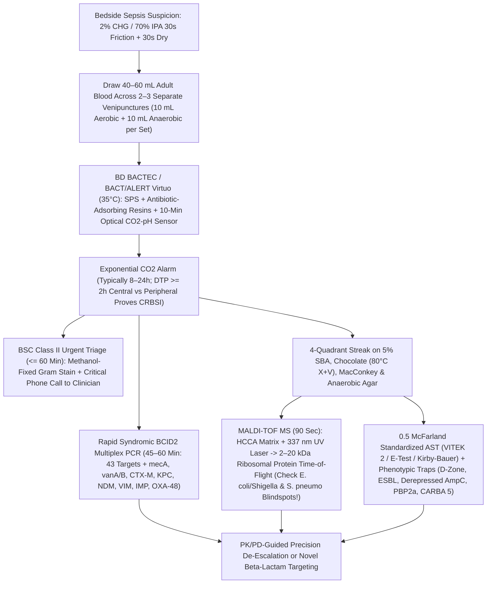
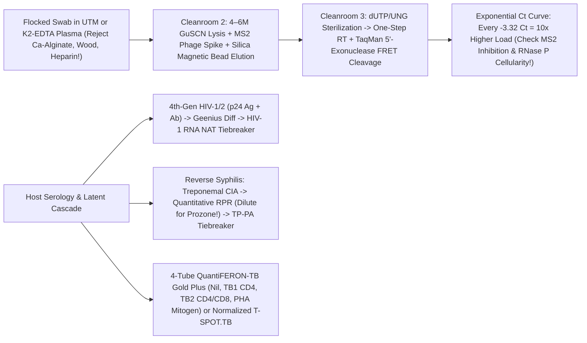

# **BASIC MEDICAL — BEHIND THE CURTAIN CLINICAL DIAGNOSTICS NOTEBOOK**
## **VOLUME V: CLINICAL MICROBIOLOGY, BLOOD CULTURES, `MALDI-TOF` PROTEOMICS, QUANTITATIVE `RT-qPCR` ($C_t$) PHYSICS, METAGENOMICS & INFECTIOUS SEROLOGY**

> [!IMPORTANT]
> **How to Read This Volume:** Every time an emergency physician orders *"Blood Cultures × 2, Respiratory Viral Panel, HIV/Syphilis Screen, and Procalcitonin,"* a silent, high-stakes choreography ignites behind locked biosecurity doors. Unlike automated chemistry analyzers—where potassium or creatinine reaches photonic equilibrium in four minutes—clinical microbiology hunts living, evolving, often microscopic fugitives hiding at concentrations as sparse as **one bacterial cell per ten milliliters of human blood**. This volume pulls back the curtain on the exact physical chemistry, optical sensors, selective media biochemistry, laser time-of-flight mass spectrometry, Förster resonance energy transfer (`FRET`) amplification curves, and immunochemical capture architectures that transform a bedside swab or venipuncture into life-saving antimicrobial precision.

---

# **DOSSIER 5.1: FROM BEDSIDE `CHLORAPREP` SCRUB TO A 90-SECOND UV LASER VAPORIZATION — BLOOD CULTURES, GRAM STAINING, SELECTIVE AGARS & `MALDI-TOF` MASS SPECTROMETRY**

## **5.1.1 The Poisson Mathematics of Sepsis & Pre-Analytical Blood Culture Architecture**

### **A. Why Blood Volume (`40–60 mL`) Is the Single Greatest Determinant of Sepsis Detection**

A pervasive clinical myth imagines septic shock as a bloodstream teeming with millions of bacteria per drop. Quantitative lysis-centrifugation studies collected across five decades (*Manual of Clinical Microbiology*, 13th Ed., Carroll & Pfaller; Cockerill et al., *Clin Infect Dis* 2004) prove the startling opposite: while pediatric meningitis bacteremia may exceed $100\text{–}1,000\text{ CFU/mL}$, **adult bacteremia and candidemia routinely circulate at an extraordinarily sparse density of just `0.1 to 1.0 Colony-Forming Units per milliliter (CFU/mL)`**—and frequently `< 0.1 CFU/mL` in subacute infective endocarditis or partially treated endovascular sepsis.

Because viable bacteria are randomly and sparsely dispersed throughout the intravascular compartment, capturing at least one viable organism inside a blood culture syringe obeys **Poisson rare-event sampling statistics**. If the true bloodstream bacterial density is $\lambda$ ($\text{CFU/mL}$) and the clinician draws total blood volume $V$ ($\text{mL}$), the expected number of captured organisms is $\mu = \lambda V$, and the probability of drawing a **false-negative sterile sample** ($k = 0$ organisms captured) is $e^{-\lambda V}$. Therefore, the analytical sampling sensitivity—the probability of capturing **at least one viable CFU**—is governed by:

$$P(\text{Capture} \ge 1\text{ CFU}) = 1 - e^{-\lambda V}$$

Examine what happens to a hypotensive adult in early Gram-negative urosepsis whose true bloodstream burden is $\lambda = 0.20\text{ CFU/mL}$ (**one bacterium per `5 mL` of blood**):

* **Underfilled "Difficult Stick" Draw (`V = 2 mL` total):**
  $$P(\ge 1\text{ CFU}) = 1 - e^{-(0.20)(2)} = 1 - e^{-0.40} \approx 32.9\% \quad (\mathbf{67.1\%\text{ Missed Sepsis!}})$$
* **Single Standard Bottle (`V = 10 mL` total):**
  $$P(\ge 1\text{ CFU}) = 1 - e^{-(0.20)(10)} = 1 - e^{-2.0} \approx 86.5\%$$
* **Two Complete Adult Blood Culture Sets (`V = 40 mL` total: 2 separate venipunctures × `[10 mL Aerobic + 10 mL Anaerobic]`):**
  $$P(\ge 1\text{ CFU}) = 1 - e^{-(0.20)(40)} = 1 - e^{-8.0} \approx 99.97\%$$
* **Three Complete Adult Sets (`V = 60 mL` total — Mandatory for Suspected Infective Endocarditis):** Even if bacterial density plunges to an ultra-sparse $\lambda = 0.08\text{ CFU/mL}$, `60 mL` achieves $1 - e^{-4.8} = \mathbf{99.2\%}$ capture probability!

Empirical clinical trials confirm that **every additional milliliter of blood cultured between `2 mL` and `40 mL` increases microbial yield by `~3% to 4%`**. Conversely, overfilling a single bottle (`> 12–15 mL` into a `10 mL`-calibrated broth bottle) backfires: excess patient leukocytes, complement, lysozyme, and erythrocyte metabolic $\text{CO}_2$ exhaust broth nutrients and trigger false-positive background $\text{CO}_2$ alarms (**pseudobacteremia of overfilling**). Thus, *CLSI M47* mandates **2 to 3 separate peripheral venipuncture sets (`20 mL` per set = `40–60 mL` total adult blood)** drawn **prior** to initiating empiric intravenous antimicrobials whenever clinically feasible without delaying resuscitation beyond 45 minutes.

### **B. Bedside Antisepsis Physics: Defeating the Hair-Follicle Sebaceous Plug**

Why must those `40–60 mL` come from **two or three anatomically separate venipunctures** (e.g., left antecubital + right antecubital) rather than a single `40 mL` draw through an existing emergency-room IV catheter? Human epidermis is not a flat plastic sheet; while surface stratum corneum cleans up easily, **pilosebaceous units (hair follicles) and sweat ducts harbor `10^3 to 10^5 CFU/cm²` of resident microaerophilic and facultative flora**—principally coagulase-negative staphylococci (*Staphylococcus epidermidis*, *S. hominis*, *S. capitis*), *Cutibacterium acnes*, *Corynebacterium* spp. (diphtheroids), *Micrococcus luteus*, and environmental *Bacillus* spores—embedded inside hydrophobic lipid-keratin plugs.

When a hollow-bore bevel needle pierces poorly prepped skin, it acts as a microscopic biopsy punch, coring out a tiny **dermal-epidermal skin plug** directly into the first syringe barrel. Rigorous skin preparation defeats this via dual-phase chemistry:

1. **Rubber Septum Disinfection First:** Blood culture bottle tops beneath flip-off plastic caps are clean *but not guaranteed sterile* (`Bacillus` spores occasionally survive manufacturing packaging). Scrubbing each bottle septum with **`70% Isopropyl Alcohol`** and allowing evaporation prevents pushing rubber-surface spores into the broth.
2. **`2% Chlorhexidine Gluconate (CHG)` in `70% Isopropyl Alcohol` (`ChloraPrep`):** Superior in randomized trials to aqueous `10% povidone-iodine` (which requires `1.5–2.0 minutes` of wet contact time to release free molecular iodine $\text{I}_2$ and is neutralized on contact by blood proteins). In `ChloraPrep`, **`70%` isopropyl alcohol** dissolves follicular sebum lipids and denatures outer microbial membrane proteins within seconds (note why `70%` alcohol beats `100%` absolute alcohol: `100%` alcohol instantaneously coagulates surface cell-wall proteins into an impermeable crust that shields deeper cytoplasmic enzymes, whereas `30%` water acts as a osmotic catalyst carrying alcohol across the membrane!). Simultaneously, cationic **chlorhexidine biguanide** binds negatively charged bacterial cell-wall phospholipids, rupturing osmotic integrity and leaving a residual substantivity film for `> 6 hours`.
3. **Mechanical `30-Second` Back-and-Forth Friction + `30-Second` Complete Dry Time:** Friction cracks keratinized desmosomes to drive alcohol-CHG into follicular infundibula; waiting the full `30 seconds` to dry completes bactericidal kill and prevents aspirating liquid alcohol into the needle (which would kill true sparse bloodstream pathogens!). Never re-palpate the venipuncture site with an unsterile gloved finger after scrubbing.

When **only 1 out of 4 bottles** (`1 of 2 sets`) grows *Staphylococcus epidermidis* at `32 hours`, two-site independent venipuncture allows the infectious diseases team to recognize a **`97%` probability of skin-plug contamination**, sparing the patient weeks of nephrotoxic vancomycin, PICC lines, and hospital length-of-stay. Conversely, if **both independent venipuncture sets (`4 of 4 bottles`)** grow identical *S. epidermidis* in a patient with a prosthetic aortic valve or orthopedic hardware, true endovascular biofilm infection is proven.

### **C. Inside `BD BACTEC` & `bioMérieux BACT/ALERT Virtuo` Bottles: Resins, `SPS` & Optical $\text{CO}_2$ Sensors**

Once blood enters the culture vials and arrives via pneumatic tube at the clinical microbiology laboratory, technologists load the barcoded bottles onto robotic continuous-monitoring incubators (`BD BACTEC FX` or `bioMérieux BACT/ALERT Virtuo`, which automates loading, optical scanning, and unloading at a constant **`35.0°C ± 1.0°C`** with gentle agitation). Inside each seemingly simple glass or polycarbonate bottle lies a four-part biochemical masterpiece:

1. **Nutrient-Rich Enriched Soybean-Casein Digest Broth (`30–40 mL`):** Tryptic soy / brain-heart infusion peptones, yeast extract, hemin, menadione (vitamin K for *Prevotella* and *Porphyromonas*), pyridoxal HCl (vitamin $\text{B}_6$ for nutritionally variant streptococci like *Abiotrophia defectiva* and *Granulicatella adiacens*), and sodium bicarbonate under tailored headspace atmospheres ($\text{O}_2 + \text{CO}_2$ in aerobic bottles; $\text{N}_2 + \text{CO}_2 + \text{H}_2$ strictly $\text{O}_2$-free with reducing L-cysteine/thiols—and **saponin erythrocyte-lysing detergent** in `BACTEC Lytic/10 Anaerobic/F` bottles to liberate intracellular phagocytosed bacteria and accelerate hemolysin nutrition!).
2. **`0.025%–0.05%` Sodium Polyanethol Sulfonate (`SPS`):** Whole human blood does not stop fighting microbes once drawn into a bottle! Without neutralizers, viable patient neutrophils, serum complement (`C3b`/`C5b-9` MAC), and lysozyme would phagocytose and kill sparse `0.2 CFU/mL` bacteria inside the bottle before they could divide. **`SPS`** is a polyanionic anticoagulant that simultaneously:
   * Chelates $\text{Ca}^{2+}$ to prevent fibrin clot trapping of bacteria;
   * Inactivates classical and alternative serum complement cascades;
   * Paralyzes polymorphonuclear leukocyte phagocytosis and neutralizes lysozyme; and
   * Electro-neutralizes polycationic aminoglycoside antibiotics (gentamicin, tobramycin, amikacin) and polymyxins circulating in patient plasma.
   * *Analytical Caveat:* **`SPS` is intrinsically toxic to *Neisseria meningitidis*, *Neisseria gonorrhoeae*, *Gardnerella vaginalis*, *Streptobacillus moniliformis* (rat-bite fever), and *Peptostreptococcus anaerobius*!** Commercial resin media incorporate gelatin or specific adsorbents to blunt `SPS` toxicity against meningococci, though `SPS`-impregnated paper disks are paradoxically exploited on anaerobic bench plates to *identify* *P. anaerobius* via its `>= 12 mm` zone of `SPS` inhibition!
3. **Polymeric Antibiotic-Adsorbing Resins (`BACTEC Plus` / `BACT/ALERT FA/FN Plus`):** In real-world ICU practice, second-set or repeat blood cultures are often drawn while `4.5 g` piperacillin-tazobactam, `2 g` cefepime, or `1.5 g` vancomycin is actively infusing. Floating inside modern `Plus` bottles is a slurry of **microporous hydrophobic/ion-exchange polystyrene-divinylbenzene polymeric beads**. As the incubator rocks the bottle, non-polar aromatic side chains and charged pockets on these beads **physically adsorb and sequester free $\beta$-lactams, glycopeptides, fluoroquinolones, and daptomycin out of the liquid phase**, dropping free broth antibiotic concentrations below the pathogen's Minimum Inhibitory Concentration (`MIC`) so surviving persister bacteria can resume logarithmic division!
4. **Non-Invasive Bottom-of-Bottle Colorimetric / Fluorometric $\text{CO}_2$-pH Sensor (`LES` / Fluorescence Disk):** Historic blood cultures required blind daily needle subculturing, risking laboratory-acquired bacteremia and delaying detection by days. Modern bottles mold a gas-permeable **silicone elastomer membrane** at the internal base, isolating the blood-broth mixture from a chemical sensor pad containing water, bicarbonate buffer, and either a **pH-sensitive fluorophore** (`BD BACTEC`, excited by an external LED so protonation boosts fluorescence emission) or a **pH-sensitive colorimetric indicator** (`bioMérieux BACT/ALERT`, shifting irreversibly from dark blue-green to bright yellow). As multiplying bacteria or yeast catabolize carbohydrates and amino acids, dissolved $\text{CO}_2$ diffuses across the silicone barrier into the isolated sensor water:

$$\text{CO}_2\text{ (microbial)} + \text{H}_2\text{O} \rightleftharpoons \text{H}_2\text{CO}_3 \rightleftharpoons \text{H}^+ + \text{HCO}_3^-$$

   Every **10 minutes** (`144 readings/day`), an optical photodiode beneath each bottle cell measures reflectance or fluorescence intensity, plotting a continuous metabolic curve:
   * **Baseline lag phase** (flat baseline reflecting static leukocyte respiration);
   * **Inflection / exponential acceleration ($\frac{d^2F}{dt^2} > \text{threshold}$)**; or
   * **Sustained high linear slope / absolute saturation threshold** (crucial if a bottle carrying `10^7 CFU/mL` sat delayed on a ward counter before loading and entered stationary phase prior to scan #1!).

> [!TIP]
> **Clinical Diagnostic Gem — Differential Time-to-Positivity (`DTP`) for Central-Line Infections (`CRBSI`):** Because automated cabinets interrogate every bottle at 10-minute resolution, **`Time-to-Positivity (TTP)`** serves as a quantitative proxy for initial bacterial inoculum ($\Delta\text{TTP}$ inversely tracks $\log_{10}[\text{CFU}_0]$). If a febrile oncology patient has an indwelling tunneled central venous catheter (port/Hickman) that cannot be casually removed, draw **simultaneous, identical-volume (`10 mL` vs `10 mL`) blood cultures—one hub-aspirated through the central catheter and one via peripheral venipuncture—within 10–15 minutes of each other**, labeling exact draw times. If the **central-line bottle flags positive `>= 120 minutes` (`>= 2 hours`) earlier** than the peripheral venipuncture bottle for the exact same organism (Blot et al., *Lancet* 1999; IDSA `CRBSI` Guidelines), the catheter lumen harbors a `>= 5-to-10-fold` higher biofilm bacterial load, confirming **Catheter-Related Bloodstream Infection (`CRBSI`)** with `~85–91%` sensitivity and `~90%` specificity without pulling the line blindly! *(Conversely, virulent pathogens like *S. aureus*, *Pseudomonas*, and *Candida* usually flag within `8–18 hours`; slow-growing *Cutibacterium* or `HACEK` organisms [*Haemophilus*, *Aggregatibacter*, *Cardiobacterium*, *Eikenella*, *Kingella*] typically flag within standard 5-day modern incubation without needing historic 21-day holds!)*

---

## **5.1.2 Behind the Biosafety Cabinet (`BSC Class II`) — Positive Bottle Triage, Gram Stain Chemistry & Special Stains**

### **A. The 60-Minute Critical-Value Sprint**

The instant a bottle crosses its exponential $\text{CO}_2$ threshold—typically once microbial density inside the broth reaches **`10^7 to 10^8 CFU/mL`**—an audible and visual red alert triggers on the microbiology bench. Under *CAP (College of American Pathologists)* and *CLSI* accreditation standards, a positive blood culture is a **Life-Threatening Critical Value**: from the moment the cabinet alarms, the technologist has **`<= 60 minutes`** to aspirate the bottle, perform and read a microscopic Gram stain, and telephone the bedside physician directly with the morphology—because studies prove that **clinician-directed antimicrobial escalation at the time of Gram-stain phone call saves more lives from septic shock than final day-3 species identification!**

Working inside a negative-pressure laminar-flow **Class II Biosafety Cabinet (`BSC-II`)** to contain infectious aerosols (especially *Neisseria meningitidis*, *Brucella*, or *Mycobacterium*), the microbiologist swabs the septum with `70%` alcohol, inserts a safety venting/transfer needle, expresses **one drop onto a clean glass microscope slide** (spreading it into a thin feather-edged monolayer so erythrocytes do not stack into opaque dark clumps), and subcultures drops onto pre-warmed agar plates (5% Sheep Blood, Chocolate, MacConkey, and—if the anaerobic bottle flagged—Brucella Anaerobic Blood Agar inside an anaerobic jar/chamber) plus a rapid molecular Blood Culture Identification (`BCID2`) pouch.

Rather than passing the wet blood-broth slide through an open Bunsen flame (which boils erythrocytes into circular artifacts mimicking cocci and overheats leukocytes!), modern benches fix blood-culture smears for **`1 minute in absolute (95–100%) Methanol`**. Methanol fixes proteins cleanly while lysing background erythrocytes gently and preserving pristine polymorphonuclear leukocyte nuclei and crisp bacterial walls.

### **B. Molecular Cell-Wall Physics of the Four-Step Gram Stain**

Invented serendipitously by Danish physician Hans Christian Gram in 1884 while studying pneumococcal lung tissue in Berlin, the Gram stain is not an antibody reaction—it is a **kinetic solvent-permeability and hydrogel-dehydration experiment** differentiating two ancient evolutionary bacterial envelope architectures:

1. **Step 1 — Primary Stain (`Crystal Violet`, `30–60 sec`):** Aqueous hexamethylpararosaniline chloride dissociates into intensely purple triphenylmethane cations ($\text{CV}^+$), diffusing freely across the porous cell envelopes of *both* Gram-positive and Gram-negative bacteria to stain every cell deep violet.
2. **Step 2 — Mordant (`Gram's Iodine`: $\text{I}_2 + \text{KI} \to \text{I}_3^-$, `30–60 sec`):** Triiodide anions ($\text{I}_3^-$) diffuse inward and react stoichiometrically with $\text{CV}^+$ inside the peptidoglycan meshwork and cytoplasm to precipitate **large, hydrophobic, water-insoluble Crystal Violet–Iodine ($\text{CV}^+\text{–I}_3^-$) supramolecular complexes**. At this stage, *all* bacteria remain dark purple-black.
3. **Step 3 — Differential Decolorization (`95% Ethanol` or `1:1 Acetone-Alcohol`, `3–10 sec` drop-by-drop until runoff clears):** This 5-second step is the entire analytical fulcrum:
   * **Gram-Positive Envelope (`Staphylococcus`, `Streptococcus`, `Enterococcus`, `Listeria`, `Clostridium`, `Bacillus`):** Lacks an outer lipid membrane; instead, it wears an armor-plated **`20 to 80 nm` thick, 40-layer peptidoglycan hydrogel** (alternating *N*-acetylglucosamine [`NAG`] and *N*-acetylmuramic acid [`NAM`] glycans tightly cross-linked by transpeptidase `PBP` peptide bridges and interwoven with negatively charged **teichoic and lipoteichoic acids**). When anhydrous ethanol/acetone hits this thick hydrophilic polymer, **rapid dehydration collapses the peptidoglycan pores**, shrinking intermolecular channels below the hydrodynamic radius of the bulky $\text{CV}^+\text{–I}_3^-$ complex and **locking purple stain permanently inside**!
   * **Gram-Negative Envelope (`Enterobacterales`, `Pseudomonas`, `Neisseria`, `Haemophilus`, `Bacteroides`):** Surrounded by an asymmetric **Outer Membrane** composed of inner phospholipids and outer **Lipopolysaccharide (`LPS` / Endotoxin — Lipid A + core polysaccharide + O-antigen)** anchored over a razor-thin **`2 to 7 nm` (1–3 layer) periplasmic peptidoglycan sheet**. Organic acetone-alcohol instantaneously **dissolves the lipid-rich outer `LPS` bilayer**, punching gaping holes straight down to the flimsy `2 nm` peptidoglycan monolayer, which cannot shrink enough to retain $\text{CV}^+\text{–I}_3^-$. Within 3 seconds, the purple complex washes completely out, leaving Gram-negative bacteria **optically colorless**!
4. **Step 4 — Counterstain (`Safranin O` or `0.1% Basic Carbolfuchsin`, `30–60 sec`):** The cationic pink-red dye enters all cells; Gram-positives remain royal purple (masking pale pink), while decolorized Gram-negatives glow crisp **salmon-pink to magenta**! *(Bench secret: strictly anaerobic *Fusobacterium*, microaerophilic curved *Campylobacter*, *Helicobacter*, and intracellular *Legionella* stain ghost-pale with standard Safranin—substituting **`0.1%` basic fuchsin / carbolfuchsin** makes these thin Gram-negative rods pop vividly!)*

> [!WARNING]
> **Three Classic Gram-Stain Analytical Traps Every Clinician Must Know:**
> 1. **Over-Decolorization & Antibiotic/Senescent Cell-Wall Damage ("Gram-Variable Traps"):** Leaving acetone-alcohol on the slide for 25 seconds strips $\text{CV}^+\text{–I}_3^-$ even out of true Gram-positives. More subtly, **large Gram-positive rods—notably *Bacillus* spp. and *Clostridium* spp. (e.g., *C. perfringens* "boxcar" rods in necrotizing myonecrosis)—plus $\beta$-lactam-exposed *Streptococcus pneumoniae*** rapidly lose peptidoglycan integrity via autolysins and frequently stain **falsely Gram-negative (pink)** in blood bottles! Experienced technologists judge *shape, snapping/palisading V-angles, and boxcar width* alongside color before calling a Gram-negative rod!
> 2. **Acellular / Wall-Less & Ultrathin Stealth Pathogens:** *Mycoplasma pneumoniae* and *Ureaplasma* lack peptidoglycan entirely (sterol-stabilized trilaminar membrane only -> completely invisible on Gram stain); *Treponema pallidum* and *Leptospira* (`0.1–0.15 µm` diameter) fall below the brightfield Abbe diffraction resolution limit ($\approx 0.2\text{ µm}$), requiring darkfield microscopy, silver stain, or NAAT/serology; obligate intracellular *Chlamydia* and *Rickettsia* hide inside host cells.
> 3. **Host Leukocyte Nuclei Must Always Stain Pink!** How does a microbiologist verify on every single slide that they did not under-decolorize? **Human polymorphonuclear neutrophil (`PMN`) nuclei lack peptidoglycan and MUST decolorize to pink-red!** If background `PMN` nuclei look dark purple, the smear is under-decolorized and any "Gram-positive" call on a thick mucoid clump is untrustworthy.

| Morphological Call Phoned from `BSC-II` | Classic Architectural Clues on `1000×` Oil Immersion | Top Suspect Pathogens | Immediate Bedside Empiric Pivot (Pending Rapid ID) |
| :--- | :--- | :--- | :--- |
| **Gram-Positive Cocci in Grape-Like Clusters** | Spherical `~1 µm` cocci dividing in 3 orthogonal planes (`catalase +`) | ***Staphylococcus aureus*** (`MSSA` vs `MRSA`) vs Coagulase-Negative *Staphylococcus* (`CoNS`) | Ensure active **Vancomycin** (or Daptomycin); never dismiss single-bottle *S. aureus* as a contaminant! |
| **Gram-Positive Cocci in Pairs & Chains** | Divide along 1 axis: lancet-shaped diplococci vs long chains | ***Streptococcus pneumoniae***, $\beta$-hemolytic *Streptococcus*, Viridans group, ***Enterococcus faecalis / faecium*** | Ceftriaxone + Vancomycin (if meningitis or *E. faecium* `VRE` risk -> Linezolid / Daptomycin) |
| **Small Tumbling / Palisading Gram-Positive Rods** | Short coccobacilli ("Chinese-letter" V-palisades vs smooth short rods) | ***Listeria monocytogenes*** (CSF/neonates/elderly/immunosuppressed) vs *Corynebacterium* (`C. striatum` / `C. jeikeium`) | **Cephalosporins have ZERO activity against *Listeria* (`PBP3` mismatch)!** Add **IV Ampicillin** (`+ Gentamicin`) immediately! |
| **Beaded Branching Filamentous Gram-Positive Rods** | Thin `0.5–1 µm` right-angle hyphae breaking into coccoid beads | ***Nocardia* spp.** (aerobic, modified acid-fast +) vs ***Actinomyces*** (anaerobic, acid-fast −) | High-dose **TMP-SMX** + Imipenem/Linezolid (check brain MRI for silent *Nocardia* abscesses!) |
| **Plump Enteric Gram-Negative Bacilli** | Straight rods (`1 × 3 µm`), rounded ends | ***Escherichia coli*, *Klebsiella pneumoniae*, *Enterobacter*, *Proteus*, *Salmonella*** | Cefepime or Piperacillin-Tazobactam; escalate to **Meropenem** if prior `ESBL` colonization or septic shock! |
| **Slender / Curved Non-Fermenting Gram-Negative Rods** | Thin slightly curved rods (`Pseudomonas`), gull-wing (`Campylobacter`), plump diplobacilli (`Acinetobacter`, mimicking *Neisseria*!) | ***Pseudomonas aeruginosa*, *Acinetobacter baumannii*, *Stenotrophomonas maltophilia*** | Anti-pseudomonal $\beta$-lactam (Cefepime/Meropenem/Ceftolozane-Tazobactam); note ***Stenotrophomonas* carries intrinsic `L1` metallo-carbapenemase** (Meropenem-resistant -> **TMP-SMX** or Cefiderocol)! |
| **Kidney-Bean Gram-Negative Diplococci** | Flattened adjacent coffee-bean faces (often intracellular in PMNs) | ***Neisseria meningitidis***, *Neisseria gonorrhoeae*, *Moraxella catarrhalis* | **IV Ceftriaxone `2 g q12h`** + Droplet Isolation + Public-Health Chemoprophylaxis (Rifampin/Ciprofloxacin) for close contacts! |
| **Budding Oval Yeast / Pseudohyphae (`3–8 µm`)** | Stain intensely **Gram-positive (deep purple)**, `5×` larger than staphylococci! | ***Candida albicans*, *Nakaseomyces glabratus* (*C. glabrata*), *Candida auris*, *Cryptococcus*** | Start **IV Echinocandin (`Micafungin` / `Caspofungin`)** first-line (covers azole-resistant *C. glabrata* & *C. auris*; switch to Liposomal Amphotericin B + Flucytosine if *Cryptococcus* / CNS!) |

### **C. Special Cell-Wall Stains: Acid-Fast Mycolic Acids, Chitin `Calcofluor` & `India Ink`**

When waxy lipids or fungal polysaccharides defeat Gram reagents, three targeted optical stains step in:

1. **Acid-Fast Stains (`Ziehl-Neelsen`, `Kinyoun`, and `Auramine-Rhodamine` Fluorochrome):** *Mycobacterium tuberculosis* complex and non-tuberculous mycobacteria (`NTM`) encase their peptidoglycan inside an arabinogalactan core esterified to **ultra-long-chain ($\text{C}_{60}\text{–C}_{90}$) $\alpha$-branched, $\beta$-hydroxy fatty acids called Mycolic Acids**, creating a hydrophobic wax coat impervious to aqueous Crystal Violet.
   * In **Ziehl-Neelsen (`ZN`)** staining, concentrated **Carbolfuchsin** (`basic fuchsin dissolved in 5% phenol`) is driven through melted mycolic wax by gentle **steaming heat** (`Kinyoun` "cold" staining substitutes higher phenol + Tergitol surfactant instead of heat). Once cooled, the wax re-solidifies, resisting stripping even by fierce **`3% Hydrochloric Acid in 95% Ethanol` (`Acid-Alcohol`)**! Non-acid-fast tissue and bacteria turn **Methylene Blue**, leaving slender beaded magenta mycobacterial rods standing out sharply.
   * For high-throughput sputum screening, **Auramine-Rhodamine Fluorochrome** binds mycolic acids and fluoresces bright **golden-yellow/orange against a potassium-permanganate-quenched pitch-black background at `250×–400×`**—allowing a technologist to scan **`10×` more slide area per minute** than `1000×` oil-immersion `ZN`, boosting smear sensitivity (`~10^4 AFB/mL` detection limit, though still `100×` less sensitive than `Xpert MTB/RIF` PCR at `~10–100 CFU/mL`!).
   * **Modified Acid-Fast (`1% Aqueous` $\text{H}_2\text{SO}_4$):** *Nocardia*, *Rhodococcus equi*, and intestinal coccidian oocysts (*Cryptosporidium*, *Cystoisospora*, *Cyclospora*) synthesize shorter-chain ($\text{C}_{40}\text{–C}_{60}$) mycolic/waxy walls stripped by harsh `3% HCl-ethanol` yet retained against gentler **`1%` sulfuric acid**, cleanly separating **Modified Acid-Fast Positive aerobic *Nocardia*** from **Acid-Fast Negative anaerobic *Actinomyces***.
2. **`Calcofluor White` (`CFW`) + `10% KOH` Fluorescence:** Mixing skin scrapings, bronchoalveolar lavage (`BAL`), or corneal ulcers with **`10% Potassium Hydroxide`** dissolves host keratin and mucin while leaving alkali-resistant fungal walls intact; **Calcofluor White**, a textile whitening stilbene fluorophore, chelates $\beta\text{-(1}\to\text{4)}$-linked polysaccharides (**chitin and cellulose**), lighting up **septate `45°` *Aspergillus* hyphae**, **broad ribbon-like pauciseptate `90°` *Mucorales* hyphae**, ***Pneumocystis jirovecii* cysts**, and **microsporidian spores** in brilliant chalky **blue-white or apple-green** under `365 nm` UV excitation.
3. **`India Ink` Negative Capsule Stain:** Colloidal carbon particles (`nigrosin`) suspended in CSF cannot penetrate the massive (`5–30 µm`), negatively charged **glucuronoxylomannan (`GXM`) polysaccharide capsule** of *Cryptococcus neoformans / gattii*, silhouetting narrow-necked budding yeast inside a dramatic **clear luminous halo** against a smoky black background. *(Crucial clinical caveat: `India Ink` sensitivity is only `~60–80%` in HIV meningitis and `< 50%` in non-HIV transplant patients—a negative `India Ink` NEVER rules out cryptococcal meningitis; lateral-flow **`CrAg`** [`> 99%` sensitive] is mandatory!)*

---

## **5.1.3 Four-Quadrant Streak-for-Isolation & the Biochemical Cleverness of Selective/Differential Agars**

### **A. Logarithmic Dilution on Solid Agar: The Four-Quadrant Streak**

Whether plating a positive blood culture, a purulent wound swab, or clean-catch sputum, mixed flora stacked atop one another cannot be identified by `MALDI-TOF` or tested for accurate antibiotic `MIC`s (where a hidden `1%` resistant subpopulation or contaminating commensal ruins broth microdilution!). To isolate pure monoclonal colonies without serial liquid test-tube dilutions, microbiologists execute a geometric **Four-Quadrant Streak** across a `100 mm` `1.5%` agarose Petri dish:

1. **Quadrant 1 (`Heavy Pool`):** A single drop or swab rolls across `~25%` of the agar rim (`~10^6–10^7` cells deposited).
2. **Flame/Swap Loop -> Quadrant 2:** Sterilizing the nichrome loop red-hot (and cooling on sterile edge agar so it doesn't sizzle bacteria dead!) or taking a fresh sterile plastic loop, the technologist drags **through the edge of Quadrant 1 just 3 to 4 times**, sweeping back-and-forth into clean Quadrant 2 (diluting density `~100-fold`).
3. **Flame/Swap -> Quadrant 3 -> Flame/Swap -> Quadrant 4 (`Fishtail Sweep`):** Repeating the 3-overlap drag from Q2 into Q3 and finally Q3 into Q4 spreads individual single bacterial cells **`2 to 5 mm` apart**. Over `16–24 hours` at `35°C`, one microscopic cell (`10^-12 g`) undergoes `~25–30` binary fissions ($2^{25} \approx 3.3 \times 10^7$ genetically identical daughter cells), piling up into a visible **`1–3 mm` clonal colony**—while simultaneously semi-quantifying specimen burden (`1+` growth confined to Q1 vs `4+` heavy growth extending into Q4!).

### **B. Biochemical Engineering of Core Clinical Agars**

Clinical microbiology plates act as living biochemical Turing machines, simultaneously **selecting** (poisoning unwanted commensals) and **differentiating** (forcing survivors to reveal their enzymatic identity via chromogenic or hemolytic footprints):

| Agar Medium | Key Selective Inhibitors (What Gets Killed) | Differential Chemistry & Essential Growth Factors | Classic Diagnostic Colony Phenotypes |
| :--- | :--- | :--- | :--- |
| **5% Sheep Blood Agar (`SBA` on Tryptic Soy Base)** | **Non-selective** enriched general medium (grows almost all non-fastidious aerobes/facultatives) | Intact **5% defibrinated sheep erythrocytes** (*note: contains active sheep erythrocyte **`NADase`**, destroying free $\text{NAD}^+$ so *Haemophilus influenzae* CANNOT grow alone!*) | **$\alpha$-Hemolysis (Olive-Green):** bacterial $\text{H}_2\text{O}_2$ oxidizes $\text{Hb-Fe}^{2+} \to \text{MetHb-Fe}^{3+}$ (*S. pneumoniae* [umbilicated "draughtsman" center from `LytA` autolysin] & viridans strep). **$\beta$-Hemolysis (Crystal-Clear):** complete RBC lysis via **Streptolysin O/S** (*S. pyogenes* wide zone; *S. agalactiae*, *Listeria*, *S. aureus* narrow golden-yellow `staphyloxanthin` colonies). **$\gamma$-Hemolysis (None):** *Enterococcus*, *S. epidermidis*. |
| **Chocolate Agar (`CHOC`, `80°C` Lysed Blood)** | **Non-selective** fastidious medium (incubated in **`5%` $\text{CO}_2$** capnophilic atmosphere) | Heating sheep/horse blood to **`80°C`** turns it rich cocoa-brown, **rupturing RBCs to liberate intracellular `Factor X` (`Hemin`) + `Factor V` ($\text{NAD}^+$)** AND **heat-denaturing sheep `NADase`!** | Grows ***Haemophilus influenzae*** (requires **both `X` and `V`**; dewdrop colonies smelling "mousy/bleach-like" from indole) & ***Neisseria meningitidis / gonorrhoeae*** (unlike `SBA`, where *N. gonorrhoeae* dies from trace agar fatty acids!). |
| **MacConkey Agar (`MAC`)** | **Bile Salts + Crystal Violet** disrupt Gram-positive peptidoglycan/membranes (inhibiting *Staphylococcus* & *Streptococcus*) | **`1%` Lactose + Peptones + Neutral Red pH Indicator** (`pKa 6.8`: turns magenta-pink at `pH < 6.8`, colorless/amber above `pH 6.8`) | **Lactose Fermenters (`lacZ` $\beta$-galactosidase + `lacY` permease -> Hot Pink):** ***E. coli*** (flat dry pink with precipitated bile-acid halo), ***Klebsiella*** (large dome-shaped slimy mucoid pink), ***Enterobacter/Citrobacter*** (late/slow pink). **Non-Lactose Fermenters (Colorless/Translucent):** ***Salmonella*, *Shigella*, *Proteus*** (non-swarming due to modified bile!), ***Pseudomonas aeruginosa*** (grape/corn-tortilla `2-aminoacetophenone` odor + metallic sheen + blue-green `pyocyanin`), ***Acinetobacter***. |
| **Modified Thayer-Martin (`MTM` / `VPN` / `VCN` Chocolate)** | **V**ancomycin (Gram+), **C**olistin/**P**olymyxin (Gram− rods), **N**ystatin/Anisomycin (yeast), **T**rimethoprim (blocks *Proteus* swarming!) | Chocolate base (`Factors X + V` + cornstarch to detoxify gonococcal-toxic free fatty acids) | Isolates pure ***Neisseria gonorrhoeae*** and ***Neisseria meningitidis*** directly from heavily contaminated endocervical, rectal, or pharyngeal swabs! |
| **Hektoen Enteric (`HE`) / Xylose-Lysine-Deoxycholate (`XLD`)** | High **Bile Salts** suppress coliforms & kill Gram-positives (stool pathogen workup) | Lactose/Sucrose/Salicin (or Xylose + Lysine decarboxylase) + **Ferric Ammonium Citrate + Sodium Thiosulfate** ($\text{H}_2\text{S} + \text{Fe}^{3+} \to \text{FeS}\downarrow$ jet-black precipitate!) | ***Shigella*:** translucent blue-green (`HE`) or bright red (`XLD`), lactose−, **$\text{H}_2\text{S}-$**. ***Salmonella*:** blue-green (`HE`) or red (`XLD` via lysine decarboxylation reverting xylose acid!) **with jet-black $\text{H}_2\text{S}$ centers!** *Coliforms:* bright salmon-orange (`HE`) or yellow (`XLD`). |
| **Buffered Charcoal Yeast Extract (`BCYE`)** | Polymyxin + Cefamandole/Vancomycin + Anisomycin (in selective `BMPA` variant for sputum) | Activated charcoal detoxifies reactive oxygen peroxides; ACES buffer (`pH 6.90`) + **mandatory `L-Cysteine` + Ferric Pyrophosphate** | ***Legionella pneumophila***: ground-glass opalescent blue-gray colonies appearing days 3–5 (**fails to grow on standard `SBA` or `L-cysteine`-free `BCYE`**, confirming ID!). |
| **Sorbitol-MacConkey (`SMAC`)** | Bile salts + Crystal Violet | Substitutes **`1%` D-Sorbitol** in place of lactose | Commensal *E. coli* ferment sorbitol (pink); enterohemorrhagic ***E. coli* `O157:H7` (`STEC` / Shiga-toxin HUS)** lacks sorbitol fermentation -> **colorless colonies**! *(Alert: non-O157 `STEC` ferment sorbitol, so modern labs pair `SMAC` with Shiga-toxin `Stx1/Stx2` EIA/PCR!)* |
| **Regan-Lowe / Bordet-Gengou** | Cephalexin (suppresses nasopharyngeal flora) | Charcoal + `10%` horse blood (`Regan-Lowe`) or potato-glycerol-blood (`Bordet-Gengou`) absorbing toxic unsaturated fatty acids | ***Bordetella pertussis***: tiny glistening **"mercury-droplet" / bisected-pearl** colonies after 3–7 days. |
| **Sabouraud Dextrose (`SDA`) & `CHROMagar Candida`** | Acidic **`pH 5.6`** + Chloramphenicol/Gentamicin suppress bacteria *(Cycloheximide added to dermatophyte `Mycosel` agar inhibits saprophytic molds—**never use cycloheximide for systemic fungi because it inhibits Cryptococcus, Aspergillus, and Mucor!**)* | High `2–4%` dextrose (`SDA`); species-specific hexosaminidase/phosphatase chromogenic substrates (`CHROMagar`) | Rapidly distinguishes polymicrobial yeast colonies on sight: ***C. albicans*** (emerald green), ***C. tropicalis*** (metallic blue), ***Pichia kudriavzevii* (*C. krusei*)** (fuzzy dry rose-pink, intrinsically fluconazole-resistant!), ***Candida auris*** (specialized high-salt/dulcitol chromogenic media). |

---

## **5.1.4 The `MALDI-TOF MS` (`Bruker Biotyper` / `bioMérieux VITEK MS`) Revolution — 90-Second Ribosomal Proteomics**

For more than a century, once a colony grew on agar, clinical microbiology faced a painfully slow 24-to-48-hour bottleneck: inoculating biochemical sugar-fermentation strips (`API 20E`), citrate/urease slants, or automated metabolic cards (`VITEK 2` ID) and waiting *another full day* for slow enzymes to change indicator colors—while metabolically inert organisms (*Acinetobacter*, *Stenotrophomonas*, anaerobes, Corynebacteria, NTM, and molds) routinely misidentified.

Over the past fifteen years, **Matrix-Assisted Laser Desorption/Ionization Time-of-Flight Mass Spectrometry (`MALDI-TOF MS`)** (`Bruker MALDI Biotyper sirius` and `bioMérieux VITEK MS PRIME`) shattered that bottleneck, compressing species identification from **36 hours to `90 seconds`** at a reagent cost under one dollar per isolate—and reducing mortality and hospital length-of-stay when paired with antimicrobial stewardship!

### **A. Step-by-Step Behind the Curtain: Colony Spotting, Formic Acid Cracking & `HCCA` Co-Crystallization**

1. **Direct Colony Transfer ("Smear"):** With a sterile wooden toothpick or plastic loop, the technologist touches a single pinpoint (`0.5–1 mm`) 18-hour colony—or even a concentrated bacterial pellet spun directly out of a newly positive blood culture bottle (`Sepsityper` rapid protocol, saving an entire overnight subculture day!)—and smears an ultra-thin film onto a `2 mm` circular well on a reusable 48- or 96-spot **polished stainless-steel conductive target plate**.
2. **Optional On-Plate `70% Formic Acid` Extraction (`1 µL`):** Gram-negative rods and staphylococci burst effortlessly under laser energy. However, **yeasts (*Candida*, *Cryptococcus*)**, **coryneform Gram-positive rods**, and **actinomycetes** possess thick mannoprotein-glucan or mycolic-peptidoglycan walls. Dropping **`1 µL` of `70% Formic Acid`** directly onto the dried smear cracks the cell wall *in situ* without requiring tube centrifugation! *(Filamentous molds and inactivated Mycobacteria undergo off-plate ethanol + `70%` formic acid + acetonitrile + silica-bead mechanical disruption first to ensure 100% biosafety inactivation before leaving the `BSC`!)*
3. **Organic Matrix Overlay (`HCCA`):** Once dry, the technologist overlays **`1 µL` of saturated `α-cyano-4-hydroxycinnamic acid (HCCA)`** dissolved in `50% acetonitrile + 47.5% water + 2.5% trifluoroacetic acid (TFA)`. Acetonitrile extracts soluble intracellular proteins out of the ruptured microbes; as the droplet evaporates over 60 seconds, microbial proteins **co-crystallize homogeneously inside a protective cage of golden microscopic `HCCA` organic acid crystals**.

### **B. `337 nm` Pulsed UV Laser Soft Ionization & Time-of-Flight ($t \propto \sqrt{m/z}$) Physics**

The steel plate slides through a vacuum airlock into an ultra-high-vacuum chamber ($10^{-6}\text{ to }10^{-7}\text{ mbar}$, eliminating air-molecule collisions that would scatter flying proteins). A computer-steered **`337 nm` pulsed Nitrogen ($\text{N}_2$) UV laser** (or `355 nm` solid-state `Nd:YAG` laser firing `200 Hz` nanosecond bursts) strikes the crystal spot:

* **Why Naked Proteins Would Burn Without Matrix ("Soft Ionization"):** Firing a UV laser directly at naked bacterial proteins shatters peptide backbones into unreadable carbon char. Instead, the aromatic **`HCCA` matrix contains conjugated $\pi$-rings tuned to absorb `337 nm` UV photons greedily**, instantaneously sublimating into an expanding supersonic gas plume while shielding intact bacterial proteins from thermal destruction. Inside that dense plume, acidic `HCCA` and `TFA` transfer **a single proton ($\text{H}^+$)** onto basic lysine/arginine residues of each intact protein (**Koichi Tanaka & John Fenn's Nobel Prize-winning "Soft Ionization"**), generating predominantly **singly charged intact molecular ions ($[\text{M}+\text{H}]^+$, where $z = +1$)**!
* **What Proteins Are Actually Measured?** `MALDI-TOF` tunes its mass window exclusively to **`2,000 to 20,000 Daltons` (`2–20 kDa`)**. Across all bacteria and fungi, `60–70%` of the peaks inside this `2–20 kDa` window belong to **30S and 50S Ribosomal Subunit Proteins (`L` and `S` proteins)** alongside cold-shock and DNA-binding (`HU`) housekeeping proteins! Ribosomal proteins are nature's dream taxonomic barcode: (1) they are present in tens of thousands of copies per cell, (2) they are positively charged (ionizing brilliantly as $[\text{M}+\text{H}]^+$), (3) their expression barely changes regardless of whether the bug grew on Blood Agar, MacConkey Agar, or Chocolate Agar, and (4) subtle single-amino-acid evolutionary substitutions shift their molecular masses by exact `14–50 Da` increments between closely related species!
* **Electrostatic Acceleration & Field-Free Drift Tube Kinematics:** An electrostatic grid applies a high positive voltage $V$ ($\approx +20,000\text{ V}$) across the target plate, repelling every positively charged ion into a `~1-meter` **field-free linear flight tube**. Because every ion of charge $q = z e$ acquires identical kinetic energy $E_k = z e V$:

$$z e V = \frac{1}{2} m v^2 \implies v = \sqrt{\frac{2 z e V}{m}}$$

  Lighter ribosomal proteins (`e.g., 4,365 Da`) rocket up the tube at higher velocity, striking the microchannel-plate (`MCP`) ion detector at the top in ~`15 microseconds`, whereas heavier proteins (`e.g., 15,820 Da`) lag behind at ~`30 microseconds`. Over flight length $L$, the exact **Time-of-Flight ($t$)** obeys:

$$t = \frac{L}{v} = L \sqrt{\frac{1}{2 e V}} \cdot \sqrt{\frac{m}{z}}$$

  Squaring $t$ maps every microsecond arrival into a razor-sharp mass-to-charge ($m/z$) peak spectrum (`50 to 150 peaks` per organism), which cross-correlates in milliseconds against FDA-cleared reference libraries spanning **> 4,000 bacterial, mycobacterial, yeast, and mold species** (`Bruker Log(Score) >= 2.00` = high-confidence species ID; `1.70–1.99` = genus-level ID).

> [!CAUTION]
> **Critical `MALDI-TOF MS` Taxonomic Blindspots & Biosafety Traps:**
> Even `MALDI-TOF` cannot bend evolutionary genomics when two clinically distinct pathogens share `> 99.5%` identical ribosomal protein sequences! Every bench microbiologist memorizes three mandatory `MALDI` blindspots:
> 1. ***Escherichia coli* vs. *Shigella* spp. (*S. dysenteriae, S. flexneri, S. boydii, S. sonnei*):** Taxonomically, *Shigella* IS a specialized pathovar evolved *inside* the *E. coli* species clade; their `2–20 kDa` ribosomal spectra are virtually indistinguishable! `MALDI-TOF` reports *"Escherichia coli / Shigella species"*—forcing the technologist to check **MacConkey lactose fermentation, motility, spot indole, lysine decarboxylase, and *Shigella* polyvalent `O`-antisera agglutination** (`E. coli`: typically lactose+, motile+, indole+; *Shigella*: strictly non-motile, lactose−, $\text{H}_2\text{S}-$, indole/gas negative)!
> 2. ***Streptococcus pneumoniae* vs. *Streptococcus mitis / oralis / pseudopneumoniae*:** Commensal oral viridans streptococci (*S. mitis/oralis*) share nearly identical ribosomal peaks with lethal pneumococcus. Before reporting *S. pneumoniae* from blood or sputum, benches verify **`Optochin` (`ethylhydrocupreine` `P`-disk inhibition zone `>= 14 mm`)** and/or **`10% Sodium Deoxycholate Bile Solubility`** (bile salts trigger pneumococcal `LytA` *N*-acetylmuramoyl-L-alanine amidase to dissolve the colony completely within 15 minutes, whereas *S. mitis* stays turbid!).
> 3. **Select-Agent / `BSL-3` Aerosol Trigger Organisms (*Brucella*, *Francisella tularensis*, *Burkholderia pseudomallei*, *Yersinia pestis*, *Bacillus anthracis* [indistinguishable on standard libraries from *Bacillus cereus*!], and *Coccidioides immitis/posadasii*):** Standard `MALDI` libraries omit or flag Tier-1 biothreat agents, and spotting live *Brucella* (faint tiny Gram-negative coccobacilli growing at 48–72h, `oxidase+`, `urease+`) on an open-bench `MALDI` plate causes **laboratory-acquired brucellosis**! Any slow-growing pinpoint Gram-negative coccobacillus or white cottony arthroconidial mold triggers immediate **"Rule-Out Select Agent" `BSC-II` lockdown** prior to `MALDI` spotting.

---

## **5.1.5 Antimicrobial Susceptibility Testing (`AST`), Busting the "#1 `MIC` Fallacy," & Phenotypic Resistance Traps**

Standard `MALDI-TOF` identifies *who* the culprit is in 90 seconds, because structural ribosomal proteins do not change whether an *E. coli* carries a plasmid-encoded `CTX-M-15` ESBL or `NDM-1` carbapenemase. Determining *which antibiotic kills it* requires challenging living bacteria against serial drug concentrations via **Antimicrobial Susceptibility Testing (`AST`)**, calibrated globally by **`CLSI M100`** (Clinical and Laboratory Standards Institute) and **`EUCAST`** standards.

### **A. How `MIC`s Are Measured at the Bench (`0.5 McFarland` Standardization)**

Why must every `AST` assay start by adjusting a pure bacterial suspension in `0.85%` saline via nephelometer to an exact **`0.5 McFarland` turbidity standard (`~1.5 × 10^8 CFU/mL`)**? Because of the **`Inoculum Effect`**: if a technologist accidentally loads `10^9 CFU/mL` of $\beta$-lactamase-producing *S. aureus* or *Enterobacterales*, collective periplasmic enzyme activity hydrolyzes piperacillin or cefazolin in the test well, producing a **false-resistant `MIC`**, whereas loading `10^3 CFU/mL` misses heteroresistant subpopulations (`hVISA`, `AmpC`) and produces a **deadly false-susceptible `MIC`**!

1. **Automated Broth Microdilution (`VITEK 2`, `BD Phoenix`, `MicroScan WalkAway`):** Dilutes the `0.5 McFarland` suspension to **`5 × 10^5 CFU/mL`** inside miniaturized plastic cards/trays containing freeze-dried two-fold serial antibiotic dilutions (`0.125, 0.25, 0.5, 1, 2, 4, 8, 16, 32, 64 µg/mL`) in cation-adjusted Mueller-Hinton broth (`CA-MHB` — strictly controlled at `20–25 mg/L` $\text{Ca}^{2+}$ and `10–12.5 mg/L` $\text{Mg}^{2+}$, because **excess $\text{Ca}^{2+}/\text{Mg}^{2+}$ falsely raises *Pseudomonas* aminoglycoside `MIC`s via LPS outer-membrane bridging, whereas deficient $\text{Ca}^{2+}$ [`< 50 mg/L`] falsely ruins Daptomycin's $\text{Ca}^{2+}$-dependent membrane depolarization!**). Optical sensors scan turbidity and redox indicators every 15 minutes, reporting the **`Minimum Inhibitory Concentration (MIC)`**—the lowest concentration (`µg/mL`) that completely inhibits visible bacterial growth—within `6 to 12 hours`.
2. **Kirby-Bauer Disk Diffusion (`4 mm` Mueller-Hinton Agar):** Lawns `0.5 McFarland` across a `4 mm`-deep agar plate (thinner agar lets antibiotic diffuse wider -> false-large susceptible zone; thicker agar -> false-small resistant zone!), stamps filter-paper disks impregnated with fixed drug masses, incubates `16–18h` (`24h` for Vancomycin/Cefoxitin), and measures the **inhibition zone diameter (`mm`)** with calipers (inversely proportional to $\log_2[\text{MIC}]$).
3. **Epsilometer Gradient Strip (`E-test` / `MIC Test Strip`):** A plastic strip coated with a continuous exponential antibiotic gradient (`0.002` to `32` or `256 µg/mL`) laid onto an inoculated agar lawn. Overnight growth carves a symmetrical **teardrop inhibition ellipse**; the exact tick mark where the ellipse intersects the strip scale gives a high-precision on-scale `MIC` (essential for **penicillin/ceftriaxone `MIC`s in *Streptococcus pneumoniae* meningitis** [where blood-brain barrier penetration slashes the ceftriaxone susceptible breakpoint from `<= 1 µg/mL` non-meningitis down to `<= 0.5 µg/mL` meningitis!], **daptomycin**, and **vancomycin `MIC` checks**).

### **B. Busting the Clinician's "#1 `MIC` Fallacy" — Never Compare Raw `MIC` Numbers Across Different Drugs!**

Here is the single most dangerous bedside misinterpretation of a microbiology report in all of internal medicine:

> **The Scenario:** A patient has methicillin-susceptible *Staphylococcus aureus* (`MSSA`) bacteremia—or `MRSA` bacteremia—and the `VITEK 2` susceptibility table displays:
> * **Drug A (`Vancomycin`):** `MIC = 1.0 µg/mL` — **`S` (Susceptible)** (`CLSI` Susceptible Breakpoint `<= 2.0 µg/mL`)
> * **Drug B (`Trimethoprim-Sulfamethoxazole`):** `MIC = 0.5 µg/mL` — **`S`** (`CLSI` Breakpoint `<= 2.0 µg/mL`)
> * **Drug C (`Rifampin` or `Levofloxacin`):** `MIC = 0.25 µg/mL` — **`S`** (`CLSI` Levofloxacin Breakpoint `<= 1.0 µg/mL`; Rifampin `<= 1.0 µg/mL`)
> * **Or in *Pseudomonas aeruginosa* pneumonia:** `Piperacillin-Tazobactam MIC = 8.0 µg/mL (S)` vs `Ciprofloxacin MIC = 0.25 µg/mL (S)`.
>
> **The Fallacy:** An untrained clinician points at `0.25 µg/mL` vs `8.0 µg/mL` and declares, *"Ciprofloxacin has a 32-fold lower MIC than Zosyn, so Ciprofloxacin is 32 times more potent against this Pseudomonas!"* **THIS IS COMPLETELY FALSE—AND POTENTIALLY FATAL.**

**Why Raw `MIC`s Are Apples-and-Oranges Across Drug Classes:** `1 µg/mL` of Piperacillin and `1 µg/mL` of Ciprofloxacin have wildly different molecular weights, protein-binding fractions, toxicity ceilings, and achievable human tissue concentrations! Under standard `4.5 g IV q6h` extended-infusion dosing, free unbound **piperacillin** effortlessly reaches **`40–100+ µg/mL`** in plasma and epithelial lining fluid (`CLSI` *Pseudomonas* susceptible breakpoint **`<= 16 µg/mL`**), whereas **ciprofloxacin** `400 mg IV q8h` peaks at only **`~3–4 µg/mL`** before triggering QT prolongation, tendinopathy, and neurotoxicity (`CLSI` *Pseudomonas* susceptible breakpoint **`<= 0.5 µg/mL`**)!

To evaluate how comfortably an isolate sits *below* resistance, infectious-disease pharmacists examine how many **two-fold dilutions below its own `CLSI` Susceptible Breakpoint** each drug lies (the **Breakpoint-to-`MIC` Ratio**), integrated with the drug's governing **Pharmacokinetic/Pharmacodynamic (`PK/PD`) Index** and **Anatomic Site Penetration**:

$$\text{Therapeutic Margin Ratio} = \frac{\text{CLSI Susceptible Breakpoint } (\mu\text{g/mL})}{\text{Isolate MIC } (\mu\text{g/mL})}$$

* In our *Pseudomonas* example:
  * `Piperacillin-Tazobactam`: Breakpoint `16 µg/mL` $\div$ Isolate `MIC 8 µg/mL` = **`2×` (`1` dilution below breakpoint)**; governed by **Time-Dependent killing ($fT_{>\text{MIC}} \ge 50\%\text{–}100\%$ of dosing interval)** -> optimize via **`4-hour` extended IV infusion**!
  * `Ciprofloxacin`: Breakpoint `0.5 µg/mL` $\div$ Isolate `MIC 0.25 µg/mL` = **also just `2×` (`1` dilution below breakpoint—borderline!)**; governed by **Concentration/Exposure killing ($\text{AUC}_{24}/\text{MIC} \ge 125$ and $C_{\max}/\text{MIC} \ge 8\text{–}10$)**!
* **Understanding `S`, `SDD`, `I`, and `R` (`CLSI M100` Definitions):**
  * **`S` (Susceptible):** High likelihood of cure using standard dosing regimens.
  * **`SDD` (Susceptible-Dose Dependent — Critical Modern `CLSI` Category!):** Used prominently for **Cefepime against *Enterobacterales* (`MIC = 4 or 8 µg/mL`)** and **Fluconazole against *Candida glabrata***. An `SDD` call tells the clinician: *"Standard low-dose Cefepime (`1 g q12h`) WILL FAIL, because $fT_{>\text{MIC}}$ drops too low; however, maximal high-exposure dosing (**`Cefepime 2 g IV every 8 hours`**, ideally over 3 hours) reliably achieves target `PK/PD` cure without burning a carbapenem!"*
  * **`I` (Intermediate; or `EUCAST` "Susceptible, Increased Exposure"):** Uncertain systemic efficacy unless the drug physiologically concentrates 50-to-100-fold at the infection site (e.g., $\beta$-lactams/fluoroquinolones in uncomplicated lower UTI) or maximum safe dosing is employed.
  * **`R` (Resistant):** Clinically achievable systemic exposures fail to meet `PK/PD` targets, or a specific resistance mechanism (`ESBL`, `mecA`, `KPC`) predicts clinical failure regardless of apparent *in vitro* `MIC`.
* **Site-of-Infection Overrides:** Even a blazingly low `MIC` is useless if host physiology neutralizes or excludes the molecule: **Daptomycin** (`MIC = 0.25 µg/mL`) is **bound and completely inactivated by pulmonary surfactant phospholipids**, making it **100% ineffective for MRSA pneumonia** (while outstanding for MRSA bacteremia/endocarditis!); **Nitrofurantoin** and **Oral Fosfomycin** achieve bactericidal levels *solely inside bladder urine* and NEVER treat pyelonephritis or urosepsis; **Tigecycline** distributes massively into tissues ($V_d > 500\text{ L}$), leaving serum levels (`< 0.6 µg/mL`) dangerously low for bloodstream infections!

### **C. Five Behind-the-Curtain Phenotypic Resistance Traps (`D-Zone`, `ESBL`, `AmpC`, `MRSA`, `CARBA 5`)**

Raw automated `MIC` panels can be fooled by inducible or slow-hydrolyzing resistance genes unless clinical microbiologists deploy targeted phenotypic traps and suppression rules:

1. **Inducible `MLS_B` Clindamycin Resistance — The `D-Zone` Test (*S. aureus* & $\beta$-Hemolytic *Streptococcus*):**
   * *The Trap:* An `MRSA` cellulitis/osteomyelitis isolate tests **`Erythromycin = Resistant` (`MIC >= 8 µg/mL`)** and **`Clindamycin = Susceptible` (`MIC <= 0.25 µg/mL`)** in separate broth wells. Why? If the isolate carries an `msrA` macrolide-only efflux pump, clindamycin truly works. **HOWEVER**, if it carries an inducible **`erm` (`ermA` or `ermC`) erythromycin ribosomal methylase** gene, `erm` methylates the `23S rRNA` (`A2058`) shared binding pocket of macrolides, lincosamides (clindamycin), and streptogramin B (`MLS_B`). Normally, a hairpin leader-peptide attenuator keeps `erm` mRNA folded and silent unless **erythromycin** binds the ribosome and stalls the leader peptide—meaning **clindamycin alone fails to induce `erm` in a 16-hour broth well (looking falsely `Susceptible`!), yet in a patient's deep abscess (`10^9` cocci), spontaneous single-point attenuator mutations (`~1 in 10^6–10^7` cells) lock `erm` constitutively ON, causing catastrophic mid-treatment clindamycin relapse!**
   * *The Bench Solution:* Place a **`15 µg` Erythromycin disk `15–26 mm` edge-to-edge next to a `2 µg` Clindamycin disk** (`VITEK 2` also includes a combined `Erythromycin + Clindamycin` induction well!). Diffusing erythromycin induces `erm` on the facing side of the clindamycin circle, **flattening the circular inhibition zone into a crisp capital letter `"D"` (`D-Test Positive`)** -> Microbiology overrides Clindamycin to **`RESISTANT`**!
2. **Extended-Spectrum $\beta$-Lactamases (`ESBL`: `CTX-M-15`, `TEM`, `SHV` — Ambler Class A Serine Enzymes):**
   * Hydrolyze penicillins, **all cephalosporins (`ceftriaxone`, `ceftazidime`, `cefepime`)**, and `aztreonam`, while sparing **cephamycins (`cefoxitin`)** and **carbapenems (`meropenem`, `ertapenem`)**. Confirmed phenotypically when adding **Clavulanic Acid** to ceftazidime or cefotaxime restores susceptibility (`>= 5 mm` disk zone expansion or `>= 3` two-fold `MIC` drops). Even if `Piperacillin-Tazobactam` tests `Susceptible` *in vitro*, the landmark randomized **MERINO Trial** (*Harris et al., JAMA 2018*) proved `12.3%` 30-day mortality with Pip-Tazo vs `3.7%` with **Meropenem** in `ESBL` *E. coli / K. pneumoniae* bacteremia due to the $\beta$-lactamase inoculum effect—making **carbapenems** definitive therapy for invasive `ESBL` infections (`ertapenem` once-daily for stable non-*Pseudomonas* outpatient step-down!).
3. **Inducible / Derepressed Chromosomal `AmpC` $\beta$-Lactamases (`HEC-K-Yes` / `SPACE` Organisms):**
   * Moderate-to-high risk inducible chromosomal `AmpC` (Ambler Class C cephalosporinase) resides in ***Enterobacter cloacae* complex, *Klebsiella aerogenes* (formerly *Enterobacter aerogenes*), and *Citrobacter freundii*** (memorized cleanly as **`HEC`**; lower risk in *Serratia marcescens*, *Morganella morganii*, *Providencia*).
   * *The Day-4 Relapse Trap:* On Day 1 blood culture `AST`, wild-type *Enterobacter cloacae* frequently tests **`Ceftriaxone = Susceptible (MIC <= 1 µg/mL)`** because basal `AmpC` transcription is repressed by `AmpR`. When the clinician treats bacteremia with **Ceftriaxone** (a weak `AmpC` inducer *but* highly labile `AmpC` substrate!), ceftriaxone kills `99.999%` of wild-type cells while **selecting pre-existing spontaneous `ampD` peptidoglycan-recycling loss-of-function mutants (`~1 in 10^5–10^7` bacilli)**. Without `AmpD`, accumulating `1,6-anhydromuropeptides` displace `UDP-MurNAc-pentapeptide` from `AmpR`, **derepressing `AmpC` production `1,000-fold`** (`8–20%` clinical failure rate mid-therapy!). Worse, **Clavulanate and Tazobactam do NOT reliably inhibit Class C `AmpC`**!
   * *The Clinical Rescue:* **Cefepime** (`2 g IV q8h`) is a dipolar **zwitterion** that shoots rapidly through Gram-negative `OmpF/OmpC` porins, resists `AmpC` hydrolysis, and avoids `ampD` selection (`IDSA` first-line when `Cefepime MIC <= 2 µg/mL`; use **Meropenem/Ertapenem** if `Cefepime MIC >= 4 µg/mL` due to co-harbored `ESBL`, or oral **TMP-SMX / Fluoroquinolone** step-down!).
4. **`MRSA` (`mecA` / `mecC` Encoding Low-Affinity `PBP2a`):**
   * Wild-type *S. aureus* transpeptidases (`PBP1–4`) are acylated by anti-staphylococcal $\beta$-lactams (`nafcillin`, `oxacillin`, `cefazolin`—note **`Cefazolin` or `Nafcillin` kills `MSSA` bacteremia FAR faster with `~50%` lower mortality than slow bacteriostatic Vancomycin!**). Acquisition of the `SCCmec` cassette carrying **`mecA`** (or divergent **`mecC`**) encodes **`PBP2a` (`PBP2'`)**, whose closed active-site cleft sterically blocks all $\beta$-lactams except **5th-generation `Ceftaroline`** (which binds an allosteric site on `PBP2a` to spring open its catalytic cleft!). On the bench, **`Cefoxitin` (`30 µg` disk / broth screen)** outperforms oxacillin because cefoxitin powerfully induces `mecI/mecR1` transcription of `mecA` (`mecC` included!), paired with a **5-minute monoclonal `PBP2a` lateral-flow/latex agglutination assay** from a single colony.
5. **Carbapenemase-Producing *Enterobacterales* (`CPE`) — `Carba NP` & `NG-Test CARBA 5`:**
   * Not all carbapenem resistance is equal: *Enterobacter* with hyperproduced `AmpC` + `OmpC/F` porin loss (`Non-CP-CRE`) isn't spreading plasmid carbapenemases across the ICU, whereas plasmid **`CPE`** demands strict contact isolation and enzyme-matched novel $\beta$-lactam/$\beta$-lactamase inhibitors! Benches confirm carbapenemase activity in `< 2 hours` via **`Carba NP`** (bacterial lysate hydrolyzes imipenem's $\beta$-lactam ring into a carboxylic acid, flipping phenol red from **red to bright yellow**) or **`mCIM/eCIM`** (EDTA chelates $\text{Zn}^{2+}$ to unmask metallo-enzymes), and pinpoint the exact family in **15 minutes** via the **`NG-Test CARBA 5` Multiplex Lateral-Flow Immunoassay**:
     * **Ambler Class A Serine (`KPC` — *Klebsiella pneumoniae* carbapenemase):** Inhibited by diazabicyclooctanes/boronates -> **`Ceftazidime-Avibactam`**, **`Meropenem-Vaborbactam`**, or **`Imipenem-Relebactam`**.
     * **Ambler Class D Oxacillinase (`OXA-48-like`):** Weakly hydrolyzes carbapenems while sparing ceftazidime -> **`Ceftazidime-Avibactam`** (`vaborbactam` and `relebactam` fail against `OXA-48`!).
     * **Ambler Class B $\text{Zn}^{2+}$-Dependent Metallo-$\beta$-Lactamases (`NDM`, `VIM`, `IMP`):** Use catalytic **Zinc ($\text{Zn}^{2+}$) ions** rather than an active-site serine, so **Avibactam, Vaborbactam, and Relebactam alone are 100% INEFFECTIVE!** However, `MBL`s **cannot hydrolyze monobactams (`Aztreonam`)**, while co-carried `ESBL`/`AmpC`/`CTX-M` plasmids destroy naked aztreonam—leading to the brilliant bedside synergy pairing **`Ceftazidime-Avibactam + Aztreonam`** (where **Avibactam shields Aztreonam** from serine `ESBL`/`AmpC`/`KPC` while **Aztreonam bypasses `NDM`** to kill the cell via `PBP3`!) alongside siderophore **"Trojan Horse" `Cefiderocol`** (`Fe3+`-chelating catechol cephalosporin smuggled across outer-membrane iron transporters!).

---

# **DOSSIER 5.2: INSIDE THE MOLECULAR DIAGNOSTICS CLEANROOM — `RT-qPCR` (`TAQMAN` $C_t$ PHYSICS), SYNDROMIC MULTIPLEX POUCHES (`BIOFIRE`), CELL-FREE METAGENOMICS & INFECTIOUS SEROLOGY**

## **5.2.1 Behind Unidirectional Cleanroom Doors: Swab Inhibitors, Chaotropic Magnetic-Bead Extraction & Dual Internal Controls**

### **A. Architectural Paranoia: One-Way Airflow & `dUTP/UNG` Carryover Sterilization**

Walk out of the agar-scented bacteriology room and badge through interlocked airlocks into the **Clinical Molecular Diagnostics Cleanroom**. Here, enemy #1 is not an external contaminate—it is *yesterday's positive PCR reaction*. A single `50 µL` reaction tube at cycle 40 contains roughly **`10^11` to `10^12` copies of amplified target DNA ("amplicons")**. If a technologist popped open a post-PCR cap and a microscopic `0.001 µL` aerosol droplet drifted into the reagent preparation hood, it would seed a million false-positive molecules across tomorrow's patient plates!

Clinical molecular laboratories neutralize carryover contamination through **two independent barriers**:

1. **Strict Unidirectional Physical Workflow (`Room 1 -> Room 2 -> Room 3`):**
   * **Room 1 — Reagent Master-Mix Cleanroom (`Positive Air Pressure`, DNA-Free):** Houses pristine primers, `TaqMan` probes, polymerases, and nucleotides; zero patient specimens or amplified tubes ever enter.
   * **Room 2 — Specimen Processing & Nucleic Acid Extraction (`Neutral/Slightly Negative Pressure` + `BSC-II`):** Clinical swabs, `EDTA` plasma, and `CSF` are lysed and extracted onto magnetic beads.
   * **Room 3 — Amplification & Post-PCR Detection (`Strict Negative Air Pressure`, Dedicated Lab Coats/Gloves):** Sealed 96-well plates or closed cartridges undergo thermal cycling; nothing—not a pipette, rack, pen, or lab coat—ever travels backward from Room 3 to Room 1!
2. **Biochemical Amplicon Suicide (`dUTP` + Uracil-N-Glycosylase [`UNG` / `UDG`]):** Instead of loading standard deoxythymidine triphosphate (`dTTP`) into PCR master mixes, clinical kits substitute **deoxyuridine triphosphate (`dUTP`)**, forcing *every synthetic PCR amplicon ever generated in the lab* to incorporate **Uracil (`U`)** into its DNA backbone—whereas genuine patient genomic/viral DNA contains natural **Thymine (`T`)**! Before thermal cycling begins, every fresh master mix undergoes a **`50°C × 2-minute` pre-incubation with heat-labile Uracil-N-Glycosylase (`UNG`)**: `UNG` locates and shreds any stray uracil-containing carryover amplicons from prior runs, then self-destructs permanently when the block heats to `95°C` so newly synthesized genuine patient amplicons accumulate unhindered!

### **B. Pre-Analytical Swab & Tube Traps: Why Calcium Alginate, Wood & Heparin Poison `Taq` Polymerase**

Even the most sophisticated `RT-qPCR` laser optics go completely blind if bedside collection destroys target RNA or smuggles an enzymatic poison into the reaction well:

* **Approved Collection Architecture:** Nasopharyngeal, pharyngeal, or lesion swabs must use **synthetic Nylon Flocked Swabs** (perpendicular electrostatically sprayed nylon fibers act like a soft velvet brush, capturing `3×` more epithelial cells and releasing `> 90%` of virions into liquid medium, unlike tightly wound cotton/dacron mattresses that trap `70%` of DNA inside their core!) snapped on **flexible molded plastic or aluminum shafts** into **`1–3 mL` Universal Viral Transport Medium (`UTM`)** (buffered Hank's balanced salts, bovine serum albumin stabilizer, sucrose cryoprotectant, phenol red pH check, plus **vancomycin + amphotericin B + colistin** to suppress overgrowth of respiratory bacteria/fungi while keeping enveloped RNA viruses intact!).
* **Three Classic Bedside PCR Poisons (Immediate Lab Rejection Criteria):**
  1. **Calcium Alginate Swabs:** Historically stocked for *Bordetella* culture, calcium alginate releases free **$\text{Ca}^{2+}$ ions and polyuronate alginate chains** that **competitively displace catalytic $\text{Mg}^{2+}$ from the active site of *Taq* DNA polymerase** while directly inactivating enveloped herpesviruses and respiratory viruses -> **False-Negative PCR**!
  2. **Wooden-Shaft Swabs:** Autoclaved birchwood leaches **polyphenols, tannins, resins, and trace formaldehyde**, cross-linking viral capsids and irreversibly poisoning both reverse transcriptase and *Taq* polymerase!
  3. **Green-Top Lithium/Sodium Heparin Blood Tubes (Instead of Lavender-Top `K2-EDTA` or Pearl-Top `PPT` Plasma Preparation Tubes):** Polyanionic **heparin** mimics the negatively charged phosphodiester backbone of DNA, binding *Taq* polymerase with nanomolar affinity and completely flatlining plasma viral load PCR! *(Note why `EDTA` works even though `EDTA` chelates $\text{Mg}^{2+}$ in whole blood: silica-bead extraction washes `EDTA` completely away into waste before elution—whereas heparin co-purifies right alongside nucleic acids on silica!)* Endogenous **hemoglobin/heme** (grossly hemolyzed blood or bloody CSF), **lactoferrin**, **immunoglobulin G**, and **fecal bile salts / complex plant polysaccharides** are likewise fierce *Taq* inhibitors eliminated only by rigorous chaotropic extraction.

### **C. Boom Chemistry (`GuSCN` + Paramagnetic Silica Beads) & Dual Internal Controls**

Inside automated robotic extractors (`Roche cobas 6800/8800`, `Abbott Alinity m`, `bioMérieux easyMAG`), `200–500 µL` of patient specimen mixes with **`4–6 M Guanidinium Thiocyanate (GuSCN)`** (**Boom Chemistry**, *Boom et al., J Clin Microbiol 1990*):

1. **Chaotropic Lysis & `RNase` Annihilation:** Ubiquitous human skin/mucus **ribonucleases (`RNases`)** are notoriously indestructible disulfide-bonded enzymes that chew naked viral single-stranded RNA (`SARS-CoV-2`, `HIV-1`, `HCV`, `Influenza`, `Enterovirus` in CSF) to dust within seconds. Concentrated **`GuSCN`** disrupts hydrogen-bonding water networks ("chaos-making"), instantaneously unfolding viral lipid/protein capsids *and* denaturing `RNases` faster than they can cleave a single phosphodiester bond!
2. **Salt-Bridge Binding to Paramagnetic Silica (`Fe3O4@SiO2`) Beads:** Both nucleic acids (phosphate backbone) and hydrated silica surfaces ($\text{-SiO}^-$) carry negative charges that normally repel each other in pure water. However, high-molarity **`GuSCN` + Isopropanol** strips away hydration shells, allowing positively charged cations ($\text{Gu}^+ / \text{Na}^+$) to form **electrostatic salt bridges** fastening RNA and DNA tightly onto micron-sized silica-coated iron-oxide beads—while proteins, heme, heparin, mucus, and lipids stay dissolved in the supernatant!
3. **Magnetic Capture, Ethanol Wash & Low-Salt Elution:** Magnetized rods or side-wall magnets pin the bead pellet while automated tips aspirate chaotropic waste, wash twice with `70–80% Ethanol` (removing residual salts and PCR inhibitors while keeping nucleic acids precipitated on silica), air-dry ethanol completely, and finally add **`50 µL` of low-ionic-strength, mildly alkaline `10 mM Tris-EDTA (pH 8.0–8.5)`**. The instant high salt disappears, electrostatic repulsion between $\text{-SiO}^-$ and DNA/RNA phosphates snaps back on, **popping ultra-pure nucleic acids cleanly off the beads into solution**!

How does the molecular director prove that a `"Not Detected"` result is a true negative rather than (a) mucus/heme inhibiting *Taq*, (b) failed magnetic-bead elution, or (c) a nervous clinician barely tickling the anterior nares air without touching respiratory mucosa? By running **Two Mandatory Internal Controls inside the patient's own reaction**:

* **Exogenous Extraction & Inhibition Control (`MS2` Bacteriophage or `Armored RNA`):** A calibrated dose of harmless single-stranded RNA coliphage (`MS2`) or coat-protein-encapsidated synthetic RNA is spiked directly into the raw patient specimen *prior* to `GuSCN` lysis. If the patient target is negative *and* `MS2` amplifies cleanly within its expected $C_t$ window (`e.g., Ct 27–31`), both extraction and enzymatic amplification succeeded! If `MS2` fails to amplify (or shifts delayed by `> 3` cycles), the computer blocks a false `"Negative"` call and reports **`INVALID — SPECIMEN INHIBITION / EXTRACTION FAILURE`**, triggering dilution/re-extraction.
* **Endogenous Human Cellularity Control (`RNase P` or `β-Globin`):** Targets a single-copy human housekeeping gene present inside shed ciliated respiratory or endocervical epithelial cells. An `MS2 = Pass` + `SARS-CoV-2 = Negative` + **`Human RNase P = Undetected`** unmasks an **acellular "air swab"** (or pure saline!), prompting recollection rather than false reassurance.

---

## **5.2.2 Quantitative Real-Time `RT-qPCR`, `TaqMan` `FRET` Physics & `Cycle Threshold` ($C_t$) Exponential Math**

### **A. One-Step Reverse Transcription & `TaqMan` 5'-Exonuclease `FRET` Cleavage**

Inside a sealed optical plate well (`20–50 µL`), RNA viruses (`HIV-1`, `HCV`, `SARS-CoV-2`, `Influenza A/B`, `RSV`) cannot be copied directly by DNA-dependent *Taq* polymerase. Modern clinical assays run **One-Step `RT-qPCR`** inside a single closed tube:

1. **Reverse Transcription (`50°C–55°C × 5–15 min`):** Engineered thermostable Moloney Murine Leukemia Virus (`M-MLV`) reverse transcriptase uses sequence-specific reverse primers to transcribe viral single-stranded RNA into complementary **`cDNA`** (`55°C` melts stubborn viral RNA secondary hairpins!).
2. **Hot-Start Activation (`95°C × 2 min`):** Permanently denatures reverse transcriptase while melting off a blocking monoclonal antibody or chemical aptamer clamping *Thermus aquaticus* (`Taq`) DNA polymerase—preventing sloppy room-temperature mispriming ("primer-dimers")!
3. **40–45 Two-Step Thermal Cycles (`95°C × 5–15 sec` Denaturation $\rightleftharpoons$ `60°C × 30 sec` Combined Annealing & Extension):** Unlike crude research `SYBR Green` intercalating dyes (which light up *any* double-stranded DNA, including nonspecific primer-dimers!), clinical diagnostics rely on **Sequence-Specific `TaqMan` Dual-Labeled Hydrolysis Probes** (*Holland et al., PNAS 1991*):
   * Between the forward primer and reverse primer (`amplicon length 70–150 bp` for peak efficiency), a `20–28 nucleotide` internal oligonucleotide probe anneals specifically to the target pathogen template (`Tm` designed **`8–10°C` higher** than the primers—around `68–70°C`, frequently boosted by a `3' Minor Groove Binder [MGB]` or `Locked Nucleic Acid [LNA]`—ensuring 100% of target strands carry a bound probe *before* `Taq` arrives!).
   * Covalently tethered to the probe's **5'-end** is a **Reporter Fluorophore** (`FAM` [`520 nm` green], `VIC/HEX` [`555 nm` yellow], `ROX/Texas Red` [`610 nm` orange], or `Cy5/Quasar 670` [`670 nm` far-red]—enabling **4- to 6-target single-well optical multiplexing!**). Tethered to its **3'-end** (which is chemically phosphorylated/blocked so the probe cannot act as a primer) is a **Non-Fluorescent Dark Quencher (`BHQ-1`, `BHQ-2`, or `NFQ`)**.
   * **Intact Probe State (`Silent`): Förster Resonance Energy Transfer (`FRET`):** While intact (`20 nt` $\approx 60\text{–}70\text{ Å}$ end-to-end), when the instrument's excitation LED strikes the 5'-Reporter, dipole-dipole non-radiative energy transfer siphons photon energy straight across space into the 3'-Dark Quencher (dissipated silently as heat), governed by **sixth-power inverse distance**:

$$E_{\text{FRET}} = \frac{1}{1 + \left(\frac{R}{R_0}\right)^6}$$

   where $R$ is the reporter–quencher separation and $R_0$ (`~50–60 Å`, the Förster radius) is the distance of `50%` quenching. Because $R \approx R_0$ (or coils even closer in free solution), baseline fluorescence stays dark.
   * **Extension & `5' -> 3'` Exonuclease Cleavage (`Signal Unleashed!`):** As *Taq* polymerase synthesizes new DNA `5' -> 3'` from the upstream forward primer, it collides with the hybridized `TaqMan` probe. Utilizing its intrinsic **`5' -> 3'` exonuclease domain**, *Taq* **hydrolyzes and clips off the 5'-Reporter nucleotide into free bulk solution** ($R \to \infty \implies (R/R_0)^6 \to \infty \implies E_{\text{FRET}} = 0$)! Forever divorced from its dark quencher, the liberated reporter fluorophore emits a bright photon at the end of every cycle—meaning **cumulative fluorescence ($\Delta R_n$) increases in strict `1:1` stoichiometric lockstep with every target amplicon synthesized!**

### **B. Exact `Cycle Threshold` ($C_t$ / $C_q$) Exponential Mathematics**

Plotting normalized reporter fluorescence ($\Delta R_n$, divided by a passive background dye like `ROX` to cancel well-to-well pipetting/meniscus variance) across 45 cycles produces a classic **S-shaped sigmoidal curve** with three phases:
1. **Baseline Cycles (`Cycles 1–15`):** Amplicons are doubling invisibly beneath the photodetector's background electronic noise floor.
2. **Exponential Geometric Phase (`Linear on Semi-Log Plot`):** Abundant primers, dNTPs, and fresh *Taq* yield constant per-cycle amplification efficiency $E$ ($0 \le E \le 1$, where $E = 1.00 = 100\%$ perfect doubling per cycle). The horizontal **Fluorescence Threshold Line** is set **`10 standard deviations` above baseline noise** right inside this pure exponential window; the fractional cycle number where a specimen's curve crosses that threshold is its **`Cycle Threshold` ($C_t$, standardized in MIQE guidelines as Quantification Cycle $C_q$)**!
3. **Late Linear & Plateau Phase (`Cycles 35–45`):** Primers deplete, pyrophosphate accumulates, abundant complementary product strands re-anneal to each other faster than probes bind, and *Taq* fatigues—making **end-point cycle-45 fluorescence height completely useless for quantification**!

Starting from $N_0$ initial target copies inside the reaction well, copy number $N_c$ after $c$ cycles obeys:

$$N_c = N_0 \cdot (1 + E)^c$$

Because *every* specimen crosses the fixed fluorescence threshold line at the **exact same threshold copy number $N_{\text{thresh}}$**:

$$N_{\text{thresh}} = N_0 \cdot (1 + E)^{C_t} \implies \log_{10}(N_{\text{thresh}}) = \log_{10}(N_0) + C_t \cdot \log_{10}(1 + E)$$

Rearranging for $C_t$ yields the linear standard-curve equation plotted by every clinical viral-load analyzer:

$$C_t = -\frac{1}{\log_{10}(1 + E)} \cdot \log_{10}(N_0) + \frac{\log_{10}(N_{\text{thresh}})}{\log_{10}(1 + E)}$$

Under ideal **`100%` PCR efficiency ($E = 1.00 \implies 1 + E = 2$)**:

$$\text{Slope } m = -\frac{1}{\log_{10}(2)} = -\frac{1}{0.30103} = \mathbf{-3.3219\text{ cycles per }\log_{10}\text{ unit!}}$$

> [!IMPORTANT]
> **The Golden `3.32-Cycle` Rule of Molecular Medicine:**
> * **Every decrease of `3.32` $C_t$ cycles represents a `10-fold` (`1.0 log10`) HIGHER starting pathogen concentration!**
> * **Every decrease of `1.0` $C_t$ cycle represents a `2-fold` (`2×`) doubling**; **`10.0` $C_t$ cycles = $2^{10} = \mathbf{1,024\text{-fold}}$ (`~3 log10`)**; **`20.0` $C_t$ cycles = $2^{20} \approx \mathbf{1,048,576\text{-fold}}$ (`~6 log10`)**!
> * Thus, Patient A with a nasopharyngeal Influenza A $C_t = \mathbf{16.0}$ carries **$2^{(36 - 16)} = 2^{20} \approx \mathbf{1\text{ million times more viral RNA}}$** in that reaction tube than Patient B with $C_t = \mathbf{36.0}$!
> * During CAP/CLIA assay validation using serial 10-fold calibrators, clinical molecular directors demand a standard-curve slope between **`-3.58` and `-3.10`** ($E = \mathbf{90\%\text{ to }110\%}$) with linearity $R^2 \ge 0.99$.

### **C. Why Swab $C_t$ Values Are Semi-Quantitative Traps vs. Calibrated `EDTA`-Plasma `IU/mL` Viral Loads**

Why do IDSA and AMP guidelines strongly caution clinicians *against* making rigid isolation or treatment cutoffs from raw respiratory swab $C_t$ numbers, while simultaneously using plasma `RT-qPCR` viral loads as precision scalpels in HIV, Hepatitis C, and organ transplantation?

* **The Uncontrolled Denominator of Mucosal Swabs:** A respiratory swab samples a heterogeneous solid surface, not a homogeneous fluid volume! Vigorous posterior nasopharyngeal sampling vs gentle anterior nares swabbing easily alters collected viral RNA by **`1,000-fold` (`10 Ct` cycles)** in the exact same patient within the same hour; different commercial platforms (`Cepheid Xpert` vs `Roche cobas` vs `Hologic Panther TMA` [which uses isothermal Transcription-Mediated Amplification and has *no thermal $C_t$ at all*!]) yield `3–6 cycle` systematic offsets on identical reference material; and **very high $C_t$ (`35–40`)** sits at a clinical crossroads: it can represent **either** the **tail end of non-infectious dead genomic debris** weeks after recovery **OR** the **first `12 hours` of explosive pre-symptomatic viral eclipse** (resolved in high-stakes admissions by repeating a swab `24 hours` later: a true incipient infection plummets from $C_t\ 37 \to C_t\ 19$ overnight!).
* **True Quantitative `EDTA`-Plasma Viral Loads (`WHO International Units / mL [IU/mL]`):** Blood plasma is a well-mixed homogeneous compartment. Running a 4-point external **WHO International Standard calibration curve** alongside an armored-RNA internal quantitative standard spiked at a known concentration into every patient plasma aliquot cancels extraction loss and converts raw $C_t$ into exact **`IU/mL`** (or `copies/mL`) across `7 log10` dynamic ranges (`20` to `100,000,000 IU/mL`):
  * **Analytical Significance Rule (`>= 0.5 log10` Change):** Combined biological + `RT-qPCR` analytical precision spans `±0.15–0.25 log10`; therefore, two sequential viral loads (`e.g., HIV-1 RNA 12,000 vs 22,000 copies/mL` = `4.08` vs `4.34 log10`, $\Delta = 0.26\ \log_{10}$) are **statistically indistinguishable**! Clinicians require at least a **`0.5 log10` (`> 3.16-fold`) shift** to declare true virologic failure or therapeutic response.
  * **High-Impact Clinical Applications:**
    * **`HIV-1 RNA` (`< 20 copies/mL` target):** Confirms antiretroviral suppression (`U=U`, Undetectable = Untransmittable); persistent viremia `> 200 copies/mL` defines virologic failure and triggers integrase/reverse-transcriptase Sanger/NGS resistance genotyping (`< 200` transient `50–180 copies/mL` spikes returning to `< 20` are benign latently infected T-cell **"viral blips"**!).
    * **`HCV RNA` (`IU/mL`):** Undetectable `HCV RNA` **12 weeks after completing** 8–12 weeks of pan-genotypic direct-acting antivirals (`SVR12`) defines permanent **`> 99%` Virologic Cure** (*even though `Anti-HCV` IgG antibody remains positive for life!*).
    * **Post-Transplant Opportunistic DNAemia (`CMV`, `EBV`, `BK Polyomavirus`):** Weekly `EDTA`-plasma `CMV` `IU/mL` triggers **preemptive oral Valganciclovir** before invasive CMV pneumonitis/colitis strikes; rising `EBV` DNAemia warns of **Post-Transplant Lymphoproliferative Disorder (`PTLD`)**; and rising plasma **`BK Polyomavirus` (`> 1,000–10,000 IU/mL`)** in a kidney transplant recipient signals **OVER-immunosuppression**, instructing the transplant nephrologist to **REDUCE mycophenolate/tacrolimus** before irreversible `BK` allograft nephropathy destroys the transplanted kidney!

---

## **5.2.3 Syndromic Nested-Multiplex Pouches (`BioFire FilmArray`) & Agnostic Cell-Free Metagenomic NGS (`mcfDNA`)**

### **A. Inside the `45-Minute` `BioFire FilmArray` Nested-Multiplex Blister Pouch**

How can a single closed plastic pouch the size of a paperback book test `200 µL` of CSF, nasopharyngeal UTM, liquid stool, or positive blood-culture broth simultaneously for **14 to 43 bacteria, viruses, yeasts, parasites, and antibiotic resistance genes in `45 minutes`** without cross-hybridizing 80 primers into primer-dimer soup? Through **Two-Stage Nested Multiplex PCR + High-Resolution Melt (`HRM`)** inside pneumatic freeze-dried reagent blisters:

1. **Pneumatic Plunger Lysis & Magnetic Extraction (`Blisters 1–3`):** Inside the instrument, mechanical pistons crush ceramic microbeads at high frequency (**bead-beating** cracks tough Gram-positive cocci, *Cryptococcus* capsules, and *Cryptosporidium* oocysts!), followed by `GuSCN` magnetic-silica capture and wash.
2. **Stage 1 — Heavy Outer Multiplex `RT-PCR` (`~20–25 Cycles`):** Reverse-transcribes all RNA targets and co-amplifies all 22–43 outer amplicons together for just enough cycles to enrich rare targets ~`10^5-fold` *before* competing primers exhaust reagents.
3. **Stage 2 — `100-Fold` Dilution into a `102-Well` Single-Plex Nested Microarray + `LCGreen Plus` Melt Curve:** Pneumatic channels dilute Stage-1 product `100×` (diluting out outer primers and background patient DNA!) and distribute aliquots across **102 microscopic wells**, each pre-spotted with **strictly single-target inner ("nested") primers** in triplicate! After `~25` rapid second-stage cycles in the presence of dsDNA-saturating dye **`LCGreen Plus`**, the Peltier block slowly ramps temperature from `60°C` to `95°C` while a camera images every micro-well: only a genuine amplicon with the exact GC-content/length signature produces a sharp derivative melting peak ($-\frac{dF}{dT}$) inside that pathogen's validated **$T_m$ (`±1°C`) window**!

* **Key Syndromic Panels & Built-In Traps:**
  * **`BCID2` (Blood Culture ID 2 — `43 Targets`):** Identifies 33 bloodstream bacteria/yeasts (*Candida auris* included!) + 10 resistance genes (`mecA/C + MREJ` [specifically confirming `SCCmec` inside *S. aureus* rather than contaminating `mecA+` *S. epidermidis*!], `vanA/B`, `CTX-M`, `KPC`, `NDM`, `VIM`, `IMP`, `OXA-48-like`, `mcr-1` colistin resistance) **1 hour after bottle positivity**—24–48 hours faster than conventional `AST`!
  * **`ME` (Meningitis/Encephalitis `14-Target` CSF Panel — `E. coli K1, H. influenzae, L. monocytogenes, N. meningitidis, S. agalactiae, S. pneumoniae` + `CMV, Enterovirus, HSV-1, HSV-2, HHV-6, HPeV, VZV` + `Cryptococcus neoformans/gattii`):**
    * **CRITICAL `ciHHV-6` CSF TRAP:** Roughly **`0.8% to 1.0%` of all healthy humans** carry **Chromosomally Integrated Human Herpesvirus-6 (`ciHHV-6`)** inherited Mendelian-style inside the telomere of **every single nucleated cell in their body**! Whenever a `ciHHV-6` carrier develops *any* cause of CSF white-blood-cell elevation—say `50 WBC/µL` from neurosyphilis, subarachnoid hemorrhage, lymphoma, or autoimmune NMDA-receptor encephalitis—those `50` patient leukocytes carry `50` germline `HHV-6` copies into the `BioFire ME` pouch and trigger **`HHV-6 DETECTED`**! Treating an immunocompetent adult with bone-marrow-toxic ganciclovir or nephrotoxic foscarnet while missing the real CNS diagnosis is a classic disaster: true `HHV-6` encephalitis occurs almost exclusively in **cord-blood / allogeneic stem-cell transplant recipients** (limbic encephalitis), and `ciHHV-6` is instantaneously proven when **whole-blood `HHV-6` quantitative PCR exceeds `5.5 log10` (`> 300,000–1,000,000`) copies/mL** (`~1 viral copy per leukocyte`) or fingernail/hair-follicle PCR is positive!
    * *(Second `ME` Panel Caveat: `BioFire ME` has lower sensitivity [`~75–85%`] for low-burden *Cryptococcus* than **`CrAg` lateral-flow antigen [`> 99%`]**—ALWAYS order standalone CSF **`CrAg`** alongside `BioFire ME` in immunocompromised hosts, and never discard routine CSF culture because nosocomial ventriculitis bugs [*S. aureus*, *Pseudomonas*, *Klebsiella*, *Cutibacterium*] are NOT on the community `ME` panel!)*

### **B. Agnostic Plasma Microbial Cell-Free DNA (`mcfDNA` / `Karius`) & CSF Metagenomic `NGS`**

Targeted PCR requires guessing which pathogen primers to put inside the tube—leaving culture-negative endocarditis, deep visceral abscesses, and invasive mold infections in thrombocytopenic leukemia patients (too risky to lung-biopsy!) undiagnosed when prior antibiotics sterilize blood cultures. **Shotgun Metagenomic Next-Generation Sequencing (`mNGS`)**—exemplified in blood by **Plasma Microbial Cell-Free DNA (`mcfDNA` / `Karius Test`)** and in spinal fluid by **UCSF CSF `mNGS` (`DNA + RNA` libraries)**—sequences **everything** without target bias:

1. **The Needle-in-a-Haystack Ratio (`1` Microbial Fragment per `100,000–1,000,000` Human `cfDNA` Fragments):** Deep infected tissues (vegetations on a prosthetic mitral valve, necrotizing *Aspergillus* angioinvasion in pulmonary arteries, hepatic *Bartonella* peliosis) continuously shed short `50–150 bp` degraded microbial DNA fragments (`mcfDNA`, $t_{1/2} \approx 15\text{–}60\text{ minutes}$) into circulating plasma.
2. **Bench Pipeline (`24–48 Hours`):** Cell-free plasma separated promptly in `K2-EDTA` or `PPT` tubes (preventing *ex vivo* leukocyte lysis from drowning rare `mcfDNA` in billions of human genomic reads!) is spiked with synthetic normalization molecules, converted into single-stranded DNA libraries (recovering ultrashort nicked microbial fragments!), sequenced to **`> 20–40 million reads` per sample** on Illumina sequencers, computationally stripped of `> 99.9%` human `GRCh38` reads, and aligned against `> 1,250` curated bacteria, DNA viruses, fungi, and eukaryotic parasites.
3. **Defeating the "Kitome" via Quantitative `MPM` (`Molecules Per Microliter`):** Every molecular enzyme and silica column contains trace dead bacterial DNA from manufacturing water (*Ralstonia*, *Bradyrhizobium*, *Cutibacterium*, *Pseudomonas* — the notorious **"reagent kitome"**). Clinical `mcfDNA` assays subtract lot-specific negative-buffer background controls and report statistically significant calls in **`MPM` (`Molecules Per Microliter`)**, rescuing diagnoses of **culture-negative endocarditis** (*Coxiella burnetii*, *Bartonella henselae/quintana*, *Tropheryma whipplei*, antibiotic-suppressed *Streptococcus/Staphylococcus*), **invasive mucormycosis** (*Rhizopus*, *Mucor*, *Lichtheimia*—where `β-D-glucan` and `galactomannan` are completely negative!), and **disseminated histoplasmosis / nocardiosis / toxoplasmosis**. *(Key limitation: pure DNA `mcfDNA` plasma tests CANNOT detect **RNA viruses** like Enterovirus, West Nile, Powassan, or HIV—CSF `mNGS` must run parallel `RNA-seq` + `DNA-seq` libraries to catch viral encephalitis!)*

---

## **5.2.4 Infectious Serology, `IgG` Avidity Kinetics, Latent Reactivation & Host Biomarkers**

When pathogens vanish from blood quickly (arboviruses like West Nile/Dengue, primary syphilis chancre resolution) or establish silent lifelong latency (`HIV`, `HBV`, `Treponema pallidum`, `Mycobacterium tuberculosis`, `CMV`, `Toxoplasma`), diagnostics pivot from hunting microbial genomes to interrogating the **host adaptive and innate immune response**.

### **A. `IgM` $\mu$-Capture Architecture vs. The Classic Rheumatoid Factor (`RF`) False-Positive `IgM` Trap**

Textbook immunology teaches: *"Pentameric `IgM` appears in week 1–2 (`acute infection`), class-switches to monomeric `IgG` by week 3–6 (`past immunity`)."* At the clinical bench, **indirect solid-phase `IgM` ELISAs are notorious false-positive traps** for three reasons—led by the **Rheumatoid Factor (`RF`) Bridge**:

* **How the `RF` Trap Works:** Suppose a patient with lupus, rheumatoid arthritis, Sjögren's, chronic endocarditis, or polyclonal viral stimulation has **circulating Rheumatoid Factor (`RF` = an endogenous `IgM` autoantibody directed against the `Fc` stem of human `IgG`)** AND also has **remote childhood `IgG` immunity** to *Toxoplasma*, *CMV*, *Rubella*, *EBV*, or *Borrelia*. In a cheap **Indirect `IgM` ELISA** (Pathogen Antigen coated on plastic well -> add patient serum -> detect with enzyme-conjugated `Anti-Human IgM [µ-chain]`), the patient's abundant old pathogen-specific **`IgG`** coats the antigen well; next, the patient's **`RF` (`IgM`) latches onto the `Fc` tail of that bound `IgG`**; finally, the detector `Anti-IgM` conjugate binds the `RF`—lighting up a **blazingly FALSE-POSITIVE "Acute `IgM`"**! *(Conversely, if massive patient `IgG` outcompetes sparse true `IgM` for limited antigen sites on the plastic well, an indirect `IgM` assay suffers a **competitive false-negative**!)*
* **Two Bench Engineering Fixes:**
  1. **`IgG` Immunoadsorption (`GullSORB` Goat Anti-Human $\gamma$-Chain Pre-Treatment):** Precipitates all `IgG` (carrying `RF` complexes down with it!) out of serum before `IgM` testing.
  2. **`IgM` Antibody-Capture ELISA (`MAC-ELISA` / $\mu$-Capture — Gold Standard for Arboviruses like West Nile & Dengue!):** Flips the plate upside down! Coat the plastic well with **`Anti-Human µ-Chain`** to capture a random sample of *all* patient `IgM` (`RF` included), wash away all `IgG`, then add **soluble recombinant viral antigen + enzyme-labeled monoclonal anti-viral detector**. Only genuine virus-specific `IgM` Fab arms can grab the soluble viral antigen—rendering `RF` harmless!
* **The `IgG` Avidity Urea-Chaotrope Elution Test (Resolving Persistent `IgM` in Pregnancy):** Even genuine pathogen-specific `IgM` (`CMV IgM`, `Toxoplasma IgM`) frequently lingers in serum for **`12 to 24 months`** ("persistent `IgM`") or flickers during polyclonal herpesvirus reactivation! If a woman at `10 weeks' gestation` screens **`CMV IgM Positive + CMV IgG Positive`**, how do we know whether she caught dangerous primary `CMV` *during* the first trimester (`~30–40%` vertical fetal transmission risk) vs `14 months` *before* conception (`< 1%` fetal risk)?
  * Early germinal-center B cells secrete unmutated **`Low-Avidity IgG`** whose weak multivalent non-covalent bonds dissociate easily; over `12–16 weeks` of somatic hypermutation and follicular dendritic selection, B cells mature into **`High-Avidity IgG`** locking onto viral epitopes `100-fold` tighter.
  * The lab runs patient serum across **two identical `CMV` (or `Toxoplasma`) `IgG` wells**: after serum binding, **Well A** is washed with gentle PBS buffer while **Well B** is soaked in **`6 M to 8 M Urea` chaotropic denaturant**, stripping away weakly bound `IgG`:

$$\text{IgG Avidity Index (\%)} = \frac{\text{Optical Density}_{\text{Urea-Washed Well}}}{\text{Optical Density}_{\text{Control Buffer Well}}} \times 100\%$$

  * **High Avidity (`>= 60%`):** Somatic affinity maturation is complete -> **infection occurred `> 4 months` (`> 16 weeks`) ago** (rules out first-trimester primary acquisition!).
  * **Low Avidity (`< 30–40%`):** Weak early `IgG` stripped away by urea -> strongly supports **recent primary infection within the past `3–4 months`**, prompting amniotic-fluid `CMV PCR` (`>= 21 weeks` gestation and `>= 6 weeks` post-maternal infection so fetal kidneys excrete virions into amniotic fluid!).

### **B. The Three Master Algorithmic Cascades: `4th-Gen HIV`, `Hepatitis B 5-Marker Matrix` & `Reverse-Sequence Syphilis`**

#### **1. CDC/APHL 4th/5th-Generation `HIV-1/2 Ag/Ab` Diagnostic Algorithm**

After mucosal `HIV` transmission (Fiebig staging), viral `HIV-1 RNA` becomes detectable in plasma by **Day `~10`** (`Fiebig I`), soluble **`p24` core capsid protein** rises by **Day `~14–17`** (`Fiebig II`), `IgM` antibodies against `gp41`/`gp120` appear around **Day `~20–22`** (`Fiebig III`), and `IgG` Western-blot bands mature only by **Day `~28–45`** (`Fiebig IV–V`). Modern screening eliminates the month-long seronegative blindspot via a **3-step reflex cascade**:

* **Step 1 — 4th/5th-Gen `HIV-1/2 Antigen/Antibody` Combo Immunoassay (`Architect` / `Elecsys` / `Alinity`):** Simultaneously sandwiches free **`HIV-1 p24` antigen** via monoclonal anti-p24 antibodies *and* captures patient **`IgM` + `IgG`** directed against recombinant **`HIV-1` (`gp41`/group O) and `HIV-2` (`gp36`)** envelope antigens! *(5th-gen `BioPlex 2200` separately reports whether reactivity came from `p24 Ag`, `HIV-1 Ab`, or `HIV-2 Ab`.)*
* **Step 2 — `Bio-Rad Geenius HIV-1/2` Supplemental Antibody Differentiation Assay (< 30 min):** Replaces obsolete HIV-1 Western Blots (which missed `HIV-2` and misclassified early `IgM`-only `Fiebig III` infections as "Indeterminate"!). If Step 1 is Reactive, serum runs on an immunochromatographic cassette resolving discrete `HIV-1` (`gp160, gp41, p24, p31`) vs `HIV-2` (`gp140, gp36`) `IgG/IgM` bands.
* **Step 3 — Mandatory `HIV-1 RNA Quantitative NAT` Tiebreaker when `Step 1 Reactive` + `Step 2 Negative/Indeterminate`:** Why would Step 1 (`p24 Ag + Ab`) fire **Positive** while Step 2 (`Antibody-only Geenius`) reads **Negative**? Two completely opposite possibilities: **either** a harmless heterophile/pregnancy false-positive Step-1 screen **OR** **Hyperacute `Fiebig Stage II` Primary `HIV-1` Infection** (`p24 Ag Positive`, zero antibodies yet, plasma `HIV-1 RNA` screaming at `1,000,000+ copies/mL`—the peak transmission window!). Reflex `HIV-1 RNA NAT` instantaneously resolves the tie (`RNA Detected` = Acute HIV-1 -> immediate same-day ART!). *(Note: Patients taking cabotegravir/tenofovir `PrEP` who acquire breakthrough infection can have blunted `p24`/antibody kinetics—"LEVI syndrome"—so always order `HIV-1 RNA NAT` alongside `4th-Gen Ag/Ab` when screening patients on `PrEP` or `< 14 days` post-exposure!)*

#### **2. The Hepatitis B (`HBV`) 5-Marker Serologic & Reactivation Matrix**

*Hepatitis B virus* (a partially double-stranded DNA *Hepadnavirus*) establishes an episomal fortress—**covalently closed circular DNA (`cccDNA`)**—chromatinized permanently inside hepatocyte nuclei even after clinical recovery! Decoding its five serologic markers prevents both missed acute hepatitis and fatal immunosuppressive liver failure:

| `HBsAg` (Surface Ag) | `Anti-HBs` (Protective Ab, `>=10 mIU/mL`) | `Total Anti-HBc` (`IgM + IgG` Core) | `IgM Anti-HBc` (Acute Core) | `HBeAg` / `HBV DNA` | Exact Clinical & Virologic Interpretation |
| :---: | :---: | :---: | :---: | :---: | :--- |
| **`−`** | **`−`** | **`−`** | **`−`** | `−` | **Susceptible (Non-Immune):** Vaccinate (`CpG-adjuvanted Heplisav-B` 2-dose or 3-dose recombinant `HBsAg`). |
| **`−`** | **`+`** | **`−`** | **`−`** | `−` | **Immunity via Vaccination ONLY:** Recombinant vaccine contains pure `HBsAg` envelope without viral nucleocapsid (`HBcAg`), so `Anti-HBc` is strictly negative! *(Note: transient false-positive `HBsAg` can appear for `<= 14 days` right after an `HBV` vaccine shot from circulating vaccine protein!)* |
| **`−`** | **`+`** | **`+`** | **`−`** | `−` | **Resolved Natural `HBV` Infection:** Clinically immune, **HOWEVER nuclear `cccDNA` persists lifelong in hepatocytes** (`~10%` reactivation risk under `Rituximab` / `anti-CD20` or stem-cell transplant!). |
| **`+`** | **`−`** | **`+`** | **`+`** | **`+`** (High) | **Acute `HBV` Infection** *(Caveat: severe **Chronic `HBV` Acute Flare** can occasionally re-elevate low-titer `IgM anti-HBc`!)* |
| **`−`** | **`−`** | **`+`** | **`+`** | Low/`−` | **The Acute "Core Window Period":** `HBsAg` has just been cleared/complexed by nascent `Anti-HBs` (rendering both undetectable in free excess!), leaving **`IgM Anti-HBc` as the SOLE serologic proof of acute HBV hepatitis!** |
| **`+`** (`>6 mo`) | **`−`** | **`+`** | **`−`** | Variable (`HBeAg+` wild-type vs **`HBeAg−` Precore/Basal-Core-Promoter Mutant** with high `HBV DNA`!) | **Chronic `HBV` Infection:** Check `ALT`, FibroScan, and quantitative **`HBV DNA` (`IU/mL`)** (note `HBeAg-negative` chronic hepatitis B carries `G1896A` stop-codon mutations abolishing `HBeAg` secretion while replicating high `HBV DNA` and driving cirrhosis/HCC!). |
| **`−`** | **`−`** | **`+`** | **`−`** | Check `HBV DNA`! | **`Isolated Anti-HBc` (4 Classic Causes):** (1) **Remote resolved `HBV`** whose `Anti-HBs` titer waned `< 10 mIU/mL` over decades (*most common; carries **`25–40%` fulminant reactivation risk on `Rituximab` / `Ocrelizumab`**, mandating **entecavir/tenofovir prophylaxis**!*), (2) **Occult `HBV` viremia** (co-infected `HIV`/`HCV` with low-level `HBV DNA+` or `HBsAg` escape mutant), (3) **Late waning acute window**, or (4) **False-positive `Anti-HBc`**. |

#### **3. Reverse-Sequence vs. Traditional Syphilis Serology (`Treponema pallidum`) & the Prozone Hook Trap**

*Treponema pallidum* cannot be cultured routinely on agar, so laboratories pair two complementary antibody classes:
* **Non-Treponemal Reagin Assays (`RPR` [Rapid Plasma Reagin — charcoal particles] & `VDRL` [mandatory format for **CSF neurosyphilis**!]):** Measure `IgM/IgG` antibodies directed against a host mitochondrial lipid complex (**Cardiolipin + Cholesterol + Lecithin**) released from treponeme-damaged host membranes and incorporated into the spirochete envelope. Reported as a **quantitative two-fold serial dilution titer (`1:1, 1:2, 1:4, 1:8 ... 1:512`)** that **declines `>= 4-fold` (`>= 2 dilutions`, e.g., `1:64 -> 1:16`) within 12 months of curative Benzathine Penicillin G** (falling to "serofast" `1:1–1:2` or nonreactive)!
  * *Biologic False-Positive `RPR` (`<= 1:8` low titer + Negative Treponemal test):* Antiphospholipid syndrome / **SLE (anti-cardiolipin antibodies!)**, pregnancy, acute malaria/EBV/endocarditis, aging.
  * *The Secondary Syphilis **`Prozone` (Antibody-Excess) False-Negative Trap**:* In florid secondary syphilis (`rash on palms/soles`, condyloma lata) or `HIV` co-infection, extreme anti-cardiolipin antibody titers (`1:512–1:2048`) coat every single charcoal-cardiolipin particle individually, **sterically preventing cross-linked lattice flocculation in the undiluted `1:1` serum well**—making a patient teeming with spirochetes read **falsely `NONREACTIVE` at `1:1`** until the technologist dilutes serum `1:8` and `1:16`, where brisk black clumps suddenly appear!
* **Treponemal-Specific Assays (`CIA/CMIA` automated recombinant `Tp15/Tp17/Tp47` chemiluminescence, `TP-PA` particle agglutination, `FTA-ABS`):** Detect lifelong antibodies against *T. pallidum* proteins directly (**remain reactive for life** in `> 85%` of treated patients—never use treponemal titers to monitor treatment cure!).
* **Why High-Volume Labs Switched to the `Reverse-Sequence Algorithm`:** Instead of manual `RPR` first (which misses `20–30%` of early primary chancres and late-latent tertiary syphilis), automated robotics screen with **Treponemal `CIA/CMIA` first**:
  1. `CIA Nonreactive` -> Syphilis ruled out (unless hyperacute `< 2-week` chancre -> darkfield/PCR or repeat in 2 weeks).
  2. `CIA Reactive` -> Reflex quantitative **`RPR`**:
     * **`CIA+ / RPR+` (`e.g., 1:32`):** Confirmed active (or recently treated) syphilis!
     * **`CIA+ / RPR−` (Discordant):** Automated `CIA` screens carry a `1–2%` low-index false-positive rate in low-prevalence pregnancy populations. Therefore, the lab automatically reflexes a **second, orthogonal Treponemal tiebreaker (`TP-PA`)**:
       * **`CIA+ / RPR− / TP-PA−`:** **False-Positive `CIA` Screen** (no syphilis!).
       * **`CIA+ / RPR− / TP-PA+`:** **True Treponemal Exposure**—representing *either* previously treated past syphilis, **very early primary syphilis** (`CIA` turns positive 1–2 weeks before `RPR`!), *or* **untreated late latent syphilis** (`RPR` wanes to zero over decades in ~`30%` of untreated adults -> treat with `3 weekly doses` of Benzathine Penicillin G if no documented prior therapy!).

### **C. Latent Tuberculosis `IGRAs` (`QuantiFERON-TB Gold Plus` 4-Tube vs `T-SPOT.TB`), Fungal Cell-Wall Cascades & Procalcitonin**

#### **1. Interferon-$\gamma$ Release Assays (`IGRA`) — Eliminating the `BCG` False-Positive**

The 100-year-old intradermal Tuberculin (`PPD`) skin test injects a crude boiled soup of `> 200` mycobacterial proteins shared with the live attenuated *Mycobacterium bovis* **Bacillus Calmette-Guérin (`BCG`)** vaccine and environmental non-tuberculous mycobacteria (`NTM`). Modern `IGRAs` stimulate living patient T lymphocytes *ex vivo* exclusively with synthetic peptides encoded by the **`RD1` (Region of Difference 1) genomic island—`ESAT-6` and `CFP-10`**—which was **deleted during `BCG` attenuation**, giving **`> 98%` specificity in `BCG`-vaccinated immigrants**! *(Rare cross-reactive `RD1`-positive `NTM`s: **Mycobacterium kansasii, M. marinum, and M. szulgai**—NOT *M. avium* complex!)*

* **Inside the 4-Tube `QuantiFERON-TB Gold Plus` Draw (`1 mL` whole blood into each heparinized peptide-coated tube, shaken gently `10×` to dissolve wall-dried peptides and incubated at `37°C × 16–24h` within 16h of phlebotomy before ELISA measures plasma `IFN-γ` in `IU/mL`):**
  1. **Gray `Nil` Tube (Negative Background Control):** Measures spontaneous baseline circulating `IFN-γ` (`must be <= 8.0 IU/mL`; subtracted from all other tubes!).
  2. **Green `TB1` Tube (`ESAT-6 / CFP-10` Long Peptides):** Designed for **MHC Class II presentation to `CD4+` T-helper-1 cells**.
  3. **Yellow `TB2` Tube (Long + Short Peptides):** Designed for **both MHC Class II (`CD4+`) AND MHC Class I presentation to cytotoxic `CD8+` T cells** (`CD8+` responses spike preferentially in recent TB exposure, active cavitary disease, and early `HIV` co-infection!). **Positive Cutoff:** Either `(TB1 - Nil)` or `(TB2 - Nil) >= 0.35 IU/mL` **AND** `>= 25%` of `Nil` (*caution: borderline values `0.35–0.70 IU/mL` in low-risk healthcare workers show `~50%` spontaneous reversion to negative on retesting!*).
  4. **Purple `Mitogen` Tube (`Phytohemagglutinin [PHA]` Positive Viability Control):** Non-specifically cross-links T-cell receptors on *all* functional lymphocytes (`must yield Mitogen - Nil >= 0.50 IU/mL`!). If an ICU patient on high-dose dexamethasone, advanced `AIDS` (`CD4 < 100`), or improperly refrigerated/delayed blood tubes yields **`Mitogen - Nil < 0.50 IU/mL`** alongside negative `TB1/TB2`, the lab reports **`INDETERMINATE` (T-Cell Anergy / Pre-Analytical Failure — NEVER "Negative"!)**.
* **Why `T-SPOT.TB` (`ELISPOT`) Rescues Lymphopenic Patients:** Instead of incubating unstandardized whole blood, `T-SPOT.TB` isolates peripheral blood mononuclear cells (`PBMCs` via Ficoll density centrifugation), washes away immunosuppressive patient plasma cytokines/steroids, **counts the cells, and seeds an exact normalized `250,000 viable PBMCs` into every microtiter well**—preserving high sensitivity even in severe `HIV` or transplant lymphopenia! *(Critical rule: neither `QuantiFERON` nor `T-SPOT` can distinguish **Latent TB** from **Active TB**, and `15–25%` of patients with overwhelming miliary/active pulmonary TB are acutely anergic/negative—active TB ALWAYS requires 3 sputa for `AFB` smear + `Xpert MTB/RIF` PCR + liquid mycobacterial culture!)*

#### **2. Non-Culture Fungal Cell-Wall Assays: `(1->3)-β-D-Glucan`, `Galactomannan` & `CrAg`**

| Assay & Analytical Principle | Pathogens Detected (**Positive**) | Critical Blindspots (**Intrinsically Negative!**) | Classic Clinical False-Positive Traps |
| :--- | :--- | :--- | :--- |
| **`(1->3)-β-D-Glucan` (`Fungitell` Chromogenic Assay; Pos `>= 80 pg/mL`)** Hijacks Atlantic horseshoe crab (*Limulus polyphemus*) amebocyte lysate **Protease Zymogen `Factor G`** (bypassing endotoxin `Factor C`!), cleaving a *p*-nitroaniline chromophore kinetically. | **Pan-fungal screen:** • ***Candida* spp.** • ***Aspergillus* spp.** • ***Pneumocystis jirovecii* (`PJP` — `> 92%` sensitive; `> 300 pg/mL` typical!)** • *Fusarium*, *Histoplasma* | • ***Mucorales* (`Rhizopus`, `Mucor` — minimal cell-wall β-D-glucan!)** • ***Cryptococcus neoformans/gattii*** (shielded by GXM capsule & low β-glucan) • ***Blastomyces dermatitidis*** (yeast phase lacks surface β-1,3-glucan!) | • **IVIG**, **Human Albumin**, coagulation factors filtered through cellulose depth filters • **Surgical cotton gauze** packed in open peritoneal/mediastinal wounds • Unmodified **cellulose hemodialysis** membranes • *Pseudomonas* / *Streptococcus* bacteremia mucosal translocation |
| ***Aspergillus* `Galactomannan` (`Platelia` `EB-A2` Rat `IgM` Sandwich ELISA; Serum `ODI >= 0.5`, `BAL >= 1.0`)** Detects heat-stable $\beta\text{-(1}\to\text{5)}$-galactofuranose polysaccharide shed during active hyphal tip growth. | • **Invasive *Aspergillus* spp.** (`BAL` fluid sensitivity `~85–90%` vastly exceeds serum sensitivity `~40%` in non-neutropenic ICU/COPD hosts; `~75–85%` in neutropenia!) • Cross-reacts usefully with ***Histoplasma*** & *Fusarium*! | • ***Candida* spp.** • ***Mucorales*** (`Mucor`/`Rhizopus`) • ***Pneumocystis* (`PJP`)** • ***Cryptococcus*** *(Also suppressed false-negative by mold-active **posaconazole/voriconazole prophylaxis**!)* | • Gut mucosal translocation of dietary galactofuranose (ice pops, pasta, infant formula, *Bifidobacterium*) in severe **chemotherapy mucositis / GVHD** • `Plasma-Lyte` (sodium gluconate fermentation residual in `BAL`!) • Historic `Piperacillin-Tazobactam` batches (*largely eliminated in modern manufacturing*) |
| **Cryptococcal Antigen (`CrAg` Lateral-Flow Immunochromatographic Dipstick)** Gold-nanoparticle monoclonal sandwich against capsular **Glucuronoxylomannan (`GXM`)** (`10 min`). | • ***Cryptococcus neoformans*** & ***Cryptococcus gattii*** (`> 99%` sensitivity & specificity in CSF and serum—positive in blood weeks *before* meningitis symptoms in `CD4 < 100` HIV!) | All non-cryptococcal fungi (*Candida*, *Aspergillus*, *Histoplasma*, *Mucor*). | • Rare *Trichosporon asahii* cross-reactivity • *False-Negative Trap:* **Extreme-burden High-Dose Hook Effect** (`> 1 mg/mL` GXM saturates both capture strip and mobile gold antibodies separately -> run `1:5` / `1:10` dilution if suspicion is high!). |

#### **3. Procalcitonin (`PCT`) — Hormokine Neuroendocrine Switching & Bedside Caveats**

In healthy humans (`serum PCT < 0.05 ng/mL`), transcription of the **`CALC-I` gene** on chromosome 11 is tightly restricted to **thyroid parafollicular C-cells** (and pulmonary neuroendocrine cells), where `100%` of the `116-amino-acid` **Procalcitonin** prohormone is cleaved intracellularly by prohormone convertases into mature **`32-aa` Calcitonin**—so almost zero intact `PCT` ever leaks into blood!

During **invasive systemic bacterial infection**, bacterial **Endotoxin (`LPS`)** plus host **`IL-1β`, `TNF-α`, and `IL-6`** trigger an extraordinary tissue-wide transcriptional switch: **parenchymal cells throughout the entire body—hepatocytes, renal tubular cells, adipocytes, and myocytes—massively transcribe `CALC-I` ("hormokine" behavior)!** Because liver and fat cells lack neuroendocrine prohormone-convertase granules, they dump **uncleaved intact Procalcitonin directly into the bloodstream within `3 to 6 hours`** (peaking at `12–24 hours` at `0.5` to `> 100 ng/mL`, with a clean **`~24-hour` plasma half-life** that drops by `50%/day` once effective antibiotics control the source!). Crucially, **pure viral infections stimulate `Interferon-γ (IFN-γ)`**, which **directly blocks `IL-1β`-driven `CALC-I` transcription**, keeping `PCT < 0.10–0.25 ng/mL` in uncomplicated Influenza or RSV and empowering **antibiotic de-escalation** (`PRORATA` and `ProHOSP` trials: safe cessation when `PCT < 0.25–0.50 ng/mL` or drops `>= 80%` from peak)!

> [!WARNING]
> **Five Non-Negotiable Procalcitonin (`PCT`) Diagnostic Traps:**
> 1. **Never Withhold Empiric Sepsis Antibiotics Based on an Initial Low `PCT`!** Drawn `< 4 hours` into hyperacute meningococcemia or septic shock, `PCT` may not have risen yet—and **walled-off localized bacterial infections** (empyema, brain/epidural abscess, subacute bacterial endocarditis, early osteomyelitis) or **atypical intracellular bacteria (*Mycoplasma pneumoniae*, *Chlamydia*, *Legionella*)** frequently maintain **`PCT < 0.25 ng/mL`**! `PCT` guides *de-escalation*, never withholding resuscitation in unstable sepsis.
> 2. **Neuroendocrine Malignancies (`CALC-I` Secretors):** **Medullary Thyroid Carcinoma (`MTC`)** and **Small-Cell Lung Cancer (`SCLC`)** constitutively secrete massive `PCT` (`5–50+ ng/mL`) with zero infection.
> 3. **Sterile Cytokine Storms & Ischemia-Reperfusion:** Major **polytrauma**, **severe thermal burns**, **prolonged cardiogenic shock / post-cardiac arrest**, **cardiopulmonary bypass**, **heatstroke**, **acute pancreatitis**, and **`OKT3` / anti-thymocyte globulin (`ATG`) / `CAR-T` cytokine release syndrome** trigger sterile `TNF-α/IL-1β` surges (`PCT 1–20 ng/mL` in the first 24–48 hours).
> 4. **Advanced Chronic Kidney Disease (`CKD` Stage 4–5 / Dialysis):** Incomplete renal clearance + uremic microinflammation elevates baseline uninfected `PCT` to **`0.25–0.60 ng/mL`**—rely on serial kinetic trajectory (`>= 80%` drop) rather than a single `0.25` cutoff.
> 5. **Physiologic Neonatal Surge:** Healthy newborns experience a physiologic `PCT` spike during the **first `48 hours` of life** due to gut colonization stress—requiring hour-specific neonatal nomograms!

---

## **Key Primary Literature & Bench Standards — Volume V**

1. **Carroll KC, Pfaller MA, Landry ML, et al. (Eds.).** *Manual of Clinical Microbiology* (13th Edition). Washington, DC: ASM Press / Wiley; 2023. *(Definitive reference on blood culture Poisson volume kinetics, `SPS`/resin formulations, selective agars, `MALDI-TOF` proteomics, and molecular/serologic diagnostics.)*
2. **Clinical and Laboratory Standards Institute (`CLSI`).** *Performance Standards for Antimicrobial Susceptibility Testing (`CLSI Supplement M100`, 34th Ed.)* & *Principles and Procedures for Blood Cultures (`CLSI M47`)*. Wayne, PA: CLSI; 2024. *(Clinical `S/SDD/I/R` breakpoints, `D-zone`, `ESBL`, `Carba NP`/`mCIM`, and `40–60 mL` blood culture standards.)*
3. **Tamma PD, Aitken SL, Bonomo RA, Mathers AJ, van Duin D, Clancy CJ.** *Infectious Diseases Society of America (`IDSA`) 2024 Guidance on the Treatment of Antimicrobial Resistant Gram-Negative Infections.* *Clin Infect Dis.* 2024. *(Definitive guidance on `ESBL` [`MERINO` trial], derepressed chromosomal `AmpC` [`HEC` organisms & cefepime], `KPC`, `OXA-48`, and `NDM` [`Ceftazidime-Avibactam + Aztreonam`].)*
4. **Harris PNA, Tambyah PA, Lye DC, et al. (`MERINO` Trial Investigators).** *Effect of Piperacillin-Tazobactam vs Meropenem on 30-Day Mortality for Patients With E. coli or Klebsiella pneumoniae Bloodstream Infection and Ceftriaxone Resistance.* *JAMA.* 2018;320(10):984–994.
5. **Blot F, Nitenberg G, Chachaty E, et al.** *Diagnosis of catheter-related bacteraemia: a prospective comparison of the time to positivity of hub-blood versus peripheral-blood cultures.* *Lancet.* 1999;354(9184):1071–1077. *(Foundational `>= 120-minute` Differential Time-to-Positivity [`DTP`] proof for `CRBSI`.)*
6. **Boom R, Sol CJ, Salimans MM, Jansen CL, Wertheim-van Dillen PM, van der Noordaa J.** *Rapid and simple method for purification of nucleic acids.* *J Clin Microbiol.* 1990;28(3):495–503. *(Landmark Guanidinium Thiocyanate + Silica nucleic acid extraction chemistry.)*
7. **Bustin SA, Benes V, Garson JA, et al.** *The `MIQE` Guidelines: Minimum Information for Publication of Quantitative Real-Time PCR Experiments.* *Clin Chem.* 2009;55(4):611–622; & **Holland PM, Abramson RD, Watson R, Gelfand DH.** *Detection of specific polymerase chain reaction product by utilizing the 5'–3' exonuclease activity of Thermus aquaticus DNA polymerase.* *Proc Natl Acad Sci USA.* 1991;88(16):7276–7280.
8. **Rifai N, Chiu RWK, Young I, Burnham C-AD, Wittwer CT (Eds.).** *Tietz Textbook of Laboratory Medicine* (7th Edition). St. Louis, MO: Elsevier; 2023. *(High-resolution melting, syndromic `FilmArray` architecture, `ciHHV-6` traps, `mcfDNA` metagenomics, `HIV`/`HBV`/Syphilis algorithms, `IGRA` kinetics, and Procalcitonin physiology.)*
