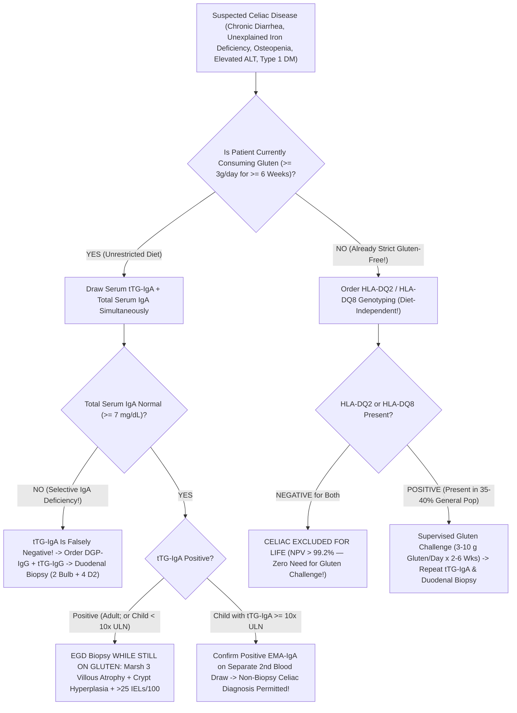
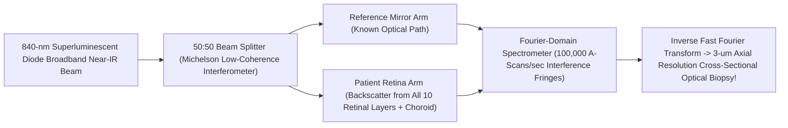

# **BASIC MEDICAL — BEHIND THE CURTAIN CLINICAL DIAGNOSTICS NOTEBOOK**
## **VOLUME XII: SUBSPECIALTY PHYSIOLOGICAL & BENCH DIAGNOSTICS (`GI, NEURO, DERM, ALLERGY, OPHTHO, ENT, UROLOGY`) AND THE JEOPARDY! \$2,000 DIAGNOSTIC HALL OF FAME**

> *"Beyond the automated chemistry track and the high-field MRI bore lies a constellation of ingenious subspecialty instruments engineered to measure what standard blood tubes never see: parts-per-million bacterial hydrogen and heavy carbon-13 exhaled from a stomach ulcer, thirty-six solid-state pressure rings mapping an esophagus paralyzed by lost nitric-oxide neurons, microsecond electrical jitter between two muscle fibers sharing one dying motor axon, three-micron near-infrared light interferograms slicing ten living retinal layers without touching the cornea, and misfolded femtogram prion seeds shaken into glowing amyloid fibrils inside a ninety-six-well plate."*

---

### **Executive Orientation: Where Organ Physiology Meets Analytical Biophysics—And Why Classic Named Tests Still Decide Hard Cases**

Core hospital laboratories excel at quantifying dissolved molecules in venous plasma, yet entire organ systems fail through **mechanical, electrical, epithelial, immunologic, or conformational mechanisms** that leave basic metabolic panels and routine imaging completely normal:

1. **Gastroenterology & Luminal Motility (Dossier 12.1):** An upper endoscopy sees gross ulcers, yet looks completely normal in early **Type II Achalasia**, **Non-Acid `PPI`-Refractory Regurgitation**, **Small Intestinal Bacterial Overgrowth (`SIBO`)**, and **Intestinal Methanogen Overgrowth (`IMO`)**—requiring stable-isotope infrared breath spectroscopy (`13C-UBT`), fermentation gas chromatography, `36-sensor` high-resolution pressure topography (`HRM`), `24-hour` multichannel electrical impedance (`MII-pH`), and stool neutrophil/pancreatic biomarkers (`Calprotectin`, `Elastase-1`).
2. **Neurology, Dermatology, Allergy/Immunology & Sensory/Pelvic Physiology (Dossier 12.2):** Routine nerve conduction studies look `100%` normal in burning **Small-Fiber Neuropathy** (`requiring 3-mm PGP 9.5 epidermal punch biopsy` and `QSART`) and **Ocular Myasthenia Gravis** (`requiring microsecond Single-Fiber EMG jitter`), just as putting a blistering skin biopsy into **formalin** instantly destroys the **Direct Immunofluorescence (`DIF`)** antibodies needed to separate Pemphigus from Pemphigoid (`requiring Michel's transport medium!`), or taking a single dose of cetirizine wipes out **Skin Prick Testing** while leaving **`ImmunoCAP` Component-Resolved `Ara h 2` Specific `IgE`** untouched.
3. **The Championship Diagnostic Hall of Fame (Dossier 12.3):** Medical nomenclature preserves a century of Nobel-winning biochemical ingenuity—from **Coombs, Terasaki, Guthrie, Wassermann, Weil-Felix, Elek, Quellung, Schilling, Ham, and Gibson-Cooke** to their modern laser-and-molecular heirs (**`FLAER` aerolysin flow cytometry, `EMA` Band-3 binding, `DHR-123` oxidative burst, `RT-QuIC`, Secretin gastrinoma paradox, Inferior Petrosal & Adrenal Vein Sampling, and pathognomonic autoantibodies**). Mastering *both* the classic bedside clue and the modern reference replacement turns esoteric trivia into razor-sharp diagnostic fluency.

---

## **DOSSIER 12.1: GASTROENTEROLOGY & HEPATOLOGY SPECIALTY TESTS — BREATH ISOTOPES (`13C-UREA`, `H2/CH4 SIBO`), `36-SENSOR` MANOMETRY, `24-HR` IMPEDANCE-pH, STOOL BIOMARKERS & CELIAC TRAPS**

### **12.1.1 Non-Invasive Breath Chemistry: `13C-Urea` Urease Kinetics & Microbial `H2 / CH4` Fermentation**

#### **1. The `13C-Urea` Breath Test (`13C-UBT`) & Monoclonal Stool Antigen for *Helicobacter pylori***
How does spiral gram-negative ***Helicobacter pylori*** thrive inside a gastric lumen of `pH 1.5` hydrochloric acid that dissolves steel? As **Barry Marshall and Robin Warren** proved (2005 Nobel Prize), *H. pylori* dedicates **`10% to 15%` of its entire cellular protein synthesis** to a massive hexameric, **nickel ($\text{Ni}^{2+}$)-dependent cytoplasmic enzyme: Urease**, paired with a proton-gated inner-membrane urea channel (**`UreI`**) that snaps open whenever periplasmic pH drops below `6.0`, flooding urea inside to generate a protective cloud of alkaline ammonia ($\text{NH}_3$) and bicarbonate!

The **`13C-Urea` Breath Test (`13C-UBT`)** turns *H. pylori*'s survival shield into a `96%`-sensitive, `97%`-specific non-invasive beacon—both for initial "test-and-treat" uninvestigated dyspepsia (`age < 60` without alarm symptoms) and for **mandatory Test-of-Cure `>= 4 weeks` after completing eradication therapy** (where serum `Anti-H. pylori IgG` is completely useless because `"serological scar"` antibodies remain positive for years after `100%` bacterial cure!):

1. **Why Citric Acid + Non-Radioactive $^{13}\text{C}$-Urea:** After collecting a baseline fasting breath bag (`t = 0`), the patient drinks `75 mg` of urea labeled with the **heavy, `100%` non-radioactive stable isotope Carbon-13 ($^{13}\text{C}$, `1.11%` natural terrestrial abundance—completely safe in children and pregnant women**, unlike older $\beta^-$-emitting radioactive $^{14}\text{C}$-urea scintillation capsules!) dissolved in a **`Citric Acid` (`pH ~2.5`) drink**. Citric acid serves two clever physiological roles: (a) duodenal acid sensors reflexively **slow pyloric gastric emptying**, holding $^{13}\text{C}$-urea in prolonged contact with antral mucosa, and (b) acid (`pH < 6`) **maximally opens *H. pylori*'s `UreI` urea channel**, accelerating hydrolysis `10-fold`!
2. **Enzymatic Cleavage & Isotope-Selective Infrared Spectroscopy (`NDIRS` / `IRMS`):**
   If live *H. pylori* colonizes the stomach, bacterial urease cleaves $^{13}\text{C}$-urea within minutes (human cells possess **zero urease**!):
   $$\text{H}_2\text{N-}^{13}\text{CO-NH}_2 + \text{H}_2\text{O} \xrightarrow{\text{H. pylori Urease (Ni}^{2+}\text{)}} 2\text{NH}_3 + {}^{13}\text{CO}_2 \uparrow$$
   Labeled $^{13}\text{CO}_2$ diffuses across gastric capillaries into portal blood and is exhaled from the lungs into the **`t = 15–30 minute` post-dose breath bag**. Inside the lab, **Non-Dispersive Isotope-Selective Infrared Spectroscopy (`NDIRS`)** (exploiting the fact that heavier $^{13}\text{C=O}$ covalent bonds vibrate at a slightly lower infrared wavenumber `~2,283 cm⁻¹` than $^{12}\text{C=O}$ at `~2,349 cm⁻¹`!) or **Gas-Chromatography Isotope-Ratio Mass Spectrometry (`GC-IRMS`, `m/z 45` vs `m/z 44`)** computes the **Delta Over Baseline (`DOB`, in parts per thousand $\text{‰}$)**:
   $$\text{DOB (‰)} = \delta^{13}\text{CO}_{2\text{ (t=30 min)}} - \delta^{13}\text{CO}_{2\text{ (t=0 baseline)}} \ge \mathbf{2.4\text{‰ to }4.0\text{‰}} \implies \text{Active H. pylori Infection!}$$
3. > [!WARNING]
   > **The Non-Negotiable `"4–2–0"` Medication Washout Law (Identical for `13C-UBT`, Monoclonal Stool Antigen `HpSA`, & Gastric Biopsy `CLOtest`!):**
   > * **Antibiotics (`ANY` systemic antibiotic) & Bismuth (`Pepto-Bismol`):** Hold **`>= 4 weeks`** prior!
   > * **Proton Pump Inhibitors (`omeprazole, pantoprazole`, & `PCABs` like `vonoprazan`):** Hold **`>= 2 weeks`** prior! Raising intragastric pH above `5.0` closes *H. pylori*'s `UreI` channel, directly inhibits bacterial replication, and drives *H. pylori* from high-urease spiral rods into **low-metabolism coccoid forms** migrating thinly into the proximal fundus—causing **`20% to 40%` FALSE-NEGATIVE breath, stool antigen, and rapid urease results**!
   > * **Safe Symptom Bridges:** **`H2`-Receptor Antagonists (`famotidine`)** need only be held `24–48 hours` before `UBT` (and do not affect stool antigen at all!), while **calcium/magnesium antacids (`Tums / Maalox`)** can be taken right up to the night before (`0-day` washout)!

#### **2. Hydrogen ($\text{H}_2$) & Methane ($\text{CH}_4$) Carbohydrate Breath Testing (`SIBO`, `IMO` & Disaccharidase Deficiency)**
Every carbohydrate breath test rests on one absolute biochemical truth: **Mammalian mitochondria and human cytosolic enzymes produce `ZERO` molecules of Hydrogen ($\text{H}_2$) or Methane ($\text{CH}_4$) gas!** Every single part-per-million (`ppm`) of $\text{H}_2$ or $\text{CH}_4$ detected in exhaled human breath originates `100%` from **intraluminal microbial anaerobic fermentation** (`~15%–20%` of gut-generated $\text{H}_2$/$\text{CH}_4$ diffuses passively into splanchnic capillaries and exits in alveolar air).

* **Strict Patient Prep (Preventing False Baselines):** No antibiotics for `4 weeks`; no laxatives/prokinetics for `1 week`; strict `24-hour` low-fermentable diet (`plain white rice, baked chicken/eggs, water` — zero beans, onions, dairy, or whole-grain fiber whose lingering colonic fermentation produces a falsely elevated fasting baseline `H2 > 20 ppm`!); `12-hour` overnight fast + antibacterial chlorhexidine mouthwash right before `t = 0` (preventing oral plaque bacteria from fermenting the sugar sip in the mouth within `5 minutes`!).
* **Behind the Gas Chromatograph (`H2 + CH4 + CO2` Normalization):** Modern breath analyzers (`Quintron BreathTracker`) measure $\text{H}_2$, $\text{CH}_4$ (and newer `4-gas` units add $\text{H}_2\text{S}$ for diarrhea-predominant *Fusobacterium/Desulfovibrio* overgrowth!) alongside **`CO2` (`alveolar target ~5.5%`)**. If a patient takes a shallow tidal breath contaminated by `50%` room air (`CO2 = 2.75%`), the analyzer automatically multiplies measured $\text{H}_2$ and $\text{CH}_4$ by $5.5 / 2.75 = \mathbf{2.0\times}$ so dead-space dilution never causes a false negative!
* **Decoding `North American Consensus` Breath Curves:**
  1. **`Glucose` (`75 g` in water) vs. `Lactulose` (`10 g` non-absorbable disaccharide) for `SIBO`:**
     * **Glucose** is `100%` absorbed by `SGLT1` in the duodenum and proximal jejunum—so **any rise in $\text{H}_2 \ge 20\text{ ppm}$ above baseline within `90 minutes` proves proximal `SIBO` with high (`~80%–85%`) specificity**, though it misses isolated distal ileal `SIBO` (`sensitivity ~55%–65%`).
     * **Lactulose** cannot be cleaved by human brush-border enzymes and travels all the way to the cecum: an early rise of **$\Delta\text{H}_2 \ge 20\text{ ppm}$ within `<= 90 minutes`** (often followed by a second colonic peak = classic `"double peak"`, though a double peak is *not* required!) flags `SIBO`—with the caveat that patients with prior ileocecal resection or hypermotility dump lactulose into the cecum in `45 minutes`, generating false positives!
  2. **Why Constipated Patients Have Flat $\text{H}_2$ Curves: Intestinal Methanogen Overgrowth (`IMO` — `CH4 >= 10 ppm`):**
     Up to `30%` of humans harbor **methanogenic archaea (*Methanobrevibacter smithii*)**—not true bacteria!—which scavenge **4 moles of bacterial $\text{H}_2$ plus 1 mole of $\text{CO}_2$ to synthesize 1 mole of Methane ($\text{CH}_4$)**:
     $$4\text{H}_2 + \text{CO}_2 \xrightarrow{\text{Methanobrevibacter smithii}} \text{CH}_4 + 2\text{H}_2\text{O}$$
     This `4:1` hydrogen sink **completely flattens the $\text{H}_2$ curve (`ΔH2 = 0 ppm`)**, causing older $\text{H}_2$-only machines to misdiagnose patients as "normal"! Meanwhile, $\text{CH}_4$ acts as a direct **gasotransmitter slowing enteric cholinergic peristalsis** (`constipation-predominant IBS-C`). **Exhaled $\text{CH}_4 \ge \mathbf{10\text{ ppm}}$ at ANY point (even at fasting `t = 0`!) diagnoses `IMO`**—changing therapy from `rifaximin` monotherapy (`poor archaeal activity`) to **combination `rifaximin + neomycin` (or `metronidazole`)**!
  3. **Lactose (`25 g`) or Fructose (`25 g`) Malabsorption:** In adult-type `LCT -13910C/C` lactase non-persistence, unsplit lactose passes intact into the colon (`after 60–90+ min`), where colonic flora ferment it into **`ΔH2 >= 20 ppm` over `3 hours`** *accompanied by reproduced cramping, bloating, and osmotic diarrhea*.

---

### **12.1.2 Quantitative Stool Biomarkers (`Calprotectin`, `Elastase-1`, `72-Hr Fat`) & The Stool Osmotic Gap**

| Stool Assay & Biochemical Target | Normal vs. Pathologic Thresholds | Behind-the-Curtain Analytical Mechanism & High-Yield Clinical Traps |
| :--- | :--- | :--- |
| **Fecal Calprotectin (`S100A8/A9` Heterodimer; `ELISA` or Fluoroenzyme Immunoassay)** | **`< 50 µg/g`:** Normal (`IBS`; `IBD` `NPV > 98%`!) **`50–250 µg/g`:** Gray zone (repeat off `NSAIDs`/`PPIs`) **`> 250 µg/g`:** Active mucosal inflammation (**`IBD`: Crohn's / UC** $\to$ Colonoscopy!) | Accounts for **`60%` of neutrophil soluble cytosolic protein**; $\text{Ca}^{2+}/\text{Zn}^{2+}$ binding locks its tertiary fold against bacterial proteases for **`7 days` at room temperature**! **TRAPS:** `Calprotectin` measures **neutrophil migration into the gut lumen from ANY cause**—**`NSAIDs` (`ibuprofen/naproxen` enteropathy), `PPIs` (`+30–80 µg/g`), infectious enterocolitis (*C. diff*, *Salmonella*), and colon cancer** all elevate it! |
| **Fecal Pancreatic Elastase-1 (`FE-1`; Monoclonal `ELISA`)** | **`>= 200 µg/g`:** Normal exocrine pancreas **`100–200 µg/g`:** Mild-moderate **`< 100 µg/g`:** **Severe Exocrine Pancreatic Insufficiency (`EPI`)** | `28-kDa` zymogen secreted intact without intestinal degradation (`5×` concentrated in stool). **PEARL #1:** Monoclonal antibodies recognize ONLY *human* `FE-1`—**do NOT stop porcine `Creon/Zenpep` capsules**! **PEARL #2 (THE #1 LAB ERROR):** **Liquid/watery diarrhea (`Bristol 7`) dilutes stool mass by water weight**, creating **false-positive `FE-1 < 100 µg/g`** in `IBS-D` or Celiac! Assay *formed* stool only! |
| **72-Hour Quantitative Fecal Fat (`Van de Kamer` Titration / `NIR` on `100 g/day` Fat Diet)** | **`< 7.0 g fat / 24 hr`** (`>= 93%` fat absorption coefficient) **`>= 7.0 g/day` (`often 15–40+ g/day` in `EPI`):** **True Steatorrhea!** | Gold standard proving maldigestion/malabsorption (`qualitative Sudan III` stain heated with glacial acetic acid screens droplets on a spot smear). **Fractional Fat Concentration (`g fat / 100 g stool`):** `> 9.5%` favors **pancreatic/biliary maldigestion** (`compact greasy oil stools`), whereas `< 9.5%` favors **mucosal malabsorption (`Celiac`)** where unabsorbed water/electrolytes dilute the fat! |
| **Stool Osmotic Gap (`Liquid Stool Supernatant Na+ & K+` Flame/ISE)** | $$\text{Gap} = 290 - 2([\text{Na}^+] + [\text{K}^+])$$ **`> 100 mOsm/kg`:** **Osmotic Diarrhea** (halts with fasting; `stool pH < 5.5` if carb malabsorption!) **`< 50 mOsm/kg`:** **Secretory Diarrhea** (persists through `24–48h` inpatient fast!) | **WHY `290` IS HARD-CODED (NEVER USE MEASURED STOOL OSMOLALITY!):** Inside the specimen cup during transport, colonic bacteria continuously cleave unabsorbed sugars into `3–4×` as many short-chain fatty-acid molecules, driving *measured* cup osmolality to `400–500 mOsm/kg` within `60 minutes`! Because stool leaving the rectum is always isotonic to plasma (`290 mOsm/kg`), subtracting $2([\text{Na}^+] + [\text{K}^+])$ exposes unmeasured osmoles (`lactose`, `PEG`, or **factitious magnesium laxative abuse [`stool Mg2+ > 45 mmol/L`]**)! |

---

### **12.1.3 Esophageal Pressure Topography (`HRM` Chicago Classification v4.0), `24-Hr` Impedance-pH (`MII-pH`) & The Two Celiac Serology Traps**

#### **1. `36-Sensor` Solid-State High-Resolution Esophageal Manometry (`HRM`)**
Before the late 1990s, conventional water-perfused manometry spaced `3` or `4` side-hole catheters `5 cm` apart, missing focal sphincter relaxation failures whenever swallowing shortened the esophagus vertically. **Ray Clouse** transformed motility medicine by spacing **`36` circumferential solid-state piezoresistive pressure sensors every `1.0 cm`** from hypopharynx to proximal stomach and rendering pressure (`mmHg`) as **continuous color-coded spatiotemporal topography ("Clouse Plots")**: time on the x-axis, anatomical depth (`cm`) on the y-axis, and pressure amplitude mapped from cool blue (`0–15 mmHg`) through green/yellow (`30–70 mmHg`) to fiery red/purple (`> 100–150 mmHg`).

Under **Chicago Classification v4.0** (`10` supine `5-mL` saline swallows + `5` upright swallows + provocative `Multiple Rapid Swallows` testing peristaltic reserve and `200-mL Rapid Drink Challenge` unmasking subtle outflow resistance!), every tracing is unlocked in **two sequential steps**:

1. **Step 1 — Does the Lower Esophageal Sphincter (`EGJ`) Relax? (`Median IRP`: Integrated Relaxation Pressure):**
   `IRP` calculates the mean of the **lowest `4 seconds` (contiguous or non-contiguous)** of trans-sphincteric pressure across the esophagogastric junction during the `10-second` window following upper esophageal sphincter opening (excluding diaphragmatic crural inspirations; normal **`< 15 mmHg`** supine on `Medtronic` catheters):
   * **`Elevated Median IRP (> 15 mmHg)` + `100%` Failed Peristalsis = ACHALASIA** (autoimmune/idiopathic destruction of inhibitory myenteric **`nNOS` [nitric oxide] & `VIP` ganglion cells** in Auerbach's plexus; *always perform `EGD` + consider `EndoFLIP` / `CT` to rule out **pseudoachalasia** from infiltrating gastroesophageal junction adenocarcinoma or *Trypanosoma cruzi* Chagas disease!*):
     * **Type I Achalasia (Classic Decompensated):** `↑ IRP` + `100%` failed swallows (`DCI < 100`), zero esophageal pressurization (`burned-out dilated bird-beak esophagus`).
     * **Type II Achalasia (Panesophageal Compression — Best Treatment Prognosis `92%–96%`!):** `↑ IRP` + **`>= 20%` swallows producing a uniform vertical green/yellow band (`>= 30 mmHg`) of compartmentalized fluid pressure** spanning from `UES` to `LES`—responds superbly to **Pneumatic `30-mm` Balloon Dilation, Laparoscopic Heller Myotomy, or `POEM` (`Peroral Endoscopic Myotomy`)**!
     * **Type III Achalasia (Spastic — Demands Tailored Extended `POEM`!):** `↑ IRP` + **`>= 20%` premature lumen-obliterating spastic contractions (`Distal Latency < 4.5 sec`)** (`"corkscrew/rosary-bead"` barium esophagram; **`POEM`** is superior to Heller myotomy because the endoscopist can extend the submucosal myotomy `12–16 cm` proximally over the entire spastic segment!).
2. **Step 2 — If `IRP` Is Normal (`<= 15 mmHg`), Measure Peristaltic Vigour (`DCI`) & Latency (`DL`):**
   * **Absent Contractility (`Normal IRP` + `100%` Failed Swallows `DCI < 100 mmHg·s·cm`):** Classic signature of **Systemic Sclerosis (`CREST` / Scleroderma)** smooth-muscle atrophy (`producing patulous hypotensive LES + severe erosive GERD/Barrett's`—never perform a tight `360°` Nissen fundoplication here or the patient will suffer total postoperative dysphagia!).
   * **Distal Esophageal Spasm (`Normal IRP` + `>= 20%` Premature Swallows `DL < 4.5 s` with normal `DCI >= 450`)** vs. **Hypercontractile ("Jackhammer") Esophagus (`Normal IRP` + `>= 20%` Swallows with Extreme `DCI > 8,000 mmHg·s·cm`!)**.

#### **2. Ambulatory `24-Hour` Multichannel Intraluminal Impedance-pH (`MII-pH`) vs. Wireless `96-Hr Bravo` Capsule**
Suppose a patient on twice-daily `omeprazole` still complains of daily chest burning, chronic cough, or sour fluid rising into the throat, and `EGD` shows normal mucosa (`no LA Grade C/D esophagitis or long-segment Barrett's`). Is acid breaking through the `PPI`, is **neutral (`pH 5.5–7.0`) volume reflux** still splashing upward (`PPIs` turn gastric acid into neutral water—they **do NOT stop transient `LES` relaxations or mechanical regurgitation!**), or is this visceral **Functional Heartburn**?
* **Wireless `96-Hour Bravo` pH Capsule (Tested *OFF* `PPIs` for `7 days` in unproven `GERD`):** Endoscopically clipped `6 cm` above the squamocolumnar junction, transmitting radiotelemetry pH (`Acid Exposure Time [% time pH < 4.0]: > 6.0% = definitive pathologic GERD; < 4.0% = physiologic`).
* **Transnasal `24-Hour MII-pH` Catheter (Tested *ON* twice-daily `PPIs` in *proven* `GERD` with persistent symptoms, or for regurgitation/belching):** Combines a distal `5-cm` pH electrode with **`6` longitudinal pairs of platinum impedance rings** applying microampere alternating current (`Ohm's Law` $Z = V / I$):
  * **Liquid Bolus (`Conductive Ions`):** Bridges adjacent metal rings $\to$ **sharp `>= 50%` DROP in electrical impedance (`from ~2,500 Ω down to < 800 Ω`)** marching **retrograde from `3 cm -> 5 cm -> 9 cm -> 17 cm` above the `LES`**! Even if gastric juice on `PPI` has **`pH 6.2`**, `MII-pH` catches the retrograde liquid wave red-handed (`> 80 total reflux episodes/24h` = abnormal; **`Symptom Index >= 50%` & `Symptom Association Probability [SAP] >= 95%`** links the patient's button press within `2 minutes` to weak-acid reflux!).
  * **Gas Bolus (`Air Insulator`):** Separates mucosal contact from the rings $\to$ **instantaneous SPIKE in impedance (`> 5,000–10,000 Ω`)**—cleanly distinguishing lower-esophageal **gastric belching (`retrograde gas`)** from behavioral **supragastric belching (`antegrade air sucked rapidly into the esophagus and expelled before ever touching the stomach`—cured by diaphragmatic speech therapy!)**.

#### **3. Celiac Disease Diagnostics (`ACG 2023`): Selective `IgA` Deficiency & The Pre-Biopsy Gluten-Free Trap**
1. **First-Line Serology (`WHILE EATING GLUTEN DAILY!`):** **`IgA` Anti-Tissue Transglutaminase (`tTG-IgA` — targeting the lamina propria enzyme that deamidates dietary wheat gliadin glutamine residues into negatively charged glutamic acid so they lock tightly into `HLA-DQ2/DQ8` grooves!)** ordered **TOGETHER with `Total Serum IgA`**.
   * **Trap #1 — Selective `IgA` Deficiency (`Total IgA < 7 mg/dL`):** Present in **`2%–3%` of Celiac patients (`10–15×` general population prevalence)**! An `IgA`-deficient Celiac patient with total flat duodenal villous atrophy will report **`tTG-IgA < 1.0 U/mL (Normal!)`**. Seeing `Total IgA < 7 mg/dL` triggers immediate reflex to **`IgG` Deamidated Gliadin Peptide (`DGP-IgG`) + `tTG-IgG`** (`> 90%` sensitivity in `SIgAD`!).
2. **Duodenal `Marsh` Biopsy Confirmation (And the Pediatric `>= 10× ULN` No-Biopsy Exception):**
   In adults, positive serology requires **`EGD` with multiple forceps biopsies (`1–2` from the duodenal bulb at `9` and `12` o'clock PLUS `>= 4` from the descending `D2` duodenum** because Celiac mucosal injury is notoriously patchy!), demonstrating **`Marsh 3` architecture: intraepithelial `CD8+` T-lymphocytosis (`> 25 IELs / 100 enterocytes`), crypt hyperplasia, and villous blunting/atrophy**. *(Note: Under `ESPGHAN` and `2023 ACG` pediatric rules, symptomatic children with **`tTG-IgA >= 10×` the upper limit of normal** confirmed by a positive **Endomysial `EMA-IgA`** on a separate second blood draw can be diagnosed cleanly *without* anesthesia/endoscopy!)*
   * **Trap #2 — Patient Already Self-Started a Strict Gluten-Free Diet Months Ago:** Both `tTG-IgA` and villous architecture heal back to normal off gluten! **Rescue Step 1:** Order **`HLA-DQ2` / `HLA-DQ8` Genotyping** (unaffected by diet for life!): because **`> 99.2%` of Celiac patients carry `HLA-DQ2` (`~90%–95%`) and/or `HLA-DQ8` (`~5%–10%`)**, a **double-negative `HLA-DQ2/DQ8` rules out Celiac Disease permanently (`NPV > 99%`)**! Only `HLA-DQ2/DQ8`-positive patients require a supervised `3–10 g/day` gluten challenge (`1–2` slices of wheat bread daily for `2–6 weeks`) before repeat serology and duodenal biopsy.

---

## **DOSSIER 12.2: NEUROLOGY, DERMATOLOGY, ALLERGY/IMMUNOLOGY, OPHTHALMOLOGY, ENT & UROLOGY SPECIALTY DIAGNOSTICS**

### **12.2.1 Neuromuscular Junction (`RNS`, `SFEMG` Jitter, Ice-Pack), Autonomic (`Tilt`, `QSART`, `IENFD`) & Protein-Seed Assays (`RT-QuIC`, `p-Tau217`)**

#### **1. Decoding the Neuromuscular Junction: Postsynaptic `Myasthenia Gravis` vs. Presynaptic `Lambert-Eaton` (`LEMS`)**
Every skeletal muscle contraction requires an action potential arriving at the motor nerve terminal to open presynaptic **voltage-gated `P/Q`-type calcium channels (`VGCC`)**, triggering `SNARE`-mediated fusion of `50–100` acetylcholine (`ACh`) synaptic vesicles across the `50-nm` cleft to bind postsynaptic **nicotinic `AChR` ion channels** clustered along junctional folds by **`MuSK` / `LRP4` / `Rapsyn`**—generating an **Endplate Potential (`EPP`)** normally **`3-to-4-fold` larger than the threshold voltage needed to fire muscle $\text{Na}_V1.4$ channels ("The Neuromuscular Safety Factor")**!

| Diagnostic Modality | **Myasthenia Gravis (`MG` — Postsynaptic `AChR / MuSK`)** | **Lambert-Eaton Syndrome (`LEMS` — Presynaptic `P/Q-VGCC`; `50–60% SCLC`!)** |
| :--- | :--- | :--- |
| **Clinical Clue & Reflexes** | Fatigable ptosis/diplopia/bulbar weakness **worse at evening**; **Deep Tendon Reflexes `100%` INTACT**; normal pupils! | Proximal hip-girdle weakness + **autonomic dry mouth**; **Absent/depressed patellar reflexes that RETURN briskly after `10 sec` of quadriceps contraction!** |
| **Baseline `CMAP` Amplitude** | **Normal** resting `CMAP` amplitude | **Markedly REDUCED (`< 1–2 mV`)** resting `CMAP` (few vesicles released on Shock #1!) |
| **Slow `2–3 Hz` Repetitive Nerve Stimulation (`RNS`)** | **Pathognomonic `> 10%` Decrement** (`"U-shaped saddle"` lowest at **Shock #4–#5** as natural vesicle dip drops eroded postsynaptic `EPPs` below firing threshold!) | **Also shows `> 10%` Decrement** at `2–3 Hz` (never rely on `3 Hz` alone to separate `MG` from `LEMS`!) |
| **Fast `20–50 Hz` `RNS` OR Painless `10-Sec Maximal Exercise`** | Mild repair of decrement (`< 25–40%` change) | **Explosive `> 60%–100%+` (`often 200%–500%`!) Incremental Post-Exercise Facilitation!** Rapid spikes flood residual terminals with residual $\text{Ca}^{2+}$, restoring `ACh` exocytosis! *(Also seen in Infantile/Wound **Botulism** `SNARE` cleavage at `20–50 Hz`!)* |
| **Single-Fiber `EMG` (`SFEMG` — `25-µm` Needle Recording `2` Fibers of `1` Motor Unit)** | **Most Sensitive Test in Medicine (`95%–99%` even in pure Ocular `MG`!):** Prolonged microsecond **`"Jitter"` (`Mean Consecutive Difference > 55 µs`)** + intermittent **Impulse Blocking**! | Markedly increased `Jitter` + blocking that **improves dramatically at higher firing rates (`> 10–20 Hz`)** (whereas `MG` jitter *worsens* at higher rates!). |
| **Bedside `2-Minute` Ice-Pack Test & Tiered Serology** | **Ice Pack on Ptotic Lid $\times$ `2 min`:** Cooling (`< 28°C`) inhibits **`AChE`** $\implies$ **`>= 2 mm` lid elevation** *(safely replaced dangerous `IV Edrophonium [Tensilon]`, withdrawn 2018 for bradycardic arrest!)*. **Serology:** `1st` **`Anti-AChR` (`85%` gen / `50%` ocular; `IgG1/3` complement lysis $\to$ Chest `CT` for Thymoma!)** $\to$ `2nd` **`Anti-MuSK` (`IgG4` — `Rituximab`-responsive!)** $\to$ `3rd` **`Anti-LRP4`**. | **`Anti-P/Q-Type Voltage-Gated Calcium Channel (`VGCC`)` Antibodies positive in `85%–90%`!** Mandatory **Chest `CT` + `FDG-PET` surveillance** for occult **Small-Cell Lung Carcinoma (`SCLC`)** + symptomatic `3,4-Diaminopyridine (Amifampridine / Firdapse)` $\text{K}^+$-channel blocker prolonging presynaptic $\text{Ca}^{2+}$ entry! |

#### **2. Autonomic Failure vs. `POTS` (`70° Tilt`), Small-Fiber Neuropathy (`QSART` + `PGP 9.5` Skin Biopsy) & `CSF RT-QuIC` / Plasma `p-Tau217`**
* **`70°` Head-Up Tilt-Table + Beat-to-Beat Arterial Tonometry (`Finapres`):** Passive tilting pools `500–800 mL` of venous blood in pelvic/splanchnic capacitance vessels without calf muscle pumping:
  * **Neurogenic Orthostatic Hypotension (`α-Synucleinopathies: MSA, Parkinson's, Lewy Body, Diabetic/Amyloid Autonomic Neuropathy`):** `SBP` drops `>= 20 mmHg` (`DBP >= 10 mmHg`) within `3 minutes` **with a flat, blunted baroreceptor heart-rate response (`ΔHR / ΔSBP < 0.5 bpm/mmHg`!)** (contrast volume depletion, where `ΔHR / ΔSBP > 0.5`!).
  * **Postural Orthostatic Tachycardia Syndrome (`POTS`):** Sustained **`HR` increase `>= 30 bpm` (`>= 40 bpm` in ages `12–19`)** within `10 minutes` of head-up tilt accompanied by lightheadedness/palpitations **WITHOUT orthostatic hypotension (`SBP` drop `< 20 mmHg`)**.
* **Why Routine `NCS/EMG` Is `100%` Blind to Burning Small-Fiber Neuropathy (`SFN`):**
  Surface Nerve Conduction Studies (`NCS`) record compound potentials ONLY from the fastest `15%–20%` thickly myelinated **`Aα` and `Aβ` fibers (`50–65 m/s`)**. Thinly myelinated **`Aδ` cold/pinprick** and unmyelinated **`C` burning-pain/autonomic fibers (`0.5–2 m/s`)** generate picovolt signals completely invisible on `NCS`! When a diabetic, Sjögren's, `ATTR` amyloid, Fabry, or post-viral patient has burning soles with a normal `NCS/EMG`, two tests clinch the diagnosis:
  1. **`QSART` (`Quantitative Sudomotor Axon Reflex Test`):** Multi-compartment sweat capsule iontophoreses acetylcholine into skin to trigger a postganglionic sympathetic `C-fiber` axon reflex, integrating microliters of evoked sweat volume across `4` standard limb sites (`forearm, proximal leg, distal leg, foot`).
  2. **`3-mm` Distal Leg Epidermal Punch Biopsy (`IENFD` — `10 cm` Above Lateral Malleolus):** Placed in **`2%` PLP or Zamboni's fixative** (*never* routine formalin H&E!), cryosectioned at `50 µm`, and immunostained with pan-neuronal ubiquitin hydrolase **`PGP 9.5`** to directly count unmyelinated `C-fibers` piercing the dermal-epidermal basement membrane (`fibers/mm` below age/sex `5th` percentile = `88%–90%` diagnostic accuracy!).
* **Prion `CSF RT-QuIC` & Alzheimer Plasma `p-Tau217` / `CSF Aβ42/40`:**
  * **Real-Time Quaking-Induced Conversion (`RT-QuIC` for Sporadic Creutzfeldt-Jakob Disease [`sCJD`]):** Whereas older `CSF 14-3-3` and ultra-high `Total Tau (> 1,150 pg/mL)` merely reflect rapid non-specific neuronal death (producing false positives in status epilepticus, acute stroke, and autoimmune/herpes encephalitis!), **`RT-QuIC`** exploits **seeded prion self-templating**! Patient `CSF` (`or olfactory nasal brushings!`) is incubated in a `96-well` plate with excess normal $\alpha$-helical **recombinant PrP substrate ($\text{rPrP}^{\text{Sen}}$)** and **`Thioflavin T` (`ThT`)** dye under intermittent `42°C–55°C` vigorous shaking: if **even `1 femtogram` ($10^{-15}\text{ g}$) of pathogenic $\beta$-sheet $\text{PrP}^{\text{Sc}}$** is present, it converts $\text{rPrP}^{\text{Sen}}$ into $\beta$-sheet amyloid fibrils that fracture under shaking into exponential daughter seeds, binding `ThT` (`450/480 nm` fluorescence surge) with **`92%–96%` sensitivity and `99%–100%` specificity** (paired with cortical ribboning / pulvinar-hockey-stick `DWI MRI`)!
  * **Alzheimer's Disease (`CSF Aβ42/Aβ40` Ratio & Plasma `p-Tau217`):** Remember the counterintuitive **`Aβ42` Sponge Paradox**: in Alzheimer's brain, sticky `42-residue` **`Aβ42` precipitates inside insoluble cortical plaques**, causing **`CSF Aβ42` to DROP by `~50%`**, whereas soluble `Aβ40` stays constant (`low CSF Aβ42/Aβ40 ratio` normalizes global `CSF` production variability and matches Amyloid `PET` at **`92%–95%` accuracy**!). Simultaneously, amyloid plaque toxicity triggers neuronal secretion of **hyperphosphorylated Tau at Threonine-217 (`p-Tau217`)**, which rises **`4-to-8-fold` in peripheral venous plasma** (`Lumipulse` / `Simoa` / `IP-MS`), enabling blood-based confirmation of cerebral amyloid-tau pathology before initiating anti-amyloid immunotherapies (`lecanemab`, `donanemab`)!

---

### **12.2.2 Dermatology Bench & Biopsy: Why `Michel's Medium` Saves Direct Immunofluorescence (`DIF`) Plus `KOH`, `Tzanck`, Dermoscopy & `365-nm` Wood's Lamp**

#### **1. The Cardinal Blistering Biopsy Law: Perilesional Skin in `Michel's Medium`—NEVER `10%` Formalin!**
When an elderly patient erupts in tense bullae (**Bullous Pemphigoid**) or a `45-year-old` develops painful oral mucosal erosions and flaccid skin blisters that shear sideways under gentle thumb pressure (**positive Nikolsky sign = Pemphigus Vulgaris**), taking a single punch biopsy straight through the blister and dropping it into a routine **`10%` neutral buffered formalin** cup is one of the costliest pre-analytical mistakes in clinical medicine!

**Why Two Separate Biopsies & Two Separate Jars Are Mandatory:**
1. **Biopsy #1 (Edge of Fresh Blister $\to$ `10%` Formalin for Routine `H&E`):** Captures structural cleavage level—**suprabasal intraepidermal acantholysis** (`basal keratinocytes clinging to the dermis like a "row of tombstones"` in Pemphigus Vulgaris) versus **subepidermal split teeming with eosinophils** (Bullous Pemphigoid).
2. **Biopsy #2 (Intact Perilesional Normal-Appearing Skin `3–5 mm` Adjacent to Blister $\to$ `Michel's Transport Medium` or `Zeus` Medium / Liquid Nitrogen for `DIF`):**
   * **Why NOT the Blister Roof?** Inside an established blister, lysosomal neutrophil/eosinophil proteases degrade deposited immunoglobulins, yielding false-negative fluorescence!
   * **Why NEVER Formalin?** Formaldehyde cross-links lysine $\varepsilon$-amino groups across protein chains (`methylene bridges`), masking tissue `Fc` conformational epitopes and creating intense green background autofluorescence—**permanently destroying Direct Immunofluorescence (`DIF`)**! **`Michel's Medium`** (`saturated ammonium sulfate, N-ethylmaleimide protease inhibitor, & magnesium sulfate in pH 7.0 citrate buffer`) precipitates tissue-bound antibodies *in situ* without covalent cross-linking for up to **`7–14 days` at room temperature**, allowing cryostat frozen sections stained with **`FITC`-conjugated `Anti-IgG, Anti-IgA, Anti-IgM, & Anti-C3`** to light up pathognomonic immunopathology!

| Immunobullous / Cutaneous Disease | `DIF` Fluorescence Architecture (`Michel's Medium`) | Molecular Target & Confirmatory Serum `ELISA` / Salt-Split Pearl |
| :--- | :--- | :--- |
| **Pemphigus Vulgaris (`PV`) vs. Pemphigus Foliaceus (`PF`)** | **Intercellular `"Chicken-Wire / Fishnet"` `IgG + C3`** coating every keratinocyte membrane perimeter across the epidermis | **`PV`:** **`Anti-Desmoglein 3` (`Dsg3` mucosal)** $\pm$ **`Dsg1`** (`mucocutaneous`; flaccid bullae, **Nikolsky `+`**). **`PF`:** **`Anti-Desmoglein 1` (`Dsg1`) ONLY** (`superficial subcorneal "cornflake" crusting; zero oral lesions` because mucosa expresses compensatory `Dsg3`!). **First-line therapy:** **`Rituximab`** + steroids! |
| **Bullous Pemphigoid (`BP`)** *(and Pemphigoid Gestationis)* | **Sharp Continuous Linear `IgG + C3` Ribbon** along the Dermo-Epidermal Basement Membrane Zone (`BMZ`) | Hemidesmosomal **`BP180` (`Type XVII Collagen NC16A`, serum `ELISA` tracks activity!) & `BP230`**. **Tense bullae, Nikolsky `-`**. **`1.0 M NaCl` Salt-Split Skin Indirect `IF`** cleaves the *lamina lucida*: **`BP` binds the Epidermal ROOF**, whereas **Epidermolysis Bullosa Acquisita (`Anti-Type VII Collagen` anchoring fibrils) binds the Dermal FLOOR**! |
| **Dermatitis Herpetiformis (`DH` — Cutaneous Celiac Disease!)** | **Granular `IgA` Clumps Inside Dermal Papillary Tips** (biopsy `3 mm` *adjacent* to scratched elbow/knee/buttock excoriation—neutrophils destroy `IgA` inside the vesicle!) | **`IgA` Anti-Epidermal Transglutaminase (`eTG / TG3`)** + **`tTG-IgA`** (`> 90%` harbor subclinical Celiac enteropathy!). Pruritus vanishes within **`24–48 hours` of oral `Dapsone`** (`screen G6PD first!`); **strict Gluten-Free Diet** cures long-term! |
| **Linear `IgA` Bullous Dermatosis** vs. **`IgA` Vasculitis (`HSP`)** | **Linear `IgA`:** Smooth linear `BMZ` **`IgA`** (`"string of pearls / cluster of jewels"` annular blisters; **`Vancomycin`** #1 drug trigger!). **`HSP`:** Granular **`IgA + C3`** inside superficial dermal **postcapillary venules**! | **CRITICAL TIMING RULE IN `IgA` VASCULITIS:** Biopsy a palpable purpuric papule **`< 24 to 48 hours` old**! After `48 hours`, leukocytoclastic neutrophil enzymes digest vascular `IgA`, leaving non-specific fibrinoid necrosis! |

#### **2. Rapid Bedside Dermatology Optics: `10%–20% KOH`, `Tzanck` Prep, Polarized Dermoscopy & `365-nm` Wood's Lamp**
* **`10%–20%` Potassium Hydroxide (`KOH` + `DMSO`) Prep:** Scrape the **active advancing scaly border** (`never the healed center!`) of an annular plaque onto glass, add `1` drop of `10%–20% KOH`, warm gently (do not boil—crystallizes `KOH`!), and **drop the microscope substage condenser low** to boost refractive contrast. Alkaline `KOH` hydrolyzes human keratinocyte lipid/protein membranes into clear soup while **fungal chitin and $\beta$-1,3-glucan cell walls survive untouched**:
  * **Dermatophytes (*Trichophyton, Microsporum, Epidermophyton*):** Translucent, uniform, **branching septate hyphae** slicing straight across ghost corneocyte borders.
  * ***Malassezia* (*Pityriasis / Tinea Versicolor*):** Pathognomonic **`"Spaghetti and Meatballs"`** (`short curved hyphae + grape-like clusters of round budding yeast`).
  * ***Candida albicans*:** Budding yeast + constricted **pseudohyphae** (remember `KOH` dissolves epithelial threads and cotton fibers? No—cotton fibers are thicker cellulose ribbons without septa/branching buds!).
* **Tzanck Smear vs. Viral `PCR`:** Unroof an **intact early vesicle** (`not a crusted ulcer!`), gently scrape the **cellular base** (herpesviruses infect basal keratinocytes—vesicle fluid alone is acellular!), smear onto glass, and stain with `Giemsa` or `Wright` stain: **Multinucleated Epithelial Giant Cells (`8–20` molded, faceted nuclei fitting together like jigsaw pieces + peripheral chromatin margination)** confirm *Herpesviridae* (`HSV-1, HSV-2, or VZV`) in `10 minutes` at the bedside, while a viral swab sent for **Multiplex Real-Time `HSV-1 / HSV-2 / VZV PCR`** delivers **`> 98%` sensitivity and exact viral typing**!
* **Cross-Polarized Dermoscopy & `365-nm` Wood's Lamp (`Barium Silicate + 9% Nickel Oxide` Filter):**
  * Unpolarized skin reflects `~5%–7%` of incident white light straight off the dry *stratum corneum* as blinding glare, hiding dermal melanin and blood vessels. **Cross-Polarized Dermoscopy** rejects surface-reflected waves (which preserve source polarization) and admits only **deeply back-scattered dermal photons** whose polarization was randomized by collagen—unmasking **atypical pigment networks, regression structures, and blue-white veils** in cutaneous melanoma!
  * **`365-nm` UVA Wood's Lamp in a Pitch-Dark Room:** Excites microbial/endogenous porphyrins and accentuates epidermal melanin loss (melanin absorbs `365-nm` UVA `10×` more strongly than visible light!):
    * **Bright Coral-Red:** ***Corynebacterium minutissimum* (`Erythrasma`)** in intertriginous folds (`bacterial coproporphyrin III`—**warn patient NOT to shower right before exam**, because porphyrins are water-soluble and wash away!).
    * **Yellow-Gold:** *Malassezia* (*Tinea versicolor*); **Blue-Green:** Ectothrix *Microsporum canis* tinea capitis; **Chalk-White Accentuation:** **Vitiligo** (`100%` melanocyte loss) & **Tuberous Sclerosis `"Ash-Leaf"` hypomelanotic macules**; **Coral-Pink Urine Fluorescence:** **Porphyria Cutanea Tarda (`uroporphyrin I/III`)**!

---

### **12.2.3 Allergy/Immunology (`Skin Prick` vs. `ImmunoCAP Ara h 2`, `Tryptase`, `PPSV23`), Ophthalmology (`OCT`), `ENT` (`Tympanometry / VNG`) & Urology (`Urodynamics`)**

#### **1. Allergy & Clinical Immunology: Why Antihistamines Wreck `Skin Prick` Yet Leave `ImmunoCAP` Untouched—Plus `Ara h 2` Component Diagnostics**
* **Epicutaneous Skin Prick Testing (`SPT` — Functional *In Vivo* Mast-Cell Cross-Linking) vs. Solid-Phase Serum `ImmunoCAP` Specific `IgE` (`sIgE`):**
  * **How `SPT` Works (`15–20 Minutes`):** A `1-mm` bifurcated lancet pricks tiny droplets of standardized allergen through the avascular epidermis, cross-linking **adjacent `IgE` molecules pre-armed on cutaneous mast-cell `FcεRI` receptors** $\to$ instant histamine/leukotriene release (`Wheal diameter >= 3 mm larger than Negative Glycerinated Saline Control` = positive sensitization!).
  * **Why Every `SPT` Panel Requires Both `Histamine (+)` and `Saline (-)` Controls:**
    1. **Oral `H1` Antihistamines (`cetirizine, loratadine, fexofenadine, diphenhydramine` — MUST hold `5–7 days`; `hydroxyzine/doxepin` hold `7–14 days`; intranasal `azelastine` hold `3–5 days`!):** Block dermal endothelial `H1` receptors, **flattening the Positive Histamine Control (`wheal < 3 mm`)** and rendering every negative allergen result **completely invalid**! *(Notice: **Systemic corticosteroids** [`prednisone`], leukotriene blockers [`montelukast`], and `H2` blockers [`famotidine`] **do NOT suppress immediate `15-min` `Type I` `SPT` wheals**, whereas topical potent steroids on the back DO suppress **`48–96 hr` `Type IV` T-cell Patch Testing**!)*
    2. **Dermatographism (`Physical Urticaria`) or Extensive Atopic Dermatitis:** Mechanical lancet trauma alone triggers a **`6-mm` wheal at the Negative Saline Control**, invalidating `SPT`!
  * **When `ImmunoCAP` Serum Specific `IgE` (`FEIA`, reported in `kUA/L`, cutoff `>= 0.35` or `>= 0.10 kUA/L`) Wins:** Because `ImmunoCAP` captures **unbound circulating plasma `IgE`** onto a high-capacity `3D` cyanogen-bromide-activated cellulose sponge in the laboratory, it is **`100%` UNAFFECTED by antihistamines, severe generalized eczema, dermatographism, or the `4–6 week` cutaneous mast-cell exhaustion ("anergy") window immediately following life-threatening anaphylaxis**!
  * **Component-Resolved Diagnostics (`CRD` — Solving the Peanut False-Positive Crisis) & Oral Food Challenge:**
    Why do `70%` of birch-pollen-allergic patients test positive to **whole-peanut `SPT` or whole-peanut `sIgE`** (`1.8 kUA/L`) yet eat roasted peanut butter without systemic anaphylaxis? Because crude peanut extract mixes `17+` proteins together! **Component-Resolved `ImmunoCAP`** tests purified recombinant single molecules:
    * **`Ara h 2` (and `Ara h 1, 3, 6` — `2S Albumin` / Cupin Seed Storage Proteins):** Tightly disulfide-bonded, **resistant to `200°C` roasting AND gastric pepsin acid digestion** $\to$ absorbed intact into systemic circulation $\to$ **high risk of lethal systemic anaphylaxis (`prescription Epinephrine auto-injector + strict avoidance`!)**.
    * **`Ara h 8` Isolated Positivity (`Ara h 2 = < 0.10 kUA/L`):** Heat- and pepsin-labile **`PR-10` homolog of Birch Pollen (`Bet v 1`)**! Destroyed in the stomach $\to$ harmless **Pollen-Food / Oral Allergy Syndrome** (brief lip/palate itching from raw peanuts, zero shock!). When doubt remains, the **Physician-Supervised Graded Oral Food Challenge (`OFC`)** with crash-cart epinephrine ready at the bedside remains the **undisputed clinical gold standard**!
* **Acute Serum Mast-Cell `Tryptase` (`1 to 3 Hours` Post-Anaphylaxis) & `PPSV23` Vaccine Challenge:**
  * **Why `Tryptase` Beats Plasma Histamine in the `ED`:** Plasma histamine decays to baseline within **`15–30 minutes`** (`t1/2 ~ 2 min`), whereas neutral protease **Tryptase** (`α/β-protryptase + mature β-tryptase`) dissociates slowly from mast-cell heparin proteoglycan matrices, peaking **`60–90 minutes` after anaphylaxis onset** and remaining elevated for **`3–4 hours`**. Always pair an **Acute `1–3 hr` Serum Tryptase** with a **Convalescent `>= 24 hr` Baseline Tryptase**: **`Acute >= (1.2 × Baseline) + 2.0 ng/mL`** proves mast-cell degranulation even if acute tryptase stayed inside the `"normal" < 11.4 ng/mL` population range (`e.g., jumping from 3.0 baseline to 8.5 ng/mL` during intraoperative neuromuscular-blocker anaphylaxis!), while a persistently high baseline (`> 20 ng/mL`) uncovers **Systemic Mastocytosis (`KIT D816V`)**!
  * **Diagnosing Common Variable Immunodeficiency (`CVID`):** Low `IgG` (`>= 2 SD` below mean) + low `IgA` and/or `IgM` **PLUS proven failure of functional vaccine antibody production**: check **`Tetanus/Diphtheria` IgG** (`T-dependent protein antigen`) AND **paired pre-immunization vs. `4–6 week` post-immunization `23-Valent Unconjugated Pneumococcal Polysaccharide` (`PPSV23 / Pneumovax`) serotype-specific IgG titers** (`pure T-cell-independent B-cell marginal-zone response` — normal adults achieve `>= 1.3 µg/mL` across **`>= 70%`** of tested non-PCV serotypes!). *(Warning: Once a patient is started on **`IVIG`**, donor antibodies invalidate all serologic titers for `6 months`—always draw vaccine titers BEFORE infusing `IVIG`!)*

#### **2. Ophthalmology (`3-µm` Michelson Interferometry `OCT`), `ENT` (`Tympanometry / Audiometry / VNG`) & Urology (`Pdet = Pves - Pabd` Urodynamics)**

| Subspecialty Modality | Physical Measurement Principle Behind the Curtain | Pathognomonic Waveform / Signature & Clinical Decision |
| :--- | :--- | :--- |
| **Spectral-Domain / Swept-Source Optical Coherence Tomography (`OCT` — `Huang & Fujimoto, 1991`)** | Ultrasound (`150 µm` res) is too coarse; light (`3×10^8 m/s`) is too fast (`10 fs` echo) for direct clocks. **`OCT` splits `840–1,050 nm` broadband low-coherence near-IR light** between a reference mirror and retina; **spectral interference fringes + Inverse Fourier Transform** resolve **`3–5 µm` depth across all `10` living retinal layers in `2 seconds` non-contact**! | • **Neovascular ("Wet") `AMD` & Diabetic Macular Edema:** Intraretinal cysts + subretinal fluid + `RPE` detachment (**gates & titrates intravitreal `anti-VEGF` [`aflibercept / faricimab`]**!). • **Glaucoma & `MS` Optic Neuritis:** Micron-scale thinning of peripapillary **Retinal Nerve Fiber Layer (`RNFL`)** + Ganglion Cell Complex *years* before `Humphrey` visual-field scotomas appear! |
| **`226-Hz` Tympanometry (`Jerger` Curves) + Pure-Tone Air/Bone Audiogram** | Sealed ear probe sweeps canal pressure **`+200 to -400 daPa`** while measuring acoustic admittance (`mL`) of a `226-Hz` tone reflected off the eardrum (`use 1,000 Hz in infants < 6 mos`!) + air headphones vs mastoid bone oscillator (`250–8,000 Hz`). | • **`Type A`:** Normal `0 daPa` peak. • **`Type B` (Flat):** `Normal volume (0.5–1.5 mL)` = **Middle-Ear Fluid (`OME`)**; **`High volume (> 2.0 mL)` = Perforated TM or Open Ear Tube**! • **`Type C` (`< -150 daPa`):** Eustachian tube dysfunction. • **`Type As` (Shallow `< 0.3 mL`) + `2,000-Hz` Bone `"Carhart Notch"` + Air-Bone Gap:** **Otosclerosis** (`stapes footplate fixation`!). • **`Type Ad` (Deep `> 1.6 mL`):** **Ossicular Discontinuity**! |
| **Videonystagmography (`VNG`) Bithermal Caloric Test (`30°C` / `44°C`, Head `30°` Elevated)** | Raising head `30°` supine places the **Lateral (Horizontal) Semicircular Canal `100%` vertical**! Warm (`44°C`) irrigation makes endolymph buoyant (`ampullopetal` $\to$ excites `CN VIII`); Cool (`30°C`) makes endolymph sink (`ampullofugal` $\to$ inhibits `CN VIII`). Infrared goggles track nystagmus in total darkness (preventing visual fixation suppression!). | **`COWS` Fast-Phase Mnemonic:** **C**old = **O**pposite, **W**arm = **S**ame (*physiologic slow vestibular drift goes TOWARD cold, snapped back by fast cortical saccade OPPOSITE*). **`> 25%` Unilateral Weakness (`Jongkees' Formula`)** proves peripheral **`CN VIII` / labyrinthine paresis** (vestibular neuritis, Ménière's, vestibular schwannoma)! |
| **Multichannel Pressure-Flow Urodynamics (`Pdet = Pves - Pabd`)** | Urethral catheter records total bladder **`Pves`**; rectal/vaginal balloon records abdominal **`Pabd`**; computer plots pure smooth-muscle **Detrusor Pressure $P_{\text{det}} = P_{\text{ves}} - P_{\text{abd}}$** alongside uroflow **`Qmax (mL/s)`** and pelvic `EMG`. | • **Stress Incontinence (`ISD`):** Cough spikes `Pves` & `Pabd` identically while **`Pdet = 0`** (`Abdominal Leak Point Pressure < 60 cmH2O` = Intrinsic Sphincter Deficiency $\to$ mid-urethral sling/bulking!). • **Neurogenic Detrusor Storage Danger:** **`Detrusor Leak Point Pressure >= 40 cmH2O`** (spina bifida / `SCI` **detrusor-sphincter dyssynergia**) refluxes high pressure into kidneys $\to$ **urgent `antimuscarinics / intradetrusor OnabotulinumtoxinA + CIC`**! • **Male Lower Urinary Symptoms:** **`High Pdet + Low Qmax` (`BOO Index > 40`) = True Prostatic Obstruction** (`TURP` cures!) vs **`Low Pdet + Low Qmax` = Detrusor Underactivity** (`TURP` will FAIL!). |

---

## **DOSSIER 12.3: THE "JEOPARDY! \$2,000 CLUE" DIAGNOSTIC HALL OF FAME — CLASSIC NAMED TESTS, PATHOGNOMONIC STAINS, EPONYMS, AUTOANTIBODIES & MODERN LABORATORY REPLACEMENTS**

Clinical medicine, board examinations, and diagnostic rounds speak a shorthand built from a century of landmark assays. Yet half of those classic eponymous bench tests have quietly been superseded behind the laboratory curtain by high-precision laser flow cytometry, mass spectrometry, or recombinant molecular assays—while the other half remain irreplaceable daily workhorses. The three master matrices below pair **every classic diagnostic clue, its exact biophysical/biochemical mechanism, the disease it clinches, and its modern 21st-century reference-lab evolution**.

### **12.3.1 Hall of Fame Part I: Hematology, Blood Banking, Microbiology & Molecular Blotting (`SNOW DROP`)**

| Classic Named Test / Mnemonic | Historical Mechanism & What Turned Positive on the Bench | Disease Clinched | Modern Reference-Lab Status / Gold-Standard Replacement |
| :--- | :--- | :--- | :--- |
| **Coombs Test (`Robin Coombs, 1945`: `DAT` vs. `IAT`)** | Rabbit **Anti-Human Globulin (`AHG` — anti-`IgG` + anti-`C3d`)** bridges `IgG`-coated RBCs across the `25-nm` electrostatic zeta-potential gap so they visibly agglutinate! **`DAT`** = washed patient RBCs (*in vivo* sensitization); **`IAT`** = patient plasma + reagent RBCs (*in vitro* antibody screen). | **Autoimmune Hemolytic Anemia (`AIHA`), Hemolytic Disease of the Fetus/Newborn (`HDFN`), Acute/Delayed Hemolytic Transfusion Reactions** | **STILL DAILY GOLD STANDARD** (automated on `Sephadex` dextran-acrylamide microcolumn gel cards & solid-phase capture!). |
| **Terasaki Crossmatch (`Paul Terasaki, 1964` — `CDC-XM`)** | **Complement-Dependent Microcytotoxicity:** `1 µL` recipient serum + donor T/B lymphocytes + **rabbit complement** + vital dye (`eosin` or `ethidium bromide`); `> 20%` lysed dead donor cells = **hyperacute-rejection barrier**! | **Pre-Transplant Donor-Specific `HLA` Alloantibodies (`DSA`)** | Augmented/superseded by **`Luminex` Single-Antigen Bead (`SAB`) Virtual Crossmatch (`MFI`)** + `10–50×` more sensitive **Flow Cytometric Crossmatch (`FCXM`)**! |
| **Ham's Acidified Serum Test (`1939`) & Sucrose Hemolysis** | Patient RBCs incubated in fresh normal serum acidified to **`pH 6.5`** (activating the **Alternative Complement Pathway**): RBCs lacking complement shields `CD55` (`DAF`) & `CD59` (`MIRL`) lyse into bright red supernatant! | **Paroxysmal Nocturnal Hemoglobinuria (`PNH` — acquired somatic X-linked `PIGA` stem-cell mutation blocking `GPI` anchor synthesis; hemolytic anemia + pancytopenia + Budd-Chiari hepatic vein thrombosis!)** | **OBSOLETE $\to$ Replaced by `FLAER` Multiparameter Flow Cytometry!** **`FLAER` (`Fluorescently Labeled Inactive Proaerolysin`**, a *Aeromonas hydrophila* toxin binding **directly to the `GPI` glycolipid anchor itself** on granulocytes/monocytes + `Anti-CD59` on RBCs; `0.01%` clone sensitivity!). |
| **Osmotic Fragility Test (`Hypotonic NaCl` Gradient)** | Diluting patient RBCs across `0.90%` down to `0.10% NaCl`: loss of vertical membrane surface area (`low surface-to-volume ratio`) causes spherocytes to burst early at **`0.65%–0.55% NaCl`** (`right-shifted lysis curve`, amplified after `24h` sterile incubation!). | **Hereditary Spherocytosis (`ANK1` Ankyrin, `SPTB` β-Spectrin, `SLC4A1` Band 3; autosomal dominant splenomegaly, pigment gallstones, `MCHC > 36.5 g/dL`, `DAT-negative`!)** | **SUPERSEDED by `EMA` (`Eosin-5'-Maleimide`) Binding Flow Cytometry** (+ Osmotic Gradient Ektacytometry)! `EMA` covalently tags `Lys-430` of transmembrane **`Band 3`**; sharp **`> 20%` drop in mean channel fluorescence** diagnoses `HS` in `1 hour` on `5 µL` of neonatal blood! |
| **Nitroblue Tetrazolium (`NBT`) Slide Test** | Activated neutrophils reduce soluble yellow `NBT` dye via superoxide ($\text{O}_2^{\bullet -}$) into insoluble **dark-blue/black intracellular formazan crystals** (`0%` blue cells in `CGD`!). | **Chronic Granulomatous Disease (`CGD` — defective `NADPH` Oxidase [`gp91phox CYBB` X-linked or `p47phox` AR]; recurrent **catalase-positive** *S. aureus, Serratia, Burkholderia, Nocardia, Aspergillus* infections!)** | **SUPERSEDED by Dihydrorhodamine-123 (`DHR-123`) Flow Cytometry!** `PMA` triggers oxidative burst converting non-fluorescent `DHR` into bright green **`Rhodamine-123`** (`absent shift` = X-linked `CGD`; **`bimodal double peak` = X-linked carrier mother**; `"broad modest shift"` = milder `p47phox`!). |
| **Ristocetin Cofactor Assay (`vWF:RCo`)** | Toxic glycopeptide antibiotic **ristocetin** unfolds plasma **von Willebrand Factor (`vWF`)** *in vitro* so its `A1` domain agglutinates formalin-fixed platelets via **`GP1bα`** (`also fails to agglutinate patient platelets in **Bernard-Soulier GP1b** deficiency, whereas ADP/epinephrine/collagen fail in **Glanzmann GPIIb/IIIa**!`). | **von Willebrand Disease (`vWD` Types `1, 2A, 2B, 2M, 3`; `vWF:Act / vWF:Ag < 0.7` = qualitative Type 2!)** | Upgraded to **Recombinant Gain-of-Function `vWF:GP1bM` Assay**—requires **NO ristocetin**, eliminating the notorious false-low `vWF:RCo` artifact caused by the benign **`p.D1472H` `vWF` polymorphism** common in Black Americans! |
| **`SNOW DROP` Molecular Blotting Quartet** | **S**outhern (`Edwin Southern, 1975`) = **D**NA **N**orthern = **R**NA **O** = *Blank* (`O` for `0`) **W**estern (`Immunoblot`) = **P**rotein **+ Southwestern Blot** = **DNA-Binding Transcription Factors** (proteins separated on SDS-PAGE probed with radiolabeled **dsDNA consensus motifs**!) | Gene rearrangements/methylation (`Southern`: `Fragile X`), mRNA splice isoforms (`Northern`), antibody/protein size (`Western`), transcription factor binding (`Southwestern`). | Largely replaced clinically by **`qPCR / RT-PCR`, `RNA-seq`, `CGH/SNP Microarray`, `Repeat-Primed PCR`, & `Chemiluminescent / Multiplex Immunoassays`**, though Southern still anchors complex `FMR1/FSHD` repeats! |
| **Wassermann (`1906`) $\to$ `RPR` / `VDRL` Flocculation** | *Treponema pallidum* tissue damage releases mitochondrial **cardiolipin**; mixing patient serum (`reagin` antibodies) with **Cardiolipin-Lecithin-Cholesterol** micelles (`+ charcoal` in `RPR`) forms visible black clumps! *(False `+` in **`SLE` antiphospholipid `Anti-Cardiolipin`**, pregnancy, malaria!)* | **Syphilis (*Treponema pallidum*)** — **`VDRL` remains the ONLY validated test on `CSF` for Neurosyphilis**; **`>= 4-fold` `RPR` titer drop (`e.g., 1:64 -> 1:16`) proves Benzathine Penicillin G cure**! | **STILL ESSENTIAL** paired with **Reverse-Sequence Automated Treponemal `CIA / EIA`** (`stays positive for life!`) + `RPR` activity titration (`watch for **Prozone Hook Effect** in secondary syphilis with ultra-high titers—dilute serum `1:16` if `RPR` looks falsely negative!`). |
| **Paul-Bunnell / `Monospot` Heterophile Test** | Infectious mononucleosis induces polyclonal `IgM` that cross-agglutinates **horse or sheep erythrocytes** (absorbed with guinea-pig kidney to strip Forssman antibodies). | **Epstein-Barr Virus (`EBV` — `CD21` B-cell infection causing reactive `CD8+` `"ballerina-skirt" Downey Type II` atypical lymphocytosis!)** | **DISCOURAGED by `CDC`** (`25%` false-negative in Week 1 & **`50%+` false-negative in children `< 4 years`**!) $\to$ Order **`EBV` Specific Serology (`VCA-IgM [+]` & `VCA-IgG [+]` with `EBNA-IgG [-]` = Acute Primary `EBV`; `EBNA-IgG [+]` = Past Infection!)**. |
| **Weil-Felix, Quellung, Elek, India Ink & String Test** | • **Weil-Felix:** *Proteus vulgaris* `OX-19/OX-2/OX-K` cross-agglutination. • **Quellung (`Neufeld`):** Anticapsular serum swells refractive capsule. • **Elek Plate:** Antitoxin filter strip precipitates phage **Diphtheria Toxin** at `45°` angles. • **India Ink:** Black carbon halo around `20-µm` capsule. • **String Test (`Entero-Test`):** Swallowed weighted nylon yarn sampling bile-stained duodenal mucus. | • **Weil-Felix:** **Rickettsial Spotted Fevers / Typhus** • **Quellung:** ***S. pneumoniae / H. influenzae b*** serotyping • **Elek:** Toxigenic ***Corynebacterium diphtheriae*** • **India Ink:** ***Cryptococcus neoformans*** meningitis • **String Test:** ***Giardia lamblia* / *Strongyloides* / *Salmonella Typhi*** | • Weil-Felix $\to$ **Indirect `IFA` (`Gold Standard`) & Skin Biopsy `PCR`**. • Elek $\to$ **`tox` Gene `PCR` + Reference Elek Confirmation**. • India Ink (`~50%–60%` sens) $\to$ **`99%`-Sensitive `CSF`/Serum Lateral-Flow Cryptococcal Antigen (`CrAg`)**! • String Test $\to$ **Stool `Giardia` Antigen `EIA` / Multiplex `GI PCR`**. |

---

### **12.3.2 Hall of Fame Part II: Metabolic, Endocrine, Copper, Nuclear Scintigraphy & Bedside Neuro-Sensory Classics**

| Classic Named Test / Procedure | Physiological & Analytical Mechanism Behind the Curtain | Pathognomonic Diagnostic Verdict & Modern Evolution |
| :--- | :--- | :--- |
| **Schilling Test (`Robert Schilling, 1953` — 4-Stage `57Co-B12` Urine Excretion)** | Oral radiolabeled `57Co-Cobalamin` + `1,000-µg` `IM` cold `B12` tissue-saturating flush (`measuring 24h urinary % radioactivity`): **Stage I** (`B12` alone low) $\to$ **Stage II** (`+ Intrinsic Factor`: **corrects in Pernicious Anemia**, stays low in terminal ileal Crohn's/resection, `SIBO` [corrects in **Stage III** post-antibiotics], or `EPI` [corrects in **Stage IV** post-pancreatic enzymes — pancreatic proteases normally cleave salivary **R-binder/haptocorrin** off `B12`!]). | **OBSOLETE (`Radioisotope discontinued`) $\to$ Replaced by Non-Radioactive Venous Quartet:** **Serum `B12` + `Methylmalonic Acid` (`MMA` — rises in `B12` deficiency, NORMAL in folate deficiency!) + `Homocysteine` + `Anti-Intrinsic Factor` (`98%` specific for Pernicious Anemia!) & `Anti-Parietal Cell` (`H+/K+-ATPase`) Antibodies**! |
| **Secretin Stimulation Test (`The Gastrinoma Paradox`)** | When fasting serum gastrin sits in the gray zone (`150–999 pg/mL` with gastric `pH < 2.0`, or confounded by chronic `PPI` achlorhydria), inject **`IV` Secretin (`0.4 µg/kg`)**: secretin stimulates somatostatin `D-cells` to **suppress** normal antral `G-cells`, **whereas Zollinger-Ellison Gastrinomas express aberrant stimulatory `Secretin Gs-coupled receptors`**! | **Paradoxical Gastrin Surge `>= +120 pg/mL` (`or >= +200 pg/mL`) within `15 minutes` = Diagnostic of Zollinger-Ellison Syndrome (`Gastrinoma`; screen serum `Ca2+/PTH` for `MEN1` & localize via **`68Ga-DOTATATE PET/CT`** + `EUS`!)**. |
| **Wilson Disease Diagnostic Quartet (`Kayser-Fleischer` + `Ceruloplasmin` + `24h Urine Cu` + `ATP7B`)** | Loss of hepatocyte `trans-Golgi` **`ATP7B` copper-transporting P-type ATPase** halts both (a) biliary copper excretion and (b) copper incorporation into apo-ceruloplasmin (`apo-ceruloplasmin degrades rapidly in plasma, t1/2 = 5 hours vs 5 days for holo-ceruloplasmin!`), spilling toxic **non-ceruloplasmin free copper** into basal ganglia (`lenticular degeneration`), kidneys, RBCs, and cornea! | **1. Slit-Lamp Exam** (`required—naked eye misses early rings!`): Golden-green **Kayser-Fleischer Rings** in peripheral **Descemet's membrane** (`present in >95% of neurologic Wilson's, only ~50% of pure hepatic!`) + sunflower cataracts. **2. Serum `Ceruloplasmin < 20 mg/dL`** (`< 10 mg/dL` classic; acute-phase protein so inflammation/estrogens can falsely normalize it!). **3. `24-Hour Urine Copper > 100 µg/24h`** (`> 40 µg` children) + **Liver Biopsy Dry-Weight Copper `> 250 µg/g`** / **`ATP7B` Sequencing**. *(ICU Pearl: **Coombs-negative hemolytic anemia + acute liver failure with `ALP / Total Bilirubin Ratio < 4.0` + `AST/ALT > 2.2` = Fulminant Wilson Crisis** requiring urgent liver transplant/plasmapheresis!)* |
| **Water Deprivation + `Desmopressin (DDAVP)` & Hypertonic Saline `Copeptin`** | Fluid restriction (`stopping if 3%–5% weight lost or serum Na+ >= 145–150`) tests endogenous hypothalamic **`AVP` (`ADH`)** + renal **`V2` aquaporin-2**; injecting `2 µg IV/SC DDAVP` tests renal collecting-duct responsiveness! **Modern Upgrade:** **Arginine- or Hypertonic-Saline-Stimulated Plasma `Copeptin`** (the stable `39-amino-acid` C-terminal glycopeptide cleaved `1:1` with `AVP` from pre-pro-vasopressin, unlike ultra-unstable `AVP` which degrades in minutes *ex vivo*!). | • **Primary Polydipsia:** Concentrates urine `> 600–800 mOsm/kg` before `DDAVP`; stimulated `Copeptin > 4.9 pmol/L`. • **Central Diabetes Insipidus (`AVP` Deficiency):** Urine `< 300 mOsm/kg` during dehydration $\to$ **jumps `> 50%` after `DDAVP`**; stimulated **`Copeptin < 4.9 pmol/L`**! • **Nephrogenic `DI` (`Lithium, Hypercalcemia, X-linked AVPR2`):** Urine `< 300 mOsm/kg` $\to$ **`< 10%` rise after `DDAVP`**; baseline unstimulated **`Copeptin >= 21.4 pmol/L`** (`diagnoses Nephrogenic DI on a single baseline blood draw without water deprivation`!) |
| **Bilateral Inferior Petrosal Sinus Sampling (`BIPSS` + `CRH / DDAVP`)** | Pituitary `MRI` misses **`40%` of tiny `< 4-mm` `ACTH`-secreting corticotroph microadenomas**—and `10%` of healthy humans harbor incidental non-functioning pituitary `"incidentalomas"`! Interventional catheters sample venous blood right where the cavernous sinuses empty (`Inferior Petrosal Sinuses`) vs. peripheral vein. | **`Petrosal-to-Peripheral ACTH Ratio >= 2.0` pre-stimulation OR `>= 3.0` post-`CRH`/`DDAVP` = `96%+` Specific for Pituitary Cushing's Disease** (`proceed to transsphenoidal surgery!`); **`Ratio < 2.0` = Ectopic `ACTH` Syndrome** (`bronchial carcinoid, thymic NET, medullary thyroid, or SCLC` $\to$ Chest/Abdomen `CT` + `68Ga-DOTATATE PET`!). |
| **Bilateral Adrenal Vein Sampling (`AVS` + `Cosyntropin` Infusion)** | Adrenal `CT` misleads in **`~38%` of Primary Aldosteronism** (`missing micro-aldosteronomas < 8 mm` or blaming an innocent non-functioning macro-nodule on the wrong side!). **Technical Crux:** Left adrenal vein drains cleanly into the left renal vein, whereas the tiny **Right Adrenal Vein** enters the `IVC` directly and frequently slips out! | **Step 1 — Prove Successful Cannulation (`Selectivity Index = Adrenal Vein Cortisol / IVC Cortisol >= 3.0–5.0` on cosyntropin; if `< 3`, the right catheter missed the vein!).** **Step 2 — `Lateralization Index`:** Dividing cortisol-normalized aldosterone $\frac{(\text{Aldo}/\text{Cortisol})_{\text{Dominant}}}{(\text{Aldo}/\text{Cortisol})_{\text{Contralateral}}} \ge \mathbf{4.0}$ = **Unilateral Conn's Adenoma (`curative laparoscopic adrenalectomy`)**; `< 3.0` = **Bilateral Idiopathic Hyperplasia (`medical spironolactone / eplerenone`)**! |
| **Nuclear Medicine Eponymous Quartet: `HIDA`, `MUGA`, `123I-MIBG`, & `68Ga-DOTATATE`** | • **`99mTc-HIDA` (`Hepatic Iminodiacetic Acid / Mebrofenin`):** Hepatocytes extract & excrete into bile. • **`99mTc-RBC MUGA` (`Multigated Acquisition`):** `ECG`-gated cardiac blood-pool counts `(EDC - ESC)/EDC`. • **`123I-MIBG` (`Metaiodobenzylguanidine`):** Guanethidine/norepinephrine analog taken up via sympathetic **`NET`**. • **`68Ga-DOTATATE PET/CT`:** Positron-labeled somatostatin analog binding **`SSTR2`**. | • **`HIDA`:** **Gallbladder non-visualization at `4h` (`or 30m post-IV morphine` sphincter-of-Oddi constriction)** = **`97%` Specific Cystic Duct Obstruction (`Acute Calculous Cholecystitis`)** (`also diagnoses postoperative bile leaks & acalculous cholecystitis via CCK ejection fraction < 35%`!). • **`MUGA`:** Reproducible **`LVEF`** (`doxorubicin/trastuzumab` monitoring). • **`123I-MIBG`:** **Pheochromocytoma, Paraganglioma, & Pediatric Neuroblastoma** staging. • **`68Ga-DOTATATE PET`:** Gold-standard **`NET` (`Carcinoid / Gastrinoma / Insulinoma / Paraganglioma`)** localization + gates therapeutic $\beta^-$-emitting **`177Lu-DOTATATE` (`Lutathera`)**! |
| **Bedside Sensory Quartet: `Weber & Rinne` (`512 Hz`), `Dix-Hallpike`, & `Schirmer` Strip** | • **`512-Hz` Tuning Fork** (`128 Hz` is for peripheral neuropathy vibration, NEVER hearing!). • **`Dix-Hallpike`:** Head turned `45°`, briskly laid supine with neck extended `20°` off table edge (`otoconia roll inside dependent posterior semicircular canal`). • **`Schirmer` Test:** `5 × 35 mm` Whatman #41 filter paper hooked over lower lateral conjunctival fornix $\times$ `5 min`. | • **Conductive Loss (Wax/Fluid/Otosclerosis):** **Weber lateralizes TO bad ear** (masking room noise lost!), **Rinne Negative (`Bone > Air`)**. **Sensorineural Loss:** **Weber lateralizes TO good ear**, **Rinne Positive (`Air > Bone`)**. • **`Dix-Hallpike`:** `2–15s` latency, `< 60s` fatigable **upbeating torsional geotropic nystagmus** = **Posterior Canal `BPPV`** (`cure immediately via bedside **Epley Maneuver**`; pure vertical downbeat without latency/fatigue = **Central Cerebellar/Brainstem Stroke -> `MRI`**!). • **`Schirmer <= 5 mm / 5 min`:** Severe aqueous tear deficiency (**Sjögren's Syndrome** `Anti-Ro/SSA, Anti-La/SSB`). |

---

### **12.3.3 Hall of Fame Part III: Pathognomonic Organ-Specific, Neuro-Immunologic & Paraneoplastic Autoantibodies**

| Autoantibody & Molecular Antigen | Analytical Platform (`CBA / ELISA / IFA`) | Pathognomonic Disease, Clinical Phenotype & Management Pearl |
| :--- | :--- | :--- |
| **`Anti-PLA2R` (`M-Type Phospholipase A2 Receptor` on Podocytes; `IgG4` subclass)** *(plus `Anti-THSD7A` & `NELL-1`)* | `ELISA` (quantitative titer) + `IFA` (`99%` specific!) | **`75%–85%` of Primary Membranous Nephropathy** (subepithelial `"spike-and-dome"` granular `IgG4`; **non-invasive Kidney-Biopsy-Sparing Diagnosis** in nephrotic adults with normal `eGFR` & zero secondary triggers! Falling serum **`Anti-PLA2R` titers precede urine protein remission by `3–6 months`** after `Rituximab`! **`THSD7A` / `NELL-1`** flags occult **solid malignancy**!). |
| **`Anti-GBM` (`Non-Collagenous NC1 Domain of α3 Chain of Type IV Collagen`)** | Chemiluminescent / `ELISA` + Renal Biopsy `IF` | **Goodpasture's Disease (`Anti-GBM` Glomerulonephritis $\pm$ Diffuse Alveolar Hemorrhage):** Ribbon-smooth **linear glomerular capillary `IgG`** (`30%` double-positive with **`MPO-ANCA`**!). **STAT Plasmapheresis + Cyclophosphamide + Steroids** before dialysis dependence! *(Wait: why doesn't `Anti-GBM` attack skin? Skin BM uses $\alpha_5$/$\alpha_1$ chains; only **alveoli and glomeruli** expose $\alpha_3\alpha_4\alpha_5(\text{IV})$—and **Alport `COL4A5` transplant recipients** lacking native $\alpha_3\alpha_4\alpha_5$ can mount de novo post-transplant `Anti-GBM` against the normal donor kidney!)* |
| **`AMA-M2` (`Anti-Mitochondrial E2 Subunit of Pyruvate Dehydrogenase Complex, PDC-E2`)** vs. **`ASMA` (`Anti-F-Actin`) / `Anti-LKM1`** | `ELISA` / `IFA` | • **`AMA-M2` (`95%` sens, `98%` spec):** **Primary Biliary Cholangitis (`PBC`)** (middle-aged females, pruritus, `↑↑ ALP`, florid granulomatous bile-duct lesions, xanthelasma $\to$ **`Ursodeoxycholic Acid`**—diagnosable **without liver biopsy** when `ALP >= 1.5× ULN` + `AMA+`!). • **`ASMA` (`Anti-Smooth Muscle F-Actin`) + `ANA` + `↑↑ Total IgG`:** **Type 1 Autoimmune Hepatitis** (`interface plasma-cell hepatitis`; **`Anti-LKM1` [`CYP2D6`]** = pediatric/young female **Type 2 `AIH`**!). |
| **`Anti-Aquaporin-4` (`AQP4-IgG` / `NMO-IgG`)** vs. **`Anti-MOG` (`Myelin Oligodendrocyte Glycoprotein`)** | **Live Cell-Based Assay (`CBA` — mandatory over `ELISA`, which misses `25%` & gives false `+`!)** | • **`AQP4-IgG` (Astrocytic Foot-Process Water Channel):** **Neuromyelitis Optica Spectrum Disorder (`NMOSD`)**—bilateral/chiasmal severe optic neuritis + **Longitudinally Extensive Transverse Myelitis (`>= 3` contiguous vertebral segments on Spine `MRI`!)** + **Area Postrema Syndrome** (intractable hiccups/vomiting!). **CRITICAL:** Classic `MS` drugs (`interferon-β, natalizumab, fingolimod`) **CATASTROPHICALLY WORSEN `NMOSD`**; treat with **`Eculizumab/Ravulizumab` (`anti-C5`), `Inebilizumab` (`anti-CD19`), or `Satralizumab` (`anti-IL-6R`)**! • **`MOG-IgG` (`MOGAD`):** Pediatric `ADEM`, bilateral **anterior optic disc swelling**, conus medullaris myelitis (`steroid-responsive`!). |
| **`Anti-NMDA Receptor` (`GluN1` Extracellular Subunit — Cell-Surface Synaptic Antibody)** *(vs. `Anti-LGI1`)* | **TEST `CSF` + SERUM (`CSF` `CBA` is `99%` sensitive; serum alone misses `15%`!)** | **Autoimmune `NMDAR` Encephalitis:** Prodromal viral headache $\to$ acute **schizophrenia-like psychosis/paranoia** (frequently misadmitted to psychiatry!) $\to$ seizures (**`"Extreme Delta Brush"` on `EEG`**), **orofacial-lingual dyskinesias**, catatonia, central hypoventilation, & autonomic instability. **`40%–55%` of young adult females harbor an Ovarian Mature/Immature Teratoma** (`order pelvic transvaginal US / MRI`!); because `Anti-NMDAR` internalizes surface receptors *without* killing neurons, **tumor resection + `Steroids / IVIG / Plasmapheresis / Rituximab` restores full recovery in `> 80%`**! *(Compare **`Anti-LGI1`:** older men with pathognomonic `1-second` **Faciobrachial Dystonic Seizures** + `SIADH` hyponatremia!)* |
| **Intracellular Onconeuronal Paraneoplastic Panel (`Anti-Hu, Anti-Yo, Anti-Ri, Anti-Ma2, Anti-Amphiphysin`)** | Immunoblot + Tissue `IFA` (antibodies are *biomarkers*; **`CD8+` cytotoxic T-cells** irreversibly kill neurons—so early cancer discovery via whole-body **`FDG-PET/CT`** is everything!) | • **`Anti-Hu` (`ANNA-1`):** **Small-Cell Lung Cancer (`SCLC`)** — painful dorsal-root sensory neuronopathy, encephalomyelitis, pseudo-obstruction. • **`Anti-Yo` (`PCA-1`):** **Ovarian & Breast Carcinoma** — pancerebellar Purkinje cell destruction (**subacute severe ataxia, dysarthria, nystagmus**). • **`Anti-Ri` (`ANNA-2`):** **Breast / `SCLC`** — **Opsoclonus-Myoclonus-Ataxia** + jaw dystonia. • **`Anti-Ma2` (`Ta`):** **Young Male Testicular Germ-Cell Tumor** (`order scrotal ultrasound!`) — limbic/diencephalic encephalitis, narcolepsy, vertical gaze palsy. • **`Anti-Amphiphysin` (vs. non-paraneoplastic `Anti-GAD65`):** **Breast / `SCLC` Stiff-Person Syndrome**! |
| **`IgG4`-Related Disease (`IgG4-RD`: Serum `IgG4` + Tissue Immunohistochemistry)** | Nephelometric Subclass `IgG4` (`> 135 mg/dL`, watch for nephelometric **prozone hook effect** requiring serial dilution!) + **Core Tissue Biopsy** | Systemic fibroinflammatory tumor-mimic: **Type 1 Autoimmune `"Sausage"` Pancreatitis** (painless obstructive jaundice mimicking whipple-requiring pancreatic adenocarcinoma!), biliary `IgG4` cholangitis, **retroperitoneal fibrosis** (`perianeurysmal ureteral medial deviation`), Mikulicz salivary/lacrimal swelling, Riedel woody thyroiditis. **Biopsy Triad:** (1) **Storiform ("cartwheel") fibrosis**, (2) **Obliterative phlebitis**, & (3) **Dense lymphoplasmacytic infiltrate (`IgG4+/IgG+ plasma cell ratio > 40%`)**—melts dramatically within weeks on **Glucocorticoids or `Rituximab`**! |

---

### **Landmark References & Clinical Practice Guidelines (Volume XII)**

1. **Chey WD, Howden CW, Moss SF, et al.** *ACG* Clinical Guideline: Treatment of *Helicobacter pylori* Infection. *Am J Gastroenterol*. 2024;119(9):1730–1753; & **Marshall BJ, Warren JR.** Unidentified curved bacilli in the stomach of patients with gastritis and peptic ulceration. *Lancet*. 1984;1(8390):1311–1315.
2. **Rezaie A, Buresi M, Lembo A, et al.** Hydrogen and methane-based breath testing in gastrointestinal disorders: The North American Consensus. *Am J Gastroenterol*. 2017;112(5):775–784; & **Pimentel M, Saad RJ, Long MD, Rao SSC.** *ACG* Clinical Guideline: Small Intestinal Bacterial Overgrowth (`SIBO` / `IMO`). *Am J Gastroenterol*. 2020;115(2):165–178.
3. **Yadlapati R, Kahrilas PJ, Fox MR, et al.** Esophageal motility disorders on high-resolution manometry: **Chicago Classification version 4.0**. *Neurogastroenterol Motil*. 2021;33(1):e14058; & **Gyawali CP, et al.** **Lyon Consensus 2.0** for modern `GERD` diagnosis (`MII-pH` & `Bravo`). *Gut*. 2024;73(2):361–371.
4. **Rubio-Tapia A, Hill ID, Semrad C, et al.** *American College of Gastroenterology* Guidelines Update: Diagnosis and Management of Celiac Disease. *Am J Gastroenterol*. 2023;118(1):59–76.
5. **Narayanaswami P, Sanders DB, Wolfe G, et al.** International Consensus Guidance for Management of Myasthenia Gravis; **Atarashi R, Satoh K, Orru CD, Caughey B, et al.** Second-generation **`RT-QuIC`** diagnosis of sporadic Creutzfeldt-Jakob disease; & **Jack CR Jr, Andrews JS, Beach TG, et al.** Revised criteria for diagnosis and staging of Alzheimer's disease (`CSF Aβ42/40` & **Plasma `p-Tau217`**): *Alzheimer's Association Workgroup*. *Nat Med* / *Alzheimers Dement*. 2024;20(8):5143–5169.
6. **Witte M, Zillikens D, Schmidt E.** Diagnosis of autoimmune blistering diseases (`Michel's medium DIF`, salt-split `IIF`, `Desmoglein` & `BP180` `ELISA`). *Front Med*. 2018;5:296.
7. **Golden DBK, Wang J, Waserman S, et al.** Anaphylaxis: A 2023 Practice Parameter Update (`Acute/Baseline Tryptase` & **`Ara h 2`** Component-Resolved Diagnostics). *Ann Allergy Asthma Immunol*. 2024;132(2):124–176; & **Bonilla FA, et al.** International Consensus Document (`ICON`) on Common Variable Immunodeficiency (`PPSV23` vaccine response). *J Allergy Clin Immunol Pract*.
8. **Huang D, Swanson EA, Lin CP, Schuman JS, Stinson WG, Chang W, Hee MR, Flotte T, Gregory K, Puliafito CA, Fujimoto JG.** Optical coherence tomography (`OCT`). *Science*. 1991;254(5035):1178–1181.
9. **Abrams P, Cardozo L, Fall M, et al.** Standardisation of terminology in lower urinary tract function (`Multichannel Urodynamics Pdet = Pves - Pabd`): *International Continence Society*. *Urology*; & **Loscalzo J, Fauci AS, Kasper DL, Hauser SL, Longo DL, Jameson JL.** *Harrison's Principles of Internal Medicine*, 21st ed. McGraw Hill; 2022.
10. **Dalmau J, Graus F.** Antibody-mediated encephalitis (`Anti-NMDAR`, `Anti-LGI1`, & onconeuronal syndromes). *N Engl J Med*. 2018;378(9):840–851; **Wingerchuk DM, et al.** International consensus diagnostic criteria for `NMOSD` (`AQP4-IgG`); & **Wallace ZS, Naden RP, Chari S, et al.** The 2019 *ACR/EULAR* Classification Criteria for **`IgG4`-Related Disease**. *Arthritis Rheumatol*. 2020;72(1):7–19.
