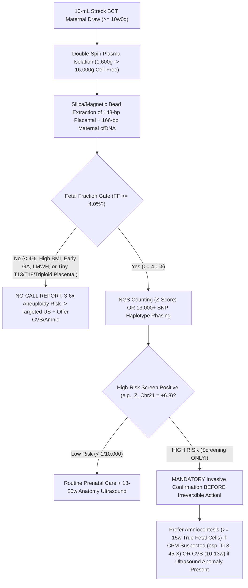
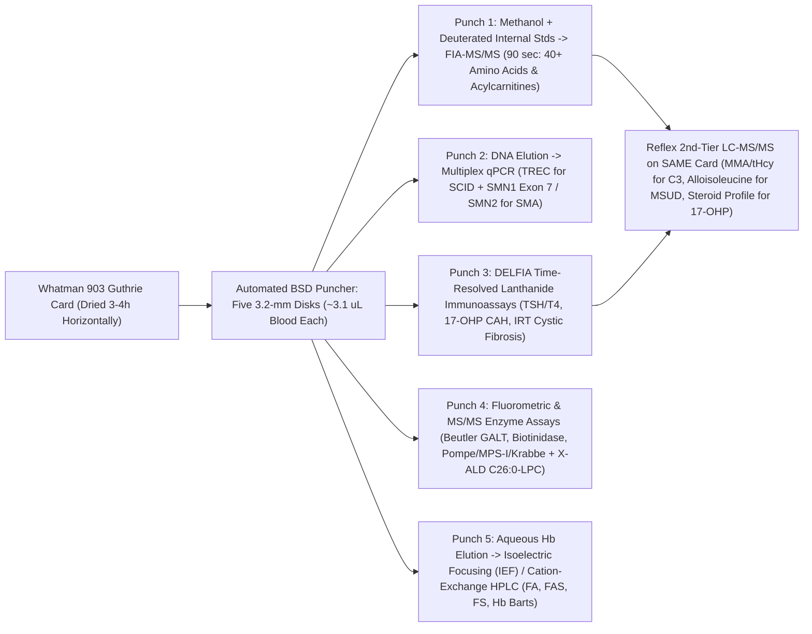
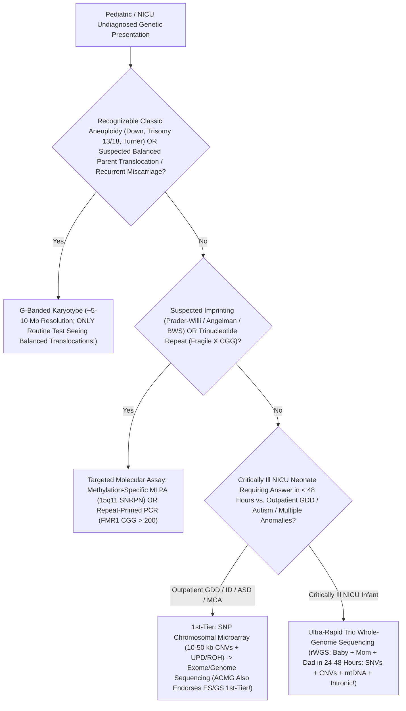

# **BASIC MEDICAL — BEHIND THE CURTAIN CLINICAL DIAGNOSTICS NOTEBOOK**
## **VOLUME XI: PEDIATRICS, PRENATAL CELL-FREE DNA, THE 48-HOUR NEONATAL HEEL-STICK, AND CLINICAL GENOMIC DIAGNOSTICS**

> *"Between the tenth week of human gestation and the forty-eighth hour after birth, clinical laboratory medicine performs its most consequential sleight of hand: extracting broken hundred-and-forty-three-base-pair whispers of placental chromatin out of a mother's peripheral vein without touching the fetus, counting two thousand acid-washed red cell ghosts to stop a single maternal immune memory cell from awakening against future pregnancies, and punching five three-millimeter confetti circles of dried heel blood to unmask fifty silent biochemical and genetic time-bombs before a single neuron is lost."*

---

### **Executive Orientation: Diagnosis Across Two Interlocked Lives and Four Developmental Clocks**

Adult laboratory medicine enjoys two quiet luxuries that obstetrical, neonatal, and pediatric diagnostics never possess: **physiological steady state** and **generous blood volume**. A `70-kg` adult carries `5,000 mL` of circulating whole blood and maintains stable reference intervals across decades. By contrast, a `600-gram` `24-week` micro-preemie in the Neonatal Intensive Care Unit (`NICU`) possesses barely **`50 mL` of total circulating blood**—less than three tablespoons—meaning routine adult phlebotomy tubes would exsanguinate the patient within forty-eight hours. Even more dramatically, fetal and neonatal biochemistry undergoes a violent, choreographed metamorphosis the instant the umbilical cord is clamped:

1. **Before Birth (`10–40 Weeks` Gestation — The Fetomaternal Interface):** The fetus floats behind twin biological barriers—the placenta and amniotic sac. Non-invasive prenatal screening must read **apoptotic trophoblast DNA fragments (`cfDNA`)**, placentally synthesized glycoprotein hormones (`PAPP-A, hCG, Inhibin A`), fetal adrenal-hepatic-placental steroid relays (`Unconjugated Estriol`), or cerebral arterial blood-flow velocity (`MCA-PSV` Doppler) through the mother's body—while constantly guarding against **Confined Placental Mosaicism (`CPM`)**, vanishing twins, maternal occult malignancy, and **Fetomaternal Hemorrhage (`FMH`)**.
2. **Hours `0 to 48` After Cord Clamping (The Neonatal Transition Surge):** At birth, losing the low-resistance placenta spikes systemic vascular resistance while cold air triggers a massive **hypothalamic-pituitary `TSH` surge (`60–80 mIU/L`)** that mimics congenital hypothyroidism if sampled too early. Simultaneously, losing maternal placental clearance unmasks fetal **inborn errors of metabolism (`PKU, MSUD, MCAD, Urea Cycle Defects`)**—yet only *after* dietary protein and catabolic lipolysis begin loading the infant's own blocked enzymes.
3. **Days `2 to 28` (The Window Before Irreversible Organ Injury):** Whether catching **Biliary Atresia** via conjugated bilirubin before hepatic fibrosis closes the `45-day` Kasai surgical window, diagnosing **Spinal Muscular Atrophy (`SMA`)** on a dried blood spot before anterior horn $\alpha$-motor neurons die, or spotting **Critical Congenital Heart Disease (`CCHD`)** with a hand-versus-foot pulse oximeter hours before the *ductus arteriosus* slams shut at home, neonatal diagnostics is a race against developmental clocks measured in hours.
4. **Infancy Through Adolescence (Dynamic Auxology & Rapid Genomics):** From trace-metal **venous `ICP-MS` lead confirmation** and **radiation-sparing graded-compression ultrasound** to **`SNP` chromosomal microarrays** and **`36-hour` NICU Trio Whole-Genome Sequencing (`rWGS`)**, pediatric diagnostics demands age-and-hour-specific nomograms and family-phased molecular logic.

---

## **DOSSIER 11.1: BEFORE BIRTH — PRENATAL CELL-FREE DNA (`NIPT`), MATERNAL SERUM QUAD SCREENING, `CVS` VS. AMNIOCENTESIS, `MCA` DOPPLER & FETOMATERNAL HEMORRHAGE (`KLEIHAUER-BETKE` VS. FLOW `HbF`)**

### **11.1.1 Yuk Ming Dennis Lo's 1997 `cfDNA` Revolution: Why "Fetal" DNA Is Actually Apoptotic Syncytiotrophoblast Chromatin**

For three decades prior to 1997, obtaining fetal genetic material required passing a needle across the maternal abdominal wall or cervix—carrying a small but real procedure-related miscarriage risk (`~0.1%–0.3%` in modern high-volume centers). Researchers spent twenty years hunting intact fetal nucleated red blood cells (`NRBCs`) in maternal blood, only to discover they exist at `1 cell per 10^7 maternal leukocytes` and can persist in maternal marrow from *previous* pregnancies for years (`microchimerism`).

In 1997, **Yuk Ming Dennis Lo** (*Lancet*, 1997) asked an audaciously counterintuitive question: instead of looking inside intact cells, what if we look in **cell-free maternal plasma**? Inspired by circulating tumor DNA (`ctDNA`) shed by vascularized cancers, Lo's team boiled plasma from women carrying male fetuses and amplified `Y`-chromosome `SRY`/`DYS14` sequences—discovering that **10% to 15% of all cell-free DNA floating in maternal plasma comes from the conceptus**!

#### **1. The Anatomical & Fragmentomic Truth Inside the `Streck` Camouflage Tube**
When an obstetrician orders **Non-Invasive Prenatal Testing (`NIPT` / `cfDNA` aneuploidy screening)** at **`>= 10 weeks 0 days`** gestation, blood is drawn into a specialized **`10-mL` `Streck Cell-Free DNA BCT` (black-and-tan camouflage cap)** tube rather than a routine lavender `K2-EDTA` tube left overnight:

* **Why `Streck` Tubes Exist (Preventing Maternal Leukocyte Genomic Flood):** Maternal plasma contains only tiny picogram quantities of `cfDNA` (`~1,000–3,000` genome equivalents per mL), whereas a single `mL` of maternal whole blood contains **`5–10 million` nucleated maternal white blood cells**. In a standard `K2-EDTA` tube sitting at room temperature for `> 6–8 hours`, stressed maternal neutrophils undergo necrosis and *ex vivo* apoptosis, dumping billions of base pairs of pure maternal genomic DNA into the plasma and **crushing the Fetal Fraction (`FF`) below the reportable limit**! `Streck` tubes contain proprietary formaldehyde-free cell-membrane stabilizers (`imidazolidinyl urea` / glycine derivatives) that lock maternal leukocyte membranes intact for up to **`7–14 days`** at ambient courier temperatures without crosslinking plasma `cfDNA`.
* **Where "Fetal" `cfDNA` Actually Originates:** Despite its clinical name, `> 99%` of "fetal" `cfDNA` never touched the fetus proper! It is shed continuously by **programmed apoptosis of outer placental syncytiotrophoblast and cytotrophoblast cells** lining the intervillous space, bathed directly in maternal spiral-artery blood.
* **Two Biophysical Signatures Exploited Behind the Curtain:**
  1. **Ultra-Rapid `16-to-30-Minute` Half-Life:** Maternal hepatic Kupffer cells, splenic macrophages, plasma `DNase I` (`DNASE1L3`), and renal filtration clear placental `cfDNA` with a biphasic half-life of **`16–30 minutes`**, rendering it **completely undetectable within `2 hours` of placental delivery**. Thus—unlike intact fetal cells—**`cfDNA` NEVER carries over from a prior pregnancy!**
  2. **`143-bp` vs. `166-bp` Nucleosomal Fragmentomics:** Maternal background `cfDNA` (derived `~85%` from apoptotic maternal hematopoietic leukocytes) wraps `1.7` turns around a histone octamer *plus* the **`H1` linker histone**, yielding a sharp modal fragment peak at **`~166 base pairs`**. Placental trophoblast chromatin is more transcriptionally open and cleaved inside the core nucleosome (`DNASE1L3` / `DFFB`), lacking the `20-bp` linker footprint and peaking at **`~143 base pairs`** with `10-bp` helical periodicity (`133, 122, 112 bp`). Modern `NIPT` bioinformatic pipelines actively **size-select or computationally weight short `< 150-bp` reads** to enrich the placental signal!

#### **2. The Mathematics of Fetal Fraction (`FF >= 4%`), Maternal `BMI` Dilution & Massively Parallel Counting vs. `SNP` Phasing**
Every `cfDNA` report hinges on one non-negotiable quality-control gate: **Fetal Fraction (`FF`)**, defined as the percentage of total plasma `cfDNA` fragments originating from the fetoplacental unit:

$$\text{Fetal Fraction (FF)} = \frac{\text{Placental cfDNA Fragments}}{\text{Placental cfDNA Fragments} + \text{Maternal cfDNA Fragments}} \times 100\%$$

Between `10` and `20 weeks` gestation, median `FF` sits at **`10%–15%`**, rising slowly (`~0.1%/week` early, `~1%/week` after `21 weeks`). Most clinical platforms enforce an analytical floor of **`FF >= 4.0%`** (some `SNP`/paired-end size-enriched assays validate down to `2.8%–3.5%`). Why is distinguishing Trisomy 21 (`3` copies instead of `2`) mathematically impossible if `FF` drops too low, and why does maternal obesity trigger **"No-Call" (`Low Fetal Fraction`)** results?

* **The `1.05×` Needle-in-a-Haystack Equation:** Suppose a pregnant patient carries a fetus with **Trisomy 21 (`47,XX,+21`)** at **`FF = 10%`** (`0.10`). Ninety percent (`0.90`) of the Chromosome 21 fragments in her plasma come from the euploid mother (`2` copies per genome equivalent), while ten percent (`0.10`) come from the trisomic placenta (`3` copies per genome equivalent). Compared to a euploid pregnancy (`2.00` normalized copies), total plasma Chromosome 21 representation shifts to:
  $$\text{Relative Chr21 Representation} = \frac{(0.90 \times 2) + (0.10 \times 3)}{2.00} = \frac{1.80 + 0.30}{2.00} = \frac{2.10}{2.00} = 1.050 \quad (+5.0\%\text{ excess!})$$
  In general, a complete fetal trisomy increases plasma reads from that chromosome by **only $\frac{\text{FF}}{2}$**! At `FF = 10%`, Chr21 rises by `+5%`; at `FF = 4%`, Chr21 rises by a microscopic **`+2.0%` (`1.020×`)**! Because random shotgun sequencing follows **Poisson counting noise** ($\sigma = \sqrt{N}$), resolving a `+2%` shift at a **`Z-score >= 3.0`** ($p < 0.0013$) demands counting **tens of millions of mapped `cfDNA` molecules** with rigorous `GC`-content normalization:
  $$Z_{\text{Chr21}} = \frac{\text{Proportion}_{\text{Chr21, patient}} - \mu_{\text{Chr21, euploid ref}}}{\sigma_{\text{Chr21, euploid ref}}}$$
* **Why High Maternal `BMI` Causes "No-Call" Failures—And Why a "No-Call" Demands Ultrasound/Diagnostic Respect (*ACOG PB 226*):**
  In severe maternal obesity (`BMI > 35–40 kg/m^2`), `FF` drops below `4%` in up to **`5%–10%` of draws at `10 weeks`** for two compounding reasons: (1) expanded maternal plasma blood volume dilutes a fixed placental output, and (2) chronic low-grade adipose inflammation accelerates **apoptosis of maternal adipocytes and stromal vascular leukocytes**, flooding the denominator with `166-bp` maternal `cfDNA`! *(Low-molecular-weight heparin [`enoxaparin`] can also cause `No-Call` artifacts by releasing `GC`-biased chromatin fragments).*
  > [!CAUTION]
  > **The "No-Call" Aneuploidy Paradox:** Clinicians must **NEVER** dismiss a `Low Fetal Fraction / No-Call` `NIPT` result as a harmless lab glitch! Pregnancies failing `cfDNA` due to low `FF` carry a **`3-fold to 6-fold` increased risk (`~3%–5%` absolute risk) of Trisomy 13, Trisomy 18, or Digynic Triploidy (`69,XXX` / `69,XXY`)**—because those exact lethal syndromes produce **severely hypoplastic, tiny placentas** that shed almost no trophoblast DNA! Per *ACOG Practice Bulletin No. 226*, a `No-Call` result requires genetic counseling, comprehensive targeted anatomic ultrasound, and offering **diagnostic testing (`CVS` or amniocentesis)** rather than endlessly repeating `cfDNA` past the window of clinical action.

* **The Two Competing Analytical Engines Behind the Lab Curtain:**
  1. **Massively Parallel Shotgun Sequencing (`MPSS` / Whole-Genome Counting):** Libraries all plasma `cfDNA` indiscriminately, sequences `15–30 million` single- or paired-end reads across `50-kb` genomic bins across all `24` chromosomes, normalizes `GC` bias, calculates `FF` via Y-chromosome reads, `SeqFF` multivariate bin patterns, and `143-bp` fragment length ratios, and reports chromosomal `Z-scores` (`Z > 3.0` trisomy; `Z < -3.0` monosomy; genome-wide `CNV` calls `>= 7 Mb`). *Blind spot:* Pure counting cannot detect **Triploidy (`69,XXX`)** when all chromosomes are equally `3n`!
  2. **Targeted `SNP`-Based Multiplex PCR + Maximum-Likelihood Haplotype Phasing:** Amplifies **`> 13,000–20,000` polymorphic single-nucleotide polymorphisms (`SNPs`)** specifically across Chromosomes `21, 18, 13, X, Y` (and `22q11.2`). By plotting minor-allele distributions (`AA, AB, BB` shifted vertically by `FF` according to whether the fetus inherited maternal or paternal alleles), `SNP`-based `NIPT` directly distinguishes maternal vs. fetal genotypes, **catches Triploidy (`69,XXY` / `69,XXX`)**, flags **unrecognized vanishing twins / dizygotic twins** (extra haplotype clusters!), and detects parental consanguinity!

#### **3. Why `cfDNA` (`NIPT`) Is NEVER Diagnostic: Bayes' Theorem `PPV` & The Five Biological False-Positive Traps**
Commercial marketing often touts "`> 99%` sensitivity and `99.9%` specificity" for Trisomy 21, lulling patients—and occasionally clinicians—into treating `NIPT` like a karyotype. **It is a screening test, never a diagnostic test.** First, by **Bayes' Theorem**, Positive Predictive Value (`PPV`) depends heavily on prior maternal age prevalence: while Trisomy 21 `PPV` exceeds `90%–95%` in a `40-year-old` mother, Trisomy 21 `PPV` drops to **`~50%–60%`** in a `20-year-old`, **`45,X` (Turner) `PPV` sits around `25%–40%`**, and rare microdeletion screens (`22q11.2, 1p36, 5p-`) carry `PPVs` of **`15%–50%`**. Second, five biological realities decouple plasma `cfDNA` from the living fetus:

| Biological Confounder | Molecular / Embryological Mechanism | Classic `cfDNA` Signature & Clinical Resolution |
| :--- | :--- | :--- |
| **1. Confined Placental Mosaicism (`CPM`, `1%–2%` of all placentas!)** | Mitotic nondisjunction in outer **trophoblast** OR **"trisomic rescue"** inside the inner cell mass (`ICM`) leaves the placenta trisomic (`47,+13`, `47,+16`, `45,X`) while the fetus is `100%` euploid (`46,XX`/`XY`)! | Positive `NIPT` with **normal fetal ultrasound**; **Amniocentesis (`>= 15 wks`)** is strongly preferred over `CVS` because `CVS` *also* samples placenta! *(Note: `CPM` still warrants third-trimester growth scans for placental insufficiency & `UPD` check!)* |
| **2. Demised / Vanishing Twin** | Early co-twin demises (`50%+` of vanished sacs are aneuploid!), yet its necrotic/resorbing chorionic sac continues shedding trisomic or `Y`-bearing `cfDNA` for **`8 to 15 weeks`**! | Discordant fetal sex (`XX` anatomy on ultrasound vs `XY` on `cfDNA`) or false-positive trisomy; `SNP` platform flags "extra fetal haplotype." |
| **3. Maternal Copy-Number Variant (`CNV`) or Mosaic `45,X`** | Because `85%–90%` of plasma `cfDNA` is maternal, even a tiny `500-kb` benign maternal duplication on Chr 18 or age-related **maternal somatic loss of X (`45,X/46,XX`)** skews whole-chromosome `Z-scores` massively! | Extreme `Z-score` (`Z = +25` or `-18`) grossly disproportionate to `FF`; maternal peripheral leukocyte karyotype/microarray solves the mystery. |
| **4. Occult Maternal Malignancy (`~1 in 1,000–2,000` pregnancies; *IDENTIFY* Study)** | Asymptomatic maternal Hodgkin lymphoma, breast, colorectal, or neuroendocrine tumors shed **circulating tumor DNA (`ctDNA`)** harboring chaotic chromosomal gains and losses across multiple chromosomes. | **Pathognomonic Alarm: Multiple simultaneous autosomal aneuploidies (`e.g., +7, -8, +13, -18`)** or chaotic genome-wide Z-scores (`60%–70%+` harboring occult maternal cancer on whole-body non-contrast `MRI`!). |
| **5. Maternal Organ / Marrow Transplant or Blood Transfusion** | Kidney, liver, or hematopoietic stem-cell graft from a **male donor** sheds donor `XY` `cfDNA` directly into maternal plasma! | `cfDNA` calls `Male (XY)` while `20-week` ultrasound reveals normal female genitalia (`46,XX` fetus). |

---

### **11.1.2 Maternal Serum Biochemical Screening (`MoM`), Open Neural Tube Defects (`AFAFP` + `AChE`), `CVS` vs. Amniocentesis & `MCA` Doppler (`> 1.50 MoM`)**

#### **1. First-Trimester Combined Screen & Second-Trimester Maternal Serum `Quad Screen`: Why Labs Report `MoM` Instead of `ng/mL`**
Placental and fetal protein concentrations change exponentially every single day of pregnancy (`MSAFP` rises `~15% per week` between `15` and `20 weeks`, while `hCG` peaks at `10 weeks` and plummets!). A raw serum `AFP` of `45 ng/mL` is alarmingly high at `15 weeks 0 days` yet completely normal at `18 weeks 4 days`. Furthermore, heavier mothers have larger plasma volumes that dilute fetal/placental proteins (`hemodilution`).

To create a universal yardstick across weeks and body types, prenatal laboratories divide every patient's measured analyte concentration by the **laboratory-specific median concentration for unaffected pregnancies at that exact ultrasound-confirmed gestational day**, then adjust mathematically for maternal weight, self-reported ancestry, insulin-dependent diabetes, smoking, `IVF`, and twin chorionicity to yield **Multiples of the Median (`MoM`)**:

$$\text{Adjusted MoM} = \frac{[\text{Analyte}]_{\text{Patient}}}{[\text{Median Analyte}]_{\text{Exact Gestational Day}}} \times f_{\text{Weight, Diabetes, Twins}}$$

By definition, a perfectly average euploid singleton pregnancy sits at **`1.00 MoM`** for every marker!

| Prenatal Screen & Window | Analytes & Biophysical Source | Classic High-Risk `MoM` Patterns & Diagnostic Meaning |
| :--- | :--- | :--- |
| **First-Trimester Combined (`11w0d–13w6d`, CRL `45–84 mm`)** | **1. Nuchal Translucency (`NT`)** ultrasound fluid behind fetal neck (`>= 3.0–3.5 mm` abnormal: lymphatic congestion/cardiac defect) **2. `PAPP-A`** (syncytiotrophoblast metalloprotease cleaving `IGFBP-4`) **3. Free `β-hCG`** | **Trisomy 21 (`~85%` sens):** $\uparrow$ `NT`, $\downarrow$ `PAPP-A` (`~0.4 MoM`), $\uparrow$ `free β-hCG` (`~2.0 MoM`) **Trisomy 18 / 13:** $\uparrow$ `NT`, $\downarrow\downarrow$ `PAPP-A` (`< 0.25 MoM`), $\downarrow\downarrow$ `free β-hCG` (`< 0.3 MoM`) **Isolated `NT >= 3.5 mm` + Normal `cfDNA`:** High risk for **Congenital Heart Defects**, **Noonan Syndrome (`PTPN11`)**, or skeletal dysplasia! |
| **Second-Trimester `Quad Screen` (`15w0d–22w6d`, optimal `16–18w`)** | **1. `MSAFP`** (fetal yolk sac $\to$ **fetal liver** glycoprotein; crosses placenta/membranes) **2. `Total hCG`** (syncytiotrophoblast) **3. `Unconjugated Estriol (uE3)`** (requires intact **Fetal Adrenal `DHEA-S` $\to$ Fetal Liver `16α-hydroxylation` $\to$ Placental Sulfatase & Aromatase**!) **4. `Dimeric Inhibin A`** (syncytiotrophoblast) | **#1 Cause of Abnormal Quad Overall:** **Incorrect Gestational Dating** (always check ultrasound `CRL`/`BPD` first!) **Trisomy 21 (`~81%` sens):** $\downarrow$ `AFP` (`0.7 MoM`), $\uparrow$ `hCG` (`2.0 MoM`), $\downarrow$ `uE3` (`0.7 MoM`), $\uparrow$ `Inhibin A` (`1.8–2.0 MoM`) *(Immature placenta overproduces `hCG`/`Inhibin` while under-making `AFP`/`uE3`)* **Trisomy 18:** $\downarrow$ `AFP`, $\downarrow\downarrow$ `hCG` (`0.3 MoM`), $\downarrow\downarrow$ `uE3` (`0.4 MoM`), Normal/Low `Inhibin A` **Near-Zero `uE3` (`< 0.15 MoM`) Isolated:** **X-Linked Placental Steroid Sulfatase Deficiency (`STS` / X-linked ichthyosis)** OR **Smith-Lemli-Opitz Syndrome (`DHCR7` cholesterol defect)** or fetal adrenal hypoplasia! **Open `NTD` / Gastroschisis:** **`MSAFP >= 2.0–2.5 MoM`**! |

#### **2. Unpacking `MSAFP >= 2.5 MoM`: Fetal-to-Maternal Concentration Gradients & Amniotic Fluid `AChE` Gel Electrophoresis**
Notice one critical limitation of `cfDNA` (`NIPT`): **cell-free DNA is `100%` blind to isolated non-chromosomal structural birth defects such as Open Spina Bifida, Anencephaly, and Gastroschisis!** That is why `18–20 week` high-resolution anatomic ultrasound (looking for cranial **"lemon"** and cerebellar **"banana"** Chiari II signs) and/or second-trimester **`MSAFP`** remain essential.

Why does a tiny millimeter defect in fetal skin skyrocket maternal blood `AFP`? Because **Alpha-Fetoprotein (`AFP`)**—the fetal homolog of serum albumin—operates across a **staggering `10,000-fold` three-compartment concentration gradient** at `16 weeks`:
* **Fetal Serum `AFP`:** **`~3,000,000 ng/mL` (`3 mg/mL`!)**
* **Amniotic Fluid `AFP` (`AFAFP`, via normal fetal urination):** **`~15,000 ng/mL`** (`1/200th` of fetal serum)
* **Maternal Serum `AFP` (`MSAFP`, transplacental/transmembranous diffusion):** **`~30–40 ng/mL`** (`1/500th` of amniotic fluid!)

Whenever fetal skin fails to close—over exposed meninges/spinal cord (**myelomeningocele / anencephaly**) or eviscerated bowel (**gastroschisis**, and to a lesser membrane-covered extent **omphalocele**)—fetal capillaries weep `3,000,000 ng/mL` `AFP` straight into amniotic fluid, driving `MSAFP >= 2.5 MoM`! *(Note: Closed/skin-covered spina bifida occulta does NOT elevate `AFP`, and unexplained `MSAFP >= 2.5 MoM` with normal fetal anatomy reflects **leaky placental villi**, predicting fetal growth restriction, preeclampsia, abruption, or preterm birth!)*

If ultrasound is equivocal (e.g., severe maternal habitus or oligohydramnios) and diagnostic amniocentesis is performed, how does the reference lab prove an elevated **`AFAFP` (`>= 2.0 MoM`)** comes from an open neural tube defect rather than accidental **fetal blood contamination** from the amniocentesis needle? By **Polyacrylamide Gel Electrophoresis for Amniotic Fluid `Acetylcholinesterase` (`AChE`)**:
1. Amniotic fluid normally contains one slow-migrating band of non-specific **pseudocholinesterase (`butyrylcholinesterase`)**, whereas cerebrospinal fluid (`CSF`) contains fast-migrating neural **true `Acetylcholinesterase` (`AChE`)**.
2. If an open neural tube defect exposes `CSF` to amniotic fluid, electrophoresis reveals **two bands**: the slow pseudocholinesterase band *plus* a fast neural `AChE` band!
3. **Confirmation with `BW284c51` Inhibitor:** Because fetal blood erythrocytes *also* carry some membrane `AChE` (and plasma carries heavy pseudocholinesterase), the lab runs a parallel lane pre-incubated with **`BW284c51` (`1,5-bis(4-allyldimethylammoniumphenyl)pentan-3-one dibromide`)**, a specific competitive inhibitor of true neural `AChE`. **Complete disappearance of the fast band upon adding `BW284c51`** confirms true `AChE` with **`> 99%` specificity for an Open Neural Tube Defect**!

#### **3. Invasive Diagnostic Gold Standards (`CVS` vs. Amniocentesis), Historical/Specialty Lung Maturity & Non-Invasive `MCA-PSV` Doppler**

* **Chorionic Villus Sampling (`CVS`: `10w0d` to `13w6d`) vs. Genetic Amniocentesis (`>= 15w0d`):**
  * **`CVS` (`10–13 wks`):** Ultrasound-guided transcervical catheter or transabdominal `18–20G` needle aspirates **`15–30 mg` of frond-like chorionic villi** from the developing *chorion frondosum*. Inside a laminar-flow hood under a **dissecting stereomicroscope**, a cytogeneticist uses fine forceps to peel away pink vascularized **maternal decidua** from white feathery branching **fetal chorionic villi** (eliminating **Maternal Cell Contamination [`MCC`]**, which is verified via `STR` microsatellite genotyping against maternal blood!).
    * *Strict Safety Floor:* **`CVS` is NEVER performed before `10 weeks 0 days`** because `7–9 week` `CVS` disrupts embryonic vascular perfusion, causing **transverse limb-reduction defects and oromandibular-limb hypogenesis**.
    * *Two Key Caveats:* (1) Because `CVS` samples placenta, **`1%–2%` yield Confined Placental Mosaicism (`CPM`)** requiring `15-week` follow-up amniocentesis; (2) `CVS` yields **no amniotic fluid**, so **`AFAFP` cannot be measured** (routine `16–18w` `MSAFP` + `20w` anatomy scan still needed!).
  * **Amniocentesis (`>= 15w0d`; NEVER "early amnio" `< 14w` due to `10×` risk of *talipes equinovarus* clubfoot and membrane rupture!):** Ultrasound-guided `22-gauge` spinal needle enters a pocket of amniotic fluid free of cord/placenta; the **first `1–2 mL` syringe is discarded** (flushing out maternal skin/abdominal-wall fibroblasts!), and `15–20 mL` (`~1 mL per gestational week`) is aspirated. Centrifugation pellets viable exfoliated fetal renal-tubular, pulmonary, and cutaneous **amniocytes**—**true embryonic inner-cell-mass fetal cells**! Uncultured amniocytes give `24–48 hr` interphase **`FISH`** (`13, 18, 21, X, Y`), while direct/cultured DNA powers **`SNP` Chromosomal Microarray** (`7–10 days`) and `G`-banded karyotyping (`10–14 days`). *(RhD-negative unsensitized mothers receive **`300 µg` prophylactic `RhIg` within `72 hours`** of either `CVS` or amniocentesis!)*
* **Behind the Curtain of Fetal Lung Maturity (`FLM`) Assays (Historical & Select Late-Preterm Clinical Niche):**
  Before *ACOG* curtailed elective `< 39-week` deliveries and prioritized antenatal betamethasone over routine `FLM` amniocentesis, laboratories perfected three biophysical surfactant windows into **Type II alveolar pneumocytes** (which surge surfactant synthesis around `34–35 weeks` to prevent Laplace alveolar collapse, $P = \frac{2T}{r}$):
  1. **Lecithin / Sphingomyelin (`L/S`) Ratio (`Gluck, 1971` — Thin-Layer Chromatography):** Dipalmitoylphosphatidylcholine (**Lecithin**) surges at `34 weeks` while membrane **Sphingomyelin** stays flat (`L/S >= 2.0` = mature; **except in maternal diabetes [`>= 3.5` needed]**, because fetal hyperinsulinemia blocks cortisol-driven surfactant maturation, and **ruined by blood or meconium**, which contain `L/S ≈ 1.3–1.5`!).
  2. **Phosphatidylglycerol (`PG` — Immunochromatographic / `TLC`):** Appears last at `35+ weeks`; **completely absent from blood and meconium**, making a positive `PG` proof of maturity even in bloody/diabetic taps!
  3. **Lamellar Body Count (`LBC >= 50,000/µL` — The Genius Hematology Hack):** Type II pneumocytes package surfactant into concentric osmiophilic **lamellar bodies (`1–5 µm` diameter, `~1.7–7.3 fL` volume)**—the **exact physical size of human blood platelets**! Labs run uncentrifuged amniotic fluid straight through the **platelet impedance channel (`PLT-I`) of a routine `Sysmex` or `Coulter` CBC analyzer** in `60 seconds` for pennies (`< 15,000/µL` = immature; `>= 50,000/µL` = mature)!
* **Non-Invasive Fetal Anemia Detection: Middle Cerebral Artery Peak Systolic Velocity (`MCA-PSV > 1.50 MoM` Doppler):**
  Historically, monitoring a fetus threatened by maternal **`Anti-D` or `Anti-Kell` (`Anti-K` — dangerous even at low `1:8` titers because `Anti-K` destroys early `Kell+` erythroid progenitor precursors before they even make hemoglobin!)** or **`Parvovirus B19`** (`P`-antigen erythroid aplasia $\to$ high-output cardiac failure / *hydrops fetalis*) required risky serial amniocenteses every `1–2 weeks` to measure **`ΔOD450` bilirubin absorbance** on a **Liley Curve**.
  In 2000, **Giancarlo Mari** (*NEJM*, 2000) rendered `ΔOD450` obsolete using pure fluid mechanics (`Hagen-Poiseuille Law`, $Q = \frac{\pi r^4 \Delta P}{8 \eta L}$):
  1. As fetal hematocrit drops (`anemia`), **whole-blood dynamic viscosity ($\eta$) plummets exponentially**, while hypoxia triggers **cerebral autoregulatory vasodilation ("brain-sparing")** and elevated hyperdynamic cardiac output.
  2. Consequently, thin, low-viscosity fetal blood **shoots at markedly elevated velocity through the fetal Circle of Willis**!
  3. Placing a pulsed-wave color Doppler gate on the proximal **Middle Cerebral Artery (`MCA`)** (`1–2 mm` distal to the internal carotid origin) at an **exact `0°` angle of insonation** (remember the Doppler equation $\Delta f \propto v \cos\theta$: if $\theta = 30^\circ$, $\cos 30^\circ = 0.866$, underestimating true velocity by `13.4%` and missing severe anemia!), **`MCA-PSV > 1.50 MoM`** detects moderate-to-severe fetal anemia with **`~100%` sensitivity**—telling Maternal-Fetal Medicine exactly when to perform life-saving ultrasound-guided **umbilical-vein cordocentesis and intrauterine `O-negative, CMV-safe, irradiated, leukoreduced` `RBC` transfusion**!

---

### **11.1.3 Quantifying Fetomaternal Hemorrhage (`FMH`) for `RhoGAM` (`RhIg`) Dosing: `Kleihauer-Betke` Acid Elution (`pH 3.2`) vs. Dual-Color `HbF / Carbonic Anhydrase` Flow Cytometry**

Every `RhD`-negative unsensitized pregnant patient (`D-`, `Anti-D screen negative`) receives a routine `300-µg` (`1,500 IU`) intramuscular dose of **Rh Immune Globulin (`RhIg` / `RhoGAM`)** at `28 weeks` gestation and again **within `72 hours` after delivering an `RhD`-positive (`D+` or `Weak D+`) infant** (or after miscarriage, ectopic pregnancy, abruption, amniocentesis, or blunt abdominal trauma).

**How much fetal blood does one `300-µg` vial of `RhIg` neutralize?** Exactly **`15 mL` of fetal packed red blood cells**, which equals **`30 mL` of fetal whole blood** (assuming a neonatal hematocrit of `~50%`). In `99.7%` of deliveries, transplacental fetomaternal bleed is `< 1–5 mL`, so a single vial prevents maternal B-cells from ever mounting an irreversible `IgG Anti-D` response. **However, in `0.3%` of deliveries** (placental abruption, manual placental extraction, cesarean section, twin delivery, vasa previa), **`> 30 mL` (`up to 150–300 mL`!) of fetal blood pours into the maternal circulation**—meaning `1` vial leaves unneutralized `D+` fetal cells behind to permanently alloimmunize the mother!

#### **1. Step 1 Behind the Blood Bank Curtain: The Qualitative Fetal `RBC` Rosette Screen (And Its `Weak D` Blind Spot)**
Rather than manually counting `2,000` stained cells on every routine vaginal delivery, the Blood Bank first runs a rapid **Qualitative Rosette Screen**:
1. Maternal postpartum `K2-EDTA` RBCs (`D-` background) are incubated at `37°C` with reagent **`IgG Anti-D`**, coating any rare `D+` fetal RBCs hiding in the tube, then washed thoroughly to strip unbound `Anti-D`.
2. Enzyme-treated **`D+` indicator RBCs** are added and spun. Anywhere a coated `D+` fetal cell sits, the open `Fab` arms of its bound `Anti-D` bridge to `5–10` surrounding indicator RBCs, forming unmistakable **microscopic flower-like "rosettes"** under `100×` light microscopy!
3. **Cutoff & Critical Trap:** `0` or `< 1` rosette per `3–5` low-power fields rules out a bleed `>= 10–30 mL` (`1` vial of `RhIg` suffices). If positive, the lab reflexes immediately to **quantitative testing (`Kleihauer-Betke` or Flow Cytometry)**.
   > [!IMPORTANT]
   > **The Infant `Weak D` Rosette Trap:** If cord-blood typing reveals the newborn has a **Weak `D` phenotype** (reduced `RhD` antigen site density per cell, `~500–2,000` sites vs normal `10,000–30,000`), fetal RBCs cannot bind enough `Anti-D` to cross-link indicator rosettes—causing a **FALSE-NEGATIVE Rosette Screen**! Therefore, whenever an `RhD-` mother delivers a **`Weak D` infant** (or suffers abdominal trauma before fetal `RhD` type is known), the Blood Bank **MUST bypass the Rosette test and go straight to `Kleihauer-Betke` or `Anti-HbF` Flow Cytometry**!

#### **2. Step 2A: The Classic `Kleihauer-Betke` (`KB`) Acid-Elution Stain (`1957`) & Exact `CAP / AABB` Vial Math**
Developed by Enno Kleihauer, Hildegard Braun, and Klaus Betke in 1957, the **`Kleihauer-Betke` test** exploits a subtle quaternary structural difference between adult **Hemoglobin A ($\alpha_2\beta_2$)** and fetal **Hemoglobin F ($\alpha_2\gamma_2$)**:

1. **Biophysical Chemistry at `pH 3.2`:** Thin peripheral blood smears from the mother (plus positive cord-blood mixed control and negative adult male control) are air-dried, fixed in **`80%` ethyl alcohol for `5 minutes`** (cross-linking the erythrocyte cytoskeleton onto the glass slide), and immersed at `37°C` for `5 minutes` in a **McIlvaine citric acid–sodium phosphate buffer adjusted to exact `pH 3.2–3.3`**.
   * At `pH 3.2`, protonation disrupts the electrostatic salt bridges at the $\alpha_1\beta_2$ dimer interface of **adult `HbA` ($\alpha_2\beta_2$)**, dissociating tetramers into tiny soluble $\alpha\beta$ dimers and monomers that **elute (leach completely out)** through the ethanol-permeabilized membrane into the buffer bath!
   * By contrast, the $\gamma$-globin chains of **fetal `HbF` ($\alpha_2\gamma_2$)** form far tighter hydrophobic contacts across the $\alpha_1\gamma_2$ subunit interface, **resisting acid dissociation at `pH 3.2`** and remaining precipitated inside fetal erythrocytes!
2. **Hematoxylin + Erythrosin B / Eosin Counterstaining:** Maternal `HbA`-emptied erythrocytes appear under `400×` microscopy as **pale, transparent, colorless membrane rings ("maternal ghost cells")**, whereas intact `HbF`-packed fetal erythrocytes glow **brilliant refractile rose-pink / cherry-red**! *(Hematoxylin stains maternal leukocyte nuclei purple so nucleated lymphocytes are never miscounted as pink fetal RBCs!)*
3. **The `2,000-Cell` Count & Step-by-Step `AABB` / `CAP` `RhoGAM` Calculation:**
   A Medical Laboratory Scientist (`MLS`) counts **`2,000` total maternal ghost + fetal pink RBCs** across multiple non-overlapping fields. Suppose **`28` bright rose-pink fetal cells** are counted among `2,000` total RBCs (`1.40%` fetal cells):
   * **Step A — Calculate `% Fetal Cells`:**
     $$\%\text{ Fetal Cells} = \frac{28}{2,000} \times 100\% = 1.40\%$$
   * **Step B — Convert to `mL` of Fetal Whole Blood** (standard assumed maternal blood volume $= 5,000\text{ mL}$; or weight-adjusted $70\text{ mL/kg}$ in severe obesity):
     $$\text{Fetal Whole Blood Volume (mL)} = \frac{28}{2,000} \times 5,000\text{ mL} = 1.40 \times 50 = 70.0\text{ mL}$$
   * **Step C — Divide by `30 mL` Whole-Blood Capacity per `300-µg` Vial:**
     $$\text{Calculated Vials} = \frac{70.0\text{ mL}}{30\text{ mL/vial}} = 2.33\text{ vials}$$
   * **Step D — Apply the Mandatory `CAP / AABB` Rounding + `+1 Safety Vial` Rule** (compensating for the `±25%–50%` manual `KB` coefficient of variation and individual maternal blood-volume variation!):
     * If the first decimal digit is **`< 5`** (e.g., `2.33` $\to$ `.3`), **round DOWN** to the nearest whole integer (`2`) and **ADD `1` extra safety vial** $\implies 2 + 1 = \mathbf{3\text{ vials}}$ (`900 µg` total `RhIg`)!
     * *(Compare: had the bleed been `80 mL` $\to 80 / 30 = 2.67$ vials, since `.6 >= .5`, **round UP** to `3` and **ADD `1` extra safety vial** $\implies 3 + 1 = \mathbf{4\text{ vials}}$ [`1,200 µg`]! Notice why `3` vials = `90 mL` neutralizing capacity safely covers `70 mL`, while `4` vials = `120 mL` capacity safely covers `80 mL`!)*

#### **3. Step 2B: The Maternal `F-Cell` Trap (`HPFH` / Sickle Cell / Thalassemia) & How Dual-Color `Anti-HbF + Anti-Carbonic Anhydrase` Flow Cytometry Rescues the Case**
Now consider a classic clinical catastrophe on the `Kleihauer-Betke` bench: A `27-year-old` `RhD-` mother of African or Mediterranean ancestry with **Sickle Cell Trait/Disease (especially on prior hydroxyurea), $\beta$-Thalassemia Minor, or Hereditary Persistence of Fetal Hemoglobin (`HPFH`)**—or even exuberant third-trimester physiological stress erythropoiesis—delivers an `RhD+` baby after an uncomplicated birth. On `Kleihauer-Betke`, **`8%` of all cells on the slide stain pink** (`8.0 × 50 = 400 mL` calculated bleed = **`14 vials` of `RhIg`**?!), even though the baby has a completely normal hematocrit of `54%` (a fetus only *has* `~300 mL` of total blood—losing `400 mL` would be physically impossible!).

**What went wrong, and how does Flow Cytometry (`CLSI H52`) solve it in 10 minutes?**
* **The `F-Cell` Problem:** Up to `1%–25%` of this mother's *own* adult erythrocytes (**maternal `F-cells`**) contain `15%–35%` `HbF` (**heterocellular `HPFH` / thalassemia**) or `100%` `HbF` (**pancellular `HPFH`**). Under acid elution, those maternal `F-cells` retain intermediate-to-bright pink hemoglobin, fooling the human eye on `Kleihauer-Betke`!
* **Dual-Color Intracellular Flow Cytometry (`50,000–100,000` RBCs analyzed, `CV < 5%`!):** Glutaraldehyde-fixed, detergent-permeabilized maternal erythrocytes are stained simultaneously with two fluorescent monoclonal antibodies:
  1. **`FITC` or `PE`-conjugated `Anti-HbF`:** Measures exact single-cell `HbF` intensity across four log decades (separating ultra-bright `95% HbF` fetal cells from dim-intermediate `20% HbF` maternal `F-cells`!).
  2. **`PerCP` or `APC`-conjugated `Anti-Carbonic Anhydrase (CA-I / CA-II)` (or `Anti-D` when baby is `D+`):** **Carbonic Anhydrase** is a developmentally regulated zinc metalloenzyme switched on **only AFTER birth** alongside the $\gamma \to \beta$ globin switch!
     * **True Fetal RBCs:** **`HbF-Bright+++ / Carbonic Anhydrase-NEGATIVE`** (clean upper-left quadrant!).
     * **Maternal Adult `F-Cells` (`HPFH` / Sickle / Pregnancy):** **`HbF-Intermediate+ / Carbonic Anhydrase-POSITIVE`** (upper-right quadrant—instantly excluded from `RhoGAM` math!).
     * **Normal Maternal Adult RBCs:** **`HbF-Negative / Carbonic Anhydrase-POSITIVE`** (lower-right quadrant).

---

## **DOSSIER 11.2: THE 24-TO-48-HOUR NEWBORN HEEL-STICK (`GUTHRIE CARD` DRIED BLOOD SPOT) — HOW FIVE `3.2-MM` PAPER PUNCHES SCREEN 50+ LETHAL DISEASES OVERNIGHT**

### **11.2.1 From Robert Guthrie's 1961 *Bacillus subtilis* Agar Plate to the Modern *ACMG RUSP* & Pre-Analytical Heel-Stick Physics**

In 1961, microbiologist **Robert Guthrie**—motivated by a son with intellectual disability and a niece diagnosed too late with **Phenylketonuria (`PKU`)**—invented population newborn screening in Buffalo, New York. Guthrie poured agar plates seeded with spores of ***Bacillus subtilis* (`ATCC 6051`)** plus **`β-2-thienylalanine`**, a toxic metabolic structural analog of phenylalanine that completely prevented bacterial growth. When Guthrie punched tiny paper disks out of blood-soaked filter cards from newborns' heels and laid them on the agar overnight, normal babies' disks stayed surrounded by clear agar—except the `1 in 10,000` baby with `PKU`, whose excess blood **L-phenylalanine competitively overcame `β-2-thienylalanine`**, producing a **visible halo of thriving bacterial colonies** whose diameter quantified exact serum phenylalanine!

Today, the **American College of Medical Genetics and Genomics Recommended Uniform Screening Panel (*ACMG RUSP*)** coordinates state public health laboratories to screen nearly **`4,000,000` US newborns every year** for **38+ Core Conditions and 26+ Secondary Conditions**—all extracted from **five `3.2-mm` paper punches (`~3.1 µL` of whole blood per punch; `< 75 µL` per printed circle!)** on a **`Whatman 903` pure cotton-linters filter card**.

#### **1. Pre-Analytical Heel-Stick Anatomy (`Blumenfeld's Rule`) & `Whatman 903` Filter Paper Physics (`CLSI NBS01`)**
Every nursery nurse follows uncompromising anatomical and physical laws before touching lancet to skin:

* **Warming Without Milking:** Pressing a **`40°C–42°C` (`104°F–108°F`) warm moist cloth** against the infant's heel for `3–5 minutes` dilates plantar arterioles and **increases capillary blood flow `5-fold to 7-fold`** ("arterialization"). Conversely, forcefully **squeezing or "milking"** a cold, vasoconstricted heel ruptures neonatal erythrocytes (`hemolysis`) and squeezes **interstitial tissue fluid** into the drop—diluting cellular analytes (`Hb, GALT, TREC, TSH, IRT`) by up to **`15%–30%`** and causing dangerous false negatives!
* **Why ONLY the Medial or Lateral Plantar Rim Is Lanced (`Blumenfeld et al., Lancet 1979`):**
  In a newborn infant, the cartilaginous **calcaneus (heel bone) perichondrium** sits as shallow as **`2.4 mm` beneath the central plantar fat pad** and even closer along the posterior curvature of the heel! Plunging a deep `2.5–3.0 mm` adult finger-lancet into the center of a baby's heel punctures the calcaneal perichondrium, inoculating skin *Staphylococcus aureus* straight into bone and causing devastating **neonatal calcaneal osteomyelitis** and permanent growth-plate arrest!
  * **Safe Anatomical Zones:** Draw two imaginary lines longitudinally: (1) from the **middle of the great toe (`1st` digit)** straight back parallel to the medial aspect of the heel, and (2) from **between the `4th` and `5th` toes** straight back parallel to the lateral aspect of the heel. Lance **ONLY medial to the first line or lateral to the second line**, using an automated spring-loaded **incision-blade heel lancet `<= 1.0 mm` deep (`<= 2.0 mm` absolute ceiling; `0.65–0.85 mm` micro-preemie lancet for infants `< 1,500 g`)**!
* **`Whatman 903` Filter Paper & `EDTA` Contamination Disasters:**
  1. Wipe `70%` isopropanol **completely dry** (wet alcohol hemolyzes blood and dilutes spots) and **wipe away the first tiny drop** with sterile dry gauze (contaminated with thromboplastin and tissue fluid).
  2. Touch **one large, free-flowing hanging drop** lightly to **one side only** of each printed circle, allowing capillary wicking to saturate the cotton fibers uniformly right through to the back. **NEVER "double-spot" (layering two small drops on top of each other)** or apply blood to both front and back—caking concentrates `1.5×–2.0×` blood volume into a `3.2-mm` punch, causing widespread **false-positive `IRT, TSH, 17-OHP`, and amino acid spikes**!
  3. **NEVER Spot from a Purple `K2-EDTA` or Green `Heparin` Capillary Tube:** **`EDTA` is a catastrophic analytical poison on a Guthrie card**: `EDTA` chelates the **europium ($\text{Eu}^{3+}$) and terbium ($\text{Tb}^{3+}$) lanthanide fluorophores** used inside `DELFIA` time-resolved immunoassays (causing monstrous false positives or false negatives on `TSH`, `17-OHP`, and `IRT`!) and chelates divalent $\text{Mg}^{2+}$ needed by `Taq` DNA polymerase (`TREC`/`SMN1` PCR failure) and `GALT`!
  4. Dry **horizontally** on an open non-absorbent rack at ambient room temperature (`18°C–25°C`) for **`3–4 hours`** away from sunlight, heaters, or sealed plastic bags (**heat + trapped humidity denatures heat-labile `GALT` and `Biotinidase` enzymes**, mimicking Classic Galactosemia!).

#### **2. The `24-to-48-Hour` Metabolic Clock & The Three NICU Confounder Traps**
Why do all 50 US states mandate drawing the primary heel-stick between **`24 and 48 hours` of age**—never in the delivery room at `2 hours` (unless an emergency RBC transfusion is starting), and never waiting past `48 hours`?

1. **Before `24 Hours` (`< 24 hr` Early Draw Hazards):**
   * **Endocrine False-Positive Storm (`TSH` Surge):** Cutting the cord into a `21°C` delivery room triggers an immediate hypothalamic `TRH` $\to$ pituitary **`TSH` surge to `60–80 mIU/L`** at `30–60 minutes` of life, requiring `24–48 hours` to settle below the `< 20 mIU/L` screening cutoff! Drawing at `6 hours` floods the state lab with thousands of false-positive Congenital Hypothyroidism alarms.
   * **Metabolic False-Negative Blindness (`PKU` & `MSUD`):** *In utero*, even if a fetus lacks `100%` of hepatic Phenylalanine Hydroxylase (`PAH`), **the mother's placenta and liver clear fetal phenylalanine continuously**, so cord-blood `Phe` at birth is completely normal (`50–90 µmol/L`)! The newborn needs **`24 hours` of milk protein intake plus endogenous postnatal protein turnover** for `Phe` or branched-chain amino acids (`Leu/Ile`) to climb above diagnostic thresholds!
2. **NICU Confounder #1 — Packed `RBC` Transfusion (The `120-Day` Donor Masquerade):**
   Donor `pRBCs` contain normal adult **`HbA`**, normal donor **`GALT` enzyme**, and normal donor **`Biotinidase`**. If a sick neonate receives even `15 mL/kg` of `pRBCs` *before* the heel-stick is drawn, **Sickle Cell Disease (`FS` becomes `FAS`/`FA`!) and Classic Galactosemia (`GALT` activity looks `100%` normal!) will test FALSE-NEGATIVE for `90 to 120 days`** (the lifespan of donor RBCs)!
   * **Mandatory Protocol:** Always spot a **pre-transfusion Guthrie card immediately prior to hanging blood** (even if the baby is only `3 hours` old—valid for DNA/`SCID`/`SMA`, `GALT`, and `Hb` electrophoresis!), *plus* repeat at `48–72 hours` for metabolic/endocrine analytes and `90–120 days` post-last-transfusion if pre-transfusion blood was missed!
3. **NICU Confounder #2 — Total Parenteral Nutrition (`TPN` Amino Acids + `Intralipid`):**
   Infusing crystalline intravenous amino acids (`TrophAmine`) elevates `Phe, Tyr, Leu, Val, Met` simultaneously, while `MCT`/lipid emulsions spike medium-chain acylcarnitines. State labs defeat `TPN` artifacts by computing **internal metabolic flux ratios**—such as **`Phe / Tyr` (`> 3.0` in true `PKU` because `PAH` cannot make `Tyr`, whereas `TPN` raises *both* `Phe` and `Tyr`, keeping `Phe/Tyr < 1.5`!)**—or pausing `TPN` for `3 hours` on glucose-containing fluids prior to repeat collection.
4. **NICU Confounder #3 — Prematurity (`< 32–34 Weeks`):**
   Premature infants exhibit **immature hypothalamic-pituitary-thyroid blunting ("Delayed `TSH` Rise"**—normal `TSH` on Day 2 that climbs to `60 mIU/L` at Week 3!) and **persistent fetal-zone adrenal cortex activity** (spiking cross-reacting steroid sulfates on `17-OHP` `CAH` immunoassays). Consequently, NICU protocols mandate **serial `3-stage` screening (`24–48 hr`, `Day 10–14`, and `Day 28` or discharge)**!

---

### **11.2.2 Punch #1 Behind the Public Health Curtain: `90-Second` Electrospray Tandem Mass Spectrometry (`FIA-MS/MS`) & Second-Tier `LC-MS/MS`**

Until the mid-1990s, each metabolic disease required its own separate bacterial plate ("one test, one disease"), capping population screening at 4 or 5 disorders. **Donald Chace, David Millington, and Edwin Naylor** revolutionized pediatrics by adapting **Flow-Injection Analysis Electrospray Ionization Tandem Mass Spectrometry (`FIA-MS/MS`)** to a single `3.2-mm` blood-spot punch—quantifying **over 40 amino acids, free carnitine, and acylcarnitines in `90 seconds` per baby**!

#### **1. Isotope-Dilution Extraction & Triple-Quadrupole (`Q1 -> Q2 -> Q3`) Scan Modes**
Inside a robotic `96-well` plate, one `3.2-mm` paper disk (`~3.1 µL` whole blood) is extracted in `100–200 µL` of pure **methanol** containing exact known micromolar concentrations of **stable-isotope-labeled internal standards**—synthetic twin molecules where `3` to `9` hydrogen ($^1\text{H}$) or carbon ($^{12}\text{C}$) atoms have been replaced with heavy non-radioactive **deuterium ($^2\text{H}$ / $\text{D}$)** or $^{13}\text{C}$ (e.g., $^2\text{H}_5\text{-Phenylalanine}$ at `m/z +5`, $^2\text{H}_3\text{-Octanoylcarnitine}$ at `m/z +3`, $^{13}\text{C}_2\text{-Succinylacetone}$). Because `$^2\text{H}_5\text{-Phe}$` behaves chemically and ionizes identically to endogenous `Phe` through every pipetting and electrospray fluctuation, dividing endogenous peak intensity by its heavy internal standard yields **rock-solid absolute micromolar quantification**!

Without waiting `15 minutes` for an `HPLC` column (`Flow Injection` sprays the extract straight into a `+3,500 V` electrospray needle!), gas-phase protonated `[M+H]+` ions enter a **Triple-Quadrupole (`QqQ`) Mass Spectrometer** (`Q1` mass filter $\to$ `Q2` argon collision-induced dissociation [`CID`] fragmentation cell $\to$ `Q3` mass filter) cycling rapidly through three brilliant scan modes:

1. **Neutral Loss Scan (`102 Da` for Butyl-Ester Derivatized; `46 Da` Formic Acid for Underivatized):**
   When protonated $\alpha$-amino acids collide with argon gas inside `Q2`, almost all cleave off their $\alpha$-carboxyl group as an **uncharged (neutral) molecule of formic acid (`HCOOH = 46.0 Da`)** (or butyl formate `= 102.1 Da` if butylated). By scanning `Q1` and `Q3` simultaneously in exact lockstep offset by **`46 Da` (`Q3 = Q1 - 46`)**, background blood noise vanishes and every neutral $\alpha$-amino acid (`Phe, Tyr, Leu/Ile, Val, Met, Ala, Cit, Pro`) pops up as a clean vertical peak! *(Basic dibasic amino acids like `Ornithine, Arginine, Citrulline` and `Succinylacetone` use dedicated **Multiple Reaction Monitoring [`MRM`]** parent-to-daughter transitions!)*
2. **Precursor-Ion Scan of `m/z 85.0` (The Universal Acylcarnitine Fingerprint):**
   Inside mitochondria, blocked CoA thioesters (`Octanoyl-CoA`, `Propionyl-CoA`, `Isovaleryl-CoA`) are rescued from CoA trapping by *carnitine acyltransferases*, forming membrane-permeable **acylcarnitines** (`C2` acetylcarnitine up to `C18` octadecanoylcarnitine) that enter peripheral blood. Every single acylcarnitine—regardless of fatty-acid chain length, unsaturation, or hydroxylation—shatters inside `Q2` to produce the **exact same positively charged `m/z 85.03` crotonobetaine/carboxyl fragment ion** ($^+\text{CH}_2\text{-CH=CH-COOH}$)! By **locking `Q3` rigidly at `m/z 85.0`** while sweeping `Q1` from `m/z 150` to `500`, the spectrometer displays the newborn's entire mitochondrial fatty-acid $\beta$-oxidation and organic acidome in a single `20-second` sweep!

| Disorder Category & Specific Defect | Primary `FIA-MS/MS` Marker & Ratio | Pathophysiological Crisis & Urgent Lifesaving Action (Plus 2nd-Tier Pearl!) |
| :--- | :--- | :--- |
| **Phenylketonuria (`PKU`: `PAH` or `BH4` Cofactor Defects)** | **`↑ Phenylalanine` (`> 120–150 µM`)** + **`↑ Phe/Tyr Ratio` (`> 2.5–3.0`)** | Untreated `Phe > 600–1,200 µM` competitively blocks `LAT1` blood-brain-barrier transport of large neutral amino acids, causing microcephaly, hypopigmentation, musty/mousy odor, & severe ID (`IQ < 50`). **CRITICAL:** *Every* positive `PKU` baby MUST undergo **urine pterins (`biopterin/neopterin`) + blood `DHPR` assay** because `2%` have **Tetrahydrobiopterin (`BH4`) deficiency**—which *also* starves Tyrosine & Tryptophan Hydroxylases (`dopamine/serotonin` depletion!), causing lethal progressive dystonia despite a low-`Phe` diet! |
| **Maple Syrup Urine Disease (`MSUD`: `BCKDH` Complex)** | **`↑ Xle (Leu + Ile + Allo-Ile)`** + `↑ Valine` + `↑ Xle/Phe` | Leucine neurotoxicity causes acute **cerebral edema**, opisthotonos, sweet burnt-sugar cerumen/urine odor, & fatal brainstem herniation by **Day `4–7` of life**! Because `FIA-MS/MS` cannot separate `132 Da` structural isomers (`Leu, Ile, Hydroxyproline, Alloisoleucine`), **2nd-Tier `LC-MS/MS`** resolves **L-Alloisoleucine (`> 5 µM` = 100% pathognomonic of `MSUD`)**! |
| **Medium-Chain Acyl-CoA Dehydrogenase (`MCAD` Deficiency, `ACADM`, `~1:15,000`!)** | **`↑↑ Octanoylcarnitine (C8)`** (`> 0.4–0.5 µM`) + **`↑ C8/C10`** (`> 2.5`) + `C6, C10:1` | #1 fatty-acid oxidation disorder! Baby is `100%` asymptomatic until first **prolonged overnight fast or viral gastroenteritis (`6–24 mos`)**: once liver glycogen depletes, $\beta$-oxidation stalls at `C8`, blocking hepatic gluconeogenesis AND ketogenesis $\to$ **sudden lethal hypoketotic hypoglycemia + Reye-like hyperammonemic arrest / "SIDS" mimic**! **Cure:** Never fast (`> 8–10h` in infancy) + immediate **`IV D10W` (`8–10 mg/kg/min` glucose)** during any vomiting illness! *(Compare: **`VLCAD` = `↑ C14:1`** rhabdomyolysis/cardiomyopathy; **`LCHAD` = `↑ C16-OH / C18:1-OH`** + maternal **`HELLP` / Acute Fatty Liver of Pregnancy**!)* |
| **Propionic (`PA`) & Methylmalonic Acidemias (`MMA` / `Cbl` / Maternal `B12`)** | **`↑ Propionylcarnitine (C3)`** + **`↑ C3/C2 Ratio` (`> 0.20`)** (+ `C4DC` methylmalonylcarnitine) | Catabolic storm of odd-chain fatty acids + **`VOMIT`** amino acids (`Val, Odd-chain FA, Met, Ile, Thr`) $\to$ **high-anion-gap ketoacidosis, secondary `NAGS` inhibition hyperammonemia, pancytopenia**, coma! **2nd-Tier `LC-MS/MS` on the SAME card** measures **`MMA`, `2-Methylcitric Acid` (`PA` + `MMA`), & `Total Homocysteine` (`CblC/D` & Maternal `B12` deficiency)**—eliminating `85%` of `C3` false positives! |
| **Isovaleric Acidemia (`IVA`: `IVD`) vs. Pivalate Antibiotic Artifact** | **`↑ Isovalerylcarnitine (C5)`** | Classic **"sweaty feet" odor** + ketoacidotic hyperammonemic coma (`glycine` + `L-carnitine` detoxifies isovaleryl-CoA to harmless urinary isovalerylglycine!). **GREMLIN:** Maternal/neonatal **pivalate-ester antibiotics (`pivampicillin/pivmecillinam`) or pivaloyl nipple creams** form **`Pivaloylcarnitine`**, an exact `C5` mass isomer of isovalerylcarnitine—separated cleanly by **2nd-Tier `LC-MS/MS`**! |
| **Urea Cycle Defects (`ASS1` Citrullinemia, `ASL` `ASA`, vs. `OTC`/`CPS1`)** | **`↑↑ Citrulline`** (`ASS1 > 300 µM`, `ASL` + argininosuccinate) vs **`↓ Citrulline` (`< 5 µM`)** (`OTC` / `CPS1`) | Hyperammonemic cerebral edema (**respiratory alkalosis first**, as $\text{NH}_3$ hyperstimulates medullary respiratory drive, followed by seizures/coma!). **WARNING:** Proximal X-linked **`OTC` deficiency** has **imperfect `NBS` sensitivity**—any encephalopathic vomiting newborn requires a **STAT free-flowing venous iced Ammonia (`< 100 µmol/L` neonate; `> 200` crisis)** regardless of a "normal" newborn screen! |
| **Hepatorenal Tyrosinemia Type I (`FAH` Deficiency)** | **`↑ Succinylacetone (SUAC)`** (`Tyrosine` alone misses `30–50%` of newborns!) | Blocked fumarylacetoacetate hydrolase accumulates toxic **`Succinylacetone`** $\to$ fulminant neonatal liver failure, renal Fanconi rickets, porphyria-like crises, & hepatocellular carcinoma. **Immediate `Nitisinone (NTBC)`** (inhibiting upstream `4-HPPD`!) + low-`Tyr/Phe` diet prevents liver transplant! |

---

### **11.2.3 Punch #2: Multiplex Molecular `qPCR` on Dried Blood (`TREC` for `SCID` & `SMN1` Exon 7 for `SMA`)**

Until 2008, newborns born with **Severe Combined Immunodeficiency (`SCID` — `IL2RG`, `ADA`, `JAK3`, `RAG1/2`, `DCLRE1C/Artemis`)** looked completely rosy and healthy in the delivery nursery—protected temporarily by transplacentally transferred maternal `IgG`—and possessed normal total white blood cell counts (neutrophils dominate neonatal `WBC`, masking profound T-lymphopenia unless an astute clinician manually inspects the **Absolute Lymphocyte Count [`ALC < 2,500/µL`]**!). Tragically, at `8 weeks` of age, routine oral live-attenuated **Rotavirus vaccination** (or `BCG` abroad) unleashed fatal chronic vaccine-strain enteritis, *Pneumocystis jirovecii* pneumonia, and disseminated *Candida*/`CMV` sepsis, dropping hematopoietic stem-cell transplant (`HSCT`) survival from **`> 94%`** (when transplanted pre-symptomatically before `3.5 months`) down to **`< 50%`**!

#### **1. Jennifer Puck's `TREC` (`T-Cell Receptor Excision Circle`) Assay**
Immunogeneticist **Jennifer Puck** solved population `SCID` screening without needing fresh whole blood for flow cytometry:
1. **Thymic `V(D)J` Episomal Physics:** As bone-marrow thymocytes mature inside the fetal thymus into naive $\alpha\beta$ T-cells, `~70%` rearrange their `TCRα` (`TCRA`) locus by looping out and excising the intervening `TCRδ` (`TCRD`) gene segment (`δRec-ψJα` recombination). The excised DNA is stitched into a stable, circular **`~89-kb` extrachromosomal episomal DNA ring** called a **signal-joint T-Cell Receptor Excision Circle (`sjTREC`)**.
2. **Why `TRECs` Cannot Fake Thymic Function:** Because `TRECs` lack an origin of DNA replication, **they NEVER duplicate when peripheral T-cells divide mitotically**! Even if transplacentally engrafted **maternal memory T-cells** (`Graft-versus-Host` expansion!) or oligoclonal leaky `Omenn syndrome` T-cells proliferate wildly in a `SCID` baby's bloodstream, those dividing cells carry **ZERO `TRECs`**. Thus, `qPCR` across the unique `δRec-ψJα` circular junction directly counts **brand-new naive thymic emigrants**!
3. **Internal Reference Gene Gate (`RNase P` / `β-Actin`):** Every `TREC` reaction multiplexes a genomic housekeeping gene (`RNase P` or `ACTB`):
   * **`TREC = 0` (or `< cutoff`) + Normal `RNase P` Amplification:** **TRUE T-CELL LYMPHOPENIA EMERGENCY!** Hold ALL live vaccines (`Rotavirus`, `MMR`, `Varicella`, `BCG`), institute reverse isolation + **`CMV`-negative, leukoreduced, `25-Gy` gamma-irradiated blood products** (preventing fatal transfusion-associated `GVHD`!), and draw STAT confirmatory peripheral flow cytometry distinguishing naive **`CD3+CD4+CD45RA+`** thymic T-cells from **`CD45RO+`** maternal/memory T-cells! *(Also catches complete **`22q11.2` DiGeorge athymia**—curable via cultured thymic tissue implant rather than marrow transplant—`CHARGE` syndrome, trisomy 21 lymphopenia, and chylothorax loss!)*
   * **Low `TREC` + Failed `RNase P` Amplification:** Analytical PCR inhibition (e.g., heparinized line blood spotted on the card!) $\to$ recollect clean heel-stick immediately.

#### **2. Multiplexed on the Exact Same DNA Punch: `SMN1` Exon 7 Deletion `qPCR` for Spinal Muscular Atrophy (`SMA`)**
Added to the *ACMG RUSP* in 2018, **Spinal Muscular Atrophy (`SMA`, `1 in 10,000` births)** is caused in `95%` of cases by **homozygous deletion of Exon 7 of `SMN1` (*Survival Motor Neuron 1*)** on Chromosome `5q13`. Adjacent to `SMN1` sits a nearly `99.9%` identical centromeric backup paralog, **`SMN2`**, which differs by a single critical `C -> T` transition six bases inside Exon 7 (`c.840C>T`). That silent nucleotide change disrupts an exonic splicing enhancer, causing `85%–90%` of `SMN2` mRNA transcripts to skip Exon 7 and degrade—leaving `SMN2` able to make only `~10%` full-length `SMN` protein per copy!
* **Behind-the-Curtain Probe Specificity:** Locked-Nucleic-Acid (`LNA`) or Minor-Groove-Binder (`MGB`) `TaqMan` probes lock onto that **single `c.840C` base**, amplifying `SMN1` with zero cross-hybridization to `SMN2`!
* **Reflex `SMN2` Copy-Number Digital `PCR` (`ddPCR`):** Whenever `SMN1` Exon 7 = **`0` copies** (`SMA` confirmed!), the lab immediately quantifies **`SMN2` backup copy number (`1, 2, 3, or >= 4` copies)** from the same card (`2` copies predicts lethal infantile `SMA Type 1` Werdnig-Hoffmann paralysis before `6 months`). Delivering single-dose intravenous **`Zolgensma` (`onasemnogene abeparvovec` — `AAV9` viral vector carrying functional human `SMN1` cDNA across the blood-brain barrier)**, intrathecal **`Nusinersen` (`Spinraza` antisense oligonucleotide forcing `SMN2` Exon 7 inclusion!)**, or oral **`Risdiplam`** in **Week `1–2` of life** rescues motor neurons *before* irreversible denervation begins!

---

### **11.2.4 Punches #3, #4 & #5: Immunoassays, Fluorometric Enzyme Spots, Hemoglobin Electrophoresis & The Pilocarpine Sweat Chloride Gold Standard**

1. **Congenital Hypothyroidism (`Primary TSH` vs. `Primary T4 -> Reflex TSH` via `DELFIA`):**
   Dissociation-Enhanced Lanthanide Fluoroimmunoassay (`DELFIA`) tags antibodies with **europium ($\text{Eu}^{3+}$)** chelates pulsed with `340-nm` UV light; waiting `400 microseconds` lets short-lived paper/blood autofluorescence decay to zero before reading crisp `615-nm` red europium emission! Thyroid dysgenesis/ectopy (`85%`) or dyshormonogenesis (`15%`) strikes **`1 in 2,000` newborns**—often completely asymptomatic at birth thanks to partial transplacental maternal `T4`. Starting oral crushed **`Levothyroxine` (`10–15 µg/kg/day`) before Day `14` of life** preserves a `100%` normal `IQ`! *(Clinical Pearl: States using `Primary TSH`-only screens miss **`1 in 25,000` Central [Pituitary/Hypothalamic] Hypothyroidism** where `Free T4` is low with inappropriately "normal" `TSH`—always draw serum `Free T4 + TSH` in any baby with midline defects, optic nerve hypoplasia, neonatal hypoglycemia, micropenis, or prolonged cholestasis!)*
2. **Congenital Adrenal Hyperplasia (`CAH`: `95%` `CYP21A2` `21-Hydroxylase` Deficiency):**
   Blocked `21-hydroxylase` halts both **cortisol** and **aldosterone** synthesis while shunting precursors into **`17-Hydroxyprogesterone` (`17-OHP`)** and adrenal androgens (`androstenedione/testosterone`). Virilized `46,XX` females often present clinically with ambiguous genitalia on Day 1, **whereas `46,XY` males look `100%` normal externally** and go home to suffer catastrophic **Day `7–14` Salt-Wasting Adrenal Crisis (`Na+ < 120`, lethal hyperkalemic `K+ > 7.5` QRS widening, metabolic acidosis, hypoglycemia, shock)**!
   * *How `2nd-Tier LC-MS/MS` Solves the Premature NICU `17-OHP` Storm:* Immunoassays cross-react heavily with fetal-zone steroid sulfates (`17-hydroxypregnenolone sulfate`) in stressed preemies (`PPV < 2%`!). Second-tier `LC-MS/MS` separates unmodified steroids chromatographically and computes the **Steroid Ratio $\frac{[\text{17-OHP}] + [\text{21-Deoxycortisol}] + [\text{Androstenedione}]}{[\text{Cortisol}]}$** (**`21-Deoxycortisol`**, produced by `11β-hydroxylation` of accumulated `17-OHP`, does **not** rise in stress and is virtually pathognomonic of `21-hydroxylase` deficiency!).
3. **Classic Galactosemia (`GALT` Beutler Spot Assay), Biotinidase & Multiplexed Lysosomal/Peroxisomal `MS/MS`:**
   * **Beutler Fluorometric `GALT` Assay:** Never rely solely on blood galactose or urine reducing sugars (`Clinitest`)—a baby fed soy formula or `IV` dextrose has normal galactose despite `0%` enzyme! The **Beutler assay** incubates RBC hemolysate with `Galactose-1-Phosphate + UDP-Glucose + NADP+`: functional **Galactose-1-Phosphate Uridyltransferase (`GALT`)** generates `Glucose-1-P` $\to$ phosphoglucomutase (`G-6-P`) $\to$ `G6PD`, reducing `NADP+` into bright **`340/460-nm` UV-fluorescent `NADPH`**! Absent fluorescence (`GALT < 3 U/g Hb` with normal control `G6PD` ruling out summer mailbox heat inactivation!) flags **Classic Galactosemia**—requiring **immediate cessation of all breast milk and cow-milk lactose (`switch to soy formula`)** before `Gal-1-P` and galactitol trigger **oil-drop cataracts, acute liver failure, and fatal neonatal *Escherichia coli* sepsis** (galactose metabolites paralyze neutrophil bactericidal chemotaxis!).
   * **Biotinidase, Lysosomal Storage (`Pompe GAA`, `MPS-I IDUA`, `Krabbe GALC`) & `X-ALD` (`C26:0-LPC`):** Tandem `MS/MS` incubates dried blood punches with synthetic enzyme substrates plus internal standards to catch **Infantile Pompe Disease** (check **`CRIM` [Cross-Reactive Immunologic Material] status** before giving recombinant `alglucosidase alfa` + cardiac `ECG` showing massive biventricular hypertrophy with a **short `PR` interval**!) and **X-Linked Adrenoleukodystrophy (`ABCD1`)** via elevated **`C26:0-lysophosphatidylcholine`**!
4. **Hemoglobinopathies (`Isoelectric Focusing [IEF]` & Cation-Exchange `HPLC`):**
   Remember the ironclad **Newborn Hemoglobin Nomenclature Law**: **Letters are reported strictly in DESCENDING quantitative order!** Because a term newborn carries `70%–85% HbF` ($\alpha_2\gamma_2$) and only `15%–30% HbA` ($\alpha_2\beta_2$):
   * **`FA`:** Normal newborn (`HbF > HbA`).
   * **`FAS`:** **Sickle Cell Trait** (`HbF > HbA > HbS` — `HbA` exceeds `HbS` because positively charged $\beta^S$ chains bind $\alpha$-chains less avidly than normal $\beta^A$ chains!).
   * **`FS`:** **Sickle Cell Disease (`HbSS` OR `HbS/β⁰-Thalassemia`)** — **ZERO `HbA`!** Requires confirmatory parent/infant testing and **twice-daily oral Penicillin VK prophylaxis starting by `2 months` of age** before functional splenic autoinfarction exposes the infant to fulminant *Streptococcus pneumoniae* bacteremia!
   * **`FSA`:** **`HbS/β⁺-Thalassemia`** (`HbS > HbA` — crippled $\beta^+$ allele makes tiny amounts of `HbA`) **OR** a **`HbSS` baby who received a packed `RBC` transfusion**!
   * **`FE` / `FAE` (`HbE`), `FC` (`HbC`), and `Hb Barts` ($\gamma_4$ tetramers):** Because $\alpha$-globin is already required *in utero* to build `HbF` ($\alpha_2\gamma_2$), $\alpha$-globin gene deletions leave unpaired $\gamma$-chains to self-tetramerize into fast-migrating **`Hb Barts` ($\gamma_4$)** (`1%–2%` = silent carrier `-α/αα`; `5%–10%` = $\alpha$-thalassemia trait `--/αα` or `-α/-α`; **`>= 20%–25%` = Hemoglobin H Disease `--/-α`**; `> 80%` = lethal *hydrops fetalis* `--/--`!).
5. **Cystic Fibrosis (`CF`): `IRT -> CFTR DNA ->` Gibson-Cooke Pilocarpine Iontophoresis Sweat Chloride (`CLSI C34`):**
   * **Tier 1 & 2 (`DBS`):** Inspissated fetal pancreatic ducts back-leak **Immunoreactive Trypsinogen (`IRT`)** into blood (`top 2%–4%` cutoff). Positive `IRT` reflexes on the *same card* to a **`CFTR` variant panel or `NGS` gene sequencing**. *(CRITICAL SURGICAL TRAP: **`15%–20%` of newborns with `CF` present on Day 1–2 with Meconium Ileus**—and up to **`25%` of infants with Meconium Ileus have a FALSE-NEGATIVE `IRT`** because destroyed/exhausted pancreatic acini cannot make trypsinogen! Every baby with Meconium Ileus gets `CF` DNA/sweat testing regardless of `NBS`!)*
   * **Tier 3 Confirmatory Gold Standard — Quantitative Pilocarpine Iontophoresis Sweat Chloride:**
     1. *Why Sweat Is Salty When Lungs Are Dry:* In airway/pancreatic epithelia, apical **`CFTR`** secretes $\text{Cl}^-$ (and water follows) *out* into mucus; in **eccrine sweat ducts**, however, **`CFTR` runs in reverse—reabsorbing $\text{Cl}^-$ (alongside `ENaC` $\text{Na}^+$) *out of* primary isotonic sweat back into ductal cells** so healthy humans conserve salt! When `CFTR` fails, primary sweat reaches the skin surface un-reabsorbed and intensely salty!
     2. *Behind-the-Curtain Iontophoresis (`Gibson & Cooke, 1959` / `Wescor Macroduct`):* Performed at `>= 48 hours` (ideally `>= 10 days` & `>= 2 kg` weight so sweat rates exceed `1 g/m^2/min`, avoiding low-volume evaporation errors!). Two hydrogel disks containing cholinergic muscarinic agonist **`Pilocarpine Nitrate`** are strapped to the infant's flexor forearm, and a painless battery-powered direct current (`1.5 mA` for `5 min`) drives positively charged pilocarpine ions across intact stratum corneum to stimulate muscarinic `M3` receptors on eccrine coils. Sweat is collected for `30 minutes` inside a sealed coiled microbore plastic tube (`Macroduct`, minimum **`>= 15 µL`**; or `>= 75 mg` gauze) and titrated via **coulometric silver-anode chloridometry ($\text{Ag}^+ + \text{Cl}^- \to \text{AgCl}\downarrow$)**:
        * **`Sweat Chloride >= 60 mmol/L` (confirmed):** **Diagnostic of Cystic Fibrosis!** *(Start pancreatic enzymes if fecal elastase `< 200 µg/g` + check eligibility for `Elexacaftor/Tezacaftor/Ivacaftor` [`Trikafta`] `CFTR` modulator therapy!)*
        * **`30–59 mmol/L`:** **Intermediate** (`CFTR`-related metabolic syndrome `CRMS` vs atypical `CF` $\to$ extended `CFTR` sequencing/deletion-duplication & repeat sweat test).
        * **`< 30 mmol/L` (all ages, including infants!):** **CF Unlikely.**

---

### **11.2.5 The Point-of-Care Nursery Duo: Pre/Post-Ductal `CCHD` Pulse Oximetry & `OAE` vs. `AABR` Hearing Screening**

Two devastating neonatal conditions leave **zero signature on dried heel blood** and require biophysical bedside screening before hospital discharge:

1. **Critical Congenital Heart Disease (`CCHD`) Pre-Ductal vs. Post-Ductal Pulse Oximetry (`>= 24 Hours` of Age):**
   * **Anatomical Physics:** The **Right Subclavian Artery (`Right Hand`)** branches off the brachiocephalic trunk *proximal* to where the *ductus arteriosus* joins the descending thoracic aorta (**Pre-Ductal**), whereas both femoral arteries (**`Either Foot`**) receive blood *distal* to the *ductus arteriosus* (**Post-Ductal**). In ductal-dependent lesions where deoxygenated pulmonary-artery blood shunts right-to-left through the patent *ductus arteriosus* (`PDA`) to perfuse the lower body (e.g., **Critical Coarctation of the Aorta, Interrupted Aortic Arch, Hypoplastic Left Heart Syndrome**), the baby looks pink in the face (`Right Hand SpO2 = 98%`) while the feet are quietly desaturated (`Foot SpO2 = 89%`)! Conversely, in **d-Transposition of the Great Arteries (`d-TGA`) with Coarctation or Pulmonary Hypertension**, oxygenated pulmonary-artery blood enters the descending aorta via the `PDA` while systemic venous blood goes to the right arm—producing **Reverse Differential Cyanosis (`Foot SpO2 > Right Hand SpO2` by `> 3%`)**!
   * **Universal `AAP` Pass/Fail Algorithm:**
     * **PASS:** `SpO2 >= 95%` in **Right Hand OR Foot** **AND** absolute difference $|\text{Right Hand} - \text{Foot}| \le \mathbf{3\%}$.
     * **IMMEDIATE FAIL (`STAT Pediatric Echocardiogram` + consider `Prostaglandin E1` [`Alprostadil`] readiness!):** Any `SpO2 < 90%` in either limb!
     * **EQUIVOCAL (`90%–94%` in both limbs OR `> 3%` difference):** Repeat in `1 hour` ($\times 2$ max); three equivocals = **FAIL $\to$ Diagnostic Echocardiogram** (catching the 7 core `CCHD` targets: *HLHS, Pulmonary Atresia, Tetralogy of Fallot, Total Anomalous Pulmonary Venous Return, d-TGA, Tricuspid Atresia, Truncus Arteriosus*—though mild non-ductal **Coarctation** can still slip through if the aortic arch hasn't narrowed yet, so **always palpate bilateral femoral pulses**!).
2. **Universal Newborn Hearing Screen (`EHDI 1-3-6` Goal: Screen by `1 Month`, Diagnose by `3 Months`, Intervene by `6 Months`):**
   * **Otoacoustic Emissions (`OAE` — `DPOAE / TEOAE`):** An ear-canal probe emits clicks or paired pure tones ($f_1, f_2$) and listens with an ultra-sensitive microphone for faint **cochlear acoustic echoes** ($2f_1 - f_2$) generated mechanically by healthy, electromotile **`Prestin`-driven Outer Hair Cells** along the basilar membrane. *Pros:* Fast (`2 min`), requires no scalp leads. *Cons:* Fails if vernix caseosa or amniotic fluid sits in the ear canal/middle ear, and **stops testing completely at the Outer Hair Cell**!
   * **Automated Auditory Brainstem Response (`AABR`):** Three hydrogel scalp electrodes record far-field microvolt neural potentials (`Waves I -> V`, specifically **`Wave V` from the lateral lemniscus/inferior colliculus**) in response to `35-dB nHL` click trains—testing the **entire auditory pathway** (`Middle Ear -> Outer & Inner Hair Cells -> Ribbon Synapse -> CN VIII Spiral Ganglion -> Brainstem`)!
   * > [!WARNING]
     > **Mandatory NICU Rule (`AABR`, NEVER `OAE` Alone!):** Unconjugated bilirubin neurotoxicity, severe neonatal hypoxia, `ECMO`, and aminoglycosides selectively destroy **Inner Hair Cells, `OTOF` Glutamatergic Ribbon Synapses, and `CN VIII` Spiral Ganglion Axons** while leaving **Outer Hair Cells `100%` intact** (**Auditory Neuropathy Spectrum Disorder [`ANSD`]**)! In `ANSD`, **`OAE` PASSES `100%` NORMALLY** while `AABR` is completely flat (`absent Wave V`)—meaning screening a `NICU` graduate (`> 5 days` stay) with `OAE` alone misses profound neural deafness!

---

## **DOSSIER 11.3: ACUTE PEDIATRIC, AUXOLOGIC & CLINICAL GENOMIC DIAGNOSTICS — `BHUTANI` BILIRUBIN, TRACE-METAL LEAD, PEDIATRIC ULTRASOUND, BONE AGE & `SNP` MICROARRAY VS. RAPID `TRIO WES/WGS`**

### **11.3.1 Neonatal Jaundice (`AAP 2022` Hour-Specific Phototherapy Curves) & Pediatric Venous Lead (`ICP-MS`)**

#### **1. Behind the Curtain of Neonatal Hyperbilirubinemia (`TcB` vs. `TSB`, `DAT` Hemolysis & The Biliary Atresia Red Line)**
Sixty to eighty percent of newborns become visibly jaundiced (`TSB > 5 mg/dL`, progressing cephalocaudally from sclerae to soles) because neonates produce **`2–3×` more bilirubin per kg** than adults (`HbF` RBC lifespan is `70–90 days` vs `120 days`; hematocrit is `50%–60%`), express **`< 1%` of adult hepatic `UGT1A1` glucuronosyltransferase activity** during the first days of life, and harbor sterile gut mucosa rich in mucosal **$\beta$-glucuronidase** (which cleaves conjugated bilirubin right back into lipid-soluble unconjugated bilirubin for enterohepatic reabsorption!).

* **Transcutaneous Bilirubin (`TcB`) vs. Serum Total/Direct Bilirubin (`TSB`):** Hand-held `TcB` meters flash multi-wavelength light (`450 nm` blue bilirubin peak vs `550 nm` hemoglobin & melanin subtraction channels) into sternal or forehead subcutaneous tissue. **Three Non-Negotiable `TcB` Rules (`AAP 2022`):**
  1. `TcB` underestimates/diverges at high levels—**MANDATORY venous/heel `TSB` confirmation** whenever **`TcB >= 15.0 mg/dL`** OR **`TcB` sits within `3.0 mg/dL` of the hour-specific phototherapy threshold**!
  2. **Phototherapy Bleaches Skin Instantaneously:** Once `460–490 nm` blue-green LED phototherapy isomerizes cutaneous *4Z,15Z*-bilirubin into water-soluble **`lumirubin`** (`excreted in bile/urine without conjugation!`), unshielded skin `TcB` plummets falsely while blood `TSB` remains dangerously high!
  3. **Hour-Specific `Bhutani` / `AAP 2022` Risk Curves:** Never interpret a newborn `TSB` without the baby's **exact postnatal age in HOURS** (`12.0 mg/dL` at `72 hours` in a `39-week` baby is completely benign; **`12.0 mg/dL` at `14 hours` of life is pathologic hemolysis** approaching exchange transfusion!). The `2022 AAP` nomograms stratify phototherapy and exchange-transfusion thresholds by **exact gestational week (`35` to `>= 40 wks`)** and **Hyperbilirubinemia Neurotoxicity Risk Factors**:
     * **Isoimmune Hemolytic Disease:** Positive **`DAT` (Direct Antiglobulin / Coombs Test)**—most commonly **`ABO` Incompatibility (`Type O` mother carrying naturally occurring IgG `Anti-A,B` crossing the placenta into a `Type A` or `Type B` newborn!)**, `RhD`, or minor `Anti-c/Kell/E` antigens (peripheral smear shows **microspherocytes** in `ABO` disease!).
     * **`G6PD` Deficiency** (X-linked; triggered by oxidative stress, sepsis, mothballs/henna—note that reticulocytes have higher `G6PD` activity, so an acute hemolytic crisis can transiently push quantitative `G6PD` toward low-normal!), **clinical sepsis**, **acidosis**, or **`Serum Albumin < 3.0 g/dL`** (because only **unbound "free" unconjugated bilirubin** crosses the blood-brain barrier to precipitate inside the **globus pallidus and subthalamic nuclei = Kernicterus**!).
* > [!CAUTION]
  > **The Conjugated (`Direct`) Bilirubin `>= 1.0 mg/dL` Surgical Alarm:** Unconjugated hyperbilirubinemia causes kernicterus; **Direct/Conjugated Bilirubin `>= 1.0 mg/dL` (at ANY `TSB` level, per `NASPGHAN / AAP`) is NEVER physiological jaundice and NEVER breast-milk jaundice!** Putting a cholestatic infant under blue phototherapy oxidizes porphyrins/biliverdin into muddy gray-brown **"Bronze Baby Syndrome"** while missing **Extrahepatic Biliary Atresia**! Any jaundiced `2-week-old` infant—especially with pale/acholic clay-colored stools or dark diaper-staining urine—requires an **urgent fractionated `Total + Direct` Bilirubin** (`fasting RUQ ultrasound` for triangular cord sign / absent gallbladder $\to$ `HIDA` scan / **`MMP-7`** / percutaneous liver biopsy & intraoperative cholangiogram) so a **Kasai Hepatoportoenterostomy** is performed **before `45–60 days` of age** (success drops precipitously after `60 days`, mandating infant liver transplantation!).

#### **2. Pediatric Blood Lead Screening (`CDC >= 3.5 µg/dL`): Capillary Skin-Dust Artifact vs. Venous `ICP-MS`**
Because crawling `12-to-24-month` toddlers put dust-covered fingers directly in their mouths—and absorb **`40%–50%` of ingested dietary lead** via duodenal **`DMT1` (`Divalent Metal Transporter 1`)** (versus only `10%` in adults, surging even higher if the toddler has **iron deficiency** upregulating `DMT1`!)—subclinical $\text{Pb}^{2+}$ irreversibly impairs prefrontal `NMDA`-dependent synaptogenesis (`4–7 IQ points` lost *below* `10 µg/dL`!) while inhibiting heme-pathway **$\delta$-ALA dehydratase and mitochondrial ferrochelatase** (accumulating **erythrocyte protoporphyrin [`ZPP`]** and inhibiting `pyrimidine 5'-nucleotidase` $\to$ **coarse basophilic stippling**!).

* **Why Fingerstick Capillary Lead Is STRICTLY a Screen:** Even after vigorous soap-and-water handwashing, microscopic sub-nanogram flecks of pre-1978 lead paint dust (`PbCO3`) or soil lodged inside a toddler's fingerprint whorls leach directly into a `50-µL` fingerstick drop—causing **`30%–70%` false-positive capillary elevations**! *(A negative capillary lead `< 3.5 µg/dL` is reliable; **every capillary lead `>= 3.5 µg/dL` MUST be confirmed by venous phlebotomy** on a schedule dictated by urgency: `3.5–9` within `1–3 mos`; `10–44` within `1 wk–1 mo`; **`>= 45 µg/dL` within `48 hours` [`STAT` if symptomatic encephalopathy!]**).*
* **Behind the Trace-Metals Lab Curtain (`Tan-Top` / `Royal-Blue-Top` `ICP-MS`):** Ordinary rubber Vacutainer stoppers leach zinc, aluminum, and trace lead! Venous blood (`99%` of circulating lead is bound *inside* erythrocytes to $\delta$-ALA dehydratase, so **whole blood `K2-EDTA`—never serum!**—must be assayed) is drawn into certified **Lead-Free `Tan-Top` or `Royal-Blue-Top K2-EDTA` tubes (`background Pb < 0.05–0.1 µg/dL`)**, digested in dilute nitric acid + internal standard (`Bismuth-209` or `Iridium-193`), and nebulized into an **`8,000 K` Argon Inductively Coupled Plasma Mass Spectrometer (`ICP-MS`)** summing lead isotopes $^{206}\text{Pb} + {}^{207}\text{Pb} + {}^{208}\text{Pb}$ (or `283.3-nm` Zeeman-corrected **Graphite-Furnace `AAS`**):
  * **`>= 3.5 µg/dL` (`CDC` Blood Lead Reference Value, 97.5th percentile):** Environmental home inspection + iron/calcium repletion (iron/calcium competitively slam `DMT1` shut against $\text{Pb}^{2+}$!).
  * **`>= 45 µg/dL` Confirmed Venous:** Obtain **abdominal radiograph first** (whole-bowel polyethylene glycol irrigation if radiopaque paint chips sit in the GI tract—chelating with lead still in the lumen paradoxically accelerates gut lead absorption!), then start oral **`Succimer (2,3-dimercaptosuccinic acid, DMSA)`** (`45–69 µg/dL` asymptomatic) or inpatient dual parenteral **`Dimercaprol (BAL)` first $\to$ `CaNa2-EDTA` (`4 hours` later)** for **`>= 70 µg/dL` or lead encephalopathy** (giving `BAL` *before* `EDTA` prevents `EDTA` from redistributing bone/soft-tissue lead across the blood-brain barrier!).

---

### **11.3.2 Pediatric Acute Abdomen Ultrasound, `VCUG` & Auxologic Growth Workups (`Bone Age` + Provocative `GH` Testing)**

| Pediatric Presentation & Classic Chemistry | Modality of Choice & Behind-the-Curtain Physics | Diagnostic Cutoffs & Immediate Clinical Action |
| :--- | :--- | :--- |
| **Infantile Hypertrophic Pyloric Stenosis (`IHPS`, `3–6 wks` old; projectile *non-bilious* emesis after feeds, hungry "olive" RUQ mass; macrolide erythromycin/azithromycin link)** *Labs:* **Hypochloremic, hypokalemic metabolic alkalosis** + paradoxical aciduria! | **High-Frequency (`10–15 MHz`) Linear Graded-Compression Ultrasound** (tiny infant abdominal fat pad lets `14-MHz` sound waves resolve single millimeter muscle layers with **zero radiation**!) | **`"Pi" / 3-15 Rule`:** Single muscular wall thickness **`>= 3.0 mm`**, pyloric channel length **`>= 15 mm`** (transverse **"Target/Donut Sign"**; longitudinal **"Antral Nipple / Cervix Sign"**). **MEDICAL FIRST, SURGERY SECOND:** Resuscitate with `0.9% NaCl + KCl` (`D5NS`) until `Cl- >= 100 mEq/L`, `HCO3- < 30 mEq/L`, & urine output restored *before* laparoscopic Ramstedt pyloromyotomy (alkalosis blunts neonatal central $\text{CO}_2$ drive $\to$ postoperative apnea!). |
| **Ileocolic Intussusception (`6–36 mos`; paroxysmal knees-to-chest colicky screaming every `15–20 min` alternating with profound opioid-like lethargy; late `"currant-jelly"` bloody mucus stool)** | **1. Diagnostic Ultrasound** (`10–15 MHz` linear) **2. Therapeutic Pneumatic Air (or Hydrostatic Saline) Contrast Enema** (`<= 120 mmHg` air ceiling under pulsed fluoroscopy or US!) | **US:** Transverse **`3–5 cm` concentric `"Target / Coiled-Spring"`** sign (echogenic mesenteric fat telescoped inside outer colonic wall!). **Enema BOTH confirms AND non-operatively reduces `85%–90%` of cases** (`free reflux of air into terminal ileum` = success; contraindicated ONLY if peritonitis or free subdiaphragmatic air on X-ray!). |
| **Neonatal *Bilious* (Green) Emesis (`Malrotation with Midgut Volvulus` until proven otherwise!)** | **STAT Upper Gastrointestinal (`UGI`) Contrast Fluoroscopy** (+ Doppler US showing **`"Whirlpool Sign"`**: `SMV` twisting clockwise around `SMA`!) | Normal **Ligament of Treitz (`duodenojejunal junction`)** MUST cross **left of the left vertebral pedicle** and rise to the level of the duodenal bulb; right-sided/low `DJJ` or **`"Corkscrew Duodenum"`** = **immediate surgical Ladd's procedure** before `SMA` strangulation necrosis destroys the entire midgut! |
| **Febrile Infant `UTI` Hydronephrosis / Male Newborn Bilateral Hydroureteronephrosis** | **Voiding Cystourethrogram (`VCUG`)** (sterile urethral catheter instills iodinated contrast; pulsed low-dose fluoroscopy captures **filling AND active voiding after catheter removal**!) | Grades **Vesicoureteral Reflux (`VUR` Grades `I–V`; `IV–V` = gross calyceal blunting & tortuous ureter)**; in newborn boys, lateral voiding view catches **Posterior Urethral Valves (`PUV` — dilated `"Keyhole"` posterior prostatic urethra + trabeculated bladder + narrow distal stream)**! |
| **Pediatric Short Stature (`Height < -2 SD / < 2.3rd %ile` OR falling across `>= 2` major height channels; Growth Velocity `< 4–5 cm/yr`)** | **1. Left Hand/Wrist PA `Bone Age` X-Ray (`Greulich & Pyle` Atlas)** **2. Serum `IGF-1` + `IGFBP-3` (+ `TSH/FT4`, `tTG-IgA`, Karyotype in ALL short girls for `45,X` Turner!)** **3. Dual-Agent `GH` Stimulation (`Clonidine`, `Arginine`, `Glucagon`)** | **Why Left Wrist:** 29+ carpal, metacarpal, & phalangeal epiphyses ossify in a strict chronological sequence (`distal -> middle -> proximal phalanges`) modulated primarily by **estrogen** (aromatized in both sexes!). • **Familial Short Stature:** `BA = CA`, normal velocity, tracks to short mid-parental target. • **Constitutional Growth Delay ("Late Bloomer"):** **`BA < CA` (`delayed >= 2 yrs`)**, **normal growth velocity** for bone age, family history of late puberty (`normal adult height`!). • **Endocrine (`GH` Deficiency / Hypothyroidism):** **`BA << CA`** **PLUS subnormal growth velocity (`< 4 cm/yr`)**! Because pituitary `GH` is secreted in brief nocturnal bursts (`random daytime GH = < 0.5 ng/mL` in `90%` of healthy children!), confirm low hepatic `IGF-1`/`IGFBP-3` with **failure of serum `GH` to reach `>= 7–10 ng/mL` across TWO pharmacologic secretagogues** + **Pituitary `MRI`** (ruling out craniopharyngioma / ectopic posterior pituitary)! |

---

### **11.3.3 Modern Clinical Genomics Behind the Curtain: `SNP` Chromosomal Microarray (`B-Allele Frequency`) vs. Methylation `MLPA` vs. `48-Hour` NICU Trio `WES/WGS`**

When a child presents with **Multiple Congenital Anomalies (`MCA`), Global Developmental Delay / Intellectual Disability (`GDD/ID`), Autism Spectrum Disorder (`ASD`), or an unexplained critical `NICU` phenotype**, choosing the wrong genetic test leaves a definitive molecular diagnosis completely invisible! Every genomic platform sees a different structural scale of human DNA:

#### **1. Inside the `SNP` Chromosomal Microarray (`CMA` — Why `B-Allele Frequency` Beats Old `aCGH`)**
A standard `550-band` Giemsa-stained karyotype cannot see deletions or duplications smaller than **`5 to 10 Megabases (`5,000,000–10,000,000 bp`)`**—missing classic microdeletion syndromes like **`22q11.2` DiGeorge/Velocardiofacial Syndrome (`~1.5–3.0 Mb`, `TBX1`)**, **`7q11.23` Williams Syndrome (`~1.5 Mb`, `ELN` supravalvular aortic stenosis)**, **`17p11.2` Smith-Magenis**, and **`16p11.2` autism `CNVs`**, increasing diagnostic yield from `3%` (karyotype) to **`15%–20%`**!

Modern hybrid **`SNP` Microarrays (`Illumina` / `Affymetrix CytoScan HD` carrying `> 750,000–2,600,000` oligonucleotide + polymorphic `SNP` probes)** generate **TWO simultaneous genome-wide graphs** for every chromosome:

1. **Top Graph — `Log2` Intensity Ratio ($\log_2 [I_{\text{Patient}} / I_{\text{Diploid Ref}}]$) = Copy Number:**
   * **`2` Copies (Normal Diploid):** $\log_2(2/2) = \mathbf{0.00}$.
   * **`1` Copy (Heterozygous Microdeletion):** $\log_2(1/2) = \mathbf{-1.00}$ (empirically `~ -0.6 to -1.0`).
   * **`3` Copies (Trisomy / Microduplication):** $\log_2(3/2) = \mathbf{+0.58}$.
2. **Bottom Graph — `B-Allele Frequency` (`BAF` $= \frac{I_B}{I_A + I_B}$) = Allelic Zygosity & `UPD` Superpower:**
   At every polymorphic locus (`Allele A` vs `Allele B`):
   * **Normal Diploid (`2` Copies: `AA`, `AB`, `BB`):** Produces **THREE horizontal tracks** at **`0.0` (`AA`), `0.50` (`AB` heterozygotes), and `1.0` (`BB`)**!
   * **Heterozygous Deletion (`1` Copy: `A-` or `B-` hemizygous):** `Log2 Ratio` drops to `-1.0`, **AND the `0.50` heterozygote stripe completely vanishes (`0.0` and `1.0` tracks only)**!
   * **Duplication / Trisomy (`3` Copies: `AAA`, `AAB`, `ABB`, `BBB`):** `Log2 Ratio` jumps to `+0.58`, **AND `BAF` splits into FOUR horizontal tracks at `0.0` (`0/3`), `0.33` (`1/3`), `0.67` (`2/3`), and `1.0` (`3/3`)**! *(Bonus: **Triploidy [`69,XXX`]**—which fools `Log2` normalization into reading `0.0` everywhere because every chromosome has `3` copies!—is caught instantly by `SNP` array because **the entire genome displays `4` `BAF` stripes (`0, 0.33, 0.67, 1.0`)**!)*
   * **Copy-Neutral Absence of Heterozygosity (`AOH / ROH`): Uniparental Isodisomy (`UPD`) & Consanguinity!**
     `Log2 Ratio` sits completely flat at **`0.0` (`2` copies—`100%` invisible to old `CGH`-only arrays and karyotypes!)**, yet **the middle `0.50` `BAF` track disappears (`AA` and `BB` homozygosity across tens of megabases)**!
     * **Restricted to ONE single chromosome:** **Uniparental Isodisomy (`UPD`)** (e.g., maternal `UPD 15` = **Prader-Willi Syndrome**; paternal `UPD 15` = **Angelman**; paternal `UPD 11p15` = **Beckwith-Wiedemann**; maternal `UPD 7` = **Russell-Silver**)!
     * **Scattered across MULTIPLE chromosomes (`3%–25%` of total autosomal genome):** **Parental Consanguinity / Identity-by-Descent**—giving the geneticist an exact treasure map of candidate autosomal recessive genes hiding inside those homozygous blocks!
* **Blind Spots of `SNP` Microarray:** Completely blind to (1) **truly balanced reciprocal or Robertsonian translocations/inversions** (zero DNA gained or lost $\to$ need **Karyotype** or long-read `WGS`!), (2) **single-base point mutations (`SNVs`) / tiny indels** (`< 10 kb`), (3) **trinucleotide repeat expansions (`Fragile X`)**, (4) **uniparental *heterodisomy*** (unless parent `SNPs` are co-run!), and (5) low-level somatic mosaicism `< 10%–15%`.

#### **2. Specialized Epigenetic & Repeat Assays: Methylation-Specific `MLPA` (`15q11-q13`) & Repeat-Primed `PCR` (`Fragile X`)**
* **Prader-Willi (`PWS`: neonatal severe hypotonia/poor suck $\to$ hyperphagic obesity) vs. Angelman (`AS`: severe ID, ataxia, absent speech, paroxysmal laughter, seizures) at `15q11-q13`:**
  Ordering `FISH` or `CMA` first misses **`25%–30%` of `PWS`** (`maternal heterodisomic UPD` + `imprinting center defects`) and **`30%` of `AS`**! Instead, **Methylation-Specific Multiplex Ligation-Dependent Probe Amplification (`MS-MLPA`)** interrogates both copy number AND `HhaI` methylation-sensitive restriction status at the **`SNRPN` CpG island** (normally **unmethylated `0%` on the active paternal chromosome** and **methylated `100%` on the silenced maternal chromosome**, giving healthy individuals **`50%` methylation**):
  * **`100%` Methylated (`Paternal allele absent/silenced`):** Diagnoses **`> 99%` of Prader-Willi Syndrome** in a single tube—simultaneously telling whether `15q11-q13` copy number is `1` (`70%` paternal deletion) or `2` (`25%` maternal `UPD` / `3%` imprinting defect)!
  * **`0%` Methylated (`Maternal allele absent/silenced`):** Diagnoses **`~80%` of Angelman Syndrome** (`70%` maternal deletion, `7%` paternal `UPD`, `3%` imprinting defect; if normal `50%` methylation, reflex to **`UBE3A` sequencing** to catch the remaining `10%–15%` maternal `UBE3A` point mutations!).
* **Fragile X Syndrome (`FMR1` `5'-UTR (CGG)n` Expansion on `Xq27.3` — #1 Inherited Cause of Intellectual Disability):**
  Normal `FMR1` carries `5–44 CGG` repeats; `55–200` = **Premutation** (risk of maternal expansion to full mutation, Premature Ovarian Insufficiency `FXPOI`, and late-onset `FXTAS` tremor/ataxia in grandfathers!); **`> 200 CGG` repeats = Full Mutation**, which triggers **CpG hypermethylation of the `FMR1` promoter**, shutting down **`FMRP`** synaptic translation regulator protein (`0%` expression)! Because `100%` `GC`-rich `> 200 CGG` hairpins stall standard `PCR` polymerases and shatter `150-bp` short-read `WES`, labs run **Triplet Repeat-Primed `PCR` (`TP-PCR`)**—using a chimeric primer walking right inside the `(CGG)n` tract to generate a characteristic **decrementing `3-bp` capillary-electrophoresis "sawtooth stutter ladder"** extending past `200` repeats—paired with **Methylation-Specific `PCR` / Southern Blot**!

#### **3. Rapid NICU Trio Whole-Exome (`rWES`) & Rapid Whole-Genome Sequencing (`rWGS` in `< 24–48 Hours`) + `ACMG` Variant Rules**
Pioneered by **Stephen Kingsmore** (*Rady Children's Institute for Genomic Medicine*) and endorsed by the **2021 *ACMG* Clinical Practice Guideline** as a first- or second-tier test for congenital anomalies and developmental disability, **Next-Generation Sequencing (`NGS`)** reads either the **`~1.5%` protein-coding exons (`~20,000` genes = Whole-Exome Sequencing [`WES`], capturing `~85%` of known Mendelian disease variants)** or **all `3.1 billion` base pairs (`PCR-free` Whole-Genome Sequencing [`WGS`])**.

* **Why Simultaneous `TRIO` Sequencing (`Sick Baby + Mother + Father`) Is Transformative:**
  Every human genome differs from the `GRCh38` reference by **`~4,500,000` variants** (`~25,000` coding variants in an exome), including hundreds of rare private missense changes never seen before. In a singleton (`baby-only`) sequence, sorting the **one lethal needle** from hundreds of benign inherited family variants takes weeks and leaves dozens of ambiguous `VUS` calls. **Sequencing Mother and Father simultaneously on the same flow cell collapses `4.5 million` variants to `< 10` candidates in minutes:**
  1. **Instant *De Novo* Dominant Subtraction (`~60%–70%` of severe sporadic pediatric neurogenetic syndromes!):** Because human germline mutation generates **only `~60–80` *de novo* `SNVs` across the entire `3-Gb` genome (`only 1 to 2` inside coding exons!) per birth**, filtering for `Genotype = 0/1 in Baby AND 0/0 in BOTH Biologically Confirmed Parents` isolates *de novo* dominant variants (`SCN1A` Dravet, `CHD7` CHARGE, `KMT2D` Kabuki, `PTPN11` Noonan, `MECP2` Rett) instantaneously!
  2. **Instant `Cis` vs. `Trans` Compound-Heterozygous Phasing:** Suppose a sick neonate carries two rare variants (`Variant X` + `Variant Y`) in autosomal recessive `POLG` or `ALPL` ( perinatal hypophosphatasia). A singleton test **cannot tell** if *both* variants sit harmlessly on the maternal chromosome (**`in cis`** $\to$ the other paternal copy is `100%` normal, so the baby is just an unaffected carrier!) versus one inherited from Mom and one from Dad (**`in trans`** $\to$ zero normal copies, proving biallelic recessive disease!). **Trio sequencing phases `cis` vs. `trans` with `100%` certainty on Day 1!**
  3. **Why `PCR-Free rWGS` Beats `rWES` in the Critically Ill `NICU` (`Diagnostic Yield 35%–50%`, Turnaround `24–48 Hours`):** Skipping the `16–24 hour` biotin-RNA exome hybrid-capture step saves a full day, eliminates `GC`-rich Exon 1 dropout, and simultaneously detects **coding `SNVs`, deep intronic splice-creating variants, `kb`-to-`Mb` copy-number deletions (`CNVs`), `SMN1` deletion, mitochondrial `mtDNA` heteroplasmy, and short tandem repeat expansions** in a single `500-µL` blood draw—guiding precision therapies (e.g., `pyridoxine/pyridoxal-5'-phosphate` in `ALDH7A1/PNPO` neonatal epileptic encephalopathy, `asfotase alfa` in `ALPL` hypophosphatasia, `diazoxide` vs focal pancreatectomy in `ABCC8/KCNJ11` congenital hyperinsulinism, or compassionate withdrawal of futile ICU support)!

* **The `ACMG / AMP` 5-Tier Variant Classification Law (`Richards et al., Genet Med 2015`):**
  Every clinical genomic report classifies variants strictly into five tiers integrating `28` weighted evidence codes—such as **`PVS1`** (null nonsense/frameshift/canonical `±1,2` splice variant in a known loss-of-function gene), **`PS2`** (confirmed *de novo*), **`PM2`** (absent/ultra-rare in **`gnomAD`** `> 800,000` population exomes/genomes), **`PM3`** (detected *in trans* with a pathogenic recessive variant), and **`PP3`** (computational conservation & structure damage scores like `REVEL` / `AlphaMissense` / `SpliceAI`):

| `ACMG` Tier | Posterior Probability of Pathogenicity | Clinical Reporting & Bedside Action Rule |
| :--- | :--- | :--- |
| **1. Pathogenic (`P`)** | **`>= 99%`** | **Clinically Actionable Diagnosis:** Drives targeted medical/gene therapy, cascade family testing, & prenatal `PGT-M` / `CVS` diagnosis. |
| **2. Likely Pathogenic (`LP`)** | **`90%–99%`** | **Clinically Actionable:** Treated alongside Pathogenic variants in clinical decision-making when phenotype matches cleanly. |
| **3. Variant of Uncertain Significance (`VUS`)** | **`10%–90%` (`Insufficient or conflicting evidence`)** | **CARDINAL GENOMIC LAW: NEVER act irreversibly on a `VUS` alone!** Never perform prophylactic organ resection, terminate a pregnancy, or withhold standard care solely for a `VUS`. Resolve via **parental segregation, biochemical/enzymatic functional assays, `RNA-seq` splicing validation, or `12–24 month` database reanalysis** (`~10%–15%` reclassify, `~80%+` *downgraded* to Likely Benign as diverse ancestry `gnomAD` cohorts grow!). |
| **4. Likely Benign (`LB`) / 5. Benign (`B`)** | **`< 10%` / `< 0.1%`** (e.g., `BA1` allele frequency `> 5%` in `gnomAD`) | **Not Reported** on diagnostic clinical reports; excluded as cause of Mendelian disease. |

---

### **Landmark References & Clinical Practice Guidelines (Volume XI)**

1. **Lo YMD, Corbetta N, Chamberlain PF, et al.** Presence of fetal DNA in maternal plasma and serum. *Lancet*. 1997;350(9076):485–487. *(Discovery of cell-free placental DNA in maternal plasma).*
2. **American College of Obstetricians and Gynecologists (ACOG) & Society for Maternal-Fetal Medicine (SMFM).** Screening for Fetal Chromosomal Abnormalities: *ACOG Practice Bulletin No. 226*. *Obstet Gynecol*. 2020;136(4):e48–e69.
3. **Bianchi DW, Chudova D, Sehnert AJ, et al.** Noninvasive prenatal testing and incidental detection of occult maternal malignancies (*IDENTIFY* & *CARE* cohorts). *JAMA* / *NEJM*. 2015 & 2024.
4. **Mari G, Deter RL, Carpenter RL, et al.** Noninvasive diagnosis by Doppler ultrasonography of fetal anemia due to maternal red-cell alloimmunization. *N Engl J Med*. 2000;342(1):9–14. (`MCA-PSV > 1.50 MoM`).
5. **Kleihauer E, Braun H, Betke K.** Demonstration of fetal hemoglobin in erythrocytes of a blood smear. *Klin Wochenschr*. 1957;35:637–638; & **CLSI H52**, *Fetal Red Cell Detection*, 2nd ed.
6. **Guthrie R, Susi A.** A simple phenylalanine method for detecting phenylketonuria in large populations of newborn infants. *Pediatrics*. 1963;32:338–343; **Blumenfeld TA, Turi GK, Blanc WA.** Recommended site and depth of newborn heel skin punctures based on anatomical measurements and histopathology. *Lancet*. 1979;1(8110):230–233; & **CLSI NBS01**, *Dried Blood Spot Specimen Collection for Newborn Screening*.
7. **Chace DH, Kalas TA, Naylor EW.** Use of tandem mass spectrometry for multianalyte screening of dried blood specimens from newborns. *Clin Chem*. 2003;49(11):1797–1817; & **HRSA / ACMG Recommended Uniform Screening Panel (RUSP)**.
8. **Puck JM.** Newborn screening for severe combined immunodeficiency and T-cell lymphopenia (`TREC`). *Immunol Rev*. 2019;287(1):241–252.
9. **Kemper AR, Newman TB, Slaughter JL, et al.** Clinical Practice Guideline Revision: Management of Hyperbilirubinemia in the Newborn Infant 35 or More Weeks of Gestation (*AAP 2022*). *Pediatrics*. 2022;150(3):e2022058859.
10. **Kliegman RM, St. Geme JW, et al.** *Nelson Textbook of Pediatrics*, 22nd ed. Elsevier; 2024.
11. **Manickam K, McClain MR, Demmer LA, et al.** Exome and genome sequencing for pediatric patients with congenital anomalies or intellectual disability: an evidence-based clinical guideline of the *ACMG*. *Genet Med*. 2021;23(11):2029–2037; **Kingsmore SF, et al.** Rapid whole-genome sequencing in critically ill infants. *NPJ Genom Med*; & **Richards S, Aziz N, Bale S, et al.** Standards and guidelines for the interpretation of sequence variants (*ACMG/AMP*). *Genet Med*. 2015;17(5):405–424.
