# **BASIC MEDICAL — BEHIND THE CURTAIN CLINICAL DIAGNOSTICS NOTEBOOK**
## **VOLUME XVIII: PREVENTABLE DEATH, LONGEVITY MEDICINE, AND EVIDENCE-BASED SCREENING ARCHITECTURE**

> *"In the acute wards of tertiary hospitals, modern medicine performs breathtaking rescues: deploying catheter-directed thrombolysis for massive pulmonary embolism, deploying endovascular thrombectomy for middle cerebral artery occlusion, and stenting acutely ruptured left anterior descending coronaries at three o'clock in the morning. Yet every physician standing in the cardiac catheterization suite knows a tragic, unvarnished truth: the coronary artery calcium plaque that ruptured in that fifty-two-year-old marathon runner did not begin on the morning of his heart attack; it began thirty-two years earlier when ApoB-containing lipoproteins first traversed his vascular endothelium and became trapped in the subendothelial matrix of his intima. The high-grade dysplastic adenoma that transformed into a metastatic colorectal adenocarcinoma was a tiny, harmless, asymptomatic five-millimeter polyp when the patient was forty-five. Modern medicine spends eighty percent of its resources treating end-stage organ failure during the final two years of human life, whereas true clinical excellence lies in the unglamorous, statistically rigorous, biostatistically calibrated architecture of pre-emptive screening—detecting the molecular, histological, and radiological precursors of disease decades before the first symptom emerges."*

---

### **Executive Orientation: The Four Horsemen of Chronic Mortality & The Philosophy of Pre-Emption**

Across modern developed societies, **greater than eighty percent of all non-accidental deaths** prior to age eighty-five are driven by four primary pathophysiological processes—colloquially termed the "Four Horsemen" of chronic disease (*Peter Attia, Outlive: The Science and Art of Longevity*; *Global Burden of Disease Study*):
1. **Atherosclerotic Cardiovascular & Cerebrovascular Disease ($\text{ASCVD}$):** Plaque accumulation, arterial remodeling, and plaque rupture causing myocardial infarction and ischemic stroke ($> 30\%\text{ of total mortality}$).
2. **Malignant Neoplasms:** Somatic mutagenesis, epigenetic silencing, genomic instability, and immune evasion yielding invasive carcinomas of the colon, lung, breast, cervix, prostate, pancreas, and hematologic lineages ($> 25\%\text{ of total mortality}$).
3. **Neurodegenerative Disorders:** Protein misfolding, impaired proteostasis, neuroinflammation, and synaptic degradation causing Alzheimer's disease, Lewy body dementia, and frontotemporal degeneration ($> 10\%\text{ of mortality}$ in aging cohorts).
4. **Metabolic Dysfunction & Insulin Resistance:** Hyperinsulinemia, visceral adiposity, hepatic steatosis ($\text{MASLD/MASH}$), and type 2 diabetes, which act as the primary metabolic accelerant for both cardiovascular disease and malignancy.

To intercept these processes before irreversible tissue destruction occurs, clinical medicine employs **Population and Individualized Screening Architectures**. However, screening asymptomatic individuals is fundamentally different from diagnosing sick patients:
* In a symptomatic patient, the physician's duty is to explain known suffering using tests with high diagnostic sensitivity.
* In an asymptomatic person, the physician intervenes in a healthy life. An uncalibrated screening test can introduce physical harm (perforated bowels from colonoscopies, radiation-induced malignancies from uncalibrated CTs, thyroidectomy for indolent microcarcinomas) and psychological terror without extending life by a single day!

To separate life-saving surveillance from commercial malpractice, the clinical preventive physician must master the **biostatistical, molecular, radiological, and endoscopic mechanisms** behind the screening curtain.

---

## **DOSSIER 18.1: THE EPIDEMIOLOGICAL & BIOSTATISTICAL FOUNDATION OF SCREENING**

### **18.1.1 The Wilson and Jungner Classic Criteria in the 21st-Century Genomic Era**

In 1968, James Maxwell Glover Wilson and Gunnar Jungner authored the foundational World Health Organization monograph (*Principles and Practice of Screening for Disease*) establishing the ten sacred commandments governing any screening intervention:

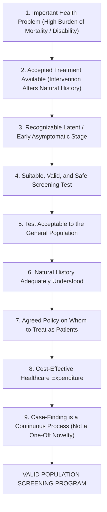

#### **The Modern Longevity Paradigm Shift:**
In 1968, screening was binary: did the patient have syphilis, tuberculosis, or cervical dysplasia? In the modern era of low-dose computed tomography ($\text{LDCT}$), multi-target stool DNA, coronary artery calcium ($\text{CAC}$) scoring, and whole-genome polygenic risk scores ($\text{PRS}$), the Wilson-Jungner criteria must be evaluated through the lens of **pre-clinical velocity and molecular reversibility**:
* We do not merely screen to detect established cancer; we screen to detect **advanced precancerous adenomas** (colorectal screening) or **high-grade cervical intraepithelial neoplasia** ($\text{CIN 2/3}$), removing the precursor lesion and completely aborting the carcinogenic cascade.
* We do not merely screen for acute coronary ischemia; we screen to quantify **subclinical calcified and non-calcified plaque burden** decades before luminal stenosis restricts coronary flow.

---

### **18.1.2 Bayes' Theorem, Pre-Test Probability & The Predictive Value Paradox**

The single greatest mathematical error committed by practicing clinicians is confusing the **Sensitivity of a test** with its **Positive Predictive Value ($\text{PPV}$)**:
* **Sensitivity ($P(\text{Test}^+ \mid \text{Disease}^+)$):** The intrinsic probability that a test is positive given that the patient truly has the disease.
* **Positive Predictive Value ($P(\text{Disease}^+ \mid \text{Test}^+)$):** The posterior probability that a patient who tests positive actually has the disease.

#### **Bayes' Theorem Formulation:**

$$\text{PPV} = \frac{\text{Sensitivity} \times \text{Prevalence}}{(\text{Sensitivity} \times \text{Prevalence}) + (1 - \text{Specificity}) \times (1 - \text{Prevalence})}$$

$$\text{NPV} = \frac{\text{Specificity} \times (1 - \text{Prevalence})}{(1 - \text{Sensitivity}) \times \text{Prevalence} + \text{Specificity} \times (1 - \text{Prevalence})}$$

#### **Likelihood Ratios and the Fagan Nomogram:**
The intrinsic discriminatory power of any screening test independent of prevalence is defined by its **Likelihood Ratios ($\text{LR}$)**:

$$\text{Positive Likelihood Ratio (LR+)} = \frac{\text{Sensitivity}}{1 - \text{Specificity}} = \frac{\text{True Positive Rate}}{\text{False Positive Rate}}$$

$$\text{Negative Likelihood Ratio (LR-)} = \frac{1 - \text{Sensitivity}}{\text{Specificity}} = \frac{\text{False Negative Rate}}{\text{True Negative Rate}}$$

$$\text{Pre-Test Odds} = \frac{\text{Prevalence}}{1 - \text{Prevalence}}$$

$$\text{Post-Test Odds} = \text{Pre-Test Odds} \times \text{Likelihood Ratio}$$

$$\text{Post-Test Probability} = \frac{\text{Post-Test Odds}}{\text{Post-Test Odds} + 1}$$

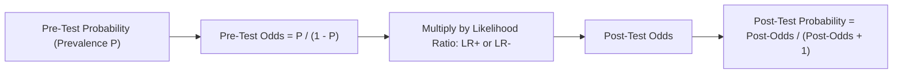

#### **The Disaster of Low Prevalence: The Real-World Mathematical Simulation**
Consider an advanced blood-based multi-cancer early detection ($\text{MCED}$) test advertised with an outstanding **$90.0\%$ Sensitivity** and an exceptional **$99.0\%$ Specificity** ($1.0\%$ false-positive rate).
A direct-to-consumer longevity clinic markets this test to asymptomatic 35-year-old adults, where the point prevalence of occult undiagnosed cancer is approximately **$1\text{ in }1,000$ ($P = 0.001$)**.

Watch the mathematics unfold across **100,000 screened individuals**:
* **True Cancers Present:** $100,000 \times 0.001 = \mathbf{100\ \text{patients}}$.
* **True Positives ($\text{TP}$):** $100 \times 0.90 = \mathbf{90\ \text{patients}}$ correctly identified.
* **False Negatives ($\text{FN}$):** $100 - 90 = \mathbf{10\ \text{patients}}$ missed.
* **Healthy Individuals:** $100,000 - 100 = \mathbf{99,900\ \text{individuals}}$.
* **False Positives ($\text{FP}$):** $99,900 \times (1 - 0.990) = \mathbf{999\ \text{healthy individuals}}$ falsely flagged as having cancer!

$$\text{Positive Predictive Value (PPV)} = \frac{\text{TP}}{\text{TP} + \text{FP}} = \frac{90}{90 + 999} = \frac{90}{1,089} \approx \mathbf{8.26\%}$$

**Ninety-two percent of every positive result is a terrifying false alarm!** For every single true cancer detected, eleven healthy 35-year-old individuals are plunged into psychological agony, subjected to whole-body CT scans, PET scans, bone marrow biopsies, colonoscopies, and endoscopies searching for an occult cancer that does not exist. 

This mathematical reality is why screening programs MUST be restricted to **target populations whose age, smoking history, or genetic profile establishes an adequately high pre-test probability**!

---

### **18.1.3 The Four Classic Screening Biases: Why Observational Studies Lie**

When an enthusiastic clinician publishes an observational study claiming that a new screening test "doubled 5-year survival rates," they are almost always falling victim to the **Four Classic Methodological Biases of Screening**:

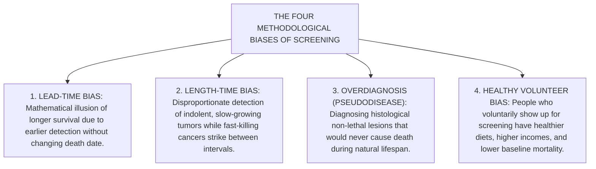

#### **1. Lead-Time Bias (The Zero-Sum Clock Illusion)**
* **The Mechanism:** Lead time is the period between early detection by a screening test and the time when the disease would have been detected clinically due to symptoms.
* **The Mathematical Deception:**
  * Imagine a patient develops an aggressive pancreatic adenocarcinoma at age 55.
  * In the **Unscreened Scenario**, symptoms (painless jaundice) appear at age 59, the cancer is diagnosed, and the patient dies at age 60. Survival from clinical diagnosis to death: **1 year**.
  * In the **Screened Scenario**, a novel full-body MRI catches the microscopic lesion at age 56. The patient is treated with surgery and chemotherapy, but the tumor recurs, and the patient dies at the exact same moment: **age 60**. Survival from screening diagnosis to death: **4 years**!
* The screening test did not add a single second of biological life to the patient; it merely added **three additional years of living as a cancer patient**! Any trial using "5-year survival from diagnosis" as an endpoint is fundamentally flawed. **The only uncorrupted endpoint for screening efficacy is Cause-Specific or All-Cause Mortality per 100,000 person-years.**

```
Unscreened:
  Biological Onset (Age 55) ──────→ Symptoms & Diagnosis (Age 59) ──→ Death (Age 60)
                                    [── 1-Year Survival ──]

Screened:
  Biological Onset (Age 55) ──→ Screen Diagnosis (Age 56) ──────────→ Death (Age 60)
                                [─────── 4-Year Survival (LEAD TIME!) ───────]
```

#### **2. Length-Time Bias (The Indolence Trap)**
* Tumors of the same histological type do not grow at the same biological rate. Some cancers have a doubling time of 20 days (highly aggressive, rapidly fatal); others have a doubling time of 800 days (indolent, slow-growing).
* A periodic screening test (e.g., mammogram every 2 years or colonoscopy every 10 years) acts like a net dipped into a river at long intervals.
* The indolent, slow-growing tumors reside in the asymptomatic, detectable preclinical phase for many years; the screening net catches nearly all of them.
* Conversely, the hyper-aggressive, rapid-growing tumors blitz through the preclinical phase in 4 months. They develop, cause symptoms, and kill the patient **entirely between screening rounds** (**Interval Cancers**).
* Consequently, screen-detected cohorts are disproportionately enriched with biologically benign, slow-growing tumors with inherently fantastic prognoses, creating the false impression that screening cure rates are exceptional!

#### **3. Overdiagnosis (Pseudodisease)**
* **Definition:** Overdiagnosis occurs when a screening test detects a histological abnormality that fulfills microscopic criteria for malignancy, but which would never have progressed to cause clinical symptoms or death during the patient's natural lifetime.
* **The Tragic Paradigms:**
  * **Papillary Thyroid Microcarcinoma:** Widespread neck ultrasound screening in South Korea increased thyroid cancer incidence by $1,500\%$ over two decades; yet thyroid cancer mortality remained dead flat! Thousands of healthy women underwent total thyroidectomy and lifelong levothyroxine replacement for indolent $4\text{-mm}$ nodules that would have stayed dormant forever.
  * **Prostate Cancer (Gleason 3+3 = 6):** Autopsy studies demonstrate that $> 60\%$ of men over age 80 who die of natural causes harbor microscopic prostate adenocarcinoma. Uncalibrated PSA screening led to radical prostatectomy in hundreds of thousands of men, leaving them with permanent urinary incontinence and erectile dysfunction for a pseudodisease.
  * **Ductal Carcinoma In Situ ($\text{DCIS}$):** Screen-detected DCIS represents up to $25\%$ of mammographic diagnoses; a significant proportion would never break through the basement membrane into invasive ductal carcinoma.

#### **4. Healthy Volunteer Bias**
* Individuals who proactively schedule colonoscopies, mammograms, and lipid panels are systematically wealthier, exercise more, smoke less, eat higher-fiber diets, and take medications with greater adherence than those who do not.
* Comparing mortality in individuals who chose to be screened versus those who did not introduces massive confounding. Only **Randomized Controlled Trials ($\text{RCTs}$)** with intention-to-screen analyses can eliminate this bias.

---

### **18.1.4 Number Needed to Screen (NNS) vs Number Needed to Treat (NNT)**

To communicate the true human reality of population screening, clinical scientists discard misleading **Relative Risk Reductions ($\text{RRR}$)** and report **Absolute Risk Reduction ($\text{ARR}$)** and **Number Needed to Screen ($\text{NNS}$)**:

$$\text{Absolute Risk Reduction (ARR)} = \text{Mortality}_{\text{Unscreened}} - \text{Mortality}_{\text{Screened}}$$

$$\text{Number Needed to Screen (NNS)} = \frac{1}{\text{ARR}}$$

#### **The Relative Risk Deception:**
* If a lung cancer screening trial shows that unselected LDCT drops 10-year lung cancer mortality from $0.50\%$ down to $0.40\%$:
  $$\text{Relative Risk Reduction (RRR)} = \frac{0.50\% - 0.40\%}{0.50\%} = \mathbf{20.0\%\ \text{Reduction!}}$$
  *(Marketed on clinic billboards: "New Screening Reduces Cancer Death by 20%!")*
* But examine the absolute reality:
  $$\text{Absolute Risk Reduction (ARR)} = 0.005 - 0.004 = 0.001\ (0.10\%)$$
  $$\text{Number Needed to Screen (NNS)} = \frac{1}{0.001} = \mathbf{1,000\ \text{People}}$$
* You must perform serial CT scans on **1,000 human beings** for ten years to save **one single life**, while hundreds endure false-positive biopsies, needle-induced pneumothoraces, and surgical lung wedge resections for benign hamartomas!

---

## **DOSSIER 18.2: CARDIOVASCULAR DISEASE PREVENTION, ATHEROSCLEROSIS STAGING & ADVANCED LIPIDS**

### **18.2.1 Atherosclerotic Pathophysiology: The ApoB Retention Hypothesis**

Atherosclerotic cardiovascular disease is not a passive plumbing problem where pipes "clog with fat"; it is an active, chronic, maladaptive immuno-inflammatory reaction driven by the retention of cholesterol-rich apolipoprotein B ($\text{ApoB}$) lipoproteins inside the arterial wall (*Tabas & Bornfeldt, Circulation Research*; *Goldstein & Brown Nobel lecture*):

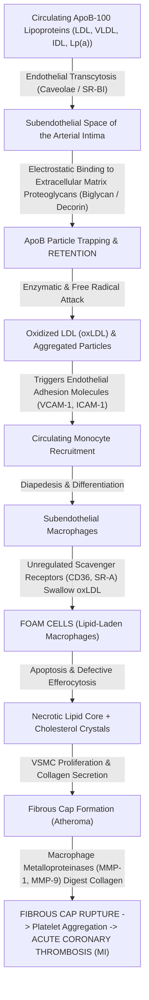

#### **The Core Insights of Modern Atherosclerosis Biology:**
1. **The Retention Step is Obligatory:** Endothelial injury is not required; ApoB particles enter the intima continuously via transcytosis. Positively charged basic amino acids (arginine and lysine residues) on the ApoB-100 outer protein shell form electrostatic bonds with negatively charged sulfate groups on glycosaminoglycans (biglycan and decorin) in the subendothelial matrix.
2. **Macrophage Scavenger Receptors Have No Feedback:** Unlike the standard LDL receptor ($\text{LDLR}$), which down-regulates its expression when intracellular cholesterol climbs, macrophage scavenger receptors (**CD36 and SR-A**) recognize oxidized ApoB particles and continue gorging on lipid indefinitely until the cell transforms into a pathological, dying **Foam Cell**.
3. **Plaque Rupture Dictates Mortality:** Myocardial infarction is not caused by slow, gradual 90% luminal narrowing (which provokes protective coronary collateralization); it is caused by the sudden rupture of a thin-cap fibroatheroma ($\text{TCFA}$) in a moderately stenotic ($40\%\text{–}60\%$) plaque, exposing tissue factor to circulating platelets and triggering occlusive intraluminal thrombosis within minutes!

---

### **18.2.2 Coronary Artery Calcium (CAC) Agatston Scoring Physics & Clinical Application**

As atherosclerotic plaques mature, macrophage foam cells undergo apoptosis, releasing free intracellular calcium that crystallizes into micro-calcifications resembling endochondral bone formation. Calcification occurs exclusively within atherosclerotic plaque; **there is zero calcium in a healthy coronary artery intima**.

#### **1. Computed Tomography Physics & Prospective ECG Gating**
To image calcified plaques in vessels moving at 80 beats per minute without motion blur, coronary calcium scans employ dedicated **prospective ECG-triggered non-contrast multidetector CT ($\text{MDCT}$)**:
* **The Acquisition Window:** The heart is relatively motionless during mid-to-late diastole. The CT scanner syncs to the patient's surface ECG R-wave, pulsing X-rays strictly during **$65\%\text{ to }75\%$ of the R-R interval**.
* **Scan Parameters:** $120\ \text{kVp}$ tube voltage, $2.5\text{ to }3.0\ \text{mm}$ reconstructed slice thickness, zero intravenous iodinated contrast.
* **Radiation Physics:** Because no contrast is needed and gating pulses intermittently, the radiation dose is minimal: **$< 1.0\ \text{mSv}$** (equivalent to roughly 10 chest X-rays, or the background environmental cosmic radiation received during 4 months on Earth).

#### **2. The Agatston Mathematical Algorithm**
Invented by cardiologist Arthur Agatston and radiologist Warren Janowitz in 1990, the **Agatston Score** quantifies both the area and the radiological density of coronary calcification:
* **Threshold Definition:** A coronary calcified lesion is defined as an area of at least **$\ge 1.0\ \text{mm}^2$** (or $\ge 3$ contiguous voxels) exhibiting a peak attenuation **$\ge 130\ \text{Hounsfield Units (HU)}$**.
* **Peak Attenuation Weighting Factors:**

$$\text{Density Weighting Factor} = 
\begin{cases} 
1 & \text{for peak attenuation } 130 - 199\ \text{HU} \\
2 & \text{for peak attenuation } 200 - 299\ \text{HU} \\
3 & \text{for peak attenuation } 300 - 399\ \text{HU} \\
4 & \text{for peak attenuation } \ge 400\ \text{HU}
\end{cases}$$

* **Calculation:**

$$\text{Lesion Score} = \text{Area in mm}^2 \times \text{Density Factor}$$

$$\mathbf{\text{Total Agatston Score} = \sum_{\text{All Slices}} (\text{Lesion Scores across LM, LAD, LCx, and RCA})}$$

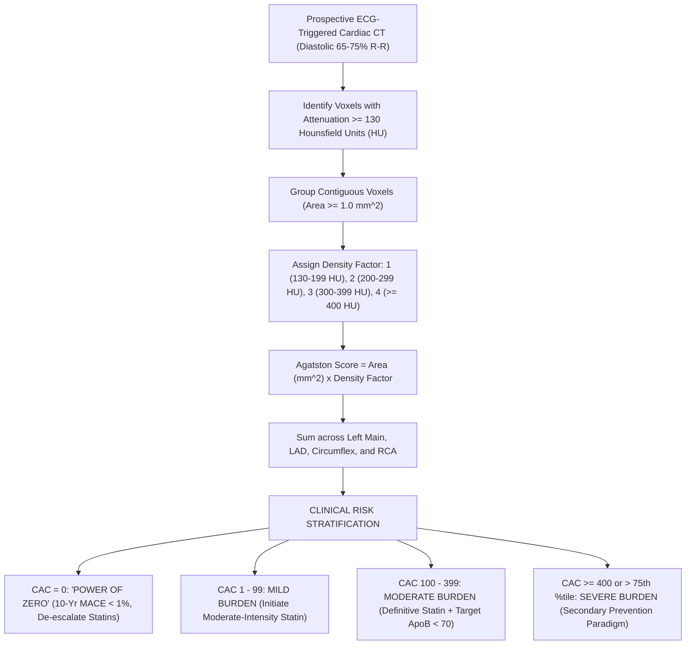

#### **3. Clinical Interpretation & Risk Stratification**

| Agatston Score | Plaque Burden Category | 10-Year ASCVD Event Rate | Clinical Management & Statin Architecture |
| :--- | :--- | :--- | :--- |
| **$\text{CAC} = 0$** | **No Identifiable Calcified Plaque** | **$< 1.0\% - 1.5\%$** | **"The Power of Zero":** Provides a 10-year "warranty period." Allows safe withholding or de-escalation of statin therapy in borderline/intermediate-risk individuals without diabetes or strong family history. |
| **$\text{CAC} = 1 - 99$** | **Mild Plaque Burden** | $3\% - 5\%$ | **Definitive Plaque Present:** Initiates moderate-intensity statin therapy (e.g., Atorvastatin $20\ \text{mg}$ or Rosuvastatin $10\ \text{mg}$). Re-evaluates lifestyle. |
| **$\text{CAC} = 100 - 399$** | **Moderate Plaque Burden** | $10\% - 15\%$ | High-intensity statin therapy indicated. Target $\text{LDL-C} < 70\ \text{mg/dL}$ ($\text{ApoB} < 70\ \text{mg/dL}$). Consider baby Aspirin ($81\ \text{mg/day}$). |
| **$\text{CAC} \ge 400$ OR $> 75^{\text{th}}$ percentile** | **Extensive, Severe Plaque Burden** | **$> 20\% - 25\%$ (Equivalent to Known Prior MI!)** | **Secondary Prevention Paradigm:** Maximal tolerated high-intensity statin + Ezetimibe (target $\text{LDL-C} < 55\ \text{mg/dL}$, $\text{ApoB} < 55\ \text{mg/dL}$); Daily Aspirin; Functional ischemia stress testing if symptoms present. |

#### **The Behind-the-Curtain Limitations of CAC:**
1. **The Soft Plaque Blindspot:** CAC measures only calcified plaque. A 42-year-old heavy smoker can harbor a large, inflamed, non-calcified lipid-rich soft plaque that has an Agatston score of $0$ but is on the verge of rupture! In symptomatic patients, CAC cannot rule out acute coronary syndrome.
2. **The Statin Paradox:** Statins actually **increase coronary artery calcium**! Statins extract lipid from the necrotic core and accelerate dense, crystalline micro-calcification of the fibrous cap, transforming unstable, rupture-prone soft plaques into stable, calcified scars. A post-statin increase in CAC reflects **plaque stabilization**, not disease failure! Therefore, **serial CAC scans should never be ordered to monitor statin efficacy**.

---

### **18.2.3 Advanced Lipid Testing: ApoB, Lipoprotein(a), and hs-CRP**

#### **1. Apolipoprotein B (ApoB): The True Particle Count**
For sixty years, medicine relied on **Calculated LDL Cholesterol ($\text{LDL-C}$)** derived via the Friedewald Equation:

$$\text{LDL-C}_{\text{Friedewald}} = \text{Total Cholesterol} - \text{HDL-C} - \frac{\text{Triglycerides}}{5}$$

* **The Friedewald Collapse:** The equation assumes a fixed $5:1$ ratio of triglycerides to cholesterol in VLDL particles. When serum triglycerides exceed $400\ \text{mg/dL}$ ($4.5\ \text{mmol/L}$) or when LDL-C is extremely low ($< 50\ \text{mg/dL}$), Friedewald breaks down completely, underestimating LDL-C by up to $40\ \text{mg/dL}$!
* **The Stoichiometry of Atherogenicity:** What enters the subendothelial space and causes disease is not a mass of cholesterol (measured in $\text{mg/dL}$), but the **number of circulating atherogenic particles**.
* Every single atherogenic lipoprotein particle—whether **$\text{LDL}$ ($90\%$), $\text{VLDL}$ ($8\%$), $\text{IDL}$ ($1\%$), or $\text{Lp(a)}$ ($1\%$)**—carries **exactly ONE single molecule of Apolipoprotein B-100 ($\text{ApoB-100}$)** wrapped around its surface:
  $$\mathbf{1\ \text{Particle} = 1\ \text{ApoB Molecule}}$$
* **The Discordance Phenomenon:** In patients with obesity, metabolic syndrome, insulin resistance, or hypertriglyceridemia, the liver secretes cholesterol-depleted, triglyceride-rich VLDL that undergoes intravascular remodeling into **Small, Dense LDL ($\text{sdLDL}$)**. Because each particle carries less cholesterol, LDL-C can read deceptively "normal" ($95\ \text{mg/dL}$), while total particle count ($\text{ApoB}$) is astronomically elevated ($135\ \text{mg/dL}$)—driving relentless plaque progression!
* **Measurement Engine:** Automated immunoturbidimetry or immunonephelometry using goat anti-human ApoB polyclonal antibodies. Fasting is NOT required.
* **Target Thresholds:**
  * Low Risk: $\text{ApoB} < 90\ \text{mg/dL}$ ($< 0.9\ \text{g/L}$).
  * High Risk / Secondary Prevention: $\mathbf{\text{ApoB} < 80\ \text{mg/dL}}$ ($\text{LDL-C} < 70\ \text{mg/dL}$).
  * Very High / Extreme Risk: $\mathbf{\text{ApoB} < 55\text{–}65\ \text{mg/dL}}$ ($\text{LDL-C} < 55\ \text{mg/dL}$).

---

#### **2. Lipoprotein(a) [Lp(a)]: The Once-in-a-Lifetime Genetic Ticking Time Bomb**
Lipoprotein(a) consists of an LDL-like core containing ApoB-100 covalently bound by a **single disulfide bridge** to a unique, heavily glycosylated, highly polymorphic glycoprotein: **Apolipoprotein(a) [Apo(a)]**.

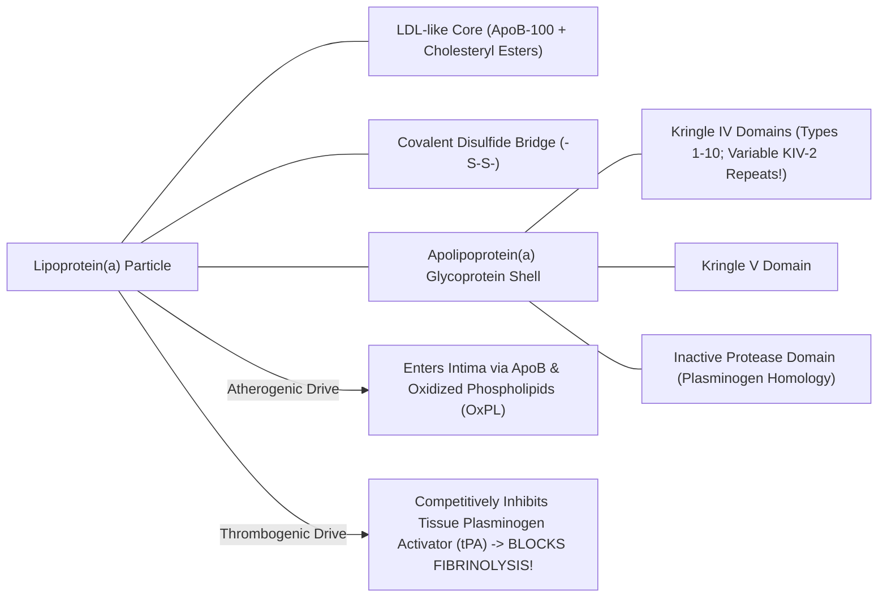

* **Pathophysiological Mechanisms:**
  1. **Accelerated Atherogenesis:** The ApoB core carries oxidized phospholipids ($\text{OxPL}$), triggering intense vascular inflammation.
  2. **Pro-Thrombotic / Anti-Fibrinolytic:** Apo(a) exhibits $> 80\%$ amino acid homology with human **Plasminogen**. It contains an inactive protease-like domain that binds fibrin, competitively displacing plasminogen and tissue plasminogen activator ($\text{tPA}$)—**physically blocking fibrinolysis and stabilizing acute occlusive coronary thrombi**!
  3. **Aortic Valve Calcification:** Lp(a) is the primary causal genetic risk factor for calcific aortic valve stenosis ($\text{CAVS}$).
* **Genetics & The KIV-2 Isoform Trap:**
  * Lp(a) concentrations are **$90\%\text{ genetically determined}$** by the *LPA* gene on chromosome 6q26–27.
  * The *LPA* gene contains an unstable copy number variation in **Kringle IV type 2 ($\text{KIV-2}$)** repeats, ranging from **$1\text{ to }> 40\text{ repeats}$**.
  * Individuals with few KIV-2 repeats produce a tiny Apo(a) protein that is synthesized and secreted rapidly by hepatocytes, leading to **astronomically high plasma Lp(a)**. Individuals with many KIV-2 repeats secrete low levels of a giant protein.
* **The Commercial Immunoassay Trap:**
  * Polyclonal antibody immunoassays that measure Lp(a) in mass units ($\text{mg/dL}$) use antibodies that bind to KIV-2 repeats. Because large isoforms contain 40 copies of KIV-2, antibodies bind repeatedly, **falsely overestimating large, low-risk isoforms**. In patients with small, lethal isoforms (few KIV-2 repeats), the assay **falsely underestimates the true particle count**!
  * **The Clinical Solution:** Elite laboratories measure Lp(a) using **Isoform-Insensitive Monoclonal Assays or LC-MS/MS calibrated strictly in molar units ($\text{nmol/L}$)**:
    $$\mathbf{\text{Normal: } < 75\ \text{nmol/L}\ (< 30\ \text{mg/dL})}$$
    $$\mathbf{\text{High Risk: } > 125\ \text{nmol/L}\ (> 50\ \text{mg/dL})}$$
* **Testing Frequency:** Because Lp(a) is genetically determined and does not fluctuate with diet or exercise, **Lp(a) should be measured AT LEAST ONCE IN A LIFETIME in every adult human being**.

---

#### **3. High-Sensitivity C-Reactive Protein (hs-CRP): Residual Inflammatory Risk**
* **Biology:** C-Reactive Protein is a homopentameric acute-phase reactant synthesized by the liver in response to circulating Interleukin-6 ($\text{IL-6}$) and Interleukin-1$\beta$ ($\text{IL-1}\beta$) produced by inflamed macrophage foam cells inside atherosclerotic plaques.
* **Analytical Engine:** Standard hospital CRP assays detect macro-inflammation ($> 10\ \text{mg/L}$) for sepsis. **High-Sensitivity CRP ($\text{hs-CRP}$)** employs latex particle-enhanced immunonephelometry capable of precise quantitation down to $0.1\ \text{mg/L}$.
* **Clinical Tiers (AHA/CDC Guidelines):**
  * **Low Risk:** $< 1.0\ \text{mg/L}$.
  * **Average Risk:** $1.0\text{ to }3.0\ \text{mg/L}$.
  * **High Residual Inflammatory Risk:** $> 3.0\ \text{mg/L}$.
  * *Exclusion Rule:* If $\text{hs-CRP} > 10.0\ \text{mg/L}$, the elevation is almost certainly driven by acute infection, trauma, or autoimmune flare. The test must be discarded and repeated in 3 weeks.
* **The Landmark CANTOS Trial:** Proved that targeting inflammatory pathways with canakinumab (anti-IL-1$\beta$ monoclonal antibody) significantly reduced major adverse cardiovascular events ($\text{MACE}$) independent of lipid lowering, proving inflammation is a direct causal driver of atherothrombosis.

---

*(Volume XVIII continues below with Colorectal Cancer Screening Mechanics, Lung/Breast/Cervical Evidence-Based Architecture, Metabolic Screening, and the Executive Full-Body Trap)*


---

## **DOSSIER 18.3: COLORECTAL CANCER SCREENING MECHANICS & NEXT-GENERATION LIQUID BIOPSY**

### **18.3.1 The Three Molecular Carcinogenic Pathways of the Colorectum**

Colorectal cancer ($\text{CRC}$) does not arise de novo from normal intestinal mucosa overnight; it develops through a decades-long accumulation of genetic mutations and epigenetic alterations known as the **Adenoma-to-Carcinoma Sequence** (*Fearon & Vogelstein landmark model*):


#### **1. The Classical Chromosomal Instability (CIN) Pathway (75% of Sporadic CRC):**
* **Step 1: Loss of *APC* ($5\text{q}21$):** Both alleles of the Adenomatous Polyposis Coli gene are inactivated, preventing phosphorylation and degradation of cytosolic $\beta\text{-catenin}$. Free $\beta\text{-catenin}$ translocates to the nucleus, binding TCF/LEF transcription factors to drive continuous crypt proliferation (Tubular Adenoma).
* **Step 2: Activating *KRAS* Mutation ($12\text{p}12$):** Codon 12 or 13 mutations lock the KRAS GTPase in a constitutively active state, driving growth factor-independent MAPK/ERK signaling.
* **Step 3: Inactivation of *SMAD4* ($18\text{q}$) and *TP53* ($17\text{p}$):** Loss of p53 eliminates DNA damage cell-cycle checkpoints and apoptosis, permitting aneuploidy and invasive carcinoma.
* **Temporal Horizon:** The transition from normal epithelium to invasive carcinoma takes **$10\text{ to }15\text{ years}$**, providing a vast asymptomatic window for endoscopic interception!

#### **2. The Microsatellite Instability (MSI) Pathway (15%):**
* Defective DNA Mismatch Repair ($\text{dMMR}$) through either germline mutations (**Lynch Syndrome**: *MLH1*, *MSH2*, *MSH6*, *PMS2*) or somatic epigenetic hypermethylation of the *MLH1* promoter.
* Failure to repair single-base mismatches and insertion-deletion loops creates hypermutated tumors with thousands of mutations, marked lymphocyte infiltration, and high sensitivity to immune checkpoint blockade (PD-1 inhibitors).

#### **3. The Serrated Neoplasia Pathway (15–20%):**
* Driven by activating **$\text{BRAF}^{\text{V600E}}$ mutations** coupled with the **CpG Island Methylator Phenotype ($\text{CIMP}$)**, causing widespread transcriptional silencing.
* Morphologically distinct: **Sessile Serrated Lesions ($\text{SSLs}$)** situated predominantly in the **right (proximal) colon**. They are flat, pale, covered by an adherent mucus cap, and lack the classical friable stalk of tubular adenomas, making them easy to miss during rapid colonoscopy withdrawal!

---

### **18.3.2 Colonoscopy: The Endoscopic Gold Standard & Quality Metrics**

Optical colonoscopy is the only screening modality that is simultaneously **diagnostic and curative**; it visualizes the entire mucosal surface from rectum to cecum and permits instant endoscopic resection of precancerous polyps.

#### **1. The Core Quality Metrics of Screening Colonoscopy**
A colonoscopy is only as effective as the endoscopist holding the scope. Clinical outcomes vary dramatically between practitioners:

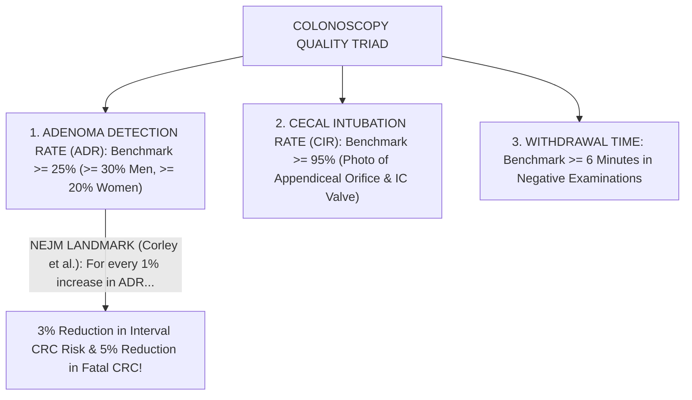

* **Adenoma Detection Rate ($\text{ADR}$):** The percentage of asymptomatic screening colonoscopies in patients age $\ge 50$ (or $\ge 45$) where at least one histologically confirmed adenoma or SSL is removed.
  $$\mathbf{\text{National Minimum ADR Benchmark: } \ge 25\%\ \text{Overall}\ (\ge 30\%\ \text{in Men},\ \ge 20\%\ \text{in Women})}$$
  * **The Landmark Corley NEJM Study (2014):** Evaluated $314,872$ colonoscopies performed by 136 gastroenterologists. For every **$1.0\%$ increase in an endoscopist's ADR**, the patient's hazard ratio for developing an interval cancer over the subsequent 10 years **decreased by $3.0\%$**, and the risk of **fatal colorectal cancer dropped by $5.0\%$**! An endoscopist with an ADR of $38\%$ provides vastly superior cancer prevention compared to one with an ADR of $18\%$.
* **Cecal Intubation Rate ($\text{CIR}$):** Visual confirmation that the scope entered the cecal caput and touched the ileocecal valve and appendiceal orifice ($\ge 95\%$ benchmark).
* **Withdrawal Time:** The duration spent inspecting the colonic mucosa while withdrawing the colonoscope from cecum to anus. Guidelines mandate a minimum inspection time of **$\ge 6\ \text{minutes}$** in examinations where no polyps are resected.

#### **2. Bowel Preparation Physics & The Boston Bowel Preparation Scale (BBPS)**
Fecal residue covers flat adenomas. A screening colonoscopy cannot be considered complete without validating adequate bowel cleansing using the **Boston Bowel Preparation Scale ($\text{BBPS}$)**:
* The colon is divided into three segments:
  1. **Right Colon** (Cecum and Ascending Colon);
  2. **Transverse Colon** (Hepatic to Splenic Flexure);
  3. **Left Colon** (Descending, Sigmoid, and Rectum).
* Each segment is scored from **$0\text{ to }3$** *after* washing and suctioning:
  * **Score 0:** Unprepared colon segment with mucosa not seen due to solid stool.
  * **Score 1:** Portion of mucosa seen, but other areas stained with residual liquid or stool.
  * **Score 2:** Minor residual staining or small liquid fragments, but mucosa well visualized.
  * **Score 3:** Entire mucosa of segment cleanly visualized with zero residual stool or liquid.
$$\mathbf{\text{Adequate Preparation Standard: Total BBPS } \ge 6\quad \text{AND}\quad \text{No Individual Segment } < 2}$$
If any segment scores $< 2$, the examination is inadequate; the patient must repeat the colonoscopy within **1 year** with an intensified prep regimen!

#### **3. Polypectomy Mechanics: Cold Snare vs EMR**
* **Diminutive Polyps ($< 5\ \text{mm}$) and Small Polyps ($6\text{–}9\ \text{mm}$):**
  * **Cold Snare Polypectomy ($\text{CSP}$):** The polyp and a $2\text{-mm}$ margin of normal mucosa are mechanically severed using a thin-wire snare without electrocautery.
  * *Why Cold Snare Won:* Electrocautery (hot biopsy forceps or hot snare) causes transmural thermal necrosis, deep tissue sloughing, post-polypectomy coagulation syndrome, and delayed arterial hemorrhage ($1\text{ to }2\%$). Cold snare relies on mechanical cutting, leaving the submucosal arterioles and muscularis propria intact, with near-$0\%$ perforation rate and $< 0.1\%$ bleeding rate!
* **Large Flat / Sessile Polyps ($\ge 20\ \text{mm}$):**
  * **Endoscopic Mucosal Resection ($\text{EMR}$):** Flat lesions cannot be ensnared directly. The endoscopist injects a submucosal cushion (saline mixed with **Methylene Blue** or **Indigo Carmine** and dilute epinephrine $1:100,000$) underneath the lesion. The fluid expands the submucosa, lifting the polyp away from the muscularis propria ("The Lift Sign") and creating a safe fluid safety barrier for snare electrocautery resection.

---

### **18.3.3 Non-Invasive Stool-Based Screening: FIT vs mt-sDNA**

For patients unwilling or unable to undergo screening colonoscopy, non-invasive stool tests provide validated alternative screening architectures.

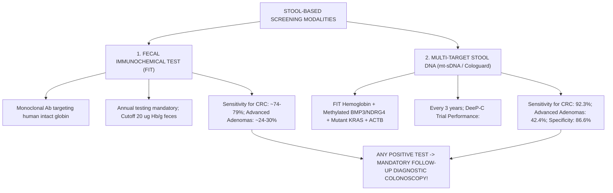

#### **1. Fecal Immunochemical Test (FIT)**
* **Mechanism:** Employs monoclonal antibodies directed against the **protein globin moiety of human hemoglobin**.
* **Why FIT Displaced Guaiac-based FOBT ($\text{gFOBT}$):**
  * Old guaiac tests detected the peroxidase activity of heme. Patients consuming red meat, broccoli, radishes, or vitamin C generated wild false positives and false negatives.
  * Crucially, human globin released from upper gastrointestinal bleeding (stomach, duodenum) is completely digested and degraded by gastric acid and pancreatic proteases (pepsin and chymotrypsin) during intestinal transit. Therefore, **FIT detects ONLY lower gastrointestinal bleeding**!
* **Threshold & Interval:** Standard automated quantitative cutoff: **$20\ \mu\text{g}\ \text{Hemoglobin per gram of feces}$**. Must be repeated **every 12 months**. Sensitivity for invasive CRC: $74\%\text{–}79\%$; sensitivity for advanced precancerous adenomas: $24\%\text{–}30\%$.

#### **2. Multi-Target Stool DNA (mt-sDNA / Cologuard)**
* **Biochemical Architecture:** Combines quantitative fecal immunochemical hemoglobin with molecular polymerase chain reaction ($\text{PCR}$) amplification of:
  1. **Aberrant DNA Methylation Markers:** Hypermethylated promoter regions of **$BMP3$** (Bone Morphogenetic Protein 3) and **$NDRG4$** (N-Myc Downstream-Regulated Gene 4);
  2. **Point Mutations:** Seven specific mutation hotspots in codon 12 and 13 of the **$KRAS$** oncogene;
  3. **Total Human DNA Reference:** **$\beta\text{-Actin}$ ($ACTB$)** quantitation to verify adequate exfoliated human enterocyte recovery.
* **The Landmark DeeP-C Trial ($9,989$ Patients, NEJM 2014):**
  * **Sensitivity for Colorectal Cancer:** **$92.3\%$** (superior to FIT's $73.8\%$, $p < 0.001$).
  * **Sensitivity for Advanced Precancerous Lesions:** **$42.4\%$** (superior to FIT's $23.8\%$).
  * **Specificity:** **$86.6\%$** in patients with normal colonoscopy (compared to $94.9\%$ for FIT).
* **Recommended Interval:** **Every 3 years**.
* **The Inflexible Clinical Law:** Any positive FIT or mt-sDNA test **MANDATES A FOLLOW-UP OPTICAL COLONOSCOPY**. A patient who receives a positive Cologuard and refuses colonoscopy has completely defeated the clinical screening program!

---

### **18.3.4 Blood-Based Cell-Free DNA (cfDNA) & Liquid Biopsies**

The frontier of colorectal screening is the detection of tumor-derived molecular signatures in peripheral blood:
* **Methylated *SEPT9* ($\text{mSEPT9}$ / Epi proColon):** An FDA-approved blood test monitoring hypermethylation of the Septin-9 promoter via real-time PCR. Sensitivity for CRC is $\sim 68\%\text{ to }72\%$, but sensitivity for advanced precancerous adenomas is poor ($< 15\text{ to }20\%$).
* **Multi-Cancer Early Detection ($\text{MCED}$) Liquid Biopsies (e.g., GRAIL Galleri):**
  * Utilizes targeted, bisulfite-free next-generation sequencing ($\text{NGS}$) to detect **cell-free DNA ($\text{cfDNA}$) methylation patterns** across $> 100,000$ informative genomic regions.
  * An artificial intelligence classifier detects the cancer signal and predicts the **Cancer Signal Origin ($\text{CSO}$)** with $> 85\%$ accuracy.
  * *The Stage Dependency Dilemma:* While overall specificity is high ($> 99.0\%$), analytical sensitivity correlates directly with tumor shed:
    * Stage I Malignancies: Sensitivity only **$16\%\text{ to }30\%$**;
    * Stage II: **$40\%\text{ to }60\%$**;
    * Stage III: **$70\%\text{ to }80\%$**;
    * Stage IV: **$> 90\%$**.
  * Liquid biopsy cannot yet substitute for optical colonoscopy or mammography because it misses the tiny, localized, surgically curable Stage I lesions that standard screening targets.

---

*(Volume XVIII continues below with Lung, Breast, and Cervical Cancer Screening Architecture, Metabolic Screening, and the Executive Full-Body Trap)*


---

## **DOSSIER 18.4: EVIDENCE-BASED SCREENING ARCHITECTURE FOR LUNG, BREAST, AND CERVICAL MALIGNANCIES**

### **18.4.1 Lung Cancer Screening: Low-Dose Computed Tomography (LDCT)**

Lung cancer remains the undisputed leading cause of cancer mortality worldwide, killing more individuals annually than colorectal, breast, and prostate malignancies combined. For fifty years, chest radiography (CXR) and sputum cytology failed to reduce lung cancer mortality because plain radiographs detect tumors only after they reach $1.5\text{ to }2.0\ \text{cm}$ and have established micro-metastases.

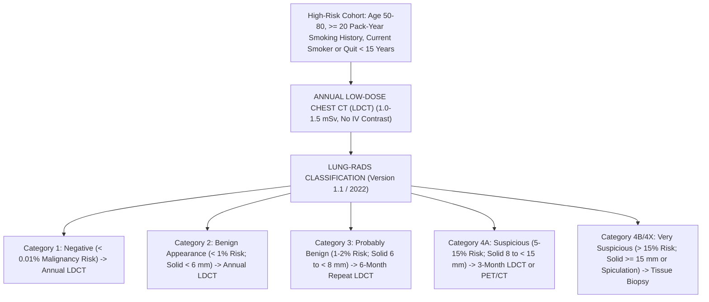

#### **1. The Landmark Clinical Trials: NLST and NELSON**
* **The National Lung Screening Trial ($\text{NLST}$, $53,454$ Participants, NEJM 2011):**
  * Randomized heavy smokers (aged 55–74 with $\ge 30$ pack-year history) to **Annual LDCT vs Chest X-Ray** for 3 consecutive years.
  * **Results:** LDCT produced a **$20.0\%$ relative reduction in lung cancer mortality** ($p = 0.004$) and an unprecedented **$6.7\%$ reduction in all-cause mortality** ($p = 0.02$)!
* **The Dutch-Belgian NELSON Trial ($15,792$ Participants, NEJM 2020):**
  * Utilized modern **CT Volumetric Nodule Management** (measuring volume in $\text{mm}^3$ and Volume Doubling Time [$\text{VDT}$] rather than simple 2D diameter).
  * **Results:** At 10 years, lung cancer mortality was reduced by **$24.0\%$ in men** and **$33\%\text{ to }59\%$ in women**, proving the definitive mortality benefit of volumetric screening.

#### **2. Eligibility Criteria (USPSTF 2021 Update)**
Screening with annual LDCT is recommended for individuals meeting **ALL THREE CRITERIA**:
1. **Age:** **$50\text{ to }80\ \text{years}$**;
2. **Cumulative Exposure:** **$\ge 20\ \text{pack-year}$ smoking history** ($\text{Pack-Years} = \text{Packs per day} \times \text{Years smoked}$);
3. **Current Status:** Currently smoke OR have **quit within the past 15 years**.
* *Discontinuation Criteria:* Screening terminates once a person turns 81, has been abstinent from smoking for $> 15\ \text{years}$, or develops a severe co-morbid illness that substantially limits life expectancy or ability to undergo curative lung resection.

#### **3. Radiation Physics of LDCT**
* Standard diagnostic chest CT delivers $7.0\text{ to }8.0\ \text{mSv}$ of radiation.
* **Low-Dose CT ($\text{LDCT}$):** Employs reduced tube current ($20\text{–}40\ \text{mAs}$) and lower tube potential ($100\text{–}120\ \text{kVp}$) coupled with advanced **iterative model reconstruction ($\text{IMR}$)** algorithms.
* **Effective Dose:** **$\sim 1.0\text{ to }1.5\ \text{mSv}$** (comparable to natural background radiation received over 6 months).

#### **4. The Lung-RADS Classification System (Version 1.1 / 2022)**

| Lung-RADS Category | Radiological Description | Estimated Malignancy Risk | Clinical Management Recommendation |
| :--- | :--- | :--- | :--- |
| **Category 1 (Negative)** | No lung nodules; purely calcified / benign granulomas | $< 0.01\%$ | Continue routine **Annual LDCT in 12 months** |
| **Category 2 (Benign Appearance)** | Solid nodule $< 6\ \text{mm}$; New solid $< 4\ \text{mm}$; Pure ground glass $< 30\ \text{mm}$ | $< 1.0\%$ | Continue routine **Annual LDCT in 12 months** |
| **Category 3 (Probably Benign)** | Solid nodule $\ge 6$ to $< 8\ \text{mm}$; New solid $4$ to $< 6\ \text{mm}$; Part-solid $\ge 6\ \text{mm}$ (solid component $< 6\ \text{mm}$) | $1.0\% - 2.0\%$ | **Short-Interval Repeat LDCT in 6 Months** |
| **Category 4A (Suspicious)** | Solid nodule $\ge 8$ to $< 15\ \text{mm}$; Growing nodule $< 8\ \text{mm}$; Part-solid with solid component $\ge 6$ to $< 8\ \text{mm}$ | $5.0\% - 15.0\%$ | **3-Month LDCT** OR **$\text{PET/CT}$** (if solid component $\ge 8\ \text{mm}$) |
| **Category 4B (Very Suspicious)** | Solid nodule $\ge 15\ \text{mm}$; New or growing solid component $\ge 8\ \text{mm}$ | **$> 15.0\%$** | **Diagnostic Chest CT with Contrast**, $\text{PET/CT}$, and **Tissue Biopsy** (Bronchoscopy / CT-guided) |
| **Category 4X (Suspicious + Features)**| Category 3 or 4 nodules with additional aggressive features (spiculation, lymphadenopathy) | **$> 15.0\%$** | Immediate multidisciplinary clinical evaluation |

---

### **18.4.2 Breast Cancer Screening: DBT vs FFDM, BI-RADS & Breast MRI**

Breast cancer screening is designed to detect localized, invasive ductal and lobular carcinomas before lymph node dissemination occurs.

#### **1. Full-Field Digital Mammography (FFDM) vs Digital Breast Tomosynthesis (3D DBT)**
* **The Tissue Overlap Limitation of 2D FFDM:** Standard 2D mammography projects a 3-dimensional biological breast onto a flat 2D detector plate. Overlapping dense glandular tissue creates false shadows that mimic tumors (false-positive recalls) or physically obscures small invasive cancers (false-negative misses).
* **3D Digital Breast Tomosynthesis ($\text{DBT}$):** The X-ray tube pivots in an arc ($15^\circ\text{ to }50^\circ$) across the compressed breast, capturing multiple low-dose projection images that are reconstructed into **$1.0\text{-mm}$ thin tomographic slices**:
  * **Clinical Advantages:** DBT eliminates tissue superposition, reducing patient recall rates by **$15\%\text{ to }20\%$** while simultaneously **increasing invasive cancer detection by $20\%\text{ to }40\%$**! DBT is now the standard of care for screening mammography.

#### **2. Breast Density & The Masking Effect**
Breast composition is categorized into four **BI-RADS Density Tiers**:
* **Density A:** Almost entirely fatty tissue ($< 10\%\text{ of women}$).
* **Density B:** Scattered areas of fibroglandular density ($40\%$).
* **Density C:** Heterogeneously dense ($40\%$).
* **Density D:** Extremely dense ($10\%$).
* **The Masking Trap:** Fat appears black (radiolucent) on X-rays, providing high contrast against white tumors. In contrast, fibroglandular tissue appears radiopaque (pure white)—the **exact same radiological density as breast carcinoma**! In extremely dense breasts (Density D), 2D mammographic sensitivity plummets from $> 90\%$ down to **$< 50\%$**, while dense breast tissue independently confers a **$4\times\text{ to }6\times$ higher lifetime risk of developing breast cancer**!

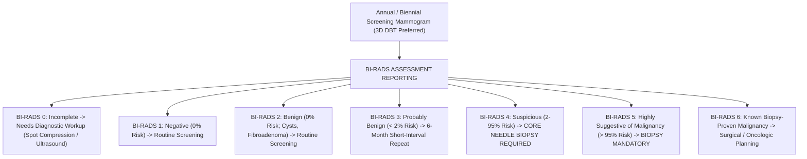

#### **3. Supplemental Screening with Dynamic Contrast-Enhanced Breast MRI (DCE-MRI)**
* **Mechanism:** Tumors overexpress Vascular Endothelial Growth Factor ($\text{VEGF}$), stimulating disorganized, hyper-permeable neo-vasculature. Following IV injection of **Gadolinium-based contrast**, malignant tumors exhibit rapid wash-in and wash-out kinetics.
* **Sensitivity:** **$> 90\%\text{ to }95\%$** for invasive cancer (immune to breast density).
* **Kinetic Enhancement Curves:**
  * **Type 1 Curve (Persistent):** Signal continuously climbs over time; strongly favors benign etiology.
  * **Type 2 Curve (Plateau):** Sharp early uptake followed by flat signal; intermediate risk.
  * **Type 3 Curve (Washout):** Rapid initial peak enhancement followed by rapid decline (washout); **pathognomonic hallmark of malignant neo-angiogenesis**!
* **Indications for Annual Screening Breast MRI:**
  1. Women with a **lifetime breast cancer risk $\ge 20\%\text{ to }25\%$** calculated by validated models (Tyrer-Cuzick / IBIS, Claus, or BRCAPRO);
  2. Documented pathogenic germline mutations in **$BRCA1$, $BRCA2$, $TP53$, $PTEN$, $PALB2$, $STK11$, or $CDH1$**;
  3. Women who received **mantle radiation therapy to the chest between ages 10 and 30** (e.g., for Hodgkin lymphoma).

---

### **18.4.3 Cervical Cancer Screening & HPV Molecular Diagnostics**

Cervical cancer is the triumph of modern preventive oncology: virtually $100\%$ of cases are driven by persistent infection with high-risk genotypes of the **Human Papillomavirus ($\text{hrHPV}$)**.

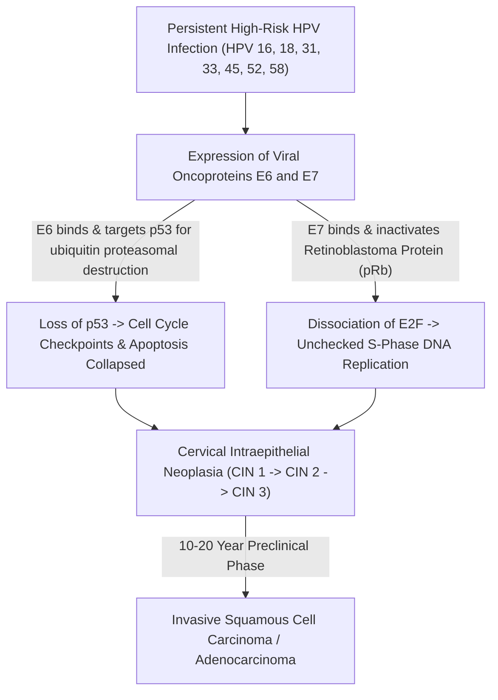

#### **1. Molecular Biology of hrHPV Oncogenesis**
* High-risk HPV genotypes **16 and 18** cause **$70\%$ of all invasive cervical cancers**; types 31, 33, 45, 52, and 58 cause another $20\%$.
* Following viral DNA integration into the human host genome, the viral E2 repressor gene is disrupted, driving uncontrolled transcription of two potent viral oncoproteins:
  * **Oncoprotein E6:** Forms a complex with host ubiquitin ligase ($\text{E6AP}$), binding and **targeting the tumor suppressor protein p53 for rapid proteasomal degradation**. The cell loses DNA damage arrest and apoptosis mechanisms.
  * **Oncoprotein E7:** Binds to the hypophosphorylated active form of the **Retinoblastoma Protein ($\text{pRb}$)**, displacing the transcription factor **E2F**. Free E2F drives constitutive transcription of cyclin-dependent kinases, forcing continuous entry into the S-phase of the cell cycle!

#### **2. Primary hrHPV DNA Testing vs Pap Cytology Guidelines**
* **Why Primary HPV Displaced the Pap Smear:** Conventional Pap cytology (even liquid-based ThinPrep) has an analytical sensitivity of only **$50\%\text{ to }65\%$** for high-grade cervical dysplasia ($\text{CIN 2/3}$). Automated real-time PCR or transcription-mediated amplification ($\text{TMA}$) targeting hrHPV DNA/RNA achieves **$> 95\%$ sensitivity**! A negative hrHPV test provides a 5-year reassurance period against cervical cancer.
* **Evidence-Based Screening Algorithms (USPSTF & ACS Guidelines):**
  * **Age 21–29 Years:** Cervical cytology (Pap smear) alone every 3 years. *(HPV testing is contraindicated in women $< 30$ because transient, self-clearing HPV infections are ubiquitous [$> 30\%$ prevalence], causing massive overtreatment!)*
  * **Age 30–65 Years (Three Valid Options):**
    1. **Primary hrHPV Testing Alone EVERY 5 YEARS (Preferred)**;
    2. **hrHPV + Pap Co-Testing EVERY 5 YEARS**;
    3. Cervical Cytology Alone EVERY 3 YEARS.
  * **Discontinuation:** Stop at age 65 if the patient has adequate prior negative screening (three consecutive negative Pap smears or two negative HPV tests within 10 years, with the most recent within 5 years).

#### **3. Reflex Colposcopy & The Schiller Test Behind the Curtain**
When screening flags high-risk HPV or abnormal cytology ($\text{ASC-US with hrHPV}^+$, $\text{LSIL}$, $\text{ASC-H}$, $\text{HSIL}$), the patient is referred for **Colposcopy**:
1. **Application of 3% to 5% Acetic Acid (Vinegar):**
   * Normal squamous epithelium contains abundant cytoplasm and low nuclear density; acetic acid has no visual effect.
   * Dysplastic cells ($\text{CIN 2/3}$ or cancer) have high nuclear-to-cytoplasmic ratios and hyper-chromatic nuclei with dense cytokeratin networks. Acetic acid induces reversible cellular dehydration and protein coagulation, causing light to scatter backwards $\implies$ **Dense Acetowhite Epithelium**!
   * The colposcopist looks for structural vascular abnormalities: **Punctation** (end-on views of intra-epithelial capillary loops) and **Mosaicism** (cobblestone pattern of capillaries encircling blocks of dysplastic cells).
2. **Lugol's Iodine (The Schiller Test):**
   * Normal, mature squamous epithelium is rich in intracellular **Glycogen**. Iodine reacts with glycogen to produce a deep, uniform **dark mahogany brown stain**.
   * Dysplastic cells lose intracellular glycogen synthesis. When swabbed with Lugol's iodine, dysplastic lesions **fail to stain, appearing bright canary yellow (Schiller-Positive)**, demarcating the exact boundaries for cervical loop electrosurgical excision ($\text{LEEP}$) or cold-knife conization!

---

## **DOSSIER 18.5: METABOLIC, BONE MINERAL HEALTH, AND THE EXECUTIVE FULL-BODY SCREENING DILEMMA**

### **18.5.1 Type 2 Diabetes Mellitus & Dysglycemia Screening**

Metabolic dysfunction accelerates both atherosclerotic plaque formation and malignant transformation via hyperinsulinemia, advanced glycation end-products ($\text{AGEs}$), and chronic low-grade inflammation.

#### **1. Diagnostic Cutoffs (ADA & WHO Standards)**

| Diagnostic Modality | Normal Homeostatic Range | Pre-Diabetes (Impaired Fasting / IGT) | Overt Diabetes Mellitus (Confirmed on 2nd Test) |
| :--- | :--- | :--- | :--- |
| **Fasting Plasma Glucose (FPG)** | $70\text{–}99\ \text{mg/dL}$ ($3.9\text{–}5.5\ \text{mmol/L}$) | **$100\text{–}125\ \text{mg/dL}$** ($5.6\text{–}6.9\ \text{mmol/L}$) | **$\ge 126\ \text{mg/dL}$** ($\ge 7.0\ \text{mmol/L}$) |
| **2-Hour 75-g Oral Glucose (OGTT)** | $< 140\ \text{mg/dL}$ ($< 7.8\ \text{mmol/L}$) | **$140\text{–}199\ \text{mg/dL}$** ($7.8\text{–}11.0\ \text{mmol/L}$) | **$\ge 200\ \text{mg/dL}$** ($\ge 11.1\ \text{mmol/L}$) |
| **Hemoglobin A1c ($\text{HbA1c}$)** | $< 5.7\%$ ($< 39\ \text{mmol/mol}$) | **$5.7\%\text{–}6.4\%$** ($39\text{–}46\ \text{mmol/mol}$) | **$\ge 6.5\%$** ($\ge 48\ \text{mmol/mol}$) |
| **Random Plasma Glucose** | N/A | N/A | **$\ge 200\ \text{mg/dL}$ + Symptoms of Hyperglycemia** |

#### **2. Analytical Requirements & Pitfalls of HbA1c**
* **The NGSP Standard:** Assays must be certified by the National Glycohemoglobin Standardization Program ($\text{NGSP}$) traceable to the Diabetes Control and Complications Trial ($\text{DCCT}$) reference method.
* **The Erythrocyte Lifespan Saboteur:** HbA1c measures the non-enzymatic glycation of the N-terminal valine on the $\beta\text{-chain}$ of hemoglobin over the normal **120-day lifespan of an erythrocyte**.
  * **Falsely Low HbA1c:** Conditions that shorten erythrocyte survival (**Hemolytic anemia, G6PD deficiency, Hemoglobinopathies [HbS, HbC, HbE], Splenomegaly, Blood transfusions, Erythropoietin therapy**) expose red cells to plasma glucose for fewer days, causing a **falsely depressed HbA1c** (e.g., printing $5.4\%$ in a patient whose average blood glucose is $220\ \text{mg/dL}$!). In these patients, the clinician must measure **Fructosamine** or **Glycated Albumin** ($2\text{-to-}3\text{ week}$ window).
  * **Falsely High HbA1c:** Conditions that extend erythrocyte survival (**Severe Iron Deficiency Anemia, Vitamin $\text{B}_{12}$/Folate deficiency, Splenectomy**) allow red cells to circulate for $140\text{ to }160\ \text{days}$, artificially accumulating more glycation and falsely elevating HbA1c.

---

### **18.5.2 Dual-Energy X-Ray Absorptiometry (DEXA) & Trabecular Bone Score (TBS)**

Osteoporosis is a silent systemic skeletal disorder characterized by low bone mass and microarchitectural deterioration of bone tissue, leading to devastating fragility fractures (hip, spine, wrist) that carry a **$20\%\text{ to }30\%$ one-year mortality rate following hip fracture in the elderly**.

#### **1. Dual-Energy X-Ray Physics: K-Edge Subtraction**
How does a DXA scanner measure the density of bone hidden beneath centimeters of variable muscle, adipose tissue, and visceral fat?

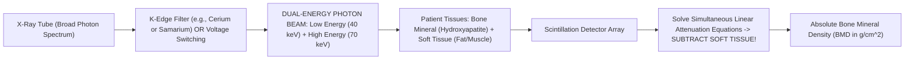

* **The Physics:** The attenuation of an X-ray beam through matter follows the Beer-Lambert law: $I = I_0 e^{-\mu x}$.
* Soft tissue and bone mineral have fundamentally different mass attenuation coefficients ($\mu$) that change differently across photon energy levels:
  * At **Low Energy ($40\ \text{keV}$)**, bone mineral (calcium hydroxyapatite, atomic number $Z \approx 13.8$) attenuates X-rays heavily via the **Photoelectric Effect** ($\mu \propto Z^3/E^3$).
  * At **High Energy ($70\text{–}100\ \text{keV}$)**, **Compton Scattering** dominates, and attenuation depends strictly on electron density.
* By pulsing X-rays through a **K-edge filter** (e.g., Samarium or Cerium) to split the beam into **$40\ \text{keV}$ and $70\ \text{keV}$ components**, the scanner's computer solves a system of two simultaneous equations with two unknowns (soft tissue mass and bone mass), **completely subtracting the soft tissue mass** to calculate:
  $$\mathbf{\text{Areal Bone Mineral Density (aBMD)} = \frac{\text{Bone Mineral Content (g)}}{\text{Projected Scan Area (cm}^2\text{)}}}\quad (\text{in g/cm}^2)$$

#### **2. T-Score vs Z-Score Mathematical Definitions**

$$\mathbf{\text{T-Score} = \frac{\text{BMD}_{\text{Patient}} - \text{Peak Mean Young Adult Reference BMD}}{\text{Young Adult Standard Deviation (SD)}}}$$

$$\mathbf{\text{Z-Score} = \frac{\text{BMD}_{\text{Patient}} - \text{Age- and Sex-Matched Mean BMD}}{\text{Age-Matched Standard Deviation (SD)}}}$$

* **WHO Diagnostic T-Score Criteria (Postmenopausal Women & Men $\ge 50$):**
  * **Normal Bone Density:** $\text{T-Score} \ge -1.0\ \text{SD}$.
  * **Osteopenia (Low Bone Mass):** $\text{T-Score}$ between **$-1.0$ and $-2.5\ \text{SD}$**.
  * **Osteoporosis:** **$\text{T-Score} \le -2.5\ \text{SD}$** (at Lumbar Spine L1–L4, Total Hip, or Femoral Neck).
  * **Severe (Established) Osteoporosis:** $\text{T-Score} \le -2.5\ \text{SD}$ **PLUS a documented fragility fracture**.
* **The Z-Score Threshold:** A $\text{Z-Score} \le -2.0\ \text{SD}$ is defined as "Below the expected range for age" and indicates **secondary osteoporosis** (Cushing's, hyperparathyroidism, celiac disease, multiple myeloma, hypogonadism).

#### **3. Anatomical Sites & The Lumbar Spine Artifact Trap**
* **Standard Scan Sites:** Lumbar Spine (L1–L4), Total Proximal Hip, and Femoral Neck. The $33\%\text{ Radius}$ (non-dominant forearm) is scanned in patients exceeding table weight limits, those with bilateral hip replacements, or in **Primary Hyperparathyroidism** (which preferentially degrades cortical bone).
* **The Degenerative Artifact Trap:** In elderly patients, degenerative disk disease, facet joint osteoarthritis, and aortic calcification deposit calcium right over the lumbar spine project plane. This **falsely inflates lumbar BMD**, giving an apparent normal T-score of $-0.2$ while the femoral neck is severely osteoporotic at $-2.9$! Clinicians must visually inspect the scan and exclude any vertebra whose T-score is $> 1.0\ \text{SD}$ higher than its adjacent neighbor.

#### **4. Trabecular Bone Score (TBS)**
* **Mechanism:** A gray-level variogram texture analysis software applied to the 2D projection DXA image of the lumbar spine.
* **Clinical Value:** Evaluates the **3-dimensional microarchitecture and connectivity of trabecular struts** independent of bone density. High TBS indicates dense, mechanically strong bone; low TBS indicates degraded, fractured struts with large empty spaces.
* **The Diabetic Paradox Solution:** Patients with Type 2 Diabetes have structurally fragile bone with high fracture rates, yet their DXA scans paradoxically print normal or elevated T-scores! TBS exposes this hidden structural degradation, providing accurate fracture risk calculation.

---

### **18.5.3 The "Executive Full-Body CT/MRI" Trap: A Preventive Medicine Critique**

In recent years, private commercial longevity clinics have heavily marketed **"Whole-Body Screening CT"** and **"Preventive Full-Body MRI"** ($2,500\text{ to }5,000\ \text{dollars}$ out-of-pocket) directly to consumers, promising that a single scan can "detect all diseases early."

From the perspective of academic preventive medicine and chemical pathology, **unselected full-body scanning in asymptomatic individuals is one of the most hazardous diagnostic interventions in medicine**:

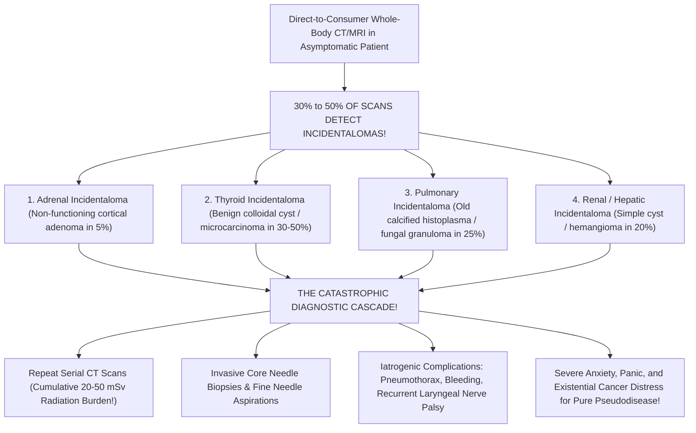

#### **The Evidence-Based Autopsy of the Full-Body Trap:**
1. **The Incidentaloma Flood ($30\%\text{ to }50\%$ Prevalence):**
   * Human biology is not geometrically uniform. High-resolution cross-sectional imaging reveals thousands of tiny anatomical variations: benign hepatic hemangiomas, asymptomatic renal cysts, non-functioning adrenal adenomas, thyroid nodules, and calcified pulmonary granulomas.
   * Because the pre-test probability of lethal cancer in an asymptomatic 40-year-old is infinitesimal, **$> 95\%$ of every discovered nodule is benign**.
2. **The Catastrophic Diagnostic Cascade:**
   * Once an "abnormal $9\text{-mm}$ indeterminate pulmonary nodule" or "$1.4\text{-cm}$ adrenal lesion" is printed on a radiology report, the physician cannot ignore it due to medicolegal liability.
   * The patient is thrust into a cascade: repeat high-dose contrast CTs at 3, 6, and 12 months; PET scans; CT-guided lung biopsies (carrying a $15\%\text{ to }20\%$ pneumothorax rate); or diagnostic laparoscopic adrenalectomies.
3. **The Ionizing Radiation Burden:**
   * A full-body screening CT delivers **$10\text{ to }20\ \text{mSv}$ of ionizing radiation** ($200\times$ a chest X-ray).
   * Epidemiological models from the National Research Council's BEIR VII report estimate that a single full-body CT in a 40-year-old confers a lifetime excess cancer mortality risk of **$1\text{ in }1,000$**—literally causing the very disease the patient paid to avoid!
4. **Zero Mortality Benefit:**
   * Not a single prospective randomized controlled trial has ever demonstrated that unselected full-body scanning reduces all-cause mortality, cardiovascular mortality, or cancer mortality in the general population.
   * Genuine preventive medicine does not perform random, uncalibrated fishing expeditions; it applies **targeted, calibrated screening directed at specific biological mechanisms with proven interventions**.

---

## **DOSSIER 18.6: MASTER SCREENING COMPENDIUM & EVIDENCE-BASED REFERENCE MATRIX**

### **18.6.1 The Master Preventive Screening Architecture Database**

| Disease Target | Target Population / Eligibility | Screening Modality | Recommended Frequency | High-Risk Escalation Triggers | Validated Stopping Age | Primary Evidence Grade |
| :--- | :--- | :--- | :--- | :--- | :--- | :--- |
| **Atherosclerotic CVD ($\text{ASCVD}$)** | Adults aged $40\text{–}75$ with borderline/intermediate risk ($7.5\%\text{–}20\%$ 10-yr risk) | **Coronary Artery Calcium ($\text{CAC}$) CT** + **ApoB & Lipid Panel** | Once for baseline CAC; Lipid panel every $3\text{–}5\ \text{yr}$ | $\text{CAC} \ge 100$ or $\text{ApoB} > 100 \implies$ High-intensity statin; $\text{CAC} \ge 400 \implies$ Secondary prevention | Age $75\text{–}80$ | **ACC/AHA Class IIa** |
| **Colorectal Cancer ($\text{CRC}$)** | Average-risk adults aged **$45\text{ to }75\ \text{years}$** | **Optical Colonoscopy** OR **FIT** OR **mt-sDNA (Cologuard)** | Colonoscopy **every 10 yr**; FIT **annual**; mt-sDNA **every 3 yr** | 1st-degree relative with CRC $< 60\ \text{yr} \implies$ Colonoscopy at age $40$ (or $10\ \text{yr}$ before index case), repeat every $5\ \text{yr}$ | Age $75$ routine; Individualize $76\text{–}85$; Stop $> 85$ | **USPSTF Grade A** |
| **Lung Carcinoma** | Adults aged **$50\text{ to }80\ \text{years}$** with **$\ge 20$ pack-year** smoking history | **Annual Low-Dose Chest CT ($\text{LDCT}$)** | **Every 12 Months** | Lung-RADS 3 $\implies$ 6-mo CT; Lung-RADS 4A $\implies$ 3-mo CT; 4B $\implies$ Biopsy | Cessation of smoking for $> 15\ \text{yr}$ OR Age 81 | **USPSTF Grade B** |
| **Breast Carcinoma** | Average-risk women aged **$40\text{ to }74\ \text{years}$** | **3D Digital Breast Tomosynthesis ($\text{DBT}$)** | **Biennial** (USPSTF) or **Annual** (ACS/ACR) | Lifetime risk $\ge 20\%$ by Tyrer-Cuzick OR *BRCA* mutation $\implies$ **Annual Breast MRI + DBT starting at age 25–30!** | Age $75$ (or life expectancy $< 10\ \text{yr}$) | **USPSTF Grade B** |
| **Cervical Carcinoma** | Women aged **$21\text{ to }29$** (Cytology) and **$30\text{ to }65$** (hrHPV) | **Primary High-Risk HPV ($\text{hrHPV}$)** OR **Cytology** | hrHPV **every 5 yr** (Ages $30\text{–}65$); Cytology **every 3 yr** (Ages $21\text{–}29$) | $\text{ASC-US with hrHPV}^+$ or $\text{HSIL} \implies$ Immediate Colposcopy + Directed Biopsy | Age $65$ if prior screens negative | **USPSTF Grade A** |
| **Osteoporosis** | Women aged **$\ge 65\ \text{years}$**; Men $\ge 70$; Younger with high risk | **Dual-Energy X-Ray Absorptiometry ($\text{DXA}$)** | Every **$2\text{ to }5\ \text{years}$** based on baseline T-score | T-score $\le -2.5$ or Fragility fracture $\implies$ Bisphosphonates / Denosumab / Teriparatide | None established | **USPSTF Grade B** |
| **Type 2 Diabetes** | Adults aged **$35\text{ to }70\ \text{years}$** who are overweight ($\text{BMI} \ge 25$) | **$\text{HbA1c}$** OR **Fasting Plasma Glucose** | **Every 3 Years** | Pre-diabetes ($\text{HbA1c } 5.7\text{–}6.4\%) \implies$ Annual testing + Intensive lifestyle/Metformin | Individualize based on health status | **USPSTF Grade B** |
| **Abdominal Aortic Aneurysm** | Men aged **$65\text{ to }75\ \text{years}$** who have **ever smoked ($\ge 100$ cigarettes)** | **Abdominal Duplex Ultrasound** | **Once in a Lifetime** | Aortic diameter $\ge 5.5\ \text{cm}$ (or expansion $> 1.0\ \text{cm/yr}$) $\implies$ Vascular surgical repair | Age 75 | **USPSTF Grade B** |

---

### **18.6.2 Biostatistical Formulas & Quality Summary**

$$\text{Sensitivity} = \frac{\text{TP}}{\text{TP} + \text{FN}}\qquad \text{Specificity} = \frac{\text{TN}}{\text{TN} + \text{FP}}$$

$$\text{PPV} = \frac{\text{TP}}{\text{TP} + \text{FP}}\qquad \text{NPV} = \frac{\text{TN}}{\text{TN} + \text{FN}}$$

$$\text{Positive Likelihood Ratio (LR+)} = \frac{\text{Sensitivity}}{1 - \text{Specificity}}\qquad \text{Negative Likelihood Ratio (LR-)} = \frac{1 - \text{Sensitivity}}{\text{Specificity}}$$

$$\text{Agatston Score} = \sum (\text{Plaque Area mm}^2 \times \text{Density Factor [1, 2, 3, or 4]})$$

$$\text{Selectivity Index (AVS)} = \frac{[\text{Cortisol}]_{\text{Adrenal Vein}}}{[\text{Cortisol}]_{\text{Peripheral Vein}}}\ge 3.0\text{–}5.0$$

$$\text{Lateralization Index (AVS)} = \frac{(\text{Aldo/Cort})_{\text{Dominant}}}{(\text{Aldo/Cort})_{\text{Non-Dominant}}} \ge 4.0$$

$$\text{Central-to-Peripheral Ratio (IPSS)} = \frac{[\text{ACTH}]_{\text{IPS}}}{[\text{ACTH}]_{\text{Peripheral}}} \ge 2.0\ (\text{Basal}) \text{ or } \ge 3.0\ (\text{Stimulated})$$


---

## **DOSSIER 18.7: ADVANCED LONGEVITY PHARMACOTHERAPY, POST-SCREENING SURVEILLANCE & CLINICAL CASE ARCHITECTURE**

### **18.7.1 Post-Polypectomy Colonoscopy Surveillance Intervals (US Multi-Society Task Force Guidelines)**

When a screening colonoscopy reveals polyps, the patient exits the 10-year general population screening track and enters the **Stratified Post-Polypectomy Surveillance Protocol**. The recall interval is strictly determined by polyp count, maximum size, and histological sub-classification (*Lieberman et al., USMSTF on Colorectal Cancer*):

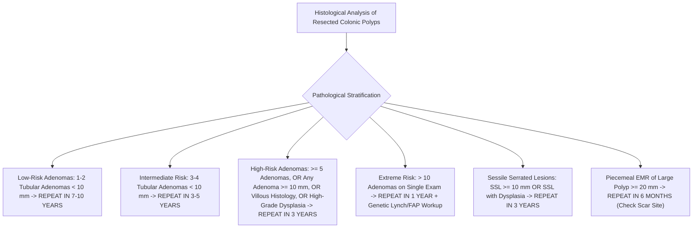

| Baseline Colonoscopy Histological Findings | USMSTF Risk Classification | Recommended Surveillance Interval | Critical Clinical Rationale |
| :--- | :--- | :--- | :--- |
| **Normal Examination (No Polyps) OR Diminutive Hyperplastic Polyps in Rectum/Sigmoid ONLY** | Average Population Risk | **10 Years** | Distal hyperplastic polyps $< 10\ \text{mm}$ have zero malignant potential. |
| **$1\text{ to }2$ Tubular Adenomas, each $< 10\ \text{mm}$** | Low-Risk Adenoma ($\text{LRA}$) | **$7\text{ to }10\ \text{Years}$** | 10-year incidence of advanced neoplasia is identical to patients with normal baseline colonoscopy. |
| **$3\text{ to }4$ Tubular Adenomas, each $< 10\ \text{mm}$** | Intermediate Risk | **$3\text{ to }5\ \text{Years}$** | Accelerated multi-focal adenoma formation rate. |
| **$5\text{ to }10$ Tubular Adenomas, each $< 10\ \text{mm}$** | High-Risk Adenoma ($\text{HRA}$) | **3 Years** | Marked lifetime risk of subsequent advanced metachronous neoplasia. |
| **Any Adenoma $\ge 10\ \text{mm}$ in diameter** | High-Risk Adenoma ($\text{HRA}$) | **3 Years** | Polyps $\ge 10\ \text{mm}$ harbor a $10\%\text{ to }20\%$ prevalence of invasive or micro-invasive carcinoma. |
| **Any Adenoma with Villous Histology ($\ge 25\%$ Villous Component)** | High-Risk Adenoma ($\text{HRA}$) | **3 Years** | Villous finger-like fronds carry $3\times$ higher progression velocity than tubular architecture. |
| **Any Adenoma with High-Grade Dysplasia ($\text{HGD}$)** | High-Risk Adenoma ($\text{HRA}$) | **3 Years** | Represents intraepithelial neoplasia on the verge of basement membrane invasion. |
| **$> 10$ Adenomas on a single examination** | Severe Adenomatous Burden | **1 Year** | High suspicion for Attenuated Familial Adenomatous Polyposis ($\text{AFAP}$) or *MUTYH*-Associated Polyposis ($\text{MAP}$). Order germline genetics. |
| **$1\text{ to }2$ Sessile Serrated Lesions ($\text{SSL}$), each $< 10\ \text{mm}$** | Low-Risk Serrated | **$5\text{ to }10\ \text{Years}$** | Low short-term progression risk if complete cold-snare resection achieved. |
| **$\text{SSL} \ge 10\ \text{mm}$ OR $\text{SSL}$ with Cytological Dysplasia** | High-Risk Serrated | **3 Years** | Rapid progression via the serrated BRAF/CIMP methylation pathway. |
| **Piecemeal Resection of Large Adenoma or $\text{SSL} \ge 20\ \text{mm}$** | Incomplete Resection Risk | **6 Months** | Mandatory endoscopic inspection and scar biopsy to rule out residual neoplastic rim. |

---

### **18.7.2 Advanced Longevity Lipidology: Beyond Conventional Statins**

When screening unmasks high ApoB ($> 80\text{–}100\ \text{mg/dL}$), elevated Lp(a) ($> 125\ \text{nmol/L}$), or non-zero CAC in a patient seeking maximum cardiovascular healthspan, modern preventive cardiology deploys a targeted pharmacological hierarchy:

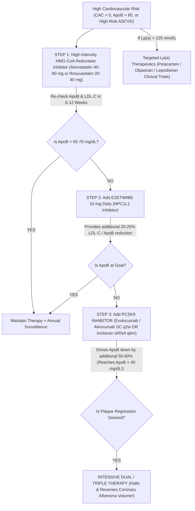

#### **1. Step 1: High-Intensity Statins (HMG-CoA Reductase Inhibition)**
* **Mechanism:** Competitively inhibits 3-hydroxy-3-methylglutaryl-coenzyme A ($\text{HMG-CoA}$) reductase, the rate-limiting step in hepatocyte cholesterol biosynthesis.
* **Secondary Feedback:** Depleted intracellular cholesterol triggers sterol regulatory element-binding protein 2 ($\text{SREBP-2}$) translocation to the nucleus, upregulating **cell-surface LDL Receptors ($\text{LDLR}$)**. Increased receptor clearance clears ApoB and LDL particles from the bloodstream by $50\%\text{ to }60\%$.
* **Pleiotropic Effects:** Enhances endothelial nitric oxide synthase ($\text{eNOS}$), stabilizes fibrous caps via macrophage matrix metalloproteinase inhibition, and reduces systemic vascular inflammation.

#### **2. Step 2: Ezetimibe (NPC1L1 Inhibition)**
* **Mechanism:** Selectively binds and inhibits the **Niemann-Pick C1-Like 1 ($\text{NPC1L1}$) transporter** located on the apical brush border of enterocytes in the small intestine.
* **Biochemical Impact:** Blocks intestinal absorption of both dietary and biliary cholesterol by $> 50\%$.
* **Synergy with Statins:** When hepatocytes are blocked from synthesizing cholesterol (statin) AND blocked from recycling biliary cholesterol (ezetimibe), hepatic LDL receptors are hyper-induced, yielding an **additional $20\%\text{ to }25\%$ reduction in ApoB and LDL-C** with virtually zero systemic side effects (*IMPROVE-IT landmark trial*).

#### **3. Step 3: PCSK9 Monoclonal Antibodies & siRNA Technology**
* **The PCSK9 Degradation Cycle:** Proprotein Convertase Subtilisin/Kexin Type 9 ($\text{PCSK9}$) is a circulating serine protease secreted by the liver. When an LDL particle binds to an LDL receptor, circulating PCSK9 binds to the extracellular domain of the LDLR. During clathrin-coated endocytosis, the bound PCSK9 prevents the normal acidic dissociation of the receptor in the endosome, routing the **LDL receptor directly to the lysosome for irreversible destruction**!
* **Monoclonal Antibodies (Evolocumab & Alirocumab):** Fully human monoclonal antibodies bind free circulating PCSK9 with picomolar affinity, preventing it from binding LDLR. Liberated LDL receptors are spared from lysosomal degradation and recycle back to the hepatocyte surface up to **150 times**, purging ApoB from circulation and dropping LDL-C by **$50\%\text{ to }65\%$** (*FOURIER and ODYSSEY OUTCOMES trials*)!
* **siRNA Gene Silencing (Inclisiran):** A chemically synthesized small interfering RNA ($\text{siRNA}$) conjugated to triantennary N-acetylgalactosamine ($\text{GalNAc}$), which binds specifically to asialoglycoprotein receptors on hepatocytes. Inside the hepatocyte cytoplasm, inclisiran loads into the **RNA-Induced Silencing Complex ($\text{RISC}$)**, cleaving *PCSK9* messenger RNA with surgical precision. Administered subcutaneously once every **6 months**, it provides sustained $> 50\%$ ApoB reduction.

#### **4. Emerging Therapeutics for Elevated Lipoprotein(a)**
Standard statins do not lower Lp(a); in fact, statins can increase Lp(a) by $10\%\text{ to }20\%$ via transcriptional activation of the *LPA* promoter! Specific targeted RNA therapeutics are currently transforming longevity cardiology:
* **Pelacarsen:** An antisense oligonucleotide ($\text{ASO}$) targeting *Apo(a)* mRNA in hepatocytes, lowering plasma Lp(a) by **$70\%\text{ to }80\%$**.
* **Olpasiran & Lepodisiran:** Long-acting GalNAc-conjugated siRNAs targeting *LPA* transcripts, delivering **$> 95\%$ sustained reduction in circulating Lp(a)** with dosing intervals up to once every six months (*OCEAN(a) and ALPACAR clinical trial programs*).

---

### **18.7.3 Technical Calibration Physics: DEXA European Spine Phantom & TBS Thresholds**

To ensure that bone mineral density results are comparable across different medical centers and over decades of patient follow-up, medical physicists perform strict machine cross-calibration.

#### **1. The European Spine Phantom (ESP) Quality Control Standard**
* DXA scanners (manufactured primarily by **Hologic** [pulsed dual-energy 100/140 kVp] and **GE Lunar** [K-edge filtered dual-energy 40/70 keV]) employ different physical X-ray spectrums and edge-detection edge algorithms.
* To calibrate scanners, medical physicists image the **European Spine Phantom ($\text{ESP}$)**—a standardized semi-anthropomorphic epoxy phantom containing three vertebrae with precisely machined hydroxyapatite inserts representing:
  * L1: Low BMD ($0.50\ \text{g/cm}^2$);
  * L2: Medium BMD ($1.00\ \text{g/cm}^2$);
  * L3: High BMD ($1.50\ \text{g/cm}^2$).
* **Cross-Calibration Formula:** If a patient switches from a Hologic scanner to a GE Lunar scanner, raw $\text{g/cm}^2$ values cannot be compared directly! Clinicians must apply standardized BMD ($\text{sBMD}$) conversion formulas:

$$\text{sBMD}_{\text{Hologic}} = 1.0536 \times (\text{BMD}_{\text{Hologic}} - 0.0019)$$

$$\text{sBMD}_{\text{GE Lunar}} = 0.9683 \times \text{BMD}_{\text{Lunar}}$$

#### **2. Trabecular Bone Score (TBS) Diagnostic Reference Thresholds**
While areal BMD reflects the quantity of hydroxyapatite, the **Trabecular Bone Score ($\text{TBS}$)** assesses textural microarchitecture:

$$\text{TBS} = \text{Variogram Slope Analysis of Projected DXA Gray-Level Differences}$$

* **Normal Microarchitecture:** $\mathbf{\text{TBS} \ge 1.310}$. Indicates dense, intact, mechanically resilient trabecular network; low independent fracture risk.
* **Partially Degraded Microarchitecture:** $\mathbf{\text{TBS between } 1.230\ \text{and } 1.310}$. Intermediate fracture risk; warrants fracture risk enhancement calculations via the FRAX-TBS algorithm.
* **Degraded Microarchitecture:** $\mathbf{\text{TBS} < 1.230}$. Severe microarchitectural fragmentation, porous trabecular plates, and elevated fragility fracture risk independent of bone mineral density!

---

### **18.7.4 Comprehensive Screening Case Studies: Putting the Math to Work**

#### **Case Study 1: The Asymptomatic Executive with High ApoB and Zero Calcium**
* **Patient:** 44-year-old male entrepreneur presents for an executive longevity evaluation. Non-smoker, $\text{BP } 128/82\ \text{mmHg}$, $\text{BMI } 27.2\ \text{kg/m}^2$.
* **Advanced Biomarkers:**
  * Total Cholesterol $= 224\ \text{mg/dL}$; $\text{HDL-C} = 42\ \text{mg/dL}$; Triglycerides $= 210\ \text{mg/dL}$.
  * Calculated $\text{LDL-C} = 140\ \text{mg/dL}$.
  * **$\text{ApoB} = 122\ \text{mg/dL}$** (Severely elevated; $> 90^{\text{th}}$ percentile!).
  * **$\text{Lp(a)} = 22\ \text{nmol/L}$** (Normal, $< 75\ \text{nmol/L}$).
  * $\text{hs-CRP} = 1.1\ \text{mg/L}$ (Low-average).
  * **Coronary Artery Calcium (CAC) CT:** **$\text{Agatston Score} = \mathbf{0}$**.
* **Clinical Dilemma:** The patient's primary care doctor wants to withhold statin therapy because the CAC is $0$ ("The Power of Zero"). Is this correct?
* **Behind-the-Curtain Longevity Resolution:**
  * **No!** CAC $= 0$ confirms the absence of *calcified* plaque, providing a low 5-year event horizon. However, the patient is 44 years old. Plaque takes 15 to 20 years to calcify!
  * With an $\text{ApoB}$ of $122\ \text{mg/dL}$, the patient is bathing his subendothelial matrix in millions of atherogenic particles every single day. Waiting for the CAC to turn positive is waiting for irreversible arterial injury to occur!
  * **Action:** Initiate moderate-intensity statin + ezetimibe to drive $\text{ApoB} < 70\ \text{mg/dL}$, permanently arresting the retention of atherogenic lipoproteins and preserving his CAC at zero for the next thirty years.

#### **Case Study 2: The Multi-Cancer Early Detection (MCED) False Alarm Nightmare**
* **Patient:** 38-year-old female marathon runner pays $\$1,200$ out-of-pocket for a commercial multi-cancer cell-free DNA methylation blood test.
* **Result:** **"CANCER SIGNAL DETECTED — Predicted Origin: PANCREAS / GALLBLADDER."**
* **The Panic:** The patient is referred to an emergency oncology clinic in acute psychological distress, convinced she has fatal pancreatic cancer.
* **The Bayesian Calculation:**
  * Pre-test prevalence of pancreatic cancer in an asymptomatic 38-year-old female: $P \approx 1\text{ in }50,000 = 0.00002$.
  * Test Specificity $= 99.5\%$ ($1 - \text{Specificity} = 0.005$).
  * Test Sensitivity for Stage I/II pancreatic cancer $\approx 60\%$ ($0.60$).
  * **Calculate Positive Predictive Value ($\text{PPV}$):**

$$\text{PPV} = \frac{0.60 \times 0.00002}{(0.60 \times 0.00002) + (0.005 \times 0.99998)} = \frac{0.000012}{0.000012 + 0.00500} = \frac{0.000012}{0.005012} \approx \mathbf{0.24\%}$$

* **The Reality:** **There is a $99.76\%$ probability that this result is a FALSE POSITIVE!**
* **Diagnostic Workup:** Thin-slice pancreatic protocol contrast CT of the abdomen and high-resolution Endoscopic Ultrasound ($\text{EUS}$) of the pancreas are performed, showing a completely normal, healthy pancreas. The patient is spared an exploratory diagnostic laparoscopy and reassured after profound, unnecessary iatrogenic psychological trauma. This case embodies why screening tests without pre-test calibration cause immense harm.
