# **BASIC MEDICAL — BEHIND THE CURTAIN CLINICAL DIAGNOSTICS NOTEBOOK**
## **VOLUME XVII: ENDOCRINOLOGY DYNAMIC TESTING, CLINICAL MASS SPECTROMETRY (`LC-MS/MS`), AND ADRENAL VEIN SAMPLING (`AVS`)**

> *"In routine clinical pathology, measuring a concentration is a static photograph of an open reservoir: fifty milligrams per deciliter of urea tells you what has accumulated, and four grams per deciliter of albumin reflects hepatic synthetic reserve over twenty days. But the endocrine system is not an open reservoir; it is a high-speed, closed-loop, frequency-modulated cybernetic control circuit governed by ultradian neural oscillators, circadian pacemakers, and negative-feedback servomechanisms. Demanding to know whether a patient has Cushing's disease, Addison's disease, Conn's adenoma, or pheochromocytoma from a random Tuesday morning venipuncture is like trying to diagnose an intermittent transmission slip in a Formula One racing engine by measuring the oil level while the car is parked in the garage with the ignition turned off. To diagnose endocrine pathology, you must kick the system. You must inject a pharmacological hammer—dexamethasone, cosyntropin, captopril, clonidine, hypertonic saline, or ovine CRH—and measure the trajectory, velocity, and deceleration of the hormone's response across time. And when antibodies are deceived by synthetic steroids, autoantibodies, or circulating binding proteins, we abandon immunochemistry altogether, vaporizing the sample inside an electrospray ionization source and tracking individual molecular fragments through triple-quadrupole mass spectrometers."*

---

### **Executive Orientation: The Dynamic Paradigm & The Analytical Frontier**

Clinical endocrinology is the most analytically demanding subspecialty in internal medicine. More than any other organ system, the endocrine axes resist simplistic, static point-in-time assessment. A single basal serum cortisol of $16\ \mu\text{g/dL}$ ($440\ \text{nmol/L}$) at 09:00 can represent:
1. A perfectly normal healthy individual mounting a physiological awakening response;
2. A critically ill patient in septic shock suffering relative adrenal insufficiency who should be generating $45\ \mu\text{g/dL}$;
3. A patient with severe Cushing's disease whose nadir never falls below $14\ \mu\text{g/dL}$;
4. A healthy woman on oral contraceptive pills whose elevated Corticosteroid-Binding Globulin ($\text{CBG}$) creates a total cortisol of $28\ \mu\text{g/dL}$ with a perfectly normal free fraction.

To eliminate this ambiguity, clinical chemical pathology relies on three intertwined diagnostic engines:
* **Dynamic Endocrine Provocation and Suppression Testing:** Driving physiological axes to their functional limits to unmask autonomous hypersecretion (suppression testing) or reserve depletion (stimulation testing).
* **Isotope-Dilution Liquid Chromatography–Tandem Mass Spectrometry ($\text{LC-MS/MS}$):** Physical separation of isobaric steroids and amines followed by tandem mass filtering, completely bypassing the cross-reactivity, hook effects, and autoantibody interferences that plague immunoassay platforms.
* **Super-Selective Interventional Endocrine Catheterization:** Navigating micro-catheters into petrosal sinuses ($\text{IPSS}$) and hair-thin adrenal veins ($\text{AVS}$) to sample micro-circulatory gradients before systemic hepatic and peripheral dilution erases hormonal lateralization.

---

## **DOSSIER 17.1: THE PHYSIOLOGY OF DYNAMIC TESTING — PULSATILITY, DIURNAL OSCILLATIONS, AND BINDING GLOBULIN TRAPS**

### **17.1.1 Why Single Basal Measurements Fail: Ultradian and Circadian Rhythmicity**

The hypothalamic-pituitary-end-organ architecture does not secrete hormones in a smooth, continuous laminar stream. Secretion occurs in discrete, high-amplitude bursts driven by hypothalamic pulse generators:

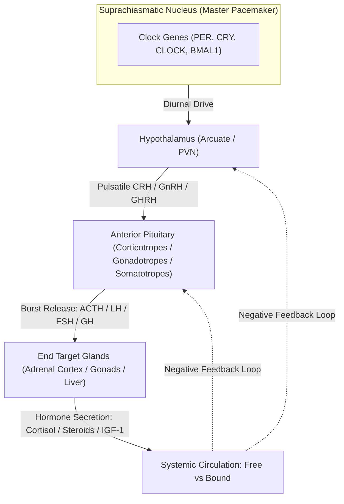

#### **1. The Hypothalamic-Pituitary-Adrenal (HPA) Axis**
* **Circadian Rhythm:** Driven by the central pacemaker in the suprachiasmatic nucleus ($\text{SCN}$) via the paraventricular nucleus ($\text{PVN}$) of the hypothalamus. Corticotropin-Releasing Hormone ($\text{CRH}$) and Arginine Vasopressin ($\text{AVP}$) stimulate pituitary corticotropes to release Adrenocorticotropic Hormone ($\text{ACTH}$).
* **Temporal Dynamics:** ACTH and cortisol exhibit a dramatic diurnal oscillation. Plasma ACTH begins climbing around 03:00 to 04:00, peaking between 07:00 and 09:00 ($\text{Cortisol}: 10\text{–}20\ \mu\text{g/dL}$ / $275\text{–}550\ \text{nmol/L}$). Levels progressively decline throughout the day, reaching an absolute physiological nadir between 23:00 and 01:00 ($\text{Cortisol} < 1.8\text{–}3.0\ \mu\text{g/dL}$ / $< 50\text{–}83\ \text{nmol/L}$).
* **Ultradian Burst Pattern:** Superimposed upon this circadian curve are $15\text{ to }18$ discrete ultradian secretory pulses per 24 hours, occurring roughly every $60\text{ to }90$ minutes. During a secretory burst, serum cortisol can spike by $8\text{ to }12\ \mu\text{g/dL}$ within twenty minutes and plummet rapidly as cortisol distributes ($t_{1/2} \approx 60\text{–}90\text{ minutes}$).
* **Clinical Consequence:** A single random morning cortisol can catch the peak of an ultradian pulse in an Addisonian patient or the valley of a pulse in a healthy individual. Conversely, an elevated morning cortisol has almost zero positive predictive value for Cushing's syndrome because acute psychological stress, venipuncture fear, or awakening shifts can triple cortisol output in minutes!

#### **2. The Somatotropic (Growth Hormone) Axis**
* **The Ultradian Bursts of GH:** Pituitary somatotropes release Growth Hormone ($\text{GH}$) in sharp, explosive pulses primarily during slow-wave (Stage N3) sleep, mediated by hypothalamic Growth Hormone-Releasing Hormone ($\text{GHRH}$) versus Somatostatin ($\text{SS}$) tone.
* **Basal Undetectability:** For $70\%\text{ to }80\%$ of the day, circulating serum $\text{GH}$ in healthy adults is virtually undetectable ($< 0.05\text{ to }0.1\ \text{ng/mL}$ by ultrasensitive chemiluminescent assays). A random $\text{GH}$ of $0.08\ \text{ng/mL}$ is entirely normal and cannot distinguish healthy adults from severe panhypopituitarism!
* **The Dynamic Solution:** To prove Growth Hormone Deficiency ($\text{GHD}$), clinicians must provoke the somatotrope using Insulin-Induced Hypoglycemia, Glucagon, or Macimorelin. To prove Acromegaly (GH hypersecretion), clinicians perform an Oral Glucose Tolerance Test ($\text{OGTT}$), where hyperglycemia ($75\ \text{g}$ glucose load) should suppress $\text{GH}$ to $< 0.4\ \text{ng/mL}$ (or $< 1.0\ \text{ng/mL}$ depending on assay sensitivity).

#### **3. The Gonadotropic Axis (GnRH, LH, FSH)**
* Hypothalamic Gonadotropin-Releasing Hormone ($\text{GnRH}$) neurons fire in discrete pulses every $90\text{ to }120$ minutes in men and during the follicular phase in women, shortening to every $60$ minutes prior to the mid-cycle ovulatory surge.
* Luteinizing Hormone ($\text{LH}$) mirrors these episodic bursts, with serum concentrations fluctuating by $200\%\text{ to }400\%$ within a two-hour window. A single random LH measurement cannot reliably detect hypogonadotropic hypogonadism unless pooled across three blood samples drawn twenty minutes apart.

---

### **17.1.2 The Free Hormone Hypothesis & Plasma Binding Globulins**

More than $90\%\text{ to }99\%$ of lipophilic steroid and thyroid hormones circulate in human blood bound non-covalently to high-affinity plasma transport globulins and low-affinity, high-capacity albumin.

$$\text{Hormone}_{\text{Total}} = \text{Hormone}_{\text{Free}} + \text{Hormone}_{\text{Globulin-Bound}} + \text{Hormone}_{\text{Albumin-Bound}}$$

According to the classical **Free Hormone Hypothesis**, only the unbound (free) hormone diffuses across capillary endothelial fenestrations, crosses cell membranes, interacts with cytosolic or nuclear receptors, and exerts biological feedback upon the pituitary and hypothalamus:

$$\text{Free } H + R \rightleftharpoons H\text{-}R \implies \text{Biological Action + Feedback Suppression}$$

| Hormone | Primary High-Affinity Carrier Protein | Affinity Constant ($K_a$) | Percentage Bound to Carrier | Percentage Bound to Albumin | Percentage Free (Biologically Active) |
| :--- | :--- | :--- | :--- | :--- | :--- |
| **Cortisol** | Corticosteroid-Binding Globulin ($\text{CBG}$ / Transcortin) | $3 \times 10^7\ \text{M}^{-1}$ | $80\% - 90\%$ | $5\% - 10\%$ | **$3\% - 5\%$** |
| **Thyroxine ($\text{T}_4$)** | Thyroxine-Binding Globulin ($\text{TBG}$) | $1 \times 10^{10}\ \text{M}^{-1}$ | $75\%$ | $15\%$ ($\text{Transthyretin/TTR}$) + $10\%$ (Albumin) | **$0.02\% - 0.03\%$** |
| **Triiodothyronine ($\text{T}_3$)** | Thyroxine-Binding Globulin ($\text{TBG}$) | $1 \times 10^9\ \text{M}^{-1}$ | $75\%$ | $20\%$ (Albumin) | **$0.3\%$** |
| **Testosterone (Male)** | Sex Hormone-Binding Globulin ($\text{SHBG}$) | $1 \times 10^9\ \text{M}^{-1}$ | $44\% - 60\%$ | $38\% - 54\%$ | **$1\% - 2\%$** |
| **Estradiol (Female)** | Sex Hormone-Binding Globulin ($\text{SHBG}$) | $5 \times 10^8\ \text{M}^{-1}$ | $38\%$ | $60\%$ | **$2\% - 3\%$** |
| **Aldosterone** | Albumin (Non-specific) | Weak ($10^3\text{–}10^4\ \text{M}^{-1}$) | Minimal specific binding | $50\% - 60\%$ | **$30\% - 40\%$** |

#### **The Mathematics of Carrier Alterations: The Estrogen and Sepsis Trap**
The law of mass action dictates the equilibrium between free hormone ($[H_f]$), unliganded carrier protein ($[P_f]$), and bound hormone complex ($[HP]$):

$$K_a = \frac{[HP]}{[H_f][P_f]}$$

When total binding protein concentration $[P_{\text{total}}] = [P_f] + [HP]$ shifts, $[H_f]$ remains transiently unaltered because pituitary-hypothalamic feedback continues sensing only $[H_f]$. However, to maintain that equilibrium across an expanded carrier pool, the endocrine gland must synthesize more total hormone until $[HP]$ fills the new capacity:

$$\uparrow [P_{\text{total}}] \implies \uparrow [H_{\text{total}}]\quad \text{while}\quad [H_f] = \text{NORMAL}$$

$$\downarrow [P_{\text{total}}] \implies \downarrow [H_{\text{total}}]\quad \text{while}\quad [H_f] = \text{NORMAL}$$

#### **Major Clinical Scenarios Distorting Total Hormone Levels:**
1. **Oral Contraceptive Pills (OCPs) & Pregnancy (High Estrogen):**
   * Estrogens stimulate hepatic transcription of $\text{CBG}$, $\text{TBG}$, and $\text{SHBG}$. Crucially, estrogens induce **increased sialylation** of oligosaccharide side-chains on these hepatic glycoproteins, dramatically reducing clearance by hepatic asialoglycoprotein receptors and extending plasma half-life.
   * Total serum cortisol in a pregnant woman or a patient taking ethinyl estradiol routinely doubles to $30\text{–}45\ \mu\text{g/dL}$! Total $\text{T}_4$ climbs to $14\text{–}18\ \mu\text{g/dL}$. Total testosterone in females shifts erratically.
   * If an uninitiated clinician orders total serum cortisol on an OCP user, the patient will fail a 1-mg dexamethasone suppression test, triggering a phantom Cushing's workup!
2. **Critical Illness, Septic Shock, and Cirrhosis (Low Carrier States):**
   * Systemic inflammatory response syndrome ($\text{SIRS}$) triggers massive release of neutrophil elastase, which specifically cleaves the reactive center loop of $\text{CBG}$, collapsing its binding affinity for cortisol by nine-fold!
   * Hepatic failure reduces protein synthesis of $\text{CBG}$, $\text{TBG}$, and albumin. Nephrotic syndrome causes massive proteinuria urinary loss of $50\text{–}60\ \text{kDa}$ globulins.
   * In septic shock, total serum cortisol may read $6\ \mu\text{g/dL}$ ($165\ \text{nmol/L}$), appearing diagnostic of acute adrenal failure, yet biologically active free cortisol may exceed $3.0\ \mu\text{g/dL}$ (severely elevated, appropriate for stress)!

---

## **DOSSIER 17.2: THE CUSHING'S SYNDROME GAUNTLET & PITUITARY LATERALIZATION**

### **17.2.1 The Clinical Dilemma & The Pseudo-Cushing's Conundrum**
Endogenous Cushing's syndrome is rare ($1\text{ to }2$ cases per million per year), yet patients referred for hypercortisolemia evaluation are legion. Obesity, metabolic syndrome, uncontrolled type 2 diabetes, polycystic ovary syndrome ($\text{PCOS}$), major depressive disorder, severe chronic anxiety, and heavy alcohol use activate the central HPA axis, producing **Pseudo-Cushing's State**—elevated cortisol excretion and resistance to light dexamethasone feedback without neoplastic autonomous corticotrope or adrenocortical pathology.

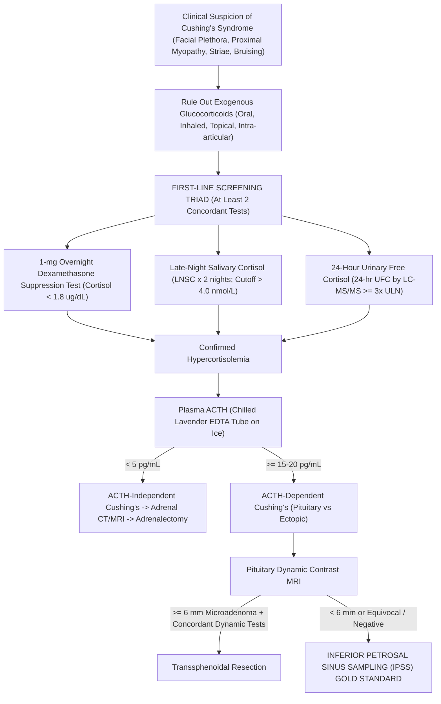

---

### **17.2.2 The First-Line Diagnostic Triad: Protocols, Cutoffs & Technical Traps**

No single test possesses $100\%$ sensitivity and $100\%$ specificity. Clinical guidelines from the Endocrine Society mandate at least two concordant abnormal first-line tests prior to establishing pathological hypercortisolemia.

#### **1. The 1-mg Overnight Dexamethasone Suppression Test (ODST)**
* **Physiological Premise:** Dexamethasone is a potent synthetic glucocorticoid ($30\times$ more potent than endogenous cortisol at the glucocorticoid receptor) that binds pituitary corticotrope glucocorticoid receptors, shutting down $\text{POMC}$ gene transcription and extinguishing ACTH release in healthy individuals. Dexamethasone has a modified chemical structure ($9\alpha\text{-fluoro-}16\alpha\text{-methylprednisolone}$) that does not cross-react with specific cortisol immunoassays or LC-MS/MS channels.
* **Standard Protocol:**
  1. Patient takes **$1.0\ \text{mg}$ Dexamethasone orally between 23:00 and 23:30** with water.
  2. Patient presents to the phlebotomy laboratory at **08:00 to 09:00 the following morning**.
  3. Serum drawn in Gold-top SST tube for Total Cortisol.
* **Diagnostic Interpretation:**
  * **Normal (Suppression):** Serum Cortisol **$< 1.8\ \mu\text{g/dL}$ ($< 50\ \text{nmol/L}$)**. This stringent cutoff provides sensitivity $> 95\%$.
  * **Abnormal (Autonomous Secretion / Failure to Suppress):** Serum Cortisol **$\ge 1.8\ \mu\text{g/dL}$**.
* **The Behind-the-Curtain Analytical Saboteurs:**
  * **The CYP3A4 Inducer Catastrophe (False-Positive):** Dexamethasone is cleared exclusively by hepatic cytochrome P450 3A4 ($\text{CYP3A4}$). Patients taking antiepileptic drugs (**Phenytoin, Carbamazepine, Phenobarbital**), **Rifampin**, or **St. John's Wort** hyper-induce CYP3A4. The $1\ \text{mg}$ dose is metabolized within $3\text{ to }4$ hours; by 08:00, zero circulating dexamethasone remains to suppress the pituitary! Serum cortisol prints as $8.4\ \mu\text{g/dL}$ (falsely abnormal).
  * **The CYP3A4 Inhibitor Trap (False-Negative):** Patients consuming **Grapefruit juice**, **Ketoconazole**, **Itraconazole**, **Ritonavir**, or **Cimetidine** block CYP3A4, causing supra-therapeutic dexamethasone levels that force suppression in patients with mild Cushing's disease!
  * **The High-CBG Estrogen Trap:** As established in Dossier 17.1, oral contraceptives elevate total CBG. Suppressed free cortisol with elevated bound cortisol will yield a total cortisol of $2.8\text{–}4.0\ \mu\text{g/dL}$, failing the test. Oral estrogens must be discontinued for a mandatory **6 weeks** prior to testing.
  * **The Simultaneous Serum Dexamethasone Mandate:** Elite chemical pathology laboratories never report an 08:00 post-dexamethasone cortisol in isolation! Blood is analyzed simultaneously for **Serum Dexamethasone via LC-MS/MS**:
    $$\text{Valid Test Criteria: } [\text{Serum Dexamethasone}]_{08:00} \ge 180\text{–}220\ \text{ng/dL}\ (4.5\text{–}5.6\ \text{nmol/L})$$
    If serum dexamethasone is $< 180\ \text{ng/dL}$, the suppression test is invalid due to non-compliance, emesis, malabsorption, or CYP3A4 induction!

#### **2. Twenty-Four-Hour Urinary Free Cortisol (24-hr UFC)**
* **Physiological Premise:** Only circulating unbound free cortisol passes through the renal glomerular filtration barrier. While tubular $11\beta\text{-hydroxysteroid dehydrogenase type 2}$ ($11\beta\text{-HSD2}$) converts some filtered cortisol to cortisone, excess free cortisol overwhelms this enzyme and is excreted intact into urine. UFC integrates cortisol production over an entire 24-hour day, smoothing out ultradian peaks.
* **Collection Protocol:**
  1. Patient voids at 07:00 on Day 1; this urine is **discarded**.
  2. All urine passed over the next 24 hours—day and night—is collected into a sterile 3-liter container containing **$10\ \text{g}$ of Boric Acid** or kept strictly refrigerated ($4^\circ\text{C}$).
  3. Patient voids at 07:00 on Day 2; this final volume is **included**.
* **Pre-Analytical Verification of Completeness:**
  A 24-hour urine collection is completely uninterpretable without verifying total volume and **24-hour urine creatinine excretion**:
  $$\text{Male Creatinine Benchmark: } 20\text{–}25\ \text{mg/kg/24 hr}\ (177\text{–}221\ \mu\text{mol/kg/24 hr})$$
  $$\text{Female Creatinine Benchmark: } 15\text{–}20\ \text{mg/kg/24 hr}\ (133\text{–}177\ \mu\text{mol/kg/24 hr})$$
  A collection with $< 10\ \text{mg/kg}$ creatinine indicates under-collection (false-negative UFC), while massive over-collection inflates UFC.
* **Analytical Engine: Immunoassay vs LC-MS/MS:**
  * Historic urine cortisol immunoassays cross-reacted wildly with urinary steroid metabolites ($6\beta\text{-hydroxycortisol}$, $20\alpha\text{-dihydrocortisol}$), carbamazepine metabolites, and synthetic prednisolone, generating massive false positives.
  * **LC-MS/MS Isotope Dilution Gold Standard:** Urine undergoes liquid-liquid extraction with dichloromethane or solid-phase extraction ($\text{SPE}$), spiked with internal standard ($d_4\text{-cortisol}$ or $^{13}\text{C}_3\text{-cortisol}$). Quantitation on triple-quadrupole mass spectrometry monitors the precursor-to-product ion transition:
    $$\text{Cortisol } [M+H]^+: m/z\ 363.2 \longrightarrow 121.1\quad (\text{Quantifier Ion, Collision Energy: } 30\ \text{eV})$$
    $$\text{Cortisol } [M+H]^+: m/z\ 363.2 \longrightarrow 327.2\quad (\text{Qualifier Ion, Collision Energy: } 18\ \text{eV})$$
    $$d_4\text{-Cortisol } [M+H]^+: m/z\ 367.2 \longrightarrow 121.1\quad (\text{Internal Standard})$$
* **Diagnostic Threshold:**
  * Normal: $< 45\text{–}50\ \mu\text{g/24 hr}$ ($< 120\text{–}140\ \text{nmol/day}$).
  * Diagnostic of Cushing's Syndrome: **$\ge 3\times$ Upper Limit of Normal ($\ge 150\ \mu\text{g/24 hr}$ / $\ge 415\ \text{nmol/day}$)**. Mild elevations ($1.5\text{ to }2.5\times$ ULN) overlap heavily with Pseudo-Cushing's states.

#### **3. Late-Night Salivary Cortisol (LNSC)**
* **Physiological Premise:** Salivary acinar cells are impermeable to large protein-bound complexes; neither CBG ($58\ \text{kDa}$) nor albumin ($66.5\ \text{kDa}$) enters saliva. Unbound free cortisol, being lipid-soluble, diffuses freely across acinar cells via passive transcellular diffusion within seconds, independent of salivary flow rate. Salivary cortisol concentration directly reflects circulating free biologically active cortisol in real time.
* **Loss of Nadir in Cushing's:** In healthy subjects, cortisol nadirs between 23:00 and 24:00 ($< 1.0\text{–}1.5\ \text{nmol/L}$). Patients with Cushing's syndrome lose this circadian dip; their 23:00 salivary cortisol remains elevated.
* **Collection Protocol & Technical Traps:**
  1. Collection occurs between **23:00 and 24:00**.
  2. Patient must not eat, drink, chew gum, or brush teeth for **30 minutes prior** to sampling.
  3. Patient places a cylindrical synthetic swab (e.g., **Salivette**) into the mouth, chewing gently for 2 minutes, then returns it to the plastic transport container.
* **The Behind-the-Curtain Disasters:**
  * **Blood Contamination from Toothbrushing:** Plasma total cortisol ($15\ \mu\text{g/dL} = 415\ \text{nmol/L}$) is $100\times$ higher than late-night saliva ($< 3\text{ nmol/L}$). Microscopic gingival bleeding from vigorous toothbrushing or flossing leaks plasma into saliva, driving salivary cortisol from $1.2\ \text{nmol/L}$ to $28.0\ \text{nmol/L}$! Laboratories perform **salivary transferrin testing**; any detectable transferrin invalidates the sample.
  * **The Cotton Swab Adsorption Trap:** Traditional cotton Salivettes physically adsorb hydrophobic steroids, falsely lowering cortisol recovery unless specific polyethylene/polyester synthetic swabs are deployed.
  * **Licorice and Tobacco 11$\beta$-HSD2 Inhibition:** Salivary glands express high concentrations of $11\beta\text{-HSD2}$ to protect mineralocorticoid receptors. Glycyrrhetinic acid (active compound in real licorice and chewing tobacco) potently inhibits $11\beta\text{-HSD2}$, preventing the local oxidation of cortisol to cortisone and falsely elevating salivary cortisol.
* **Diagnostic Threshold (LC-MS/MS):**
  * Normal Nadir: $< 2.8\text{–}4.0\ \text{nmol/L}$ ($< 0.10\ \mu\text{g/dL}$).
  * Pathological: **$> 4.0\ \text{nmol/L}$ ($> 0.14\ \mu\text{g/dL}$)** measured on **at least two separate nights**.

---

### **17.2.3 Differentiating ACTH-Independent from ACTH-Dependent Cushing's**

Once autonomous hypercortisolemia is biochemically secured, the physician must measure **Plasma ACTH** to locate the driver.

* **Specimen Collection Integrity (The Chilled Lavender EDTA Mandate):**
  * ACTH is a labile 39-amino acid single-chain polypeptide ($M_r = 4,541\ \text{Da}$) subject to rapid degradation by plasma endopeptidases and surface-adsorption to uncoated glass.
  * Blood MUST be drawn into a **pre-chilled Lavender-top $\text{K}_2\text{-EDTA}$ Vacutainer**, immediately submerged in an **ice-water slurry**, and centrifuged at $4^\circ\text{C}$ within **15 minutes**. Separated plasma must be frozen at $-20^\circ\text{C}$ or $-80^\circ\text{C}$ within 1 hour.
  * Failure to chill allows ex-vivo degradation, driving ACTH from $45\ \text{pg/mL}$ to $< 5\ \text{pg/mL}$!
* **Diagnostic Stratification:**
  * **ACTH-Independent Cushing's ($[\text{ACTH}] < 5\ \text{pg/mL}$ / $< 1.1\ \text{pmol/L}$):** Cortisol secretion is driven by autonomous adrenal pathology (Adrenocortical Adenoma, Adrenocortical Carcinoma, Primary Pigmented Nodular Adrenocortical Disease [PPNAD], ACTH-Independent Macronodular Adrenal Hyperplasia [AIMAH]). High cortisol exerts complete negative feedback, silencing normal pituitary corticotropes. Next step: **Thin-slice Adrenal CT or MRI**.
  * **Indeterminate ($[\text{ACTH}] = 5\text{–}15\ \text{pg/mL}$):** Requires CRH stimulation to unmask suppressed vs driven corticotropes.
  * **ACTH-Dependent Cushing's ($[\text{ACTH}] > 15\text{–}20\ \text{pg/mL}$ / $> 3.3\text{–}4.4\ \text{pmol/L}$):** Hypercortisolemia is driven by either:
    1. **Pituitary Corticotrope Adenoma (Cushing's Disease, $\sim 80\text{–}85\%$ of ACTH-dependent cases)**;
    2. **Ectopic ACTH Secretion ($\sim 15\text{–}20\%$ of cases)**: Neuroendocrine neoplasms (Small Cell Lung Carcinoma, Bronchial Carcinoid, Pancreatic Neuroendocrine Tumor, Medullary Thyroid Carcinoma).

---

### **17.2.4 The High-Dose 8-mg Dexamethasone Suppression Test & The CRH Stimulation Test**

Differentiating pituitary Cushing's disease from occult ectopic ACTH is one of the most treacherous challenges in medicine because both present with high ACTH and hypercortisolemia, and up to $40\%$ of pituitary microadenomas are invisible on high-field pituitary MRI ($< 3\text{ mm}$)!

#### **1. The High-Dose 8-mg Dexamethasone Suppression Test (HDDST)**
* **Mechanism:** Pituitary corticotrope adenomas retain **partial negative feedback sensitivity**; their glucocorticoid receptors are down-regulated but not obliterated. A massive pharmacological dose ($8\ \text{mg}$) can force glucocorticoid receptor dimerization, partially shutting down ACTH transcription. In contrast, non-pituitary neuroendocrine tumors (ectopic ACTH) operate completely outside hypothalamic-pituitary control and are refractory to feedback.
* **Protocol:** $8.0\ \text{mg}$ Dexamethasone orally at 23:00; 08:00 serum cortisol drawn.
* **Interpretation:**
  $$\text{Percent Suppression} = \frac{\text{Baseline Cortisol} - \text{Post-8mg Cortisol}}{\text{Baseline Cortisol}} \times 100\%$$
  * **Suppression $\ge 50\%$:** Strongly favors **Pituitary Cushing's Disease** (specificity $\sim 80\%$).
  * **Failure of Suppression ($< 50\%$ drop):** Favors **Ectopic ACTH** or Adrenal Tumor.
  * *Critical Limitation:* Well-differentiated bronchial carcinoids frequently retain glucocorticoid receptors and suppress by $> 50\%$, yielding false-positive pituitary diagnoses in $15\text{ to }20\%$ of ectopic tumors!

#### **2. The Corticotropin-Releasing Hormone (CRH) Stimulation Test**
* **Mechanism:** Pituitary corticotrope adenomas overexpress CRH receptors ($\text{CRHR1}$) on their cell surface. Intravenous administration of exogenous CRH stimulates adenoma corticotropes to dump ACTH and cortisol into circulation. Conversely, ectopic ACTH-secreting tumors do not express functional CRHR1 receptors, and normal pituitary corticotropes are chronically suppressed.
* **Protocol:**
  1. Patient rests supine for 30 minutes with an indwelling IV line.
  2. Baseline ACTH and Cortisol drawn at $-15$ and $0$ minutes.
  3. **$1\ \mu\text{g/kg}$ or $100\ \mu\text{g}$ Ovine CRH (Corticorelin)** or Human CRH administered as a slow IV push over 1 minute.
  4. Blood drawn at $+15, +30, +45, +60,$ and $+90$ minutes for ACTH and Cortisol.
* **Diagnostic Criteria for Pituitary Cushing's Disease:**
  $$\Delta \text{ACTH} = \frac{\text{Peak ACTH} - \text{Baseline Mean ACTH}}{\text{Baseline Mean ACTH}} \ge \mathbf{35\% - 50\%}$$
  $$\Delta \text{Cortisol} = \frac{\text{Peak Cortisol} - \text{Baseline Mean Cortisol}}{\text{Baseline Mean Cortisol}} \ge \mathbf{20\%}$$
  Ectopic ACTH shows flat, unresponsive curves ($\Delta \text{ACTH} < 35\%$).

---

### **17.2.5 Inferior Petrosal Sinus Sampling (IPSS): The Interventional Gold Standard**

When pituitary MRI shows no lesion or an ambiguous micro-lesion $< 6\ \text{mm}$ in a patient with ACTH-dependent hypercortisolemia, bilateral simultaneous **Inferior Petrosal Sinus Sampling ($\text{IPSS}$)** is the definitive gold standard procedure with diagnostic accuracy $> 98\%$.

#### **1. Vascular Anatomy & Catheter Trajectory**
Pituitary venous blood drains into the cavernous sinuses, which exit posteriorly via the superior and inferior petrosal sinuses. The **Inferior Petrosal Sinus ($\text{IPS}$)** is the primary venous conduit, traversing the petroclival fissure to empty directly into the anteromedial aspect of the internal jugular vein at the level of the jugular foramen (cranial base).

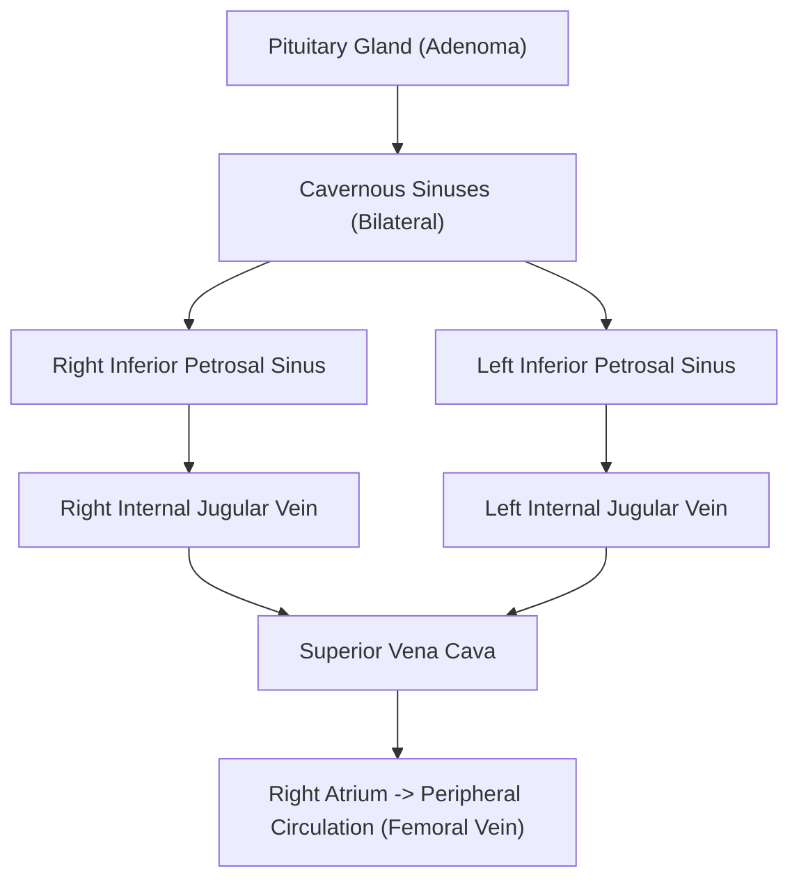

#### **2. Procedural Mechanics & Catheterization Physics**
1. **Access:** Under local anesthesia, an interventional radiologist places two $5\text{-French}$ vascular sheaths into the **right and left common femoral veins**.
2. **Navigation:** Using hydrophilic 0.035-inch guidewires and shaped micro-catheters (e.g., Headhunter, Cobra, or MP micro-catheters), catheters are navigated through the inferior vena cava, right atrium, superior vena cava, and internal jugular veins to the jugular bulb.
3. **Engagement:** The tip of each catheter is engaged into the osteum of the respective **inferior petrosal sinus**.
4. **Fluoroscopic Confirmation:** Digital Subtraction Angiography ($\text{DSA}$) with non-ionic iodinated contrast injection confirms symmetrical, selective positioning within the petrosal sinuses and rules out anomalous plexiform venous anatomy or drainage directly into the vertebral venous plexus.
5. **Peripheral Line:** A third catheter or peripheral IV line in the femoral sheath serves as the systemic peripheral comparator ($\text{P}$).

#### **3. The Sampling Protocol & CRH Provocation**
Because ACTH secretion can be quiescent during the procedure, sampling must be performed both at baseline and under provocative CRH (or Desmopressin) stimulation:
* **Basal Draws:** Simultaneous blood samples drawn from Left IPS, Right IPS, and Peripheral vein at $-5$ and $0$ minutes.
* **Stimulation:** Inject **$100\ \mu\text{g}$ Ovine CRH IV** (or $10\ \mu\text{g}$ Desmopressin/DDAVP IV).
* **Stimulated Draws:** Simultaneous blood samples drawn at $+2, +5, +10,$ and $+15$ minutes.
* **Handling:** Every tube (Lavender $\text{K}_2\text{-EDTA}$) must be pre-chilled, labeled precisely ("L-IPS", "R-IPS", "PERIPHERAL"), kept in an ice slurry, and spun immediately.

#### **4. Diagnostic Ratios & Interpretation Formulas**

##### **A. Central-to-Peripheral (IPS/P) ACTH Ratio (Proving Pituitary Origin)**
To determine whether the source of ACTH is Pituitary (Cushing's Disease) versus Ectopic:

$$\text{Basal Central-to-Peripheral Ratio} = \frac{[\text{ACTH}]_{\text{IPS (Higher Side)}}}{[\text{ACTH}]_{\text{Peripheral}}} \ge \mathbf{2.0}$$

$$\text{CRH-Stimulated Central-to-Peripheral Ratio} = \frac{[\text{ACTH}]_{\text{IPS (Higher Side)}}}{[\text{ACTH}]_{\text{Peripheral}}} \ge \mathbf{3.0}$$

* **$\text{IPS/P} \ge 2.0$ (Basal) or $\ge 3.0$ (Stimulated):** **CONFIRMS PITUITARY CUSHING'S DISEASE** with $99\%$ specificity!
* **$\text{IPS/P} < 2.0$ (Basal) AND $< 3.0$ (Stimulated):** **CONFIRMS ECTOPIC ACTH SECRETION**. Proceed immediately to neck-chest-abdomen-pelvis thin-slice contrast CT, Ga-68 DOTATATE PET/CT, or FDG-PET to locate the neuroendocrine tumor.

##### **B. Inter-Petrosal Sinus Gradient (Lateralization for Surgical Enucleation)**
To predict whether the microadenoma is situated in the left or right pituitary hemigland:

$$\text{Inter-Petrosal Ratio} = \frac{[\text{ACTH}]_{\text{Dominant IPS}}}{[\text{ACTH}]_{\text{Non-Dominant IPS}}} > \mathbf{1.4}$$

* **Ratio $> 1.4$:** Predicts ipsilateral tumor localization to the side of the dominant IPS, directing the neurosurgeon to explore that specific side during transsphenoidal surgery.
* **Ratio $\le 1.4$:** Non-lateralizing (tumor near midline, anomalous inter-cavernous crossing shunts, or diffuse basilar venous plexus mixing).

##### **C. Prolactin Normalization for Anatomical Venous Anomalies**
If a catheter is suboptimally positioned or if asymmetric venous hypoplasia exists, low ACTH in an IPS can cause a false-negative result. Because **Prolactin** is secreted continuously by normal pituitary lactotropes, prolactin serves as an endogenous internal control for petrosal vein blood dilution:

$$\text{Normalized Ratio} = \frac{[\text{ACTH}]_{\text{IPS}} / [\text{Prolactin}]_{\text{IPS}}}{[\text{ACTH}]_{\text{Peripheral}} / [\text{Prolactin}]_{\text{Peripheral}}}$$
A Prolactin $\text{IPS/P} \ge 1.8$ confirms adequate engagement and pure pituitary effluent.

---

### **17.2.6 Procedural Hazards of IPSS**
While safe in experienced hands ($< 1\text{–}2\%$ major complication rate), IPSS involves catheterizing veins at the skull base:
1. **Brainstem Vascular Injury / Stroke:** Accidental wedging of catheters or high-pressure contrast injection into small pontine/cerebellar emissary veins can trigger venous infarction or brainstem hemorrhage.
2. **Petrosal Sinus Rupture:** Vessel perforation leading to subarachnoid or intracranial hemorrhage.
3. **Groin Hematoma / Femoral Pseudoaneurysm:** Managed with manual compression or vascular closure devices.
4. **Transient Cranial Neuropathies:** Abducens (CN VI) palsy due to traction near Dorello's canal.

---

*(Volume XVII continues below with Primary Aldosteronism, Adrenal Vein Sampling, Congenital Adrenal Hyperplasia, Pheochromocytoma, and Thyroid Mass Spectrometry)*


---

## **DOSSIER 17.3: PRIMARY ALDOSTERONISM (CONN'S SYNDROME) & ADRENAL VEIN SAMPLING (AVS)**

### **17.3.1 Pathophysiology of Autonomous Mineralocorticoid Excess**

Primary Aldosteronism ($\text{PA}$) is the most common cause of secondary endocrine hypertension, accounting for **$5\%\text{ to }10\%$ of all hypertensive patients** and up to **$20\%$ of patients with resistant hypertension** ($\text{BP} > 140/90\ \text{mmHg}$ despite three antihypertensive agents of different classes, including a diuretic). 

Autonomous overproduction of aldosterone by the adrenal zona glomerulosa acts upon mineralocorticoid receptors ($\text{MR}$) in the principal cells of the renal cortical collecting tubule, upregulating:
1. Epithelial Sodium Channels ($\text{ENaC}$) on the apical membrane, accelerating $\text{Na}^+$ reabsorption;
2. $\text{Na}^+/\text{K}^+\text{-ATPase}$ pumps on the basolateral membrane;
3. Renal Outer Medullary Potassium ($\text{ROMK}$) channels and $\text{H}^+\text{-ATPase}$ pumps, driving urinary $\text{K}^+$ and $\text{H}^+$ wasting.

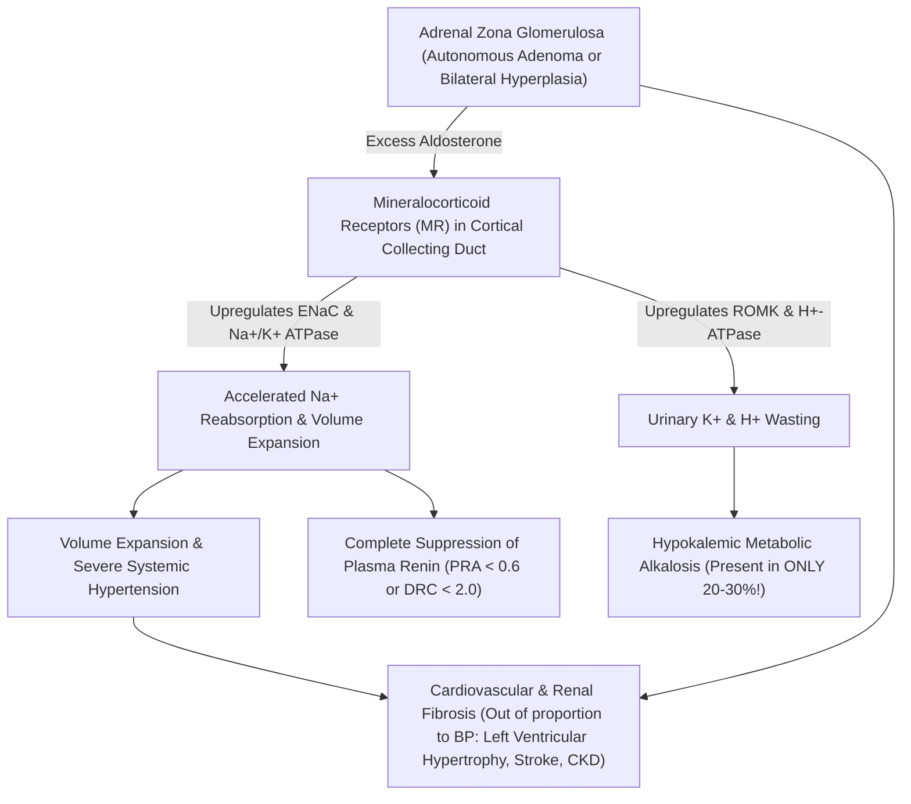

#### **The Great Clinical Fallacy: Normokalemic Primary Aldosteronism**
For decades, physicians were taught that primary aldosteronism is characterized by hypokalemia. **This is factually false.** Modern prospective screening studies establish that **$70\%\text{ to }80\%$ of patients with documented, surgically curable primary aldosteronism are completely normokalemic**! Resting serum potassium cannot be used to rule out PA.

---

### **17.3.2 The Screening Gateway: The Morning Seated Aldosterone-to-Renin Ratio (ARR)**

The cornerstone of primary aldosteronism screening is the **Aldosterone-to-Renin Ratio ($\text{ARR}$)**. Because autonomous aldosterone production suppresses juxtaglomerular apparatus renin release via volume expansion, the signature biochemical footprint of PA is **high/inappropriately normal aldosterone coupled with profound renin suppression**.

#### **1. Pre-Analytical Patient Preparation Protocol**
To prevent catastrophic false-positive and false-negative screening results, strict pre-analytical control must be enforced:
* **Correction of Hypokalemia:** Hypokalemia directly inhibits adrenal CYP11B2 (aldosterone synthase) transcription. A patient with severe hypokalemia ($\text{K}^+ < 3.2\ \text{mEq/L}$) will shut down aldosterone secretion, causing a **falsely negative ARR**! Serum potassium must be aggressively repleted to **$> 4.0\ \text{mEq/L}$** prior to blood collection.
* **Unrestricted Sodium Intake:** Patients must not follow a low-sodium diet; dietary salt restriction stimulates renin, confounding the ratio.
* **Postural State:** Patient must be out of bed for at least 2 hours, then **seated comfortably for 10 to 15 minutes** before blood collection. Blood drawn while recumbent generates false-negative ratios; standing increases renin and aldosterone.
* **Time of Day:** Blood must be drawn mid-morning, ideally between **08:00 and 10:00**.

#### **2. Pharmacological Washout Schedule**
Virtually all antihypertensive agents modulate the renin-angiotensin-aldosterone system ($\text{RAAS}$). Elite endocrine centers adhere to strict drug withdrawal schedules:

| Antihypertensive Class | Examples | Biochemical Effect on RAAS | Impact on ARR | Washout Period Required |
| :--- | :--- | :--- | :--- | :--- |
| **Mineralocorticoid Receptor Antagonists ($\text{MRAs}$)** | Spironolactone, Eplerenone | Blocks MR $\implies$ massive rebound $\uparrow \text{Renin}$ | **False-Negative** (Crushes ARR) | **Mandatory 4 to 6 Weeks** |
| **$\text{ENaC}$ Blockers** | Amiloride, Triamterene | Sodium loss $\implies \uparrow \text{Renin}$ | **False-Negative** | **4 Weeks** |
| **$\beta$-Adrenergic Blockers** | Metoprolol, Atenolol, Propranolol | Blocks $\beta_1$ juxtaglomerular drive $\implies \downarrow \text{Renin}$ | **False-Positive** ($\uparrow \text{ARR}$) | **2 Weeks** |
| **$\text{ACE}$ Inhibitors** | Lisinopril, Enalapril, Ramipril | Blocks Ang II $\implies \uparrow \text{Renin}$, $\downarrow \text{Aldo}$ | **False-Negative** | **2 Weeks** |
| **Angiotensin Receptor Blockers ($\text{ARBs}$)** | Losartan, Valsartan, Candesartan | Blocks AT1R $\implies \uparrow \text{Renin}$, $\downarrow \text{Aldo}$ | **False-Negative** | **2 Weeks** |
| **Dihydropyridine $\text{CCBs}$** | Amlodipine, Nifedipine | Vasodilation $\implies \uparrow \text{Renin}$ | **False-Negative** (Mild) | **2 Weeks** |
| **Direct Renin Inhibitors** | Aliskiren | Inhibits renin activity ($\downarrow \text{PRA}$), $\uparrow \text{DRC}$ | Wildly discordant | **4 Weeks** |
| **$\alpha_2$-Central Agonists** | Clonidine, Methyldopa | Reduces sympathetic drive $\implies \downarrow \text{Renin}$ | **False-Positive** | **2 Weeks** |

#### **The Safe Antihypertensive Bridge:**
To control severe blood pressure during the 2-to-4 week washout, clinicians convert patients to medications with minimal RAAS impact:
* **Verapamil Slow-Release** (Non-dihydropyridine CCB: $120\text{–}240\ \text{mg}$ daily);
* **Doxazosin or Prazosin** ($\alpha_1\text{-adrenergic}$ antagonists: $1\text{–}8\ \text{mg}$ daily);
* **Hydralazine** (Direct arteriolar vasodilator: $25\text{–}50\ \text{mg}$ TID).

#### **3. Calculating the ARR: Units and Thresholds**
Renin is measured as either **Plasma Renin Activity ($\text{PRA}$)** via enzymatic generation of angiotensin I, or **Direct Renin Concentration ($\text{DRC}$)** via automated sandwich immunoassay:

$$\text{ARR}_{\text{PRA}} = \frac{\text{Plasma Aldosterone Concentration (PAC in ng/dL)}}{\text{Plasma Renin Activity (PRA in ng/mL/hr)}}$$

$$\text{ARR}_{\text{DRC}} = \frac{\text{Plasma Aldosterone Concentration (PAC in ng/dL)}}{\text{Direct Renin Concentration (DRC in mU/L)}}$$

$$\text{SI-Unit ARR}_{\text{DRC}} = \frac{\text{Plasma Aldosterone Concentration (PAC in pmol/L)}}{\text{Direct Renin Concentration (DRC in mU/L)}}$$

*Conversion Factors:* $\text{Aldosterone: } 1\ \text{ng/dL} = 27.7\ \text{pmol/L}$. $\text{PRA to DRC: } 1\ \text{ng/mL/hr} \approx 8.2\text{ to }12\ \text{mU/L}$.

| Assay Combination | Units of PAC | Units of Renin | Positive Screening Cutoff | High-Confidence Threshold |
| :--- | :--- | :--- | :--- | :--- |
| **PAC / PRA** | $\text{ng/dL}$ | $\text{ng/mL/hr}$ | **$> 20$** | **$> 30$** |
| **PAC / DRC** | $\text{ng/dL}$ | $\text{mU/L}$ | **$> 2.0 - 2.5$** | **$> 3.7$** |
| **PAC / DRC (SI Units)**| $\text{pmol/L}$ | $\text{mU/L}$ | **$> 55 - 70$** | **$> 100$** |

#### **The Inflexible Prerequisite: Absolute PAC Floor**
An elevated ratio is clinically meaningless if the numerator is negligible. For example, a patient with a suppressed PRA of $0.1\ \text{ng/mL/hr}$ and an aldosterone of $3.0\ \text{ng/dL}$ has an apparent ARR of:

$$\text{ARR} = \frac{3.0}{0.1} = 30\quad (\text{Arithmetically High, but Clinically Negative!})$$

This patient merely has low-renin essential hypertension. Therefore, guidelines mandate:
$$\mathbf{\text{Mandatory Rule: ARR is ONLY diagnostic if PAC } \ge 10\text{–}15\ \text{ng/dL}\ (280\text{–}420\ \text{pmol/L})!}$$

---

### **17.3.3 Confirmatory Suppression Protocols**

A positive ARR screens for PA; autonomous, non-suppressible aldosterone secretion must be formally confirmed before subjecting patients to invasive catheterization.

#### **1. The Intravenous Saline Infusion Test (SIT)**
* **Mechanism:** Infusion of an acute intravascular volume load expands effective circulating volume, elevating renal perfusion pressure and suppressing any physiologically responsive RAAS axis. Normal adrenocortical glomerulosa cells extinguish aldosterone production; autonomous neoplasms do not.
* **Protocol:**
  1. Patient is admitted to an endocrine testing unit and placed in a **recumbent position for at least 1 hour** prior to infusion.
  2. Baseline PAC, PRA/DRC, potassium, and cortisol drawn at 08:00.
  3. **$2.0\ \text{Liters}$ of $0.9\%\ \text{Sodium Chloride}$ IV is infused at a constant rate over exactly 4 hours** ($500\ \text{mL/hr}$, 08:00 to 12:00).
  4. Blood pressure and heart rate monitored continuously (vigorous volume expansion can precipitate pulmonary edema in severe diastolic dysfunction).
  5. Repeat blood drawn at 12:00 (end of infusion) for PAC, cortisol, and potassium.
* **Diagnostic Interpretation (Post-Saline PAC):**
  * **$< 5.0\ \text{ng/dL}$ ($< 140\ \text{pmol/L}$):** **Excludes Primary Aldosteronism** (normal physiological suppression).
  * **$> 10.0\ \text{ng/dL}$ ($> 280\ \text{pmol/L}$):** **CONFIRMS PRIMARY ALDOSTERONISM** (autonomous production).
  * **$5.0\text{ to }10.0\ \text{ng/dL}$:** Indeterminate; requires alternative confirmation or clinical reassessment.
  * *Behind-the-Curtain Quality Check:* Post-infusion serum cortisol must be lower than baseline; if acute stress elevated cortisol, ACTH release may cross-stimulate aldosterone release, invalidating the suppression test!

#### **2. The Oral Sodium Loading Test**
* Patient consumes a high-sodium diet supplemented with sodium chloride tablets ($6\ \text{g/day} = 100\ \text{mmol/day}$ added salt) for **3 consecutive days** (target total sodium intake $> 200\ \text{mmol/day}$).
* On day 3, a 24-hour urine is collected for urinary aldosterone, sodium, and creatinine.
* **Validation:** 24-hour urinary sodium must exceed **$200\ \text{mEq/24 hr}$** to verify adequate sodium loading.
* **Confirmation:** **24-hour Urinary Aldosterone $> 12\ \mu\text{g/24 hr}$ ($> 33\ \text{nmol/day}$)** confirms autonomous primary aldosteronism.

#### **3. The Captopril Challenge Test**
* Patient receives $25\text{ to }50\ \text{mg}$ oral Captopril while seated. In healthy individuals, ACE inhibition collapses Angiotensin II, dropping PAC by $> 30\%$. In PA, PAC remains elevated ($> 12\ \text{ng/dL}$) with fully suppressed renin.

---

### **17.3.4 Adrenal Vein Sampling (AVS): The Definitive Interventional Gold Standard**

Once primary aldosteronism is confirmed, the central therapeutic question arises:
$$\mathbf{\text{Unilateral Disease (Curable by Surgery) VS Bilateral Disease (Managed Medically)?}}$$
* **Unilateral Aldosterone-Producing Adenoma ($\text{APA}$ / Conn's Adenoma, $\sim 35\%\text{ of cases}$):** Curable by unilateral laparoscopic adrenalectomy, normalizing potassium, lowering blood pressure, and curing hypertension in $40\%\text{ to }60\%$ of patients.
* **Bilateral Adrenal Hyperplasia ($\text{BAH}$ / Idiopathic Hyperaldosteronism, $\sim 65\%\text{ of cases}$):** Surgery is contraindicated; bilateral adrenalectomy causes lifelong adrenal insufficiency without curing hypertension. Managed with lifetime MR antagonists (Spironolactone or Eplerenone).

#### **The Cross-Sectional Imaging Disaster: Why CT/MRI Fails**
Clinicians often assume that high-resolution thin-slice adrenal CT can distinguish unilateral from bilateral disease. **CT/MRI has a documented $40\%$ diagnostic error rate:**
1. **Non-Functioning Adrenal Incidentalomas:** Non-functioning cortical adenomas occur in $3\%\text{ to }7\%$ of the normal population. A patient with bilateral hyperplasia and an innocent incidentaloma on the right will undergo unnecessary right adrenalectomy, leaving the disease uncured!
2. **Microscopic Aldosteronomas:** APAs are frequently small ($< 5\text{ to }8\ \text{mm}$) and completely invisible on CT. A "normal" adrenal scan may harbor a curable microadenoma.
3. Guidelines from the Endocrine Society state unequivocally: **Cross-sectional imaging cannot be relied upon to direct surgical decision-making. Adrenal Vein Sampling ($\text{AVS}$) is the mandatory gold standard.**

---

### **17.3.5 Vascular Anatomy & Catheterization Physics Behind the Curtain**

Adrenal vein sampling is arguably the most technically demanding procedure in interventional radiology due to the brutal asymmetrical micro-anatomy of the human adrenal venous drainage:

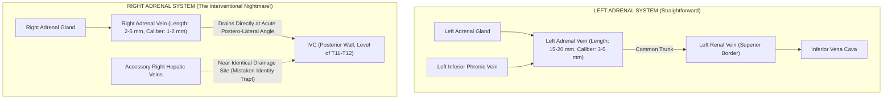

#### **1. Anatomy of the Left Adrenal Vein:**
* The left adrenal vein travels vertically downwards, joins the **Left Inferior Phrenic Vein** to form a generous common trunk ($15\text{ to }20\ \text{mm}$ in length, $3\text{ to }5\ \text{mm}$ in diameter), which empties directly into the superior border of the **Left Renal Vein** opposite the gonadal vein.
* Cannulation is straightforward using standard Cobra, Picard, or Sidewinder catheters. Blood aspirated is a mixture of adrenal and phrenic venous return.

#### **2. Anatomy of the Right Adrenal Vein (The Interventional Graveyard):**
* The right adrenal vein is an anatomical micro-conduit: **only $2\text{ to }5\ \text{mm}$ in length and $1\text{ to }2\ \text{mm}$ in diameter**.
* It empties directly into the **posterolateral wall of the Inferior Vena Cava** at an acute downward angle, typically at the level of the T11–T12 vertebral bodies.
* Nestled in immediate proximity are small **accessory right hepatic veins**. Interventional radiologists frequently catheterize a small accessory hepatic vein by mistake; the aspirate will contain high oxygenated portal/hepatic blood with zero adrenal hormone!
* **Catheter Stability:** To cannulate the right adrenal vein, the operator uses micro-catheters (e.g., Mikaelsson, C2, or dedicated adrenal vein catheters). The catheter tip must be wedged gently without occluding flow or dissecting the fragile vein wall.

#### **3. Contrast Injection Hazard (Adrenal Vein Rupture):**
* Adrenal veins lack thick muscular tunica media. Vigorous hand injection of iodinated contrast will instantly rupture the right adrenal vein, resulting in **retroperitoneal hemorrhage and complete ischemic infarction of the right adrenal gland**! Gentle "puffing" of micro-contrast drops under fluoroscopy is mandatory.

---

### **17.3.6 Procedural Execution: Unstimulated vs Cosyntropin Stimulation**

AVS can be performed using two valid methodological schools:
1. **Unstimulated Sequential Sampling:** Reflects native physiological secretion but is susceptible to episodic cortisol and aldosterone pulsatility during the $15\text{ to }30$ minutes required to move catheters between sides.
2. **Continuous Cosyntropin Infusion Protocol (Preferred by Many Centers):**
   * Synthetic $\text{ACTH}_{1-24}$ (Cosyntropin) is infused intravenously at a continuous rate of **$50\ \mu\text{g/hour}$**, initiated **30 minutes prior to sampling** and continued throughout the procedure.
   * *Advantages:* Maximizes cortisol gradient between adrenal veins and IVC; eliminates stress-induced hormonal fluctuations; minimizes the impact of timing offsets during sequential catheterization; stimulates adenoma secretion.

#### **Sample Collection Triad:**
At each sampling station, $5\ \text{mL}$ of blood is gently aspirated (rapid suction collapses the fragile right vein wall):
1. **Right Adrenal Vein ($\text{RAV}$)**;
2. **Left Adrenal Vein ($\text{LAV}$)**;
3. **Peripheral Blood ($\text{PV}$)** (drawn from the femoral sheath or infra-renal IVC).
Every tube is labeled and sent for simultaneous **Aldosterone and Cortisol** measurement via LC-MS/MS.

---

### **17.3.7 Diagnostic Interpretation Formulas: SI, LI, and CSI**

Three mathematical indices must be calculated sequentially to interpret an AVS run.

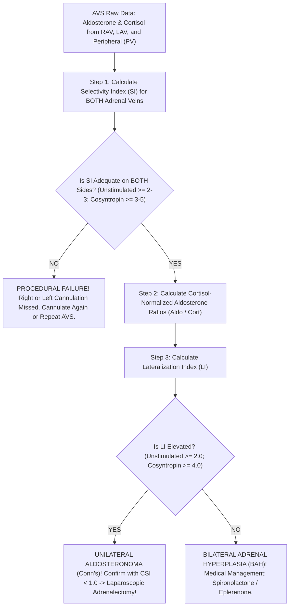

#### **Step 1: The Selectivity Index (SI) — Confirming True Adrenal Vein Engagement**
Because peripheral blood flows through the IVC at thousands of milliliters per minute, any aspirate contaminated by IVC blood will dilute hormone concentrations. **Cortisol** serves as the internal reference standard to verify that the catheter was truly seated inside the adrenal vein:

$$\text{Selectivity Index (Right)} = \frac{[\text{Cortisol}]_{\text{Right Adrenal Vein}}}{[\text{Cortisol}]_{\text{Peripheral Vein}}}$$

$$\text{Selectivity Index (Left)} = \frac{[\text{Cortisol}]_{\text{Left Adrenal Vein}}}{[\text{Cortisol}]_{\text{Peripheral Vein}}}$$

* **Diagnostic Validation Thresholds:**
  * **Unstimulated AVS:**
    * $\text{SI} \ge 2.0$ (standard criteria; strict academic centers demand $\ge 3.0$).
  * **Cosyntropin-Stimulated AVS:**
    * $\text{SI} \ge 5.0$ (stringent criteria; minimum acceptable $\ge 3.0$).
* **Critical Rule:** If the Selectivity Index is $< 3.0\text{–}5.0$ on *either* side (almost always the difficult right side), **THE ENTIRE PROCEDURE IS NON-DIAGNOSTIC**. You cannot interpret lateralization from an unselected sample!

---

#### **Step 2: Cortisol Normalization for Phrenic and Venous Dilution**
The left adrenal vein aspirate is systematically diluted by phrenic venous blood, while the right adrenal vein aspirate may experience variable IVC flow. To correct for differential dilutional volume, **aldosterone is normalized to cortisol in every tube**:

$$\text{Normalized Aldo/Cort (Right)} = \frac{[\text{Aldosterone}]_{\text{RAV}}}{[\text{Cortisol}]_{\text{RAV}}}$$

$$\text{Normalized Aldo/Cort (Left)} = \frac{[\text{Aldosterone}]_{\text{LAV}}}{[\text{Cortisol}]_{\text{LAV}}}$$

$$\text{Normalized Aldo/Cort (Peripheral)} = \frac{[\text{Aldosterone}]_{\text{PV}}}{[\text{Cortisol}]_{\text{PV}}}$$

---

#### **Step 3: The Lateralization Index (LI) — Proving Unilateral Adenoma**
The Lateralization Index compares the normalized aldosterone output of the dominant (higher) adrenal gland against the non-dominant (lower) adrenal gland:

$$\text{Lateralization Index (LI)} = \frac{(\text{Aldo} / \text{Cort})_{\text{Dominant Adrenal}}}{(\text{Aldo} / \text{Cort})_{\text{Non-Dominant Adrenal}}}$$

* **Diagnostic Cutoffs for Unilateral Adrenalectomy:**
  * **Unstimulated Protocol:**
    * $\mathbf{\text{LI} \ge 2.0:}$ Suggests unilateral disease.
    * $\mathbf{\text{LI} \ge 4.0:}$ Definitive proof of unilateral aldosterone-producing adenoma.
  * **Cosyntropin-Stimulated Protocol:**
    * $\mathbf{\text{LI} \ge 4.0:}$ **DEFINITIVE PROOF OF UNILATERAL ALDOSTERONOMA** ($95\%\text{ to }100\%$ specificity). Indicates curative laparoscopic unilateral adrenalectomy!
    * $\mathbf{\text{LI} < 3.0:}$ **DIAGNOSTIC OF BILATERAL ADRENAL HYPERPLASIA**. Adrenalectomy is contraindicated; start Spironolactone.
    * $\mathbf{\text{LI between } 3.0\text{ and }4.0:}$ Gray zone / indeterminate.

---

#### **Step 4: The Contralateral Suppression Index (CSI) — The Final Cross-Check**
In true unilateral disease, the astronomical systemic aldosterone levels produced by the autonomous adenoma suppress renin, which in turn completely shuts down aldosterone secretion in the normal contralateral adrenal gland. Therefore, the non-dominant adrenal gland should secrete *less* aldosterone per unit cortisol than the peripheral circulation:

$$\text{Contralateral Suppression Index (CSI)} = \frac{(\text{Aldo} / \text{Cort})_{\text{Non-Dominant Adrenal}}}{(\text{Aldo} / \text{Cort})_{\text{Peripheral Vein}}}$$

* **$\mathbf{\text{CSI} < 1.0:}$** **Confirms complete contralateral adrenal suppression.** This provides absolute clinical certainty that the contralateral gland is quiescent and that removing the dominant gland will cure the patient!
* **$\mathbf{\text{CSI} > 1.0:}$** Contralateral gland is actively hypersecreting aldosterone; strongly implies bilateral hyperplasia even if the LI appears borderline elevated.

---

### **17.3.8 Full Clinical Case Demonstration: Behind the Curtain with the Raw Data**

A 48-year-old male with treatment-resistant hypertension ($\text{BP } 168/104\ \text{mmHg}$ on amlodipine, metoprolol, and valsartan) undergoes washout and switch to verapamil and doxazosin.
* **Screening Labs:** Serum $\text{K}^+ = 3.6\ \text{mEq/L}$ (repleted to $4.2\ \text{mEq/L}$); Seated $\text{PAC} = 38\ \text{ng/dL}$; $\text{PRA} = 0.2\ \text{ng/mL/hr}$.
  $$\text{ARR} = \frac{38}{0.2} = 190\quad (\text{Severely Positive; PAC } > 15)$$
* **Saline Infusion Test:** Post-saline $\text{PAC} = 24.6\ \text{ng/dL}$ ($> 10\ \text{ng/dL}$, autonomous PA confirmed).
* **Adrenal CT:** Shows a $1.2\ \text{cm}$ nodule in the **LEFT** adrenal gland and a normal right adrenal gland.
* **The Patient is taken to the Interventional Suite for Cosyntropin-Stimulated AVS:**

#### **Raw Laboratory Data Returned by the Mass Spec Lab:**
* **Peripheral Vein ($\text{PV}$):** $\text{Aldosterone} = 22\ \text{ng/dL}$; $\text{Cortisol} = 28\ \mu\text{g/dL}$.
* **Left Adrenal Vein ($\text{LAV}$):** $\text{Aldosterone} = 880\ \text{ng/dL}$; $\text{Cortisol} = 560\ \mu\text{g/dL}$.
* **Right Adrenal Vein ($\text{RAV}$):** $\text{Aldosterone} = 6,800\ \text{ng/dL}$; $\text{Cortisol} = 620\ \mu\text{g/dL}$.

#### **Step-by-Step Calculation:**
1. **Check Selectivity Index ($\text{SI}$):**
   $$\text{SI}_{\text{Left}} = \frac{560\ \mu\text{g/dL}}{28\ \mu\text{g/dL}} = 20.0\quad (\ge 5.0, \text{EXCELLENT CANNULATION})$$
   $$\text{SI}_{\text{Right}} = \frac{620\ \mu\text{g/dL}}{28\ \mu\text{g/dL}} = 22.1\quad (\ge 5.0, \text{EXCELLENT CANNULATION})$$
2. **Calculate Normalized Aldo/Cort Ratios:**
   $$\text{Ratio}_{\text{Peripheral}} = \frac{22}{28} = 0.785$$
   $$\text{Ratio}_{\text{Left}} = \frac{880}{560} = 1.571$$
   $$\text{Ratio}_{\text{Right}} = \frac{6,800}{620} = 10.967$$
   *(Notice that the Right side is the dominant gland!)*
3. **Calculate Lateralization Index ($\text{LI}$):**
   $$\text{LI} = \frac{\text{Ratio}_{\text{Dominant (Right)}}}{\text{Ratio}_{\text{Non-Dominant (Left)}}} = \frac{10.967}{1.571} = \mathbf{6.98}$$
   *$\text{LI} = 6.98 \ge 4.0 \implies$ **MASSIVE RIGHT-SIDED LATERALIZATION!**
4. **Calculate Contralateral Suppression Index ($\text{CSI}$):**
   $$\text{CSI} = \frac{\text{Ratio}_{\text{Non-Dominant (Left)}}}{\text{Ratio}_{\text{Peripheral}}} = \frac{1.571}{0.785} = 2.0\quad (\text{Wait! Is it suppressed?})$$
   *In this case, the dominant production is overwhelmingly Right-sided ($\text{LI} = 6.98$).*

#### **The Diagnostic Revelation:**
Look at what the CT showed: a $1.2\ \text{cm}$ nodule in the **LEFT** adrenal gland! If the surgeon had operated based on the CT scan, they would have removed the **WRONG ADRENAL GLAND**—resecting a harmless non-functioning incidentaloma on the left and leaving the microscopic, lethal aldosterone-producing adenoma in the right adrenal gland! AVS saved this patient from surgical catastrophe. The patient underwent right laparoscopic adrenalectomy, with complete histological cure.

---

*(Volume XVII continues below with Adrenal Insufficiency, Congenital Adrenal Hyperplasia, Pheochromocytoma, and Posterior Pituitary Dynamics)*


---

## **DOSSIER 17.4: ADRENAL INSUFFICIENCY & CONGENITAL ADRENAL HYPERPLASIA (CAH)**

### **17.4.1 Primary vs Secondary/Tertiary Hypoadrenalism**

Adrenal insufficiency ($\text{AI}$) is a life-threatening state of deficient glucocorticoid (and, in primary disease, mineralocorticoid) production:
* **Primary Adrenal Insufficiency ($\text{PAI}$ / Addison's Disease):** Direct destruction of the adrenal cortex ($> 90\%$ destruction required for symptoms). Etiologies: Autoimmune adrenalitis (anti-21-hydroxylase antibodies, $\text{APS-1}$ / $\text{APS-2}$), bilateral adrenal hemorrhage (Waterhouse-Friderichsen syndrome, heparin-induced thrombocytopenia, antiphospholipid syndrome), infectious (tuberculosis, fungal, CMV in HIV), or adrenoleukodystrophy ($\text{ABCD1}$).
  * *Biochemical Footprint:* **Low Cortisol + Astronomical ACTH** ($> 100\text{–}1,000\ \text{pg/mL}$). Unopposed cleavage of Pro-opiomelanocortin ($\text{POMC}$) releases $\alpha\text{-MSH}$, stimulating melanocortin 1 receptors ($\text{MC1R}$) on basal epidermal melanocytes, causing **diffuse cutaneous and mucosal hyperpigmentation** (palmar creases, buccal mucosa, vermilion border, surgical scars). Loss of aldosterone produces **hyperkalemia, hyponatremia, non-gap metabolic acidosis, and hypovolemic orthostatic shock**.
* **Secondary / Tertiary Adrenal Insufficiency ($\text{SAI}$ / $\text{TAI}$):** Pituitary ACTH deficiency (pituitary adenoma, apoplexy, Sheehan's syndrome, lymphocytic hypophysitis, cranial radiation) or hypothalamic CRH deficiency (most commonly **iatrogenic suppression following prolonged exogenous corticosteroid therapy**).
  * *Biochemical Footprint:* **Low Cortisol + Inappropriately Low/Normal ACTH**. Because the renin-angiotensin-aldosterone axis operates independently of ACTH, **aldosterone secretion is preserved**; patients present with hyponatremia (due to SIADH-like free water retention from cortisol lack) but **NORMAL POTASSIUM** and zero hyperpigmentation!

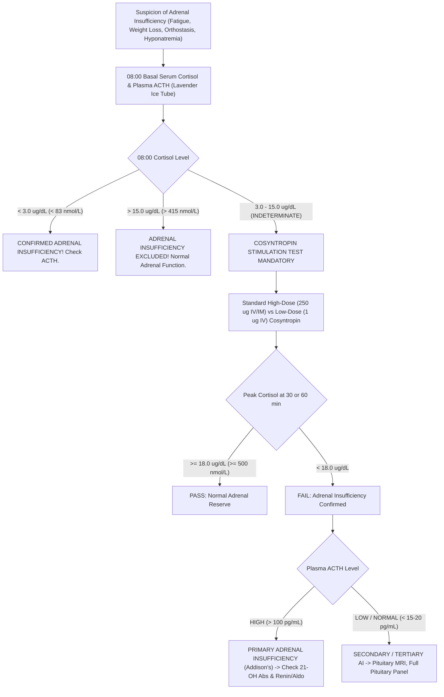

---

### **17.4.2 Dynamic Cosyntropin Stimulation Testing: High-Dose vs Low-Dose**

When basal morning cortisol falls into the indeterminate gray zone ($3.0\text{ to }15.0\ \mu\text{g/dL}$), provocative dynamic testing is required.

#### **1. The Standard High-Dose (250-$\mu\text{g}$) Cosyntropin Stimulation Test**
* **The Pharmacological Agent:** Cosyntropin (tetracosactide) consists of the first **24 amino acids of human ACTH ($\text{ACTH}_{1-24}$)**, possessing full steroidogenic potency identical to native 39-amino acid ACTH.
* **Supraphysiological Drive:** A $250\text{-}\mu\text{g}$ dose is astronomical—roughly **$1,000\times$ higher** than physiological peak ACTH levels in human blood, driving plasma ACTH concentrations above $10,000\text{ to }50,000\ \text{pg/mL}$ for several hours, maximizing steroidogenesis across the adrenal zona fasciculata.
* **Standard Protocol:**
  1. Patient presents at any time of day (diurnal rhythm is overwhelmed by $250\ \mu\text{g}$ ACTH), though morning testing is customary.
  2. Baseline Total Cortisol drawn at $t = 0\ \text{minutes}$.
  3. **$250\ \mu\text{g}$ Cosyntropin injected IV or IM**.
  4. Repeat serum cortisol drawn at **$t = +30\ \text{minutes}$ and $t = +60\ \text{minutes}$**.
* **Diagnostic Interpretation:**
  $$\mathbf{\text{Normal Passing Threshold: Peak Cortisol at 30 or 60 min } \ge 18.0\ \mu\text{g/dL}\ (500\ \text{nmol/L})}$$
  *(With modern monoclonal antibody or LC-MS/MS assays with zero steroid cross-reactivity, some academic centers have revised this threshold downward to $\ge 14.0\text{–}15.0\ \mu\text{g/dL}$.)*
  * **Peak $< 18.0\ \mu\text{g/dL}$:** Confirms adrenal insufficiency.

#### **2. The Low-Dose (1-$\mu\text{g}$) Cosyntropin Stimulation Test: Unmasking Subtle Central AI**
* **The Physiological Rationale:**
  * While the $250\text{-}\mu\text{g}$ test has near-$100\%$ sensitivity for primary adrenal failure, it can produce a **catastrophic false-negative in mild, partial, or recent secondary adrenal insufficiency**.
  * If a patient developed pituitary damage or abruptly ceased steroids 4 weeks ago, their pituitary ACTH is low, but the adrenal cortex has not yet undergone complete anatomical zona fasciculata atrophy. A massive $250\text{-}\mu\text{g}$ pharmacological hammer can shock even partially atrophic adrenal glands into producing an $18.5\ \mu\text{g/dL}$ cortisol, masking true life-threatening central hypoadrenalism!
  * A **$1.0\text{-}\mu\text{g}$ dose** generates peak plasma ACTH concentrations of $\sim 100\ \text{pg/mL}$—closely mimicking the physiological peak of severe surgical trauma or sepsis.
* **Behind-the-Curtain Preparation (The Serial Dilution Protocol):**
  Commercial vials contain $250\ \mu\text{g}$ of cosyntropin powder. To deliver $1\ \mu\text{g}$:
  1. Reconstitute a $250\text{-}\mu\text{g}$ vial in $1.0\ \text{mL}$ sterile normal saline.
  2. Inject the $1.0\ \text{mL}$ ($250\ \mu\text{g}$) into a **$250\text{-mL}$ bag of $0.9\%\ \text{NaCl}$** $\implies$ concentration = **$1.0\ \mu\text{g/mL}$**.
  3. Agitate thoroughly. Withdraw exactly **$1.0\ \text{mL}$ ($1.0\ \mu\text{g}$)** using a tuberculin syringe and administer IV push over 1 minute.
  4. Blood drawn at $t = 0, +20,$ and $+30\ \text{minutes}$. (Peak occurs early at $+20\text{–}30\ \text{min}$ due to rapid clearance of $1\ \mu\text{g}$).
* **Passing Threshold:** Peak Cortisol $\ge 18.0\ \mu\text{g/dL}$ at 20 or 30 minutes.

#### **3. The Insulin Tolerance Test (ITT): The Historical Gold Standard for the Central Axis**
* **Mechanism:** Intravenous regular insulin ($0.1\text{–}0.15\ \text{U/kg}$) induces acute neuroglycopenic stress. Severe hypoglycemia activates central hypothalamic autonomic nuclei to trigger massive endogenous CRH, ACTH, and GH release.
* **Prerequisites:** Blood glucose must drop to **$< 40\ \text{mg/dL}$ ($< 2.2\ \text{mmol/L}$)** with observable neuroglycopenic symptoms (diaphoresis, tachycardia, somnolence).
* **Normal Passing Criteria:** Peak Cortisol $\ge 18.0\ \mu\text{g/dL}$ AND Peak Growth Hormone $\ge 5.0\ \text{ng/mL}$.
* **Contraindications:** Severe coronary artery disease, history of seizures/epilepsy, cerebrovascular disease, elderly patients. Physician must remain at bedside with $50\%\ \text{Dextrose}$ ready for immediate infusion.

---

### **17.4.3 Congenital Adrenal Hyperplasia (CAH) & The Steroid Metabolome**

Congenital Adrenal Hyperplasia encompasses a family of autosomal recessive enzyme deficiencies along the steroidogenic pathway within the adrenal cortex:

```
Cholesterol 
   ↓ (CYP11A1 / Desmolase)
Pregnenolone ──────→ 17-OH Pregnenolone ──────→ DHEA ──→ DHEA-S
   ↓ (3β-HSD)             ↓ (3β-HSD)                 ↓ (3β-HSD)
Progesterone ──────→ 17-OH Progesterone (17-OHP) → Androstenedione ──→ Testosterone
   ↓ (CYP21A2)            ↓ (CYP21A2 / 21-OH)        ↓ 
11-DOC                    11-Deoxycortisol           Estradiol
   ↓ (CYP11B1)            ↓ (CYP11B1 / 11β-OH)
Corticosterone            Cortisol
   ↓ (CYP11B2)
Aldosterone
```

#### **1. 21-Hydroxylase Deficiency ($\text{CYP21A2}$, $> 90\%\text{ of CAH}$)**
* **The Biochemical Block:** Loss of 21-hydroxylase impairs conversion of **Progesterone $\to$ 11-Deoxycorticosterone** (mineralocorticoid pathway) and **17-OH-Progesterone $\to$ 11-Deoxycortisol** (glucocorticoid pathway).
* **Massive ACTH Drive:** Hypocortisolemia eliminates negative feedback, driving pituitary ACTH secretion to extreme levels. ACTH hyper-stimulates the adrenal cortex, shunting all steroid precursors into the intact **androgen pathway** (DHEA, Androstenedione, Testosterone).
* **Clinical Spectrum:**
  * **Classical Salt-Wasting ($0\%\text{ enzyme activity}$):** Severe mineralocorticoid and glucocorticoid deficiency presenting in the second week of life with hyperkalemic hyponatremic circulatory collapse; ambiguous genitalia in 46,XX females.
  * **Classical Simple Virilizing ($1\%\text{ enzyme activity}$):** Adequate aldosterone to maintain sodium balance; marked prenatal virilization of 46,XX fetuses.
  * **Non-Classic Late-Onset CAH ($\text{NCAH}$, $20\%\text{–}50\%\text{ activity}$):** Presents in adolescence/adulthood with hirsutism, cystic acne, oligomenorrhea, and infertility, mimicking PCOS!

#### **2. Liquid Chromatography–Tandem Mass Spectrometry Steroid Panel**
Immunoassays for steroid hormones cross-react intensely because steroid molecules share a nearly identical four-ring cyclopentanoperhydrophenanthrene core. Modern diagnosis demands **Steroid Profiling via Triple-Quadrupole LC-MS/MS**:

| Steroid Analyte | Biochemical Relevance | Normal Follicular / Basal Level | Diagnostic CAH Cutoff (21-OHD) | Diagnostic Cutoff (11$\beta$-OHD) |
| :--- | :--- | :--- | :--- | :--- |
| **17-Hydroxyprogesterone (17-OHP)** | Immediate precursor blocked by 21-OH | $< 200\ \text{ng/dL}$ ($< 6\ \text{nmol/L}$) | **$> 1,000\ \text{ng/dL}$ ($> 30\ \text{nmol/L}$)** (or post-cosyntropin $> 1,000$) | Normal to mildly elevated |
| **21-Deoxycortisol (21-DOF)** | Synthesized when 17-OHP is $11\beta\text{-hydroxylated}$; **Pathognomonic for 21-OHD!** | $< 20\ \text{ng/dL}$ ($< 0.6\ \text{nmol/L}$) | **$> 200\text{–}1,000\ \text{ng/dL}$ (Near-$100\%$ Specific)** | Completely Undetectable |
| **11-Deoxycortisol (Compound S)** | Precursor blocked by $11\beta\text{-hydroxylase}$ | $< 100\ \text{ng/dL}$ ($< 3\ \text{nmol/L}$) | Undetectable or low | **Sky-High ($> 2,000\text{–}5,000\ \text{ng/dL}$)** |
| **Deoxycorticosterone (DOC)** | Potent mineralocorticoid precursor blocked by $11\beta\text{-OH}$ | $< 10\ \text{ng/dL}$ | Undetectable | **Markedly elevated $\implies$ Severe Hypertension + Hypokalemia!** |
| **Androstenedione** | Direct adrenal androgen product | $50\text{–}150\ \text{ng/dL}$ | Markedly elevated ($> 400\ \text{ng/dL}$) | Elevated |

---

## **DOSSIER 17.5: PHEOCHROMOCYTOMA, PARAGANGLIOMA, AND THE CATECHOLAMINE METABOLOME**

### **17.5.1 Neuroendocrine Biology of Chromaffin Tumors**

Pheochromocytomas (arising from adrenal chromaffin cells) and Paragangliomas (arising from extra-adrenal sympathetic or parasympathetic paraganglia) secrete catecholamines: **Dopamine, Norepinephrine, and Epinephrine**.

#### **The Flaw of Measuring Native Catecholamines:**
1. **Episodic Secretion:** Catecholamine exocytosis from tumor secretory granules is paroxysmal; during inter-paroxysmal periods, circulating norepinephrine and epinephrine can be completely normal.
2. **Short Half-Life:** Native plasma catecholamines are rapidly cleared ($t_{1/2} \approx 1\text{ to }2\text{ minutes}$) by neuronal uptake-1 and extraneuronal uptake-2 mechanisms.
3. **Continuous Intratumoral Metabolism:** Chromaffin tumor cells continuously leak free catecholamines from storage vesicles into the cytoplasm, where the intracellular enzyme **Catechol-O-Methyltransferase ($\text{COMT}$)** metabolizes them continuously and independently of exocytosis:
   $$\text{Norepinephrine} \xrightarrow{\text{Intratumoral COMT}} \mathbf{\text{Normetanephrine}}$$
   $$\text{Epinephrine} \xrightarrow{\text{Intratumoral COMT}} \mathbf{\text{Metanephrine}}$$
   $$\text{Dopamine} \xrightarrow{\text{Intratumoral COMT}} \mathbf{\text{Methoxytyramine}}$$

These O-methylated metabolites—**Metanephrines**—have a much longer plasma half-life ($t_{1/2} \approx 30\text{ to }60\text{ minutes}$) and are continuously released into blood regardless of whether the tumor is actively firing!

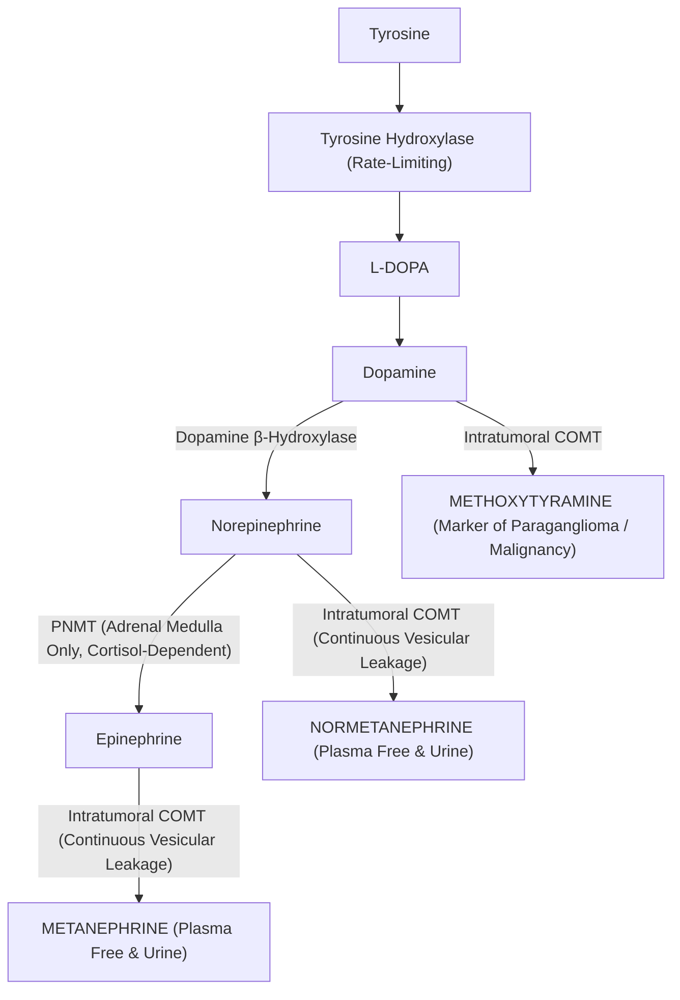

---

### **17.5.2 Plasma Free Metanephrines vs 24-Hour Urine Fractionated Metanephrines**

The biochemical test of choice is **Plasma Free Metanephrines** measured by **LC-MS/MS**:
* **Sensitivity:** $> 97\%\text{ to }99\%$ (virtually zero false-negatives; a negative plasma metanephrine essentially excludes pheochromocytoma).
* **24-Hour Urine Fractionated Metanephrines:** Sensitivity $90\%\text{ to }95\%$; historically favored due to wider availability, but relies on deconjugation of metanephrine sulfates generated by gastrointestinal bacteria and hepatic sulfotransferases ($\text{SULT1A3}$).

#### **The Strict Supine Rest Protocol: Eliminating the 30% False-Positive Disaster**
Because the sympathetic nervous system activates instantly in response to upright posture and physical pain, drawing blood seated or immediately following venipuncture causes massive physiological norepinephrine release:
* **The Seated Venipuncture Catastrophe:** Upright posture doubles plasma normetanephrine! More than **$25\%\text{ to }30\%$ of healthy individuals drawn while seated yield falsely elevated normetanephrine levels**, triggering hundreds of unnecessary CT and MRI scans.
* **The Rigorous Pre-Analytical Protocol:**
  1. Patient must avoid caffeine, nicotine, acetaminophen, and decongestants for 24 hours.
  2. Patient lies **completely supine in a quiet, dimly lit room for at least 30 minutes**.
  3. Blood MUST be drawn from an **indwelling intravenous catheter placed 30 minutes earlier**, OR drawn with minimal tourniquet time while the patient remains strictly supine.
  4. Blood collected in a **pre-chilled Lavender-top $\text{K}_2\text{-EDTA}$ tube**, placed immediately into an **ice-water slurry**, and centrifuged at $4^\circ\text{C}$.

#### **Diagnostic Thresholds (Supine LC-MS/MS):**
* **Free Normetanephrine:** Normal $< 0.90\ \text{nmol/L}$ ($< 165\ \text{pg/mL}$). Highly diagnostic: $> 2.2\ \text{nmol/L}$ ($> 400\ \text{pg/mL}$).
* **Free Metanephrine:** Normal $< 0.50\ \text{nmol/L}$ ($< 98\ \text{pg/mL}$). Highly diagnostic: $> 1.2\ \text{nmol/L}$ ($> 236\ \text{pg/mL}$).
* **The $\ge 3\times$ Upper Limit Rule:** Any value $> 3\times$ the upper reference limit is virtually $100\%$ diagnostic of pheochromocytoma/paraganglioma.

---

### **17.5.3 The Clonidine Suppression Test**

When plasma normetanephrine is borderline elevated ($1.0\text{ to }2.5\times$ ULN) and sympathetic pseudopheochromocytoma is suspected:
* **Mechanism:** Clonidine is a central $\alpha_2\text{-adrenergic}$ agonist that dampens sympathetic outflow from the rostral ventrolateral medulla. In anxious, sympathetic-hyperactive patients, clonidine shuts down neuronal norepinephrine release, dropping plasma normetanephrine. In pheochromocytoma, tumor secretion is autonomous and unaffected by central sympathetic tone.
* **Protocol:**
  1. Patient placed supine for 30 minutes; baseline plasma free normetanephrine drawn ($t = 0$).
  2. **$0.3\ \text{mg}$ oral Clonidine administered**.
  3. Patient remains supine with continuous BP monitoring (risk of profound hypotension).
  4. Repeat plasma normetanephrine drawn at **$t = +3\ \text{hours}$**.
* **Interpretation:**
  * **Normal Response (Sympathetic Excess Excluded):** Plasma normetanephrine drops by **$\ge 40\%$** from baseline AND falls into the normal reference range.
  * **Pheochromocytoma:** Plasma normetanephrine **fails to drop by $\ge 40\%$** or remains elevated above normal.

---

### **17.5.4 Genetic Screening Algorithms**

At least **$35\%\text{ to }40\%$ of all pheochromocytomas and paragangliomas are driven by germline pathogenic variants**—the highest hereditary rate of any human solid tumor! All patients require germline genetic testing via next-generation sequencing ($\text{NGS}$) panels:

| Gene | Disease Association | Clinical Features & Tumor Distribution | Malignancy Risk |
| :--- | :--- | :--- | :--- |
| **$\text{RET}$** | MEN2A & MEN2B | Bilateral adrenal pheochromocytomas (90% adrenergic/metanephrine), Medullary Thyroid Carcinoma, Hyperparathyroidism | Low ($< 5\%$) |
| **$\text{VHL}$** | von Hippel-Lindau | Adrenal pheos (noradrenergic), Clear Cell RCC, Hemangioblastomas (CNS/Retina), Pancreatic NETs | Low ($< 5\%$) |
| **$\text{NF1}$** | Neurofibromatosis Type 1 | Adrenal pheochromocytomas, Café-au-lait spots, Neurofibromas, Lisch nodules | Low ($< 5\%$) |
| **$\text{SDHB}$** | Hereditary Paraganglioma (Cluster 1A) | Extra-adrenal abdominal/thoracic paragangliomas; **High risk of metastatic disease!** | **HIGH ($30\% - 50\%$)** |
| **$\text{SDHD}$** | Hereditary Paraganglioma | Head and neck parasympathetic non-secretory paragangliomas (Glomus tumors); **Maternal imprinting (disease only when inherited from father!)** | Moderate ($5\%$) |
| **$\text{SDHA/C/AF2}$**| Paraganglioma syndromes | Head/neck paragangliomas, GIST tumors | Low to moderate |

---

## **DOSSIER 17.6: POSTERIOR PITUITARY & THYROID MASS SPECTROMETRY NUANCES**

### **17.6.1 The Polyuria-Polydipsia Spectrum & The Water Deprivation Test**

The differential diagnosis of hypotonic polyuria ($> 3\ \text{L/24 hr}$ with urine osmolality $< 300\ \text{mOsm/kg}$) encompasses:
1. **Central Diabetes Insipidus ($\text{CDI}$):** Deficiency of hypothalamic synthesis or posterior pituitary storage of Arginine Vasopressin ($\text{AVP}$).
2. **Nephrogenic Diabetes Insipidus ($\text{NDI}$):** Renal resistance to AVP at the level of the collecting duct $\text{V}_2$ receptor ($\text{AVPR2}$) or Aquaporin-2 water channel ($\text{AQP2}$).
3. **Primary Polydipsia ($\text{PP}$):** Compulsive excessive fluid ingestion suppressing physiological AVP release.

#### **The Classical Water Deprivation Test (The Miller-Moses Protocol):**
* Patient is deprived of fluids for up to 8 to 12 hours until urine osmolality plateaus ($< 30\ \text{mOsm/kg}$ change across three hourly voids) or serum sodium exceeds $145\ \text{mmol/L}$.
* Then, **$2\text{ to }4\ \mu\text{g}$ Desmopressin (DDAVP)** is injected SC or IV, and urine osmolality monitored for 2 hours.
* **Classical Interpretation:**
  * **Central DI:** Urine osmolality $< 300\ \text{mOsm/kg}$ after dehydration, increasing by **$> 50\%$ (often $> 100\%$)** after DDAVP.
  * **Nephrogenic DI:** Urine osmolality stays $< 300\ \text{mOsm/kg}$ despite DDAVP ($< 45\%\text{ increase}$).
  * **Primary Polydipsia:** Urine osmolality concentrates to $> 500\text{–}800\ \text{mOsm/kg}$ during dehydration, showing $< 10\%\text{ increase}$ after DDAVP.
* **The Severe Hazards of Miller-Moses:** The test is agonizing for patients, requires prolonged hospital observation, carries risk of severe hypernatremic dehydration in CDI, and produces ambiguous results in up to **$30\%\text{ to }40\%$ of patients** with partial forms of CDI or chronic primary polydipsia (which washes out the renal medullary concentration gradient)!

---

### **17.6.2 The Modern Plasma Copeptin Revolution**

Arginine Vasopressin ($\text{AVP}$) is notoriously difficult to measure in clinical laboratories: it is a tiny 9-amino acid nonapeptide ($M_r = 1,084\ \text{Da}$) that binds avidly to platelets, degrades within minutes at room temperature, and has a plasma half-life of only $15\text{ minutes}$.

**Copeptin** is the 39-amino acid C-terminal glycopeptide segment of the pre-pro-vasopressin precursor molecule:
$$\text{Pre-Pro-AVP} \implies \text{Signal Peptide} + \mathbf{\text{AVP (Active)}} + \text{Neurophysin II} + \mathbf{\text{Copeptin (1:1 Stoichiometric)}}$$

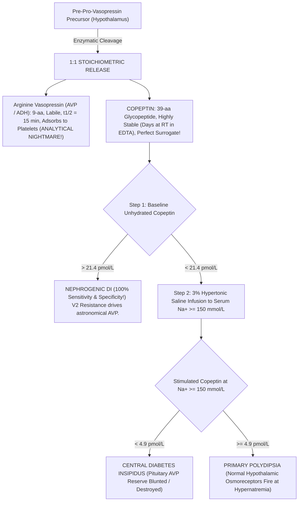

#### **The Diagnostic Protocols:**
1. **Unstimulated Baseline Copeptin (Instant NDI Rule-In):**
   * If baseline plasma copeptin without fluid deprivation is **$> 21.4\ \text{pmol/L}$**, **NEPHROGENIC DIABETES INSIPIDUS IS CONFIRMED WITH 100% SENSITIVITY AND SPECIFICITY**! Renal $\text{V}_2$ resistance causes profound homeostatic hypothalamic AVP hypersecretion. No further dynamic testing is required!
2. **Hypertonic Saline-Stimulated Copeptin Protocol:**
   * Used to distinguish Central DI from Primary Polydipsia.
   * Infusion of **$3\%\ \text{Sodium Chloride}$ IV** at $0.1\ \text{mL/kg/min}$ (or boluses) with serum sodium measured every 30 minutes until **$\text{Na}^+ \ge 150\ \text{mmol/L}$**.
   * At serum $\text{Na}^+ \ge 150\ \text{mmol/L}$, osmotic drive is maximal:
     * **Copeptin $< 4.9\ \text{pmol/L}$:** **Confirms Central Diabetes Insipidus** ($93\%\text{ sensitivity, } 100\%\text{ specificity}$).
     * **Copeptin $\ge 4.9\ \text{pmol/L}$:** **Confirms Primary Polydipsia** (intact osmoreceptors fire appropriately).
3. **Arginine Stimulation Test (The Safe Alternative):**
   * Infusion of L-Arginine ($0.5\ \text{g/kg}$ over 30 min) stimulates anterior and posterior pituitary secretion without inducing hypernatremia. Stimulated copeptin $< 3.8\ \text{pmol/L}$ indicates Central DI.

---

### **17.6.3 Thyroid Hormone Separation Physics: Equilibrium Dialysis & Ultrafiltration LC-MS/MS**

Routine automated Free $\text{T}_4$ and Free $\text{T}_3$ immunoassays use direct, analog competitive methods that measure hormone binding in the presence of native serum proteins. They are susceptible to catastrophic artifacts:
1. **Familial Dysalbuminemic Hyperthyroxinemia ($\text{FDH}$):** An autosomal dominant missense mutation in the human serum albumin gene (most commonly **Arg218His** or **Arg218Pro**) increases albumin's binding affinity for synthetic $\text{T}_4$ analog tracers by $50\times$. On competitive immunoassays, the mutant albumin swallows the tracer, printing a **falsely sky-high Free $\text{T}_4$ ($> 6\text{ to }8\ \text{ng/dL}$)** in a clinically euthyroid patient with normal TSH!
2. **Anti-$\text{T}_4$ and Anti-$\text{T}_3$ Autoantibodies:** Circulating immunoglobulins bind labeled tracer, simulating hyperthyroidism.
3. **Biotin and Heterophile Antibodies:** Disrupt streptavidin-biotin bridges.

#### **The Physical Separation Solution: $37^\circ\text{C}$ Equilibrium Dialysis ($\text{ED}$)**
To measure true free hormone, the free fraction must be physically separated from binding proteins *before* measurement:

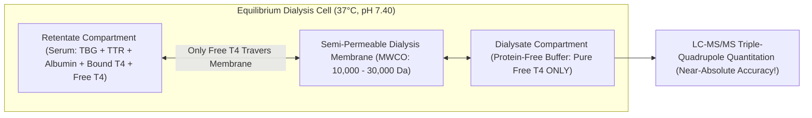

* **Physical Membrane:** A semi-permeable regenerated cellulose membrane with a **Molecular Weight Cut-Off ($\text{MWCO}$) of $10\text{ to }30\ \text{kDa}$** separates the serum from a physiological dialysate buffer ($\text{pH } 7.40$, $37^\circ\text{C}$).
* **Equilibrium:** Binding globulins ($\text{TBG } 54\ \text{kDa}$, $\text{Albumin } 66.5\ \text{kDa}$) cannot cross the pores. Free lipophilic $\text{T}_4$ ($777\ \text{Da}$) crosses freely until dialysate concentration equals serum free concentration.
* **Isotope-Dilution LC-MS/MS Quantitation:** The protein-free dialysate is spiked with $^{13}\text{C}_6\text{-L-Thyroxine}$, extracted, and injected into the triple quadrupole:
  $$\text{Free } \text{T}_4\ [M+H]^+: m/z\ 777.7 \longrightarrow 731.7\quad (\text{Quantifier})$$
  $$\text{Free } \text{T}_4\ [M+H]^+: m/z\ 777.7 \longrightarrow 604.8\quad (\text{Qualifier})$$
  $$^{13}\text{C}_6\text{-Free } \text{T}_4\ [M+H]^+: m/z\ 783.7 \longrightarrow 737.7\quad (\text{Internal Standard})$$
* This completely eliminates binding-protein artifacts, FDH, autoantibodies, and biotin interferences!

---

### **17.6.4 Thyroglobulin (Tg) by LC-MS/MS Tryptic Cleavage**

Thyroglobulin ($\text{Tg}$) is a large dimeric glycoprotein ($660\ \text{kDa}$) produced exclusively by thyroid follicular cells, serving as the critical tumor marker for surveillance of **Differentiated Thyroid Carcinoma (Papillary and Follicular Thyroid Cancer)** following total thyroidectomy and radioiodine ablation.

#### **The Anti-Thyroglobulin Autoantibody ($\text{TgAb}$) Nightmare:**
* Approximately **$20\%\text{ to }30\%$ of patients with thyroid carcinoma harbor circulating anti-thyroglobulin autoantibodies ($\text{TgAb}$)**.
* On standard two-site sandwich immunoassays (ECLIA/CMIA), endogenous patient $\text{TgAb}$ binds to surface epitopes on thyroglobulin, physically steric-hindering the analyzer's monoclonal antibodies from forming the sandwich bridge!
* **Result:** The analyzer reports **$\text{Tg} < 0.1\ \text{ng/mL}$ (falsely undetectable)** while the patient is harboring widely metastatic pulmonary or lymph node recurrences!

#### **The LC-MS/MS Proteomic Solution: Tryptic Peptide Digestion**
Mass spectrometry solves this problem by destroying the antibodies through enzymatic digestion:

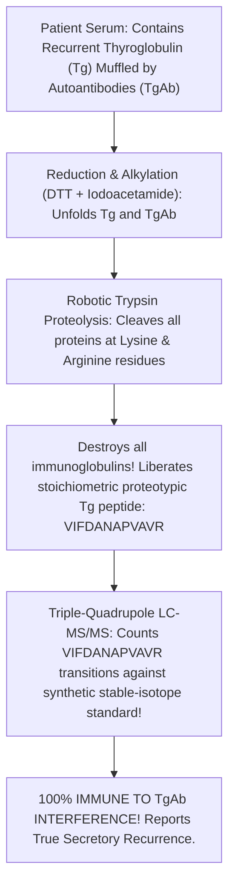

1. **Denaturation & Reduction:** Dithiothreitol ($\text{DTT}$) breaks all disulfide bonds, unfolding both thyroglobulin and the interfering autoantibodies.
2. **Alkylation:** Iodoacetamide carbamidomethylates free sulfhydryls, preventing refolding.
3. **Trypsin Digestion:** High-purity sequencing-grade trypsin cleaves peptide bonds specifically after lysine ($\text{Lys}$) and arginine ($\text{Arg}$) residues. This **completely pulverizes the patient's interfering anti-Tg autoantibodies into useless fragments** while liberating specific, reproducible **proteotypic signature peptides** from thyroglobulin.
4. **Signature Peptide Quantitation:** The conserved proteotypic peptide **$\text{VIFDANAPVAVR}$** (amino acids 1579–1590 of human thyroglobulin) is monitored:
   $$\text{Precursor Ion } [M+2H]^{2+}: m/z\ 629.8 \longrightarrow 856.5\quad (y_8\text{ Product Ion, Quantifier})$$
   $$\text{Precursor Ion } [M+2H]^{2+}: m/z\ 629.8 \longrightarrow 971.6\quad (y_9\text{ Product Ion, Qualifier})$$
   $$\text{Internal Standard } [^{13}\text{C}_6, ^{15}\text{N}_4\text{-Arg}]\ [M+2H]^{2+}: m/z\ 634.8 \longrightarrow 866.5$$
5. Because antibodies no longer exist after trypsinization, **LC-MS/MS thyroglobulin provides absolute diagnostic fidelity in $100\%$ of $\text{TgAb-positive}$ patients**!

---

## **DOSSIER 17.7: MASTER ANALYTICAL & INSTRUMENTATION REFERENCE COMPENDIUM**

### **17.7.1 Pre-Analytical Tube Selection, Storage & Rejection Criteria Matrix**

| Endocrine Dynamic Analyte | Tube Type & Additive | Transport Condition | Centrifugation Protocol | Storage Stability | Unconditional Laboratory Rejection Criteria |
| :--- | :--- | :--- | :--- | :--- | :--- |
| **Plasma ACTH** | **Lavender $\text{K}_2\text{-EDTA}$ (Plastic)** | **Ice-water slurry ($0^\circ\text{C}$)** | $4^\circ\text{C}$, $15\ \text{min}$ within $15\ \text{min}$ of draw | Frozen ($-20^\circ\text{C}$ for 7 days; $-80^\circ\text{C}$ for 6 months) | Glass tubes (ACTH adsorbs); Room temperature transport $> 15\ \text{min}$; Gross hemolysis |
| **Plasma Free Metanephrines** | **Lavender $\text{K}_2\text{-EDTA}$** | **Ice-water slurry** | $4^\circ\text{C}$, $15\ \text{min}$ within $30\ \text{min}$ | Frozen at $-20^\circ\text{C}$ | Drawn seated without $30\text{-min}$ supine rest; Transport unchilled |
| **Plasma Renin Activity ($\text{PRA}$)** | **Lavender $\text{K}_2\text{-EDTA}$** | **STRICT ROOM TEMPERATURE ($18\text{–}25^\circ\text{C}$)** | Room Temp, $2,000 \times g$, $15\ \text{min}$ | Freeze IMMEDIATELY after spin at $-20^\circ\text{C}$ | **NEVER CHILL WHOLE BLOOD!** (Cryoactivation of prorenin $\to$ renin causes massive false-high PRA!) |
| **Plasma Direct Renin ($\text{DRC}$)** | **Lavender $\text{K}_2\text{-EDTA}$** | Room Temperature | Room Temp, $15\ \text{min}$ | Frozen at $-20^\circ\text{C}$ | Chilled on wet ice prior to plasma separation |
| **Plasma Aldosterone ($\text{PAC}$)** | Gold $\text{SST}$ (Serum) or Lavender $\text{EDTA}$ | Ambient or Chilled | $15\ \text{min}$ at $2,000 \times g$ | Refrigerated 5 days, Frozen 1 year | Severe hemolysis (hemolyzed RBC enzymes degrade aldosterone) |
| **Serum Cortisol** | Gold $\text{SST}$ (Clot Activator) | Ambient | Allow $30\ \text{min}$ clot; Spin $10\ \text{min}$ | Refrigerated 7 days, Frozen 6 months | None (exceptionally stable steroid) |
| **Late-Night Salivary Cortisol** | **Synthetic Salivette (Swab)** | Ambient | Spin Salivette at $1,000 \times g$ for $2\ \text{min}$ | Refrigerated 14 days, Frozen 1 year | Cotton swab use (adsorption); **Blood contamination (Transferrin-positive)**; Insufficient volume ($< 200\ \mu\text{L}$) |
| **Plasma Copeptin** | Lavender $\text{K}_2\text{-EDTA}$ | Ambient or Chilled | Standard spin | Stable at Room Temp for **7 days!** | Gross hemolysis |
| **Thyroglobulin by LC-MS/MS** | Gold $\text{SST}$ (Serum) | Ambient | Standard clot & spin | Refrigerated 7 days, Frozen 1 year | Unseparated serum stored $> 24\ \text{hours}$ on clot |

---

### **17.7.2 Mass Spectrometry Multiple Reaction Monitoring (MRM) Parameter Database**

For triple-quadrupole mass spectrometers operated in Electrospray Ionization ($\text{ESI}$) mode with nitrogen desolvation gas ($450^\circ\text{C}$) and argon collision cell gas:

| Analyte | ESI Mode | Precursor Ion ($m/z$) | Product Quantifier ($m/z$) | Product Qualifier ($m/z$) | Collision Energy ($\text{eV}$) | Stable-Isotope Internal Standard |
| :--- | :--- | :--- | :--- | :--- | :--- | :--- |
| **Cortisol** | $\text{ESI}^+$ | $363.2\ [M+H]^+$ | **$121.1$** | $327.2$ | $30\ \text{eV}$ (Quant) / $18\ \text{eV}$ (Qual) | $d_4\text{-Cortisol}$ ($m/z\ 367.2 \to 121.1$) |
| **Cortisone** | $\text{ESI}^+$ | $361.2\ [M+H]^+$ | **$163.1$** | $121.1$ | $28\ \text{eV}$ / $34\ \text{eV}$ | $d_8\text{-Cortisone}$ ($m/z\ 369.2 \to 168.1$) |
| **Dexamethasone** | $\text{ESI}^+$ | $393.2\ [M+H]^+$ | **$373.2$** | $355.2$ | $14\ \text{eV}$ / $18\ \text{eV}$ | $d_4\text{-Dexamethasone}$ ($m/z\ 397.2 \to 377.2$) |
| **Aldosterone** | $\text{ESI}^-$ | $359.2\ [M-H]^-$ | **$189.1$** | $297.2$ | $26\ \text{eV}$ / $18\ \text{eV}$ | $d_4\text{-Aldosterone}$ ($m/z\ 363.2 \to 190.1$) |
| **17-OH-Progesterone** | $\text{ESI}^+$ | $331.2\ [M+H]^+$ | **$97.1$** | $109.1$ | $28\ \text{eV}$ / $30\ \text{eV}$ | $d_8\text{-17-OHP}$ ($m/z\ 339.2 \to 100.1$) |
| **21-Deoxycortisol** | $\text{ESI}^+$ | $347.2\ [M+H]^+$ | **$311.2$** | $121.1$ | $18\ \text{eV}$ / $32\ \text{eV}$ | $d_4\text{-21-DOF}$ ($m/z\ 351.2 \to 315.2$) |
| **11-Deoxycortisol** | $\text{ESI}^+$ | $347.2\ [M+H]^+$ | **$109.1$** | $97.1$ | $32\ \text{eV}$ / $30\ \text{eV}$ | $d_5\text{-11-Deoxycortisol}$ ($m/z\ 352.2 \to 109.1$) |
| **Free Metanephrine** | $\text{ESI}^+$ | $180.1\ [M-H_2O+H]^+$| **$148.1$** | $165.1$ | $16\ \text{eV}$ / $12\ \text{eV}$ | $d_3\text{-Metanephrine}$ ($m/z\ 183.1 \to 151.1$) |
| **Free Normetanephrine**| $\text{ESI}^+$ | $166.1\ [M-H_2O+H]^+$| **$134.1$** | $107.1$ | $18\ \text{eV}$ / $24\ \text{eV}$ | $d_3\text{-Normetanephrine}$ ($m/z\ 169.1 \to 137.1$) |
| **Methoxytyramine** | $\text{ESI}^+$ | $151.1\ [M-NH_3+H]^+$| **$119.1$** | $91.1$ | $16\ \text{eV}$ / $28\ \text{eV}$ | $d_3\text{-Methoxytyramine}$ ($m/z\ 154.1 \to 122.1$) |
| **Free Thyroxine ($\text{FT}_4$)**| $\text{ESI}^+$ | $777.7\ [M+H]^+$ | **$731.7$** | $604.8$ | $24\ \text{eV}$ / $38\ \text{eV}$ | $^{13}\text{C}_6\text{-T}_4$ ($m/z\ 783.7 \to 737.7$) |
| **Thyroglobulin Peptide**| $\text{ESI}^+$ | $629.8\ [M+2H]^{2+}$ | **$856.5\ (y_8)$** | $971.6\ (y_9)$ | $22\ \text{eV}$ / $20\ \text{eV}$ | $^{13}\text{C}_6,^{15}\text{N}_4\text{-Arg}\ (m/z\ 634.8 \to 866.5)$ |

---

### **17.7.3 Behind-the-Curtain Technician Dynamic Testing Checklist**

1. **Before any Dexamethasone test:** Screen the electronic health record for CYP3A4-inducing antiepileptics (phenytoin, carbamazepine) and oral estrogens. If present, alert the endocrinologist to switch to salivary cortisol or UFC, or order simultaneous serum dexamethasone via LC-MS/MS.
2. **Before any ARR collection:** Verify serum potassium was $\ge 4.0\ \text{mEq/L}$ within the preceding 24 hours. If hypokalemic, refuse collection until potassium chloride repletion is confirmed. Verify patient has been seated for $10\text{–}15\ \text{minutes}$.
3. **During Plasma Renin Activity ($\text{PRA}$) handling:** **DO NOT PUT ON ICE.** Chilling unseparated EDTA blood at $0\text{–}4^\circ\text{C}$ activates prorenin into renin conformational switching (cryoactivation), producing spurious three-fold elevated PRA results! Keep EDTA blood at room temperature, spin at room temperature, and freeze the separated plasma immediately.
4. **During Plasma Free Metanephrine draws:** Verify patient has been supine for 30 minutes. If the phlebotomist drew the blood via direct butterfly stick while the patient was sitting in a routine phlebotomy chair, note "SEATED DRAW" on the requisition—the normetanephrine will almost certainly be flagged false-positive!
5. **In the Adrenal Vein Sampling ($\text{AVS}$) suite:** Ensure rapid on-site cortisol testing (POC or STAT core lab) if available to verify Selectivity Index ($> 3\text{–}5$) before the interventional radiologist pulls the femoral sheaths.
