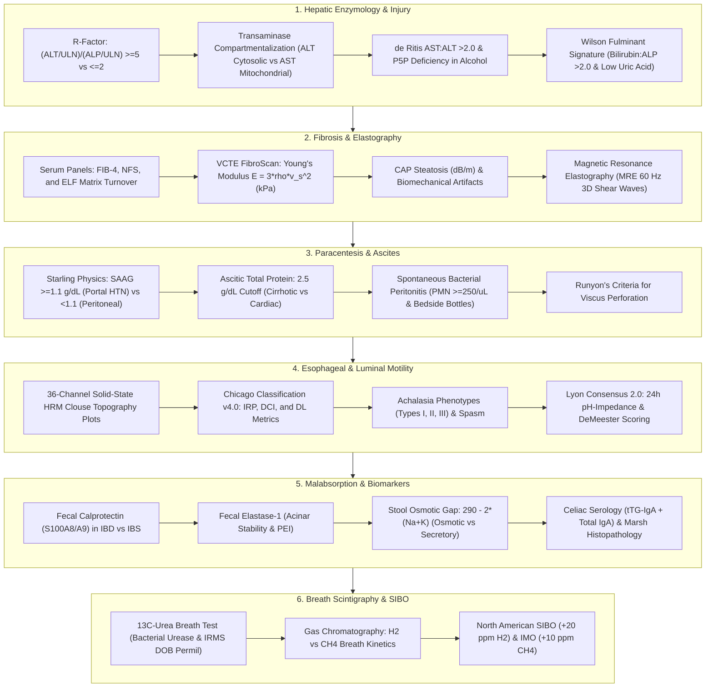
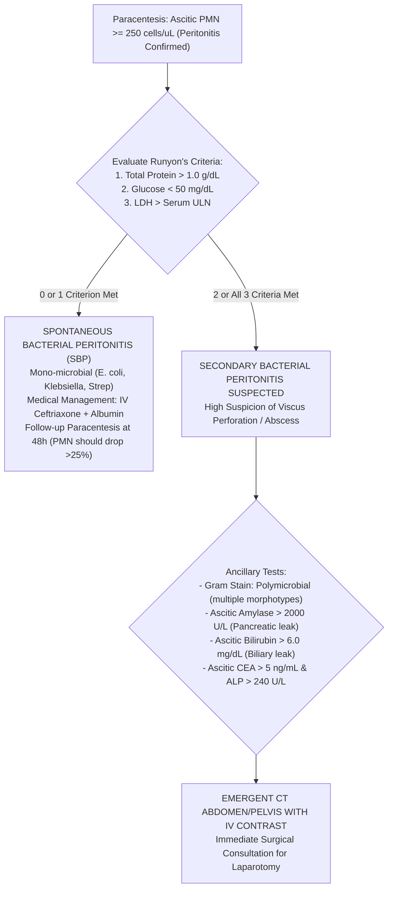
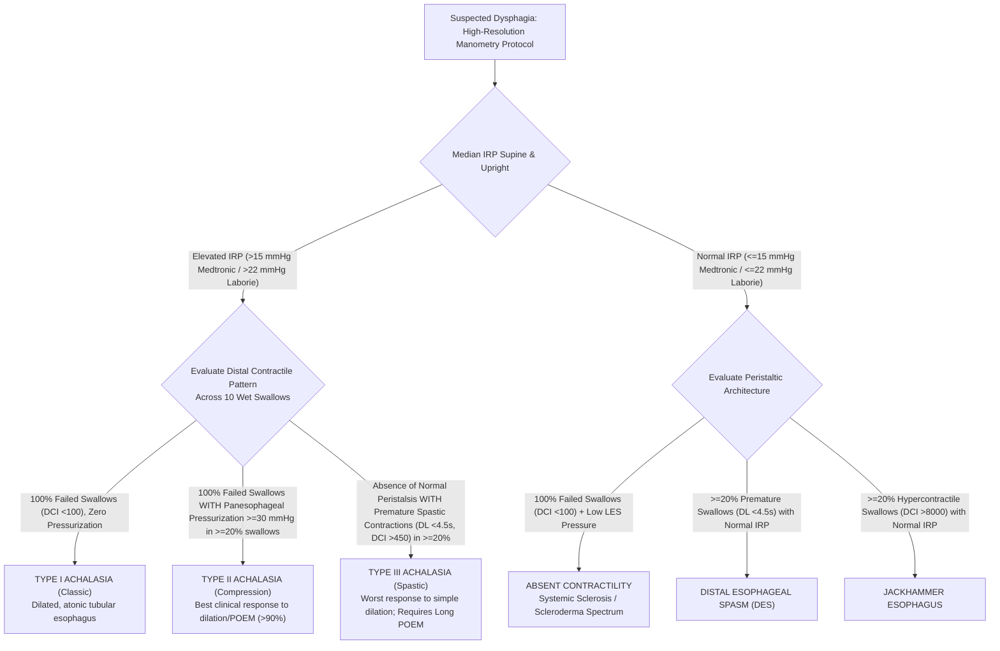
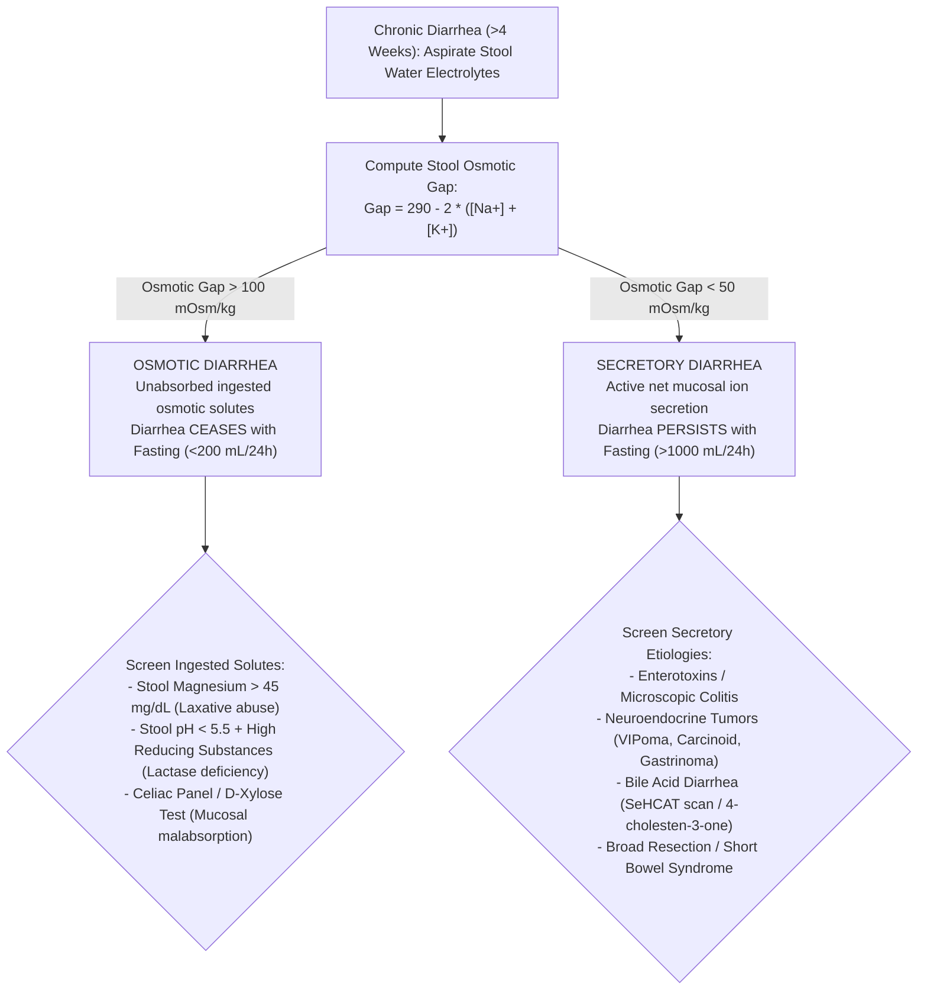
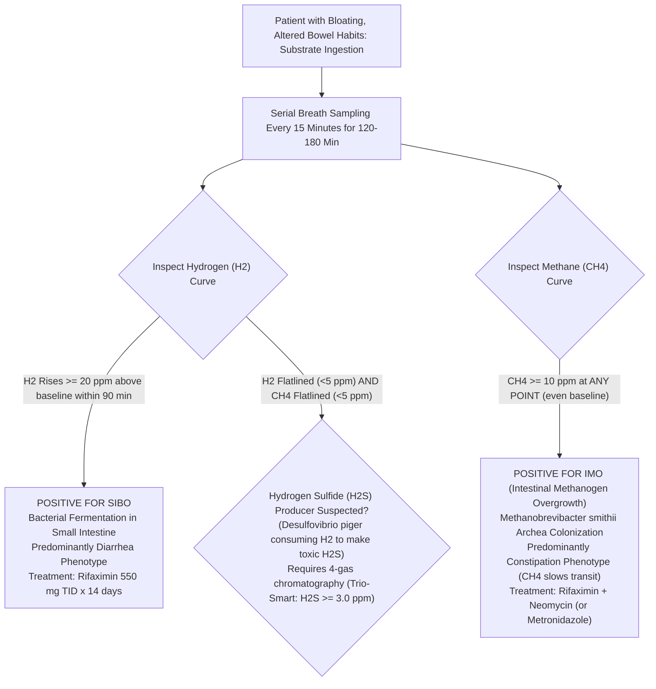

# Basic Medical — Behind the Curtain Clinical Diagnostics Notebook
## Volume XVI: Gastroenterology, Hepatology, and Nutrition Diagnostics — Hepatic Enzymology, FibroScan Elastography, Paracentesis Bio-Gradients, Luminal Manometry, and Enteric Breath Physics

> *"The hepatobiliary tree and gastrointestinal tract represent the body's primary biochemical refinery, immunological frontier, and largest metabolic interface. Diagnostic mastery in this domain demands looking beyond crude organ panel labels: deciphering the R-factor enzymatic divergence at the hepatocyte canalicular membrane, tracking 50-Hertz shear waves propagating through fibrotic collagen crosslinks, computing Starling oncotic gradients across fenestrated hepatic sinusoids, resolving isobaric micro-transducer esophageal pressure topographies, and measuring isotopic carbon-13 mass ratios and parts-per-million bacterial hydrogen gas exhaled from the human breath."*

---

### Master Architectural Overview: The Gastroenterology & Hepatology Diagnostic Continuum



---

## Dossier 16.1: Liver Function & Injury Classification: The R-Factor, Transaminase Kinetics, and Isoenzyme Biochemistry

### 16.1.1 The R-Factor Formula: Mathematical Stratification of Liver Injury

The antiquated terminology "Liver Function Tests" (LFTs) is a misnomer; serum transaminases and alkaline phosphatase do not measure true hepatic functional synthetic capacity (which is reflected solely by **Serum Albumin** and **Prothrombin Time / INR**); they are cellular release markers of membrane disruption and canalicular injury.

To eliminate diagnostic ambiguity between hepatocellular necrosis and biliary cholestasis, the Council for International Organizations of Medical Sciences (CIOMS) established the **R-Factor (Ratio of Enzyme Elevation)**:

$$R = \frac{\text{ALT} / \text{ULN}_{\text{ALT}}}{\text{ALP} / \text{ULN}_{\text{ALP}}}$$

Where $\text{ALT}$ and $\text{ALP}$ represent the patient's measured serum concentrations, and $\text{ULN}$ represents the laboratory-specific, upper reference limit of normal derived from healthy reference populations.

```
       The R-Factor Injury Spectrum:
       
       Cholestatic Pattern              Mixed Injury                 Hepatocellular Pattern
       (R <= 2.0)                       (2.0 < R < 5.0)              (R >= 5.0)
       -----------------------------------------------------------------------------------------
       Choledocholithiasis              Drug-Induced (Augmentin)     Acute Viral Hepatitis (A, B, E)
       Malignant Biliary Obstruction    Early Cholestatic Hepatitis  Acetaminophen Toxicity
       Primary Biliary Cholangitis      Infiltrative Granulomas      Ischemic Hepatitis (Shock Liver)
       Primary Sclerosing Cholangitis   Sepsis Cholestasis           Autoimmune Hepatitis
```

#### Diagnostic Stratification Tiers:
1. **$R \ge 5.0$ (Hepatocellular Pattern)**: Indicates primary cytolytic injury to the hepatocyte plasma membrane, causing massive leakage of cytosolic contents.
2. **$R \le 2.0$ (Cholestatic Pattern)**: Indicates bile secretory impairment, canalicular membrane disruption, or extrahepatic mechanical duct obstruction provoking de novo synthesis and cleavage of alkaline phosphatase.
3. **$2.0 < R < 5.0$ (Mixed Pattern)**: Indicates simultaneous cytolytic and canalicular injury, characteristically observed in idiosyncratic Drug-Induced Liver Injury (DILI—e.g., amoxicillin-clavulanate, phenytoin), atypical viral hepatitis, or acute choledocholithiasis with secondary ascending bacterial cholangitis.

---

### 16.1.2 Transaminase Kinetics: Intracellular Localization & The de Ritis Ratio

```
Hepatocyte Ultrastructure & Transaminase Compartmentalization:
+--------------------------------------------------------------------+
| Hepatocyte Cytosol                                                 |
|   [Alanine Aminotransferase - ALT] (100% Cytosolic)                 |
|   Half-Life: ~47 +/- 10 hours                                      |
|                                                                    |
|   [Cytosolic AST - cAST] (20% of total AST activity)               |
|   Half-Life: ~17 hours                                             |
|                                                                    |
|   +------------------------------------------------------------+   |
|   | Mitochondrion                                              |   |
|   |   [Mitochondrial AST - mAST] (80% of total AST activity)   |   |
|   |   Half-Life: ~87 hours                                     |   |
|   +------------------------------------------------------------+   |
+--------------------------------------------------------------------+
```

#### 1. Molecular Compartmentalization & Enzyme Clearance
* **Alanine Aminotransferase (ALT)**: Exclusively localized within the hepatocyte cytosol. Catalyzes the reversible transamination: $\text{L-Alanine} + \alpha\text{-Ketoglutarate} \rightleftharpoons \text{Pyruvate} + \text{L-Glutamate}$. Because non-hepatic tissues (skeletal muscle, kidney, heart) express minimal ALT, serum ALT is an extraordinarily liver-specific biomarker. Serum clearance half-life: **$47 \pm 10\text{ hours}$**.
* **Aspartate Aminotransferase (AST)**: Catalyzes: $\text{L-Aspartate} + \alpha\text{-Ketoglutarate} \rightleftharpoons \text{Oxaloacetate} + \text{L-Glutamate}$. Present in high concentrations across liver, cardiac muscle, skeletal muscle, kidneys, brain, and erythrocytes. Within hepatocytes, AST exists as two distinct, genetically non-homologous isoenzymes:
  * **Cytosolic AST (cAST)**: Accounts for only **$20\%$** of total intracellular activity; clearance half-life is rapid (**$\approx 17\text{ hours}$**).
  * **Mitochondrial AST (mAST)**: Accounts for **$80\%$** of total intracellular activity; bound within the inner mitochondrial matrix; clearance half-life is prolonged (**$\approx 87\text{ hours}$** via sinusoidal endothelial scavenger receptors).

#### 2. The AST:ALT (de Ritis) Ratio: The Alcohol and Pyridoxal-5'-Phosphate Paradox
In 1957, Fernando de Ritis demonstrated that in most acute liver injuries (acute viral hepatitis, MASLD, toxic ingestions), serum $ALT > AST$, yielding a **de Ritis Ratio ($AST:ALT < 1.0$)**.

In **Alcoholic Hepatitis**, however, the ratio dramatically flips to **$AST:ALT > 2.0$** (and frequently $>3.0$), while absolute transaminase levels rarely exceed **$300\text{ to }500\text{ U/L}$**! This biochemical signature is driven by three distinct mechanisms:
1. **Pyridoxal-5'-Phosphate (P5P / Vitamin B6) Deficiency**: Chronic ethanol metabolism consumes and depletes hepatic reserves of P5P, the essential prosthetic cofactor for both AST and ALT. Crucially, apo-ALT synthesis and stability are severely dependent on P5P; without it, hepatocyte ALT synthesis drops by $>80\%$. Apo-AST is far more resilient to cofactor depletion, remaining synthetically active.
2. **Selective Mitochondrial Injury**: Acetaldehyde and reactive oxygen species directly disrupt the mitochondrial membrane, causing selective extrusion of **mitochondrial AST (mAST)** into the circulation.
3. **Alcoholic Suppression of ALT Transcription**: Ethanol directly downregulates ALT mRNA expression.

*The Cirrhosis Flip*: In chronic hepatitis C or MASLD, when chronic inflammation progresses to established cirrhosis, sinusoidal endothelial clearance of AST declines and hepatic fibrous replacement reduces cytosolic ALT mass; the baseline $AST:ALT$ ratio characteristically **flips from $<1.0$ to $>1.0$**, serving as a sensitive clinical flag for bridging fibrosis/cirrhosis.

```
Transaminase Velocity and Peak Magnitudes in Acute Liver Failure:
===================================================================================================
Etiology                     Peak AST & ALT (U/L)    Dominant Enzyme   LDH:AST Ratio   Kinetics
---------------------------------------------------------------------------------------------------
Ischemic Hepatitis           > 3,000 to > 10,000     AST > ALT         > 1.5 - 2.0     Explosive rise;
(Shock Liver)                                        (Initial Surge)   (High LDH)      Rapid 50% fall/24h
---------------------------------------------------------------------------------------------------
Acetaminophen Toxicity       > 5,000 to > 20,000     ALT >= AST        < 1.0           Rapid rise; Peak 48h;
(APAP NAPQI Necrosis)                                                                  Profound coagulopathy
---------------------------------------------------------------------------------------------------
Acute Viral Hepatitis (A/B)  1,000 to 5,000          ALT > AST         < 1.0           Sluggish rise;
                                                                                       Slow clearance (weeks)
---------------------------------------------------------------------------------------------------
Alcoholic Hepatitis          < 300 to 500            AST:ALT > 2.0     < 1.0           Plateau; P5P deficiency
===================================================================================================
```

---

### 16.1.3 The Fulminant Wilson's Disease Paradigm: The Bilirubin:ALP Ratio Trap

Fulminant Wilson's Disease (ATP7B mutation presenting with acute liver failure in an adolescent or young adult) presents a life-threatening diagnostic trap: automated laboratory analyzers report marked hyperbilirubinemia, but **Alkaline Phosphatase (ALP) is paradoxically normal or profoundly suppressed ($<40\text{ U/L}$)**!

```
Fulminant Wilson's Disease Diagnostic Triad:
1. Serum Bilirubin:ALP Ratio > 2.0 (or ALP:Total Bilirubin Ratio < 2.0)
2. AST:ALT Ratio > 4.0 (Marked AST predominance)
3. Coombs-Negative Intravascular Hemolytic Anemia with Severe Hypouricemia (<1.5 mg/dL)
```

#### The Pathophysiological Triad:
1. **Copper-Mediated ALP Inhibition**: Catastrophic hepatic necrosis releases kilograms of stored elemental copper into the portal and systemic circulation. Free cupric ions ($\text{Cu}^{2+}$) competitively displace zinc ($\text{Zn}^{2+}$) from the active catalytic core of alkaline phosphatase and induce cross-linking denaturation, inactivating the enzyme. Serum ALP drops into the subnormal range ($<20\text{–}40\text{ U/L}$)!
2. **Coombs-Negative Intravascular Hemolysis**: Massive circulating free copper oxidizes erythrocyte membrane sulfhydryl groups, inhibits glucose-6-phosphate dehydrogenase, and depletes glutathione. Red cells undergo acute Heinz-body intravascular lysis. Serum total bilirubin skyrockets ($>20\text{–}40\text{ mg/dL}$), dominated by indirect (unconjugated) bilirubin from hemolysis alongside direct bilirubin from hepatic collapse.
   * **The Ratio Rule**:
     $$\frac{\text{Total Bilirubin (mg/dL)}}{\text{Alkaline Phosphatase (U/L)}} \times 100 > \mathbf{2.0}$$
     *(A Bilirubin:ALP ratio $>2.0$ has $100\%$ specificity and $96\%$ sensitivity for fulminant Wilsonian liver failure versus other etiologies of acute liver failure!)*
3. **Proximal Renal Tubular Fanconi Syndrome**: Toxic copper accumulation in renal tubular epithelial cells disrupts sodium-coupled solute cotransporters, producing profound **hypouricemia (serum uric acid $<1.0\text{ to }1.5\text{ mg/dL}$)** due to massive uricosuria, alongside renal glucosuria and aminoaciduria.

---

### 16.1.4 Alkaline Phosphatase Isoenzymes: Heat Stability Fractionation & GGT/5'-Nucleotidase

Alkaline Phosphatase (ALP) is a family of zinc metalloenzymes that hydrolyze monophosphate esters at an alkaline pH optimum ($pH\ 9.8\text{–}10.5$). Elevated total ALP poses an immediate clinical question: does the enzyme originate from **hepatobiliary canaliculi** or **osteoblastic bone remodeling**?

#### 1. Heat Stability Fractionation ("Bone Burns, Liver Lasts")
Before modern automated electrophoresis, clinical laboratories exploited the distinct thermal denaturation kinetics of ALP isoenzymes by heating patient serum to **$56.0^\circ\text{C}$ for exactly $10\text{ minutes}$**:

$$\% \text{ Residual ALP Activity} = \frac{\text{ALP Activity after } 56^\circ\text{C Heating}}{\text{Baseline Unheated ALP Activity}} \times 100\%$$

```
Heat Fractionation Profile (56°C for 10 minutes):
---------------------------------------------------------------------------------------------------
Isoenzyme Source         Heat Stability Characteristic        % Residual Activity Remaining
---------------------------------------------------------------------------------------------------
Bone Isoenzyme           Heat-Labile ("Bone Burns")           < 20% Residual Activity Remaining
Liver Isoenzyme          Heat-Stable ("Liver Lasts")          > 35% to 50% Residual Activity
Placental (Regan)        Extremely Heat-Stable                Survives 65°C for 30 min (100% active)
Intestinal Isoenzyme     Intermediate Stability               ~30% (Inhibited by L-phenylalanine)
---------------------------------------------------------------------------------------------------
```

#### 2. Confirmatory Secondary Enzymes: GGT and 5'-Nucleotidase
* **Gamma-Glutamyl Transferase (GGT)**: Catalyzes the transfer of glutamyl groups from glutathione to amino acids. GGT is anchored to biliary canalicular epithelial membranes and microsomes. 
  * *Diagnostic Specificity*: GGT is **completely absent from bone tissue**! An elevated total ALP accompanied by an elevated GGT confirms a hepatobiliary origin. If ALP is $450\text{ U/L}$ but GGT is completely normal ($18\text{ U/L}$), a bone pathology (Paget's disease, osteoblastic bone metastases, healing fractures, osteomalacia, or adolescent growth spurts) is definitively established.
  * *The Induction Pitfall*: GGT is inducible by xenobiotics; chronic alcohol intake, phenytoin, carbamazepine, and barbiturates induce hepatic microsomal GGT expression, elevating GGT in the absence of cholestasis.
* **5'-Nucleotidase ($5'\text{-NT}$)**: Hydrolyzes nucleotide-5'-phosphates into nucleosides. Like GGT, $5'\text{-NT}$ is elevated in cholestatic hepatobiliary disease and unaffected by bone disease, but unlike GGT, it is **not induced by drugs or alcohol**, serving as the most specific biochemical referee for isolated ALP elevations.

---

### 16.1.5 Automated Chemistry Analyzer Enzymology, Spectrophotometry & Hemolysis Interference

Behind the computerized clinical laboratory report lies a series of high-speed, temperature-controlled ($37.0^\circ\text{C} \pm 0.1^\circ\text{C}$) spectrophotometric and photometric assays executing inside quartz or acrylic optical cuvettes on automated platforms (Roche cobas 8000, Abbott Alinity c, Beckman Coulter AU5800, Siemens Atellica CH).

#### 1. Coupled Enzymatic Reactions: The 340-nm Warburg Optical Test
Transaminases do not absorb visible or ultraviolet light in quantities that permit direct photometric quantification. Automated analyzers therefore couple transaminase catalytic activity to a secondary, nicotinamide adenine dinucleotide (NADH)-dependent dehydrogenase reaction, monitoring the **rate of decrease in optical absorbance at $\lambda = 340\text{ nm}$** as reduced $\text{NADH}$ is oxidized to $\text{NAD}^+$ (the classic Warburg optical test; molar absorptivity $\epsilon_{340} = 6.22 \times 10^3\text{ L}\cdot\text{mol}^{-1}\cdot\text{cm}^{-1}$):

```
Coupled Optical Reactions at 340 nm:
1. Alanine Aminotransferase (ALT):
   L-Alanine + 2-Oxoglutarate <============ (ALT) ============> Pyruvate + L-Glutamate
   Pyruvate + NADH + H+ <============= (Lactate Dehydrogenase, LDH) =============> L-Lactate + NAD+  [Measured at 340 nm]

2. Aspartate Aminotransferase (AST):
   L-Aspartate + 2-Oxoglutarate <============ (AST) ============> Oxaloacetate + L-Glutamate
   Oxaloacetate + NADH + H+ <======= (Malate Dehydrogenase, MDH) =======> L-Malate + NAD+  [Measured at 340 nm]
```

* **The IFCC Pyridoxal-5'-Phosphate (P5P) Supplementation Standard**:
  * The International Federation of Clinical Chemistry and Laboratory Medicine (IFCC) primary reference procedures mandate the addition of exogenous **Pyridoxal-5'-Phosphate ($P5P$, $0.10\text{ mmol/L}$)** directly into the reagent formulation to ensure full reconstitution of endogenous apo-transaminases into catalytically active holo-transaminases.
  * *Behind-the-Curtain Reagent Trap*: To cut costs, many commercial hospital laboratories purchase transaminase reagents that omit exogenous P5P! In patients with malnutrition, alcoholic liver disease, or chronic hemodialysis (who are severely deficient in circulating Vitamin B6), non-P5P supplemented assays **underestimate true serum ALT and AST by $30\%\text{ to }50\%$**, masking drug-induced hepatotoxicity!

#### 2. Bilirubin Spectrophotometry: Jendrassik-Grof vs. Malloy-Evelyn Diazo Chemistry
Serum bilirubin measurement dates to Paul Ehrlich (1883) and Hijmans van den Bergh (1916), who discovered that bilirubin couples with diazotized sulfanilic acid in an acid medium to produce a vibrant purple-red pigment: **Azobilirubin**.
* **The "Direct" vs. "Indirect" Reaction**:
  * **Direct Bilirubin (Conjugated)**: Bilirubin glucuronides (mono- and diglucuronides) are water-soluble and possess an open, unhindered conformation. When diazotized sulfanilic acid is injected, conjugated bilirubin reacts **directly and immediately within 1 to 2 minutes** without requiring an organic solvent accelerator.
  * **Indirect Bilirubin (Unconjugated)**: Hydrophobic, unconjugated bilirubin is tightly folded by internal hydrogen bonding and bound within the hydrophobic pockets of serum albumin. It will not react with aqueous diazo reagent! To measure **Total Bilirubin**, the analyzer must add an organic solubilizing / displacing "accelerator".
* **The Modern Jendrassik-Grof Reaction**:
  * Uses **Caffeine-Sodium Benzoate** as the accelerator to strip unconjugated bilirubin from albumin, followed by diazotized sulfanilic acid. 
  * After coupling, concentrated **alkaline potassium sodium tartrate (Fehling's solution B)** is added. This shifts the reaction from acidic to strongly alkaline ($pH \sim 13$), transforming the red-purple acid azobilirubin into an intense **blue-green azobilirubin chromophore**.
  * *Optical Advantage*: Blue-green azobilirubin absorbs light at **$\lambda = 600\text{ nm}$**. Shifting the reading wavelength from $540\text{ nm}$ to $600\text{ nm}$ completely eliminates spectral interference from free hemoglobin and turbidity!
  * **Indirect Bilirubin Calculation**: Automated analyzers do not directly measure unconjugated bilirubin; they calculate it mathematically:
    $$\text{Indirect Bilirubin} = \text{Total Bilirubin} - \text{Direct Bilirubin}$$
* **Delta-Bilirubin (Biliprotein) — The Persistent Jaundice Mystery**:
  * In prolonged, severe cholestasis, conjugated bilirubin glucuronide undergoes non-enzymatic acyl-migration, forming a covalent amide linkage between its propionic acid carboxyl groups and the $\epsilon$-amino groups of lysine residues on **Serum Albumin**. This covalent complex is termed **Delta-Bilirubin ($\delta$-bilirubin / Biliprotein)**.
  * *The Kinetic Trap*: Free bilirubin glucuronide is rapidly excreted into urine ($T_{1/2} \approx 2\text{–}4\text{ hours}$). However, delta-bilirubin cannot cross the glomerular filtration barrier; its circulating clearance half-life is identical to that of albumin: **$14\text{ to }21\text{ days}$**!
  * *Clinical Manifestation*: When acute biliary obstruction is successfully relieved or acute hepatitis resolves, the patient's urine returns to normal color and transaminases normalize, yet the patient remains deeply jaundiced with elevated total and direct bilirubin for weeks! This is **not ongoing liver injury**; it is the slow, benign degradation of covalent delta-bilirubin.

#### 3. Specimen Collection Tubes, Centrifugation, and Pre-Analytical Rejections

```
Vacutainer Specifications for Hepatic Panels:
----------------------------------------------------------------------------------------------------
Tube Cap Color           Additive Stoichiometry               Optimal Processing & Centrifugation
----------------------------------------------------------------------------------------------------
Gold SST (Serum)         Micronized Silica Clot Activator +   Allow 30 min full clot at 20-25°C.
                         Thixotropic Polymer Gel (1.04 g/cm3) Centrifuge: 2000 x g for 10 min at 20°C.
----------------------------------------------------------------------------------------------------
Mint Green PST (Plasma)  Lithium Heparin (16 USP units/mL) +  Invert 8-10 times immediately.
                         PST Gel Separator                    Centrifuge immediately: 2000 x g for 10 min.
                                                              *Preferred in Emergency Department for stat turn-around!*
----------------------------------------------------------------------------------------------------
```

* **The Hemolysis Index (H-Index) Catastrophe**:
  * Human erythrocytes contain approximately **$40\text{ times}$ more AST than serum** (and $15\times$ more LDH), but relatively negligible ALT.
  * Even mild in vitro venipuncture hemolysis (lysis of just $0.5\%$ of erythrocytes, releasing free hemoglobin to $50\text{–}100\text{ mg/dL}$, visible as slight pink tinging in serum) spills massive amounts of intracellular AST into the tube.
  * *The Trap*: A patient with completely normal baseline enzymes ($AST = 20\text{ U/L}, ALT = 22\text{ U/L}$) whose tube undergoes shear hemolysis will show **$AST = 58\text{ U/L}$ and $ALT = 23\text{ U/L}$**—generating an artificial **$AST:ALT \text{ ratio of } 2.5$**! Unsuspecting clinicians routinely misdiagnose this as acute alcoholic liver disease. Automated analyzers must inspect the bichromatic optical absorbance at $570/600\text{ nm}$ and automatically suppress or flag AST when the Hemolysis Index exceeds **$H > 50\text{ mg/dL}$**.
* **Photolytic Degradation of Bilirubin**:
  * Bilirubin is extraordinarily photolabile: exposure of an uncovered blood collection tube to ambient hospital fluorescent light or direct window sunlight causes rapid photochemical isomerization into water-soluble photoisomers (lumirubin) and oxidation into biliverdin.
  * Serum bilirubin degrades at a rate of **$10\%\text{ to }30\%\text{ per hour}$** under ambient light! If delayed transport is unavoidable, tubes must be drawn into amber-tinted Vacutainers or wrapped entirely in opaque aluminum foil.

---

## Dossier 16.2: Advanced Liver Fibrosis Assessment: Noninvasive Biomarkers, FibroScan Elastography, and MRE

### 16.2.1 Noninvasive Serum Fibrosis Scores: Mathematical Formulations & Cutoffs

Liver biopsy carries risks of bleeding ($0.5\%$), organ perforation, and significant sampling error ($1/50,000\text{th}$ of total liver volume). Noninvasive algorithms combine standard laboratory variables to rule in or rule out advanced bridging fibrosis ($F3$) and cirrhosis ($F4$).

```
       Noninvasive Serum Biomarker Cascade:
       [Standard Laboratory CBC & LFTs] ---> Compute FIB-4 Index
                                                    |
             +--------------------------------------+--------------------------------------+
             |                                      |                                      |
             v                                      v                                      v
     FIB-4 < 1.30 (Age <65)                FIB-4: 1.30 - 2.67                     FIB-4 > 2.67
     FIB-4 < 2.00 (Age >=65)               Indeterminate Gray Zone                High PPV for Advanced
     Rule-Out Advanced Fibrosis            Mandatory Secondary Testing            Fibrosis (F3/F4)
     NPV > 90-95%                          (FibroScan VCTE / MRE)                 Hepatology Referral
```

#### 1. The FIB-4 Index (Sterling et al., 2006)
Originally developed for HIV/HCV co-infection and now the primary guideline-endorsed screening tool for Metabolic Dysfunction-Associated Steatotic Liver Disease (MASLD / NAFLD):

$$\text{FIB-4} = \frac{\text{Age (years)} \times \text{AST (U/L)}}{\text{Platelet Count } (10^9/\text{L}) \times \sqrt{\text{ALT (U/L)}}}$$

* **Low Cutoff ($<1.30$ in age $<65$; $<2.00$ in age $\ge 65$)**: Demonstrates a **Negative Predictive Value (NPV) $>90\text{–}95\%$**, safely ruling out advanced fibrosis ($F3\text{–}F4$) in primary care settings without elastography.
* **High Cutoff ($>2.67$)**: Demonstrates a **Positive Predictive Value (PPV) $>80\%$** for advanced fibrosis and cirrhosis, mandating immediate hepatology referral and screening for gastroesophageal varices.
* **Indeterminate Zone ($1.30\text{–}2.67$)**: Approximately $30\%$ of patients fall into this gray zone, requiring secondary noninvasive elastography.

#### 2. The NAFLD Fibrosis Score (NFS)

$$NFS = -1.675 + (0.037 \times \text{Age}) + (0.094 \times \text{BMI}) + (1.13 \times \text{IFG/Diabetes}) + \left(0.99 \times \frac{\text{AST}}{\text{ALT}}\right) - (0.013 \times \text{Platelets}) - (0.66 \times \text{Albumin})$$

*(Units: Age in years; BMI in $\text{kg/m}^2$; Impaired Fasting Glucose/Diabetes $= 1$ if present, $0$ if absent; AST/ALT ratio; Platelets in $10^9/\text{L}$; Albumin in $\text{g/dL}$)*.
* **Low Cutoff ($<-1.455$)**: Excludes advanced fibrosis ($NPV \approx 93\%$).
* **High Cutoff ($>0.676$)**: Predicts advanced fibrosis ($PPV \approx 90\%$).

#### 3. The Enhanced Liver Fibrosis (ELF) Score
A direct serological panel quantifying extracellular matrix turnover:
1. **Hyaluronic Acid (HA)**: Glycosaminoglycan synthesized by hepatic stellate cells.
2. **Procollagen III Amino-Terminal Propeptide (PIIINP)**: Cleaved during active type III collagen fibrillogenesis.
3. **Tissue Inhibitor of Metalloproteinases-1 (TIMP-1)**: Inhibits matrix metalloproteinase collagen breakdown, locking in scar.

$$\text{ELF Score} = 2.278 + 0.851 \ln(C_{\text{HA}}) + 0.185 \ln(C_{\text{PIIINP}}) + 0.097 \ln(C_{\text{TIMP-1}})$$

* $\text{ELF} < 7.7$: Mild or no fibrosis ($F0\text{–}F1$).
* $\text{ELF} \ge 9.8$: Advanced bridging fibrosis ($F3$) or cirrhosis ($F4$).

---

### 16.2.2 Vibration-Controlled Transient Elastography (FibroScan): Biomechanics & CAP Scoring

Vibration-Controlled Transient Elastography (VCTE / FibroScan) evaluates hepatic viscoelasticity by propagating a low-frequency shear wave through tissue and tracking its velocity with ultrasound.

```
       FibroScan VCTE Biomechanical Chain:
       [Mechanical Piston Impact] ---> Emits 50 Hz Shear Wave through Intercostal Space
                                              |
                                              v
       [3.5 MHz Ultrasound Transducer] --> Tracks Shear Wave Speed v_s (m/s) in Real Time
                                              |
                                              v
       Young's Modulus Elasticity Math:    E = 3 * rho * (v_s)^2  [Kilopascals, kPa]
```

#### 1. Biomechanical Wave Physics: Young's Modulus
A mechanical piston delivers a transient, low-frequency mechanical vibration (**$50\text{ Hz}$**) to the skin surface in the right 9th-to-11th intercostal space. This creates an elastic shear wave that propagates perpendicularly into the liver parenchyma. A co-axial high-frequency ultrasound transducer (**$3.5\text{ MHz}$ standard M-probe; $2.5\text{ MHz}$ XL-probe**) fires pulse-echo ultrasound lines at $6\text{ kHz}$ to track the displacement of tissue and compute the **Shear Wave Propagation Velocity ($v_s$)** in meters per second.

In an isotropic, homogeneous, incompressible elastic medium, **Young's Modulus ($E$)** is related to the shear modulus ($G$) and shear wave speed ($v_s$) by:

$$E = 3G = 3 \rho v_s^2$$

Where $\rho$ is tissue density ($\approx 1000\text{ kg/m}^3 = 1.0\text{ g/cm}^3$ for soft biological tissue). 
* In healthy liver tissue without cross-linked fibrillar collagen, the shear wave travels slowly ($v_s \approx 1.0\text{ m/s}$), computing an elasticity $E = 3(1000)(1.0)^2 = 3.0\text{ kPa}$.
* In dense, cirrhotic nodular tissue, the rigid collagen matrix accelerates the shear wave ($v_s \ge 2.2\text{ m/s}$), causing Young's modulus to surge: $E = 3(1000)(2.2)^2 \ge \mathbf{14.5\text{ kPa}}$!

```
FibroScan Liver Stiffness Measurement (LSM) Staging (kPa):
========================================================================================
METAVIR Stage     Fibrosis Degree             LSM Median Range (kPa)   Clinical State
----------------------------------------------------------------------------------------
F0 - F1           No Fibrosis / Mild Portal   < 7.0 kPa                Healthy / Reversible
F2                Significant Fibrosis        7.0 - 8.5 kPa            Moderate Architecture Loss
F3                Advanced Bridging Fibrosis  8.5 - 12.5 kPa           Pre-Cirrhotic Scarring
F4                Cirrhosis                   >= 12.5 - 14.0 kPa       Compensated Cirrhosis
CSPH              Clinically Significant      >= 20.0 - 25.0 kPa       Varices, Decompensation
                  Portal Hypertension                                  Risk Surge (>5%/year)
```

#### 2. Strict Technical Quality Rejection Criteria
A FibroScan examination is diagnostically uninterpretable and must be rejected unless it fulfills three criteria:
1. **Valid Acquisitions**: A minimum of **$\ge 10$ valid shots** acquired.
2. **Success Rate**: The ratio of valid acquisitions to total attempted shots must be **$\ge 60\%$**.
3. **Interquartile Range to Median Ratio ($IQR/M$)**: The coefficient of dispersion across valid shots must be:
   $$\frac{IQR}{\text{Median LSM}} \le \mathbf{30\%}$$
   *(If the median stiffness is $<7.0\text{ kPa}$, an $IQR/M \le 40\%$ is clinically acceptable).*

#### 3. Controlled Attenuation Parameter (CAP): Quantifying Hepatic Steatosis
Controlled Attenuation Parameter measures the rate of energy loss (ultrasound attenuation) of the $3.5\text{ MHz}$ ultrasound beam as it passes through intrahepatic lipid droplets, expressed in decibels per meter (**$\text{dB/m}$**):

$$\text{Intensity}(z) = I_0 \cdot 10^{-\frac{\alpha \cdot z}{10}}$$

Where $\alpha$ is the attenuation coefficient in $\text{dB/m}$ and $z$ is depth ($25\text{–}65\text{ mm}$):
* **$S0$ (Normal / No Steatosis, $<11\%$ hepatocytes affected)**: $<238\text{ dB/m}$
* **$S1$ (Mild Steatosis, $11\text{–}33\%$)**: $238\text{–}260\text{ dB/m}$
* **$S2$ (Moderate Steatosis, $34\text{–}66\%$)**: $260\text{–}290\text{ dB/m}$
* **$S3$ (Severe Steatosis, $>66\%$)**: $\ge 290\text{ dB/m}$

#### 4. Behind-the-Curtain Biomechanical False-Positive Traps
Young's Modulus measures tissue *stiffness*, not collagen molecules. Five clinical conditions increase liver stiffness independently of histological fibrosis:
1. **Acute Severe Hepatitis**: Massive intracellular ballooning edema and inflammatory cell influx stretch Glisson's capsule. An acute flare with $ALT > 5\times ULN$ can inflate an $F1$ liver ($5.5\text{ kPa}$) to read a bogus **$24.0\text{ kPa}$ (false cirrhosis)**! *Never perform elastography during an acute hepatitis flare; defer until transaminases normalize.*
2. **Right Ventricular Congestive Heart Failure**: Backward hydrostatic pressure engorges the hepatic sinusoids, mechanically stiffening the parenchyma. Severe tricuspid regurgitation can elevate LSM to $>35\text{ kPa}$ in the absence of fibrosis.
3. **Extrahepatic Biliary Obstruction**: Acute choledocholithiasis increases intrabiliary hydrostatic pressure, spuriously inflating stiffness.
4. **Recent Food Ingestion**: Postprandial splanchnic hyperemia increases portal blood flow by $50\text{–}100\%$, increasing stiffness by $2\text{ to }5\text{ kPa}$. The patient **must be strictly fasting for at least 3 hours** prior to examination.
5. **Thoracic Obesity (Probe Selection)**: The standard M-probe operates at $25\text{–}65\text{ mm}$ skin-to-capsule depth. If chest wall fat exceeds $25\text{ mm}$, the ultrasound signal attenuates in adipose tissue, failing acquisitions. The operator must switch to the **XL-probe ($2.5\text{ MHz}$, focal depth $35\text{–}75\text{ mm}$)**.

---

### 16.2.3 Magnetic Resonance Elastography (MRE): 3D Acoustic Physics & The Gold Standard

Magnetic Resonance Elastography (MRE) overcomes the spatial limitations of FibroScan by sampling the entire liver volume ($>500\text{ cm}^3$ versus $1\text{ cm}^3$ pencil beam) and remains fully functional in patients with massive obesity or severe ascites (both of which cause technical failure of ultrasound shear waves).

```
       MRE Instrumentation:
       [Active Acoustic Driver outside MRI room] 
              |
              v (Pneumatic tube through RF waveguide)
       [Passive Drum Driver strapped over Right Lower Ribs] 
              |
              v (Continuous 60 Hz shear waves into liver)
       [Phase-Contrast MRI Pulse Sequence with Motion-Encoding Gradients (MEG)]
              |
              v (Inversion Algorithm of Helmholtz Wave Equations)
       [Color-Coded 2D/3D Quantitative Elastogram Map (Stiffness in kPa)]
```

#### Inversion Algorithm & Staging Thresholds
Phase-contrast images acquire wave propagation snapshots. A Helmholtz wave inversion algorithm solves the mechanical wave equation to output quantitative shear stiffness maps ($\mu$):

$$\mu \nabla^2 \vec{u} + \rho \omega^2 \vec{u} = 0$$

Where $\omega = 2\pi f$ ($f = 60\text{ Hz}$).
* **Normal Liver**: $<2.5\text{ kPa}$
* **$F2$ (Significant Fibrosis)**: $\ge 2.9\text{ kPa}$
* **$F3$ (Advanced Fibrosis)**: $\ge 3.6\text{ kPa}$
* **$F4$ (Cirrhosis)**: $\ge 4.7\text{ kPa}$
*MRE holds the highest diagnostic accuracy of any noninvasive modality, with an Area Under the Receiver Operating Characteristic Curve ($AUROC > 0.95$) for advanced fibrosis.*

---

### 16.2.4 Comparative Multi-Modality Elastography Physics: VCTE vs. pSWE vs. 2D-SWE vs. MRE

While FibroScan (VCTE) is the most widely deployed point-of-care tool, modern diagnostic ultrasound carts incorporate ultrasound-based shear wave elastography directly into diagnostic radiology workflows.

#### 1. Acoustic Radiation Force Impulse (ARFI) Physics
Unlike VCTE, which relies on a mechanical piston vibrating the skin surface, ultrasound-based shear wave methods (pSWE and 2D-SWE) generate shear waves internally using **Acoustic Radiation Force Impulse (ARFI)**:
* A diagnostic ultrasound transducer focuses a high-energy acoustic push beam ($1.5\text{ to }3.0\text{ MHz}$, pulse duration $100\text{ to }300\text{ }\mu\text{s}$, acoustic intensity $I_{\text{spta}} \sim 100\text{–}1000\text{ W/cm}^2$) at a designated focal depth ($2\text{ to }8\text{ cm}$) within the right hepatic lobe.
* As the acoustic pulse is attenuated and scattered by tissue microstructures, momentum transfers from the acoustic wave to the parenchyma, producing a localized micron-scale mechanical displacement ($1\text{ to }10\text{ }\mu\text{m}$) along the acoustic axis.
* This microscopic displacement generates transient shear waves that propagate outward laterally through the liver tissue at speeds of $v_s = 1.0\text{ to }4.0\text{ m/s}$. Pulse-echo ultrasound tracking lines detect the time-to-peak displacement, directly calculating shear wave velocity.

```
       ARFI Push-Beam Shear Wave Generation:
       [Ultrasound Transducer Face]
              |
              | (High-Energy Focused Acoustic Push Beam, 100-300 microseconds)
              v
       [Acoustic Focal Spot in Liver] ====> Micron-Scale Parenchymal Displacement (1-10 um)
              |
              +<========================= Lateral Shear Waves (v_s = 1.0 - 4.0 m/s) =========================>+
              |                                                                                                  |
       [Ultra-Fast Plane-Wave Tracking (5,000 frames/sec)] ----------------------------> Color-Coded 2D Box (kPa / m/s)
```

#### 2. Master Multimodality Liver Elastography Comparison Matrix

```
Comprehensive Liver Elastography Modality Matrix:
=============================================================================================================================
Parameter                  VCTE (FibroScan)              pSWE (ARFI Point Shear)       2D-SWE (2D Shear Wave)        MRE (MR Elastography)
=============================================================================================================================
Physical Excitation Source External Mechanical Piston    Internal Focused Ultrasound   Multiple Interleaved Acoustic External Pneumatic Drum
                           (50 Hz Low-Frequency Thump)   Push Beam (ARFI Pulse)        Push Lines (Mach Cone)        Driver (60 Hz Sound Waves)
-----------------------------------------------------------------------------------------------------------------------------
Anatomical B-Mode Guidance Blind (A-mode M-mode lines;   Full Real-Time B-Mode         Full Real-Time B-Mode         Cross-Sectional MRI
                           No structural visualization)  Ultrasound Guidance           Ultrasound Guidance           Anatomy (Full 3D Liver)
-----------------------------------------------------------------------------------------------------------------------------
Sampling Volume            ~ 1.0 cm^3 (Pencil Cylinder;  ~ 0.5 cm^3 (Fixed Small Box;  Large 2D ROI Box              Entire Liver Volume
                           100x larger than biopsy)      Single point measurement)     (~ 10-20 cm^3)                (> 500 cm^3; Whole Organ)
-----------------------------------------------------------------------------------------------------------------------------
Performance in Ascites     COMPLETE FAILURE              FEASIBLE                      FEASIBLE                      EXCELLENT
                           (Shear wave cannot cross      (Ultrasound beam penetrates   (Ultrasound beam penetrates   (Acoustic waves traverse
                           free fluid layer!)            fluid; measures parencyhma)   fluid; measures parenchyma)   fluid without attenuation)
-----------------------------------------------------------------------------------------------------------------------------
Performance in Severe      LIMITED                       MODERATE                      MODERATE                      EXCELLENT
Obesity (BMI > 35 kg/m2)   (Requires XL probe;           (Focal depth selectable;      (Adjustable depth,            (Body habitus does not
                           attenuation in chest wall)    fails if depth >8 cm)         subject to attenuation)       impair magnetic resonance)
-----------------------------------------------------------------------------------------------------------------------------
Reporting Metric Units     kPa (Young's Modulus, E)      m/s (Shear Wave Speed)        kPa (Young's Modulus, E)      kPa (Shear Stiffness, mu)
                                                         or converted to kPa           or m/s (Shear Wave Speed)
-----------------------------------------------------------------------------------------------------------------------------
F2 Significant Fibrosis    7.0 - 8.5 kPa                 1.35 - 1.55 m/s               7.0 - 8.0 kPa                 2.9 - 3.5 kPa
Threshold Range                                          (~ 6.0 - 7.5 kPa)
-----------------------------------------------------------------------------------------------------------------------------
F4 Cirrhosis Cutoff        >= 12.5 - 14.0 kPa            >= 1.80 - 2.00 m/s            >= 11.5 - 13.0 kPa            >= 4.7 kPa
Threshold Range                                          (>= 11.0 - 13.0 kPa)
-----------------------------------------------------------------------------------------------------------------------------
Quality Verification       >= 10 valid acquisitions;     >= 5-10 valid acquisitions;   Visual stability >3 sec;      95% Confidence Map;
Standard                   Success >=60%; IQR/M <=30%    IQR/M <= 30%                  Uniform color fill; IQR/M <=30% Minimal wave interference
=============================================================================================================================
```

---

## Dossier 16.3: Ascites & Paracentesis Analysis: SAAG Physics, Cell-Count Corrections, and Peritonitis Subtypes

### 16.3.1 The Serum-Ascites Albumin Gradient (SAAG): Starling Forces in Portal Hypertension

For over a century, ascitic fluid was categorized using the arbitrary, inaccurate exudate/transudate dichotomy based on Total Protein ($3.0\text{ g/dL}$). In the late 1980s, Bruce Runyon demolished this model, demonstrating that ascitic oncotic balance is governed strictly by the **Starling microvascular fluid equilibrium across the hepatic sinusoids and splanchnic capillary bed**.

$$\text{SAAG (g/dL)} = \text{Serum Albumin (g/dL)} - \text{Ascitic Fluid Albumin (g/dL)}$$

*(Crucial Technical Rule: Serum and ascitic fluid samples must be drawn synchronously within a 60-minute window, and both must be quantified in the laboratory on the exact same clinical chemistry platform to eliminate inter-assay calibration offsets!)*

```
Starling Microvascular Filtration Gradient:
[Hepatic Sinusoid Lumen] <============ (Endothelial Fenestrae) ============> [Perisinusoidal Space of Disse]
Hydrostatic Pressure (P_c)                                                  Hydrostatic Pressure (P_i)
Oncotic Pressure (pi_c)                                                     Oncotic Pressure (pi_i)

Net Transudation Driving Force:  Delta-P = P_c - P_i  <== Balanced by ==>  Delta-pi = pi_c - pi_i
By van 't Hoff's law: Delta-pi is directly proportional to (Serum Albumin - Ascitic Albumin) = SAAG!
```

#### The Biophysical Derivation of the $1.1\text{ g/dL}$ Cutoff
Under Starling's Law of capillary equilibrium:

$$J_v = K_f \left[ (P_c - P_i) - \sigma (\pi_c - \pi_i) \right]$$

In hepatic sinusoids, the capillary reflection coefficient $\sigma \approx 0$ (open fenestrae), but across the peritoneal and splanchnic capillary beds, $\sigma$ approaches $1.0$. As portal hypertension drives sinusoidal hydrostatic pressure $P_c$ to abnormal levels ($>12\text{ mmHg} \approx 16\text{ cmH}_2\text{O}$), Starling equilibrium dictates that to prevent explosive, infinite fluid extravasation, the oncotic pressure gradient $\Delta \pi = (\pi_{\text{serum}} - \pi_{\text{ascites}})$ must expand to generate a counterbalancing osmotic pull.

By van 't Hoff's law of oncotic pressure ($\pi = cRT$), $\Delta \pi$ is linearly proportional to the concentration difference of the primary circulating oncotic macromolecule: **Albumin**.
* A portal venous pressure gradient of **$\ge 12\text{ mmHg}$** requires an albumin difference of **$\ge 1.1\text{ g/dL}$** to achieve microvascular equilibrium!

```
Master SAAG Diagnostic Matrix:
========================================================================================
SAAG Classification         Ascitic Total Protein     Pathological Etiologies
----------------------------------------------------------------------------------------
HIGH SAAG (>= 1.1 g/dL)     LOW (< 2.5 g/dL)          Cirrhosis (Sinusoidal Capillarization)
Portal Hypertension Present                           Alcoholic Hepatitis
(Accuracy > 97%)                                      Late Budd-Chiari Syndrome
                                                      Massive Liver Metastases
----------------------------------------------------------------------------------------
HIGH SAAG (>= 1.1 g/dL)     HIGH (>= 2.5 g/dL)        Cardiac Ascites (Congestive Heart Failure)
Portal Hypertension Present                           Constrictive Pericarditis
                                                      Early Acute Budd-Chiari Syndrome
                                                      Sinusoidal Obstruction Syndrome (VOD)
----------------------------------------------------------------------------------------
LOW SAAG (< 1.1 g/dL)       HIGH (>= 2.5 g/dL)        Peritoneal Carcinomatosis
Portal Hypertension Absent                            Peritoneal Tuberculosis
(Normal Portal Pressure)                              Pancreatic Ascites (Amylase > 1000 U/L)
                                                      Biliary Peritonitis (Ascitic Bili > Serum)
                                                      Connective Tissue Disease (Lupus Serositis)
----------------------------------------------------------------------------------------
LOW SAAG (< 1.1 g/dL)       LOW (< 2.5 g/dL)          Nephrotic Syndrome (Generalized Anasarca)
Portal Hypertension Absent                            Severe Protein-Losing Enteropathy
========================================================================================
```

---

### 16.3.2 Ascitic Total Protein: Separating Cirrhotic from Cardiac Ascites

Why does **Cardiac Ascites** exhibit a high total protein ($\ge 2.5\text{ g/dL}$) while **Cirrhotic Ascites** exhibits low total protein ($<2.5\text{ g/dL}$, and frequently $<1.0\text{ g/dL}$), despite both sharing a high SAAG ($\ge 1.1\text{ g/dL}$)?

```
       Microvascular Architecture Difference:
       
       A. Cirrhotic Liver Architecture:
          Sinusoidal Capillarization (Defenestration) + Sub-endothelial Collagen Basement Membrane
          --> Sinusoid becomes IMPERMEABLE to Large Albumin/Globulin Molecules!
          --> High hydrostatic pressure pushes pure water out; proteins trapped inside sinusoid!
          --> Result: Ascitic Total Protein is LOW (< 2.5 g/dL, often < 1.0 g/dL).
       
       B. Cardiac Congestion Architecture:
          Normal, Open, Healthy Sinusoidal Fenestrae (Endothelium has NO basement membrane!)
          --> Post-sinusoidal back-pressure (Right Heart Failure / IVC Congestion)
          --> High hydrostatic pressure sweeps INTACT, protein-rich plasma straight into space of Disse!
          --> Result: Ascitic Total Protein is HIGH (>= 2.5 to 4.5 g/dL).
```

*The Opsonization Risk*: Cirrhotic patients with an ascitic total protein **$<1.0\text{ to }1.5\text{ g/dL}$** have depleted levels of complement factors ($C3, C4$) and bactericidal opsonic proteins in their peritoneal fluid, conferring a **$>10\text{-fold}$ increased risk of spontaneous bacterial peritonitis (SBP)**, qualifying them for daily oral fluoroquinolone (ciprofloxacin) or trimethoprim-sulfamethoxazole antimicrobial prophylaxis.

---

### 16.3.3 Spontaneous Bacterial Peritonitis (SBP): Absolute Neutrophil Cutoff & Bedside Inoculation

Spontaneous Bacterial Peritonitis is an acute bacterial infection of ascitic fluid occurring in the absence of a surgically treatable intra-abdominal perforation or abscess.

#### 1. The Diagnostic Absolute Neutrophil Count (ANC / PMN)
Diagnosis does not depend on bacterial culture (which takes 48 hours); immediate therapy is triggered by the **Polymorphonuclear Leukocyte (PMN / Neutrophil) Count**:

$$\text{Ascitic Absolute PMN Count} = \text{Total Ascitic WBC Count (cells/}\mu\text{L)} \times \left( \frac{\% \text{ Neutrophils}}{100} \right)$$

* **The Universal Diagnostic Cutoff**: An ascitic **$\text{PMN Count} \ge \mathbf{250\text{ cells/}\mu\text{L}}$ ($0.25 \times 10^9/\text{L}$)** confirms SBP! Immediate empirical broad-spectrum intravenous antibiotic therapy (e.g., Ceftriaxone $2\text{ g}$ IV every 24 hours) plus intravenous albumin ($1.5\text{ g/kg}$ within 6 hours, followed by $1.0\text{ g/kg}$ on day 3 to prevent hepatorenal syndrome) must be initiated without waiting for culture confirmation.
* **The "Bloody Tap" Traumatic Paracentesis Correction Formula**:
  When a paracentesis needle punctures a subcutaneous collateral vein or mesenteric vessel, peripheral blood enters the peritoneal collection:
  * For every **$250\text{ Red Blood Cells (RBCs)}/\mu\text{L}$** present in bloody ascitic fluid, subtract **$1.0\text{ PMN}/\mu\text{L}$** from the measured neutrophil count (reflecting the standard $1:250\text{ to }1:500$ neutrophil-to-erythrocyte ratio in peripheral blood):
    $$\text{Corrected PMN} = \text{Measured PMN} - \left( \frac{\text{Ascitic RBCs}}{250} \right)$$
    *(If the patient has a severe leukocytosis with peripheral WBC $>30,000/\mu\text{L}$, use the exact patient-specific ratio: $\text{Corrected PMN} = \text{Measured PMN} - [\text{Ascitic RBCs} \times (\text{Blood PMN} / \text{Blood RBC})]$).*

#### 2. The Bedside Inoculation Mandate
* **The Behind-the-Curtain Error**: Sending a plastic syringe or sterile conical cup of ascitic fluid down the pneumatic tube to the central microbiology lab for routine agar plating produces a positive bacterial culture rate of only **$40\text{ to }50\%$** (due to bacterial death in transit and low bacterial density: $1\text{ CFU/mL}$).
* **The Standard of Care**: The technician or clinician must **inoculate at least $10\text{ mL}$ of ascitic fluid directly into an Aerobic blood culture bottle and $10\text{ mL}$ into an Anaerobic blood culture bottle AT THE BEDSIDE immediately upon aspiration**! Bedside bottle inoculation increases the culture yield to **$>85\text{–}90\%$** and flags bacterial proliferation hours earlier on automated continuous-monitoring incubator systems.

---

### 16.3.4 Runyon's Criteria: Differentiating SBP from Secondary Bacterial Peritonitis

Treating a surgical perforation of the bowel with medical antibiotics alone is fatal ($>90\%$ mortality). Conversely, subjecting an advanced cirrhotic with uncomplicated SBP to an exploratory laparotomy carries a $>80\%$ operative mortality. 

Bruce Runyon established rigorous laboratory criteria on the initial paracentesis to distinguish spontaneous mono-microbial SBP from **Secondary Bacterial Peritonitis** caused by an acute hollow viscus perforation or loculated abscess.

```
Runyon's Secondary Peritonitis Triad (At least 2 of 3 must be met):
1. Ascitic Total Protein > 1.0 g/dL
2. Ascitic Glucose < 50 mg/dL (2.8 mmol/L)
3. Ascitic LDH > Serum Upper Limit of Normal (or > 225 U/L)
```



#### The 48-Hour Repeat Paracentesis Rule
In true SBP responding to intravenous ceftriaxone, the ascitic PMN count decreases exponentially: a repeat paracentesis performed at **$48\text{ hours}$ must demonstrate a $>25\%$ reduction in the absolute PMN count** compared to baseline. If the PMN count at 48 hours is elevated or unchanged, secondary peritonitis must be presumed, and emergent cross-sectional imaging performed.

---

### 16.3.5 Master Paracentesis Laboratory Specimen Logistics, Tube Architecture, and Macroscopic Visual Diagnostics

Paracentesis diagnostic accuracy hinges on strict adherence to specimen tube chemistry, anticoagulation stoichiometry, and visual inspection.

#### 1. Bedside Collection Tube Sequence & Order of Inoculation
When ascitic fluid is aspirated through an 18-gauge Caldwell needle or angiocatheter, fluid must be partitioned immediately into specific collection vessels:

```
Paracentesis Collection Protocol & Tube Rejection Criteria:
----------------------------------------------------------------------------------------------------
Tube Type & Stoichiometry         Analyte Panels Ordered              Technical Traps & Rejection Rules
----------------------------------------------------------------------------------------------------
1. Bedside Blood Culture Bottles  Microbiology: Aerobic & Anaerobic   MUST be inoculated FIRST at bedside!
   (Silver & Purple Bactec vials) culture and antibiotic sensitivities Inoculate 8-10 mL per bottle sterilely.
                                                                      *NEVER send un-inoculated fluid cups!*
----------------------------------------------------------------------------------------------------
2. Lavender Top (K2-EDTA)         Cell Count & Automated Differential Clotting Trap: Fibrinogen in infected
   (Spray-dried EDTA 1.8 mg/mL)   + Manual 100-WBC Slide Review       ascites forms micro-clots that entrap PMNs.
                                                                      Un-anticoagulated tubes underestimate PMNs!
----------------------------------------------------------------------------------------------------
3. Plain Red Top / Gold SST       Biochemistry & Gradients:           Centrifuge at 2000 x g for 10 minutes.
   (No anticoagulant or gel)      Albumin, Total Protein, Glucose,    Run simultaneously against matched serum!
                                  LDH, Amylase, Bilirubin, Triglycerides
----------------------------------------------------------------------------------------------------
4. 50-mL Sterile Polypropylene    Cytopathology & Cell Block          Add 1 mL sodium heparin (1,000 U/mL)
   Falcon Tube                    Centrifugation for Malignant Cells  to prevent fibrin network formation.
----------------------------------------------------------------------------------------------------
```

#### 2. Macroscopic Appearance and Physical Diagnostic Clues
Inspection of ascitic fluid clarity and color provides instantaneous bedside diagnostic guidance before automated numbers return:

```
Macroscopic Color Spectrum of Ascitic Fluid:
===================================================================================================
Visual Appearance            Probable Etiology               Underlying Biochemical & Cellular Biomarker
===================================================================================================
Clear / Pale Straw Yellow    Uncomplicated Cirrhosis         Normal PMN (<250/uL); Low protein (<2.5 g/dL);
                             or Nephrotic Syndrome           Absence of inflammatory cells
---------------------------------------------------------------------------------------------------
Turbid / Cloudy / Purulent   Spontaneous or Secondary        High PMN (>= 250 to > 10,000/uL);
                             Bacterial Peritonitis           Bacterial suspension and dead cellular debris
---------------------------------------------------------------------------------------------------
Milky / Opaque Creamy        Chylous Ascites                 Triglycerides > 200 mg/dL (often > 1,000 mg/dL);
(Does not clear with spin)   (Thoracic duct trauma, Lymphoma)Sudan III fat stain strongly positive
---------------------------------------------------------------------------------------------------
Dark Brown / Cola-Colored    Acute Pancreatic Necrosis       Ascitic Amylase > 2,000 to > 50,000 U/L;
                             or Severe Bowel Infarction      Elevated methemalbumin and necrotic tissue
---------------------------------------------------------------------------------------------------
Deep Green / Golden Brown    Bile Duct Perforation / Leak    Ascitic Bilirubin > 6.0 mg/dL AND
                             or Duodenal Perforation         Ascitic Bilirubin > Serum Bilirubin Level!
---------------------------------------------------------------------------------------------------
Pink / Bloody / Frankly      Traumatic Needle Puncture       Hematocrit > 0.5% indicates significant blood;
Hemorrhagic                  vs. Hepatocellular Carcinoma    Traumatic tap clears on serial syringe draw;
                             or Peritoneal Carcinomatosis    Malignancy shows persistent, non-clearing bloody tap
===================================================================================================
```

---

## Dossier 16.4: Luminal & Esophageal Motility: High-Resolution Manometry (Chicago v4.0) & Ambulatory pH-Impedance

### 16.4.1 High-Resolution Esophageal Manometry (HRM) Architecture & The Chicago Classification v4.0

Conventional esophageal manometry utilized 4 to 8 water-perfused capillary pressure channels spaced 3 to 5 centimeters apart, producing jagged, disconnected line tracings prone to movement artifacts. 

**High-Resolution Manometry (HRM)** replaces capillary lines with a single transnasal silicone catheter containing **36 circumferential solid-state piezoresistive pressure sensors spaced exactly $1.0\text{ cm}$ apart**. The computer interpolates pressure data across space ($36\text{ cm}$ span) and time ($0.1\text{ s}$ sampling), rendering real-time dynamic, color-coded **Clouse Contour Isobaric Topography Plots** (y-axis: catheter length from pharynx to stomach; x-axis: time in seconds; z-axis / color scale: pressure from $0\text{ mmHg}$ [cool blue] to $100\text{ mmHg}$ [blazing red/purple]).

```
Clouse Topography Contour Anatomy (Single Normal Swallow):
Time (s) --->      0s           2s           4s           6s           8s
-----------------------------------------------------------------------------
Pharynx / UES:    [High Pressure] -> [Relaxation 0.5s] -> [Rebound Contraction]
Upper Esophagus:                     \ (Striated Wave)
Transition Zone:                      \ (Inherent Pressure Trough)
Distal Esophagus:                      \==== (Smooth Muscle Peristaltic Wave)
                                              \
EGJ / LES:        [Tonic 20 mmHg] ---> [Post-Deglutitive Relaxation (IRP)] -> [Re-closure]
```

#### 1. Standard Protocol (Chicago Classification v4.0 Guidelines)
The complete diagnostic protocol requires evaluating the esophagogastric junction and peristalsis under multiple physiological conditions:
1. **Supine Baseline**: $30\text{-second}$ quiet respiration baseline to measure resting Upper Esophageal Sphincter (UES) and Lower Esophageal Sphincter (LES) pressures.
2. **Supine Wet Swallows**: **10 separate $5\text{-mL}$ ambient-temperature water swallows** spaced at least 30 seconds apart (to prevent deglutitive inhibition).
3. **Upright Wet Swallows**: Catheter secured while patient sits upright; **5 separate $5\text{-mL}$ water swallows** (evaluates gravity compensation and posture-dependent EGJ relaxation).
4. **Provocative Maneuvers**:
   * **Multiple Rapid Swallows (MRS)**: Five $2\text{-mL}$ swallows administered via syringe $2\text{ to }3\text{ seconds}$ apart; assesses deglutitive inhibition followed by post-MRS peristaltic reserve.
   * **Rapid Drink Challenge (RDC)**: Free drinking of $200\text{ mL}$ of water through a straw; unmasks subtle anatomical or functional outflow obstruction.

---

### 16.4.2 Core Quantitative Manometric Metrics

The Chicago Classification v4.0 establishes three mathematical pillars to categorize every esophageal motility disorder:

```
    Three Core Chicago v4.0 Metrics:
    1. Integrated Relaxation Pressure (IRP): Mean lowest pressure across EGJ over 4 seconds.
    2. Distal Contractile Integral (DCI): Spatial-temporal contractile vigor (mmHg * s * cm).
    3. Distal Latency (DL): Time from UES relaxation to Contractile Deceleration Point (seconds).
```

#### 1. Integrated Relaxation Pressure (IRP)
Measures the adequacy of deglutitive Lower Esophageal Sphincter (LES) and crural diaphragm relaxation:
* **Mathematical Calculation**: The electronic software scans the 10-second post-deglutitive window following UES relaxation, identifies the esophagogastric junction zone ($E-sleeve$), and computes the mean lowest pressure over **4 contiguous or non-contiguous seconds**:

$$\text{IRP} = \frac{1}{4} \int_{t \in T_{\text{lowest } 4\text{s}}} P_{\text{EGJ}}(t) \, dt$$

* **Cutoff Thresholds (Catheter-Specific)**:
  * **Medtronic ManoScan Catheter**: Normal supine **$IRP \le 15\text{ mmHg}$** (Upright cutoff: **$\le 12\text{ mmHg}$**).
  * **Laborie / Diversatek Unisensor Catheter**: Normal supine **$IRP \le 22\text{ mmHg}$** (Upright cutoff: **$\le 15\text{ mmHg}$**).
  * *Diagnostic Significance*: An **elevated median IRP** across supine and upright swallows defines **Esophagogastric Junction Outflow Obstruction (EGJOO)** and is the sine qua non for diagnosing Achalasia!

#### 2. Distal Contractile Integral (DCI)
Quantifies the mechanical contractile vigor of the smooth muscle peristaltic wave between the anatomical transition zone and the upper margin of the EGJ:
* **Mathematical Calculation**:

$$\text{DCI} = \int_{L_1}^{L_2} \int_{t_1}^{t_2} \left[ P(x, t) - 20\text{ mmHg} \right] \, dt \, dx \quad (\text{for } P(x, t) \ge 20\text{ mmHg})$$

Expressed in units of **$\text{mmHg}\cdot\text{s}\cdot\text{cm}$**.

```
DCI Contractile Vigor Spectrum:
---------------------------------------------------------------------------------------------------
DCI Range (mmHg*s*cm)             Peristaltic Quality Tier       Clinical Significance
---------------------------------------------------------------------------------------------------
< 100 mmHg*s*cm                   Failed Peristalsis             Zero contraction (Aperistalsis)
100 - 450 mmHg*s*cm               Ineffective Peristalsis        Weak / Fragmented bolus transit
450 - 8,000 mmHg*s*cm             Normal Peristaltic Vigor       Healthy physiologic peristalsis
> 8,000 mmHg*s*cm                 Hypercontractile Peristalsis   "Jackhammer Esophagus"
                                  (In >= 20% of swallows)        Intense chest pain, dysphagia
---------------------------------------------------------------------------------------------------
```

#### 3. Distal Latency (DL)
Measures the duration of neurogenic deglutitive inhibition propagated down the esophageal smooth muscle:
* **Mathematical Calculation**: The interval from the **opening of the Upper Esophageal Sphincter** to the **Contractile Deceleration Point (CDP)**—the inflection point on the isobaric contour where the peristaltic wave slows down as it terminates at the proximal border of the LES:

$$DL = t_{\text{CDP}} - t_{\text{UES opening}}$$

* **Normal Threshold**: **$DL \ge 4.5\text{ seconds}$**.
* **Premature Contraction (Esophageal Spasm)**: A **$DL < 4.5\text{ seconds}$** indicates premature termination of deglutitive inhibition, reflecting impaired nitric oxide synthase (NOS) inhibitory ganglion cell signaling.

---

### 16.4.3 The Chicago Classification v4.0 Achalasia Phenotypic Subtypes

Achalasia is characterized by the degeneration of postganglionic inhibitory myenteric plexus neurons (containing nitric oxide synthase and vasoactive intestinal peptide), leaving unrestrained cholinergic excitation of the LES and aperistalsis:



#### Diagnostic Subtype Nuances:
* **Type I (Classic Achalasia)**: Complete aperistalsis with negligible intra-esophageal pressure generation. The esophagus dilates over years into a tortuous, decompensated "sigmoid" mega-esophagus.
* **Type II (Achalasia with Panesophageal Pressurization)**: Incomplete loss of longitudinal muscle tone; swallowing traps a column of water between a closed UES and an unrelaxed LES, generating a uniform, high-pressure isobaric band (**$\ge 30\text{ mmHg}$**) that extends from UES to LES simultaneously. This subtype represents early disease and yields the highest cure rates ($>90\%$) following Peroral Endoscopic Myotomy (POEM) or pneumatic balloon dilation.
* **Type III (Spastic Achalasia)**: Retained, aberrant, non-peristaltic contractions with severe lumen-obliterating spasm ($DL < 4.5\text{ s}$). Simple pneumatic dilation or short surgical Heller myotomy fails because the spastic segment extends high into the mid-esophagus; POEM with long endoscopic myotomy ($>10\text{–}15\text{ cm}$) is the treatment of choice.

---

### 16.4.4 Ambulatory 24-Hour pH-Impedance Monitoring: Lyon Consensus 2.0 & DeMeester Scoring

While manometry maps motor force, ambulatory 24-hour pH-impedance monitoring quantifies retrograde bolus transit and luminal mucosal acidification.

```
       Dual pH-Impedance Transducer Physics:
       [Ring Electrode 1] ---------------------------------------+
                                                                 |--> High Baseline Impedance (~3000 Ohms, Air/Mucosa)
       [Ring Electrode 2] ---------------------------------------+
              |
              v (Liquid Bolus Enters: Ion-rich water conduct electricity)
       Impedance Collapses to < 1000 Ohms!
              +
       ISFET / Antimony pH Sensor: Drops from pH 7.0 to pH < 4.0 (Acid Reflux)
```

#### 1. Physical Principles of Combined Multichannel Intraluminal Impedance (MII-pH)
* **Impedance Physics**: The catheter bears pairs of cylindrical metallic ring electrodes spaced $2\text{ cm}$ apart. Alternating current ($1\text{ kHz}$) passes between the rings. The human esophageal mucosa at rest exhibits a high electrical resistance (**$2,000\text{ to }4,000\text{ }\Omega$**). When a liquid bolus containing electrolytes (gastric acid, pepsin, bile) enters the lumen, electrical conductivity surges and **impedance drops sharply ($<1,000\text{ }\Omega$)**. Conversely, an air gas bubble increases electrical resistance, driving impedance up ($>5,000\text{ }\Omega$).
* **Directionality Tracking**: Sequential downward impedance drops from ring 1 to ring 6 identify an **antegrade swallow**; sequential upward impedance drops from ring 6 to ring 1 identify a **retrograde gastroesophageal reflux event**.
* **Reflux Classification**:
  * **Acid Reflux**: Impedance drop accompanied by a decrease in luminal $pH < 4.0$.
  * **Weakly Acidic Reflux**: Impedance drop with luminal $pH$ between $4.0\text{ and }7.0$ (frequent on PPI therapy).
  * **Non-Acid / Alkaline Reflux**: Impedance drop with luminal $pH \ge 7.0$ (bile salt reflux).

#### 2. The Lyon Consensus 2.0 (2023 Update) Diagnostic Stratification

$$\text{Acid Exposure Time (AET \%)} = \frac{\text{Total Time Luminal } pH < 4.0 \text{ in Esophagus}}{\text{Total Monitoring Duration (24 Hours)}} \times 100\%$$

```
Lyon Consensus 2.0 Diagnostic Categories:
===================================================================================================
AET Tier             Acid Exposure Time (%)   Reflux Episodes / 24h     Clinical Interpretation
---------------------------------------------------------------------------------------------------
Conclusive GERD      AET > 6.0%               > 80 Episodes / 24h       True Pathologic GERD;
                                                                        Surgical / Medical Candidate
---------------------------------------------------------------------------------------------------
Inconclusive Zone    4.0% <= AET <= 6.0%      40 - 80 Episodes / 24h    Requires Adjunctive Metrics
(Gray Zone)                                                             (MNBI < 1500 Ohms, PSPW < 50%)
---------------------------------------------------------------------------------------------------
Physiological Normal AET < 4.0%               < 40 Episodes / 24h       GERD Excluded;
(Normal Acid)                                                           Pursue Non-Reflux Etiologies
===================================================================================================
```

#### 3. Adjunctive Secondary Metrics in the Inconclusive Zone
* **Mean Nocturnal Baseline Impedance (MNBI)**: Calculated from the most distal impedance channel during three stable 10-minute intervals during sleep. Normal healthy esophageal mucosa with tight intercellular junctions displays an $MNBI > 2,500\text{ }\Omega$. In reflux disease, micro-ulcerations, dilated intercellular spaces, and mucosal edema reduce electrical resistance: an **$MNBI < 1,500\text{ }\Omega$** confirms chronic microscopic mucosal damage.
* **Post-Reflux Swallow-Induced Peristaltic Wave (PSPW) Index**: The percentage of reflux episodes followed within 30 seconds by an antegrade swallow clearing acid and neutralizing the mucosa with salivary bicarbonate. A **$PSPW\text{ Index} < 50\%$** indicates impaired chemical clearance.
* **Symptom Correlation Metrics**:
  * **Symptom Index (SI)**: Percentage of symptom events associated with reflux episodes:
    $$SI = \frac{\text{Reflux-Associated Symptom Episodes}}{\text{Total Symptom Episodes}} \times 100\% \quad (\text{Positive if } \ge 50\%)$$
  * **Symptom Association Probability (SAP)**: Fisher's exact test contingency calculation correlating symptoms with reflux: **Positive if $SAP > 95\%$ ($p < 0.05$)**.
  * *Reflux Hypersensitivity*: Normal $AET < 4.0\%$ but positive SAP ($>95\%$)—the esophagus is anatomically normal but hyper-sensitive to physiological acid.
  * *Functional Heartburn*: Normal $AET < 4.0\%$ AND negative SAP ($<95\%$)—completely unrelated to acid; treat with neuromodulators (TCAs, SSRIs), not acid suppression!

#### 4. The Classic DeMeester Score
A historical composite score combining six metrics: (1) Total \% time $pH < 4$, (2) Upright \% time $pH < 4$, (3) Supine \% time $pH < 4$, (4) Total number of reflux episodes, (5) Number of episodes lasting $>5\text{ minutes}$, and (6) Duration of the longest reflux episode.
* Calculated as the sum of standard deviation deviations from healthy normal controls.
* **Pathological Cutoff**: A **$\text{DeMeester Score} > \mathbf{14.72}$** indicates abnormal gastroesophageal reflux.

---

### 16.4.5 Solid-State Piezoresistive Transducer Physics, Calibration Engineering, and Borderline Motility Phenotypes

High-resolution manometry catheters utilize advanced Micro-Electro-Mechanical Systems (MEMS) technology to measure radial pressures within the tubular gastrointestinal tract.

#### 1. Piezoresistive Strain-Gauge Physics
Each of the 36 circumferential sensing nodes on a modern high-resolution solid-state catheter contains miniature diffused silicon strain-gauge resistors arranged in a fully active **Wheatstone Bridge circuit** embedded beneath a flexible medical-grade silicone diaphragm:

```
Wheatstone Bridge Circuit at Each Sensor Node:
                       + V_excitation (+5.0 V)
                                 |
                     +-----------+-----------+
                     |                       |
                    [R1] (Piezoresistor)    [R2] (Reference)
                     |                       |
     V_out (+) ------+                       +------ V_out (-)
                     |                       |
                    [R3] (Reference)        [R4] (Piezoresistor)
                     |                       |
                     +-----------+-----------+
                                 |
                                Ground
```

* When esophageal peristaltic smooth muscle compresses the outer silicone diaphragm, the mechanical strain deforms the underlying silicon crystal lattice. This mechanical deformation alters the energy band structure of the semiconductor, shifting carrier mobility and changing electrical resistivity (**the piezoresistive effect**).
* The resulting differential output voltage $\Delta V_{\text{out}} = V_{\text{out}}(+) - V_{\text{out}}(-)$ is linearly proportional to the applied intraluminal pressure:

$$\Delta V_{\text{out}} = V_{\text{excitation}} \times \left( \frac{\Delta R}{R} \right) = S \cdot P_{\text{lumen}}$$

Where $S$ is the transducer sensitivity coefficient in $\mu\text{V/V/mmHg}$.
* **Thermal Compensation & In Vitro Calibration Protocol**:
  * Piezoresistive silicon exhibits an inherent temperature coefficient of resistance ($TCR \approx +0.15\%/^\circ\text{C}$). If calibrated at cold ambient room temperature ($20^\circ\text{C}$) and then inserted into a warm human esophagus ($37.0^\circ\text{C}$), thermal expansion produces an artifactual baseline shift of **$+15\text{ to }+25\text{ mmHg}$**, falsely creating the illusion of non-relaxing EGJ outflow obstruction!
  * *Technician's Calibration Protocol*: The catheter must be submerged in a temperature-controlled **$37.0^\circ\text{C}$ sterile water bath for at least 15 minutes** to reach thermal equilibrium. The electronics are zeroed to atmospheric pressure ($0\text{ mmHg}$). The catheter is then placed inside an airtight calibration chamber pressurized to exactly **$100.0\text{ mmHg}$** by an automated pneumatic pump; all 36 channels must read within $\pm 2.0\text{ mmHg}$ before patient intubation.

#### 2. Borderline Chicago Classification v4.0 Motility Phenotypes

```
Borderline Esophageal Motor Phenotypes (Chicago v4.0):
===================================================================================================
Motility Disorder            Quantitative Diagnostic Criteria                    Clinical Implication
===================================================================================================
Ineffective Esophageal       > 50% Ineffective Swallows (DCI 100-450 mmHg*s*cm)  Severe acid clearance defect;
Motility (IEM)               OR > 50% Failed Swallows (DCI < 100 mmHg*s*cm)      High risk of post-fundoplication
                             with normal median IRP                              dysphagia; avoid tight Nissen
---------------------------------------------------------------------------------------------------
Fragmented Peristalsis       >= 20% Swallows with Large Peristaltic Breaks       Impaired bolus propulsion;
                             (> 5 cm gap on 20 mmHg isobaric contour)            Frequent secondary symptom in
                             with normal DCI and normal IRP                      collagen vascular disease
---------------------------------------------------------------------------------------------------
Distal Esophageal Spasm      Normal median IRP AND >= 20% Premature Swallows     Severe non-cardiac chest pain;
(DES)                        (Distal Latency DL < 4.5 seconds with DCI > 450)    Uncoordinated contraction
---------------------------------------------------------------------------------------------------
Hypercontractile Esophagus   Normal median IRP AND >= 20% Hypercontractile       Intense retrosternal chest pain;
("Jackhammer Esophagus")     Swallows (DCI > 8,000 mmHg*s*cm)                    Muscular hypertrophy; smooth
                                                                                 muscle relaxants indicated
===================================================================================================
```

#### 3. Behavioral and Functional Gastric Phenotypes: Rumination vs. Supragastric Belching
Multichannel intraluminal impedance combined with high-resolution manometry definitively separates behavioral syndromes from organic dysmotility:
* **Supragastric Belching (SGB)**: A behavioral disorder where the patient unconsciously contracts the diaphragm, creating negative intrathoracic esophageal pressure that sucks room air from the pharynx down into the esophagus, followed immediately by abdominal straining that expels the air back up through the mouth.
  * *Impedance Signature*: High-resistance air entering from proximal-to-distal, stopping above the LES, and immediately reversing direction from distal-to-proximal **WITHOUT entering the gastric cavity**!
* **Rumination Syndrome**: Repetitive, effortless postprandial regurgitation of freshly ingested food into the mouth.
  * *Manometric Signature*: Postprandial manometry demonstrates sudden, sharp **intragastric pressure spikes ($>30\text{ mmHg}$)** caused by involuntary contraction of the anterior abdominal wall muscles ("the R-wave"), which overcomes the resting LES pressure and drives gastric contents retrograde into the esophagus. Treatment is diaphragmatic breathing biofeedback therapy, not acid suppression or anti-reflux surgery!

---

## Dossier 16.5: Malabsorption, Exocrine Pancreatic & Enteric Biomarkers

### 16.5.1 Fecal Calprotectin: Neutrophil S100A8/A9 Chemistry in IBD vs. IBS

Distinguishing non-inflammatory Irritable Bowel Syndrome (IBS) from active Inflammatory Bowel Disease (IBD: Crohn's Disease, Ulcerative Colitis) once required routine colonoscopy. Fecal Calprotectin provides an objective, noninvasive surrogate for endoscopic mucosal inflammation.

```
       Calprotectin Molecular Complex:
       [S100A8 Subunit (10.8 kDa)] ===== (Ca2+ / Zn2+ Coordinated) ===== [S100A9 Subunit (13.2 kDa)]
                                                |
                                   Forms Stable 36 kDa Heterodimer / 72 kDa Tetramer
                                                |
                     Resistant to Pancreatic Proteases, Brush Border Peptidases, and Colonic Microbes!
                     Stable at Room Temperature for up to 7 Days in Stool!
```

#### 1. Biochemistry and Biological Role
Calprotectin is a calcium- and zinc-binding protein heterodimer composed of light subunit S100A8 ($10.8\text{ kDa}$) and heavy subunit S100A9 ($13.2\text{ kDa}$). It accounts for up to **$60\%$ of total soluble cytosolic protein within human neutrophils** and $5\%$ of monocyte protein.
* **Mechanism of Enteric Accumulation**: During active intestinal mucosal inflammation, chemotactic cytokines drive massive trans-epithelial neutrophil migration across the lamina propria into the gut lumen. As neutrophils degranulate and undergo NETosis or necrosis, calprotectin is released directly into fecal contents.
* **Metrological Stability**: Calprotectin resists degradation by human digestive enzymes (trypsin, chymotrypsin, carboxypeptidases) and colonic bacterial proteases, remaining chemically intact in stool at room temperature ($20\text{–}25^\circ\text{C}$) for **up to 7 days**.

```
Fecal Calprotectin Clinical Decision Strata:
===================================================================================================
Calprotectin Level (ug/g)  Mucosal State                     Clinical Pathway
---------------------------------------------------------------------------------------------------
< 50 ug/g                  Normal Mucosal Architecture       High NPV (>95%) for IBD;
                           (Zero Active Inflammation)        Confirms Functional IBS; Avoid Colonoscopy
---------------------------------------------------------------------------------------------------
50 - 120 ug/g              Borderline / Low-Grade            Low-level inflammation (NSAID use,
(Gray Zone)                Mucosal Disruption                mild infection); Retest in 4-6 weeks
---------------------------------------------------------------------------------------------------
120 - 250 ug/g             Mild-to-Moderate Inflammation     Possible quiescent IBD, microscopic
                                                             colitis, or resolving gastroenteritis
---------------------------------------------------------------------------------------------------
> 250 ug/g                 Active Endoscopic Mucosal         High PPV for IBD; Urgent Colonoscopy;
                           Ulceration / IBD Flare            Predicts Relapse in Ulcerative Colitis
===================================================================================================
```

*Behind-the-Curtain False-Positive Traps*:
1. **Regular NSAID Ingestion**: Induces subclinical prostaglandin depletion and NSAID enteropathy, elevating calprotectin ($100\text{–}300\text{ }\mu\text{g/g}$).
2. **Proton Pump Inhibitors (PPIs)**: Suppress gastric acid bactericidal barriers, causing subtle intestinal dysbiosis and mild calprotectin elevation.
3. **Age $<4$ Years**: Normal healthy neonates and infants display physiological calprotectin levels exceeding $200\text{–}500\text{ }\mu\text{g/g}$ due to developing mucosal barriers.

---

### 16.5.2 Fecal Elastase-1 (FE-1): Pancreatic Acinar Reserve and PEI Diagnostics

Pancreatic Exocrine Insufficiency (PEI) results in fat malabsorption, steatorrhea, and fat-soluble vitamin ($A, D, E, K$) deficiencies. Direct pancreatic secretory testing via secretin-cholecystokinin duodenal intubation is invasive and largely obsolete.

#### 1. Enzymology & Assay Specificity
Fecal Elastase-1 (FE-1) is a carboxy-peptidase endopeptidase synthesized exclusively by pancreatic acinar cells. 
* **The Transit Advantage**: Unlike pancreatic lipase and amylase, which are rapidly digested by intestinal brush border enzymes, Elastase-1 passes through the human gut completely intact, concentrating **5- to 6-fold in solid stool** relative to duodenal fluid.
* **Monoclonal Antibody ELISA**: Quantified via a two-site sandwich enzyme-linked immunosorbent assay employing **monoclonal antibodies specific for human Elastase-1**.
  * *The PERT Independence Advantage*: Because the monoclonal antibodies recognize human-specific epitopes, **Pancreatic Enzyme Replacement Therapy (PERT: Creon, Zenpep, Pancreaze)—which is derived entirely from porcine pancreas—does not cross-react in the assay**! Patients can undergo FE-1 testing while actively taking PERT without discontinuing therapy.

```
Fecal Elastase-1 (FE-1) Diagnostic Cutoffs:
===================================================================================================
FE-1 Level (ug/g stool)    Exocrine Pancreatic Function      Clinical Etiology
---------------------------------------------------------------------------------------------------
> 200 ug/g stool           Normal Exocrine Reserve           Exocrine insufficiency excluded
---------------------------------------------------------------------------------------------------
100 - 200 ug/g stool       Moderate Pancreatic Insufficiency Early chronic pancreatitis, duct obstruction
---------------------------------------------------------------------------------------------------
< 100 ug/g stool           Severe Pancreatic Insufficiency   Advanced calcific chronic pancreatitis,
(Often < 15 ug/g)          (PEI with Overt Steatorrhea)      Cystic Fibrosis, Pancreatectomy,
                                                             Head of Pancreas Adenocarcinoma
===================================================================================================
```

*The Liquid Stool Dilutional False-Positive Trap*: Fecal Elastase-1 is reported in micrograms per gram of wet stool ($\mu\text{g/g}$). In patients with massive secretory or osmotic diarrhea (e.g., cholera, laxative abuse, C. difficile), huge volumes of luminal water physically dilute the enzyme, causing a completely healthy pancreas to produce a bogus **$FE\text{-}1 < 50\text{ }\mu\text{g/g}$**! 
* *Technician's Rejection Rule*: **Fecal Elastase-1 must NEVER be run on unformed, watery, or liquid stool**. The test must be cancelled and repeated only when the patient produces a formed or semi-formed solid fecal specimen.

---

### 16.5.3 The Fecal Osmotic Gap & Quantitative 72-Hour Fecal Fat

When a patient presents with chronic chronic diarrhea ($>4\text{ weeks}$), determining whether the diarrhea is **Osmotic** (driven by unabsorbed luminal solutes) or **Secretory** (driven by active crypt electrolyte transport) directs the entire diagnostic cascade.

```
Fecal Osmotic Gap Derivation:
   Assumed Normal Stool Water Osmolality = 290 mOsm/kg (Systemic ECF Equilibrium)
   Calculated Electrolyte Osmolality = 2 * ( [Na+]_stool + [K+]_stool )
   
   Stool Osmotic Gap = 290 - 2 * ( [Na+]_stool + [K+]_stool )
```



#### 1. Why Measured Stool Osmolality Must Be Rejected if $>290\text{ mOsm/kg}$
* In vivo, stool water in the terminal rectum is in osmotic equilibrium with systemic capillary blood ($280\text{–}290\text{ mOsm/kg}$).
* Once stool sits in a plastic specimen cup, active anaerobic colonic bacteria continue to ferment unabsorbed carbohydrates into short-chain fatty acids, lactate, and carbon dioxide. This post-defecation bacterial metabolism drives measured stool osmolality up to **$400\text{ to }500\text{ mOsm/kg}$**!
* *Laboratory Law*: Always substitute the fixed physiological extracellular fluid constant of **$290\text{ mOsm/kg}$** in the gap equation.

#### 2. Quantitative 72-Hour Fecal Fat: The Van de Kamer Titration Gold Standard
While qualitative Sudan III staining detects only gross fat globules, the 72-hour quantitative fecal fat collection remains the definitive reference standard for diagnosing steatorrhea:
* **The Dietary Prerequisite**: The patient must consume a standardized, high-fat diet containing exactly **$100.0\text{ grams of fat per day}$** for 3 days prior to collection and throughout the 72-hour collection period.
* **Chemical Saponification & Titration**:
  1. The entire 72-hour fecal output is weighed, homogenized in a industrial laboratory blender with water.
  2. An aliquot is saponified with boiling ethanolic potassium hydroxide ($\text{KOH}$) to convert neutral triglycerides, diglycerides, and free fatty acids into potassium carboxylate soaps.
  3. The solution is acidified with hydrochloric acid ($\text{HCl}$) to liberate free fatty acids, extracted with petroleum ether, and titrated against standard sodium hydroxide ($\text{NaOH}$) using thymol blue indicator.
* **Interpretation**:
  * **Normal**: $<7.0\text{ grams of fat / 24 hours}$ (Coefficient of Fat Absorption $>93\%$).
  * **Mild Steatorrhea**: $7.0\text{–}14.0\text{ g/24h}$ (celiac disease, post-cholecystectomy bile acid loss).
  * **Moderate Steatorrhea**: $14.0\text{–}25.0\text{ g/24h}$.
  * **Severe Steatorrhea**: $>25.0\text{ g/24h}$ (pathognomonic for severe Pancreatic Exocrine Insufficiency or total mucosal destruction in Marsh 3c Celiac disease).

---

### 16.5.4 Celiac Disease Serology & Histopathology: The IgA Deficiency Trap & Marsh Criteria

Celiac disease is a systemic autoimmune enteropathy triggered by dietary gluten ingestion in genetically susceptible individuals carrying Human Leukocyte Antigen (HLA) Class II heterodimers DQ2 or DQ8.

```
       Celiac Serology Diagnostic Algorithm:
       [Initial Test]: Serum IgA Anti-Tissue Transglutaminase (tTG-IgA) 
                                      + 
                       CONCURRENT TOTAL SERUM IgA LEVEL!
                                      |
         +----------------------------+----------------------------+
         |                                                         |
         v                                                         v
   Total IgA Normal (>= 20 mg/dL)                            Total IgA Low (< 20 mg/dL)
         |                                                   Selective IgA Deficiency Confirmed!
   +-----+-----+                                             (tTG-IgA will be FALSE NEGATIVE!)
   |           |                                                   |
   v           v                                                   v
tTG-IgA (-)  tTG-IgA (+)                                     REFLEX TO IgG-BASED TESTING:
Celiac Ruled  Endoscopy / Marsh 3                                  |
Out (>98%)   (Or ESPGHAN >=10x ULN)                         +------+------+
                                                            |             |
                                                            v             v
                                                      DGP-IgG (+)    tTG-IgG (+)
```

#### 1. The Selective IgA Deficiency Trap
* **The Clinical Danger**: Anti-Tissue Transglutaminase IgA ($\text{tTG-IgA}$) is the first-line screening test ($>95\%$ sensitivity, $>98\%$ specificity). However, **Selective IgA Deficiency occurs at a 10- to 15-fold higher frequency in patients with Celiac Disease ($1\text{ in }40$)** compared to the general population ($1\text{ in }400\text{–}600$)!
* If a clinician orders $\text{tTG-IgA}$ without measuring total serum $\text{IgA}$, an IgA-deficient celiac patient will produce zero IgA antibodies, generating a **catastrophic false-negative report**!
* *The Protocol*: Every celiac serology screen must include a **Total Serum IgA**. If total $\text{IgA} < 20\text{ mg/dL}$ ($0.2\text{ g/L}$), the lab must automatically cancel the tTG-IgA and reflex to **IgG Deamidated Gliadin Peptides (DGP-IgG)** and **IgG Tissue Transglutaminase (tTG-IgG)**.

#### 2. The Pediatric "No-Biopsy" ESPGHAN Pathway
Under the European Society for Paediatric Gastroenterology, Hepatology and Nutrition (ESPGHAN) guidelines, an invasive upper endoscopy with duodenal biopsy can be completely bypassed if:
1. Serum $\text{tTG-IgA}$ is **$\ge 10\times$ the Upper Limit of Normal** ($\ge 10\times ULN$).
2. The finding is confirmed by a positive **Anti-Endomysial Antibody IgA (EMA-IgA)** test performed on a **second, independent venipuncture blood draw**!

#### 3. HLA-DQ2 and HLA-DQ8 Genetic Testing
* Evaluates for HLA-DQ2.5 ($DQA1^*05:01 / DQB1^*02:01$), HLA-DQ2.2 ($DQA1^*02:01 / DQB1^*02:02$), and HLA-DQ8 ($DQA1^*03:01 / DQB1^*03:02$).
* *The Extreme Negative Predictive Value*: Virtually $100\%$ of celiac patients possess HLA-DQ2 ($90\text{–}95\%$) or HLA-DQ8 ($5\text{–}10\%$). The absence of both alleles confers a **Negative Predictive Value $>99.5\%$**, definitively ruling out celiac disease in patients who have already initiated a gluten-free diet before serology was drawn.

#### 4. The Modified Marsh-Oberhuber Histopathological Classification
Definitive diagnosis in adults requires upper endoscopy with at least **4 mucosal biopsies from the second and third portions of the duodenum PLUS 1 to 2 targeted biopsies from the duodenal bulb** (where patchy mucosal lesions are exclusively found in $10\%$ of patients), properly oriented on cellulose acetate filter paper before formalin fixation:

```
Marsh-Oberhuber Classification:
===================================================================================================
Marsh Stage   Stage Name        Intraepithelial Lymphocytes (IEL) Crypt Architecture  Villi Architecture
---------------------------------------------------------------------------------------------------
Stage 0       Pre-Infiltrative  Normal (< 25 IELs / 100 enterocytes) Normal Crypts    Normal Slender Villi
Stage 1       Infiltrative      Increased (> 25 IELs / 100 enterocytes) Normal Crypts Normal Slender Villi
Stage 2       Hyperplastic      Increased (> 25 IELs / 100 enterocytes) Crypt Hyperplasia Normal Slender Villi
Stage 3a      Partial Atrophy   Increased (> 25 IELs / 100 enterocytes) Crypt Hyperplasia Marked Blunting of Villi
Stage 3b      Subtotal Atrophy  Increased (> 25 IELs / 100 enterocytes) Crypt Hyperplasia Thin, Rare Stumpy Villi
Stage 3c      Total Atrophy     Increased (> 25 IELs / 100 enterocytes) Hyperplastic      Flat Mucosa (Zero Villi!)
===================================================================================================
```

---

### 16.5.5 The D-Xylose Absorption Test, Fecal Lactoferrin ELISA & Enteric Diagnostic Matrix

When chronic malabsorption and steatorrhea are confirmed, clinical laboratories must distinguish between **maldigestion** (failure of intraluminal macronutrient hydrolysis due to exocrine pancreatic insufficiency or bile acid deficiency) and **malabsorption** (failure of intestinal mucosal transport due to enterocyte loss).

#### 1. The D-Xylose Absorption Kinetics & Protocol
D-Xylose is a five-carbon aldopentose sugar that does not require intraluminal pancreatic enzymes, brush border disaccharidases, or bile salt micelle formation for absorption. It is absorbed passively via facilitated diffusion across intact enterocytes in the proximal small intestine (duodenum and jejunum), enters portal blood, bypasses significant hepatic metabolism, and is excreted unchanged in urine by glomerular filtration:

```
D-Xylose Transport Chain:
[Oral 25 g D-Xylose] ---> [Proximal Jejunum] === (Passive Mucosal Uptake) ===> [Portal Venous Blood]
                                                                                       |
                                                                                       v
   [Urinary Excretion: 5-Hour Urine Collection] <=== (Glomerular Filtration) <=== [Systemic Circulation]
```

* **Standard Clinical Testing Protocol**:
  1. The patient fasts overnight for 8 to 12 hours and empties their bladder completely at Time zero ($t = 0$).
  2. The patient ingests **$25.0\text{ grams of D-xylose}$** dissolved in $250\text{ mL}$ of water, followed immediately by an additional $250\text{ mL}$ of plain water to induce a steady diuresis.
  3. All urine voided over the subsequent **exactly $5.0\text{ hours}$** is pooled into a single collection jug containing $5\text{ mL}$ of glacial acetic acid as a preservative.
  4. A venous blood draw is collected at exactly **$2.0\text{ hours}$ post-ingestion** into a red-top or green-top Vacutainer.
* **Laboratory Diagnostic Criteria (Adults)**:
  * **Normal Mucosal Absorption**: 
    $$\text{5-Hour Urinary Excretion} > \mathbf{4.0\text{ grams}} \quad (\text{or } > 16\%\text{–}20\%\text{ of ingested dose})$$
    $$\text{AND} \quad \text{2-Hour Serum D-Xylose} > \mathbf{25.0\text{ mg/dL}} \quad (1.67\text{ mmol/L})$$
* **The Diagnostic Separation**:
  * **Pancreatic Exocrine Insufficiency (PEI)**: The intestinal mucosa is completely intact! D-Xylose absorption is **completely normal** ($>4.0\text{ g}$ in urine, $>25\text{ mg/dL}$ in serum), despite massive fecal fat ($>20\text{ g/24h}$).
  * **Mucosal Enteropathy (Celiac Disease, Whipple's Disease, Tropical Sprue)**: The damaged brush border fails to transport pentoses; **urinary excretion plummets ($<3.0\text{ g}$) and serum levels drop ($<20\text{ mg/dL}$)**!
  * *The SIBO Confounder*: In severe Small Intestinal Bacterial Overgrowth, luminal bacteria metabolize and consume the D-xylose before enterocytes can absorb it, causing a false-positive abnormal test! Treating with antibiotics normalizes D-xylose excretion in SIBO, whereas in celiac disease, excretion remains depressed until a gluten-free diet restores mucosal villi.

#### 2. Fecal Lactoferrin: Neutrophil Secondary Granule Immunochemistry
While calprotectin resides in the cytosol, **Lactoferrin** is an iron-binding glycoprotein ($78\text{ kDa}$) packaged within the secondary (specific) granules of polymorphonuclear neutrophils. 
* **Stability & Clinical Utility**: Highly resistant to proteolysis in stool; quantified via polyclonal/monoclonal sandwich ELISA.
* **Interpretation**:
  * Normal / Quiescent Mucosa: $<7.2\text{ }\mu\text{g/g stool}$.
  * Active Mucosal Inflammation (IBD Flare): $>20.0\text{ }\mu\text{g/g stool}$.
  * *Diagnostic Concordance*: Fecal lactoferrin exhibits $>90\%$ concordance with fecal calprotectin, providing independent verification of mucosal inflammation during therapeutic monitoring.

#### 3. Fecal Occult Blood: Guaiac vs. Fecal Immunochemical Test (FIT)

```
Chemical Guaiac (gFOBT) vs. Immunochemical (FIT):
===================================================================================================
Parameter                  Chemical Guaiac (gFOBT)             Fecal Immunochemical Test (FIT)
===================================================================================================
Target Detected            Pseudoperoxidase catalytic activity Intact Human Globin Polypeptide
                           of heme porphyrin ring              (Specific Monoclonal Antibodies)
---------------------------------------------------------------------------------------------------
Dietary Restrictions       EXTENSIVE: Avoid red meat (beef,    ZERO DIETARY RESTRICTIONS:
Required                   lamb), broccoli, turnips, melons,   Animal heme, plant peroxidases,
                           horseradish, and Vitamin C (>250mg) and dietary vitamins DO NOT cross-react!
---------------------------------------------------------------------------------------------------
Upper GI Bleeding          HIGH: Detects partially digested    LOW: Human globin is rapidly digested
Detection Capability       heme originating from stomach/duod. by pepsin and trypsin in upper gut.
                                                               *FIT is 100% SPECIFIC for LOWER GI / Colorectal!*
---------------------------------------------------------------------------------------------------
Analytical Cutoff          Visual blue color development       Quantitative automated turbidimetry / ELISA:
                           on alpha-guaiaconic acid paper      Standard threshold: >= 20 ug Hb / g stool
===================================================================================================
```

---

## Dossier 16.6: Breath Testing Physics & Metabolism: 13C-Urea & H2/CH4 SIBO Scintigraphy

### 16.6.1 The 13C-Urea Breath Test for Helicobacter pylori: Enzymatic Physics & IRMS

The Carbon-13 Urea Breath Test ($^{13}\text{C}$-UBT) is the most accurate noninvasive test for identifying active *Helicobacter pylori* gastric infection and confirming eradication post-antimicrobial therapy.

```
       13C-Urea Breath Test Biochemical Pathway:
       Oral Ingestion of 75 mg Carbon-13 Labeled Urea:  NH2-13CO-NH2
                                   |
                                   v
       [Helicobacter pylori Mucosal Colonization] ---> Produces Copious Neutralizing Urease
                                   |
                                   v
       Enzymatic Hydrolysis:   NH2-13CO-NH2 + H2O -------> 2 NH3 (Ammonia) + 13CO2 (Gas)
                                                                               |
                                                                               v
       13CO2 rapidly absorbed into gastric mucosal capillaries ---------------> Venous Blood
                                                                               |
                                                                               v
       Alveolar Gas Exchange: Expired in Breath -----------------------------> Exhaled into Mylar Bag
```

#### 1. Isotopic Ratio Mass Spectrometry (IRMS) & Delta-Over-Baseline (DOB)
Carbon-13 is a stable, non-radioactive isotope of carbon with a natural terrestrial abundance of approximately $1.11\%$. The breath test measures the minute shift in the ratio of heavy carbon-13 ($^{13}\text{C}$) to light carbon-12 ($^{12}\text{C}$) in exhaled carbon dioxide relative to the international reference limestone standard (Pee Dee Belemnite, PDB):

$$\delta^{13}\text{C} \, (\text{‰}) = \left[ \frac{(^{13}\text{C} / ^{12}\text{C})_{\text{sample}}}{(^{13}\text{C} / ^{12}\text{C})_{\text{PDB standard}}} - 1 \right] \times 1000$$

The diagnostic metric is the **Delta-Over-Baseline (DOB)**:

$$\text{DOB (‰)} = \delta^{13}\text{C}_{\text{Post-Urea (30 min)}} - \delta^{13}\text{C}_{\text{Pre-Urea Baseline}}$$

* **Analytical Decision Cutoff**: A **$\text{DOB} \ge \mathbf{2.5\text{ to }4.0\text{ ‰}}$** (depending on mass spectrometer vs non-dispersive infrared spectroscopy [NDIRS] calibration) confirms active *H. pylori* infection (sensitivity and specificity $>95\text{–}98\%$).
* **Pre-Analytical Drug Washout Requirements**:
  * **Proton Pump Inhibitors (PPIs)**: Must be discontinued for at least **14 days** prior to testing (PPIs suppress bacterial urease expression, causing false-negative results).
  * **Antibiotics & Bismuth Compounds**: Must be discontinued for at least **28 days (4 weeks)** prior to testing.
  * **Citric Acid Solution**: Co-administered with the $^{13}\text{C}$-urea to slow gastric emptying, lower antral pH (activating bacterial urease), and ensure complete mucosal distribution.

---

### 16.6.2 Hydrogen (H2) and Methane (CH4) Breath Testing for SIBO & Intestinal Methanogen Overgrowth

#### 1. Biological Impossibility of Human Gas Production
* **The Biological Law**: Human somatic eukaryotic cells possess **zero biochemical pathways capable of synthesizing molecular hydrogen ($\text{H}_2$) or methane ($\text{CH}_4$)**!
* Every single molecule of $\text{H}_2$ and $\text{CH}_4$ detected in human alveolar breath is produced exclusively by anaerobic microbial fermentation of unabsorbed carbohydrates within the gastrointestinal lumen.
  * $\text{H}_2$ is synthesized by fermentative bacteria (*Escherichia coli*, *Klebsiella pneumoniae*, *Enterococcus*).
  * $\text{CH}_4$ is synthesized exclusively by methanogenic archaea, predominantly **Methanobrevibacter smithii**, which consumes 4 moles of hydrogen and 1 mole of carbon dioxide to synthesize 1 mole of methane:

$$\text{CO}_2 + 4\text{H}_2 \xrightarrow{\text{Methanobrevibacter smithii}} \mathbf{CH_4} + 2\text{H}_2\text{O}$$

* *The "Hydrogen Non-Responder" Trap*: Because *M. smithii* consumes 4 volumes of $\text{H}_2$ to generate 1 volume of $\text{CH}_4$, a patient with severe archaeal overgrowth will convert all available bacterial hydrogen into methane. If an older clinic uses an obsolete $\text{H}_2$-only analyzer, the patient will display a flatlined $0\text{ ppm }\text{H}_2$ trace, resulting in a **false-negative report**! Modern gas chromatographs must measure **$\text{H}_2$, $\text{CH}_4$, and $\text{CO}_2$ simultaneously**.

#### 2. Carbon Dioxide ($\text{CO}_2$) Normalization Physics
Breath samples are collected into evacuated test tubes or aluminum bags via a modified Haldane-Priestley tube that captures end-expiratory alveolar gas. Because patient breathing depth varies, alveolar gas dilution is mathematically corrected by normalizing measured gas concentrations to a standard alveolar $\text{CO}_2$ concentration of **$5.5\%$**:

$$\text{PPM}_{\text{normalized}} = \text{PPM}_{\text{measured}} \times \left( \frac{5.5\%}{\% \text{CO}_{2,\text{sample}}} \right)$$

If a sample contains $<1.5\%\text{ CO}_2$, it consists primarily of dead-space room air and is automatically rejected by the analyzer.

```
       SIBO Substrate Kinetics: Glucose vs Lactulose
       
       A. Glucose Substrate (75 g):
          Absorbed completely in proximal 100 cm of normal jejunum.
          --> If gas rises within 90 min: Definitively confirms PROXIMAL SIBO!
          --> Limitation: Cannot evaluate distal jejunum or ileum.
       
       B. Lactulose Substrate (10 g):
          Non-absorbable synthetic disaccharide; travels entire small bowel into cecum.
          --> Double-Peak Pattern: 1st peak = Small bowel SIBO; 2nd peak = Colonic arrival.
          --> Limitation: Rapid small bowel transit can mimic SIBO.
```

---

### 16.6.3 The North American Consensus Guidelines (2017) Diagnostic Criteria

The North American Consensus standardized breath test interpretation across all clinical laboratories:

```
North American Consensus Diagnostic Criteria:
===================================================================================================
Diagnostic Entity           Substrate Tested        Gas Biomarker & Threshold Requirement
---------------------------------------------------------------------------------------------------
Small Intestinal Bacterial  Glucose (75 g) OR       A rise of Hydrogen (H2) >= 20 ppm above baseline
Overgrowth (SIBO)           Lactulose (10 g)        within 90 minutes from ingestion
---------------------------------------------------------------------------------------------------
Intestinal Methanogen       Glucose OR Lactulose    A baseline OR post-substrate Methane (CH4) level
Overgrowth (IMO)                                    >= 10 ppm at ANY POINT during the test
---------------------------------------------------------------------------------------------------
Carbohydrate                Lactose (25 g) OR       A rise of Hydrogen (H2) >= 20 ppm above baseline
Malabsorption               Fructose (25 g)         between 90 and 180 minutes + clinical symptoms
===================================================================================================
```



#### The Pathophysiological Phenotypes:
* **The Hydrogen / SIBO Diarrhea Phenotype**: Fermentative bacteria produce excess organic acids and hydrogen that irritate mucosal enterocytes and accelerate small bowel transit, presenting clinically with watery diarrhea, profound postprandial bloating, and macrocytic anemia ($B_{12}$ deficiency due to bacterial consumption of cobalamin paired with elevated serum folate synthesized by bacteria).
* **The Methane / IMO Constipation Phenotype**: Methane gas is not an inert byproduct; **methane acts as a local neuromuscular neuro-inhibitor in the gut**, blunting the migrating motor complex (MMC) and slowing intestinal peristalsis by $>60\%$. High breath methane ($\ge 10\text{ ppm}$) correlates directly with chronic, treatment-refractory constipation. Eradication of methanogens with combination **Rifaximin ($550\text{ mg}$ TID) plus Neomycin ($500\text{ mg}$ BID)** for 14 days eliminates breath methane and cures the constipation!


---

### 16.6.4 Gas Chromatography Engineering, Multi-Gas Scintigraphy, and Dietary Washout Controls

#### 1. Solid-State Gas Chromatography Instrumentation Physics
Automated breath analyzers (e.g., Quintron BreathTracker, Trio-Smart) utilize multi-column gas chromatography coupled with specialized detectors to separate and quantify micro-concentrations of volatile gases:

```
Gas Chromatography Flow Architecture:
[Patient Breath Sample (Alveolar Gas)] 
         |
         v
[Heated Sample Loop (Prevents H2O Condensation)] 
         |
         v (Ultra-High-Purity Argon or Nitrogen Carrier Gas, Flow Rate: 20 mL/min)
[Packed Molecular Sieve Chromatographic Column (Silica / Carboxen Stationary Phase)]
         |
         +---------------------------------------+---------------------------------------+
         |                                       |                                       |
         v (Elution Time: ~45 seconds)           v (Elution Time: ~90 seconds)           v (Non-Retained)
[Hydrogen Sensor: Solid-State              [Methane Sensor: Solid-State            [Carbon Dioxide Sensor:
 Electrochemical Fuel Cell]                 Micro-Thermal Conductivity (TCD)]       Non-Dispersive Infrared]
         |                                       |                                       |
         v                                       v                                       v
   H2 Concentration (0-200 ppm)            CH4 Concentration (0-150 ppm)           CO2 % (0.0-10.0%)
```

* **Differential Retention Times**: In the molecular sieve packed column, small, non-polar molecular hydrogen ($\text{H}_2$, molecular weight $2.02\text{ g/mol}$) interacts minimally with the stationary phase and elutes first (retention time $\approx 45\text{ seconds}$). Methane ($\text{CH}_4$, molecular weight $16.04\text{ g/mol}$) is mildly retarded by van der Waals interactions, eluting second (retention time $\approx 90\text{ seconds}$).
* **Electrochemical vs. Thermal Conductivity Detection**:
  * **Hydrogen Detection**: Hydrogen passes over a catalytic platinum-black anode in an acidic polymer electrolyte cell, oxidizing into protons: $\text{H}_2 \rightarrow 2\text{H}^+ + 2e^-$. The resulting current is directly proportional to hydrogen partial pressure, sensitive down to **$1.0\text{ ppm}$**.
  * **Methane Detection**: Because methane is chemically inert and does not readily oxidize at ambient temperatures, it is measured via a micro-machined **Thermal Conductivity Detector (TCD)**. A heated tungsten-rhenium filament changes electrical resistance as the thermal conductivity of the passing gas changes relative to pure carrier gas.
  * **Hydrogen Sulfide ($\text{H}_2\text{S}$) Electrochemical Sensor**: Detected via specialized gold-plated electrochemical sensors capable of resolving parts-per-billion concentrations down to **$0.1\text{ ppm}$**.

#### 2. Calibration Curves & Analytical Precision Verification
Prior to clinical testing each morning, the gas chromatograph must undergo a two-point calibration using certified precision reference gas standards:
* **Zero Baseline Calibration**: Room air passed through an activated charcoal and molecular sieve scrub filter (verifies $\text{H}_2 = 0\text{ ppm}$, $\text{CH}_4 = 0\text{ ppm}$, $\text{CO}_2 < 0.05\%$).
* **Span Gas Calibration**: Inoculation of a certified multi-component calibration gas cylinder containing:
  * **Hydrogen ($\text{H}_2$)**: $20.0\text{ ppm} \pm 1\%$
  * **Methane ($\text{CH}_4$)**: $10.0\text{ ppm} \pm 1\%$
  * **Carbon Dioxide ($\text{CO}_2$)**: $5.00\% \pm 0.1\%$
  * Balance: Ultra-high-purity Nitrogen ($\text{N}_2$).
* *Acceptance Limit*: Analyzer readings must fall within $\pm 5\%$ of span gas values. If drift exceeds $5\%$, the sensor baseline must be electrically re-zeroed and the column purged of moisture.

#### 3. Strict Pre-Analytical Conditioning & Washout Protocol
Failure to enforce pre-analytical preparation accounts for $>80\%$ of false-positive and indeterminate breath tests:

```
Pre-Analytical Patient Preparation Timeline:
----------------------------------------------------------------------------------------------------
Timeframe Prior to Test      Mandatory Patient Restrictions & Preparation Rules
----------------------------------------------------------------------------------------------------
4 Weeks (28 Days) Prior      Discontinue ALL oral/IV systemic antibiotics, bismuth subsalicylate (Pepto-Bismol),
                             and high-dose prokinetics (erythromycin, metoclopramide).
----------------------------------------------------------------------------------------------------
2 Weeks (14 Days) Prior      Discontinue ALL colonoscopy preps, barium enemas, colonic hydrotherapy,
                             and laxatives/stool softeners (polyethylene glycol, bisacodyl, senna).
----------------------------------------------------------------------------------------------------
7 Days Prior                 Discontinue probiotics (Lactobacillus, Bifidobacterium), fiber supplements
                             (psyllium husk, Metamucil), and digestive enzymes.
----------------------------------------------------------------------------------------------------
24 Hours Prior               STRICT LOW-FERMENTATION DIET: Consume ONLY baked/broiled chicken, turkey,
                             eggs, white jasmine or basmati rice, clear unflavored water, and salt.
                             FORBIDDEN: All fruits, vegetables, beans, dairy, wheat/gluten, soda, alcohol.
----------------------------------------------------------------------------------------------------
12 Hours Prior               Strict Nil Per Os (NPO) Fast: Nothing to eat or drink except small sips of water.
----------------------------------------------------------------------------------------------------
Morning of Test (Day 0)      1. No physical exercise for 1 hour before test (hyperventilation washes out alveolar CO2).
                             2. No smoking or vaping (tobacco contains 100-300 ppm H2; causes instant false spikes!).
                             3. No chewing gum, breath mints, candy, or toothpaste with sorbitol/xylitol.
                             4. Ingest 25 mL warm tap water mouthwash to rinse oral fermentative bacteria.
----------------------------------------------------------------------------------------------------
```
