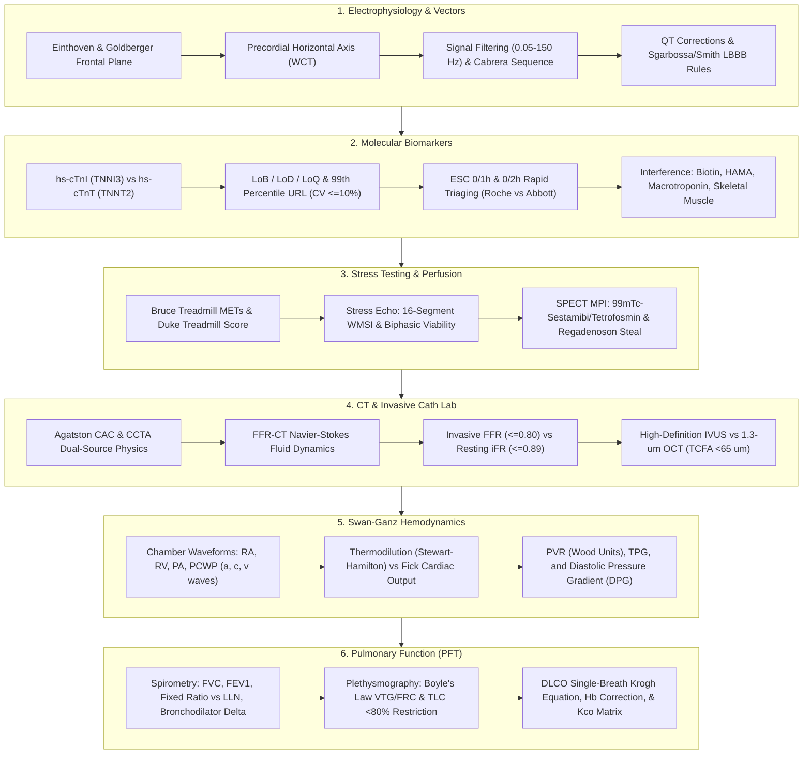
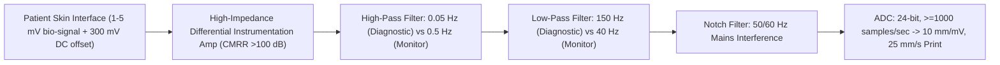
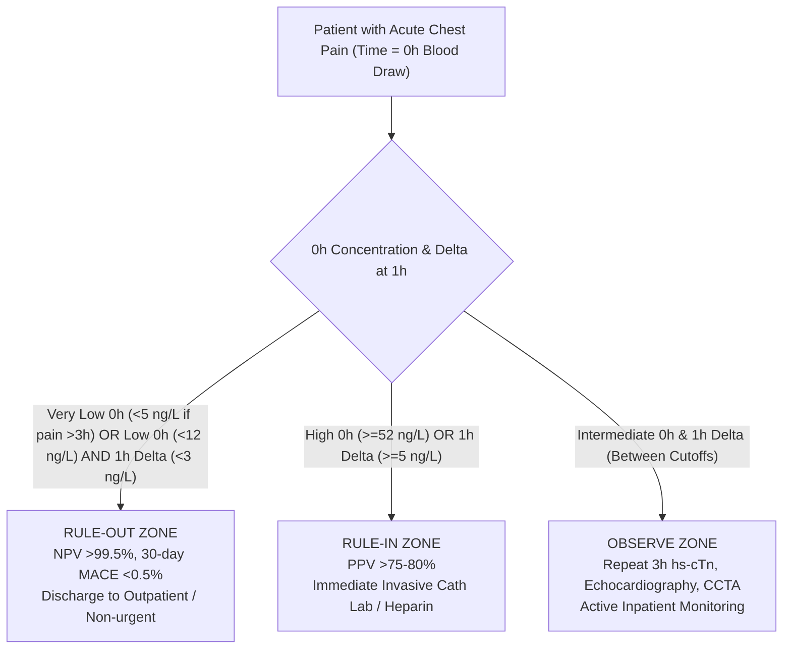
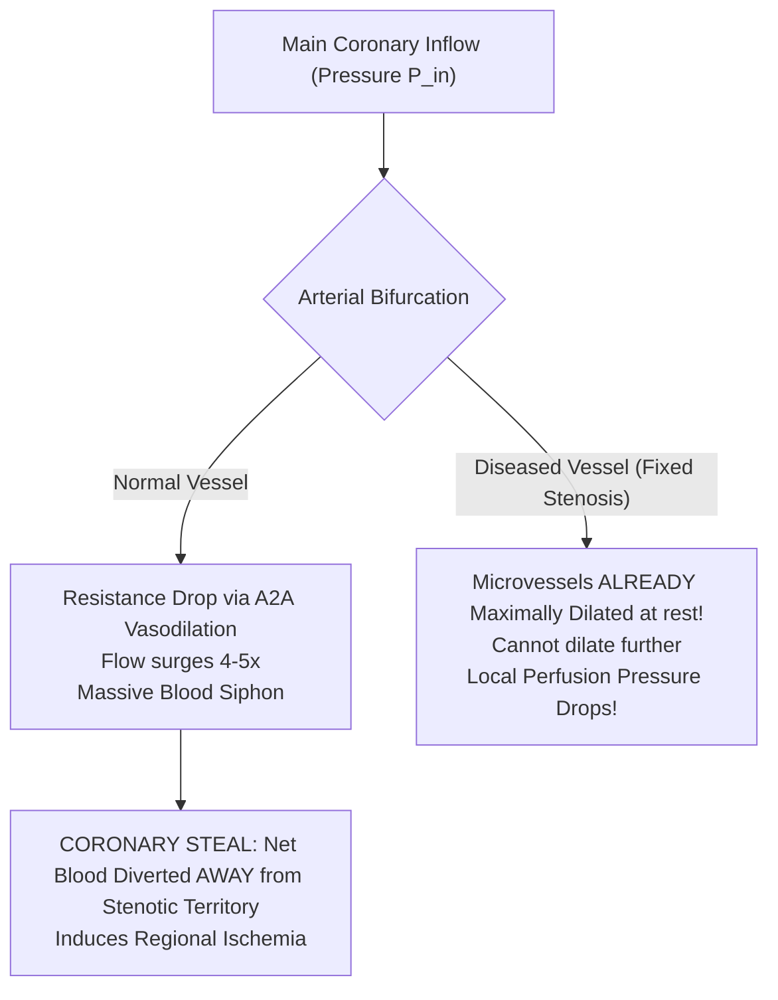
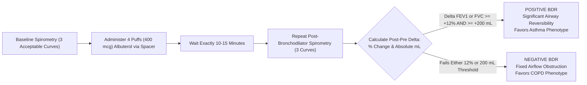

# Basic Medical — Behind the Curtain Clinical Diagnostics Notebook
## Volume XV: Cardiopulmonary Diagnostics — ECG Vector Physics, High-Sensitivity Troponin Immuno-Kinetics, Invasive Cath-Lab Hemodynamics, and Pulmonary Function Mechanics

> *"The cardiovascular and pulmonary systems do not operate as isolated organ blocks; they form an unbroken, continuous hydrodynamic circuit coupled through alveolar-capillary gas exchange, right-to-left pressure cascades, and shared bioenergetic reserves. To master cardiopulmonary diagnostics, a clinician must see through the surface traces: understanding how a 1.3-micron infrared laser illuminates a 65-micron vulnerable coronary fibrous cap, how the Nernst-Goldman electrochemical potential rotates Einthoven's spatial axis, how a single picogram of cleaved cardiac troponin fragment scatters light in an electrochemiluminescent flow-cell, and how Boyle's isothermal gas laws measure air trapped behind diseased bronchioles."*

---

### Master Architectural Overview: The Cardiopulmonary Diagnostic Continuum



---

## Dossier 15.1: 12-Lead Electrocardiography Vector Physics, Lead Placement Forensic Errors, and Conduction Block Ischemia Criteria

### 15.1.1 Einthoven's Triangle, Hexaxial Reference Plane, and Wilson's Central Terminal (WCT) Physics

The surface 12-lead electrocardiogram is not a direct recording of cellular action potentials; it is a spatial projection of the time-varying, three-dimensional cardiac electrical dipole vector $\vec{M}(t)$ onto specific anatomical lead axes. 

#### 1. Dipole Field Theory & Einthoven's Equilateral Postulate
Willem Einthoven modeled the human torso as a homogeneous, spherical volume conductor with the heart acting as a single electrical dipole source located at its geometric center. Three sensing electrodes placed on the Right Arm ($RA$), Left Arm ($LA$), and Left Leg ($LL$) form the vertices of an equilateral triangle in the frontal plane:

$$\text{Lead I}: V_I = \Phi_{LA} - \Phi_{RA}$$
$$\text{Lead II}: V_{II} = \Phi_{LL} - \Phi_{RA}$$
$$\text{Lead III}: V_{III} = \Phi_{LL} - \Phi_{LA}$$

Applying Kirchhoff's Voltage Law around the closed loop of Einthoven's triangle yields **Einthoven's Law**:

$$V_I + V_{III} = (\Phi_{LA} - \Phi_{RA}) + (\Phi_{LL} - \Phi_{LA}) = \Phi_{LL} - \Phi_{RA} = V_{II}$$

$$V_I + V_{III} = V_{II} \iff V_I - V_{II} + V_{III} = 0$$

*Technician's Sanity Check*: If an automated electrocardiograph or manual caliper inspection demonstrates that $V_I + V_{III} \neq V_{II}$ at any instant (e.g., peak of the R-wave), there is an electronic amplifier failure, an analog-to-digital clipping artifact, or high-impedance lead-skin contact noise corrupting the acquisition.

```
                  RA (-60°) --------------- LA (+0°)
                        \                 /
                         \     LEAD I    /
                          \    ----->   /
                           \           /
                   LEAD II  \         /  LEAD III
                    (+60°)   \       /    (+120°)
                              \     /
                               \ v /
                              LL (+90°)
```

#### 2. Wilson's Central Terminal (WCT)
To record unipolar potentials from the torso surface, Frank Wilson (1934) established an artificial reference node intended to represent the electrical potential of the center of the heart ($\Phi_0 \approx 0\text{ V}$). By tying the three limb electrodes together through three equal, high-precision precision resistors ($R = 5\text{ k}\Omega$ historically; now implemented via operational amplifier buffer stages with input impedance $>10^{10}\text{ }\Omega$):

By Kirchhoff's Current Law at the central summing junction:

$$\frac{\Phi_{RA} - \Phi_{WCT}}{R} + \frac{\Phi_{LA} - \Phi_{WCT}}{R} + \frac{\Phi_{LL} - \Phi_{WCT}}{R} = 0$$

$$\Phi_{WCT} = \frac{\Phi_{RA} + \Phi_{LA} + \Phi_{LL}}{3}$$

In a truly symmetrical volume conductor where the sum of limb potentials $\Phi_{RA} + \Phi_{LA} + \Phi_{LL} = 0$, $\Phi_{WCT}$ remains essentially zero throughout the cardiac cycle. Wilson's Central Terminal serves as the universal negative reference terminal for all six precordial leads ($V_1$ through $V_6$):

$$V_k = \Phi_k - \Phi_{WCT} = \Phi_k - \frac{\Phi_{RA} + \Phi_{LA} + \Phi_{LL}}{3} \quad (k \in \{1, 2, 3, 4, 5, 6\})$$

#### 3. Goldberger's Augmented Unipolar Limb Leads
When Wilson attempted to record unipolar limb leads ($V_R, V_L, V_F$) using WCT as the negative reference, the recorded signals were clinically diminutive:

$$V_R = \Phi_{RA} - \Phi_{WCT} = \Phi_{RA} - \frac{\Phi_{RA} + \Phi_{LA} + \Phi_{LL}}{3} = \frac{2\Phi_{RA} - \Phi_{LA} - \Phi_{LL}}{3}$$

Because $\Phi_{LA} + \Phi_{LL} = -\Phi_{RA}$ (assuming $\sum \Phi = 0$), $V_R \approx \Phi_{RA}$. Emanuel Goldberger (1942) realized that if the exploring limb's own resistor is removed from the central terminal, the voltage deflection increases by exactly **$50\%$ ($1.5\times$)** without altering its spatial vector orientation. 

For the augmented unipolar Right Arm lead ($aVR$), the reference terminal is formed solely by averaging the Left Arm and Left Leg:

$$\Phi_{\text{ref}, aVR} = \frac{\Phi_{LA} + \Phi_{LL}}{2}$$

$$aVR = \Phi_{RA} - \frac{\Phi_{LA} + \Phi_{LL}}{2} = \frac{2\Phi_{RA} - \Phi_{LA} - \Phi_{LL}}{2} = \frac{3}{2} \left[ \frac{2\Phi_{RA} - \Phi_{LA} - \Phi_{LL}}{3} \right] = 1.5 \times V_R$$

Similarly, for $aVL$ and $aVF$:

$$aVL = \Phi_{LA} - \frac{\Phi_{RA} + \Phi_{LL}}{2} = 1.5 \times V_L$$

$$aVF = \Phi_{LL} - \frac{\Phi_{RA} + \Phi_{LA}}{2} = 1.5 \times V_F$$

Expressed purely in terms of the standard bipolar leads $I$, $II$, and $III$:

$$aVR = -\frac{I + II}{2}$$
$$aVL = \frac{I - III}{2}$$
$$aVF = \frac{II + III}{2}$$

---

### 15.1.2 The Hexaxial Reference System & The Cabrera Contiguous Sequence

Combining the three standard bipolar leads ($I, II, III$) and the three augmented unipolar leads ($aVR, aVL, aVF$) produces six axes intersecting at $30^\circ$ angular increments in the frontal plane:

| Lead | Spatial Angle | Anatomical Territory Monitored | Positive Pole Location |
| :--- | :--- | :--- | :--- |
| **Lead I** | $0^\circ$ | High Lateral LV Wall | Left mid-axillary / shoulder |
| **Lead II** | $+60^\circ$ | Inferior LV Wall (Apex/RCA/LCx) | Left lower abdomen / leg |
| **Lead III** | $+120^\circ$ | Inferior LV Wall (RCA dominant) | Left lower abdomen / leg |
| **aVR** | $-150^\circ$ | Cavity / Basal Interventricular Septum | Right shoulder |
| **aVL** | $-30^\circ$ | High Lateral LV Wall (Diagonal/OM) | Left shoulder |
| **aVF** | $+90^\circ$ | Inferior LV Wall (Posterior descending) | Left foot |

```
                       -90° (Superior)
                          |
             -120°        |        -60°
                 \        |        /
       -150° aVR  \       |       /   aVL -30°
           \       \      |      /       /
            \       \     |     /       /
   ±180° ----\-------\----+----/-------/----> 0° Lead I
              \       \   |   /       /
               \       \  |  /       /
        +150°   \       \ | /       /    +30°
                 \        |        /
              +120°       |        +60°
             Lead III     |       Lead II
                         +90° aVF
                      (Inferior)
```

#### The Cabrera Sequence: Eliminating the aVR Non-Contiguity Defect
The standard American 12-lead layout prints frontal leads in two arbitrary columns: ($I, II, III$) and ($aVR, aVL, aVF$). This layout creates an anatomical visual fracture: Lead $I$ ($0^\circ$) is followed by Lead $II$ ($+60^\circ$) and Lead $III$ ($+120^\circ$), jumping past the intermediate vectors. 

The **Cabrera Sequence** (mandatory in Scandinavian clinical practice and modern digital electrocardiology) re-arranges the frontal plane into a continuous, panoramic, $30^\circ$ clockwise angular sweep from high lateral to inferior myocardium, inverting $aVR$ to **$-aVR$ ($+30^\circ$)**:

$$\text{Cabrera Sequence}: aVL \, (-30^\circ) \longrightarrow I \, (0^\circ) \longrightarrow -aVR \, (+30^\circ) \longrightarrow II \, (+60^\circ) \longrightarrow aVF \, (+90^\circ) \longrightarrow III \, (+120^\circ)$$

*Clinical Diagnostic Advantage*: In acute inferior or lateral STEMI, the Cabrera sequence displays the spatial wave of injury (ST elevation transitioning seamlessly into reciprocal ST depression) as an unbroken topological curve, preventing subtle single-lead ST elevations from being dismissed.

---

### 15.1.3 Forensic Lead Placement Errors: Reversals and Electrical Signatures

Electrode cable misplacement occurs in up to $4.0\%$ of all hospital ECGs, frequently triggering unwarranted cath-lab activations, missed myocardial infarctions, or erroneous diagnoses of dextrocardia.

```
Normal Connection:      RA [Cable RA]      LA [Cable LA]      LL [Cable LL]
RA-LA Reversal:         RA [Cable LA]      LA [Cable RA]      LL [Cable LL]
```

#### 1. Right Arm / Left Arm (RA–LA) Cable Reversal: The Pseudodextrocardia Trap
When the technician swaps the red (RA) and yellow (LA) limb wires:
* **Lead I Inversion**: $V_I' = \Phi_{LA}' - \Phi_{RA}' = \Phi_{RA} - \Phi_{LA} = -V_I$. The entire Lead I waveform flips upside-down: completely inverted P-wave, negative QRS complex, and inverted T-wave.
* **Lead II and Lead III Mutual Swap**:
  $$V_{II}' = \Phi_{LL} - \Phi_{RA}' = \Phi_{LL} - \Phi_{LA} = V_{III}$$
  $$V_{III}' = \Phi_{LL} - \Phi_{LA}' = \Phi_{LL} - \Phi_{RA} = V_{II}$$
* **aVR and aVL Mutual Swap**: $aVR' = aVL$, while $aVL' = aVR$.
* **aVF Unchanged**: $aVF' = \Phi_{LL} - \frac{\Phi_{RA} + \Phi_{LA}}{2} = aVF$.
* **Precordial Leads ($V_1\text{–}V_6$) Unchanged**: Because WCT is calculated as $(\Phi_{RA} + \Phi_{LA} + \Phi_{LL})/3$, addition is commutative; $\Phi_{WCT}$ is mathematically identical!
* **How to Differentiate RA-LA Reversal from True Dextrocardia**:
  * In **RA-LA Reversal**, precordial leads display normal, healthy R-wave progression from $V_1$ to $V_6$ (rS in $V_1$, transitioning to tall R in $V_5/V_6$).
  * In **True Dextrocardia with Situs Inversus**, the anatomic heart points into the right hemithorax; precordial leads show progressive loss of voltage from $V_1$ to $V_6$, with dominant S-waves throughout and zero R-wave progression.

#### 2. Right Arm / Left Leg (RA–LL) Cable Reversal: The Pseudo-Inferior Infarction
Swapping the RA cable with the LL cable produces profound alterations in the frontal leads:
* **Lead II Inversion**: $V_{II}' = \Phi_{LL}' - \Phi_{RA}' = \Phi_{RA} - \Phi_{LL} = -V_{II}$. Lead II displays an inverted P wave, a deep pathological pseudo-Q wave, and inverted T wave.
* **Lead I Becomes Inverted Lead III**: $V_I' = \Phi_{LA} - \Phi_{LL} = -V_{III}$.
* **Lead III Becomes Inverted Lead I**: $V_{III}' = \Phi_{RA} - \Phi_{LA} = -V_I$.
* **aVL and aVF Inversion & Distortion**: Frontal axis shifts radically superiorly, mimicking an acute inferior myocardial infarction with reciprocal lateral ST depression.
* **Precordial WCT Distortion**: Unlike RA-LA reversal, if limb electrodes with poor impedance are swapped onto the leg, minor baseline shifts may bleed into WCT.

#### 3. Left Arm / Left Leg (LA–LL) Cable Reversal: Subtle Axis Drift
* Lead I becomes Lead II; Lead II becomes Lead I.
* Lead III becomes completely inverted: $V_{III}' = -V_{III}$.
* $aVR$ remains unaltered, but $aVL$ and $aVF$ swap. P-wave polarity in Lead I remains upright, making this the most difficult error for automated algorithm detection.

---

### 15.1.4 Precordial Electrode Displacement Physics & The Brugada Trap

Precordial electrode placement requires rigorous anatomic palpation of the Angle of Louis (sternal manubriosternal angle) to locate the second costal cartilage, walking down to the fourth intercostal space (ICS).

```
   Anatomic Landmark                        Proper Location (4th ICS)               Pathologic High Placement (2nd/3rd ICS)
   =========================================================================================================================
   V1: Right Sternal Border (4th ICS)       Normal rS, flat/biphasic P wave         Elevated rSr', pseudo-coved ST elevation
   V2: Left Sternal Border (4th ICS)        Normal rS, dominant S wave               Mimics Type 1 Brugada Pattern / Incomplete RBBB
```

#### The High V1–V2 Placement (Second/Third Intercostal Space)
Nurses and technicians frequently place $V_1$ and $V_2$ too high on the anterior chest wall (in the 2nd or 3rd ICS) to avoid female breast tissue or unclothed chest exposure:
* **The Physics of Outflow Tract Vectoring**: The second and third intercostal spaces sit directly over the fibro-fatty pulmonary outflow tract and the basal crest of the right ventricle. In this superior plane, late depolarization of the pulmonary conus vectors toward the exploring electrode:
  1. Produces an artificial $rSr'$ or $rSR'$ morphology in $V_1–V_2$, mimicking incomplete right bundle branch block (RBBB).
  2. Generates an apparent downsloping ST elevation terminating in an inverted T wave, perfectly simulating the **Type 1 Brugada Pattern**! Patients have undergone unwarranted electrophysiologic studies and implantable cardioverter-defibrillator (ICD) consultations solely due to a 4-centimeter superior electrode displacement.
  3. Displays inverted P waves in $V_1$ ($P$-terminal force $>0.04\text{ s}\cdot\text{mm}$), falsely suggesting Left Atrial Enlargement.

#### Precordial Lead Inversion ($V_1$ through $V_3$ Reversals)
Swapping cables $V_1$ and $V_2$, or $V_2$ and $V_3$, disrupts the smooth geometric trajectory of the depolarization vector:
* Creates sudden, jagged loss of R-wave amplitude (e.g., $V_1$ R-wave $= 3\text{ mm}$, $V_2$ R-wave $= 1\text{ mm}$, $V_3$ R-wave $= 7\text{ mm}$).
* Falsely flags the automated computer algorithm for **"Anterior Infarct, Age Undetermined"** due to apparent poor R-wave progression.

---

### 15.1.5 Signal Processing, Filter Bandwidths, and Calibration Standards

Modern electrocardiographs are digital recording systems that must preserve microvolt cardiac potentials while rejecting huge environmental electrical noise:



#### 1. Filter Bandwidths: AHA/ACC/HRS Diagnostic Standards vs. Telemetry Distortions
* **Diagnostic ECG Standard**: The American Heart Association mandates a frequency passband of **$0.05\text{ Hz to }150\text{ Hz}$** (and up to $250\text{ Hz}$ in pediatric populations).
  * **The High-Pass Limit ($0.05\text{ Hz}$)**: Required to eliminate respiratory baseline wander without introducing phase-shift distortion into low-frequency ST segments and T waves. A linear phase high-pass filter with a cutoff of $0.05\text{ Hz}$ maintains accurate ST levels.
  * **The Telemetry Monitor Trap ($0.5\text{ Hz to }40\text{ Hz}$)**: Bedside cardiac monitors and transport telemetry units routinely set the high-pass filter to **$0.5\text{ Hz}$** (to anchor the baseline during patient movement) and the low-pass filter to **$40\text{ Hz}$** (to strip out skeletal muscle tremor). 
    * *The Fatal Consequence*: A $0.5\text{ Hz}$ high-pass filter acts as an analog differentiator, distorting the repolarization ST-T wave segment: it can depress a normal ST segment by $1\text{–}2\text{ mm}$ (inducing false ischemia alarms) or conversely elevate an ischemic ST segment, obscuring an evolving STEMI! **Never interpret ST-segment elevation or depression on a telemetry monitor strip running at $0.5\text{–}40\text{ Hz}$ filter bandwidth.**

#### 2. Calibration Standards
* **Voltage Calibration**: Standard calibration is **$10\text{ mm/mV}$** ($1\text{ mm} = 0.1\text{ mV} = 100\text{ }\mu\text{V}$). A standard calibration pulse must display a crisp, square $10\text{-mm}$ upward deflection with a duration of $0.20\text{ seconds}$.
* **Paper Speed**: Standard diagnostic sweep is **$25\text{ mm/s}$** ($1\text{ mm} = 0.04\text{ s} = 40\text{ ms}$; one large box of $5\text{ mm} = 0.20\text{ s} = 200\text{ ms}$). When evaluating extreme tachyarrhythmias or widening of complex conduction anomalies, running paper at **$50\text{ mm/s}$** ($1\text{ mm} = 20\text{ ms}$) expands the time axis, facilitating separation of P waves from T waves.

---

### 15.1.6 Spatial Vectorcardiography and the Spatial QRS-T Angle

Vectorcardiography (VCG) records the cardiac dipole vector simultaneously along three orthogonal Cartesian axes: $X$ (horizontal / right-to-left), $Y$ (vertical / superior-to-inferior), and $Z$ (sagittal / anterior-to-posterior), utilizing the **Frank Lead System** (7 active electrodes: E, I, A, M, C, H, and F):

$$\vec{V}(t) = X(t)\hat{i} + Y(t)\hat{j} + Z(t)\hat{k}$$

Plotting these coordinates parametric in time generates closed continuous 3D loops: the **P loop** (atrial depolarization), the **QRS loop** (ventricular depolarization), and the **T loop** (ventricular repolarization).

```
Spatial QRS-T Angle:
Normal: < 45° (Concordant Depolarization and Repolarization Vectors)
Severe Risk (> 100° to 180°): Discordant Vectors (Subclinical Ischemia, Channelopathy, Sudden Death Risk)
```

#### The Spatial QRS-T Angle ($\theta_{\text{QRS-T}}$)
In a healthy heart, myocardial depolarization and repolarization proceed in opposite anatomical directions: depolarization travels from endocardium to epicardium, while repolarization begins in the epicardium and travels toward the endocardium (due to shorter action potential duration in epicardial myocytes bathed in coronary perfusion). Consequently, the net dipole vector of repolarization ($\vec{T}$) points in nearly the same spatial direction as depolarization ($\vec{QRS}$):
* **Normal Spatial QRS-T Angle**: Typically **$< 45^\circ$** (rarely exceeding $60^\circ$ in young healthy subjects).
* **Wide Spatial QRS-T Angle ($> 100^\circ\text{ to }180^\circ$)**: Indicates severe disruption of repolarization sequence, reflecting structural myocardial scarring, electrical remodeling, channelopathies, or critical subendocardial ischemia. It is one of the strongest independent ECG predictors of sudden cardiac death and fatal ventricular arrhythmias.

---

### 15.1.7 Repolarization Kinetics: QT Correction Dynamics

Because the ventricular action potential duration shortens at higher heart rates (due to delayed-rectifier potassium current activation, $I_{Kr}$ and $I_{Ks}$), the measured raw QT interval ($QT_{\text{raw}}$) must be normalized to a standard heart rate of 60 beats per minute ($RR = 1.0\text{ second}$).

```
QT Correction Comparison:
Tachycardia (HR = 110 bpm, RR = 0.545 s): Bazett severely overcorrects (spurious long QTc alert).
Bradycardia (HR = 45 bpm, RR = 1.333 s): Bazett undercorrects (masks true lethal QT prolongation).
Fridericia (Cube-Root) & Framingham (Linear): Scientifically superior across all physiologic heart rates.
```

#### 1. Mathematical Formulations of Corrected QT ($QTc$)

$$\text{Bazett Formula (1920)}: QTc_B = \frac{QT_{\text{raw}}}{\sqrt{RR}}$$

$$\text{Fridericia Formula (1933)}: QTc_F = \frac{QT_{\text{raw}}}{\sqrt[3]{RR}} = \frac{QT_{\text{raw}}}{RR^{0.333}}$$

$$\text{Framingham Formula}: QTc_{\text{Fram}} = QT_{\text{raw}} + 0.154 \times (1 - RR)$$

$$\text{Hodges Formula}: QTc_{\text{Hodges}} = QT_{\text{raw}} + 1.75 \times (\text{Heart Rate} - 60)$$

*(Note: In all formulas, $QT$ and $RR$ are measured in seconds, except in Hodges where HR is in beats per minute and QT is in milliseconds).*

#### 2. The Analytical Failure of Bazett's Formula
Bazett's square-root normalization assumes a parabolic scaling relationship that does not match human myocyte electrophysiology:
* **At Elevated Heart Rates ($HR > 80\text{ bpm}$, $RR < 0.75\text{ s}$)**: $\sqrt{RR}$ shrinks too rapidly, causing massive mathematical overcorrection. Normal QT intervals of $340\text{ ms}$ at $105\text{ bpm}$ compute to $QTc_B > 480\text{ ms}$, prompting unnecessary drug discontinuations, cardiology consults, and electrolyte infusions.
* **At Bradycardic Heart Rates ($HR < 50\text{ bpm}$, $RR > 1.20\text{ s}$)**: $\sqrt{RR}$ grows excessively, resulting in undercorrection that masks dangerously prolonged repolarization.
* **The Clinical Standard**: The American College of Cardiology and the European Society of Cardiology strongly endorse **Fridericia ($QTc_F$)** or linear regression models (**Framingham**) as the standard of care, especially in atrial fibrillation, sinus tachycardia, or drug safety monitoring.
* **Normal QTc Cutoffs ($QTc_F$)**:
  * Men: Normal $<430\text{ ms}$; Borderline $430\text{–}450\text{ ms}$; Prolonged $>450\text{ ms}$.
  * Women: Normal $<450\text{ ms}$; Borderline $450\text{–}470\text{ ms}$; Prolonged $>470\text{ ms}$.
  * **Critical Torsadogenic Threshold**: $QTc > 500\text{ ms}$ (or an increase in $QTc > 60\text{ ms}$ from baseline) confers an exponential increase in the risk of pause-dependent early afterdepolarizations (EADs) triggering **Torsades de Pointes (TdP)**.

---

### 15.1.8 Sgarbossa and Modified Smith-Sgarbossa Criteria for LBBB and Ventricular Pacing

In normal cardiac conduction, myocardial depolarization and repolarization are balanced. In Left Bundle Branch Block (LBBB) and right ventricular pacing, septal depolarization originates entirely from the right bundle, propagating slowly through myocyte-to-myocyte gap junctions across the septum from right to left. 

This abnormal depolarization creates **appropriate T-wave discordance**: the ST segment and T wave are naturally directed opposite to the major deflection of the QRS complex. In leads with deep negative S waves ($V_1–V_3$), the ST segment naturally elevates; in leads with tall positive R waves ($I, aVL, V_5–V_6$), the ST segment naturally depresses. This physiological discordance completely masks traditional STEMI criteria.

```
Concordant STE (Score 5):        Concordant STD V1-V3 (Score 3):       Modified Smith-Sgarbossa (Rule):
ST elevation in line with R      ST depression in line with S          Discordant STE / S-wave depth >= 0.25
        |                                                                      |
       / \    _---_                         |\                                / \
      /   \  /     \                        | \                              /   \
     /     \/       \                       |  \                            /     \
    /       |        \                      |   \                          /       \
   /                  \               ------|    \    ------              /         \  _---_
                                            |     \  /                   /           \/     \
                                            |      \/                                 |
                                            |
```

#### 1. The Original Sgarbossa Criteria (1996)

| Sgarbossa Criterion | Electrophysiological Description | Points Assigned | Diagnostic Specificity |
| :--- | :--- | :--- | :--- |
| **Criterion A (Concordant STE)** | ST-segment elevation $\ge 1\text{ mm}$ ($0.1\text{ mV}$) in leads with a **positive** QRS complex | **5 Points** | $98\%$ Specific |
| **Criterion B (Concordant STD)** | ST-segment depression $\ge 1\text{ mm}$ ($0.1\text{ mV}$) in lead **$V_1, V_2,\text{ or }V_3$** | **3 Points** | $96\%$ Specific |
| **Criterion C (Excessive Discordant STE)** | ST-segment elevation $\ge 5\text{ mm}$ ($0.5\text{ mV}$) in leads with a **negative** QRS complex | **2 Points** | Low Sensitivity ($<20\%$) |

*A Sgarbossa score $\ge 3$ points has $>90\%$ specificity for acute coronary occlusion myocardial infarction (OMI) requiring emergent catheterization.*

#### 2. The Modified Smith-Sgarbossa Criteria (Smith et al., 2012)
Original Criterion C ($\ge 5\text{ mm}$ absolute discordant STE) had catastrophic diagnostic sensitivity ($16\text{–}20\%$): if a patient had a massive, voltage-dilated QRS complex with an S wave of $40\text{ mm}$ depth, an ST elevation of $6\text{ mm}$ was merely proportional ($15\%$), while a patient with an S wave of $8\text{ mm}$ and an ST elevation of $4.5\text{ mm}$ had massive, lethal transmural ischemia that missed the arbitrary $5\text{ mm}$ threshold!

Dr. Stephen Smith replaced absolute millimetric discordance with a **proportional ratio**:
* **The Rule**: In any lead with a predominantly negative QRS complex ($QS$ or $rS$), measure the ST-segment elevation at the J-point relative to the preceding S-wave amplitude:

$$\text{Modified Smith-Sgarbossa Ratio} = \frac{\text{ST Elevation at J-point}}{\text{S-wave Amplitude}} \ge 0.25 \quad \left( \text{or } \frac{ST}{S} \le -0.25 \right)$$

*Alternatively: In leads with dominant R-waves and excessively discordant ST-depression, a ratio of $\frac{\text{ST Depression}}{\text{R-wave Amplitude}} \ge 0.30$.*

*Clinical Impact*: Replacing Criterion C with the Smith-Sgarbossa ratio of $\ge 0.25$ increases sensitivity for acute coronary occlusion in LBBB from **$52\%$ to $91\%$** while preserving **$96\%$ specificity**, definitively identifying candidates for immediate primary percutaneous coronary intervention (PPCI).

---

## Dossier 15.2: High-Sensitivity Cardiac Troponins (hs-cTnI vs. hs-cTnT) — Analytical Biochemistry, Nanogram Kinetics, and Immunoassay Traps

### 15.2.1 Molecular Proteomics: Troponin C, I, and T Architecture

The troponin complex regulates striated muscle contraction in response to cytosolic calcium fluctuations. Anchored to the actin thin filament alongside tropomyosin, it comprises three non-covalently linked polypeptide subunits:

```
Thin Filament Architecture:
   [Actin Filament] ==========================================================
                           \                 /                   /
                       [Tropomyosin Polymer]                   /
                             |                                /
                   +---------+---------+                     /
                   |    Troponin T     | <------------------+ (Anchors complex)
                   |  (TNNT2, 37 kDa)  |
                   +---------+---------+
                             |
                   +---------+---------+
                   |    Troponin C     | (Binds Ca2+, 18 kDa, shared skeletal/cardiac)
                   |  (TNNC1, 18 kDa)  |
                   +---------+---------+
                             |
                   +---------+---------+
                   |    Troponin I     | <--- Inhibitory subunit: Prevents actomyosin ATPase
                   |  (TNNI3, 24 kDa)  |      100% Unique 32-AA N-terminal cardiac domain
                   +-------------------+
```

#### 1. Troponin I (Inhibitory Subunit — Encoded by *TNNI3*)
* **Molecular Weight**: $\approx 24\text{ kDa}$ ($210$ amino acids).
* **Cardiac Specificity**: Absolute. The cardiac isoform of Troponin I possesses a unique **32-amino acid post-translational extension at its N-terminus** containing two regulatory serine residues (Ser-23, Ser-24) phosphorylated by Protein Kinase A in response to beta-adrenergic stimulation. This cardiac-specific N-terminal sequence is entirely absent in human slow-twitch skeletal muscle ($TNNI1$) and fast-twitch skeletal muscle ($TNNI2$). 
* *Diagnostic Law*: Human skeletal muscle—regardless of injury, regeneration, rhabdomyolysis, polymyositis, or muscular dystrophy—**never expresses cardiac Troponin I (*TNNI3*)**.

#### 2. Troponin T (Tropomyosin-Binding Subunit — Encoded by *TNNT2*)
* **Molecular Weight**: $\approx 37\text{ kDa}$ ($288$ amino acids).
* **Tropomyosin Anchor**: Anchors the troponin complex to the tropomyosin filament and modulates calcium-activated cooperative actomyosin cross-bridging.
* **The Skeletal Cross-Reactivity Vulnerability**: Unlike Troponin I, the gene for cardiac Troponin T (*TNNT2*) shares substantial evolutionary homology with fetal skeletal muscle isoforms. In regenerating skeletal muscle—seen in chronic inflammatory myopathies (polymyositis, dermatomyositis, inclusion body myositis), severe rhabdomyolysis, and Duchenne muscular dystrophy—**myocytes dedifferentiate and re-express embryonic isoforms of Troponin T** that cross-react with commercial high-sensitivity Troponin T (hs-cTnT) detection antibodies! Patients with active polymyositis routinely present with persistent, stable hs-cTnT elevations of $50\text{ to }250\text{ ng/L}$ with completely normal hs-cTnI ($<3\text{ ng/L}$) and zero myocardial ischemia.

---

### 15.2.2 Metrological Definitions: LoB, LoD, LoQ, and the 99th Percentile URL

To qualify as a genuine "high-sensitivity" cardiac troponin assay under International Federation of Clinical Chemistry and Laboratory Medicine (IFCC) guidelines, an analytical platform must meet two strict metrological criteria:
1. The **analytical total error / Coefficient of Variation ($CV$) at the 99th percentile Upper Reference Limit (URL)** of a healthy reference population must be **$\le 10\%$**.
2. The assay must be capable of quantifying troponin concentrations well above the Limit of Detection in at least **$50\%$ of healthy individuals** (both men and women).

```
Analytical Hierarchy of Detection:
0 ng/L ------------ LoB ------------ LoD ---------------- LoQ ---------------- 99th URL (CV <=10%)
                   (Blank noise)   (True presence)      (Quantitative accuracy)  (Upper limit of normal)
                    ~1.0 ng/L       ~1.5-2.0 ng/L        ~3.0-5.0 ng/L            ~14-34 ng/L
```

#### Analytical Precision Definitions
* **Limit of Blank (LoB)**: The highest apparent analyte concentration expected to be found when replicates of a blank sample containing zero troponin are tested:
  $$LoB = \text{Mean}_{\text{blank}} + 1.645 \times SD_{\text{blank}}$$
* **Limit of Detection (LoD)**: The lowest troponin concentration that can be reliably distinguished from the Limit of Blank with a $95\%$ probability:
  $$LoD = LoB + 1.645 \times SD_{\text{low concentration sample}}$$
  *Modern platforms (e.g., Roche Elecsys hs-cTnT, Abbott Alinity hs-cTnI) achieve an LoD of **$1.0\text{ to }2.5\text{ ng/L}$ ($1.0\text{–}2.5\text{ pg/mL}$)**!*
* **Limit of Quantitation (LoQ)**: The lowest concentration at which analyte can not only be detected, but quantified with an established goal for precision (typically defined as the concentration where within-laboratory $CV \le 10\%$).

---

### 15.2.3 Validated Rapid Diagnostic Protocols: ESC 0/1-Hour and 0/2-Hour Triage Algorithms

The extreme sensitivity of modern platforms has replaced the antiquated 6-to-12 hour troponin monitoring protocols with validated rapid 0/1-hour and 0/2-hour algorithms endorsed by the European Society of Cardiology (ESC 2020/2023 Guidelines).



#### 1. Validated Platform Cutoffs (All values in $\text{ng/L} \equiv \text{pg/mL}$)

| Analytical Platform & Biomarker | 99th Percentile URL (Sex-Specific) | Rule-Out: 0h Baseline | Rule-Out: 0h & 1h $\Delta$ | Rule-In: 0h Baseline | Rule-In: 1h $\Delta$ |
| :--- | :--- | :--- | :--- | :--- | :--- |
| **Roche Elecsys hs-cTnT** (Gen 5) | Overall: $14\text{ ng/L}$<br>(F: $9$, M: $17$) | $<5\text{ ng/L}$<br>*(if pain $>3\text{h}$)* | $0\text{h} < 12\text{ ng/L}$<br>AND $\Delta 1\text{h} < 3\text{ ng/L}$ | $\ge 52\text{ ng/L}$ | $\Delta 1\text{h} \ge 5\text{ ng/L}$ |
| **Abbott Alinity / ARCHITECT hs-cTnI** | Female: $16\text{ ng/L}$<br>Male: $34\text{ ng/L}$ | $<2\text{ ng/L}$<br>*(if pain $>3\text{h}$)* | $0\text{h} < 5\text{ ng/L}$<br>AND $\Delta 1\text{h} < 2\text{ ng/L}$ | $\ge 52\text{ ng/L}$ | $\Delta 1\text{h} \ge 6\text{ ng/L}$ |
| **Siemens Atellica hs-cTnI** | Female: $34\text{ ng/L}$<br>Male: $53\text{ ng/L}$ | $<3\text{ ng/L}$<br>*(if pain $>3\text{h}$)* | $0\text{h} < 6\text{ ng/L}$<br>AND $\Delta 1\text{h} < 3\text{ ng/L}$ | $\ge 120\text{ ng/L}$ | $\Delta 1\text{h} \ge 12\text{ ng/L}$ |

#### 2. The 0/2-Hour Alternative Protocol
When 1-hour logistics are prevented by pneumatic tube delays or lab turnaround time constraints, the 0/2-hour algorithm uses slightly higher delta thresholds:
* **Roche hs-cTnT 0/2h**: Rule-out if $0\text{h} < 14\text{ ng/L}$ and $2\text{h} \, \Delta < 4\text{ ng/L}$. Rule-in if $0\text{h} \ge 52\text{ ng/L}$ or $2\text{h} \, \Delta \ge 10\text{ ng/L}$.
* **Abbott hs-cTnI 0/2h**: Rule-out if $0\text{h} < 10\text{ ng/L}$ and $2\text{h} \, \Delta < 4\text{ ng/L}$. Rule-in if $0\text{h} \ge 64\text{ ng/L}$ or $2\text{h} \, \Delta \ge 15\text{ ng/L}$.

---

### 15.2.4 Behind-the-Curtain Analytical Interference Traps

Because clinical decision pathways hinge on single-digit nanogram-per-liter shifts, chemical and immunological interferences inside the automated immunoassay cuvette can simulate or conceal catastrophic infarctions.

```
       HAMA / Heterophile Bridging Trap:                    Competitive Biotin Quenching (Roche):
       [Capture Ab] -- (HAMA) -- [Detection Ab*]           [Streptavidin Bead] == (Biotin Pill) [Sites Blocked]
               \                     /                                         X
                [No Real Troponin!]                                    [Capture Ab Cannot Bind!]
             Spurious High Light Emission                           Spurious False Low Emission
             => Fake Non-STEMI Workup                               => Missed Fatal Occlusion STEMI!
```

#### 1. Heterophile Antibodies and Human Anti-Mouse Antibodies (HAMA)
* **Mechanism**: Two-site sandwich immunoassays utilize a capture antibody bound to a solid phase (e.g., paramagnetic microparticles) and a signal-generating detection antibody conjugated to acridinium ester or ruthenium. Patients exposed to mice, rodents, monoclonal antibody therapies, or farm livestock harbor circulating human anti-animal antibodies (heterophile antibodies or HAMA). These divalent human antibodies directly bind the constant ($Fc$) regions of both capture and detection animal antibodies simultaneously, cross-linking them in the total absence of cardiac troponin.
* **Clinical Result**: Constant, non-fluctuating false-positive troponin elevations ($80\text{ to }500\text{ ng/L}$) with zero acute dynamic delta over serial draws.
* **Technician's Corrective Action**:
  1. Re-run sample using a specialized **Heterophile Blocking Tube (HBT)** containing non-immune murine globulins that saturate and neutralize HAMA.
  2. Perform **serial dilution testing**: true troponin dilutes linearly ($1:2, 1:4, 1:8$ recovery within $10\%$ of expected), whereas antibody bridging exhibits extreme non-linear prozone/hook-like deviations.

#### 2. Biotin (Vitamin B7) Interference
* **Mechanism**: High-sensitivity immunoassays utilizing a streptavidin-biotin magnetic bead capture architecture (principally the **Roche Elecsys hs-cTnT** platform) rely on the nearly covalent non-covalent affinity ($K_d \approx 10^{-15}\text{ M}$) between biotinylated capture antibodies and streptavidin-coated microparticles. 
* **The Pharmacokinetic Disaster**: High-dose over-the-counter biotin supplements ($5\text{ to }100\text{ mg/day}$ consumed for hair, skin, and nail growth) generate plasma biotin concentrations exceeding $500\text{–}1000\text{ ng/mL}$. Free circulating biotin saturates the streptavidin binding pockets on the beads, preventing the biotinylated troponin sandwich complexes from anchoring!
* **Clinical Result**: The unbound sandwich complexes are washed away during aspiration. The analyzer detects virtually zero light, reporting a **catastrophic false-negative troponin ($<5\text{ ng/L}$)** in a patient actively occluding their proximal LAD!
* *Technician's Rule*: In patients consuming high-dose biotin, blood must not be drawn for Roche Elecsys testing for at least **$8\text{ to }24\text{ hours}$ post-ingestion**, or samples must be pre-treated with anti-biotin depleting resin beads.

#### 3. Macrotroponin Complexes
* **Mechanism**: Analogous to macroamylase and macro-prolactin, circulating endogenous autoantibodies (primarily immunoglobulin G, $\text{IgG}$) bind free cardiac troponin (cTnI or cTnT) to form high-molecular-weight macromolecular complexes ($>200\text{ kDa}$). 
* **The Kinetics**: The renal clearance of free troponin fragments ($15\text{–}25\text{ kDa}$) by glomerular filtration is rapid; however, bulky IgG-macrotroponin complexes exceed the glomerular podocyte slit diaphragm cutoff ($\sim 60\text{ kDa}$) and cannot be cleared, accumulating in plasma.
* **The PEG Precipitation Test**:
  * Mix equal volumes of patient serum and a $25\%$ solution of **Polyethylene Glycol (PEG 6000)**.
  * Vortex and centrifuge at $3000 \times g$ for 15 minutes to precipitate high-molecular-weight immunoglobulins while leaving monomeric troponin in the supernatant.
  * Measure troponin in the supernatant and calculate the **Percentage Recovery**:
    $$\% \text{ PEG Recovery} = \frac{\text{Troponin in Supernatant} \times 2}{\text{Troponin in Untreated Serum}} \times 100\%$$
  * **Interpretation**:
    * $\% \text{ Recovery} > 80\%$: Free monomeric troponin confirms true myocardial injury.
    * $\% \text{ Recovery} < 40\%$: Confirms **Macrotroponin**, explaining persistent asymptomatic chronic elevation and sparing the patient invasive angiography.

---

### 15.2.5 Kinetic Clearance, Renal Insufficiency, and Skeletal Muscle Confounders

```
Etiology of hs-cTn Elevation: Is it Acute Type 1 MI vs End-Stage Renal Disease (ESRD)?
   Parameter                 Acute Type 1 MI (Plaque Rupture)           Chronic ESRD Elevation
   -------------------------------------------------------------------------------------------------
   0h to 1h / 2h Delta       Dynamic Surge (>=20% to 100%+ rise)       Static, plateau (<10% variance)
   Renal Filtration          Normal or acute decline                    eGFR <15 mL/min/1.73m2
   Troponin Subfragment      Intact + early large fragments             Heavily cleaved micro-fragments
   hs-cTnI vs hs-cTnT        Both elevate concordantly                 hs-cTnT elevated > hs-cTnI
```

#### 1. The Renal Clearance Mystery in ESRD
Over $70\%$ of asymptomatic patients with End-Stage Renal Disease on chronic hemodialysis exhibit baseline hs-cTnT concentrations above the 99th percentile URL ($>14\text{ ng/L}$), often hovering between $25\text{ and }75\text{ ng/L}$.
* **Mechanism**: Both impaired renal catabolism of cleaved troponin micro-fragments AND chronic subclinical uremic cardiomyopathy (interstitial myocardial fibrosis, left ventricular hypertrophy, silent microvascular subendocardial ischemia, and skeletal muscle isoform re-expression).
* **Diagnostic Rule**: A single isolated elevated troponin in an ESRD patient has poor positive predictive value for acute MI. The diagnosis of acute myocardial infarction in renal failure strictly requires a **dynamic delta shift ($\ge 20\%$ change over $2\text{–}3\text{ hours}$)** superimposed on the chronic elevated baseline!

---

## Dossier 15.3: Noninvasive Ischemia Evaluation & Myocardial Perfusion Scintigraphy

### 15.3.1 Exercise Physiology & Bruce Protocol Hemodynamics: Treadmill METs Math

Exercise stress testing evaluates coronary flow reserve by increasing myocardial oxygen demand ($MVO_2$) to unmask flow-limiting epicardial coronary stenoses. 

#### 1. Rate-Pressure Product (Double Product)
Myocardial oxygen consumption correlates directly with the product of heart rate and peak systolic blood pressure:

$$\text{Rate-Pressure Product (RPP)} = \text{Peak Heart Rate (bpm)} \times \text{Peak Systolic Blood Pressure (mmHg)}$$

* **Adequate Hemodynamic Stress**: An exercise test is diagnostically adequate only if the patient achieves $\ge 85\%$ of their age-predicted maximal heart rate ($HR_{\text{max}} = 220 - \text{Age}$) and an **$RPP \ge 25,000$** (e.g., $165\text{ bpm} \times 160\text{ mmHg} = 26,400$). If a beta-blocker prevents the patient from exceeding an $RPP$ of $20,000$, a negative test is indeterminate and non-diagnostic.

#### 2. Bruce Protocol Mechanics & Oxygen Consumption Formula
The standard Bruce Protocol increments speed and grade every 3 minutes:

| Bruce Stage | Time (Minutes) | Treadmill Speed | Incline Grade | Approximate METs |
| :--- | :--- | :--- | :--- | :--- |
| **Stage 1** | $0:00 - 3:00$ | $1.7\text{ mph}$ ($45.6\text{ m/min}$) | $10\%$ ($0.10$) | **$4.6\text{ METs}$** |
| **Stage 2** | $3:01 - 6:00$ | $2.5\text{ mph}$ ($67.0\text{ m/min}$) | $12\%$ ($0.12$) | **$7.0\text{ METs}$** |
| **Stage 3** | $6:01 - 9:00$ | $3.4\text{ mph}$ ($91.1\text{ m/min}$) | $14\%$ ($0.14$) | **$10.1\text{ METs}$** |
| **Stage 4** | $9:01 - 12:00$ | $4.2\text{ mph}$ ($112.6\text{ m/min}$) | $16\%$ ($0.16$) | **$13.5\text{ METs}$** |
| **Stage 5** | $12:01 - 15:00$ | $5.0\text{ mph}$ ($134.0\text{ m/min}$) | $18\%$ ($0.18$) | **$17.0\text{ METs}$** |

#### American College of Sports Medicine (ACSM) Oxygen Consumption Equation:

$$VO_2\text{ (mL/kg/min)} = (0.1 \times S) + (1.8 \times S \times G) + 3.5$$

Where $S$ is speed in meters per minute ($1\text{ mph} = 26.8\text{ m/min}$) and $G$ is fractional grade (e.g., $10\% = 0.10$). One Metabolic Equivalent of Task (**$1\text{ MET}$**) is defined as resting basal oxygen consumption:

$$1\text{ MET} \equiv 3.5\text{ mL } O_2 / \text{kg/min}$$

$$\text{METs} = \frac{VO_2}{3.5}$$

*Worked Example (Stage 2: 2.5 mph, 12% grade)*:
$$S = 2.5 \times 26.8 = 67.0\text{ m/min}, \quad G = 0.12$$
$$VO_2 = (0.1 \times 67.0) + (1.8 \times 67.0 \times 0.12) + 3.5 = 6.70 + 14.47 + 3.5 = 24.67\text{ mL/kg/min}$$
$$\text{METs} = \frac{24.67}{3.5} = \mathbf{7.05\text{ METs}}$$

---

### 15.3.2 The Duke Treadmill Score (DTS)

The Duke Treadmill Score integrates exercise capacity, ischemic electrophysiology, and symptom severity into a continuous prognostic metric validated by Mark et al. (*Ann Intern Med*, 1987):

$$\text{Duke Treadmill Score (DTS)} = \text{Exercise Time (min)} - (5 \times \text{Max ST Deviation (mm)}) - (4 \times \text{Angina Index})$$

```
Angina Index Definitions:
0 = None (No chest discomfort during exercise)
1 = Non-limiting angina (Patient reports chest pain, but can continue exercise)
2 = Exercise-limiting angina (Test terminated due to severe ischemic pain)
```

*ST Deviation Measurement Rule*: Measured at the J-point $+80\text{ ms}$ (or J $+60\text{ ms}$ at heart rates $>130\text{ bpm}$) in the single lead displaying the most severe horizontal or downsloping ST-segment depression.

```
Risk Stratification via Duke Treadmill Score:
========================================================================================
Score Category          DTS Score Range       5-Year Survival Rate    Recommended Pathway
----------------------------------------------------------------------------------------
Low Risk                DTS >= +5             > 99% (>0.25%/year)     Medical Therapy
Moderate Risk           -10 <= DTS <= +4      95% (~1.25%/year)       Stress Imaging / CCTA
High Risk               DTS <= -11            < 79% (>5.0%/year)      Direct Invasive Cath
```

*Worked Diagnostic Calculation*:
A 62-year-old male completes 4 minutes of the Bruce Protocol before stopping due to severe, exercise-limiting angina (Angina Index = 2). The ECG demonstrates $2.5\text{ mm}$ of horizontal ST-segment depression in leads $V_4–V_6$:
$$\text{DTS} = 4.0 - (5 \times 2.5) - (4 \times 2) = 4.0 - 12.5 - 8 = \mathbf{-16.5}$$
*Interpretation*: **High-Risk Category ($\text{DTS} = -16.5 \le -11$)**; 5-year cardiovascular mortality exceeds $5\%$ annually; immediate invasive coronary angiography indicated.

---

### 15.3.3 Stress Echocardiography: 16-Segment / 17-Segment ASE WMSI & Dobutamine Biphasic Viability

Stress echocardiography pairs physical exercise or pharmacologic inotropic stress with real-time 2D transthoracic imaging to identify regional wall motion abnormalities (RWMAs) that develop when coronary flow cannot meet demand.

```
ASE 17-Segment Regional Model:
   Basal Ring (6 segments):       Anterior, Anteroseptal, Inferoseptal, Inferior, Inferolateral, Anterolateral
   Mid-Cavity Ring (6 segments):   Anterior, Anteroseptal, Inferoseptal, Inferior, Inferolateral, Anterolateral
   Apical Ring (4 segments):       Anterior, Septal, Inferior, Lateral
   Apex Cap (1 segment):           True Apex (Segment 17)
```

#### 1. Wall Motion Score Index (WMSI)
Each visualized myocardial segment is assigned an ordinal functional score under the American Society of Echocardiography (ASE) guidelines:
* **Score 1**: Normal or hyperkinetic ($\ge 30\%$ radial systolic endocardial thickening).
* **Score 2**: Hypokinetic (reduced thickening, $<30\%$).
* **Score 3**: Akinetic (complete absence of systolic wall thickening).
* **Score 4**: Dyskinetic (paradoxical systolic outward ballooning / systolic thinning).
* **Score 5**: Aneurysmal (diastolic and systolic outward deformation with structural thinning).

$$\text{Wall Motion Score Index (WMSI)} = \frac{\sum (\text{Segment Scores})}{\text{Total Number of Evaluated Segments}}$$

* Normal resting WMSI is exactly **$1.0$**. A WMSI $>1.7$ during peak stress indicates multi-vessel CAD and poor long-term prognosis.

#### 2. Dobutamine Inotropic Titration & The Biphasic Viability Response
In patients unable to exercise, **dobutamine** (synthetic $\beta_1 > \beta_2 > \alpha_1$ adrenergic agonist) is infused in incremental stages:

$$\text{Dobutamine Stages}: 5 \longrightarrow 10 \longrightarrow 20 \longrightarrow 30 \longrightarrow 40\text{ }\mu\text{g/kg/min} \quad (\text{+ Atropine } 0.25\text{–}0.5\text{ mg up to } 2.0\text{ mg if HR fails to reach } 85\%)$$

```
Dobutamine Biphasic Response in Hibernating Myocardium:
Rest (Akinetic/Hypokinetic) 
  --> Low-Dose Dobutamine (5-10 mcg/kg/min): Recovers contractility (Inotropic reserve!)
    --> High-Dose Dobutamine (30-40 mcg/kg/min): Contractility collapses into akinesia (Ischemia!)
*PATHOGNOMONIC FOR MYOCARDIAL VIABILITY AND FLOW-LIMITING EPICARDIAL STENOSIS!*
```

* **The Biphasic Response**: At low doses ($5\text{–}10\text{ }\mu\text{g/kg/min}$), dobutamine increases cyclic AMP without massively escalating heart rate, recruiting contractile reserve in chronically hypoperfused, down-regulated ("hibernating") myocardium—the akinetic segment begins to thicken! At high doses ($30\text{–}40\text{ }\mu\text{g/kg/min}$), heart rate and oxygen demand surge, exceeding the fixed blood delivery of the stenotic vessel—the segment abruptly ceases to thicken, reverting to akinesia. The biphasic response has $>85\%$ specificity for predicting functional recovery post-revascularization.

---

### 15.3.4 Nuclear Scintigraphy Physics: 99mTc-Sestamibi, 99mTc-Tetrofosmin, and 201Tl Redistribution Kinetics

Single-Photon Emission Computed Tomography (SPECT) myocardial perfusion imaging (MPI) maps relative regional myocardial blood flow using radiopharmaceuticals injected during peak stress and at rest.

```
Radiotracer Comparison:
-------------------------------------------------------------------------------------------------------
Radiotracer            Photon Energy      Physical Half-Life    Uptake Mechanism & Cellular Target
-------------------------------------------------------------------------------------------------------
99mTc-Sestamibi        140 keV            6.0 hours             Passive diffusion driven by mitochondrial 
(Cardiolite)                                                    negative membrane potential (Delta-Psi_m)
-------------------------------------------------------------------------------------------------------
99mTc-Tetrofosmin      140 keV            6.0 hours             Lipophilic diphosphine; mitochondrial
(Myoview)                                                       membrane potential dependent
-------------------------------------------------------------------------------------------------------
201Tl-Thallous         69-80 keV (X-rays) 73.0 hours            Active transport via sarcolemmal 
Chloride               167 keV (gamma)                          Na+/K+-ATPase pump (Potassium analog)
```

#### 1. Technetium-99m Tracer Biophysics ($^{99m}\text{Tc}$-Sestamibi / Tetrofosmin)
* **Gamma Camera Physics**: Technetium-99m decays by isomeric transition, emitting a single monoenergetic **$140\text{ keV}$ gamma photon** ideal for low-energy high-resolution (LEHR) lead parallel-hole collimators paired with a Sodium Iodide doped with Thallium [$\text{NaI(Tl)}$] scintillation crystal. A $20\%$ energy symmetric window ($126\text{–}154\text{ keV}$) rejects Compton-scattered photons.
* **Mitochondrial Trapping**: Sestamibi is a lipophilic monovalent cation ($+1$ charge). Driven by the negative electrical transmembrane potential of intact myocytes (sarcolemma $-80\text{ mV}$) and the massive negative electrical gradient across the inner mitochondrial membrane ($\Delta \Psi_m \approx -160\text{ to }-180\text{ mV}$), it crosses the membranes and accumulates irreversibly inside the mitochondrial matrix.
* **Absence of Redistribution**: Once trapped inside mitochondria, sestamibi does not wash out or redistribute significantly over time. Therefore, **two separate injections** are required: one at peak stress and a second at rest (typically a 1-day or 2-day rest/stress protocol).

#### 2. Thallium-201 ($^{201}\text{Tl}$) and Redistribution Viability Kinetics
* **The Potassium Analog**: Thallium-201 enters the myocyte via the energy-dependent $\text{Na}^+/\text{K}^+\text{-ATPase}$ pump. Initial uptake ($10\text{–}15\text{ minutes}$ post-injection) reflects regional blood flow.
* **The Dynamic Redistribution Phenomenon**: Unlike technetium agents, Thallium washes in and out of myocytes continuously. Over $3\text{ to }4\text{ hours}$ (and out to $24\text{ hours}$), Thallium washes out rapidly from normally perfused territories but slowly accumulates in viable, hypoperfused, hibernating tissue:
  * **Reversible Defect (Ischemia)**: Cold on initial stress images $\rightarrow$ normalizes (fills in) on 4-hour redistribution images.
  * **Fixed Defect (Scar / Infarction)**: Cold on initial stress $\rightarrow$ remains cold on 4-hour redistribution.
  * **Hibernating Viability (Late Reversibility)**: Cold on initial stress $\rightarrow$ remains cold at 4 hours $\rightarrow$ fills in on delayed **24-hour redistribution imaging** or following a reinjection booster dose!

---

### 15.3.5 Pharmacologic Vasodilator Stress & The Coronary Steal Phenomenon

When physical exercise cannot be performed, coronary hyperemia is provoked pharmacologically using adenosine receptor agonists.

```
Coronary Steal Fluid Dynamics:
   Normal Vessel (Resistance R1): Dilation drop -> Blood flow surges 400-500%
   Stenotic Vessel (Resistance R2): Fixed epicardial resistance + maximally dilated arterioles at rest!
   Consequence: Pressure at common upstream bifurcation drops -> Blood diverted AWAY from ischemic bed!
```



#### 1. Receptor Specificity & Regadenoson Mechanics
* **Adenosine Receptor Subtypes**:
  * $A_{1}$: AV nodal conduction slowing, negative dromotropy (induces heart block).
  * $A_{2A}$: Coronary and systemic arterial smooth muscle vasodilation (the therapeutic target).
  * $A_{2B}$: Peripheral vasodilation, mast cell degranulation, and **bronchospasm**.
  * $A_{3}$: Mast cell activation, bronchoconstriction.
* **Regadenoson (Lexiscan)**: A selective, low-affinity **$A_{2A}$ adenosine receptor agonist**. Administered as a rapid, fixed intravenous bolus of **$0.4\text{ mg}$ ($5\text{ mL}$)** over 10 seconds, eliminating weight-based dosing. It produces rapid coronary hyperemic blood flow velocity ($>4.5\times$ baseline) within 1 to 2 minutes, with minimal cross-reactivity at $A_{1}$ or $A_{2B}$ receptors, greatly reducing the incidence of severe bronchospasm and high-grade AV block.
* **The Pharmacologic Antidote**: **Aminophylline** ($100\text{–}250\text{ mg}$ IV over 10 minutes) competitively antagonizes all adenosine receptors, terminating side effects (headache, flushing, dyspnea, nausea). Patients must abstain from caffeine, theophylline, and dipyridamole for at least **$12\text{ to }24\text{ hours}$** prior to testing, as these xanthines competitively block the $A_{2A}$ receptor, causing false-negative perfusion studies.

---

### 15.3.6 Instrumentation, Attenuation Artifacts, and Transient Ischemic Dilation (TID)

#### 1. Attenuation Traps in SPECT Imaging
Low-energy $140\text{ keV}$ gamma photons traveling from the deep myocardium are absorbed and Compton-scattered by overlying soft tissues:
* **Diaphragmatic / Subdiaphragmatic Attenuation**: In male patients, the left hemidiaphragm absorbs photons originating from the **inferior wall**, creating a false fixed perfusion defect that mimics an old inferior MI.
* **Breast Tissue Attenuation**: In female patients, dense or pendulous breast tissue absorbs photons from the **anterior and anterolateral walls**, simulating LAD ischemia.
* **Technician's Antidote**:
  1. **Prone-Position Imaging**: Flipping the patient from supine to prone shifts the diaphragm inferiorly and presses breast tissue flat, causing attenuation artifacts to disappear while true myocardial infarctions persist.
  2. **Computed Tomography Attenuation Correction (CTAC)**: Modern hybrid SPECT/CT scanners acquire an ultra-low-dose non-contrast CT transmission map to calculate pixel-by-pixel attenuation coefficients ($\mu$), restoring true counts.

#### 2. Transient Ischemic Dilation (TID) Ratio
Transient Ischemic Dilation refers to an apparent enlargement of the left ventricular cavity on post-stress images compared to resting images:

$$\text{TID Ratio} = \frac{\text{Left Ventricular Cavity Volume on Stress Images}}{\text{Left Ventricular Cavity Volume on Rest Images}}$$

* **The Physics of the "Optical Illusion"**: The left ventricle does not physically dilate in minutes; rather, severe, extensive subendocardial ischemia across multiple vascular territories suppresses tracer uptake along the entire subendocardial lining. The gamma camera registers counts only from the viable subepicardium, making the cavity appear outwardly expanded!
* **Diagnostic Interpretation**: A **$\text{TID Ratio} > 1.20\text{ to }1.25$** (platform-dependent) is a high-risk perfusion marker signaling **balanced, critical multi-vessel coronary artery disease** or severe left main trunk stenosis, requiring prompt invasive angiography.


---

## Dossier 15.4: Cardiac Computed Tomography Angiography (CCTA) & Invasive Cath-Lab Hemodynamics

### 15.4.1 CCTA Engineering: Multidetector Physics, Temporal/Spatial Resolution, and Beta-Blocker Premedication

Coronary Computed Tomography Angiography (CCTA) visualizes coronary artery lumina and vessel wall pathology noninvasively. Because coronary arteries move continuously with myocardial contraction ($50\text{–}100\text{ mm/s}$ during early ventricular systole), imaging requires sub-millimeter spatial resolution and temporal resolution fast enough to eliminate cardiac motion artifacts.

```
       Dual-Source CT Geometry:
       [X-Ray Tube A] ------------ 90° ------------ [X-Ray Tube B]
             \                                            /
              \                                          /
               +------------ [Patient] -----------------+
              /                                          \
             /                                            \
       [Detector Array A]                         [Detector Array B]
       Temporal Resolution: Quarter-Gantry Rotation Time (~66-75 ms!)
```

#### 1. Scanner Physics & The Quarter-Rotation Principle
* **Dual-Source CT (DSCT)**: Utilizes two separate X-ray tube and detector systems mounted orthogonally at a $90^\circ$ offset on a single rotating gantry. 
* **Temporal Resolution ($\tau_{\text{temp}}$)**: In single-source CT, reconstructing an image slice via 180-degree filtered backprojection requires at least a half-rotation of the gantry ($\tau_{\text{temp}} = T_{\text{rot}} / 2 \approx 135\text{–}150\text{ ms}$). In dual-source CT, because the two tubes operate at $90^\circ$, data across $180^\circ$ is acquired in only a **quarter-rotation**:
  $$\tau_{\text{temp}} = \frac{T_{\text{rot}}}{4} = \frac{260\text{–}280\text{ ms}}{4} \approx \mathbf{66\text{–}75\text{ ms}}$$
  This $66\text{-ms}$ temporal window "freezes" cardiac motion during the mid-diastolic rest period (diastasis, occupying $70\text{–}80\%$ of the R-R cycle).
* **Spatial Resolution**: Modern high-definition 256- and 320-slice multi-detector systems utilize flying focal spot technology and ultra-thin detector rows providing isotropic voxel resolutions of **$0.23\text{ to }0.50\text{ mm}$**, sufficient to evaluate coronary stents and calcified plaques.

#### 2. Premedication Pharmacodynamics: Negative Chronotropy & Vasodilation
* **Heart Rate Deceleration**: High heart rates ($>65\text{ bpm}$) truncate the diastolic pause, inducing severe motion blurring that mimics coronary occlusion.
  * **Oral Metoprolol Tartrate**: $50\text{ to }100\text{ mg}$ administered orally $60\text{ minutes}$ prior to scan; if heart rate remains $>60\text{ bpm}$, intravenous metoprolol is titrated in **$5\text{-mg}$ boluses every 5 minutes (up to $20\text{–}30\text{ mg}$ total)** targeting a resting heart rate of **$\le 55\text{–}60\text{ bpm}$**.
  * **Ivabradine Option**: In patients with severe asthma or COPD where beta-blockers are contraindicated, the hyperpolarization-activated cyclic nucleotide-gated ($I_f$) channel inhibitor ivabradine ($10\text{–}15\text{ mg}$) slows the sinus node without bronchospasm.
* **Coronary Vasodilation**: Sublingual **nitroglycerin ($0.4\text{ to }0.8\text{ mg}$ spray or tablet)** administered $3\text{ to }5\text{ minutes}$ prior to contrast injection increases epicardial coronary caliber by $20\text{–}30\%$, drastically improving visualization of distal segments and branches.

---

### 15.4.2 Agatston Coronary Artery Calcium (CAC) Scoring: Threshold Math and Attenuation Weighting

The Coronary Artery Calcium score directly quantifies subclinical calcified atherosclerotic plaque burden. It is acquired via a non-contrast, prospective ECG-triggered axial scan at $120\text{ kVp}$ with standard $3\text{-mm}$ slice thickness.

```
       Agatston Plaque Identification Rule:
       1. Threshold Attenuation: >= 130 Hounsfield Units (HU)
       2. Minimum Area Threshold: >= 1.0 mm^2 (At least 3 contiguous pixels)
```

#### 1. The Agatston Scoring Equation
A calcified lesion is defined as an area of contiguous hyperattenuation $\ge 130\text{ Hounsfield Units (HU)}$ with an area $\ge 1.0\text{ mm}^2$. The score for each lesion is calculated by multiplying the lesion area ($\text{mm}^2$) by a discrete, non-linear **peak attenuation weighting factor ($W$)**:

$$\text{Lesion Agatston Score} = \text{Area (mm}^2\text{)} \times W$$

$$\text{Total Agatston CAC Score} = \sum_{i=1}^{N} \left( \text{Area}_i \times W_i \right)$$

| Peak Attenuation Within Calcified Plaque | Weighting Factor ($W$) | Histological Bone Density Analogy |
| :--- | :--- | :--- |
| **$130 - 199\text{ HU}$** | **$1$** | Trabecular bone / early hydroxyapatite |
| **$200 - 299\text{ HU}$** | **$2$** | Dense mineralized plaque |
| **$300 - 399\text{ HU}$** | **$3$** | Compact osteoid calcification |
| **$\ge 400\text{ HU}$** | **$4$** | Dense cortical bone / porcelain vessel |

```
Agatston CAC Clinical Risk Strata:
========================================================================================
Total CAC Score       Plaque Burden          Cardiovascular Risk Tier     10-Year Event Rate
----------------------------------------------------------------------------------------
0                     Zero Detectable        Extremely Low Risk           < 1.0% ("Power of Zero")
1 - 10                Minimal Plaque         Low Risk                     ~ 2.0%
11 - 100              Mild Plaque            Moderate Risk                ~ 4.0%
101 - 400             Moderate Plaque        High Risk (Statin Indicated) ~ 8.0 - 10.0%
> 400                 Severe Plaque          Very High Risk               > 15.0 - 25.0%
                      (Widespread CAD)       (Annual MACE >3-5%)          (Direct Stress/Cath)
```

*The "Power of Zero"*: A CAC score of 0 confers a negative predictive value $>99\%$ for obstructive coronary artery disease and provides a "warranty period" of 5 to 10 years during which cardiovascular event rates remain under $0.1\%$ per year.

---

### 15.4.3 Computational Fluid Dynamics: AI-Derived Fractional Flow Reserve from CT (FFR-CT)

While CCTA defines anatomic stenosis, anatomical narrowing often correlates poorly with functional ischemia (a $60\%$ anatomic stenosis may produce zero flow restriction, whereas a $50\%$ ulcerated bifurcation lesion may severely restrict flow). 

**FFR-CT (e.g., HeartFlow)** applies high-performance computational fluid dynamics (CFD) to standard non-invasive CCTA datasets, computing blood pressure and flow velocity everywhere across the coronary tree under simulated maximal adenosine hyperemia **without requiring invasive cardiac catheterization or actual adenosine infusion**.

```
CCTA 3D Volume Data 
  --> Automated Machine-Learning Coronary Tree Segmentation
    --> Patient-Specific Anatomical Volumetric Mesh Generation (~3 Million Finite Elements)
      --> Boundary Condition Derivation (Resting Flow Proportional to Myocardial Mass: M^0.75)
        --> Simulated Microvascular Hyperemia (Resistance dropped 4.5-fold)
          --> Numerical Solution of 3D Incompressible Navier-Stokes Equations!
            --> Color-Coded 3D Map of Vessel-Specific FFR-CT (Threshold <= 0.80)
```

#### The Governing Navier-Stokes Equations of Coronary Fluid Mechanics
Blood is modeled as an incompressible, non-Newtonian viscous fluid governed by the **Conservation of Mass (Continuity)** and **Conservation of Momentum (Navier-Stokes)**:

$$\nabla \cdot \vec{u} = 0$$

$$\rho \left( \frac{\partial \vec{u}}{\partial t} + (\vec{u} \cdot \nabla)\vec{u} \right) = -\nabla p + \mu \nabla^2 \vec{u}$$

Where $\vec{u}$ is the 3D velocity vector field, $p$ is the static pressure field, $\rho \approx 1050\text{ kg/m}^3$ is blood density, and $\mu$ is blood dynamic viscosity (incorporating shear-thinning Casson fluid rheology). 
* **Validation**: The multicenter ADVANCE and DISCOVER-FLOW trials proved that an $FFR_{\text{CT}} \le 0.80$ has $>86\%$ diagnostic accuracy against invasive wire-based FFR, reducing diagnostic-only invasive catheterizations by $>61\%$.

---

### 15.4.4 Invasive Coronary Physiology: Hyperemic FFR vs. Non-Hyperemic Resting iFR

During invasive coronary angiography, visual stenosis estimation ("eyeballing") is notoriously subjective. Physiological assessment with a $0.014\text{-inch}$ high-fidelity sensor-tipped pressure guidewire provides an objective hydrodynamic measurement of functional lesion significance.

```
       Invasive Cath Lab Pressure Setup:
       [Aortic Guiding Catheter Tip] ------------------------> Pressure Pa (Aortic Pressure)
                                                                    \
       [0.014" Sensor Wire crossed distal to stenosis] ------> Pressure Pd (Distal Coronary Pressure)
       
       Fractional Flow Reserve (Hyperemia):     FFR = Pd / Pa (during IV Adenosine Hyperemia)
       Instantaneous Wave-Free Ratio (Rest):    iFR = Pd / Pa (during Diastolic Wave-Free Period)
```

#### 1. Fractional Flow Reserve (FFR) Physics
Fractional Flow Reserve is defined as the fraction of normal maximal myocardial blood flow that can still reach the downstream myocardial bed through the stenotic vessel:

$$FFR = \frac{Q_{\text{stenosis}}^{\text{max}}}{Q_{\text{normal}}^{\text{max}}}$$

Because volumetric flow rate $Q = \frac{\Delta P}{R}$, under conditions of **constant and minimal microvascular resistance ($R_{\text{myo}}^{\text{minimal}}$)** achieved via maximal hyperemia, flow is directly proportional to driving pressure:

$$FFR = \frac{(P_d - P_v) / R_{\text{myo}}^{\text{minimal}}}{(P_a - P_v) / R_{\text{myo}}^{\text{minimal}}}$$

Assuming central venous pressure $P_v \approx 0\text{ mmHg}$ relative to arterial pressures:

$$FFR = \frac{P_d}{P_a} \quad (\text{at steady-state maximal hyperemia})$$

* **Hyperemic Induction**:
  * **Intravenous Adenosine**: Continuous infusion at **$140\text{ }\mu\text{g/kg/min}$** via a large central or antecubital vein for $2\text{ to }3\text{ minutes}$.
  * **Intracoronary Bolus**: Rapid bolus injection of **$60\text{–}100\text{ }\mu\text{g}$** into the Right Coronary Artery, or **$100\text{–}200\text{ }\mu\text{g}$** into the Left Coronary Artery.
* **The Ischemic Threshold**: An **$FFR \le 0.80$** defines a hemodynamically significant stenosis causing reversible ischemia (FAME and DEFER trials), indicating clear benefit from stent revascularization. An $FFR > 0.80$ indicates revascularization can be safely deferred with superior outcomes on medical therapy.

#### 2. Instantaneous Wave-Free Ratio (iFR) — Non-Hyperemic Resting Index
Adenosine infusion carries significant adverse effects: patient discomfort, intense chest pressure, flushing, transient high-grade AV block, and severe bronchospasm in reactive airway disease.

**The Instantaneous Wave-Free Ratio (iFR)** measures the pressure gradient without pharmacologic hyperemia:
* **The Wave-Free Period (WFP)**: During the mid-to-late phase of ventricular diastole (beginning $25\%$ of the way into diastole and ending $5\text{ ms}$ before end-diastole), the compressed myocardial microvascular bed relaxes, and no active wave reflections occur. During this specific window, **intracoronary microvascular resistance is naturally minimal and flat**, exactly mirroring hyperemic resistance!

$$iFR = \frac{P_d}{P_a} \quad (\text{measured exclusively during the diastolic wave-free period})$$

* **Clinical Equivalence (DEFINE-FLAIR & IFR-SWEDEHEART Trials)**:
  * An **$iFR \le 0.89$** is mathematically and clinically non-inferior to an $FFR \le 0.80$.
  * Eliminates adenosine cost, drug adverse effects, and infusion line preparation, reducing procedure time by $15\text{–}20\text{ minutes}$.

---

### 15.4.5 Intravascular Ultrasound (IVUS): Acoustic Physics and Minimum Lumen Area (MLA) Cutoffs

Intravascular Ultrasound (IVUS) provides cross-sectional, $360^\circ$ tomographic imaging of the coronary vessel wall from inside the lumen out to the external elastic membrane (EEM).

```
Vessel Wall Anatomy via IVUS (Three-Layer Architecture):
[Inner Lumen] -> [Hyperechoic Intima] -> [Hypoechoic Media] -> [Hyperechoic Adventitia / EEM]
```

#### 1. Acoustic Transducer Physics
* **Transducer Options**:
  1. **Rotational Mechanical Catheter**: A single piezoelectric crystal spinning at $1,800\text{–}3,600\text{ RPM}$ inside a protective sheath at frequencies of **$40\text{ to }60\text{ MHz}$ (High-Definition IVUS)**.
  2. **Solid-State Phased Array**: A cylindrical ring array of 64 stationary transducer elements switched electronically at **$20\text{ MHz}$**.
* **Acoustic Trade-offs**:
  * At $40\text{–}60\text{ MHz}$, axial resolution reaches **$20\text{–}40\text{ }\mu\text{m}$** with tissue penetration depth of **$4\text{–}6\text{ mm}$**, sufficient to penetrate through dense atherosclerotic plaque to visualize the outer border of the media (the **External Elastic Membrane, EEM**).

#### 2. Quantitative Volumetric Analysis

$$\text{Plaque Burden (\%)} = \frac{\text{EEM Cross-Sectional Area} - \text{Lumen Cross-Sectional Area}}{\text{EEM Cross-Sectional Area}} \times 100\%$$

* **Significant Plaque Burden**: Plaque burden $>70\%$ identifies high-risk lesions prone to event progression.

```
IVUS Minimum Lumen Area (MLA) Ischemic Decision Matrix:
========================================================================================
Vessel Territory                   Ischemic MLA Cutoff Threshold      Clinical Action
----------------------------------------------------------------------------------------
Left Main Trunk (LMCA)             MLA < 6.0 mm^2 (Asian: <4.5-4.8)   Revascularization (CABG/PCI)
Proximal LAD                       MLA < 3.5 mm^2                     Significant (FFR <=0.80)
Mid-LAD, LCx, RCA                  MLA < 3.0 mm^2                     Significant Stenosis
Small Vessels (Reference <2.8 mm)  MLA < 2.0 - 2.5 mm^2               Ischemic
Post-Stent Expansion Target        Lumen Area >= 80-90% of Reference  Prevents Stent Thrombosis
```

---

### 15.4.6 Optical Coherence Tomography (OCT): Low-Coherence Interferometry and Plaque Rupture

While IVUS uses sound waves, Optical Coherence Tomography (OCT) uses near-infrared light ($\lambda = 1,300\text{ nm}$), achieving a spatial resolution of **$10\text{ to }15\text{ }\mu\text{m}$**—an order of magnitude higher than IVUS, approaching real-time histology (*"optical biopsy"*).

```
OCT Optical Interferometry:
Near-IR Laser (1300 nm) ---> 50/50 Beam Splitter ---> [Reference Mirror]
                                    |                         |
                                    v                         v
                            [Coronary Wall] --------> [Photodetector]
                                                 (Interference Fringe Analysis)
```

#### 1. The Physics of Blood Clearance
Red blood cells scatter near-infrared light aggressively, blinding the optical sensor. To acquire an OCT pullback:
* The technician injects an automated high-pressure bolus of radiographic contrast (or dextran) through the guiding catheter at **$3.0\text{ to }4.5\text{ mL/s}$** for 3 to 4 seconds ($10\text{–}14\text{ mL}$ total).
* This contrast bolus transiently clears red blood cells from the coronary artery lumen, creating an optically transparent optical field while a motorized helical catheter pulls back at **$20\text{ to }40\text{ mm/s}$**, acquiring up to 500 frames in 2.5 seconds!

#### 2. Histomorphological Diagnosis of the Vulnerable Plaque: Thin-Cap Fibroatheroma (TCFA)
OCT is the only clinical imaging modality capable of measuring the microscopic thickness of the fibrous cap overlying a lipid-rich necrotic core.

```
OCT Plaque Phenotypes:
----------------------------------------------------------------------------------------------------
Plaque Morphology           Microscopic OCT Diagnostic Criteria                  Clinical Risk Tier
----------------------------------------------------------------------------------------------------
Thin-Cap Fibroatheroma      Fibrous cap thickness < 65 micrometers overlying     Highest Risk:
(TCFA)                      a lipid pool extending > 2 quadrants (180°)          Culprit for acute STEMI
----------------------------------------------------------------------------------------------------
Plaque Rupture              Discontinuity of fibrous cap with deep cavity        Active Coronary Occlusion
                            excavation into necrotic core + thrombus             (Type 1 MI)
----------------------------------------------------------------------------------------------------
Plaque Erosion              Intact fibrous cap; superficial thrombus overlying   ~30% of Non-STEMI 
                            endothelial denudation; rich in proteoglycans        (Conservative PCI)
----------------------------------------------------------------------------------------------------
Red (Erythrocyte) Thrombus  High backscattering with deep acoustic shadowing;    Acute fresh thrombus
                            blinds deeper wall structures
----------------------------------------------------------------------------------------------------
White (Platelet) Thrombus   Low backscattering, signal-rich, homogenous,         Subacute / mural
                            translucent with clear distal wall visualization
```

*The $65\text{-}\mu\text{m}$ Rule*: Post-mortem autopsy studies of sudden cardiac death victims established that $95\%$ of ruptured fatal coronary plaques had fibrous caps thinner than $65\text{ }\mu\text{m}$. OCT can measure fibrous cap thickness down to $20\text{ }\mu\text{m}$ with micron precision.

---

## Dossier 15.5: Right Heart Catheterization (Swan-Ganz) & Pulmonary Hemodynamics

### 15.5.1 Catheter Architecture, Phlebostatic Axis, and Step-by-Step Chamber Waveforms

The Swan-Ganz pulmonary artery catheter is a $110\text{-cm}$, flexible, polyvinylchloride catheter ($7.0\text{–}7.5\text{ French}$) equipped with a $1.5\text{-mL}$ inflatable latex balloon at its tip, an external thermistor bead $4\text{ cm}$ proximal to the tip, a distal lumen (monitoring pulmonary arterial and wedge pressures), and a proximal lumen located $30\text{ cm}$ back (monitoring right atrial pressure and receiving thermodilution cold injectate).

```
                      Swan-Ganz Pressure Waveform Profile During Floatation:
                      
30 mmHg -                                                      /\    (Dicrotic
                                                              /  \    Notch)
20 mmHg -                         /\                         /    \/\_/\
                   /\            /  \     /\                /
10 mmHg -       a /  \ v        /    \   /  \              /              a  v
         _/\_/\--/    \--/\----/      \_/    \------------/                \--/\----
 0 mmHg -
          Right Atrium (RA)       Right Ventricle (RV)    Pulmonary Artery (PA)   PCWP (Wedge)
          Mean: 2-6 mmHg          Systolic: 15-30 mmHg    Systolic: 15-30 mmHg    Mean: 4-12 mmHg
                                  Diastolic: 2-8 mmHg     Diastolic: 4-12 mmHg
```

#### 1. Zero-Reference Leveling: The Phlebostatic Axis
Before recording pressure traces, the external strain-gauge piezoresistive pressure transducers must be leveled to the **Phlebostatic Axis**:
* **Anatomical Definition**: The intersection of the **fourth intercostal space** and the **mid-anterior-posterior diameter of the chest** (representing the true anatomical center of the right atrium in a supine patient).
* **Hydrostatic Error Math**: Every $1.36\text{ cm}$ vertical displacement of the transducer above or below the phlebostatic axis introduces a hydrostatic measurement error of **$1.0\text{ mmHg}$**:
  * Transducer positioned $5\text{ cm}$ *below* phlebostatic axis $\rightarrow$ pressures read **$+3.7\text{ mmHg}$ spuriously high**.
  * Transducer positioned $5\text{ cm}$ *above* phlebostatic axis $\rightarrow$ pressures read **$-3.7\text{ mmHg}$ spuriously low**.

#### 2. Normal Chamber Pressures

| Anatomic Chamber / Vessel | Peak Systolic (mmHg) | End-Diastolic (mmHg) | Mean Pressure (mmHg) | Distinct Waveform Features |
| :--- | :--- | :--- | :--- | :--- |
| **Right Atrium (RA)** | — | — | **$2 - 6$** | Triphasic ($a, c, v$ waves; $x, y$ descents) |
| **Right Ventricle (RV)** | **$15 - 30$** | **$2 - 8$** | — | Rapid upstroke, diastolic dip to $0$ |
| **Pulmonary Artery (PA)** | **$15 - 30$** | **$4 - 12$** | **$9 - 18$** | Elevated diastolic plateau + **dicrotic notch** |
| **PCWP (Capillary Wedge)** | — | — | **$4 - 12$** | Resembles left atrial trace ($a$ and $v$ waves) |

---

### 15.5.2 Right Atrial & Wedge Waveforms: Waves, Descents, and Pathologic Signatures

```
Right Atrial Trace Anatomy:
       a wave: Atrial Contraction (Late Diastole, post-P wave)
       c wave: Tricuspid Bulging (Early RV Systole, post-QRS)
       x descent: Atrial Relaxation + Downward Tricuspid Annular Pull
       v wave: Passive Venous Filling against Closed Tricuspid Valve
       y descent: Tricuspid Opening & Rapid Ventricular Filling
```

#### Pathological Right Heart Waveform Signatures:
1. **Cannon $a$-Waves**: Occur when the right atrium contracts against a closed tricuspid valve during **Atrioventricular (AV) Dissociation**, complete third-degree heart block, or ventricular tachycardia. Manifests as periodic, massive pressure spikes exceeding $20\text{–}30\text{ mmHg}$.
2. **Absent $a$-Waves**: Pathognomonic for **Atrial Fibrillation** due to loss of organized mechanical atrial systole.
3. **Giant $v$-Waves ("Lancisi's Sign")**: In severe **Tricuspid Regurgitation**, the regurgitant jet surges backward into the right atrium during RV systole, fusing the $c$ and $v$ waves into a single towering systolic pressure wave ($>25\text{ mmHg}$) that obliterates the $x$-descent.
4. **Blunted $y$-Descent in Cardiac Tamponade**: High intrapericardial fluid pressure compresses the ventricles, preventing early diastolic filling when the tricuspid valve opens. The $y$-descent is completely wiped out or severely blunted.
5. **Steep $y$-Descent with "Dip-and-Plateau" (Square-Root Sign) in Constrictive Pericarditis**: A rigid, calcified pericardial shell does not impede early ventricular filling; early diastole is unimpeded, producing an exaggerated, plummeting $y$-descent ("dip"), but once ventricular expansion hits the rigid pericardium, filling abruptly stops, generating a flat diastolic pressure plateau ("dip-and-plateau" or square-root sign $\sqrt{\phantom{x}}$).

---

### 15.5.3 Wedge Pressure (PCWP) Physiology & West Zone 3 Criteria

To record the Pulmonary Capillary Wedge Pressure (PCWP, also termed Pulmonary Artery Occlusion Pressure, PAOP), the balloon is inflated with $1.25\text{ to }1.5\text{ mL}$ of air, allowing forward blood flow to float the tip into a small pulmonary branch until it occludes the vessel:

```
Static Fluid Column in Wedge Position:
[Catheter Tip Occlusion] === (Static Blood Column) ===> [Pulmonary Capillaries] ===> [Pulmonary Vein] ===> [Left Atrium]
                                  Zero Flow -> Pressure Drops to Equal Left Atrial Pressure!
```

#### 1. The Static Column Principle
Once forward blood flow ceases, the pressure drop across the segment vanishes ($\Delta P = Q \times R = 0$). The catheter tip records the static back-pressure transmitted from the pulmonary veins: **$PCWP \approx \text{Left Atrial Pressure (LAP)} \approx \text{Left Ventricular End-Diastolic Pressure (LVEDP)}$** (in the absence of mitral stenosis, mitral regurgitation, or pulmonary veno-occlusive disease).

#### 2. West Zone 3 Lung Conditions
For the static fluid column to remain unbroken, the catheter tip must lodge in **West Zone 3**, where:

$$\text{Arterial Pressure } (P_A) > \text{Venous Pressure } (P_V) > \text{Alveolar Pressure } (P_{\text{alv}})$$

* **The West Zone 1 & 2 Trap**: If the catheter floats into the upper lung zones (Zones 1 or 2) or if high Positive End-Expiratory Pressure (PEEP $>10\text{–}15\text{ cmH}_2\text{O}$) expands alveoli, alveolar pressure exceeds venous pressure ($P_{\text{alv}} > P_V$). The alveolar walls compress the capillary bed, pinching off the static fluid column. The transducer then measures alveolar airway pressure rather than left atrial pressure!
* **Bedside Wedge Validation Criteria**:
  1. A blood sample aspirated from the wedge position must demonstrate a **$pO_2 > \text{systemic arterial } pO_2$** (or $sO_2 \ge 95\%$) because it represents oxygenated blood sitting in the alveolar capillaries.
  2. The mean wedge pressure must be lower than the mean pulmonary artery pressure ($PCWP < mPAP$).
  3. Characteristic phasic $a$ and $v$ waveforms must be present, swinging with respiration.
  4. All measurements must be taken at **end-expiration** (the nadir of positive pressure ventilation or peak of negative spontaneous breathing), when intrathoracic pleural pressure is closest to zero ($0\text{ mmHg}$).

---

### 15.5.4 Cardiac Output Determination: Thermodilution vs. Fick Principle

#### 1. The Stewart-Hamilton Thermodilution Equation
A known volume ($V_i = 10\text{ mL}$) of cold ($0\text{–}4^\circ\text{C}$) or room-temperature ($20\text{–}24^\circ\text{C}$) $5\%$ dextrose or normal saline is injected rapidly ($<4\text{ seconds}$) into the right atrium through the proximal port. The downstream thermistor in the pulmonary artery records the resulting temperature-time cooling curve:

$$\text{Cardiac Output (CO)} = \frac{V_i \times (T_b - T_i) \times (S_i \times C_i)}{\int_0^\infty \Delta T_b(t) \, dt \times (S_b \times C_b)} \times K$$

Where:
* $V_i$: Volume of injectate ($10\text{ mL}$).
* $T_b$: Initial patient core blood temperature ($^\circ\text{C}$).
* $T_i$: Temperature of injectate ($^\circ\text{C}$).
* $S_i, S_b$: Specific gravity of injectate ($1.005$) and blood ($1.045$).
* $C_i, C_b$: Specific heat of injectate ($1.00$) and blood ($0.87$).
* $\int_0^\infty \Delta T_b(t) \, dt$: Area under the thermodilution temperature-time curve (AUC).
* $K$: Dimensionless catheter computation constant incorporating heat loss through catheter walls.

*The Area Rule*: Cardiac Output is **inversely proportional to the area under the cooling curve**. A high cardiac output washes out the cold bolus rapidly, producing a narrow, tall spike with tiny AUC; a low cardiac output (cardiogenic shock) produces a sluggish, prolonged curve with massive AUC.
* **Failure Modes of Thermodilution**:
  * **Severe Tricuspid Regurgitation**: The cold bolus regurgitates repeatedly between RA and RV, distorting the washout curve and causing massive, erroneous underestimation of cardiac output.
  * **Intracardiac Shunts (ASD/VSD)**: Recirculating blood invalidates the Stewart-Hamilton denominator.

#### 2. The Fick Principle (Direct vs. Indirect)
Adolf Fick (1870) formulated that the total uptake of oxygen by the lungs must equal the product of cardiac output and the difference in oxygen content between arterial and mixed venous blood:

$$CO\text{ (L/min)} = \frac{VO_2}{C_aO_2 - C_vO_2} = \frac{VO_2}{13.4 \times \text{Hemoglobin (g/dL)} \times (S_aO_2 - S_vO_2)}$$

Where:
* $VO_2$: Whole-body oxygen consumption in $\text{mL/min}$.
* $C_aO_2$: Arterial oxygen content ($\text{mL } O_2/\text{dL blood}$).
* $C_vO_2$: Mixed venous oxygen content (aspirated strictly from the **distal pulmonary artery**, where SVC, IVC, and coronary sinus blood are completely blended).
* $13.4$: Hüfner's oxygen-binding constant ($1.34\text{ mL } O_2/\text{g Hb} \times 10\text{ dL/L}$).
* **Direct Fick (Gold Standard)**: Measures true $VO_2$ in real time via a metabolic cart or Douglas bag respiratory hood.
* **The "Indirect / Assumed Fick" Trap**: Clinicians frequently calculate Fick cardiac output by guessing $VO_2$ using standard tables ($VO_2 \approx 125\text{ mL/min/m}^2 \times BSA$). In critically ill, shivering, febrile, or sedated patients, assumed $VO_2$ diverges from true oxygen consumption by **up to $30\text{–}40\%$**, introducing massive clinical errors!

---

### 15.5.5 Pulmonary Hypertension Hemodynamics: PVR, TPG, and DPG Calculations

The 2022 ESC/ERS Guidelines for Pulmonary Hypertension establish precise hemodynamic definitions derived via right heart catheterization.

```
Hemodynamic Formulas:
   Mean Pulmonary Artery Pressure:    mPAP = (2 * PAD + PAS) / 3
   Pulmonary Vascular Resistance:     PVR = (mPAP - PCWP) / CO  [Wood Units]
                                      PVR (dynes*s*cm^-5) = Wood Units * 80
   Transpulmonary Gradient:          TPG = mPAP - PCWP
   Diastolic Pressure Gradient:       DPG = PAD - PCWP
```

#### Diagnostic Stratification of Pulmonary Hypertension (ESC/ERS 2022 Criteria)

| Classification Group | Mean PA Pressure ($mPAP$) | Pulmonary Wedge ($PCWP$) | Pulmonary Vascular Resistance ($PVR$) | Primary Pathophysiological Mechanism |
| :--- | :--- | :--- | :--- | :--- |
| **Normal Hemodynamics** | $\le 20\text{ mmHg}$ | $\le 15\text{ mmHg}$ | $\le 2.0\text{ Wood Units}$ | Normal pulmonary vascular bed |
| **Isolated Pre-Capillary PH** (PAH, Group 1, 3, 4, 5) | **$> 20\text{ mmHg}$** | **$\le 15\text{ mmHg}$** | **$> 2.0\text{ Wood Units}$** | Arteriolar remodeling, plexiform lesions, CTEPH |
| **Isolated Post-Capillary PH** (Ipc-PH, Group 2 Heart Failure) | **$> 20\text{ mmHg}$** | **$> 15\text{ mmHg}$** | **$\le 2.0\text{ Wood Units}$** | Passive retrograde venous congestion from left heart |
| **Combined Pre- and Post-Capillary PH** (Cpc-PH, Group 2) | **$> 20\text{ mmHg}$** | **$> 15\text{ mmHg}$** | **$> 2.0\text{ Wood Units}$** | Secondary arterial remodeling driven by chronic venous congestion |

#### The Diastolic Pressure Gradient ($DPG$) Role
* In pure passive left heart congestion (Ipc-PH), the pulmonary artery diastolic pressure rises in parallel with wedge pressure ($PAD \approx PCWP$), keeping **$DPG < 7\text{ mmHg}$**.
* When chronic high venous pressure provokes secondary pulmonary arteriolar smooth muscle hypertrophy and fibroelastosis (Cpc-PH), $PAD$ surges disproportionately higher than wedge, driving the **$DPG \ge 7\text{ mmHg}$**!

---

## Dossier 15.6: Pulmonary Function Testing (PFT) & Respiratory Mechanics

### 15.6.1 Dynamic Spirometry: FVC, FEV1, ATS/ERS Acceptability, and the LLN Debate

Spirometry measures the volume of air exhaled as a function of time during an effort-dependent, maximal forced expiratory maneuver from Total Lung Capacity.

```
       Volume-Time Curve (Spirometry):
       Volume (L)
         ^                                           FVC Plateau (>=6 seconds)
         |                                     -------------------------
         |                                  /
         |                             /
         |                        /
         |                  /
         |             /  FEV1 (at 1.0 second)
         |          /
         |       /
         |    /
         +---+----+----+----+----+----+----+----> Time (seconds)
             0    1    2    3    4    5    6
```

#### 1. Core Spirometric Parameters
* **Forced Vital Capacity (FVC)**: The maximal volume of gas exhaled with maximal effort from a position of full inspiration ($TLC$).
* **Forced Expiratory Volume in 1 Second ($FEV_1$)**: The volume of gas exhaled during the first second of the FVC maneuver.
* **$FEV_1/FVC$ Ratio**: The fraction of total vital capacity cleared in the first second; the cardinal parameter defining airflow obstruction.

#### 2. ATS/ERS 2019 Criteria for Technical Acceptability and Repeatability
A spirometric session is clinically invalid unless it meets rigorous hydrodynamic standards:
1. **Start of Test (Back-Extrapolated Volume)**: The patient must blast out air immediately without hesitation. The back-extrapolated volume ($V_{be}$) must be **$< 5\%$ of FVC or $< 100\text{ mL}$**, whichever is greater. Excess hesitation invalidates $FEV_1$.
2. **End of Test (Expiratory Duration)**: The patient must blow for a minimum of **$6.0\text{ seconds}$** (or $\ge 3\text{ seconds}$ in children under 10), OR achieve an expiratory volume-time plateau where volume changes by **$< 25\text{ mL}$ over the final $1.0\text{ second}$**.
3. **Repeatability Criteria**: At least 3 acceptable maneuvers must be recorded. Across the 3 acceptable efforts, the difference between the two highest $FVC$ values and the two highest $FEV_1$ values must each be **$\le 150\text{ mL}$** ($\le 100\text{ mL}$ if $FVC < 1.0\text{ L}$). The highest $FVC$ and highest $FEV_1$ are reported, even if they originate from different acceptable curves.

#### 3. Obstruction Definition: Fixed $0.70$ Ratio vs. Lower Limit of Normal (LLN)
* **The Fixed Ratio ($FEV_1/FVC < 0.70$) Trap**: The Global Initiative for Chronic Obstructive Lung Disease (GOLD) historically defined obstruction as an $FEV_1/FVC$ ratio $<0.70$.
  * *The Aging Fallacy*: In healthy humans, normal pulmonary elastic recoil declines with age, naturally lowering the $FEV_1/FVC$ ratio from $0.85$ in teenagers to $0.72$ in healthy 75-year-olds! Using an arbitrary fixed cutoff of $0.70$ leads to massive **overdiagnosis of COPD in the elderly** ($>20\%$ false-positive rate) and **underdiagnosis of asthma in young adults**.
* **The Lower Limit of Normal (LLN)**: The American Thoracic Society (ATS) and European Respiratory Society (ERS) mandate defining obstruction as an **$FEV_1/FVC < \text{LLN}$**, where the LLN represents the **lower 5th percentile ($z\text{-score} < -1.645$)** of an age-, sex-, height-, and race-matched healthy reference population derived from Global Lung Function Initiative (GLI) multi-ethnic reference equations:

$$z\text{-score} = \frac{\text{Measured Value} - \text{Predicted Value}}{SD_{\text{residual}}} < -1.645$$

---

### 15.6.2 Bronchodilator Responsiveness Testing (BDR)

Bronchodilator reversibility evaluates the dynamic reactivity of bronchial smooth muscle tone.



#### The Dual-Threshold Criteria (ATS/ERS 2019)
A positive bronchodilator response requires fulfilling **BOTH** a relative percentage increase and an absolute volumetric increment in either $FEV_1$ or $FVC$:

$$\% \text{ Change} = \frac{\text{Post-Drug Value} - \text{Pre-Drug Value}}{\text{Pre-Drug Value}} \times 100\% \ge \mathbf{+12\%}$$

$$\text{AND} \quad \Delta\text{Volume} = \text{Post-Drug Value} - \text{Pre-Drug Value} \ge \mathbf{+200\text{ mL}}$$

*Why Both Criteria Are Mandatory*:
* If a patient with severe obstruction has a baseline $FEV_1$ of $600\text{ mL}$, an increase of $100\text{ mL}$ is a $16.6\%$ relative change ($>12\%$), but $100\text{ mL}$ is within normal within-subject test-retest biological noise ($\le 150\text{ mL}$).
* Conversely, in a tall athlete with an $FEV_1$ of $5.0\text{ L}$, an increase of $250\text{ mL}$ ($>200\text{ mL}$) represents only a $5.0\%$ change ($<12\%$).
* Requiring **$\ge 12\%$ AND $\ge 200\text{ mL}$** ensures that the measured airway dilation exceeds biological variability with $95\%$ statistical confidence.

---

### 15.6.3 Body Plethysmography Physics: Boyle's Law and Thoracic Gas Volume

Spirometry can only measure gas that the patient moves in and out; it cannot measure the gas remaining in the lungs at the end of a maximal exhalation: the **Residual Volume (RV)** and **Total Lung Capacity (TLC)**.

```
Plethysmograph "Body Box" Physics:
Constant Chamber Volume (V_box). Patient pants against closed shutter at FRC.
Thoracic expansion (+Delta-V) compresses box air (-Delta-V_box) -> Box Pressure Rises (+Delta-P_box)!
Simultaneously, alveolar gas decompresses -> Mouth Pressure Drops (-Delta-P_mouth)!
```

#### 1. Boyle's Law Formulation
The constant-volume, variable-pressure body plethysmograph operates on **Boyle's Law**, which states that for a fixed mass of gas at constant temperature (isothermal conditions), the product of pressure and volume is constant:

$$P_1 V_1 = P_2 V_2 = \text{Constant}$$

When the patient sits inside the sealed acrylic box ($V_{\text{box}} \approx 1,000\text{ L}$) with breathing valve closed at end-expiration (Functional Residual Capacity, FRC):
1. The patient pants gently against the closed shutter at a frequency of $0.5\text{ to }1.0\text{ Hz}$.
2. As inspiratory muscles expand the thoracic cage by volume $\Delta V$, lung volume increases ($V_{\text{TGC}} + \Delta V$) and alveolar pressure drops ($P_{\text{mouth}} - \Delta P_{\text{mouth}}$).
3. Simultaneously, thoracic expansion compresses the air inside the sealed box by the exact same volume $\Delta V$, causing box pressure to rise ($P_{\text{box}} + \Delta P_{\text{box}}$).

Applying Boyle's law to the box gas and lung gas simultaneously:

$$(P_{\text{box}}) (V_{\text{box}}) = (P_{\text{box}} + \Delta P_{\text{box}}) (V_{\text{box}} - \Delta V)$$

$$\Delta V = V_{\text{box}} \times \frac{\Delta P_{\text{box}}}{P_{\text{box}}}$$

Applying Boyle's law to the thoracic gas inside the patient's lungs:

$$(P_{\text{mouth}}) (V_{\text{TG}}) = (P_{\text{mouth}} - \Delta P_{\text{mouth}}) (V_{\text{TG}} + \Delta V)$$

Substituting $\Delta V$ and solving for **Thoracic Gas Volume ($V_{\text{TG}} \equiv FRC_{\text{pleth}}$)**:

$$V_{\text{TG}} = \frac{P_B - P_{H_2O}}{\Delta P_{\text{mouth}} / \Delta P_{\text{box}}} \times \left( \frac{\Delta V}{\Delta P_{\text{box}}} \right) - V_{\text{deadspace}}$$

Where $P_B$ is barometric pressure ($760\text{ mmHg}$) and $P_{H_2O}$ is saturated water vapor pressure at body temperature ($47\text{ mmHg}$).

#### 2. Derivation of True Lung Volumes
Once $FRC_{\text{pleth}}$ is established by plethysmography:
* **Residual Volume (RV)**: Calculated by subtracting Expiratory Reserve Volume (ERV) measured during linked spirometry:
  $$RV = FRC_{\text{pleth}} - ERV$$
* **Total Lung Capacity (TLC)**: Calculated by adding Inspiratory Capacity (IC) to FRC:
  $$TLC = FRC_{\text{pleth}} + IC$$

```
Restriction Diagnostic Law:
True Restrictive Lung Defect IS DEFINED EXCLUSIVELY AS:
Total Lung Capacity (TLC) < 80% Predicted (or TLC < LLN)!
*A low FVC on spirometry CANNOT diagnose restriction; severe air-trapping produces pseudo-restriction!*
```

---

### 15.6.4 Gas Dilution Alternatives: Helium Dilution vs. Nitrogen Washout vs. Plethysmography

| Measurement Technique | Physical Principle | Gas Mixture & Detectors | The "Trapped Gas" Blind Spot |
| :--- | :--- | :--- | :--- |
| **Body Plethysmography** | Boyle's Law ($P_1V_1=P_2V_2$); decompression of all thoracic gas | Sealed cabin; piezoresistive differential transducers | **Zero Blind Spot**: Measures $100\%$ of thoracic gas, including non-communicating bullae and cysts. |
| **Helium Dilution** | Closed-circuit gas equilibration ($C_1 V_1 = C_2 [V_1 + FRC]$) | $10\%\text{ He}$, $21\%\text{ O}_2$, balance $\text{N}_2$; Thermal Conductivity meter | **Fails in Severe COPD**: Cannot measure gas trapped behind occluded airways; under-reports TLC! |
| **Nitrogen Washout** | Open-circuit multiple-breath washout ($V_{\text{lung}} \times 0.79 = \sum V_{\text{exhaled}} \times F_N$) | $100\%\text{ O}_2$ inhalation until expired $\text{N}_2 < 2\%$; Rapid emission spectrometer | **Fails in Severe COPD**: Requires $>15\text{ min}$; nitrogen trapped in bullae is never washed out! |

*The "Trapped Gas" Volume ($V_{\text{trap}}$)*:
$$V_{\text{trap}} = TLC_{\text{plethysmography}} - TLC_{\text{gas dilution}}$$
In advanced bullous emphysema, $V_{\text{trap}}$ frequently exceeds **$1.5\text{ to }2.5\text{ Liters}$**, proving the presence of massive unventilated air spaces that compress functional lung parenchyma.

---

### 15.6.5 Diffusing Capacity of the Lung for Carbon Monoxide (DLCO): The Single-Breath Krogh Equation

The Single-Breath Carbon Monoxide Diffusing Capacity ($DLCO$) evaluates the structural integrity of the alveolar-capillary membrane and the pulmonary microvascular red blood cell volume.

```
       DLCO Alveolar-Capillary Gas Transport Chain:
       [Alveolar Gas CO] 
              |
              v (Membrane Conductance, D_M)
       [Alveolar Epithelium -> Interstitium -> Capillary Endothelium -> Plasma]
              |
              v (Red Cell Reaction Rate, theta * V_c)
       [Intraerythrocytic Hemoglobin Binding: CO + Hb -> HbCO]
```

#### 1. Roughton and Forster Resistance Formulation
Gas transfer across the alveolar-capillary barrier is governed by the two resistances in series:

$$\frac{1}{DLCO} = \frac{1}{D_M} + \frac{1}{\theta \times V_c}$$

Where:
* $D_M$: Membrane diffusing capacity (governed by surface area and membrane thickness).
* $\theta$: Specific reaction rate of carbon monoxide with deoxygenated human hemoglobin ($\text{mL } CO/\text{min/mmHg/mL blood}$).
* $V_c$: Pulmonary capillary blood volume participating in gas exchange ($\text{mL}$).

#### 2. The Single-Breath Krogh Equation
The patient exhales completely to Residual Volume ($RV$), then rapidly inhales a test gas mixture to Total Lung Capacity, holds their breath for **$10.0\text{ seconds}$** ($t$), and exhales rapidly:
* **Test Gas Mixture**: $0.3\%\text{ Carbon Monoxide (CO)}$ (high affinity for hemoglobin), **$0.3\%\text{ Methane (CH}_4\text{)}$ or $10\%\text{ Helium (He)}$** (inert, insoluble tracer gas to measure alveolar volume $V_A$ and initial dilution), $21\%\text{ Oxygen (O}_2\text{)}$, balance $\text{Nitrogen (N}_2\text{)}$.

$$DLCO = \frac{V_A \times 60}{(P_B - P_{H_2O}) \times t} \times \ln \left( \frac{F_{A,\text{CO},0}}{F_{A,\text{CO},t}} \right)$$

Where:
* $V_A$: Alveolar Volume calculated from tracer dilution: $V_A = V_{\text{inhaled}} \times \frac{F_{\text{tracer, inspired}}}{F_{\text{tracer, alveolar}}}$.
* $F_{A,\text{CO},0}$: Initial alveolar carbon monoxide concentration at time zero (post-dilution).
* $F_{A,\text{CO},t}$: Final alveolar carbon monoxide concentration after 10-second breath-hold.
* Units: $\text{mL CO/min/mmHg}$ (or $\text{mmol/min/kPa}$ in SI units; $1\text{ mL/min/mmHg} = 0.332\text{ mmol/min/kPa}$).

---

### 15.6.6 Physiological Adjustments & The Kco Diagnostic Differential Matrix

#### 1. Hemoglobin Correction (ATS/ERS Cotes Standards)
Because carbon monoxide binds intra-erythrocytic hemoglobin, a patient with severe anemia will have a markedly reduced raw $DLCO$ purely due to depleted heme binding sites, not membrane destruction! Conversely, polycythemia spuriously elevates $DLCO$.

$$\text{Adult Males}: DLCO_{\text{corrected}} = DLCO_{\text{measured}} \times \left[ \frac{10.22 + \text{Hb (g/dL)}}{1.7 \times \text{Hb (g/dL)}} \right]$$

$$\text{Adult Females / Children } (<15\text{y}): DLCO_{\text{corrected}} = DLCO_{\text{measured}} \times \left[ \frac{9.38 + \text{Hb (g/dL)}}{1.7 \times \text{Hb (g/dL)}} \right]$$

#### 2. Carboxyhemoglobin ($COHb$) Correction
In active cigarette smokers, carboxyhemoglobin saturates binding sites and exerts an "anemia-like" effect while creating back-pressure. Each $1\%$ increase in circulating $COHb$ reduces $DLCO$ by approximately **$1\%$**:

$$DLCO_{\text{COHb corrected}} = DLCO_{\text{measured}} \times (1 + 0.01 \times \%COHb)$$

#### 3. The Carbon Monoxide Transfer Coefficient ($K_{\text{CO}} = DLCO / V_A$)
Normalizing $DLCO$ to the accessible alveolar volume ($V_A$) separates intrinsic parenchymal membrane disease from loss of lung volume due to chest wall deformity or resection:

```
Master PFT Diagnostic Differential Matrix:
========================================================================================================================
Clinical Entity               FEV1/FVC      TLC (% Pred)    DLCO (% Pred)   K_CO (DLCO/VA)  Pathophysiologic Signature
------------------------------------------------------------------------------------------------------------------------
Emphysema (COPD)              < LLN         >= 100% (High)  < 80% (Low)     < 80% (Low)     Alveolar septal destruction
Chronic Bronchitis / Asthma   < LLN         Normal (80-120) Normal / High   Normal / High   Airway disease, intact membrane
Idiopathic Pulm. Fibrosis     Normal / High < 80% (Low)     < 80% (Low)     < 80% (Low)     Thickened interstitium + scar
Pulm. Arterial HTN (PAH)      Normal        Normal          < 70% (Low)     < 70% (Low)     Pure vascular obliteration
Chest Wall / Scoliosis        Normal        < 80% (Low)     Reduced (Low)   NORMAL / HIGH   Extrinsic volume restriction
Pneumonectomy / Resection     Normal        < 80% (Low)     Reduced (Low)   NORMAL / HIGH   Fewer alveoli, normal membrane
Alveolar Hemorrhage (GPA)     Normal        Normal / Low    > 120% (HIGH!)  > 130% (HIGH!)  Free RBCs in alveoli bind CO!
Polycythemia (High Hb)        Normal        Normal          > 120% (HIGH!)  > 120% (HIGH!)  Massive capillary heme reserve
========================================================================================================================
```

*Master Diagnostic Pearl*: In a dyspneic patient with completely normal spirometry ($FEV_1/FVC > 0.75$, $FVC > 80\%$) and normal lung volumes ($TLC > 80\%$), an isolated, severe depression of $DLCO$ ($<55\%$) is the earliest diagnostic hallmark of **Pulmonary Arterial Hypertension (PAH)** or early **Systemic Sclerosis / Scleroderma Lung Disease** before fibrosis becomes radiographically visible on HRCT!
