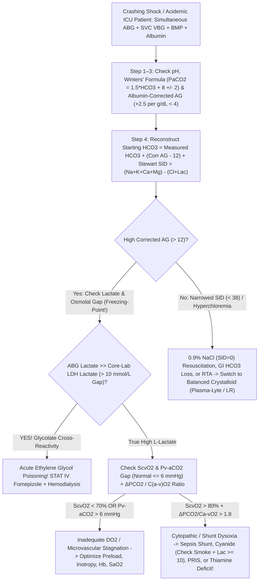
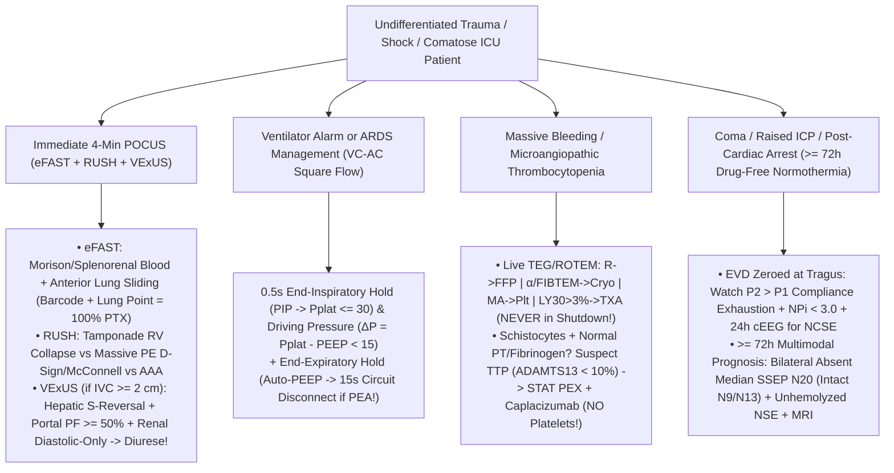

# Basic Medical — Behind the Curtain Clinical Diagnostics Notebook
## Volume X: `ICU`, Trauma & Emergency Critical Care Diagnostic Orders — Acid-Base Physics, Shock Oximetry, Ventilator Waveforms, `TEG/ROTEM`, `POCUS` (`eFAST`, `RUSH`, `VExUS`) & Coma Neuro-Monitoring

> *"At 02:14 AM inside a Trauma-Surgical and Medical Intensive Care Unit, there is no luxury of waiting forty-eight hours for a reference laboratory send-out. Survival turns on ten-minute physics: decoding a deceptively 'normal' `pH = 7.40` arterial blood gas hiding three simultaneous lethal metabolic and respiratory catastrophes, spotting a `16 mmol/L` blood-gas versus core-lab 'lactate gap' that unmasks ethylene glycol antifreeze poisoning on the spot, executing a `0.5-second` ventilator end-inspiratory hold to prove whether a crashing `ARDS` patient has a mucus-plugged endotracheal tube or a tension pneumothorax, reading acoustic thromboelastography amplitude to choose cryoprecipitate over tranexamic acid, Doppler-pulsing the intrarenal interlobar veins (`VExUS`) to reverse cardiorenal congestion, and watching the `P2` intracranial pressure tidal wave overtake `P1` minutes before uncal herniation."*

---

## Architectural Orientation: The Six Real-Time Diagnostic Engines of Critical Care & Resuscitation

Every critical-care diagnostic order interrogates a distinct physiological determinant of cellular oxygen delivery ($\dot{D}\text{O}_2$), electrochemical homeostasis, alveolar mechanics, microvascular hemostasis, or cortical viability (*Marino's The ICU Book*, 5th ed.; *Surviving Sepsis Campaign*; *ATLS* 10th ed.):

| Critical Care Modality | Primary Bedside Specimen / Signal | Underlying Biophysical / Analytical Principle | Turnaround Time (`TAT`) | Critical Decision Thresholds | Classic ICU Saboteur / Pitfall |
| :--- | :--- | :--- | :--- | :--- | :--- |
| **Arterial & Central Venous Blood Gas + `Stewart` Electrolytes** | Heparinized arterial (`ABG`) + `SVC`/`PA` venous (`VBG`) whole blood | `Sanz` $\text{pH}$, `Severinghaus` $\text{PCO}_2$, optical $\text{PO}_2$, co-oximetry + `Albumin-AG`, $\Delta/\Delta$, & **Strong Ion Difference (`SID`)** | **`90–180 sec`** (`POC` cartridge / ICU analyzer) | `Winters'` $P_a\text{CO}_2$; `Corr AG > 12`; `SID ~ 40 mEq/L`; `SvO2 65–75%`; **`Pv-aCO2 > 6 mmHg`** | Uncorrected hypoalbuminemia hides high-`AG` acidosis; `0.9% NaCl` (`SID = 0`) causes hyperchloremic acidosis; "normal" `ScvO2` in septic shunt; air bubbles & `D`-lactate blindspot |
| **Emergency Toxicology STAT Chemistry** | Serum (`Osmolality` by **freezing-point depression**), `ABG` vs Core `Lactate`, `APAP`, `Salicylate` | Colligative freezing-point depression; **`L`-Lactate Oxidase vs `LDH` glycolate gap**; `4-hr` Rumack-Matthew kinetics | `15–45 min` (`Lactate Gap` `< 5 min`!) | `Osm Gap > 10–15`; `4h APAP >= 150 µg/mL`; `Salicylate > 30–100 mg/dL` | Vapor-pressure osmometers miss `100%` of toxic alcohols; late presentation has *normal* osmolal gap; `RSI` apnea kills salicylate patients; **`Hydroxocobalamin` magenta optical interference** |
| **Mechanical Ventilator Scalars & Hold Maneuvers** | Continuous proximal airway Pressure, Flow, Volume + `EtCO2` (`+ Esophageal Balloon`) | Equation of Motion: **`0.5s` End-Inspiratory Hold (`PIP -> Pplat`)** & **End-Expiratory Hold (`Auto-PEEP`)** | **Instantaneous (`0.5 sec` at bedside)** | **`Pplat <= 30 cm H2O`**; **Driving Pressure $\Delta P < 15\text{ cm H}_2\text{O}$**; `RSBI < 105`; `NIF <= -30` | Passive patient mandatory during holds; severe obesity/ascites raises `Pplat` via chest wall (`check P_L`); occult `Auto-PEEP` triggers post-intubation `PEA` arrest |
| **Viscoelastic Hemostasis (`TEG 6s` / `ROTEM`) & `DIC` vs `TTP`** | Citrated `3.2%` whole blood (`37°C` resonance acoustics or rotating pin; `ADAMTS13` pre-`PEX`) | Whole-blood clot initiation (`R/CT`), fibrin cross-linking (`α/FIBTEM`), platelet pull (`MA/MCF`), lysis (`LY30`) | **`5–15 min`** actionable live tracing | `R > 10 min -> FFP`; `α < 53° -> Cryo`; `MA < 50 mm -> Plt`; **`LY30 > 3% -> TXA`** | **`TXA` in fibrinolysis-shutdown (`LY30 < 0.8%`) sepsis causes fatal thrombosis**; platelet transfusion in `TTP` (`ADAMTS13 < 10%`, normal `PT/Fib`) causes microvascular death |
| **Critical Care `POCUS` (`eFAST`, `RUSH`, `VExUS`)** | Phased-array (`1–5 MHz`), curvilinear (`2–5 MHz`), & linear (`6–13 MHz`) ultrasound + `PW` Doppler | Acoustic pleural sliding (`M-mode`), cardiac chamber tamponade/strain, & **organ-venous retrograde Doppler** | **`3–7 min`** at bedside | **Lung Point (`100%` PTX)**; `McConnell/D-sign`; **Portal Pulsatility `>= 50%`** & **Hepatic `S`-reversal** | `IVC` diameter alone lies on positive-pressure ventilation; `VExUS` hepatic Doppler misread without simultaneous `ECG` lead; subcutaneous emphysema blocks ultrasound |
| **Multimodal Neuro-ICU Monitoring (`EVD/ICP`, `NPi`, `cEEG`, `SSEP`)** | Intraventricular `EVD` catheter (`tragus` zero), `IR` pupillometer, `21`-lead `cEEG`, median-nerve **`N20`**, `BD/DNC` | Monro-Kellie elastance (`P1/P2/P3`), automated `NPi`, non-convulsive seizure grids, cortical `N20` evoked potentials | Continuous (`ICP`, `cEEG`); **`>= 72h`** post-arrest `SSEP` | **`P2 > P1` = exhausted compliance**; `NPi < 3.0`; **Bilateral absent `N20` (`> 99.5%` specificity)**; `Apnea PaCO2 >= 60 & +20` | Clamped vs open `EVD` errors; **tiny `RBC` hemolysis spikes `NSE` falsely**; premature `< 72h` or sedative-confounded prognostication; cervical lesion invalidates `N20` without intact `N9/N13` |

---

## Dossier 10.1: Red-Alert Resuscitation Chemistry — Acid-Base Physics (`Boston` vs. `Stewart` Strong Ion Difference), Shock Oximetry (`SvO2`, `ScvO2`, `Pv-aCO2` Gap) & Emergency Toxicology Gaps

### 1. Inside the Blood Gas Cartridge — And Stepwise Decoding of Hidden Triple Acid-Base Catastrophes

#### A. Behind the Heparinized Arterial Blood Gas (`ABG`) Syringe: Electrodes, Co-Oximetry & Pre-Analytical Traps
When an ICU respiratory therapist or resident punctures the radial artery (or aspirates `2 mL` after clearing `5 mL` of dead-space flush from an indwelling arterial line) into a **dry-lyophilized lithium-heparin blood-gas syringe**, the sample enters a miniature `37.0°C` electrochemical chamber containing three direct sensors plus a multi-wavelength spectrophotometer:
1. **The `Sanz` $\text{pH}$ Electrode (`Potentiometric`)**: Hydrogen ions ($\text{H}^+$) diffuse into a microscopic hydrated $\text{H}^+$-selective glass membrane, generating a Nernstian voltage ($\sim 61.5\text{ mV}$ per `1.0 pH` unit at `37°C`) against a silver/silver-chloride (`Ag/AgCl`) reference electrode.
2. **The `Severinghaus` $P\text{CO}_2$ Electrode (`Modified pH Potentiometric`)**: Dissolved $\text{CO}_2$ gas diffuses across a hydrophobic silicone/Teflon membrane into a thin film of sodium bicarbonate ($\text{CO}_2 + \text{H}_2\text{O} \rightleftharpoons \text{H}_2\text{CO}_3 \rightleftharpoons \text{H}^+ + \text{HCO}_3^-$); the resulting drop in internal film $\text{pH}$ measures $P_a\text{CO}_2$ directly! **Crucial Hidden Fact**: **The blood-gas analyzer does NOT physically measure Bicarbonate ($[\text{HCO}_3^-]$)!** It *calculates* $[\text{HCO}_3^-]$ mathematically from measured $\text{pH}$ and $P_a\text{CO}_2$ via the Henderson-Hasselbalch equation ($\text{pH} = 6.10 + \log_{10}\!\frac{[\text{HCO}_3^-]}{0.03 \times P_a\text{CO}_2}$), which is why small timing/temperature differences exist against the core-lab venous `BMP` enzymatic **Total $\text{CO}_2$** (`which measures HCO3- + dissolved CO2 + H2CO3`, normally `1–2 mEq/L` higher than calculated `ABG HCO3-`)!
3. **The `Clark` Polarographic / Optical Fluorescence $P\text{O}_2$ Sensor & `128-Wavelength` Co-Oximeter**: Measures physically *dissolved* oxygen tension ($P_a\text{O}_2$), while ultrasonic hemolysis + `128-wavelength` optical **Co-Oximetry** directly separates **Oxyhemoglobin ($\text{O}_2\text{Hb}$)**, **Deoxyhemoglobin ($\text{HHb}$)**, **Carboxyhemoglobin ($\text{COHb}$ — house fires/exhaust, where `2-wavelength` fingertip `SpO2` falsely reads **`99%`** because `COHb` absorbs `660 nm` red light identically to $\text{O}_2\text{Hb}$!)**, and **Methemoglobin ($\text{MetHb}$ — `dapsone`, `benzocaine`, `inhaled NO`, `rasburicase`, clamping fingertip `SpO2` toward **`85%`**!)**.
   * **Three Classic `ABG` Syringe Artifacts**:
     * **Room-Air Bubble Left in the Syringe (`PATM O2 = 150 mmHg, CO2 = 0.3 mmHg`)**: Shaking an un-vented syringe in a pneumatic tube equilibrates blood with the air bubble—driving **`PaO2` falsely toward `150 mmHg`** (lowering `PaO2` if true `PaO2` was `250`, or *raising* `PaO2` if true hypoxic `PaO2` was `48`!) while stripping **`PaCO2` falsely downward** and raising $\text{pH}$!
     * **Excess *Liquid* Sodium Heparin Flush**: Dilutes plasma dissolved $\text{CO}_2$ (`lowers PaCO2` & `HCO3-` falsely) and floods `Na+` while binding **`Ionized Calcium` ($\text{iCa}^{2+}$) falsely downward**!
     * **"Leukocyte Larceny" (`Pseudohypoxemia`)**: In hyperleukocytic acute leukemia (`WBC > 100,000/µL`) or extreme thrombocytosis (`Platelets > 1,500,000/µL`), metabolically voracious blasts sitting inside a warm syringe devour dissolved $\text{O}_2$ in `10 minutes`, printing **`PaO2 = 34 mmHg`** while the patient sits comfortably pink with **`SpO2 = 98%`**!

---

#### B. The Five-Step `Boston` Acid-Base Algorithm — Unmasking a Deadly Triple Disorder Behind `pH = 7.40`
Never stop reading an `ABG` just because $\text{pH}$ sits inside `7.35–7.45`! While one primary disorder **never overcompensates** past `7.40`, *two or three simultaneous opposing primary disorders routinely cancel each other's $\text{H}^+$ shift right onto `7.40`*:

1. **Step 1 — Check Internal Consistency (`Kassirer-Bleich Equation`) & Overall $\text{pH}$ Direction**:
   $$[\text{H}^+]\text{ (nmol/L)} = 24 \times \frac{P_a\text{CO}_2}{[\text{HCO}_3^-]} \qquad (\text{at pH } 7.40,\, [\text{H}^+] = 40\text{ nmol/L};\; \pm 0.10\text{ pH} \approx \times 0.8 \text{ or } \times 1.25)$$
2. **Step 2 — Apply Exact Compensation Equations to the Primary Disturbance**:
   * **Metabolic Acidosis (`Winters' Formula`, 1967)**:
     $$\text{Expected } P_a\text{CO}_2 = 1.5 \times [\text{HCO}_3^-] + 8 \pm 2\text{ mmHg}$$
     *(If actual $P_a\text{CO}_2$ is **higher** than Winters' ceiling $\implies$ concomitant **Primary Respiratory Acidosis** — in `DKA` or severe sepsis, this warns of **impending diaphragmatic exhaustion**! If actual $P_a\text{CO}_2$ is **lower** than Winters' floor $\implies$ concomitant **Primary Respiratory Alkalosis**, classic for **gram-negative sepsis, salicylate toxicity, pulmonary embolism, or cirrhosis**!)*
   * **Metabolic Alkalosis**: $\text{Expected } P_a\text{CO}_2 = 0.7 \times ([\text{HCO}_3^-] - 24) + 40 \pm 2\text{ mmHg}$ *(rarely exceeds `55 mmHg` before hypoxemia overrides hypoventilation)*.
   * **Respiratory Acidosis (`PaCO2 > 40`) — The `1`-and-`4` Rule**:
     * *Acute (`minutes–hours`, hemoglobin buffering only)*: $[\text{HCO}_3^-]$ rises **`+1 mEq/L` per `+10 mmHg` $P_a\text{CO}_2$** (`pH` drops `0.08` per `+10 mmHg`).
     * *Chronic (`>= 3–5 days`, renal proximal $\text{NH}_4^+$ synthesis)*: $[\text{HCO}_3^-]$ rises **`+3.5 to +4.0 mEq/L` per `+10 mmHg` $P_a\text{CO}_2$** (`pH` drops `0.03` per `+10 mmHg`). *(ICU Ventilator Pearl: If you intubate a chronic `COPD` retainer whose baseline is `PaCO2 = 70 / HCO3- = 36` and hyperventilate them straight down to `PaCO2 = 38`, the kidneys still hold `36 mEq/L` of bicarbonate—producing **`pH = 7.60` Post-Hypercapnic Metabolic Alkalosis** with seizures and cardiac arrhythmias!)*
   * **Respiratory Alkalosis (`PaCO2 < 40`) — The `2`-and-`5` Rule**:
     * *Acute*: $[\text{HCO}_3^-]$ drops **`-2 mEq/L` per `-10 mmHg` $P_a\text{CO}_2$**.
     * *Chronic*: $[\text{HCO}_3^-]$ drops **`-4 to -5 mEq/L` per `-10 mmHg` $P_a\text{CO}_2$**.
3. **Step 3 — Calculate the *Albumin-Corrected* Anion Gap (`Figge–Fencl Equation` — NEVER Skip in the ICU!)**:
   $$\text{Raw Anion Gap (AG)} = [\text{Na}^+] - ([\text{Cl}^-] + [\text{HCO}_3^-]) \qquad (\text{Normal} \approx 8\text{–}12\text{ mEq/L at Albumin } 4.0\text{ g/dL})$$
   Why is normal `AG` equal to `12 mEq/L` instead of `0`? Because **`~75–80%` (`~10–11 mEq/L`) of "unmeasured anions" in healthy human plasma are negatively charged histidine/carboxylate side chains on Serum Albumin (`~2.5 mEq` negative charge per `1.0 g/dL` of Albumin)**!
   * In a critically ill septic cirrhotic patient with **`Serum Albumin = 1.4 g/dL`**, their *true physiological baseline* Anion Gap is only $12 - 2.5(4.0 - 1.4) = \mathbf{5.5\text{ mEq/L}}$! If their raw lab `AG` prints **`12 mEq/L`**, an intern sees `"AG 12 = Normal"` and walks away—missing **`+6.5 mEq/L` of occult high-anion-gap lactic/ketoacidosis**! Always apply:
     $$\text{Albumin-Corrected AG} = \text{Measured AG} + 2.5 \times (4.0 - \text{Measured Albumin [g/dL]})$$
4. **Step 4 — Apply the Delta-Delta ($\Delta\text{AG}$ vs. $\Delta\text{HCO}_3^-$, or "Reconstructed Starting $[\text{HCO}_3^-]$")**:
   In a pure `1:1` High-Anion-Gap Metabolic Acidosis (`GOLD MARK`: **G**lycols, **O**xoproline [chronic acetaminophen + malnutrition!], **L**-lactate, **D**-lactate, **M**ethanol, **A**spirin, **R**enal failure/uremia, **K**etoacidosis [`DKA`/alcoholic/starvation]), every `1 mEq/L` of unmeasured acid anion ($\Delta\text{AG} = \text{AG}_{\text{corr}} - 12$) consumes roughly `1 mEq/L` of bicarbonate *(note: lactic acidosis averages `~1.6:1` because lactate stays largely extracellular while $\text{H}^+$ buffers intracellularly; `DKA` with preserved GFR excretes ketoacid anions into urine, sliding toward non-AG acidosis during fluid resuscitation!)*. Adding $\Delta\text{AG}$ back onto measured $[\text{HCO}_3^-]$ reconstructs the **Pre-Acidosis ("Starting") $[\text{HCO}_3^-]$**:
   $$\text{Starting } [\text{HCO}_3^-] = \text{Measured } [\text{HCO}_3^-] + (\text{Corrected AG} - 12)$$
   * **Starting $[\text{HCO}_3^-] = 22\text{–}26\text{ mEq/L}$** ($\Delta\text{AG} / \Delta\text{HCO}_3^- \approx 1\text{–}2$): **Pure High-Anion-Gap Metabolic Acidosis**.
   * **Starting $[\text{HCO}_3^-] > \mathbf{28\text{–}30\text{ mEq/L}}$** ($\Delta\text{AG} / \Delta\text{HCO}_3^- > 2$): **Concomitant Hidden Metabolic Alkalosis** (`vomiting`, `NG suction`, `loop diuretics`, or baseline chronic `COPD` compensation)!
   * **Starting $[\text{HCO}_3^-] < \mathbf{20\text{ mEq/L}}$** ($\Delta\text{AG} / \Delta\text{HCO}_3^- < 0.8\text{–}1.0$): **Concomitant Hidden Non-Anion-Gap (Hyperchloremic) Metabolic Acidosis** (`diarrhea`, `RTA`, or `4 L` of `0.9% Saline` resuscitation)!

> [!IMPORTANT]
> **Worked Trauma/ICU Masterclass — Unmasking `3` Simultaneous Disorders When `pH = 7.40`**:
> A 29-year-old with Type 1 Diabetes arrives febrile (`39.2°C`), tachycardic (`132 bpm`), and vomiting violently for `2 days`:
> * **Labs**: **`pH = 7.40`** | **`PaCO2 = 24 mmHg`** | **`HCO3- = 15 mEq/L`** | **`Na+ = 140`** | **`Cl- = 93`** | **`Albumin = 4.0 g/dL`**
> * **Glance Trap**: `"pH is 7.40—acid-base is completely compensated!"` **WRONG—three independent crises are colliding**:
>   1. **Corrected Anion Gap**: $140 - (93 + 15) = \mathbf{32\text{ mEq/L}}$ ($\Delta\text{AG} = 32 - 12 = \mathbf{+20}$) $\implies$ Severe **High-Anion-Gap Metabolic Acidosis (`DKA` + Sepsis Lactic Acidosis)**!
>   2. **Reconstructed Starting $[\text{HCO}_3^-]$**: $15 + 20 = \mathbf{35\text{ mEq/L}}$ ($\gg 26$!) $\implies$ Before ketoacidosis titrated bicarbonate down to `15`, intractable emesis of gastric $\text{HCl}$ had pushed $[\text{HCO}_3^-]$ to `35`: **Superimposed Severe Metabolic Alkalosis**!
>   3. **Winters' Formula**: $1.5(15) + 8 \pm 2 = \mathbf{30.5 \pm 2\text{ mmHg}}$ (`28.5–32.5`). Actual $P_a\text{CO}_2$ is **`24 mmHg`** (`< 28.5`!) $\implies$ Endotoxin/urosepsis is driving hyperventilation *beyond* metabolic compensation: **Superimposed Primary Respiratory Alkalosis**!

---

#### C. Peter Stewart's Quantitative Physicochemical Model (`1983`): Why `"Normal" 0.9% Saline` Inevitably Acidifies Human Blood
Traditional `Boston` rules describe *empirical correlations* around bicarbonate, yet struggle to explain *why* infusing `4 liters` of neutral `0.9%` sodium chloride drops arterial $\text{pH}$ to `7.18` when neither acid nor $\text{CO}_2$ was infused! Canadian physiologist **Peter A. Stewart** applied strict physical chemistry—simultaneous **conservation of mass**, **water auto-ionization ($[\text{H}^+][\text{OH}^-] = K'_w$)**, weak-acid dissociation, and **Macroscopic Law of Electroneutrality ($\sum\text{Cations} = \sum\text{Anions}$)**—proving that inside aqueous human plasma, **`pH` ($[\text{H}^+]$) and $[\text{HCO}_3^-]$ cannot change on their own; they are slave *dependent* variables dictated mathematically by THREE *independent* variables**:

1. **$P_a\text{CO}_2$** (regulated independently by alveolar ventilation).
2. **$A_{\text{tot}}$ (Total Concentration of Non-Volatile Weak Acids — `Albumin` + `Inorganic Phosphate`)**:
   * **Instant ICU Insight**: Lowering $A_{\text{tot}}$ (**hypoalbuminemia** in sepsis/cirrhosis) directly reduces weak-acid anion $[A^-]$, forcing water/$\text{CO}_2$ equilibria to generate extra $[\text{HCO}_3^-]$ and *consume* $[\text{H}^+]$—meaning **Hypoalbuminemia itself is a primary *alkalinizing* force (`Hypoalbuminemic Metabolic Alkalosis`)**!
3. **The Apparent Strong Ion Difference ($\text{SID}_a$)**:
   "Strong ions" ($\text{Na}^+, \text{K}^+, \text{Ca}^{2+}, \text{Mg}^{2+}, \text{Cl}^-$, and $\text{Lactate}^-$ with $\text{p}K_a = 3.86$) are **`100%` dissociated** at physiological $\text{pH} \approx 7.4$. In healthy plasma (`Na+ 140 + K+ 4 + Ca2+ 2.5 + Mg2+ 1.5 = 148 mEq/L` minus `Cl- 104 + Lactate- 1 = 105 mEq/L`), strong cations exceed strong anions by **`~40 to 42 mEq/L`**:
   $$\text{SID}_a = ([\text{Na}^+] + [\text{K}^+] + [\text{Ca}^{2+}] + [\text{Mg}^{2+}]) - ([\text{Cl}^-] + [\text{Lactate}^-] + [\text{Other Strong Organic Anions}^-]) \approx \mathbf{+40\text{ to }+42\text{ mEq/L}}$$
   By strict electroneutrality, that positive `+40 mEq/L` electrical space (`Effective SID`, $\text{SID}_e$) **must be filled strictly by weak-acid buffer anions ($[\text{HCO}_3^-] + [\text{Albumin}^-] + [\text{Phosphate}^-]$)**:
   * **Any process that NARROWS $\text{SID}$ toward `0`** (either raising $[\text{Cl}^-]$ / $[\text{Lactate}^-]$ or diluting $[\text{Na}^+]$ with free water!) squeezes out buffer space, physically forcing water ($\text{H}_2\text{O} \rightleftharpoons \text{H}^+ + \text{OH}^-$) to dissociate more free **$[\text{H}^+]$ $\longrightarrow$ Strong-Ion Metabolic Acidosis**!
   * **Any process that WIDENS $\text{SID}$ above `+42 mEq/L`** (vomiting gastric $\text{Cl}^-$, furosemide chloruresis, or hypernatremic sodium bicarbonate infusion!) expands buffer space, consuming $[\text{H}^+]$ $\longrightarrow$ **Strong-Ion Metabolic Alkalosis**!

Now examine intravenous resuscitation bags through **Stewart's Lens**:
* **"Normal" `0.9%` Sodium Chloride (`154 mEq/L Na+` and `154 mEq/L Cl-`)**: Inside the plastic bag, $\text{SID} = 154 - 154 = 0\text{ mEq/L}$, *and after infusion into the human body*, neither $\text{Na}^+$ nor $\text{Cl}^-$ is metabolized $\implies$ **In-Vivo Effective $\text{SID} = \mathbf{0\text{ mEq/L}}$**! Pouring `4–6 liters` of a `SID = 0` solution into a `SID = +40` bloodstream raises $[\text{Cl}^-]$ proportionally far more than $[\text{Na}^+]$ (`104 -> 118 mEq/L` vs `140 -> 143 mEq/L`), narrowing plasma $\text{SID}$ from `40` down to **`27 mEq/L`** and **mechanistically guaranteeing Hyperchloremic (`SID-Narrowing`) Metabolic Acidosis**—which simultaneously triggers macula densa tubuloglomerular feedback, **constricting renal afferent arterioles and increasing `MAKE30` renal injury (`SMART` & `SALT-ED` NEJM Trials)**!
* **Balanced Crystalloids (`Lactated Ringer's` & `Plasma-Lyte 148`)**: Inside the plastic bag, `Plasma-Lyte` (`140 Na+ + 5 K+ + 3 Mg2+ = 148` vs `98 Cl- + 27 Acetate- + 23 Gluconate- = 148`) also has an *in-bag* `SID = 0` (`electrically neutral`). **The Magic Happens Inside Liver & Muscle Mitochondria**: within minutes of infusion, `Acetate-` and `Lactate-` are oxidized completely into neutral $\text{CO}_2 + \text{H}_2\text{O}$ and vanish as anions, leaving behind **`In-Vivo Effective SID = +28 mEq/L` (`Lactated Ringer's`)** and **`+50 mEq/L` (`Plasma-Lyte`)**—protecting plasma `SID` and preventing iatrogenic acidosis! *(Exception: in **Traumatic Brain Injury [`TBI`]**, `Lactated Ringer's` is slightly hypotonic [`273 mOsm/L` vs plasma `290`], worsening cerebral edema—so neuro-ICUs use `0.9% Saline` [`308 mOsm/L`] or isotonic `Plasma-Lyte` [`294 mOsm/L`]!)*

---

### 2. Bedside Shock Resuscitation Numbers Unmasked: `Lactate` Myths, `SvO2`/`ScvO2` Fick Physics & The `Pv-aCO2` Microcirculatory Gap

#### A. `L`-Lactate Kinetics, Epinephrine $\beta_2$ Glycolysis, `PRIS` & The `D`-Lactate Blindspot
Cytosolic **Lactate Dehydrogenase (`LDH`)** catalyzes a reversible mass-action equilibrium between pyruvate and `L`-lactate (`normal arterial/peripheral venous lactate = 0.5–1.8 mmol/L`; peripheral venous runs only `~0.2–0.4 mmol/L` higher than arterial):
$$[\text{L-Lactate}] = K_{\text{eq}} \cdot [\text{Pyruvate}] \cdot \frac{[\text{NADH}][\text{H}^+]}{[\text{NAD}^+]}$$
Notice the two independent levers that raise serum lactate: **either** mitochondrial $\text{O}_2$ starvation stalls Complex IV so cytosolic **$[\text{NADH}]/[\text{NAD}^+]$ skyrockets (`Type A Tissue Hypoperfusion / Dysoxia`)**, **OR** accelerated aerobic glycolysis / blocked pyruvate clearance piles up **$[\text{Pyruvate}]$ even inside well-oxygenated cells (`Type B Non-Hypoxic Hyperlactatemia`)**:

* **Five Essential Type B & Mixed Lactate Traps in the ICU**:
  1. **Catecholamine $\beta_2$-Adrenergic Surge (`IV Epinephrine` Drip or Continuous High-Dose Nebulized `Albuterol` in Status Asthmaticus!)**: Epinephrine and albuterol stimulate skeletal-muscle membrane **$\beta_2$-receptors $\to$ `cAMP` $\to$ $\text{Na}^+/\text{K}^+\text{-ATPase}$**, generating `ADP` that turbocharges **Phosphofructokinase-1 (`PFK-1`) aerobic glycolysis** faster than normal Pyruvate Dehydrogenase (`PDH`) can feed the Krebs cycle! Result: `Lactate` climbs from `2.5` to `7.8 mmol/L` on an epinephrine infusion or continuous albuterol **even while cardiac output, extremities, urine output, and `Pv-aCO2` gap are completely warm and normal**—pouring `4` extra liters of fluid into that asthma/post-cardiotomy patient causes flash pulmonary edema!
  2. **Fulminant Shoshin Beriberi (`Thiamine / Vitamin B1` Deficiency)**: **Thiamine Pyrophosphate (`TPP`)** is the obligate prosthetic cofactor of **Pyruvate Dehydrogenase (`PDH`)**—the single doorway from pyruvate into Acetyl-CoA! Malnourished, alcoholic, bariatric, or un-supplemented `TPN` patients given `D5W` dextrose lock `100%` of pyruvate out of mitochondria (`Lactate = 12–22 mmol/L` refractory shock), reversing dramatically within hours of **`IV Thiamine 500 mg`**!
  3. **Propofol Infusion Syndrome (`PRIS`)**: Prolonged high-dose propofol sedation (**`> 4–5 mg/kg/hr` for `> 48 hours`**, accelerated by catecholamines + steroids) uncouples oxidative phosphorylation and blocks mitochondrial **Carnitine Palmitoyltransferase I (`CPT-1`)** long-chain fatty-acid entry $\longrightarrow$ sudden unexplained **High-AG Lactic Acidosis + Milky Lipemia (`Triglycerides > 500–1,000 mg/dL`) + Rhabdomyolysis (`CK > 10,000 U/L` & hyperkalemia) + Hepatomegaly + Right-Precordial `V1–V3` Brugada-like Coved `ST`-Elevation $\to$ Refractory Bradycardic Asystole**! Stop propofol *immediately* (`switch to Dexmedetomidine/Midazolam`) and start `CRRT`/`VA-ECMO`!
  4. **Acute / Decompensated Liver Failure**: The healthy liver clears **`~70%` of whole-body daily lactate** (`1,500 mmol/day`) back into glucose via the **Cori Cycle** (`kidneys clear ~20–30%`).
  5. **THE STEREOISOMER BLINDSPOT — `D`-Lactic Acidosis**: Patients with **Short-Bowel Syndrome** or **Jejunoileal / Roux-en-Y Bypass** who eat a large carbohydrate load deliver undigested sugars straight into the colon, where overgrowth of *Lactobacillus* bacteria ferments glucose into the mirror-image optical isomer **`D`-Lactate**! Absorbed `D`-lactate crosses the blood-brain barrier (causing acute **cerebellar ataxia, slurred speech, nystagmus, and confusion** mimicking acute ethanol intoxication, with `Anion Gap = 26` and `negative ethanol`!)—yet **every routine hospital `ABG` and core-lab `L`-Lactate analyzer uses stereospecific `L-LDH` or `L-Lactate Oxidase` that is `100%` BLIND to `D`-Lactate (`prints Lactate = 0.8 mmol/L`!)**. You *must* order a specific **`D`-Lactate send-out assay**!

---

#### B. Mixed Venous (`SvO2`) & Central Venous (`ScvO2`) Oxygen Saturation: Rearranging Adolph Fick's Master Equation
By conservation of oxygen mass across the systemic circulation, systemic Oxygen Consumption ($\dot{V}\text{O}_2$, normal `~250 mL/min`) equals Cardiac Output ($\text{CO}$, `L/min`) multiplied by the arteriovenous oxygen content difference ($C_a\text{O}_2 - C_v\text{O}_2$, where ignoring tiny `0.003 × PO2` dissolved oxygen, $C\text{O}_2 \approx 1.34 \times \text{Hb} \times S\text{O}_2 \times 10\text{ dL/L}$). Rearranging algebraically solves directly for **Mixed Venous Oxygen Saturation ($S_v\text{O}_2$, aspirated from the distal Pulmonary Artery port of a Swan-Ganz `PAC` where `SVC + IVC + Coronary Sinus` blood have completely mixed; normal = `65% to 75%`)**:

$$S_v\text{O}_2 = S_a\text{O}_2 - \frac{\dot{V}\text{O}_2}{1.34 \times \text{Hb} \times \text{CO} \times 10} \iff 1 - \text{O}_2\text{ER} \approx \frac{\dot{D}\text{O}_2 - \dot{V}\text{O}_2}{\dot{D}\text{O}_2}$$

Look at the four clinical levers inside that single fraction: **`SvO2` (`or ScvO2`, sampled from a central line tip at the `SVC–RA` junction; normal `>= 70%`) drops below `65–70%` ONLY when `SaO2` falls (hypoxemia), `Hemoglobin` falls (hemorrhage/anemia), `Cardiac Output` falls (cardiogenic/hypovolemic/obstructive shock), OR `VO2` surges (fever, rigor shivering, seizures, agitation/work of breathing — which is why intubating and paralyzing a struggling shock patient instantly jumps `SvO2` by `+15%` by abolishing diaphragmatic `VO2`!)**.

* **Why `ScvO2` (`SVC`) and `SvO2` (`PA`) Flip Positions Between Health and Shock**:
  * *In Health (`ScvO2 < SvO2` by `2–5%`)*: Kidneys receive `20%` of cardiac output solely for glomerular filtration while extracting almost no oxygen (`Renal Vein SO2 ~85%`!), making `IVC` blood brighter than `SVC` cerebral-drained blood (`~70%`).
  * *In Circulatory Shock (`ScvO2 > SvO2` by `5–10%`!)*: Sympathetic vasoconstriction clamps down fiercely on **mesenteric/splanchnic and renal arteries** (`IVC SO2` plunges to `45%`!) while autoregulation preserves **cerebral blood flow** (`SVC ScvO2` stays higher at `68%`), plus maximally desaturated **coronary sinus blood (`SO2 ~30%`!)** empties *downstream* of the `SVC` catheter tip right into the right atrium!
* **Decoding Pathologic `SvO2` Extremes**:
  * **Dangerously LOW `SvO2 = 35%–50%`**: Tissues are starving for flow (`DO2` collapsed) and compensatively extracting `60%` of every oxygen molecule passing by $\longrightarrow$ **Cardiogenic Shock, Hemorrhagic/Hypovolemic Shock, or Cardiac Tamponade / Massive `PE`**!
  * **Dangerously HIGH `SvO2 = 82%–94%` in a Hypotensive Lactate-Rising Patient ("Venous Hyperoxia")**: Oxygen is bypassing or failing to enter mitochondria (`O2ER < 10%`) $\longrightarrow$
    1. **Distributive Septic Shock Microvascular Shunting** (nitric-oxide-paralyzed thoroughfare channels shunt arterialized blood straight into venules past ischemic capillary beds!).
    2. **Cyanide Toxicity (`Complex IV` Cytochrome $c$ Oxidase Blockade)** — venous blood drawn into the syringe looks **cherry-bright arterial red (`SvO2 > 90%`)** alongside `Lactate = 18 mmol/L`!
    3. **Decompensated Cirrhosis** (`arteriovenous shunts`), **Therapeutic Hypothermia** (`slashed VO2`), or **Wedged `PAC` Tip Error** (pulling oxygenated pulmonary-capillary blood backwards past an inflated balloon!).

---

#### C. The Venous-to-Arterial $\text{CO}_2$ Gap ($\Delta P\text{CO}_2 > 6\text{ mmHg}$) & The Bedside Anaerobic `RQ` Ratio
Suppose a septic shock patient on norepinephrine has `MAP = 68 mmHg` and a reassuring **`ScvO2 = 75%`**, yet lactate stays stuck at `4.6 mmol/L` and mottled knees persist. Should you give an inotrope/fluid challenge, or is flow already adequate? **`ScvO2` is blind here because microvascular shunting masks low flow!**

Enter the **Central Venous-to-Arterial Carbon Dioxide Tension Difference ("The `PCO2` Gap")**, calculated in `60 seconds` by sending simultaneous `ABG` + central-line `VBG`:
$$\Delta P\text{CO}_2 = P_{cv}\text{CO}_2 - P_a\text{CO}_2 \qquad (\text{Normal} = \mathbf{2\text{ to }6\text{ mmHg}})$$

* **Biophysical Genius (`Fick Equation Applied to CO2`)**: Because $\text{CO}_2$ is **`~20×` more diffusible in tissue water than $\text{O}_2$**, $\text{CO}_2$ diffuses freely out of ischemic stagnant venules into passing perfused capillaries even across microcirculatory shunts! By Fick's law ($\Delta C\text{CO}_2 = \dot{V}\text{CO}_2 / \text{CO}$), **$\Delta P\text{CO}_2$ is inversely proportional to Cardiac Output and Microvascular Capillary Flow** ("the venous stagnation marker"):
  * **`ScvO2 >= 70%` + `ΔPCO2 <= 6 mmHg`**: Systemic and microvascular flow are genuinely adequate (persistent lactate is either slow washout or cytopathic/Type B!).
  * **`ScvO2 >= 70%` + `ΔPCO2 > 6 mmHg` (`e.g., PvCO2 51 - PaCO2 40 = 11 mmHg`)**: **Occult Low Flow / Microvascular Stagnation** is failing to wash $\text{CO}_2$ out of tissues—the patient needs flow optimization (`dobutamine` if depressed `EF`, or preload responsiveness check)!
* **The Anaerobic Respiratory Quotient Surrogate ($\Delta P\text{CO}_2 / C_{(a-v)}\text{O}_2 > 1.4\text{–}1.8\text{ mmHg/mL}$)**:
  Under pure aerobic metabolism, the Respiratory Quotient ($\text{RQ} = \dot{V}\text{CO}_2 / \dot{V}\text{O}_2$) sits between `0.7` (lipids) and `1.0` (glucose). The exact instant cells cross their critical anaerobic threshold, ATP hydrolysis + glycolysis generate excess protons ($\text{H}^+$) buffered immediately by intracellular $\text{HCO}_3^- \longrightarrow \text{H}_2\text{CO}_3 \longrightarrow$ **anaerobic non-oxidative $\text{CO}_2$ explosion**, while $\dot{V}\text{O}_2$ simultaneously falls! Canceling Cardiac Output ($\text{CO}$) from the numerator and denominator yields a pure bedside `ABG + VBG` ratio:
  $$\frac{\Delta P\text{CO}_2}{C_a\text{O}_2 - C_{cv}\text{O}_2} = \frac{P_{cv}\text{CO}_2 - P_a\text{CO}_2}{1.34 \times \text{Hb} \times (S_a\text{O}_2 - S_{cv}\text{O}_2) + 0.003(P_a\text{O}_2 - P_{cv}\text{O}_2)} > \mathbf{1.4\text{ to }1.8\text{ mmHg}\cdot\text{dL/mL O}_2}$$
  A ratio **`> 1.4–1.8`** proves **ongoing cellular anaerobic dysoxia right now** with far faster kinetics than sluggish hepatic lactate clearance (*Ospina-Tascón, Monnet & Teboul, Intensive Care Med*)!

---

### 3. Emergency Toxicology STAT Panels: The `Glycolate Lactate Gap`, `APAP` Nomogram, `Salicylates` & `Hydroxocobalamin` Optical Chaos

#### A. Toxic Alcohols (`Methanol` vs. `Ethylene Glycol` vs. `Isopropanol`) & The `5-Minute` Bedside `Lactate Gap`
Definitive gas-chromatography (`GC-FID`) blood levels for **Methanol** (windshield washer fluid, moonshine) and **Ethylene Glycol** (automotive radiator antifreeze) are send-out tests at `90%` of hospitals (`12–48h TAT`)—yet waiting `12 hours` leaves the patient permanently blind (**formic acid** optic neuropathy/basal ganglia necrosis) or anuric (**oxalic/glycolic acid** acute tubular necrosis)! Intensivists diagnose toxic alcohols in `20 minutes` using **two kinetic chemical windows**:

1. **Window 1 — Early Presentation (`1–6 Hours Post-Ingestion`): High Osmolal Gap, Normal Anion Gap**:
   Unmetabolized parent alcohols are tiny uncharged molecules (`MW = 32 g/mol` Methanol; `62 g/mol` Ethylene Glycol; `60 g/mol` Isopropanol) that contribute `1 mOsm/kg` for every `3.2` or `6.2 mg/dL` in serum!
   $$\text{Calculated Osmolality} = 2[\text{Na}^+] + \frac{\text{Glucose (mg/dL)}}{18} + \frac{\text{BUN (mg/dL)}}{2.8} + \frac{\text{Ethanol (mg/dL)}}{3.7\text{ to }4.6}$$
   $$\text{Osmolal Gap} = \text{Measured Osmolality (Freezing-Point Depression!)} - \text{Calculated Osmolality}$$
   * **BENCH HARDWARE TRAP**: Measured osmolality **MUST be run on a Freezing-Point Depression Osmometer**! Older **Vapor-Pressure (Dew-Point) Osmometers** assume water is the only volatile solvent—volatile **Methanol, Ethanol, and Isopropanol evaporate into the headspace and read `Osmolal Gap = 0` (`100%` false-negative!)**.
   * **TEMPORAL TRAP — Why a Normal Osmolal Gap NEVER Rules Out Late Toxic Alcohol Poisoning**: Over `12–24 hours`, hepatic **Alcohol Dehydrogenase (`ADH`)** + Aldehyde Dehydrogenase convert `1` uncharged parent Ethylene Glycol molecule (`1 mOsm`) into ionized **`Glycolate-` + `H+`** (neutralized by `HCO3- -> CO2` blown off by lungs: net change in osmolality = `0` as parent osmoles disappear, while **Anion Gap surges to `38 mEq/L` and `pH` plunges to `6.88`**!). *(Also remember mild Osmolal Gaps of `10–20` occur in severe septic shock, renal failure, `DKA` acetone, or `IV Lorazepam / Diazepam` **`Propylene Glycol`** diluent toxicity!)*
2. **Window 2 — THE BEDSIDE `ETHLYENE GLYCOL LACTATE GAP` MIRACLE**:
   Look at the chemical structure of **`L`-Lactate** ($\text{CH}_3\text{-CH(OH)-COO}^-$) versus Ethylene Glycol's primary lethal metabolite, **Glycolate** ($\text{H-CH(OH)-COO}^-$, differing by a single methyl group!):
   * **Point-of-Care ICU `ABG` Analyzers (`Radiometer ABL`, `i-STAT`, `GEM`)** measure lactate amperometrically using bacterial **`L`-Lactate Oxidase (`LOX`)**: `Glycolate` slips straight into the `LOX` enzyme pocket, generating massive $\text{H}_2\text{O}_2$ current and printing a jaw-dropping **`ABG Lactate = 24.5 mmol/L`**!
   * **Core-Laboratory Automated Chemistry Analyzers (`Roche`, `Beckman`, `Ortho`)** measure lactate spectrophotometrically (`340 nm` NADH) using **`Lactate Dehydrogenase (LDH)`** (or glycolate-shielded `LOX` formulas) that **completely ignore `Glycolate`**, printing **`Core-Lab Venous Lactate = 1.9 mmol/L`** on blood drawn at the *exact same minute*!
   * **Diagnostic Bullseye**: **`[ABG Lactate] - [Core-Lab LDH Lactate] > 10 mmol/L` ("Positive Lactate Gap")** is virtually **pathognomonic for acute Ethylene Glycol poisoning in `5 minutes`**, prompting immediate **`IV Fomepizole` (`15 mg/kg` loading dose — competitively blocks `ADH` with `8,000×` affinity; note co-ingested `Ethanol > 100 mg/dL` also temporarily protects the patient by saturating `ADH`!)** + Pyridoxine/Thiamine cofactors + urgent **Hemodialysis**!

| Toxic Alcohol | Molecular Weight (`mg/dL per 1 mOsm`) | Hepatic `ADH` Metabolite | Acid-Base & Osmolal Signature | Signature End-Organ / Bedside Clue |
| :--- | :--- | :--- | :--- | :--- |
| **Methanol** (`Windshield fluid, Sterno, moonshine`) | `32 g/mol` (`3.2 mg/dL` per `mOsm`) | Formaldehyde $\to$ **Formic Acid (`Formate`)** | Early: High Osm Gap; Late: **Severe High-AG Acidosis (`pH < 7.0`)** (`NO` lactate gap!) | **Optic disc hyperemia, "walking in a snowstorm" blindness**, bilateral **putaminal necrosis** on `CT/MRI` (`+ Folinic Acid / Leucovorin` cofactor!) |
| **Ethylene Glycol** (`Radiator antifreeze`) | `62 g/mol` (`6.2 mg/dL` per `mOsm`) | **Glycolic Acid** $\to$ Glyoxylic $\to$ **Oxalic Acid** | Early: High Osm Gap; Late: **Severe High-AG Acidosis + Massive `ABG vs Core Lactate Gap`!** | **`AKI` + Hypocalcemia (`Ca-Oxalate` chelation)** + **Envelope (dihydrate) / Needle-Dumbbell (monohydrate) urinary crystals** + Wood's `UV` lamp urine glow |
| **Isopropanol** (`70%` Rubbing alcohol, hand sanitizer) | `60 g/mol` (`6.0 mg/dL` per `mOsm`) | **Acetone** *(ketone—cannot oxidize further to an acid!)* | **High Osmolal Gap + NORMAL `pH` & NORMAL Anion Gap!** | Fruity acetone breath, hemorrhagic gastritis, **strongly positive serum/urine Nitroprusside Ketones (`Acetest`) WITHOUT ketoacidosis** (*Supportive care only—NEVER give Fomepizole, which prolongs coma!*) |

#### B. Acetaminophen (`Rumack-Matthew` Kinetics), Salicylate Intubation Trap & `Hydroxocobalamin` (`Cyanokit`) Interference
* **Acetaminophen (`APAP`) & The `4-Hour` Rumack-Matthew Semilog Nomogram**: At therapeutic doses, `~90%` of `APAP` undergoes harmless Phase II hepatic glucuronidation and sulfation, while `< 5–10%` is oxidized by **`CYP2E1`** into the hepatotoxic electrophile **`NAPQI` (*N*-acetyl-*p*-benzoquinone imine)**, immediately detoxified by **hepatic Glutathione (`GSH`)**. Overdose (`> 7.5–10 g` or `> 150 mg/kg`) saturates sulfation/glucuronidation; once **`> 70%` of hepatic `GSH` is depleted**, unbound `NAPQI` covalently arylates mitochondrial cysteine proteins, triggering **centrilobular (`Zone 3`, highest `CYP2E1` & lowest $\text{O}_2$) hepatic necrosis (`AST/ALT > 5,000–15,000 U/L`, `INR > 3–6`, hypoglycemia, cerebral edema)** `24–72 hours` after an initially asymptomatic `Stage I` patient!
  * *Exact Nomogram Rules*: Plot a serum `[APAP]` drawn **strictly between `4 hours` (after complete GI absorption—a `2-hour` level cannot be plotted!) and `24 hours`** after a **single acute known-time ingestion**. Any point at or above the **`150 µg/mL` at `4 hours` (`37.5 µg/mL` at `16h`, `t1/2 = 4h` line)** mandates **`IV N-Acetylcysteine (NAC)`** (replenishing cysteine/`GSH` + enhancing sulfation + scavenging free radicals in fulminant liver failure). **CRITICAL RULE**: The Rumack-Matthew nomogram is **COMPLETELY INVALID** for **staggered/supratherapeutic repeated ingestions**, unknown ingestion time, or delayed presentation `> 24h`—in those scenarios, start empiric `NAC` immediately if `[APAP]` is detectable (`> 10 µg/mL`) OR `AST/ALT` is elevated! *(King's College Liver Transplant Emergency Criteria in `APAP` failure: **Arterial `pH < 7.30` after fluid resuscitation** [single strongest standalone criterion!], OR all three of **`INR > 6.5` [`PT > 100s`] + `Creatinine > 3.4 mg/dL` + `Grade III/IV` Hepatic Encephalopathy**).*
* **Salicylate (`Aspirin`) Toxicity — Dual Acid-Base Signature & Why Routine `RSI` Apnea Kills in `90 Seconds`**:
  Salicylate directly stimulates the **medullary respiratory center** (`Kussmaul/tachypneic` `RR 32/min`, `PaCO2 = 16 mmHg` $\to$ **Primary Respiratory Alkalosis**) while simultaneously **uncoupling mitochondrial inner-membrane proton gradients** (heat/diaphoresis + lactic/ketoacid accumulation $\to$ **High-Anion-Gap Metabolic Acidosis**).
  * **THE LETHAL INTUBATION TRAP**: Salicylic acid is a weak acid ($\text{p}K_a = 3.0$). At `pH = 7.45`, `> 99.99%` sits ionized as charged $\text{Salicylate}^-$, trapped safely inside blood outside the brain. If you paralyze the patient with rocuronium for endotracheal intubation (`60s` apnea) and set a "normal" ventilator rate of `14/min`, **`PaCO2` jumps from `16` to `48 mmHg` and `pH` crashes from `7.45` to `7.05`**, shifting non-ionized lipophilic salicylic acid **`4-to-10-fold` straight across the Blood-Brain Barrier into neurons** $\longrightarrow$ immediate **seizures, cerebral edema, and refractory cardiac arrest**! Avoid intubation unless truly failing; if mandatory, pre-bolus **`IV Sodium Bicarbonate (1–2 mEq/kg)`** and immediately bag/ventilate at `RR 28–32/min` to defend `pH 7.50–7.55` while initiating **Bicarbonate Urinary Alkalinization (`urine pH >= 7.5` + aggressive `K+` repletion, because hypokalemia forces distal $\text{H}^+/\text{K}^+$ exchange to dump $\text{H}^+$ and *prevents* alkaline urine!)** and **Hemodialysis** (`if Salicylate > 90–100 mg/dL`, cerebral edema/confusion, pulmonary edema, or renal failure!).
* **Cyanide (`House Fire Smoke Inhalation / Nitroprusside`) & The `Hydroxocobalamin` (`Cyanokit`) Core-Lab Saboteur**:
  Any house-fire victim rescued from enclosed burning plastics/wool/polyurethane foam with **coma/hypotension + soot + `Lactate >= 8–10 mmol/L`** (`>= 10 mmol/L` has `90%` sensitivity/`85%` specificity for cyanide poisoning in smoke inhalation!) receives empiric **`5 g IV Hydroxocobalamin` (`Cyanokit`)**, whose cobalt core binds $\text{CN}^-$ `1:1` into non-toxic urinary **Cyanocobalamin (`Vitamin B12`)** (*unlike amyl/sodium nitrite kits, which deliberately induce `25%` Methemoglobinemia—lethal in a fire victim who already has `30%` Carboxyhemoglobin!*).
  * **Behind the Core-Lab Optical Chaos**: `5 grams` of `Hydroxocobalamin` stains serum, tears, skin, and urine **deep wine-magenta** (`intense optical absorption at 352 nm and 525 nm`) for up to `1–2 weeks`! Always **draw baseline labs *BEFORE* starting the `Cyanokit` drip**, because post-infusion magenta plasma **falsely elevates spectrophotometric `Total Bilirubin`, `Hemoglobin`, `COHb/MetHb` co-oximetry, and `Jaffe Creatinine`, severely suppresses enzymatic `Creatinine` and `AST/ALT`**, and trips **optical "blood-leak" photo-detectors inside hemodialysis/`CRRT` machines**, shutting down continuous dialysis unless switched to compatible cartridges!

---

## Dossier 10.2: Mechanical Ventilator Scalar Waveforms, Lung Mechanics (`Pplat`, Driving Pressure $\Delta P$, Auto-PEEP), `ROX` Index & Weaning (`RSBI`)

### 1. Treating the Mechanical Ventilator as a Real-Time Bedside Physiological Analyzer

Most clinicians view a mechanical ventilator solely as a therapeutic bellows pushing air into failing lungs. To an intensivist or respiratory physiologist, however, a modern microprocessor-controlled ICU ventilator (`Hamilton`, `Puritan Bennett`, `Servo-u`, `Dräger`) is a **continuous, `200-Hz` pneumotachograph and manometric laboratory** solving the **Equation of Motion of the Passive Respiratory System** on every single breath:

$$P_{\text{aw}}(t) = \underbrace{\dot{V}(t) \times R_{\text{aw}}}_{\text{Frictional Airway Resistance}} + \underbrace{\frac{V(t)}{C_{\text{rs}}}}_{\text{Alveolar + Chest-Wall Elastic Recoil ($\Delta P$)}} + \text{PEEP}_{\text{total}}$$

where $P_{\text{aw}}(t)$ is proximal endotracheal-tube pressure ($\text{cm H}_2\text{O}$), $\dot{V}(t)$ is instantaneous gas flow ($\text{L/sec}$), $R_{\text{aw}}$ is conducting airway + endotracheal-tube resistance ($\text{cm H}_2\text{O}\cdot\text{sec/L}$, governed by Poiseuille's Law $\propto 1/r^4$!), $V(t)$ is delivered tidal volume ($\text{L}$), $C_{\text{rs}}$ is static respiratory-system compliance ($\text{mL/cm H}_2\text{O}$, normal intubated adult **`60–100 mL/cm H2O`**), and $\text{PEEP}_{\text{total}} = \text{PEEP}_{\text{set}} + \text{Auto-PEEP}$.

---

#### A. The `0.5-Second` End-Inspiratory Hold Maneuver: Separating Conducting Tubes (`PIP`) From Fragile Alveoli (`Pplat`)
At 03:00 AM, the high-pressure alarm shrieks on a sedated patient ventilated in **Volume-Control Assist-Control (`VC-AC`) with a constant ("square-wave") inspiratory flow (`60 L/min = 1.0 L/sec`)**: **Peak Inspiratory Pressure (`PIP`) has surged to `48 cm H2O`!** Is the patient biting down on a mucus-corked endotracheal tube, or did they just blow a lethal tension pneumothorax?

Walk to the ventilator screen and press and hold one button for **`0.5 to 1.0 seconds`**: **`INSPIRATORY HOLD` (`End-Inspiratory Pause`)** *(Requirement: the patient must be **passive**—not actively inspiring or coughing during the `0.5s` pause!)*.
* **What Physically Happens Inside the Circuit**: At the exact millisecond the `420 mL` tidal volume finishes entering the lungs, the ventilator slams *both* the inspiratory valve and the expiratory valve shut simultaneously for `0.5 seconds`.
* **What Happens to the Equation of Motion**: Instantaneously, gas flow drops to **zero ($\dot{V} = 0\text{ L/sec}$)**! Look at the first term of the Equation of Motion ($\dot{V} \times R_{\text{aw}}$): **when flow equals zero, `100%` of endotracheal-tube and bronchial airway resistance vanishes mathematically!** Pressure across the bronchial tree equilibrates with the microscopic alveoli, and the pressure-time waveform drops down a vertical cliff from **`PIP`** onto a flat horizontal shelf: **Static Plateau Pressure (`Pplat`, lung-protective ceiling `<= 30 cm H2O`, `ARDSNet` *NEJM 2000*)**!

$$\text{Resistive Transairway Pressure} = \text{PIP} - P_{\text{plat}} = \dot{V} \times R_{\text{aw}} \qquad (\text{Normal at } 60\text{ L/min flow} \le \mathbf{5\text{ to }10\text{ cm H}_2\text{O}})$$
$$\text{Static Respiratory Compliance } (C_{\text{rs}}) = \frac{V_T}{P_{\text{plat}} - \text{PEEP}_{\text{total}}}$$

Two completely opposite bedside crises separate before your eyes in half a second:
1. **Scenario A — High `PIP` (`48 cm H2O`) + Normal `Pplat` (`20 cm H2O`) $\implies$ `PIP - Pplat = 28 cm H2O` (`Pure Resistive Airway Crisis!`)**:
   Alveolar pressure is a safe `20 cm H2O` (`zero` risk of alveolar rupture—high `PIP` wasted itself across the conducting tube and never reached the alveoli!). Check immediately in anatomic order from ventilator to bronchioles:
   * **Circuit / `HME` Filter**: Waterlogged heat-moisture exchanger filter!
   * **Endotracheal Tube (`ETT`)**: Patient waking up and **biting the `ETT`**, kinked oral tube, narrow `6.0–6.5 mm` `ETT` ($1/r^4$!), or **inspissated blood/mucus plug** (`pass inline suction catheter immediately`!).
   * **Bronchial Tree**: **Status Asthmaticus**, severe **`COPD` exacerbation**, anaphylactic bronchospasm, or tracheal stenosis.
2. **Scenario B — High `PIP` (`44 cm H2O`) + High `Pplat` (`38 cm H2O`) $\implies$ `PIP - Pplat = 6 cm H2O` (`Pure Stiff Compliance / Elastance Crisis!`)**:
   Conducting airways are wide open (`6 cm H2O` drop), yet `C_rs` has collapsed to `420 / (38 - 10) = 15 mL/cm H2O`—and **`38 cm H2O` is actively overdistending and tearing alveolar walls right now!** Immediately divide into:
   * **Unilateral Sudden Crisis (`Asymmetric Breath Sounds / POCUS`)**: **Tension Pneumothorax** (absent lung sliding -> immediate needle/finger thoracostomy!), **Right Mainstem Bronchial `ETT` Migration** (delivering `100%` of tidal volume into one lung doubles `Pplat`! Pull `ETT` back to `21–23 cm` at teeth!), massive **lobar mucus plug atelectasis**, or large **pleural effusion/hemothorax**.
   * **Bilateral Parenchymal / Chest-Wall Crisis**: Worsening **`ARDS`**, flash **cardiogenic pulmonary edema**, **circumferential thoracic burn eschar** (`needs bedside escharotomy!`), or **Abdominal Compartment Syndrome** (`bladder pressure > 20 mmHg` pushing the diaphragm into the chest!).

---

#### B. Marcelo Amato's Driving Pressure ($\Delta P < 15\text{ cm H}_2\text{O}$) & Esophageal Balloon Transpulmonary Pressure ($P_L$)
1. **Why Driving Pressure ($\Delta P = P_{\text{plat}} - \text{PEEP}_{\text{total}}$) Predicts `ARDS` Survival Better Than `6 mL/kg PBW` Alone**:
   `ARDSNet` taught us never to size tidal volume to actual obese weight—always calculate **Predicted Body Weight (`PBW`) from standing height and biological sex** (`6 mL/kg PBW`, because a `5'6"` adult has identical bony ribcage/lung dimensions at `60 kg` or `160 kg`!). Yet in severe `ARDS`, Luciano Gattinoni's `CT` studies proved that `70%` of dependent dorsal alveoli are flooded/consolidated—leaving only `30%` aerated ventral alveoli (**"The Baby Lung"**)! Even `6 mL/kg PBW` (`420 mL`) forced into a tiny `300-mL` Baby Lung causes lethal cyclic strain (**volutrauma/atelectrauma**).
   * In a landmark *NEJM* (`2015`) individual-patient meta-analysis of `3,562` `ARDS` patients across `9` randomized trials, **Marcelo Amato** proved that the true mediator of ventilator-induced lung injury (`VILI`) is **Driving Pressure ($\Delta P$)**:
     $$\Delta P = P_{\text{plat}} - \text{PEEP}_{\text{total}} = \frac{V_T}{C_{\text{rs}}}$$
   * Look at the fraction $V_T / C_{\text{rs}}$: because static compliance $C_{\text{rs}}$ shrinks in direct proportion to the surviving volume of aerated alveoli, **$\Delta P$ automatically normalizes Tidal Volume to the patient's true functional "Baby Lung" size**! Keeping **$\Delta P < \mathbf{14\text{ to }15\text{ cm H}_2\text{O}}$** (even if it requires dropping $V_T$ to `4.0–5.0 mL/kg PBW` and tolerating **Permissive Hypercapnia** down to `pH 7.20–7.25` [contraindicated in raised `ICP` / severe RV failure!]) is modern lung protection's North Star. *(Bedside `PEEP` titration pearl: If raising `PEEP` from `10` to `14 cm H2O` recruits collapsed dorsal alveoli, $C_{\text{rs}}$ improves and `Pplat` rises by *less* than `+4` [`e.g., 26 -> 28`, so **$\Delta P$ drops from `16` to `14` = Lung Recruitment!**]; if `Pplat` jumps from `26` to `32` [**$\Delta P$ widens from `16` to `18`**], extra `PEEP` is merely overdistending already-open alveoli—dial `PEEP` back down!)*
2. **Esophageal Balloon Manometry ($P_L = P_{\text{alv}} - P_{\text{es}}$) in Morbid Obesity & Tense Ascites**:
   What when a `BMI = 62 kg/m²` septic patient has `Pplat = 36 cm H2O` on `PEEP = 12`? Is the lung overstretched to breaking, or is `80 kg` of heavy chest-wall/abdominal pannus pressing *inward* against the pleura? Passing a thin air-filled **esophageal balloon catheter** into the lower third of the esophagus measures surrogate **Pleural Pressure ($P_{\text{es}}$)** directly (`Talmor et al., EPVent NEJM`):
   $$\text{Transpulmonary Distending Pressure } (P_L) = P_{\text{alv}} - P_{\text{es}}$$
   If end-inspiratory `Pplat` is `36 cm H2O` while pleural $P_{\text{es}}$ is `25 cm H2O`, the actual stress stretching the alveolar wall is only **$P_L = 36 - 25 = \mathbf{+11\text{ cm H}_2\text{O}}$** (completely safe; normal ceiling `< 20–25 cm H2O`!), and if end-expiratory $P_{\text{es}}$ is `18 cm H2O` on `PEEP = 12`, end-expiratory $P_L = 12 - 18 = \mathbf{-6\text{ cm H}_2\text{O}}$—proving the lungs are actually **crushed into cyclic expiratory collapse** and paradoxically need **`PEEP = 18–20 cm H2O`** to keep $P_{L,\text{exp}} \ge 0\text{ cm H}_2\text{O}$!

---

### 2. Flow-Time Scalar, Occult Auto-PEEP (`PEA` Rescue), Waveform Capnography & Neuromuscular/Weaning Indices

#### A. Spotting Auto-PEEP (`Intrinsic PEEP`) on the Flow-Time Scalar — And the `15-Second` Disconnect Miracle
In intubated **Status Asthmaticus** or severe **Emphysematous `COPD`**, inflamed/floppy bronchioles narrow violently during expiration (`prolonged expiratory time constant` $\tau = R_{\text{aw}} \times C_{\text{rs}}$). Watch the middle waveform on every ventilator monitor—the **Flow vs. Time Scalar**:
* In normal lungs, negative expiratory flow curves smoothly back up to touch the **`0 L/min` horizontal baseline** *before* the next inspiratory breath begins.
* **In Dynamic Hyperinflation (`Air Trapping / Auto-PEEP`)**: The negative expiratory flow trace **gets chopped off vertically (`still flowing at -25 L/min`!) and snaps straight into the next positive inspiration without ever reaching `0 L/min`!** Breath after breath stacks trapped air inside the chest, yet the ventilator's `PEEP` display deceptively reads **`PEEP = 5 cm H2O`** while the expiratory valve is open!
* **Quantifying Total PEEP via the `End-Expiratory Hold` Button**: Press **`EXPIRATORY HOLD`** for `1.0–2.0 seconds` just before the next breath. Closing both valves lets trapped distal alveolar pressure rush forward to the transducer—jumping the pressure trace from `Set PEEP = 5` straight up to **`Total PEEP = 21 cm H2O` (`Auto-PEEP = 21 - 5 = 16 cm H2O`)**!
* **THE CLASSIC POST-INTUBATION `PEA` ARREST RESCUE**: Three minutes after emergency intubation and rapid manual bagging (`24 breaths/min`!) of a severe asthmatic or `COPD` patient, blood pressure crashes to **`42/20` $\to$ Pulseless Electrical Activity (`PEA` Cardiac Arrest)**! Trapped `+25 cm H2O` intrathoracic pressure has **tamponaded the superior/inferior vena cava and right atrium (`venous return = ZERO`)**! **Before pushing rounds of futile epinephrine, IMMEDIATELY DISCONNECT THE ENDOTRACHEAL TUBE FROM THE VENTILATOR/AMBU BAG FOR `15–20 SECONDS`** (allowing a long audible *whoosh* of trapped air to decompress the chest, assisted gently by lateral ribcage compression if severe status asthmaticus!), watch arterial blood pressure rebound spontaneously within `20 seconds`, and reconnect on an **"Obstructive Lung Strategy"**: **`RR = 8–10 breaths/min`**, **`VT = 6 mL/kg`**, **high inspiratory flow (`70–90 L/min`)** to shorten inspiratory time (`Ti ~0.6s`) and maximize **Expiratory Time (`I:E = 1:4 to 1:6`)**!

---

#### B. Waveform Capnography (`EtCO2` Phases I–III), Oxygenation Equations (`A-a`, `P/F`, `ROX`) & Weaning (`RSBI`, `NIF`)

1. **Continuous Sidestream/Mainstream Infrared Capnography (`4.26 µm` $\text{CO}_2$ Absorption)**:
   * **Normal Rectangular Capnogram**: **Phase I** (`baseline = 0 mmHg`, pure anatomic dead space trachea/bronchi) $\to$ **Phase II** (steep `S`-shaped upstroke mixing dead space + fast alveoli) $\to$ **Phase III** (nearly flat **Alveolar Plateau**, whose peak right at end-exhalation is **`EtCO2`**, normally `35–45 mmHg` and `2–5 mmHg` *lower* than arterial `PaCO2`) $\to$ **Phase 0** (vertical drop back to `0` on inspiration; if Phase 0 fails to touch `0`, the patient is **rebreathing $\text{CO}_2$** from an exhausted soda-lime absorber or faulty valve!).
   * **Four Life-Saving ICU Capnograph Signatures**:
     1. **Gold-Standard Confirmation of Tracheal Intubation**: `>= 6` sustained rectangular `EtCO2` waveforms (`esophageal intubation` produces `0` flatline, or `1–2` tiny decaying burps if carbonated soda was in the stomach!).
     2. **"Shark-Fin" Sloped Phase III (Loss of Plateau)**: Slow-emptying hypercarbic bronchospastic units empty late in exhalation $\longrightarrow$ classic real-time gauge of **bronchospasm (`Asthma / COPD`)** or partial `ETT` obstruction (flattens back into a rectangle as bronchodilators work!).
     3. **Sudden Precipitous Drop of `EtCO2` (`38 -> 8 mmHg`) With Unchanged Minute Ventilation**: Ventilation is still pumping, *but pulmonary capillary blood stopped bringing $\text{CO}_2$ to the alveoli!* Differential: **Massive Saddle Pulmonary Embolism**, hemorrhagic/cardiogenic shock collapse, or **Cardiac Arrest**! *(Notice simultaneous `ABG`: in massive `PE`, **`PaCO2` rises to `52` while `EtCO2` plunges to `14`**—widening the **`PaCO2 - EtCO2` Alveolar Dead-Space Gradient to `38 mmHg`!**)*
     4. **`CPR` Compression Quality & Instantaneous `ROSC` Detection (`AHA ACLS`)**: During chest compressions under fixed ventilation, `EtCO2` tracks **coronary perfusion pressure / forward cardiac output** (`target >= 15–20 mmHg`; **`EtCO2 < 10 mmHg` after `20 minutes` of `ACLS` predicts `< 1%` survival**). A **sudden jump of `EtCO2` from `14` straight up to `38–45 mmHg` mid-cycle** announces **Return of Spontaneous Circulation (`ROSC`)** `30 seconds` before the next pulse check!

2. **Bedside Oxygenation Math (`A-a Gradient`, `Berlin P/F`, & `ROX Index`)**:
   * **The Alveolar Gas Equation & `A-a` $\text{O}_2$ Gradient** (distinguishing pure hypoventilation [`opioid overdose`, normal `A-a`!] from parenchymal/vascular `V/Q` mismatch & shunt [elevated `A-a`!]):
     $$P_A\text{O}_2 = F_i\text{O}_2 \times (P_{\text{atm}} - P_{\text{H}_2\text{O}}) - \frac{P_a\text{CO}_2}{\text{RQ}} \approx F_i\text{O}_2 \times (760 - 47) - \frac{P_a\text{CO}_2}{0.8}$$
     $$\text{A-a Gradient} = P_A\text{O}_2 - P_a\text{O}_2 \qquad \left(\text{Expected Normal on Room Air} \le \frac{\text{Age}}{4} + 4\text{ mmHg}\right)$$
   * **Berlin `ARDS` `PaO2 / FiO2` (`P/F`) Ratio** (measured on `PEEP >= 5 cm H2O` with bilateral opacities `< 7 days` not fully explained by left atrial hypertension): **`201–300` = Mild**, **`101–200` = Moderate**, **`<= 100` = Severe** (**`P/F < 150 mmHg` on `FiO2 >= 0.6` activates `PROSEVA`-protocol `>= 16 hours/day` Prone Positioning**, homogenizing pleural pressure gradients and slashing `28-day` mortality from `32.8%` down to `16.0%`!).
   * **The `ROX` Index on Heated High-Flow Nasal Cannula (`HFNC`, *Roca et al., 2019*)**: Prevents the deadly mistake of leaving a tiring hypoxemic pneumonia patient on `60 L/min HFNC` for `36 hours` until hypoxic arrest:
     $$\text{ROX Index} = \frac{S_p\text{O}_2 / F_i\text{O}_2}{\text{Respiratory Rate (breaths/min)}}$$
     Measured at `2, 6, and 12 hours` after `HFNC` initiation: **`ROX >= 4.88`** strongly predicts `HFNC` success, whereas **`ROX < 2.85` (`at 2h`), `< 3.47` (`at 6h`), or `< 3.85` (`at 12h`)** signals high risk of `HFNC` failure—proceed to controlled early intubation!

3. **Ventilator Liberation (`Yang & Tobin's RSBI`) vs. Neuromuscular Crisis ("`20–30–40` Rule")**:
   * **Rapid Shallow Breathing Index (`RSBI`, *Yang & Tobin, NEJM 1991*)**: Measured `1–2 minutes` into an unassisted Spontaneous Breathing Trial (`SBT` on `T-piece` or minimal `PSV 5/0` after passing daily sedation-awakening + oxygenation screen):
     $$\text{RSBI} = \frac{\text{Respiratory Frequency } (f,\text{ breaths/min})}{\text{Tidal Volume } (V_T,\text{ Liters})}$$
     *(Example: `RR = 20 / min` pulling `VT = 0.50 L` $\implies \text{RSBI} = \mathbf{40}$ — calm, deep breathing ready for extubation [provided alert mental status, strong cough, minimal secretions, and a positive **Cuff-Leak Test `>= 110 mL` or `> 10–15%` of `VT`** in patients with difficult airway/prolonged intubation at risk for post-extubation laryngeal stridor!]; conversely, `RR = 34 / min` panting `VT = 0.25 L` $\implies \text{RSBI} = \mathbf{136}$ [`>= 105` threshold] predicts `> 80–95%` extubation failure!)*
   * **Acute Neuromuscular Respiratory Failure (`Guillain-Barré Syndrome [AIDP]` & `Myasthenic Crisis`) — NEVER Wait for `ABG` Hypercapnia or Desaturation!**:
     Unlike `COPD` patients whose `PaCO2` creeps up over days, a Myasthenia Gravis or Guillain-Barré patient maintains **`SpO2 = 99%` and `PaCO2 = 36 mmHg` right up until the exact minute their diaphragm completely gives out and arrests**! Instead, respiratory therapists serially measure bedside handheld spirometry (**"The `20–30–40` Intubation Rule"**):
     1. **Forced Vital Capacity (`FVC`) `< 20 mL/kg` (or `>= 30%` rapid drop)** (`normal 60–70 mL/kg`; quick bedside screen: **Single-Breath Count `< 20`** on one maximal inhalation estimates `FVC < 1.5 L`!).
     2. **Maximal Inspiratory Pressure (`MIP` / Negative Inspiratory Force [`NIF`]) *weaker* (less negative) than `-30 cm H2O`** (`e.g., NIF = -22 or -15 cm H2O`; normal adult pulls `-80 to -120 cm H2O`!).
     3. **Maximal Expiratory Pressure (`MEP`) `< +40 cm H2O`** (loss of cough clearance $\to$ aspiration!).
     Crossing `20 / -30 / +40` (or bulbar dysphagia/neck-flexor weakness) mandates **elective, calm airway protection** (*never* use **`Succinylcholine`** in subacute `> 48–72h` Guillain-Barré/denervation—upregulated extrajunctional nicotinic acetylcholine receptors dump massive potassium, causing **instant hyperkalemic ventricular fibrillation**; use **`Rocuronium`**!).

---

## Dossier 10.3: Trauma Massive Transfusion Viscoelasticity (`TEG/ROTEM`), Critical-Care `POCUS` (`eFAST`, `RUSH`, `VExUS`) & Coma Neuro-Monitoring (`ICP` Lundberg Waves, Continuous `cEEG` & Post-Arrest `SSEP N20`)

### 1. Trauma-Bay Viscoelastic Hemostasis (`TEG 6s` / `ROTEM`) & Separating `DIC` From `TTP` (`ADAMTS13`)

#### A. Why `INR` Lies in Trauma Hemorrhage — And Reading the Live `TEG / ROTEM` Wineglass
During a Level-1 Massive Transfusion Protocol (`MTP`, balanced `1:1:1` `pRBC : Plasma : Platelets` per `PROPPR` trial + Calcium Gluconate/Chloride to reverse **citrate blood-bank hypocalcemia** keeping `Ionized Ca2+ >= 1.15–1.20 mmol/L`!), conventional `PT/INR` and `aPTT` fail clinically: spinning platelet-poor plasma takes `45 minutes`, warms cold `34.2°C` hypothermic blood back up to `37.0°C` inside the analyzer (hiding hypothermia-induced enzyme paralysis!), and terminates the optical timer the instant the *first `5%` wisps of fibrin* appear—completely blind to **platelet-fibrin clot strength** and **fulminant trauma hyperfibrinolysis**!

**Thromboelastography (`TEG 5000` torsion-pin / `TEG 6s` microfluidic piezoelectric resonance acoustics)** and **Rotational Thromboelastometry (`ROTEM` optical rotating pin)** interrogate **whole citrated blood** in real time (`5–15 minutes`), plotting mechanical clot firmness (`mm`) from liquid blood through maximal platelet-fibrin retraction to plasmin dissolution:

| `TEG` Parameter (`ROTEM` Equivalent) | Normal Value & Hemostatic Phase Measured | Abnormal Pathologic Signature | Exact Goal-Directed Blood-Product / Drug Prescription |
| :--- | :--- | :--- | :--- |
| **`R-Time` (`Reaction Time`)** / `ROTEM` **`CT` (`Clotting Time`)** | `TEG R`: `5–10 min` (`Rapid-TEG ACT < 110–128s`) — Soluble enzymatic **Coagulation Factor cascade (`II, VII, IX, X, XI, XII`)** to initial `2-mm` fibrin strand | **Prolonged `R-time > 10 min`** (long flat horizontal stem before wineglass opens) | **Transfuse `FFP` (`Plasma`, `15 mL/kg`)** or **`4-Factor PCC`** (if warfarin/`FXa` inhibitor!). *Check `Heparinase` channel*: if `Heparinase R` normalizes while native `R` is `40 min`, give **`IV Protamine`** (`heparin` or endogenous endothelial glycocalyx auto-heparinization!) |
| **`K-Time` & `α-Angle`** / `ROTEM` **`CFT` & `FIBTEM A5/A10`** | `K`: `1–3 min`; **`α-Angle`: `53°–72°`** (`FIBTEM` uses `Cytochalasin D` to paralyze platelets, isolating pure **Fibrinogen**!) — **Thrombin-burst fibrin cross-linking kinetics** | **Prolonged `K > 3 min` / Low `α-Angle < 53°` (`FIBTEM A5 < 9–10 mm`)** (sluggish shallow slope) | **Transfuse `Cryoprecipitate` (`1–2 pools = 10–20 units`, rich in `Fibrinogen, Factor VIII, vWF, Factor XIII`)** or **Fibrinogen Concentrate (`2–4 g`)**! *(First factor to crash `< 150–200 mg/dL` in trauma & postpartum hemorrhage!)* |
| **`MA` (`Maximum Amplitude`)** / `ROTEM` **`EXTEM MCF`** | **`MA`: `50–70 mm`** — Peak viscoelastic clot strength (**`~80%` driven by Platelet `GPIIb/IIIa` contractile pull + `~20%` Fibrin**!) | **Narrow `MA < 50 mm`** *with normal `FIBTEM`* (skinny wineglass bowl) | **Transfuse `1–2 Apheresis Platelet Units`** +/– **`DDAVP` (`Desmopressin 0.3 µg/kg IV`)** to release endothelial `vWF` multimers if uremic or aspirin-exposed! |
| **`LY30` (`Lysis at 30 Min`)** / `ROTEM` **`ML` (`Maximum Lysis`)** | **`LY30 <= 3.0%`** (`0.8%–3.0%` physiologic) — `tPA`/plasmin fibrinolytic clot breakdown `30 min` after `MA` | **Elevated `LY30 > 3%` ("Teardrop / Cigar / Diamond" collapsing trace)** = **Primary Trauma Hyperfibrinolysis** | **`IV Tranexamic Acid (TXA, 1 g over 10 min + 1 g over 8h)`** (`CRASH-2` / `CRASH-3`: **MUST be given within `<= 3 hours` of trauma/TBI**; giving `TXA > 3 hours` post-injury *increases* mortality!) |

> [!WARNING]
> **Why `TXA` Saves Lives in Trauma Hyperfibrinolysis (`LY30 > 3%`) Yet Kills Patients in Sepsis `Fibrinolysis Shutdown` (`LY30 < 0.8%`)**:
> Hemorrhagic shock endothelia dump massive tissue plasminogen activator (`tPA`), melting fresh hemostatic plugs (`LY30 = 25%`)—where `TXA` (`lysine analog` blocking plasminogen binding to fibrin) is life-saving. Conversely, **Septic `DIC` (`PAI-1` surge)** and **`~50%` of subacute ICU trauma patients** enter **Fibrinolysis Shutdown (`LY30 < 0.8%`)**, where microvascular thrombin clots are *already* clogging renal glomeruli, hepatic sinusoids, and pulmonary capillaries! Administering blind empiric `TXA` to a patient in fibrinolysis shutdown cements disseminated microthrombi irreversibly, precipitating **cortical renal necrosis and multi-organ failure** (*Moore et al., Trauma-Induced Coagulopathy*)!

#### B. Separating `ISTH` Disseminated Intravascular Coagulation (`DIC`) From `TTP` (`ADAMTS13 < 10%`) in `10 Minutes`
Both conditions present in the ICU with **severe thrombocytopenia (`Platelets = 14,000/µL`) + microangiopathic hemolytic anemia (`LDH = 1,400 U/L`, undetectable `Haptoglobin < 10 mg/dL`, indirect hyperbilirubinemia, and `>= 2%` helmet/triangle `Schistocytes` on peripheral blood smear!)**. Mixing up their treatments is fatal:

* **Overt Consumptive `DIC` (`Sepsis, Trauma, Abruptio Placentae, APL`) — `ISTH` Score `>= 5`**: Driven by systemic **Tissue Factor $\to$ Thrombin Explosion** consuming *both* platelets *and* all soluble coagulation factors!
  * **Coagulation Signature**: **Markedly prolonged `PT/INR` and `aPTT`, plummeting `Fibrinogen` (`< 100–150 mg/dL` — note fibrinogen is an acute-phase reactant normally `400–600` in sepsis, so a "normal" `190 mg/dL` falling from `480` is already consumptive!), and sky-high `D-Dimer`**. *(Treat underlying sepsis/obstetric source + replace `Cryo / FFP / Platelets` as needed for bleeding).*
* **Thrombotic Thrombocytopenic Purpura (`TTP`, Autoimmune `Anti-ADAMTS13` IgG) — `PLASMIC` Score `6–7` $\to$ `ADAMTS13 < 10%`**:
  * **Pathophysiology**: Deficiency of the metalloprotease **`ADAMTS13`** leaves giant endothelial **Ultra-Large von Willebrand Factor (`UL-vWF`) multimers** un-cleaved inside high-shear cerebral, cardiac, and renal arterioles. Those sticky `UL-vWF` strings snag **`100%` of circulating platelets WITHOUT activating the soluble coagulation cascade**!
  * **THE DECISIVE `10-MINUTE` LAB DISTINCTION**: In pure `TTP`, **`PT / INR`, `aPTT`, and `Fibrinogen` are COMPLETELY NORMAL!** (`PLASMIC` Score awards points for: `Platelets < 30,000/µL`, hemolysis, no active cancer, no transplant, `MCV < 90 fL`, **`INR < 1.5`**, and `Creatinine < 2.0 mg/dL`!).
  * **LIFE-SAVING BEDSIDE IMPERATIVES**:
    1. **NEVER transfuse prophylactic platelets into suspected `TTP` (`"pouring gasoline onto a microvascular fire"`)**—infused platelets instantly agglutinate on `UL-vWF` strings, triggering **sudden fatal stroke or myocardial infarction on the needle**!
    2. **Draw the citrated `ADAMTS13` tube *BEFORE* starting Therapeutic Plasma Exchange (`PEX` / `FFP`)** (donor plasma replenishes normal `ADAMTS13` and masks the diagnosis!), then launch **emergent `1.0–1.5×` plasma-volume `PEX` + High-Dose Corticosteroids + `Caplacizumab` (anti-`vWF A1`-domain nanobody that halts platelet capture within hours!) + `Rituximab` *immediately* without waiting `24–48h` for `ADAMTS13` results!**
    3. *Behind the `FRETS-VWF73` Bench*: Reference labs quantify `ADAMTS13` activity by incubating patient plasma with a synthetic `73-amino-acid` `vWF A2`-domain peptide carrying a fluorophore + internal quencher; intact `ADAMTS13` cleaves the `Tyr1605–Met1606` bond, unleashing fluorescence (**`< 10%` activity confirms `TTP`**; watch for **severe icteric bilirubin `> 10–15 mg/dL` or free hemoglobin**, which optically quenches `FRET` fluorescence and can create a **false-low `ADAMTS13` artifact** in `HELLP`/sepsis unless chromogenic/ELISA confirmation is used!).

---

### 2. Critical-Care Point-of-Care Ultrasound (`POCUS`): `eFAST`, `RUSH` & The `VExUS` Organ-Congestion Revolution

#### A. Trauma `eFAST` & The `M-Mode` "Lung Point" (`100%` Specific for Pneumothorax)
Within `3 minutes` of primary trauma survey (`ATLS`), a `2–5 MHz` phased-array/curvilinear probe sweeps four dependent peritoneal/pericardial pockets for jet-black **anechoic free blood** (`>= 200 mL` sensitivity; hypotensive **`eFAST+` goes straight to exploratory laparotomy**, never the `CT` doughnut of death!):
1. **Right Upper Quadrant (`RUQ` — Most Sensitive View in Supine Blunt Trauma!)**: Hepatorenal interface (**`Morison's Pouch`**), **caudal liver tip** (earliest `50–100 mL` blood pool!), and supradiaphragmatic right hemothorax (`loss of spine-shadow "Mirror Artifact" = "Spine Sign"`!).
2. **Left Upper Quadrant (`LUQ`)**: Because the splenorenal ligament sits more posterior/superior, rest your **probe-hand knuckles flat against the stretcher mattress** along the posterior axillary line (`8th–10th` rib) to visualize the **subphrenic space** (`most common LUQ blood site!`) and splenorenal recess.
3. **Subxiphoid / Parasternal Pericardial** (`penetrating cardiac box!`) & **Suprapubic Pelvic** (`Rectovesical Pouch` in males / `Pouch of Douglas` posterior to uterus in females — scan *before* Foley decompression empties the acoustic bladder window!).
4. **Extended Anterior Thoracic `Lung Ultrasound` (`2nd–4th` Intercostal Space Mid-Clavicular Line in Supine Patient — Where Free Pleural Air Rises!)**:
   * **Normal Aerated Pleura**: Visceral and parietal pleura shimmer back and forth against each other ("marching ants" **`Lung Sliding`**) + vertical comet-tail **`B-Lines`** shooting to the bottom of the screen. Pressing **`M-Mode` (`Motion-Mode` over time)** paints motionless chest wall muscles as horizontal lines ("waves") above a grainy, sparkling below-pleura texture (**`"Seashore Sign"`**). *(Note: Seeing **even ONE `B-line` or `"Lung Pulse"`** at that interspace **rules out pneumothorax at that spot with `100%` Negative Predictive Value**!)*
   * **Pneumothorax**: Air trapped between parietal and visceral pleura reflects `100%` of ultrasound waves—lung sliding and `B`-lines vanish, and **`M-Mode` turns into continuous horizontal parallel lines from top to bottom (`"Barcode / Stratosphere Sign"`)**!
   * **Why Barcode Alone Is `~90%` Specific (False Positives: Right Mainstem Intubation [silent immobile left lung!], Apnea, `ARDS` Pleural Adhesions, Blebs) — Whereas `"The Lung Point"` Is `100%` Specific**: Slide the linear probe laterally down the chest wall (`mid-clavicular -> anterior axillary -> mid-axillary`) until you catch the **exact anatomical boundary where the partially collapsed visceral lung intermittently re-contacts the parietal chest wall on inspiration**—flashing `Seashore` $\leftrightarrow$ `Barcode` side-by-side on the *same* `M-Mode` sweep (**`100%` specificity for Pneumothorax**; *caveat*: a gigantic `100%`-collapsed tension pneumothorax has *no* lung touching the wall anywhere, so an unstable hypotensive patient with absent sliding + tracheal shift gets immediate decompression without hunting for a lung point!).

#### B. The `RUSH` Undifferentiated Shock Exam (`"The Pump, The Tank, The Pipes"`)
When a patient crashes to `BP = 64/38` with unknown etiology, a `4-minute` **`RUSH` (`Rapid Ultrasound in Shock and Hypotension`)** exam classifies all four shock states visually:
* **Cardiogenic**: Globally dilated, barely twitching left ventricle (`E-point septal separation [EPSS] > 7–10 mm`, `LVOT VTI < 14 cm`!) + bilateral diffuse lung **`B-lines`** + distended `IVC`.
* **Obstructive — Tamponade vs. Massive `PE`**:
  * *Cardiac Tamponade*: Circumferential pericardial effusion + **Right Atrial systolic/late-diastolic inversion** + **Right Ventricular early-diastolic free-wall collapse** (when `RV` chamber pressure hits its `0–4 mmHg` nadir!).
  * *Massive Saddle Pulmonary Embolism*: Acute RV dilation (`RV basal diameter > LV` on apical 4-chamber), parasternal short-axis **systolic/diastolic interventricular septal flattening turning the round `LV` into a `"D-Sign"`**, and **`McConnell's Sign`** (severe akinesia of the mid-RV free wall with striking hyperkinesia of the RV apex tethered to the hyperdynamic `LV`!).
* **Hypovolemic vs. Distributive Septic**: Hyperdynamic `LV` with **end-systolic papillary-muscle `"kissing"`** (`LVOT VTI > 22 cm` in early warm sepsis!) — separated by `Tank` & `Pipes`: flat `100%`-collapsing `IVC` + free peritoneal blood / **`> 5.0 cm` ruptured Abdominal Aortic Aneurysm (`AAA` — note `AAA` ruptures retroperitoneally `85%` of the time, where `FAST` peritoneal fluid is *negative* and direct aortic caliper measurement from renal arteries to iliac bifurcation is life-saving!)** vs `2-point` common femoral/popliteal **non-compressible `DVT`**.

#### C. `VExUS` (`Venous Excess Ultrasound Score`): Why `IVC` Lies on Ventilators & How Organ Doppler Directs Diuresis
Generations of trainees were taught *"Big `IVC > 2.1 cm` = Fluid Overloaded; Small `IVC` = Give Saline."* On positive-pressure mechanical ventilation (`PEEP = 12`), or in chronic pulmonary hypertension, `COPD` cor pulmonale, tricuspid regurgitation, and endurance athletes, **`IVC` diameter is chronically `> 2.2 cm` even when the patient is volume-depleted**—and conversely, pouring `5 liters` of fluid into sepsis until **Central Venous Pressure (`CVP`) hits `18 mmHg`** drops **Renal Perfusion Pressure ($\text{RPP} = \text{MAP} - \text{CVP}$)** and triggers **Congestive Cardiorenal Acute Kidney Injury (`AKI`)**!

Developed by **William Beaubien-Souligny, Philippe Rola, André Denault et al. (`2020`)**, **`VExUS`** asks a far smarter question whenever **`IVC >= 2.0 cm`**: *Is backward right-atrial pressure waves actually hammering backwards into encapsulated solid organs?* Using **Pulsed-Wave (`PW`) Spectral Doppler** across **three venous beds** (*always attach `3-lead ECG` directly onto the ultrasound machine for Hepatic Vein timing!*):

| Venous Doppler Bed | **Normal (`0` Congestion)** | **Mild Abnormality (`1`)** | **Severe Venous Congestion (`2`)** |
| :--- | :--- | :--- | :--- |
| **1. Hepatic Vein (`PW` Doppler, `ECG`-Gated!)** | **`S > D` Wave**: Systolic downward wave (`S`, during `RV` tricuspid descent after `QRS`) is *deeper* than Diastolic wave (`D`, after `T`-wave) | **`S < D` (Blunted `S`-Wave)**: Elevated `RA` pressure blunts systolic filling so `S` shrinks smaller than `D` (still below baseline) | **Systolic `S`-Wave Reversal *Above* Baseline!** Blood literally shoots *backwards into the liver* during every ventricular systole! |
| **2. Main Portal Vein (`PW` Doppler)** | **Continuous Hepatopetal Flow (`Pulsatility Fraction < 30%`)** — healthy hepatic sinusoids completely buffer cardiac pulsations! | **Moderate Pulsatility (`PF = 30% to 49%`)**, where $\text{PF} = \frac{V_{\max} - V_{\min}}{V_{\max}} \times 100\%$ | **Severe Pulsatility (`PF >= 50%` or To-and-Fro Reversal!)** — backward `RA` waves punch straight across engorged sinusoids into the splanchnic portal vein! |
| **3. Intrarenal Interlobar Veins (`Color + PW` at Corticomedullary Junction)** | **Continuous Monophasic Venous Hum** below baseline (`arterial systolic/diastolic peaks sit simultaneously above baseline`) | **Discontinuous Biphasic Venous Flow** (`distinct S and D venous packets` interrupted by zero-flow pauses) | **Discontinuous Monophasic *Diastolic-Only* Flow!** Encapsulated kidney is so swollen ("**Renal Tamponade**") that zero venous blood can exit during systole! |

* **`VExUS` Scoring & Action (`Grade 0` [`IVC < 2 cm`] to `Grade 3` [`IVC >= 2 cm` + `>= 2` Severe Organ Patterns])**: Finding **`VExUS Grade 3`** in an oliguric `Creatinine = 2.9 mg/dL` ICU patient proves **venous congestive nephropathy**: *every additional mL of IV fluid worsens `AKI`*, whereas **aggressive `IV Furosemide + Metolazone` diuresis or `CRRT` ultrafiltration** visibly converts Intrarenal Doppler from `Diastolic-Only -> Biphasic -> Continuous` as urine pours out and creatinine *falls*! *(Caveat: Severe cirrhotic portal hypertension stiffens liver sinusoids [`falsely normalizes flat Portal Vein`] while baseline severe structural tricuspid regurgitation reverses `Hepatic S` chronically—proving why `VExUS` requires **`>= 2` concordant venous beds**, with **Intrarenal Venous Doppler** serving as the truest tiebreaker!)*

---

### 3. Neurocritical Care & Post-Cardiac Arrest Multimodal Prognostication (`EVD/ICP`, `NPi`, `cEEG`, `SSEP N20` & `BD/DNC`)

#### A. External Ventricular Drain (`EVD`) Physics, `P1–P2–P3` Compliance Waves & Automated Pupillometry (`NPi`)
Inside the rigid adult skull (**Monro–Kellie Doctrine**: $\text{Volume}_{\text{Brain (80\%)}} + \text{Volume}_{\text{CSF (10\%)}} + \text{Volume}_{\text{Blood (10\%)}} = \text{Constant}$), early mass lesions (`subdural hematoma, malignant MCA edema, hydrocephalus`) squeeze `CSF` and venous blood down the foramen magnum, keeping **Intracranial Pressure (`ICP`, normal `5–15 mmHg`; `TBI` treatment threshold `> 22 mmHg`, target Cerebral Perfusion Pressure $\text{CPP} = \text{MAP} - \text{ICP} = \mathbf{60\text{–}70\text{ mmHg}}$)** deceptively flat—until compensatory reserve hits zero and `ICP` rockets exponentially up the vertical wall of the pressure-volume curve!

1. **Behind the Bedside `EVD` Transducer (`Leveling & Clamping Rules`)**:
   * **Exact Laser Zeroing Landmark**: Both the **`EVD` laser-level `0` mark** AND the **arterial-line `MAP` transducer** (in neuro-ICU patients with `30°` head-of-bed elevation!) **MUST be leveled at the External Auditory Meatus (`Tragus` of the ear = surface projection of the `Foramen of Monro`)**! *(If nurses leave the arterial-line transducer down at the `4th` intercostal phlebostatic heart axis while the head is elevated `30°` [`15 cm` higher], hydrostatic gravity makes brain `MAP` read **`11 mmHg` falsely HIGH**, masking lethal cerebral hypoperfusion [`true CPP = 49` while monitor says `60`]!)*
   * **Open-to-Drain vs. Clamped-to-Transduce**: Standard fluid-coupled `EVD` stopcocks **cannot drain `CSF` and measure accurate parenchymal `ICP` simultaneously** (when open to the drip chamber, the transducer merely reads the resistance of the plastic drainage tubing!). Nurses clamp the drain line to the transducer for `2–5 minutes` hourly to record true `ICP` and inspect the **Single-Beat `ICP` Pulse Waveform (`P1, P2, P3`)**:
     * **`P1` (`Percussion Wave`)**: Sharp systolic arterial pulse transmitted through choroid plexus.
     * **`P2` (`Tidal Wave`)**: Rebound wave reflecting **brain parenchymal elastance / compliance**.
     * **`P3` (`Dicrotic Wave`)**: Aortic dicrotic valve closure.
     * **Normal Compliant Brain**: **`P1 > P2 > P3`** ("descending staircase").
     * **RED ALERT — Exhausted Intracranial Compliance (`P2 > P1` "Rounded Pyramid/Dome"!)**: Even when the digital monitor still displays a reassuring **`Mean ICP = 16 mmHg`**, watching **`P2` climb taller than `P1`** proves the brain is sitting right at the vertical knee of the Monro–Kellie curve! One endotracheal suction pass or `3 mmHg` jump in `PaCO2` will trigger **Lundberg `"A"` Plateau Waves** (`sustained terrifying spikes of ICP to 50–90 mmHg lasting 5–20 minutes`, caused by cerebral arteriolar vasodilation in response to falling `CPP`!) and **uncal herniation**—prompting preemptive `23.4%` or `3%` **Hypertonic Saline** / **Mannitol (`0.5–1 g/kg`, check Osmolal Gap `< 20` rather than raw serum osmolality `320` to detect un-cleared mannitol AKI risk!)**, sedation deepening, and neurosurgical CT!
2. **Automated Quantitative Infrared Pupillometry (`Neurological Pupil Index [NPi]`, `0` to `5.0`)**:
   Naked-eye penlight checks suffer **`> 30%` inter-observer disagreement** in dim ICUs. Handheld infrared pupillometers (`NeurOptics`) flash a calibrated light pulse and record `30 frames/sec` micron dynamics—integrating baseline size, `%` constriction, constriction velocity (`mm/sec`), dilation velocity, and latency into an objective **`NPi` (`3.0–4.9` = Normal/"Brisk"; `< 3.0` = Abnormal/"Sluggish"; `0` = Non-Reactive; left-right `ΔNPi >= 0.7` = Pathologic Anisocoria)**. `NPi` drops below `3.0` **hours before human eyes spot a "blown" `CN III` pupil**, and unlike raw pupil millimeter diameter (which fentanyl shrinks to `1.8 mm` pinpoint!), **the `NPi` algorithm remains normal (`> 3.0`) under therapeutic opioid/propofol sedation**!

---

#### B. Continuous ICU `cEEG` (`NCSE` Unmasked) & Post-Cardiac Arrest Multimodal Prognostication (`>= 72 Hours`)
1. **Why `15%–30%` of Comatose Neuro-ICU Patients Require Continuous `21`-Lead Video-`EEG` (`cEEG`, `24–48h`)**:
   After convulsive status epilepticus seemingly "stops" post-lorazepam, or after subarachnoid hemorrhage, `TBI`, sepsis, or anoxic injury, **`15%–30%` of persistently comatose patients are actively seizing electrically with ZERO visible limb jerking** (**Non-Convulsive Status Epilepticus [`NCSE`] / Electromechanical Dissociation**, silently burning cortical neurons via glutamate excitotoxicity!). A `20-minute` routine "spot `EEG`" misses **`~50%` of `NCSE`**, necessitating `24–48h` `cEEG` classified under **`ACNS` Standardized Critical Care Terminology**:
   * **Electrographic Seizures / `NCSE`**: Epileptiform discharges averaging **`> 2.5 Hz` for `>= 10 seconds`**, OR slower `1–2.5 Hz` discharges demonstrating clear **spatiotemporal evolution** in frequency, morphology, or location (or clinical + `EEG` improvement after IV antiseizure trial).
   * **The `Ictal–Interictal Continuum` (`0.5–2.5 Hz`)**: **Lateralized Periodic Discharges (`LPDs`**, formerly `PLEDS` — classic in **Herpes Simplex [`HSV-1`] temporal-lobe encephalitis** or acute cortical stroke, carrying `40–60%` seizure risk!) and **Generalized Periodic Discharges (`GPDs`**, seen in hepatic/uremic metabolic `"triphasic waves"` or anoxic myoclonus).
2. **Post-Cardiac Arrest Coma Prognostication (`AHA` & `ERC–ESICM` Guidelines — Mandatory `>= 72-Hour` Rule!)**:
   Declaring a post-cardiac arrest survivor "hopeless" and withdrawing life-sustaining therapy (`WLST`) prematurely is a **self-fulfilling prophecy**. Guidelines mandate waiting **at least `>= 72 hours` after Return of Spontaneous Circulation (`ROSC`) AND after full return to normothermia (`>= 36.5°C`) with complete washout of fentanyl/midazolam/propofol/paralytics**, requiring **`>= 2` concordant high-specificity predictors** alongside clinical motor score `M <= 3`:
   * **Predictor 1 — Median Nerve Somatosensory Evoked Potentials (`SSEP` — Bilateral Absent Cortical `N20` Wave, `False-Positive Rate < 0.5%`!)**:
     * *Behind the Neurophysiology Bench*: Surface stimulators at both wrists fire `3–5 Hz` square-wave pulses (`producing visible thumb twitch`) `500–1,000` times while signal averaging cancels ICU electrical `60-Hz` noise across **three ascending checkpoints**:
       1. **`N9` (`Erb's Point` over brachial plexus at `9 ms`)**: Proves peripheral nerve stimulation succeeded.
       2. **`N13` (`Cervical C5` dorsal horn/cuneate nucleus at `13 ms`)**: Proves signal entered the spinal cord cleanly (*if a trauma arrest fractured `C4` or severe neuropathy abolished `N9/N13`, cortical `N20` CANNOT be interpreted!*).
       3. **`N20` (`Contralateral Primary Somatosensory Cortex C3'/C4'` negative peak at `20 ms`)**: **Bilateral complete absence of `N20` waves (with preserved `N9` and `N13` and `< 0.25 µV` noise floor!) at `>= 72h` post-arrest carries `> 99.5%` specificity for irreversible hypoxic-ischemic cortical necrosis!** *(Crucial asymmetry pearl: **Presence of `N20` does NOT guarantee awakening**—`SSEP` has only `~45–50%` sensitivity because subcortical basal ganglia/thalamic devastation can leave a thin strip of somatosensory cortex electrically alive!)*
   * **Predictor 2 — Automated Pupillometry `NPi = 0` + Absent Corneal Reflexes at `>= 72h`** (`< 1%` FPR).
   * **Predictor 3 — Highly Malignant `cEEG` (`Suppressed Background < 10 µV` with or without Periodic Discharges, or `Burst-Suppression` at `> 24–72h`)** + **`status myoclonus <= 72h`**.
   * **Predictor 4 — Diffuse Anoxic Brain Injury on `CT` (Gray-White Matter Attenuation Ratio `GWR < 1.10–1.15` at Basal Ganglia) or `Brain MRI` (`3–5 days` post-arrest widespread cortical + deep-gray `DWI` bright / `ADC < 650 × 10^-6 mm²/s` cytotoxic edema)**.
   * **Predictor 5 — Serial Serum Neuron-Specific Enolase (`NSE > 60 ng/mL` rising across `24 -> 48 -> 72h`) — THE HEMOLYSIS TRAP**:
     Cytoplasmic $\gamma\gamma$-enolase leaks out of dying cortical neurons into CSF and blood. **CRITICAL CORE-LAB SABOTEUR**: **Normal human Red Blood Cells and Platelets contain abundant $\alpha\gamma$ and $\gamma\gamma$ enolase!** Even **mild, naked-eye-invisible *in vitro* phlebotomy hemolysis**—or *in vivo* mechanical shear from **`VA-ECMO`, `Impella` microaxial pumps, intra-aortic balloon pumps, or `CRRT` rollers**—dumps erythrocytic enolase into serum, spiking **`NSE` falsely to `75–140 ng/mL`** in a patient with a completely recoverable brain! Labs **MUST check the automated `Hemolysis Index` on every `NSE` tube and cancel any hemolyzed sample** (*Neurofilament Light Chain [`NfL`]* is rapidly emerging because `RBCs` contain zero `NfL`!).

---

#### C. Formal Determination of Brain Death / Death by Neurologic Criteria (`BD/DNC`, `2023 AAN / AAP / CNS / SCCM` Consensus Guideline)
Brain death is the **complete and permanent loss of all function of the entire brain, including the brainstem** (`legally and medically equivalent to cardiopulmonary death`):

1. **Step 1 — Absolute Prerequisites (Exclude Every Reversible Confounder *Before* Lifting an Eyelid!)**:
   * **Neuroimaging Proof of Catastrophic, Irreversible Brain Injury** explaining coma (`never` diagnose `BD/DNC` on a completely normal Head `CT`—suspect baclofen overdose, autoimmune Bickerstaff brainstem encephalitis, Guillain-Barré locked-in/pan-denervation, or toxin!).
   * **Normothermia (`Core Temp >= 36.0°C`)** & **Hemodynamic Stability (`SBP >= 100 mmHg` AND `MAP >= 65 mmHg` in adults)**.
   * **Complete Pharmacologic & Metabolic Clearance**: Wait **`>= 5` elimination half-lives** after stopping all sedatives, opioids, barbiturates (`pentobarbital` $t_{1/2} = 15\text{–}50\text{ hours}$—must confirm quantitative serum level `< 5–10 µg/mL`!), and neuromuscular blockers (**confirm `4/4` twitches on peripheral nerve `Train-of-Four` stimulator!**), with `24–48h` observation after hypoxic-ischemic arrest; exclude severe `Na+ < 115 or > 160`, hypoglycemia, severe acidosis, myxedema coma, or hepatic/uremic crisis.
2. **Step 2 — Bedside Clinical Cranial-Nerve & Coma Examination**:
   * **Complete Unresponsiveness (`Coma`)**: Zero eye opening or cerebral motor grimace to noxious supraorbital/temporomandibular pressure and nailbed pressure *(Note: purely **spinal-cord mediated reflexes**—such as triple flexion of the legs, plantar Babinski-like toe movements, or dramatic **"Lazarus Sign"` arm elevation**—originate below the foramen magnum and are **COMPATIBLE** with brain death!)*.
   * **Complete Absence of All `6` Brainstem Reflex Pairs**:
     1. **Pupillary Light Reflex (`CN II -> III`)**: Fixed `4–9 mm` mid-position/dilated (`NPi = 0` bilaterally).
     2. **Corneal Reflex (`CN V1 -> VII`)**: Firm sterile cotton swab right on corneal limbus (`not` sclera!).
     3. **Oculocephalic ("Doll's Eyes", `CN VIII -> III/VI`)**: *Perform ONLY if cervical spine fracture is cleared!* Eyes stay locked straight forward relative to orbits when head turns briskly left/right.
     4. **Oculovestibular ("Cold Calorics", `CN VIII -> III/VI`)**: Inspect tympanic membranes with otoscope first (`clear cerumen wax!`); elevate head `30°`; irrigate each ear canal (`5 min` apart) with **`50 mL` of ice water** while holding eyelids open for `60 seconds` $\longrightarrow$ **zero slow tonic deviation toward cold ear**!
     5. **Pharyngeal (`Gag`, `CN IX -> X`)** posterior pharynx stimulation bilaterally.
     6. **Tracheal (`Cough`, `CN X -> X`)** passing deep inline suction catheter right down to the **bronchial carina** (`not` just shallow `ETT`!).
3. **Step 3 — The Formal Apnea Test (`Testing Medullary Chemoreceptor Drive`)**:
   * **Pre-Oxygenate** on `100% FiO2` for `>= 10 minutes` (`target PaO2 >= 200 mmHg`) and adjust ventilator to **eucapnic baseline `PaCO2 = 35–45 mmHg`** (`or patient's known higher chronic COPD baseline!`).
   * **Disconnect the Ventilator** completely (`leaving connected on CPAP flow-by risks cardiac heartbeat oscillations falsely auto-triggering machine breaths!`), thread a soft tracheal $\text{O}_2$ catheter above the carina delivering **`4–6 L/min` passive `100% O2` apneic oxygenation** (`or T-piece/CPAP valve`), and strip bedsheets completely off the chest and abdomen to watch closely for `8–10 minutes` *(abort immediately and draw `STAT ABG` before reconnecting if `SBP < 100`, `MAP < 65`, `SpO2 < 85%` for `> 30s`, or arrhythmia!)*.
   * **Positive Apnea Test Criterion (`2023 AAN`)**: **Zero spontaneous respiratory movements** despite arterial **`PaCO2 >= 60 mmHg` AND `>= 20 mmHg` above pre-test baseline, WITH arterial `pH < 7.30`**!
4. **Step 4 — Ancillary Cerebral Blood-Flow Testing (Required *ONLY* When Apnea Test Cannot Be Safely Completed, Severe Facial/Orbital Trauma Prevents Eye Exam, or Unclear Metabolic/Drug Confounders Persist)**:
   Proves complete **intracranial circulatory arrest** (`ICP > MAP`, so zero blood enters the cranial vault above the skull base):
   * **Gold Standards (`2023 AAN` Accepted Modalities)**: **Four-Vessel Conventional Catheter Cerebral Angiography** (contrast halts at skull-base internal carotid petrous/cavernous segments & vertebral dural entry), **Planar + `SPECT` Radionuclide Cerebral Perfusion Scintigraphy (`99mTc-HMPAO` or `99mTc-ECD` — classic `"Hollow-Skull"` / `"Empty-Lightbulb"` Sign** with preserved external-carotid nasal `"Hot-Nose Sign"`!), or `2`-exam **Transcranial Doppler (`TCD`)** showing reverberating to-and-fro oscillating flow or tiny `< 50 cm/s` systolic spikes. *(Crucial `2023 AAN` Warning: **Do NOT rely on `CT Angiography` [`CTA`], `MRA`, or routine `EEG` alone** as standalone ancillary proof—`CTA` suffers stasis contrast filling false-negatives, and isolated flat `EEG` measures only superficial `3-mm` neocortex while completely missing a living brainstem or pentobarbital coma!)*

---

## Landmark Literature & Guideline References (Volume X)

1. **Marino PL.** *Marino's The ICU Book*. 5th ed. Wolters Kluwer; 2025. *(Foundational Fick `SvO2` oximetry, acid-base step-rules, ventilator waveforms, and resuscitation physiology).*
2. **Stewart PA.** Modern quantitative acid-base chemistry (`Strong Ion Difference [SID]`, $A_{\text{tot}}$, and crystalloid acid-base physics). *Can J Physiol Pharmacol*. 1983;61(12):1444–1461; alongside **Semler MW, Self WH, Wanderer JP, et al.** Balanced crystalloids versus saline in critically ill adults (`SMART` Trial). *N Engl J Med*. 2018;378(9):829–839.
3. **Evans L, Rhodes A, Alhazzani W, et al.** Surviving Sepsis Campaign: International Guidelines for Management of Sepsis and Septic Shock. *Intensive Care Med*. 2021;47(11):1181–1247; and **Ospina-Tascón GA, Umaña M, Bermúdez W, et al.** Combination of arterial lactate levels and venous-arterial $\text{CO}_2$ to arterial-venous $\text{O}_2$ content difference ratio ($\Delta P\text{CO}_2 / C_{(a-v)}\text{O}_2$) as markers of resuscitation. *Intensive Care Med*. 2015;41(5):796–805.
4. **Amato MBP, Meade MO, Slutsky AS, et al.** Driving pressure ($\Delta P = P_{\text{plat}} - \text{PEEP}$) and survival in the acute respiratory distress syndrome. *N Engl J Med*. 2015;372(8):747–755; and **Acute Respiratory Distress Syndrome Network (`ARDSNet`)**. Ventilation with lower tidal volumes (`6 mL/kg PBW`, `Pplat <= 30 cm H2O`). *N Engl J Med*. 2000;342(18):1301–1308.
5. **Yang KL, Tobin MJ.** A prospective study of indexes predicting the outcome of trials of weaning from mechanical ventilation (`RSBI = f / VT < 105`). *N Engl J Med*. 1991;324(21):1445–1450; and **Roca O, Caralt B, Messika J, et al.** An index combining respiratory rate and oxygenation to predict outcome of nasal high-flow therapy (`ROX Index`). *Am J Respir Crit Care Med*. 2019;199(11):1368–1376.
6. **Moore EE, Moore HB, Kornblith LZ, et al.** Trauma-induced coagulopathy (`TEG/ROTEM` goal-directed resuscitation & hyperfibrinolysis vs fibrinolysis shutdown). *Nat Rev Dis Primers*. 2021;7(1):30; and **CRASH-2 Trial Collaborators**. Effects of tranexamic acid (`<= 3 hours`) in bleeding trauma patients. *Lancet*. 2010;376(9734):23–32.
7. **Beaubien-Souligny W, Rola P, Haycock K, et al.** Quantifying systemic congestion with Point-Of-Care ultrasound: development of the venous excess ultrasound grading system (`VExUS`). *Ultrasound J*. 2020;12(1):16.
8. **Nolan JP, Sandroni C, Böttiger BW, et al.** European Resuscitation Council and European Society of Intensive Care Medicine guidelines 2021: post-resuscitation care (`>= 72h` multimodal neuroprognostication, `SSEP N20`, `NPi`, and `NSE` hemolysis interference). *Intensive Care Med*. 2021;47(4):369–421.
9. **Greer DM, Kirschen MP, Lewis A, et al.** Pediatric and Adult Brain Death/Death by Neurologic Criteria Consensus Guideline (`BD/DNC` — `AAN / AAP / CNS / SCCM`). *Neurology*. 2023;101(24):1112–1132.
